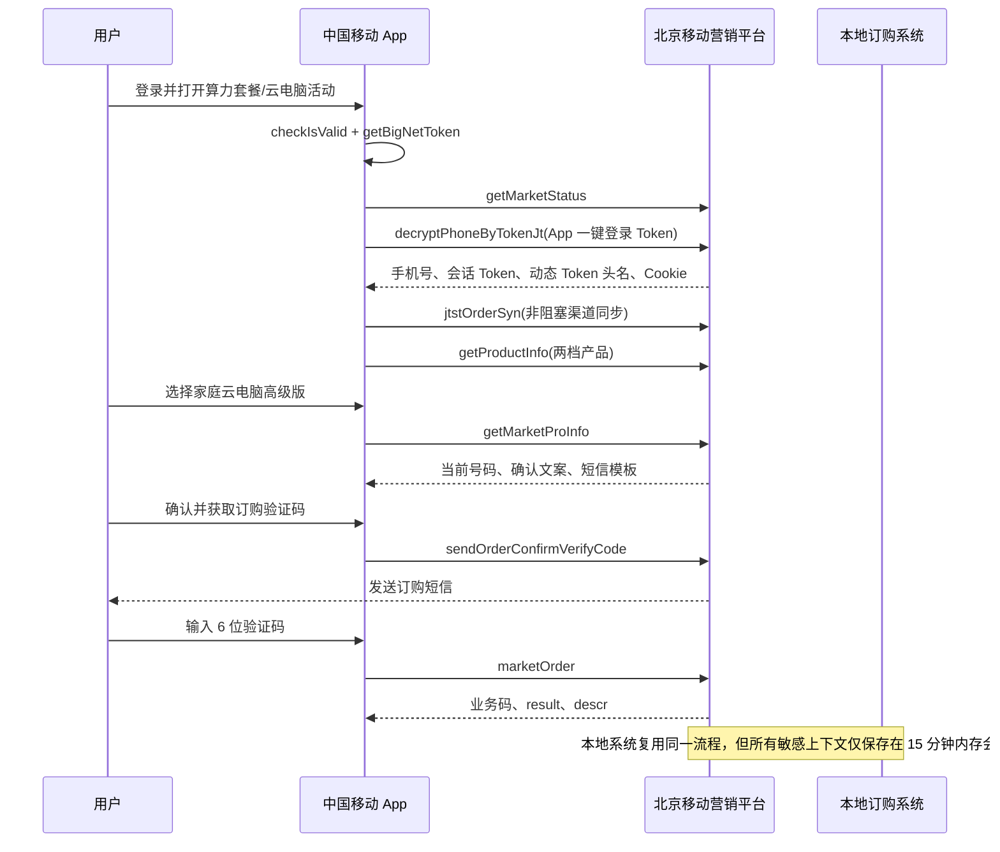

# 家庭云电脑订购流程、接口与本地测试说明

版本：V1.0  
分析日期：2026-07-26  
目标项目：`bj-mobile-business-local`  
样本：`云电脑订购.har`（74 条请求，敏感值不进入本文）

## 1. 结论摘要

本次“云电脑订购”属于北京移动营销平台，不属于中移商城 `wx.10086.cn`、北移门户 `portal-bff` 或 COC Aurora 订单协议。核心业务域名和接口前缀为：

```text
https://mop.bmcc.com.cn/mkt_web
```

官方活动页为 Vue SPA 的 `/computingCombo` 路由。页面同时陈列算力套餐和两档家庭云电脑，本地系统只开放两档家庭云电脑：

| 档位 | 月费 | 配置 | `productCode` | `offerId` | 方案编号 |
| --- | ---: | --- | --- | --- | --- |
| 家庭云电脑畅享版月包 | 19.9 元/月 | 4 核 CPU、8 GB 内存、80 GB 磁盘 | `78870ece2bdf42bc8a278e9e9bc595ea` | `111602043971` | `25BJ200210` |
| 家庭云电脑高级版月包 | 29.9 元/月 | 8 核 CPU、16 GB 内存、80 GB 磁盘 | `78289f7840634282b781f28576bbace5` | `111602043972` | `25BJ200211` |

HAR 中用户选择了高级版，订购验证码发送成功，最终 `marketOrder` 返回 `code=99904`、`msg=验证码错误`。因此该样本只证明请求进入最终接口，没有发生成功订购。

## 2. 证据范围

| 证据 | 可确认内容 | 边界 |
| --- | --- | --- |
| HAR | 真实域名、请求顺序、请求字段、响应字段、两档产品、短信成功、最终错误码 | 未包含成功下单响应；Token、Cookie、手机号、验证码已脱敏 |
| HAR 同版本官方页面源码 | 固定活动/页面/产品编码、页面选择逻辑、接口路径、成功判断逻辑 | 源码随平台发布可能变化，运行时仍以上游实时响应为准 |
| 本地只读连通检查 | 2026-07-26 活动状态接口返回 HTTP 200、业务码 200、`status=1` | 未认证、未发短信、未下单 |
| 本地自动测试 | 全流程字段、单次最终提交、幂等、验证码错误和 UNKNOWN 状态 | 全部使用脱敏 mock，不调用真实短信和下单接口 |

## 3. 完整业务流程



本地状态机：

```text
AUTHENTICATED
  -> PRODUCT_READY
  -> SELECTION_READY
  -> SMS_SENT
  -> SUBMITTING
  -> FINISHED | FAILED | UNKNOWN
```

`UNKNOWN` 是终态。最终请求超时、连接断开、响应无法解析或 `code=200` 但缺少可验证的 `obj.result` 时进入该状态，当前会话禁止重试。

## 4. 平台固定上下文

| 字段 | 值 | 含义 |
| --- | --- | --- |
| `origin` | `https://mop.bmcc.com.cn` | 营销平台域名 |
| `baseApi` | `/mkt_web` | API 前缀 |
| `channelCode` | `173` | 中国移动 App 渠道 |
| `mktCode` | `98fd4c5440394f42b012112e8ccb7076` | 算力套餐/云电脑活动编码 |
| `pageCode` | `94d4682c390e4a8b876d22a2d46505b9` | 活动页面编码 |
| 页面路由 | `/statics/page/mkt/#/computingCombo?c=173` | 官方 SPA 路由；凭据不应固化到 URL |
| 动态认证头 | `mop_mkt_web_token` | HAR 返回的 `headerName`；本地实现不写死，使用登录响应值 |

所有业务请求使用 JSON，典型请求头为：

```text
Accept: application/json, text/plain, */*
Content-Type: application/json;charset=utf-8
Origin: https://mop.bmcc.com.cn
Referer: https://mop.bmcc.com.cn/statics/page/mkt/
<headerName>: <session-token>
Cookie: <server-memory-cookie-jar>
```

`<headerName>`、会话 Token、Cookie、手机号、App Token 和验证码不得出现在日志、文档、浏览器存储或 API 响应中。

## 5. 接口明细

### 5.1 App 原生会话前置

HAR 在业务页之前出现两个中国移动 App 原生接口：

```text
POST https://client.app.coc.10086.cn/SessionServer-orange/checkIsValid
POST https://client.app.coc.10086.cn/leadeon-abilityopen-biz/BN/obtainToken/getBigNetToken
```

请求体和响应体使用 App 专用加密，且带 `x-sign`、`x-nonce`、`x-time`、`x-token`。本地系统不复制或伪造该签名层，只接收 App 已生成的短期一键登录 Token。

### 5.2 活动状态

```text
POST /mkt_web/s/marketInfo/getMarketStatus
```

请求：

```json
{
  "mktCode": "98fd4c5440394f42b012112e8ccb7076",
  "channelCode": "173"
}
```

主要响应字段：

| 字段 | 类型 | 示例 | 含义 |
| --- | --- | --- | --- |
| `success` | boolean | `true` | HTTP 包装层是否成功 |
| `data.code` | string | `200` | 业务码 |
| `data.msg` | string | `操作成功` | 业务说明 |
| `data.obj.status` | number | `1` | `1` 表示活动开放 |
| `data.obj.useCaptchaDirectly` | number | `1` | 页面登录回退策略 |
| `data.obj.trustLegacyUaToken` | number | `0` | 旧 UA Token 信任开关 |

本地继续条件：HTTP 2xx、`success != false`、`data.code=200`、`data.obj.status=1`。

### 5.3 App Token 兑换营销会话

```text
POST /mkt_web/s/login/decryptPhoneByTokenJt
```

请求：

```json
{
  "token": "<fresh-app-token>",
  "channelCode": "173",
  "mktCode": "98fd4c5440394f42b012112e8ccb7076"
}
```

响应 `data.obj`：

| 字段 | 类型 | 用途 |
| --- | --- | --- |
| `headerName` | string | 后续请求携带 Token 的动态请求头名 |
| `phone` | string | 当前账号完整手机号；仅服务端使用并脱敏显示 |
| `token` | string | 营销平台短期会话 Token |

接口还会设置 `rememberMe`、`mop_mkt_web` 等 Cookie。本地使用独立 `CookieJar` 保存，15 分钟会话到期或用户重置后销毁。

### 5.4 App 渠道订单同步

```text
POST /mkt_web/s/login/jtstOrderSyn
```

HAR 的降级请求：

```json
{
  "channelId": "",
  "token": "<session-token>",
  "yx": "",
  "channelCode": "173",
  "mktCode": "98fd4c5440394f42b012112e8ccb7076",
  "r": 5
}
```

页面通过 App JS Bridge 尝试读取 `channelId/token/yx`，最多重试 5 次，仍取不到时按以上空值同步。该接口不返回订购资格或订单结果，属于非阻塞渠道同步；本地适配器不把它设为业务前置条件。

### 5.5 产品详情

```text
POST /mkt_web/s/productInfo/getProductInfo
```

请求：

```json
{
  "channelCode": "173",
  "productCode": "<selected-or-candidate-product-code>"
}
```

`data.obj[]` 主要字段：

| 字段 | 类型 | 说明 |
| --- | --- | --- |
| `productCode` | string | 页面产品唯一编码 |
| `offerId` | string | CRM 侧产品/资费标识 |
| `productName` | string | 产品名称 |
| `descr` | string | HTML 业务规则 |
| `originalPrice` | string/null | HAR 中为空，不能作为计费依据 |
| `createTime` | number[] | 产品配置创建时间 |

本地系统逐一实时查询两档产品，并校验响应 `productCode` 与请求一致。费用和硬件配置同时来自 HAR 产品文案与同版本页面清单。

### 5.6 订购确认信息

```text
POST /mkt_web/s/orderConfirm/getMarketProInfo
```

请求：

```json
{
  "productCode": "78289f7840634282b781f28576bbace5",
  "mktCode": "98fd4c5440394f42b012112e8ccb7076"
}
```

`data.obj` 主要字段：

| 字段 | 类型 | 说明 |
| --- | --- | --- |
| `phone` | string | 当前办理号码；必须与认证号码一致 |
| `productName` | string | 含方案编号的完整产品名称 |
| `fullDescr` | string | 费用、生效、支付和退订规则 HTML |
| `smsTemplate` | string | 运营商将发送的验证码短信模板 |
| `productType` | string | HAR 返回字符串 `null`，本地不依赖 |

该接口既是确认文案查询，也是本地选择阶段的号码一致性检查。响应号码不同或未返回规则时禁止继续。

### 5.7 发送订购验证码

```text
POST /mkt_web/s/orderConfirm/sendOrderConfirmVerifyCode
```

请求：

```json
{
  "productCode": "78289f7840634282b781f28576bbace5",
  "mktCode": "98fd4c5440394f42b012112e8ccb7076",
  "pageCode": "94d4682c390e4a8b876d22a2d46505b9"
}
```

HAR 成功响应为 `data.code=200`、`data.msg=操作成功`。同平台公共页面源码还定义：

| 业务码 | 含义 |
| --- | --- |
| `200` | 短信发送成功 |
| `201` | 非北京移动号码 |
| `202` | 发送间隔小于 60 秒 |
| `203` | 同一 IP 一分钟超过限制 |
| `204` | 超过当天最大发送量 |

本地系统要求用户先阅读实时规则、核对号码/档位/费用并在二次弹窗确认真实操作。短信请求固定 `maxAttempts=1`，服务端冷却 60 秒。

### 5.8 最终订购

```text
POST /mkt_web/s/orderConfirm/marketOrder
```

请求：

```json
{
  "mktCode": "98fd4c5440394f42b012112e8ccb7076",
  "productCode": "78289f7840634282b781f28576bbace5",
  "verifyCode": "<6-digit-sms-code>",
  "pageCode": "94d4682c390e4a8b876d22a2d46505b9",
  "channelCode": "173"
}
```

字段说明：

| 字段 | 来源 | 必需 | 说明 |
| --- | --- | --- | --- |
| `mktCode` | 页面源码/HAR | 是 | 活动编码 |
| `productCode` | 当次服务端产品列表 | 是 | 已锁定的云电脑档位 |
| `verifyCode` | 用户短信 | 是 | 6 位订购验证码 |
| `pageCode` | 页面源码/HAR | 是 | 页面追踪及业务上下文 |
| `channelCode` | App 渠道 | 是 | 固定 `173` |

响应判定：

| 条件 | 本地状态 | 处理 |
| --- | --- | --- |
| `code=99904` | `SMS_SENT` | 验证码错误，可在同一会话重新输入，不自动重发短信 |
| `code=200` 且存在 `obj.result`，值不为 `false`/`"false"` | `FINISHED` | 已受理；显示 `obj.descr` |
| `code=200` 且 `obj.result` 为 `false`/`"false"` | `FAILED` | 明确拒绝；显示 `obj.descr` |
| 其他明确业务码 | `FAILED` | 显示业务码与 `msg` |
| `code=200` 但缺少 `obj.result` | `UNKNOWN` | 语义不足，禁止重试 |
| 超时、断连、HTTP 异常或解析失败 | `UNKNOWN` | 禁止重试，要求官方渠道核验 |

官方页面源码使用 `code=200 && obj.result != "false"` 判断成功。本地实现额外要求 `obj.result` 字段真实存在，避免把残缺响应误判为成功。

## 6. 产品规则

两档产品均具有以下规则：

- 仅限中国移动北京用户。
- 办理成功后立即生效、立即计费，使用话费支付。
- 连续包月，次月自动续订。
- 同一档位在权益有效期内不可多次订购；不同档位可同时订购。
- 多档产品产生的资源彼此独立，不可合并或互通。
- 支持退订，退订后月底失效，次月不再扣费。
- 有效期结束后用户数据和云电脑资源保留 15 天；之后数据删除、资源回收且无法恢复。
- HAR 文案指向营业厅退订。实际退订渠道应在办理前以运营商最新规则为准。

高级版短信模板标明验证码 1 分钟有效。页面和本地服务端均采用 60 秒重发冷却。

## 7. 本地系统 API

统一入口：`http://127.0.0.1:5178/#/quick-order`

### 7.1 创建云电脑会话

```text
POST /api/quick-orders/sessions
```

```json
{
  "platform": "cloud",
  "auth": {
    "appToken": "<fresh-app-token>"
  }
}
```

成功后只返回脱敏手机号和公共状态，App Token 已从适配器上下文清除。营销平台会话 Token、动态头名和 Cookie 仅保存在后端内存。

### 7.2 公共流程 API

| 方法 | 路径 | 用途 |
| --- | --- | --- |
| `GET` | `/api/quick-orders/catalog` | 平台与能力目录 |
| `POST` | `/api/quick-orders/sessions/:id/prepare` | 查询活动状态和两档产品 |
| `POST` | `/api/quick-orders/sessions/:id/select` | 锁定产品并查询确认规则 |
| `POST` | `/api/quick-orders/sessions/:id/sms/send` | 二次确认后发送订购短信 |
| `POST` | `/api/quick-orders/sessions/:id/confirm` | 单次最终提交 |
| `GET` | `/api/quick-orders/sessions/:id` | 查询公共状态 |
| `DELETE` | `/api/quick-orders/sessions/:id` | 销毁内存会话 |

短信请求示例：

```json
{
  "agreed": true,
  "realOrderConfirmed": true,
  "confirmationId": "client-generated-stable-id"
}
```

最终确认示例：

```json
{
  "smsCode": "<6-digit-sms-code>",
  "agreed": true,
  "realOrderConfirmed": true,
  "confirmationId": "client-generated-stable-id"
}
```

同一 `confirmationId` 的终态重复请求只返回已保存结果，不再次调用运营商。不同确认 ID 会被拒绝。

## 8. 获取新鲜 App Token

普通 Safari/Chrome 没有中国移动 App 的 `cmcc` 原生桥接，不能自行生成该 Token。人工联调步骤：

1. 在中国移动 App 登录待办理号码。
2. 使用本机 Proxyman 等已获授权的调试工具捕获本人设备流量。
3. 在 App 中打开“算力套餐/家庭云电脑”页面。
4. 找到 `POST /mkt_web/s/login/decryptPhoneByTokenJt`。
5. 只复制 JSON 请求体中的 `token` 值，立即粘贴到本地工作台“云电脑”页。
6. 不复制、保存或分享 HAR 中旧 Token；旧样本 Token 通常已过期，也可能已经被兑换。

联调时先完成会话创建、产品查询和确认信息查询。只有用户再次明确确认后才发送真实订购短信；最终提交前必须核对手机号、档位、月费和连续包月规则。

## 9. 安全和故障策略

- App Token 只用于一次认证兑换，成功后立即从前端字段和后端上下文清除。
- 营销平台 Token、Cookie、完整手机号、验证码不进入公共 API 响应。
- 请求日志对 `Authorization`、Cookie、任意包含 `token/secret/signature/api-key` 的请求头统一脱敏。
- 订购会话只存后端内存，默认 15 分钟过期，重启即清空。
- 产品只能从当次实时响应选取，浏览器伪造 `optionId` 会被拒绝。
- 短信发送与最终提交均为单次网络尝试；最终提交绝不自动重试。
- `UNKNOWN` 会话禁止继续；必须先通过中国移动 App、10086 或营业厅核验。
- `mop.bmcc.com.cn` 当前需要旧 TLS 握手兼容。该兼容仅由云电脑适配器显式启用，不改变其他外部请求的 TLS 策略。

## 10. 测试覆盖

自动测试文件：

```text
backend/test/quickOrderCloudComputer.test.js
backend/testFixtures/cloudComputerHar.js
backend/test/quickOrderProtocol.test.js
```

覆盖内容：

- App Token 兑换字段与营销会话脱敏。
- 活动状态和两档产品实时查询。
- 高级版确认协议与号码一致性。
- 短信接口字段及 `maxAttempts=1`。
- 最终接口五字段及 `maxAttempts=1`。
- HAR 实际出现的 `99904` 可恢复处理。
- 成功、明确失败、缺失结果语义和网络断连。
- `UNKNOWN` 禁止重试和稳定 `confirmationId` 幂等。
- 固定活动、页面、渠道和产品编码协议测试。

HAR 未包含成功响应。测试中的成功样本明确标记为“页面源码契约派生”，不会伪装成 HAR 实录。全部自动测试使用 mock，没有发送真实短信或订购请求。

## 11. 本地运行

```bash
cd /Users/ZevinGunn/CMCC-PROJECT/bj-mobile-business-local
npm run install:all
npm run dev
```

地址：

```text
前端：http://127.0.0.1:5178/#/quick-order
后端：http://127.0.0.1:8788
```

验证命令：

```bash
cd backend && npm test
cd ../frontend && npm run build
```

自动测试结束不代表真实账号已经办理成功。真实联调必须使用新鲜 Token，并由账号本人完成短信和最终确认。
