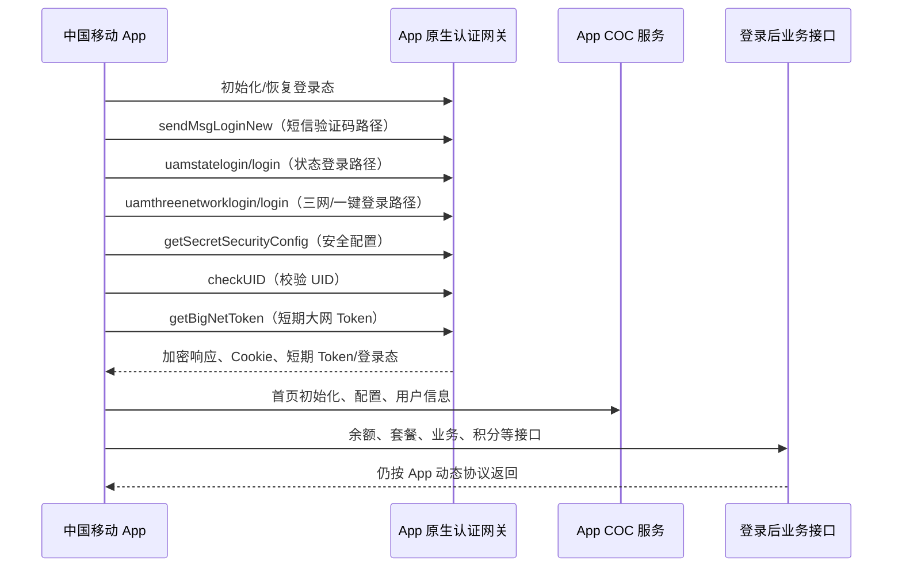
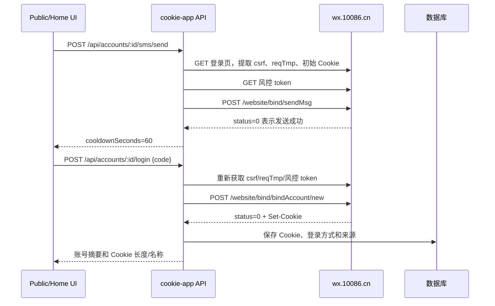

# 中国移动 App 登录流程、接口与加密存储说明

版本：V1.0  
分析日期：2026-09-11  
样本：`/Users/ZevinGunn/CMCC-PROJECT/app登录.har`  
样本请求数：281  
客户端：`ChinaMobile/12.5.4 (iPad; iOS 18.7; Scale/2.00)`

## 1. 文档边界与结论

本文件只分析随附的 `app登录.har` 和当前项目中可核对的实现。HAR 中的手机号、Cookie、UID、Token、设备标识、签名和验证码均属于敏感值，文档不复制真实值，只记录字段形态、长度和使用位置。

需要先区分两类协议：

1. **中国移动 App 原生认证层**：请求发送到 `client.app.coc.10086.cn`，使用 `x-qen=14`、动态 `x-token`、`x-time`、`x-nonce`、`xs`、`x-sign`，请求体和响应体均为不可直接阅读的 Base64 形态密文。
2. **项目当前网页 10086 登录层**：项目通过 `wx.10086.cn/website/bind/...` 发送短信和登录，手机号、验证码使用项目随网页加载得到的 AES 函数加密；登录返回 Cookie 后由服务端加密存储。它不是 HAR 中 App 原生 `LN` 协议的直接实现。

因此，本 HAR 可以确认原生 App 的接口顺序、外层参数和会话依赖，但**不能仅凭 HAR 独立确认 `x-qen=14` 的内部算法、动态密钥派生公式或密文内业务字段**。把某次抓包的 `x-token`、`xs` 或 `x-sign` 固定到代码中，既不能稳定复用，也会造成重放和账号风险。

## 2. 总体流程



HAR 中按时间排序可观察到两次初始化/恢复阶段：

| 阶段 | 典型请求 | 说明 |
| --- | --- | --- |
| 首次初始化 | `autoLogin`、`decoupling/config`、`getSecretSecurityConfig` | App 尝试恢复已有登录态并取得安全配置 |
| 短信登录 | `sendMsgLoginNew`、`uamstatelogin/login` | 无 Cookie 发送；两者在同一时间出现，属于登录状态机的不同分支/并发准备请求 |
| 三网/一键登录 | `uamthreenetworklogin/login` | 需要 App 侧三网或一键登录上下文，不能只凭手机号调用 |
| 登录态确认 | `checkUID` | 校验当前 UID 与会话是否可用 |
| 跨业务认证 | `getBigNetToken` | 登录后多次获取短期能力 Token，响应不能视为长期 Cookie |
| 登录后初始化 | `startInit`、`getNavigation`、用户信息、余额等 | 这些请求证明 App 已进入业务态，但不是登录凭据本身 |

HAR 中核心认证接口均返回 HTTP 200。HTTP 200 只表示网关返回了密文，必须完成 App 协议解密后再依据业务码判断成功。

## 3. 核心接口清单

### 3.1 原生认证接口

| 方法 | 路径 | 次数 | HAR 请求体长度 | HAR 响应体长度 | 作用 |
| --- | --- | ---: | ---: | ---: | --- |
| POST | `/biz-orange/LN/uamrandcode/sendMsgLoginNew` | 1 | 832 | 88 | 发送 App 登录短信验证码 |
| POST | `/biz-orange/LN/uamstatelogin/login` | 1 | 1048 | 120 | 短信登录状态机请求；与发送验证码同一时刻出现 |
| POST | `/biz-orange/LN/uamthreenetworklogin/login` | 1 | 1388 | 656 | 三网/一键登录分支 |
| POST | `/biz-orange/LN/uamrandcodelogin/autoLogin` | 1 | 1388 | 232 | 自动恢复已有登录态 |
| POST | `/biz-orange/LN/checkUIDAction/checkUID` | 1 | 876 | 88 | 检验当前 UID/登录上下文 |
| POST | `/biz-orange/LN/decoupling/config` | 2 | 960–984 | 204 | 登录模块或业务解耦配置，不应当作为登录成功唯一依据 |
| POST | `/ServiceControl/SC/secret/getSecretSecurityConfig` | 2 | 812 | 120 | 拉取客户端安全配置/密钥协商材料 |
| POST | `/leadeon-abilityopen-biz/BN/obtainToken/getBigNetToken` | 3（样本还存在同类重复调用） | 728–768 | 204 | 获取短期大网能力 Token |

> 长度是 HAR 文件中 `postData.text` 和响应 `content.text` 的字符长度，受 Base64 和字符编码影响，只用于识别请求形态，不是接口协议约束。

### 3.2 登录后初始化接口

登录成功后，HAR 还出现以下类型请求：

- `DN/init/startInit`、`DN/init/getNavigation`：首页启动和导航。
- `DN/homePage/getTopAreaList`、`DH/homeSkin/getHomeSkin`、`DH/hotupdate/getHotupdateList`：首页配置。
- `BH/userInformationService/getUserInformation`、`BH/accoutQry/getAccoutInfo`：用户和账户信息。
- `BH/payFeesQuery/getPayFeesQueryInfo`、`SHS/balance/getBalanceRule`、`SHS/meterAssets/query`：余额、账单或资产信息。
- `BN/globalCommunications/gsmState`、`BN/scoreQueryService/getScoreQuery`：全球通状态和积分。
- `LN/decoupling/config`、`DN/openplatform/clientPermissionInfo`：功能开关和权限。

这些接口依赖登录后的动态请求头和会话上下文。不能把任意一个首页接口的 HTTP 200 当作登录成功。

## 4. 统一请求头

核心 `client.app.coc.10086.cn` 请求都带有以下动态字段：

| 字段 | HAR 形态 | 使用说明 |
| --- | --- | --- |
| `x-qen` | 固定字符串 `14` | 当前原生报文保护版本/协议选择器；不是业务参数 |
| `x-token` | 动态字符串，样本长度 192 或 216 | 当前会话或密钥封装材料；登录前后可能变化，不能缓存为固定常量 |
| `x-time` | 13 位毫秒时间戳 | 防重放、参与签名/密钥派生 |
| `x-nonce` | 8 位数字字符串 | 单请求随机数 |
| `xs` | 32 位十六进制字符串 | 请求校验字段，具体摘要输入无法由 HAR 单独确认 |
| `x-sign` | 32 位十六进制字符串 | 另一动态签名/校验字段，不能按 MD5 固定猜测 |
| `Content-Type` | `application/Json` | App 原生接口约定，大小写以客户端实现为准 |
| `User-Agent` | `ChinaMobile/12.5.4 (...)` | App 版本、设备类型、系统版本和屏幕倍率 |
| `Cookie` | 有时为空，有时为 `JSESSIONID` 等 | 已建立的 App 会话；短信登录路径可为空，安全配置/校验路径带 Cookie |

`x-time`、`x-nonce`、`xs`、`x-sign` 必须每次请求重新生成；请求重试不得复用原签名。

## 5. 原生报文加密与解密

### 5.1 已验证的外层格式

HAR 中原生请求体是 Base64 字符集，响应体也通常是 Base64 字符集。对响应做一次 Base64 解码后得到二进制数据，而不是 UTF-8 JSON；例如 `checkUID` 响应一次 Base64 解码后为 48 字节二进制。因此它不是“Base64 编码的 JSON”，而是“二进制密文再做 Base64 传输”。

外层处理只能写成：

```text
业务对象
  -> App 内部动态加密/封装（x-qen=14）
  -> 二进制密文
  -> Base64
  -> HTTP body
```

响应方向反过来：

```text
HTTP body
  -> Base64 decode
  -> App 动态解密/验签
  -> JSON 或协议对象
  -> 依据业务码判断成功
```

### 5.2 当前可确认与不可确认内容

**可确认：**

- `x-qen=14` 在样本中稳定出现。
- `x-token`、时间戳、随机数和双 32 位校验字段是动态输入。
- 请求和响应均不是明文 JSON。
- `getSecretSecurityConfig` 在认证准备阶段请求两次，说明安全配置可能按会话/阶段刷新。

**不能从这份 HAR 独立确认：**

- AES/DES/SM4 等具体分组算法及工作模式。
- 动态密钥的派生公式。
- `xs` 和 `x-sign` 的精确签名原文、编码和摘要算法。
- 密文内部业务字段的字段名和业务码。

项目中 `api/services/cmccCrypto.ts` 通过加载网页端 `crypto20251103.js` 的 `aesEncrypt/aesDecrypt`，处理的是网页 `wx.10086.cn` 登录协议；它不能直接解密本 HAR 的 App `x-qen=14` 二进制密文。项目中 `cmccBusinessCrypto.ts` 的 AES-128-CBC 也属于 COC/业务查询协议，不能与 App 原生层混用。

## 6. 各接口参数说明

由于 `LN` 请求体已经被 `x-qen=14` 封装，HAR 无法安全、可靠地展开其内部字段。下面分为“已观察的外层字段”和“用途级说明”。字段类型以线上外层表示为准，业务内层字段必须从对应版本 App 的运行时协议或官方接口定义取得。

### 6.1 `sendMsgLoginNew`

```text
POST /biz-orange/LN/uamrandcode/sendMsgLoginNew
```

| 参数 | 所在层 | 说明 |
| --- | --- | --- |
| `x-qen` | Header | 固定为 `14`，选择原生加密协议 |
| `x-token` | Header | 当前动态会话/加密材料 |
| `x-time` | Header | 当前毫秒时间 |
| `x-nonce` | Header | 本次请求随机数 |
| `xs`、`x-sign` | Header | 动态校验值 |
| 手机号、渠道、设备和风控参数 | 加密 body 内层 | HAR 不能直接确认字段名；不要按外层密文长度推断参数 |

业务处理：服务端解密并校验手机号、设备和风控后发送验证码；响应 HTTP 200 仍需解密后查看业务码。项目网页登录实现采用 6 位验证码和 60 秒冷却，但不能据此断言 App 原生接口一定使用相同冷却规则。

### 6.2 `uamstatelogin/login`

```text
POST /biz-orange/LN/uamstatelogin/login
```

用途是登录状态机或登录确认分支。样本中它与 `sendMsgLoginNew` 在同一时间戳附近发出，不能简化为“发送验证码成功后一定只调用一次”。实现时应以解密后的状态码和会话结果决定下一步，而不是只依赖请求顺序。

内层通常应包含手机号/验证码或登录状态上下文，但这份 HAR 无法验证具体字段名，因此文档不伪造 JSON 示例。

### 6.3 `uamthreenetworklogin/login`

```text
POST /biz-orange/LN/uamthreenetworklogin/login
```

这是三网/一键登录路径。它的请求体比状态登录更长（样本 1388 字符），说明包含更多设备、运营商或一键登录上下文。不能用普通短信验证码请求体替代；应由 App SDK 产生完整内层对象并重新计算动态头。

### 6.4 `uamrandcodelogin/autoLogin`

```text
POST /biz-orange/LN/uamrandcodelogin/autoLogin
```

用于已有登录材料的自动恢复。样本没有 `Cookie`，但有 `x-token` 等动态头；这说明恢复材料可能被放在加密 body 或动态 Token 中。服务端应把它视为“尝试恢复”，成功标准是解密后的登录态/UID/Token 有效，而不是 HTTP 200。

### 6.5 `checkUIDAction/checkUID`

```text
POST /biz-orange/LN/checkUIDAction/checkUID
```

用于验证当前 UID 与会话是否匹配。样本有 Cookie、`x-token` 和完整动态头，响应只有 88 个外层字符；它适合做登录态确认，但不能单独生成登录态。

### 6.6 `getSecretSecurityConfig`

```text
POST /ServiceControl/SC/secret/getSecretSecurityConfig
```

用途是获得安全配置或动态协商材料。样本请求两次，均带 Cookie；响应外层 120 个 Base64 字符，解码后为二进制，不是可直接展示的 JSON。该响应不得记录到普通日志，也不得当作长期密钥写入账号表。

### 6.7 `getBigNetToken`

```text
POST /leadeon-abilityopen-biz/BN/obtainToken/getBigNetToken
```

用途是为跨模块能力获取短期 Token。样本连续出现多次，请求体长度 728–768，说明不同能力/上下文可能使用不同内层参数。每次调用都应重新生成动态头；Token 只应放入内存中的短期会话对象，不能作为 10086 Cookie 替代品。

## 7. 登录成功判定

推荐按以下顺序判定：

1. HTTP 状态在 2xx 范围内。
2. Base64 解码和原生协议解密/验签成功。
3. 解密对象的业务码表示成功。
4. 响应包含可用的登录态材料：UID、短期 Token 或服务端确认的会话 Cookie。
5. 使用 `checkUID` 或一个只读用户信息接口复核登录态。
6. 只有第 5 步成功，才将账号标记为“登录有效”。

失败分类应至少区分：

| 类别 | 判定 | 处理 |
| --- | --- | --- |
| 网络失败 | 超时、DNS、连接失败 | 可用新 nonce/签名重试，不复用原请求 |
| 网关失败 | HTTP 非 2xx | 记录 requestId/时间，不记录密文全文 |
| 解密失败 | Base64、填充、验签或 JSON 失败 | 重新拉取安全配置；不要把响应当成功 |
| 业务失败 | 解密后业务码非成功 | 展示业务消息，按风控/验证码/账号状态处理 |
| 会话失效 | `checkUID` 或只读接口提示未登录 | 丢弃短期 Token，重新走登录流程 |

## 8. 项目当前网页登录流程与存储

项目当前实现的 10086 验证码登录不是 App 原生 `LN` 协议，流程如下：



### 8.1 网页短信接口

| 接口 | 入参 | 处理 |
| --- | --- | --- |
| `POST https://wx.10086.cn/website/bind/sendMsg` | `telephone`：AES 加密手机号；`riskToken`：风控 token | `application/x-www-form-urlencoded`；请求头带动态 `csrf-token`、`reqTmp` |
| `POST https://wx.10086.cn/website/bind/bindAccount/new` | `telephone`：AES 加密手机号；`password`：AES 加密验证码；`pwdType=02`；`checkCtrol=1`；`constId`：风控 token；其他来源字段 | JSON body；成功要求业务 `status=0` 且响应有 Cookie |

项目从登录页 HTML 提取 `csrf` 和 `reqTmp`，从响应 `Set-Cookie` 合并 `name=value`，不会把 `Path`、`Secure` 等属性写进 Cookie header。

### 8.2 网页加密

项目实际使用 `10086登录页/wx.10086.cn/website/js/shared/crypto20251103.js` 暴露的 `aesEncrypt/aesDecrypt`，由 `api/services/cmccCrypto.ts` 在 VM 中加载。具体算法参数由该官方脚本运行时提供，不能用 App `x-qen=14` 的假设替代。

### 8.3 数据库存储

账号持久化由 `api/services/accountsStoreDb.ts` 完成：

| 数据 | 存储方式 | 用途 |
| --- | --- | --- |
| 10086 Cookie | `cookieEnc`，`cryptoBox.encryptString` | 后续刷新、查询和业务调用 |
| 请求头覆盖 | `requestHeadersEnc` | 复现特定登录/上游环境 |
| 登录元数据 | `loginMetaEnc` | 登录时间、来源、TTL 等 |
| 登录方式 | `lastLoginMethod` | `cmcc_sms`、`cmcc_qr`、`manual_cookie`、`yunpan` 等 |
| Cookie 来源 | `cookieSource` | `sms`、`qr`、`yunpan`、`manual` |
| 检查/失效时间 | 普通时间字段 | 维护任务判断 Cookie 是否需要刷新 |

`cryptoBox` 使用环境变量 `CMCC_DB_ENCRYPTION_KEY` 解码后的 32 字节密钥，采用 AES-256-GCM，随机 12 字节 IV，保存格式：

```text
v1:<iv_base64>:<ciphertext_base64>:<auth_tag_base64>
```

数据库明文中不应保存手机号验证码、App `x-token`、`x-sign`、`x-nonce`、原生密文全文或短期大网 Token。日志只保留脱敏后的账号标识、阶段、状态和 requestId。

## 9. 参数生命周期与使用关系

| 参数/材料 | 产生阶段 | 消费阶段 | 生命周期 | 是否持久化 |
| --- | --- | --- | --- | --- |
| 手机号 | UI/登录输入 | 短信发送、登录、账号绑定 | 业务会话 | 账号表按脱敏/业务需要保存 |
| 验证码 | 用户短信 | 登录提交一次 | 一次性、短时 | 否 |
| `csrf`、`reqTmp` | 读取网页登录页 | 网页短信/登录请求头 | 页面/会话级 | 否 |
| `riskToken` | 风控接口 | 网页短信和登录 | 项目缓存约 23 小时，但上游可提前失效 | 否 |
| App `x-token` | App 原生登录/安全配置 | 每个原生请求 | 短期、动态 | 不应持久化 |
| `x-time`、`x-nonce`、`xs`、`x-sign` | 每个原生请求 | 当前请求验签 | 单请求 | 否 |
| App Cookie/JSESSIONID | App 会话 | `checkUID`、业务初始化 | 上游会话 TTL | 仅在 App 安全存储中；项目不应直接照搬 |
| 大网 Token | `getBigNetToken` | 跨能力接口 | 短期 | 内存短期缓存，过期丢弃 |
| 网页 10086 Cookie | 网页登录成功 | 项目后续查询/刷新/业务接口 | 上游 TTL；维护时更新 | 数据库加密 |

## 10. 实现和排障建议

1. App 原生登录必须由有权限的 App SDK/官方运行时生成动态报文；服务端只做代理或调用官方已授权 SDK，不要手写固定 `x-token`。
2. 所有重试重新生成 `x-time`、`x-nonce`、`xs`、`x-sign`；不要重放原始密文。
3. 先解密、再判断业务码；不要把 HTTP 200、非空响应或 Base64 解码成功当作登录成功。
4. `getSecretSecurityConfig` 失败时应重新协商安全配置；不要把上一会话的安全材料跨账号复用。
5. `getBigNetToken`、UID、Cookie、手机号和验证码都按凭据处理，禁止进入普通 debug 日志、前端 localStorage 或 URL query。
6. 项目网页登录和 App 原生登录应保留不同的 `loginMethod/cookieSource`，维护任务依据来源判断；不能把网页 Cookie 当作 App Token，也不能把 App Token 当作 10086 Cookie。
7. 只读复核接口应在保存账号前执行；复核失败时保存失败状态和脱敏原因，不能展示“登录成功”。

## 11. 证据与未决项

### HAR 直接验证的事实

- 文件包含 281 条请求。
- 原生认证请求使用 `x-qen=14` 和动态 `x-token/x-time/x-nonce/xs/x-sign`。
- `sendMsgLoginNew`、`uamstatelogin/login`、`uamthreenetworklogin/login`、`autoLogin`、`checkUID`、安全配置和大网 Token 路径均出现。
- 原生请求/响应外层是 Base64 形态，但 Base64 解码结果是二进制，不是直接 JSON。
- `sendMsgLoginNew` 和 `uamstatelogin/login` 无 Cookie；安全配置、`checkUID` 和大网 Token 请求带 Cookie。

### 尚未由单份 HAR 证明的内容

- `x-qen=14` 的具体加密算法、密钥派生、签名原文。
- 各 LN 接口加密体内的精确字段名、字段类型和业务码。
- 本次样本对应的真实登录业务是否最终成功；不能只依据 HTTP 200 判断。

若后续要实现 App 原生协议，需要同时取得对应版本 App 的授权 SDK/运行时实现或官方接口文档，并在隔离的测试账号上验证“解密—业务码—`checkUID` 复核”闭环。

