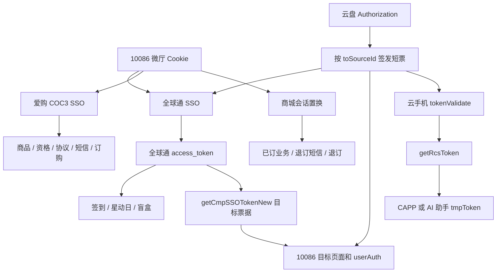

# 运营商接口使用与调用链

整理日期：2026-10-28（Asia/Shanghai）。本册说明 CMCC-PROJECT 当前工作区的实际实现，不是运营商发布的开放平台规范。源码中存在调用，并不证明接口今天仍可用；本次未发送短信、登录真实账号、签到、领取、订购、退订或推送。工作区中已有的未提交实现也纳入静态盘点，具体文件摘要见扫描清单。

## 阅读方法

先在本册按需求找到业务链，再查《02-加解密与密钥》中的协议编号，最后在《04-接口逐项参考》搜索完整路径、函数名或北京权益的 abilityCode。逐项参考保留每个实现的入参构造表达式、请求头、源码行号以及 HAR 中观察到的请求/响应字段。参数表中的“实现传入”不等于服务端正式定义的“必填”；未能确认的字段不猜测。

三类证据分开阅读：**源码请求调用**表示当前文件存在发送请求的实现；**地址或配置引用**可能只是页面、白名单、动态 URL 模板；**HAR 观测**表示历史抓包中曾出现。某条 API 有多种请求封装时按同一项目的调用链选用，不能合并字段后随意请求。响应字段是样本中出现的字段集合，不是每次都会返回。

## 1. 先选择正确的登录体系

| 已有凭据/需求 | 应使用的链 | 获得的产物 | 产物用途与限制 |
|---|---|---|---|
| 手机号和 10086 短信验证码 | 10086 Web 短信登录 | wx.10086.cn Cookie、首页上下文 | 微厅查询、全球通 SSO、爱购或商城换票；不是所有 App 接口凭据 |
| 手机端中国移动 App 确认二维码 | login.10086.cn 二维码登录 | 跳转会话与对应站点 Cookie | 按跳转域名完成登录；生成二维码本身没有登录完成 |
| 手机号、云盘验证码、官方滑块结果 | 移动云盘登录 | account/completeAccount、authToken、Authorization、routerInfo | 向指定 toSourceId 签发短票；业务短票不能当云盘长期令牌 |
| 全球通 access_token | 全球通会话检查/会员查询 | 会员等级、网龄、活动状态 | 全球通签到、星动日、盲盒；跨业务需 getCmpSSOTokenNew 再换票 |
| 中国移动 App Cookie / App Token | App 业务查询或 App SSO | App 会话、已订业务条目 | 用原生会话查询/退订；普通微厅 Cookie 未必适用 |
| 北京移动手机号/短信，或北京权益支持的集团票据 | 北移门户或权益平台各自登录 | 门户 Cookie+AES 会话，或 sessKey/sessType | 两套平台分开保存；权益 sessKey 不能直接用于门户 |
| 联通王卡会话 Cookie | 联通王卡/超级会员页面初始化 | 当前账号的加密手机号、短信模板、可办套餐 | 作为不透明值传回相应接口；项目不实现这些服务端密文的解密 |
| 北京电信手机号和服务密码 | 官方页面环境中的密码登录 | wapbj.189.cn 会话 | 查资格、余额、账单和权益；本地账号 ID 不是电信凭据 |
| 山西移动官方浏览器会话/短信 | 山西 WAP 桥接 | 官方 Cookie、sessionStorage、加密上下文 | 资格、已订业务及订退订；每次加密请求必须保留对应 AES key |

## 2. 10086 微厅登录

主要实现：`免登录进入全球通/cookie-app/api/services/cmcc10086.ts`、`cmccLoginParams.ts`、`cmccRiskToken.ts`。独立周三工具箱保留对应协议副本，不能只修改其中一份后假定全部同步。

1. GET `wx.10086.cn/website/bind/bindAccount/new`，保存 Set-Cookie，从 HTML 提取 `csrf`、`reqTmp`。这些字段属于当前会话，不能复用其他账号抓包值。
2. GET `yxfk.market.chinamobile.com:8081/mgt/decision-engine/udid/c1`，取得源码所读取的风控 token。请求携带实现中的 appId、来源和 UA；它是风控上下文，不是账号登录凭据。
3. POST `/website/bind/sendMsg`，表单字段 `telephone=P01(phone)`、`riskToken`；请求头使用 `csrf-token`、`reqTmp` 和初始化 Cookie。作用是发登录短信，成功结果不等于已登录。
4. POST `/website/bind/bindAccount/new`，JSON 字段：`telephone=P01(phone)`、`password=P01(code)`、`pwdType='02'`、`checkCtrol=1`、`bindSource=''`、`sourcePage='WMH_登录'`、`ys=''`、`ysTitle=''`、`constId=riskToken`。保存响应 Cookie，检查业务状态，再打开首页确认号码。
5. GET `/website/spa/main/newHome` 补充主页上下文。按需 POST `/website/uniApi/getMarginQueryInfo` 激活/查询余额上下文；具体公共包头和加密字段见逐项参考。

返回可能是明文 JSON，也可能是 P01 的十六进制密文。HTML、登录页、网关页、非预期重定向不能当 JSON 成功。短信响应 `status=0` 或 `'0'` 的判断来自当前实现，不可套到其他业务。

二维码链：GET `login.10086.cn/genqr.htm` 生成二维码，POST `/chkqr.htm` 轮询；需要保留同一流程的二维码标识、Cookie、channelId 和 backUrl。手机确认后沿服务端给出的受信跳转完成断言/SSO，最后访问微厅首页。扫码流程、本地 flowId 和用户的登录 Cookie 是不同产物。

## 3. 全球通登录、会员、成长值与客服

主要实现：`qqtSign.ts`、`qqtSmsAuth.ts`、`qqtSso.ts`、`globalTelecom.ts`、`globalTelecomCustomerService.ts`；独立实现还在 `qqt`、`qqt/qqt-cmicrwx`、`qqtlocal-rights` 和云盘工具中。

基础地址：`qqt.cmicrwx.cn/2016tyjf/xhmqqthy`。

| 场景 | 接口/输入 | 获得什么 | 后续如何使用 |
|---|---|---|---|
| 有 10086 Cookie，进入全球通 | 微厅 bindAccount/new 的 `netUniChannelId=001191`、`tokenKey=token`、`netUniBackUrl`，再进入 `new/ssoTokenLogin.action` | 目标站 Cookie，最终 `access_token` | 先 checkLoginStatus 或 queryVipLevel，确认账号再执行活动 |
| 全球通短信登录 | POST `new/cmpSmsSend.action`，SM2 手机号及 sspId；POST `login.action`，AES 加密手机号/验证码等实现字段 | access_token 和会话 Cookie | 全球通专属会话；短信发送与登录采用不同加密 |
| 检查会话 | `checkLoginStatus.action` | 是否登录/对应会话结果 | 失效时重走来源登录，不盲目重复活动请求 |
| 查身份 | `member/func/queryVipLevel.do` | phone、province、levelName、netAge 等 | 显示等级、判断活动资格；netAge 的使用方式以当前函数为准 |
| 星动日状态 | `member/func/queryIndexReceive.do` | 已领取状态、活动可领信息 | 决定是否展示领取入口 |
| 跨业务短票 | POST `getCmpSSOTokenNew.action`，`targetid` | 目标业务票据/跳转上下文 | 用 `qqtSso.ts` 中目标映射；不能把一个 targetid 的票据给另一站 |
| 成长值 | 先全球通 SSO/成长页预热，再 GSM `/login` 取得 sessionId，随后 `getGsmState` 与 `queryGsmInfo` | sessionId、等级/成长值数据 | 给后续 GSM 查询携带 X-GSM-TOKEN；静态 Lrsbhbg8 不是个人 sessionId |
| 客服/管家 | `clientManager/checkTarget` 及客服服务中的跳转链 | 客服入口或服务资格 | 跳转页面，不等同已经预约或提交业务 |

GSM 地址：`10086.online-cmcc.cn:20010/cmcc-gateway/outside/gsm`；路径包括 `/iservice/direct/serviceUnified/getGsmState`、`/iservice/direct/gsmInfo/queryGsmInfo`。请求中的固定客户端头与用户动态票据作用不同，见 P10。

普通权益领取 `normal/initNormalNewQy` 与星动日 `member/func/initQyStatus.do` 不能仅凭“都是领取”互换。项目中也有旧版星动日复用普通领取路径的实现，逐项参考会保留来源差异。productId、channelCode、isRandom、拼写为 `sourece` 的字段等应使用对应活动查询和当前实现返回/配置的值；不要自动纠正服务端协议字段拼写。

### 3.1 签到、补签、奖励、盲盒

| 链路 | 输入 | 输出与用途 |
|---|---|---|
| GET `/sign/info` → POST `/sign/sign` | sspid 和全球通 Cookie；业务 body 见对应函数 | 月签到状态、签到结果；再查询 info 确认 |
| info → `/sign/finshResignTask` → info | dayNum、taskId、sspid；任务需来自当前月份 | 补签结果和刷新状态，不能用过期 taskId |
| info → `/sign/toaccept` | 当前可领取奖励的标识及 sspid | 奖励领取结果；签到成功不等于奖励已领取 |
| `/luckBox/status` + `/luckBox/infoList` → 任务/抽取/收奖路径 | channelCode、type、当前官方任务编号 | 机会、任务、奖品代码；奖品可能还需履约页面 |

盲盒具体变更路径、任务参数和奖品页面见逐项参考的 `globalTelecomBlindBoxAction` 及 `qqtBlindBox.ts`。月份、开放日期、任务编号是活动配置；不能把 2026 年 10 月的值当永久协议。查询、完成任务、抽取和兑奖分别是独立动作。

## 4. 移动云盘 → 10086/全球通/云手机/CAPP

主要实现：cookie-app 的 `yunpan10086.ts`、`yunpanSso.ts`，以及 `云盘/yunpan-login-local/src/yunpanClient.js`、`cryptoBox.js`、`cloudPhone.js`、`globalTelecom.js`。

### 4.1 短信和云盘登录

| 步骤 | URL/入参 | 加密与产物 |
|---|---|---|
| 发送短信 | POST `user-njs.yun.139.com/user/sms/getSmsCode`；明文对象含 random、additionalSpaceSelected、clientType、reqType、nationCode、phoneNumber、captchaType、`puzzleVerfycode` | P03 短信独立 AES key，IV 前置；请求是 JSON 字符串，不是把业务对象直接 JSON 提交。产物是短信，不返回登录权限 |
| 获取公钥 | POST `yun.139.com/orchestration/auth-rebuild/key/v1.0/getRsaPublicKey`；clientCode、type | 返回本次使用的 RSA 公钥，保存服务器 Cookie |
| 准备会话 | 随机 16 字符 AES key；RSA 加密该 key | 原始 AES key 用于 encryptMsg；RSA 结果用于 mcloud-skey，两者不可互换 |
| 登录 | POST `/orchestration/auth-rebuild/permission/v1.0/login`；encryptMsg、returnToken、autoLogin，部分实现含 clientId | encryptMsg=P03 AES-128-ECB(JSON(loginPayload))；明文 payload 含 account、dycPwd、loginStyle、ifOpenAccount、verType、clientEnv、setCookie |
| 解登录结果 | 按本次 AES key 解密实现中的数据字段 | 保存 account/completeAccount、authToken、routerInfo 等；生成 `Basic Base64(pc:account:authToken)`，实际 realm 以实现为准 |

短信请求必须使用官方人机验证的结果。`puzzleVerfycode` 是协议现有拼写。当前代码保留特定 `01000019` 拒绝结果的旧加密兼容分支；这不代表所有失败都能切 key 重发。`nationCode` 的 +86/+852 会影响部分实现的 loginStyle、ifOpenAccount，不能统一强制一个值。

### 4.2 querySpecToken 三种封装

| 分支 | 入参/编码 | 前置和产物 |
|---|---|---|
| Web V1 | orchestration 的 querySpecToken；account、toSourceId；明文 JSON 和公共签名头 | 当前云盘授权；取得目标短票 |
| Web V2 | routerInfo 解析出的 user 域下 `/querySpecTokenV2`；phoneNumber、toSourceId；P03 固定 32 字节 key + IV 前置 | hcy-cool-flag 和授权等；响应也可能需 CBC 解密 |
| App 风格 V2 | 同名 `/querySpecTokenV2`；明文 JSON `{toSourceId}` | App 风格 Authorization / 来源头；不能把 Web 密文请求和本分支混合 |

`routerInfo` 可能指定分区 user 域；不能永远硬编码 user-njs。cookie-app 和独立云盘工具的目标默认值也不同：前者 10086 默认 `017018`，独立工具默认 `001003`，并可从配置覆盖。选择模板时需要让 toSourceId 与 targetSourceId 一致。

### 4.3 不同短票可以做什么

| 目标 | sourceId/targetSourceId | 正确链路 | 返回产物用途 |
|---|---|---|---|
| 全球通 | `001191` | querySpecTokenV2 → `new/ssoTokenLogin.action?token=...&targetSourceId=001191&backUrl=...` → checkLoginStatus | 全球通 access_token；先确认号码再持久化 |
| 10086 流量商城等 | 与目标模板一致，常见 `017018` / `001003` | 短票替换 netToken → 跳转 → userAuth → 首页验证 | 微厅 Cookie，继续全球通/商城/爱购换票 |
| 云手机 | `001216` | 签发票据后进入 cloud.139.com；服务端可 POST `/uniphone/user/tokenValidate` | 云手机 token、hwToken、refreshToken、expireTime |
| CAPP 云应用 | 先 `001216`，再 `001304` | tokenValidate → POST `/uniphone/user/getRcsToken`，body={targetSourceId,token} → CAPP 页面 | tmpToken 用于指定 CAPP 页面，不是云盘 authToken |
| AI 助手 | 先 `001216`，再 `001005` | 与 CAPP 同一换票链，更换目标 ID 和页面 | AI 助手临时票据 |

云手机公共请求头的 requestId、timestamp、sign 和客户端字段见 P04。`querySpecToken` 返回一个字符串，不等于所有目标均已登录；仍需完成目标站校验和 Cookie 收集。票据和跳转链接可能一次性或短期有效，现有资料不足以给出统一 TTL。

## 5. 中国移动 App 业务查询、退订与主套餐撤回

主要实现：`cmccBusinessQuery.ts`、`cmccBusinessCrypto.ts`、`cmccBusinessH5.ts`、`legacyBusinessQuery.ts`、`shared/legacyBusinessCredentials.ts`。

### 5.1 新版 biz-orange 接口

| URL 后缀/主机 | 使用场景与输入 | 获得的数据及组合 |
|---|---|---|
| h.app.coc `/biz-orange/LH/uamrandcodeH5/sendMsgLoginH5` | App H5 登录短信；cellNum、channlCode | sx 等登录上下文，交给 loginH5 |
| h.app.coc `/biz-orange/LH/uamrandcodeloginH5/loginH5` | cellNum、verifyCode、sendSmsFlag、sx、channlCode | App 业务 Cookie 和身份 |
| app.10086 `/biz-orange/BN/userInformationService/getUserInformation` | 已有 App Cookie；可含 cellNum | 账户身份、省市等后续查询上下文 |
| `/biz-orange/BH/accoutQry/getAccoutInfo` | 账号、beginMonth、endMonth | 余额/账务信息；月份默认行为见实现 |
| `/biz-orange/BN/userPlanQry/getUserPlanQryNew` | 主套餐查询参数 | 当前套餐信息，用于展示和撤回条件判断 |
| `/biz-orange/BN/queryBuinessService/getNewQueryBusiness` | 对应业务类别和公共包头 | 已订业务条目及后续退订目标字段 |
| `/biz-orange/BN/userGhBroadbandInfo/getUserPlanType` | 宽带类型查询 | 可选宽带类型和查询上下文 |
| `/biz-orange/BH/unifyQueryService/getUnifyQuery` | 完整业务目标和公共包头 | 可退订状态/条件；使用官方 H5 SDK 封装 |
| `/biz-orange/BH/sms/getSmsCode` | 从已查到业务生成短信目标 | 业务退订验证码结果；不是登录短信 |
| `/biz-orange/BH/unifyCancelServiceh5/getUnifyCancel` | 原查询业务字段、短信验证码等 | 退订结果；必须再次查询确认 |
| `/biz-orange/BN/updatePlanService/updatePlan` | 主套餐撤回的专用 body | 撤回结果；不能当普通退订复用 |
| gateway `/cmcc-gateway/inline/app/iservice/direct/contract/customerContractInfoQry` | App 会话及合约查询参数 | 合约记录；辅助判断约束，不直接解除合约 |

普通请求采用 P05 的不同请求/响应 key；三个 BH H5 端点在当前代码显式交由带校验的官方 `BasicService_H5module.js` 准备，不能把 P05 普通请求替代 H5 SDK。返回 `x-pen`、业务 retCode、内部结果等都要按对应解析器处理。

业务条目中的 productId、offerId、serviceCode、操作标识和生效方式必须从原始查询条目保留，不能只保留一个显示用标题。退订短信后重新组装一个“相似商品”会使验证码作用对象不一致。源代码中的生效时间解析与结果状态需保留；超时后查询，不自动重复退订。

### 5.2 旧版 alreadyService

`wx.10086.cn/website/alreadyService/{endpoint}` 为另一套协议。先通过 `/website/sso/sessionAPP?tokenStr=...` 或 `/website/sso/netUniAPP?leadeonToken=...` 建立 App 来源会话，再读 alreadyService 页面和 CSRF；只持有普通微厅 Cookie 时实现可能拒绝继续。

旧版请求包含 csrf-token、Lrsbhbg8、特定签名/请求 ID；响应可能按头部标志使用 P01 解密，并用请求 ID 检查响应对应关系。**按 `decodeLegacyResponse` 的实际判断和《逐项参考》使用，不能将新旧协议统一成固定 key。** 旧版查询、短信、退订的具体 endpoint 及组装字段在逐项参考中按源码保留。

## 6. 移动网上商城/掌厅 touch 的已订业务和话费

基础地址 `shop.10086.cn/i`，实现 `cmccShopBusiness.ts`、`cmccShopSession.ts`、`cmccShopCrypto.ts`，以及北移项目 `shopBusinessClient.js`。

1. 已有 10086 会话时，经 SSO 票据 → `touch.10086.cn/i/v1/auth/initMobileMessage` 建立商城登录上下文；`data` 和 channel 构造见 P06。直接手工导入 Cookie 时仍要校验号码。
2. GET `/v1/auth/loginfo` 得到登录身份和服务端 seed。seed 用于退订短信/提交，不是可任意指定的产品 ID。
3. GET `/v1/busi/order/{encryptedPhone}?_=timestamp` 查询已订业务。URL 中手机号用 P06 双层 Base64，必须 URL 编码。
4. POST `/v1/cust/commonSms/{encryptedPhone}` 发业务确认短信；`inParam`、`msgId` 的加密明文见实现。保留相同 seed、手机号和目标业务。
5. POST `/v1/busi/ordermodify/{encryptedPhone}`，inParam 包含 orderInfos 和短信校验上下文，返回业务结果后再查业务列表。

响应 data/outParam 等字段可能是 P06 密文，需要两层 Base64 解码后 AES-CBC 解密；直接 Base64 解码不会得到最终 JSON。

参考工具的 `cmcc_fee.py` 还访问 `touch.10086.cn/i/v1/fee/real/{token}`。这里路径的 token 是加密后的手机号/协议参数（见该函数），会话 Cookie 仍需要独立提供；token 字段名不能证明它是 OAuth access_token。

## 7. 爱购 COC3、权益订购与幸运三日签

主要实现 `aigouSession.ts`、`aigouBusinessOrder.ts`、`aigouShoppingCart.ts`、`luckyThreeDay.ts`，独立项目 `coc-rights-order-local`。

### 7.1 先完成爱购 SSO

10086 Cookie → 爱购票据入口 → `dev.coc.10086.cn/coc3/gr/login/ssoRights/userLoginV2`，带 ticket/ticketType/businessType/wxoaType、m1/m2/s1/s2 等当前实现字段，得到爱购站点 Cookie/校验上下文。拿全球通 access_token 直接调用本组通常不能替代这一步。

### 7.2 常规权益订购

| 顺序 | 接口 | 所需输入/产物 |
|---|---|---|
| 1 | `/coc3/coc3-market/arrange/getProductDetailById` | 页面/商品标识；取得商品详情和 skuId，不从旧抓包猜价格 |
| 2 | `/coc3/coc3-market-member/api/member/getSkuType` | skuId；取得订购类别/限制，辅助选择路径 |
| 3 | `/coc3/coc3-market/api/sms/qwSendSmsCode` | receivers、skuId、member、businessChannelCode 等；手机号与带时间戳 SKU 按 P07 分别加密 |
| 4 | `/coc3/coc3-market-order/api/external/black/checkBlacklist` | 当前 skuId/会话；校验限制 |
| 5 | `/coc3/coc3-market-order/api/external/order/directOrder` | skuId、channelCode、selfChannelCode、加密 smsCode、dealType、receipt、receiptModule、referer、operDfp 等 |

directOrder 的返回是订购结果；短信成功和通过黑名单检查都不能代替订单成功。风控 operDfp 应由当前链获得，不放历史固定值。P07 的 ZeroPadding 与三日签 SKU 的 PKCS7/固定 IV 分支并不完全相同。

### 7.3 购物车

`shoppingCart/list`（userMobile）→ `shoppingCart/add` / `edit`（商品和数量）→ `shopCartCalculate`（本次选中项目）→ `sendDimShopSmsCode`（当前结算上下文）→ `dim/marketShoppingOrder`（items、calculation、payType、smsCode、busiOpId、operDfp）。完整前缀为逐项参考所列的 coc3-market 或 coc3-market-order。结算结果、待提交商品和短信上下文必须同一批次；修改商品后重新计算，不能继续使用旧 calculation。

### 7.4 幸运三日签

`getTaskSignInfo`（taskId）→ `accumulateSign`（taskId、channelCode）→ `getProByActId`（活动查询）→ `checkQualificByActivityId/v3`（当前活动/批次/SKU）→ 发订购短信 → `activity/placeOrder`。

活动列表获得 batchId、skuId、资格和可领取状态，用于展示和挑选当前合法目标。签到次数足够不意味着资格检查必然通过；页面显示“权益”也不证明没有收费订购。项目中的本地权益覆盖设置属于 UI/业务映射，不能覆盖上游的资格或订单结果。

## 8. COC 套餐、卓越钻石卡、积木包、数智合约与 5GA

基础地址 `dev.coc.10086.cn/coc/`，实现 `cmccBusinessOrder.ts`、`cmccBenefitOrder.ts`、`cocPackageSession.ts`、`aigouPackageOrder.ts`、`luckyBagOrder.ts`，独立订购项目也保留对应协议。

| 阶段 | 常用接口 | 输入从哪里来 | 产物有什么用 |
|---|---|---|---|
| 身份校验 | `user/userVerification` | 手机号 | userId、provinceCode、verifyType 等后续上下文 |
| 登录/业务短信 | `user/smsCode` | mobile、userId、smsCodeTypeEnum、pageId、touchCode、productCode | 发送特定用途短信；登录和订购用途不能混用 |
| 验证短信 | `user/loginCheck` / `loginCheckToken` | 手机号、验证码、用途枚举、用户/页面上下文 | 会话或临时验证凭据；不是订单 |
| 页面/商品 | `personalization/page/getDefault`、`grocer/copyWriting/page/query` | pageId、touchCode、provinceCode、productCode | 商品配置、文案和协议入口 |
| 资格/关联 | `pkg/contract/common/productRelation`、`newProductRelation`、`blackstone/product/supplier/status/select` | 当前商品列表、用户和渠道 | 关联/供应/在售判断；决定是否继续 |
| 钻石卡资格 | `pkg/newIop/globalDiamondCard/iopCheck` | tagIds、touchCode、eventCode、channelCode | 活动资格 |
| 积木包费用/资格 | `editor/common/proxy/toC/building/cost/info/query`、`toC/checkBizQualifyServ` | 选中模块、productID/productList 等 | 模块价格及可办性 |
| 数智/5GA | `pkg/smart/life/queryTariff`、`card/bundling/auxiliary/selectFiveGAProduct`、`fiveGARelationCheck` | 省份、productCode、pageId、touchCode、userId | 可选产品和关联限制 |
| 协议 | `grocer/protocol/prov/queryProtocol` | 当前商品、省份、用户和验证方式 | 协议内容和 protocolSequenceId；供最终提交绑定 |
| 下单 | `pkg/order/bookProduct`、`pkg/order/change` 或 `card/bundling/change` | 当前商品、页面、渠道、协议序列、验证码/验证票据和选中附加产品 | 返回办理结果，失败或未知时回查 |

上述路径按业务选择，不是每种业务都需要全部调用。`bookProduct`、`change` 和 `card/bundling/change` 不是同一个提交协议。pageId/touchCode/productCode 共同决定渠道和商品；不能只替换 productCode 而沿用另一个页面的协议序列。

本组有普通 JSON、Aurora 和 Meteor 封装（P08）。某个接口是否加密由调用处的 encrypted 参数决定，不能按 `/coc/` 前缀一律加密。每次生成的新 AES key 只对应本次响应，公钥只用来包裹 key；无法从 coc-aurora 反推出 key。

### 8.1 全球通20年网龄直升

实现 `cmccAgeFeedOrder.ts:prepareAgeFeedProduct`。先 `pkg/contract/common/newProductRelation` 查询当前档位业务关系；使用返回 `respDTOList.goodsId` 映射档位。已有业务关系不是统一的“禁止再办”判断，当前实现仍可能读取协议后交运营商最终受理。

随后 `activities/common/queryUserInfoNew` 取得 `userChinaMobileage`；网龄达到当前活动门槛时才继续 `editor/common/proxy/toC/gsmLabelQuery` 取 `entity.gbrandlevelInfo.gbrandLevel`，再 `pkg/common/queryMobileTagNew` 取得当前定向档位。`productCodes`、`tagIds`、`channelCode`、`eventCode` 和 `touchCode` 使用 AGE_FEED_DEFAULTS/AGE_FEED_TIERS 及当前源码配置，不能把活动资格推断为普遍规则。

可办档位确定后，`personalization/page/getDefault` → Meteor `grocer/copyWriting/page/query` → Meteor `grocer/protocol/prov/queryProtocol`，取得协议内容和 `protocolSequenceId`，再衔接该商品的业务短信与订购提交。人工选择档位只表示尝试受理，不等于资格通过。产物主要是网龄、等级、定向档位和当前协议；它们不能替代最终订单成功结果。

## 9. 微厅零售：铂金会员、套餐、回电与预约办理

基础地址 `wx.10086.cn/website/nrapigate/`。实现 `cmccBenefitOrder.ts`、`cmccCallback.ts`、`retailProductQuery.ts`；北移 quickOrders 的 retail adapter 也有同类流程。

| 步骤 | 接口后缀 | 输入和作用 | 可接续接口 |
|---|---|---|---|
| 认证 | `nrauth/auth/encryt/userAuth` | 原站会话、来源及 targetSourceId 等，P09 认证密文 | 商品查询 |
| 页面 | `nrmix/product/newProductPersonalPageById` | id、appFlag | 返回个性化页面，继续商品/档位查询 |
| 商品 | `nrmix/product/prodWithNormList` | productCode | 返回 productId、norm 列表和属性 |
| 档位 | `nrmix/product/norm` | normId | 获得当前价格/规则/产品上下文 |
| 关联/礼遇 | `nrmix/product/queryRelevancy`、`nrpromotion/atom/courtesy/hcByNorm` | productId/code/type、normId 等 | 关联套餐/活动，参与后续组合 |
| 协议 | `nrproduct/atom/protocol/queryProtocol` | 省市、商品、normId、queryType | 当前协议 |
| 预检 | `nrmix/preCheck/productPreCheck` | packageId、productCode、normId、渠道、省份、生效类型等 | 可否订购；并非订单提交 |
| 订购短信 | `nrmix/sms/sendSms` | busiId、normIds、userEffectType | 获得验证码挑战/发送结果 |
| 订单 | `nrmix/order/createOrder` | productId/code、normid、smsCode/verifyCode、渠道、活动、关联信息等 | 订单结果，需保留完整返回 |
| 回电规则 | `nropportunity/atom/ruleNew`、`failedOrder/check` | 商品类型、入口类型、失败原因、当前 normId | 允许预约/回电规则 |
| 预约提交 | `nrmix/opportunity/create` | 当前预约配置、联系信息和预检上下文 | 预约结果，不等同业务已开通 |

认证层是 P09 的 AES-128-CBC/HEX；业务 wire 层为 AES-256-CBC/Base64URL。两者 key 长度、IV 和编码不同。响应需在正确层解密；商品查询接口不返回“可直接免短信开通”的许可。

## 10. 北京移动门户：查询、退订、活动、宽带

主项目 `bj-mobile-business-local`；cookie-app 的 `bmccActivityOrder.ts` 部分通过该本地服务组合，而不是直接访问官方接口。附录会将内部桥接与官方端点分开。

### 10.1 登录与加密会话

`login.10086.cn` 的 `chkNumberBjAction.action`、动态发送标志读取、`verifyCaptcha.htm`、`loadToken.action`、`sendRandomCodeActionbj.action`、`touchBjLogin.action` 构成号码校验 → 图形验证 → 短信 → 登录链。手机号/密码字段的 RSA 处理和原始表单见 loginClient。成功后带着同一 CookieJar 进入 `service.bj.10086.cn/nwt/portal/...`。

门户 POST `/nwt/portal-bff/api/keys/v1.0/get` 建立 P11 密钥上下文。服务器会返回 key/replay/version 等信息，需先用 bootstrap 公钥处理再包裹随机 portalKey。请求和响应基于会话 AES-ECB；请求版本防重放字段也有加密。WAF 的动态字段是运行前置条件，不能通过抄一份抓包参数长期替代。

### 10.2 查询和退订

`/nwt/portal-bff/api/accountsj/v1.0/getOnlineUserInfo` → `/packageQuery/v1.0/index` → `/packageQuery/v1.0/unsubscribe`。查询产物中的原始业务目标、类别、生效时间和可退状态都要保留。错误或超时先核查，不将“返回页面”解释成业务取消成功。

### 10.3 活动/自定义商品

`/initMobilePro/v1.0/initMProductCommonData` 取得活动/商品上下文；根据配置执行对应资格和协议查询；`/mtsms/v1.0/sendDXSMS` 或 `sendDXSMSV2` → `checkDxCodeForMT` → `/sjyw/biz/core/v1.0/compositeCommit`，必要时 `/pcConsole/v1.0/showBLJG` 读取办理结果。这里各段均在 `/nwt/portal-bff/api` 下，逐项参考保留完整地址。

`backend/activities/*.json` 和 `quickOrders/catalog.js` 里的配置也是调用定义来源。模板出现路径不等于每次都会执行，需按对应配置的顺序/条件使用。办理中的 proType、商品标识、订购流水、验证码和确认状态不可跨 session 复用。

北移 `quickOrders/adapters/north.js` 的欢畅流量分支有特殊顺序：POST `mPersonBusi/v1.0/HCLLFFInitData` 取得实时 `productCode/plan_fee` → 构造 `common.operType='commitProductNew'` 和 `body.content` → **第一次 compositeCommit**。若返回 `need_sms_check/smsVerification` 或 `smsType`，保存 `typeKey`，再 GET `sendDXSMS`/`sendDXSMSV2`、GET `checkDxCodeForMT`，验证结果为 `00000` 后再次 compositeCommit。第一次提交也可能直接受理，因此不能把它当纯只读准备。最终以 `bizSuccess` 等当前实现识别的业务码判断；未知响应先核查，避免重复办理。

### 10.4 宽带新装/续费

cookie-app `broadbandOrder.ts` 和 `broadbandPortalClient.ts` 包含免登录宽带链：查询区域/产品 → 图形验证 → 手机号/宽带账号选择 → 资格/预办理 → 短信校验 → 提交。

关键路径族：`/portal-bff/api/avoidLogin/broadband/...`、续费 RENEWAL_BASE 对应接口、`commitBroadBandProduct`、`commitDoBroadBand`、`newbusinessOrderAJ`、`newbusinessPayFeeCommit`、`businessPayFeeCommitAJ`。完整前缀、不同续费模式分支和入参见逐项参考。预办理可能分配流水或锁定资源，不能因名字含 query/prepare 就假定没有副作用。带校验的最终提交只执行一次，未知结果使用订单查询/人工核对。

### 10.5 全球通尊享宽带

`premiumBroadbandService.js` 使用已登录北京门户的P11会话：POST `/nwt/portal-bff/api/ajybz/v1.0/indexQQTZX` 初始化 → POST `checkMobile`，body `{itemCode}` 检查资格 → 必要时 POST `checkRealName`，body `{ID:identityNumber,NAME:ownerName}` → POST `commitQQTZX`。最终提交字段为 `item_code/address/lx_phoneNo/lx_name/pre_date/pre_date_quantum`；日期是8位日历日期，时段为当前实现允许的1/2/3/4。

`itemCode` 来自当前商品/固定业务配置，姓名、身份证、地址和联系号码来自本次本人办理信息，不纳入共享样例。提交HTTP成功且业务码为 `success` 后调用 `/nwt/portal-bff/api/pcConsole/v1.0/showBLJG` 取得办理结果。初始化、资格、实名校验和最终提交是不同产物。cookie-app 的 `qqtPremiumBroadbandOrder.ts` 通过北移本地服务编排这条链，不是把个人资料直接发给另一个新官方网关。

## 11. 北京权益平台、99plus、福袋与卡券

主项目 `bj-cmcc-qy`；官方入口 `xcxp.bj.10086.cn/rights-intf/api/outer/invoke.do`。不同功能通过 **abilityCode** 区分，不能仅统计成“一个 invoke 接口”就认为已覆盖业务。

统一请求：业务 body 先转为 JSON 字符串，再与 sessKey、sessType、accessToken、abilityCode、transactionId、可选 traceMemberPhone 等组成 rowPayload。按 P12 排序、签名并加密，按配置选择 transportMode。HTTP 请求头 source/sessKey 与包内同名字段都需按实现保存。

| abilityCode/族 | 场景、主要输入 | 产物与组合 |
|---|---|---|
| SMS_VERI_CODE_SEND | receviNo（源码拼写） | 登录短信 |
| APP_LOGIN_CHK_SMS | receviNo、verificationCode、retailerCode、sonRetailerCode | sessKey/sessType、userInfo，供后续权益接口 |
| GROUP_TOKEN_VALIDATE | token、渠道、phoneNetCheckMethod 等 | 北京权益会话；不是直接导入任意 access_token |
| GET_USER_INFO | 当前会话 | 用户资料/更新的会话信息 |
| COUPON_INFO_QRY | queryScope 或福袋查询 body | 通用券/专属券余额、legalRightsList |
| RIGHTS_INFO_TELE_PAGE | 分页、权益筛选/编号 | 权益清单及 legalRightsNbr，交详情/兑换 |
| COUPON_OPEN_TEL_FEE_AUTH | 实时权益、券种/数量、验证码等 | 权益兑换/订单结果 |
| INNER_OPEN_TEL_FEE_AUTH | 对应内部/零成本权益 body | 快速兑换；仅在当前实现条件满足时使用 |
| OPEN_TEL_AUTH_LIMIT_MORE | 查询详情和券余额后构造组合 | 多券/受限权益兑换 |
| BIZ_NEED_CONFIRM_SMS_QRY → BIZ_CONFIRM_SMS_SEND | 当前 offer/权益对象 | 是否需业务短信及发送结果 |
| INNER_OPEN_MEMBER_SHIP | 当前商品 offer、验证上下文 | 业务订购结果 |
| PLUS99_CLAIM_METHOD_QUERY | 当前会话 | 可用领取方式 |
| rights_qry_new99plus / PLUS99_AREA_RIGHTS_QRY / PLUS99_SPEC_AREA_QRY | belongAreas、operateCode、memberType 等 | 99plus 普通/折扣/专属权益列表 |
| NINETY_NINE_PLUS_GET_INFO / RIGHTS_DETAIL_QRY_H5 | activeId 或权益编号 | 活动/权益详情 |
| open_rights_new99plus / PLUS99_CARD_ACT_OPEN | 当前权益/活动和验证上下文 | 99plus 领取结果 |
| COUPON_RECODES_QRY / RIGHTS_ALL_RECODE | busiNbr、custOrderType、筛选 | 订单清单 |
| GET_ORDER_DETAIL_INFO | custOrderId | 订单详情；用于核查兑换状态 |
| MEITUAN_CERTIFICATE_QRY | 当前权益订单/凭证参数 | 券码等履约数据，应按隐私凭据保存 |

getToken.do 是另一入口；appid/key 的固定客户端配置与个人 sessKey 作用不同。响应解析尝试 Base64 JSON/JSON 并读取 body/resultData/data，不是直接拿请求 AES key 解所有响应。每个 ability 的实际 body 和源码位置单独列在逐项参考，防止遗漏同网关下的逻辑接口。

## 12. 北移新业务、云电脑、网格通与好礼多多

### 12.1 xyw 咪咕等新业务

主机 `xyw.bj.10086.cn`，通常 `/mkt_web/` 前缀。项目 `migu-quick-order` 和北移 quickOrders 的 xyw adapter 分别实现，后者部分认证依赖官方浏览器页面。

常用链：页面状态 `/vbss/s/page/status/check` → `s/marketInfo/getMarketStatus` → `s/productInfo/getProductInfo` / `s/marketRule/getMarketRule` → `s/login/sendVerifyCodeEncipher` → `s/login/commonLoginEncipher` → `s/orderConfirm/getMarketProInfo` → `s/orderConfirm/sendOrderConfirmVerifyCode` → `s/marketInfo/marketOrder`。

登录明文对象用 P13 的 RSA 公钥封装；登录响应返回的 headerName/sessionToken 需用于后续请求。市场/页面/商品/渠道代码必须成组取值。getMarketProInfo 的协议/价格信息用于订购确认；业务短信和登录短信为不同步骤。

### 12.2 家庭云电脑

主机 `mop.bmcc.com.cn/mkt_web/`。用当前中国移动 App Token 调 `s/login/decryptPhoneByTokenJt`，确认返回号码再保存 sessionToken/headerName；查询市场、产品、可办信息，发订单短信后用 `s/orderConfirm/marketOrder` 提交。

该链和 xyw 外观相似，但认证方式、主机和最终路径不同。App Token 不应在公网文档或日志中输出；仅知道 productCode 无法完成认证。

### 12.3 网格通/好礼多多

主机 `ysmapp.bj.10086.cn`。欢畅流量 adapter 要求可信入口 `/app/channel-web/busiCore/showCustomIndex.action`，携带 code、empCode、nbc、submitWarePackageId、channel 等原始上下文。先 `customerValidateAndIsHaveOrderedForHCLLFFHD.action`，再 `queryWarePlansGetPlanFeeFormBIAndTERMBUNDCheck001.action`；获得当前可办 WARE_PLAN_ID 后发送短信、checkSmsCode，再 `commitCYDS.action`。

提交表单包含 submitPhoneNO、submitWareTypeId、submitWarePlanId、submitWarePackageId、submitCheckCode、submitCheckCodeId、submitChannel、submitCode、submitEmpCode、token 等。token 来自本次流程，不是通用固定密钥。

`好礼多多本地版查询` 是网格通页面/接口代理，原实现目标使用 HTTP；它没有自建通用登录加密协议。`arpu.html`、`productSearch.html` 内的接口地址按页面引用列在补充证据中。`bjcmcc-route-hub` 是入口目录/导入器，官方 URL 只是导航元数据，不能将目录的本地 API 当运营商办理接口。

## 13. 山西移动 WAP

主机 `wap.sx.10086.cn`，项目 `shanxi-order-local`。官方浏览器 bridge 保留 Cookie 和 sessionStorage，`Protocol` 负责 P14 加解密。

| 操作 | 官方路径（位于 /h/{scope}/rest/v1 下） | 输入/输出 |
|---|---|---|
| 获取公钥 | `rsakey/getRsaPubKey` | 返回 RSA 公钥，scope 可为 act/market |
| 登录短信 | `wapLogin/sendSmsCode` | 手机号及当前登录上下文；返回短信通道状态 |
| 登录 | `wapLogin/login` | 手机号/验证码及当前状态；返回会话 |
| 检查会话 | `wapLogin/checkLogin` | 当前官方会话；确认登录 |
| 5GA 资格 | `qqt5ga/qryUserQualification` | 用户与业务名称；返回是否可办 |
| 敏感标签 | `sensitive/qryTag` | 当前业务对象；返回限制信息 |
| 业务验证码 | `smsver/sendSmsCodeNew` → `smsver/chkSmsCodeNew` | busiType、验证码等；返回 uuid 等订购证明 |
| 5GA 下单 | `qqt5ga/submitPrcOrder` | 当前产品、uuid、busiType、couponsBusiName | 办理结果；proof.uuid 必须存在 |
| 已订业务 | `userorderinfo/qryUserOrderInfo`、`batch3/getActRecordInfo` | 当前用户上下文 | 订单/活动记录，辅助核查 |
| 业务明细 | `userorderinfo/qryUserOrderDetail` | useProd 为 Y/N、couponsBusiName | 原业务明细与 prod_prcid |
| 退订 | `prod/unSubScribeOrder` | 由 unsubscribeParams(prod_prcid) 构造 | 退订结果，需核查 |

明确例外：qryUserOrderDetail 和 unSubScribeOrder 在当前源码中是**普通 JSON，无 RSA 请求头**；只在入口发现阶段读取 RSA key。不能给这两条业务请求强行添加 encryptInStr。只读 key 请求允许按实现回退 scope，已发送的订购/退订请求不允许换路径再发一次。

其他业务可以由 `catalog.js` / `business-presets.js` 指定 queryPath/orderPath、scope、couponsBusiName 和短信 busiType；完整配置路径纳入逐项参考。配置可办不等于某号码有资格，最终仍以上游为准。

## 14. 联通王卡会员与超级会员青春版

项目 `wangka-order-local`，官方主机 `kapi.10010.com`，页面来源 `txwk.10010.com`。项目默认回放 HAR，真实请求需显式启用 live；下面说明已有实现，不代表默认会发送真实请求。

| 链 | 接口与必要上下文 | 返回值/用途 |
|---|---|---|
| 王卡首页 | POST `/KCard/tencent/kcard/vip/retrieveHomePageInfo`，JSON openid | vipInfo、smsInfos.signKcardVip.encryptPhpne/encryptTmpId、flowTag；密文字段原样保存 |
| 王卡短信 | POST `/captcha/op/getCaptcha`，表单 phone=加密手机号、templateId=加密模板、key=10010、nvct | 短信发送结果；nvct 来自用户完成官方 NVC/滑块 |
| 校验短信 | POST `/captcha/op/checkCode`，相同 phone/templateId/key 和 code | 校验状态，在同一 CookieJar 继续 |
| 王卡签约 | POST `.../signAgreementNew` 或 flowTag=2 时 `.../welfare/conduct10Gb` | JSON duration、channel、inviteId、actId；返回开通/办理结果 |
| 超会首页 | GET `/KCard/superVip/V3/indexInfo`，channel/from/data/k/v/t | encryptedData、套餐、effectiveModeList.msgTemplateId/msgKey、type、生效方式 |
| 超会短信 | POST `/captcha/op/tc/getCaptcha`，加密手机号/模板/key，加 tencentCaptchaCode/Ticket/Randstr/AppId | 短信结果，验证码结果不可伪造或跨流程复用 |
| 超会校验 | POST `/captcha/op/tc/checkCode`，对应 phone/templateId/key/code | 当前校验状态 |
| 超会下单 | POST `/KCard/superVip/V2/orderSuperVip` | form channel/data/k/v/effectiveMode/agreement/type/isPromotion；返回订单结果 |

**现有项目没有实现联通这些加密字段的生成/解密，也没有相关服务端密钥。** 现有可用方法是由当前已认证官方页面获取 encryptedData/encryptPhpne/encryptTmpId 等，原样回传；不能声称已经恢复 AES/RSA 算法。data/k/v 是来源页上下文，并不是本地可任意填写的静态密钥。真实提交还要满足项目的“我确认本人办理”确认条件；本次整理没有启用 live。

## 15. 北京电信 WAP

项目 `ct189-local`，主机 `wapbj.189.cn`。网页服务依赖无头 Chromium 执行官方页面脚本和风控初始化，不能只复制一个密码请求到普通 HTTP 客户端后宣称流程完整。

| 顺序/场景 | URL/输入 | 返回物和用途 |
|---|---|---|
| 初始化 | GET `/echnwap/scratchLogon` 并等待官方页面初始化 | Cookie、页面环境、风控上下文 |
| 登录前握手 | POST `/wap2017/re/activity/qryLoginAccno`，{} | 匿名/会话是否可用于提交；不在未完成初始化时发密码 |
| 密码登录 | POST `/wap2017/re/wapFree/cancelAccount/passwordCheck`，phoneNum 和 P15(password) | 密码检查业务结果；还不能只凭该结果判定登录到目标账号 |
| 确认账号 | 再 qryLoginAccno | object 必须等于目标号码，再保存会话 |
| 活动资格 | `/rightsInterestsAct/queryPreactiveInfo`、`activityCheckV3` | 活动/资格/权益信息；实际 body 含当前活动参数 |
| 新版权益 | `/rightsInterestsAct/doCheckRightsInterestsV3` | 资格上下文、活动/商品参数 → 领取结果 |
| 经典权益 | `/rightsInterests/interestsActivityDetaiList` → `doCheckRightsInterests` → `doRightsInterests` | 活动、offerCode/offerName/id/level/busType；预检成功后由官方页面回调领取 |
| 余额 | `/balanceNewQuery/queryAllNumBalance`、`qryAccountBal`、`queryAccountPackageDetail` | 多种余额/资源信息；部分失败保留成功部分 |
| 账单 | `/balanceNewQuery/queryAccountBill` | 账期等以调用 payload 为准 → 账单 |
| 开放票据 | `/login/openAccessToken` | 当前会话请求体 → 对应票据；不能据名称推断可用于任意电信站 |

除 qryLoginAccno 外，表中相对目录均位于 `/wap2017/re/wapFree/`。经典详情的 `DetaiList` 是源码中的实际拼写。

密码用固定客户端 3DES-CBC/PKCS7/Base64（P15）。业务响应在当前实现中主要尝试 **Base64 解码成 JSON** 或直接解析 JSON；Base64 不是加密，不存在“响应统一用 3DES 解密”的实现依据。

本地记住密码使用另一个 AES-256-GCM 存储层，并以 accountId 作为绑定上下文；本地 credential.key 是安装实例的私密材料，不是运营商接口密钥。青龙脚本保持独立配置；其已实现功能边界以 qinglong/ct189.py 为准，不把网页版功能自动算成青龙支持。

## 16. 移动活动参考脚本、周三拼图、签到、AI 豆、辽宁

`参考工具/cmcc-auto-checkin` 是独立参考项目，cookie-app 的 `cmccAutoCheckin.ts` 是执行/参数桥，不能因为文件存在就认定每个操作都在生产 UI 开启。

| 功能族 | 常用接口 | 输入产物与组合 |
|---|---|---|
| 活动会话 | `/qwhdsso/login`，或 `/qwhdsso/appTokenLogin?sid=...` | App token/票据换当前活动 Cookie；不同活动会话不能混用 |
| 签到 | `/qwhdhub/api/mark/mark31/markstatus` → `/domark` → `/taskAward/{tid}` | 状态、签到和任务奖励分开；任务 ID 取当前状态 |
| AI 豆话费券 | `/qwhdhub/api/mark/task/getExchangeList` → `checkStock` → `exchange` | channel、prizeId；得到余额/档位/库存和兑换结果，具体限量逻辑属于当前脚本策略 |
| 生长任务 | COC3 `/api/activity/slgCredits/getSlgCreditsHomePage`、`queryGrowthValue`；task list/sign/visit/share；`getGrowthBubble` | taskId、recordId 等串联；访问任务不等于已经领奖 |
| 套餐评价 | `/assess/markStatus`、`assess`、`/account/query`、`/activity/info`、`prizeStatus`、`redeem` | 当前活动身份、评价和可兑档位；完整活动前缀见逐项参考 |
| DIY 任务/抽奖 | `/qwhdhub/diyTask/list/{component}`、`finish/{tid}`；diyLottery remain/lotterySafely | 当前 component/taskId；“GET”也可能有完成/抽奖副作用 |
| 开放任务握手 | `/hlwyxhdhub/api/open/_pub/task/getOneTaskInfo` → `openFinish` | ct/jt 等短期任务证明；由官方任务流程产生 |
| 直播/视频 | `/qwhdhub/user/getYDRZToken` → cmlive `cmpassLoginByCmToken` → 视频任务查询/完成 | 直播 JWT 等；站点不同，不能直接使用微厅 Cookie 代替 |
| 辽宁活动 | `/qwhdhub/task/list`、`startBrowse`、`lottery/lotterySafely` | 当前活动任务及抽奖资格；省份和时间范围依实际响应 |

周三拼图主机 `wx.10086.cn/hlwyxhdhub`：

1. 打开 `/act-wedrecharge/{activityId}` 建立活动会话；查询 `/api/wedrecharge/taskList` 和 `queryPictureActInfo` 得到任务与拼图持有状态。
2. 根据实际任务使用 `getJtToken`、开放任务 getOneTaskInfo/openFinish、`/user/appendYDRZToken`、`finishTask`；保持任务和账号匹配。
3. `drawPicture` 取得拼图；`getShareToken` 生成分享上下文；赠送、接收、兑奖等动态路径由 `wedRecharge.ts` 的对应函数决定（逐项参考完整列出）。分享链接包含凭据，不是公开无害资源。
4. 重新查询拼图后决定下一步。`wed-puzzle-toolbox` 的规划器和 cookie-app 的任务调度只是调用编排，不是另一个运营商接口。`drawPrize` 可能直接触发权益领取，不能作为健康检查。

## 17. 移动公告与关联第三方

`cmcc-notice` 访问 `h.app.coc.10086.cn/biz-orange/DH/tariff/personal/announcement/list`：当前地区、分页/筛选等放公共 reqBody 中，外层含用户/省市上下文，按 P05 加密、生成 x-time/x-nonce/x-token/x-sign。产物是公告列表/详情引用；不能据默认匿名占位用户字段推断所有实名接口支持匿名。

`contract3-query` 主要读取本地合约清单，`cloudapp-flow-simulator` 是流程模拟器，`service-clients` 是站点客户端，`project-manager` 是本地部署管理，`tools-workbench` 是本地工具；它们不因为有 `/api/` 路由就构成新的官方运营商接口。源码中的导航和桥接地址保留在项目清单和本地入口附录。

星巴克卡券是关联第三方，单独归类：`bff.starbucks.com.cn` 的短信、PIN 登录、authorization_code 换 access_token、用户详情、coupon/list 链。短信输入 phoneNumber/device/template，登录输入 cellPhone/device/loginType/pin，换票输入 grant_type/code。输出为星巴克 Bearer access_token、customer_id 和卡券（有效期、使用状态、核销码等），不能当移动权益凭据。协议使用私有配置中的 AES 和 RSA 签名（P16）；密钥来源/格式与缺失时报错见加密册，文档不复制实例私钥或卡券码。

`starbucks-price-monitor` 监测相关商品/价格，推送工具 PushPlus/Server 酱是通知渠道；它们不是运营商接口。逐项参考与覆盖清单保留已识别的第三方端点，但本次不发送通知。

## 18. 使用和组合时的共同约束

- **同账号、同业务、同会话。** 首次换票后核对目标号码；缓存绑定账号和目标系统，手机号相同也不能合并不同域 Cookie。
- **参数来自上一环。** 商品 ID 来自商品查询，协议序列来自协议查询，任务/活动编号来自当前活动；验证码、uuid、seed、sessionToken、tmpToken 不跨链复用。
- **先解码再判业务。** HTTP 200 只代表 HTTP 请求成功。按该族协议处理压缩/JSON/Base64/密文，再读其 status/retCode/resultCode/code 和内部结果。未知状态保留原始诊断摘要，不标记成功。
- **只读与写入分开。** 名字里 get/query 或 HTTP GET 不是无副作用保证；签到、完成任务、发短信、分配流水、领取、订购、退订均应按动作语义处理。
- **超时不重放写操作。** 若提交后连接断开，先查订单/已订业务/领取记录；不能把“客户端没收到成功”解释为“服务端没有执行”。
- **保护动态产物。** 密钥、Cookie、短票、二维码、验证码、卡券码和包含票据的 URL 不进入共享日志和版本库。文档里的固定客户端协议常量不赋予账号权限；真正的会话来自账号本人授权的官方登录。
- **保持版本边界。** 本文依据当前工作区；对于线上仍可用性、接口限流和固定活动编号的有效期没有做生产验证。新项目接入时优先复用已有客户端和响应解析，不重新手写一个看似相同的协议。
