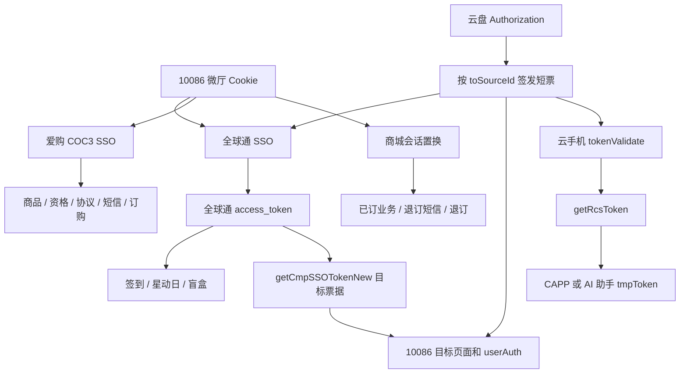

# CMCC-PROJECT 运营商接口总说明

整理日期：2026-10-28 · 当前工作区静态盘点。

本册合并“如何调用、参数来源、产物用途、组合流程、加解密、密钥来源、项目覆盖和验证边界”。本册末尾包含完整逐接口字段与补充地址。需要分册时，每个地址的字段树与来源见[接口逐项参考](04-接口逐项参考.md)，全部地址索引见[接口速查表](00-接口速查表.md)，可编程检索见[接口目录JSON](接口目录.json)。

## 本册内容

1. 业务场景、入参来源、返回产物与组合调用
2. 加解密、签名、固定公开常量与动态密钥
3. 项目和证据覆盖
4. 已验证内容及尚未还原的边界

---

# 运营商接口使用与调用链

整理日期：2026-10-28（Asia/Shanghai）。本册说明 CMCC-PROJECT 当前工作区的实际实现，不是运营商发布的开放平台规范。源码中存在调用，并不证明接口今天仍可用；本次未发送短信、登录真实账号、签到、领取、订购、退订或推送。工作区中已有的未提交实现也纳入静态盘点，具体文件摘要见扫描清单。

## 阅读方法

先在本册按需求找到业务链，再查《02-加解密与密钥》中的协议编号，最后在《04-接口逐项参考》搜索完整路径、函数名或北京权益的 abilityCode。逐项参考保留每个实现的入参构造表达式、请求头、源码行号以及 HAR 中观察到的请求/响应字段。参数表中的“实现传入”不等于服务端正式定义的“必填”；未能确认的字段不猜测。

三类证据分开阅读：**源码请求调用**表示当前文件存在发送请求的实现；**地址或配置引用**可能只是页面、白名单、动态 URL 模板；**HAR 观测**表示历史抓包中曾出现。某条 API 有多种请求封装时按同一项目的调用链选用，不能合并字段后随意请求。响应字段是样本中出现的字段集合，不是每次都会返回。

## 1. 先选择正确的登录体系

| 已有凭据/需求 | 应使用的链 | 获得的产物 | 产物用途与限制 |
|---|---|---|---|
| 手机号和 10086 短信验证码 | 10086 Web 短信登录 | wx.10086.cn Cookie、首页上下文 | 微厅查询、全球通 SSO、爱购或商城换票；不是所有 App 接口凭据 |
| 手机端中国移动 App 确认二维码 | login.10086.cn 二维码登录 | 跳转会话与对应站点 Cookie | 按跳转域名完成登录；生成二维码本身没有登录完成 |
| 手机号、云盘验证码、官方滑块结果 | 移动云盘登录 | account/completeAccount、authToken、Authorization、routerInfo | 向指定 toSourceId 签发短票；业务短票不能当云盘长期令牌 |
| 全球通 access_token | 全球通会话检查/会员查询 | 会员等级、网龄、活动状态 | 全球通签到、星动日、盲盒；跨业务需 getCmpSSOTokenNew 再换票 |
| 中国移动 App Cookie / App Token | App 业务查询或 App SSO | App 会话、已订业务条目 | 用原生会话查询/退订；普通微厅 Cookie 未必适用 |
| 北京移动手机号/短信，或北京权益支持的集团票据 | 北移门户或权益平台各自登录 | 门户 Cookie+AES 会话，或 sessKey/sessType | 两套平台分开保存；权益 sessKey 不能直接用于门户 |
| 联通王卡会话 Cookie | 联通王卡/超级会员页面初始化 | 当前账号的加密手机号、短信模板、可办套餐 | 作为不透明值传回相应接口；项目不实现这些服务端密文的解密 |
| 北京电信手机号和服务密码 | 官方页面环境中的密码登录 | wapbj.189.cn 会话 | 查资格、余额、账单和权益；本地账号 ID 不是电信凭据 |
| 山西移动官方浏览器会话/短信 | 山西 WAP 桥接 | 官方 Cookie、sessionStorage、加密上下文 | 资格、已订业务及订退订；每次加密请求必须保留对应 AES key |



## 2. 10086 微厅登录

主要实现：`免登录进入全球通/cookie-app/api/services/cmcc10086.ts`、`cmccLoginParams.ts`、`cmccRiskToken.ts`。独立周三工具箱保留对应协议副本，不能只修改其中一份后假定全部同步。

1. GET `wx.10086.cn/website/bind/bindAccount/new`，保存 Set-Cookie，从 HTML 提取 `csrf`、`reqTmp`。这些字段属于当前会话，不能复用其他账号抓包值。
2. GET `yxfk.market.chinamobile.com:8081/mgt/decision-engine/udid/c1`，取得源码所读取的风控 token。请求携带实现中的 appId、来源和 UA；它是风控上下文，不是账号登录凭据。
3. POST `/website/bind/sendMsg`，表单字段 `telephone=P01(phone)`、`riskToken`；请求头使用 `csrf-token`、`reqTmp` 和初始化 Cookie。作用是发登录短信，成功结果不等于已登录。
4. POST `/website/bind/bindAccount/new`，JSON 字段：`telephone=P01(phone)`、`password=P01(code)`、`pwdType='02'`、`checkCtrol=1`、`bindSource=''`、`sourcePage='WMH_登录'`、`ys=''`、`ysTitle=''`、`constId=riskToken`。保存响应 Cookie，检查业务状态，再打开首页确认号码。
5. GET `/website/spa/main/newHome` 补充主页上下文。按需 POST `/website/uniApi/getMarginQueryInfo` 激活/查询余额上下文；具体公共包头和加密字段见逐项参考。

返回可能是明文 JSON，也可能是 P01 的十六进制密文。HTML、登录页、网关页、非预期重定向不能当 JSON 成功。短信响应 `status=0` 或 `'0'` 的判断来自当前实现，不可套到其他业务。

二维码链：GET `login.10086.cn/genqr.htm` 生成二维码，POST `/chkqr.htm` 轮询；需要保留同一流程的二维码标识、Cookie、channelId 和 backUrl。手机确认后沿服务端给出的受信跳转完成断言/SSO，最后访问微厅首页。扫码流程、本地 flowId 和用户的登录 Cookie 是不同产物。

## 3. 全球通登录、会员、成长值与客服

主要实现：`qqtSign.ts`、`qqtSmsAuth.ts`、`qqtSso.ts`、`globalTelecom.ts`、`globalTelecomCustomerService.ts`；独立实现还在 `qqt`、`qqt/qqt-cmicrwx`、`qqtlocal-rights` 和云盘工具中。

基础地址：`qqt.cmicrwx.cn/2016tyjf/xhmqqthy`。

| 场景 | 接口/输入 | 获得什么 | 后续如何使用 |
|---|---|---|---|
| 有 10086 Cookie，进入全球通 | 微厅 bindAccount/new 的 `netUniChannelId=001191`、`tokenKey=token`、`netUniBackUrl`，再进入 `new/ssoTokenLogin.action` | 目标站 Cookie，最终 `access_token` | 先 checkLoginStatus 或 queryVipLevel，确认账号再执行活动 |
| 全球通短信登录 | POST `new/cmpSmsSend.action`，SM2 手机号及 sspId；POST `login.action`，AES 加密手机号/验证码等实现字段 | access_token 和会话 Cookie | 全球通专属会话；短信发送与登录采用不同加密 |
| 检查会话 | `checkLoginStatus.action` | 是否登录/对应会话结果 | 失效时重走来源登录，不盲目重复活动请求 |
| 查身份 | `member/func/queryVipLevel.do` | phone、province、levelName、netAge 等 | 显示等级、判断活动资格；netAge 的使用方式以当前函数为准 |
| 星动日状态 | `member/func/queryIndexReceive.do` | 已领取状态、活动可领信息 | 决定是否展示领取入口 |
| 跨业务短票 | POST `getCmpSSOTokenNew.action`，`targetid` | 目标业务票据/跳转上下文 | 用 `qqtSso.ts` 中目标映射；不能把一个 targetid 的票据给另一站 |
| 成长值 | 先全球通 SSO/成长页预热，再 GSM `/login` 取得 sessionId，随后 `getGsmState` 与 `queryGsmInfo` | sessionId、等级/成长值数据 | 给后续 GSM 查询携带 X-GSM-TOKEN；静态 Lrsbhbg8 不是个人 sessionId |
| 客服/管家 | `clientManager/checkTarget` 及客服服务中的跳转链 | 客服入口或服务资格 | 跳转页面，不等同已经预约或提交业务 |

GSM 地址：`10086.online-cmcc.cn:20010/cmcc-gateway/outside/gsm`；路径包括 `/iservice/direct/serviceUnified/getGsmState`、`/iservice/direct/gsmInfo/queryGsmInfo`。请求中的固定客户端头与用户动态票据作用不同，见 P10。

普通权益领取 `normal/initNormalNewQy` 与星动日 `member/func/initQyStatus.do` 不能仅凭“都是领取”互换。项目中也有旧版星动日复用普通领取路径的实现，逐项参考会保留来源差异。productId、channelCode、isRandom、拼写为 `sourece` 的字段等应使用对应活动查询和当前实现返回/配置的值；不要自动纠正服务端协议字段拼写。

### 3.1 签到、补签、奖励、盲盒

| 链路 | 输入 | 输出与用途 |
|---|---|---|
| GET `/sign/info` → POST `/sign/sign` | sspid 和全球通 Cookie；业务 body 见对应函数 | 月签到状态、签到结果；再查询 info 确认 |
| info → `/sign/finshResignTask` → info | dayNum、taskId、sspid；任务需来自当前月份 | 补签结果和刷新状态，不能用过期 taskId |
| info → `/sign/toaccept` | 当前可领取奖励的标识及 sspid | 奖励领取结果；签到成功不等于奖励已领取 |
| `/luckBox/status` + `/luckBox/infoList` → 任务/抽取/收奖路径 | channelCode、type、当前官方任务编号 | 机会、任务、奖品代码；奖品可能还需履约页面 |

盲盒具体变更路径、任务参数和奖品页面见逐项参考的 `globalTelecomBlindBoxAction` 及 `qqtBlindBox.ts`。月份、开放日期、任务编号是活动配置；不能把 2026 年 10 月的值当永久协议。查询、完成任务、抽取和兑奖分别是独立动作。

## 4. 移动云盘 → 10086/全球通/云手机/CAPP

主要实现：cookie-app 的 `yunpan10086.ts`、`yunpanSso.ts`，以及 `云盘/yunpan-login-local/src/yunpanClient.js`、`cryptoBox.js`、`cloudPhone.js`、`globalTelecom.js`。

### 4.1 短信和云盘登录

| 步骤 | URL/入参 | 加密与产物 |
|---|---|---|
| 发送短信 | POST `user-njs.yun.139.com/user/sms/getSmsCode`；明文对象含 random、additionalSpaceSelected、clientType、reqType、nationCode、phoneNumber、captchaType、`puzzleVerfycode` | P03 短信独立 AES key，IV 前置；请求是 JSON 字符串，不是把业务对象直接 JSON 提交。产物是短信，不返回登录权限 |
| 获取公钥 | POST `yun.139.com/orchestration/auth-rebuild/key/v1.0/getRsaPublicKey`；clientCode、type | 返回本次使用的 RSA 公钥，保存服务器 Cookie |
| 准备会话 | 随机 16 字符 AES key；RSA 加密该 key | 原始 AES key 用于 encryptMsg；RSA 结果用于 mcloud-skey，两者不可互换 |
| 登录 | POST `/orchestration/auth-rebuild/permission/v1.0/login`；encryptMsg、returnToken、autoLogin，部分实现含 clientId | encryptMsg=P03 AES-128-ECB(JSON(loginPayload))；明文 payload 含 account、dycPwd、loginStyle、ifOpenAccount、verType、clientEnv、setCookie |
| 解登录结果 | 按本次 AES key 解密实现中的数据字段 | 保存 account/completeAccount、authToken、routerInfo 等；生成 `Basic Base64(pc:account:authToken)`，实际 realm 以实现为准 |

短信请求必须使用官方人机验证的结果。`puzzleVerfycode` 是协议现有拼写。当前代码保留特定 `01000019` 拒绝结果的旧加密兼容分支；这不代表所有失败都能切 key 重发。`nationCode` 的 +86/+852 会影响部分实现的 loginStyle、ifOpenAccount，不能统一强制一个值。

### 4.2 querySpecToken 三种封装

| 分支 | 入参/编码 | 前置和产物 |
|---|---|---|
| Web V1 | orchestration 的 querySpecToken；account、toSourceId；明文 JSON 和公共签名头 | 当前云盘授权；取得目标短票 |
| Web V2 | routerInfo 解析出的 user 域下 `/querySpecTokenV2`；phoneNumber、toSourceId；P03 固定 32 字节 key + IV 前置 | hcy-cool-flag 和授权等；响应也可能需 CBC 解密 |
| App 风格 V2 | 同名 `/querySpecTokenV2`；明文 JSON `{toSourceId}` | App 风格 Authorization / 来源头；不能把 Web 密文请求和本分支混合 |

`routerInfo` 可能指定分区 user 域；不能永远硬编码 user-njs。cookie-app 和独立云盘工具的目标默认值也不同：前者 10086 默认 `017018`，独立工具默认 `001003`，并可从配置覆盖。选择模板时需要让 toSourceId 与 targetSourceId 一致。

### 4.3 不同短票可以做什么

| 目标 | sourceId/targetSourceId | 正确链路 | 返回产物用途 |
|---|---|---|---|
| 全球通 | `001191` | querySpecTokenV2 → `new/ssoTokenLogin.action?token=...&targetSourceId=001191&backUrl=...` → checkLoginStatus | 全球通 access_token；先确认号码再持久化 |
| 10086 流量商城等 | 与目标模板一致，常见 `017018` / `001003` | 短票替换 netToken → 跳转 → userAuth → 首页验证 | 微厅 Cookie，继续全球通/商城/爱购换票 |
| 云手机 | `001216` | 签发票据后进入 cloud.139.com；服务端可 POST `/uniphone/user/tokenValidate` | 云手机 token、hwToken、refreshToken、expireTime |
| CAPP 云应用 | 先 `001216`，再 `001304` | tokenValidate → POST `/uniphone/user/getRcsToken`，body={targetSourceId,token} → CAPP 页面 | tmpToken 用于指定 CAPP 页面，不是云盘 authToken |
| AI 助手 | 先 `001216`，再 `001005` | 与 CAPP 同一换票链，更换目标 ID 和页面 | AI 助手临时票据 |

云手机公共请求头的 requestId、timestamp、sign 和客户端字段见 P04。`querySpecToken` 返回一个字符串，不等于所有目标均已登录；仍需完成目标站校验和 Cookie 收集。票据和跳转链接可能一次性或短期有效，现有资料不足以给出统一 TTL。

## 5. 中国移动 App 业务查询、退订与主套餐撤回

主要实现：`cmccBusinessQuery.ts`、`cmccBusinessCrypto.ts`、`cmccBusinessH5.ts`、`legacyBusinessQuery.ts`、`shared/legacyBusinessCredentials.ts`。

### 5.1 新版 biz-orange 接口

| URL 后缀/主机 | 使用场景与输入 | 获得的数据及组合 |
|---|---|---|
| h.app.coc `/biz-orange/LH/uamrandcodeH5/sendMsgLoginH5` | App H5 登录短信；cellNum、channlCode | sx 等登录上下文，交给 loginH5 |
| h.app.coc `/biz-orange/LH/uamrandcodeloginH5/loginH5` | cellNum、verifyCode、sendSmsFlag、sx、channlCode | App 业务 Cookie 和身份 |
| app.10086 `/biz-orange/BN/userInformationService/getUserInformation` | 已有 App Cookie；可含 cellNum | 账户身份、省市等后续查询上下文 |
| `/biz-orange/BH/accoutQry/getAccoutInfo` | 账号、beginMonth、endMonth | 余额/账务信息；月份默认行为见实现 |
| `/biz-orange/BN/userPlanQry/getUserPlanQryNew` | 主套餐查询参数 | 当前套餐信息，用于展示和撤回条件判断 |
| `/biz-orange/BN/queryBuinessService/getNewQueryBusiness` | 对应业务类别和公共包头 | 已订业务条目及后续退订目标字段 |
| `/biz-orange/BN/userGhBroadbandInfo/getUserPlanType` | 宽带类型查询 | 可选宽带类型和查询上下文 |
| `/biz-orange/BH/unifyQueryService/getUnifyQuery` | 完整业务目标和公共包头 | 可退订状态/条件；使用官方 H5 SDK 封装 |
| `/biz-orange/BH/sms/getSmsCode` | 从已查到业务生成短信目标 | 业务退订验证码结果；不是登录短信 |
| `/biz-orange/BH/unifyCancelServiceh5/getUnifyCancel` | 原查询业务字段、短信验证码等 | 退订结果；必须再次查询确认 |
| `/biz-orange/BN/updatePlanService/updatePlan` | 主套餐撤回的专用 body | 撤回结果；不能当普通退订复用 |
| gateway `/cmcc-gateway/inline/app/iservice/direct/contract/customerContractInfoQry` | App 会话及合约查询参数 | 合约记录；辅助判断约束，不直接解除合约 |

普通请求采用 P05 的不同请求/响应 key；三个 BH H5 端点在当前代码显式交由带校验的官方 `BasicService_H5module.js` 准备，不能把 P05 普通请求替代 H5 SDK。返回 `x-pen`、业务 retCode、内部结果等都要按对应解析器处理。

业务条目中的 productId、offerId、serviceCode、操作标识和生效方式必须从原始查询条目保留，不能只保留一个显示用标题。退订短信后重新组装一个“相似商品”会使验证码作用对象不一致。源代码中的生效时间解析与结果状态需保留；超时后查询，不自动重复退订。

### 5.2 旧版 alreadyService

`wx.10086.cn/website/alreadyService/{endpoint}` 为另一套协议。先通过 `/website/sso/sessionAPP?tokenStr=...` 或 `/website/sso/netUniAPP?leadeonToken=...` 建立 App 来源会话，再读 alreadyService 页面和 CSRF；只持有普通微厅 Cookie 时实现可能拒绝继续。

旧版请求包含 csrf-token、Lrsbhbg8、特定签名/请求 ID；响应可能按头部标志使用 P01 解密，并用请求 ID 检查响应对应关系。**按 `decodeLegacyResponse` 的实际判断和《逐项参考》使用，不能将新旧协议统一成固定 key。** 旧版查询、短信、退订的具体 endpoint 及组装字段在逐项参考中按源码保留。

## 6. 移动网上商城/掌厅 touch 的已订业务和话费

基础地址 `shop.10086.cn/i`，实现 `cmccShopBusiness.ts`、`cmccShopSession.ts`、`cmccShopCrypto.ts`，以及北移项目 `shopBusinessClient.js`。

1. 已有 10086 会话时，经 SSO 票据 → `touch.10086.cn/i/v1/auth/initMobileMessage` 建立商城登录上下文；`data` 和 channel 构造见 P06。直接手工导入 Cookie 时仍要校验号码。
2. GET `/v1/auth/loginfo` 得到登录身份和服务端 seed。seed 用于退订短信/提交，不是可任意指定的产品 ID。
3. GET `/v1/busi/order/{encryptedPhone}?_=timestamp` 查询已订业务。URL 中手机号用 P06 双层 Base64，必须 URL 编码。
4. POST `/v1/cust/commonSms/{encryptedPhone}` 发业务确认短信；`inParam`、`msgId` 的加密明文见实现。保留相同 seed、手机号和目标业务。
5. POST `/v1/busi/ordermodify/{encryptedPhone}`，inParam 包含 orderInfos 和短信校验上下文，返回业务结果后再查业务列表。

响应 data/outParam 等字段可能是 P06 密文，需要两层 Base64 解码后 AES-CBC 解密；直接 Base64 解码不会得到最终 JSON。

参考工具的 `cmcc_fee.py` 还访问 `touch.10086.cn/i/v1/fee/real/{token}`。这里路径的 token 是加密后的手机号/协议参数（见该函数），会话 Cookie 仍需要独立提供；token 字段名不能证明它是 OAuth access_token。

## 7. 爱购 COC3、权益订购与幸运三日签

主要实现 `aigouSession.ts`、`aigouBusinessOrder.ts`、`aigouShoppingCart.ts`、`luckyThreeDay.ts`，独立项目 `coc-rights-order-local`。

### 7.1 先完成爱购 SSO

10086 Cookie → 爱购票据入口 → `dev.coc.10086.cn/coc3/gr/login/ssoRights/userLoginV2`，带 ticket/ticketType/businessType/wxoaType、m1/m2/s1/s2 等当前实现字段，得到爱购站点 Cookie/校验上下文。拿全球通 access_token 直接调用本组通常不能替代这一步。

### 7.2 常规权益订购

| 顺序 | 接口 | 所需输入/产物 |
|---|---|---|
| 1 | `/coc3/coc3-market/arrange/getProductDetailById` | 页面/商品标识；取得商品详情和 skuId，不从旧抓包猜价格 |
| 2 | `/coc3/coc3-market-member/api/member/getSkuType` | skuId；取得订购类别/限制，辅助选择路径 |
| 3 | `/coc3/coc3-market/api/sms/qwSendSmsCode` | receivers、skuId、member、businessChannelCode 等；手机号与带时间戳 SKU 按 P07 分别加密 |
| 4 | `/coc3/coc3-market-order/api/external/black/checkBlacklist` | 当前 skuId/会话；校验限制 |
| 5 | `/coc3/coc3-market-order/api/external/order/directOrder` | skuId、channelCode、selfChannelCode、加密 smsCode、dealType、receipt、receiptModule、referer、operDfp 等 |

directOrder 的返回是订购结果；短信成功和通过黑名单检查都不能代替订单成功。风控 operDfp 应由当前链获得，不放历史固定值。P07 的 ZeroPadding 与三日签 SKU 的 PKCS7/固定 IV 分支并不完全相同。

### 7.3 购物车

`shoppingCart/list`（userMobile）→ `shoppingCart/add` / `edit`（商品和数量）→ `shopCartCalculate`（本次选中项目）→ `sendDimShopSmsCode`（当前结算上下文）→ `dim/marketShoppingOrder`（items、calculation、payType、smsCode、busiOpId、operDfp）。完整前缀为逐项参考所列的 coc3-market 或 coc3-market-order。结算结果、待提交商品和短信上下文必须同一批次；修改商品后重新计算，不能继续使用旧 calculation。

### 7.4 幸运三日签

`getTaskSignInfo`（taskId）→ `accumulateSign`（taskId、channelCode）→ `getProByActId`（活动查询）→ `checkQualificByActivityId/v3`（当前活动/批次/SKU）→ 发订购短信 → `activity/placeOrder`。

活动列表获得 batchId、skuId、资格和可领取状态，用于展示和挑选当前合法目标。签到次数足够不意味着资格检查必然通过；页面显示“权益”也不证明没有收费订购。项目中的本地权益覆盖设置属于 UI/业务映射，不能覆盖上游的资格或订单结果。

## 8. COC 套餐、卓越钻石卡、积木包、数智合约与 5GA

基础地址 `dev.coc.10086.cn/coc/`，实现 `cmccBusinessOrder.ts`、`cmccBenefitOrder.ts`、`cocPackageSession.ts`、`aigouPackageOrder.ts`、`luckyBagOrder.ts`，独立订购项目也保留对应协议。

| 阶段 | 常用接口 | 输入从哪里来 | 产物有什么用 |
|---|---|---|---|
| 身份校验 | `user/userVerification` | 手机号 | userId、provinceCode、verifyType 等后续上下文 |
| 登录/业务短信 | `user/smsCode` | mobile、userId、smsCodeTypeEnum、pageId、touchCode、productCode | 发送特定用途短信；登录和订购用途不能混用 |
| 验证短信 | `user/loginCheck` / `loginCheckToken` | 手机号、验证码、用途枚举、用户/页面上下文 | 会话或临时验证凭据；不是订单 |
| 页面/商品 | `personalization/page/getDefault`、`grocer/copyWriting/page/query` | pageId、touchCode、provinceCode、productCode | 商品配置、文案和协议入口 |
| 资格/关联 | `pkg/contract/common/productRelation`、`newProductRelation`、`blackstone/product/supplier/status/select` | 当前商品列表、用户和渠道 | 关联/供应/在售判断；决定是否继续 |
| 钻石卡资格 | `pkg/newIop/globalDiamondCard/iopCheck` | tagIds、touchCode、eventCode、channelCode | 活动资格 |
| 积木包费用/资格 | `editor/common/proxy/toC/building/cost/info/query`、`toC/checkBizQualifyServ` | 选中模块、productID/productList 等 | 模块价格及可办性 |
| 数智/5GA | `pkg/smart/life/queryTariff`、`card/bundling/auxiliary/selectFiveGAProduct`、`fiveGARelationCheck` | 省份、productCode、pageId、touchCode、userId | 可选产品和关联限制 |
| 协议 | `grocer/protocol/prov/queryProtocol` | 当前商品、省份、用户和验证方式 | 协议内容和 protocolSequenceId；供最终提交绑定 |
| 下单 | `pkg/order/bookProduct`、`pkg/order/change` 或 `card/bundling/change` | 当前商品、页面、渠道、协议序列、验证码/验证票据和选中附加产品 | 返回办理结果，失败或未知时回查 |

上述路径按业务选择，不是每种业务都需要全部调用。`bookProduct`、`change` 和 `card/bundling/change` 不是同一个提交协议。pageId/touchCode/productCode 共同决定渠道和商品；不能只替换 productCode 而沿用另一个页面的协议序列。

本组有普通 JSON、Aurora 和 Meteor 封装（P08）。某个接口是否加密由调用处的 encrypted 参数决定，不能按 `/coc/` 前缀一律加密。每次生成的新 AES key 只对应本次响应，公钥只用来包裹 key；无法从 coc-aurora 反推出 key。

### 8.1 全球通20年网龄直升

实现 `cmccAgeFeedOrder.ts:prepareAgeFeedProduct`。先 `pkg/contract/common/newProductRelation` 查询当前档位业务关系；使用返回 `respDTOList.goodsId` 映射档位。已有业务关系不是统一的“禁止再办”判断，当前实现仍可能读取协议后交运营商最终受理。

随后 `activities/common/queryUserInfoNew` 取得 `userChinaMobileage`；网龄达到当前活动门槛时才继续 `editor/common/proxy/toC/gsmLabelQuery` 取 `entity.gbrandlevelInfo.gbrandLevel`，再 `pkg/common/queryMobileTagNew` 取得当前定向档位。`productCodes`、`tagIds`、`channelCode`、`eventCode` 和 `touchCode` 使用 AGE_FEED_DEFAULTS/AGE_FEED_TIERS 及当前源码配置，不能把活动资格推断为普遍规则。

可办档位确定后，`personalization/page/getDefault` → Meteor `grocer/copyWriting/page/query` → Meteor `grocer/protocol/prov/queryProtocol`，取得协议内容和 `protocolSequenceId`，再衔接该商品的业务短信与订购提交。人工选择档位只表示尝试受理，不等于资格通过。产物主要是网龄、等级、定向档位和当前协议；它们不能替代最终订单成功结果。

## 9. 微厅零售：铂金会员、套餐、回电与预约办理

基础地址 `wx.10086.cn/website/nrapigate/`。实现 `cmccBenefitOrder.ts`、`cmccCallback.ts`、`retailProductQuery.ts`；北移 quickOrders 的 retail adapter 也有同类流程。

| 步骤 | 接口后缀 | 输入和作用 | 可接续接口 |
|---|---|---|---|
| 认证 | `nrauth/auth/encryt/userAuth` | 原站会话、来源及 targetSourceId 等，P09 认证密文 | 商品查询 |
| 页面 | `nrmix/product/newProductPersonalPageById` | id、appFlag | 返回个性化页面，继续商品/档位查询 |
| 商品 | `nrmix/product/prodWithNormList` | productCode | 返回 productId、norm 列表和属性 |
| 档位 | `nrmix/product/norm` | normId | 获得当前价格/规则/产品上下文 |
| 关联/礼遇 | `nrmix/product/queryRelevancy`、`nrpromotion/atom/courtesy/hcByNorm` | productId/code/type、normId 等 | 关联套餐/活动，参与后续组合 |
| 协议 | `nrproduct/atom/protocol/queryProtocol` | 省市、商品、normId、queryType | 当前协议 |
| 预检 | `nrmix/preCheck/productPreCheck` | packageId、productCode、normId、渠道、省份、生效类型等 | 可否订购；并非订单提交 |
| 订购短信 | `nrmix/sms/sendSms` | busiId、normIds、userEffectType | 获得验证码挑战/发送结果 |
| 订单 | `nrmix/order/createOrder` | productId/code、normid、smsCode/verifyCode、渠道、活动、关联信息等 | 订单结果，需保留完整返回 |
| 回电规则 | `nropportunity/atom/ruleNew`、`failedOrder/check` | 商品类型、入口类型、失败原因、当前 normId | 允许预约/回电规则 |
| 预约提交 | `nrmix/opportunity/create` | 当前预约配置、联系信息和预检上下文 | 预约结果，不等同业务已开通 |

认证层是 P09 的 AES-128-CBC/HEX；业务 wire 层为 AES-256-CBC/Base64URL。两者 key 长度、IV 和编码不同。响应需在正确层解密；商品查询接口不返回“可直接免短信开通”的许可。

## 10. 北京移动门户：查询、退订、活动、宽带

主项目 `bj-mobile-business-local`；cookie-app 的 `bmccActivityOrder.ts` 部分通过该本地服务组合，而不是直接访问官方接口。附录会将内部桥接与官方端点分开。

### 10.1 登录与加密会话

`login.10086.cn` 的 `chkNumberBjAction.action`、动态发送标志读取、`verifyCaptcha.htm`、`loadToken.action`、`sendRandomCodeActionbj.action`、`touchBjLogin.action` 构成号码校验 → 图形验证 → 短信 → 登录链。手机号/密码字段的 RSA 处理和原始表单见 loginClient。成功后带着同一 CookieJar 进入 `service.bj.10086.cn/nwt/portal/...`。

门户 POST `/nwt/portal-bff/api/keys/v1.0/get` 建立 P11 密钥上下文。服务器会返回 key/replay/version 等信息，需先用 bootstrap 公钥处理再包裹随机 portalKey。请求和响应基于会话 AES-ECB；请求版本防重放字段也有加密。WAF 的动态字段是运行前置条件，不能通过抄一份抓包参数长期替代。

### 10.2 查询和退订

`/nwt/portal-bff/api/accountsj/v1.0/getOnlineUserInfo` → `/packageQuery/v1.0/index` → `/packageQuery/v1.0/unsubscribe`。查询产物中的原始业务目标、类别、生效时间和可退状态都要保留。错误或超时先核查，不将“返回页面”解释成业务取消成功。

### 10.3 活动/自定义商品

`/initMobilePro/v1.0/initMProductCommonData` 取得活动/商品上下文；根据配置执行对应资格和协议查询；`/mtsms/v1.0/sendDXSMS` 或 `sendDXSMSV2` → `checkDxCodeForMT` → `/sjyw/biz/core/v1.0/compositeCommit`，必要时 `/pcConsole/v1.0/showBLJG` 读取办理结果。这里各段均在 `/nwt/portal-bff/api` 下，逐项参考保留完整地址。

`backend/activities/*.json` 和 `quickOrders/catalog.js` 里的配置也是调用定义来源。模板出现路径不等于每次都会执行，需按对应配置的顺序/条件使用。办理中的 proType、商品标识、订购流水、验证码和确认状态不可跨 session 复用。

北移 `quickOrders/adapters/north.js` 的欢畅流量分支有特殊顺序：POST `mPersonBusi/v1.0/HCLLFFInitData` 取得实时 `productCode/plan_fee` → 构造 `common.operType='commitProductNew'` 和 `body.content` → **第一次 compositeCommit**。若返回 `need_sms_check/smsVerification` 或 `smsType`，保存 `typeKey`，再 GET `sendDXSMS`/`sendDXSMSV2`、GET `checkDxCodeForMT`，验证结果为 `00000` 后再次 compositeCommit。第一次提交也可能直接受理，因此不能把它当纯只读准备。最终以 `bizSuccess` 等当前实现识别的业务码判断；未知响应先核查，避免重复办理。

### 10.4 宽带新装/续费

cookie-app `broadbandOrder.ts` 和 `broadbandPortalClient.ts` 包含免登录宽带链：查询区域/产品 → 图形验证 → 手机号/宽带账号选择 → 资格/预办理 → 短信校验 → 提交。

关键路径族：`/portal-bff/api/avoidLogin/broadband/...`、续费 RENEWAL_BASE 对应接口、`commitBroadBandProduct`、`commitDoBroadBand`、`newbusinessOrderAJ`、`newbusinessPayFeeCommit`、`businessPayFeeCommitAJ`。完整前缀、不同续费模式分支和入参见逐项参考。预办理可能分配流水或锁定资源，不能因名字含 query/prepare 就假定没有副作用。带校验的最终提交只执行一次，未知结果使用订单查询/人工核对。

### 10.5 全球通尊享宽带

`premiumBroadbandService.js` 使用已登录北京门户的P11会话：POST `/nwt/portal-bff/api/ajybz/v1.0/indexQQTZX` 初始化 → POST `checkMobile`，body `{itemCode}` 检查资格 → 必要时 POST `checkRealName`，body `{ID:identityNumber,NAME:ownerName}` → POST `commitQQTZX`。最终提交字段为 `item_code/address/lx_phoneNo/lx_name/pre_date/pre_date_quantum`；日期是8位日历日期，时段为当前实现允许的1/2/3/4。

`itemCode` 来自当前商品/固定业务配置，姓名、身份证、地址和联系号码来自本次本人办理信息，不纳入共享样例。提交HTTP成功且业务码为 `success` 后调用 `/nwt/portal-bff/api/pcConsole/v1.0/showBLJG` 取得办理结果。初始化、资格、实名校验和最终提交是不同产物。cookie-app 的 `qqtPremiumBroadbandOrder.ts` 通过北移本地服务编排这条链，不是把个人资料直接发给另一个新官方网关。

## 11. 北京权益平台、99plus、福袋与卡券

主项目 `bj-cmcc-qy`；官方入口 `xcxp.bj.10086.cn/rights-intf/api/outer/invoke.do`。不同功能通过 **abilityCode** 区分，不能仅统计成“一个 invoke 接口”就认为已覆盖业务。

统一请求：业务 body 先转为 JSON 字符串，再与 sessKey、sessType、accessToken、abilityCode、transactionId、可选 traceMemberPhone 等组成 rowPayload。按 P12 排序、签名并加密，按配置选择 transportMode。HTTP 请求头 source/sessKey 与包内同名字段都需按实现保存。

| abilityCode/族 | 场景、主要输入 | 产物与组合 |
|---|---|---|
| SMS_VERI_CODE_SEND | receviNo（源码拼写） | 登录短信 |
| APP_LOGIN_CHK_SMS | receviNo、verificationCode、retailerCode、sonRetailerCode | sessKey/sessType、userInfo，供后续权益接口 |
| GROUP_TOKEN_VALIDATE | token、渠道、phoneNetCheckMethod 等 | 北京权益会话；不是直接导入任意 access_token |
| GET_USER_INFO | 当前会话 | 用户资料/更新的会话信息 |
| COUPON_INFO_QRY | queryScope 或福袋查询 body | 通用券/专属券余额、legalRightsList |
| RIGHTS_INFO_TELE_PAGE | 分页、权益筛选/编号 | 权益清单及 legalRightsNbr，交详情/兑换 |
| COUPON_OPEN_TEL_FEE_AUTH | 实时权益、券种/数量、验证码等 | 权益兑换/订单结果 |
| INNER_OPEN_TEL_FEE_AUTH | 对应内部/零成本权益 body | 快速兑换；仅在当前实现条件满足时使用 |
| OPEN_TEL_AUTH_LIMIT_MORE | 查询详情和券余额后构造组合 | 多券/受限权益兑换 |
| BIZ_NEED_CONFIRM_SMS_QRY → BIZ_CONFIRM_SMS_SEND | 当前 offer/权益对象 | 是否需业务短信及发送结果 |
| INNER_OPEN_MEMBER_SHIP | 当前商品 offer、验证上下文 | 业务订购结果 |
| PLUS99_CLAIM_METHOD_QUERY | 当前会话 | 可用领取方式 |
| rights_qry_new99plus / PLUS99_AREA_RIGHTS_QRY / PLUS99_SPEC_AREA_QRY | belongAreas、operateCode、memberType 等 | 99plus 普通/折扣/专属权益列表 |
| NINETY_NINE_PLUS_GET_INFO / RIGHTS_DETAIL_QRY_H5 | activeId 或权益编号 | 活动/权益详情 |
| open_rights_new99plus / PLUS99_CARD_ACT_OPEN | 当前权益/活动和验证上下文 | 99plus 领取结果 |
| COUPON_RECODES_QRY / RIGHTS_ALL_RECODE | busiNbr、custOrderType、筛选 | 订单清单 |
| GET_ORDER_DETAIL_INFO | custOrderId | 订单详情；用于核查兑换状态 |
| MEITUAN_CERTIFICATE_QRY | 当前权益订单/凭证参数 | 券码等履约数据，应按隐私凭据保存 |

getToken.do 是另一入口；appid/key 的固定客户端配置与个人 sessKey 作用不同。响应解析尝试 Base64 JSON/JSON 并读取 body/resultData/data，不是直接拿请求 AES key 解所有响应。每个 ability 的实际 body 和源码位置单独列在逐项参考，防止遗漏同网关下的逻辑接口。

## 12. 北移新业务、云电脑、网格通与好礼多多

### 12.1 xyw 咪咕等新业务

主机 `xyw.bj.10086.cn`，通常 `/mkt_web/` 前缀。项目 `migu-quick-order` 和北移 quickOrders 的 xyw adapter 分别实现，后者部分认证依赖官方浏览器页面。

常用链：页面状态 `/vbss/s/page/status/check` → `s/marketInfo/getMarketStatus` → `s/productInfo/getProductInfo` / `s/marketRule/getMarketRule` → `s/login/sendVerifyCodeEncipher` → `s/login/commonLoginEncipher` → `s/orderConfirm/getMarketProInfo` → `s/orderConfirm/sendOrderConfirmVerifyCode` → `s/marketInfo/marketOrder`。

登录明文对象用 P13 的 RSA 公钥封装；登录响应返回的 headerName/sessionToken 需用于后续请求。市场/页面/商品/渠道代码必须成组取值。getMarketProInfo 的协议/价格信息用于订购确认；业务短信和登录短信为不同步骤。

### 12.2 家庭云电脑

主机 `mop.bmcc.com.cn/mkt_web/`。用当前中国移动 App Token 调 `s/login/decryptPhoneByTokenJt`，确认返回号码再保存 sessionToken/headerName；查询市场、产品、可办信息，发订单短信后用 `s/orderConfirm/marketOrder` 提交。

该链和 xyw 外观相似，但认证方式、主机和最终路径不同。App Token 不应在公网文档或日志中输出；仅知道 productCode 无法完成认证。

### 12.3 网格通/好礼多多

主机 `ysmapp.bj.10086.cn`。欢畅流量 adapter 要求可信入口 `/app/channel-web/busiCore/showCustomIndex.action`，携带 code、empCode、nbc、submitWarePackageId、channel 等原始上下文。先 `customerValidateAndIsHaveOrderedForHCLLFFHD.action`，再 `queryWarePlansGetPlanFeeFormBIAndTERMBUNDCheck001.action`；获得当前可办 WARE_PLAN_ID 后发送短信、checkSmsCode，再 `commitCYDS.action`。

提交表单包含 submitPhoneNO、submitWareTypeId、submitWarePlanId、submitWarePackageId、submitCheckCode、submitCheckCodeId、submitChannel、submitCode、submitEmpCode、token 等。token 来自本次流程，不是通用固定密钥。

`好礼多多本地版查询` 是网格通页面/接口代理，原实现目标使用 HTTP；它没有自建通用登录加密协议。`arpu.html`、`productSearch.html` 内的接口地址按页面引用列在补充证据中。`bjcmcc-route-hub` 是入口目录/导入器，官方 URL 只是导航元数据，不能将目录的本地 API 当运营商办理接口。

## 13. 山西移动 WAP

主机 `wap.sx.10086.cn`，项目 `shanxi-order-local`。官方浏览器 bridge 保留 Cookie 和 sessionStorage，`Protocol` 负责 P14 加解密。

| 操作 | 官方路径（位于 /h/{scope}/rest/v1 下） | 输入/输出 |
|---|---|---|
| 获取公钥 | `rsakey/getRsaPubKey` | 返回 RSA 公钥，scope 可为 act/market |
| 登录短信 | `wapLogin/sendSmsCode` | 手机号及当前登录上下文；返回短信通道状态 |
| 登录 | `wapLogin/login` | 手机号/验证码及当前状态；返回会话 |
| 检查会话 | `wapLogin/checkLogin` | 当前官方会话；确认登录 |
| 5GA 资格 | `qqt5ga/qryUserQualification` | 用户与业务名称；返回是否可办 |
| 敏感标签 | `sensitive/qryTag` | 当前业务对象；返回限制信息 |
| 业务验证码 | `smsver/sendSmsCodeNew` → `smsver/chkSmsCodeNew` | busiType、验证码等；返回 uuid 等订购证明 |
| 5GA 下单 | `qqt5ga/submitPrcOrder` | 当前产品、uuid、busiType、couponsBusiName | 办理结果；proof.uuid 必须存在 |
| 已订业务 | `userorderinfo/qryUserOrderInfo`、`batch3/getActRecordInfo` | 当前用户上下文 | 订单/活动记录，辅助核查 |
| 业务明细 | `userorderinfo/qryUserOrderDetail` | useProd 为 Y/N、couponsBusiName | 原业务明细与 prod_prcid |
| 退订 | `prod/unSubScribeOrder` | 由 unsubscribeParams(prod_prcid) 构造 | 退订结果，需核查 |

明确例外：qryUserOrderDetail 和 unSubScribeOrder 在当前源码中是**普通 JSON，无 RSA 请求头**；只在入口发现阶段读取 RSA key。不能给这两条业务请求强行添加 encryptInStr。只读 key 请求允许按实现回退 scope，已发送的订购/退订请求不允许换路径再发一次。

其他业务可以由 `catalog.js` / `business-presets.js` 指定 queryPath/orderPath、scope、couponsBusiName 和短信 busiType；完整配置路径纳入逐项参考。配置可办不等于某号码有资格，最终仍以上游为准。

## 14. 联通王卡会员与超级会员青春版

项目 `wangka-order-local`，官方主机 `kapi.10010.com`，页面来源 `txwk.10010.com`。项目默认回放 HAR，真实请求需显式启用 live；下面说明已有实现，不代表默认会发送真实请求。

| 链 | 接口与必要上下文 | 返回值/用途 |
|---|---|---|
| 王卡首页 | POST `/KCard/tencent/kcard/vip/retrieveHomePageInfo`，JSON openid | vipInfo、smsInfos.signKcardVip.encryptPhpne/encryptTmpId、flowTag；密文字段原样保存 |
| 王卡短信 | POST `/captcha/op/getCaptcha`，表单 phone=加密手机号、templateId=加密模板、key=10010、nvct | 短信发送结果；nvct 来自用户完成官方 NVC/滑块 |
| 校验短信 | POST `/captcha/op/checkCode`，相同 phone/templateId/key 和 code | 校验状态，在同一 CookieJar 继续 |
| 王卡签约 | POST `.../signAgreementNew` 或 flowTag=2 时 `.../welfare/conduct10Gb` | JSON duration、channel、inviteId、actId；返回开通/办理结果 |
| 超会首页 | GET `/KCard/superVip/V3/indexInfo`，channel/from/data/k/v/t | encryptedData、套餐、effectiveModeList.msgTemplateId/msgKey、type、生效方式 |
| 超会短信 | POST `/captcha/op/tc/getCaptcha`，加密手机号/模板/key，加 tencentCaptchaCode/Ticket/Randstr/AppId | 短信结果，验证码结果不可伪造或跨流程复用 |
| 超会校验 | POST `/captcha/op/tc/checkCode`，对应 phone/templateId/key/code | 当前校验状态 |
| 超会下单 | POST `/KCard/superVip/V2/orderSuperVip` | form channel/data/k/v/effectiveMode/agreement/type/isPromotion；返回订单结果 |

**现有项目没有实现联通这些加密字段的生成/解密，也没有相关服务端密钥。** 现有可用方法是由当前已认证官方页面获取 encryptedData/encryptPhpne/encryptTmpId 等，原样回传；不能声称已经恢复 AES/RSA 算法。data/k/v 是来源页上下文，并不是本地可任意填写的静态密钥。真实提交还要满足项目的“我确认本人办理”确认条件；本次整理没有启用 live。

## 15. 北京电信 WAP

项目 `ct189-local`，主机 `wapbj.189.cn`。网页服务依赖无头 Chromium 执行官方页面脚本和风控初始化，不能只复制一个密码请求到普通 HTTP 客户端后宣称流程完整。

| 顺序/场景 | URL/输入 | 返回物和用途 |
|---|---|---|
| 初始化 | GET `/echnwap/scratchLogon` 并等待官方页面初始化 | Cookie、页面环境、风控上下文 |
| 登录前握手 | POST `/wap2017/re/activity/qryLoginAccno`，{} | 匿名/会话是否可用于提交；不在未完成初始化时发密码 |
| 密码登录 | POST `/wap2017/re/wapFree/cancelAccount/passwordCheck`，phoneNum 和 P15(password) | 密码检查业务结果；还不能只凭该结果判定登录到目标账号 |
| 确认账号 | 再 qryLoginAccno | object 必须等于目标号码，再保存会话 |
| 活动资格 | `/rightsInterestsAct/queryPreactiveInfo`、`activityCheckV3` | 活动/资格/权益信息；实际 body 含当前活动参数 |
| 新版权益 | `/rightsInterestsAct/doCheckRightsInterestsV3` | 资格上下文、活动/商品参数 → 领取结果 |
| 经典权益 | `/rightsInterests/interestsActivityDetaiList` → `doCheckRightsInterests` → `doRightsInterests` | 活动、offerCode/offerName/id/level/busType；预检成功后由官方页面回调领取 |
| 余额 | `/balanceNewQuery/queryAllNumBalance`、`qryAccountBal`、`queryAccountPackageDetail` | 多种余额/资源信息；部分失败保留成功部分 |
| 账单 | `/balanceNewQuery/queryAccountBill` | 账期等以调用 payload 为准 → 账单 |
| 开放票据 | `/login/openAccessToken` | 当前会话请求体 → 对应票据；不能据名称推断可用于任意电信站 |

除 qryLoginAccno 外，表中相对目录均位于 `/wap2017/re/wapFree/`。经典详情的 `DetaiList` 是源码中的实际拼写。

密码用固定客户端 3DES-CBC/PKCS7/Base64（P15）。业务响应在当前实现中主要尝试 **Base64 解码成 JSON** 或直接解析 JSON；Base64 不是加密，不存在“响应统一用 3DES 解密”的实现依据。

本地记住密码使用另一个 AES-256-GCM 存储层，并以 accountId 作为绑定上下文；本地 credential.key 是安装实例的私密材料，不是运营商接口密钥。青龙脚本保持独立配置；其已实现功能边界以 qinglong/ct189.py 为准，不把网页版功能自动算成青龙支持。

## 16. 移动活动参考脚本、周三拼图、签到、AI 豆、辽宁

`参考工具/cmcc-auto-checkin` 是独立参考项目，cookie-app 的 `cmccAutoCheckin.ts` 是执行/参数桥，不能因为文件存在就认定每个操作都在生产 UI 开启。

| 功能族 | 常用接口 | 输入产物与组合 |
|---|---|---|
| 活动会话 | `/qwhdsso/login`，或 `/qwhdsso/appTokenLogin?sid=...` | App token/票据换当前活动 Cookie；不同活动会话不能混用 |
| 签到 | `/qwhdhub/api/mark/mark31/markstatus` → `/domark` → `/taskAward/{tid}` | 状态、签到和任务奖励分开；任务 ID 取当前状态 |
| AI 豆话费券 | `/qwhdhub/api/mark/task/getExchangeList` → `checkStock` → `exchange` | channel、prizeId；得到余额/档位/库存和兑换结果，具体限量逻辑属于当前脚本策略 |
| 生长任务 | COC3 `/api/activity/slgCredits/getSlgCreditsHomePage`、`queryGrowthValue`；task list/sign/visit/share；`getGrowthBubble` | taskId、recordId 等串联；访问任务不等于已经领奖 |
| 套餐评价 | `/assess/markStatus`、`assess`、`/account/query`、`/activity/info`、`prizeStatus`、`redeem` | 当前活动身份、评价和可兑档位；完整活动前缀见逐项参考 |
| DIY 任务/抽奖 | `/qwhdhub/diyTask/list/{component}`、`finish/{tid}`；diyLottery remain/lotterySafely | 当前 component/taskId；“GET”也可能有完成/抽奖副作用 |
| 开放任务握手 | `/hlwyxhdhub/api/open/_pub/task/getOneTaskInfo` → `openFinish` | ct/jt 等短期任务证明；由官方任务流程产生 |
| 直播/视频 | `/qwhdhub/user/getYDRZToken` → cmlive `cmpassLoginByCmToken` → 视频任务查询/完成 | 直播 JWT 等；站点不同，不能直接使用微厅 Cookie 代替 |
| 辽宁活动 | `/qwhdhub/task/list`、`startBrowse`、`lottery/lotterySafely` | 当前活动任务及抽奖资格；省份和时间范围依实际响应 |

周三拼图主机 `wx.10086.cn/hlwyxhdhub`：

1. 打开 `/act-wedrecharge/{activityId}` 建立活动会话；查询 `/api/wedrecharge/taskList` 和 `queryPictureActInfo` 得到任务与拼图持有状态。
2. 根据实际任务使用 `getJtToken`、开放任务 getOneTaskInfo/openFinish、`/user/appendYDRZToken`、`finishTask`；保持任务和账号匹配。
3. `drawPicture` 取得拼图；`getShareToken` 生成分享上下文；赠送、接收、兑奖等动态路径由 `wedRecharge.ts` 的对应函数决定（逐项参考完整列出）。分享链接包含凭据，不是公开无害资源。
4. 重新查询拼图后决定下一步。`wed-puzzle-toolbox` 的规划器和 cookie-app 的任务调度只是调用编排，不是另一个运营商接口。`drawPrize` 可能直接触发权益领取，不能作为健康检查。

## 17. 移动公告与关联第三方

`cmcc-notice` 访问 `h.app.coc.10086.cn/biz-orange/DH/tariff/personal/announcement/list`：当前地区、分页/筛选等放公共 reqBody 中，外层含用户/省市上下文，按 P05 加密、生成 x-time/x-nonce/x-token/x-sign。产物是公告列表/详情引用；不能据默认匿名占位用户字段推断所有实名接口支持匿名。

`contract3-query` 主要读取本地合约清单，`cloudapp-flow-simulator` 是流程模拟器，`service-clients` 是站点客户端，`project-manager` 是本地部署管理，`tools-workbench` 是本地工具；它们不因为有 `/api/` 路由就构成新的官方运营商接口。源码中的导航和桥接地址保留在项目清单和本地入口附录。

星巴克卡券是关联第三方，单独归类：`bff.starbucks.com.cn` 的短信、PIN 登录、authorization_code 换 access_token、用户详情、coupon/list 链。短信输入 phoneNumber/device/template，登录输入 cellPhone/device/loginType/pin，换票输入 grant_type/code。输出为星巴克 Bearer access_token、customer_id 和卡券（有效期、使用状态、核销码等），不能当移动权益凭据。协议使用私有配置中的 AES 和 RSA 签名（P16）；密钥来源/格式与缺失时报错见加密册，文档不复制实例私钥或卡券码。

`starbucks-price-monitor` 监测相关商品/价格，推送工具 PushPlus/Server 酱是通知渠道；它们不是运营商接口。逐项参考与覆盖清单保留已识别的第三方端点，但本次不发送通知。

## 18. 使用和组合时的共同约束

- **同账号、同业务、同会话。** 首次换票后核对目标号码；缓存绑定账号和目标系统，手机号相同也不能合并不同域 Cookie。
- **参数来自上一环。** 商品 ID 来自商品查询，协议序列来自协议查询，任务/活动编号来自当前活动；验证码、uuid、seed、sessionToken、tmpToken 不跨链复用。
- **先解码再判业务。** HTTP 200 只代表 HTTP 请求成功。按该族协议处理压缩/JSON/Base64/密文，再读其 status/retCode/resultCode/code 和内部结果。未知状态保留原始诊断摘要，不标记成功。
- **只读与写入分开。** 名字里 get/query 或 HTTP GET 不是无副作用保证；签到、完成任务、发短信、分配流水、领取、订购、退订均应按动作语义处理。
- **超时不重放写操作。** 若提交后连接断开，先查订单/已订业务/领取记录；不能把“客户端没收到成功”解释为“服务端没有执行”。
- **保护动态产物。** 密钥、Cookie、短票、二维码、验证码、卡券码和包含票据的 URL 不进入共享日志和版本库。文档里的固定客户端协议常量不赋予账号权限；真正的会话来自账号本人授权的官方登录。
- **保持版本边界。** 本文依据当前工作区；对于线上仍可用性、接口限流和固定活动编号的有效期没有做生产验证。新项目接入时优先复用已有客户端和响应解析，不重新手写一个看似相同的协议。


---

# 加解密、签名、密钥与解密方法

本册的固定值仅指源码中已有的客户端协议常量。**个人 Cookie、access_token、Authorization、服务密码、短信/滑块结果、数据库主密钥、实例私钥不收录。** 动态密钥说明获取/生成方法、字段、生命周期和保留方式。固定RSA公钥完整值见本册附表；动态公钥按接口获取，其他实现变体以所属文件和常量为准；不截取 PEM，也不把 RSA 公钥误称成可解密数据的私钥。

基础约定：除特别注明外，字符串按 UTF-8 编码，AES 分组 16 字节，PKCS7 由密码库自动填充；Base64、HEX 和 URL 编码是表示形式，不是加密算法。源码中 16 个十六进制字符通常作为 **16 字节 ASCII key** 使用，不要解成 8 字节。MD5/SHA256/HMAC 是摘要/签名构造，不存在“反向解密”。

## P01 · 10086 Web 登录 / 部分旧版响应

- 来源：`免登录进入全球通/10086登录页/wx.10086.cn/website/js/shared/crypto20251103.js`；调用适配 `cookie-app/api/services/cmccCrypto.ts`。
- AES-128-CBC；PKCS7；key=`1234123412ABCDEF`；IV=`ABCDEF1234123412`，均是 UTF-8 字节。
- 加密：UTF8(明文) → AES → **大写 HEX**。手机号和验证码分别加密。解密：HEX → AES-CBC → 去 PKCS7 → UTF-8；JSON 响应再 JSON.parse。
- 当前本地副本离线验证向量：明文 `example` → `9C834469AB9ED3FD5489F4264130BCE0`，逆变换为 `example`。这是协议算法检查，不是账号登录测试。
- 旧版 alreadyService 响应在头 `lrsbhbg8=true` 或纯 HEX 时调用同一个 aesDecrypt；请求 ID 用于匹配响应，**不作为 AES key 派生源**。旧版请求 body 本身在当前 request() 中直接 JSON.stringify，不统一加密。

## P02 · 全球通 SM2 手机号 / AES 登录字段

- 来源：`qqt/backend/src/config.js`、`crypto.js`、`sm2Legacy.js`；Python/多语言项目的 JS 辅助见 `qqtlocal-rights/backend/js_utils/`。
- 发短信手机号明文=`phone + ':' + Date.now()`，使用官方旧版 SM2 实现 `sm2Encrypt(data, publicKey, 0)`。mode=0 的线格式应以该实现为准；不要凭其他库的默认 C1C3C2 假设兼容。
- SM2 公钥（非私钥）：`04a1ae3a2f576a99b9999d22a707fa2f93c5921ac285094a0a0549a0ceb519ffc30026b8a58b0e945b40cd699c92926632997722f3cc3efc5f3cb1b96e399cdd9d`。
- AES 登录字段：key=`WX812FB36C5901D3`；AES-128-ECB/PKCS7/Base64，无 IV。哪些字段使用 AES，按 qqtSmsAuth/login 或独立 index 的 body 逐字段处理。
- AES 解密可用同 key、ECB、PKCS7；现有客户端主要构造请求，不实现 SM2 解密，也没有官方 SM2 私钥。SM2 密文与时间戳相关，不能长期固定。

## P03 · 云盘短信、RSA+AES 登录与 Web V2

| 用途 | key/IV | 模式与线路 |
|---|---|---|
| 2026-10 短信客户端 | key=`h7DLzCTAjn+altjy2a9E9FSt7AC6pmx1`；每次随机 IV 16 字节 | AES-256-CBC/PKCS7；Base64(IV原始字节 + 密文字节) |
| 旧 user/Web V2 | key=`UqEZkrjCKfa02pP6jntzFmkzOz86zHUC`；每次随机 IV 16 字节 | AES-256-CBC/PKCS7，同上 |
| 登录 encryptMsg | 随机 16 字符会话 AES key，无 IV | AES-128-ECB/PKCS7/Base64(JSON(loginPayload)) |
| mcloud-skey | 本次 RSA 公钥 + 原始会话 AES key | RSA PKCS#1 v1.5 加密，Base64 输出 |
| 特定 upload/browse 辅助函数 | key=`bgo3OUIS7eQgVewk`，函数内部生成随机 16 字符 IV | AES-128-CBC/PKCS7/Base64；现有函数未把 IV 返回/附加到结果，不能据此声称可独立解密历史样本 |

来源：`云盘/yunpan-login-local/src/cryptoBox.js` 和 cookie-app `yunpan10086.ts`。短信请求通常是 `JSON.stringify(base64Cipher)`：HTTP body 为带引号的 JSON 字符串。解响应先解析可能的 JSON 字符串，再 Base64 解码，前 16 字节取 IV，剩余取 ciphertext，按对应固定 key 解密。当前实现也识别明文错误 JSON。

RSA 公钥来自 `getRsaPublicKey`。服务器端私钥不在项目中，无法从 mcloud-skey 解出原始会话 AES key；调试时应在请求构造阶段保留 key。响应中的加密 authToken/用户数据按对应函数选用会话 key，不使用短信固定 key。

`makeAuthorization(account, authToken, prefix='pc')` 返回 `Basic ` + Base64(`${prefix}:${account}:${authToken}`)。这是授权字段编码，不是密码加密；prefix/account/authToken 必须属于同一云盘会话。

公共 mcloud-sign（来源 `getNewSign`）：

```text
N = sortCharacters(encodeURIComponent(JSON.stringify(data)))  # data 非空时
C = MD5(Base64(UTF8(N)))
U = MD5(timestamp + ':' + nonce)
sign = upperHex(MD5(C + U))
mcloud-sign = timestamp + ',' + nonce + ',' + sign
```

timestamp 是源码 `formatMcloudTimestamp` 生成的 14 位本地日历时间，nonce 是 8 字符随机串；不要换成毫秒时间戳。参数名 params 在当前 getNewSign 中未参与计算。签名针对传入该函数的 data，不是任意挑选“看起来是业务对象”的层。头部其他设备/客户端字段见逐项参考。

## P04 · 云手机/CAPP 换票签名

来源 `cloudPhone.js` 和 `yunpanSso.ts`。无通用响应密文层，客户端解析 JSON 并检查 `header.status='200'`。

```text
timestamp = Date.now()  # 毫秒整数
requestId = formatMcloudTimestamp(now) + randomString(8)
appId = '3099801'
sign = lowerHex(MD5(requestId + appId + token + 'esdkabncgfsfkmlondn' + timestamp))
```

请求头含 appId、requestId、sign、token、timestamp、platform=h5、x-kpcc-clientid、x-kpcc-clientkey、x-channelSrc。固定客户端值为 `CLIENT_ID=X3qUAu6hA1yO6CegzcMSrQJknuZ7aEs1`、`CLIENT_KEY=AqXZ3iQtf713yN70ydXRZkCkxdeGo3jo`，来源 `cloudPhone.js`（公开H5客户端配置，不是用户token）。tokenValidate 阶段签名 token 为空，getRcsToken 阶段用云手机会话 token，**不是**最初云盘短票。

## P05 · App biz-orange 普通加密与公告

来源 `cookie-app/api/services/cmccBusinessCrypto.ts`、`cmccBusinessQuery.ts`，公告 `cmcc-notice/src/config.js`、`crypto.js`、`apiClient.js`。

| 层/环境 | AES key | IV | 算法/编码 |
|---|---|---|---|
| 正式请求 | `foorettD7vcBawt3` | `9791027341711819` | AES-128-CBC/PKCS7/Base64 |
| 正式响应 | `UVic06tpXgMNiApm` | `9791027341711819` | 同上，注意 key 不同 |
| cellNum Cookie | `V56cmsKxu0dBJLJ7` | `2585610587278530` | AES-128-CBC/PKCS7/Base64，放 Cookie 时 URL 编码 |
| 公告 gray 请求 | `BHtQRepXEBWle7CJ` | `1234567890123456` | AES-128-CBC/PKCS7/Base64 |
| 公告 gray 响应 | `t6MoEZ94s0bDOaws` | `1234567890123456` | 同上 |

公共包体包含 cid/en/t/sn/cv/st/sv/sp/xk/xc/imei/nt/sb/prov/city/tel/reqBody 等；页面场景还可带 pageURI/lk/ak。先 JSON.stringify 全包体，再加密，不是只加密 reqBody。接口返回可能是外层 Base64 JSON，解析后若有 body 字符串，再用响应 key 解密，读取 retCode/rspBody。

普通 biz-orange 签名：

```text
x-time  = Date.now() 的十进制字符串
x-nonce = 8 位随机数字
x-token = AES_request(xk + '_' + URL.pathname + '_' + x-time + '_' + x-nonce)
x-sign  = MD5(x-token + '_' + x-time + '_' + x-nonce + '_' + JSESSIONID_or_null)
xs      = MD5(fullURL + '_' + JSON.stringify(commonBody) + 'CMCCIT')
x-qen   = '1'
```

公告实现 buildHeaders 不与所有业务完全同构，按其实际 header 使用。HEX、Base64 JSON 包裹和解密要按顺序分层；不要把同一个固定 key 套到 P01 或下一节 H5 分支。

### P05-H5 · x-qen=17 的官方 SDK

来源：`cookie-app/api/services/cmccBusinessH5.ts` 和 `api/vendor/cmcc/BasicService_H5module.js`。已固定 SDK SHA-256：`2b3b008f515b739a71a74addee6fa072f615b744cfffe56bc912f38e8c91079a`。

当前包装器只允许 app.10086.cn 的 getUnifyQuery、getSmsCode、getUnifyCancel 三条 BH 路径。其使用方式完整如下：

```ts
const prepared = prepareBusinessH5Request({ url, body: commonBody, cookie, pageUrl })
// HTTP POST url，body 用 prepared.body，headers 合并 prepared.headers。
// 收到同次请求的响应后，仍使用同一个 prepared：
const decoded = prepared.decodeResponse({ headers: responseHeaders, bodyText })
```

SDK 生成 x-time/x-nonce/x-token/x-sign/xs/x-qen，内部保留该次请求的解密上下文，响应由其 decodeResponse 完成。源码可见 requestTime/nonce/requestId、MD5 拼接和 `secureCore` 的安全分支；**混淆 secureCore 的底层 key 派生和密码原语未在本次整理中完全还原**，因此本册不编造一个“17 分支固定 AES key”。完整可执行路径是复用上述锁定 SDK。仅有 HAR 的响应密文和公钥不能保证独立解密；丢失该次 prepared 上下文时现有包装器不提供恢复接口。x-pen 为其他版本时按现有实现拒绝。

## P06 · 商城双 Base64 和登录签名

来源 `cmccShopCrypto.ts`、北移 `cryptoService.js` 的 shopWire 系列。key=`043AOQGK6ykklyZA`，IV **等于 key 的 16 字节**；AES-128-CBC/PKCS7。

```text
inner = Base64(AES_CBC(UTF8(plain), key, IV=key))
wire  = Base64(UTF8(inner))
plain = UTF8(AES_CBC_decrypt(Base64Decode(UTF8(Base64Decode(wire))), key, IV=key))
```

手机号放 URL 时再 encodeURIComponent(wire)。JSON 对象字段先 JSON.stringify，再按上述加密；不能直接传对象的默认字符串表示。

商城 SSO initMobileMessage：salt=`B3A128FA`，sign=`HMAC-MD5(key='', message=salt+token+salt)`；明文对象 `{token,backUrl,sysId:'001',sign}` 用**单层** shopAesEncrypt 生成 data，body 含 `channel:'12'`。单层登录 data 与双层业务 wire 不能混用。

## P07 · COC3 字段级加密 / 证明值

来源 `coc-rights-order-local/backend/src/crypto.js`、cookie-app `aigouBusinessOrder.ts` 和 `luckyThreeDay.ts`。

| 名称 | 固定 key | 使用方式 |
|---|---|---|
| DEFAULT_AES_KEY | `1de23e756aaf3cc2` | 某些默认字段，AES-CBC/ZeroPadding，IV=key |
| SMS_SKU_KEY | `72fc912ce498430d` | SKU 明文 `${skuId}_${timestamp}`；常规 COC3 用 CBC/ZeroPadding/IV=key |
| ORDER_FIELD_KEY | `a4jdiq597p3gls0r` | 手机号或订购验证码字段；CBC/ZeroPadding/IV=key |
| 三日签 SKU 分支 | 同 SMS_SKU_KEY | CBC/**PKCS7**，IV=`0123456789ABEDEF`；不是常规 ZeroPadding 分支 |

ZeroPadding 解密：Base64 → AES-CBC → 仅移除尾部为 0 的填充字节。它无法无歧义恢复本来就以 NUL 结尾的任意二进制；项目用途为文本字段。短信验证码作为字符串处理，保留前导 0。

旧式 orderProof：`reverseBase64(x)=reverseCharacters(Base64(UTF8(x)))`；`m1=reverseBase64(phone)`，`m2=MD5(phone+salt1+m1)`；s1/s2 对 smsCode 同理。salt1=`AizkkwOAWRVihbCs`，salt2=`74yrUGGCWjvggMjtgSzQN0qVOJtwJUFt`，实际调用选择哪个以 saltType 为准。这是混淆+摘要证明，不是 RSA，也不是身份授权来源。

## P08 · COC Aurora / Meteor 请求封装

公钥来源 `coc-rights-order-local/backend/src/packageCrypto.js:PUBLIC_KEY_V2`，cookie-app `cmccBenefitOrderCrypto.ts:COC_PUBLIC_KEY_BODY`，具体文件行号见项目证据。仅有公钥，服务器私钥不在项目中。

Aurora：随机 8 字节转 HEX 得到 **16 字符 ASCII key** → AES-128-ECB/PKCS7 加密 JSON → Base64，放 `{cocEnContent: ...}`；key 本身按 RSA PKCS#1 v1.5/Base64 包裹，放 coc-aurora；头 coc-aurora-v=`2`、coc-en-version=`1486234121417629696` 等按调用处设置。

Meteor：同样生成 16 字符 key，RSA 包裹的是 **Base64(UTF8(key)) 的文本**；AES 结果 Base64 文本再 Base64 一次。不要把 Aurora 的 RSA 包裹输入直接复制到 Meteor。

响应解密如果调用处选择同次 key：Base64 → AES-128-ECB/PKCS7 → UTF8 → JSON。具体包裹字段/是否明文要按 `cocRequest` / `upstreamRequest` 的响应分支。随机 key 必须在本次 request/response 生命周期内留存，不能指望从 coc-aurora 解回。

## P09 · 零售 nrapigate 的两层加密

来源 `cmccBenefitOrderCrypto.ts`、`quickOrders/adapters/retailCrypto.js`。

| 层 | key | IV | 线路 |
|---|---|---|---|
| userAuth 认证 | `1234123412ABCDEF` | `ABCDEF1234123412` | AES-128-CBC/PKCS7，大写 HEX |
| 零售业务 wire | `03054BD8937F62FA8FE72F00012B9658`（32 个 UTF-8 字节，**不是 HEX 解码**） | `82787D91132E6AE5` | AES-256-CBC/PKCS7/Base64，再把 + / 分别替换成 - _ |

解密 wire：还原 -/_，补足 Base64 padding 到 4 的倍数，Base64 解码，再 AES-256-CBC。数据是否放在外层加密字段/纯密文中由 retailRequest 决定，按该函数和逐项参考使用。

## P10 · 全球通 GSM 网关

来源 `globalTelecom.ts`。body 使用 P05 正式请求 key；响应外层检查 rtnCode，再取 encryptData，使用 P05 正式响应 key 解密，再解析内部 restStatus/retCode/rspBody。

Lrsbhbg8 的客户端常量来自 GSM_STATIC_TOKEN，X-GSM-TOKEN 是 `/login` 返回的 **动态 sessionId**；两者不能互换。正确顺序：全球通 `getCmpSSOTokenNew.action` 获取目标 SSO → GSM `/login`（body.token）→ sessionId → getGsmState → queryGsmInfo。成长页预热只是上下文步骤，不等于 GSM 已登录。

## P11 · 北京门户 RSA/AES 与防重放

来源 `bj-mobile-business-local/backend/src/services/cryptoService.js`、`portalClient.js`；cookie-app 宽带客户端有独立封装。

- 登录 RSA 公钥：LOGIN_PUBLIC_KEY，用 RSA PKCS#1 v1.5 加密登录字段，Base64；不提供服务端私钥解密。
- bootstrap 公钥：PORTAL_BOOTSTRAP_PUBLIC_KEY，`NodeRSA.decryptPublic` 处理服务端返回的公钥包；这是对协议包的公钥恢复步骤，不是拿公钥解密任意 RSA 密文。
- 随机 portalKey 为 16 字符 ASCII，服务器公钥包裹后得到 dataToken。请求头 `X-DATA-TOKEN=dataToken`。
- AES-128-ECB/PKCS7/Base64；POST 为 `JSON.stringify(encodeURIComponent(AES(JSON.stringify(data))))`。HTTP body 外层是 JSON 字符串，不能把 encodeURIComponent 后的字符串再当对象发送。
- GET 参数序列化后 AES，再 URL 编码放 `p`；clearQuery 保留为明文 query。是否允许明文 query 按配置而不是“全部都加密”。
- `X-REPLAY-VERSION=AES_ECB(String(replayVersion++), portalKey)`；与同一会话单调版本对应。
- 响应去 JSON 字符串包裹、decodeURIComponent、AES 解密、JSON.parse；缺少该次门户会话 key 不能靠固定 bootstrap 公钥恢复 AES body。

完整 RSA 公钥以源码常量为准；它们不是账号凭据。WAF token、动态 Cookie 和服务器返回 key 属于运行上下文，文档不导出实例值。

## P12 · 北京权益 invoke 网关签名

来源 `bj-cmcc-qy/backend/src/utils/crypto.js`、`bmccClient.js`、`config.js`。

- 默认协议 AES key=`A9B6C6D8E4F3G2H1`，IV=`3468546098617985`，AES-128-CBC/PKCS7/Base64；可由 BMCC_AES_KEY/BMCC_AES_IV 覆盖。默认值不是某次生产环境的证据。
- rowPayload.body 是 `JSON.stringify(业务body)` 的**字符串**；补 timestamp（14 位）和 randomstr；按 key 字典序排序并过滤 JavaScript falsy 值；用未编码的 `k=v&k=v` 拼接，SHA256 HEX 放 sign；再对整个排序后的对象 JSON 加密。
- falsy 过滤意味着 0/false/空串字段可能不出现在签名对象；不能自行改为“所有字段都签名”。
- transportMode 可为 json-data（`{data:encrypted}`）、raw（裸密文）、默认 encrypted-string（`JSON.stringify(encrypted)`）。服务端配置必须一致。
- BMCC_ACCESS_TOKEN、BMCC_TOKEN_KEY、source、渠道码来源 config；实际覆盖值不读取、不复制到共享文档。HTTP sessKey 和包内 sessKey/sessType 来自当前登录。
- 响应先尝试 Base64 JSON/JSON，取 body/resultData/data 等再 JSON 解析；现有 normalizeResponse 没有统一 AES 解密响应的步骤。请按响应的真实形态判断，不倒推“请求 AES，响应一定 AES”。

## P13 · xyw 新业务 RSA

来源 `quickOrders/adapters/xyw.js:PUBLIC_KEY`，独立 `migu-quick-order/server.py` 的加密配置/函数。RSA PKCS#1 v1.5 对 JSON 登录对象加密，Base64。必须使用来源匹配的完整公钥和字段；服务端解密私钥不在项目中。

后续以登录返回的 headerName/sessionToken 授权请求，响应可能为 JSON 或 Base64 JSON，并读取 data.obj/data.code 等。云电脑的 decryptPhoneByTokenJt 是服务端处理 App Token，不是本地实现了一把解 App Token 的私钥。

## P14 · 山西 WAP RSA/AES/HMAC

来源 `shanxi-order-local/server/protocol.js:seal/unseal`；独立离线调试 `crypto-tools.js:transformCrypto`。

```text
key = 16 字符安全随机 ASCII 字母数字
iv  = 16 字节随机数
cipher = AES-128-CBC-PKCS7(JSON.stringify(data), UTF8(key), iv)
encryptInStr = lowerHex(iv) + lowerHex(cipher)
E-A-K = hex(RSA_PKCS1_v1_5(serverPublicKey, UTF8(key)))
E-T-K = String(Date.now())
E-S-K = lowerHex(HMAC-SHA256(key=key, message=E-T-K + encryptInStr))
body = {encryptInStr}
```

公钥由 `rsakey/getRsaPubKey` 提供，可为 SPKI DER HEX、PEM 或 Base64。E-A-K 是 RSA 密文，不是原始 AES key。离线解密历史响应必须有原始 key；服务端 RSA 私钥不存在于项目。

响应 `{secretOutId,encryptOutStr}`：secretOutId=`-1` 时 encryptOutStr 为 JSON 明文字符串；否则前 32 个 HEX 字符（16 字节）为 IV，剩余为 AES 密文，用**本次请求 key** 解密。不能用一个请求的 key 解另一个请求。

明文例外：qryUserOrderDetail 和 unSubScribeOrder 不走 seal，按普通 JSON 发送。此处是否加密由路由包装器的实现定义，不能只看公共前缀。

## P15 · 北京电信服务密码 / 本地存储

来源 `ct189-local/backend/src/services/crypto189.js`。

- 服务密码 key=`askgakjgidign399ew3593er`（24 字节），IV=`2156ghrb`（8 字节）。算法 Node `des-ede3-cbc`，3DES-CBC/PKCS7/Base64。
- 密码明文作为字符串，保留前导 0；phoneNum 在 passwordCheck 中按该函数的原字段传入，不能把号码也套 3DES 后再发。
- 理论逆变换为 Base64→3DES-CBC→去填充→UTF8；项目请求路径只需要加密，文档没有收录任何真实密码/密文。
- 响应 `decodeTelecomPayload` 先尝试 Base64 JSON，再 JSON，失败保留原值。没有证据支持“所有电信响应都用上述 3DES key 解密”。

本地记住密码另用 AES-256-GCM、随机 IV、accountId 绑定（credentialVault.js），密钥文件为私有 credential.key。cookie-app 数据库存储另用 `CMCC_DB_ENCRYPTION_KEY`，格式 `v1:<iv_b64>:<ct_b64>:<tag_b64>`，IV 12 字节；解密时须提供同一主密钥和 tag。两者都不是官方接口线路，不应把主密钥放请求头。

## P16 · 星巴克关联第三方

来源 `starbucksProtocol.ts`；由本机私有 `data/starbucks/protocol.local` 或 STARBUCKS_PROTOCOL_FILE 提供 AES_KEY_STR（32 字节）、AES_IV_STR（16 字节）、RSA JWK 私钥参数、DEVICE 和版本。缺失时报 PROTOCOL_NOT_CONFIGURED，不能用随机 key 替代。

```text
plain = JSON.stringify(body)
signPlain = '2#' + CHANNEL + '#' + timestamp + '#' + endpoint + '#' + query + '#' + plain
signature = Base64(RSA-SHA256(signPlain, instancePrivateKey))
bodyOnWire = JSON.stringify({encrypted: Base64(AES-256-CBC-PKCS7(plain))})
```

/bff2/ 的 x-signature 直接取 signature；其他接口用 `version=2,channel=...,nonce=...,sign=...` 格式。已登录时 Bearer access_token / x-customer-id；未登录时 No-Authentication。响应先 JSON 解析，失败尝试配置 AES 解密再 JSON。签名私钥不在本文、不在 JSON 接口清单、不在 Git 提交中。

## P17 · 联通加密字段：现有实现边界

联通项目未包含 encryptPhpne/encryptTmpId/encryptedData、入口 data/k/v 的密码原语、服务端 key 或解密函数。唯一已实现的用法是：从当前账号官方首页返回值取得不透明字段，保留其字节内容并原样提交同一业务短信接口。完整字段来源和后续用途见使用册第 14 节。任何将这些字段猜成固定 AES key、声称能离线解密账号信息的说明都超出现有证据。

## 固定RSA公钥完整值

以下均为已有客户端源码中的**公钥**。Base64内容是SPKI DER，下面转换为完整PEM方便跨语言读取；不改变原始字节。云盘/山西的动态公钥由对应接口取得，不用这里的公钥替代；服务端私钥、星巴克实例签名私钥不在附表中。

### P08 · COC Aurora/Meteor

来源：`免登录进入全球通/cookie-app/api/services/cmccBenefitOrderCrypto.ts:COC_PUBLIC_KEY_BODY`。

```text
-----BEGIN PUBLIC KEY-----
MIIBIjANBgkqhkiG9w0BAQEFAAOCAQ8AMIIBCgKCAQEA0a66eNBd/ioaGnEM2AV+
ctQX8VYt6dszzI8zOv26Kc1A7ex/cu/txmbB6WrU5ARoTeS0gk3KS21e/xP1BR1F
UqL/+YJ4v8gpFY21/2gWuEPVBoHEd34FMpDRuiQkpmrvuuRF+QJQIg5ASEBpwz4n
15ltl7Fd4E+NLp/JRJxzNR55ZeVLLFaucWYe8FIvX5BKx8i+sJWZYDoxTbjrBTy2
CZDZObT+PxhOBXsCkolsG8Ux+tIAoU+UAVSQ0qT62z/sHPVPngHAqmLP/sF3IM6M
rub7BqhwJe3rvddqrw+Q2Jg8upZ/oUlZvXtQZCxJXtg0eJVdKTmnE6hD+/M99ukE
oQIDAQAB
-----END PUBLIC KEY-----
```

### P11 · 北京门户登录

来源：`bj-mobile-business-local/backend/src/services/cryptoService.js:LOGIN_PUBLIC_KEY`。

```text
-----BEGIN PUBLIC KEY-----
MIIBIjANBgkqhkiG9w0BAQEFAAOCAQ8AMIIBCgKCAQEAsgDq4OqxuEisnk2F0EJF
mw4xKa5IrcqEYHvqxPs2CHEg2kolhfWA2SjNuGAHxyDDE5MLtOvzuXjBx/5YJtc9
zj2xR/0moesS+Vi/xtG1tkVaTCba+TV+Y5C61iyr3FGqr+KOD4/XECu0Xky1W9Zm
maFADmZi7+6gO9wjgVpU9aLcBcw/loHOeJrCqjp7pA98hRJRY+MML8MK15mnC4eb
ooOva+mJlstW6t/1lghR8WNV8cocxgcHHuXBxgns2MlACQbSdJ8c6Z3RQeRZBzyj
fey6JCCfbEKouVrWIUuPphBL3OANfgp0B+QG31bapvePTfXU48TYK0M5kE+8Lgbb
WQIDAQAB
-----END PUBLIC KEY-----
```

### P11 · 北京门户bootstrap公钥恢复

来源：`bj-mobile-business-local/backend/src/services/cryptoService.js:PORTAL_BOOTSTRAP_PUBLIC_KEY`。

```text
-----BEGIN PUBLIC KEY-----
MIIBIjANBgkqhkiG9w0BAQEFAAOCAQ8AMIIBCgKCAQEA2N7RVdbGQZqR/f74gz3m7SIRwJB3VsqWUT2VoGfCabPTAO7/D5YyYvxWr6OisJCoy3EM0xksFaTfMWyre0X/BURj7eC6DNJNRKmNyw2rx3O1N3HMcKYE3tPtEtZhpZLveigUPHmKpaRVvL51wAGmMGwP85Sh+h+NWl95+GgcslhoZ4wYIG+JVJ0DbGKtprXeRWmEQ+aLd8lT06zQ+R+6KstkTdn8MSotx3/zt827i5gUYUaZ4pUd9I8q/r6miLR1baNfEVA7F1nNAXoc+a/RpkFscT/+myCqDtk9dbc96Xgxm+MDP9kClOuECCDt62NA7+9HHzWL0+NWIuCkZFHXCwIDAQAB
-----END PUBLIC KEY-----
```

### P13 · xyw短信登录

来源：`bj-mobile-business-local/backend/src/services/quickOrders/adapters/xyw.js:PUBLIC_KEY`。

```text
-----BEGIN PUBLIC KEY-----
MIIBIjANBgkqhkiG9w0BAQEFAAOCAQ8AMIIBCgKCAQEAxAGiZYJFbbV6fTpYWe/F
3dZIRik7UJUAfhWESuKSsM/88yE7MiKxJRRWN6ndkTEiO45KbeyJv6NBUx1W8DEP
4nm+TsfeMp+EhQKVpsD3qL2q7iBlNtfSUFd2C8isOXawfuYSRrw0WBRcaMxGdSr5
3fUPBXX4X/crt4UnntePOSu0A2iLgkqWTBQkZMn/BugUsFu9E6JjzX7su2VBnJ1w
Q8fpgSTHIV2Klq2x5/z8CnN1MP6OFRr7yF1HJHu9o2jOxf4OZzasMdKJy10rm0dW
n5WXtQ9nnGpJslpTnpSD2nkf8SLCy/KRChNGLRMoZ5/B4rPN0nc9k3mv6PrXF9ur
bwIDAQAB
-----END PUBLIC KEY-----
```

## 离线使用示例

下面示例只运行本地密码函数，不联网，也不填写真实账号。工作目录为 CMCC-PROJECT。

```sh
node --input-type=module <<'JS'
import {shopWireEncrypt, shopWireDecrypt} from './bj-mobile-business-local/backend/src/services/cryptoService.js';
import {encryptServicePassword} from './ct189-local/backend/src/services/crypto189.js';
import {aesCbcEncryptWithIvPrefix, aesCbcDecryptWithIvPrefix} from './云盘/yunpan-login-local/src/cryptoBox.js';
const plain = JSON.stringify({purpose: 'offline-example'});
const wire = shopWireEncrypt(plain);
console.log('商城双层线路往返', shopWireDecrypt(wire) === plain);
const cloud = aesCbcEncryptWithIvPrefix(plain);
console.log('云盘 IV 前置往返', aesCbcDecryptWithIvPrefix(cloud) === plain);
console.log('电信虚构密码密文长度', encryptServicePassword('000000').length);
JS
```

跨语言实现时逐项核对：原始字符串字节、key 字节数、IV 来源、填充、JSON 序列化顺序、Base64URL 替换/补位、HEX 大小写、URL 编码次数、签名输入层、时间单位。上述任一项不同都可能得到看似规范却不能被服务端接受的请求。


---

# 项目与资料覆盖清单

整理对象是 **2026-10-28 当前磁盘工作区**，包含已有未提交实现；并非只读某一个 Git HEAD，也不表示各公网服务运行相同版本。下面逐一列出22个含自有实现候选的顶层目录，其中含重复客户端、模拟器和运维工具；“22”不是独立官方系统数量。

## 一、自有项目及客户端

| 目录/项目 | 定位 | 涉及的接口或边界 | 实现入口 | 阅读位置 | 自有实现候选文件数 |
|---|---|---|---|---|---|
| `免登录进入全球通` | cookie-app 为综合管理项目；其他子目录为官方页面副本 | 微厅登录、二维码、全球通、成长值、云盘换票、App/商城/旧版业务、COC/COC3/零售、宽带、周三、星巴克 | [`免登录进入全球通/cookie-app/api/services`](../../%E5%85%8D%E7%99%BB%E5%BD%95%E8%BF%9B%E5%85%A5%E5%85%A8%E7%90%83%E9%80%9A/cookie-app/api/services) | 01 第2—10、16—17节；02 P01—P11、P16 | 147 |
| `云盘` | yunpan-login-local 独立实现和登录资料 | 移动云盘短信/RSA登录、Web/App短票、云手机、CAPP、全球通 | [`云盘/yunpan-login-local/src`](../../%E4%BA%91%E7%9B%98/yunpan-login-local/src) | 01 第4节；02 P03/P04 | 11 |
| `qqt` | 全球通独立实现与 qqt-cmicrwx 副本、官方页面 | SM2短信、AES登录、会员/权益/签到等；保留多实现差异 | [`qqt/backend/src`](../../qqt/backend/src) | 01 第3节；02 P02 | 36 |
| `qqtlocal-rights` | Python与Go/Java worker、活动编排 | 全球通等级/权益/抽奖、微厅和周三会话导入、通知；本地桥接独立列示 | [`qqtlocal-rights/backend`](../../qqtlocal-rights/backend) | 01 第3、16节；05内部桥接 | 8 |
| `bj-mobile-business-local` | 北京门户及多渠道订购 | 门户登录/密钥/已订业务/退订、活动、尊享宽带；north/retail/xyw/云电脑/grid adapters | [`bj-mobile-business-local/backend/src/services`](../../bj-mobile-business-local/backend/src/services) | 01 第6、9—12节；02 P06、P09、P11、P13 | 54 |
| `bj-cmcc-qy` | 北京权益独立网关客户端 | invoke.do 的24种 abilityCode：短信登录、会话、权益/券/订单、99plus、办理短信 | [`bj-cmcc-qy/backend/src`](../../bj-cmcc-qy/backend/src) | 01 第11节；02 P12 | 29 |
| `coc-rights-order-local` | 独立COC/COC3订购客户端 | 商品/资格/协议/短信/订购、RSA/AES封装的既有分支 | [`coc-rights-order-local/backend/src`](../../coc-rights-order-local/backend/src) | 01 第7—8节；02 P07/P08 | 13 |
| `migu-quick-order` | 北京新业务独立实现 | xyw 的状态/商品、RSA短信登录、协议、订购确认短信与下单；host/baseApi由商品配置决定 | [`migu-quick-order/server.py`](../../migu-quick-order/server.py) | 01 第12节；02 P13 | 2 |
| `shanxi-order-local` | 山西WAP客户端和浏览器桥 | RSA/AES/HMAC、短信、5GA与配置活动、已订业务、明细、退订 | [`shanxi-order-local/server`](../../shanxi-order-local/server) | 01 第13节；02 P14 | 17 |
| `wangka-order-local` | 联通王卡/超级会员客户端 | 首页不透明密文上下文、NVC/腾讯人机结果、短信校验、签约/下单；默认HAR回放 | [`wangka-order-local/app/upstream.py`](../../wangka-order-local/app/upstream.py) | 01 第14节；02 P17 | 5 |
| `ct189-local` | 北京电信会话与密码登录 | 官方浏览器初始化、3DES服务密码、号码核验、权益、余额、账单、开放票据 | [`ct189-local/backend/src/services`](../../ct189-local/backend/src/services) | 01 第15节；02 P15 | 24 |
| `wed-puzzle-toolbox` | 独立周三拼图工具箱 | 微厅登录/活动、赠片/收片/兑奖/任务编排；cookie-app账户导入属于内部接口 | [`wed-puzzle-toolbox/api`](../../wed-puzzle-toolbox/api) | 01 第2、16节；05内部入口 | 20 |
| `cmcc-notice` | 移动公告客户端，独立Git仓库 | biz-orange公告查询的正式/gray加密与签名 | [`cmcc-notice/src`](../../cmcc-notice/src) | 01 第17节；02 P05 | 5 |
| `好礼多多本地版查询` | 网格通页面与接口代理，独立Git仓库 | ysmapp渠道页/业务查询；保留来源页面上下文 | [`好礼多多本地版查询`](../../%E5%A5%BD%E7%A4%BC%E5%A4%9A%E5%A4%9A%E6%9C%AC%E5%9C%B0%E7%89%88%E6%9F%A5%E8%AF%A2) | 01 第12节；05页面地址 | 2 |
| `参考工具` | cmcc-auto-checkin为业务参考；rea为第三方工具本身 | 移动签到、AI豆、秒杀、生长任务、评价、辽宁、视频/直播、周三；REA自身不算运营商业务 | [`参考工具/cmcc-auto-checkin`](../../%E5%8F%82%E8%80%83%E5%B7%A5%E5%85%B7/cmcc-auto-checkin) | 01 第16节；04逐项调用 | 9 |
| `starbucks-price-monitor` | 关联第三方商品价格监测 | 卡券供货站商品价格/PushPlus通知；不属于运营商官方平台 | [`starbucks-price-monitor/monitor.py`](../../starbucks-price-monitor/monitor.py) | 01 第17节及下文第三方补充 | 2 |
| `bjcmcc-route-hub` | 北京移动业务/权益入口目录 | 导航和解析导入；不是新建运营商订购协议，data下入口目录未当运行账号数据导出 | [`bjcmcc-route-hub/backend`](../../bjcmcc-route-hub/backend) | 05导航/本地接口 | 9 |
| `contract3-query` | 本地合约清单查询 | 当前实现读取本地数据，没有独立新增官方线路 | [`contract3-query`](../../contract3-query) | 05本地接口 | 2 |
| `cloudapp-flow-simulator` | 云应用登录/换票流程模拟 | 本地模拟返回不构成真实云盘/云应用接口能力 | [`cloudapp-flow-simulator`](../../cloudapp-flow-simulator) | 05本地接口 | 2 |
| `service-clients` | 项目站点客户端外壳 | 导航/站点访问，未发现新增独立运营商协议 | [`service-clients`](../../service-clients) | 05本地入口 | 1 |
| `project-manager` | 项目运维管理 | 服务进程、构建和站点代理；与运营商业务API分开 | [`project-manager/server.js`](../../project-manager/server.js) | 05本地管理入口 | 1 |
| `tools-workbench` | 工具工作台 | 本地工具/导航；不能把本地 /api 当成官方主机路径 | [`tools-workbench`](../../tools-workbench) | 05本地入口 | 1 |

## 二、其余顶层目录

这些目录主要保存下载页面、脚本、历史材料或开发发布规则。页面中的地址引用与HAR字段仍有检索价值，但不能把下载到的所有函数都认定为当前项目实际调用。

| 目录 | 本次处理 |
|---|---|
| `1000M优享` | 保存页面/参考资料：解析官方域地址引用；可匹配的HAR提供字段证据。相对路径/混淆SDK的全部运行分支不据静态字符串强行恢复。 |
| `10086ssoToken访问` | 保存页面/参考资料：解析官方域地址引用；可匹配的HAR提供字段证据。相对路径/混淆SDK的全部运行分支不据静态字符串强行恢复。 |
| `99plus权益领取` | 保存页面/参考资料：解析官方域地址引用；可匹配的HAR提供字段证据。相对路径/混淆SDK的全部运行分支不据静态字符串强行恢复。 |
| `KingCard` | 保存页面/参考资料：解析官方域地址引用；可匹配的HAR提供字段证据。相对路径/混淆SDK的全部运行分支不据静态字符串强行恢复。 |
| `_部署方案` | 部署和反向代理配置；无新增运营商业务协议。 |
| `ai豆倍享合约-本地在售模拟` | 本地在售模拟/官方页面资料；模拟结果不能当真实接口成功证据。 |
| `codex-policy` | 开发规则/技能备份；无新增运营商接口。 |
| `docs` | 现有说明资料及本次文档输出；文档中的例子不作为新官方调用计数。 |
| `wap电信登录` | 保存页面/参考资料：解析官方域地址引用；可匹配的HAR提供字段证据。相对路径/混淆SDK的全部运行分支不据静态字符串强行恢复。 |
| `业务查询和退订` | 保存页面/参考资料：解析官方域地址引用；可匹配的HAR提供字段证据。相对路径/混淆SDK的全部运行分支不据静态字符串强行恢复。 |
| `北京移动登录` | 保存页面/参考资料：解析官方域地址引用；可匹配的HAR提供字段证据。相对路径/混淆SDK的全部运行分支不据静态字符串强行恢复。 |
| `北移业务查询与退订` | 保存页面/参考资料：解析官方域地址引用；可匹配的HAR提供字段证据。相对路径/混淆SDK的全部运行分支不据静态字符串强行恢复。 |
| `卓越钻石卡` | 保存页面/参考资料：解析官方域地址引用；可匹配的HAR提供字段证据。相对路径/混淆SDK的全部运行分支不据静态字符串强行恢复。 |
| `周三` | 保存页面/参考资料：解析官方域地址引用；可匹配的HAR提供字段证据。相对路径/混淆SDK的全部运行分支不据静态字符串强行恢复。 |
| `咪咕视频年包合约` | 保存页面/参考资料：解析官方域地址引用；可匹配的HAR提供字段证据。相对路径/混淆SDK的全部运行分支不据静态字符串强行恢复。 |
| `已订业务查询` | 保存页面/参考资料：解析官方域地址引用；可匹配的HAR提供字段证据。相对路径/混淆SDK的全部运行分支不据静态字符串强行恢复。 |
| `开通王卡会员` | 保存页面/参考资料：解析官方域地址引用；可匹配的HAR提供字段证据。相对路径/混淆SDK的全部运行分支不据静态字符串强行恢复。 |
| `承诺低消权益回馈版` | 保存页面/参考资料：解析官方域地址引用；可匹配的HAR提供字段证据。相对路径/混淆SDK的全部运行分支不据静态字符串强行恢复。 |
| `星巴克权益订购` | 保存页面/参考资料：解析官方域地址引用；可匹配的HAR提供字段证据。相对路径/混淆SDK的全部运行分支不据静态字符串强行恢复。 |
| `权益兑换页面` | 保存页面/参考资料：解析官方域地址引用；可匹配的HAR提供字段证据。相对路径/混淆SDK的全部运行分支不据静态字符串强行恢复。 |
| `权益订购` | 保存页面/参考资料：解析官方域地址引用；可匹配的HAR提供字段证据。相对路径/混淆SDK的全部运行分支不据静态字符串强行恢复。 |
| `欢畅流量` | 保存页面/参考资料：解析官方域地址引用；可匹配的HAR提供字段证据。相对路径/混淆SDK的全部运行分支不据静态字符串强行恢复。 |

根目录及子目录中的70个HAR作为历史字段证据读取，仅提取方法、scheme、主机、路径、字段名/类型、头名称和HTTP状态；**不拷贝请求/响应值**。压缩包没有展开内部文件；同目录已解压页面按现有文件检查。若压缩包中还有磁盘上不存在的新项目，不在本次已扫描实现范围内。

## 三、扫描与去重规则

- 自有实现候选：400个文件；路径、行数和SHA256见[扫描清单](扫描清单.json)。该数包括本地路由、类型及UI，不代表每个文件都请求官方服务。
- 主目录：833个去重地址/能力码条目；313条有源码请求/能力调用/动态分发或配置步骤证据，545条有HAR证据，419条只有HAR且未匹配到自有源码。各集合重叠，不能相加。
- 去重键是脱敏后的完整地址模板和abilityCode；同地址的不同方法、实现和历史样本放在同条目内。北京权益24种能力码单独计条目。地址中的账号/长不透明片段以占位符表示，因此不等于真实物理URL数量。
- 保存页面中的额外绝对地址只作为引用；源代码仅有地址字面值时标“地址或配置引用”。页面、静态配置、日志埋点也可能出现在目录，按证据和所属流程判断。
- AST结合源码人工核对包装器默认方法、动态路径和已知主机；带变量、spread或回调构造的数据保留表达式与文件行号，不编造成必填规范。
- 不扫描依赖库全部代码、构建产物、运行账号数据、环境文件、日志、私有协议配置和备份；已明确使用的官方SDK/加密副本作为协议依据单独定位。
- HAR解析递归对象至12层并合并数组元素出现的字段；响应样本没有字段时只表示缺少可解析观测，不表示接口无返回体。最多列每个历史方法/主机/路径的8条HAR样本位置，字段提取仍合并所有样本。

## 四、关联第三方补充

`starbucks-price-monitor` 的 `monitor.py:25` 定义 `http://meitianwx.kaquan88.cn/ticket/product/getProductInfo`，`query()` 用POST JSON `{id:"473"}` 查询当前商品。`parse_price()` 读取 `data.recoveryPrice`；产物用于价格阈值判断与通知，不是移动权益的订购凭据。该站为卡券关联第三方，不归入官方运营商API计数。

PushPlus请求为POST JSON，包含 `token/title/content/template/channel`，token来自收件人私有配置；成功判断按现有实现读取响应code。Server酱也属于通知供应商。文档不输出收件人token，不运行通知。星巴克App本身的五个接口另见01第17节和P16。

## 五、重要协议附属文件

下列不是新增业务接口，提供固定协议实现的定位与校验：

| 文件 | SHA256 |
|---|---|
| [`免登录进入全球通/cookie-app/api/vendor/cmcc/BasicService_H5module.js`](../../%E5%85%8D%E7%99%BB%E5%BD%95%E8%BF%9B%E5%85%A5%E5%85%A8%E7%90%83%E9%80%9A/cookie-app/api/vendor/cmcc/BasicService_H5module.js) | `2b3b008f515b739a71a74addee6fa072f615b744cfffe56bc912f38e8c91079a` |
| [`免登录进入全球通/10086登录页/wx.10086.cn/website/js/shared/crypto20251103.js`](../../%E5%85%8D%E7%99%BB%E5%BD%95%E8%BF%9B%E5%85%A5%E5%85%A8%E7%90%83%E9%80%9A/10086%E7%99%BB%E5%BD%95%E9%A1%B5/wx.10086.cn/website/js/shared/crypto20251103.js) | `3279d57cf959d70ad4dc787546a5e729767ce64af65423c663cbe91a1d609a01` |


---

# 证据边界、缺口与验证记录

整理日期：2026-10-28。本文是从本地实现整理的使用参考，不能代替运营商当前服务端规范。

## 已完成的核对

- 以项目客户端、请求包装器、加密实现、业务配置和保存HAR交叉定位端点；保留项目差异和来源行号。
- 分开记录：源码请求、能力码调用、动态分发/配置步骤、地址引用、仅HAR。目录里的方法和协议来自对应证据；不从函数名称猜测所有GET/POST。
- 核对了云盘三种换票封装、商城双层Base64、Aurora/Meteor区别、App普通加密与SDK17、北京门户会话加密、山西明文例外、联通不透明字段和电信响应编码。
- 400个自有实现候选和70个HAR的摘要与盘点文件一致；协议SDK另有SHA256。目录中的路径、行号、ID、JSON、文档链接和敏感字面值在交付前进行离线检查。

## 已运行的离线示例

| 检查 | 结果 | 证明范围 |
|---|---|---|
| P01固定AES样本 `example` | 密文为 `9C834469AB9ED3FD5489F4264130BCE0`；逆变换一致 | 当前本地公开crypto副本的算法/表示形式；不是登录成功证明 |
| 商城 `shopWireEncrypt/shopWireDecrypt` | JSON示例往返一致 | 双层Base64与AES封装可互逆 |
| 云盘 `aesCbcEncryptWithIvPrefix/aesCbcDecryptWithIvPrefix` | JSON示例往返一致 | 随机IV前置、AES与Base64封装可互逆 |
| 固定RSA公钥附表 | 4份公钥均可解析为2048位RSA | 文档完整PEM格式有效；不证明服务端仍使用这些公钥 |
| 电信 `encryptServicePassword('000000')` | 输出Base64长度12 | 虚构密码的本地3DES函数可运行；未发送任何密码请求 |

02末尾示例直接调用现有纯加密模块，只输出往返布尔值和密文长度。离线检查没有使用个人账号、Cookie、Token、短信码、服务密码或卡券。

## 必须明确的缺口

| 部分 | 现有证据 | 不能据此声称的能力 | 使用方式/继续完善所需 |
|---|---|---|---|
| App H5 x-qen=17 | 固定版本官方SDK及受限VM包装器；SHA256锁定 | 已经完全推导secureCore每个内部原语、静态key及跨语言重写 | 复用prepareBusinessH5Request和它保留的同次decodeResponse；若重写需针对锁定SDK做离线等价验证 |
| 联通 encryptPhpne/encryptTmpId/encryptedData/data/k/v | 官方首页返回字段、HAR和原样回传客户端 | 已找到本地解密算法、私钥或可脱离官方来源生成这些值 | 从本人当前官方流程取得不透明值，保持会话和用途匹配；P17不虚构算法 |
| 仅HAR端点 | 历史方法、路径、字段类型、响应状态 | 当前可用、当前必填、完整成功/失败Schema、动态鉴权和加密key | 先找到相应当前官方客户端/文档；必要时在授权测试场景核验，禁止把历史账号值拿来复用 |
| 地址/配置引用 | 页面URL、白名单、SDK引用、动态模板 | 该位置真的发过网络请求，或一定是业务API | 沿源码调用链确认；无证据的条目保留引用级别 |
| 动态模板/商品配置 | 已知默认主机、变量表达式和部分展开分支 | 任意替换商品/省份/渠道仍可办理 | 依同一项目配置与本次查询产物构造，不合并不同实现参数 |
| 官方RSA/SM2私钥 | 公钥或在线公钥获取流程 | 从公钥解出任意客户端密文 | 保留自己构造请求时的AES会话key；服务端私钥不在本地项目中 |
| 实例私密配置 | 配置字段和加载方法 | 文档附有数据库主密钥、星巴克签名私钥或生产覆盖key | 本人环境安全配置；文档只说明来源和格式 |
| 压缩包/被排除内容 | 磁盘上已解压文件及扫描清单 | 压缩包内部独有项目、依赖和混淆SDK的每个运行分支全部还原 | 需要单独扩展盘点；未解包项不算已扫描源实现 |

## 本次未进行的在线验证

没有发送真实短信、登录任何真实账号、触发签到/抽奖/任务奖励/兑换、提交订购/退订、发送第三方通知或调用生产写接口。没有为“验证接口”重启服务或修改运行配置。因此本文不宣称接口在整理日仍有效，也不提供虚构的真实成功响应。

不同站点的业务成功码不同；HTTP 200和返回JSON不能证明登录、订购或退订成功。主册标明了已知读写动作与回查组合；对于未明确成功语义的仅HAR端点，先保持未知状态。

## 如何继续维护这份文档

源码/商品配置或官方SDK变化后，先更新对应01业务链和02协议，再核对04中该路径的实现参数、方法、来源和HAR证据；同时更新JSON目录与扫描摘要。不要仅复制旧接口条目改变productCode。文件摘要说明本次盘点对象，不能代表公网版本；后续应以新盘点日期形成新版本。

本次只新增文档，保存到根Git仓库；不改变任何运行服务，不需要部署或重启。工作区原有修改保持原样，本次提交只包含本文档目录。


---

# 接口逐项参考

本表包含 833 个去重地址/能力码条目。去重键是地址模板+abilityCode；不同HTTP方法、封装、项目和历史样本保留在同一条目下。此数字包含页面、配置及历史端点，**不是宣称有这么多个当前可用业务API**。

每条的作用、会话与协议可结合《01-接口使用与调用链》对应节阅读。实现表达式中的变量/函数必须从同一实现取值；以 `...` 标记的展开对象和动态函数结果未被伪造成完整必填Schema。HAR表只列字段名/类型，不复制任何账号值。HAR entry 使用原始 log.entries 的 **0基索引**。

## App业务与公告

### API-0001 · 查询App合约及协议关联信息

`https://10086.online-cmcc.cn:20010/cmcc-gateway/inline/app/iservice/direct/contract/customerContractInfoQry`

- 方法：POST（封装默认）。
- 前置：按《01》第 5 节取得本系统当前账号会话和上一步产物；纯页面/未匹配实现不提供可执行调用保证。
- 加密/解密：P05/P05-H5；具体分支以调用位置为准，见《02》。
- 产物及用途：所属业务的查询/资格/配置数据；选择商品、任务或订单后，将返回的标识交给同一链路后续接口。
- 配合方式：使用同一链路的初始化/身份 → 当前查询/验证 → 提交 → 结果查询；具体接口顺序见《01》第 5 节。
- 操作性质：按业务语义判定；查询型用途不代表服务端绝对无副作用。

**请求调用** · [免登录进入全球通/cookie-app/api/services/cmccBusinessQuery.ts:472](../../%E5%85%8D%E7%99%BB%E5%BD%95%E8%BF%9B%E5%85%A5%E5%85%A8%E7%90%83%E9%80%9A/cookie-app/api/services/cmccBusinessQuery.ts#L472) · `queryCustomerContractInfo` → `postBusinessApi`。

<details><summary>实现参数/封装字段（调用参数 0，包含传输选项；不是全部上游必填字段）</summary>

| 字段路径 | 静态类型 | 实现取值/构造表达式 | 说明 |
|---|---|---|---|
| `url` | 表达式，类型见调用上下文 | `&#96;${CONTRACT_GATEWAY_ORIGIN}/cmcc-gateway/inline/app/iservice/direct/contract/customerContractInfoQry${query}&#96;` | 目标请求URL/模板 |
| `body` | object | `{<br>      provinceCode: '100',<br>      cityCode: '010',<br>      cellNum: phone,<br>      planType: args.planType \|\| '0',<br>      caller: 'appH5',<br>    }` | 请求体/业务JSON；是否加密由对应封装决定 |
| `body.provinceCode` | string | `'100'` | 结构字段/实现表达式；按当前调用上下文解释，不推定服务端必填 |
| `body.cityCode` | string | `'010'` | 结构字段/实现表达式；按当前调用上下文解释，不推定服务端必填 |
| `body.cellNum` | 表达式，类型见调用上下文 | `phone` | App业务手机号字段 |
| `body.planType` | 表达式，类型见调用上下文 | `args.planType \|\| '0'` | 结构字段/实现表达式；按当前调用上下文解释，不推定服务端必填 |
| `body.caller` | string | `'appH5'` | 结构字段/实现表达式；按当前调用上下文解释，不推定服务端必填 |
| `cookie` | 表达式，类型见调用上下文 | `args.cookie` | 当前站点和账号Cookie |
| `headerCookie` | string | `<运行时值或调用处用途常量，请查源码>` | 结构字段/实现表达式；按当前调用上下文解释，不推定服务端必填 |
| `phone` | 表达式，类型见调用上下文 | `phone` | 当前账号手机号；来源为本人输入/已核验账号 |
| `city` | string | `'010'` | 结构字段/实现表达式；按当前调用上下文解释，不推定服务端必填 |
| `referer` | 表达式，类型见调用上下文 | `MY_PACKAGE_PAGE_URL` | 活动来源标识或URL，语义依接口 |
| `contentType` | string | `'application/json; charset=UTF-8'` | 结构字段/实现表达式；按当前调用上下文解释，不推定服务端必填 |
| `timeoutMs` | number | `20000` | 本地客户端超时，不是上游必填参数 |

</details>

**地址或配置引用** · [免登录进入全球通/cookie-app/api/services/cmccBusinessQuery.ts:473](../../%E5%85%8D%E7%99%BB%E5%BD%95%E8%BF%9B%E5%85%A5%E5%85%A8%E7%90%83%E9%80%9A/cookie-app/api/services/cmccBusinessQuery.ts#L473) · `queryCustomerContractInfo` → `url`。

此处只确认引用，可能是页面、URL白名单或模板；不能据此认定发生网络调用。

<details><summary>实现参数/封装字段（调用参数 0，包含传输选项；不是全部上游必填字段）</summary>

| 字段路径 | 静态类型 | 实现取值/构造表达式 | 说明 |
|---|---|---|---|
| `url` | 表达式，类型见调用上下文 | `&#96;${CONTRACT_GATEWAY_ORIGIN}/cmcc-gateway/inline/app/iservice/direct/contract/customerContractInfoQry${query}&#96;` | 目标请求URL/模板 |
| `body` | object | `{<br>      provinceCode: '100',<br>      cityCode: '010',<br>      cellNum: phone,<br>      planType: args.planType \|\| '0',<br>      caller: 'appH5',<br>    }` | 请求体/业务JSON；是否加密由对应封装决定 |
| `body.provinceCode` | string | `'100'` | 结构字段/实现表达式；按当前调用上下文解释，不推定服务端必填 |
| `body.cityCode` | string | `'010'` | 结构字段/实现表达式；按当前调用上下文解释，不推定服务端必填 |
| `body.cellNum` | 表达式，类型见调用上下文 | `phone` | App业务手机号字段 |
| `body.planType` | 表达式，类型见调用上下文 | `args.planType \|\| '0'` | 结构字段/实现表达式；按当前调用上下文解释，不推定服务端必填 |
| `body.caller` | string | `'appH5'` | 结构字段/实现表达式；按当前调用上下文解释，不推定服务端必填 |
| `cookie` | 表达式，类型见调用上下文 | `args.cookie` | 当前站点和账号Cookie |
| `headerCookie` | string | `<运行时值或调用处用途常量，请查源码>` | 结构字段/实现表达式；按当前调用上下文解释，不推定服务端必填 |
| `phone` | 表达式，类型见调用上下文 | `phone` | 当前账号手机号；来源为本人输入/已核验账号 |
| `city` | string | `'010'` | 结构字段/实现表达式；按当前调用上下文解释，不推定服务端必填 |
| `referer` | 表达式，类型见调用上下文 | `MY_PACKAGE_PAGE_URL` | 活动来源标识或URL，语义依接口 |
| `contentType` | string | `'application/json; charset=UTF-8'` | 结构字段/实现表达式；按当前调用上下文解释，不推定服务端必填 |
| `timeoutMs` | number | `20000` | 本地客户端超时，不是上游必填参数 |

</details>

其他保存页面/代码地址引用：[KingCard/我的套餐.json:3481](../../KingCard/%E6%88%91%E7%9A%84%E5%A5%97%E9%A4%90.json#L3481)。

### API-0002 · 历史观测端点；现有源码未匹配到业务实现，不能据路径推断可用性/完整用途

`https://apm.app.coc.10086.cn/biz-orange/DH/footmark/openPro`

- 方法：POST。
- 前置：按《01》第 5 节取得本系统当前账号会话和上一步产物；纯页面/未匹配实现不提供可执行调用保证。
- 加密/解密：P05/P05-H5；具体分支以调用位置为准，见《02》。
- 产物及用途：写操作的受理/业务结果；需要检查该族成功码和内部状态，必要时查询订单/领取/已订业务确认。
- 配合方式：使用同一链路的初始化/身份 → 当前查询/验证 → 提交 → 结果查询；具体接口顺序见《01》第 5 节。
- 操作性质：按业务语义判定；查询型用途不代表服务端绝对无副作用。

**证据级别：仅HAR观测。** 当前解析未匹配到自有实现；仅凭历史包不能补出动态鉴权、必填性、成功响应或解密密钥。

**HAR观测** · `POST`；原始scheme：https；HTTP样本状态：200；MIME：application/json。

样本定位：`app登录.har` entry `12`。

请求头名称（不含值）：`Accept`, `Accept-Encoding`, `Accept-Language`, `Connection`, `Content-Length`, `Content-Type`, `Cookie`, `Host`, `Referer`, `User-Agent`, `x-nonce`, `x-qen`, `x-sign`, `x-time`, `x-token`, `xs`。

URL查询字段：样本没有可解析的JSON/表单字段；可能为空、字符串、HTML或密文，不能断言没有参数/产物。

请求体字段（观测）：样本没有可解析的JSON/表单字段；可能为空、字符串、HTML或密文，不能断言没有参数/产物。

响应字段（观测）：样本没有可解析的JSON/表单字段；可能为空、字符串、HTML或密文，不能断言没有参数/产物。

### API-0003 · 历史观测端点；现有源码未匹配到业务实现，不能据路径推断可用性/完整用途

`https://apm.app.coc.10086.cn/biz-orange/DH/switch/getServiceSwitch`

- 方法：POST。
- 前置：按《01》第 5 节取得本系统当前账号会话和上一步产物；纯页面/未匹配实现不提供可执行调用保证。
- 加密/解密：P05/P05-H5；具体分支以调用位置为准，见《02》。
- 产物及用途：返回数据的含义以同业务链和下列观测字段为准；无字段证据时保持未知，不假设返回Token或订单。
- 配合方式：使用同一链路的初始化/身份 → 当前查询/验证 → 提交 → 结果查询；具体接口顺序见《01》第 5 节。
- 操作性质：按业务语义判定；查询型用途不代表服务端绝对无副作用。

**证据级别：仅HAR观测。** 当前解析未匹配到自有实现；仅凭历史包不能补出动态鉴权、必填性、成功响应或解密密钥。

**HAR观测** · `POST`；原始scheme：https；HTTP样本状态：200；MIME：application/json。

样本定位：`app登录.har` entry `13`。

请求头名称（不含值）：`Accept`, `Accept-Encoding`, `Accept-Language`, `Connection`, `Content-Length`, `Content-Type`, `Cookie`, `Host`, `Referer`, `User-Agent`, `x-nonce`, `x-qen`, `x-sign`, `x-time`, `x-token`, `xs`。

URL查询字段：样本没有可解析的JSON/表单字段；可能为空、字符串、HTML或密文，不能断言没有参数/产物。

请求体字段（观测）：样本没有可解析的JSON/表单字段；可能为空、字符串、HTML或密文，不能断言没有参数/产物。

响应字段（观测）：样本没有可解析的JSON/表单字段；可能为空、字符串、HTML或密文，不能断言没有参数/产物。

### API-0004 · 历史观测端点；现有源码未匹配到业务实现，不能据路径推断可用性/完整用途

`https://apm.app.coc.10086.cn/biz-orange/DN/dataSeries/logOpenEndCapability`

- 方法：POST。
- 前置：按《01》第 5 节取得本系统当前账号会话和上一步产物；纯页面/未匹配实现不提供可执行调用保证。
- 加密/解密：P05/P05-H5；具体分支以调用位置为准，见《02》。
- 产物及用途：写操作的受理/业务结果；需要检查该族成功码和内部状态，必要时查询订单/领取/已订业务确认。
- 配合方式：使用同一链路的初始化/身份 → 当前查询/验证 → 提交 → 结果查询；具体接口顺序见《01》第 5 节。
- 操作性质：按业务语义判定；查询型用途不代表服务端绝对无副作用。

**证据级别：仅HAR观测。** 当前解析未匹配到自有实现；仅凭历史包不能补出动态鉴权、必填性、成功响应或解密密钥。

**HAR观测** · `POST`；原始scheme：https；HTTP样本状态：200；MIME：application/json。

样本定位：`app登录.har` entry `14`；`App订购.har` entry `0`。

请求头名称（不含值）：`Accept`, `Accept-Encoding`, `Accept-Language`, `Connection`, `Content-Length`, `Content-Type`, `Cookie`, `Host`, `Referer`, `User-Agent`, `x-nonce`, `x-qen`, `x-sign`, `x-time`, `x-token`, `xs`。

URL查询字段：样本没有可解析的JSON/表单字段；可能为空、字符串、HTML或密文，不能断言没有参数/产物。

请求体字段（观测）：样本没有可解析的JSON/表单字段；可能为空、字符串、HTML或密文，不能断言没有参数/产物。

响应字段（观测）：样本没有可解析的JSON/表单字段；可能为空、字符串、HTML或密文，不能断言没有参数/产物。

### API-0005 · 历史观测端点；现有源码未匹配到业务实现，不能据路径推断可用性/完整用途

`https://apm.app.coc.10086.cn/biz-orange/DN/exceptionOrTake/reportInfo`

- 方法：POST。
- 前置：按《01》第 5 节取得本系统当前账号会话和上一步产物；纯页面/未匹配实现不提供可执行调用保证。
- 加密/解密：P05/P05-H5；具体分支以调用位置为准，见《02》。
- 产物及用途：所属业务的查询/资格/配置数据；选择商品、任务或订单后，将返回的标识交给同一链路后续接口。
- 配合方式：使用同一链路的初始化/身份 → 当前查询/验证 → 提交 → 结果查询；具体接口顺序见《01》第 5 节。
- 操作性质：按业务语义判定；查询型用途不代表服务端绝对无副作用。

**证据级别：仅HAR观测。** 当前解析未匹配到自有实现；仅凭历史包不能补出动态鉴权、必填性、成功响应或解密密钥。

**HAR观测** · `POST`；原始scheme：https；HTTP样本状态：200；MIME：application/json。

样本定位：`app登录.har` entry `15`；`app登录.har` entry `16`；`app登录.har` entry `17`；`app登录.har` entry `18`。

请求头名称（不含值）：`Accept`, `Accept-Encoding`, `Accept-Language`, `Connection`, `Content-Length`, `Content-Type`, `Cookie`, `Host`, `Referer`, `User-Agent`, `x-nonce`, `x-qen`, `x-sign`, `x-time`, `x-token`, `xs`。

URL查询字段：样本没有可解析的JSON/表单字段；可能为空、字符串、HTML或密文，不能断言没有参数/产物。

请求体字段（观测）：样本没有可解析的JSON/表单字段；可能为空、字符串、HTML或密文，不能断言没有参数/产物。

响应字段（观测）：样本没有可解析的JSON/表单字段；可能为空、字符串、HTML或密文，不能断言没有参数/产物。

### API-0006 · 历史观测端点；现有源码未匹配到业务实现，不能据路径推断可用性/完整用途

`https://apm.app.coc.10086.cn/biz-orange/DN/titleBar/getIcon`

- 方法：POST。
- 前置：按《01》第 5 节取得本系统当前账号会话和上一步产物；纯页面/未匹配实现不提供可执行调用保证。
- 加密/解密：P05/P05-H5；具体分支以调用位置为准，见《02》。
- 产物及用途：返回数据的含义以同业务链和下列观测字段为准；无字段证据时保持未知，不假设返回Token或订单。
- 配合方式：使用同一链路的初始化/身份 → 当前查询/验证 → 提交 → 结果查询；具体接口顺序见《01》第 5 节。
- 操作性质：按业务语义判定；查询型用途不代表服务端绝对无副作用。

**证据级别：仅HAR观测。** 当前解析未匹配到自有实现；仅凭历史包不能补出动态鉴权、必填性、成功响应或解密密钥。

**HAR观测** · `POST`；原始scheme：https；HTTP样本状态：200；MIME：application/json。

样本定位：`app登录.har` entry `19`；`App订购.har` entry `1`；`App订购.har` entry `2`；`App订购.har` entry `3`；`App订购.har` entry `4`；`App订购.har` entry `5`；`App订购.har` entry `6`；`App订购.har` entry `7`。

请求头名称（不含值）：`Accept`, `Accept-Encoding`, `Accept-Language`, `Connection`, `Content-Length`, `Content-Type`, `Cookie`, `Host`, `Referer`, `User-Agent`, `x-nonce`, `x-qen`, `x-sign`, `x-time`, `x-token`, `xs`。

URL查询字段：样本没有可解析的JSON/表单字段；可能为空、字符串、HTML或密文，不能断言没有参数/产物。

请求体字段（观测）：样本没有可解析的JSON/表单字段；可能为空、字符串、HTML或密文，不能断言没有参数/产物。

响应字段（观测）：样本没有可解析的JSON/表单字段；可能为空、字符串、HTML或密文，不能断言没有参数/产物。

### API-0007 · 查询App账户余额/账务

`https://app.10086.cn/biz-orange/BH/accoutQry/getAccoutInfo`

- 方法：POST（封装默认）。
- 前置：按《01》第 5 节取得本系统当前账号会话和上一步产物；纯页面/未匹配实现不提供可执行调用保证。
- 加密/解密：P05/P05-H5；具体分支以调用位置为准，见《02》。
- 产物及用途：所属业务的查询/资格/配置数据；选择商品、任务或订单后，将返回的标识交给同一链路后续接口。
- 配合方式：使用同一链路的初始化/身份 → 当前查询/验证 → 提交 → 结果查询；具体接口顺序见《01》第 5 节。
- 操作性质：按业务语义判定；查询型用途不代表服务端绝对无副作用。

**请求调用** · [免登录进入全球通/cookie-app/api/services/cmccBusinessQuery.ts:428](../../%E5%85%8D%E7%99%BB%E5%BD%95%E8%BF%9B%E5%85%A5%E5%85%A8%E7%90%83%E9%80%9A/cookie-app/api/services/cmccBusinessQuery.ts#L428) · `queryUserBalance` → `postBusinessApi`。

<details><summary>实现参数/封装字段（调用参数 0，包含传输选项；不是全部上游必填字段）</summary>

| 字段路径 | 静态类型 | 实现取值/构造表达式 | 说明 |
|---|---|---|---|
| `url` | 表达式，类型见调用上下文 | `&#96;${APP_ORIGIN}/biz-orange/BH/accoutQry/getAccoutInfo&#96;` | 目标请求URL/模板 |
| `body` | object | `{<br>      ...(phone ? { cellNum: phone } : {}),<br>      beginMonth: args.beginMonth \|\| month,<br>      endMonth: args.endMonth \|\| args.beginMonth \|\| month,<br>    }` | 请求体/业务JSON；是否加密由对应封装决定 |
| `body....(phone ? { cellNum: phone } : {})` | 展开对象 | `(phone ? { cellNum: phone } : {})` | 结构字段/实现表达式；按当前调用上下文解释，不推定服务端必填 |
| `body.beginMonth` | 表达式，类型见调用上下文 | `args.beginMonth \|\| month` | 账务起始月份 |
| `body.endMonth` | 表达式，类型见调用上下文 | `args.endMonth \|\| args.beginMonth \|\| month` | 账务结束月份 |
| `cookie` | 表达式，类型见调用上下文 | `args.cookie` | 当前站点和账号Cookie |
| `phone` | 表达式，类型见调用上下文 | `phone` | 当前账号手机号；来源为本人输入/已核验账号 |
| `city` | string | `'010'` | 结构字段/实现表达式；按当前调用上下文解释，不推定服务端必填 |
| `includePageMeta` | boolean | `true` | 结构字段/实现表达式；按当前调用上下文解释，不推定服务端必填 |
| `pageURI` | 表达式，类型见调用上下文 | `BALANCE_PAGE_URL` | 当前官方来源页面 |
| `referer` | 表达式，类型见调用上下文 | `BALANCE_PAGE_URL` | 活动来源标识或URL，语义依接口 |

</details>

**地址或配置引用** · [免登录进入全球通/cookie-app/api/services/cmccBusinessQuery.ts:429](../../%E5%85%8D%E7%99%BB%E5%BD%95%E8%BF%9B%E5%85%A5%E5%85%A8%E7%90%83%E9%80%9A/cookie-app/api/services/cmccBusinessQuery.ts#L429) · `queryUserBalance` → `url`。

此处只确认引用，可能是页面、URL白名单或模板；不能据此认定发生网络调用。

<details><summary>实现参数/封装字段（调用参数 0，包含传输选项；不是全部上游必填字段）</summary>

| 字段路径 | 静态类型 | 实现取值/构造表达式 | 说明 |
|---|---|---|---|
| `url` | 表达式，类型见调用上下文 | `&#96;${APP_ORIGIN}/biz-orange/BH/accoutQry/getAccoutInfo&#96;` | 目标请求URL/模板 |
| `body` | object | `{<br>      ...(phone ? { cellNum: phone } : {}),<br>      beginMonth: args.beginMonth \|\| month,<br>      endMonth: args.endMonth \|\| args.beginMonth \|\| month,<br>    }` | 请求体/业务JSON；是否加密由对应封装决定 |
| `body....(phone ? { cellNum: phone } : {})` | 展开对象 | `(phone ? { cellNum: phone } : {})` | 结构字段/实现表达式；按当前调用上下文解释，不推定服务端必填 |
| `body.beginMonth` | 表达式，类型见调用上下文 | `args.beginMonth \|\| month` | 账务起始月份 |
| `body.endMonth` | 表达式，类型见调用上下文 | `args.endMonth \|\| args.beginMonth \|\| month` | 账务结束月份 |
| `cookie` | 表达式，类型见调用上下文 | `args.cookie` | 当前站点和账号Cookie |
| `phone` | 表达式，类型见调用上下文 | `phone` | 当前账号手机号；来源为本人输入/已核验账号 |
| `city` | string | `'010'` | 结构字段/实现表达式；按当前调用上下文解释，不推定服务端必填 |
| `includePageMeta` | boolean | `true` | 结构字段/实现表达式；按当前调用上下文解释，不推定服务端必填 |
| `pageURI` | 表达式，类型见调用上下文 | `BALANCE_PAGE_URL` | 当前官方来源页面 |
| `referer` | 表达式，类型见调用上下文 | `BALANCE_PAGE_URL` | 活动来源标识或URL，语义依接口 |

</details>

### API-0008 · 发送对应业务验证码，须按所属系统选择协议

`https://app.10086.cn/biz-orange/BH/sms/getSmsCode`

- 方法：POST / POST（封装默认）。
- 前置：按《01》第 5 节取得本系统当前账号会话和上一步产物；纯页面/未匹配实现不提供可执行调用保证。
- 加密/解密：P05/P05-H5；具体分支以调用位置为准，见《02》。
- 产物及用途：当前身份/验证/票据或发送结果；仅在返回对应字段且业务成功时可用于同流程后续步骤。
- 配合方式：使用同一链路的初始化/身份 → 当前查询/验证 → 提交 → 结果查询；具体接口顺序见《01》第 5 节。
- 操作性质：可能发送短信/写入/办理/领取；按动作语义使用，超时先查结果。

**请求调用** · [免登录进入全球通/cookie-app/api/services/cmccBusinessQuery.ts:847](../../%E5%85%8D%E7%99%BB%E5%BD%95%E8%BF%9B%E5%85%A5%E5%85%A8%E7%90%83%E9%80%9A/cookie-app/api/services/cmccBusinessQuery.ts#L847) · `sendUnsubscribeSms` → `postBusinessApi`。

<details><summary>实现参数/封装字段（调用参数 0，包含传输选项；不是全部上游必填字段）</summary>

| 字段路径 | 静态类型 | 实现取值/构造表达式 | 说明 |
|---|---|---|---|
| `url` | 表达式，类型见调用上下文 | `&#96;${APP_ORIGIN}/biz-orange/BH/sms/getSmsCode&#96;` | 目标请求URL/模板 |
| `body` | 表达式，类型见调用上下文 | `body` | 请求体/业务JSON；是否加密由对应封装决定 |
| `cookie` | 表达式，类型见调用上下文 | `args.cookie` | 当前站点和账号Cookie |
| `phone` | 表达式，类型见调用上下文 | `phone` | 当前账号手机号；来源为本人输入/已核验账号 |
| `city` | 表达式，类型见调用上下文 | `String(business.city \|\| '010')` | 结构字段/实现表达式；按当前调用上下文解释，不推定服务端必填 |
| `includePageMeta` | boolean | `true` | 结构字段/实现表达式；按当前调用上下文解释，不推定服务端必填 |

</details>

**地址或配置引用** · [免登录进入全球通/cookie-app/api/services/cmccBusinessQuery.ts:848](../../%E5%85%8D%E7%99%BB%E5%BD%95%E8%BF%9B%E5%85%A5%E5%85%A8%E7%90%83%E9%80%9A/cookie-app/api/services/cmccBusinessQuery.ts#L848) · `sendUnsubscribeSms` → `url`。

此处只确认引用，可能是页面、URL白名单或模板；不能据此认定发生网络调用。

<details><summary>实现参数/封装字段（调用参数 0，包含传输选项；不是全部上游必填字段）</summary>

| 字段路径 | 静态类型 | 实现取值/构造表达式 | 说明 |
|---|---|---|---|
| `url` | 表达式，类型见调用上下文 | `&#96;${APP_ORIGIN}/biz-orange/BH/sms/getSmsCode&#96;` | 目标请求URL/模板 |
| `body` | 表达式，类型见调用上下文 | `body` | 请求体/业务JSON；是否加密由对应封装决定 |
| `cookie` | 表达式，类型见调用上下文 | `args.cookie` | 当前站点和账号Cookie |
| `phone` | 表达式，类型见调用上下文 | `phone` | 当前账号手机号；来源为本人输入/已核验账号 |
| `city` | 表达式，类型见调用上下文 | `String(business.city \|\| '010')` | 结构字段/实现表达式；按当前调用上下文解释，不推定服务端必填 |
| `includePageMeta` | boolean | `true` | 结构字段/实现表达式；按当前调用上下文解释，不推定服务端必填 |

</details>

**请求调用** · [免登录进入全球通/cookie-app/api/services/cmccBusinessQuery.ts:872](../../%E5%85%8D%E7%99%BB%E5%BD%95%E8%BF%9B%E5%85%A5%E5%85%A8%E7%90%83%E9%80%9A/cookie-app/api/services/cmccBusinessQuery.ts#L872) · `sendMainPlanWithdrawSms` → `postBusinessApi`。

<details><summary>实现参数/封装字段（调用参数 0，包含传输选项；不是全部上游必填字段）</summary>

| 字段路径 | 静态类型 | 实现取值/构造表达式 | 说明 |
|---|---|---|---|
| `url` | 表达式，类型见调用上下文 | `&#96;${APP_ORIGIN}/biz-orange/BH/sms/getSmsCode&#96;` | 目标请求URL/模板 |
| `body` | object | `{<br>      cellNum: phone,<br>      busType: '2',<br>      productName: businessProductName(business),<br>      effectiveType: '4',<br>      planId,<br>    }` | 请求体/业务JSON；是否加密由对应封装决定 |
| `body.cellNum` | 表达式，类型见调用上下文 | `phone` | App业务手机号字段 |
| `body.busType` | string | `'2'` | 结构字段/实现表达式；按当前调用上下文解释，不推定服务端必填 |
| `body.productName` | 表达式，类型见调用上下文 | `businessProductName(business)` | 结构字段/实现表达式；按当前调用上下文解释，不推定服务端必填 |
| `body.effectiveType` | string | `'4'` | 结构字段/实现表达式；按当前调用上下文解释，不推定服务端必填 |
| `body.planId` | 表达式，类型见调用上下文 | `planId` | 结构字段/实现表达式；按当前调用上下文解释，不推定服务端必填 |
| `cookie` | 表达式，类型见调用上下文 | `args.cookie` | 当前站点和账号Cookie |
| `phone` | 表达式，类型见调用上下文 | `phone` | 当前账号手机号；来源为本人输入/已核验账号 |
| `prov` | 表达式，类型见调用上下文 | `String(business.prov \|\| business.province \|\| '100')` | 结构字段/实现表达式；按当前调用上下文解释，不推定服务端必填 |
| `city` | 表达式，类型见调用上下文 | `String(business.city \|\| business.cityCode \|\| '010')` | 结构字段/实现表达式；按当前调用上下文解释，不推定服务端必填 |
| `includePageMeta` | boolean | `true` | 结构字段/实现表达式；按当前调用上下文解释，不推定服务端必填 |
| `xk` | 表达式，类型见调用上下文 | `flowKey` | 结构字段/实现表达式；按当前调用上下文解释，不推定服务端必填 |

</details>

**地址或配置引用** · [免登录进入全球通/cookie-app/api/services/cmccBusinessQuery.ts:873](../../%E5%85%8D%E7%99%BB%E5%BD%95%E8%BF%9B%E5%85%A5%E5%85%A8%E7%90%83%E9%80%9A/cookie-app/api/services/cmccBusinessQuery.ts#L873) · `sendMainPlanWithdrawSms` → `url`。

此处只确认引用，可能是页面、URL白名单或模板；不能据此认定发生网络调用。

<details><summary>实现参数/封装字段（调用参数 0，包含传输选项；不是全部上游必填字段）</summary>

| 字段路径 | 静态类型 | 实现取值/构造表达式 | 说明 |
|---|---|---|---|
| `url` | 表达式，类型见调用上下文 | `&#96;${APP_ORIGIN}/biz-orange/BH/sms/getSmsCode&#96;` | 目标请求URL/模板 |
| `body` | object | `{<br>      cellNum: phone,<br>      busType: '2',<br>      productName: businessProductName(business),<br>      effectiveType: '4',<br>      planId,<br>    }` | 请求体/业务JSON；是否加密由对应封装决定 |
| `body.cellNum` | 表达式，类型见调用上下文 | `phone` | App业务手机号字段 |
| `body.busType` | string | `'2'` | 结构字段/实现表达式；按当前调用上下文解释，不推定服务端必填 |
| `body.productName` | 表达式，类型见调用上下文 | `businessProductName(business)` | 结构字段/实现表达式；按当前调用上下文解释，不推定服务端必填 |
| `body.effectiveType` | string | `'4'` | 结构字段/实现表达式；按当前调用上下文解释，不推定服务端必填 |
| `body.planId` | 表达式，类型见调用上下文 | `planId` | 结构字段/实现表达式；按当前调用上下文解释，不推定服务端必填 |
| `cookie` | 表达式，类型见调用上下文 | `args.cookie` | 当前站点和账号Cookie |
| `phone` | 表达式，类型见调用上下文 | `phone` | 当前账号手机号；来源为本人输入/已核验账号 |
| `prov` | 表达式，类型见调用上下文 | `String(business.prov \|\| business.province \|\| '100')` | 结构字段/实现表达式；按当前调用上下文解释，不推定服务端必填 |
| `city` | 表达式，类型见调用上下文 | `String(business.city \|\| business.cityCode \|\| '010')` | 结构字段/实现表达式；按当前调用上下文解释，不推定服务端必填 |
| `includePageMeta` | boolean | `true` | 结构字段/实现表达式；按当前调用上下文解释，不推定服务端必填 |
| `xk` | 表达式，类型见调用上下文 | `flowKey` | 结构字段/实现表达式；按当前调用上下文解释，不推定服务端必填 |

</details>

**HAR观测** · `POST`；原始scheme：https；HTTP样本状态：200；MIME：application/json;charset=UTF-8。

样本定位：`主套餐撤回.har` entry `0`；`已订业务查询/发送退订验证码.har` entry `0`。

请求头名称（不含值）：`Accept`, `Accept-Encoding`, `Accept-Language`, `Cache-Control`, `Connection`, `Content-Length`, `Content-type`, `Cookie`, `Host`, `Origin`, `Pragma`, `Referer`, `Sec-Fetch-Dest`, `Sec-Fetch-Mode`, `Sec-Fetch-Site`, `User-Agent`, `sec-ch-ua`, `sec-ch-ua-mobile`, `sec-ch-ua-platform`, `x-nonce`, `x-qen`, `x-sign`, `x-time`, `x-token`, `xs`。

URL查询字段：样本没有可解析的JSON/表单字段；可能为空、字符串、HTML或密文，不能断言没有参数/产物。

请求体字段（观测）：样本没有可解析的JSON/表单字段；可能为空、字符串、HTML或密文，不能断言没有参数/产物。

<details><summary>响应字段（观测）</summary>

| 字段路径 | 样本类型 |
|---|---|
| `body` | string |

</details>

### API-0009 · 提交App H5业务退订

`https://app.10086.cn/biz-orange/BH/unifyCancelService/getUnifyCancel`

- 方法：POST。
- 前置：按《01》第 5 节取得本系统当前账号会话和上一步产物；纯页面/未匹配实现不提供可执行调用保证。
- 加密/解密：P05/P05-H5；具体分支以调用位置为准，见《02》。
- 产物及用途：写操作的受理/业务结果；需要检查该族成功码和内部状态，必要时查询订单/领取/已订业务确认。
- 配合方式：使用同一链路的初始化/身份 → 当前查询/验证 → 提交 → 结果查询；具体接口顺序见《01》第 5 节。
- 操作性质：可能发送短信/写入/办理/领取；按动作语义使用，超时先查结果。

**证据级别：仅HAR观测。** 当前解析未匹配到自有实现；仅凭历史包不能补出动态鉴权、必填性、成功响应或解密密钥。

**HAR观测** · `POST`；原始scheme：https；HTTP样本状态：200；MIME：application/json;charset=UTF-8。

样本定位：`已订业务查询/确认退订.har` entry `0`。

请求头名称（不含值）：`Accept`, `Accept-Encoding`, `Accept-Language`, `Cache-Control`, `Connection`, `Content-Length`, `Content-type`, `Cookie`, `Host`, `Origin`, `Pragma`, `Referer`, `Sec-Fetch-Dest`, `Sec-Fetch-Mode`, `Sec-Fetch-Site`, `User-Agent`, `sec-ch-ua`, `sec-ch-ua-mobile`, `sec-ch-ua-platform`, `x-nonce`, `x-qen`, `x-sign`, `x-time`, `x-token`, `xs`。

URL查询字段：样本没有可解析的JSON/表单字段；可能为空、字符串、HTML或密文，不能断言没有参数/产物。

请求体字段（观测）：样本没有可解析的JSON/表单字段；可能为空、字符串、HTML或密文，不能断言没有参数/产物。

<details><summary>响应字段（观测）</summary>

| 字段路径 | 样本类型 |
|---|---|
| `body` | string |

</details>

### API-0010 · 提交App H5业务退订

`https://app.10086.cn/biz-orange/BH/unifyCancelServiceh5/getUnifyCancel`

- 方法：POST（封装默认）。
- 前置：按《01》第 5 节取得本系统当前账号会话和上一步产物；纯页面/未匹配实现不提供可执行调用保证。
- 加密/解密：P05/P05-H5；具体分支以调用位置为准，见《02》。
- 产物及用途：写操作的受理/业务结果；需要检查该族成功码和内部状态，必要时查询订单/领取/已订业务确认。
- 配合方式：使用同一链路的初始化/身份 → 当前查询/验证 → 提交 → 结果查询；具体接口顺序见《01》第 5 节。
- 操作性质：可能发送短信/写入/办理/领取；按动作语义使用，超时先查结果。

**请求调用** · [免登录进入全球通/cookie-app/api/services/cmccBusinessQuery.ts:943](../../%E5%85%8D%E7%99%BB%E5%BD%95%E8%BF%9B%E5%85%A5%E5%85%A8%E7%90%83%E9%80%9A/cookie-app/api/services/cmccBusinessQuery.ts#L943) · `unsubscribeBusiness` → `postBusinessApi`。

<details><summary>实现参数/封装字段（调用参数 0，包含传输选项；不是全部上游必填字段）</summary>

| 字段路径 | 静态类型 | 实现取值/构造表达式 | 说明 |
|---|---|---|---|
| `url` | 表达式，类型见调用上下文 | `&#96;${APP_ORIGIN}/biz-orange/BH/unifyCancelServiceh5/getUnifyCancel&#96;` | 目标请求URL/模板 |
| `body` | object | `{<br>      ...body,<br>      ...numberPayload,<br>    }` | 请求体/业务JSON；是否加密由对应封装决定 |
| `body....body` | 展开对象 | `body` | 结构字段/实现表达式；按当前调用上下文解释，不推定服务端必填 |
| `body....numberPayload` | 展开对象 | `numberPayload` | 结构字段/实现表达式；按当前调用上下文解释，不推定服务端必填 |
| `cookie` | 表达式，类型见调用上下文 | `args.cookie` | 当前站点和账号Cookie |
| `phone` | 表达式，类型见调用上下文 | `phone` | 当前账号手机号；来源为本人输入/已核验账号 |
| `city` | 表达式，类型见调用上下文 | `String(business.city \|\| '010')` | 结构字段/实现表达式；按当前调用上下文解释，不推定服务端必填 |
| `includePageMeta` | boolean | `true` | 结构字段/实现表达式；按当前调用上下文解释，不推定服务端必填 |
| `h5Protocol` | boolean | `true` | 结构字段/实现表达式；按当前调用上下文解释，不推定服务端必填 |

</details>

**地址或配置引用** · [免登录进入全球通/cookie-app/api/services/cmccBusinessQuery.ts:944](../../%E5%85%8D%E7%99%BB%E5%BD%95%E8%BF%9B%E5%85%A5%E5%85%A8%E7%90%83%E9%80%9A/cookie-app/api/services/cmccBusinessQuery.ts#L944) · `unsubscribeBusiness` → `url`。

此处只确认引用，可能是页面、URL白名单或模板；不能据此认定发生网络调用。

<details><summary>实现参数/封装字段（调用参数 0，包含传输选项；不是全部上游必填字段）</summary>

| 字段路径 | 静态类型 | 实现取值/构造表达式 | 说明 |
|---|---|---|---|
| `url` | 表达式，类型见调用上下文 | `&#96;${APP_ORIGIN}/biz-orange/BH/unifyCancelServiceh5/getUnifyCancel&#96;` | 目标请求URL/模板 |
| `body` | object | `{<br>      ...body,<br>      ...numberPayload,<br>    }` | 请求体/业务JSON；是否加密由对应封装决定 |
| `body....body` | 展开对象 | `body` | 结构字段/实现表达式；按当前调用上下文解释，不推定服务端必填 |
| `body....numberPayload` | 展开对象 | `numberPayload` | 结构字段/实现表达式；按当前调用上下文解释，不推定服务端必填 |
| `cookie` | 表达式，类型见调用上下文 | `args.cookie` | 当前站点和账号Cookie |
| `phone` | 表达式，类型见调用上下文 | `phone` | 当前账号手机号；来源为本人输入/已核验账号 |
| `city` | 表达式，类型见调用上下文 | `String(business.city \|\| '010')` | 结构字段/实现表达式；按当前调用上下文解释，不推定服务端必填 |
| `includePageMeta` | boolean | `true` | 结构字段/实现表达式；按当前调用上下文解释，不推定服务端必填 |
| `h5Protocol` | boolean | `true` | 结构字段/实现表达式；按当前调用上下文解释，不推定服务端必填 |

</details>

### API-0011 · 查询当前业务退订条件

`https://app.10086.cn/biz-orange/BH/unifyQueryService/getUnifyQuery`

- 方法：POST / POST（封装默认）。
- 前置：按《01》第 5 节取得本系统当前账号会话和上一步产物；纯页面/未匹配实现不提供可执行调用保证。
- 加密/解密：P05/P05-H5；具体分支以调用位置为准，见《02》。
- 产物及用途：所属业务的查询/资格/配置数据；选择商品、任务或订单后，将返回的标识交给同一链路后续接口。
- 配合方式：使用同一链路的初始化/身份 → 当前查询/验证 → 提交 → 结果查询；具体接口顺序见《01》第 5 节。
- 操作性质：按业务语义判定；查询型用途不代表服务端绝对无副作用。

**请求调用** · [免登录进入全球通/cookie-app/api/services/cmccBusinessQuery.ts:819](../../%E5%85%8D%E7%99%BB%E5%BD%95%E8%BF%9B%E5%85%A5%E5%85%A8%E7%90%83%E9%80%9A/cookie-app/api/services/cmccBusinessQuery.ts#L819) · `queryUnsubscribeStatus` → `postBusinessApi`。

<details><summary>实现参数/封装字段（调用参数 0，包含传输选项；不是全部上游必填字段）</summary>

| 字段路径 | 静态类型 | 实现取值/构造表达式 | 说明 |
|---|---|---|---|
| `url` | 表达式，类型见调用上下文 | `&#96;${APP_ORIGIN}/biz-orange/BH/unifyQueryService/getUnifyQuery&#96;` | 目标请求URL/模板 |
| `body` | object | `{<br>      cellNum: phone,<br>      bindedFlag: args.business.bindedFlag \|\| '2',<br>      instanceId: args.business.instanceId \|\| '',<br>    }` | 请求体/业务JSON；是否加密由对应封装决定 |
| `body.cellNum` | 表达式，类型见调用上下文 | `phone` | App业务手机号字段 |
| `body.bindedFlag` | 表达式，类型见调用上下文 | `args.business.bindedFlag \|\| '2'` | 结构字段/实现表达式；按当前调用上下文解释，不推定服务端必填 |
| `body.instanceId` | 表达式，类型见调用上下文 | `args.business.instanceId \|\| ''` | 结构字段/实现表达式；按当前调用上下文解释，不推定服务端必填 |
| `cookie` | 表达式，类型见调用上下文 | `args.cookie` | 当前站点和账号Cookie |
| `phone` | 表达式，类型见调用上下文 | `phone` | 当前账号手机号；来源为本人输入/已核验账号 |
| `city` | 表达式，类型见调用上下文 | `String(args.business.city \|\| '010')` | 结构字段/实现表达式；按当前调用上下文解释，不推定服务端必填 |
| `includePageMeta` | boolean | `true` | 结构字段/实现表达式；按当前调用上下文解释，不推定服务端必填 |

</details>

**地址或配置引用** · [免登录进入全球通/cookie-app/api/services/cmccBusinessQuery.ts:820](../../%E5%85%8D%E7%99%BB%E5%BD%95%E8%BF%9B%E5%85%A5%E5%85%A8%E7%90%83%E9%80%9A/cookie-app/api/services/cmccBusinessQuery.ts#L820) · `queryUnsubscribeStatus` → `url`。

此处只确认引用，可能是页面、URL白名单或模板；不能据此认定发生网络调用。

<details><summary>实现参数/封装字段（调用参数 0，包含传输选项；不是全部上游必填字段）</summary>

| 字段路径 | 静态类型 | 实现取值/构造表达式 | 说明 |
|---|---|---|---|
| `url` | 表达式，类型见调用上下文 | `&#96;${APP_ORIGIN}/biz-orange/BH/unifyQueryService/getUnifyQuery&#96;` | 目标请求URL/模板 |
| `body` | object | `{<br>      cellNum: phone,<br>      bindedFlag: args.business.bindedFlag \|\| '2',<br>      instanceId: args.business.instanceId \|\| '',<br>    }` | 请求体/业务JSON；是否加密由对应封装决定 |
| `body.cellNum` | 表达式，类型见调用上下文 | `phone` | App业务手机号字段 |
| `body.bindedFlag` | 表达式，类型见调用上下文 | `args.business.bindedFlag \|\| '2'` | 结构字段/实现表达式；按当前调用上下文解释，不推定服务端必填 |
| `body.instanceId` | 表达式，类型见调用上下文 | `args.business.instanceId \|\| ''` | 结构字段/实现表达式；按当前调用上下文解释，不推定服务端必填 |
| `cookie` | 表达式，类型见调用上下文 | `args.cookie` | 当前站点和账号Cookie |
| `phone` | 表达式，类型见调用上下文 | `phone` | 当前账号手机号；来源为本人输入/已核验账号 |
| `city` | 表达式，类型见调用上下文 | `String(args.business.city \|\| '010')` | 结构字段/实现表达式；按当前调用上下文解释，不推定服务端必填 |
| `includePageMeta` | boolean | `true` | 结构字段/实现表达式；按当前调用上下文解释，不推定服务端必填 |

</details>

**HAR观测** · `POST`；原始scheme：https；HTTP样本状态：200；MIME：application/json;charset=UTF-8。

样本定位：`已订业务查询/业务状态查询.har` entry `0`。

请求头名称（不含值）：`Accept`, `Accept-Encoding`, `Accept-Language`, `Cache-Control`, `Connection`, `Content-Length`, `Content-type`, `Cookie`, `Host`, `Origin`, `Pragma`, `Referer`, `Sec-Fetch-Dest`, `Sec-Fetch-Mode`, `Sec-Fetch-Site`, `User-Agent`, `sec-ch-ua`, `sec-ch-ua-mobile`, `sec-ch-ua-platform`, `x-nonce`, `x-qen`, `x-sign`, `x-time`, `x-token`, `xs`。

URL查询字段：样本没有可解析的JSON/表单字段；可能为空、字符串、HTML或密文，不能断言没有参数/产物。

请求体字段（观测）：样本没有可解析的JSON/表单字段；可能为空、字符串、HTML或密文，不能断言没有参数/产物。

<details><summary>响应字段（观测）</summary>

| 字段路径 | 样本类型 |
|---|---|
| `body` | string |

</details>

### API-0012 · 查询App已订业务

`https://app.10086.cn/biz-orange/BN/queryBuinessService/getNewQueryBusiness`

- 方法：OPTIONS / POST / POST（封装默认）。
- 前置：按《01》第 5 节取得本系统当前账号会话和上一步产物；纯页面/未匹配实现不提供可执行调用保证。
- 加密/解密：P05/P05-H5；具体分支以调用位置为准，见《02》。
- 产物及用途：所属业务的查询/资格/配置数据；选择商品、任务或订单后，将返回的标识交给同一链路后续接口。
- 配合方式：使用同一链路的初始化/身份 → 当前查询/验证 → 提交 → 结果查询；具体接口顺序见《01》第 5 节。
- 操作性质：按业务语义判定；查询型用途不代表服务端绝对无副作用。

**请求调用** · [免登录进入全球通/cookie-app/api/services/cmccBusinessQuery.ts:504](../../%E5%85%8D%E7%99%BB%E5%BD%95%E8%BF%9B%E5%85%A5%E5%85%A8%E7%90%83%E9%80%9A/cookie-app/api/services/cmccBusinessQuery.ts#L504) · `querySubscribedBusiness` → `postBusinessApi`。

<details><summary>实现参数/封装字段（调用参数 0，包含传输选项；不是全部上游必填字段）</summary>

| 字段路径 | 静态类型 | 实现取值/构造表达式 | 说明 |
|---|---|---|---|
| `url` | 表达式，类型见调用上下文 | `&#96;${APP_ORIGIN}/biz-orange/BN/queryBuinessService/getNewQueryBusiness&#96;` | 目标请求URL/模板 |
| `body` | object | `{<br>      ...(phone ? { cellNum: phone } : {}),<br>      ...broadbandPayload,<br>      bgnMonth,<br>      endMonth,<br>      planType: args.planType \|\| '0',<br>      busiType: args.busiType \|\| '01',<br>    }` | 请求体/业务JSON；是否加密由对应封装决定 |
| `body....(phone ? { cellNum: phone } : {})` | 展开对象 | `(phone ? { cellNum: phone } : {})` | 结构字段/实现表达式；按当前调用上下文解释，不推定服务端必填 |
| `body....broadbandPayload` | 展开对象 | `broadbandPayload` | 结构字段/实现表达式；按当前调用上下文解释，不推定服务端必填 |
| `body.bgnMonth` | 表达式，类型见调用上下文 | `bgnMonth` | 结构字段/实现表达式；按当前调用上下文解释，不推定服务端必填 |
| `body.endMonth` | 表达式，类型见调用上下文 | `endMonth` | 账务结束月份 |
| `body.planType` | 表达式，类型见调用上下文 | `args.planType \|\| '0'` | 结构字段/实现表达式；按当前调用上下文解释，不推定服务端必填 |
| `body.busiType` | 表达式，类型见调用上下文 | `args.busiType \|\| '01'` | 业务短信用途类型 |
| `cookie` | 表达式，类型见调用上下文 | `args.cookie` | 当前站点和账号Cookie |
| `phone` | 表达式，类型见调用上下文 | `phone` | 当前账号手机号；来源为本人输入/已核验账号 |
| `prov` | 表达式，类型见调用上下文 | `firstStringDeep(args.broadband, ['prov', 'province', 'provinceCode'])` | 结构字段/实现表达式；按当前调用上下文解释，不推定服务端必填 |
| `city` | 表达式，类型见调用上下文 | `firstStringDeep(args.broadband, ['city', 'cityCode', 'areaCode'])` | 结构字段/实现表达式；按当前调用上下文解释，不推定服务端必填 |
| `includePageMeta` | boolean | `true` | 结构字段/实现表达式；按当前调用上下文解释，不推定服务端必填 |

</details>

**地址或配置引用** · [免登录进入全球通/cookie-app/api/services/cmccBusinessQuery.ts:505](../../%E5%85%8D%E7%99%BB%E5%BD%95%E8%BF%9B%E5%85%A5%E5%85%A8%E7%90%83%E9%80%9A/cookie-app/api/services/cmccBusinessQuery.ts#L505) · `querySubscribedBusiness` → `url`。

此处只确认引用，可能是页面、URL白名单或模板；不能据此认定发生网络调用。

<details><summary>实现参数/封装字段（调用参数 0，包含传输选项；不是全部上游必填字段）</summary>

| 字段路径 | 静态类型 | 实现取值/构造表达式 | 说明 |
|---|---|---|---|
| `url` | 表达式，类型见调用上下文 | `&#96;${APP_ORIGIN}/biz-orange/BN/queryBuinessService/getNewQueryBusiness&#96;` | 目标请求URL/模板 |
| `body` | object | `{<br>      ...(phone ? { cellNum: phone } : {}),<br>      ...broadbandPayload,<br>      bgnMonth,<br>      endMonth,<br>      planType: args.planType \|\| '0',<br>      busiType: args.busiType \|\| '01',<br>    }` | 请求体/业务JSON；是否加密由对应封装决定 |
| `body....(phone ? { cellNum: phone } : {})` | 展开对象 | `(phone ? { cellNum: phone } : {})` | 结构字段/实现表达式；按当前调用上下文解释，不推定服务端必填 |
| `body....broadbandPayload` | 展开对象 | `broadbandPayload` | 结构字段/实现表达式；按当前调用上下文解释，不推定服务端必填 |
| `body.bgnMonth` | 表达式，类型见调用上下文 | `bgnMonth` | 结构字段/实现表达式；按当前调用上下文解释，不推定服务端必填 |
| `body.endMonth` | 表达式，类型见调用上下文 | `endMonth` | 账务结束月份 |
| `body.planType` | 表达式，类型见调用上下文 | `args.planType \|\| '0'` | 结构字段/实现表达式；按当前调用上下文解释，不推定服务端必填 |
| `body.busiType` | 表达式，类型见调用上下文 | `args.busiType \|\| '01'` | 业务短信用途类型 |
| `cookie` | 表达式，类型见调用上下文 | `args.cookie` | 当前站点和账号Cookie |
| `phone` | 表达式，类型见调用上下文 | `phone` | 当前账号手机号；来源为本人输入/已核验账号 |
| `prov` | 表达式，类型见调用上下文 | `firstStringDeep(args.broadband, ['prov', 'province', 'provinceCode'])` | 结构字段/实现表达式；按当前调用上下文解释，不推定服务端必填 |
| `city` | 表达式，类型见调用上下文 | `firstStringDeep(args.broadband, ['city', 'cityCode', 'areaCode'])` | 结构字段/实现表达式；按当前调用上下文解释，不推定服务端必填 |
| `includePageMeta` | boolean | `true` | 结构字段/实现表达式；按当前调用上下文解释，不推定服务端必填 |

</details>

**HAR观测** · `POST`；原始scheme：https；HTTP样本状态：200；MIME：application/json。

样本定位：`已订业务.har` entry `6`。

请求头名称（不含值）：`Accept`, `Accept-Encoding`, `Accept-Language`, `Cache-Control`, `Connection`, `Content-Length`, `Content-type`, `Cookie`, `Host`, `Origin`, `Pragma`, `Referer`, `Sec-Fetch-Dest`, `Sec-Fetch-Mode`, `Sec-Fetch-Site`, `User-Agent`, `sec-ch-ua`, `sec-ch-ua-mobile`, `sec-ch-ua-platform`, `x-nonce`, `x-qen`, `x-sign`, `x-time`, `x-token`, `xs`。

URL查询字段：样本没有可解析的JSON/表单字段；可能为空、字符串、HTML或密文，不能断言没有参数/产物。

请求体字段（观测）：样本没有可解析的JSON/表单字段；可能为空、字符串、HTML或密文，不能断言没有参数/产物。

响应字段（观测）：样本没有可解析的JSON/表单字段；可能为空、字符串、HTML或密文，不能断言没有参数/产物。

**HAR观测** · `OPTIONS`；原始scheme：https；HTTP样本状态：204；MIME：。

样本定位：`已订业务查询/查询已订业务.har` entry `0`。

请求头名称（不含值）：`Accept`, `Accept-Encoding`, `Accept-Language`, `Access-Control-Request-Headers`, `Access-Control-Request-Method`, `Cache-Control`, `Connection`, `Host`, `Origin`, `Pragma`, `Referer`, `Sec-Fetch-Dest`, `Sec-Fetch-Mode`, `Sec-Fetch-Site`, `User-Agent`。

URL查询字段：样本没有可解析的JSON/表单字段；可能为空、字符串、HTML或密文，不能断言没有参数/产物。

请求体字段（观测）：样本没有可解析的JSON/表单字段；可能为空、字符串、HTML或密文，不能断言没有参数/产物。

响应字段（观测）：样本没有可解析的JSON/表单字段；可能为空、字符串、HTML或密文，不能断言没有参数/产物。

### API-0013 · 主套餐撤回/变更操作

`https://app.10086.cn/biz-orange/BN/updatePlanService/updatePlan`

- 方法：POST / POST（封装默认）。
- 前置：按《01》第 5 节取得本系统当前账号会话和上一步产物；纯页面/未匹配实现不提供可执行调用保证。
- 加密/解密：P05/P05-H5；具体分支以调用位置为准，见《02》。
- 产物及用途：返回数据的含义以同业务链和下列观测字段为准；无字段证据时保持未知，不假设返回Token或订单。
- 配合方式：使用同一链路的初始化/身份 → 当前查询/验证 → 提交 → 结果查询；具体接口顺序见《01》第 5 节。
- 操作性质：按业务语义判定；查询型用途不代表服务端绝对无副作用。

**请求调用** · [免登录进入全球通/cookie-app/api/services/cmccBusinessQuery.ts:904](../../%E5%85%8D%E7%99%BB%E5%BD%95%E8%BF%9B%E5%85%A5%E5%85%A8%E7%90%83%E9%80%9A/cookie-app/api/services/cmccBusinessQuery.ts#L904) · `withdrawMainPlan` → `postBusinessApi`。

<details><summary>实现参数/封装字段（调用参数 0，包含传输选项；不是全部上游必填字段）</summary>

| 字段路径 | 静态类型 | 实现取值/构造表达式 | 说明 |
|---|---|---|---|
| `url` | 表达式，类型见调用上下文 | `&#96;${APP_ORIGIN}/biz-orange/BN/updatePlanService/updatePlan&#96;` | 目标请求URL/模板 |
| `body` | object | `{<br>      cellNum: phone,<br>      planId,<br>      smsCode: args.smsCode,<br>      flag: '0',<br>    }` | 请求体/业务JSON；是否加密由对应封装决定 |
| `body.cellNum` | 表达式，类型见调用上下文 | `phone` | App业务手机号字段 |
| `body.planId` | 表达式，类型见调用上下文 | `planId` | 结构字段/实现表达式；按当前调用上下文解释，不推定服务端必填 |
| `body.smsCode` | 表达式，类型见调用上下文 | `args.smsCode` | 当前用途的短信验证码/其密文，不是登录令牌 |
| `body.flag` | string | `'0'` | 结构字段/实现表达式；按当前调用上下文解释，不推定服务端必填 |
| `cookie` | 表达式，类型见调用上下文 | `args.cookie` | 当前站点和账号Cookie |
| `phone` | 表达式，类型见调用上下文 | `phone` | 当前账号手机号；来源为本人输入/已核验账号 |
| `prov` | 表达式，类型见调用上下文 | `String(business.prov \|\| business.province \|\| '100')` | 结构字段/实现表达式；按当前调用上下文解释，不推定服务端必填 |
| `city` | 表达式，类型见调用上下文 | `String(business.city \|\| business.cityCode \|\| '010')` | 结构字段/实现表达式；按当前调用上下文解释，不推定服务端必填 |
| `includePageMeta` | boolean | `true` | 结构字段/实现表达式；按当前调用上下文解释，不推定服务端必填 |
| `xk` | 表达式，类型见调用上下文 | `args.flowKey` | 结构字段/实现表达式；按当前调用上下文解释，不推定服务端必填 |

</details>

**地址或配置引用** · [免登录进入全球通/cookie-app/api/services/cmccBusinessQuery.ts:905](../../%E5%85%8D%E7%99%BB%E5%BD%95%E8%BF%9B%E5%85%A5%E5%85%A8%E7%90%83%E9%80%9A/cookie-app/api/services/cmccBusinessQuery.ts#L905) · `withdrawMainPlan` → `url`。

此处只确认引用，可能是页面、URL白名单或模板；不能据此认定发生网络调用。

<details><summary>实现参数/封装字段（调用参数 0，包含传输选项；不是全部上游必填字段）</summary>

| 字段路径 | 静态类型 | 实现取值/构造表达式 | 说明 |
|---|---|---|---|
| `url` | 表达式，类型见调用上下文 | `&#96;${APP_ORIGIN}/biz-orange/BN/updatePlanService/updatePlan&#96;` | 目标请求URL/模板 |
| `body` | object | `{<br>      cellNum: phone,<br>      planId,<br>      smsCode: args.smsCode,<br>      flag: '0',<br>    }` | 请求体/业务JSON；是否加密由对应封装决定 |
| `body.cellNum` | 表达式，类型见调用上下文 | `phone` | App业务手机号字段 |
| `body.planId` | 表达式，类型见调用上下文 | `planId` | 结构字段/实现表达式；按当前调用上下文解释，不推定服务端必填 |
| `body.smsCode` | 表达式，类型见调用上下文 | `args.smsCode` | 当前用途的短信验证码/其密文，不是登录令牌 |
| `body.flag` | string | `'0'` | 结构字段/实现表达式；按当前调用上下文解释，不推定服务端必填 |
| `cookie` | 表达式，类型见调用上下文 | `args.cookie` | 当前站点和账号Cookie |
| `phone` | 表达式，类型见调用上下文 | `phone` | 当前账号手机号；来源为本人输入/已核验账号 |
| `prov` | 表达式，类型见调用上下文 | `String(business.prov \|\| business.province \|\| '100')` | 结构字段/实现表达式；按当前调用上下文解释，不推定服务端必填 |
| `city` | 表达式，类型见调用上下文 | `String(business.city \|\| business.cityCode \|\| '010')` | 结构字段/实现表达式；按当前调用上下文解释，不推定服务端必填 |
| `includePageMeta` | boolean | `true` | 结构字段/实现表达式；按当前调用上下文解释，不推定服务端必填 |
| `xk` | 表达式，类型见调用上下文 | `args.flowKey` | 结构字段/实现表达式；按当前调用上下文解释，不推定服务端必填 |

</details>

**HAR观测** · `POST`；原始scheme：https；HTTP样本状态：200；MIME：application/json;charset=UTF-8。

样本定位：`主套餐撤回.har` entry `1`。

请求头名称（不含值）：`Accept`, `Accept-Encoding`, `Accept-Language`, `Cache-Control`, `Connection`, `Content-Length`, `Content-type`, `Cookie`, `Host`, `Origin`, `Pragma`, `Referer`, `Sec-Fetch-Dest`, `Sec-Fetch-Mode`, `Sec-Fetch-Site`, `User-Agent`, `sec-ch-ua`, `sec-ch-ua-mobile`, `sec-ch-ua-platform`, `x-nonce`, `x-qen`, `x-sign`, `x-time`, `x-token`, `xs`。

URL查询字段：样本没有可解析的JSON/表单字段；可能为空、字符串、HTML或密文，不能断言没有参数/产物。

请求体字段（观测）：样本没有可解析的JSON/表单字段；可能为空、字符串、HTML或密文，不能断言没有参数/产物。

<details><summary>响应字段（观测）</summary>

| 字段路径 | 样本类型 |
|---|---|
| `body` | string |

</details>

### API-0014 · 查询App宽带套餐类别

`https://app.10086.cn/biz-orange/BN/userGhBroadbandInfo/getUserPlanType`

- 方法：POST / POST（封装默认）。
- 前置：按《01》第 5 节取得本系统当前账号会话和上一步产物；纯页面/未匹配实现不提供可执行调用保证。
- 加密/解密：P05/P05-H5；具体分支以调用位置为准，见《02》。
- 产物及用途：所属业务的查询/资格/配置数据；选择商品、任务或订单后，将返回的标识交给同一链路后续接口。
- 配合方式：使用同一链路的初始化/身份 → 当前查询/验证 → 提交 → 结果查询；具体接口顺序见《01》第 5 节。
- 操作性质：按业务语义判定；查询型用途不代表服务端绝对无副作用。

**请求调用** · [免登录进入全球通/cookie-app/api/services/cmccBusinessQuery.ts:531](../../%E5%85%8D%E7%99%BB%E5%BD%95%E8%BF%9B%E5%85%A5%E5%85%A8%E7%90%83%E9%80%9A/cookie-app/api/services/cmccBusinessQuery.ts#L531) · `queryBroadbandPlans` → `postBusinessApi`。

<details><summary>实现参数/封装字段（调用参数 0，包含传输选项；不是全部上游必填字段）</summary>

| 字段路径 | 静态类型 | 实现取值/构造表达式 | 说明 |
|---|---|---|---|
| `url` | 表达式，类型见调用上下文 | `&#96;${APP_ORIGIN}/biz-orange/BN/userGhBroadbandInfo/getUserPlanType&#96;` | 目标请求URL/模板 |
| `body` | object | `{<br>      ...(phone ? { cellNum: phone } : {}),<br>      bgnMonth,<br>      endMonth,<br>    }` | 请求体/业务JSON；是否加密由对应封装决定 |
| `body....(phone ? { cellNum: phone } : {})` | 展开对象 | `(phone ? { cellNum: phone } : {})` | 结构字段/实现表达式；按当前调用上下文解释，不推定服务端必填 |
| `body.bgnMonth` | 表达式，类型见调用上下文 | `bgnMonth` | 结构字段/实现表达式；按当前调用上下文解释，不推定服务端必填 |
| `body.endMonth` | 表达式，类型见调用上下文 | `endMonth` | 账务结束月份 |
| `cookie` | 表达式，类型见调用上下文 | `args.cookie` | 当前站点和账号Cookie |
| `phone` | 表达式，类型见调用上下文 | `phone` | 当前账号手机号；来源为本人输入/已核验账号 |
| `includePageMeta` | boolean | `true` | 结构字段/实现表达式；按当前调用上下文解释，不推定服务端必填 |
| `pageURI` | 表达式，类型见调用上下文 | `BUSINESS_PAGE_URL` | 当前官方来源页面 |
| `referer` | 表达式，类型见调用上下文 | `BUSINESS_PAGE_URL` | 活动来源标识或URL，语义依接口 |

</details>

**地址或配置引用** · [免登录进入全球通/cookie-app/api/services/cmccBusinessQuery.ts:532](../../%E5%85%8D%E7%99%BB%E5%BD%95%E8%BF%9B%E5%85%A5%E5%85%A8%E7%90%83%E9%80%9A/cookie-app/api/services/cmccBusinessQuery.ts#L532) · `queryBroadbandPlans` → `url`。

此处只确认引用，可能是页面、URL白名单或模板；不能据此认定发生网络调用。

<details><summary>实现参数/封装字段（调用参数 0，包含传输选项；不是全部上游必填字段）</summary>

| 字段路径 | 静态类型 | 实现取值/构造表达式 | 说明 |
|---|---|---|---|
| `url` | 表达式，类型见调用上下文 | `&#96;${APP_ORIGIN}/biz-orange/BN/userGhBroadbandInfo/getUserPlanType&#96;` | 目标请求URL/模板 |
| `body` | object | `{<br>      ...(phone ? { cellNum: phone } : {}),<br>      bgnMonth,<br>      endMonth,<br>    }` | 请求体/业务JSON；是否加密由对应封装决定 |
| `body....(phone ? { cellNum: phone } : {})` | 展开对象 | `(phone ? { cellNum: phone } : {})` | 结构字段/实现表达式；按当前调用上下文解释，不推定服务端必填 |
| `body.bgnMonth` | 表达式，类型见调用上下文 | `bgnMonth` | 结构字段/实现表达式；按当前调用上下文解释，不推定服务端必填 |
| `body.endMonth` | 表达式，类型见调用上下文 | `endMonth` | 账务结束月份 |
| `cookie` | 表达式，类型见调用上下文 | `args.cookie` | 当前站点和账号Cookie |
| `phone` | 表达式，类型见调用上下文 | `phone` | 当前账号手机号；来源为本人输入/已核验账号 |
| `includePageMeta` | boolean | `true` | 结构字段/实现表达式；按当前调用上下文解释，不推定服务端必填 |
| `pageURI` | 表达式，类型见调用上下文 | `BUSINESS_PAGE_URL` | 当前官方来源页面 |
| `referer` | 表达式，类型见调用上下文 | `BUSINESS_PAGE_URL` | 活动来源标识或URL，语义依接口 |

</details>

**HAR观测** · `POST`；原始scheme：https；HTTP样本状态：200；MIME：application/json。

样本定位：`已订业务.har` entry `2`。

请求头名称（不含值）：`Accept`, `Accept-Encoding`, `Accept-Language`, `Cache-Control`, `Connection`, `Content-Length`, `Content-type`, `Cookie`, `Host`, `Origin`, `Pragma`, `Referer`, `Sec-Fetch-Dest`, `Sec-Fetch-Mode`, `Sec-Fetch-Site`, `User-Agent`, `sec-ch-ua`, `sec-ch-ua-mobile`, `sec-ch-ua-platform`, `x-nonce`, `x-qen`, `x-sign`, `x-time`, `x-token`, `xs`。

URL查询字段：样本没有可解析的JSON/表单字段；可能为空、字符串、HTML或密文，不能断言没有参数/产物。

请求体字段（观测）：样本没有可解析的JSON/表单字段；可能为空、字符串、HTML或密文，不能断言没有参数/产物。

响应字段（观测）：样本没有可解析的JSON/表单字段；可能为空、字符串、HTML或密文，不能断言没有参数/产物。

### API-0015 · 查询App用户身份

`https://app.10086.cn/biz-orange/BN/userInformationService/getUserInformation`

- 方法：OPTIONS / POST / POST（封装默认）。
- 前置：按《01》第 5 节取得本系统当前账号会话和上一步产物；纯页面/未匹配实现不提供可执行调用保证。
- 加密/解密：P05/P05-H5；具体分支以调用位置为准，见《02》。
- 产物及用途：所属业务的查询/资格/配置数据；选择商品、任务或订单后，将返回的标识交给同一链路后续接口。
- 配合方式：使用同一链路的初始化/身份 → 当前查询/验证 → 提交 → 结果查询；具体接口顺序见《01》第 5 节。
- 操作性质：按业务语义判定；查询型用途不代表服务端绝对无副作用。

**请求调用** · [免登录进入全球通/cookie-app/api/services/cmccBusinessQuery.ts:397](../../%E5%85%8D%E7%99%BB%E5%BD%95%E8%BF%9B%E5%85%A5%E5%85%A8%E7%90%83%E9%80%9A/cookie-app/api/services/cmccBusinessQuery.ts#L397) · `queryUserInformation` → `postBusinessApi`。

<details><summary>实现参数/封装字段（调用参数 0，包含传输选项；不是全部上游必填字段）</summary>

| 字段路径 | 静态类型 | 实现取值/构造表达式 | 说明 |
|---|---|---|---|
| `url` | 表达式，类型见调用上下文 | `&#96;${APP_ORIGIN}/biz-orange/BN/userInformationService/getUserInformation&#96;` | 目标请求URL/模板 |
| `body` | 表达式，类型见调用上下文 | `phone ? { cellNum: phone } : {}` | 请求体/业务JSON；是否加密由对应封装决定 |
| `cookie` | 表达式，类型见调用上下文 | `args.cookie` | 当前站点和账号Cookie |
| `phone` | 表达式，类型见调用上下文 | `phone` | 当前账号手机号；来源为本人输入/已核验账号 |
| `includePageMeta` | boolean | `true` | 结构字段/实现表达式；按当前调用上下文解释，不推定服务端必填 |

</details>

**地址或配置引用** · [免登录进入全球通/cookie-app/api/services/cmccBusinessQuery.ts:398](../../%E5%85%8D%E7%99%BB%E5%BD%95%E8%BF%9B%E5%85%A5%E5%85%A8%E7%90%83%E9%80%9A/cookie-app/api/services/cmccBusinessQuery.ts#L398) · `queryUserInformation` → `url`。

此处只确认引用，可能是页面、URL白名单或模板；不能据此认定发生网络调用。

<details><summary>实现参数/封装字段（调用参数 0，包含传输选项；不是全部上游必填字段）</summary>

| 字段路径 | 静态类型 | 实现取值/构造表达式 | 说明 |
|---|---|---|---|
| `url` | 表达式，类型见调用上下文 | `&#96;${APP_ORIGIN}/biz-orange/BN/userInformationService/getUserInformation&#96;` | 目标请求URL/模板 |
| `body` | 表达式，类型见调用上下文 | `phone ? { cellNum: phone } : {}` | 请求体/业务JSON；是否加密由对应封装决定 |
| `cookie` | 表达式，类型见调用上下文 | `args.cookie` | 当前站点和账号Cookie |
| `phone` | 表达式，类型见调用上下文 | `phone` | 当前账号手机号；来源为本人输入/已核验账号 |
| `includePageMeta` | boolean | `true` | 结构字段/实现表达式；按当前调用上下文解释，不推定服务端必填 |

</details>

**请求调用** · [免登录进入全球通/cookie-app/api/services/cmccBusinessQuery.ts:408](../../%E5%85%8D%E7%99%BB%E5%BD%95%E8%BF%9B%E5%85%A5%E5%85%A8%E7%90%83%E9%80%9A/cookie-app/api/services/cmccBusinessQuery.ts#L408) · `queryBalanceUserInformation` → `postBusinessApi`。

<details><summary>实现参数/封装字段（调用参数 0，包含传输选项；不是全部上游必填字段）</summary>

| 字段路径 | 静态类型 | 实现取值/构造表达式 | 说明 |
|---|---|---|---|
| `url` | 表达式，类型见调用上下文 | `&#96;${APP_ORIGIN}/biz-orange/BN/userInformationService/getUserInformation&#96;` | 目标请求URL/模板 |
| `body` | 表达式，类型见调用上下文 | `phone ? { cellNum: phone } : {}` | 请求体/业务JSON；是否加密由对应封装决定 |
| `cookie` | 表达式，类型见调用上下文 | `args.cookie` | 当前站点和账号Cookie |
| `phone` | 表达式，类型见调用上下文 | `phone` | 当前账号手机号；来源为本人输入/已核验账号 |
| `city` | string | `'010'` | 结构字段/实现表达式；按当前调用上下文解释，不推定服务端必填 |
| `includePageMeta` | boolean | `true` | 结构字段/实现表达式；按当前调用上下文解释，不推定服务端必填 |
| `pageURI` | 表达式，类型见调用上下文 | `BALANCE_PAGE_URL` | 当前官方来源页面 |
| `referer` | 表达式，类型见调用上下文 | `BALANCE_PAGE_URL` | 活动来源标识或URL，语义依接口 |

</details>

**地址或配置引用** · [免登录进入全球通/cookie-app/api/services/cmccBusinessQuery.ts:409](../../%E5%85%8D%E7%99%BB%E5%BD%95%E8%BF%9B%E5%85%A5%E5%85%A8%E7%90%83%E9%80%9A/cookie-app/api/services/cmccBusinessQuery.ts#L409) · `queryBalanceUserInformation` → `url`。

此处只确认引用，可能是页面、URL白名单或模板；不能据此认定发生网络调用。

<details><summary>实现参数/封装字段（调用参数 0，包含传输选项；不是全部上游必填字段）</summary>

| 字段路径 | 静态类型 | 实现取值/构造表达式 | 说明 |
|---|---|---|---|
| `url` | 表达式，类型见调用上下文 | `&#96;${APP_ORIGIN}/biz-orange/BN/userInformationService/getUserInformation&#96;` | 目标请求URL/模板 |
| `body` | 表达式，类型见调用上下文 | `phone ? { cellNum: phone } : {}` | 请求体/业务JSON；是否加密由对应封装决定 |
| `cookie` | 表达式，类型见调用上下文 | `args.cookie` | 当前站点和账号Cookie |
| `phone` | 表达式，类型见调用上下文 | `phone` | 当前账号手机号；来源为本人输入/已核验账号 |
| `city` | string | `'010'` | 结构字段/实现表达式；按当前调用上下文解释，不推定服务端必填 |
| `includePageMeta` | boolean | `true` | 结构字段/实现表达式；按当前调用上下文解释，不推定服务端必填 |
| `pageURI` | 表达式，类型见调用上下文 | `BALANCE_PAGE_URL` | 当前官方来源页面 |
| `referer` | 表达式，类型见调用上下文 | `BALANCE_PAGE_URL` | 活动来源标识或URL，语义依接口 |

</details>

**HAR观测** · `POST`；原始scheme：https；HTTP样本状态：200；MIME：application/json。

样本定位：`已订业务.har` entry `3`。

请求头名称（不含值）：`Accept`, `Accept-Encoding`, `Accept-Language`, `Cache-Control`, `Connection`, `Content-Length`, `Content-type`, `Cookie`, `Host`, `Origin`, `Pragma`, `Referer`, `Sec-Fetch-Dest`, `Sec-Fetch-Mode`, `Sec-Fetch-Site`, `User-Agent`, `sec-ch-ua`, `sec-ch-ua-mobile`, `sec-ch-ua-platform`, `x-nonce`, `x-qen`, `x-sign`, `x-time`, `x-token`, `xs`。

URL查询字段：样本没有可解析的JSON/表单字段；可能为空、字符串、HTML或密文，不能断言没有参数/产物。

请求体字段（观测）：样本没有可解析的JSON/表单字段；可能为空、字符串、HTML或密文，不能断言没有参数/产物。

响应字段（观测）：样本没有可解析的JSON/表单字段；可能为空、字符串、HTML或密文，不能断言没有参数/产物。

**HAR观测** · `OPTIONS`；原始scheme：https；HTTP样本状态：204；MIME：。

样本定位：`已订业务查询/查询用户信息.har` entry `0`。

请求头名称（不含值）：`Accept`, `Accept-Encoding`, `Accept-Language`, `Access-Control-Request-Headers`, `Access-Control-Request-Method`, `Cache-Control`, `Connection`, `Host`, `Origin`, `Pragma`, `Referer`, `Sec-Fetch-Dest`, `Sec-Fetch-Mode`, `Sec-Fetch-Site`, `User-Agent`。

URL查询字段：样本没有可解析的JSON/表单字段；可能为空、字符串、HTML或密文，不能断言没有参数/产物。

请求体字段（观测）：样本没有可解析的JSON/表单字段；可能为空、字符串、HTML或密文，不能断言没有参数/产物。

响应字段（观测）：样本没有可解析的JSON/表单字段；可能为空、字符串、HTML或密文，不能断言没有参数/产物。

其他保存页面/代码地址引用：[KingCard/我的套餐.json:1912](../../KingCard/%E6%88%91%E7%9A%84%E5%A5%97%E9%A4%90.json#L1912)。

### API-0016 · 历史观测端点；现有源码未匹配到业务实现，不能据路径推断可用性/完整用途

`https://app.10086.cn/biz-orange/BN/userPlanQry/getUserPlanQry`

- 方法：OPTIONS / POST。
- 前置：按《01》第 5 节取得本系统当前账号会话和上一步产物；纯页面/未匹配实现不提供可执行调用保证。
- 加密/解密：P05/P05-H5；具体分支以调用位置为准，见《02》。
- 产物及用途：所属业务的查询/资格/配置数据；选择商品、任务或订单后，将返回的标识交给同一链路后续接口。
- 配合方式：使用同一链路的初始化/身份 → 当前查询/验证 → 提交 → 结果查询；具体接口顺序见《01》第 5 节。
- 操作性质：按业务语义判定；查询型用途不代表服务端绝对无副作用。

**证据级别：仅HAR观测。** 当前解析未匹配到自有实现；仅凭历史包不能补出动态鉴权、必填性、成功响应或解密密钥。

**HAR观测** · `OPTIONS`；原始scheme：https；HTTP样本状态：204；MIME：。

样本定位：`App订购.har` entry `11`。

请求头名称（不含值）：`Accept`, `Accept-Encoding`, `Accept-Language`, `Access-Control-Request-Headers`, `Access-Control-Request-Method`, `Connection`, `Content-Length`, `Host`, `Origin`, `Referer`, `Sec-Fetch-Dest`, `Sec-Fetch-Mode`, `Sec-Fetch-Site`, `User-Agent`。

<details><summary>URL查询字段</summary>

| 字段路径 | 样本类型 |
|---|---|
| `JSESSIONID` | string |

</details>

请求体字段（观测）：样本没有可解析的JSON/表单字段；可能为空、字符串、HTML或密文，不能断言没有参数/产物。

响应字段（观测）：样本没有可解析的JSON/表单字段；可能为空、字符串、HTML或密文，不能断言没有参数/产物。

**HAR观测** · `POST`；原始scheme：https；HTTP样本状态：200；MIME：text/json;charset=UTF-8。

样本定位：`App订购.har` entry `12`。

请求头名称（不含值）：`Accept`, `Accept-Encoding`, `Accept-Language`, `Connection`, `Content-Length`, `Content-Type`, `Cookie`, `Host`, `Origin`, `Referer`, `Sec-Fetch-Dest`, `Sec-Fetch-Mode`, `Sec-Fetch-Site`, `User-Agent`, `x-nonce`, `x-qen`, `x-sign`, `x-time`, `x-token`, `xs`。

<details><summary>URL查询字段</summary>

| 字段路径 | 样本类型 |
|---|---|
| `JSESSIONID` | string |

</details>

请求体字段（观测）：样本没有可解析的JSON/表单字段；可能为空、字符串、HTML或密文，不能断言没有参数/产物。

<details><summary>响应字段（观测）</summary>

| 字段路径 | 样本类型 |
|---|---|
| `body` | string |

</details>

### API-0017 · 查询当前主套餐

`https://app.10086.cn/biz-orange/BN/userPlanQry/getUserPlanQryNew`

- 方法：POST（封装默认）。
- 前置：按《01》第 5 节取得本系统当前账号会话和上一步产物；纯页面/未匹配实现不提供可执行调用保证。
- 加密/解密：P05/P05-H5；具体分支以调用位置为准，见《02》。
- 产物及用途：所属业务的查询/资格/配置数据；选择商品、任务或订单后，将返回的标识交给同一链路后续接口。
- 配合方式：使用同一链路的初始化/身份 → 当前查询/验证 → 提交 → 结果查询；具体接口顺序见《01》第 5 节。
- 操作性质：按业务语义判定；查询型用途不代表服务端绝对无副作用。

**请求调用** · [免登录进入全球通/cookie-app/api/services/cmccBusinessQuery.ts:446](../../%E5%85%8D%E7%99%BB%E5%BD%95%E8%BF%9B%E5%85%A5%E5%85%A8%E7%90%83%E9%80%9A/cookie-app/api/services/cmccBusinessQuery.ts#L446) · `queryUserPlan` → `postBusinessApi`。

<details><summary>实现参数/封装字段（调用参数 0，包含传输选项；不是全部上游必填字段）</summary>

| 字段路径 | 静态类型 | 实现取值/构造表达式 | 说明 |
|---|---|---|---|
| `url` | 表达式，类型见调用上下文 | `&#96;${APP_ORIGIN}/biz-orange/BN/userPlanQry/getUserPlanQryNew&#96;` | 目标请求URL/模板 |
| `body` | 表达式，类型见调用上下文 | `phone ? { cellNum: phone } : {}` | 请求体/业务JSON；是否加密由对应封装决定 |
| `cookie` | 表达式，类型见调用上下文 | `args.cookie` | 当前站点和账号Cookie |
| `phone` | 表达式，类型见调用上下文 | `phone` | 当前账号手机号；来源为本人输入/已核验账号 |
| `city` | string | `'010'` | 结构字段/实现表达式；按当前调用上下文解释，不推定服务端必填 |
| `includePageMeta` | boolean | `true` | 结构字段/实现表达式；按当前调用上下文解释，不推定服务端必填 |
| `pageURI` | 表达式，类型见调用上下文 | `MY_PACKAGE_PAGE_URL` | 当前官方来源页面 |
| `referer` | 表达式，类型见调用上下文 | `MY_PACKAGE_PAGE_URL` | 活动来源标识或URL，语义依接口 |
| `accept` | string | `'application/json'` | 结构字段/实现表达式；按当前调用上下文解释，不推定服务端必填 |

</details>

**地址或配置引用** · [免登录进入全球通/cookie-app/api/services/cmccBusinessQuery.ts:447](../../%E5%85%8D%E7%99%BB%E5%BD%95%E8%BF%9B%E5%85%A5%E5%85%A8%E7%90%83%E9%80%9A/cookie-app/api/services/cmccBusinessQuery.ts#L447) · `queryUserPlan` → `url`。

此处只确认引用，可能是页面、URL白名单或模板；不能据此认定发生网络调用。

<details><summary>实现参数/封装字段（调用参数 0，包含传输选项；不是全部上游必填字段）</summary>

| 字段路径 | 静态类型 | 实现取值/构造表达式 | 说明 |
|---|---|---|---|
| `url` | 表达式，类型见调用上下文 | `&#96;${APP_ORIGIN}/biz-orange/BN/userPlanQry/getUserPlanQryNew&#96;` | 目标请求URL/模板 |
| `body` | 表达式，类型见调用上下文 | `phone ? { cellNum: phone } : {}` | 请求体/业务JSON；是否加密由对应封装决定 |
| `cookie` | 表达式，类型见调用上下文 | `args.cookie` | 当前站点和账号Cookie |
| `phone` | 表达式，类型见调用上下文 | `phone` | 当前账号手机号；来源为本人输入/已核验账号 |
| `city` | string | `'010'` | 结构字段/实现表达式；按当前调用上下文解释，不推定服务端必填 |
| `includePageMeta` | boolean | `true` | 结构字段/实现表达式；按当前调用上下文解释，不推定服务端必填 |
| `pageURI` | 表达式，类型见调用上下文 | `MY_PACKAGE_PAGE_URL` | 当前官方来源页面 |
| `referer` | 表达式，类型见调用上下文 | `MY_PACKAGE_PAGE_URL` | 活动来源标识或URL，语义依接口 |
| `accept` | string | `'application/json'` | 结构字段/实现表达式；按当前调用上下文解释，不推定服务端必填 |

</details>

其他保存页面/代码地址引用：[KingCard/我的套餐.json:1079](../../KingCard/%E6%88%91%E7%9A%84%E5%A5%97%E9%A4%90.json#L1079)。

### API-0018 · 历史观测端点；现有源码未匹配到业务实现，不能据路径推断可用性/完整用途

`https://client.app.coc.10086.cn/biz-orange/BN/sscrz/getProvSwitchConf`

- 方法：POST。
- 前置：按《01》第 5 节取得本系统当前账号会话和上一步产物；纯页面/未匹配实现不提供可执行调用保证。
- 加密/解密：P05/P05-H5；具体分支以调用位置为准，见《02》。
- 产物及用途：返回数据的含义以同业务链和下列观测字段为准；无字段证据时保持未知，不假设返回Token或订单。
- 配合方式：使用同一链路的初始化/身份 → 当前查询/验证 → 提交 → 结果查询；具体接口顺序见《01》第 5 节。
- 操作性质：按业务语义判定；查询型用途不代表服务端绝对无副作用。

**证据级别：仅HAR观测。** 当前解析未匹配到自有实现；仅凭历史包不能补出动态鉴权、必填性、成功响应或解密密钥。

**HAR观测** · `POST`；原始scheme：https；HTTP样本状态：200；MIME：application/json。

样本定位：`app登录.har` entry `43`；`app登录.har` entry `44`；`App订购.har` entry `16`。

请求头名称（不含值）：`Accept`, `Accept-Encoding`, `Accept-Language`, `Connection`, `Content-Length`, `Content-Type`, `Cookie`, `Host`, `Referer`, `User-Agent`, `x-nonce`, `x-qen`, `x-sign`, `x-time`, `x-token`, `xs`。

URL查询字段：样本没有可解析的JSON/表单字段；可能为空、字符串、HTML或密文，不能断言没有参数/产物。

请求体字段（观测）：样本没有可解析的JSON/表单字段；可能为空、字符串、HTML或密文，不能断言没有参数/产物。

响应字段（观测）：样本没有可解析的JSON/表单字段；可能为空、字符串、HTML或密文，不能断言没有参数/产物。

### API-0019 · 历史观测端点；现有源码未匹配到业务实现，不能据路径推断可用性/完整用途

`https://client.app.coc.10086.cn/biz-orange/DA/liveSuspension/getPageCode`

- 方法：POST。
- 前置：按《01》第 5 节取得本系统当前账号会话和上一步产物；纯页面/未匹配实现不提供可执行调用保证。
- 加密/解密：P05/P05-H5；具体分支以调用位置为准，见《02》。
- 产物及用途：返回数据的含义以同业务链和下列观测字段为准；无字段证据时保持未知，不假设返回Token或订单。
- 配合方式：使用同一链路的初始化/身份 → 当前查询/验证 → 提交 → 结果查询；具体接口顺序见《01》第 5 节。
- 操作性质：按业务语义判定；查询型用途不代表服务端绝对无副作用。

**证据级别：仅HAR观测。** 当前解析未匹配到自有实现；仅凭历史包不能补出动态鉴权、必填性、成功响应或解密密钥。

**HAR观测** · `POST`；原始scheme：https；HTTP样本状态：200；MIME：application/json。

样本定位：`app登录.har` entry `45`；`app登录.har` entry `46`。

请求头名称（不含值）：`Accept`, `Accept-Encoding`, `Accept-Language`, `Connection`, `Content-Length`, `Content-Type`, `Cookie`, `Host`, `Referer`, `User-Agent`, `x-nonce`, `x-qen`, `x-sign`, `x-time`, `x-token`, `xs`。

URL查询字段：样本没有可解析的JSON/表单字段；可能为空、字符串、HTML或密文，不能断言没有参数/产物。

请求体字段（观测）：样本没有可解析的JSON/表单字段；可能为空、字符串、HTML或密文，不能断言没有参数/产物。

响应字段（观测）：样本没有可解析的JSON/表单字段；可能为空、字符串、HTML或密文，不能断言没有参数/产物。

### API-0020 · 历史观测端点；现有源码未匹配到业务实现，不能据路径推断可用性/完整用途

`https://client.app.coc.10086.cn/biz-orange/DA/shortcut/getTouchList`

- 方法：POST。
- 前置：按《01》第 5 节取得本系统当前账号会话和上一步产物；纯页面/未匹配实现不提供可执行调用保证。
- 加密/解密：P05/P05-H5；具体分支以调用位置为准，见《02》。
- 产物及用途：所属业务的查询/资格/配置数据；选择商品、任务或订单后，将返回的标识交给同一链路后续接口。
- 配合方式：使用同一链路的初始化/身份 → 当前查询/验证 → 提交 → 结果查询；具体接口顺序见《01》第 5 节。
- 操作性质：按业务语义判定；查询型用途不代表服务端绝对无副作用。

**证据级别：仅HAR观测。** 当前解析未匹配到自有实现；仅凭历史包不能补出动态鉴权、必填性、成功响应或解密密钥。

**HAR观测** · `POST`；原始scheme：https；HTTP样本状态：200, 429；MIME：application/json, text/html。

样本定位：`app登录.har` entry `47`；`app登录.har` entry `48`。

请求头名称（不含值）：`Accept`, `Accept-Encoding`, `Accept-Language`, `Connection`, `Content-Length`, `Content-Type`, `Cookie`, `Host`, `Referer`, `User-Agent`, `x-nonce`, `x-qen`, `x-sign`, `x-time`, `x-token`, `xs`。

URL查询字段：样本没有可解析的JSON/表单字段；可能为空、字符串、HTML或密文，不能断言没有参数/产物。

请求体字段（观测）：样本没有可解析的JSON/表单字段；可能为空、字符串、HTML或密文，不能断言没有参数/产物。

响应字段（观测）：样本没有可解析的JSON/表单字段；可能为空、字符串、HTML或密文，不能断言没有参数/产物。

### API-0021 · 历史观测端点；现有源码未匹配到业务实现，不能据路径推断可用性/完整用途

`https://client.app.coc.10086.cn/biz-orange/DH/caid/caidAccess`

- 方法：POST。
- 前置：按《01》第 5 节取得本系统当前账号会话和上一步产物；纯页面/未匹配实现不提供可执行调用保证。
- 加密/解密：P05/P05-H5；具体分支以调用位置为准，见《02》。
- 产物及用途：返回数据的含义以同业务链和下列观测字段为准；无字段证据时保持未知，不假设返回Token或订单。
- 配合方式：使用同一链路的初始化/身份 → 当前查询/验证 → 提交 → 结果查询；具体接口顺序见《01》第 5 节。
- 操作性质：按业务语义判定；查询型用途不代表服务端绝对无副作用。

**证据级别：仅HAR观测。** 当前解析未匹配到自有实现；仅凭历史包不能补出动态鉴权、必填性、成功响应或解密密钥。

**HAR观测** · `POST`；原始scheme：https；HTTP样本状态：200；MIME：application/json。

样本定位：`app登录.har` entry `49`；`App订购.har` entry `17`；`App订购.har` entry `18`；`App订购.har` entry `19`；`App订购.har` entry `20`；`App订购.har` entry `21`；`App订购.har` entry `22`；`App订购.har` entry `23`。

请求头名称（不含值）：`Accept`, `Accept-Encoding`, `Accept-Language`, `Connection`, `Content-Length`, `Content-Type`, `Cookie`, `Host`, `Referer`, `User-Agent`, `x-nonce`, `x-qen`, `x-sign`, `x-time`, `x-token`, `xs`。

URL查询字段：样本没有可解析的JSON/表单字段；可能为空、字符串、HTML或密文，不能断言没有参数/产物。

请求体字段（观测）：样本没有可解析的JSON/表单字段；可能为空、字符串、HTML或密文，不能断言没有参数/产物。

响应字段（观测）：样本没有可解析的JSON/表单字段；可能为空、字符串、HTML或密文，不能断言没有参数/产物。

### API-0022 · 历史观测端点；现有源码未匹配到业务实现，不能据路径推断可用性/完整用途

`https://client.app.coc.10086.cn/biz-orange/DH/deployEnvironment/getSignList`

- 方法：POST。
- 前置：按《01》第 5 节取得本系统当前账号会话和上一步产物；纯页面/未匹配实现不提供可执行调用保证。
- 加密/解密：P05/P05-H5；具体分支以调用位置为准，见《02》。
- 产物及用途：所属业务的查询/资格/配置数据；选择商品、任务或订单后，将返回的标识交给同一链路后续接口。
- 配合方式：使用同一链路的初始化/身份 → 当前查询/验证 → 提交 → 结果查询；具体接口顺序见《01》第 5 节。
- 操作性质：按业务语义判定；查询型用途不代表服务端绝对无副作用。

**证据级别：仅HAR观测。** 当前解析未匹配到自有实现；仅凭历史包不能补出动态鉴权、必填性、成功响应或解密密钥。

**HAR观测** · `POST`；原始scheme：https；HTTP样本状态：200；MIME：application/json。

样本定位：`app登录.har` entry `50`。

请求头名称（不含值）：`Accept`, `Accept-Encoding`, `Accept-Language`, `Connection`, `Content-Length`, `Content-Type`, `Cookie`, `Host`, `Referer`, `User-Agent`, `x-nonce`, `x-qen`, `x-sign`, `x-time`, `x-token`, `xs`。

URL查询字段：样本没有可解析的JSON/表单字段；可能为空、字符串、HTML或密文，不能断言没有参数/产物。

请求体字段（观测）：样本没有可解析的JSON/表单字段；可能为空、字符串、HTML或密文，不能断言没有参数/产物。

响应字段（观测）：样本没有可解析的JSON/表单字段；可能为空、字符串、HTML或密文，不能断言没有参数/产物。

### API-0023 · 历史观测端点；现有源码未匹配到业务实现，不能据路径推断可用性/完整用途

`https://client.app.coc.10086.cn/biz-orange/DH/homeSkin/getHomeSkin`

- 方法：POST。
- 前置：按《01》第 5 节取得本系统当前账号会话和上一步产物；纯页面/未匹配实现不提供可执行调用保证。
- 加密/解密：P05/P05-H5；具体分支以调用位置为准，见《02》。
- 产物及用途：返回数据的含义以同业务链和下列观测字段为准；无字段证据时保持未知，不假设返回Token或订单。
- 配合方式：使用同一链路的初始化/身份 → 当前查询/验证 → 提交 → 结果查询；具体接口顺序见《01》第 5 节。
- 操作性质：按业务语义判定；查询型用途不代表服务端绝对无副作用。

**证据级别：仅HAR观测。** 当前解析未匹配到自有实现；仅凭历史包不能补出动态鉴权、必填性、成功响应或解密密钥。

**HAR观测** · `POST`；原始scheme：https；HTTP样本状态：200；MIME：application/json;charset=UTF-8。

样本定位：`app登录.har` entry `51`；`app登录.har` entry `52`；`app登录.har` entry `53`。

请求头名称（不含值）：`Accept`, `Accept-Encoding`, `Accept-Language`, `Connection`, `Content-Length`, `Content-Type`, `Cookie`, `Host`, `Referer`, `User-Agent`, `x-nonce`, `x-qen`, `x-sign`, `x-time`, `x-token`, `xs`。

URL查询字段：样本没有可解析的JSON/表单字段；可能为空、字符串、HTML或密文，不能断言没有参数/产物。

请求体字段（观测）：样本没有可解析的JSON/表单字段；可能为空、字符串、HTML或密文，不能断言没有参数/产物。

响应字段（观测）：样本没有可解析的JSON/表单字段；可能为空、字符串、HTML或密文，不能断言没有参数/产物。

### API-0024 · 历史观测端点；现有源码未匹配到业务实现，不能据路径推断可用性/完整用途

`https://client.app.coc.10086.cn/biz-orange/DH/hotupdate/getHotupdateList`

- 方法：POST。
- 前置：按《01》第 5 节取得本系统当前账号会话和上一步产物；纯页面/未匹配实现不提供可执行调用保证。
- 加密/解密：P05/P05-H5；具体分支以调用位置为准，见《02》。
- 产物及用途：所属业务的查询/资格/配置数据；选择商品、任务或订单后，将返回的标识交给同一链路后续接口。
- 配合方式：使用同一链路的初始化/身份 → 当前查询/验证 → 提交 → 结果查询；具体接口顺序见《01》第 5 节。
- 操作性质：按业务语义判定；查询型用途不代表服务端绝对无副作用。

**证据级别：仅HAR观测。** 当前解析未匹配到自有实现；仅凭历史包不能补出动态鉴权、必填性、成功响应或解密密钥。

**HAR观测** · `POST`；原始scheme：https；HTTP样本状态：200；MIME：application/json。

样本定位：`app登录.har` entry `54`；`app登录.har` entry `55`；`app登录.har` entry `56`；`App订购.har` entry `27`；`App订购.har` entry `28`。

请求头名称（不含值）：`Accept`, `Accept-Encoding`, `Accept-Language`, `Connection`, `Content-Length`, `Content-Type`, `Cookie`, `Host`, `Referer`, `User-Agent`, `x-nonce`, `x-qen`, `x-sign`, `x-time`, `x-token`, `xs`。

URL查询字段：样本没有可解析的JSON/表单字段；可能为空、字符串、HTML或密文，不能断言没有参数/产物。

请求体字段（观测）：样本没有可解析的JSON/表单字段；可能为空、字符串、HTML或密文，不能断言没有参数/产物。

响应字段（观测）：样本没有可解析的JSON/表单字段；可能为空、字符串、HTML或密文，不能断言没有参数/产物。

### API-0025 · 历史观测端点；现有源码未匹配到业务实现，不能据路径推断可用性/完整用途

`https://client.app.coc.10086.cn/biz-orange/DH/message_query/index/getLatestPushMsg`

- 方法：POST。
- 前置：按《01》第 5 节取得本系统当前账号会话和上一步产物；纯页面/未匹配实现不提供可执行调用保证。
- 加密/解密：P05/P05-H5；具体分支以调用位置为准，见《02》。
- 产物及用途：所属业务的查询/资格/配置数据；选择商品、任务或订单后，将返回的标识交给同一链路后续接口。
- 配合方式：使用同一链路的初始化/身份 → 当前查询/验证 → 提交 → 结果查询；具体接口顺序见《01》第 5 节。
- 操作性质：按业务语义判定；查询型用途不代表服务端绝对无副作用。

**证据级别：仅HAR观测。** 当前解析未匹配到自有实现；仅凭历史包不能补出动态鉴权、必填性、成功响应或解密密钥。

**HAR观测** · `POST`；原始scheme：https；HTTP样本状态：200；MIME：application/json。

样本定位：`app登录.har` entry `57`；`app登录.har` entry `58`；`app登录.har` entry `59`。

请求头名称（不含值）：`Accept`, `Accept-Encoding`, `Accept-Language`, `Connection`, `Content-Length`, `Content-Type`, `Cookie`, `Host`, `Referer`, `User-Agent`, `x-nonce`, `x-qen`, `x-sign`, `x-time`, `x-token`, `xs`。

URL查询字段：样本没有可解析的JSON/表单字段；可能为空、字符串、HTML或密文，不能断言没有参数/产物。

请求体字段（观测）：样本没有可解析的JSON/表单字段；可能为空、字符串、HTML或密文，不能断言没有参数/产物。

响应字段（观测）：样本没有可解析的JSON/表单字段；可能为空、字符串、HTML或密文，不能断言没有参数/产物。

### API-0026 · 历史观测端点；现有源码未匹配到业务实现，不能据路径推断可用性/完整用途

`https://client.app.coc.10086.cn/biz-orange/DH/msg/ph/config/select`

- 方法：POST。
- 前置：按《01》第 5 节取得本系统当前账号会话和上一步产物；纯页面/未匹配实现不提供可执行调用保证。
- 加密/解密：P05/P05-H5；具体分支以调用位置为准，见《02》。
- 产物及用途：返回数据的含义以同业务链和下列观测字段为准；无字段证据时保持未知，不假设返回Token或订单。
- 配合方式：使用同一链路的初始化/身份 → 当前查询/验证 → 提交 → 结果查询；具体接口顺序见《01》第 5 节。
- 操作性质：按业务语义判定；查询型用途不代表服务端绝对无副作用。

**证据级别：仅HAR观测。** 当前解析未匹配到自有实现；仅凭历史包不能补出动态鉴权、必填性、成功响应或解密密钥。

**HAR观测** · `POST`；原始scheme：https；HTTP样本状态：200；MIME：application/json。

样本定位：`app登录.har` entry `60`。

请求头名称（不含值）：`Accept`, `Accept-Encoding`, `Accept-Language`, `Connection`, `Content-Length`, `Content-Type`, `Cookie`, `Host`, `Referer`, `User-Agent`, `x-nonce`, `x-qen`, `x-sign`, `x-time`, `x-token`, `xs`。

URL查询字段：样本没有可解析的JSON/表单字段；可能为空、字符串、HTML或密文，不能断言没有参数/产物。

请求体字段（观测）：样本没有可解析的JSON/表单字段；可能为空、字符串、HTML或密文，不能断言没有参数/产物。

响应字段（观测）：样本没有可解析的JSON/表单字段；可能为空、字符串、HTML或密文，不能断言没有参数/产物。

### API-0027 · 历史观测端点；现有源码未匹配到业务实现，不能据路径推断可用性/完整用途

`https://client.app.coc.10086.cn/biz-orange/DH/msg/ph/config/selectConfig`

- 方法：POST。
- 前置：按《01》第 5 节取得本系统当前账号会话和上一步产物；纯页面/未匹配实现不提供可执行调用保证。
- 加密/解密：P05/P05-H5；具体分支以调用位置为准，见《02》。
- 产物及用途：返回数据的含义以同业务链和下列观测字段为准；无字段证据时保持未知，不假设返回Token或订单。
- 配合方式：使用同一链路的初始化/身份 → 当前查询/验证 → 提交 → 结果查询；具体接口顺序见《01》第 5 节。
- 操作性质：按业务语义判定；查询型用途不代表服务端绝对无副作用。

**证据级别：仅HAR观测。** 当前解析未匹配到自有实现；仅凭历史包不能补出动态鉴权、必填性、成功响应或解密密钥。

**HAR观测** · `POST`；原始scheme：https；HTTP样本状态：200；MIME：application/json。

样本定位：`app登录.har` entry `61`。

请求头名称（不含值）：`Accept`, `Accept-Encoding`, `Accept-Language`, `Connection`, `Content-Length`, `Content-Type`, `Cookie`, `Host`, `Referer`, `User-Agent`, `x-nonce`, `x-qen`, `x-sign`, `x-time`, `x-token`, `xs`。

URL查询字段：样本没有可解析的JSON/表单字段；可能为空、字符串、HTML或密文，不能断言没有参数/产物。

请求体字段（观测）：样本没有可解析的JSON/表单字段；可能为空、字符串、HTML或密文，不能断言没有参数/产物。

响应字段（观测）：样本没有可解析的JSON/表单字段；可能为空、字符串、HTML或密文，不能断言没有参数/产物。

### API-0028 · 历史观测端点；现有源码未匹配到业务实现，不能据路径推断可用性/完整用途

`https://client.app.coc.10086.cn/biz-orange/DH/msg/ph/unReadTotal`

- 方法：POST。
- 前置：按《01》第 5 节取得本系统当前账号会话和上一步产物；纯页面/未匹配实现不提供可执行调用保证。
- 加密/解密：P05/P05-H5；具体分支以调用位置为准，见《02》。
- 产物及用途：返回数据的含义以同业务链和下列观测字段为准；无字段证据时保持未知，不假设返回Token或订单。
- 配合方式：使用同一链路的初始化/身份 → 当前查询/验证 → 提交 → 结果查询；具体接口顺序见《01》第 5 节。
- 操作性质：按业务语义判定；查询型用途不代表服务端绝对无副作用。

**证据级别：仅HAR观测。** 当前解析未匹配到自有实现；仅凭历史包不能补出动态鉴权、必填性、成功响应或解密密钥。

**HAR观测** · `POST`；原始scheme：https；HTTP样本状态：200；MIME：application/json。

样本定位：`app登录.har` entry `62`。

请求头名称（不含值）：`Accept`, `Accept-Encoding`, `Accept-Language`, `Connection`, `Content-Length`, `Content-Type`, `Cookie`, `Host`, `Referer`, `User-Agent`, `x-nonce`, `x-qen`, `x-sign`, `x-time`, `x-token`, `xs`。

URL查询字段：样本没有可解析的JSON/表单字段；可能为空、字符串、HTML或密文，不能断言没有参数/产物。

请求体字段（观测）：样本没有可解析的JSON/表单字段；可能为空、字符串、HTML或密文，不能断言没有参数/产物。

响应字段（观测）：样本没有可解析的JSON/表单字段；可能为空、字符串、HTML或密文，不能断言没有参数/产物。

### API-0029 · 历史观测端点；现有源码未匹配到业务实现，不能据路径推断可用性/完整用途

`https://client.app.coc.10086.cn/biz-orange/DH/toast/august/getPages`

- 方法：POST。
- 前置：按《01》第 5 节取得本系统当前账号会话和上一步产物；纯页面/未匹配实现不提供可执行调用保证。
- 加密/解密：P05/P05-H5；具体分支以调用位置为准，见《02》。
- 产物及用途：返回数据的含义以同业务链和下列观测字段为准；无字段证据时保持未知，不假设返回Token或订单。
- 配合方式：使用同一链路的初始化/身份 → 当前查询/验证 → 提交 → 结果查询；具体接口顺序见《01》第 5 节。
- 操作性质：按业务语义判定；查询型用途不代表服务端绝对无副作用。

**证据级别：仅HAR观测。** 当前解析未匹配到自有实现；仅凭历史包不能补出动态鉴权、必填性、成功响应或解密密钥。

**HAR观测** · `POST`；原始scheme：https；HTTP样本状态：200；MIME：application/json。

样本定位：`app登录.har` entry `63`。

请求头名称（不含值）：`Accept`, `Accept-Encoding`, `Accept-Language`, `Connection`, `Content-Length`, `Content-Type`, `Cookie`, `Host`, `Referer`, `User-Agent`, `x-nonce`, `x-qen`, `x-sign`, `x-time`, `x-token`, `xs`。

URL查询字段：样本没有可解析的JSON/表单字段；可能为空、字符串、HTML或密文，不能断言没有参数/产物。

请求体字段（观测）：样本没有可解析的JSON/表单字段；可能为空、字符串、HTML或密文，不能断言没有参数/产物。

响应字段（观测）：样本没有可解析的JSON/表单字段；可能为空、字符串、HTML或密文，不能断言没有参数/产物。

### API-0030 · 历史观测端点；现有源码未匹配到业务实现，不能据路径推断可用性/完整用途

`https://client.app.coc.10086.cn/biz-orange/DH/toast/august/getToast`

- 方法：POST。
- 前置：按《01》第 5 节取得本系统当前账号会话和上一步产物；纯页面/未匹配实现不提供可执行调用保证。
- 加密/解密：P05/P05-H5；具体分支以调用位置为准，见《02》。
- 产物及用途：返回数据的含义以同业务链和下列观测字段为准；无字段证据时保持未知，不假设返回Token或订单。
- 配合方式：使用同一链路的初始化/身份 → 当前查询/验证 → 提交 → 结果查询；具体接口顺序见《01》第 5 节。
- 操作性质：按业务语义判定；查询型用途不代表服务端绝对无副作用。

**证据级别：仅HAR观测。** 当前解析未匹配到自有实现；仅凭历史包不能补出动态鉴权、必填性、成功响应或解密密钥。

**HAR观测** · `POST`；原始scheme：https；HTTP样本状态：200；MIME：application/json。

样本定位：`app登录.har` entry `64`；`app登录.har` entry `65`；`app登录.har` entry `66`。

请求头名称（不含值）：`Accept`, `Accept-Encoding`, `Accept-Language`, `Connection`, `Content-Length`, `Content-Type`, `Cookie`, `Host`, `Referer`, `User-Agent`, `x-nonce`, `x-qen`, `x-sign`, `x-time`, `x-token`, `xs`。

URL查询字段：样本没有可解析的JSON/表单字段；可能为空、字符串、HTML或密文，不能断言没有参数/产物。

请求体字段（观测）：样本没有可解析的JSON/表单字段；可能为空、字符串、HTML或密文，不能断言没有参数/产物。

响应字段（观测）：样本没有可解析的JSON/表单字段；可能为空、字符串、HTML或密文，不能断言没有参数/产物。

### API-0031 · 历史观测端点；现有源码未匹配到业务实现，不能据路径推断可用性/完整用途

`https://client.app.coc.10086.cn/biz-orange/DN/bottomNavigationService/getNavigationInfo`

- 方法：POST。
- 前置：按《01》第 5 节取得本系统当前账号会话和上一步产物；纯页面/未匹配实现不提供可执行调用保证。
- 加密/解密：P05/P05-H5；具体分支以调用位置为准，见《02》。
- 产物及用途：所属业务的查询/资格/配置数据；选择商品、任务或订单后，将返回的标识交给同一链路后续接口。
- 配合方式：使用同一链路的初始化/身份 → 当前查询/验证 → 提交 → 结果查询；具体接口顺序见《01》第 5 节。
- 操作性质：按业务语义判定；查询型用途不代表服务端绝对无副作用。

**证据级别：仅HAR观测。** 当前解析未匹配到自有实现；仅凭历史包不能补出动态鉴权、必填性、成功响应或解密密钥。

**HAR观测** · `POST`；原始scheme：https；HTTP样本状态：200；MIME：application/json;charset=UTF-8。

样本定位：`app登录.har` entry `67`。

请求头名称（不含值）：`Accept`, `Accept-Encoding`, `Accept-Language`, `Connection`, `Content-Length`, `Content-Type`, `Cookie`, `Host`, `Referer`, `User-Agent`, `x-nonce`, `x-qen`, `x-sign`, `x-time`, `x-token`, `xs`。

URL查询字段：样本没有可解析的JSON/表单字段；可能为空、字符串、HTML或密文，不能断言没有参数/产物。

请求体字段（观测）：样本没有可解析的JSON/表单字段；可能为空、字符串、HTML或密文，不能断言没有参数/产物。

响应字段（观测）：样本没有可解析的JSON/表单字段；可能为空、字符串、HTML或密文，不能断言没有参数/产物。

### API-0032 · 历史观测端点；现有源码未匹配到业务实现，不能据路径推断可用性/完整用途

`https://client.app.coc.10086.cn/biz-orange/DN/careVersion/filialPietyCard`

- 方法：POST。
- 前置：按《01》第 5 节取得本系统当前账号会话和上一步产物；纯页面/未匹配实现不提供可执行调用保证。
- 加密/解密：P05/P05-H5；具体分支以调用位置为准，见《02》。
- 产物及用途：返回数据的含义以同业务链和下列观测字段为准；无字段证据时保持未知，不假设返回Token或订单。
- 配合方式：使用同一链路的初始化/身份 → 当前查询/验证 → 提交 → 结果查询；具体接口顺序见《01》第 5 节。
- 操作性质：按业务语义判定；查询型用途不代表服务端绝对无副作用。

**证据级别：仅HAR观测。** 当前解析未匹配到自有实现；仅凭历史包不能补出动态鉴权、必填性、成功响应或解密密钥。

**HAR观测** · `POST`；原始scheme：https；HTTP样本状态：200；MIME：application/json;charset=UTF-8。

样本定位：`app登录.har` entry `68`；`app登录.har` entry `69`；`App订购.har` entry `29`。

请求头名称（不含值）：`Accept`, `Accept-Encoding`, `Accept-Language`, `Connection`, `Content-Length`, `Content-Type`, `Cookie`, `Host`, `Referer`, `User-Agent`, `x-nonce`, `x-qen`, `x-sign`, `x-time`, `x-token`, `xs`。

URL查询字段：样本没有可解析的JSON/表单字段；可能为空、字符串、HTML或密文，不能断言没有参数/产物。

请求体字段（观测）：样本没有可解析的JSON/表单字段；可能为空、字符串、HTML或密文，不能断言没有参数/产物。

响应字段（观测）：样本没有可解析的JSON/表单字段；可能为空、字符串、HTML或密文，不能断言没有参数/产物。

### API-0033 · 历史观测端点；现有源码未匹配到业务实现，不能据路径推断可用性/完整用途

`https://client.app.coc.10086.cn/biz-orange/DN/clientSharing/getConfiguration`

- 方法：POST。
- 前置：按《01》第 5 节取得本系统当前账号会话和上一步产物；纯页面/未匹配实现不提供可执行调用保证。
- 加密/解密：P05/P05-H5；具体分支以调用位置为准，见《02》。
- 产物及用途：返回数据的含义以同业务链和下列观测字段为准；无字段证据时保持未知，不假设返回Token或订单。
- 配合方式：使用同一链路的初始化/身份 → 当前查询/验证 → 提交 → 结果查询；具体接口顺序见《01》第 5 节。
- 操作性质：按业务语义判定；查询型用途不代表服务端绝对无副作用。

**证据级别：仅HAR观测。** 当前解析未匹配到自有实现；仅凭历史包不能补出动态鉴权、必填性、成功响应或解密密钥。

**HAR观测** · `POST`；原始scheme：https；HTTP样本状态：200；MIME：application/json;charset=UTF-8。

样本定位：`App订购.har` entry `30`；`App订购.har` entry `31`；`App订购.har` entry `32`；`App订购.har` entry `33`；`App订购.har` entry `34`；`App订购.har` entry `35`。

请求头名称（不含值）：`Accept`, `Accept-Encoding`, `Accept-Language`, `Connection`, `Content-Length`, `Content-Type`, `Cookie`, `Host`, `User-Agent`, `x-nonce`, `x-qen`, `x-sign`, `x-time`, `x-token`, `xs`。

URL查询字段：样本没有可解析的JSON/表单字段；可能为空、字符串、HTML或密文，不能断言没有参数/产物。

请求体字段（观测）：样本没有可解析的JSON/表单字段；可能为空、字符串、HTML或密文，不能断言没有参数/产物。

响应字段（观测）：样本没有可解析的JSON/表单字段；可能为空、字符串、HTML或密文，不能断言没有参数/产物。

### API-0034 · 历史观测端点；现有源码未匹配到业务实现，不能据路径推断可用性/完整用途

`https://client.app.coc.10086.cn/biz-orange/DN/config/getVersionHash`

- 方法：POST。
- 前置：按《01》第 5 节取得本系统当前账号会话和上一步产物；纯页面/未匹配实现不提供可执行调用保证。
- 加密/解密：P05/P05-H5；具体分支以调用位置为准，见《02》。
- 产物及用途：返回数据的含义以同业务链和下列观测字段为准；无字段证据时保持未知，不假设返回Token或订单。
- 配合方式：使用同一链路的初始化/身份 → 当前查询/验证 → 提交 → 结果查询；具体接口顺序见《01》第 5 节。
- 操作性质：按业务语义判定；查询型用途不代表服务端绝对无副作用。

**证据级别：仅HAR观测。** 当前解析未匹配到自有实现；仅凭历史包不能补出动态鉴权、必填性、成功响应或解密密钥。

**HAR观测** · `POST`；原始scheme：https；HTTP样本状态：200；MIME：application/json。

样本定位：`app登录.har` entry `70`；`app登录.har` entry `71`。

请求头名称（不含值）：`Accept`, `Accept-Encoding`, `Accept-Language`, `Connection`, `Content-Length`, `Content-Type`, `Cookie`, `Host`, `Referer`, `User-Agent`, `x-nonce`, `x-qen`, `x-sign`, `x-time`, `x-token`, `xs`。

URL查询字段：样本没有可解析的JSON/表单字段；可能为空、字符串、HTML或密文，不能断言没有参数/产物。

请求体字段（观测）：样本没有可解析的JSON/表单字段；可能为空、字符串、HTML或密文，不能断言没有参数/产物。

响应字段（观测）：样本没有可解析的JSON/表单字段；可能为空、字符串、HTML或密文，不能断言没有参数/产物。

### API-0035 · 历史观测端点；现有源码未匹配到业务实现，不能据路径推断可用性/完整用途

`https://client.app.coc.10086.cn/biz-orange/DN/dataReport/getSwitchSetupInformation`

- 方法：POST。
- 前置：按《01》第 5 节取得本系统当前账号会话和上一步产物；纯页面/未匹配实现不提供可执行调用保证。
- 加密/解密：P05/P05-H5；具体分支以调用位置为准，见《02》。
- 产物及用途：所属业务的查询/资格/配置数据；选择商品、任务或订单后，将返回的标识交给同一链路后续接口。
- 配合方式：使用同一链路的初始化/身份 → 当前查询/验证 → 提交 → 结果查询；具体接口顺序见《01》第 5 节。
- 操作性质：按业务语义判定；查询型用途不代表服务端绝对无副作用。

**证据级别：仅HAR观测。** 当前解析未匹配到自有实现；仅凭历史包不能补出动态鉴权、必填性、成功响应或解密密钥。

**HAR观测** · `POST`；原始scheme：https；HTTP样本状态：200；MIME：application/json。

样本定位：`app登录.har` entry `72`；`app登录.har` entry `73`。

请求头名称（不含值）：`Accept`, `Accept-Encoding`, `Accept-Language`, `Connection`, `Content-Length`, `Content-Type`, `Cookie`, `Host`, `Referer`, `User-Agent`, `x-nonce`, `x-qen`, `x-sign`, `x-time`, `x-token`, `xs`。

URL查询字段：样本没有可解析的JSON/表单字段；可能为空、字符串、HTML或密文，不能断言没有参数/产物。

请求体字段（观测）：样本没有可解析的JSON/表单字段；可能为空、字符串、HTML或密文，不能断言没有参数/产物。

响应字段（观测）：样本没有可解析的JSON/表单字段；可能为空、字符串、HTML或密文，不能断言没有参数/产物。

### API-0036 · 历史观测端点；现有源码未匹配到业务实现，不能据路径推断可用性/完整用途

`https://client.app.coc.10086.cn/biz-orange/DN/detainment/august/getPages`

- 方法：POST。
- 前置：按《01》第 5 节取得本系统当前账号会话和上一步产物；纯页面/未匹配实现不提供可执行调用保证。
- 加密/解密：P05/P05-H5；具体分支以调用位置为准，见《02》。
- 产物及用途：返回数据的含义以同业务链和下列观测字段为准；无字段证据时保持未知，不假设返回Token或订单。
- 配合方式：使用同一链路的初始化/身份 → 当前查询/验证 → 提交 → 结果查询；具体接口顺序见《01》第 5 节。
- 操作性质：按业务语义判定；查询型用途不代表服务端绝对无副作用。

**证据级别：仅HAR观测。** 当前解析未匹配到自有实现；仅凭历史包不能补出动态鉴权、必填性、成功响应或解密密钥。

**HAR观测** · `POST`；原始scheme：https；HTTP样本状态：200；MIME：application/json。

样本定位：`app登录.har` entry `74`。

请求头名称（不含值）：`Accept`, `Accept-Encoding`, `Accept-Language`, `Connection`, `Content-Length`, `Content-Type`, `Cookie`, `Host`, `Referer`, `User-Agent`, `x-nonce`, `x-qen`, `x-sign`, `x-time`, `x-token`, `xs`。

URL查询字段：样本没有可解析的JSON/表单字段；可能为空、字符串、HTML或密文，不能断言没有参数/产物。

请求体字段（观测）：样本没有可解析的JSON/表单字段；可能为空、字符串、HTML或密文，不能断言没有参数/产物。

响应字段（观测）：样本没有可解析的JSON/表单字段；可能为空、字符串、HTML或密文，不能断言没有参数/产物。

### API-0037 · 历史观测端点；现有源码未匹配到业务实现，不能据路径推断可用性/完整用途

`https://client.app.coc.10086.cn/biz-orange/DN/dnsDomain/getDnsDomainList`

- 方法：POST。
- 前置：按《01》第 5 节取得本系统当前账号会话和上一步产物；纯页面/未匹配实现不提供可执行调用保证。
- 加密/解密：P05/P05-H5；具体分支以调用位置为准，见《02》。
- 产物及用途：所属业务的查询/资格/配置数据；选择商品、任务或订单后，将返回的标识交给同一链路后续接口。
- 配合方式：使用同一链路的初始化/身份 → 当前查询/验证 → 提交 → 结果查询；具体接口顺序见《01》第 5 节。
- 操作性质：按业务语义判定；查询型用途不代表服务端绝对无副作用。

**证据级别：仅HAR观测。** 当前解析未匹配到自有实现；仅凭历史包不能补出动态鉴权、必填性、成功响应或解密密钥。

**HAR观测** · `POST`；原始scheme：https；HTTP样本状态：200；MIME：application/json;charset=UTF-8。

样本定位：`app登录.har` entry `75`。

请求头名称（不含值）：`Accept`, `Accept-Encoding`, `Accept-Language`, `Connection`, `Content-Length`, `Content-Type`, `Cookie`, `Host`, `Referer`, `User-Agent`, `x-nonce`, `x-qen`, `x-sign`, `x-time`, `x-token`, `xs`。

URL查询字段：样本没有可解析的JSON/表单字段；可能为空、字符串、HTML或密文，不能断言没有参数/产物。

请求体字段（观测）：样本没有可解析的JSON/表单字段；可能为空、字符串、HTML或密文，不能断言没有参数/产物。

响应字段（观测）：样本没有可解析的JSON/表单字段；可能为空、字符串、HTML或密文，不能断言没有参数/产物。

### API-0038 · 历史观测端点；现有源码未匹配到业务实现，不能据路径推断可用性/完整用途

`https://client.app.coc.10086.cn/biz-orange/DN/homePage/getTopAreaList`

- 方法：POST。
- 前置：按《01》第 5 节取得本系统当前账号会话和上一步产物；纯页面/未匹配实现不提供可执行调用保证。
- 加密/解密：P05/P05-H5；具体分支以调用位置为准，见《02》。
- 产物及用途：所属业务的查询/资格/配置数据；选择商品、任务或订单后，将返回的标识交给同一链路后续接口。
- 配合方式：使用同一链路的初始化/身份 → 当前查询/验证 → 提交 → 结果查询；具体接口顺序见《01》第 5 节。
- 操作性质：按业务语义判定；查询型用途不代表服务端绝对无副作用。

**证据级别：仅HAR观测。** 当前解析未匹配到自有实现；仅凭历史包不能补出动态鉴权、必填性、成功响应或解密密钥。

**HAR观测** · `POST`；原始scheme：https；HTTP样本状态：200；MIME：application/json;charset=UTF-8。

样本定位：`app登录.har` entry `76`；`app登录.har` entry `77`；`app登录.har` entry `78`；`app登录.har` entry `79`。

请求头名称（不含值）：`Accept`, `Accept-Encoding`, `Accept-Language`, `Connection`, `Content-Length`, `Content-Type`, `Cookie`, `Host`, `Referer`, `User-Agent`, `x-nonce`, `x-qen`, `x-sign`, `x-time`, `x-token`, `xs`。

URL查询字段：样本没有可解析的JSON/表单字段；可能为空、字符串、HTML或密文，不能断言没有参数/产物。

请求体字段（观测）：样本没有可解析的JSON/表单字段；可能为空、字符串、HTML或密文，不能断言没有参数/产物。

响应字段（观测）：样本没有可解析的JSON/表单字段；可能为空、字符串、HTML或密文，不能断言没有参数/产物。

### API-0039 · 历史观测端点；现有源码未匹配到业务实现，不能据路径推断可用性/完整用途

`https://client.app.coc.10086.cn/biz-orange/DN/homepagePopup/getSortInfo`

- 方法：POST。
- 前置：按《01》第 5 节取得本系统当前账号会话和上一步产物；纯页面/未匹配实现不提供可执行调用保证。
- 加密/解密：P05/P05-H5；具体分支以调用位置为准，见《02》。
- 产物及用途：所属业务的查询/资格/配置数据；选择商品、任务或订单后，将返回的标识交给同一链路后续接口。
- 配合方式：使用同一链路的初始化/身份 → 当前查询/验证 → 提交 → 结果查询；具体接口顺序见《01》第 5 节。
- 操作性质：按业务语义判定；查询型用途不代表服务端绝对无副作用。

**证据级别：仅HAR观测。** 当前解析未匹配到自有实现；仅凭历史包不能补出动态鉴权、必填性、成功响应或解密密钥。

**HAR观测** · `POST`；原始scheme：https；HTTP样本状态：200；MIME：application/json。

样本定位：`app登录.har` entry `80`。

请求头名称（不含值）：`Accept`, `Accept-Encoding`, `Accept-Language`, `Connection`, `Content-Length`, `Content-Type`, `Cookie`, `Host`, `Referer`, `User-Agent`, `x-nonce`, `x-qen`, `x-sign`, `x-time`, `x-token`, `xs`。

URL查询字段：样本没有可解析的JSON/表单字段；可能为空、字符串、HTML或密文，不能断言没有参数/产物。

请求体字段（观测）：样本没有可解析的JSON/表单字段；可能为空、字符串、HTML或密文，不能断言没有参数/产物。

响应字段（观测）：样本没有可解析的JSON/表单字段；可能为空、字符串、HTML或密文，不能断言没有参数/产物。

### API-0040 · 历史观测端点；现有源码未匹配到业务实现，不能据路径推断可用性/完整用途

`https://client.app.coc.10086.cn/biz-orange/DN/init/getNavigation`

- 方法：POST。
- 前置：按《01》第 5 节取得本系统当前账号会话和上一步产物；纯页面/未匹配实现不提供可执行调用保证。
- 加密/解密：P05/P05-H5；具体分支以调用位置为准，见《02》。
- 产物及用途：返回数据的含义以同业务链和下列观测字段为准；无字段证据时保持未知，不假设返回Token或订单。
- 配合方式：使用同一链路的初始化/身份 → 当前查询/验证 → 提交 → 结果查询；具体接口顺序见《01》第 5 节。
- 操作性质：按业务语义判定；查询型用途不代表服务端绝对无副作用。

**证据级别：仅HAR观测。** 当前解析未匹配到自有实现；仅凭历史包不能补出动态鉴权、必填性、成功响应或解密密钥。

**HAR观测** · `POST`；原始scheme：https；HTTP样本状态：200；MIME：application/json。

样本定位：`app登录.har` entry `81`。

请求头名称（不含值）：`Accept`, `Accept-Encoding`, `Accept-Language`, `Connection`, `Content-Length`, `Content-Type`, `Cookie`, `Host`, `Referer`, `User-Agent`, `x-nonce`, `x-qen`, `x-sign`, `x-time`, `x-token`, `xs`。

URL查询字段：样本没有可解析的JSON/表单字段；可能为空、字符串、HTML或密文，不能断言没有参数/产物。

请求体字段（观测）：样本没有可解析的JSON/表单字段；可能为空、字符串、HTML或密文，不能断言没有参数/产物。

响应字段（观测）：样本没有可解析的JSON/表单字段；可能为空、字符串、HTML或密文，不能断言没有参数/产物。

### API-0041 · 历史观测端点；现有源码未匹配到业务实现，不能据路径推断可用性/完整用途

`https://client.app.coc.10086.cn/biz-orange/DN/init/startInit`

- 方法：POST。
- 前置：按《01》第 5 节取得本系统当前账号会话和上一步产物；纯页面/未匹配实现不提供可执行调用保证。
- 加密/解密：P05/P05-H5；具体分支以调用位置为准，见《02》。
- 产物及用途：返回数据的含义以同业务链和下列观测字段为准；无字段证据时保持未知，不假设返回Token或订单。
- 配合方式：使用同一链路的初始化/身份 → 当前查询/验证 → 提交 → 结果查询；具体接口顺序见《01》第 5 节。
- 操作性质：按业务语义判定；查询型用途不代表服务端绝对无副作用。

**证据级别：仅HAR观测。** 当前解析未匹配到自有实现；仅凭历史包不能补出动态鉴权、必填性、成功响应或解密密钥。

**HAR观测** · `POST`；原始scheme：https；HTTP样本状态：200；MIME：application/json。

样本定位：`app登录.har` entry `82`。

请求头名称（不含值）：`Accept`, `Accept-Encoding`, `Accept-Language`, `Connection`, `Content-Length`, `Content-Type`, `Cookie`, `Host`, `Referer`, `User-Agent`, `x-nonce`, `x-qen`, `x-sign`, `x-time`, `x-token`, `xs`。

URL查询字段：样本没有可解析的JSON/表单字段；可能为空、字符串、HTML或密文，不能断言没有参数/产物。

请求体字段（观测）：样本没有可解析的JSON/表单字段；可能为空、字符串、HTML或密文，不能断言没有参数/产物。

响应字段（观测）：样本没有可解析的JSON/表单字段；可能为空、字符串、HTML或密文，不能断言没有参数/产物。

### API-0042 · 历史观测端点；现有源码未匹配到业务实现，不能据路径推断可用性/完整用途

`https://client.app.coc.10086.cn/biz-orange/DN/multipleInterfaces/aggregationData`

- 方法：POST。
- 前置：按《01》第 5 节取得本系统当前账号会话和上一步产物；纯页面/未匹配实现不提供可执行调用保证。
- 加密/解密：P05/P05-H5；具体分支以调用位置为准，见《02》。
- 产物及用途：返回数据的含义以同业务链和下列观测字段为准；无字段证据时保持未知，不假设返回Token或订单。
- 配合方式：使用同一链路的初始化/身份 → 当前查询/验证 → 提交 → 结果查询；具体接口顺序见《01》第 5 节。
- 操作性质：按业务语义判定；查询型用途不代表服务端绝对无副作用。

**证据级别：仅HAR观测。** 当前解析未匹配到自有实现；仅凭历史包不能补出动态鉴权、必填性、成功响应或解密密钥。

**HAR观测** · `POST`；原始scheme：https；HTTP样本状态：200；MIME：application/json。

样本定位：`app登录.har` entry `83`；`app登录.har` entry `84`。

请求头名称（不含值）：`Accept`, `Accept-Encoding`, `Accept-Language`, `Connection`, `Content-Length`, `Content-Type`, `Cookie`, `Host`, `Referer`, `User-Agent`, `x-nonce`, `x-qen`, `x-sign`, `x-time`, `x-token`, `xs`。

URL查询字段：样本没有可解析的JSON/表单字段；可能为空、字符串、HTML或密文，不能断言没有参数/产物。

请求体字段（观测）：样本没有可解析的JSON/表单字段；可能为空、字符串、HTML或密文，不能断言没有参数/产物。

响应字段（观测）：样本没有可解析的JSON/表单字段；可能为空、字符串、HTML或密文，不能断言没有参数/产物。

### API-0043 · 历史观测端点；现有源码未匹配到业务实现，不能据路径推断可用性/完整用途

`https://client.app.coc.10086.cn/biz-orange/DN/newBlacklist/getAllBlacklist`

- 方法：POST。
- 前置：按《01》第 5 节取得本系统当前账号会话和上一步产物；纯页面/未匹配实现不提供可执行调用保证。
- 加密/解密：P05/P05-H5；具体分支以调用位置为准，见《02》。
- 产物及用途：所属业务的查询/资格/配置数据；选择商品、任务或订单后，将返回的标识交给同一链路后续接口。
- 配合方式：使用同一链路的初始化/身份 → 当前查询/验证 → 提交 → 结果查询；具体接口顺序见《01》第 5 节。
- 操作性质：按业务语义判定；查询型用途不代表服务端绝对无副作用。

**证据级别：仅HAR观测。** 当前解析未匹配到自有实现；仅凭历史包不能补出动态鉴权、必填性、成功响应或解密密钥。

**HAR观测** · `POST`；原始scheme：https；HTTP样本状态：200；MIME：application/json。

样本定位：`app登录.har` entry `85`。

请求头名称（不含值）：`Accept`, `Accept-Encoding`, `Accept-Language`, `Connection`, `Content-Length`, `Content-Type`, `Cookie`, `Host`, `Referer`, `User-Agent`, `x-nonce`, `x-qen`, `x-sign`, `x-time`, `x-token`, `xs`。

URL查询字段：样本没有可解析的JSON/表单字段；可能为空、字符串、HTML或密文，不能断言没有参数/产物。

请求体字段（观测）：样本没有可解析的JSON/表单字段；可能为空、字符串、HTML或密文，不能断言没有参数/产物。

响应字段（观测）：样本没有可解析的JSON/表单字段；可能为空、字符串、HTML或密文，不能断言没有参数/产物。

### API-0044 · 获取所属业务列表，具体内容见请求字段

`https://client.app.coc.10086.cn/biz-orange/DN/onelevelpage/csoff/gsm/contact/list`

- 方法：POST。
- 前置：按《01》第 5 节取得本系统当前账号会话和上一步产物；纯页面/未匹配实现不提供可执行调用保证。
- 加密/解密：P05/P05-H5；具体分支以调用位置为准，见《02》。
- 产物及用途：所属业务的查询/资格/配置数据；选择商品、任务或订单后，将返回的标识交给同一链路后续接口。
- 配合方式：使用同一链路的初始化/身份 → 当前查询/验证 → 提交 → 结果查询；具体接口顺序见《01》第 5 节。
- 操作性质：按业务语义判定；查询型用途不代表服务端绝对无副作用。

**证据级别：仅HAR观测。** 当前解析未匹配到自有实现；仅凭历史包不能补出动态鉴权、必填性、成功响应或解密密钥。

**HAR观测** · `POST`；原始scheme：https；HTTP样本状态：200；MIME：application/json。

样本定位：`App订购.har` entry `36`；`App订购.har` entry `37`；`App订购.har` entry `38`；`App订购.har` entry `39`；`App订购.har` entry `40`；`App订购.har` entry `41`。

请求头名称（不含值）：`Accept`, `Accept-Encoding`, `Accept-Language`, `Connection`, `Content-Length`, `Content-Type`, `Cookie`, `Host`, `User-Agent`, `x-nonce`, `x-qen`, `x-sign`, `x-time`, `x-token`, `xs`。

<details><summary>URL查询字段</summary>

| 字段路径 | 样本类型 |
|---|---|
| `areaType` | string |
| `purposeStr` | string |

</details>

请求体字段（观测）：样本没有可解析的JSON/表单字段；可能为空、字符串、HTML或密文，不能断言没有参数/产物。

响应字段（观测）：样本没有可解析的JSON/表单字段；可能为空、字符串、HTML或密文，不能断言没有参数/产物。

### API-0045 · 历史观测端点；现有源码未匹配到业务实现，不能据路径推断可用性/完整用途

`https://client.app.coc.10086.cn/biz-orange/DN/openplatform/clientPermissionInfo`

- 方法：POST。
- 前置：按《01》第 5 节取得本系统当前账号会话和上一步产物；纯页面/未匹配实现不提供可执行调用保证。
- 加密/解密：P05/P05-H5；具体分支以调用位置为准，见《02》。
- 产物及用途：所属业务的查询/资格/配置数据；选择商品、任务或订单后，将返回的标识交给同一链路后续接口。
- 配合方式：使用同一链路的初始化/身份 → 当前查询/验证 → 提交 → 结果查询；具体接口顺序见《01》第 5 节。
- 操作性质：按业务语义判定；查询型用途不代表服务端绝对无副作用。

**证据级别：仅HAR观测。** 当前解析未匹配到自有实现；仅凭历史包不能补出动态鉴权、必填性、成功响应或解密密钥。

**HAR观测** · `POST`；原始scheme：https；HTTP样本状态：200；MIME：application/json;charset=UTF-8。

样本定位：`app登录.har` entry `86`。

请求头名称（不含值）：`Accept`, `Accept-Encoding`, `Accept-Language`, `Connection`, `Content-Length`, `Content-Type`, `Cookie`, `Host`, `Referer`, `User-Agent`, `x-nonce`, `x-qen`, `x-sign`, `x-time`, `x-token`, `xs`。

URL查询字段：样本没有可解析的JSON/表单字段；可能为空、字符串、HTML或密文，不能断言没有参数/产物。

请求体字段（观测）：样本没有可解析的JSON/表单字段；可能为空、字符串、HTML或密文，不能断言没有参数/产物。

响应字段（观测）：样本没有可解析的JSON/表单字段；可能为空、字符串、HTML或密文，不能断言没有参数/产物。

### API-0046 · 历史观测端点；现有源码未匹配到业务实现，不能据路径推断可用性/完整用途

`https://client.app.coc.10086.cn/biz-orange/DN/protocol/getProtocolHeaders`

- 方法：POST。
- 前置：按《01》第 5 节取得本系统当前账号会话和上一步产物；纯页面/未匹配实现不提供可执行调用保证。
- 加密/解密：P05/P05-H5；具体分支以调用位置为准，见《02》。
- 产物及用途：所属业务的查询/资格/配置数据；选择商品、任务或订单后，将返回的标识交给同一链路后续接口。
- 配合方式：使用同一链路的初始化/身份 → 当前查询/验证 → 提交 → 结果查询；具体接口顺序见《01》第 5 节。
- 操作性质：按业务语义判定；查询型用途不代表服务端绝对无副作用。

**证据级别：仅HAR观测。** 当前解析未匹配到自有实现；仅凭历史包不能补出动态鉴权、必填性、成功响应或解密密钥。

**HAR观测** · `POST`；原始scheme：https；HTTP样本状态：200；MIME：application/json。

样本定位：`app登录.har` entry `87`。

请求头名称（不含值）：`Accept`, `Accept-Encoding`, `Accept-Language`, `Connection`, `Content-Length`, `Content-Type`, `Cookie`, `Host`, `Referer`, `User-Agent`, `x-nonce`, `x-qen`, `x-sign`, `x-time`, `x-token`, `xs`。

URL查询字段：样本没有可解析的JSON/表单字段；可能为空、字符串、HTML或密文，不能断言没有参数/产物。

请求体字段（观测）：样本没有可解析的JSON/表单字段；可能为空、字符串、HTML或密文，不能断言没有参数/产物。

响应字段（观测）：样本没有可解析的JSON/表单字段；可能为空、字符串、HTML或密文，不能断言没有参数/产物。

### API-0047 · 历史观测端点；现有源码未匹配到业务实现，不能据路径推断可用性/完整用途

`https://client.app.coc.10086.cn/biz-orange/DN/searchWord/getSearchWordInfo`

- 方法：POST。
- 前置：按《01》第 5 节取得本系统当前账号会话和上一步产物；纯页面/未匹配实现不提供可执行调用保证。
- 加密/解密：P05/P05-H5；具体分支以调用位置为准，见《02》。
- 产物及用途：所属业务的查询/资格/配置数据；选择商品、任务或订单后，将返回的标识交给同一链路后续接口。
- 配合方式：使用同一链路的初始化/身份 → 当前查询/验证 → 提交 → 结果查询；具体接口顺序见《01》第 5 节。
- 操作性质：按业务语义判定；查询型用途不代表服务端绝对无副作用。

**证据级别：仅HAR观测。** 当前解析未匹配到自有实现；仅凭历史包不能补出动态鉴权、必填性、成功响应或解密密钥。

**HAR观测** · `POST`；原始scheme：https；HTTP样本状态：200；MIME：application/json;charset=UTF-8。

样本定位：`app登录.har` entry `88`；`app登录.har` entry `89`。

请求头名称（不含值）：`Accept`, `Accept-Encoding`, `Accept-Language`, `Connection`, `Content-Length`, `Content-Type`, `Cookie`, `Host`, `Referer`, `User-Agent`, `x-nonce`, `x-qen`, `x-sign`, `x-time`, `x-token`, `xs`。

URL查询字段：样本没有可解析的JSON/表单字段；可能为空、字符串、HTML或密文，不能断言没有参数/产物。

请求体字段（观测）：样本没有可解析的JSON/表单字段；可能为空、字符串、HTML或密文，不能断言没有参数/产物。

响应字段（观测）：样本没有可解析的JSON/表单字段；可能为空、字符串、HTML或密文，不能断言没有参数/产物。

### API-0048 · 历史观测端点；现有源码未匹配到业务实现，不能据路径推断可用性/完整用途

`https://client.app.coc.10086.cn/biz-orange/DN/third/getThirdUrlList`

- 方法：POST。
- 前置：按《01》第 5 节取得本系统当前账号会话和上一步产物；纯页面/未匹配实现不提供可执行调用保证。
- 加密/解密：P05/P05-H5；具体分支以调用位置为准，见《02》。
- 产物及用途：所属业务的查询/资格/配置数据；选择商品、任务或订单后，将返回的标识交给同一链路后续接口。
- 配合方式：使用同一链路的初始化/身份 → 当前查询/验证 → 提交 → 结果查询；具体接口顺序见《01》第 5 节。
- 操作性质：按业务语义判定；查询型用途不代表服务端绝对无副作用。

**证据级别：仅HAR观测。** 当前解析未匹配到自有实现；仅凭历史包不能补出动态鉴权、必填性、成功响应或解密密钥。

**HAR观测** · `POST`；原始scheme：https；HTTP样本状态：200；MIME：application/json。

样本定位：`app登录.har` entry `90`。

请求头名称（不含值）：`Accept`, `Accept-Encoding`, `Accept-Language`, `Connection`, `Content-Length`, `Content-Type`, `Cookie`, `Host`, `Referer`, `User-Agent`, `x-nonce`, `x-qen`, `x-sign`, `x-time`, `x-token`, `xs`。

URL查询字段：样本没有可解析的JSON/表单字段；可能为空、字符串、HTML或密文，不能断言没有参数/产物。

请求体字段（观测）：样本没有可解析的JSON/表单字段；可能为空、字符串、HTML或密文，不能断言没有参数/产物。

响应字段（观测）：样本没有可解析的JSON/表单字段；可能为空、字符串、HTML或密文，不能断言没有参数/产物。

### API-0049 · 历史观测端点；现有源码未匹配到业务实现，不能据路径推断可用性/完整用途

`https://client.app.coc.10086.cn/biz-orange/DN/toast/getToastRule`

- 方法：POST。
- 前置：按《01》第 5 节取得本系统当前账号会话和上一步产物；纯页面/未匹配实现不提供可执行调用保证。
- 加密/解密：P05/P05-H5；具体分支以调用位置为准，见《02》。
- 产物及用途：返回数据的含义以同业务链和下列观测字段为准；无字段证据时保持未知，不假设返回Token或订单。
- 配合方式：使用同一链路的初始化/身份 → 当前查询/验证 → 提交 → 结果查询；具体接口顺序见《01》第 5 节。
- 操作性质：按业务语义判定；查询型用途不代表服务端绝对无副作用。

**证据级别：仅HAR观测。** 当前解析未匹配到自有实现；仅凭历史包不能补出动态鉴权、必填性、成功响应或解密密钥。

**HAR观测** · `POST`；原始scheme：https；HTTP样本状态：200；MIME：application/json。

样本定位：`app登录.har` entry `91`。

请求头名称（不含值）：`Accept`, `Accept-Encoding`, `Accept-Language`, `Connection`, `Content-Length`, `Content-Type`, `Cookie`, `Host`, `Referer`, `User-Agent`, `x-nonce`, `x-qen`, `x-sign`, `x-time`, `x-token`, `xs`。

URL查询字段：样本没有可解析的JSON/表单字段；可能为空、字符串、HTML或密文，不能断言没有参数/产物。

请求体字段（观测）：样本没有可解析的JSON/表单字段；可能为空、字符串、HTML或密文，不能断言没有参数/产物。

响应字段（观测）：样本没有可解析的JSON/表单字段；可能为空、字符串、HTML或密文，不能断言没有参数/产物。

### API-0050 · 历史观测端点；现有源码未匹配到业务实现，不能据路径推断可用性/完整用途

`https://client.app.coc.10086.cn/biz-orange/DN/webCache/cacheCleanUp`

- 方法：POST。
- 前置：按《01》第 5 节取得本系统当前账号会话和上一步产物；纯页面/未匹配实现不提供可执行调用保证。
- 加密/解密：P05/P05-H5；具体分支以调用位置为准，见《02》。
- 产物及用途：返回数据的含义以同业务链和下列观测字段为准；无字段证据时保持未知，不假设返回Token或订单。
- 配合方式：使用同一链路的初始化/身份 → 当前查询/验证 → 提交 → 结果查询；具体接口顺序见《01》第 5 节。
- 操作性质：按业务语义判定；查询型用途不代表服务端绝对无副作用。

**证据级别：仅HAR观测。** 当前解析未匹配到自有实现；仅凭历史包不能补出动态鉴权、必填性、成功响应或解密密钥。

**HAR观测** · `POST`；原始scheme：https；HTTP样本状态：200；MIME：application/json;charset=UTF-8。

样本定位：`app登录.har` entry `92`。

请求头名称（不含值）：`Accept`, `Accept-Encoding`, `Accept-Language`, `Connection`, `Content-Length`, `Content-Type`, `Cookie`, `Host`, `Referer`, `User-Agent`, `x-nonce`, `x-qen`, `x-sign`, `x-time`, `x-token`, `xs`。

URL查询字段：样本没有可解析的JSON/表单字段；可能为空、字符串、HTML或密文，不能断言没有参数/产物。

请求体字段（观测）：样本没有可解析的JSON/表单字段；可能为空、字符串、HTML或密文，不能断言没有参数/产物。

响应字段（观测）：样本没有可解析的JSON/表单字段；可能为空、字符串、HTML或密文，不能断言没有参数/产物。

### API-0051 · 历史观测端点；现有源码未匹配到业务实现，不能据路径推断可用性/完整用途

`https://client.app.coc.10086.cn/biz-orange/LN/checkUIDAction/checkUID`

- 方法：POST。
- 前置：按《01》第 5 节取得本系统当前账号会话和上一步产物；纯页面/未匹配实现不提供可执行调用保证。
- 加密/解密：P05/P05-H5；具体分支以调用位置为准，见《02》。
- 产物及用途：所属业务的查询/资格/配置数据；选择商品、任务或订单后，将返回的标识交给同一链路后续接口。
- 配合方式：使用同一链路的初始化/身份 → 当前查询/验证 → 提交 → 结果查询；具体接口顺序见《01》第 5 节。
- 操作性质：按业务语义判定；查询型用途不代表服务端绝对无副作用。

**证据级别：仅HAR观测。** 当前解析未匹配到自有实现；仅凭历史包不能补出动态鉴权、必填性、成功响应或解密密钥。

**HAR观测** · `POST`；原始scheme：https；HTTP样本状态：200；MIME：application/json;charset=UTF-8。

样本定位：`app登录.har` entry `93`；`App订购.har` entry `42`；`App订购.har` entry `43`。

请求头名称（不含值）：`Accept`, `Accept-Encoding`, `Accept-Language`, `Connection`, `Content-Length`, `Content-Type`, `Cookie`, `Host`, `Referer`, `User-Agent`, `x-nonce`, `x-qen`, `x-sign`, `x-time`, `x-token`, `xs`。

URL查询字段：样本没有可解析的JSON/表单字段；可能为空、字符串、HTML或密文，不能断言没有参数/产物。

请求体字段（观测）：样本没有可解析的JSON/表单字段；可能为空、字符串、HTML或密文，不能断言没有参数/产物。

响应字段（观测）：样本没有可解析的JSON/表单字段；可能为空、字符串、HTML或密文，不能断言没有参数/产物。

### API-0052 · 历史观测端点；现有源码未匹配到业务实现，不能据路径推断可用性/完整用途

`https://client.app.coc.10086.cn/biz-orange/LN/decoupling/config`

- 方法：POST。
- 前置：按《01》第 5 节取得本系统当前账号会话和上一步产物；纯页面/未匹配实现不提供可执行调用保证。
- 加密/解密：P05/P05-H5；具体分支以调用位置为准，见《02》。
- 产物及用途：返回数据的含义以同业务链和下列观测字段为准；无字段证据时保持未知，不假设返回Token或订单。
- 配合方式：使用同一链路的初始化/身份 → 当前查询/验证 → 提交 → 结果查询；具体接口顺序见《01》第 5 节。
- 操作性质：按业务语义判定；查询型用途不代表服务端绝对无副作用。

**证据级别：仅HAR观测。** 当前解析未匹配到自有实现；仅凭历史包不能补出动态鉴权、必填性、成功响应或解密密钥。

**HAR观测** · `POST`；原始scheme：https；HTTP样本状态：200；MIME：application/json;charset=UTF-8。

样本定位：`app登录.har` entry `94`；`app登录.har` entry `95`。

请求头名称（不含值）：`Accept`, `Accept-Encoding`, `Accept-Language`, `Connection`, `Content-Length`, `Content-Type`, `Cookie`, `Host`, `Referer`, `User-Agent`, `x-nonce`, `x-qen`, `x-sign`, `x-time`, `x-token`, `xs`。

URL查询字段：样本没有可解析的JSON/表单字段；可能为空、字符串、HTML或密文，不能断言没有参数/产物。

请求体字段（观测）：样本没有可解析的JSON/表单字段；可能为空、字符串、HTML或密文，不能断言没有参数/产物。

响应字段（观测）：样本没有可解析的JSON/表单字段；可能为空、字符串、HTML或密文，不能断言没有参数/产物。

### API-0053 · 历史观测端点；现有源码未匹配到业务实现，不能据路径推断可用性/完整用途

`https://client.app.coc.10086.cn/biz-orange/LN/uamrandcode/sendMsgLoginNew`

- 方法：POST。
- 前置：按《01》第 5 节取得本系统当前账号会话和上一步产物；纯页面/未匹配实现不提供可执行调用保证。
- 加密/解密：P05/P05-H5；具体分支以调用位置为准，见《02》。
- 产物及用途：当前身份/验证/票据或发送结果；仅在返回对应字段且业务成功时可用于同流程后续步骤。
- 配合方式：使用同一链路的初始化/身份 → 当前查询/验证 → 提交 → 结果查询；具体接口顺序见《01》第 5 节。
- 操作性质：可能发送短信/写入/办理/领取；按动作语义使用，超时先查结果。

**证据级别：仅HAR观测。** 当前解析未匹配到自有实现；仅凭历史包不能补出动态鉴权、必填性、成功响应或解密密钥。

**HAR观测** · `POST`；原始scheme：https；HTTP样本状态：200；MIME：application/json;charset=UTF-8。

样本定位：`app登录.har` entry `96`。

请求头名称（不含值）：`Accept`, `Accept-Encoding`, `Accept-Language`, `Connection`, `Content-Length`, `Content-Type`, `Cookie`, `Host`, `Referer`, `User-Agent`, `x-nonce`, `x-qen`, `x-sign`, `x-time`, `x-token`, `xs`。

URL查询字段：样本没有可解析的JSON/表单字段；可能为空、字符串、HTML或密文，不能断言没有参数/产物。

请求体字段（观测）：样本没有可解析的JSON/表单字段；可能为空、字符串、HTML或密文，不能断言没有参数/产物。

响应字段（观测）：样本没有可解析的JSON/表单字段；可能为空、字符串、HTML或密文，不能断言没有参数/产物。

### API-0054 · 历史观测端点；现有源码未匹配到业务实现，不能据路径推断可用性/完整用途

`https://client.app.coc.10086.cn/biz-orange/LN/uamrandcodelogin/autoLogin`

- 方法：POST。
- 前置：按《01》第 5 节取得本系统当前账号会话和上一步产物；纯页面/未匹配实现不提供可执行调用保证。
- 加密/解密：P05/P05-H5；具体分支以调用位置为准，见《02》。
- 产物及用途：当前身份/验证/票据或发送结果；仅在返回对应字段且业务成功时可用于同流程后续步骤。
- 配合方式：使用同一链路的初始化/身份 → 当前查询/验证 → 提交 → 结果查询；具体接口顺序见《01》第 5 节。
- 操作性质：可能发送短信/写入/办理/领取；按动作语义使用，超时先查结果。

**证据级别：仅HAR观测。** 当前解析未匹配到自有实现；仅凭历史包不能补出动态鉴权、必填性、成功响应或解密密钥。

**HAR观测** · `POST`；原始scheme：https；HTTP样本状态：200；MIME：application/json;charset=UTF-8。

样本定位：`app登录.har` entry `97`。

请求头名称（不含值）：`Accept`, `Accept-Encoding`, `Accept-Language`, `Connection`, `Content-Length`, `Content-Type`, `Cookie`, `Host`, `Referer`, `User-Agent`, `x-nonce`, `x-qen`, `x-sign`, `x-time`, `x-token`, `xs`。

URL查询字段：样本没有可解析的JSON/表单字段；可能为空、字符串、HTML或密文，不能断言没有参数/产物。

请求体字段（观测）：样本没有可解析的JSON/表单字段；可能为空、字符串、HTML或密文，不能断言没有参数/产物。

响应字段（观测）：样本没有可解析的JSON/表单字段；可能为空、字符串、HTML或密文，不能断言没有参数/产物。

### API-0055 · 执行所属系统登录或票据交换

`https://client.app.coc.10086.cn/biz-orange/LN/uamstatelogin/login`

- 方法：POST。
- 前置：按《01》第 5 节取得本系统当前账号会话和上一步产物；纯页面/未匹配实现不提供可执行调用保证。
- 加密/解密：P05/P05-H5；具体分支以调用位置为准，见《02》。
- 产物及用途：当前身份/验证/票据或发送结果；仅在返回对应字段且业务成功时可用于同流程后续步骤。
- 配合方式：使用同一链路的初始化/身份 → 当前查询/验证 → 提交 → 结果查询；具体接口顺序见《01》第 5 节。
- 操作性质：可能发送短信/写入/办理/领取；按动作语义使用，超时先查结果。

**证据级别：仅HAR观测。** 当前解析未匹配到自有实现；仅凭历史包不能补出动态鉴权、必填性、成功响应或解密密钥。

**HAR观测** · `POST`；原始scheme：https；HTTP样本状态：200；MIME：application/json;charset=UTF-8。

样本定位：`app登录.har` entry `98`。

请求头名称（不含值）：`Accept`, `Accept-Encoding`, `Accept-Language`, `Connection`, `Content-Length`, `Content-Type`, `Cookie`, `Host`, `Referer`, `User-Agent`, `x-nonce`, `x-qen`, `x-sign`, `x-time`, `x-token`, `xs`。

URL查询字段：样本没有可解析的JSON/表单字段；可能为空、字符串、HTML或密文，不能断言没有参数/产物。

请求体字段（观测）：样本没有可解析的JSON/表单字段；可能为空、字符串、HTML或密文，不能断言没有参数/产物。

响应字段（观测）：样本没有可解析的JSON/表单字段；可能为空、字符串、HTML或密文，不能断言没有参数/产物。

### API-0056 · 执行所属系统登录或票据交换

`https://client.app.coc.10086.cn/biz-orange/LN/uamthreenetworklogin/login`

- 方法：POST。
- 前置：按《01》第 5 节取得本系统当前账号会话和上一步产物；纯页面/未匹配实现不提供可执行调用保证。
- 加密/解密：P05/P05-H5；具体分支以调用位置为准，见《02》。
- 产物及用途：当前身份/验证/票据或发送结果；仅在返回对应字段且业务成功时可用于同流程后续步骤。
- 配合方式：使用同一链路的初始化/身份 → 当前查询/验证 → 提交 → 结果查询；具体接口顺序见《01》第 5 节。
- 操作性质：可能发送短信/写入/办理/领取；按动作语义使用，超时先查结果。

**证据级别：仅HAR观测。** 当前解析未匹配到自有实现；仅凭历史包不能补出动态鉴权、必填性、成功响应或解密密钥。

**HAR观测** · `POST`；原始scheme：https；HTTP样本状态：200；MIME：text/json;charset=UTF-8。

样本定位：`app登录.har` entry `99`。

请求头名称（不含值）：`Accept`, `Accept-Encoding`, `Accept-Language`, `Connection`, `Content-Length`, `Content-Type`, `Cookie`, `Host`, `Referer`, `User-Agent`, `x-nonce`, `x-qen`, `x-sign`, `x-time`, `x-token`, `xs`。

URL查询字段：样本没有可解析的JSON/表单字段；可能为空、字符串、HTML或密文，不能断言没有参数/产物。

请求体字段（观测）：样本没有可解析的JSON/表单字段；可能为空、字符串、HTML或密文，不能断言没有参数/产物。

响应字段（观测）：样本没有可解析的JSON/表单字段；可能为空、字符串、HTML或密文，不能断言没有参数/产物。

### API-0057 · 历史观测端点；现有源码未匹配到业务实现，不能据路径推断可用性/完整用途

`https://client.app.coc.10086.cn/biz-orange/SHD/marketing/getSystemDate`

- 方法：POST。
- 前置：按《01》第 5 节取得本系统当前账号会话和上一步产物；纯页面/未匹配实现不提供可执行调用保证。
- 加密/解密：P05/P05-H5；具体分支以调用位置为准，见《02》。
- 产物及用途：返回数据的含义以同业务链和下列观测字段为准；无字段证据时保持未知，不假设返回Token或订单。
- 配合方式：使用同一链路的初始化/身份 → 当前查询/验证 → 提交 → 结果查询；具体接口顺序见《01》第 5 节。
- 操作性质：按业务语义判定；查询型用途不代表服务端绝对无副作用。

**证据级别：仅HAR观测。** 当前解析未匹配到自有实现；仅凭历史包不能补出动态鉴权、必填性、成功响应或解密密钥。

**HAR观测** · `POST`；原始scheme：https；HTTP样本状态：200；MIME：application/json;charset=UTF-8。

样本定位：`App订购.har` entry `44`；`App订购.har` entry `45`。

请求头名称（不含值）：`Accept`, `Accept-Encoding`, `Accept-Language`, `Connection`, `Content-Length`, `Content-Type`, `Cookie`, `Host`, `User-Agent`, `x-nonce`, `x-qen`, `x-sign`, `x-time`, `x-token`, `xs`。

URL查询字段：样本没有可解析的JSON/表单字段；可能为空、字符串、HTML或密文，不能断言没有参数/产物。

请求体字段（观测）：样本没有可解析的JSON/表单字段；可能为空、字符串、HTML或密文，不能断言没有参数/产物。

响应字段（观测）：样本没有可解析的JSON/表单字段；可能为空、字符串、HTML或密文，不能断言没有参数/产物。

### API-0058 · 历史观测端点；现有源码未匹配到业务实现，不能据路径推断可用性/完整用途

`https://client.app.coc.10086.cn/biz-orange/SHG/querytid/getTid`

- 方法：POST。
- 前置：按《01》第 5 节取得本系统当前账号会话和上一步产物；纯页面/未匹配实现不提供可执行调用保证。
- 加密/解密：P05/P05-H5；具体分支以调用位置为准，见《02》。
- 产物及用途：所属业务的查询/资格/配置数据；选择商品、任务或订单后，将返回的标识交给同一链路后续接口。
- 配合方式：使用同一链路的初始化/身份 → 当前查询/验证 → 提交 → 结果查询；具体接口顺序见《01》第 5 节。
- 操作性质：按业务语义判定；查询型用途不代表服务端绝对无副作用。

**证据级别：仅HAR观测。** 当前解析未匹配到自有实现；仅凭历史包不能补出动态鉴权、必填性、成功响应或解密密钥。

**HAR观测** · `POST`；原始scheme：https；HTTP样本状态：200；MIME：application/json;charset=UTF-8。

样本定位：`app登录.har` entry `100`；`app登录.har` entry `101`。

请求头名称（不含值）：`Accept`, `Accept-Encoding`, `Accept-Language`, `Connection`, `Content-Length`, `Content-Type`, `Cookie`, `Host`, `Referer`, `User-Agent`, `x-nonce`, `x-qen`, `x-sign`, `x-time`, `x-token`, `xs`。

URL查询字段：样本没有可解析的JSON/表单字段；可能为空、字符串、HTML或密文，不能断言没有参数/产物。

请求体字段（观测）：样本没有可解析的JSON/表单字段；可能为空、字符串、HTML或密文，不能断言没有参数/产物。

响应字段（观测）：样本没有可解析的JSON/表单字段；可能为空、字符串、HTML或密文，不能断言没有参数/产物。

### API-0059 · 历史观测端点；现有源码未匹配到业务实现，不能据路径推断可用性/完整用途

`https://client.app.coc.10086.cn/biz-orange/SHS/accountManager/getAccountManagerInfo`

- 方法：POST。
- 前置：按《01》第 5 节取得本系统当前账号会话和上一步产物；纯页面/未匹配实现不提供可执行调用保证。
- 加密/解密：P05/P05-H5；具体分支以调用位置为准，见《02》。
- 产物及用途：所属业务的查询/资格/配置数据；选择商品、任务或订单后，将返回的标识交给同一链路后续接口。
- 配合方式：使用同一链路的初始化/身份 → 当前查询/验证 → 提交 → 结果查询；具体接口顺序见《01》第 5 节。
- 操作性质：按业务语义判定；查询型用途不代表服务端绝对无副作用。

**证据级别：仅HAR观测。** 当前解析未匹配到自有实现；仅凭历史包不能补出动态鉴权、必填性、成功响应或解密密钥。

**HAR观测** · `POST`；原始scheme：https；HTTP样本状态：200；MIME：application/json。

样本定位：`App订购.har` entry `46`；`App订购.har` entry `47`。

请求头名称（不含值）：`Accept`, `Accept-Encoding`, `Accept-Language`, `Connection`, `Content-Length`, `Content-Type`, `Cookie`, `Host`, `User-Agent`, `x-nonce`, `x-qen`, `x-sign`, `x-time`, `x-token`, `xs`。

URL查询字段：样本没有可解析的JSON/表单字段；可能为空、字符串、HTML或密文，不能断言没有参数/产物。

请求体字段（观测）：样本没有可解析的JSON/表单字段；可能为空、字符串、HTML或密文，不能断言没有参数/产物。

响应字段（观测）：样本没有可解析的JSON/表单字段；可能为空、字符串、HTML或密文，不能断言没有参数/产物。

### API-0060 · 历史观测端点；现有源码未匹配到业务实现，不能据路径推断可用性/完整用途

`https://client.app.coc.10086.cn/biz-orange/SHS/action/queryRemainNum`

- 方法：POST。
- 前置：按《01》第 5 节取得本系统当前账号会话和上一步产物；纯页面/未匹配实现不提供可执行调用保证。
- 加密/解密：P05/P05-H5；具体分支以调用位置为准，见《02》。
- 产物及用途：所属业务的查询/资格/配置数据；选择商品、任务或订单后，将返回的标识交给同一链路后续接口。
- 配合方式：使用同一链路的初始化/身份 → 当前查询/验证 → 提交 → 结果查询；具体接口顺序见《01》第 5 节。
- 操作性质：按业务语义判定；查询型用途不代表服务端绝对无副作用。

**证据级别：仅HAR观测。** 当前解析未匹配到自有实现；仅凭历史包不能补出动态鉴权、必填性、成功响应或解密密钥。

**HAR观测** · `POST`；原始scheme：https；HTTP样本状态：200；MIME：application/json。

样本定位：`App订购.har` entry `48`；`App订购.har` entry `49`。

请求头名称（不含值）：`Accept`, `Accept-Encoding`, `Accept-Language`, `Connection`, `Content-Length`, `Content-Type`, `Cookie`, `Host`, `User-Agent`, `x-nonce`, `x-qen`, `x-sign`, `x-time`, `x-token`, `xs`。

URL查询字段：样本没有可解析的JSON/表单字段；可能为空、字符串、HTML或密文，不能断言没有参数/产物。

请求体字段（观测）：样本没有可解析的JSON/表单字段；可能为空、字符串、HTML或密文，不能断言没有参数/产物。

响应字段（观测）：样本没有可解析的JSON/表单字段；可能为空、字符串、HTML或密文，不能断言没有参数/产物。

### API-0061 · 历史观测端点；现有源码未匹配到业务实现，不能据路径推断可用性/完整用途

`https://client.app.coc.10086.cn/biz-orange/SHS/balance/getBalanceRule`

- 方法：POST。
- 前置：按《01》第 5 节取得本系统当前账号会话和上一步产物；纯页面/未匹配实现不提供可执行调用保证。
- 加密/解密：P05/P05-H5；具体分支以调用位置为准，见《02》。
- 产物及用途：返回数据的含义以同业务链和下列观测字段为准；无字段证据时保持未知，不假设返回Token或订单。
- 配合方式：使用同一链路的初始化/身份 → 当前查询/验证 → 提交 → 结果查询；具体接口顺序见《01》第 5 节。
- 操作性质：按业务语义判定；查询型用途不代表服务端绝对无副作用。

**证据级别：仅HAR观测。** 当前解析未匹配到自有实现；仅凭历史包不能补出动态鉴权、必填性、成功响应或解密密钥。

**HAR观测** · `POST`；原始scheme：https；HTTP样本状态：200；MIME：application/json。

样本定位：`app登录.har` entry `102`；`app登录.har` entry `103`。

请求头名称（不含值）：`Accept`, `Accept-Encoding`, `Accept-Language`, `Connection`, `Content-Length`, `Content-Type`, `Cookie`, `Host`, `Referer`, `User-Agent`, `x-nonce`, `x-qen`, `x-sign`, `x-time`, `x-token`, `xs`。

URL查询字段：样本没有可解析的JSON/表单字段；可能为空、字符串、HTML或密文，不能断言没有参数/产物。

请求体字段（观测）：样本没有可解析的JSON/表单字段；可能为空、字符串、HTML或密文，不能断言没有参数/产物。

响应字段（观测）：样本没有可解析的JSON/表单字段；可能为空、字符串、HTML或密文，不能断言没有参数/产物。

### API-0062 · 历史观测端点；现有源码未匹配到业务实现，不能据路径推断可用性/完整用途

`https://client.app.coc.10086.cn/biz-orange/SHS/familyCircle/membership`

- 方法：POST。
- 前置：按《01》第 5 节取得本系统当前账号会话和上一步产物；纯页面/未匹配实现不提供可执行调用保证。
- 加密/解密：P05/P05-H5；具体分支以调用位置为准，见《02》。
- 产物及用途：返回数据的含义以同业务链和下列观测字段为准；无字段证据时保持未知，不假设返回Token或订单。
- 配合方式：使用同一链路的初始化/身份 → 当前查询/验证 → 提交 → 结果查询；具体接口顺序见《01》第 5 节。
- 操作性质：按业务语义判定；查询型用途不代表服务端绝对无副作用。

**证据级别：仅HAR观测。** 当前解析未匹配到自有实现；仅凭历史包不能补出动态鉴权、必填性、成功响应或解密密钥。

**HAR观测** · `POST`；原始scheme：https；HTTP样本状态：200；MIME：application/json。

样本定位：`App订购.har` entry `50`；`App订购.har` entry `51`。

请求头名称（不含值）：`Accept`, `Accept-Encoding`, `Accept-Language`, `Connection`, `Content-Length`, `Content-Type`, `Cookie`, `Host`, `User-Agent`, `x-nonce`, `x-qen`, `x-sign`, `x-time`, `x-token`, `xs`。

URL查询字段：样本没有可解析的JSON/表单字段；可能为空、字符串、HTML或密文，不能断言没有参数/产物。

请求体字段（观测）：样本没有可解析的JSON/表单字段；可能为空、字符串、HTML或密文，不能断言没有参数/产物。

响应字段（观测）：样本没有可解析的JSON/表单字段；可能为空、字符串、HTML或密文，不能断言没有参数/产物。

### API-0063 · 历史观测端点；现有源码未匹配到业务实现，不能据路径推断可用性/完整用途

`https://client.app.coc.10086.cn/biz-orange/SHS/gsm/getUserRights`

- 方法：POST。
- 前置：按《01》第 5 节取得本系统当前账号会话和上一步产物；纯页面/未匹配实现不提供可执行调用保证。
- 加密/解密：P05/P05-H5；具体分支以调用位置为准，见《02》。
- 产物及用途：返回数据的含义以同业务链和下列观测字段为准；无字段证据时保持未知，不假设返回Token或订单。
- 配合方式：使用同一链路的初始化/身份 → 当前查询/验证 → 提交 → 结果查询；具体接口顺序见《01》第 5 节。
- 操作性质：按业务语义判定；查询型用途不代表服务端绝对无副作用。

**证据级别：仅HAR观测。** 当前解析未匹配到自有实现；仅凭历史包不能补出动态鉴权、必填性、成功响应或解密密钥。

**HAR观测** · `POST`；原始scheme：https；HTTP样本状态：200；MIME：application/json。

样本定位：`App订购.har` entry `52`；`App订购.har` entry `53`。

请求头名称（不含值）：`Accept`, `Accept-Encoding`, `Accept-Language`, `Connection`, `Content-Length`, `Content-Type`, `Cookie`, `Host`, `User-Agent`, `x-nonce`, `x-qen`, `x-sign`, `x-time`, `x-token`, `xs`。

URL查询字段：样本没有可解析的JSON/表单字段；可能为空、字符串、HTML或密文，不能断言没有参数/产物。

请求体字段（观测）：样本没有可解析的JSON/表单字段；可能为空、字符串、HTML或密文，不能断言没有参数/产物。

响应字段（观测）：样本没有可解析的JSON/表单字段；可能为空、字符串、HTML或密文，不能断言没有参数/产物。

### API-0064 · 历史观测端点；现有源码未匹配到业务实现，不能据路径推断可用性/完整用途

`https://client.app.coc.10086.cn/biz-orange/SHS/meterAssets/query`

- 方法：POST。
- 前置：按《01》第 5 节取得本系统当前账号会话和上一步产物；纯页面/未匹配实现不提供可执行调用保证。
- 加密/解密：P05/P05-H5；具体分支以调用位置为准，见《02》。
- 产物及用途：所属业务的查询/资格/配置数据；选择商品、任务或订单后，将返回的标识交给同一链路后续接口。
- 配合方式：使用同一链路的初始化/身份 → 当前查询/验证 → 提交 → 结果查询；具体接口顺序见《01》第 5 节。
- 操作性质：按业务语义判定；查询型用途不代表服务端绝对无副作用。

**证据级别：仅HAR观测。** 当前解析未匹配到自有实现；仅凭历史包不能补出动态鉴权、必填性、成功响应或解密密钥。

**HAR观测** · `POST`；原始scheme：https；HTTP样本状态：200；MIME：application/json。

样本定位：`app登录.har` entry `104`；`app登录.har` entry `105`。

请求头名称（不含值）：`Accept`, `Accept-Encoding`, `Accept-Language`, `Connection`, `Content-Length`, `Content-Type`, `Cookie`, `Host`, `Referer`, `User-Agent`, `x-nonce`, `x-qen`, `x-sign`, `x-time`, `x-token`, `xs`。

URL查询字段：样本没有可解析的JSON/表单字段；可能为空、字符串、HTML或密文，不能断言没有参数/产物。

请求体字段（观测）：样本没有可解析的JSON/表单字段；可能为空、字符串、HTML或密文，不能断言没有参数/产物。

响应字段（观测）：样本没有可解析的JSON/表单字段；可能为空、字符串、HTML或密文，不能断言没有参数/产物。

### API-0065 · 历史观测端点；现有源码未匹配到业务实现，不能据路径推断可用性/完整用途

`https://client.app.coc.10086.cn/biz-orange/SHS/nationalComicInformation`

- 方法：POST。
- 前置：按《01》第 5 节取得本系统当前账号会话和上一步产物；纯页面/未匹配实现不提供可执行调用保证。
- 加密/解密：P05/P05-H5；具体分支以调用位置为准，见《02》。
- 产物及用途：所属业务的查询/资格/配置数据；选择商品、任务或订单后，将返回的标识交给同一链路后续接口。
- 配合方式：使用同一链路的初始化/身份 → 当前查询/验证 → 提交 → 结果查询；具体接口顺序见《01》第 5 节。
- 操作性质：按业务语义判定；查询型用途不代表服务端绝对无副作用。

**证据级别：仅HAR观测。** 当前解析未匹配到自有实现；仅凭历史包不能补出动态鉴权、必填性、成功响应或解密密钥。

**HAR观测** · `POST`；原始scheme：https；HTTP样本状态：200；MIME：application/json。

样本定位：`App订购.har` entry `54`；`App订购.har` entry `55`。

请求头名称（不含值）：`Accept`, `Accept-Encoding`, `Accept-Language`, `Connection`, `Content-Length`, `Content-Type`, `Cookie`, `Host`, `User-Agent`, `x-nonce`, `x-qen`, `x-sign`, `x-time`, `x-token`, `xs`。

URL查询字段：样本没有可解析的JSON/表单字段；可能为空、字符串、HTML或密文，不能断言没有参数/产物。

请求体字段（观测）：样本没有可解析的JSON/表单字段；可能为空、字符串、HTML或密文，不能断言没有参数/产物。

响应字段（观测）：样本没有可解析的JSON/表单字段；可能为空、字符串、HTML或密文，不能断言没有参数/产物。

### API-0066 · 历史观测端点；现有源码未匹配到业务实现，不能据路径推断可用性/完整用途

`https://client.app.coc.10086.cn/biz-orange/SHS/rights/getGsmUserActivityData`

- 方法：POST。
- 前置：按《01》第 5 节取得本系统当前账号会话和上一步产物；纯页面/未匹配实现不提供可执行调用保证。
- 加密/解密：P05/P05-H5；具体分支以调用位置为准，见《02》。
- 产物及用途：返回数据的含义以同业务链和下列观测字段为准；无字段证据时保持未知，不假设返回Token或订单。
- 配合方式：使用同一链路的初始化/身份 → 当前查询/验证 → 提交 → 结果查询；具体接口顺序见《01》第 5 节。
- 操作性质：按业务语义判定；查询型用途不代表服务端绝对无副作用。

**证据级别：仅HAR观测。** 当前解析未匹配到自有实现；仅凭历史包不能补出动态鉴权、必填性、成功响应或解密密钥。

**HAR观测** · `POST`；原始scheme：https；HTTP样本状态：200；MIME：application/json。

样本定位：`App订购.har` entry `56`；`App订购.har` entry `57`；`App订购.har` entry `58`；`App订购.har` entry `59`；`App订购.har` entry `60`；`App订购.har` entry `61`；`App订购.har` entry `62`；`App订购.har` entry `63`。

请求头名称（不含值）：`Accept`, `Accept-Encoding`, `Accept-Language`, `Connection`, `Content-Length`, `Content-Type`, `Cookie`, `Host`, `User-Agent`, `x-nonce`, `x-qen`, `x-sign`, `x-time`, `x-token`, `xs`。

<details><summary>URL查询字段</summary>

| 字段路径 | 样本类型 |
|---|---|
| `bTypeStr` | string |
| `purposeStr` | string |

</details>

请求体字段（观测）：样本没有可解析的JSON/表单字段；可能为空、字符串、HTML或密文，不能断言没有参数/产物。

响应字段（观测）：样本没有可解析的JSON/表单字段；可能为空、字符串、HTML或密文，不能断言没有参数/产物。

### API-0067 · 历史观测端点；现有源码未匹配到业务实现，不能据路径推断可用性/完整用途

`https://client.app.coc.10086.cn/biz-orange/SHS/unifiedSearch/secondMonitorControl`

- 方法：POST。
- 前置：按《01》第 5 节取得本系统当前账号会话和上一步产物；纯页面/未匹配实现不提供可执行调用保证。
- 加密/解密：P05/P05-H5；具体分支以调用位置为准，见《02》。
- 产物及用途：返回数据的含义以同业务链和下列观测字段为准；无字段证据时保持未知，不假设返回Token或订单。
- 配合方式：使用同一链路的初始化/身份 → 当前查询/验证 → 提交 → 结果查询；具体接口顺序见《01》第 5 节。
- 操作性质：按业务语义判定；查询型用途不代表服务端绝对无副作用。

**证据级别：仅HAR观测。** 当前解析未匹配到自有实现；仅凭历史包不能补出动态鉴权、必填性、成功响应或解密密钥。

**HAR观测** · `POST`；原始scheme：https；HTTP样本状态：200；MIME：application/json。

样本定位：`app登录.har` entry `106`；`app登录.har` entry `107`；`app登录.har` entry `108`。

请求头名称（不含值）：`Accept`, `Accept-Encoding`, `Accept-Language`, `Connection`, `Content-Length`, `Content-Type`, `Cookie`, `Host`, `Referer`, `User-Agent`, `x-nonce`, `x-qen`, `x-sign`, `x-time`, `x-token`, `xs`。

URL查询字段：样本没有可解析的JSON/表单字段；可能为空、字符串、HTML或密文，不能断言没有参数/产物。

请求体字段（观测）：样本没有可解析的JSON/表单字段；可能为空、字符串、HTML或密文，不能断言没有参数/产物。

响应字段（观测）：样本没有可解析的JSON/表单字段；可能为空、字符串、HTML或密文，不能断言没有参数/产物。

### API-0068 · 历史观测端点；现有源码未匹配到业务实现，不能据路径推断可用性/完整用途

`https://client.app.coc.10086.cn/biz-orange/SHS/zonethird/cson/gsm/getGrowthValue`

- 方法：POST。
- 前置：按《01》第 5 节取得本系统当前账号会话和上一步产物；纯页面/未匹配实现不提供可执行调用保证。
- 加密/解密：P05/P05-H5；具体分支以调用位置为准，见《02》。
- 产物及用途：返回数据的含义以同业务链和下列观测字段为准；无字段证据时保持未知，不假设返回Token或订单。
- 配合方式：使用同一链路的初始化/身份 → 当前查询/验证 → 提交 → 结果查询；具体接口顺序见《01》第 5 节。
- 操作性质：按业务语义判定；查询型用途不代表服务端绝对无副作用。

**证据级别：仅HAR观测。** 当前解析未匹配到自有实现；仅凭历史包不能补出动态鉴权、必填性、成功响应或解密密钥。

**HAR观测** · `POST`；原始scheme：https；HTTP样本状态：200；MIME：application/json。

样本定位：`App订购.har` entry `64`；`App订购.har` entry `65`。

请求头名称（不含值）：`Accept`, `Accept-Encoding`, `Accept-Language`, `Connection`, `Content-Length`, `Content-Type`, `Cookie`, `Host`, `User-Agent`, `x-nonce`, `x-qen`, `x-sign`, `x-time`, `x-token`, `xs`。

URL查询字段：样本没有可解析的JSON/表单字段；可能为空、字符串、HTML或密文，不能断言没有参数/产物。

请求体字段（观测）：样本没有可解析的JSON/表单字段；可能为空、字符串、HTML或密文，不能断言没有参数/产物。

响应字段（观测）：样本没有可解析的JSON/表单字段；可能为空、字符串、HTML或密文，不能断言没有参数/产物。

### API-0069 · 历史观测端点；现有源码未匹配到业务实现，不能据路径推断可用性/完整用途

`https://client.app.coc.10086.cn/biz-orange/SN/localizationInfo/printLog`

- 方法：POST。
- 前置：按《01》第 5 节取得本系统当前账号会话和上一步产物；纯页面/未匹配实现不提供可执行调用保证。
- 加密/解密：P05/P05-H5；具体分支以调用位置为准，见《02》。
- 产物及用途：所属业务的查询/资格/配置数据；选择商品、任务或订单后，将返回的标识交给同一链路后续接口。
- 配合方式：使用同一链路的初始化/身份 → 当前查询/验证 → 提交 → 结果查询；具体接口顺序见《01》第 5 节。
- 操作性质：按业务语义判定；查询型用途不代表服务端绝对无副作用。

**证据级别：仅HAR观测。** 当前解析未匹配到自有实现；仅凭历史包不能补出动态鉴权、必填性、成功响应或解密密钥。

**HAR观测** · `POST`；原始scheme：https；HTTP样本状态：200；MIME：application/json;charset=UTF-8。

样本定位：`app登录.har` entry `109`。

请求头名称（不含值）：`Accept`, `Accept-Encoding`, `Accept-Language`, `Connection`, `Content-Length`, `Content-Type`, `Cookie`, `Host`, `Referer`, `User-Agent`, `x-nonce`, `x-qen`, `x-sign`, `x-time`, `x-token`, `xs`。

URL查询字段：样本没有可解析的JSON/表单字段；可能为空、字符串、HTML或密文，不能断言没有参数/产物。

请求体字段（观测）：样本没有可解析的JSON/表单字段；可能为空、字符串、HTML或密文，不能断言没有参数/产物。

响应字段（观测）：样本没有可解析的JSON/表单字段；可能为空、字符串、HTML或密文，不能断言没有参数/产物。

### API-0070 · 历史观测端点；现有源码未匹配到业务实现，不能据路径推断可用性/完整用途

`https://client.app.coc.10086.cn/biz-orange/UN/message/pushMessage`

- 方法：POST。
- 前置：按《01》第 5 节取得本系统当前账号会话和上一步产物；纯页面/未匹配实现不提供可执行调用保证。
- 加密/解密：P05/P05-H5；具体分支以调用位置为准，见《02》。
- 产物及用途：返回数据的含义以同业务链和下列观测字段为准；无字段证据时保持未知，不假设返回Token或订单。
- 配合方式：使用同一链路的初始化/身份 → 当前查询/验证 → 提交 → 结果查询；具体接口顺序见《01》第 5 节。
- 操作性质：按业务语义判定；查询型用途不代表服务端绝对无副作用。

**证据级别：仅HAR观测。** 当前解析未匹配到自有实现；仅凭历史包不能补出动态鉴权、必填性、成功响应或解密密钥。

**HAR观测** · `POST`；原始scheme：https；HTTP样本状态：200；MIME：application/json。

样本定位：`app登录.har` entry `110`；`app登录.har` entry `111`。

请求头名称（不含值）：`Accept`, `Accept-Encoding`, `Accept-Language`, `Connection`, `Content-Length`, `Content-Type`, `Cookie`, `Host`, `Referer`, `User-Agent`, `x-nonce`, `x-qen`, `x-sign`, `x-time`, `x-token`, `xs`。

URL查询字段：样本没有可解析的JSON/表单字段；可能为空、字符串、HTML或密文，不能断言没有参数/产物。

请求体字段（观测）：样本没有可解析的JSON/表单字段；可能为空、字符串、HTML或密文，不能断言没有参数/产物。

响应字段（观测）：样本没有可解析的JSON/表单字段；可能为空、字符串、HTML或密文，不能断言没有参数/产物。

### API-0071 · 历史观测端点；现有源码未匹配到业务实现，不能据路径推断可用性/完整用途

`https://client.app.coc.10086.cn/biz-orange/v1/SHE/unused/query`

- 方法：POST。
- 前置：按《01》第 5 节取得本系统当前账号会话和上一步产物；纯页面/未匹配实现不提供可执行调用保证。
- 加密/解密：P05/P05-H5；具体分支以调用位置为准，见《02》。
- 产物及用途：所属业务的查询/资格/配置数据；选择商品、任务或订单后，将返回的标识交给同一链路后续接口。
- 配合方式：使用同一链路的初始化/身份 → 当前查询/验证 → 提交 → 结果查询；具体接口顺序见《01》第 5 节。
- 操作性质：按业务语义判定；查询型用途不代表服务端绝对无副作用。

**证据级别：仅HAR观测。** 当前解析未匹配到自有实现；仅凭历史包不能补出动态鉴权、必填性、成功响应或解密密钥。

**HAR观测** · `POST`；原始scheme：https；HTTP样本状态：200；MIME：application/json;charset=UTF-8。

样本定位：`app登录.har` entry `112`；`app登录.har` entry `113`。

请求头名称（不含值）：`Accept`, `Accept-Encoding`, `Accept-Language`, `Connection`, `Content-Length`, `Content-Type`, `Cookie`, `Host`, `Referer`, `User-Agent`, `x-nonce`, `x-qen`, `x-sign`, `x-time`, `x-token`, `xs`。

URL查询字段：样本没有可解析的JSON/表单字段；可能为空、字符串、HTML或密文，不能断言没有参数/产物。

请求体字段（观测）：样本没有可解析的JSON/表单字段；可能为空、字符串、HTML或密文，不能断言没有参数/产物。

响应字段（观测）：样本没有可解析的JSON/表单字段；可能为空、字符串、HTML或密文，不能断言没有参数/产物。

### API-0072 · 查询App账户余额/账务

`https://clientaccess.10086.cn/biz-orange/BH/accoutQry/getAccoutInfo`

- 方法：POST。
- 前置：按《01》第 5 节取得本系统当前账号会话和上一步产物；纯页面/未匹配实现不提供可执行调用保证。
- 加密/解密：P05/P05-H5；具体分支以调用位置为准，见《02》。
- 产物及用途：所属业务的查询/资格/配置数据；选择商品、任务或订单后，将返回的标识交给同一链路后续接口。
- 配合方式：使用同一链路的初始化/身份 → 当前查询/验证 → 提交 → 结果查询；具体接口顺序见《01》第 5 节。
- 操作性质：按业务语义判定；查询型用途不代表服务端绝对无副作用。

**证据级别：仅HAR观测。** 当前解析未匹配到自有实现；仅凭历史包不能补出动态鉴权、必填性、成功响应或解密密钥。

**HAR观测** · `POST`；原始scheme：https；HTTP样本状态：200；MIME：application/json;charset=UTF-8。

样本定位：`app登录.har` entry `126`。

请求头名称（不含值）：`Accept`, `Accept-Encoding`, `Accept-Language`, `Connection`, `Content-Length`, `Content-Type`, `Cookie`, `Host`, `Referer`, `User-Agent`, `x-nonce`, `x-qen`, `x-sign`, `x-time`, `x-token`, `xs`。

URL查询字段：样本没有可解析的JSON/表单字段；可能为空、字符串、HTML或密文，不能断言没有参数/产物。

请求体字段（观测）：样本没有可解析的JSON/表单字段；可能为空、字符串、HTML或密文，不能断言没有参数/产物。

响应字段（观测）：样本没有可解析的JSON/表单字段；可能为空、字符串、HTML或密文，不能断言没有参数/产物。

### API-0073 · 历史观测端点；现有源码未匹配到业务实现，不能据路径推断可用性/完整用途

`https://clientaccess.10086.cn/biz-orange/BH/newPlanRemainQry/getNewPlanRemainQry`

- 方法：POST。
- 前置：按《01》第 5 节取得本系统当前账号会话和上一步产物；纯页面/未匹配实现不提供可执行调用保证。
- 加密/解密：P05/P05-H5；具体分支以调用位置为准，见《02》。
- 产物及用途：所属业务的查询/资格/配置数据；选择商品、任务或订单后，将返回的标识交给同一链路后续接口。
- 配合方式：使用同一链路的初始化/身份 → 当前查询/验证 → 提交 → 结果查询；具体接口顺序见《01》第 5 节。
- 操作性质：按业务语义判定；查询型用途不代表服务端绝对无副作用。

**证据级别：仅HAR观测。** 当前解析未匹配到自有实现；仅凭历史包不能补出动态鉴权、必填性、成功响应或解密密钥。

**HAR观测** · `POST`；原始scheme：https；HTTP样本状态：200；MIME：application/json;charset=UTF-8, text/json;charset=UTF-8。

样本定位：`app登录.har` entry `127`；`app登录.har` entry `128`；`app登录.har` entry `129`；`app登录.har` entry `130`。

请求头名称（不含值）：`Accept`, `Accept-Encoding`, `Accept-Language`, `Connection`, `Content-Length`, `Content-Type`, `Cookie`, `Host`, `Referer`, `User-Agent`, `x-nonce`, `x-qen`, `x-sign`, `x-time`, `x-token`, `xs`。

URL查询字段：样本没有可解析的JSON/表单字段；可能为空、字符串、HTML或密文，不能断言没有参数/产物。

请求体字段（观测）：样本没有可解析的JSON/表单字段；可能为空、字符串、HTML或密文，不能断言没有参数/产物。

响应字段（观测）：样本没有可解析的JSON/表单字段；可能为空、字符串、HTML或密文，不能断言没有参数/产物。

### API-0074 · 历史观测端点；现有源码未匹配到业务实现，不能据路径推断可用性/完整用途

`https://clientaccess.10086.cn/biz-orange/BN/globalCommunications/gsmState`

- 方法：POST。
- 前置：按《01》第 5 节取得本系统当前账号会话和上一步产物；纯页面/未匹配实现不提供可执行调用保证。
- 加密/解密：P05/P05-H5；具体分支以调用位置为准，见《02》。
- 产物及用途：当前身份/验证/票据或发送结果；仅在返回对应字段且业务成功时可用于同流程后续步骤。
- 配合方式：使用同一链路的初始化/身份 → 当前查询/验证 → 提交 → 结果查询；具体接口顺序见《01》第 5 节。
- 操作性质：可能发送短信/写入/办理/领取；按动作语义使用，超时先查结果。

**证据级别：仅HAR观测。** 当前解析未匹配到自有实现；仅凭历史包不能补出动态鉴权、必填性、成功响应或解密密钥。

**HAR观测** · `POST`；原始scheme：https；HTTP样本状态：200；MIME：application/json;charset=UTF-8。

样本定位：`app登录.har` entry `131`；`App订购.har` entry `67`；`App订购.har` entry `68`。

请求头名称（不含值）：`Accept`, `Accept-Encoding`, `Accept-Language`, `Connection`, `Content-Length`, `Content-Type`, `Cookie`, `Host`, `Referer`, `User-Agent`, `x-nonce`, `x-qen`, `x-sign`, `x-time`, `x-token`, `xs`。

URL查询字段：样本没有可解析的JSON/表单字段；可能为空、字符串、HTML或密文，不能断言没有参数/产物。

请求体字段（观测）：样本没有可解析的JSON/表单字段；可能为空、字符串、HTML或密文，不能断言没有参数/产物。

响应字段（观测）：样本没有可解析的JSON/表单字段；可能为空、字符串、HTML或密文，不能断言没有参数/产物。

### API-0075 · 历史观测端点；现有源码未匹配到业务实现，不能据路径推断可用性/完整用途

`https://clientaccess.10086.cn/biz-orange/BN/payFeesQuery/getPayFeesQueryInfo`

- 方法：POST。
- 前置：按《01》第 5 节取得本系统当前账号会话和上一步产物；纯页面/未匹配实现不提供可执行调用保证。
- 加密/解密：P05/P05-H5；具体分支以调用位置为准，见《02》。
- 产物及用途：所属业务的查询/资格/配置数据；选择商品、任务或订单后，将返回的标识交给同一链路后续接口。
- 配合方式：使用同一链路的初始化/身份 → 当前查询/验证 → 提交 → 结果查询；具体接口顺序见《01》第 5 节。
- 操作性质：按业务语义判定；查询型用途不代表服务端绝对无副作用。

**证据级别：仅HAR观测。** 当前解析未匹配到自有实现；仅凭历史包不能补出动态鉴权、必填性、成功响应或解密密钥。

**HAR观测** · `POST`；原始scheme：https；HTTP样本状态：200；MIME：application/json;charset=UTF-8。

样本定位：`app登录.har` entry `132`。

请求头名称（不含值）：`Accept`, `Accept-Encoding`, `Accept-Language`, `Connection`, `Content-Length`, `Content-Type`, `Cookie`, `Host`, `Referer`, `User-Agent`, `x-nonce`, `x-qen`, `x-sign`, `x-time`, `x-token`, `xs`。

URL查询字段：样本没有可解析的JSON/表单字段；可能为空、字符串、HTML或密文，不能断言没有参数/产物。

请求体字段（观测）：样本没有可解析的JSON/表单字段；可能为空、字符串、HTML或密文，不能断言没有参数/产物。

响应字段（观测）：样本没有可解析的JSON/表单字段；可能为空、字符串、HTML或密文，不能断言没有参数/产物。

### API-0076 · 历史观测端点；现有源码未匹配到业务实现，不能据路径推断可用性/完整用途

`https://clientaccess.10086.cn/biz-orange/BN/scoreQueryService/getScoreQuery`

- 方法：POST。
- 前置：按《01》第 5 节取得本系统当前账号会话和上一步产物；纯页面/未匹配实现不提供可执行调用保证。
- 加密/解密：P05/P05-H5；具体分支以调用位置为准，见《02》。
- 产物及用途：所属业务的查询/资格/配置数据；选择商品、任务或订单后，将返回的标识交给同一链路后续接口。
- 配合方式：使用同一链路的初始化/身份 → 当前查询/验证 → 提交 → 结果查询；具体接口顺序见《01》第 5 节。
- 操作性质：按业务语义判定；查询型用途不代表服务端绝对无副作用。

**证据级别：仅HAR观测。** 当前解析未匹配到自有实现；仅凭历史包不能补出动态鉴权、必填性、成功响应或解密密钥。

**HAR观测** · `POST`；原始scheme：https；HTTP样本状态：200；MIME：application/json;charset=UTF-8。

样本定位：`app登录.har` entry `133`。

请求头名称（不含值）：`Accept`, `Accept-Encoding`, `Accept-Language`, `Connection`, `Content-Length`, `Content-Type`, `Cookie`, `Host`, `Referer`, `User-Agent`, `x-nonce`, `x-qen`, `x-sign`, `x-time`, `x-token`, `xs`。

URL查询字段：样本没有可解析的JSON/表单字段；可能为空、字符串、HTML或密文，不能断言没有参数/产物。

请求体字段（观测）：样本没有可解析的JSON/表单字段；可能为空、字符串、HTML或密文，不能断言没有参数/产物。

响应字段（观测）：样本没有可解析的JSON/表单字段；可能为空、字符串、HTML或密文，不能断言没有参数/产物。

### API-0077 · 查询App用户身份

`https://clientaccess.10086.cn/biz-orange/BN/userInformationService/getUserInformation`

- 方法：POST。
- 前置：按《01》第 5 节取得本系统当前账号会话和上一步产物；纯页面/未匹配实现不提供可执行调用保证。
- 加密/解密：P05/P05-H5；具体分支以调用位置为准，见《02》。
- 产物及用途：所属业务的查询/资格/配置数据；选择商品、任务或订单后，将返回的标识交给同一链路后续接口。
- 配合方式：使用同一链路的初始化/身份 → 当前查询/验证 → 提交 → 结果查询；具体接口顺序见《01》第 5 节。
- 操作性质：按业务语义判定；查询型用途不代表服务端绝对无副作用。

**证据级别：仅HAR观测。** 当前解析未匹配到自有实现；仅凭历史包不能补出动态鉴权、必填性、成功响应或解密密钥。

**HAR观测** · `POST`；原始scheme：https；HTTP样本状态：200；MIME：application/json;charset=UTF-8。

样本定位：`app登录.har` entry `134`。

请求头名称（不含值）：`Accept`, `Accept-Encoding`, `Accept-Language`, `Connection`, `Content-Length`, `Content-Type`, `Cookie`, `Host`, `Referer`, `User-Agent`, `x-nonce`, `x-qen`, `x-sign`, `x-time`, `x-token`, `xs`。

URL查询字段：样本没有可解析的JSON/表单字段；可能为空、字符串、HTML或密文，不能断言没有参数/产物。

请求体字段（观测）：样本没有可解析的JSON/表单字段；可能为空、字符串、HTML或密文，不能断言没有参数/产物。

响应字段（观测）：样本没有可解析的JSON/表单字段；可能为空、字符串、HTML或密文，不能断言没有参数/产物。

### API-0078 · 历史观测端点；现有源码未匹配到业务实现，不能据路径推断可用性/完整用途

`https://h.app.coc.10086.cn/biz-orange/DA/baseServiceFunction/getAdverList`

- 方法：POST。
- 前置：按《01》第 5 节取得本系统当前账号会话和上一步产物；纯页面/未匹配实现不提供可执行调用保证。
- 加密/解密：P05/P05-H5；具体分支以调用位置为准，见《02》。
- 产物及用途：所属业务的查询/资格/配置数据；选择商品、任务或订单后，将返回的标识交给同一链路后续接口。
- 配合方式：使用同一链路的初始化/身份 → 当前查询/验证 → 提交 → 结果查询；具体接口顺序见《01》第 5 节。
- 操作性质：按业务语义判定；查询型用途不代表服务端绝对无副作用。

**证据级别：仅HAR观测。** 当前解析未匹配到自有实现；仅凭历史包不能补出动态鉴权、必填性、成功响应或解密密钥。

**HAR观测** · `POST`；原始scheme：https；HTTP样本状态：200；MIME：application/json。

样本定位：`已订业务.har` entry `4`；`已订业务.har` entry `9`。

请求头名称（不含值）：`Accept`, `Accept-Encoding`, `Accept-Language`, `Cache-Control`, `Connection`, `Content-Length`, `Content-Type`, `Cookie`, `Host`, `Origin`, `Pragma`, `Referer`, `Sec-Fetch-Dest`, `Sec-Fetch-Mode`, `Sec-Fetch-Site`, `TRACE`, `User-Agent`, `sec-ch-ua`, `sec-ch-ua-mobile`, `sec-ch-ua-platform`, `x-nonce`, `x-qen`, `x-sign`, `x-time`, `x-token`。

URL查询字段：样本没有可解析的JSON/表单字段；可能为空、字符串、HTML或密文，不能断言没有参数/产物。

请求体字段（观测）：样本没有可解析的JSON/表单字段；可能为空、字符串、HTML或密文，不能断言没有参数/产物。

响应字段（观测）：样本没有可解析的JSON/表单字段；可能为空、字符串、HTML或密文，不能断言没有参数/产物。

其他保存页面/代码地址引用：[KingCard/我的套餐.json:4125](../../KingCard/%E6%88%91%E7%9A%84%E5%A5%97%E9%A4%90.json#L4125)。

### API-0079 · 历史观测端点；现有源码未匹配到业务实现，不能据路径推断可用性/完整用途

`https://h.app.coc.10086.cn/biz-orange/DA/local/getLocal`

- 方法：POST。
- 前置：按《01》第 5 节取得本系统当前账号会话和上一步产物；纯页面/未匹配实现不提供可执行调用保证。
- 加密/解密：P05/P05-H5；具体分支以调用位置为准，见《02》。
- 产物及用途：返回数据的含义以同业务链和下列观测字段为准；无字段证据时保持未知，不假设返回Token或订单。
- 配合方式：使用同一链路的初始化/身份 → 当前查询/验证 → 提交 → 结果查询；具体接口顺序见《01》第 5 节。
- 操作性质：按业务语义判定；查询型用途不代表服务端绝对无副作用。

**证据级别：仅HAR观测。** 当前解析未匹配到自有实现；仅凭历史包不能补出动态鉴权、必填性、成功响应或解密密钥。

**HAR观测** · `POST`；原始scheme：https；HTTP样本状态：200；MIME：application/json。

样本定位：`已订业务.har` entry `0`。

请求头名称（不含值）：`Accept`, `Accept-Encoding`, `Accept-Language`, `Cache-Control`, `Connection`, `Content-Length`, `Content-Type`, `Cookie`, `Host`, `Origin`, `Pragma`, `Referer`, `Sec-Fetch-Dest`, `Sec-Fetch-Mode`, `Sec-Fetch-Site`, `TRACE`, `User-Agent`, `sec-ch-ua`, `sec-ch-ua-mobile`, `sec-ch-ua-platform`, `x-nonce`, `x-qen`, `x-sign`, `x-time`, `x-token`。

URL查询字段：样本没有可解析的JSON/表单字段；可能为空、字符串、HTML或密文，不能断言没有参数/产物。

请求体字段（观测）：样本没有可解析的JSON/表单字段；可能为空、字符串、HTML或密文，不能断言没有参数/产物。

响应字段（观测）：样本没有可解析的JSON/表单字段；可能为空、字符串、HTML或密文，不能断言没有参数/产物。

其他保存页面/代码地址引用：[KingCard/我的套餐.json:191](../../KingCard/%E6%88%91%E7%9A%84%E5%A5%97%E9%A4%90.json#L191)。

### API-0080 · 历史观测端点；现有源码未匹配到业务实现，不能据路径推断可用性/完整用途

`https://h.app.coc.10086.cn/biz-orange/DH/serviceFunction/getPullingWay`

- 方法：POST。
- 前置：按《01》第 5 节取得本系统当前账号会话和上一步产物；纯页面/未匹配实现不提供可执行调用保证。
- 加密/解密：P05/P05-H5；具体分支以调用位置为准，见《02》。
- 产物及用途：返回数据的含义以同业务链和下列观测字段为准；无字段证据时保持未知，不假设返回Token或订单。
- 配合方式：使用同一链路的初始化/身份 → 当前查询/验证 → 提交 → 结果查询；具体接口顺序见《01》第 5 节。
- 操作性质：按业务语义判定；查询型用途不代表服务端绝对无副作用。

**证据级别：仅HAR观测。** 当前解析未匹配到自有实现；仅凭历史包不能补出动态鉴权、必填性、成功响应或解密密钥。

**HAR观测** · `POST`；原始scheme：https；HTTP样本状态：200；MIME：application/json。

样本定位：`已订业务.har` entry `1`。

请求头名称（不含值）：`Accept`, `Accept-Encoding`, `Accept-Language`, `Cache-Control`, `Connection`, `Content-Length`, `Content-Type`, `Cookie`, `Host`, `Origin`, `Pragma`, `Referer`, `Sec-Fetch-Dest`, `Sec-Fetch-Mode`, `Sec-Fetch-Site`, `TRACE`, `User-Agent`, `sec-ch-ua`, `sec-ch-ua-mobile`, `sec-ch-ua-platform`, `x-nonce`, `x-qen`, `x-sign`, `x-time`, `x-token`。

URL查询字段：样本没有可解析的JSON/表单字段；可能为空、字符串、HTML或密文，不能断言没有参数/产物。

请求体字段（观测）：样本没有可解析的JSON/表单字段；可能为空、字符串、HTML或密文，不能断言没有参数/产物。

响应字段（观测）：样本没有可解析的JSON/表单字段；可能为空、字符串、HTML或密文，不能断言没有参数/产物。

其他保存页面/代码地址引用：[KingCard/我的套餐.json:2677](../../KingCard/%E6%88%91%E7%9A%84%E5%A5%97%E9%A4%90.json#L2677)。

### API-0081 · 获取所属业务列表，具体内容见请求字段

`https://h.app.coc.10086.cn/biz-orange/DH/tariff/personal/announcement/list`

- 方法：POST。
- 前置：按《01》第 5 节取得本系统当前账号会话和上一步产物；纯页面/未匹配实现不提供可执行调用保证。
- 加密/解密：P05/P05-H5；具体分支以调用位置为准，见《02》。
- 产物及用途：所属业务的查询/资格/配置数据；选择商品、任务或订单后，将返回的标识交给同一链路后续接口。
- 配合方式：使用同一链路的初始化/身份 → 当前查询/验证 → 提交 → 结果查询；具体接口顺序见《01》第 5 节。
- 操作性质：按业务语义判定；查询型用途不代表服务端绝对无副作用。

**证据级别：仅HAR观测。** 当前解析未匹配到自有实现；仅凭历史包不能补出动态鉴权、必填性、成功响应或解密密钥。

**HAR观测** · `POST`；原始scheme：https；HTTP样本状态：200；MIME：application/json。

样本定位：`cmcc-notice/查询实例.har` entry `0`；`cmcc-notice/查询实例.har` entry `1`。

请求头名称（不含值）：`Accept`, `Accept-Encoding`, `Accept-Language`, `Cache-Control`, `Connection`, `Content-Length`, `Content-Type`, `Host`, `Origin`, `Pragma`, `Referer`, `Sec-Fetch-Dest`, `Sec-Fetch-Mode`, `Sec-Fetch-Site`, `User-Agent`, `x-nonce`, `x-qen`, `x-sign`, `x-time`, `x-token`。

URL查询字段：样本没有可解析的JSON/表单字段；可能为空、字符串、HTML或密文，不能断言没有参数/产物。

请求体字段（观测）：样本没有可解析的JSON/表单字段；可能为空、字符串、HTML或密文，不能断言没有参数/产物。

响应字段（观测）：样本没有可解析的JSON/表单字段；可能为空、字符串、HTML或密文，不能断言没有参数/产物。

### API-0082 · 发送App业务查询登录短信

`https://h.app.coc.10086.cn/biz-orange/LH/uamrandcodeH5/sendMsgLoginH5`

- 方法：POST / POST（封装默认）。
- 前置：按《01》第 5 节取得本系统当前账号会话和上一步产物；纯页面/未匹配实现不提供可执行调用保证。
- 加密/解密：P05/P05-H5；具体分支以调用位置为准，见《02》。
- 产物及用途：当前身份/验证/票据或发送结果；仅在返回对应字段且业务成功时可用于同流程后续步骤。
- 配合方式：使用同一链路的初始化/身份 → 当前查询/验证 → 提交 → 结果查询；具体接口顺序见《01》第 5 节。
- 操作性质：可能发送短信/写入/办理/领取；按动作语义使用，超时先查结果。

**请求调用** · [免登录进入全球通/cookie-app/api/services/cmccBusinessQuery.ts:373](../../%E5%85%8D%E7%99%BB%E5%BD%95%E8%BF%9B%E5%85%A5%E5%85%A8%E7%90%83%E9%80%9A/cookie-app/api/services/cmccBusinessQuery.ts#L373) · `businessSendLoginSms` → `postBusinessApi`。

<details><summary>实现参数/封装字段（调用参数 0，包含传输选项；不是全部上游必填字段）</summary>

| 字段路径 | 静态类型 | 实现取值/构造表达式 | 说明 |
|---|---|---|---|
| `url` | 表达式，类型见调用上下文 | `&#96;${H_APP_ORIGIN}/biz-orange/LH/uamrandcodeH5/sendMsgLoginH5&#96;` | 目标请求URL/模板 |
| `body` | object | `{ cellNum: phone, channlCode: '2' }` | 请求体/业务JSON；是否加密由对应封装决定 |
| `body.cellNum` | 表达式，类型见调用上下文 | `phone` | App业务手机号字段 |
| `body.channlCode` | string | `'2'` | 结构字段/实现表达式；按当前调用上下文解释，不推定服务端必填 |
| `cookie` | 表达式，类型见调用上下文 | `buildLoginCookie()` | 当前站点和账号Cookie |
| `phone` | string | `<运行时值或调用处用途常量，请查源码>` | 当前账号手机号；来源为本人输入/已核验账号 |

</details>

**地址或配置引用** · [免登录进入全球通/cookie-app/api/services/cmccBusinessQuery.ts:374](../../%E5%85%8D%E7%99%BB%E5%BD%95%E8%BF%9B%E5%85%A5%E5%85%A8%E7%90%83%E9%80%9A/cookie-app/api/services/cmccBusinessQuery.ts#L374) · `businessSendLoginSms` → `url`。

此处只确认引用，可能是页面、URL白名单或模板；不能据此认定发生网络调用。

<details><summary>实现参数/封装字段（调用参数 0，包含传输选项；不是全部上游必填字段）</summary>

| 字段路径 | 静态类型 | 实现取值/构造表达式 | 说明 |
|---|---|---|---|
| `url` | 表达式，类型见调用上下文 | `&#96;${H_APP_ORIGIN}/biz-orange/LH/uamrandcodeH5/sendMsgLoginH5&#96;` | 目标请求URL/模板 |
| `body` | object | `{ cellNum: phone, channlCode: '2' }` | 请求体/业务JSON；是否加密由对应封装决定 |
| `body.cellNum` | 表达式，类型见调用上下文 | `phone` | App业务手机号字段 |
| `body.channlCode` | string | `'2'` | 结构字段/实现表达式；按当前调用上下文解释，不推定服务端必填 |
| `cookie` | 表达式，类型见调用上下文 | `buildLoginCookie()` | 当前站点和账号Cookie |
| `phone` | string | `<运行时值或调用处用途常量，请查源码>` | 当前账号手机号；来源为本人输入/已核验账号 |

</details>

**HAR观测** · `POST`；原始scheme：https；HTTP样本状态：200；MIME：application/json;charset=UTF-8。

样本定位：`已订业务查询/发送登录验证码.har` entry `0`。

请求头名称（不含值）：`Accept`, `Accept-Encoding`, `Accept-Language`, `Cache-Control`, `Connection`, `Content-Length`, `Content-Type`, `Cookie`, `Host`, `Origin`, `Pragma`, `Referer`, `Sec-Fetch-Dest`, `Sec-Fetch-Mode`, `Sec-Fetch-Site`, `TRACE`, `User-Agent`, `sec-ch-ua`, `sec-ch-ua-mobile`, `sec-ch-ua-platform`, `x-nonce`, `x-qen`, `x-sign`, `x-time`, `x-token`。

URL查询字段：样本没有可解析的JSON/表单字段；可能为空、字符串、HTML或密文，不能断言没有参数/产物。

请求体字段（观测）：样本没有可解析的JSON/表单字段；可能为空、字符串、HTML或密文，不能断言没有参数/产物。

<details><summary>响应字段（观测）</summary>

| 字段路径 | 样本类型 |
|---|---|
| `body` | string |

</details>

### API-0083 · 校验App查询短信并建立会话

`https://h.app.coc.10086.cn/biz-orange/LH/uamrandcodeloginH5/loginH5`

- 方法：POST / POST（封装默认）。
- 前置：按《01》第 5 节取得本系统当前账号会话和上一步产物；纯页面/未匹配实现不提供可执行调用保证。
- 加密/解密：P05/P05-H5；具体分支以调用位置为准，见《02》。
- 产物及用途：当前身份/验证/票据或发送结果；仅在返回对应字段且业务成功时可用于同流程后续步骤。
- 配合方式：使用同一链路的初始化/身份 → 当前查询/验证 → 提交 → 结果查询；具体接口顺序见《01》第 5 节。
- 操作性质：可能发送短信/写入/办理/领取；按动作语义使用，超时先查结果。

**请求调用** · [免登录进入全球通/cookie-app/api/services/cmccBusinessQuery.ts:382](../../%E5%85%8D%E7%99%BB%E5%BD%95%E8%BF%9B%E5%85%A5%E5%85%A8%E7%90%83%E9%80%9A/cookie-app/api/services/cmccBusinessQuery.ts#L382) · `businessLogin` → `postBusinessApi`。

<details><summary>实现参数/封装字段（调用参数 0，包含传输选项；不是全部上游必填字段）</summary>

| 字段路径 | 静态类型 | 实现取值/构造表达式 | 说明 |
|---|---|---|---|
| `url` | 表达式，类型见调用上下文 | `&#96;${H_APP_ORIGIN}/biz-orange/LH/uamrandcodeloginH5/loginH5&#96;` | 目标请求URL/模板 |
| `body` | object | `{ cellNum: phone, verifyCode: code, sendSmsFlag: 0, sx, channlCode: '2' }` | 请求体/业务JSON；是否加密由对应封装决定 |
| `body.cellNum` | 表达式，类型见调用上下文 | `phone` | App业务手机号字段 |
| `body.verifyCode` | 表达式，类型见调用上下文 | `code` | 当前业务验证码 |
| `body.sendSmsFlag` | number | `0` | 结构字段/实现表达式；按当前调用上下文解释，不推定服务端必填 |
| `body.sx` | 表达式，类型见调用上下文 | `sx` | 结构字段/实现表达式；按当前调用上下文解释，不推定服务端必填 |
| `body.channlCode` | string | `'2'` | 结构字段/实现表达式；按当前调用上下文解释，不推定服务端必填 |
| `cookie` | 表达式，类型见调用上下文 | `buildLoginCookie()` | 当前站点和账号Cookie |
| `phone` | string | `<运行时值或调用处用途常量，请查源码>` | 当前账号手机号；来源为本人输入/已核验账号 |

</details>

**地址或配置引用** · [免登录进入全球通/cookie-app/api/services/cmccBusinessQuery.ts:383](../../%E5%85%8D%E7%99%BB%E5%BD%95%E8%BF%9B%E5%85%A5%E5%85%A8%E7%90%83%E9%80%9A/cookie-app/api/services/cmccBusinessQuery.ts#L383) · `businessLogin` → `url`。

此处只确认引用，可能是页面、URL白名单或模板；不能据此认定发生网络调用。

<details><summary>实现参数/封装字段（调用参数 0，包含传输选项；不是全部上游必填字段）</summary>

| 字段路径 | 静态类型 | 实现取值/构造表达式 | 说明 |
|---|---|---|---|
| `url` | 表达式，类型见调用上下文 | `&#96;${H_APP_ORIGIN}/biz-orange/LH/uamrandcodeloginH5/loginH5&#96;` | 目标请求URL/模板 |
| `body` | object | `{ cellNum: phone, verifyCode: code, sendSmsFlag: 0, sx, channlCode: '2' }` | 请求体/业务JSON；是否加密由对应封装决定 |
| `body.cellNum` | 表达式，类型见调用上下文 | `phone` | App业务手机号字段 |
| `body.verifyCode` | 表达式，类型见调用上下文 | `code` | 当前业务验证码 |
| `body.sendSmsFlag` | number | `0` | 结构字段/实现表达式；按当前调用上下文解释，不推定服务端必填 |
| `body.sx` | 表达式，类型见调用上下文 | `sx` | 结构字段/实现表达式；按当前调用上下文解释，不推定服务端必填 |
| `body.channlCode` | string | `'2'` | 结构字段/实现表达式；按当前调用上下文解释，不推定服务端必填 |
| `cookie` | 表达式，类型见调用上下文 | `buildLoginCookie()` | 当前站点和账号Cookie |
| `phone` | string | `<运行时值或调用处用途常量，请查源码>` | 当前账号手机号；来源为本人输入/已核验账号 |

</details>

**HAR观测** · `POST`；原始scheme：https；HTTP样本状态：200；MIME：text/json;charset=UTF-8。

样本定位：`已订业务查询/确认登录.har` entry `0`。

请求头名称（不含值）：`Accept`, `Accept-Encoding`, `Accept-Language`, `Cache-Control`, `Connection`, `Content-Length`, `Content-Type`, `Cookie`, `Host`, `Origin`, `Pragma`, `Referer`, `Sec-Fetch-Dest`, `Sec-Fetch-Mode`, `Sec-Fetch-Site`, `TRACE`, `User-Agent`, `sec-ch-ua`, `sec-ch-ua-mobile`, `sec-ch-ua-platform`, `x-nonce`, `x-qen`, `x-sign`, `x-time`, `x-token`。

URL查询字段：样本没有可解析的JSON/表单字段；可能为空、字符串、HTML或密文，不能断言没有参数/产物。

请求体字段（观测）：样本没有可解析的JSON/表单字段；可能为空、字符串、HTML或密文，不能断言没有参数/产物。

<details><summary>响应字段（观测）</summary>

| 字段路径 | 样本类型 |
|---|---|
| `body` | string |

</details>

### API-0084 · 历史观测端点；现有源码未匹配到业务实现，不能据路径推断可用性/完整用途

`https://h.app.coc.10086.cn/biz-orange/SHS/cardZone/getLuckyNumber`

- 方法：POST。
- 前置：按《01》第 5 节取得本系统当前账号会话和上一步产物；纯页面/未匹配实现不提供可执行调用保证。
- 加密/解密：P05/P05-H5；具体分支以调用位置为准，见《02》。
- 产物及用途：返回数据的含义以同业务链和下列观测字段为准；无字段证据时保持未知，不假设返回Token或订单。
- 配合方式：使用同一链路的初始化/身份 → 当前查询/验证 → 提交 → 结果查询；具体接口顺序见《01》第 5 节。
- 操作性质：按业务语义判定；查询型用途不代表服务端绝对无副作用。

**证据级别：仅HAR观测。** 当前解析未匹配到自有实现；仅凭历史包不能补出动态鉴权、必填性、成功响应或解密密钥。

**HAR观测** · `POST`；原始scheme：https；HTTP样本状态：200；MIME：application/json;charset=UTF-8。

样本定位：`app登录.har` entry `149`。

请求头名称（不含值）：`Accept`, `Accept-Charset`, `Accept-Encoding`, `Accept-Language`, `Connection`, `Content-Length`, `Content-Type`, `Cookie`, `Host`, `Referer`, `User-Agent`, `x-qen`, `x-token`。

URL查询字段：样本没有可解析的JSON/表单字段；可能为空、字符串、HTML或密文，不能断言没有参数/产物。

请求体字段（观测）：样本没有可解析的JSON/表单字段；可能为空、字符串、HTML或密文，不能断言没有参数/产物。

<details><summary>响应字段（观测）</summary>

| 字段路径 | 样本类型 |
|---|---|
| `body` | string |

</details>

### API-0085 · 获取所属业务列表，具体内容见请求字段

`https://h.app.coc.10086.cn/biz-orange/SHS/chooseNumber/list`

- 方法：POST。
- 前置：按《01》第 5 节取得本系统当前账号会话和上一步产物；纯页面/未匹配实现不提供可执行调用保证。
- 加密/解密：P05/P05-H5；具体分支以调用位置为准，见《02》。
- 产物及用途：所属业务的查询/资格/配置数据；选择商品、任务或订单后，将返回的标识交给同一链路后续接口。
- 配合方式：使用同一链路的初始化/身份 → 当前查询/验证 → 提交 → 结果查询；具体接口顺序见《01》第 5 节。
- 操作性质：按业务语义判定；查询型用途不代表服务端绝对无副作用。

**证据级别：仅HAR观测。** 当前解析未匹配到自有实现；仅凭历史包不能补出动态鉴权、必填性、成功响应或解密密钥。

**HAR观测** · `POST`；原始scheme：https；HTTP样本状态：200；MIME：application/json。

样本定位：`app登录.har` entry `150`；`app登录.har` entry `151`。

请求头名称（不含值）：`Accept`, `Accept-Charset`, `Accept-Encoding`, `Accept-Language`, `Connection`, `Content-Length`, `Content-Type`, `Cookie`, `Host`, `Referer`, `User-Agent`, `x-qen`, `x-token`。

<details><summary>URL查询字段</summary>

| 字段路径 | 样本类型 |
|---|---|
| `argument` | string |

</details>

请求体字段（观测）：样本没有可解析的JSON/表单字段；可能为空、字符串、HTML或密文，不能断言没有参数/产物。

<details><summary>响应字段（观测）</summary>

| 字段路径 | 样本类型 |
|---|---|
| `body` | string |

</details>

### API-0086 · 历史观测端点；现有源码未匹配到业务实现，不能据路径推断可用性/完整用途

`https://res.app.coc.10086.cn/biz-orange/DN/config/getData`

- 方法：GET。
- 前置：按《01》第 5 节取得本系统当前账号会话和上一步产物；纯页面/未匹配实现不提供可执行调用保证。
- 加密/解密：P05/P05-H5；具体分支以调用位置为准，见《02》。
- 产物及用途：返回数据的含义以同业务链和下列观测字段为准；无字段证据时保持未知，不假设返回Token或订单。
- 配合方式：使用同一链路的初始化/身份 → 当前查询/验证 → 提交 → 结果查询；具体接口顺序见《01》第 5 节。
- 操作性质：按业务语义判定；查询型用途不代表服务端绝对无副作用。

**证据级别：仅HAR观测。** 当前解析未匹配到自有实现；仅凭历史包不能补出动态鉴权、必填性、成功响应或解密密钥。

**HAR观测** · `GET`；原始scheme：https；HTTP样本状态：200；MIME：text/html;charset=UTF-8。

样本定位：`app登录.har` entry `223`。

请求头名称（不含值）：`Accept`, `Accept-Encoding`, `Accept-Language`, `Connection`, `Content-Type`, `Cookie`, `Host`, `Referer`, `User-Agent`, `x-nonce`, `x-sign`, `x-time`, `x-token`, `xs`。

<details><summary>URL查询字段</summary>

| 字段路径 | 样本类型 |
|---|---|
| `preHash` | string |
| `targetHash` | string |

</details>

请求体字段（观测）：样本没有可解析的JSON/表单字段；可能为空、字符串、HTML或密文，不能断言没有参数/产物。

响应字段（观测）：样本没有可解析的JSON/表单字段；可能为空、字符串、HTML或密文，不能断言没有参数/产物。

## COC3爱购与活动

### API-0087 · 历史观测端点；现有源码未匹配到业务实现，不能据路径推断可用性/完整用途

`https://dev.coc.10086.cn/coc3/canvas/rightsmarket-h5-canvas/online/mzonebojindg`

- 方法：GET。
- 前置：按《01》第 7 节取得本系统当前账号会话和上一步产物；纯页面/未匹配实现不提供可执行调用保证。
- 加密/解密：P07及对应会话；具体分支以调用位置为准，见《02》。
- 产物及用途：返回数据的含义以同业务链和下列观测字段为准；无字段证据时保持未知，不假设返回Token或订单。
- 配合方式：使用同一链路的初始化/身份 → 当前查询/验证 → 提交 → 结果查询；具体接口顺序见《01》第 7 节。
- 操作性质：按业务语义判定；查询型用途不代表服务端绝对无副作用。

**证据级别：仅HAR观测。** 当前解析未匹配到自有实现；仅凭历史包不能补出动态鉴权、必填性、成功响应或解密密钥。

**HAR观测** · `GET`；原始scheme：https；HTTP样本状态：200；MIME：text/html; charset=utf-8。

样本定位：`铂金会员校园版订购.har` entry `0`。

请求头名称（不含值）：`Accept`, `Accept-Encoding`, `Accept-Language`, `Cache-Control`, `Connection`, `Cookie`, `Host`, `Pragma`, `Sec-Fetch-Dest`, `Sec-Fetch-Mode`, `Sec-Fetch-Site`, `Sec-Fetch-User`, `Upgrade-Insecure-Requests`, `User-Agent`, `sec-ch-ua`, `sec-ch-ua-mobile`, `sec-ch-ua-platform`。

<details><summary>URL查询字段</summary>

| 字段路径 | 样本类型 |
|---|---|
| `channelCode` | string |
| `pageKey` | string |
| `pageRecorded` | string |

</details>

请求体字段（观测）：样本没有可解析的JSON/表单字段；可能为空、字符串、HTML或密文，不能断言没有参数/产物。

响应字段（观测）：样本没有可解析的JSON/表单字段；可能为空、字符串、HTML或密文，不能断言没有参数/产物。

### API-0088 · 历史观测端点；现有源码未匹配到业务实现，不能据路径推断可用性/完整用途

`https://dev.coc.10086.cn/coc3/canvas/rightsmarket-h5-canvas/online/null`

- 方法：GET。
- 前置：按《01》第 7 节取得本系统当前账号会话和上一步产物；纯页面/未匹配实现不提供可执行调用保证。
- 加密/解密：P07及对应会话；具体分支以调用位置为准，见《02》。
- 产物及用途：返回数据的含义以同业务链和下列观测字段为准；无字段证据时保持未知，不假设返回Token或订单。
- 配合方式：使用同一链路的初始化/身份 → 当前查询/验证 → 提交 → 结果查询；具体接口顺序见《01》第 7 节。
- 操作性质：按业务语义判定；查询型用途不代表服务端绝对无副作用。

**证据级别：仅HAR观测。** 当前解析未匹配到自有实现；仅凭历史包不能补出动态鉴权、必填性、成功响应或解密密钥。

**HAR观测** · `GET`；原始scheme：https；HTTP样本状态：200；MIME：text/html; charset=utf-8。

样本定位：`10086跳转爱购.har` entry `0`。

请求头名称（不含值）：`Accept`, `Accept-Encoding`, `Accept-Language`, `Cache-Control`, `Connection`, `Cookie`, `Host`, `Pragma`, `Referer`, `Sec-Fetch-Dest`, `Sec-Fetch-Mode`, `Sec-Fetch-Site`, `User-Agent`, `sec-ch-ua`, `sec-ch-ua-mobile`, `sec-ch-ua-platform`。

URL查询字段：样本没有可解析的JSON/表单字段；可能为空、字符串、HTML或密文，不能断言没有参数/产物。

请求体字段（观测）：样本没有可解析的JSON/表单字段；可能为空、字符串、HTML或密文，不能断言没有参数/产物。

响应字段（观测）：样本没有可解析的JSON/表单字段；可能为空、字符串、HTML或密文，不能断言没有参数/产物。

### API-0089 · 历史观测端点；现有源码未匹配到业务实现，不能据路径推断可用性/完整用途

`https://dev.coc.10086.cn/coc3/canvas/rightsmarket-h5-canvas/online/wdqy`

- 方法：GET。
- 前置：按《01》第 7 节取得本系统当前账号会话和上一步产物；纯页面/未匹配实现不提供可执行调用保证。
- 加密/解密：P07及对应会话；具体分支以调用位置为准，见《02》。
- 产物及用途：返回数据的含义以同业务链和下列观测字段为准；无字段证据时保持未知，不假设返回Token或订单。
- 配合方式：使用同一链路的初始化/身份 → 当前查询/验证 → 提交 → 结果查询；具体接口顺序见《01》第 7 节。
- 操作性质：按业务语义判定；查询型用途不代表服务端绝对无副作用。

**证据级别：仅HAR观测。** 当前解析未匹配到自有实现；仅凭历史包不能补出动态鉴权、必填性、成功响应或解密密钥。

**HAR观测** · `GET`；原始scheme：https；HTTP样本状态：200；MIME：text/html; charset=utf-8。

样本定位：`10086跳转爱购.har` entry `1`。

请求头名称（不含值）：`Accept`, `Accept-Encoding`, `Accept-Language`, `Cache-Control`, `Connection`, `Cookie`, `Host`, `Pragma`, `Referer`, `Sec-Fetch-Dest`, `Sec-Fetch-Mode`, `Sec-Fetch-Site`, `Sec-Fetch-User`, `Upgrade-Insecure-Requests`, `User-Agent`, `sec-ch-ua`, `sec-ch-ua-mobile`, `sec-ch-ua-platform`。

<details><summary>URL查询字段</summary>

| 字段路径 | 样本类型 |
|---|---|
| `channelCode` | string |
| `token` | string |

</details>

请求体字段（观测）：样本没有可解析的JSON/表单字段；可能为空、字符串、HTML或密文，不能断言没有参数/产物。

响应字段（观测）：样本没有可解析的JSON/表单字段；可能为空、字符串、HTML或密文，不能断言没有参数/产物。

### API-0090 · 历史观测端点；现有源码未匹配到业务实现，不能据路径推断可用性/完整用途

`https://dev.coc.10086.cn/coc3/coc3-market-activity/api/activity/getActivityGroupAndProductInfo`

- 方法：GET。
- 前置：按《01》第 7 节取得本系统当前账号会话和上一步产物；纯页面/未匹配实现不提供可执行调用保证。
- 加密/解密：P07及对应会话；具体分支以调用位置为准，见《02》。
- 产物及用途：所属业务的查询/资格/配置数据；选择商品、任务或订单后，将返回的标识交给同一链路后续接口。
- 配合方式：使用同一链路的初始化/身份 → 当前查询/验证 → 提交 → 结果查询；具体接口顺序见《01》第 7 节。
- 操作性质：按业务语义判定；查询型用途不代表服务端绝对无副作用。

**证据级别：仅HAR观测。** 当前解析未匹配到自有实现；仅凭历史包不能补出动态鉴权、必填性、成功响应或解密密钥。

**HAR观测** · `GET`；原始scheme：https；HTTP样本状态：200；MIME：application/json。

样本定位：`10086跳转爱购.har` entry `2`；`10086跳转爱购.har` entry `3`。

请求头名称（不含值）：`Accept`, `Accept-Encoding`, `Accept-Language`, `Cache-Control`, `Connection`, `Cookie`, `Host`, `Pragma`, `Referer`, `Sec-Fetch-Dest`, `Sec-Fetch-Mode`, `Sec-Fetch-Site`, `User-Agent`, `phone`, `sec-ch-ua`, `sec-ch-ua-mobile`, `sec-ch-ua-platform`。

<details><summary>URL查询字段</summary>

| 字段路径 | 样本类型 |
|---|---|
| `requestSource` | string |
| `t` | string |

</details>

请求体字段（观测）：样本没有可解析的JSON/表单字段；可能为空、字符串、HTML或密文，不能断言没有参数/产物。

<details><summary>响应字段（观测）</summary>

| 字段路径 | 样本类型 |
|---|---|
| `code` | string |
| `data` | object |
| `data.guideVipInfo` | object |
| `data.guideVipInfo.bannerUrl` | null |
| `data.guideVipInfo.explainGuideUpgradeText` | null |
| `data.guideVipInfo.guideUpgradeBanner` | null |
| `data.guideVipInfo.isProvince` | number |
| `data.guideVipInfo.mainPushShowName` | null |
| `data.guideVipInfo.mainPushVipCode` | null |
| `data.guideVipInfo.mainPushVipId` | null |
| `data.guideVipInfo.mainPushVipLevel` | null |
| `data.guideVipInfo.mainPushVipName` | null |
| `data.guideVipInfo.mainPushVipSkuId` | null |
| `data.guideVipInfo.operateGuideText` | null |
| `data.guideVipInfo.upgradeIntroduceText` | null |
| `data.guideVipInfo.upgradeLink` | null |
| `data.guideVipInfo.upgradeSellingPointsContent` | null |
| `data.guideVipInfo.upgradeText` | null |
| `data.guideVipInfo.upgradeUrl` | null |
| `data.guideVipInfo.vipProvinceCode` | number |
| `data.vipInfoList` | array |
| `data.vipInfoList[].activityInfoList` | array |
| `data.vipInfoList[].activityInfoList[].activityButtonText` | string |
| `data.vipInfoList[].activityInfoList[].activityDescription` | null |
| `data.vipInfoList[].activityInfoList[].activityId` | number |
| `data.vipInfoList[].activityInfoList[].activityMainTitle` | string |
| `data.vipInfoList[].activityInfoList[].activityMajorTitle` | string |
| `data.vipInfoList[].activityInfoList[].activityName` | string |
| `data.vipInfoList[].activityInfoList[].activityPictureUrl` | string |
| `data.vipInfoList[].activityInfoList[].activityRuleDescription` | string |
| `data.vipInfoList[].activityInfoList[].activityShowName` | string |
| `data.vipInfoList[].activityInfoList[].activitySubTitle` | string |
| `data.vipInfoList[].activityInfoList[].activityType` | number |
| `data.vipInfoList[].activityInfoList[].activityUrl` | string |
| `data.vipInfoList[].activityInfoList[].buttonText` | string |
| `data.vipInfoList[].activityInfoList[].cornerMark` | string |
| `data.vipInfoList[].activityInfoList[].folderId` | null |
| `data.vipInfoList[].activityInfoList[].groupId` | number |
| `data.vipInfoList[].activityInfoList[].groupName` | string |
| `data.vipInfoList[].activityInfoList[].jiangsuCardInfo` | null |
| `data.vipInfoList[].activityInfoList[].mark` | number |
| `data.vipInfoList[].activityInfoList[].markType` | number |
| `data.vipInfoList[].activityInfoList[].monthCollectionTimes` | number |
| `data.vipInfoList[].activityInfoList[].monthRemainTime` | number |
| `data.vipInfoList[].activityInfoList[].monthSumTimes` | number |
| `data.vipInfoList[].activityInfoList[].orderSkuList` | array |
| `data.vipInfoList[].activityInfoList[].pos` | number |
| `data.vipInfoList[].activityInfoList[].salesButtonText` | string |
| `data.vipInfoList[].activityInfoList[].salesList` | null |
| `data.vipInfoList[].activityInfoList[].status` | number |
| `data.vipInfoList[].activityInfoList[].welcomeMainTitle` | string |
| `data.vipInfoList[].activityInfoList[].welcomeSubTitle` | string |
| `data.vipInfoList[].activityProductList` | array |
| `data.vipInfoList[].activityProductList[].abatchId` | number |
| `data.vipInfoList[].activityProductList[].activityRange` | null |
| `data.vipInfoList[].activityProductList[].activityType` | number |
| `data.vipInfoList[].activityProductList[].aid` | number |
| `data.vipInfoList[].activityProductList[].availableNum` | number |
| `data.vipInfoList[].activityProductList[].backCdnUrl` | null |
| `data.vipInfoList[].activityProductList[].buyJumpUrl` | null |
| `data.vipInfoList[].activityProductList[].cardState` | null |
| `data.vipInfoList[].activityProductList[].cdnUrl` | string |
| `data.vipInfoList[].activityProductList[].cid` | null |
| `data.vipInfoList[].activityProductList[].cityCodeList` | string |
| `data.vipInfoList[].activityProductList[].description` | string |
| `data.vipInfoList[].activityProductList[].functionIcon` | string |
| `data.vipInfoList[].activityProductList[].icon` | null |
| `data.vipInfoList[].activityProductList[].iconStatus` | null |
| `data.vipInfoList[].activityProductList[].joinStatus` | number |
| `data.vipInfoList[].activityProductList[].jumpUrl` | null |
| `data.vipInfoList[].activityProductList[].mid` | number |
| `data.vipInfoList[].activityProductList[].midName` | string |
| `data.vipInfoList[].activityProductList[].name` | string |
| `data.vipInfoList[].activityProductList[].num` | number |
| `data.vipInfoList[].activityProductList[].orderQuantity` | null |
| `data.vipInfoList[].activityProductList[].originPrice` | number |
| `data.vipInfoList[].activityProductList[].paytype` | number |
| `data.vipInfoList[].activityProductList[].picUrl` | null |
| `data.vipInfoList[].activityProductList[].points` | number |
| `data.vipInfoList[].activityProductList[].price` | number |
| `data.vipInfoList[].activityProductList[].qwRemainStatus` | null |
| `data.vipInfoList[].activityProductList[].remark` | null |
| `data.vipInfoList[].activityProductList[].rightTypeRemark` | string |
| `data.vipInfoList[].activityProductList[].rightTypeRemarkTwo` | null |
| `data.vipInfoList[].activityProductList[].rightsType` | number |
| `data.vipInfoList[].activityProductList[].salesId` | number |
| `data.vipInfoList[].activityProductList[].salesType` | number |
| `data.vipInfoList[].activityProductList[].salesVolume` | number |
| `data.vipInfoList[].activityProductList[].showName` | string |
| `data.vipInfoList[].activityProductList[].skuStock` | null |
| `data.vipInfoList[].activityProductList[].skuid` | number |
| `data.vipInfoList[].activityProductList[].tc` | number |
| `data.vipInfoList[].activityProductList[].tcTwo` | number |
| `data.vipInfoList[].activityProductList[].useText` | null |
| `data.vipInfoList[].activityProductList[].useUrl` | string |
| `data.vipInfoList[].activityProductList[].vipPrice` | null |
| `data.vipInfoList[].activityProductList[].vipRule` | number |
| `data.vipInfoList[].cardList` | null |
| `data.vipInfoList[].cardPageLink` | null |
| `data.vipInfoList[].cardRemainTimes` | null |
| `data.vipInfoList[].couponization` | number |
| `data.vipInfoList[].effectTime` | null |
| `data.vipInfoList[].goUpgradeLink` | string |
| `data.vipInfoList[].guideCollectCopywriting` | string |
| `data.vipInfoList[].guideUpgradeButton` | string |
| `data.vipInfoList[].isVerticalMember` | boolean |
| `data.vipInfoList[].jiangsuBl` | null |
| `data.vipInfoList[].loseEffectTime` | null |
| `data.vipInfoList[].memberEffectSellingPoint` | string |
| `data.vipInfoList[].memberId` | number |
| `data.vipInfoList[].monthCollectionTimes` | number |
| `data.vipInfoList[].monthRemainTimes` | number |
| `data.vipInfoList[].monthSumTimes` | number |
| `data.vipInfoList[].showName` | string |
| `data.vipInfoList[].skuSimpleVoList` | null |
| `data.vipInfoList[].uniteMember` | number |
| `data.vipInfoList[].verticalMember` | null |
| `data.vipInfoList[].verticalMemberIcon` | null |
| `data.vipInfoList[].vipCode` | string |
| `data.vipInfoList[].vipLevel` | number |
| `data.vipInfoList[].vipLevelDesc` | string |
| `data.vipInfoList[].vipName` | string |
| `data.vipInfoList[].vipNotice` | null |
| `data.vipInfoList[].vipProvinceCode` | number |
| `msg` | string |
| `success` | boolean |

</details>

### API-0091 · 领取生长任务奖励

`https://dev.coc.10086.cn/coc3/coc3-market-activity/api/activity/slgCredits/getGrowthBubble`

- 方法：POST。
- 前置：按《01》第 7 节取得本系统当前账号会话和上一步产物；纯页面/未匹配实现不提供可执行调用保证。
- 加密/解密：P07及对应会话；具体分支以调用位置为准，见《02》。
- 产物及用途：返回数据的含义以同业务链和下列观测字段为准；无字段证据时保持未知，不假设返回Token或订单。
- 配合方式：使用同一链路的初始化/身份 → 当前查询/验证 → 提交 → 结果查询；具体接口顺序见《01》第 7 节。
- 操作性质：按业务语义判定；查询型用途不代表服务端绝对无副作用。

**请求调用** · [参考工具/cmcc-auto-checkin/cmcc_seed.py:219](../../%E5%8F%82%E8%80%83%E5%B7%A5%E5%85%B7/cmcc-auto-checkin/cmcc_seed.py#L219) · `claim` → `self.post`。

<details><summary>实现参数/封装字段（调用参数 1，包含传输选项；不是全部上游必填字段）</summary>

| 字段路径 | 静态类型 | 实现取值/构造表达式 | 说明 |
|---|---|---|---|
| `activityId` | 表达式，类型见调用上下文 | `ACTIVITY_ID` | 当前活动编号 |
| `creditsRecordId` | 表达式，类型见调用上下文 | `record_id` | 结构字段/实现表达式；按当前调用上下文解释，不推定服务端必填 |
| `referer` | 表达式，类型见调用上下文 | `PAGE_KEY` | 活动来源标识或URL，语义依接口 |
| `channelNo` | 表达式，类型见调用上下文 | `self.cfg.coc3_channel` | 结构字段/实现表达式；按当前调用上下文解释，不推定服务端必填 |

</details>

### API-0092 · 查询生长活动首页

`https://dev.coc.10086.cn/coc3/coc3-market-activity/api/activity/slgCredits/getSlgCreditsHomePage`

- 方法：POST。
- 前置：按《01》第 7 节取得本系统当前账号会话和上一步产物；纯页面/未匹配实现不提供可执行调用保证。
- 加密/解密：P07及对应会话；具体分支以调用位置为准，见《02》。
- 产物及用途：返回数据的含义以同业务链和下列观测字段为准；无字段证据时保持未知，不假设返回Token或订单。
- 配合方式：使用同一链路的初始化/身份 → 当前查询/验证 → 提交 → 结果查询；具体接口顺序见《01》第 7 节。
- 操作性质：按业务语义判定；查询型用途不代表服务端绝对无副作用。

**请求调用** · [参考工具/cmcc-auto-checkin/cmcc_seed.py:166](../../%E5%8F%82%E8%80%83%E5%B7%A5%E5%85%B7/cmcc-auto-checkin/cmcc_seed.py#L166) · `home` → `self.post`。

<details><summary>实现参数/封装字段（调用参数 1，包含传输选项；不是全部上游必填字段）</summary>

| 字段路径 | 静态类型 | 实现取值/构造表达式 | 说明 |
|---|---|---|---|
| `activityId` | 表达式，类型见调用上下文 | `ACTIVITY_ID` | 当前活动编号 |

</details>

### API-0093 · 查询活动成长值

`https://dev.coc.10086.cn/coc3/coc3-market-activity/api/activity/slgCredits/queryGrowthValue`

- 方法：POST。
- 前置：按《01》第 7 节取得本系统当前账号会话和上一步产物；纯页面/未匹配实现不提供可执行调用保证。
- 加密/解密：P07及对应会话；具体分支以调用位置为准，见《02》。
- 产物及用途：所属业务的查询/资格/配置数据；选择商品、任务或订单后，将返回的标识交给同一链路后续接口。
- 配合方式：使用同一链路的初始化/身份 → 当前查询/验证 → 提交 → 结果查询；具体接口顺序见《01》第 7 节。
- 操作性质：按业务语义判定；查询型用途不代表服务端绝对无副作用。

**请求调用** · [参考工具/cmcc-auto-checkin/cmcc_seed.py:171](../../%E5%8F%82%E8%80%83%E5%B7%A5%E5%85%B7/cmcc-auto-checkin/cmcc_seed.py#L171) · `auth_check` → `self.post`。

<details><summary>实现参数/封装字段（调用参数 1，包含传输选项；不是全部上游必填字段）</summary>

| 字段路径 | 静态类型 | 实现取值/构造表达式 | 说明 |
|---|---|---|---|
| `activityId` | 表达式，类型见调用上下文 | `ACTIVITY_ID` | 当前活动编号 |

</details>

**请求调用** · [参考工具/cmcc-auto-checkin/cmcc_seed.py:179](../../%E5%8F%82%E8%80%83%E5%B7%A5%E5%85%B7/cmcc-auto-checkin/cmcc_seed.py#L179) · `growth` → `self.post`。

<details><summary>实现参数/封装字段（调用参数 1，包含传输选项；不是全部上游必填字段）</summary>

| 字段路径 | 静态类型 | 实现取值/构造表达式 | 说明 |
|---|---|---|---|
| `activityId` | 表达式，类型见调用上下文 | `ACTIVITY_ID` | 当前活动编号 |

</details>

### API-0094 · 查询COC3当前活动办理资格

`https://dev.coc.10086.cn/coc3/coc3-market-activity/arrange/checkQualificByActivityId/v3`

- 方法：GET。
- 前置：按《01》第 7 节取得本系统当前账号会话和上一步产物；纯页面/未匹配实现不提供可执行调用保证。
- 加密/解密：P07及对应会话；具体分支以调用位置为准，见《02》。
- 产物及用途：所属业务的查询/资格/配置数据；选择商品、任务或订单后，将返回的标识交给同一链路后续接口。
- 配合方式：使用同一链路的初始化/身份 → 当前查询/验证 → 提交 → 结果查询；具体接口顺序见《01》第 7 节。
- 操作性质：按业务语义判定；查询型用途不代表服务端绝对无副作用。

**请求调用** · [免登录进入全球通/cookie-app/api/services/luckyThreeDay.ts:423](../../%E5%85%8D%E7%99%BB%E5%BD%95%E8%BF%9B%E5%85%A5%E5%85%A8%E7%90%83%E9%80%9A/cookie-app/api/services/luckyThreeDay.ts#L423) · `qualification` → `this.request`。

参数通过变量/函数传入，当前可见调用参数：`0: &#96;/coc3/coc3-market-activity/arrange/checkQualificByActivityId/v3?${query}&#96;`。完整对象/条件见上述源码。

**HAR观测** · `GET`；原始scheme：https；HTTP样本状态：200；MIME：application/json。

样本定位：`三日签奖励领取.har` entry `10`。

请求头名称（不含值）：`:authority`, `:method`, `:path`, `:scheme`, `accept`, `accept-encoding`, `accept-language`, `cache-control`, `cookie`, `phone`, `pragma`, `priority`, `referer`, `sec-ch-ua`, `sec-ch-ua-mobile`, `sec-ch-ua-platform`, `sec-fetch-dest`, `sec-fetch-mode`, `sec-fetch-site`, `user-agent`。

<details><summary>URL查询字段</summary>

| 字段路径 | 样本类型 |
|---|---|
| `activityId` | string |
| `batchId` | string |
| `businessType` | string |
| `skuId` | string |
| `t` | string |

</details>

请求体字段（观测）：样本没有可解析的JSON/表单字段；可能为空、字符串、HTML或密文，不能断言没有参数/产物。

响应字段（观测）：样本没有可解析的JSON/表单字段；可能为空、字符串、HTML或密文，不能断言没有参数/产物。

### API-0095 · 按活动编号查询可办商品

`https://dev.coc.10086.cn/coc3/coc3-market-activity/arrange/getProByActId`

- 方法：GET。
- 前置：按《01》第 7 节取得本系统当前账号会话和上一步产物；纯页面/未匹配实现不提供可执行调用保证。
- 加密/解密：P07及对应会话；具体分支以调用位置为准，见《02》。
- 产物及用途：返回数据的含义以同业务链和下列观测字段为准；无字段证据时保持未知，不假设返回Token或订单。
- 配合方式：使用同一链路的初始化/身份 → 当前查询/验证 → 提交 → 结果查询；具体接口顺序见《01》第 7 节。
- 操作性质：按业务语义判定；查询型用途不代表服务端绝对无副作用。

**请求调用** · [免登录进入全球通/cookie-app/api/services/luckyThreeDay.ts:392](../../%E5%85%8D%E7%99%BB%E5%BD%95%E8%BF%9B%E5%85%A5%E5%85%A8%E7%90%83%E9%80%9A/cookie-app/api/services/luckyThreeDay.ts#L392) · `activity` → `this.request`。

参数通过变量/函数传入，当前可见调用参数：`0: &#96;/coc3/coc3-market-activity/arrange/getProByActId?${query}&#96;`。完整对象/条件见上述源码。

**HAR观测** · `GET`；原始scheme：https；HTTP样本状态：200；MIME：application/json。

样本定位：`铂金会员校园版.har` entry `9`；`幸运三日签.har` entry `5`；`铂金会员校园版订购.har` entry `61`；`三日签奖励领取.har` entry `4`。

请求头名称（不含值）：`:authority`, `:method`, `:path`, `:scheme`, `Accept`, `Accept-Encoding`, `Accept-Language`, `Cache-Control`, `Connection`, `Cookie`, `Host`, `Pragma`, `Referer`, `Sec-Fetch-Dest`, `Sec-Fetch-Mode`, `Sec-Fetch-Site`, `User-Agent`, `accept`, `accept-encoding`, `accept-language`, `cache-control`, `contentType`, `contenttype`, `cookie`, `phone`, `pragma`, `priority`, `referer`, `sec-ch-ua`, `sec-ch-ua-mobile`, `sec-ch-ua-platform`, `sec-fetch-dest`, `sec-fetch-mode`, `sec-fetch-site`, `user-agent`。

<details><summary>URL查询字段</summary>

| 字段路径 | 样本类型 |
|---|---|
| `action` | string |
| `activityId` | string |
| `batchId` | string |
| `from` | string |
| `mid` | string |
| `needDesc` | string |
| `seckillType` | string |
| `selfChannelCode` | string |
| `showLimit` | string |
| `t` | string |

</details>

请求体字段（观测）：样本没有可解析的JSON/表单字段；可能为空、字符串、HTML或密文，不能断言没有参数/产物。

<details><summary>响应字段（观测）</summary>

| 字段路径 | 样本类型 |
|---|---|
| `code` | string |
| `data` | object |
| `data.description` | string |
| `data.endTime` | number |
| `data.id` | number |
| `data.name` | string |
| `data.repeatable` | number |
| `data.ruleCode` | null |
| `data.startTime` | number |
| `data.subActivityList` | array |
| `data.subActivityList[].activityStatus` | number |
| `data.subActivityList[].batchGroup` | null |
| `data.subActivityList[].endTime` | number |
| `data.subActivityList[].goodsList` | array |
| `data.subActivityList[].goodsList[].abatchId` | number |
| `data.subActivityList[].goodsList[].activityRange` | null |
| `data.subActivityList[].goodsList[].activityType` | number |
| `data.subActivityList[].goodsList[].aiBeanFinType` | string |
| `data.subActivityList[].goodsList[].aiBeanSource` | string |
| `data.subActivityList[].goodsList[].aid` | number |
| `data.subActivityList[].goodsList[].allSmartBeanTag` | number |
| `data.subActivityList[].goodsList[].availableNum` | number |
| `data.subActivityList[].goodsList[].backCdnUrl` | null |
| `data.subActivityList[].goodsList[].beanPrice` | number |
| `data.subActivityList[].goodsList[].buyJumpUrl` | null |
| `data.subActivityList[].goodsList[].cardBatchId` | null |
| `data.subActivityList[].goodsList[].cardBatchType` | null |
| `data.subActivityList[].goodsList[].cardBatchUseUrl` | null |
| `data.subActivityList[].goodsList[].cardFaceValueSub` | null |
| `data.subActivityList[].goodsList[].cardFaceValueTotal` | null |
| `data.subActivityList[].goodsList[].cardState` | null |
| `data.subActivityList[].goodsList[].cdnUrl` | string |
| `data.subActivityList[].goodsList[].cid` | null |
| `data.subActivityList[].goodsList[].cityCodeList` | string |
| `data.subActivityList[].goodsList[].deductionMoney` | null |
| `data.subActivityList[].goodsList[].description` | null |
| `data.subActivityList[].goodsList[].digitalMallRemainStatus` | null |
| `data.subActivityList[].goodsList[].discountValue` | null |
| `data.subActivityList[].goodsList[].functionIcon` | string |
| `data.subActivityList[].goodsList[].icon` | null |
| `data.subActivityList[].goodsList[].iconStatus` | null |
| `data.subActivityList[].goodsList[].isCardUse` | null |
| `data.subActivityList[].goodsList[].isHaveUseCard` | null |
| `data.subActivityList[].goodsList[].joinStatus` | number |
| `data.subActivityList[].goodsList[].jumpUrl` | null |
| `data.subActivityList[].goodsList[].maxLimit` | number |
| `data.subActivityList[].goodsList[].maxRange` | number |
| `data.subActivityList[].goodsList[].mcdsId` | string |
| `data.subActivityList[].goodsList[].mid` | number |
| `data.subActivityList[].goodsList[].midName` | string |
| `data.subActivityList[].goodsList[].name` | string |
| `data.subActivityList[].goodsList[].num` | number |
| `data.subActivityList[].goodsList[].offAccountActivityCode` | null |
| `data.subActivityList[].goodsList[].offAccountId` | null |
| `data.subActivityList[].goodsList[].offPrice` | null |
| `data.subActivityList[].goodsList[].orderQuantity` | null |
| `data.subActivityList[].goodsList[].originPrice` | number |
| `data.subActivityList[].goodsList[].paytype` | number |
| `data.subActivityList[].goodsList[].picUrl` | string |
| `data.subActivityList[].goodsList[].points` | number |
| `data.subActivityList[].goodsList[].price` | number |
| `data.subActivityList[].goodsList[].priceSuffixStr` | null |
| `data.subActivityList[].goodsList[].projectAccountId` | null |
| `data.subActivityList[].goodsList[].qwRemainStatus` | null |
| `data.subActivityList[].goodsList[].remark` | null |
| `data.subActivityList[].goodsList[].rightTypeRemark` | string |
| `data.subActivityList[].goodsList[].rightTypeRemarkTwo` | null |
| `data.subActivityList[].goodsList[].rightsType` | number |
| `data.subActivityList[].goodsList[].salesArea` | null |
| `data.subActivityList[].goodsList[].salesId` | number |
| `data.subActivityList[].goodsList[].salesType` | number |
| `data.subActivityList[].goodsList[].salesVolume` | number |
| `data.subActivityList[].goodsList[].secKillPrice` | string |
| `data.subActivityList[].goodsList[].showName` | string |
| `data.subActivityList[].goodsList[].skuProvinceId` | null |
| `data.subActivityList[].goodsList[].skuStock` | number |
| `data.subActivityList[].goodsList[].skuUrl` | null |
| `data.subActivityList[].goodsList[].skuid` | number |
| `data.subActivityList[].goodsList[].smartBeanFixedLimit` | null |
| `data.subActivityList[].goodsList[].smartBeanUsageRule` | null |
| `data.subActivityList[].goodsList[].spuId` | null |
| `data.subActivityList[].goodsList[].stockSearchedFlag` | boolean |
| `data.subActivityList[].goodsList[].tc` | number |
| `data.subActivityList[].goodsList[].tcTwo` | number |
| `data.subActivityList[].goodsList[].useText` | null |
| `data.subActivityList[].goodsList[].useUrl` | string |
| `data.subActivityList[].goodsList[].vipPrice` | null |
| `data.subActivityList[].goodsList[].vipRule` | number |
| `data.subActivityList[].id` | number |
| `data.subActivityList[].shareSalesNum` | number |
| `data.subActivityList[].shareTotalNum` | number |
| `data.subActivityList[].showEndTime` | number |
| `data.subActivityList[].showStartTime` | number |
| `data.subActivityList[].startTime` | number |
| `data.subActivityList[].stockType` | number |
| `data.subType` | number |
| `data.type` | number |
| `msg` | string |
| `success` | boolean |

</details>

### API-0096 · 提交活动签到

`https://dev.coc.10086.cn/coc3/coc3-market-activity/cmpp-manage/task/accumulateSign`

- 方法：POST。
- 前置：按《01》第 7 节取得本系统当前账号会话和上一步产物；纯页面/未匹配实现不提供可执行调用保证。
- 加密/解密：P07及对应会话；具体分支以调用位置为准，见《02》。
- 产物及用途：写操作的受理/业务结果；需要检查该族成功码和内部状态，必要时查询订单/领取/已订业务确认。
- 配合方式：使用同一链路的初始化/身份 → 当前查询/验证 → 提交 → 结果查询；具体接口顺序见《01》第 7 节。
- 操作性质：可能发送短信/写入/办理/领取；按动作语义使用，超时先查结果。

**请求调用** · [免登录进入全球通/cookie-app/api/services/luckyThreeDay.ts:396](../../%E5%85%8D%E7%99%BB%E5%BD%95%E8%BF%9B%E5%85%A5%E5%85%A8%E7%90%83%E9%80%9A/cookie-app/api/services/luckyThreeDay.ts#L396) · `sign` → `this.request`。

<details><summary>实现参数/封装字段（调用参数 1，包含传输选项；不是全部上游必填字段）</summary>

| 字段路径 | 静态类型 | 实现取值/构造表达式 | 说明 |
|---|---|---|---|
| `method` | string | `'POST'` | HTTP方法 |
| `body` | object | `{<br>          taskId: LUCKY_THREE_DAY.taskId,<br>          channelCode: LUCKY_THREE_DAY.channelCode,<br>        }` | 请求体/业务JSON；是否加密由对应封装决定 |
| `body.taskId` | 表达式，类型见调用上下文 | `LUCKY_THREE_DAY.taskId` | 当前活动任务编号 |
| `body.channelCode` | 表达式，类型见调用上下文 | `LUCKY_THREE_DAY.channelCode` | 活动或办理渠道 |

</details>

**请求调用** · [参考工具/cmcc-auto-checkin/cmcc_seed.py:202](../../%E5%8F%82%E8%80%83%E5%B7%A5%E5%85%B7/cmcc-auto-checkin/cmcc_seed.py#L202) · `sign` → `self.post`。

<details><summary>实现参数/封装字段（调用参数 1，包含传输选项；不是全部上游必填字段）</summary>

| 字段路径 | 静态类型 | 实现取值/构造表达式 | 说明 |
|---|---|---|---|
| `taskId` | 表达式，类型见调用上下文 | `SIGN_TASK_ID` | 当前活动任务编号 |
| `channelCode` | 表达式，类型见调用上下文 | `self.cfg.coc3_channel` | 活动或办理渠道 |
| `needLimit` | int | `0` | 结构字段/实现表达式；按当前调用上下文解释，不推定服务端必填 |

</details>

### API-0097 · 查询生长任务清单

`https://dev.coc.10086.cn/coc3/coc3-market-activity/cmpp-manage/task/getGrowthTaskList`

- 方法：POST。
- 前置：按《01》第 7 节取得本系统当前账号会话和上一步产物；纯页面/未匹配实现不提供可执行调用保证。
- 加密/解密：P07及对应会话；具体分支以调用位置为准，见《02》。
- 产物及用途：所属业务的查询/资格/配置数据；选择商品、任务或订单后，将返回的标识交给同一链路后续接口。
- 配合方式：使用同一链路的初始化/身份 → 当前查询/验证 → 提交 → 结果查询；具体接口顺序见《01》第 7 节。
- 操作性质：按业务语义判定；查询型用途不代表服务端绝对无副作用。

**请求调用** · [参考工具/cmcc-auto-checkin/cmcc_seed.py:186](../../%E5%8F%82%E8%80%83%E5%B7%A5%E5%85%B7/cmcc-auto-checkin/cmcc_seed.py#L186) · `tasks` → `self.post`。

<details><summary>实现参数/封装字段（调用参数 1，包含传输选项；不是全部上游必填字段）</summary>

| 字段路径 | 静态类型 | 实现取值/构造表达式 | 说明 |
|---|---|---|---|
| `taskListId` | 表达式，类型见调用上下文 | `TASK_LIST_ID` | 结构字段/实现表达式；按当前调用上下文解释，不推定服务端必填 |

</details>

### API-0098 · 查询当前任务签到状态

`https://dev.coc.10086.cn/coc3/coc3-market-activity/cmpp-manage/task/getTaskSignInfo`

- 方法：POST。
- 前置：按《01》第 7 节取得本系统当前账号会话和上一步产物；纯页面/未匹配实现不提供可执行调用保证。
- 加密/解密：P07及对应会话；具体分支以调用位置为准，见《02》。
- 产物及用途：所属业务的查询/资格/配置数据；选择商品、任务或订单后，将返回的标识交给同一链路后续接口。
- 配合方式：使用同一链路的初始化/身份 → 当前查询/验证 → 提交 → 结果查询；具体接口顺序见《01》第 7 节。
- 操作性质：按业务语义判定；查询型用途不代表服务端绝对无副作用。

**请求调用** · [免登录进入全球通/cookie-app/api/services/luckyThreeDay.ts:376](../../%E5%85%8D%E7%99%BB%E5%BD%95%E8%BF%9B%E5%85%A5%E5%85%A8%E7%90%83%E9%80%9A/cookie-app/api/services/luckyThreeDay.ts#L376) · `signStatus` → `this.request`。

<details><summary>实现参数/封装字段（调用参数 1，包含传输选项；不是全部上游必填字段）</summary>

| 字段路径 | 静态类型 | 实现取值/构造表达式 | 说明 |
|---|---|---|---|
| `method` | string | `'POST'` | HTTP方法 |
| `body` | object | `{ taskId: LUCKY_THREE_DAY.taskId }` | 请求体/业务JSON；是否加密由对应封装决定 |
| `body.taskId` | 表达式，类型见调用上下文 | `LUCKY_THREE_DAY.taskId` | 当前活动任务编号 |

</details>

**请求调用** · [参考工具/cmcc-auto-checkin/cmcc_seed.py:190](../../%E5%8F%82%E8%80%83%E5%B7%A5%E5%85%B7/cmcc-auto-checkin/cmcc_seed.py#L190) · `sign_info` → `self.post`。

<details><summary>实现参数/封装字段（调用参数 1，包含传输选项；不是全部上游必填字段）</summary>

| 字段路径 | 静态类型 | 实现取值/构造表达式 | 说明 |
|---|---|---|---|
| `taskId` | 表达式，类型见调用上下文 | `SIGN_TASK_ID` | 当前活动任务编号 |
| `needQyCredits` | int | `1` | 结构字段/实现表达式；按当前调用上下文解释，不推定服务端必填 |
| `needLimit` | int | `0` | 结构字段/实现表达式；按当前调用上下文解释，不推定服务端必填 |

</details>

**HAR观测** · `POST`；原始scheme：https；HTTP样本状态：200；MIME：application/json。

样本定位：`幸运三日签.har` entry `6`。

请求头名称（不含值）：`:authority`, `:method`, `:path`, `:scheme`, `accept`, `accept-encoding`, `accept-language`, `cache-control`, `content-length`, `content-type`, `cookie`, `origin`, `phone`, `pragma`, `priority`, `referer`, `sec-ch-ua`, `sec-ch-ua-mobile`, `sec-ch-ua-platform`, `sec-fetch-dest`, `sec-fetch-mode`, `sec-fetch-site`, `user-agent`。

URL查询字段：样本没有可解析的JSON/表单字段；可能为空、字符串、HTML或密文，不能断言没有参数/产物。

<details><summary>请求体字段（观测）</summary>

| 字段路径 | 样本类型 |
|---|---|
| `taskId` | number |

</details>

响应字段（观测）：样本没有可解析的JSON/表单字段；可能为空、字符串、HTML或密文，不能断言没有参数/产物。

### API-0099 · 登记活动分享任务

`https://dev.coc.10086.cn/coc3/coc3-market-activity/cmpp-manage/task/share`

- 方法：POST。
- 前置：按《01》第 7 节取得本系统当前账号会话和上一步产物；纯页面/未匹配实现不提供可执行调用保证。
- 加密/解密：P07及对应会话；具体分支以调用位置为准，见《02》。
- 产物及用途：返回数据的含义以同业务链和下列观测字段为准；无字段证据时保持未知，不假设返回Token或订单。
- 配合方式：使用同一链路的初始化/身份 → 当前查询/验证 → 提交 → 结果查询；具体接口顺序见《01》第 7 节。
- 操作性质：按业务语义判定；查询型用途不代表服务端绝对无副作用。

**请求调用** · [参考工具/cmcc-auto-checkin/cmcc_seed.py:212](../../%E5%8F%82%E8%80%83%E5%B7%A5%E5%85%B7/cmcc-auto-checkin/cmcc_seed.py#L212) · `share` → `self.post`。

<details><summary>实现参数/封装字段（调用参数 1，包含传输选项；不是全部上游必填字段）</summary>

| 字段路径 | 静态类型 | 实现取值/构造表达式 | 说明 |
|---|---|---|---|
| `channelCode` | 表达式，类型见调用上下文 | `self.cfg.coc3_channel` | 活动或办理渠道 |
| `visitUrl` | 表达式，类型见调用上下文 | `PAGE_KEY` | 结构字段/实现表达式；按当前调用上下文解释，不推定服务端必填 |
| `taskId` | 表达式，类型见调用上下文 | `task_id` | 当前活动任务编号 |

</details>

### API-0100 · 登记活动访问任务

`https://dev.coc.10086.cn/coc3/coc3-market-activity/cmpp-manage/task/visit`

- 方法：POST。
- 前置：按《01》第 7 节取得本系统当前账号会话和上一步产物；纯页面/未匹配实现不提供可执行调用保证。
- 加密/解密：P07及对应会话；具体分支以调用位置为准，见《02》。
- 产物及用途：返回数据的含义以同业务链和下列观测字段为准；无字段证据时保持未知，不假设返回Token或订单。
- 配合方式：使用同一链路的初始化/身份 → 当前查询/验证 → 提交 → 结果查询；具体接口顺序见《01》第 7 节。
- 操作性质：按业务语义判定；查询型用途不代表服务端绝对无副作用。

**请求调用** · [参考工具/cmcc-auto-checkin/cmcc_seed.py:205](../../%E5%8F%82%E8%80%83%E5%B7%A5%E5%85%B7/cmcc-auto-checkin/cmcc_seed.py#L205) · `visit` → `self.post`。

<details><summary>实现参数/封装字段（调用参数 1，包含传输选项；不是全部上游必填字段）</summary>

| 字段路径 | 静态类型 | 实现取值/构造表达式 | 说明 |
|---|---|---|---|
| `channelCode` | 表达式，类型见调用上下文 | `self.cfg.coc3_channel` | 活动或办理渠道 |
| `visitUrl` | 表达式，类型见调用上下文 | `visit_url` | 结构字段/实现表达式；按当前调用上下文解释，不推定服务端必填 |
| `taskId` | 表达式，类型见调用上下文 | `task_id` | 当前活动任务编号 |

</details>

**HAR观测** · `POST`；原始scheme：https；HTTP样本状态：200；MIME：application/json。

样本定位：`10086跳转爱购.har` entry `4`；`10086跳转爱购.har` entry `5`。

请求头名称（不含值）：`Accept`, `Accept-Encoding`, `Accept-Language`, `Cache-Control`, `Connection`, `Content-Length`, `Content-Type`, `Cookie`, `Host`, `Origin`, `Pragma`, `Referer`, `Sec-Fetch-Dest`, `Sec-Fetch-Mode`, `Sec-Fetch-Site`, `User-Agent`, `phone`, `sec-ch-ua`, `sec-ch-ua-mobile`, `sec-ch-ua-platform`。

URL查询字段：样本没有可解析的JSON/表单字段；可能为空、字符串、HTML或密文，不能断言没有参数/产物。

<details><summary>请求体字段（观测）</summary>

| 字段路径 | 样本类型 |
|---|---|
| `channelCode` | string |
| `visitUrl` | string |

</details>

<details><summary>响应字段（观测）</summary>

| 字段路径 | 样本类型 |
|---|---|
| `data` | string |
| `msg` | string |
| `resultCode` | number |

</details>

### API-0101 · 查询权益SKU业务类型

`https://dev.coc.10086.cn/coc3/coc3-market-member/api/member/getSkuType`

- 方法：POST。
- 前置：按《01》第 7 节取得本系统当前账号会话和上一步产物；纯页面/未匹配实现不提供可执行调用保证。
- 加密/解密：P07及对应会话；具体分支以调用位置为准，见《02》。
- 产物及用途：返回数据的含义以同业务链和下列观测字段为准；无字段证据时保持未知，不假设返回Token或订单。
- 配合方式：使用同一链路的初始化/身份 → 当前查询/验证 → 提交 → 结果查询；具体接口顺序见《01》第 7 节。
- 操作性质：按业务语义判定；查询型用途不代表服务端绝对无副作用。

**请求调用** · [coc-rights-order-local/backend/src/cocClient.js:92](../../coc-rights-order-local/backend/src/cocClient.js#L92) · `getSkuType` → `requestJson`。

<details><summary>实现参数/封装字段（调用参数 1，包含传输选项；不是全部上游必填字段）</summary>

| 字段路径 | 静态类型 | 实现取值/构造表达式 | 说明 |
|---|---|---|---|
| `method` | string | `'POST'` | HTTP方法 |
| `body` | object | `{ skuId: String(skuId) }` | 请求体/业务JSON；是否加密由对应封装决定 |
| `body.skuId` | 表达式，类型见调用上下文 | `String(skuId)` | 权益SKU标识；部分场景为带时间戳加密值 |
| `...options` | 展开对象 | `options` | 结构字段/实现表达式；按当前调用上下文解释，不推定服务端必填 |

</details>

**请求调用** · [免登录进入全球通/cookie-app/api/services/aigouBusinessOrder.ts:362](../../%E5%85%8D%E7%99%BB%E5%BD%95%E8%BF%9B%E5%85%A5%E5%85%A8%E7%90%83%E9%80%9A/cookie-app/api/services/aigouBusinessOrder.ts#L362) · `resolveProduct` → `this.request`。

<details><summary>实现参数/封装字段（调用参数 1，包含传输选项；不是全部上游必填字段）</summary>

| 字段路径 | 静态类型 | 实现取值/构造表达式 | 说明 |
|---|---|---|---|
| `method` | string | `'POST'` | HTTP方法 |
| `product` | 表达式，类型见调用上下文 | `input` | 结构字段/实现表达式；按当前调用上下文解释，不推定服务端必填 |
| `body` | object | `{ skuId: input.skuId }` | 请求体/业务JSON；是否加密由对应封装决定 |
| `body.skuId` | 表达式，类型见调用上下文 | `input.skuId` | 权益SKU标识；部分场景为带时间戳加密值 |

</details>

**HAR观测** · `POST`；原始scheme：https；HTTP样本状态：200；MIME：application/json。

样本定位：`铂金会员校园版.har` entry `8`；`铂金会员校园版订购.har` entry `50`；`getSkuType.har` entry `0`。

请求头名称（不含值）：`Accept`, `Accept-Encoding`, `Accept-Language`, `Cache-Control`, `Connection`, `Content-Length`, `Content-Type`, `Cookie`, `Host`, `Origin`, `Pragma`, `Referer`, `Sec-Fetch-Dest`, `Sec-Fetch-Mode`, `Sec-Fetch-Site`, `User-Agent`, `sec-ch-ua`, `sec-ch-ua-mobile`, `sec-ch-ua-platform`。

URL查询字段：样本没有可解析的JSON/表单字段；可能为空、字符串、HTML或密文，不能断言没有参数/产物。

<details><summary>请求体字段（观测）</summary>

| 字段路径 | 样本类型 |
|---|---|
| `skuId` | string |

</details>

<details><summary>响应字段（观测）</summary>

| 字段路径 | 样本类型 |
|---|---|
| `code` | string |
| `data` | object |
| `data.baseExist` | null |
| `data.blacklistCheck` | null |
| `data.equityId` | null |
| `data.needEquity` | boolean |
| `data.provinceCode` | string |
| `data.skuType` | number |
| `data.vipLevel` | number |
| `message` | string |
| `success` | boolean |

</details>

### API-0102 · 历史观测端点；现有源码未匹配到业务实现，不能据路径推断可用性/完整用途

`https://dev.coc.10086.cn/coc3/coc3-market-member/api/member/selectProvinceVip`

- 方法：POST。
- 前置：按《01》第 7 节取得本系统当前账号会话和上一步产物；纯页面/未匹配实现不提供可执行调用保证。
- 加密/解密：P07及对应会话；具体分支以调用位置为准，见《02》。
- 产物及用途：返回数据的含义以同业务链和下列观测字段为准；无字段证据时保持未知，不假设返回Token或订单。
- 配合方式：使用同一链路的初始化/身份 → 当前查询/验证 → 提交 → 结果查询；具体接口顺序见《01》第 7 节。
- 操作性质：按业务语义判定；查询型用途不代表服务端绝对无副作用。

**证据级别：仅HAR观测。** 当前解析未匹配到自有实现；仅凭历史包不能补出动态鉴权、必填性、成功响应或解密密钥。

**HAR观测** · `POST`；原始scheme：https；HTTP样本状态：200；MIME：application/json。

样本定位：`三日签奖励领取.har` entry `5`。

请求头名称（不含值）：`:authority`, `:method`, `:path`, `:scheme`, `accept`, `accept-encoding`, `accept-language`, `cache-control`, `content-length`, `content-type`, `cookie`, `origin`, `phone`, `pragma`, `priority`, `referer`, `sec-ch-ua`, `sec-ch-ua-mobile`, `sec-ch-ua-platform`, `sec-fetch-dest`, `sec-fetch-mode`, `sec-fetch-site`, `user-agent`。

URL查询字段：样本没有可解析的JSON/表单字段；可能为空、字符串、HTML或密文，不能断言没有参数/产物。

<details><summary>请求体字段（观测）</summary>

| 字段路径 | 样本类型 |
|---|---|
| `province` | string |
| `vipLevel` | string |

</details>

响应字段（观测）：样本没有可解析的JSON/表单字段；可能为空、字符串、HTML或密文，不能断言没有参数/产物。

### API-0103 · 历史观测端点；现有源码未匹配到业务实现，不能据路径推断可用性/完整用途

`https://dev.coc.10086.cn/coc3/coc3-market-member/api/vip/myVip`

- 方法：POST。
- 前置：按《01》第 7 节取得本系统当前账号会话和上一步产物；纯页面/未匹配实现不提供可执行调用保证。
- 加密/解密：P07及对应会话；具体分支以调用位置为准，见《02》。
- 产物及用途：返回数据的含义以同业务链和下列观测字段为准；无字段证据时保持未知，不假设返回Token或订单。
- 配合方式：使用同一链路的初始化/身份 → 当前查询/验证 → 提交 → 结果查询；具体接口顺序见《01》第 7 节。
- 操作性质：按业务语义判定；查询型用途不代表服务端绝对无副作用。

**证据级别：仅HAR观测。** 当前解析未匹配到自有实现；仅凭历史包不能补出动态鉴权、必填性、成功响应或解密密钥。

**HAR观测** · `POST`；原始scheme：https；HTTP样本状态：200；MIME：application/json。

样本定位：`铂金会员校园版.har` entry `6`；`铂金会员校园版订购.har` entry `46`；`10086跳转爱购.har` entry `6`；`10086跳转爱购.har` entry `7`；`10086跳转爱购.har` entry `8`。

请求头名称（不含值）：`Accept`, `Accept-Encoding`, `Accept-Language`, `Cache-Control`, `Connection`, `Content-Length`, `Content-Type`, `Cookie`, `Host`, `Origin`, `Pragma`, `Referer`, `Sec-Fetch-Dest`, `Sec-Fetch-Mode`, `Sec-Fetch-Site`, `User-Agent`, `sec-ch-ua`, `sec-ch-ua-mobile`, `sec-ch-ua-platform`。

URL查询字段：样本没有可解析的JSON/表单字段；可能为空、字符串、HTML或密文，不能断言没有参数/产物。

<details><summary>请求体字段（观测）</summary>

| 字段路径 | 样本类型 |
|---|---|
| `channelCode` | string |
| `phone` | string |

</details>

<details><summary>响应字段（观测）</summary>

| 字段路径 | 样本类型 |
|---|---|
| `data` | object |
| `data.guideUpgradeConf` | null |
| `data.myVip` | array |
| `data.myVip[].cancelFlag` | string |
| `data.myVip[].channelOrderId` | string |
| `data.myVip[].corGoodsId` | string |
| `data.myVip[].crTime` | string |
| `data.myVip[].diffType` | null |
| `data.myVip[].equityIdList` | null |
| `data.myVip[].fromSettleDay` | null |
| `data.myVip[].fromVipId` | null |
| `data.myVip[].goldMember` | null |
| `data.myVip[].id` | number |
| `data.myVip[].isModify` | boolean |
| `data.myVip[].isStackingOrder` | number |
| `data.myVip[].isVerticalMember` | boolean |
| `data.myVip[].memberId` | number |
| `data.myVip[].plusVipType` | string |
| `data.myVip[].provinceVipName` | string |
| `data.myVip[].reTime` | string |
| `data.myVip[].settleDay` | null |
| `data.myVip[].showName` | string |
| `data.myVip[].skuId` | number |
| `data.myVip[].unionMember` | number |
| `data.myVip[].verticalMember` | null |
| `data.myVip[].vipCode` | string |
| `data.myVip[].vipIconPath` | null |
| `data.myVip[].vipLevel` | number |
| `data.myVip[].vipName` | string |
| `data.myVip[].vipProvinceCode` | number |
| `data.smartVip` | array |
| `msg` | string |
| `resultCode` | number |

</details>

### API-0104 · 查询购物车商品订购限制

`https://dev.coc.10086.cn/coc3/coc3-market-order/api/external/black/checkBlacklist`

- 方法：POST。
- 前置：按《01》第 7 节取得本系统当前账号会话和上一步产物；纯页面/未匹配实现不提供可执行调用保证。
- 加密/解密：P07及对应会话；具体分支以调用位置为准，见《02》。
- 产物及用途：所属业务的查询/资格/配置数据；选择商品、任务或订单后，将返回的标识交给同一链路后续接口。
- 配合方式：使用同一链路的初始化/身份 → 当前查询/验证 → 提交 → 结果查询；具体接口顺序见《01》第 7 节。
- 操作性质：可能发送短信/写入/办理/领取；按动作语义使用，超时先查结果。

**请求调用** · [免登录进入全球通/cookie-app/api/services/aigouBusinessOrder.ts:408](../../%E5%85%8D%E7%99%BB%E5%BD%95%E8%BF%9B%E5%85%A5%E5%85%A8%E7%90%83%E9%80%9A/cookie-app/api/services/aigouBusinessOrder.ts#L408) · `confirmOrder` → `this.request`。

<details><summary>实现参数/封装字段（调用参数 1，包含传输选项；不是全部上游必填字段）</summary>

| 字段路径 | 静态类型 | 实现取值/构造表达式 | 说明 |
|---|---|---|---|
| `method` | string | `'POST'` | HTTP方法 |
| `product` | 表达式，类型见调用上下文 | `product` | 结构字段/实现表达式；按当前调用上下文解释，不推定服务端必填 |
| `body` | object | `{ skuId: product.skuId }` | 请求体/业务JSON；是否加密由对应封装决定 |
| `body.skuId` | 表达式，类型见调用上下文 | `product.skuId` | 权益SKU标识；部分场景为带时间戳加密值 |

</details>

**HAR观测** · `POST`；原始scheme：https；HTTP样本状态：200；MIME：application/json。

样本定位：`铂金会员校园版.har` entry `14`；`铂金会员校园版.har` entry `17`；`铂金会员校园版订购.har` entry `100`。

请求头名称（不含值）：`Accept`, `Accept-Encoding`, `Accept-Language`, `Cache-Control`, `Connection`, `Content-Length`, `Content-Type`, `Cookie`, `Host`, `Origin`, `Pragma`, `Referer`, `Sec-Fetch-Dest`, `Sec-Fetch-Mode`, `Sec-Fetch-Site`, `User-Agent`, `phone`, `sec-ch-ua`, `sec-ch-ua-mobile`, `sec-ch-ua-platform`。

URL查询字段：样本没有可解析的JSON/表单字段；可能为空、字符串、HTML或密文，不能断言没有参数/产物。

<details><summary>请求体字段（观测）</summary>

| 字段路径 | 样本类型 |
|---|---|
| `skuId` | string |

</details>

<details><summary>响应字段（观测）</summary>

| 字段路径 | 样本类型 |
|---|---|
| `data` | object |
| `data.blackList` | null |
| `data.isBlackList` | number |
| `data.resultMsg` | null |
| `msg` | string |
| `resultCode` | number |

</details>

### API-0105 · 提交爱购购物车组合订单

`https://dev.coc.10086.cn/coc3/coc3-market-order/api/external/dim/marketShoppingOrder`

- 方法：POST（封装默认）。
- 前置：按《01》第 7 节取得本系统当前账号会话和上一步产物；纯页面/未匹配实现不提供可执行调用保证。
- 加密/解密：P07及对应会话；具体分支以调用位置为准，见《02》。
- 产物及用途：写操作的受理/业务结果；需要检查该族成功码和内部状态，必要时查询订单/领取/已订业务确认。
- 配合方式：使用同一链路的初始化/身份 → 当前查询/验证 → 提交 → 结果查询；具体接口顺序见《01》第 7 节。
- 操作性质：可能发送短信/写入/办理/领取；按动作语义使用，超时先查结果。

**请求调用** · [免登录进入全球通/cookie-app/api/services/aigouShoppingCart.ts:625](../../%E5%85%8D%E7%99%BB%E5%BD%95%E8%BF%9B%E5%85%A5%E5%85%A8%E7%90%83%E9%80%9A/cookie-app/api/services/aigouShoppingCart.ts#L625) · `confirmOrder` → `this.request`。

参数通过变量/函数传入，当前可见调用参数：`0: '/coc3/coc3-market-order/api/external/dim/marketShoppingOrder'`；`1: buildCartOrderPayload({<br>          items,<br>          calculation,<br>          payType: options.payType,<br>          smsCode: options.smsCode,<br>          busiOpId: options.busiOpId,<br>          operDfp: effectiveRisk.operDfp,<br>        })`；`2: 'settlement'`；`3: headers`。完整对象/条件见上述源码。

### API-0106 · 历史观测端点；现有源码未匹配到业务实现，不能据路径推断可用性/完整用途

`https://dev.coc.10086.cn/coc3/coc3-market-order/api/external/evaluation/skuEvaluationList`

- 方法：POST。
- 前置：按《01》第 7 节取得本系统当前账号会话和上一步产物；纯页面/未匹配实现不提供可执行调用保证。
- 加密/解密：P07及对应会话；具体分支以调用位置为准，见《02》。
- 产物及用途：所属业务的查询/资格/配置数据；选择商品、任务或订单后，将返回的标识交给同一链路后续接口。
- 配合方式：使用同一链路的初始化/身份 → 当前查询/验证 → 提交 → 结果查询；具体接口顺序见《01》第 7 节。
- 操作性质：可能发送短信/写入/办理/领取；按动作语义使用，超时先查结果。

**证据级别：仅HAR观测。** 当前解析未匹配到自有实现；仅凭历史包不能补出动态鉴权、必填性、成功响应或解密密钥。

**HAR观测** · `POST`；原始scheme：https；HTTP样本状态：200；MIME：application/json。

样本定位：`三日签奖励领取.har` entry `9`。

请求头名称（不含值）：`:authority`, `:method`, `:path`, `:scheme`, `accept`, `accept-encoding`, `accept-language`, `cache-control`, `content-length`, `content-type`, `cookie`, `origin`, `phone`, `pragma`, `priority`, `referer`, `sec-ch-ua`, `sec-ch-ua-mobile`, `sec-ch-ua-platform`, `sec-fetch-dest`, `sec-fetch-mode`, `sec-fetch-site`, `user-agent`。

URL查询字段：样本没有可解析的JSON/表单字段；可能为空、字符串、HTML或密文，不能断言没有参数/产物。

<details><summary>请求体字段（观测）</summary>

| 字段路径 | 样本类型 |
|---|---|
| `pageNum` | number |
| `pageSize` | number |
| `skuIds` | array |
| `sortType` | number |

</details>

响应字段（观测）：样本没有可解析的JSON/表单字段；可能为空、字符串、HTML或密文，不能断言没有参数/产物。

### API-0107 · 提交活动权益订单

`https://dev.coc.10086.cn/coc3/coc3-market-order/api/external/order/activity/placeOrder`

- 方法：POST。
- 前置：按《01》第 7 节取得本系统当前账号会话和上一步产物；纯页面/未匹配实现不提供可执行调用保证。
- 加密/解密：P07及对应会话；具体分支以调用位置为准，见《02》。
- 产物及用途：写操作的受理/业务结果；需要检查该族成功码和内部状态，必要时查询订单/领取/已订业务确认。
- 配合方式：使用同一链路的初始化/身份 → 当前查询/验证 → 提交 → 结果查询；具体接口顺序见《01》第 7 节。
- 操作性质：可能发送短信/写入/办理/领取；按动作语义使用，超时先查结果。

**请求调用** · [免登录进入全球通/cookie-app/api/services/luckyThreeDay.ts:455](../../%E5%85%8D%E7%99%BB%E5%BD%95%E8%BF%9B%E5%85%A5%E5%85%A8%E7%90%83%E9%80%9A/cookie-app/api/services/luckyThreeDay.ts#L455) · `confirmOrder` → `this.request`。

<details><summary>实现参数/封装字段（调用参数 1，包含传输选项；不是全部上游必填字段）</summary>

| 字段路径 | 静态类型 | 实现取值/构造表达式 | 说明 |
|---|---|---|---|
| `method` | string | `'POST'` | HTTP方法 |
| `body` | object | `{<br>          skuId: product.skuId,<br>          channelCode: LUCKY_THREE_DAY.channelCode,<br>          selfChannelCode: LUCKY_THREE_DAY.channelCode,<br>          smsCode,<br>          dealType: 0,<br>          activityId: LUCKY_THREE_DAY.activityId,<br>          referer: this.referer(),<br>        }` | 请求体/业务JSON；是否加密由对应封装决定 |
| `body.skuId` | 表达式，类型见调用上下文 | `product.skuId` | 权益SKU标识；部分场景为带时间戳加密值 |
| `body.channelCode` | 表达式，类型见调用上下文 | `LUCKY_THREE_DAY.channelCode` | 活动或办理渠道 |
| `body.selfChannelCode` | 表达式，类型见调用上下文 | `LUCKY_THREE_DAY.channelCode` | 结构字段/实现表达式；按当前调用上下文解释，不推定服务端必填 |
| `body.smsCode` | 表达式，类型见调用上下文 | `smsCode` | 当前用途的短信验证码/其密文，不是登录令牌 |
| `body.dealType` | number | `0` | 结构字段/实现表达式；按当前调用上下文解释，不推定服务端必填 |
| `body.activityId` | 表达式，类型见调用上下文 | `LUCKY_THREE_DAY.activityId` | 当前活动编号 |
| `body.referer` | 表达式，类型见调用上下文 | `this.referer()` | 活动来源标识或URL，语义依接口 |

</details>

### API-0108 · 提交COC3权益订单

`https://dev.coc.10086.cn/coc3/coc3-market-order/api/external/order/directOrder`

- 方法：POST。
- 前置：按《01》第 7 节取得本系统当前账号会话和上一步产物；纯页面/未匹配实现不提供可执行调用保证。
- 加密/解密：P07及对应会话；具体分支以调用位置为准，见《02》。
- 产物及用途：写操作的受理/业务结果；需要检查该族成功码和内部状态，必要时查询订单/领取/已订业务确认。
- 配合方式：使用同一链路的初始化/身份 → 当前查询/验证 → 提交 → 结果查询；具体接口顺序见《01》第 7 节。
- 操作性质：可能发送短信/写入/办理/领取；按动作语义使用，超时先查结果。

**请求调用** · [coc-rights-order-local/backend/src/cocClient.js:108](../../coc-rights-order-local/backend/src/cocClient.js#L108) · `directOrder` → `requestJson`。

<details><summary>实现参数/封装字段（调用参数 1，包含传输选项；不是全部上游必填字段）</summary>

| 字段路径 | 静态类型 | 实现取值/构造表达式 | 说明 |
|---|---|---|---|
| `method` | string | `'POST'` | HTTP方法 |
| `body` | 表达式，类型见调用上下文 | `payload` | 请求体/业务JSON；是否加密由对应封装决定 |
| `...options` | 展开对象 | `options` | 结构字段/实现表达式；按当前调用上下文解释，不推定服务端必填 |

</details>

**请求调用** · [免登录进入全球通/cookie-app/api/services/aigouBusinessOrder.ts:442](../../%E5%85%8D%E7%99%BB%E5%BD%95%E8%BF%9B%E5%85%A5%E5%85%A8%E7%90%83%E9%80%9A/cookie-app/api/services/aigouBusinessOrder.ts#L442) · `confirmOrder` → `this.request`。

<details><summary>实现参数/封装字段（调用参数 1，包含传输选项；不是全部上游必填字段）</summary>

| 字段路径 | 静态类型 | 实现取值/构造表达式 | 说明 |
|---|---|---|---|
| `method` | string | `'POST'` | HTTP方法 |
| `product` | 表达式，类型见调用上下文 | `product` | 结构字段/实现表达式；按当前调用上下文解释，不推定服务端必填 |
| `headers` | 表达式，类型见调用上下文 | `headers` | HTTP请求头集合 |
| `body` | object | `{<br>          skuId: product.skuId,<br>          channelCode: product.channelCode,<br>          selfChannelCode: product.selfChannelCode,<br>          smsCode: encryptAigouOrderCode(smsCode),<br>          dealType: 0,<br>          receipt: true,<br>          receiptModule: true,<br>          referer: product.referer,<br>          operDfp: effectiveRisk.operDfp \|\| null,<br>        }` | 请求体/业务JSON；是否加密由对应封装决定 |
| `body.skuId` | 表达式，类型见调用上下文 | `product.skuId` | 权益SKU标识；部分场景为带时间戳加密值 |
| `body.channelCode` | 表达式，类型见调用上下文 | `product.channelCode` | 活动或办理渠道 |
| `body.selfChannelCode` | 表达式，类型见调用上下文 | `product.selfChannelCode` | 结构字段/实现表达式；按当前调用上下文解释，不推定服务端必填 |
| `body.smsCode` | 表达式，类型见调用上下文 | `encryptAigouOrderCode(smsCode)` | 当前用途的短信验证码/其密文，不是登录令牌 |
| `body.dealType` | number | `0` | 结构字段/实现表达式；按当前调用上下文解释，不推定服务端必填 |
| `body.receipt` | boolean | `true` | 结构字段/实现表达式；按当前调用上下文解释，不推定服务端必填 |
| `body.receiptModule` | boolean | `true` | 结构字段/实现表达式；按当前调用上下文解释，不推定服务端必填 |
| `body.referer` | 表达式，类型见调用上下文 | `product.referer` | 活动来源标识或URL，语义依接口 |
| `body.operDfp` | 表达式，类型见调用上下文 | `effectiveRisk.operDfp \|\| null` | 当前风控设备上下文 |

</details>

**HAR观测** · `POST`；原始scheme：https；HTTP样本状态：200；MIME：application/json。

样本定位：`铂金会员校园版.har` entry `16`；`铂金会员校园版.har` entry `19`；`铂金会员校园版订购.har` entry `102`；`订购权益业务.har` entry `2`。

请求头名称（不含值）：`Accept`, `Accept-Encoding`, `Accept-Language`, `Cache-Control`, `Connection`, `Content-Length`, `Content-Type`, `Cookie`, `Host`, `Origin`, `Pragma`, `Referer`, `Sec-Fetch-Dest`, `Sec-Fetch-Mode`, `Sec-Fetch-Site`, `User-Agent`, `gr-risk-p1`, `gr-risk-p2`, `gr-risk-p3`, `phone`, `sec-ch-ua`, `sec-ch-ua-mobile`, `sec-ch-ua-platform`, `wasmParams`。

URL查询字段：样本没有可解析的JSON/表单字段；可能为空、字符串、HTML或密文，不能断言没有参数/产物。

<details><summary>请求体字段（观测）</summary>

| 字段路径 | 样本类型 |
|---|---|
| `businessType` | string |
| `channelCode` | string |
| `dealType` | number |
| `from` | string |
| `m1` | string |
| `m2` | string |
| `operDfp` | null |
| `phone` | string |
| `receipt` | boolean |
| `receiptModule` | boolean |
| `referer` | string |
| `s1` | string |
| `s2` | string |
| `selfChannelCode` | string |
| `skuId` | string |
| `smsCode` | string |
| `ticket` | string |
| `ticketType` | number |
| `wxoaType` | string |

</details>

<details><summary>响应字段（观测）</summary>

| 字段路径 | 样本类型 |
|---|---|
| `data` | null |
| `msg` | string |
| `resultCode` | number |

</details>

### API-0109 · 发送购物车结算确认短信

`https://dev.coc.10086.cn/coc3/coc3-market-order/api/external/sendDimShopSmsCode`

- 方法：POST（封装默认）。
- 前置：按《01》第 7 节取得本系统当前账号会话和上一步产物；纯页面/未匹配实现不提供可执行调用保证。
- 加密/解密：P07及对应会话；具体分支以调用位置为准，见《02》。
- 产物及用途：当前身份/验证/票据或发送结果；仅在返回对应字段且业务成功时可用于同流程后续步骤。
- 配合方式：使用同一链路的初始化/身份 → 当前查询/验证 → 提交 → 结果查询；具体接口顺序见《01》第 7 节。
- 操作性质：可能发送短信/写入/办理/领取；按动作语义使用，超时先查结果。

**请求调用** · [免登录进入全球通/cookie-app/api/services/aigouShoppingCart.ts:575](../../%E5%85%8D%E7%99%BB%E5%BD%95%E8%BF%9B%E5%85%A5%E5%85%A8%E7%90%83%E9%80%9A/cookie-app/api/services/aigouShoppingCart.ts#L575) · `sendSms` → `this.request`。

参数通过变量/函数传入，当前可见调用参数：`0: '/coc3/coc3-market-order/api/external/sendDimShopSmsCode'`；`1: buildCartSmsPayload(items, calculation)`；`2: 'settlement'`。完整对象/条件见上述源码。

### API-0110 · 加入爱购购物车

`https://dev.coc.10086.cn/coc3/coc3-market/api/market/external/shoppingCart/add`

- 方法：POST（封装默认）。
- 前置：按《01》第 7 节取得本系统当前账号会话和上一步产物；纯页面/未匹配实现不提供可执行调用保证。
- 加密/解密：P07及对应会话；具体分支以调用位置为准，见《02》。
- 产物及用途：返回数据的含义以同业务链和下列观测字段为准；无字段证据时保持未知，不假设返回Token或订单。
- 配合方式：使用同一链路的初始化/身份 → 当前查询/验证 → 提交 → 结果查询；具体接口顺序见《01》第 7 节。
- 操作性质：按业务语义判定；查询型用途不代表服务端绝对无副作用。

**请求调用** · [免登录进入全球通/cookie-app/api/services/aigouShoppingCart.ts:507](../../%E5%85%8D%E7%99%BB%E5%BD%95%E8%BF%9B%E5%85%A5%E5%85%A8%E7%90%83%E9%80%9A/cookie-app/api/services/aigouShoppingCart.ts#L507) · `add` → `this.request`。

参数通过变量/函数传入，当前可见调用参数：`0: '/coc3/coc3-market/api/market/external/shoppingCart/add'`；`1: buildCartAddPayload(item, this.sessionValue.token, requestedQuantity)`；`2: 'detail'`。完整对象/条件见上述源码。

### API-0111 · 修改爱购购物车条目

`https://dev.coc.10086.cn/coc3/coc3-market/api/market/external/shoppingCart/edit`

- 方法：POST（封装默认）。
- 前置：按《01》第 7 节取得本系统当前账号会话和上一步产物；纯页面/未匹配实现不提供可执行调用保证。
- 加密/解密：P07及对应会话；具体分支以调用位置为准，见《02》。
- 产物及用途：返回数据的含义以同业务链和下列观测字段为准；无字段证据时保持未知，不假设返回Token或订单。
- 配合方式：使用同一链路的初始化/身份 → 当前查询/验证 → 提交 → 结果查询；具体接口顺序见《01》第 7 节。
- 操作性质：按业务语义判定；查询型用途不代表服务端绝对无副作用。

**请求调用** · [免登录进入全球通/cookie-app/api/services/aigouShoppingCart.ts:553](../../%E5%85%8D%E7%99%BB%E5%BD%95%E8%BF%9B%E5%85%A5%E5%85%A8%E7%90%83%E9%80%9A/cookie-app/api/services/aigouShoppingCart.ts#L553) · `edit` → `this.request`。

参数通过变量/函数传入，当前可见调用参数：`0: '/coc3/coc3-market/api/market/external/shoppingCart/edit'`；`1: buildCartEditPayload(item, this.sessionValue.token, requestedQuantity)`；`2: 'cart'`。完整对象/条件见上述源码。

### API-0112 · 获取所属业务列表，具体内容见请求字段

`https://dev.coc.10086.cn/coc3/coc3-market/api/market/external/shoppingCart/list`

- 方法：POST（封装默认）。
- 前置：按《01》第 7 节取得本系统当前账号会话和上一步产物；纯页面/未匹配实现不提供可执行调用保证。
- 加密/解密：P07及对应会话；具体分支以调用位置为准，见《02》。
- 产物及用途：所属业务的查询/资格/配置数据；选择商品、任务或订单后，将返回的标识交给同一链路后续接口。
- 配合方式：使用同一链路的初始化/身份 → 当前查询/验证 → 提交 → 结果查询；具体接口顺序见《01》第 7 节。
- 操作性质：按业务语义判定；查询型用途不代表服务端绝对无副作用。

**请求调用** · [免登录进入全球通/cookie-app/api/services/aigouShoppingCart.ts:499](../../%E5%85%8D%E7%99%BB%E5%BD%95%E8%BF%9B%E5%85%A5%E5%85%A8%E7%90%83%E9%80%9A/cookie-app/api/services/aigouShoppingCart.ts#L499) · `list` → `this.request`。

<details><summary>实现参数/封装字段（调用参数 1，包含传输选项；不是全部上游必填字段）</summary>

| 字段路径 | 静态类型 | 实现取值/构造表达式 | 说明 |
|---|---|---|---|
| `userMobile` | 表达式，类型见调用上下文 | `this.sessionValue.token` | 结构字段/实现表达式；按当前调用上下文解释，不推定服务端必填 |

</details>

### API-0113 · 历史观测端点；现有源码未匹配到业务实现，不能据路径推断可用性/完整用途

`https://dev.coc.10086.cn/coc3/coc3-market/api/order/getCurrentTime.do`

- 方法：POST。
- 前置：按《01》第 7 节取得本系统当前账号会话和上一步产物；纯页面/未匹配实现不提供可执行调用保证。
- 加密/解密：P07及对应会话；具体分支以调用位置为准，见《02》。
- 产物及用途：写操作的受理/业务结果；需要检查该族成功码和内部状态，必要时查询订单/领取/已订业务确认。
- 配合方式：使用同一链路的初始化/身份 → 当前查询/验证 → 提交 → 结果查询；具体接口顺序见《01》第 7 节。
- 操作性质：可能发送短信/写入/办理/领取；按动作语义使用，超时先查结果。

**证据级别：仅HAR观测。** 当前解析未匹配到自有实现；仅凭历史包不能补出动态鉴权、必填性、成功响应或解密密钥。

**HAR观测** · `POST`；原始scheme：https；HTTP样本状态：200；MIME：application/json。

样本定位：`三日签奖励领取.har` entry `3`。

请求头名称（不含值）：`:authority`, `:method`, `:path`, `:scheme`, `accept`, `accept-encoding`, `accept-language`, `cache-control`, `content-length`, `cookie`, `origin`, `pragma`, `priority`, `referer`, `sec-ch-ua`, `sec-ch-ua-mobile`, `sec-ch-ua-platform`, `sec-fetch-dest`, `sec-fetch-mode`, `sec-fetch-site`, `user-agent`。

URL查询字段：样本没有可解析的JSON/表单字段；可能为空、字符串、HTML或密文，不能断言没有参数/产物。

请求体字段（观测）：样本没有可解析的JSON/表单字段；可能为空、字符串、HTML或密文，不能断言没有参数/产物。

响应字段（观测）：样本没有可解析的JSON/表单字段；可能为空、字符串、HTML或密文，不能断言没有参数/产物。

### API-0114 · 计算购物车当前价格与结算条件

`https://dev.coc.10086.cn/coc3/coc3-market/api/shoppingCart/shopCartCalculate`

- 方法：POST（封装默认）。
- 前置：按《01》第 7 节取得本系统当前账号会话和上一步产物；纯页面/未匹配实现不提供可执行调用保证。
- 加密/解密：P07及对应会话；具体分支以调用位置为准，见《02》。
- 产物及用途：返回数据的含义以同业务链和下列观测字段为准；无字段证据时保持未知，不假设返回Token或订单。
- 配合方式：使用同一链路的初始化/身份 → 当前查询/验证 → 提交 → 结果查询；具体接口顺序见《01》第 7 节。
- 操作性质：按业务语义判定；查询型用途不代表服务端绝对无副作用。

**请求调用** · [免登录进入全球通/cookie-app/api/services/aigouShoppingCart.ts:562](../../%E5%85%8D%E7%99%BB%E5%BD%95%E8%BF%9B%E5%85%A5%E5%85%A8%E7%90%83%E9%80%9A/cookie-app/api/services/aigouShoppingCart.ts#L562) · `calculate` → `this.request`。

参数通过变量/函数传入，当前可见调用参数：`0: '/coc3/coc3-market/api/shoppingCart/shopCartCalculate'`；`1: buildCartCalculatePayload(values)`；`2: 'cart'`。完整对象/条件见上述源码。

### API-0115 · 发送COC3订购短信

`https://dev.coc.10086.cn/coc3/coc3-market/api/sms/qwSendSmsCode`

- 方法：POST。
- 前置：按《01》第 7 节取得本系统当前账号会话和上一步产物；纯页面/未匹配实现不提供可执行调用保证。
- 加密/解密：P07及对应会话；具体分支以调用位置为准，见《02》。
- 产物及用途：当前身份/验证/票据或发送结果；仅在返回对应字段且业务成功时可用于同流程后续步骤。
- 配合方式：使用同一链路的初始化/身份 → 当前查询/验证 → 提交 → 结果查询；具体接口顺序见《01》第 7 节。
- 操作性质：可能发送短信/写入/办理/领取；按动作语义使用，超时先查结果。

**请求调用** · [coc-rights-order-local/backend/src/cocClient.js:100](../../coc-rights-order-local/backend/src/cocClient.js#L100) · `sendSms` → `requestJson`。

<details><summary>实现参数/封装字段（调用参数 1，包含传输选项；不是全部上游必填字段）</summary>

| 字段路径 | 静态类型 | 实现取值/构造表达式 | 说明 |
|---|---|---|---|
| `method` | string | `'POST'` | HTTP方法 |
| `body` | 表达式，类型见调用上下文 | `payload` | 请求体/业务JSON；是否加密由对应封装决定 |
| `...options` | 展开对象 | `options` | 结构字段/实现表达式；按当前调用上下文解释，不推定服务端必填 |

</details>

**请求调用** · [免登录进入全球通/cookie-app/api/services/aigouBusinessOrder.ts:388](../../%E5%85%8D%E7%99%BB%E5%BD%95%E8%BF%9B%E5%85%A5%E5%85%A8%E7%90%83%E9%80%9A/cookie-app/api/services/aigouBusinessOrder.ts#L388) · `sendSms` → `this.request`。

<details><summary>实现参数/封装字段（调用参数 1，包含传输选项；不是全部上游必填字段）</summary>

| 字段路径 | 静态类型 | 实现取值/构造表达式 | 说明 |
|---|---|---|---|
| `method` | string | `'POST'` | HTTP方法 |
| `product` | 表达式，类型见调用上下文 | `product` | 结构字段/实现表达式；按当前调用上下文解释，不推定服务端必填 |
| `body` | object | `{ receivers: this.sessionValue.token, skuId: encryptAigouSmsSku(product.skuId), member: true, businessChannelCode: product.channelCode }` | 请求体/业务JSON；是否加密由对应封装决定 |
| `body.receivers` | 表达式，类型见调用上下文 | `this.sessionValue.token` | 结构字段/实现表达式；按当前调用上下文解释，不推定服务端必填 |
| `body.skuId` | 表达式，类型见调用上下文 | `encryptAigouSmsSku(product.skuId)` | 权益SKU标识；部分场景为带时间戳加密值 |
| `body.member` | boolean | `true` | 权益会员上下文标记 |
| `body.businessChannelCode` | 表达式，类型见调用上下文 | `product.channelCode` | 结构字段/实现表达式；按当前调用上下文解释，不推定服务端必填 |

</details>

**请求调用** · [免登录进入全球通/cookie-app/api/services/luckyThreeDay.ts:435](../../%E5%85%8D%E7%99%BB%E5%BD%95%E8%BF%9B%E5%85%A5%E5%85%A8%E7%90%83%E9%80%9A/cookie-app/api/services/luckyThreeDay.ts#L435) · `sendOrderSms` → `this.request`。

<details><summary>实现参数/封装字段（调用参数 1，包含传输选项；不是全部上游必填字段）</summary>

| 字段路径 | 静态类型 | 实现取值/构造表达式 | 说明 |
|---|---|---|---|
| `method` | string | `'POST'` | HTTP方法 |
| `body` | object | `{<br>        receivers: this.sessionValue.token,<br>        skuId: encryptSmsSkuId(product.skuId),<br>        member: false,<br>        businessChannelCode: LUCKY_THREE_DAY.channelCode,<br>        activityId: LUCKY_THREE_DAY.activityId,<br>      }` | 请求体/业务JSON；是否加密由对应封装决定 |
| `body.receivers` | 表达式，类型见调用上下文 | `this.sessionValue.token` | 结构字段/实现表达式；按当前调用上下文解释，不推定服务端必填 |
| `body.skuId` | 表达式，类型见调用上下文 | `encryptSmsSkuId(product.skuId)` | 权益SKU标识；部分场景为带时间戳加密值 |
| `body.member` | boolean | `false` | 权益会员上下文标记 |
| `body.businessChannelCode` | 表达式，类型见调用上下文 | `LUCKY_THREE_DAY.channelCode` | 结构字段/实现表达式；按当前调用上下文解释，不推定服务端必填 |
| `body.activityId` | 表达式，类型见调用上下文 | `LUCKY_THREE_DAY.activityId` | 当前活动编号 |

</details>

**HAR观测** · `POST`；原始scheme：https；HTTP样本状态：200；MIME：application/json。

样本定位：`铂金会员校园版.har` entry `13`；`铂金会员校园版订购.har` entry `95`；`订购权益业务.har` entry `0`。

请求头名称（不含值）：`Accept`, `Accept-Encoding`, `Accept-Language`, `Cache-Control`, `Connection`, `Content-Length`, `Content-Type`, `Cookie`, `Host`, `Origin`, `Pragma`, `Referer`, `Sec-Fetch-Dest`, `Sec-Fetch-Mode`, `Sec-Fetch-Site`, `User-Agent`, `sec-ch-ua`, `sec-ch-ua-mobile`, `sec-ch-ua-platform`。

URL查询字段：样本没有可解析的JSON/表单字段；可能为空、字符串、HTML或密文，不能断言没有参数/产物。

<details><summary>请求体字段（观测）</summary>

| 字段路径 | 样本类型 |
|---|---|
| `businessChannelCode` | string |
| `member` | boolean |
| `receivers` | string |
| `skuId` | string |
| `visitor` | boolean |

</details>

<details><summary>响应字段（观测）</summary>

| 字段路径 | 样本类型 |
|---|---|
| `data` | null |
| `msg` | string |
| `resultCode` | number |

</details>

### API-0116 · 历史观测端点；现有源码未匹配到业务实现，不能据路径推断可用性/完整用途

`https://dev.coc.10086.cn/coc3/coc3-market/arrange/getProductByGroupId`

- 方法：GET。
- 前置：按《01》第 7 节取得本系统当前账号会话和上一步产物；纯页面/未匹配实现不提供可执行调用保证。
- 加密/解密：P07及对应会话；具体分支以调用位置为准，见《02》。
- 产物及用途：所属业务的查询/资格/配置数据；选择商品、任务或订单后，将返回的标识交给同一链路后续接口。
- 配合方式：使用同一链路的初始化/身份 → 当前查询/验证 → 提交 → 结果查询；具体接口顺序见《01》第 7 节。
- 操作性质：按业务语义判定；查询型用途不代表服务端绝对无副作用。

**证据级别：仅HAR观测。** 当前解析未匹配到自有实现；仅凭历史包不能补出动态鉴权、必填性、成功响应或解密密钥。

**HAR观测** · `GET`；原始scheme：https；HTTP样本状态：200；MIME：application/json。

样本定位：`10086跳转爱购.har` entry `9`；`10086跳转爱购.har` entry `10`；`10086跳转爱购.har` entry `11`；`10086跳转爱购.har` entry `12`。

请求头名称（不含值）：`Accept`, `Accept-Encoding`, `Accept-Language`, `Cache-Control`, `Connection`, `Cookie`, `Host`, `Pragma`, `Referer`, `Sec-Fetch-Dest`, `Sec-Fetch-Mode`, `Sec-Fetch-Site`, `User-Agent`, `phone`, `sec-ch-ua`, `sec-ch-ua-mobile`, `sec-ch-ua-platform`。

<details><summary>URL查询字段</summary>

| 字段路径 | 样本类型 |
|---|---|
| `channelCode` | string |
| `componentType` | string |
| `groupId` | string |
| `limit` | string |
| `page` | string |
| `pageFlag` | string |
| `pointCode` | string |
| `selfChannelCode` | string |
| `strategyCode` | string |
| `strategyGroupCode` | string |
| `t` | string |
| `userSessionId` | string |

</details>

请求体字段（观测）：样本没有可解析的JSON/表单字段；可能为空、字符串、HTML或密文，不能断言没有参数/产物。

<details><summary>响应字段（观测）</summary>

| 字段路径 | 样本类型 |
|---|---|
| `code` | string |
| `data` | array |
| `data[].activityType` | number |
| `data[].beanUsed` | number |
| `data[].bestBatchId` | null |
| `data[].bestCardCode` | null |
| `data[].bestCardDiscounts` | null |
| `data[].bestSzdDiscounts` | number |
| `data[].cardDiscountsPrice` | null |
| `data[].cdnUrl` | string |
| `data[].channelCode` | null |
| `data[].dataType` | null |
| `data[].detailPageUrl` | null |
| `data[].distance` | null |
| `data[].featureTag` | null |
| `data[].feedsMid` | string |
| `data[].finalPrice` | number |
| `data[].iconStatus` | null |
| `data[].iconurl` | null |
| `data[].id` | number |
| `data[].isBuy` | null |
| `data[].isNotStock` | null |
| `data[].isPointsSufficient` | null |
| `data[].isStockSufficient` | null |
| `data[].isUseAiBean` | null |
| `data[].isUseBean` | number |
| `data[].marketingTags` | null |
| `data[].mcdsId` | null |
| `data[].mcdsUrlInfoList` | array |
| `data[].mcdsUrlInfoList[].mcdsDetailUrl` | string |
| `data[].mcdsUrlInfoList[].urlType` | string |
| `data[].mid` | number |
| `data[].midName` | string |
| `data[].midShowName` | null |
| `data[].name` | string |
| `data[].nearShop` | null |
| `data[].originPrice` | number |
| `data[].payMode` | null |
| `data[].paytype` | number |
| `data[].points` | number |
| `data[].price` | number |
| `data[].rightTypeRemark` | string |
| `data[].rightTypeRemarkTwo` | string |
| `data[].rightsFeatureTag` | null |
| `data[].rightsType` | null |
| `data[].ruleCode` | string |
| `data[].salesPageVolume` | number |
| `data[].salesRanking` | null |
| `data[].salesType` | number |
| `data[].showName` | string |
| `data[].specPic` | null |
| `data[].szdDiscountsPrice` | number |
| `data[].tc` | number |
| `data[].tcTwo` | number |
| `data[].useUrl` | null |
| `data[].vipPrice` | number |
| `data[].vipRule` | number |
| `msg` | string |
| `success` | boolean |

</details>

### API-0117 · 查询爱购商品详情

`https://dev.coc.10086.cn/coc3/coc3-market/arrange/getProductDetailById`

- 方法：GET。
- 前置：按《01》第 7 节取得本系统当前账号会话和上一步产物；纯页面/未匹配实现不提供可执行调用保证。
- 加密/解密：P07及对应会话；具体分支以调用位置为准，见《02》。
- 产物及用途：所属业务的查询/资格/配置数据；选择商品、任务或订单后，将返回的标识交给同一链路后续接口。
- 配合方式：使用同一链路的初始化/身份 → 当前查询/验证 → 提交 → 结果查询；具体接口顺序见《01》第 7 节。
- 操作性质：按业务语义判定；查询型用途不代表服务端绝对无副作用。

**请求调用** · [免登录进入全球通/cookie-app/api/services/aigouBusinessOrder.ts:357](../../%E5%85%8D%E7%99%BB%E5%BD%95%E8%BF%9B%E5%85%A5%E5%85%A8%E7%90%83%E9%80%9A/cookie-app/api/services/aigouBusinessOrder.ts#L357) · `resolveProduct` → `this.request`。

<details><summary>实现参数/封装字段（调用参数 1，包含传输选项；不是全部上游必填字段）</summary>

| 字段路径 | 静态类型 | 实现取值/构造表达式 | 说明 |
|---|---|---|---|
| `product` | 表达式，类型见调用上下文 | `input` | 结构字段/实现表达式；按当前调用上下文解释，不推定服务端必填 |

</details>

**HAR观测** · `GET`；原始scheme：https；HTTP样本状态：200；MIME：application/json。

样本定位：`铂金会员校园版.har` entry `10`；`铂金会员校园版.har` entry `12`；`查询权益状态.har` entry `0`；`铂金会员校园版订购.har` entry `82`；`铂金会员校园版订购.har` entry `87`。

请求头名称（不含值）：`Accept`, `Accept-Encoding`, `Accept-Language`, `Cache-Control`, `Connection`, `Cookie`, `Host`, `Pragma`, `Referer`, `Sec-Fetch-Dest`, `Sec-Fetch-Mode`, `Sec-Fetch-Site`, `User-Agent`, `phone`, `sec-ch-ua`, `sec-ch-ua-mobile`, `sec-ch-ua-platform`。

<details><summary>URL查询字段</summary>

| 字段路径 | 样本类型 |
|---|---|
| `id` | string |
| `isNeedDesc` | string |
| `t` | string |

</details>

请求体字段（观测）：样本没有可解析的JSON/表单字段；可能为空、字符串、HTML或密文，不能断言没有参数/产物。

<details><summary>响应字段（观测）</summary>

| 字段路径 | 样本类型 |
|---|---|
| `code` | string |
| `data` | object |
| `data.accountType` | null |
| `data.activityType` | number |
| `data.aid` | null |
| `data.allSmartBeanTag` | null |
| `data.availableResource` | null |
| `data.cdnUrl` | string |
| `data.coverageEligibility` | null |
| `data.dataType` | null |
| `data.discountsMonth` | null |
| `data.discountsPrice` | null |
| `data.equityAccountBindInfo` | null |
| `data.fivego` | null |
| `data.goodsPrice` | null |
| `data.goodsReport` | string |
| `data.grantGoodsId` | null |
| `data.grantGoodsName` | null |
| `data.guideText` | string |
| `data.iconurl` | null |
| `data.id` | number |
| `data.isUseAiBean` | null |
| `data.istx` | null |
| `data.mbusercode` | null |
| `data.mbusername` | null |
| `data.mcdsId` | string |
| `data.mid` | number |
| `data.mname` | null |
| `data.moreDescribeList` | null |
| `data.name` | string |
| `data.newSku` | boolean |
| `data.offerApiClass` | null |
| `data.offerQueryApiClass` | null |
| `data.orderApiClass` | null |
| `data.orderGoodsId` | null |
| `data.orderGoodsName` | null |
| `data.orderQueryApiClass` | null |
| `data.orderremark` | null |
| `data.originPrice` | number |
| `data.payMode` | null |
| `data.paytype` | number |
| `data.paytyperemark` | null |
| `data.platinumVip` | null |
| `data.points` | number |
| `data.price` | number |
| `data.priceExplain` | string |
| `data.priceIntegralList` | null |
| `data.privateStandDescList` | null |
| `data.proid` | null |
| `data.provincecode` | string |
| `data.publicStandDescList` | null |
| `data.qyremark` | null |
| `data.relationQueryApiClass` | null |
| `data.returnApiClass` | null |
| `data.returnQueryApiClass` | null |
| `data.rightsType` | null |
| `data.saleId` | null |
| `data.salesType` | number |
| `data.serviceAgreementContent` | null |
| `data.serviceAgreementName` | null |
| `data.smartBeanFixedLimit` | null |
| `data.smartBeanUsageRule` | null |
| `data.tc` | null |
| `data.tcremark` | null |
| `data.useUrl` | string |
| `data.useUrlType` | number |
| `data.vipIntegralList` | null |
| `data.vipPrice` | null |
| `data.vipRule` | number |
| `data.wishcard` | null |
| `data.wxAppid` | null |
| `data.wxPageUrl` | string |
| `msg` | string |
| `success` | boolean |

</details>

### API-0118 · 历史观测端点；现有源码未匹配到业务实现，不能据路径推断可用性/完整用途

`https://dev.coc.10086.cn/coc3/coc3-market/arrange/salePage/getProductByMid`

- 方法：GET。
- 前置：按《01》第 7 节取得本系统当前账号会话和上一步产物；纯页面/未匹配实现不提供可执行调用保证。
- 加密/解密：P07及对应会话；具体分支以调用位置为准，见《02》。
- 产物及用途：所属业务的查询/资格/配置数据；选择商品、任务或订单后，将返回的标识交给同一链路后续接口。
- 配合方式：使用同一链路的初始化/身份 → 当前查询/验证 → 提交 → 结果查询；具体接口顺序见《01》第 7 节。
- 操作性质：按业务语义判定；查询型用途不代表服务端绝对无副作用。

**证据级别：仅HAR观测。** 当前解析未匹配到自有实现；仅凭历史包不能补出动态鉴权、必填性、成功响应或解密密钥。

**HAR观测** · `GET`；原始scheme：https；HTTP样本状态：200；MIME：application/json。

样本定位：`三日签奖励领取.har` entry `8`。

请求头名称（不含值）：`:authority`, `:method`, `:path`, `:scheme`, `accept`, `accept-encoding`, `accept-language`, `cache-control`, `cookie`, `phone`, `pragma`, `priority`, `referer`, `sec-ch-ua`, `sec-ch-ua-mobile`, `sec-ch-ua-platform`, `sec-fetch-dest`, `sec-fetch-mode`, `sec-fetch-site`, `user-agent`。

<details><summary>URL查询字段</summary>

| 字段路径 | 样本类型 |
|---|---|
| `mid` | string |
| `t` | string |

</details>

请求体字段（观测）：样本没有可解析的JSON/表单字段；可能为空、字符串、HTML或密文，不能断言没有参数/产物。

响应字段（观测）：样本没有可解析的JSON/表单字段；可能为空、字符串、HTML或密文，不能断言没有参数/产物。

### API-0119 · 历史观测端点；现有源码未匹配到业务实现，不能据路径推断可用性/完整用途

`https://dev.coc.10086.cn/coc3/coc3-market/arrange/selectGoodsIdBySkuIds`

- 方法：GET。
- 前置：按《01》第 7 节取得本系统当前账号会话和上一步产物；纯页面/未匹配实现不提供可执行调用保证。
- 加密/解密：P07及对应会话；具体分支以调用位置为准，见《02》。
- 产物及用途：返回数据的含义以同业务链和下列观测字段为准；无字段证据时保持未知，不假设返回Token或订单。
- 配合方式：使用同一链路的初始化/身份 → 当前查询/验证 → 提交 → 结果查询；具体接口顺序见《01》第 7 节。
- 操作性质：按业务语义判定；查询型用途不代表服务端绝对无副作用。

**证据级别：仅HAR观测。** 当前解析未匹配到自有实现；仅凭历史包不能补出动态鉴权、必填性、成功响应或解密密钥。

**HAR观测** · `GET`；原始scheme：https；HTTP样本状态：999；MIME：。

样本定位：`10086跳转爱购.har` entry `13`。

请求头名称（不含值）：`Accept`, `Accept-Encoding`, `Accept-Language`, `Cache-Control`, `Connection`, `Cookie`, `Host`, `Pragma`, `Referer`, `Sec-Fetch-Dest`, `Sec-Fetch-Mode`, `Sec-Fetch-Site`, `User-Agent`, `sec-ch-ua`, `sec-ch-ua-mobile`, `sec-ch-ua-platform`。

<details><summary>URL查询字段</summary>

| 字段路径 | 样本类型 |
|---|---|
| `skuIds` | string |
| `t` | string |

</details>

请求体字段（观测）：样本没有可解析的JSON/表单字段；可能为空、字符串、HTML或密文，不能断言没有参数/产物。

响应字段（观测）：样本没有可解析的JSON/表单字段；可能为空、字符串、HTML或密文，不能断言没有参数/产物。

### API-0120 · 历史观测端点；现有源码未匹配到业务实现，不能据路径推断可用性/完整用途

`https://dev.coc.10086.cn/coc3/coc3-recommend/preference/strategyCenterShuntRule`

- 方法：POST。
- 前置：按《01》第 7 节取得本系统当前账号会话和上一步产物；纯页面/未匹配实现不提供可执行调用保证。
- 加密/解密：P07及对应会话；具体分支以调用位置为准，见《02》。
- 产物及用途：返回数据的含义以同业务链和下列观测字段为准；无字段证据时保持未知，不假设返回Token或订单。
- 配合方式：使用同一链路的初始化/身份 → 当前查询/验证 → 提交 → 结果查询；具体接口顺序见《01》第 7 节。
- 操作性质：按业务语义判定；查询型用途不代表服务端绝对无副作用。

**证据级别：仅HAR观测。** 当前解析未匹配到自有实现；仅凭历史包不能补出动态鉴权、必填性、成功响应或解密密钥。

**HAR观测** · `POST`；原始scheme：https；HTTP样本状态：200, 999；MIME：, application/json。

样本定位：`铂金会员校园版.har` entry `5`；`铂金会员校园版订购.har` entry `25`；`10086跳转爱购.har` entry `14`；`10086跳转爱购.har` entry `15`。

请求头名称（不含值）：`Accept`, `Accept-Encoding`, `Accept-Language`, `Cache-Control`, `Connection`, `Content-Length`, `Content-Type`, `Cookie`, `Host`, `Origin`, `Pragma`, `Referer`, `Sec-Fetch-Dest`, `Sec-Fetch-Mode`, `Sec-Fetch-Site`, `User-Agent`, `phone`, `sec-ch-ua`, `sec-ch-ua-mobile`, `sec-ch-ua-platform`。

URL查询字段：样本没有可解析的JSON/表单字段；可能为空、字符串、HTML或密文，不能断言没有参数/产物。

<details><summary>请求体字段（观测）</summary>

| 字段路径 | 样本类型 |
|---|---|
| `strategyCode` | array |
| `strategyGroupCode` | array |

</details>

<details><summary>响应字段（观测）</summary>

| 字段路径 | 样本类型 |
|---|---|
| `code` | string |
| `data` | array |
| `data[].ruleCode` | string |
| `data[].strategyCode` | string |
| `data[].strategyGroupCode` | null |
| `data[].text` | array |
| `msg` | string |
| `success` | boolean |

</details>

其他保存页面/代码地址引用：[权益订购/res.coc.10086.cn/res/cdn/coc1-online/fixedPath/coc3/rightsmarket-h5-canvas/build_production/js/chunk-86d77ece.6fd901d8.js:116](../../%E6%9D%83%E7%9B%8A%E8%AE%A2%E8%B4%AD/res.coc.10086.cn/res/cdn/coc1-online/fixedPath/coc3/rightsmarket-h5-canvas/build_production/js/chunk-86d77ece.6fd901d8.js#L116)。

### API-0121 · 历史观测端点；现有源码未匹配到业务实现，不能据路径推断可用性/完整用途

`https://dev.coc.10086.cn/coc3/gateway-route/gr-openapi-parent/coc3-gr-openapi/gsm/ifa10/userInfoDetails`

- 方法：POST。
- 前置：按《01》第 7 节取得本系统当前账号会话和上一步产物；纯页面/未匹配实现不提供可执行调用保证。
- 加密/解密：P07及对应会话；具体分支以调用位置为准，见《02》。
- 产物及用途：所属业务的查询/资格/配置数据；选择商品、任务或订单后，将返回的标识交给同一链路后续接口。
- 配合方式：使用同一链路的初始化/身份 → 当前查询/验证 → 提交 → 结果查询；具体接口顺序见《01》第 7 节。
- 操作性质：按业务语义判定；查询型用途不代表服务端绝对无副作用。

**证据级别：仅HAR观测。** 当前解析未匹配到自有实现；仅凭历史包不能补出动态鉴权、必填性、成功响应或解密密钥。

**HAR观测** · `POST`；原始scheme：https；HTTP样本状态：200；MIME：。

样本定位：`10086跳转爱购.har` entry `16`。

请求头名称（不含值）：`Accept`, `Accept-Encoding`, `Accept-Language`, `Cache-Control`, `Connection`, `Content-Length`, `Content-Type`, `Cookie`, `Host`, `Origin`, `Pragma`, `Referer`, `Sec-Fetch-Dest`, `Sec-Fetch-Mode`, `Sec-Fetch-Site`, `User-Agent`, `sec-ch-ua`, `sec-ch-ua-mobile`, `sec-ch-ua-platform`。

URL查询字段：样本没有可解析的JSON/表单字段；可能为空、字符串、HTML或密文，不能断言没有参数/产物。

<details><summary>请求体字段（观测）</summary>

| 字段路径 | 样本类型 |
|---|---|
| `channelId` | string |
| `token` | string |

</details>

响应字段（观测）：样本没有可解析的JSON/表单字段；可能为空、字符串、HTML或密文，不能断言没有参数/产物。

### API-0122 · 历史观测端点；现有源码未匹配到业务实现，不能据路径推断可用性/完整用途

`https://dev.coc.10086.cn/coc3/gateway-route/gr-openapi-parent/coc3-gr-openapi/gsm/level/external/queryGsmVipLevel`

- 方法：POST。
- 前置：按《01》第 7 节取得本系统当前账号会话和上一步产物；纯页面/未匹配实现不提供可执行调用保证。
- 加密/解密：P07及对应会话；具体分支以调用位置为准，见《02》。
- 产物及用途：所属业务的查询/资格/配置数据；选择商品、任务或订单后，将返回的标识交给同一链路后续接口。
- 配合方式：使用同一链路的初始化/身份 → 当前查询/验证 → 提交 → 结果查询；具体接口顺序见《01》第 7 节。
- 操作性质：按业务语义判定；查询型用途不代表服务端绝对无副作用。

**证据级别：仅HAR观测。** 当前解析未匹配到自有实现；仅凭历史包不能补出动态鉴权、必填性、成功响应或解密密钥。

**HAR观测** · `POST`；原始scheme：https；HTTP样本状态：200；MIME：, application/json。

样本定位：`铂金会员校园版.har` entry `7`；`铂金会员校园版订购.har` entry `47`；`10086跳转爱购.har` entry `17`；`10086跳转爱购.har` entry `18`；`10086跳转爱购.har` entry `19`。

请求头名称（不含值）：`Accept`, `Accept-Encoding`, `Accept-Language`, `Cache-Control`, `Connection`, `Content-Length`, `Content-Type`, `Cookie`, `Host`, `Origin`, `Pragma`, `Referer`, `Sec-Fetch-Dest`, `Sec-Fetch-Mode`, `Sec-Fetch-Site`, `User-Agent`, `sec-ch-ua`, `sec-ch-ua-mobile`, `sec-ch-ua-platform`。

URL查询字段：样本没有可解析的JSON/表单字段；可能为空、字符串、HTML或密文，不能断言没有参数/产物。

<details><summary>请求体字段（观测）</summary>

| 字段路径 | 样本类型 |
|---|---|
| `token` | string |

</details>

<details><summary>响应字段（观测）</summary>

| 字段路径 | 样本类型 |
|---|---|
| `code` | string |
| `data` | object |
| `data.flag` | boolean |
| `data.level` | string |
| `data.levelName` | string |
| `message` | string |

</details>

### API-0123 · 获取所属业务列表，具体内容见请求字段

`https://dev.coc.10086.cn/coc3/gateway-route/gr-rights/rights/market/province/rights/list`

- 方法：POST。
- 前置：按《01》第 7 节取得本系统当前账号会话和上一步产物；纯页面/未匹配实现不提供可执行调用保证。
- 加密/解密：P07及对应会话；具体分支以调用位置为准，见《02》。
- 产物及用途：所属业务的查询/资格/配置数据；选择商品、任务或订单后，将返回的标识交给同一链路后续接口。
- 配合方式：使用同一链路的初始化/身份 → 当前查询/验证 → 提交 → 结果查询；具体接口顺序见《01》第 7 节。
- 操作性质：按业务语义判定；查询型用途不代表服务端绝对无副作用。

**证据级别：仅HAR观测。** 当前解析未匹配到自有实现；仅凭历史包不能补出动态鉴权、必填性、成功响应或解密密钥。

**HAR观测** · `POST`；原始scheme：https；HTTP样本状态：200；MIME：application/json。

样本定位：`10086跳转爱购.har` entry `20`。

请求头名称（不含值）：`Accept`, `Accept-Encoding`, `Accept-Language`, `Cache-Control`, `Connection`, `Content-Length`, `Content-Type`, `Cookie`, `Host`, `Origin`, `Pragma`, `Referer`, `Sec-Fetch-Dest`, `Sec-Fetch-Mode`, `Sec-Fetch-Site`, `User-Agent`, `sec-ch-ua`, `sec-ch-ua-mobile`, `sec-ch-ua-platform`。

URL查询字段：样本没有可解析的JSON/表单字段；可能为空、字符串、HTML或密文，不能断言没有参数/产物。

<details><summary>请求体字段（观测）</summary>

| 字段路径 | 样本类型 |
|---|---|
| `channelId` | string |
| `province` | string |
| `token` | string |

</details>

<details><summary>响应字段（观测）</summary>

| 字段路径 | 样本类型 |
|---|---|
| `code` | string |
| `data` | array |
| `data[].bizName` | string |
| `data[].bizType` | string |
| `data[].curMonthTotalNum` | number |
| `data[].curMonthUsedNum` | number |
| `data[].currentRemainNum` | number |
| `data[].icon` | string |
| `data[].isOrder` | string |
| `data[].isOrderDesc` | null |
| `data[].receiveUrl` | string |
| `data[].subtitle` | string |
| `message` | string |

</details>

### API-0124 · 历史观测端点；现有源码未匹配到业务实现，不能据路径推断可用性/完整用途

`https://dev.coc.10086.cn/coc3/gateway-route/gr-rights/rights/market/user/bizInfo/get`

- 方法：POST。
- 前置：按《01》第 7 节取得本系统当前账号会话和上一步产物；纯页面/未匹配实现不提供可执行调用保证。
- 加密/解密：P07及对应会话；具体分支以调用位置为准，见《02》。
- 产物及用途：所属业务的查询/资格/配置数据；选择商品、任务或订单后，将返回的标识交给同一链路后续接口。
- 配合方式：使用同一链路的初始化/身份 → 当前查询/验证 → 提交 → 结果查询；具体接口顺序见《01》第 7 节。
- 操作性质：按业务语义判定；查询型用途不代表服务端绝对无副作用。

**证据级别：仅HAR观测。** 当前解析未匹配到自有实现；仅凭历史包不能补出动态鉴权、必填性、成功响应或解密密钥。

**HAR观测** · `POST`；原始scheme：https；HTTP样本状态：200；MIME：。

样本定位：`10086跳转爱购.har` entry `21`。

请求头名称（不含值）：`Accept`, `Accept-Encoding`, `Accept-Language`, `Cache-Control`, `Connection`, `Content-Length`, `Content-Type`, `Cookie`, `Host`, `Origin`, `Pragma`, `Referer`, `Sec-Fetch-Dest`, `Sec-Fetch-Mode`, `Sec-Fetch-Site`, `User-Agent`, `sec-ch-ua`, `sec-ch-ua-mobile`, `sec-ch-ua-platform`。

URL查询字段：样本没有可解析的JSON/表单字段；可能为空、字符串、HTML或密文，不能断言没有参数/产物。

<details><summary>请求体字段（观测）</summary>

| 字段路径 | 样本类型 |
|---|---|
| `channelId` | string |
| `token` | string |

</details>

响应字段（观测）：样本没有可解析的JSON/表单字段；可能为空、字符串、HTML或密文，不能断言没有参数/产物。

### API-0125 · 历史观测端点；现有源码未匹配到业务实现，不能据路径推断可用性/完整用途

`https://dev.coc.10086.cn/coc3/gr/login/internetCertification/dataSign`

- 方法：POST。
- 前置：按《01》第 7 节取得本系统当前账号会话和上一步产物；纯页面/未匹配实现不提供可执行调用保证。
- 加密/解密：P07及对应会话；具体分支以调用位置为准，见《02》。
- 产物及用途：当前身份/验证/票据或发送结果；仅在返回对应字段且业务成功时可用于同流程后续步骤。
- 配合方式：使用同一链路的初始化/身份 → 当前查询/验证 → 提交 → 结果查询；具体接口顺序见《01》第 7 节。
- 操作性质：可能发送短信/写入/办理/领取；按动作语义使用，超时先查结果。

**证据级别：仅HAR观测。** 当前解析未匹配到自有实现；仅凭历史包不能补出动态鉴权、必填性、成功响应或解密密钥。

**HAR观测** · `POST`；原始scheme：https；HTTP样本状态：200；MIME：application/json。

样本定位：`免登录进入全球通/全球通签到.har` entry `42`。

请求头名称（不含值）：`:authority`, `:method`, `:path`, `:scheme`, `accept`, `accept-encoding`, `accept-language`, `cache-control`, `content-length`, `content-type`, `origin`, `pragma`, `priority`, `referer`, `sec-ch-ua`, `sec-ch-ua-mobile`, `sec-ch-ua-platform`, `sec-fetch-dest`, `sec-fetch-mode`, `sec-fetch-site`, `user-agent`。

URL查询字段：样本没有可解析的JSON/表单字段；可能为空、字符串、HTML或密文，不能断言没有参数/产物。

<details><summary>请求体字段（观测）</summary>

| 字段路径 | 样本类型 |
|---|---|
| `preSign` | string |

</details>

响应字段（观测）：样本没有可解析的JSON/表单字段；可能为空、字符串、HTML或密文，不能断言没有参数/产物。

### API-0126 · 核验爱购会话与加密号码

`https://dev.coc.10086.cn/coc3/gr/login/specialRightsSso/codeEncryptPhone`

- 方法：GET。
- 前置：按《01》第 7 节取得本系统当前账号会话和上一步产物；纯页面/未匹配实现不提供可执行调用保证。
- 加密/解密：P07及对应会话；具体分支以调用位置为准，见《02》。
- 产物及用途：当前身份/验证/票据或发送结果；仅在返回对应字段且业务成功时可用于同流程后续步骤。
- 配合方式：使用同一链路的初始化/身份 → 当前查询/验证 → 提交 → 结果查询；具体接口顺序见《01》第 7 节。
- 操作性质：可能发送短信/写入/办理/领取；按动作语义使用，超时先查结果。

**地址或配置引用** · [免登录进入全球通/cookie-app/api/services/aigouSession.ts:11](../../%E5%85%8D%E7%99%BB%E5%BD%95%E8%BF%9B%E5%85%A5%E5%85%A8%E7%90%83%E9%80%9A/cookie-app/api/services/aigouSession.ts#L11) · `<module>` → `AIGOU_VALIDATE_URL`。

此处只确认引用，可能是页面、URL白名单或模板；不能据此认定发生网络调用。

本引用未提供可解析的业务入参对象；参数以所属调用函数/配置和下方观测为准。

**请求调用** · [免登录进入全球通/cookie-app/api/services/aigouSession.ts:137](../../%E5%85%8D%E7%99%BB%E5%BD%95%E8%BF%9B%E5%85%A5%E5%85%A8%E7%90%83%E9%80%9A/cookie-app/api/services/aigouSession.ts#L137) · `validateAigouSession` → `httpsRequestText`。

<details><summary>实现参数/封装字段（调用参数 0，包含传输选项；不是全部上游必填字段）</summary>

| 字段路径 | 静态类型 | 实现取值/构造表达式 | 说明 |
|---|---|---|---|
| `url` | 表达式，类型见调用上下文 | `&#96;${AIGOU_VALIDATE_URL}?t=${Date.now()}&#96;` | 目标请求URL/模板 |
| `method` | string | `'GET'` | HTTP方法 |
| `headers` | object | `{<br>      Cookie: session.cookie,<br>      phone: session.token,<br>      Accept: 'application/json, text/plain, */*',<br>      'Accept-Language': 'zh-CN,zh;q=0.9',<br>      Origin: AIGOU_ORIGIN,<br>      Referer: session.loginUrl,<br>      'User-Agent': DEFAULT_UA,<br>    }` | HTTP请求头集合 |
| `headers.Cookie` | 表达式，类型见调用上下文 | `session.cookie` | 当前请求Cookie头 |
| `headers.phone` | 表达式，类型见调用上下文 | `session.token` | 当前账号手机号；来源为本人输入/已核验账号 |
| `headers.Accept` | string | `'application/json, text/plain, */*'` | 结构字段/实现表达式；按当前调用上下文解释，不推定服务端必填 |
| `headers.Accept-Language` | string | `'zh-CN,zh;q=0.9'` | 结构字段/实现表达式；按当前调用上下文解释，不推定服务端必填 |
| `headers.Origin` | 表达式，类型见调用上下文 | `AIGOU_ORIGIN` | HTTP来源域 |
| `headers.Referer` | 表达式，类型见调用上下文 | `session.loginUrl` | HTTP来源页面头 |
| `headers.User-Agent` | 表达式，类型见调用上下文 | `DEFAULT_UA` | 结构字段/实现表达式；按当前调用上下文解释，不推定服务端必填 |
| `timeoutMs` | number | `15000` | 本地客户端超时，不是上游必填参数 |

</details>

**地址或配置引用** · [免登录进入全球通/cookie-app/api/services/aigouSession.ts:138](../../%E5%85%8D%E7%99%BB%E5%BD%95%E8%BF%9B%E5%85%A5%E5%85%A8%E7%90%83%E9%80%9A/cookie-app/api/services/aigouSession.ts#L138) · `validateAigouSession` → `url`。

此处只确认引用，可能是页面、URL白名单或模板；不能据此认定发生网络调用。

<details><summary>实现参数/封装字段（调用参数 0，包含传输选项；不是全部上游必填字段）</summary>

| 字段路径 | 静态类型 | 实现取值/构造表达式 | 说明 |
|---|---|---|---|
| `url` | 表达式，类型见调用上下文 | `&#96;${AIGOU_VALIDATE_URL}?t=${Date.now()}&#96;` | 目标请求URL/模板 |
| `method` | string | `'GET'` | HTTP方法 |
| `headers` | object | `{<br>      Cookie: session.cookie,<br>      phone: session.token,<br>      Accept: 'application/json, text/plain, */*',<br>      'Accept-Language': 'zh-CN,zh;q=0.9',<br>      Origin: AIGOU_ORIGIN,<br>      Referer: session.loginUrl,<br>      'User-Agent': DEFAULT_UA,<br>    }` | HTTP请求头集合 |
| `headers.Cookie` | 表达式，类型见调用上下文 | `session.cookie` | 当前请求Cookie头 |
| `headers.phone` | 表达式，类型见调用上下文 | `session.token` | 当前账号手机号；来源为本人输入/已核验账号 |
| `headers.Accept` | string | `'application/json, text/plain, */*'` | 结构字段/实现表达式；按当前调用上下文解释，不推定服务端必填 |
| `headers.Accept-Language` | string | `'zh-CN,zh;q=0.9'` | 结构字段/实现表达式；按当前调用上下文解释，不推定服务端必填 |
| `headers.Origin` | 表达式，类型见调用上下文 | `AIGOU_ORIGIN` | HTTP来源域 |
| `headers.Referer` | 表达式，类型见调用上下文 | `session.loginUrl` | HTTP来源页面头 |
| `headers.User-Agent` | 表达式，类型见调用上下文 | `DEFAULT_UA` | 结构字段/实现表达式；按当前调用上下文解释，不推定服务端必填 |
| `timeoutMs` | number | `15000` | 本地客户端超时，不是上游必填参数 |

</details>

**HAR观测** · `GET`；原始scheme：https；HTTP样本状态：200；MIME：application/json。

样本定位：`10086跳转爱购.har` entry `22`。

请求头名称（不含值）：`Accept`, `Accept-Encoding`, `Accept-Language`, `Cache-Control`, `Connection`, `Cookie`, `Host`, `Pragma`, `Referer`, `Sec-Fetch-Dest`, `Sec-Fetch-Mode`, `Sec-Fetch-Site`, `User-Agent`, `phone`, `sec-ch-ua`, `sec-ch-ua-mobile`, `sec-ch-ua-platform`。

<details><summary>URL查询字段</summary>

| 字段路径 | 样本类型 |
|---|---|
| `t` | string |

</details>

请求体字段（观测）：样本没有可解析的JSON/表单字段；可能为空、字符串、HTML或密文，不能断言没有参数/产物。

<details><summary>响应字段（观测）</summary>

| 字段路径 | 样本类型 |
|---|---|
| `code` | string |
| `data` | string |
| `message` | string |

</details>

### API-0127 · 10086票据换爱购COC3会话

`https://dev.coc.10086.cn/coc3/gr/login/ssoRights/userLoginV2`

- 方法：POST。
- 前置：按《01》第 7 节取得本系统当前账号会话和上一步产物；纯页面/未匹配实现不提供可执行调用保证。
- 加密/解密：P07及对应会话；具体分支以调用位置为准，见《02》。
- 产物及用途：当前身份/验证/票据或发送结果；仅在返回对应字段且业务成功时可用于同流程后续步骤。
- 配合方式：使用同一链路的初始化/身份 → 当前查询/验证 → 提交 → 结果查询；具体接口顺序见《01》第 7 节。
- 操作性质：可能发送短信/写入/办理/领取；按动作语义使用，超时先查结果。

**地址或配置引用** · [免登录进入全球通/cookie-app/api/services/aigouSession.ts:10](../../%E5%85%8D%E7%99%BB%E5%BD%95%E8%BF%9B%E5%85%A5%E5%85%A8%E7%90%83%E9%80%9A/cookie-app/api/services/aigouSession.ts#L10) · `<module>` → `AIGOU_LOGIN_URL`。

此处只确认引用，可能是页面、URL白名单或模板；不能据此认定发生网络调用。

本引用未提供可解析的业务入参对象；参数以所属调用函数/配置和下方观测为准。

**请求调用** · [免登录进入全球通/cookie-app/api/services/aigouSession.ts:191](../../%E5%85%8D%E7%99%BB%E5%BD%95%E8%BF%9B%E5%85%A5%E5%85%A8%E7%90%83%E9%80%9A/cookie-app/api/services/aigouSession.ts#L191) · `exchange10086CookieToAigou` → `httpsRequestText`。

<details><summary>实现参数/封装字段（调用参数 0，包含传输选项；不是全部上游必填字段）</summary>

| 字段路径 | 静态类型 | 实现取值/构造表达式 | 说明 |
|---|---|---|---|
| `url` | 表达式，类型见调用上下文 | `AIGOU_LOGIN_URL` | 目标请求URL/模板 |
| `method` | string | `'POST'` | HTTP方法 |
| `headers` | object | `{<br>      Cookie: aigouCookie,<br>      Accept: 'application/json, text/plain, */*',<br>      'Content-Type': 'application/json;charset=UTF-8',<br>      Origin: AIGOU_ORIGIN,<br>      Referer: link.ssoUrl,<br>      'User-Agent': DEFAULT_UA,<br>    }` | HTTP请求头集合 |
| `headers.Cookie` | 表达式，类型见调用上下文 | `aigouCookie` | 当前请求Cookie头 |
| `headers.Accept` | string | `'application/json, text/plain, */*'` | 结构字段/实现表达式；按当前调用上下文解释，不推定服务端必填 |
| `headers.Content-Type` | string | `'application/json;charset=UTF-8'` | 结构字段/实现表达式；按当前调用上下文解释，不推定服务端必填 |
| `headers.Origin` | 表达式，类型见调用上下文 | `AIGOU_ORIGIN` | HTTP来源域 |
| `headers.Referer` | 表达式，类型见调用上下文 | `link.ssoUrl` | HTTP来源页面头 |
| `headers.User-Agent` | 表达式，类型见调用上下文 | `DEFAULT_UA` | 结构字段/实现表达式；按当前调用上下文解释，不推定服务端必填 |
| `body` | 表达式，类型见调用上下文 | `JSON.stringify({<br>      ticket,<br>      ticketType: 8,<br>      businessType: 'RIGHTS_MARKET',<br>      wxoaType: '',<br>      m1: '',<br>      m2: '',<br>      s1: '',<br>      s2: '',<br>      from: '',<br>    })` | 请求体/业务JSON；是否加密由对应封装决定 |
| `body.ticket` | 表达式，类型见调用上下文 | `ticket` | 结构字段/实现表达式；按当前调用上下文解释，不推定服务端必填 |
| `body.ticketType` | number | `8` | 结构字段/实现表达式；按当前调用上下文解释，不推定服务端必填 |
| `body.businessType` | string | `'RIGHTS_MARKET'` | 结构字段/实现表达式；按当前调用上下文解释，不推定服务端必填 |
| `body.wxoaType` | string | `''` | 结构字段/实现表达式；按当前调用上下文解释，不推定服务端必填 |
| `body.m1` | string | `''` | 结构字段/实现表达式；按当前调用上下文解释，不推定服务端必填 |
| `body.m2` | string | `''` | 结构字段/实现表达式；按当前调用上下文解释，不推定服务端必填 |
| `body.s1` | string | `''` | 结构字段/实现表达式；按当前调用上下文解释，不推定服务端必填 |
| `body.s2` | string | `''` | 结构字段/实现表达式；按当前调用上下文解释，不推定服务端必填 |
| `body.from` | string | `''` | 结构字段/实现表达式；按当前调用上下文解释，不推定服务端必填 |
| `timeoutMs` | number | `15000` | 本地客户端超时，不是上游必填参数 |

</details>

**请求调用** · [参考工具/cmcc-auto-checkin/cmcc_seed.py:134](../../%E5%8F%82%E8%80%83%E5%B7%A5%E5%85%B7/cmcc-auto-checkin/cmcc_seed.py#L134) · `refresh_by_ticket` → `self.s.post`。

<details><summary>实现参数/封装字段（调用参数 json，包含传输选项；不是全部上游必填字段）</summary>

| 字段路径 | 静态类型 | 实现取值/构造表达式 | 说明 |
|---|---|---|---|
| `ticket` | 表达式，类型见调用上下文 | `ticket` | 结构字段/实现表达式；按当前调用上下文解释，不推定服务端必填 |
| `ticketType` | int | `11` | 结构字段/实现表达式；按当前调用上下文解释，不推定服务端必填 |
| `businessType` | str | `'RIGHTS_MARKET'` | 结构字段/实现表达式；按当前调用上下文解释，不推定服务端必填 |
| `wxoaType` | str | `''` | 结构字段/实现表达式；按当前调用上下文解释，不推定服务端必填 |
| `m1` | str | `''` | 结构字段/实现表达式；按当前调用上下文解释，不推定服务端必填 |
| `m2` | str | `''` | 结构字段/实现表达式；按当前调用上下文解释，不推定服务端必填 |
| `s1` | str | `''` | 结构字段/实现表达式；按当前调用上下文解释，不推定服务端必填 |
| `s2` | str | `''` | 结构字段/实现表达式；按当前调用上下文解释，不推定服务端必填 |
| `from` | str | `''` | 结构字段/实现表达式；按当前调用上下文解释，不推定服务端必填 |
| `jsid` | 表达式，类型见调用上下文 | `ticket` | 结构字段/实现表达式；按当前调用上下文解释，不推定服务端必填 |

</details>

**HAR观测** · `POST`；原始scheme：https；HTTP样本状态：200；MIME：application/json。

样本定位：`10086跳转爱购.har` entry `23`。

请求头名称（不含值）：`Accept`, `Accept-Encoding`, `Accept-Language`, `Cache-Control`, `Connection`, `Content-Length`, `Content-Type`, `Cookie`, `Host`, `Origin`, `Pragma`, `Referer`, `Sec-Fetch-Dest`, `Sec-Fetch-Mode`, `Sec-Fetch-Site`, `User-Agent`, `gr-risk-p3`, `sec-ch-ua`, `sec-ch-ua-mobile`, `sec-ch-ua-platform`。

URL查询字段：样本没有可解析的JSON/表单字段；可能为空、字符串、HTML或密文，不能断言没有参数/产物。

<details><summary>请求体字段（观测）</summary>

| 字段路径 | 样本类型 |
|---|---|
| `businessType` | string |
| `from` | string |
| `m1` | string |
| `m2` | string |
| `s1` | string |
| `s2` | string |
| `ticket` | string |
| `ticketType` | number |
| `wxoaType` | string |

</details>

<details><summary>响应字段（观测）</summary>

| 字段路径 | 样本类型 |
|---|---|
| `code` | string |
| `data` | object |
| `data.cityCode` | string |
| `data.encryMobile` | string |
| `data.loginChannel` | null |
| `data.mobileMask` | string |
| `data.numberNet` | string |
| `data.provinceCode` | string |
| `data.refreshToken` | string |
| `data.riskInfo` | null |
| `data.token` | string |
| `message` | string |

</details>

其他保存页面/代码地址引用：[参考工具/cmcc-auto-checkin/cmcc_seed.py:64](../../%E5%8F%82%E8%80%83%E5%B7%A5%E5%85%B7/cmcc-auto-checkin/cmcc_seed.py#L64)。

### API-0128 · 历史观测端点；现有源码未匹配到业务实现，不能据路径推断可用性/完整用途

`https://dev.coc.10086.cn/coc3/gr/risk-ability/dfpRisk/getDfpOuterCode`

- 方法：POST。
- 前置：按《01》第 7 节取得本系统当前账号会话和上一步产物；纯页面/未匹配实现不提供可执行调用保证。
- 加密/解密：P07及对应会话；具体分支以调用位置为准，见《02》。
- 产物及用途：返回数据的含义以同业务链和下列观测字段为准；无字段证据时保持未知，不假设返回Token或订单。
- 配合方式：使用同一链路的初始化/身份 → 当前查询/验证 → 提交 → 结果查询；具体接口顺序见《01》第 7 节。
- 操作性质：按业务语义判定；查询型用途不代表服务端绝对无副作用。

**证据级别：仅HAR观测。** 当前解析未匹配到自有实现；仅凭历史包不能补出动态鉴权、必填性、成功响应或解密密钥。

**HAR观测** · `POST`；原始scheme：https；HTTP样本状态：200；MIME：, text/plain。

样本定位：`铂金会员校园版.har` entry `4`；`幸运三日签.har` entry `3`；`10086跳转爱购.har` entry `24`；`三日签奖励领取.har` entry `7`。

请求头名称（不含值）：`:authority`, `:method`, `:path`, `:scheme`, `Accept`, `Accept-Encoding`, `Accept-Language`, `Cache-Control`, `Connection`, `Content-Length`, `Content-Type`, `Cookie`, `Host`, `Origin`, `Pragma`, `Referer`, `Sec-Fetch-Dest`, `Sec-Fetch-Mode`, `Sec-Fetch-Site`, `User-Agent`, `accept`, `accept-encoding`, `accept-language`, `cache-control`, `content-length`, `content-type`, `cookie`, `origin`, `pragma`, `priority`, `referer`, `sec-ch-ua`, `sec-ch-ua-mobile`, `sec-ch-ua-platform`, `sec-fetch-dest`, `sec-fetch-mode`, `sec-fetch-site`, `user-agent`。

<details><summary>URL查询字段</summary>

| 字段路径 | 样本类型 |
|---|---|
| `channel` | string |

</details>

<details><summary>请求体字段（观测）</summary>

| 字段路径 | 样本类型 |
|---|---|
| `bse` | number |
| `bsk` | string |
| `inputItem` | string |

</details>

响应字段（观测）：样本没有可解析的JSON/表单字段；可能为空、字符串、HTML或密文，不能断言没有参数/产物。

其他保存页面/代码地址引用：[权益订购/res.coc.10086.cn/res/cdn/coc1-online/fixedPath/risk/getDfpJs.js:2197](../../%E6%9D%83%E7%9B%8A%E8%AE%A2%E8%B4%AD/res.coc.10086.cn/res/cdn/coc1-online/fixedPath/risk/getDfpJs.js#L2197)。

### API-0129 · 历史观测端点；现有源码未匹配到业务实现，不能据路径推断可用性/完整用途

`https://dev.coc.10086.cn/coc3/gr/risk-ability/wasm/gettoken`

- 方法：POST。
- 前置：按《01》第 7 节取得本系统当前账号会话和上一步产物；纯页面/未匹配实现不提供可执行调用保证。
- 加密/解密：P07及对应会话；具体分支以调用位置为准，见《02》。
- 产物及用途：当前身份/验证/票据或发送结果；仅在返回对应字段且业务成功时可用于同流程后续步骤。
- 配合方式：使用同一链路的初始化/身份 → 当前查询/验证 → 提交 → 结果查询；具体接口顺序见《01》第 7 节。
- 操作性质：按业务语义判定；查询型用途不代表服务端绝对无副作用。

**证据级别：仅HAR观测。** 当前解析未匹配到自有实现；仅凭历史包不能补出动态鉴权、必填性、成功响应或解密密钥。

**HAR观测** · `POST`；原始scheme：https；HTTP样本状态：200；MIME：application/json, application/json;charset=UTF-8。

样本定位：`铂金会员校园版.har` entry `15`；`铂金会员校园版.har` entry `18`；`铂金会员校园版订购.har` entry `101`；`订购权益业务.har` entry `1`。

请求头名称（不含值）：`Accept`, `Accept-Encoding`, `Accept-Language`, `Cache-Control`, `Connection`, `Content-Length`, `Cookie`, `Host`, `Origin`, `Pragma`, `Referer`, `Sec-Fetch-Dest`, `Sec-Fetch-Mode`, `Sec-Fetch-Site`, `User-Agent`, `coc-aurora`, `content-type`, `sec-ch-ua`, `sec-ch-ua-mobile`, `sec-ch-ua-platform`。

URL查询字段：样本没有可解析的JSON/表单字段；可能为空、字符串、HTML或密文，不能断言没有参数/产物。

<details><summary>请求体字段（观测）</summary>

| 字段路径 | 样本类型 |
|---|---|
| `benefit_phone` | string |
| `encryptedText` | string |
| `timestamp` | number |

</details>

<details><summary>响应字段（观测）</summary>

| 字段路径 | 样本类型 |
|---|---|
| `code` | string |
| `data` | string |
| `success` | boolean |

</details>

其他保存页面/代码地址引用：[权益订购/res.coc.10086.cn/res/cdn/coc1-online/fixedPath/coc3/rightsmarket-h5-canvas/build_production/js/appd0ae3f07.fa05b260.js:6702](../../%E6%9D%83%E7%9B%8A%E8%AE%A2%E8%B4%AD/res.coc.10086.cn/res/cdn/coc1-online/fixedPath/coc3/rightsmarket-h5-canvas/build_production/js/appd0ae3f07.fa05b260.js#L6702)；[权益订购/res.coc.10086.cn/res/cdn/coc1-online/fixedPath/canvas/rightsmarket-h5-canvas/production/build-h5cdn/Rights-PictureMemberOrderComp/1.7.2/h5webcomponents.umd.min.js:3997](../../%E6%9D%83%E7%9B%8A%E8%AE%A2%E8%B4%AD/res.coc.10086.cn/res/cdn/coc1-online/fixedPath/canvas/rightsmarket-h5-canvas/production/build-h5cdn/Rights-PictureMemberOrderComp/1.7.2/h5webcomponents.umd.min.js#L3997)。

### API-0130 · 历史观测端点；现有源码未匹配到业务实现，不能据路径推断可用性/完整用途

`https://res.coc.10086.cn/res/cdn/coc1-online/fixedPath/coc3/WASM/wheel_bg-0.0.8.wasm`

- 方法：GET。
- 前置：按《01》第 7 节取得本系统当前账号会话和上一步产物；纯页面/未匹配实现不提供可执行调用保证。
- 加密/解密：P07及对应会话；具体分支以调用位置为准，见《02》。
- 产物及用途：返回数据的含义以同业务链和下列观测字段为准；无字段证据时保持未知，不假设返回Token或订单。
- 配合方式：使用同一链路的初始化/身份 → 当前查询/验证 → 提交 → 结果查询；具体接口顺序见《01》第 7 节。
- 操作性质：按业务语义判定；查询型用途不代表服务端绝对无副作用。

**证据级别：仅HAR观测。** 当前解析未匹配到自有实现；仅凭历史包不能补出动态鉴权、必填性、成功响应或解密密钥。

**HAR观测** · `GET`；原始scheme：https；HTTP样本状态：200；MIME：application/wasm。

样本定位：`铂金会员校园版订购.har` entry `18`；`10086跳转爱购.har` entry `102`。

请求头名称（不含值）：`Accept`, `Accept-Encoding`, `Accept-Language`, `Cache-Control`, `Connection`, `Host`, `Origin`, `Pragma`, `Referer`, `Sec-Fetch-Dest`, `Sec-Fetch-Mode`, `Sec-Fetch-Site`, `User-Agent`, `sec-ch-ua`, `sec-ch-ua-mobile`, `sec-ch-ua-platform`。

URL查询字段：样本没有可解析的JSON/表单字段；可能为空、字符串、HTML或密文，不能断言没有参数/产物。

请求体字段（观测）：样本没有可解析的JSON/表单字段；可能为空、字符串、HTML或密文，不能断言没有参数/产物。

响应字段（观测）：样本没有可解析的JSON/表单字段；可能为空、字符串、HTML或密文，不能断言没有参数/产物。

其他保存页面/代码地址引用：[权益订购/dev.coc.10086.cn/coc3/canvas/rightsmarket-h5-canvas/online/bojinyear.html:183](../../%E6%9D%83%E7%9B%8A%E8%AE%A2%E8%B4%AD/dev.coc.10086.cn/coc3/canvas/rightsmarket-h5-canvas/online/bojinyear.html#L183)。

## COC套餐与权益

### API-0131 · 实现步骤：见调用/配置位置；用途按所属业务链

`https://dev.coc.10086.cn/coc/`

- 方法：现有证据不能确认；先查来源，不默认GET。
- 前置：按《01》第 8 节取得本系统当前账号会话和上一步产物；纯页面/未匹配实现不提供可执行调用保证。
- 加密/解密：P08；部分明文；具体分支以调用位置为准，见《02》。
- 产物及用途：返回数据的含义以同业务链和下列观测字段为准；无字段证据时保持未知，不假设返回Token或订单。
- 配合方式：使用同一链路的初始化/身份 → 当前查询/验证 → 提交 → 结果查询；具体接口顺序见《01》第 8 节。
- 操作性质：按业务语义判定；查询型用途不代表服务端绝对无副作用。

**地址或配置引用** · [免登录进入全球通/cookie-app/api/services/aigouPackageOrder.ts:9](../../%E5%85%8D%E7%99%BB%E5%BD%95%E8%BF%9B%E5%85%A5%E5%85%A8%E7%90%83%E9%80%9A/cookie-app/api/services/aigouPackageOrder.ts#L9) · `<module>` → `COC_API_ORIGIN`。

此处只确认引用，可能是页面、URL白名单或模板；不能据此认定发生网络调用。

本引用未提供可解析的业务入参对象；参数以所属调用函数/配置和下方观测为准。

**地址或配置引用** · [免登录进入全球通/cookie-app/api/services/cmccBenefitOrder.ts:24](../../%E5%85%8D%E7%99%BB%E5%BD%95%E8%BF%9B%E5%85%A5%E5%85%A8%E7%90%83%E9%80%9A/cookie-app/api/services/cmccBenefitOrder.ts#L24) · `<module>` → `COC_BASE_URL`。

此处只确认引用，可能是页面、URL白名单或模板；不能据此认定发生网络调用。

本引用未提供可解析的业务入参对象；参数以所属调用函数/配置和下方观测为准。

**地址或配置引用** · [免登录进入全球通/cookie-app/api/services/cmccBusinessOrder.ts:9](../../%E5%85%8D%E7%99%BB%E5%BD%95%E8%BF%9B%E5%85%A5%E5%85%A8%E7%90%83%E9%80%9A/cookie-app/api/services/cmccBusinessOrder.ts#L9) · `<module>` → `BASE_URL`。

此处只确认引用，可能是页面、URL白名单或模板；不能据此认定发生网络调用。

本引用未提供可解析的业务入参对象；参数以所属调用函数/配置和下方观测为准。

**地址或配置引用** · [免登录进入全球通/cookie-app/api/services/cocPackageSession.ts:8](../../%E5%85%8D%E7%99%BB%E5%BD%95%E8%BF%9B%E5%85%A5%E5%85%A8%E7%90%83%E9%80%9A/cookie-app/api/services/cocPackageSession.ts#L8) · `<module>` → `COC_API_ORIGIN`。

此处只确认引用，可能是页面、URL白名单或模板；不能据此认定发生网络调用。

本引用未提供可解析的业务入参对象；参数以所属调用函数/配置和下方观测为准。

其他保存页面/代码地址引用：[卓越钻石卡/dev.coc.10086.cn/coc/web6/diamondPackage/index.html:66](../../%E5%8D%93%E8%B6%8A%E9%92%BB%E7%9F%B3%E5%8D%A1/dev.coc.10086.cn/coc/web6/diamondPackage/index.html#L66)；[卓越钻石卡/dev.coc.10086.cn/coc/web6/diamondPackage/js/app.04a4e6f5.js:446](../../%E5%8D%93%E8%B6%8A%E9%92%BB%E7%9F%B3%E5%8D%A1/dev.coc.10086.cn/coc/web6/diamondPackage/js/app.04a4e6f5.js#L446)；[免登录进入全球通/cookie-app/api/services/cmccBenefitOrder.ts:24](../../%E5%85%8D%E7%99%BB%E5%BD%95%E8%BF%9B%E5%85%A5%E5%85%A8%E7%90%83%E9%80%9A/cookie-app/api/services/cmccBenefitOrder.ts#L24)；[免登录进入全球通/cookie-app/api/services/cmccBusinessOrder.ts:9](../../%E5%85%8D%E7%99%BB%E5%BD%95%E8%BF%9B%E5%85%A5%E5%85%A8%E7%90%83%E9%80%9A/cookie-app/api/services/cmccBusinessOrder.ts#L9)。

### API-0132 · 查询COC活动用户与网龄

`https://dev.coc.10086.cn/coc/activities/common/queryUserInfoNew`

- 方法：POST（COC封装）。
- 前置：按《01》第 8 节取得本系统当前账号会话和上一步产物；纯页面/未匹配实现不提供可执行调用保证。
- 加密/解密：P08；部分明文；具体分支以调用位置为准，见《02》。
- 产物及用途：所属业务的查询/资格/配置数据；选择商品、任务或订单后，将返回的标识交给同一链路后续接口。
- 配合方式：使用同一链路的初始化/身份 → 当前查询/验证 → 提交 → 结果查询；具体接口顺序见《01》第 8 节。
- 操作性质：按业务语义判定；查询型用途不代表服务端绝对无副作用。

**请求调用** · [免登录进入全球通/cookie-app/api/services/cmccAgeFeedOrder.ts:65](../../%E5%85%8D%E7%99%BB%E5%BD%95%E8%BF%9B%E5%85%A5%E5%85%A8%E7%90%83%E9%80%9A/cookie-app/api/services/cmccAgeFeedOrder.ts#L65) · `prepareAgeFeedProduct` → `query`。

参数通过变量/函数传入，当前可见调用参数：`0: 'activities/common/queryUserInfoNew'`；`1: {}`。完整对象/条件见上述源码。

### API-0133 · 历史观测端点；现有源码未匹配到业务实现，不能据路径推断可用性/完整用途

`https://dev.coc.10086.cn/coc/activities/prize/activityOrderList`

- 方法：POST。
- 前置：按《01》第 8 节取得本系统当前账号会话和上一步产物；纯页面/未匹配实现不提供可执行调用保证。
- 加密/解密：P08；部分明文；具体分支以调用位置为准，见《02》。
- 产物及用途：所属业务的查询/资格/配置数据；选择商品、任务或订单后，将返回的标识交给同一链路后续接口。
- 配合方式：使用同一链路的初始化/身份 → 当前查询/验证 → 提交 → 结果查询；具体接口顺序见《01》第 8 节。
- 操作性质：可能发送短信/写入/办理/领取；按动作语义使用，超时先查结果。

**证据级别：仅HAR观测。** 当前解析未匹配到自有实现；仅凭历史包不能补出动态鉴权、必填性、成功响应或解密密钥。

**HAR观测** · `POST`；原始scheme：https；HTTP样本状态：200；MIME：application/json。

样本定位：`免登录进入全球通/全球通签到.har` entry `87`。

请求头名称（不含值）：`:authority`, `:method`, `:path`, `:scheme`, `accept`, `accept-encoding`, `accept-language`, `cache-control`, `content-length`, `content-type`, `origin`, `pragma`, `priority`, `referer`, `sec-ch-ua`, `sec-ch-ua-mobile`, `sec-ch-ua-platform`, `sec-fetch-dest`, `sec-fetch-mode`, `sec-fetch-site`, `user-agent`。

URL查询字段：样本没有可解析的JSON/表单字段；可能为空、字符串、HTML或密文，不能断言没有参数/产物。

<details><summary>请求体字段（观测）</summary>

| 字段路径 | 样本类型 |
|---|---|
| `activityId` | string |
| `pageIndex` | number |
| `pageSize` | number |

</details>

响应字段（观测）：样本没有可解析的JSON/表单字段；可能为空、字符串、HTML或密文，不能断言没有参数/产物。

### API-0134 · 提交指定业务变更/组合订购

`https://dev.coc.10086.cn/coc/activities/prize/coupon/status/change`

- 方法：POST。
- 前置：按《01》第 8 节取得本系统当前账号会话和上一步产物；纯页面/未匹配实现不提供可执行调用保证。
- 加密/解密：P08；部分明文；具体分支以调用位置为准，见《02》。
- 产物及用途：所属业务的查询/资格/配置数据；选择商品、任务或订单后，将返回的标识交给同一链路后续接口。
- 配合方式：使用同一链路的初始化/身份 → 当前查询/验证 → 提交 → 结果查询；具体接口顺序见《01》第 8 节。
- 操作性质：按业务语义判定；查询型用途不代表服务端绝对无副作用。

**证据级别：仅HAR观测。** 当前解析未匹配到自有实现；仅凭历史包不能补出动态鉴权、必填性、成功响应或解密密钥。

**HAR观测** · `POST`；原始scheme：https；HTTP样本状态：404；MIME：application/json。

样本定位：`免登录进入全球通/全球通签到.har` entry `54`。

请求头名称（不含值）：`:authority`, `:method`, `:path`, `:scheme`, `accept`, `accept-encoding`, `accept-language`, `cache-control`, `content-length`, `content-type`, `origin`, `pragma`, `priority`, `referer`, `sec-ch-ua`, `sec-ch-ua-mobile`, `sec-ch-ua-platform`, `sec-fetch-dest`, `sec-fetch-mode`, `sec-fetch-site`, `user-agent`。

URL查询字段：样本没有可解析的JSON/表单字段；可能为空、字符串、HTML或密文，不能断言没有参数/产物。

<details><summary>请求体字段（观测）</summary>

| 字段路径 | 样本类型 |
|---|---|
| `channelId` | string |
| `pcardPasswd` | string |
| `provinceCode` | string |

</details>

响应字段（观测）：样本没有可解析的JSON/表单字段；可能为空、字符串、HTML或密文，不能断言没有参数/产物。

### API-0135 · 历史观测端点；现有源码未匹配到业务实现，不能据路径推断可用性/完整用途

`https://dev.coc.10086.cn/coc/activities/prize/query/stock`

- 方法：POST。
- 前置：按《01》第 8 节取得本系统当前账号会话和上一步产物；纯页面/未匹配实现不提供可执行调用保证。
- 加密/解密：P08；部分明文；具体分支以调用位置为准，见《02》。
- 产物及用途：所属业务的查询/资格/配置数据；选择商品、任务或订单后，将返回的标识交给同一链路后续接口。
- 配合方式：使用同一链路的初始化/身份 → 当前查询/验证 → 提交 → 结果查询；具体接口顺序见《01》第 8 节。
- 操作性质：按业务语义判定；查询型用途不代表服务端绝对无副作用。

**证据级别：仅HAR观测。** 当前解析未匹配到自有实现；仅凭历史包不能补出动态鉴权、必填性、成功响应或解密密钥。

**HAR观测** · `POST`；原始scheme：https；HTTP样本状态：200；MIME：application/json。

样本定位：`免登录进入全球通/全球通签到.har` entry `97`。

请求头名称（不含值）：`:authority`, `:method`, `:path`, `:scheme`, `accept`, `accept-encoding`, `accept-language`, `cache-control`, `content-length`, `content-type`, `origin`, `pragma`, `priority`, `referer`, `sec-ch-ua`, `sec-ch-ua-mobile`, `sec-ch-ua-platform`, `sec-fetch-dest`, `sec-fetch-mode`, `sec-fetch-site`, `user-agent`。

URL查询字段：样本没有可解析的JSON/表单字段；可能为空、字符串、HTML或密文，不能断言没有参数/产物。

<details><summary>请求体字段（观测）</summary>

| 字段路径 | 样本类型 |
|---|---|
| `activityId` | string |

</details>

响应字段（观测）：样本没有可解析的JSON/表单字段；可能为空、字符串、HTML或密文，不能断言没有参数/产物。

### API-0136 · 历史观测端点；现有源码未匹配到业务实现，不能据路径推断可用性/完整用途

`https://dev.coc.10086.cn/coc/activities/share/share`

- 方法：POST。
- 前置：按《01》第 8 节取得本系统当前账号会话和上一步产物；纯页面/未匹配实现不提供可执行调用保证。
- 加密/解密：P08；部分明文；具体分支以调用位置为准，见《02》。
- 产物及用途：返回数据的含义以同业务链和下列观测字段为准；无字段证据时保持未知，不假设返回Token或订单。
- 配合方式：使用同一链路的初始化/身份 → 当前查询/验证 → 提交 → 结果查询；具体接口顺序见《01》第 8 节。
- 操作性质：按业务语义判定；查询型用途不代表服务端绝对无副作用。

**证据级别：仅HAR观测。** 当前解析未匹配到自有实现；仅凭历史包不能补出动态鉴权、必填性、成功响应或解密密钥。

**HAR观测** · `POST`；原始scheme：https；HTTP样本状态：200；MIME：application/json。

样本定位：`免登录进入全球通/全球通签到.har` entry `101`。

请求头名称（不含值）：`:authority`, `:method`, `:path`, `:scheme`, `accept`, `accept-encoding`, `accept-language`, `cache-control`, `content-length`, `content-type`, `origin`, `pragma`, `priority`, `referer`, `sec-ch-ua`, `sec-ch-ua-mobile`, `sec-ch-ua-platform`, `sec-fetch-dest`, `sec-fetch-mode`, `sec-fetch-site`, `user-agent`。

URL查询字段：样本没有可解析的JSON/表单字段；可能为空、字符串、HTML或密文，不能断言没有参数/产物。

<details><summary>请求体字段（观测）</summary>

| 字段路径 | 样本类型 |
|---|---|
| `activityId` | string |
| `targetActivityId` | string |

</details>

响应字段（观测）：样本没有可解析的JSON/表单字段；可能为空、字符串、HTML或密文，不能断言没有参数/产物。

### API-0137 · 历史观测端点；现有源码未匹配到业务实现，不能据路径推断可用性/完整用途

`https://dev.coc.10086.cn/coc/activities/task/query`

- 方法：POST。
- 前置：按《01》第 8 节取得本系统当前账号会话和上一步产物；纯页面/未匹配实现不提供可执行调用保证。
- 加密/解密：P08；部分明文；具体分支以调用位置为准，见《02》。
- 产物及用途：所属业务的查询/资格/配置数据；选择商品、任务或订单后，将返回的标识交给同一链路后续接口。
- 配合方式：使用同一链路的初始化/身份 → 当前查询/验证 → 提交 → 结果查询；具体接口顺序见《01》第 8 节。
- 操作性质：按业务语义判定；查询型用途不代表服务端绝对无副作用。

**证据级别：仅HAR观测。** 当前解析未匹配到自有实现；仅凭历史包不能补出动态鉴权、必填性、成功响应或解密密钥。

**HAR观测** · `POST`；原始scheme：https；HTTP样本状态：200；MIME：application/json。

样本定位：`免登录进入全球通/全球通签到.har` entry `96`。

请求头名称（不含值）：`:authority`, `:method`, `:path`, `:scheme`, `accept`, `accept-encoding`, `accept-language`, `cache-control`, `content-length`, `content-type`, `origin`, `pragma`, `priority`, `referer`, `sec-ch-ua`, `sec-ch-ua-mobile`, `sec-ch-ua-platform`, `sec-fetch-dest`, `sec-fetch-mode`, `sec-fetch-site`, `user-agent`。

URL查询字段：样本没有可解析的JSON/表单字段；可能为空、字符串、HTML或密文，不能断言没有参数/产物。

<details><summary>请求体字段（观测）</summary>

| 字段路径 | 样本类型 |
|---|---|
| `activityId` | string |

</details>

响应字段（观测）：样本没有可解析的JSON/表单字段；可能为空、字符串、HTML或密文，不能断言没有参数/产物。

### API-0138 · 查询商品供应/在售状态

`https://dev.coc.10086.cn/coc/blackstone/product/supplier/status/select`

- 方法：POST。
- 前置：按《01》第 8 节取得本系统当前账号会话和上一步产物；纯页面/未匹配实现不提供可执行调用保证。
- 加密/解密：P08；部分明文；具体分支以调用位置为准，见《02》。
- 产物及用途：所属业务的查询/资格/配置数据；选择商品、任务或订单后，将返回的标识交给同一链路后续接口。
- 配合方式：使用同一链路的初始化/身份 → 当前查询/验证 → 提交 → 结果查询；具体接口顺序见《01》第 8 节。
- 操作性质：按业务语义判定；查询型用途不代表服务端绝对无副作用。

**请求调用** · [免登录进入全球通/cookie-app/api/services/cmccBusinessOrder.ts:622](../../%E5%85%8D%E7%99%BB%E5%BD%95%E8%BF%9B%E5%85%A5%E5%85%A8%E7%90%83%E9%80%9A/cookie-app/api/services/cmccBusinessOrder.ts#L622) · `prepareBusinessOrderProductInternal` → `upstreamRequest`。

<details><summary>实现参数/封装字段（调用参数 0，包含传输选项；不是全部上游必填字段）</summary>

| 字段路径 | 静态类型 | 实现取值/构造表达式 | 说明 |
|---|---|---|---|
| `session` | 表达式，类型见调用上下文 | `session` | 结构字段/实现表达式；按当前调用上下文解释，不推定服务端必填 |
| `path` | string | `'blackstone/product/supplier/status/select'` | 相对业务路径 |
| `body` | object | `{ provinceCode: session.provinceCode, productCodes: [session.productCode] }` | 请求体/业务JSON；是否加密由对应封装决定 |
| `body.provinceCode` | 表达式，类型见调用上下文 | `session.provinceCode` | 结构字段/实现表达式；按当前调用上下文解释，不推定服务端必填 |
| `body.productCodes` | array | `[session.productCode]` | 结构字段/实现表达式；按当前调用上下文解释，不推定服务端必填 |

</details>

**地址或配置引用** · [免登录进入全球通/cookie-app/api/services/cmccBusinessOrder.ts:624](../../%E5%85%8D%E7%99%BB%E5%BD%95%E8%BF%9B%E5%85%A5%E5%85%A8%E7%90%83%E9%80%9A/cookie-app/api/services/cmccBusinessOrder.ts#L624) · `prepareBusinessOrderProductInternal` → `path`。

此处只确认引用，可能是页面、URL白名单或模板；不能据此认定发生网络调用。

<details><summary>实现参数/封装字段（调用参数 0，包含传输选项；不是全部上游必填字段）</summary>

| 字段路径 | 静态类型 | 实现取值/构造表达式 | 说明 |
|---|---|---|---|
| `session` | 表达式，类型见调用上下文 | `session` | 结构字段/实现表达式；按当前调用上下文解释，不推定服务端必填 |
| `path` | string | `'blackstone/product/supplier/status/select'` | 相对业务路径 |
| `body` | object | `{ provinceCode: session.provinceCode, productCodes: [session.productCode] }` | 请求体/业务JSON；是否加密由对应封装决定 |
| `body.provinceCode` | 表达式，类型见调用上下文 | `session.provinceCode` | 结构字段/实现表达式；按当前调用上下文解释，不推定服务端必填 |
| `body.productCodes` | array | `[session.productCode]` | 结构字段/实现表达式；按当前调用上下文解释，不推定服务端必填 |

</details>

**HAR观测** · `POST`；原始scheme：https；HTTP样本状态：200；MIME：application/json;charset=UTF-8。

样本定位：`App订购.har` entry `71`；`App订购.har` entry `72`；`卓越钻石卡.har` entry `2`；`卓越钻石卡.har` entry `3`；`卓越钻石卡.har` entry `4`；`卓越钻石卡.har` entry `5`；`卓越钻石卡.har` entry `6`。

请求头名称（不含值）：`Accept`, `Accept-Encoding`, `Accept-Language`, `Cache-Control`, `Connection`, `Content-Length`, `Content-Type`, `Cookie`, `Host`, `Origin`, `Pragma`, `Referer`, `Sec-Fetch-Dest`, `Sec-Fetch-Mode`, `Sec-Fetch-Site`, `User-Agent`, `sec-ch-ua`, `sec-ch-ua-mobile`, `sec-ch-ua-platform`。

URL查询字段：样本没有可解析的JSON/表单字段；可能为空、字符串、HTML或密文，不能断言没有参数/产物。

<details><summary>请求体字段（观测）</summary>

| 字段路径 | 样本类型 |
|---|---|
| `productCodes` | array |
| `provinceCode` | string |

</details>

<details><summary>响应字段（观测）</summary>

| 字段路径 | 样本类型 |
|---|---|
| `cocEnContent` | null |
| `code` | string |
| `data` | array |
| `message` | string |
| `messageInternal` | null |
| `success` | boolean |

</details>

### API-0139 · 检查5GA关联限制

`https://dev.coc.10086.cn/coc/card/bundling/auxiliary/fiveGARelationCheck`

- 方法：POST / POST（封装默认）。
- 前置：按《01》第 8 节取得本系统当前账号会话和上一步产物；纯页面/未匹配实现不提供可执行调用保证。
- 加密/解密：P08；部分明文；具体分支以调用位置为准，见《02》。
- 产物及用途：所属业务的查询/资格/配置数据；选择商品、任务或订单后，将返回的标识交给同一链路后续接口。
- 配合方式：使用同一链路的初始化/身份 → 当前查询/验证 → 提交 → 结果查询；具体接口顺序见《01》第 8 节。
- 操作性质：按业务语义判定；查询型用途不代表服务端绝对无副作用。

**地址或配置引用** · [免登录进入全球通/cookie-app/api/services/cmccBenefitOrder.ts:1277](../../%E5%85%8D%E7%99%BB%E5%BD%95%E8%BF%9B%E5%85%A5%E5%85%A8%E7%90%83%E9%80%9A/cookie-app/api/services/cmccBenefitOrder.ts#L1277) · `prepareBenefitProductImpl` → ``。

此处只确认引用，可能是页面、URL白名单或模板；不能据此认定发生网络调用。

本引用未提供可解析的业务入参对象；参数以所属调用函数/配置和下方观测为准。

**请求调用** · [免登录进入全球通/cookie-app/api/services/cmccBenefitOrder.ts:1277](../../%E5%85%8D%E7%99%BB%E5%BD%95%E8%BF%9B%E5%85%A5%E5%85%A8%E7%90%83%E9%80%9A/cookie-app/api/services/cmccBenefitOrder.ts#L1277) · `prepareBenefitProductImpl` → `cocRequest`。

<details><summary>实现参数/封装字段（调用参数 2，包含传输选项；不是全部上游必填字段）</summary>

| 字段路径 | 静态类型 | 实现取值/构造表达式 | 说明 |
|---|---|---|---|
| `productCodes` | 表达式，类型见调用上下文 | `norms.map((item) => item.id)` | 结构字段/实现表达式；按当前调用上下文解释，不推定服务端必填 |
| `touchCode` | 表达式，类型见调用上下文 | `session.touchCode` | 触点/渠道码，与页面配置对应 |
| `pageId` | 表达式，类型见调用上下文 | `session.pageId` | 官方页面编号，决定商品/活动与渠道上下文 |
| `userId` | 表达式，类型见调用上下文 | `session.userId` | 官方返回用户标识 |
| `provinceCode` | 表达式，类型见调用上下文 | `session.provinceCode` | 结构字段/实现表达式；按当前调用上下文解释，不推定服务端必填 |

</details>

**HAR观测** · `POST`；原始scheme：https；HTTP样本状态：200；MIME：application/json;charset=UTF-8。

样本定位：`App订购.har` entry `73`。

请求头名称（不含值）：`Accept`, `Accept-Encoding`, `Accept-Language`, `Connection`, `Content-Length`, `Content-Type`, `Cookie`, `Host`, `Origin`, `Referer`, `Sec-Fetch-Dest`, `Sec-Fetch-Mode`, `Sec-Fetch-Site`, `User-Agent`。

URL查询字段：样本没有可解析的JSON/表单字段；可能为空、字符串、HTML或密文，不能断言没有参数/产物。

<details><summary>请求体字段（观测）</summary>

| 字段路径 | 样本类型 |
|---|---|
| `pageId` | string |
| `productCodes` | array |
| `provinceCode` | string |
| `touchCode` | string |
| `userId` | string |

</details>

<details><summary>响应字段（观测）</summary>

| 字段路径 | 样本类型 |
|---|---|
| `cocEnContent` | null |
| `code` | string |
| `data` | object |
| `data.fiveGAValid` | boolean |
| `data.hideRecommendList` | null |
| `data.recommendList` | null |
| `data.relationConfig` | null |
| `message` | string |
| `messageInternal` | null |
| `success` | boolean |

</details>

### API-0140 · 查询当前5GA可选产品

`https://dev.coc.10086.cn/coc/card/bundling/auxiliary/selectFiveGAProduct`

- 方法：POST / POST（封装默认）。
- 前置：按《01》第 8 节取得本系统当前账号会话和上一步产物；纯页面/未匹配实现不提供可执行调用保证。
- 加密/解密：P08；部分明文；具体分支以调用位置为准，见《02》。
- 产物及用途：返回数据的含义以同业务链和下列观测字段为准；无字段证据时保持未知，不假设返回Token或订单。
- 配合方式：使用同一链路的初始化/身份 → 当前查询/验证 → 提交 → 结果查询；具体接口顺序见《01》第 8 节。
- 操作性质：按业务语义判定；查询型用途不代表服务端绝对无副作用。

**地址或配置引用** · [免登录进入全球通/cookie-app/api/services/cmccBenefitOrder.ts:1270](../../%E5%85%8D%E7%99%BB%E5%BD%95%E8%BF%9B%E5%85%A5%E5%85%A8%E7%90%83%E9%80%9A/cookie-app/api/services/cmccBenefitOrder.ts#L1270) · `prepareBenefitProductImpl` → ``。

此处只确认引用，可能是页面、URL白名单或模板；不能据此认定发生网络调用。

本引用未提供可解析的业务入参对象；参数以所属调用函数/配置和下方观测为准。

**请求调用** · [免登录进入全球通/cookie-app/api/services/cmccBenefitOrder.ts:1270](../../%E5%85%8D%E7%99%BB%E5%BD%95%E8%BF%9B%E5%85%A5%E5%85%A8%E7%90%83%E9%80%9A/cookie-app/api/services/cmccBenefitOrder.ts#L1270) · `prepareBenefitProductImpl` → `cocRequest`。

<details><summary>实现参数/封装字段（调用参数 2，包含传输选项；不是全部上游必填字段）</summary>

| 字段路径 | 静态类型 | 实现取值/构造表达式 | 说明 |
|---|---|---|---|
| `pageId` | 表达式，类型见调用上下文 | `session.pageId` | 官方页面编号，决定商品/活动与渠道上下文 |
| `touchCode` | 表达式，类型见调用上下文 | `session.touchCode` | 触点/渠道码，与页面配置对应 |
| `userId` | 表达式，类型见调用上下文 | `session.userId` | 官方返回用户标识 |

</details>

**地址或配置引用** · [免登录进入全球通/cookie-app/api/services/cocPackageSession.ts:91](../../%E5%85%8D%E7%99%BB%E5%BD%95%E8%BF%9B%E5%85%A5%E5%85%A8%E7%90%83%E9%80%9A/cookie-app/api/services/cocPackageSession.ts#L91) · `<module>` → `validatePath`。

此处只确认引用，可能是页面、URL白名单或模板；不能据此认定发生网络调用。

<details><summary>实现参数/封装字段（调用参数 0，包含传输选项；不是全部上游必填字段）</summary>

| 字段路径 | 静态类型 | 实现取值/构造表达式 | 说明 |
|---|---|---|---|
| `name` | string | `'全球通 5GA'` | 结构字段/实现表达式；按当前调用上下文解释，不推定服务端必填 |
| `path` | string | `'/coc/web6/applet5gaH5/home'` | 相对业务路径 |
| `pageId` | string | `'1879370128044171264'` | 官方页面编号，决定商品/活动与渠道上下文 |
| `channelId` | string | `'P00000055499'` | 渠道编号 |
| `productCode` | string | `'500000051295'` | 官方商品编码，从当前配置/查询返回取得 |
| `encryptedLogin` | boolean | `true` | 结构字段/实现表达式；按当前调用上下文解释，不推定服务端必填 |
| `validatePath` | string | `'card/bundling/auxiliary/selectFiveGAProduct'` | 结构字段/实现表达式；按当前调用上下文解释，不推定服务端必填 |
| `validateBody` | 表达式，类型见调用上下文 | `(session) => ({<br>      pageId: '1879370128044171264',<br>      touchCode: 'P00000055499',<br>      userId: session.userId,<br>    })` | 结构字段/实现表达式；按当前调用上下文解释，不推定服务端必填 |

</details>

**HAR观测** · `POST`；原始scheme：https；HTTP样本状态：200；MIME：application/json;charset=UTF-8。

样本定位：`App订购.har` entry `74`。

请求头名称（不含值）：`Accept`, `Accept-Encoding`, `Accept-Language`, `Connection`, `Content-Length`, `Content-Type`, `Cookie`, `Host`, `Origin`, `Referer`, `Sec-Fetch-Dest`, `Sec-Fetch-Mode`, `Sec-Fetch-Site`, `User-Agent`。

URL查询字段：样本没有可解析的JSON/表单字段；可能为空、字符串、HTML或密文，不能断言没有参数/产物。

<details><summary>请求体字段（观测）</summary>

| 字段路径 | 样本类型 |
|---|---|
| `pageId` | string |
| `touchCode` | string |
| `userId` | string |

</details>

<details><summary>响应字段（观测）</summary>

| 字段路径 | 样本类型 |
|---|---|
| `cocEnContent` | null |
| `code` | string |
| `data` | object |
| `data.hideRecommendList` | array |
| `data.hideRecommendList[].abroadFlow` | string |
| `data.hideRecommendList[].abroadTelephone` | string |
| `data.hideRecommendList[].beidouSms` | string |
| `data.hideRecommendList[].broadband` | string |
| `data.hideRecommendList[].cloudDrive` | string |
| `data.hideRecommendList[].domesticFlow` | string |
| `data.hideRecommendList[].familyNetwork` | string |
| `data.hideRecommendList[].globalLevel` | string |
| `data.hideRecommendList[].hardwareRights` | string |
| `data.hideRecommendList[].memberBenefits` | string |
| `data.hideRecommendList[].miguVideo` | string |
| `data.hideRecommendList[].mobileHd` | string |
| `data.hideRecommendList[].networkAssurance` | string |
| `data.hideRecommendList[].newCall` | string |
| `data.hideRecommendList[].productCode` | string |
| `data.hideRecommendList[].productName` | string |
| `data.hideRecommendList[].productPrice` | number |
| `data.hideRecommendList[].provinceCode` | string |
| `data.hideRecommendList[].provinceName` | string |
| `data.hideRecommendList[].telephone` | string |
| `data.hideRecommendList[].videoRingtone` | string |
| `data.mainRecommend` | object |
| `data.mainRecommend.abroadFlow` | string |
| `data.mainRecommend.abroadTelephone` | string |
| `data.mainRecommend.beidouSms` | string |
| `data.mainRecommend.broadband` | string |
| `data.mainRecommend.cloudDrive` | string |
| `data.mainRecommend.domesticFlow` | string |
| `data.mainRecommend.familyNetwork` | string |
| `data.mainRecommend.globalLevel` | string |
| `data.mainRecommend.hardwareRights` | string |
| `data.mainRecommend.memberBenefits` | string |
| `data.mainRecommend.miguVideo` | string |
| `data.mainRecommend.mobileHd` | string |
| `data.mainRecommend.networkAssurance` | string |
| `data.mainRecommend.newCall` | string |
| `data.mainRecommend.productCode` | string |
| `data.mainRecommend.productName` | string |
| `data.mainRecommend.productPrice` | number |
| `data.mainRecommend.provinceCode` | string |
| `data.mainRecommend.provinceName` | string |
| `data.mainRecommend.telephone` | string |
| `data.mainRecommend.videoRingtone` | string |
| `data.provinceCode` | string |
| `data.recommendList` | array |
| `data.recommendList[].abroadFlow` | string |
| `data.recommendList[].abroadTelephone` | string |
| `data.recommendList[].beidouSms` | string |
| `data.recommendList[].broadband` | string |
| `data.recommendList[].cloudDrive` | string |
| `data.recommendList[].domesticFlow` | string |
| `data.recommendList[].familyNetwork` | string |
| `data.recommendList[].globalLevel` | string |
| `data.recommendList[].hardwareRights` | string |
| `data.recommendList[].memberBenefits` | string |
| `data.recommendList[].miguVideo` | string |
| `data.recommendList[].mobileHd` | string |
| `data.recommendList[].networkAssurance` | string |
| `data.recommendList[].newCall` | string |
| `data.recommendList[].productCode` | string |
| `data.recommendList[].productName` | string |
| `data.recommendList[].productPrice` | number |
| `data.recommendList[].provinceCode` | string |
| `data.recommendList[].provinceName` | string |
| `data.recommendList[].telephone` | string |
| `data.recommendList[].videoRingtone` | string |
| `message` | string |
| `messageInternal` | null |
| `success` | boolean |

</details>

### API-0141 · 提交指定业务变更/组合订购

`https://dev.coc.10086.cn/coc/card/bundling/change`

- 方法：POST（封装默认）。
- 前置：按《01》第 8 节取得本系统当前账号会话和上一步产物；纯页面/未匹配实现不提供可执行调用保证。
- 加密/解密：P08；部分明文；具体分支以调用位置为准，见《02》。
- 产物及用途：写操作的受理/业务结果；需要检查该族成功码和内部状态，必要时查询订单/领取/已订业务确认。
- 配合方式：使用同一链路的初始化/身份 → 当前查询/验证 → 提交 → 结果查询；具体接口顺序见《01》第 8 节。
- 操作性质：按业务语义判定；查询型用途不代表服务端绝对无副作用。

**地址或配置引用** · [免登录进入全球通/cookie-app/api/services/cmccBenefitOrder.ts:1853](../../%E5%85%8D%E7%99%BB%E5%BD%95%E8%BF%9B%E5%85%A5%E5%85%A8%E7%90%83%E9%80%9A/cookie-app/api/services/cmccBenefitOrder.ts#L1853) · `confirmBenefitOrderImpl` → ``。

此处只确认引用，可能是页面、URL白名单或模板；不能据此认定发生网络调用。

本引用未提供可解析的业务入参对象；参数以所属调用函数/配置和下方观测为准。

**请求调用** · [免登录进入全球通/cookie-app/api/services/cmccBenefitOrder.ts:1853](../../%E5%85%8D%E7%99%BB%E5%BD%95%E8%BF%9B%E5%85%A5%E5%85%A8%E7%90%83%E9%80%9A/cookie-app/api/services/cmccBenefitOrder.ts#L1853) · `confirmBenefitOrderImpl` → `cocRequest`。

<details><summary>实现参数/封装字段（调用参数 2，包含传输选项；不是全部上游必填字段）</summary>

| 字段路径 | 静态类型 | 实现取值/构造表达式 | 说明 |
|---|---|---|---|
| `pageId` | 表达式，类型见调用上下文 | `session.pageId` | 官方页面编号，决定商品/活动与渠道上下文 |
| `productCode` | 表达式，类型见调用上下文 | `session.orderProductCode` | 官方商品编码，从当前配置/查询返回取得 |
| `touchCode` | 表达式，类型见调用上下文 | `session.touchCode` | 触点/渠道码，与页面配置对应 |
| `uid` | string | `''` | 会话/官方返回用户标识 |
| `mobile` | 表达式，类型见调用上下文 | `session.phone` | 当前账号手机号，按本接口加密要求构造 |
| `sellerId` | string | `''` | 结构字段/实现表达式；按当前调用上下文解释，不推定服务端必填 |
| `channelSeqId` | string | `''` | 结构字段/实现表达式；按当前调用上下文解释，不推定服务端必填 |
| `sourceUrl` | 表达式，类型见调用上下文 | `&#96;https://dev.coc.10086.cn/coc/web2/buildingBricksPak/&#96;` | 业务来源URL，可能参与渠道/风控校验 |
| `protocolSequenceId` | 表达式，类型见调用上下文 | `session.product?.protocol?.sequenceId` | 本次协议查询返回的序列号 |
| `smsCode` | 表达式，类型见调用上下文 | `args.code` | 当前用途的短信验证码/其密文，不是登录令牌 |
| `verifyType` | number | `0` | 身份验证方式 |
| `smsCodeTypeEnum` | string | `<运行时值或调用处用途常量，请查源码>` | 短信用途枚举，不可跨用途复用 |
| `userId` | 表达式，类型见调用上下文 | `session.userId` | 官方返回用户标识 |
| `tyingProductCodes` | array | `[]` | 结构字段/实现表达式；按当前调用上下文解释，不推定服务端必填 |
| `ext` | 表达式，类型见调用上下文 | `JSON.stringify({ wtAc: &#96;${session.touchCode}_&#96;, wtAcId: '' })` | 结构字段/实现表达式；按当前调用上下文解释，不推定服务端必填 |
| `ext.wtAc` | 表达式，类型见调用上下文 | `&#96;${session.touchCode}_&#96;` | 结构字段/实现表达式；按当前调用上下文解释，不推定服务端必填 |
| `ext.wtAcId` | string | `''` | 结构字段/实现表达式；按当前调用上下文解释，不推定服务端必填 |

</details>

### API-0142 · 查询积木包模块费用

`https://dev.coc.10086.cn/coc/editor/common/proxy/toC/building/cost/info/query`

- 方法：POST（封装默认）。
- 前置：按《01》第 8 节取得本系统当前账号会话和上一步产物；纯页面/未匹配实现不提供可执行调用保证。
- 加密/解密：P08；部分明文；具体分支以调用位置为准，见《02》。
- 产物及用途：所属业务的查询/资格/配置数据；选择商品、任务或订单后，将返回的标识交给同一链路后续接口。
- 配合方式：使用同一链路的初始化/身份 → 当前查询/验证 → 提交 → 结果查询；具体接口顺序见《01》第 8 节。
- 操作性质：按业务语义判定；查询型用途不代表服务端绝对无副作用。

**地址或配置引用** · [免登录进入全球通/cookie-app/api/services/cmccBenefitOrder.ts:1223](../../%E5%85%8D%E7%99%BB%E5%BD%95%E8%BF%9B%E5%85%A5%E5%85%A8%E7%90%83%E9%80%9A/cookie-app/api/services/cmccBenefitOrder.ts#L1223) · `prepareBenefitProductImpl` → ``。

此处只确认引用，可能是页面、URL白名单或模板；不能据此认定发生网络调用。

本引用未提供可解析的业务入参对象；参数以所属调用函数/配置和下方观测为准。

**请求调用** · [免登录进入全球通/cookie-app/api/services/cmccBenefitOrder.ts:1223](../../%E5%85%8D%E7%99%BB%E5%BD%95%E8%BF%9B%E5%85%A5%E5%85%A8%E7%90%83%E9%80%9A/cookie-app/api/services/cmccBenefitOrder.ts#L1223) · `prepareBenefitProductImpl` → `cocRequest`。

参数通过变量/函数传入，当前可见调用参数：`0: session`；`1: 'editor/common/proxy/toC/building/cost/info/query'`；`2: {}`。完整对象/条件见上述源码。

**地址或配置引用** · [免登录进入全球通/cookie-app/api/services/cocPackageSession.ts:45](../../%E5%85%8D%E7%99%BB%E5%BD%95%E8%BF%9B%E5%85%A5%E5%85%A8%E7%90%83%E9%80%9A/cookie-app/api/services/cocPackageSession.ts#L45) · `<module>` → `validatePath`。

此处只确认引用，可能是页面、URL白名单或模板；不能据此认定发生网络调用。

<details><summary>实现参数/封装字段（调用参数 0，包含传输选项；不是全部上游必填字段）</summary>

| 字段路径 | 静态类型 | 实现取值/构造表达式 | 说明 |
|---|---|---|---|
| `name` | string | `'积木套餐'` | 结构字段/实现表达式；按当前调用上下文解释，不推定服务端必填 |
| `path` | string | `'/coc/web2/buildingBricksPak/'` | 相对业务路径 |
| `pageId` | string | `'1610185761689767936'` | 官方页面编号，决定商品/活动与渠道上下文 |
| `channelId` | string | `'P00000001555'` | 渠道编号 |
| `encryptedLogin` | boolean | `true` | 结构字段/实现表达式；按当前调用上下文解释，不推定服务端必填 |
| `validatePath` | string | `'editor/common/proxy/toC/building/cost/info/query'` | 结构字段/实现表达式；按当前调用上下文解释，不推定服务端必填 |
| `validateBody` | 表达式，类型见调用上下文 | `() => ({})` | 结构字段/实现表达式；按当前调用上下文解释，不推定服务端必填 |

</details>

### API-0143 · 检查积木包业务资格

`https://dev.coc.10086.cn/coc/editor/common/proxy/toC/checkBizQualifyServ`

- 方法：POST（封装默认）。
- 前置：按《01》第 8 节取得本系统当前账号会话和上一步产物；纯页面/未匹配实现不提供可执行调用保证。
- 加密/解密：P08；部分明文；具体分支以调用位置为准，见《02》。
- 产物及用途：所属业务的查询/资格/配置数据；选择商品、任务或订单后，将返回的标识交给同一链路后续接口。
- 配合方式：使用同一链路的初始化/身份 → 当前查询/验证 → 提交 → 结果查询；具体接口顺序见《01》第 8 节。
- 操作性质：按业务语义判定；查询型用途不代表服务端绝对无副作用。

**地址或配置引用** · [免登录进入全球通/cookie-app/api/services/cmccBenefitOrder.ts:1461](../../%E5%85%8D%E7%99%BB%E5%BD%95%E8%BF%9B%E5%85%A5%E5%85%A8%E7%90%83%E9%80%9A/cookie-app/api/services/cmccBenefitOrder.ts#L1461) · `selectBenefitProductImpl` → ``。

此处只确认引用，可能是页面、URL白名单或模板；不能据此认定发生网络调用。

本引用未提供可解析的业务入参对象；参数以所属调用函数/配置和下方观测为准。

**请求调用** · [免登录进入全球通/cookie-app/api/services/cmccBenefitOrder.ts:1461](../../%E5%85%8D%E7%99%BB%E5%BD%95%E8%BF%9B%E5%85%A5%E5%85%A8%E7%90%83%E9%80%9A/cookie-app/api/services/cmccBenefitOrder.ts#L1461) · `selectBenefitProductImpl` → `cocRequest`。

<details><summary>实现参数/封装字段（调用参数 2，包含传输选项；不是全部上游必填字段）</summary>

| 字段路径 | 静态类型 | 实现取值/构造表达式 | 说明 |
|---|---|---|---|
| `numType` | string | `'1'` | 结构字段/实现表达式；按当前调用上下文解释，不推定服务端必填 |
| `checkType` | string | `'3'` | 结构字段/实现表达式；按当前调用上下文解释，不推定服务端必填 |
| `goodsID` | 表达式，类型见调用上下文 | `BENEFIT_ORDER_DEFAULTS.building_bricks.qualificationGoodsId` | 结构字段/实现表达式；按当前调用上下文解释，不推定服务端必填 |
| `productList` | 表达式，类型见调用上下文 | `[flow[0], voice[0]].map((item) => ({ productType: '', productID: item.id }))` | 结构字段/实现表达式；按当前调用上下文解释，不推定服务端必填 |

</details>

### API-0144 · 历史观测端点；现有源码未匹配到业务实现，不能据路径推断可用性/完整用途

`https://dev.coc.10086.cn/coc/editor/common/proxy/toC/gsmGetActivityData`

- 方法：POST。
- 前置：按《01》第 8 节取得本系统当前账号会话和上一步产物；纯页面/未匹配实现不提供可执行调用保证。
- 加密/解密：P08；部分明文；具体分支以调用位置为准，见《02》。
- 产物及用途：返回数据的含义以同业务链和下列观测字段为准；无字段证据时保持未知，不假设返回Token或订单。
- 配合方式：使用同一链路的初始化/身份 → 当前查询/验证 → 提交 → 结果查询；具体接口顺序见《01》第 8 节。
- 操作性质：按业务语义判定；查询型用途不代表服务端绝对无副作用。

**证据级别：仅HAR观测。** 当前解析未匹配到自有实现；仅凭历史包不能补出动态鉴权、必填性、成功响应或解密密钥。

**HAR观测** · `POST`；原始scheme：https；HTTP样本状态：200；MIME：application/json。

样本定位：`免登录进入全球通/全球通签到.har` entry `62`；`免登录进入全球通/全球通签到.har` entry `88`；`免登录进入全球通/全球通签到.har` entry `98`。

请求头名称（不含值）：`:authority`, `:method`, `:path`, `:scheme`, `accept`, `accept-encoding`, `accept-language`, `cache-control`, `content-length`, `content-type`, `origin`, `pragma`, `priority`, `referer`, `sec-ch-ua`, `sec-ch-ua-mobile`, `sec-ch-ua-platform`, `sec-fetch-dest`, `sec-fetch-mode`, `sec-fetch-site`, `user-agent`。

URL查询字段：样本没有可解析的JSON/表单字段；可能为空、字符串、HTML或密文，不能断言没有参数/产物。

请求体字段（观测）：样本没有可解析的JSON/表单字段；可能为空、字符串、HTML或密文，不能断言没有参数/产物。

响应字段（观测）：样本没有可解析的JSON/表单字段；可能为空、字符串、HTML或密文，不能断言没有参数/产物。

### API-0145 · 查询全球通等级标签

`https://dev.coc.10086.cn/coc/editor/common/proxy/toC/gsmLabelQuery`

- 方法：POST / POST（COC封装）。
- 前置：按《01》第 8 节取得本系统当前账号会话和上一步产物；纯页面/未匹配实现不提供可执行调用保证。
- 加密/解密：P08；部分明文；具体分支以调用位置为准，见《02》。
- 产物及用途：所属业务的查询/资格/配置数据；选择商品、任务或订单后，将返回的标识交给同一链路后续接口。
- 配合方式：使用同一链路的初始化/身份 → 当前查询/验证 → 提交 → 结果查询；具体接口顺序见《01》第 8 节。
- 操作性质：按业务语义判定；查询型用途不代表服务端绝对无副作用。

**地址或配置引用** · [免登录进入全球通/cookie-app/api/services/cmccAgeFeedOrder.ts:72](../../%E5%85%8D%E7%99%BB%E5%BD%95%E8%BF%9B%E5%85%A5%E5%85%A8%E7%90%83%E9%80%9A/cookie-app/api/services/cmccAgeFeedOrder.ts#L72) · `prepareAgeFeedProduct` → ``。

此处只确认引用，可能是页面、URL白名单或模板；不能据此认定发生网络调用。

本引用未提供可解析的业务入参对象；参数以所属调用函数/配置和下方观测为准。

**请求调用** · [免登录进入全球通/cookie-app/api/services/cmccAgeFeedOrder.ts:72](../../%E5%85%8D%E7%99%BB%E5%BD%95%E8%BF%9B%E5%85%A5%E5%85%A8%E7%90%83%E9%80%9A/cookie-app/api/services/cmccAgeFeedOrder.ts#L72) · `prepareAgeFeedProduct` → `query`。

参数通过变量/函数传入，当前可见调用参数：`0: 'editor/common/proxy/toC/gsmLabelQuery'`；`1: {}`。完整对象/条件见上述源码。

**HAR观测** · `POST`；原始scheme：https；HTTP样本状态：200；MIME：application/json。

样本定位：`免登录进入全球通/全球通签到.har` entry `55`。

请求头名称（不含值）：`:authority`, `:method`, `:path`, `:scheme`, `accept`, `accept-encoding`, `accept-language`, `cache-control`, `content-length`, `content-type`, `origin`, `pragma`, `priority`, `referer`, `sec-ch-ua`, `sec-ch-ua-mobile`, `sec-ch-ua-platform`, `sec-fetch-dest`, `sec-fetch-mode`, `sec-fetch-site`, `user-agent`。

URL查询字段：样本没有可解析的JSON/表单字段；可能为空、字符串、HTML或密文，不能断言没有参数/产物。

请求体字段（观测）：样本没有可解析的JSON/表单字段；可能为空、字符串、HTML或密文，不能断言没有参数/产物。

响应字段（观测）：样本没有可解析的JSON/表单字段；可能为空、字符串、HTML或密文，不能断言没有参数/产物。

### API-0146 · 历史观测端点；现有源码未匹配到业务实现，不能据路径推断可用性/完整用途

`https://dev.coc.10086.cn/coc/editor/common/proxy/toC/queryRightsOrderListNewSilver`

- 方法：POST。
- 前置：按《01》第 8 节取得本系统当前账号会话和上一步产物；纯页面/未匹配实现不提供可执行调用保证。
- 加密/解密：P08；部分明文；具体分支以调用位置为准，见《02》。
- 产物及用途：所属业务的查询/资格/配置数据；选择商品、任务或订单后，将返回的标识交给同一链路后续接口。
- 配合方式：使用同一链路的初始化/身份 → 当前查询/验证 → 提交 → 结果查询；具体接口顺序见《01》第 8 节。
- 操作性质：可能发送短信/写入/办理/领取；按动作语义使用，超时先查结果。

**证据级别：仅HAR观测。** 当前解析未匹配到自有实现；仅凭历史包不能补出动态鉴权、必填性、成功响应或解密密钥。

**HAR观测** · `POST`；原始scheme：https；HTTP样本状态：200；MIME：application/json。

样本定位：`免登录进入全球通/全球通签到.har` entry `100`。

请求头名称（不含值）：`:authority`, `:method`, `:path`, `:scheme`, `accept`, `accept-encoding`, `accept-language`, `cache-control`, `content-length`, `content-type`, `origin`, `pragma`, `priority`, `referer`, `sec-ch-ua`, `sec-ch-ua-mobile`, `sec-ch-ua-platform`, `sec-fetch-dest`, `sec-fetch-mode`, `sec-fetch-site`, `user-agent`。

URL查询字段：样本没有可解析的JSON/表单字段；可能为空、字符串、HTML或密文，不能断言没有参数/产物。

请求体字段（观测）：样本没有可解析的JSON/表单字段；可能为空、字符串、HTML或密文，不能断言没有参数/产物。

响应字段（观测）：样本没有可解析的JSON/表单字段；可能为空、字符串、HTML或密文，不能断言没有参数/产物。

### API-0147 · 查询当前页面商品规则文案

`https://dev.coc.10086.cn/coc/grocer/copyWriting/page/query`

- 方法：POST / POST（COC封装） / POST（封装默认）。
- 前置：按《01》第 8 节取得本系统当前账号会话和上一步产物；纯页面/未匹配实现不提供可执行调用保证。
- 加密/解密：P08；部分明文；具体分支以调用位置为准，见《02》。
- 产物及用途：所属业务的查询/资格/配置数据；选择商品、任务或订单后，将返回的标识交给同一链路后续接口。
- 配合方式：使用同一链路的初始化/身份 → 当前查询/验证 → 提交 → 结果查询；具体接口顺序见《01》第 8 节。
- 操作性质：按业务语义判定；查询型用途不代表服务端绝对无副作用。

**地址或配置引用** · [免登录进入全球通/cookie-app/api/services/cmccAgeFeedOrder.ts:109](../../%E5%85%8D%E7%99%BB%E5%BD%95%E8%BF%9B%E5%85%A5%E5%85%A8%E7%90%83%E9%80%9A/cookie-app/api/services/cmccAgeFeedOrder.ts#L109) · `prepareProtocol` → ``。

此处只确认引用，可能是页面、URL白名单或模板；不能据此认定发生网络调用。

本引用未提供可解析的业务入参对象；参数以所属调用函数/配置和下方观测为准。

**请求调用** · [免登录进入全球通/cookie-app/api/services/cmccAgeFeedOrder.ts:109](../../%E5%85%8D%E7%99%BB%E5%BD%95%E8%BF%9B%E5%85%A5%E5%85%A8%E7%90%83%E9%80%9A/cookie-app/api/services/cmccAgeFeedOrder.ts#L109) · `prepareProtocol` → `query`。

<details><summary>实现参数/封装字段（调用参数 1，包含传输选项；不是全部上游必填字段）</summary>

| 字段路径 | 静态类型 | 实现取值/构造表达式 | 说明 |
|---|---|---|---|
| `pageId` | 表达式，类型见调用上下文 | `AGE_FEED_DEFAULTS.pageId` | 官方页面编号，决定商品/活动与渠道上下文 |
| `productCode` | string | `'100000096245'` | 官方商品编码，从当前配置/查询返回取得 |
| `provinceCode` | string | `'100'` | 结构字段/实现表达式；按当前调用上下文解释，不推定服务端必填 |
| `configType` | string | `'2'` | 结构字段/实现表达式；按当前调用上下文解释，不推定服务端必填 |

</details>

**地址或配置引用** · [免登录进入全球通/cookie-app/api/services/cmccBenefitOrder.ts:1230](../../%E5%85%8D%E7%99%BB%E5%BD%95%E8%BF%9B%E5%85%A5%E5%85%A8%E7%90%83%E9%80%9A/cookie-app/api/services/cmccBenefitOrder.ts#L1230) · `prepareBenefitProductImpl` → ``。

此处只确认引用，可能是页面、URL白名单或模板；不能据此认定发生网络调用。

本引用未提供可解析的业务入参对象；参数以所属调用函数/配置和下方观测为准。

**请求调用** · [免登录进入全球通/cookie-app/api/services/cmccBenefitOrder.ts:1230](../../%E5%85%8D%E7%99%BB%E5%BD%95%E8%BF%9B%E5%85%A5%E5%85%A8%E7%90%83%E9%80%9A/cookie-app/api/services/cmccBenefitOrder.ts#L1230) · `prepareBenefitProductImpl` → `cocRequest`。

<details><summary>实现参数/封装字段（调用参数 2，包含传输选项；不是全部上游必填字段）</summary>

| 字段路径 | 静态类型 | 实现取值/构造表达式 | 说明 |
|---|---|---|---|
| `configType` | string | `'2'` | 结构字段/实现表达式；按当前调用上下文解释，不推定服务端必填 |
| `pageId` | 表达式，类型见调用上下文 | `session.pageId` | 官方页面编号，决定商品/活动与渠道上下文 |
| `productCode` | 表达式，类型见调用上下文 | `session.mainProductCode` | 官方商品编码，从当前配置/查询返回取得 |
| `provinceCode` | 表达式，类型见调用上下文 | `session.provinceCode` | 结构字段/实现表达式；按当前调用上下文解释，不推定服务端必填 |

</details>

**地址或配置引用** · [免登录进入全球通/cookie-app/api/services/cmccBenefitOrder.ts:1500](../../%E5%85%8D%E7%99%BB%E5%BD%95%E8%BF%9B%E5%85%A5%E5%85%A8%E7%90%83%E9%80%9A/cookie-app/api/services/cmccBenefitOrder.ts#L1500) · `selectBenefitProductImpl` → ``。

此处只确认引用，可能是页面、URL白名单或模板；不能据此认定发生网络调用。

本引用未提供可解析的业务入参对象；参数以所属调用函数/配置和下方观测为准。

**请求调用** · [免登录进入全球通/cookie-app/api/services/cmccBenefitOrder.ts:1500](../../%E5%85%8D%E7%99%BB%E5%BD%95%E8%BF%9B%E5%85%A5%E5%85%A8%E7%90%83%E9%80%9A/cookie-app/api/services/cmccBenefitOrder.ts#L1500) · `selectBenefitProductImpl` → `cocRequest`。

<details><summary>实现参数/封装字段（调用参数 2，包含传输选项；不是全部上游必填字段）</summary>

| 字段路径 | 静态类型 | 实现取值/构造表达式 | 说明 |
|---|---|---|---|
| `configType` | number | `2` | 结构字段/实现表达式；按当前调用上下文解释，不推定服务端必填 |
| `pageId` | 表达式，类型见调用上下文 | `session.pageId` | 官方页面编号，决定商品/活动与渠道上下文 |
| `productCode` | 表达式，类型见调用上下文 | `session.productCode` | 官方商品编码，从当前配置/查询返回取得 |
| `provinceCode` | 表达式，类型见调用上下文 | `session.provinceCode` | 结构字段/实现表达式；按当前调用上下文解释，不推定服务端必填 |
| `...(session.appBusinessId === 'five_ga' ? { touchCode: session.touchCode } : {})` | 展开对象 | `(session.appBusinessId === 'five_ga' ? { touchCode: session.touchCode } : {})` | 结构字段/实现表达式；按当前调用上下文解释，不推定服务端必填 |

</details>

**请求调用** · [免登录进入全球通/cookie-app/api/services/cmccBusinessOrder.ts:604](../../%E5%85%8D%E7%99%BB%E5%BD%95%E8%BF%9B%E5%85%A5%E5%85%A8%E7%90%83%E9%80%9A/cookie-app/api/services/cmccBusinessOrder.ts#L604) · `prepareBusinessOrderProductInternal` → `upstreamRequest`。

<details><summary>实现参数/封装字段（调用参数 0，包含传输选项；不是全部上游必填字段）</summary>

| 字段路径 | 静态类型 | 实现取值/构造表达式 | 说明 |
|---|---|---|---|
| `session` | 表达式，类型见调用上下文 | `session` | 结构字段/实现表达式；按当前调用上下文解释，不推定服务端必填 |
| `path` | string | `'grocer/copyWriting/page/query'` | 相对业务路径 |
| `body` | object | `{<br>        configType: '2',<br>        pageId: session.pageId,<br>        productCode: session.productCode,<br>        provinceCode: session.provinceCode,<br>      }` | 请求体/业务JSON；是否加密由对应封装决定 |
| `body.configType` | string | `'2'` | 结构字段/实现表达式；按当前调用上下文解释，不推定服务端必填 |
| `body.pageId` | 表达式，类型见调用上下文 | `session.pageId` | 官方页面编号，决定商品/活动与渠道上下文 |
| `body.productCode` | 表达式，类型见调用上下文 | `session.productCode` | 官方商品编码，从当前配置/查询返回取得 |
| `body.provinceCode` | 表达式，类型见调用上下文 | `session.provinceCode` | 结构字段/实现表达式；按当前调用上下文解释，不推定服务端必填 |

</details>

**地址或配置引用** · [免登录进入全球通/cookie-app/api/services/cmccBusinessOrder.ts:606](../../%E5%85%8D%E7%99%BB%E5%BD%95%E8%BF%9B%E5%85%A5%E5%85%A8%E7%90%83%E9%80%9A/cookie-app/api/services/cmccBusinessOrder.ts#L606) · `prepareBusinessOrderProductInternal` → `path`。

此处只确认引用，可能是页面、URL白名单或模板；不能据此认定发生网络调用。

<details><summary>实现参数/封装字段（调用参数 0，包含传输选项；不是全部上游必填字段）</summary>

| 字段路径 | 静态类型 | 实现取值/构造表达式 | 说明 |
|---|---|---|---|
| `session` | 表达式，类型见调用上下文 | `session` | 结构字段/实现表达式；按当前调用上下文解释，不推定服务端必填 |
| `path` | string | `'grocer/copyWriting/page/query'` | 相对业务路径 |
| `body` | object | `{<br>        configType: '2',<br>        pageId: session.pageId,<br>        productCode: session.productCode,<br>        provinceCode: session.provinceCode,<br>      }` | 请求体/业务JSON；是否加密由对应封装决定 |
| `body.configType` | string | `'2'` | 结构字段/实现表达式；按当前调用上下文解释，不推定服务端必填 |
| `body.pageId` | 表达式，类型见调用上下文 | `session.pageId` | 官方页面编号，决定商品/活动与渠道上下文 |
| `body.productCode` | 表达式，类型见调用上下文 | `session.productCode` | 官方商品编码，从当前配置/查询返回取得 |
| `body.provinceCode` | 表达式，类型见调用上下文 | `session.provinceCode` | 结构字段/实现表达式；按当前调用上下文解释，不推定服务端必填 |

</details>

**地址或配置引用** · [免登录进入全球通/cookie-app/api/services/luckyBagOrder.ts:168](../../%E5%85%8D%E7%99%BB%E5%BD%95%E8%BF%9B%E5%85%A5%E5%85%A8%E7%90%83%E9%80%9A/cookie-app/api/services/luckyBagOrder.ts#L168) · `prepareLuckyBagProduct` → ``。

此处只确认引用，可能是页面、URL白名单或模板；不能据此认定发生网络调用。

本引用未提供可解析的业务入参对象；参数以所属调用函数/配置和下方观测为准。

**请求调用** · [免登录进入全球通/cookie-app/api/services/luckyBagOrder.ts:168](../../%E5%85%8D%E7%99%BB%E5%BD%95%E8%BF%9B%E5%85%A5%E5%85%A8%E7%90%83%E9%80%9A/cookie-app/api/services/luckyBagOrder.ts#L168) · `prepareLuckyBagProduct` → `request`。

<details><summary>实现参数/封装字段（调用参数 1，包含传输选项；不是全部上游必填字段）</summary>

| 字段路径 | 静态类型 | 实现取值/构造表达式 | 说明 |
|---|---|---|---|
| `configType` | string | `'2'` | 结构字段/实现表达式；按当前调用上下文解释，不推定服务端必填 |
| `pageId` | 表达式，类型见调用上下文 | `config.pageId` | 官方页面编号，决定商品/活动与渠道上下文 |
| `productCode` | 表达式，类型见调用上下文 | `config.mainProductCode` | 官方商品编码，从当前配置/查询返回取得 |
| `provinceCode` | 表达式，类型见调用上下文 | `state.provinceCode` | 结构字段/实现表达式；按当前调用上下文解释，不推定服务端必填 |

</details>

**地址或配置引用** · [免登录进入全球通/cookie-app/api/services/luckyBagOrder.ts:213](../../%E5%85%8D%E7%99%BB%E5%BD%95%E8%BF%9B%E5%85%A5%E5%85%A8%E7%90%83%E9%80%9A/cookie-app/api/services/luckyBagOrder.ts#L213) · `selectLuckyBagProduct` → ``。

此处只确认引用，可能是页面、URL白名单或模板；不能据此认定发生网络调用。

本引用未提供可解析的业务入参对象；参数以所属调用函数/配置和下方观测为准。

**请求调用** · [免登录进入全球通/cookie-app/api/services/luckyBagOrder.ts:213](../../%E5%85%8D%E7%99%BB%E5%BD%95%E8%BF%9B%E5%85%A5%E5%85%A8%E7%90%83%E9%80%9A/cookie-app/api/services/luckyBagOrder.ts#L213) · `selectLuckyBagProduct` → `request`。

<details><summary>实现参数/封装字段（调用参数 1，包含传输选项；不是全部上游必填字段）</summary>

| 字段路径 | 静态类型 | 实现取值/构造表达式 | 说明 |
|---|---|---|---|
| `configType` | string | `'3'` | 结构字段/实现表达式；按当前调用上下文解释，不推定服务端必填 |
| `pageId` | 表达式，类型见调用上下文 | `config.pageId` | 官方页面编号，决定商品/活动与渠道上下文 |
| `productCode` | 表达式，类型见调用上下文 | `benefit.code` | 官方商品编码，从当前配置/查询返回取得 |
| `provinceCode` | 表达式，类型见调用上下文 | `state.provinceCode` | 结构字段/实现表达式；按当前调用上下文解释，不推定服务端必填 |

</details>

**HAR观测** · `POST`；原始scheme：https；HTTP样本状态：200；MIME：application/json, application/json;charset=UTF-8。

样本定位：`App订购.har` entry `75`；`App订购.har` entry `76`；`App订购.har` entry `77`；`App订购.har` entry `78`；`App订购.har` entry `79`；`App订购.har` entry `80`；`App订购.har` entry `81`；`App订购.har` entry `82`。

请求头名称（不含值）：`:authority`, `:method`, `:path`, `:scheme`, `Accept`, `Accept-Encoding`, `Accept-Language`, `Cache-Control`, `Connection`, `Content-Length`, `Content-Type`, `Cookie`, `Host`, `Origin`, `Pragma`, `Referer`, `Sec-Fetch-Dest`, `Sec-Fetch-Mode`, `Sec-Fetch-Site`, `User-Agent`, `accept`, `accept-encoding`, `accept-language`, `cache-control`, `content-length`, `content-type`, `origin`, `pragma`, `priority`, `referer`, `sec-ch-ua`, `sec-ch-ua-mobile`, `sec-ch-ua-platform`, `sec-fetch-dest`, `sec-fetch-mode`, `sec-fetch-site`, `user-agent`。

URL查询字段：样本没有可解析的JSON/表单字段；可能为空、字符串、HTML或密文，不能断言没有参数/产物。

<details><summary>请求体字段（观测）</summary>

| 字段路径 | 样本类型 |
|---|---|
| `configType` | number |
| `pageId` | string |
| `productCode` | string |
| `provinceCode` | string |
| `touchCode` | string |

</details>

<details><summary>响应字段（观测）</summary>

| 字段路径 | 样本类型 |
|---|---|
| `cocEnContent` | null |
| `code` | string |
| `data` | object |
| `data.cocEnContent` | null |
| `data.configId` | string |
| `data.configList` | array |
| `data.configList[].configOrder` | number |
| `data.configList[].subContent` | string |
| `data.configList[].subName` | string |
| `data.configName` | string |
| `data.configType` | number |
| `data.page` | number |
| `data.pageSize` | number |
| `data.productCode` | string |
| `data.provinceCode` | null |
| `data.textType` | number |
| `data.version` | string |
| `message` | string |
| `messageInternal` | null |
| `success` | boolean |

</details>

### API-0148 · 历史观测端点；现有源码未匹配到业务实现，不能据路径推断可用性/完整用途

`https://dev.coc.10086.cn/coc/grocer/notional/userSite`

- 方法：POST。
- 前置：按《01》第 8 节取得本系统当前账号会话和上一步产物；纯页面/未匹配实现不提供可执行调用保证。
- 加密/解密：P08；部分明文；具体分支以调用位置为准，见《02》。
- 产物及用途：返回数据的含义以同业务链和下列观测字段为准；无字段证据时保持未知，不假设返回Token或订单。
- 配合方式：使用同一链路的初始化/身份 → 当前查询/验证 → 提交 → 结果查询；具体接口顺序见《01》第 8 节。
- 操作性质：按业务语义判定；查询型用途不代表服务端绝对无副作用。

**证据级别：仅HAR观测。** 当前解析未匹配到自有实现；仅凭历史包不能补出动态鉴权、必填性、成功响应或解密密钥。

**HAR观测** · `POST`；原始scheme：https；HTTP样本状态：200；MIME：application/json。

样本定位：`免登录进入全球通/全球通签到.har` entry `89`；`免登录进入全球通/全球通签到.har` entry `93`。

请求头名称（不含值）：`:authority`, `:method`, `:path`, `:scheme`, `accept`, `accept-encoding`, `accept-language`, `cache-control`, `content-length`, `content-type`, `origin`, `pragma`, `priority`, `referer`, `sec-ch-ua`, `sec-ch-ua-mobile`, `sec-ch-ua-platform`, `sec-fetch-dest`, `sec-fetch-mode`, `sec-fetch-site`, `user-agent`。

URL查询字段：样本没有可解析的JSON/表单字段；可能为空、字符串、HTML或密文，不能断言没有参数/产物。

<details><summary>请求体字段（观测）</summary>

| 字段路径 | 样本类型 |
|---|---|
| `siteType` | number |

</details>

响应字段（观测）：样本没有可解析的JSON/表单字段；可能为空、字符串、HTML或密文，不能断言没有参数/产物。

### API-0149 · 查询本次业务协议和协议序列

`https://dev.coc.10086.cn/coc/grocer/protocol/prov/queryProtocol`

- 方法：POST / POST（COC封装） / POST（封装默认）。
- 前置：按《01》第 8 节取得本系统当前账号会话和上一步产物；纯页面/未匹配实现不提供可执行调用保证。
- 加密/解密：P08；部分明文；具体分支以调用位置为准，见《02》。
- 产物及用途：所属业务的查询/资格/配置数据；选择商品、任务或订单后，将返回的标识交给同一链路后续接口。
- 配合方式：使用同一链路的初始化/身份 → 当前查询/验证 → 提交 → 结果查询；具体接口顺序见《01》第 8 节。
- 操作性质：按业务语义判定；查询型用途不代表服务端绝对无副作用。

**地址或配置引用** · [免登录进入全球通/cookie-app/api/services/aigouPackageOrder.ts:159](../../%E5%85%8D%E7%99%BB%E5%BD%95%E8%BF%9B%E5%85%A5%E5%85%A8%E7%90%83%E9%80%9A/cookie-app/api/services/aigouPackageOrder.ts#L159) · `resolveProduct` → ``。

此处只确认引用，可能是页面、URL白名单或模板；不能据此认定发生网络调用。

本引用未提供可解析的业务入参对象；参数以所属调用函数/配置和下方观测为准。

**请求调用** · [免登录进入全球通/cookie-app/api/services/aigouPackageOrder.ts:159](../../%E5%85%8D%E7%99%BB%E5%BD%95%E8%BF%9B%E5%85%A5%E5%85%A8%E7%90%83%E9%80%9A/cookie-app/api/services/aigouPackageOrder.ts#L159) · `resolveProduct` → `this.request`。

<details><summary>实现参数/封装字段（调用参数 2，包含传输选项；不是全部上游必填字段）</summary>

| 字段路径 | 静态类型 | 实现取值/构造表达式 | 说明 |
|---|---|---|---|
| `mobile` | 表达式，类型见调用上下文 | `this.phone` | 当前账号手机号，按本接口加密要求构造 |
| `pageId` | 表达式，类型见调用上下文 | `product.pageId` | 官方页面编号，决定商品/活动与渠道上下文 |
| `productCode` | 表达式，类型见调用上下文 | `product.productCode` | 官方商品编码，从当前配置/查询返回取得 |
| `provinceCode` | 表达式，类型见调用上下文 | `this.sessionValue.provinceCode` | 结构字段/实现表达式；按当前调用上下文解释，不推定服务端必填 |
| `userId` | 表达式，类型见调用上下文 | `this.sessionValue.userId` | 官方返回用户标识 |
| `verifyType` | string | `'0'` | 身份验证方式 |

</details>

**地址或配置引用** · [免登录进入全球通/cookie-app/api/services/cmccAgeFeedOrder.ts:114](../../%E5%85%8D%E7%99%BB%E5%BD%95%E8%BF%9B%E5%85%A5%E5%85%A8%E7%90%83%E9%80%9A/cookie-app/api/services/cmccAgeFeedOrder.ts#L114) · `prepareProtocol` → ``。

此处只确认引用，可能是页面、URL白名单或模板；不能据此认定发生网络调用。

本引用未提供可解析的业务入参对象；参数以所属调用函数/配置和下方观测为准。

**请求调用** · [免登录进入全球通/cookie-app/api/services/cmccAgeFeedOrder.ts:114](../../%E5%85%8D%E7%99%BB%E5%BD%95%E8%BF%9B%E5%85%A5%E5%85%A8%E7%90%83%E9%80%9A/cookie-app/api/services/cmccAgeFeedOrder.ts#L114) · `prepareProtocol` → `query`。

<details><summary>实现参数/封装字段（调用参数 1，包含传输选项；不是全部上游必填字段）</summary>

| 字段路径 | 静态类型 | 实现取值/构造表达式 | 说明 |
|---|---|---|---|
| `mobile` | 表达式，类型见调用上下文 | `args.phone` | 当前账号手机号，按本接口加密要求构造 |
| `pageId` | 表达式，类型见调用上下文 | `AGE_FEED_DEFAULTS.pageId` | 官方页面编号，决定商品/活动与渠道上下文 |
| `productCode` | 表达式，类型见调用上下文 | `product.productCode` | 官方商品编码，从当前配置/查询返回取得 |
| `provinceCode` | 表达式，类型见调用上下文 | `args.provinceCode` | 结构字段/实现表达式；按当前调用上下文解释，不推定服务端必填 |
| `userId` | 表达式，类型见调用上下文 | `args.userId` | 官方返回用户标识 |
| `verifyType` | string | `'0'` | 身份验证方式 |

</details>

**地址或配置引用** · [免登录进入全球通/cookie-app/api/services/cmccBenefitOrder.ts:1471](../../%E5%85%8D%E7%99%BB%E5%BD%95%E8%BF%9B%E5%85%A5%E5%85%A8%E7%90%83%E9%80%9A/cookie-app/api/services/cmccBenefitOrder.ts#L1471) · `selectBenefitProductImpl` → ``。

此处只确认引用，可能是页面、URL白名单或模板；不能据此认定发生网络调用。

本引用未提供可解析的业务入参对象；参数以所属调用函数/配置和下方观测为准。

**请求调用** · [免登录进入全球通/cookie-app/api/services/cmccBenefitOrder.ts:1471](../../%E5%85%8D%E7%99%BB%E5%BD%95%E8%BF%9B%E5%85%A5%E5%85%A8%E7%90%83%E9%80%9A/cookie-app/api/services/cmccBenefitOrder.ts#L1471) · `selectBenefitProductImpl` → `cocRequest`。

<details><summary>实现参数/封装字段（调用参数 2，包含传输选项；不是全部上游必填字段）</summary>

| 字段路径 | 静态类型 | 实现取值/构造表达式 | 说明 |
|---|---|---|---|
| `pageId` | 表达式，类型见调用上下文 | `session.pageId` | 官方页面编号，决定商品/活动与渠道上下文 |
| `productCode` | 表达式，类型见调用上下文 | `session.mainProductCode` | 官方商品编码，从当前配置/查询返回取得 |
| `provinceCode` | 表达式，类型见调用上下文 | `session.provinceCode` | 结构字段/实现表达式；按当前调用上下文解释，不推定服务端必填 |
| `userId` | 表达式，类型见调用上下文 | `session.userId` | 官方返回用户标识 |
| `verifyType` | string | `'0'` | 身份验证方式 |

</details>

**地址或配置引用** · [免登录进入全球通/cookie-app/api/services/cmccBenefitOrder.ts:1508](../../%E5%85%8D%E7%99%BB%E5%BD%95%E8%BF%9B%E5%85%A5%E5%85%A8%E7%90%83%E9%80%9A/cookie-app/api/services/cmccBenefitOrder.ts#L1508) · `selectBenefitProductImpl` → ``。

此处只确认引用，可能是页面、URL白名单或模板；不能据此认定发生网络调用。

本引用未提供可解析的业务入参对象；参数以所属调用函数/配置和下方观测为准。

**请求调用** · [免登录进入全球通/cookie-app/api/services/cmccBenefitOrder.ts:1508](../../%E5%85%8D%E7%99%BB%E5%BD%95%E8%BF%9B%E5%85%A5%E5%85%A8%E7%90%83%E9%80%9A/cookie-app/api/services/cmccBenefitOrder.ts#L1508) · `selectBenefitProductImpl` → `cocRequest`。

<details><summary>实现参数/封装字段（调用参数 2，包含传输选项；不是全部上游必填字段）</summary>

| 字段路径 | 静态类型 | 实现取值/构造表达式 | 说明 |
|---|---|---|---|
| `pageId` | 表达式，类型见调用上下文 | `session.pageId` | 官方页面编号，决定商品/活动与渠道上下文 |
| `productCode` | 表达式，类型见调用上下文 | `session.productCode` | 官方商品编码，从当前配置/查询返回取得 |
| `provinceCode` | 表达式，类型见调用上下文 | `session.provinceCode` | 结构字段/实现表达式；按当前调用上下文解释，不推定服务端必填 |
| `userId` | 表达式，类型见调用上下文 | `session.userId` | 官方返回用户标识 |
| `verifyType` | string | `'0'` | 身份验证方式 |

</details>

**请求调用** · [免登录进入全球通/cookie-app/api/services/cmccBusinessOrder.ts:680](../../%E5%85%8D%E7%99%BB%E5%BD%95%E8%BF%9B%E5%85%A5%E5%85%A8%E7%90%83%E9%80%9A/cookie-app/api/services/cmccBusinessOrder.ts#L680) · `prepareBusinessOrderProductInternal` → `upstreamRequest`。

<details><summary>实现参数/封装字段（调用参数 0，包含传输选项；不是全部上游必填字段）</summary>

| 字段路径 | 静态类型 | 实现取值/构造表达式 | 说明 |
|---|---|---|---|
| `session` | 表达式，类型见调用上下文 | `session` | 结构字段/实现表达式；按当前调用上下文解释，不推定服务端必填 |
| `path` | string | `'grocer/protocol/prov/queryProtocol'` | 相对业务路径 |
| `body` | 表达式，类型见调用上下文 | `buildProtocolQueryPayload(session)` | 请求体/业务JSON；是否加密由对应封装决定 |

</details>

**地址或配置引用** · [免登录进入全球通/cookie-app/api/services/cmccBusinessOrder.ts:682](../../%E5%85%8D%E7%99%BB%E5%BD%95%E8%BF%9B%E5%85%A5%E5%85%A8%E7%90%83%E9%80%9A/cookie-app/api/services/cmccBusinessOrder.ts#L682) · `prepareBusinessOrderProductInternal` → `path`。

此处只确认引用，可能是页面、URL白名单或模板；不能据此认定发生网络调用。

<details><summary>实现参数/封装字段（调用参数 0，包含传输选项；不是全部上游必填字段）</summary>

| 字段路径 | 静态类型 | 实现取值/构造表达式 | 说明 |
|---|---|---|---|
| `session` | 表达式，类型见调用上下文 | `session` | 结构字段/实现表达式；按当前调用上下文解释，不推定服务端必填 |
| `path` | string | `'grocer/protocol/prov/queryProtocol'` | 相对业务路径 |
| `body` | 表达式，类型见调用上下文 | `buildProtocolQueryPayload(session)` | 请求体/业务JSON；是否加密由对应封装决定 |

</details>

**地址或配置引用** · [免登录进入全球通/cookie-app/api/services/luckyBagOrder.ts:205](../../%E5%85%8D%E7%99%BB%E5%BD%95%E8%BF%9B%E5%85%A5%E5%85%A8%E7%90%83%E9%80%9A/cookie-app/api/services/luckyBagOrder.ts#L205) · `selectLuckyBagProduct` → ``。

此处只确认引用，可能是页面、URL白名单或模板；不能据此认定发生网络调用。

本引用未提供可解析的业务入参对象；参数以所属调用函数/配置和下方观测为准。

**请求调用** · [免登录进入全球通/cookie-app/api/services/luckyBagOrder.ts:205](../../%E5%85%8D%E7%99%BB%E5%BD%95%E8%BF%9B%E5%85%A5%E5%85%A8%E7%90%83%E9%80%9A/cookie-app/api/services/luckyBagOrder.ts#L205) · `selectLuckyBagProduct` → `request`。

<details><summary>实现参数/封装字段（调用参数 1，包含传输选项；不是全部上游必填字段）</summary>

| 字段路径 | 静态类型 | 实现取值/构造表达式 | 说明 |
|---|---|---|---|
| `pageId` | 表达式，类型见调用上下文 | `config.pageId` | 官方页面编号，决定商品/活动与渠道上下文 |
| `productCode` | 表达式，类型见调用上下文 | `benefit.bundle` | 官方商品编码，从当前配置/查询返回取得 |
| `provinceCode` | 表达式，类型见调用上下文 | `state.provinceCode` | 结构字段/实现表达式；按当前调用上下文解释，不推定服务端必填 |
| `userId` | 表达式，类型见调用上下文 | `state.userId` | 官方返回用户标识 |
| `verifyType` | string | `'0'` | 身份验证方式 |

</details>

**HAR观测** · `POST`；原始scheme：https；HTTP样本状态：200；MIME：application/json;charset=UTF-8。

样本定位：`卓越钻石卡.har` entry `11`。

请求头名称（不含值）：`Accept`, `Accept-Encoding`, `Accept-Language`, `Cache-Control`, `Connection`, `Content-Length`, `Content-Type`, `Cookie`, `Host`, `Origin`, `Pragma`, `Referer`, `Sec-Fetch-Dest`, `Sec-Fetch-Mode`, `Sec-Fetch-Site`, `User-Agent`, `sec-ch-ua`, `sec-ch-ua-mobile`, `sec-ch-ua-platform`。

URL查询字段：样本没有可解析的JSON/表单字段；可能为空、字符串、HTML或密文，不能断言没有参数/产物。

<details><summary>请求体字段（观测）</summary>

| 字段路径 | 样本类型 |
|---|---|
| `mobile` | string |
| `pageId` | string |
| `productCode` | string |
| `provinceCode` | string |
| `userId` | string |
| `verifyType` | string |

</details>

<details><summary>响应字段（观测）</summary>

| 字段路径 | 样本类型 |
|---|---|
| `cocEnContent` | null |
| `code` | string |
| `data` | array |
| `data[].cocEnContent` | null |
| `data[].content` | string |
| `data[].protocolName` | string |
| `data[].protocolSequenceId` | string |
| `data[].sourceId` | string |
| `data[].version` | number |
| `message` | string |
| `messageInternal` | null |
| `success` | boolean |

</details>

### API-0150 · 认证当前微厅零售会话

`https://dev.coc.10086.cn/coc/nrauth/auth/encryt/userAuth`

- 方法：现有证据不能确认；先查来源，不默认GET。
- 前置：按《01》第 8 节取得本系统当前账号会话和上一步产物；纯页面/未匹配实现不提供可执行调用保证。
- 加密/解密：P08；部分明文；具体分支以调用位置为准，见《02》。
- 产物及用途：当前身份/验证/票据或发送结果；仅在返回对应字段且业务成功时可用于同流程后续步骤。
- 配合方式：使用同一链路的初始化/身份 → 当前查询/验证 → 提交 → 结果查询；具体接口顺序见《01》第 8 节。
- 操作性质：按业务语义判定；查询型用途不代表服务端绝对无副作用。

**地址或配置引用** · [免登录进入全球通/cookie-app/api/services/cmccBenefitOrder.ts:767](../../%E5%85%8D%E7%99%BB%E5%BD%95%E8%BF%9B%E5%85%A5%E5%85%A8%E7%90%83%E9%80%9A/cookie-app/api/services/cmccBenefitOrder.ts#L767) · `authenticatePremium` → ``。

此处只确认引用，可能是页面、URL白名单或模板；不能据此认定发生网络调用。

本引用未提供可解析的业务入参对象；参数以所属调用函数/配置和下方观测为准。

### API-0151 · 提交零售订单

`https://dev.coc.10086.cn/coc/nrmix/order/createOrder`

- 方法：现有证据不能确认；先查来源，不默认GET。
- 前置：按《01》第 8 节取得本系统当前账号会话和上一步产物；纯页面/未匹配实现不提供可执行调用保证。
- 加密/解密：P08；部分明文；具体分支以调用位置为准，见《02》。
- 产物及用途：写操作的受理/业务结果；需要检查该族成功码和内部状态，必要时查询订单/领取/已订业务确认。
- 配合方式：使用同一链路的初始化/身份 → 当前查询/验证 → 提交 → 结果查询；具体接口顺序见《01》第 8 节。
- 操作性质：可能发送短信/写入/办理/领取；按动作语义使用，超时先查结果。

**地址或配置引用** · [免登录进入全球通/cookie-app/api/services/cmccBenefitOrder.ts:1954](../../%E5%85%8D%E7%99%BB%E5%BD%95%E8%BF%9B%E5%85%A5%E5%85%A8%E7%90%83%E9%80%9A/cookie-app/api/services/cmccBenefitOrder.ts#L1954) · `confirmBenefitOrderImpl` → ``。

此处只确认引用，可能是页面、URL白名单或模板；不能据此认定发生网络调用。

本引用未提供可解析的业务入参对象；参数以所属调用函数/配置和下方观测为准。

### API-0152 · 订购前资格和参数检查

`https://dev.coc.10086.cn/coc/nrmix/preCheck/productPreCheck`

- 方法：现有证据不能确认；先查来源，不默认GET。
- 前置：按《01》第 8 节取得本系统当前账号会话和上一步产物；纯页面/未匹配实现不提供可执行调用保证。
- 加密/解密：P08；部分明文；具体分支以调用位置为准，见《02》。
- 产物及用途：所属业务的查询/资格/配置数据；选择商品、任务或订单后，将返回的标识交给同一链路后续接口。
- 配合方式：使用同一链路的初始化/身份 → 当前查询/验证 → 提交 → 结果查询；具体接口顺序见《01》第 8 节。
- 操作性质：按业务语义判定；查询型用途不代表服务端绝对无副作用。

**地址或配置引用** · [免登录进入全球通/cookie-app/api/services/cmccBenefitOrder.ts:1577](../../%E5%85%8D%E7%99%BB%E5%BD%95%E8%BF%9B%E5%85%A5%E5%85%A8%E7%90%83%E9%80%9A/cookie-app/api/services/cmccBenefitOrder.ts#L1577) · `selectBenefitProductImpl` → ``。

此处只确认引用，可能是页面、URL白名单或模板；不能据此认定发生网络调用。

本引用未提供可解析的业务入参对象；参数以所属调用函数/配置和下方观测为准。

### API-0153 · 查询零售个性化商品页面

`https://dev.coc.10086.cn/coc/nrmix/product/newProductPersonalPageById`

- 方法：现有证据不能确认；先查来源，不默认GET。
- 前置：按《01》第 8 节取得本系统当前账号会话和上一步产物；纯页面/未匹配实现不提供可执行调用保证。
- 加密/解密：P08；部分明文；具体分支以调用位置为准，见《02》。
- 产物及用途：返回数据的含义以同业务链和下列观测字段为准；无字段证据时保持未知，不假设返回Token或订单。
- 配合方式：使用同一链路的初始化/身份 → 当前查询/验证 → 提交 → 结果查询；具体接口顺序见《01》第 8 节。
- 操作性质：按业务语义判定；查询型用途不代表服务端绝对无副作用。

**地址或配置引用** · [免登录进入全球通/cookie-app/api/services/cmccBenefitOrder.ts:1301](../../%E5%85%8D%E7%99%BB%E5%BD%95%E8%BF%9B%E5%85%A5%E5%85%A8%E7%90%83%E9%80%9A/cookie-app/api/services/cmccBenefitOrder.ts#L1301) · `prepareBenefitProductImpl` → ``。

此处只确认引用，可能是页面、URL白名单或模板；不能据此认定发生网络调用。

本引用未提供可解析的业务入参对象；参数以所属调用函数/配置和下方观测为准。

### API-0154 · 查询当前商品档位

`https://dev.coc.10086.cn/coc/nrmix/product/norm`

- 方法：现有证据不能确认；先查来源，不默认GET。
- 前置：按《01》第 8 节取得本系统当前账号会话和上一步产物；纯页面/未匹配实现不提供可执行调用保证。
- 加密/解密：P08；部分明文；具体分支以调用位置为准，见《02》。
- 产物及用途：所属业务的查询/资格/配置数据；选择商品、任务或订单后，将返回的标识交给同一链路后续接口。
- 配合方式：使用同一链路的初始化/身份 → 当前查询/验证 → 提交 → 结果查询；具体接口顺序见《01》第 8 节。
- 操作性质：按业务语义判定；查询型用途不代表服务端绝对无副作用。

**地址或配置引用** · [免登录进入全球通/cookie-app/api/services/cmccBenefitOrder.ts:1567](../../%E5%85%8D%E7%99%BB%E5%BD%95%E8%BF%9B%E5%85%A5%E5%85%A8%E7%90%83%E9%80%9A/cookie-app/api/services/cmccBenefitOrder.ts#L1567) · `selectBenefitProductImpl` → ``。

此处只确认引用，可能是页面、URL白名单或模板；不能据此认定发生网络调用。

本引用未提供可解析的业务入参对象；参数以所属调用函数/配置和下方观测为准。

### API-0155 · 查询商品及可选档位

`https://dev.coc.10086.cn/coc/nrmix/product/prodWithNormList`

- 方法：现有证据不能确认；先查来源，不默认GET。
- 前置：按《01》第 8 节取得本系统当前账号会话和上一步产物；纯页面/未匹配实现不提供可执行调用保证。
- 加密/解密：P08；部分明文；具体分支以调用位置为准，见《02》。
- 产物及用途：所属业务的查询/资格/配置数据；选择商品、任务或订单后，将返回的标识交给同一链路后续接口。
- 配合方式：使用同一链路的初始化/身份 → 当前查询/验证 → 提交 → 结果查询；具体接口顺序见《01》第 8 节。
- 操作性质：按业务语义判定；查询型用途不代表服务端绝对无副作用。

**地址或配置引用** · [免登录进入全球通/cookie-app/api/services/cmccBenefitOrder.ts:843](../../%E5%85%8D%E7%99%BB%E5%BD%95%E8%BF%9B%E5%85%A5%E5%85%A8%E7%90%83%E9%80%9A/cookie-app/api/services/cmccBenefitOrder.ts#L843) · `queryRetailProductInSession` → ``。

此处只确认引用，可能是页面、URL白名单或模板；不能据此认定发生网络调用。

本引用未提供可解析的业务入参对象；参数以所属调用函数/配置和下方观测为准。

**地址或配置引用** · [免登录进入全球通/cookie-app/api/services/cmccBenefitOrder.ts:1302](../../%E5%85%8D%E7%99%BB%E5%BD%95%E8%BF%9B%E5%85%A5%E5%85%A8%E7%90%83%E9%80%9A/cookie-app/api/services/cmccBenefitOrder.ts#L1302) · `prepareBenefitProductImpl` → ``。

此处只确认引用，可能是页面、URL白名单或模板；不能据此认定发生网络调用。

本引用未提供可解析的业务入参对象；参数以所属调用函数/配置和下方观测为准。

### API-0156 · 查询零售商品关联关系

`https://dev.coc.10086.cn/coc/nrmix/product/queryRelevancy`

- 方法：现有证据不能确认；先查来源，不默认GET。
- 前置：按《01》第 8 节取得本系统当前账号会话和上一步产物；纯页面/未匹配实现不提供可执行调用保证。
- 加密/解密：P08；部分明文；具体分支以调用位置为准，见《02》。
- 产物及用途：所属业务的查询/资格/配置数据；选择商品、任务或订单后，将返回的标识交给同一链路后续接口。
- 配合方式：使用同一链路的初始化/身份 → 当前查询/验证 → 提交 → 结果查询；具体接口顺序见《01》第 8 节。
- 操作性质：按业务语义判定；查询型用途不代表服务端绝对无副作用。

**地址或配置引用** · [免登录进入全球通/cookie-app/api/services/cmccBenefitOrder.ts:1624](../../%E5%85%8D%E7%99%BB%E5%BD%95%E8%BF%9B%E5%85%A5%E5%85%A8%E7%90%83%E9%80%9A/cookie-app/api/services/cmccBenefitOrder.ts#L1624) · `selectBenefitProductImpl` → ``。

此处只确认引用，可能是页面、URL白名单或模板；不能据此认定发生网络调用。

本引用未提供可解析的业务入参对象；参数以所属调用函数/配置和下方观测为准。

### API-0157 · 发送零售当前商品业务短信

`https://dev.coc.10086.cn/coc/nrmix/sms/sendSms`

- 方法：现有证据不能确认；先查来源，不默认GET。
- 前置：按《01》第 8 节取得本系统当前账号会话和上一步产物；纯页面/未匹配实现不提供可执行调用保证。
- 加密/解密：P08；部分明文；具体分支以调用位置为准，见《02》。
- 产物及用途：当前身份/验证/票据或发送结果；仅在返回对应字段且业务成功时可用于同流程后续步骤。
- 配合方式：使用同一链路的初始化/身份 → 当前查询/验证 → 提交 → 结果查询；具体接口顺序见《01》第 8 节。
- 操作性质：可能发送短信/写入/办理/领取；按动作语义使用，超时先查结果。

**地址或配置引用** · [免登录进入全球通/cookie-app/api/services/cmccBenefitOrder.ts:1742](../../%E5%85%8D%E7%99%BB%E5%BD%95%E8%BF%9B%E5%85%A5%E5%85%A8%E7%90%83%E9%80%9A/cookie-app/api/services/cmccBenefitOrder.ts#L1742) · `sendBenefitOrderSmsImpl` → ``。

此处只确认引用，可能是页面、URL白名单或模板；不能据此认定发生网络调用。

本引用未提供可解析的业务入参对象；参数以所属调用函数/配置和下方观测为准。

### API-0158 · 查询本次业务协议和协议序列

`https://dev.coc.10086.cn/coc/nrproduct/atom/protocol/queryProtocol`

- 方法：现有证据不能确认；先查来源，不默认GET。
- 前置：按《01》第 8 节取得本系统当前账号会话和上一步产物；纯页面/未匹配实现不提供可执行调用保证。
- 加密/解密：P08；部分明文；具体分支以调用位置为准，见《02》。
- 产物及用途：所属业务的查询/资格/配置数据；选择商品、任务或订单后，将返回的标识交给同一链路后续接口。
- 配合方式：使用同一链路的初始化/身份 → 当前查询/验证 → 提交 → 结果查询；具体接口顺序见《01》第 8 节。
- 操作性质：按业务语义判定；查询型用途不代表服务端绝对无副作用。

**地址或配置引用** · [免登录进入全球通/cookie-app/api/services/cmccBenefitOrder.ts:1660](../../%E5%85%8D%E7%99%BB%E5%BD%95%E8%BF%9B%E5%85%A5%E5%85%A8%E7%90%83%E9%80%9A/cookie-app/api/services/cmccBenefitOrder.ts#L1660) · `selectBenefitProductImpl` → ``。

此处只确认引用，可能是页面、URL白名单或模板；不能据此认定发生网络调用。

本引用未提供可解析的业务入参对象；参数以所属调用函数/配置和下方观测为准。

### API-0159 · 查询个性化页面与商品配置

`https://dev.coc.10086.cn/coc/personalization/page/getDefault`

- 方法：POST / POST（COC封装）。
- 前置：按《01》第 8 节取得本系统当前账号会话和上一步产物；纯页面/未匹配实现不提供可执行调用保证。
- 加密/解密：P08；部分明文；具体分支以调用位置为准，见《02》。
- 产物及用途：返回数据的含义以同业务链和下列观测字段为准；无字段证据时保持未知，不假设返回Token或订单。
- 配合方式：使用同一链路的初始化/身份 → 当前查询/验证 → 提交 → 结果查询；具体接口顺序见《01》第 8 节。
- 操作性质：按业务语义判定；查询型用途不代表服务端绝对无副作用。

**请求调用** · [免登录进入全球通/cookie-app/api/services/aigouPackageOrder.ts:148](../../%E5%85%8D%E7%99%BB%E5%BD%95%E8%BF%9B%E5%85%A5%E5%85%A8%E7%90%83%E9%80%9A/cookie-app/api/services/aigouPackageOrder.ts#L148) · `resolveProduct` → `this.request`。

<details><summary>实现参数/封装字段（调用参数 2，包含传输选项；不是全部上游必填字段）</summary>

| 字段路径 | 静态类型 | 实现取值/构造表达式 | 说明 |
|---|---|---|---|
| `pageId` | 表达式，类型见调用上下文 | `product.pageId` | 官方页面编号，决定商品/活动与渠道上下文 |
| `touchCode` | 表达式，类型见调用上下文 | `product.touchCode` | 触点/渠道码，与页面配置对应 |
| `handSingle` | number | `0` | 结构字段/实现表达式；按当前调用上下文解释，不推定服务端必填 |

</details>

**请求调用** · [免登录进入全球通/cookie-app/api/services/cmccAgeFeedOrder.ts:106](../../%E5%85%8D%E7%99%BB%E5%BD%95%E8%BF%9B%E5%85%A5%E5%85%A8%E7%90%83%E9%80%9A/cookie-app/api/services/cmccAgeFeedOrder.ts#L106) · `prepareProtocol` → `query`。

<details><summary>实现参数/封装字段（调用参数 1，包含传输选项；不是全部上游必填字段）</summary>

| 字段路径 | 静态类型 | 实现取值/构造表达式 | 说明 |
|---|---|---|---|
| `pageId` | 表达式，类型见调用上下文 | `AGE_FEED_DEFAULTS.pageId` | 官方页面编号，决定商品/活动与渠道上下文 |
| `touchCode` | 表达式，类型见调用上下文 | `AGE_FEED_DEFAULTS.touchCode` | 触点/渠道码，与页面配置对应 |
| `handSingle` | number | `0` | 结构字段/实现表达式；按当前调用上下文解释，不推定服务端必填 |

</details>

**请求调用** · [免登录进入全球通/cookie-app/api/services/cmccBusinessOrder.ts:590](../../%E5%85%8D%E7%99%BB%E5%BD%95%E8%BF%9B%E5%85%A5%E5%85%A8%E7%90%83%E9%80%9A/cookie-app/api/services/cmccBusinessOrder.ts#L590) · `prepareBusinessOrderProductInternal` → `upstreamRequest`。

<details><summary>实现参数/封装字段（调用参数 0，包含传输选项；不是全部上游必填字段）</summary>

| 字段路径 | 静态类型 | 实现取值/构造表达式 | 说明 |
|---|---|---|---|
| `session` | 表达式，类型见调用上下文 | `session` | 结构字段/实现表达式；按当前调用上下文解释，不推定服务端必填 |
| `path` | string | `'personalization/page/getDefault'` | 相对业务路径 |
| `body` | object | `{ pageId: session.pageId, touchCode: session.touchCode, handSingle: 0 }` | 请求体/业务JSON；是否加密由对应封装决定 |
| `body.pageId` | 表达式，类型见调用上下文 | `session.pageId` | 官方页面编号，决定商品/活动与渠道上下文 |
| `body.touchCode` | 表达式，类型见调用上下文 | `session.touchCode` | 触点/渠道码，与页面配置对应 |
| `body.handSingle` | number | `0` | 结构字段/实现表达式；按当前调用上下文解释，不推定服务端必填 |

</details>

**HAR观测** · `POST`；原始scheme：https；HTTP样本状态：200；MIME：application/json;charset=UTF-8。

样本定位：`App订购.har` entry `83`；`卓越钻石卡.har` entry `12`；`卓越钻石卡.har` entry `13`。

请求头名称（不含值）：`Accept`, `Accept-Encoding`, `Accept-Language`, `Cache-Control`, `Connection`, `Content-Length`, `Content-Type`, `Cookie`, `Host`, `Origin`, `Pragma`, `Referer`, `Sec-Fetch-Dest`, `Sec-Fetch-Mode`, `Sec-Fetch-Site`, `User-Agent`, `sec-ch-ua`, `sec-ch-ua-mobile`, `sec-ch-ua-platform`。

URL查询字段：样本没有可解析的JSON/表单字段；可能为空、字符串、HTML或密文，不能断言没有参数/产物。

<details><summary>请求体字段（观测）</summary>

| 字段路径 | 样本类型 |
|---|---|
| `handSingle` | number |
| `pageId` | string |
| `touchCode` | string |

</details>

<details><summary>响应字段（观测）</summary>

| 字段路径 | 样本类型 |
|---|---|
| `cocEnContent` | null |
| `code` | string |
| `data` | object |
| `data.bodyStyle` | object |
| `data.bodyTitle` | object |
| `data.bodyTitle.bodyTitle` | string |
| `data.captchaStyle` | object |
| `data.componentStyle` | string |
| `data.handSingle` | string |
| `data.handleBtnStyle` | object |
| `data.infoContentStyle` | object |
| `data.infoStyle` | object |
| `data.informationStyle` | object |
| `data.inputStyle` | object |
| `data.iopConfigStyle` | object |
| `data.pageId` | string |
| `data.popupStyle_1` | object |
| `data.popupStyle_1.botImgResource` | null |
| `data.popupStyle_1.isStandard` | null |
| `data.popupStyle_1.mbotActType` | null |
| `data.popupStyle_1.mbotActUrl` | null |
| `data.popupStyle_1.mbotBgColour` | null |
| `data.popupStyle_1.mbotImgUrl` | null |
| `data.popupStyle_1.mbotTitle` | null |
| `data.popupStyle_1.mbotTitleColour` | null |
| `data.popupStyle_1.phoneStatus` | null |
| `data.popupStyle_1.popStatus` | null |
| `data.popupStyle_1.popupTitle` | null |
| `data.popupStyle_1.popupTopDistince` | null |
| `data.popupStyle_1.sbotBgColour` | null |
| `data.popupStyle_1.sbotImgUrl` | null |
| `data.popupStyle_1.sbotTitle` | null |
| `data.popupStyle_1.sbotTitleColour` | null |
| `data.popupStyle_1.textResource` | null |
| `data.popupStyle_1.textTopDistince` | null |
| `data.popupStyle_1.titleColour` | null |
| `data.popupStyle_1.titleTopDistince` | null |
| `data.popupStyle_2` | object |
| `data.popupStyle_2.botImgResource` | null |
| `data.popupStyle_2.id` | string |
| `data.popupStyle_2.jumpButtonPicUrl` | null |
| `data.popupStyle_2.jumpButtonStatus` | null |
| `data.popupStyle_2.jumpUrl` | null |
| `data.popupStyle_2.mbotBgColour` | null |
| `data.popupStyle_2.mbotImgUrl` | null |
| `data.popupStyle_2.mbotTitle` | null |
| `data.popupStyle_2.mbotTitleColour` | null |
| `data.popupStyle_2.memberStatus` | null |
| `data.popupStyle_2.popupTitle` | null |
| `data.popupStyle_2.popupTopDistince` | null |
| `data.popupStyle_2.resultStatus` | null |
| `data.popupStyle_2.textResource` | null |
| `data.popupStyle_2.textTopDistince` | null |
| `data.popupStyle_2.titleColour` | null |
| `data.popupStyle_2.titleTopDistince` | null |
| `data.popupStyle_3` | object |
| `data.popupStyle_3.botImgResource` | null |
| `data.popupStyle_3.id` | string |
| `data.popupStyle_3.jumpButtonPicUrl` | null |
| `data.popupStyle_3.jumpButtonStatus` | null |
| `data.popupStyle_3.jumpUrl` | null |
| `data.popupStyle_3.mbotBgColour` | null |
| `data.popupStyle_3.mbotImgUrl` | null |
| `data.popupStyle_3.mbotTitle` | null |
| `data.popupStyle_3.mbotTitleColour` | null |
| `data.popupStyle_3.memberStatus` | null |
| `data.popupStyle_3.popupTitle` | null |
| `data.popupStyle_3.popupTopDistince` | null |
| `data.popupStyle_3.resultStatus` | null |
| `data.popupStyle_3.sbotImgUrl` | null |
| `data.popupStyle_3.textResource` | null |
| `data.popupStyle_3.textTopDistince` | null |
| `data.popupStyle_3.titleColour` | null |
| `data.popupStyle_3.titleTopDistince` | null |
| `data.products` | array |
| `data.products[].activityId` | null |
| `data.products[].activityName` | string |
| `data.products[].cardId` | string |
| `data.products[].childProductList` | null |
| `data.products[].confirmTest` | string |
| `data.products[].descInfo` | string |
| `data.products[].focusStateColor` | null |
| `data.products[].goodsID` | null |
| `data.products[].imgResource` | string |
| `data.products[].isShow` | number |
| `data.products[].pageId` | string |
| `data.products[].productCode` | string |
| `data.products[].productCodeTypeIdList` | array |
| `data.products[].productCodeTypeIdList[].activityId` | string |
| `data.products[].productCodeTypeIdList[].activityName` | string |
| `data.products[].productCodeTypeIdList[].descInfo` | string |
| `data.products[].productCodeTypeIdList[].discountPrice` | number |
| `data.products[].productCodeTypeIdList[].focusStateColor` | string |
| `data.products[].productCodeTypeIdList[].pageProductId` | string |
| `data.products[].productCodeTypeIdList[].payPerid` | number |
| `data.products[].productCodeTypeIdList[].price` | number |
| `data.products[].productCodeTypeIdList[].prodcutName` | null |
| `data.products[].productCodeTypeIdList[].productCode` | string |
| `data.products[].productCodeTypeIdList[].productEcomConfigId` | null |
| `data.products[].productCodeTypeIdList[].productText` | string |
| `data.products[].productCodeTypeIdList[].productType` | number |
| `data.products[].productCodeTypeIdList[].ufocusStateColor` | string |
| `data.products[].productCodeTypeIdList[].updateTime` | string |
| `data.products[].productDescription` | null |
| `data.products[].productName` | string |
| `data.products[].productRemarks` | null |
| `data.products[].productText` | null |
| `data.products[].productType` | number |
| `data.products[].sortId` | number |
| `data.products[].status` | number |
| `data.products[].ufocusStateColor` | null |
| `data.shareConfig` | object |
| `data.shareConfig.shareAbstract` | string |
| `data.shareConfig.sharePictureUrl` | string |
| `data.shareConfig.shareTitle` | string |
| `data.topStyle` | object |
| `data.wxRedirect` | string |
| `data.wxRedirectUrl` | string |
| `message` | string |
| `messageInternal` | null |
| `success` | boolean |

</details>

### API-0160 · 查询当前活动定向标签

`https://dev.coc.10086.cn/coc/pkg/common/queryMobileTagNew`

- 方法：POST（COC封装）。
- 前置：按《01》第 8 节取得本系统当前账号会话和上一步产物；纯页面/未匹配实现不提供可执行调用保证。
- 加密/解密：P08；部分明文；具体分支以调用位置为准，见《02》。
- 产物及用途：所属业务的查询/资格/配置数据；选择商品、任务或订单后，将返回的标识交给同一链路后续接口。
- 配合方式：使用同一链路的初始化/身份 → 当前查询/验证 → 提交 → 结果查询；具体接口顺序见《01》第 8 节。
- 操作性质：按业务语义判定；查询型用途不代表服务端绝对无副作用。

**地址或配置引用** · [免登录进入全球通/cookie-app/api/services/cmccAgeFeedOrder.ts:74](../../%E5%85%8D%E7%99%BB%E5%BD%95%E8%BF%9B%E5%85%A5%E5%85%A8%E7%90%83%E9%80%9A/cookie-app/api/services/cmccAgeFeedOrder.ts#L74) · `prepareAgeFeedProduct` → ``。

此处只确认引用，可能是页面、URL白名单或模板；不能据此认定发生网络调用。

本引用未提供可解析的业务入参对象；参数以所属调用函数/配置和下方观测为准。

**请求调用** · [免登录进入全球通/cookie-app/api/services/cmccAgeFeedOrder.ts:74](../../%E5%85%8D%E7%99%BB%E5%BD%95%E8%BF%9B%E5%85%A5%E5%85%A8%E7%90%83%E9%80%9A/cookie-app/api/services/cmccAgeFeedOrder.ts#L74) · `prepareAgeFeedProduct` → `query`。

<details><summary>实现参数/封装字段（调用参数 1，包含传输选项；不是全部上游必填字段）</summary>

| 字段路径 | 静态类型 | 实现取值/构造表达式 | 说明 |
|---|---|---|---|
| `touchCode` | 表达式，类型见调用上下文 | `AGE_FEED_DEFAULTS.touchCode` | 触点/渠道码，与页面配置对应 |
| `tagIds` | string | `'02519304000160'` | 结构字段/实现表达式；按当前调用上下文解释，不推定服务端必填 |
| `channelCode` | string | `'025193040002'` | 活动或办理渠道 |
| `eventCode` | string | `'eventJE000000160'` | 结构字段/实现表达式；按当前调用上下文解释，不推定服务端必填 |

</details>

### API-0161 · 查询当前商品业务关系

`https://dev.coc.10086.cn/coc/pkg/contract/common/newProductRelation`

- 方法：POST / POST（COC封装） / POST（封装默认）。
- 前置：按《01》第 8 节取得本系统当前账号会话和上一步产物；纯页面/未匹配实现不提供可执行调用保证。
- 加密/解密：P08；部分明文；具体分支以调用位置为准，见《02》。
- 产物及用途：返回数据的含义以同业务链和下列观测字段为准；无字段证据时保持未知，不假设返回Token或订单。
- 配合方式：使用同一链路的初始化/身份 → 当前查询/验证 → 提交 → 结果查询；具体接口顺序见《01》第 8 节。
- 操作性质：按业务语义判定；查询型用途不代表服务端绝对无副作用。

**地址或配置引用** · [免登录进入全球通/cookie-app/api/services/cmccAgeFeedOrder.ts:44](../../%E5%85%8D%E7%99%BB%E5%BD%95%E8%BF%9B%E5%85%A5%E5%85%A8%E7%90%83%E9%80%9A/cookie-app/api/services/cmccAgeFeedOrder.ts#L44) · `prepareAgeFeedProduct` → ``。

此处只确认引用，可能是页面、URL白名单或模板；不能据此认定发生网络调用。

本引用未提供可解析的业务入参对象；参数以所属调用函数/配置和下方观测为准。

**请求调用** · [免登录进入全球通/cookie-app/api/services/cmccAgeFeedOrder.ts:44](../../%E5%85%8D%E7%99%BB%E5%BD%95%E8%BF%9B%E5%85%A5%E5%85%A8%E7%90%83%E9%80%9A/cookie-app/api/services/cmccAgeFeedOrder.ts#L44) · `prepareAgeFeedProduct` → `query`。

<details><summary>实现参数/封装字段（调用参数 1，包含传输选项；不是全部上游必填字段）</summary>

| 字段路径 | 静态类型 | 实现取值/构造表达式 | 说明 |
|---|---|---|---|
| `productCodes` | 表达式，类型见调用上下文 | `AGE_FEED_TIERS.map((item) => item.goodsId)` | 结构字段/实现表达式；按当前调用上下文解释，不推定服务端必填 |
| `type` | number | `20` | 接口业务类型枚举，按当前实现值 |
| `touchCode` | string | `''` | 触点/渠道码，与页面配置对应 |
| `pageId` | string | `''` | 官方页面编号，决定商品/活动与渠道上下文 |
| `userId` | 表达式，类型见调用上下文 | `args.userId` | 官方返回用户标识 |
| `mobile` | string | `<运行时值或调用处用途常量，请查源码>` | 当前账号手机号，按本接口加密要求构造 |

</details>

**请求调用** · [免登录进入全球通/cookie-app/api/services/cmccBenefitOrder.ts:1262](../../%E5%85%8D%E7%99%BB%E5%BD%95%E8%BF%9B%E5%85%A5%E5%85%A8%E7%90%83%E9%80%9A/cookie-app/api/services/cmccBenefitOrder.ts#L1262) · `prepareBenefitProductImpl` → `cocRequest`。

<details><summary>实现参数/封装字段（调用参数 2，包含传输选项；不是全部上游必填字段）</summary>

| 字段路径 | 静态类型 | 实现取值/构造表达式 | 说明 |
|---|---|---|---|
| `productCodes` | 表达式，类型见调用上下文 | `productCodes` | 结构字段/实现表达式；按当前调用上下文解释，不推定服务端必填 |
| `type` | number | `20` | 接口业务类型枚举，按当前实现值 |
| `touchCode` | string | `''` | 触点/渠道码，与页面配置对应 |
| `pageId` | string | `''` | 官方页面编号，决定商品/活动与渠道上下文 |
| `userId` | 表达式，类型见调用上下文 | `session.userId` | 官方返回用户标识 |
| `mobile` | string | `<运行时值或调用处用途常量，请查源码>` | 当前账号手机号，按本接口加密要求构造 |

</details>

**地址或配置引用** · [免登录进入全球通/cookie-app/api/services/cmccBenefitOrder.ts:1264](../../%E5%85%8D%E7%99%BB%E5%BD%95%E8%BF%9B%E5%85%A5%E5%85%A8%E7%90%83%E9%80%9A/cookie-app/api/services/cmccBenefitOrder.ts#L1264) · `prepareBenefitProductImpl` → ``。

此处只确认引用，可能是页面、URL白名单或模板；不能据此认定发生网络调用。

本引用未提供可解析的业务入参对象；参数以所属调用函数/配置和下方观测为准。

**请求调用** · [免登录进入全球通/cookie-app/api/services/cmccBusinessOrder.ts:640](../../%E5%85%8D%E7%99%BB%E5%BD%95%E8%BF%9B%E5%85%A5%E5%85%A8%E7%90%83%E9%80%9A/cookie-app/api/services/cmccBusinessOrder.ts#L640) · `prepareBusinessOrderProductInternal` → `upstreamRequest`。

<details><summary>实现参数/封装字段（调用参数 0，包含传输选项；不是全部上游必填字段）</summary>

| 字段路径 | 静态类型 | 实现取值/构造表达式 | 说明 |
|---|---|---|---|
| `session` | 表达式，类型见调用上下文 | `session` | 结构字段/实现表达式；按当前调用上下文解释，不推定服务端必填 |
| `path` | string | `'pkg/contract/common/newProductRelation'` | 相对业务路径 |
| `body` | object | `{<br>          productCodes: ['2025999900003193', '2025999900047916'],<br>          type: 20,<br>          touchCode: '',<br>          pageId: '',<br>          userId: session.userId,<br>          mobile: '',<br>        }` | 请求体/业务JSON；是否加密由对应封装决定 |
| `body.productCodes` | array | `['2025999900003193', '2025999900047916']` | 结构字段/实现表达式；按当前调用上下文解释，不推定服务端必填 |
| `body.type` | number | `20` | 接口业务类型枚举，按当前实现值 |
| `body.touchCode` | string | `''` | 触点/渠道码，与页面配置对应 |
| `body.pageId` | string | `''` | 官方页面编号，决定商品/活动与渠道上下文 |
| `body.userId` | 表达式，类型见调用上下文 | `session.userId` | 官方返回用户标识 |
| `body.mobile` | string | `<运行时值或调用处用途常量，请查源码>` | 当前账号手机号，按本接口加密要求构造 |

</details>

**地址或配置引用** · [免登录进入全球通/cookie-app/api/services/cmccBusinessOrder.ts:642](../../%E5%85%8D%E7%99%BB%E5%BD%95%E8%BF%9B%E5%85%A5%E5%85%A8%E7%90%83%E9%80%9A/cookie-app/api/services/cmccBusinessOrder.ts#L642) · `prepareBusinessOrderProductInternal` → `path`。

此处只确认引用，可能是页面、URL白名单或模板；不能据此认定发生网络调用。

<details><summary>实现参数/封装字段（调用参数 0，包含传输选项；不是全部上游必填字段）</summary>

| 字段路径 | 静态类型 | 实现取值/构造表达式 | 说明 |
|---|---|---|---|
| `session` | 表达式，类型见调用上下文 | `session` | 结构字段/实现表达式；按当前调用上下文解释，不推定服务端必填 |
| `path` | string | `'pkg/contract/common/newProductRelation'` | 相对业务路径 |
| `body` | object | `{<br>          productCodes: ['2025999900003193', '2025999900047916'],<br>          type: 20,<br>          touchCode: '',<br>          pageId: '',<br>          userId: session.userId,<br>          mobile: '',<br>        }` | 请求体/业务JSON；是否加密由对应封装决定 |
| `body.productCodes` | array | `['2025999900003193', '2025999900047916']` | 结构字段/实现表达式；按当前调用上下文解释，不推定服务端必填 |
| `body.type` | number | `20` | 接口业务类型枚举，按当前实现值 |
| `body.touchCode` | string | `''` | 触点/渠道码，与页面配置对应 |
| `body.pageId` | string | `''` | 官方页面编号，决定商品/活动与渠道上下文 |
| `body.userId` | 表达式，类型见调用上下文 | `session.userId` | 官方返回用户标识 |
| `body.mobile` | string | `<运行时值或调用处用途常量，请查源码>` | 当前账号手机号，按本接口加密要求构造 |

</details>

**HAR观测** · `POST`；原始scheme：https；HTTP样本状态：200；MIME：application/json;charset=UTF-8。

样本定位：`App订购.har` entry `84`；`App订购.har` entry `85`；`App订购.har` entry `86`；`App订购.har` entry `87`；`卓越钻石卡.har` entry `14`；`卓越钻石卡.har` entry `15`；`卓越钻石卡.har` entry `16`；`卓越钻石卡.har` entry `17`。

请求头名称（不含值）：`Accept`, `Accept-Encoding`, `Accept-Language`, `Cache-Control`, `Connection`, `Content-Length`, `Content-Type`, `Cookie`, `Host`, `Origin`, `Pragma`, `Referer`, `Sec-Fetch-Dest`, `Sec-Fetch-Mode`, `Sec-Fetch-Site`, `User-Agent`, `sec-ch-ua`, `sec-ch-ua-mobile`, `sec-ch-ua-platform`。

URL查询字段：样本没有可解析的JSON/表单字段；可能为空、字符串、HTML或密文，不能断言没有参数/产物。

<details><summary>请求体字段（观测）</summary>

| 字段路径 | 样本类型 |
|---|---|
| `mobile` | string |
| `pageId` | string |
| `productCodes` | array |
| `touchCode` | string |
| `type` | number |
| `userId` | string |

</details>

<details><summary>响应字段（观测）</summary>

| 字段路径 | 样本类型 |
|---|---|
| `cocEnContent` | null |
| `code` | string |
| `data` | object |
| `data.isOrder` | boolean |
| `data.respDTOList` | array |
| `data.respDTOList[].equity` | boolean |
| `data.respDTOList[].expireDate` | string |
| `data.respDTOList[].goodsId` | string |
| `data.respDTOList[].isOrder` | boolean |
| `data.respDTOList[].orderTime` | string |
| `data.respDTOList[].productCode` | null |
| `data.respDTOList[].validDate` | string |
| `message` | string |
| `messageInternal` | null |
| `success` | boolean |

</details>

### API-0162 · 查询商品订购关系

`https://dev.coc.10086.cn/coc/pkg/contract/common/productRelation`

- 方法：POST（COC封装）。
- 前置：按《01》第 8 节取得本系统当前账号会话和上一步产物；纯页面/未匹配实现不提供可执行调用保证。
- 加密/解密：P08；部分明文；具体分支以调用位置为准，见《02》。
- 产物及用途：返回数据的含义以同业务链和下列观测字段为准；无字段证据时保持未知，不假设返回Token或订单。
- 配合方式：使用同一链路的初始化/身份 → 当前查询/验证 → 提交 → 结果查询；具体接口顺序见《01》第 8 节。
- 操作性质：按业务语义判定；查询型用途不代表服务端绝对无副作用。

**地址或配置引用** · [免登录进入全球通/cookie-app/api/services/luckyBagOrder.ts:101](../../%E5%85%8D%E7%99%BB%E5%BD%95%E8%BF%9B%E5%85%A5%E5%85%A8%E7%90%83%E9%80%9A/cookie-app/api/services/luckyBagOrder.ts#L101) · `queryLuckyBagStatus` → ``。

此处只确认引用，可能是页面、URL白名单或模板；不能据此认定发生网络调用。

本引用未提供可解析的业务入参对象；参数以所属调用函数/配置和下方观测为准。

**请求调用** · [免登录进入全球通/cookie-app/api/services/luckyBagOrder.ts:101](../../%E5%85%8D%E7%99%BB%E5%BD%95%E8%BF%9B%E5%85%A5%E5%85%A8%E7%90%83%E9%80%9A/cookie-app/api/services/luckyBagOrder.ts#L101) · `queryLuckyBagStatus` → `request`。

<details><summary>实现参数/封装字段（调用参数 1，包含传输选项；不是全部上游必填字段）</summary>

| 字段路径 | 静态类型 | 实现取值/构造表达式 | 说明 |
|---|---|---|---|
| `...common` | 展开对象 | `common` | 结构字段/实现表达式；按当前调用上下文解释，不推定服务端必填 |
| `...common.type` | number | `0` | 接口业务类型枚举，按当前实现值 |
| `...common.touchCode` | string | `'P00000005603'` | 触点/渠道码，与页面配置对应 |
| `...common.pageId` | 表达式，类型见调用上下文 | `config.pageId` | 官方页面编号，决定商品/活动与渠道上下文 |
| `...common.userId` | 表达式，类型见调用上下文 | `state.userId` | 官方返回用户标识 |
| `...common.sourceUrl` | 表达式，类型见调用上下文 | `luckyBagSourceUrl(state.bagVariant)` | 业务来源URL，可能参与渠道/风控校验 |
| `productCodes` | array | `[config.mainProductCode]` | 结构字段/实现表达式；按当前调用上下文解释，不推定服务端必填 |
| `...(state.bagVariant === 'standard' ? { mobile: state.phone } : {})` | 展开对象 | `(state.bagVariant === 'standard' ? { mobile: state.phone } : {})` | 结构字段/实现表达式；按当前调用上下文解释，不推定服务端必填 |

</details>

**地址或配置引用** · [免登录进入全球通/cookie-app/api/services/luckyBagOrder.ts:106](../../%E5%85%8D%E7%99%BB%E5%BD%95%E8%BF%9B%E5%85%A5%E5%85%A8%E7%90%83%E9%80%9A/cookie-app/api/services/luckyBagOrder.ts#L106) · `queryLuckyBagStatus` → ``。

此处只确认引用，可能是页面、URL白名单或模板；不能据此认定发生网络调用。

本引用未提供可解析的业务入参对象；参数以所属调用函数/配置和下方观测为准。

**请求调用** · [免登录进入全球通/cookie-app/api/services/luckyBagOrder.ts:106](../../%E5%85%8D%E7%99%BB%E5%BD%95%E8%BF%9B%E5%85%A5%E5%85%A8%E7%90%83%E9%80%9A/cookie-app/api/services/luckyBagOrder.ts#L106) · `queryLuckyBagStatus` → `request`。

<details><summary>实现参数/封装字段（调用参数 1，包含传输选项；不是全部上游必填字段）</summary>

| 字段路径 | 静态类型 | 实现取值/构造表达式 | 说明 |
|---|---|---|---|
| `...common` | 展开对象 | `common` | 结构字段/实现表达式；按当前调用上下文解释，不推定服务端必填 |
| `...common.type` | number | `0` | 接口业务类型枚举，按当前实现值 |
| `...common.touchCode` | string | `'P00000005603'` | 触点/渠道码，与页面配置对应 |
| `...common.pageId` | 表达式，类型见调用上下文 | `config.pageId` | 官方页面编号，决定商品/活动与渠道上下文 |
| `...common.userId` | 表达式，类型见调用上下文 | `state.userId` | 官方返回用户标识 |
| `...common.sourceUrl` | 表达式，类型见调用上下文 | `luckyBagSourceUrl(state.bagVariant)` | 业务来源URL，可能参与渠道/风控校验 |
| `productCodes` | 表达式，类型见调用上下文 | `config.benefits.map((item) => item.code)` | 结构字段/实现表达式；按当前调用上下文解释，不推定服务端必填 |

</details>

### API-0163 · 查询卓越钻石卡活动资格

`https://dev.coc.10086.cn/coc/pkg/newIop/globalDiamondCard/iopCheck`

- 方法：POST。
- 前置：按《01》第 8 节取得本系统当前账号会话和上一步产物；纯页面/未匹配实现不提供可执行调用保证。
- 加密/解密：P08；部分明文；具体分支以调用位置为准，见《02》。
- 产物及用途：所属业务的查询/资格/配置数据；选择商品、任务或订单后，将返回的标识交给同一链路后续接口。
- 配合方式：使用同一链路的初始化/身份 → 当前查询/验证 → 提交 → 结果查询；具体接口顺序见《01》第 8 节。
- 操作性质：按业务语义判定；查询型用途不代表服务端绝对无副作用。

**请求调用** · [免登录进入全球通/cookie-app/api/services/cmccBusinessOrder.ts:659](../../%E5%85%8D%E7%99%BB%E5%BD%95%E8%BF%9B%E5%85%A5%E5%85%A8%E7%90%83%E9%80%9A/cookie-app/api/services/cmccBusinessOrder.ts#L659) · `prepareBusinessOrderProductInternal` → `upstreamRequest`。

<details><summary>实现参数/封装字段（调用参数 0，包含传输选项；不是全部上游必填字段）</summary>

| 字段路径 | 静态类型 | 实现取值/构造表达式 | 说明 |
|---|---|---|---|
| `session` | 表达式，类型见调用上下文 | `session` | 结构字段/实现表达式；按当前调用上下文解释，不推定服务端必填 |
| `path` | string | `'pkg/newIop/globalDiamondCard/iopCheck'` | 相对业务路径 |
| `body` | object | `{<br>          tagIds: '02519304000159',<br>          touchCode: session.touchCode,<br>          eventCode: 'eventJE000000282',<br>          channelCode: '025193040002',<br>        }` | 请求体/业务JSON；是否加密由对应封装决定 |
| `body.tagIds` | string | `'02519304000159'` | 结构字段/实现表达式；按当前调用上下文解释，不推定服务端必填 |
| `body.touchCode` | 表达式，类型见调用上下文 | `session.touchCode` | 触点/渠道码，与页面配置对应 |
| `body.eventCode` | string | `'eventJE000000282'` | 结构字段/实现表达式；按当前调用上下文解释，不推定服务端必填 |
| `body.channelCode` | string | `'025193040002'` | 活动或办理渠道 |

</details>

**地址或配置引用** · [免登录进入全球通/cookie-app/api/services/cmccBusinessOrder.ts:661](../../%E5%85%8D%E7%99%BB%E5%BD%95%E8%BF%9B%E5%85%A5%E5%85%A8%E7%90%83%E9%80%9A/cookie-app/api/services/cmccBusinessOrder.ts#L661) · `prepareBusinessOrderProductInternal` → `path`。

此处只确认引用，可能是页面、URL白名单或模板；不能据此认定发生网络调用。

<details><summary>实现参数/封装字段（调用参数 0，包含传输选项；不是全部上游必填字段）</summary>

| 字段路径 | 静态类型 | 实现取值/构造表达式 | 说明 |
|---|---|---|---|
| `session` | 表达式，类型见调用上下文 | `session` | 结构字段/实现表达式；按当前调用上下文解释，不推定服务端必填 |
| `path` | string | `'pkg/newIop/globalDiamondCard/iopCheck'` | 相对业务路径 |
| `body` | object | `{<br>          tagIds: '02519304000159',<br>          touchCode: session.touchCode,<br>          eventCode: 'eventJE000000282',<br>          channelCode: '025193040002',<br>        }` | 请求体/业务JSON；是否加密由对应封装决定 |
| `body.tagIds` | string | `'02519304000159'` | 结构字段/实现表达式；按当前调用上下文解释，不推定服务端必填 |
| `body.touchCode` | 表达式，类型见调用上下文 | `session.touchCode` | 触点/渠道码，与页面配置对应 |
| `body.eventCode` | string | `'eventJE000000282'` | 结构字段/实现表达式；按当前调用上下文解释，不推定服务端必填 |
| `body.channelCode` | string | `'025193040002'` | 活动或办理渠道 |

</details>

**HAR观测** · `POST`；原始scheme：https；HTTP样本状态：200；MIME：application/json;charset=UTF-8。

样本定位：`App订购.har` entry `88`；`卓越钻石卡.har` entry `19`；`卓越钻石卡.har` entry `20`。

请求头名称（不含值）：`Accept`, `Accept-Encoding`, `Accept-Language`, `Cache-Control`, `Connection`, `Content-Length`, `Content-Type`, `Cookie`, `Host`, `Origin`, `Pragma`, `Referer`, `Sec-Fetch-Dest`, `Sec-Fetch-Mode`, `Sec-Fetch-Site`, `User-Agent`, `sec-ch-ua`, `sec-ch-ua-mobile`, `sec-ch-ua-platform`。

URL查询字段：样本没有可解析的JSON/表单字段；可能为空、字符串、HTML或密文，不能断言没有参数/产物。

<details><summary>请求体字段（观测）</summary>

| 字段路径 | 样本类型 |
|---|---|
| `channelCode` | string |
| `eventCode` | string |
| `tagIds` | string |
| `touchCode` | string |

</details>

<details><summary>响应字段（观测）</summary>

| 字段路径 | 样本类型 |
|---|---|
| `cocEnContent` | null |
| `code` | string |
| `data` | boolean |
| `message` | string |
| `messageInternal` | null |
| `success` | boolean |

</details>

### API-0164 · 提交COC套餐/权益订购

`https://dev.coc.10086.cn/coc/pkg/order/bookProduct`

- 方法：POST / POST（封装默认）。
- 前置：按《01》第 8 节取得本系统当前账号会话和上一步产物；纯页面/未匹配实现不提供可执行调用保证。
- 加密/解密：P08；部分明文；具体分支以调用位置为准，见《02》。
- 产物及用途：写操作的受理/业务结果；需要检查该族成功码和内部状态，必要时查询订单/领取/已订业务确认。
- 配合方式：使用同一链路的初始化/身份 → 当前查询/验证 → 提交 → 结果查询；具体接口顺序见《01》第 8 节。
- 操作性质：可能发送短信/写入/办理/领取；按动作语义使用，超时先查结果。

**请求调用** · [coc-rights-order-local/backend/src/cocClient.js:150](../../coc-rights-order-local/backend/src/cocClient.js#L150) · `packageBookProduct` → `requestPackageJson`。

<details><summary>实现参数/封装字段（调用参数 1，包含传输选项；不是全部上游必填字段）</summary>

| 字段路径 | 静态类型 | 实现取值/构造表达式 | 说明 |
|---|---|---|---|
| `body` | 表达式，类型见调用上下文 | `body` | 请求体/业务JSON；是否加密由对应封装决定 |
| `...options` | 展开对象 | `options` | 结构字段/实现表达式；按当前调用上下文解释，不推定服务端必填 |

</details>

**地址或配置引用** · [免登录进入全球通/cookie-app/api/services/aigouPackageOrder.ts:237](../../%E5%85%8D%E7%99%BB%E5%BD%95%E8%BF%9B%E5%85%A5%E5%85%A8%E7%90%83%E9%80%9A/cookie-app/api/services/aigouPackageOrder.ts#L237) · `confirmOrder` → ``。

此处只确认引用，可能是页面、URL白名单或模板；不能据此认定发生网络调用。

本引用未提供可解析的业务入参对象；参数以所属调用函数/配置和下方观测为准。

**请求调用** · [免登录进入全球通/cookie-app/api/services/aigouPackageOrder.ts:237](../../%E5%85%8D%E7%99%BB%E5%BD%95%E8%BF%9B%E5%85%A5%E5%85%A8%E7%90%83%E9%80%9A/cookie-app/api/services/aigouPackageOrder.ts#L237) · `confirmOrder` → `this.request`。

参数通过变量/函数传入，当前可见调用参数：`0: 'pkg/order/bookProduct'`；`1: product`；`2: packageBookProductPayload(product, this.phone, smsCode, nextUserId)`。完整对象/条件见上述源码。

**请求调用** · [免登录进入全球通/cookie-app/api/services/cmccBusinessOrder.ts:778](../../%E5%85%8D%E7%99%BB%E5%BD%95%E8%BF%9B%E5%85%A5%E5%85%A8%E7%90%83%E9%80%9A/cookie-app/api/services/cmccBusinessOrder.ts#L778) · `confirmBusinessOrder` → `upstreamRequest`。

<details><summary>实现参数/封装字段（调用参数 0，包含传输选项；不是全部上游必填字段）</summary>

| 字段路径 | 静态类型 | 实现取值/构造表达式 | 说明 |
|---|---|---|---|
| `session` | 表达式，类型见调用上下文 | `session` | 结构字段/实现表达式；按当前调用上下文解释，不推定服务端必填 |
| `path` | string | `'pkg/order/bookProduct'` | 相对业务路径 |
| `body` | object | `{<br>        pageId: session.pageId,<br>        productCode: session.productCode,<br>        touchCode: session.touchCode,<br>        verifyType: 2,<br>        sourceUrl: sourceUrl(session),<br>        protocolSequenceId,<br>      }` | 请求体/业务JSON；是否加密由对应封装决定 |
| `body.pageId` | 表达式，类型见调用上下文 | `session.pageId` | 官方页面编号，决定商品/活动与渠道上下文 |
| `body.productCode` | 表达式，类型见调用上下文 | `session.productCode` | 官方商品编码，从当前配置/查询返回取得 |
| `body.touchCode` | 表达式，类型见调用上下文 | `session.touchCode` | 触点/渠道码，与页面配置对应 |
| `body.verifyType` | number | `2` | 身份验证方式 |
| `body.sourceUrl` | 表达式，类型见调用上下文 | `sourceUrl(session)` | 业务来源URL，可能参与渠道/风控校验 |
| `body.protocolSequenceId` | 表达式，类型见调用上下文 | `protocolSequenceId` | 本次协议查询返回的序列号 |

</details>

**地址或配置引用** · [免登录进入全球通/cookie-app/api/services/cmccBusinessOrder.ts:780](../../%E5%85%8D%E7%99%BB%E5%BD%95%E8%BF%9B%E5%85%A5%E5%85%A8%E7%90%83%E9%80%9A/cookie-app/api/services/cmccBusinessOrder.ts#L780) · `confirmBusinessOrder` → `path`。

此处只确认引用，可能是页面、URL白名单或模板；不能据此认定发生网络调用。

<details><summary>实现参数/封装字段（调用参数 0，包含传输选项；不是全部上游必填字段）</summary>

| 字段路径 | 静态类型 | 实现取值/构造表达式 | 说明 |
|---|---|---|---|
| `session` | 表达式，类型见调用上下文 | `session` | 结构字段/实现表达式；按当前调用上下文解释，不推定服务端必填 |
| `path` | string | `'pkg/order/bookProduct'` | 相对业务路径 |
| `body` | object | `{<br>        pageId: session.pageId,<br>        productCode: session.productCode,<br>        touchCode: session.touchCode,<br>        verifyType: 2,<br>        sourceUrl: sourceUrl(session),<br>        protocolSequenceId,<br>      }` | 请求体/业务JSON；是否加密由对应封装决定 |
| `body.pageId` | 表达式，类型见调用上下文 | `session.pageId` | 官方页面编号，决定商品/活动与渠道上下文 |
| `body.productCode` | 表达式，类型见调用上下文 | `session.productCode` | 官方商品编码，从当前配置/查询返回取得 |
| `body.touchCode` | 表达式，类型见调用上下文 | `session.touchCode` | 触点/渠道码，与页面配置对应 |
| `body.verifyType` | number | `2` | 身份验证方式 |
| `body.sourceUrl` | 表达式，类型见调用上下文 | `sourceUrl(session)` | 业务来源URL，可能参与渠道/风控校验 |
| `body.protocolSequenceId` | 表达式，类型见调用上下文 | `protocolSequenceId` | 本次协议查询返回的序列号 |

</details>

**HAR观测** · `POST`；原始scheme：https；HTTP样本状态：200；MIME：application/json;charset=UTF-8。

样本定位：`星巴克权益订购.har` entry `2`；`卓越钻石卡.har` entry `21`。

请求头名称（不含值）：`Accept`, `Accept-Encoding`, `Accept-Language`, `Cache-Control`, `Connection`, `Content-Length`, `Content-Type`, `Cookie`, `Host`, `Origin`, `Pragma`, `Referer`, `Sec-Fetch-Dest`, `Sec-Fetch-Mode`, `Sec-Fetch-Site`, `User-Agent`, `sec-ch-ua`, `sec-ch-ua-mobile`, `sec-ch-ua-platform`。

URL查询字段：样本没有可解析的JSON/表单字段；可能为空、字符串、HTML或密文，不能断言没有参数/产物。

<details><summary>请求体字段（观测）</summary>

| 字段路径 | 样本类型 |
|---|---|
| `digest` | string |
| `encrypt` | object |
| `encrypt.mobile` | string |
| `ext` | string |
| `mobile` | string |
| `pageId` | string |
| `productCode` | string |
| `protocolSequenceId` | string |
| `sellerId` | null |
| `sellerMobile` | null |
| `smsCode` | string |
| `sourceUrl` | string |
| `touchCode` | string |
| `userId` | string |
| `verifyType` | number |

</details>

<details><summary>响应字段（观测）</summary>

| 字段路径 | 样本类型 |
|---|---|
| `cocEnContent` | null |
| `code` | string |
| `data` | object |
| `data.blessingBagSign` | null |
| `data.canCancel` | null |
| `data.cashierCode` | null |
| `data.encryptInfo` | null |
| `data.failForCall` | boolean |
| `data.no` | null |
| `data.pay` | null |
| `data.productOfferingId` | null |
| `data.retryOrder` | boolean |
| `data.timeStamp` | null |
| `message` | string |
| `messageInternal` | null |
| `success` | boolean |

</details>

### API-0165 · 提交指定业务变更/组合订购

`https://dev.coc.10086.cn/coc/pkg/order/change`

- 方法：POST（封装默认）。
- 前置：按《01》第 8 节取得本系统当前账号会话和上一步产物；纯页面/未匹配实现不提供可执行调用保证。
- 加密/解密：P08；部分明文；具体分支以调用位置为准，见《02》。
- 产物及用途：写操作的受理/业务结果；需要检查该族成功码和内部状态，必要时查询订单/领取/已订业务确认。
- 配合方式：使用同一链路的初始化/身份 → 当前查询/验证 → 提交 → 结果查询；具体接口顺序见《01》第 8 节。
- 操作性质：可能发送短信/写入/办理/领取；按动作语义使用，超时先查结果。

**地址或配置引用** · [免登录进入全球通/cookie-app/api/services/cmccBenefitOrder.ts:1924](../../%E5%85%8D%E7%99%BB%E5%BD%95%E8%BF%9B%E5%85%A5%E5%85%A8%E7%90%83%E9%80%9A/cookie-app/api/services/cmccBenefitOrder.ts#L1924) · `confirmBenefitOrderImpl` → ``。

此处只确认引用，可能是页面、URL白名单或模板；不能据此认定发生网络调用。

本引用未提供可解析的业务入参对象；参数以所属调用函数/配置和下方观测为准。

**请求调用** · [免登录进入全球通/cookie-app/api/services/cmccBenefitOrder.ts:1924](../../%E5%85%8D%E7%99%BB%E5%BD%95%E8%BF%9B%E5%85%A5%E5%85%A8%E7%90%83%E9%80%9A/cookie-app/api/services/cmccBenefitOrder.ts#L1924) · `confirmBenefitOrderImpl` → `cocRequest`。

参数通过变量/函数传入，当前可见调用参数：`0: session`；`1: 'pkg/order/change'`；`2: orderBody`；`3: true`。完整对象/条件见上述源码。

### API-0166 · 实现步骤：buildLuckyBagOrder；用途按所属业务链

`https://dev.coc.10086.cn/coc/pkg/order/combineBookProduct`

- 方法：现有证据不能确认；先查来源，不默认GET。
- 前置：按《01》第 8 节取得本系统当前账号会话和上一步产物；纯页面/未匹配实现不提供可执行调用保证。
- 加密/解密：P08；部分明文；具体分支以调用位置为准，见《02》。
- 产物及用途：写操作的受理/业务结果；需要检查该族成功码和内部状态，必要时查询订单/领取/已订业务确认。
- 配合方式：使用同一链路的初始化/身份 → 当前查询/验证 → 提交 → 结果查询；具体接口顺序见《01》第 8 节。
- 操作性质：可能发送短信/写入/办理/领取；按动作语义使用，超时先查结果。

**地址或配置引用** · [免登录进入全球通/cookie-app/api/services/luckyBagOrder.ts:237](../../%E5%85%8D%E7%99%BB%E5%BD%95%E8%BF%9B%E5%85%A5%E5%85%A8%E7%90%83%E9%80%9A/cookie-app/api/services/luckyBagOrder.ts#L237) · `buildLuckyBagOrder` → ``。

此处只确认引用，可能是页面、URL白名单或模板；不能据此认定发生网络调用。

本引用未提供可解析的业务入参对象；参数以所属调用函数/配置和下方观测为准。

### API-0167 · 实现步骤：buildLuckyBagOrder；用途按所属业务链

`https://dev.coc.10086.cn/coc/pkg/order/combineProductChange`

- 方法：现有证据不能确认；先查来源，不默认GET。
- 前置：按《01》第 8 节取得本系统当前账号会话和上一步产物；纯页面/未匹配实现不提供可执行调用保证。
- 加密/解密：P08；部分明文；具体分支以调用位置为准，见《02》。
- 产物及用途：写操作的受理/业务结果；需要检查该族成功码和内部状态，必要时查询订单/领取/已订业务确认。
- 配合方式：使用同一链路的初始化/身份 → 当前查询/验证 → 提交 → 结果查询；具体接口顺序见《01》第 8 节。
- 操作性质：可能发送短信/写入/办理/领取；按动作语义使用，超时先查结果。

**地址或配置引用** · [免登录进入全球通/cookie-app/api/services/luckyBagOrder.ts:237](../../%E5%85%8D%E7%99%BB%E5%BD%95%E8%BF%9B%E5%85%A5%E5%85%A8%E7%90%83%E9%80%9A/cookie-app/api/services/luckyBagOrder.ts#L237) · `buildLuckyBagOrder` → ``。

此处只确认引用，可能是页面、URL白名单或模板；不能据此认定发生网络调用。

本引用未提供可解析的业务入参对象；参数以所属调用函数/配置和下方观测为准。

### API-0168 · 查询数智/智臻会员资费

`https://dev.coc.10086.cn/coc/pkg/smart/life/queryTariff`

- 方法：POST / POST（封装默认）。
- 前置：按《01》第 8 节取得本系统当前账号会话和上一步产物；纯页面/未匹配实现不提供可执行调用保证。
- 加密/解密：P08；部分明文；具体分支以调用位置为准，见《02》。
- 产物及用途：所属业务的查询/资格/配置数据；选择商品、任务或订单后，将返回的标识交给同一链路后续接口。
- 配合方式：使用同一链路的初始化/身份 → 当前查询/验证 → 提交 → 结果查询；具体接口顺序见《01》第 8 节。
- 操作性质：按业务语义判定；查询型用途不代表服务端绝对无副作用。

**地址或配置引用** · [免登录进入全球通/cookie-app/api/services/cmccBenefitOrder.ts:1251](../../%E5%85%8D%E7%99%BB%E5%BD%95%E8%BF%9B%E5%85%A5%E5%85%A8%E7%90%83%E9%80%9A/cookie-app/api/services/cmccBenefitOrder.ts#L1251) · `prepareBenefitProductImpl` → ``。

此处只确认引用，可能是页面、URL白名单或模板；不能据此认定发生网络调用。

本引用未提供可解析的业务入参对象；参数以所属调用函数/配置和下方观测为准。

**请求调用** · [免登录进入全球通/cookie-app/api/services/cmccBenefitOrder.ts:1251](../../%E5%85%8D%E7%99%BB%E5%BD%95%E8%BF%9B%E5%85%A5%E5%85%A8%E7%90%83%E9%80%9A/cookie-app/api/services/cmccBenefitOrder.ts#L1251) · `prepareBenefitProductImpl` → `cocRequest`。

<details><summary>实现参数/封装字段（调用参数 2，包含传输选项；不是全部上游必填字段）</summary>

| 字段路径 | 静态类型 | 实现取值/构造表达式 | 说明 |
|---|---|---|---|
| `provinceCode` | 表达式，类型见调用上下文 | `session.provinceCode` | 结构字段/实现表达式；按当前调用上下文解释，不推定服务端必填 |
| `productCode` | 表达式，类型见调用上下文 | `session.productCode` | 官方商品编码，从当前配置/查询返回取得 |

</details>

**地址或配置引用** · [免登录进入全球通/cookie-app/api/services/cocPackageSession.ts:78](../../%E5%85%8D%E7%99%BB%E5%BD%95%E8%BF%9B%E5%85%A5%E5%85%A8%E7%90%83%E9%80%9A/cookie-app/api/services/cocPackageSession.ts#L78) · `<module>` → `validatePath`。

此处只确认引用，可能是页面、URL白名单或模板；不能据此认定发生网络调用。

<details><summary>实现参数/封装字段（调用参数 0，包含传输选项；不是全部上游必填字段）</summary>

| 字段路径 | 静态类型 | 实现取值/构造表达式 | 说明 |
|---|---|---|---|
| `name` | string | `'智臻会员 COC版'` | 结构字段/实现表达式；按当前调用上下文解释，不推定服务端必填 |
| `path` | string | `'/coc/web6/szhydg/'` | 相对业务路径 |
| `pageId` | string | `'1969953714210263040'` | 官方页面编号，决定商品/活动与渠道上下文 |
| `channelId` | string | `'P00000044852'` | 渠道编号 |
| `productCode` | string | `'500000051649'` | 官方商品编码，从当前配置/查询返回取得 |
| `encryptedLogin` | boolean | `true` | 结构字段/实现表达式；按当前调用上下文解释，不推定服务端必填 |
| `validatePath` | string | `'pkg/smart/life/queryTariff'` | 结构字段/实现表达式；按当前调用上下文解释，不推定服务端必填 |
| `validateBody` | 表达式，类型见调用上下文 | `(session) => ({<br>      provinceCode: session.provinceCode,<br>      productCode: '500000051649',<br>    })` | 结构字段/实现表达式；按当前调用上下文解释，不推定服务端必填 |

</details>

**HAR观测** · `POST`；原始scheme：https；HTTP样本状态：200；MIME：application/json;charset=UTF-8。

样本定位：`App订购.har` entry `89`。

请求头名称（不含值）：`Accept`, `Accept-Encoding`, `Accept-Language`, `Connection`, `Content-Length`, `Content-Type`, `Cookie`, `Host`, `Origin`, `Referer`, `Sec-Fetch-Dest`, `Sec-Fetch-Mode`, `Sec-Fetch-Site`, `User-Agent`。

URL查询字段：样本没有可解析的JSON/表单字段；可能为空、字符串、HTML或密文，不能断言没有参数/产物。

<details><summary>请求体字段（观测）</summary>

| 字段路径 | 样本类型 |
|---|---|
| `productCode` | string |
| `provinceCode` | string |

</details>

<details><summary>响应字段（观测）</summary>

| 字段路径 | 样本类型 |
|---|---|
| `cocEnContent` | null |
| `code` | string |
| `data` | array |
| `data[].broadband` | string |
| `data[].broadbandUnit` | string |
| `data[].confStatus` | number |
| `data[].desc` | null |
| `data[].domesticCall` | string |
| `data[].domesticCallUnit` | string |
| `data[].domesticFlow` | string |
| `data[].domesticFlowUnit` | string |
| `data[].downRate` | string |
| `data[].downRateUnit` | string |
| `data[].familyNum` | string |
| `data[].familyType` | string |
| `data[].globalAmount` | string |
| `data[].globalAmountUnit` | string |
| `data[].globalLevel` | string |
| `data[].globalServiceCategory` | string |
| `data[].pageId` | string |
| `data[].priceTier` | string |
| `data[].priceTierDesc` | string |
| `data[].productCode` | string |
| `data[].productName` | string |
| `data[].productPrice` | string |
| `data[].provinceCode` | string |
| `data[].provinceName` | string |
| `data[].shortMessage` | string |
| `data[].shortMessageUnit` | string |
| `data[].szdAmount` | string |
| `data[].szdAmountUnit` | string |
| `data[].szdExchangeAmount` | string |
| `data[].szdExchangeAmountUnit` | string |
| `data[].szdNum` | string |
| `data[].szdNumUnit` | string |
| `data[].upRate` | string |
| `data[].upRateUnit` | string |
| `message` | string |
| `messageInternal` | null |
| `success` | boolean |

</details>

### API-0169 · 历史观测端点；现有源码未匹配到业务实现，不能据路径推断可用性/完整用途

`https://dev.coc.10086.cn/coc/user/authenticationLogin`

- 方法：POST。
- 前置：按《01》第 8 节取得本系统当前账号会话和上一步产物；纯页面/未匹配实现不提供可执行调用保证。
- 加密/解密：P08；部分明文；具体分支以调用位置为准，见《02》。
- 产物及用途：当前身份/验证/票据或发送结果；仅在返回对应字段且业务成功时可用于同流程后续步骤。
- 配合方式：使用同一链路的初始化/身份 → 当前查询/验证 → 提交 → 结果查询；具体接口顺序见《01》第 8 节。
- 操作性质：可能发送短信/写入/办理/领取；按动作语义使用，超时先查结果。

**证据级别：仅HAR观测。** 当前解析未匹配到自有实现；仅凭历史包不能补出动态鉴权、必填性、成功响应或解密密钥。

**HAR观测** · `POST`；原始scheme：https；HTTP样本状态：200；MIME：application/json。

样本定位：`免登录进入全球通/全球通签到.har` entry `91`。

请求头名称（不含值）：`:authority`, `:method`, `:path`, `:scheme`, `accept`, `accept-encoding`, `accept-language`, `cache-control`, `content-length`, `content-type`, `origin`, `pragma`, `priority`, `referer`, `sec-ch-ua`, `sec-ch-ua-mobile`, `sec-ch-ua-platform`, `sec-fetch-dest`, `sec-fetch-mode`, `sec-fetch-site`, `user-agent`。

URL查询字段：样本没有可解析的JSON/表单字段；可能为空、字符串、HTML或密文，不能断言没有参数/产物。

<details><summary>请求体字段（观测）</summary>

| 字段路径 | 样本类型 |
|---|---|
| `token` | string |

</details>

响应字段（观测）：样本没有可解析的JSON/表单字段；可能为空、字符串、HTML或密文，不能断言没有参数/产物。

### API-0170 · 历史观测端点；现有源码未匹配到业务实现，不能据路径推断可用性/完整用途

`https://dev.coc.10086.cn/coc/user/getCmPassPortTokenByUid`

- 方法：POST。
- 前置：按《01》第 8 节取得本系统当前账号会话和上一步产物；纯页面/未匹配实现不提供可执行调用保证。
- 加密/解密：P08；部分明文；具体分支以调用位置为准，见《02》。
- 产物及用途：当前身份/验证/票据或发送结果；仅在返回对应字段且业务成功时可用于同流程后续步骤。
- 配合方式：使用同一链路的初始化/身份 → 当前查询/验证 → 提交 → 结果查询；具体接口顺序见《01》第 8 节。
- 操作性质：按业务语义判定；查询型用途不代表服务端绝对无副作用。

**证据级别：仅HAR观测。** 当前解析未匹配到自有实现；仅凭历史包不能补出动态鉴权、必填性、成功响应或解密密钥。

**HAR观测** · `POST`；原始scheme：https；HTTP样本状态：200；MIME：application/json。

样本定位：`免登录进入全球通/全球通签到.har` entry `94`。

请求头名称（不含值）：`:authority`, `:method`, `:path`, `:scheme`, `accept`, `accept-encoding`, `accept-language`, `cache-control`, `content-length`, `content-type`, `origin`, `pragma`, `priority`, `referer`, `sec-ch-ua`, `sec-ch-ua-mobile`, `sec-ch-ua-platform`, `sec-fetch-dest`, `sec-fetch-mode`, `sec-fetch-site`, `user-agent`。

URL查询字段：样本没有可解析的JSON/表单字段；可能为空、字符串、HTML或密文，不能断言没有参数/产物。

<details><summary>请求体字段（观测）</summary>

| 字段路径 | 样本类型 |
|---|---|
| `targetSourceId` | string |
| `token` | string |

</details>

响应字段（观测）：样本没有可解析的JSON/表单字段；可能为空、字符串、HTML或密文，不能断言没有参数/产物。

### API-0171 · 历史观测端点；现有源码未匹配到业务实现，不能据路径推断可用性/完整用途

`https://dev.coc.10086.cn/coc/user/internetCertification/dataSign`

- 方法：POST。
- 前置：按《01》第 8 节取得本系统当前账号会话和上一步产物；纯页面/未匹配实现不提供可执行调用保证。
- 加密/解密：P08；部分明文；具体分支以调用位置为准，见《02》。
- 产物及用途：写操作的受理/业务结果；需要检查该族成功码和内部状态，必要时查询订单/领取/已订业务确认。
- 配合方式：使用同一链路的初始化/身份 → 当前查询/验证 → 提交 → 结果查询；具体接口顺序见《01》第 8 节。
- 操作性质：按业务语义判定；查询型用途不代表服务端绝对无副作用。

**证据级别：仅HAR观测。** 当前解析未匹配到自有实现；仅凭历史包不能补出动态鉴权、必填性、成功响应或解密密钥。

**HAR观测** · `POST`；原始scheme：https；HTTP样本状态：200；MIME：application/json;charset=UTF-8。

样本定位：`卓越钻石卡.har` entry `22`；`卓越钻石卡.har` entry `23`。

请求头名称（不含值）：`Accept`, `Accept-Encoding`, `Accept-Language`, `Cache-Control`, `Connection`, `Content-Length`, `Content-Type`, `Cookie`, `Host`, `Origin`, `Pragma`, `Referer`, `Sec-Fetch-Dest`, `Sec-Fetch-Mode`, `Sec-Fetch-Site`, `User-Agent`, `sec-ch-ua`, `sec-ch-ua-mobile`, `sec-ch-ua-platform`。

URL查询字段：样本没有可解析的JSON/表单字段；可能为空、字符串、HTML或密文，不能断言没有参数/产物。

<details><summary>请求体字段（观测）</summary>

| 字段路径 | 样本类型 |
|---|---|
| `appId` | string |
| `preSign` | string |

</details>

<details><summary>响应字段（观测）</summary>

| 字段路径 | 样本类型 |
|---|---|
| `cocEnContent` | null |
| `code` | string |
| `data` | object |
| `data.sign` | string |
| `message` | string |
| `messageInternal` | null |
| `success` | boolean |

</details>

其他保存页面/代码地址引用：[卓越钻石卡/dev.coc.10086.cn/coc/web6/diamondPackage/js/app.04a4e6f5.js:431](../../%E5%8D%93%E8%B6%8A%E9%92%BB%E7%9F%B3%E5%8D%A1/dev.coc.10086.cn/coc/web6/diamondPackage/js/app.04a4e6f5.js#L431)。

### API-0172 · 校验COC短信并建立身份上下文

`https://dev.coc.10086.cn/coc/user/loginCheck`

- 方法：POST / POST（封装默认）。
- 前置：按《01》第 8 节取得本系统当前账号会话和上一步产物；纯页面/未匹配实现不提供可执行调用保证。
- 加密/解密：P08；部分明文；具体分支以调用位置为准，见《02》。
- 产物及用途：当前身份/验证/票据或发送结果；仅在返回对应字段且业务成功时可用于同流程后续步骤。
- 配合方式：使用同一链路的初始化/身份 → 当前查询/验证 → 提交 → 结果查询；具体接口顺序见《01》第 8 节。
- 操作性质：可能发送短信/写入/办理/领取；按动作语义使用，超时先查结果。

**请求调用** · [coc-rights-order-local/backend/src/cocClient.js:143](../../coc-rights-order-local/backend/src/cocClient.js#L143) · `packageLoginCheck` → `requestPackageJson`。

<details><summary>实现参数/封装字段（调用参数 1，包含传输选项；不是全部上游必填字段）</summary>

| 字段路径 | 静态类型 | 实现取值/构造表达式 | 说明 |
|---|---|---|---|
| `body` | 表达式，类型见调用上下文 | `body` | 请求体/业务JSON；是否加密由对应封装决定 |
| `...options` | 展开对象 | `options` | 结构字段/实现表达式；按当前调用上下文解释，不推定服务端必填 |

</details>

**地址或配置引用** · [免登录进入全球通/cookie-app/api/services/aigouPackageOrder.ts:209](../../%E5%85%8D%E7%99%BB%E5%BD%95%E8%BF%9B%E5%85%A5%E5%85%A8%E7%90%83%E9%80%9A/cookie-app/api/services/aigouPackageOrder.ts#L209) · `confirmOrder` → ``。

此处只确认引用，可能是页面、URL白名单或模板；不能据此认定发生网络调用。

本引用未提供可解析的业务入参对象；参数以所属调用函数/配置和下方观测为准。

**请求调用** · [免登录进入全球通/cookie-app/api/services/aigouPackageOrder.ts:209](../../%E5%85%8D%E7%99%BB%E5%BD%95%E8%BF%9B%E5%85%A5%E5%85%A8%E7%90%83%E9%80%9A/cookie-app/api/services/aigouPackageOrder.ts#L209) · `confirmOrder` → `this.request`。

<details><summary>实现参数/封装字段（调用参数 2，包含传输选项；不是全部上游必填字段）</summary>

| 字段路径 | 静态类型 | 实现取值/构造表达式 | 说明 |
|---|---|---|---|
| `mobile` | 表达式，类型见调用上下文 | `this.phone` | 当前账号手机号，按本接口加密要求构造 |
| `smsCode` | 表达式，类型见调用上下文 | `smsCode` | 当前用途的短信验证码/其密文，不是登录令牌 |
| `uid` | string | `''` | 会话/官方返回用户标识 |
| `userId` | 表达式，类型见调用上下文 | `this.sessionValue.userId` | 官方返回用户标识 |
| `verifyType` | number | `1` | 身份验证方式 |

</details>

**地址或配置引用** · [免登录进入全球通/cookie-app/api/services/cmccBenefitOrder.ts:1053](../../%E5%85%8D%E7%99%BB%E5%BD%95%E8%BF%9B%E5%85%A5%E5%85%A8%E7%90%83%E9%80%9A/cookie-app/api/services/cmccBenefitOrder.ts#L1053) · `loginBenefitSessionImpl` → ``。

此处只确认引用，可能是页面、URL白名单或模板；不能据此认定发生网络调用。

本引用未提供可解析的业务入参对象；参数以所属调用函数/配置和下方观测为准。

**请求调用** · [免登录进入全球通/cookie-app/api/services/cmccBenefitOrder.ts:1053](../../%E5%85%8D%E7%99%BB%E5%BD%95%E8%BF%9B%E5%85%A5%E5%85%A8%E7%90%83%E9%80%9A/cookie-app/api/services/cmccBenefitOrder.ts#L1053) · `loginBenefitSessionImpl` → `cocRequest`。

参数通过变量/函数传入，当前可见调用参数：`0: session`；`1: 'user/loginCheck'`；`2: session.workflow === 'lucky_bag' ? {<br>    mobile: session.phone, smsCode: code, verifyType: 0,<br>  } : {<br>    mobile: session.phone,<br>    smsCode: code,<br>    userId: '',<br>    smsCodeTypeEnum: 502,<br>    verifyType: 0,<br>  }`；`3: true`。完整对象/条件见上述源码。

**请求调用** · [免登录进入全球通/cookie-app/api/services/cmccBusinessOrder.ts:515](../../%E5%85%8D%E7%99%BB%E5%BD%95%E8%BF%9B%E5%85%A5%E5%85%A8%E7%90%83%E9%80%9A/cookie-app/api/services/cmccBusinessOrder.ts#L515) · `loginBusinessOrderSession` → `upstreamRequest`。

<details><summary>实现参数/封装字段（调用参数 0，包含传输选项；不是全部上游必填字段）</summary>

| 字段路径 | 静态类型 | 实现取值/构造表达式 | 说明 |
|---|---|---|---|
| `session` | 表达式，类型见调用上下文 | `session` | 结构字段/实现表达式；按当前调用上下文解释，不推定服务端必填 |
| `path` | string | `'user/loginCheck'` | 相对业务路径 |
| `body` | object | `{<br>      mobile: session.phone,<br>      smsCode: code,<br>      userId: '',<br>      smsCodeTypeEnum: 502,<br>      verifyType: 0,<br>    }` | 请求体/业务JSON；是否加密由对应封装决定 |
| `body.mobile` | 表达式，类型见调用上下文 | `session.phone` | 当前账号手机号，按本接口加密要求构造 |
| `body.smsCode` | 表达式，类型见调用上下文 | `code` | 当前用途的短信验证码/其密文，不是登录令牌 |
| `body.userId` | string | `''` | 官方返回用户标识 |
| `body.smsCodeTypeEnum` | number | `502` | 短信用途枚举，不可跨用途复用 |
| `body.verifyType` | number | `0` | 身份验证方式 |
| `encrypted` | boolean | `true` | 加密包装/分支标志，按调用处语义 |

</details>

**地址或配置引用** · [免登录进入全球通/cookie-app/api/services/cmccBusinessOrder.ts:517](../../%E5%85%8D%E7%99%BB%E5%BD%95%E8%BF%9B%E5%85%A5%E5%85%A8%E7%90%83%E9%80%9A/cookie-app/api/services/cmccBusinessOrder.ts#L517) · `loginBusinessOrderSession` → `path`。

此处只确认引用，可能是页面、URL白名单或模板；不能据此认定发生网络调用。

<details><summary>实现参数/封装字段（调用参数 0，包含传输选项；不是全部上游必填字段）</summary>

| 字段路径 | 静态类型 | 实现取值/构造表达式 | 说明 |
|---|---|---|---|
| `session` | 表达式，类型见调用上下文 | `session` | 结构字段/实现表达式；按当前调用上下文解释，不推定服务端必填 |
| `path` | string | `'user/loginCheck'` | 相对业务路径 |
| `body` | object | `{<br>      mobile: session.phone,<br>      smsCode: code,<br>      userId: '',<br>      smsCodeTypeEnum: 502,<br>      verifyType: 0,<br>    }` | 请求体/业务JSON；是否加密由对应封装决定 |
| `body.mobile` | 表达式，类型见调用上下文 | `session.phone` | 当前账号手机号，按本接口加密要求构造 |
| `body.smsCode` | 表达式，类型见调用上下文 | `code` | 当前用途的短信验证码/其密文，不是登录令牌 |
| `body.userId` | string | `''` | 官方返回用户标识 |
| `body.smsCodeTypeEnum` | number | `502` | 短信用途枚举，不可跨用途复用 |
| `body.verifyType` | number | `0` | 身份验证方式 |
| `encrypted` | boolean | `true` | 加密包装/分支标志，按调用处语义 |

</details>

**请求调用** · [免登录进入全球通/cookie-app/api/services/cmccBusinessOrder.ts:769](../../%E5%85%8D%E7%99%BB%E5%BD%95%E8%BF%9B%E5%85%A5%E5%85%A8%E7%90%83%E9%80%9A/cookie-app/api/services/cmccBusinessOrder.ts#L769) · `confirmBusinessOrder` → `upstreamRequest`。

<details><summary>实现参数/封装字段（调用参数 0，包含传输选项；不是全部上游必填字段）</summary>

| 字段路径 | 静态类型 | 实现取值/构造表达式 | 说明 |
|---|---|---|---|
| `session` | 表达式，类型见调用上下文 | `session` | 结构字段/实现表达式；按当前调用上下文解释，不推定服务端必填 |
| `path` | string | `'user/loginCheck'` | 相对业务路径 |
| `body` | 表达式，类型见调用上下文 | `buildOrderVerificationPayload(session, args.code)` | 请求体/业务JSON；是否加密由对应封装决定 |

</details>

**地址或配置引用** · [免登录进入全球通/cookie-app/api/services/cmccBusinessOrder.ts:771](../../%E5%85%8D%E7%99%BB%E5%BD%95%E8%BF%9B%E5%85%A5%E5%85%A8%E7%90%83%E9%80%9A/cookie-app/api/services/cmccBusinessOrder.ts#L771) · `confirmBusinessOrder` → `path`。

此处只确认引用，可能是页面、URL白名单或模板；不能据此认定发生网络调用。

<details><summary>实现参数/封装字段（调用参数 0，包含传输选项；不是全部上游必填字段）</summary>

| 字段路径 | 静态类型 | 实现取值/构造表达式 | 说明 |
|---|---|---|---|
| `session` | 表达式，类型见调用上下文 | `session` | 结构字段/实现表达式；按当前调用上下文解释，不推定服务端必填 |
| `path` | string | `'user/loginCheck'` | 相对业务路径 |
| `body` | 表达式，类型见调用上下文 | `buildOrderVerificationPayload(session, args.code)` | 请求体/业务JSON；是否加密由对应封装决定 |

</details>

**地址或配置引用** · [免登录进入全球通/cookie-app/api/services/cocPackageSession.ts:278](../../%E5%85%8D%E7%99%BB%E5%BD%95%E8%BF%9B%E5%85%A5%E5%85%A8%E7%90%83%E9%80%9A/cookie-app/api/services/cocPackageSession.ts#L278) · `exchange10086CookieToCocPackage` → ``。

此处只确认引用，可能是页面、URL白名单或模板；不能据此认定发生网络调用。

本引用未提供可解析的业务入参对象；参数以所属调用函数/配置和下方观测为准。

**HAR观测** · `POST`；原始scheme：https；HTTP样本状态：200；MIME：application/json, application/json;charset=UTF-8。

样本定位：`App订购.har` entry `90`；`App订购.har` entry `91`；`App订购.har` entry `92`；`星巴克权益订购.har` entry `1`；`卓越钻石卡.har` entry `24`；`卓越钻石卡.har` entry `25`；`免登录进入全球通/全球通签到.har` entry `43`。

请求头名称（不含值）：`:authority`, `:method`, `:path`, `:scheme`, `Accept`, `Accept-Encoding`, `Accept-Language`, `Cache-Control`, `Coc-En-Version`, `Connection`, `Content-Length`, `Content-Type`, `Cookie`, `Host`, `Origin`, `Pragma`, `Referer`, `Sec-Fetch-Dest`, `Sec-Fetch-Mode`, `Sec-Fetch-Site`, `User-Agent`, `accept`, `accept-encoding`, `accept-language`, `cache-control`, `coc-aurora`, `coc-aurora-v`, `coc-en-version`, `content-length`, `content-type`, `origin`, `pragma`, `priority`, `referer`, `sec-ch-ua`, `sec-ch-ua-mobile`, `sec-ch-ua-platform`, `sec-fetch-dest`, `sec-fetch-mode`, `sec-fetch-site`, `user-agent`。

URL查询字段：样本没有可解析的JSON/表单字段；可能为空、字符串、HTML或密文，不能断言没有参数/产物。

<details><summary>请求体字段（观测）</summary>

| 字段路径 | 样本类型 |
|---|---|
| `cocEnContent` | string |
| `ext` | string |
| `mobile` | string |
| `productCode` | string |
| `smsCode` | string |
| `smsCodeTypeEnum` | string |
| `userId` | string |
| `verifyType` | number |

</details>

<details><summary>响应字段（观测）</summary>

| 字段路径 | 样本类型 |
|---|---|
| `cocEnContent` | null |
| `code` | string |
| `data` | object |
| `data.balance` | null |
| `data.cityCode` | string |
| `data.cmPassportToken` | null |
| `data.curFeeTotal` | null |
| `data.encryptedData` | string |
| `data.fcyrWebExpireTime` | null |
| `data.fcyrWebToken` | null |
| `data.maskedMobile` | string |
| `data.mobileKey` | null |
| `data.provinceCode` | string |
| `data.token` | string |
| `data.userId` | string |
| `message` | string |
| `messageInternal` | null |
| `success` | boolean |

</details>

### API-0173 · COC短信校验换临时证明

`https://dev.coc.10086.cn/coc/user/loginCheckToken`

- 方法：POST（封装默认）。
- 前置：按《01》第 8 节取得本系统当前账号会话和上一步产物；纯页面/未匹配实现不提供可执行调用保证。
- 加密/解密：P08；部分明文；具体分支以调用位置为准，见《02》。
- 产物及用途：当前身份/验证/票据或发送结果；仅在返回对应字段且业务成功时可用于同流程后续步骤。
- 配合方式：使用同一链路的初始化/身份 → 当前查询/验证 → 提交 → 结果查询；具体接口顺序见《01》第 8 节。
- 操作性质：可能发送短信/写入/办理/领取；按动作语义使用，超时先查结果。

**地址或配置引用** · [免登录进入全球通/cookie-app/api/services/cmccBenefitOrder.ts:1885](../../%E5%85%8D%E7%99%BB%E5%BD%95%E8%BF%9B%E5%85%A5%E5%85%A8%E7%90%83%E9%80%9A/cookie-app/api/services/cmccBenefitOrder.ts#L1885) · `confirmBenefitOrderImpl` → ``。

此处只确认引用，可能是页面、URL白名单或模板；不能据此认定发生网络调用。

本引用未提供可解析的业务入参对象；参数以所属调用函数/配置和下方观测为准。

**请求调用** · [免登录进入全球通/cookie-app/api/services/cmccBenefitOrder.ts:1885](../../%E5%85%8D%E7%99%BB%E5%BD%95%E8%BF%9B%E5%85%A5%E5%85%A8%E7%90%83%E9%80%9A/cookie-app/api/services/cmccBenefitOrder.ts#L1885) · `confirmBenefitOrderImpl` → `cocRequest`。

<details><summary>实现参数/封装字段（调用参数 2，包含传输选项；不是全部上游必填字段）</summary>

| 字段路径 | 静态类型 | 实现取值/构造表达式 | 说明 |
|---|---|---|---|
| `mobile` | 表达式，类型见调用上下文 | `session.phone` | 当前账号手机号，按本接口加密要求构造 |
| `smsCodeTypeEnum` | string | `<运行时值或调用处用途常量，请查源码>` | 短信用途枚举，不可跨用途复用 |
| `smsCode` | 表达式，类型见调用上下文 | `args.code` | 当前用途的短信验证码/其密文，不是登录令牌 |
| `verifyType` | string | `'0'` | 身份验证方式 |
| `touchCode` | 表达式，类型见调用上下文 | `session.touchCode` | 触点/渠道码，与页面配置对应 |
| `pageId` | 表达式，类型见调用上下文 | `session.pageId` | 官方页面编号，决定商品/活动与渠道上下文 |
| `productCode` | 表达式，类型见调用上下文 | `session.productCode` | 官方商品编码，从当前配置/查询返回取得 |

</details>

### API-0174 · 发送COC指定用途短信

`https://dev.coc.10086.cn/coc/user/smsCode`

- 方法：POST / POST（封装默认）。
- 前置：按《01》第 8 节取得本系统当前账号会话和上一步产物；纯页面/未匹配实现不提供可执行调用保证。
- 加密/解密：P08；部分明文；具体分支以调用位置为准，见《02》。
- 产物及用途：当前身份/验证/票据或发送结果；仅在返回对应字段且业务成功时可用于同流程后续步骤。
- 配合方式：使用同一链路的初始化/身份 → 当前查询/验证 → 提交 → 结果查询；具体接口顺序见《01》第 8 节。
- 操作性质：可能发送短信/写入/办理/领取；按动作语义使用，超时先查结果。

**请求调用** · [coc-rights-order-local/backend/src/cocClient.js:136](../../coc-rights-order-local/backend/src/cocClient.js#L136) · `packageSmsCode` → `requestPackageJson`。

<details><summary>实现参数/封装字段（调用参数 1，包含传输选项；不是全部上游必填字段）</summary>

| 字段路径 | 静态类型 | 实现取值/构造表达式 | 说明 |
|---|---|---|---|
| `body` | 表达式，类型见调用上下文 | `body` | 请求体/业务JSON；是否加密由对应封装决定 |
| `...options` | 展开对象 | `options` | 结构字段/实现表达式；按当前调用上下文解释，不推定服务端必填 |

</details>

**地址或配置引用** · [免登录进入全球通/cookie-app/api/services/aigouPackageOrder.ts:188](../../%E5%85%8D%E7%99%BB%E5%BD%95%E8%BF%9B%E5%85%A5%E5%85%A8%E7%90%83%E9%80%9A/cookie-app/api/services/aigouPackageOrder.ts#L188) · `sendSms` → ``。

此处只确认引用，可能是页面、URL白名单或模板；不能据此认定发生网络调用。

本引用未提供可解析的业务入参对象；参数以所属调用函数/配置和下方观测为准。

**请求调用** · [免登录进入全球通/cookie-app/api/services/aigouPackageOrder.ts:188](../../%E5%85%8D%E7%99%BB%E5%BD%95%E8%BF%9B%E5%85%A5%E5%85%A8%E7%90%83%E9%80%9A/cookie-app/api/services/aigouPackageOrder.ts#L188) · `sendSms` → `this.request`。

<details><summary>实现参数/封装字段（调用参数 2，包含传输选项；不是全部上游必填字段）</summary>

| 字段路径 | 静态类型 | 实现取值/构造表达式 | 说明 |
|---|---|---|---|
| `mobile` | 表达式，类型见调用上下文 | `this.phone` | 当前账号手机号，按本接口加密要求构造 |
| `pageId` | 表达式，类型见调用上下文 | `product.pageId` | 官方页面编号，决定商品/活动与渠道上下文 |
| `productCode` | 表达式，类型见调用上下文 | `product.productCode \|\| product.skuId` | 官方商品编码，从当前配置/查询返回取得 |
| `smsCodeTypeEnum` | 表达式，类型见调用上下文 | `product.smsCodeTypeEnum \|\| '505'` | 短信用途枚举，不可跨用途复用 |
| `touchCode` | 表达式，类型见调用上下文 | `product.touchCode \|\| product.channelCode` | 触点/渠道码，与页面配置对应 |

</details>

**地址或配置引用** · [免登录进入全球通/cookie-app/api/services/cmccBenefitOrder.ts:1038](../../%E5%85%8D%E7%99%BB%E5%BD%95%E8%BF%9B%E5%85%A5%E5%85%A8%E7%90%83%E9%80%9A/cookie-app/api/services/cmccBenefitOrder.ts#L1038) · `sendBenefitLoginSmsImpl` → ``。

此处只确认引用，可能是页面、URL白名单或模板；不能据此认定发生网络调用。

本引用未提供可解析的业务入参对象；参数以所属调用函数/配置和下方观测为准。

**请求调用** · [免登录进入全球通/cookie-app/api/services/cmccBenefitOrder.ts:1038](../../%E5%85%8D%E7%99%BB%E5%BD%95%E8%BF%9B%E5%85%A5%E5%85%A8%E7%90%83%E9%80%9A/cookie-app/api/services/cmccBenefitOrder.ts#L1038) · `sendBenefitLoginSmsImpl` → `cocRequest`。

参数通过变量/函数传入，当前可见调用参数：`0: session`；`1: 'user/smsCode'`；`2: body`；`3: true`。完整对象/条件见上述源码。

**地址或配置引用** · [免登录进入全球通/cookie-app/api/services/cmccBenefitOrder.ts:1704](../../%E5%85%8D%E7%99%BB%E5%BD%95%E8%BF%9B%E5%85%A5%E5%85%A8%E7%90%83%E9%80%9A/cookie-app/api/services/cmccBenefitOrder.ts#L1704) · `sendBenefitOrderSmsImpl` → ``。

此处只确认引用，可能是页面、URL白名单或模板；不能据此认定发生网络调用。

本引用未提供可解析的业务入参对象；参数以所属调用函数/配置和下方观测为准。

**请求调用** · [免登录进入全球通/cookie-app/api/services/cmccBenefitOrder.ts:1704](../../%E5%85%8D%E7%99%BB%E5%BD%95%E8%BF%9B%E5%85%A5%E5%85%A8%E7%90%83%E9%80%9A/cookie-app/api/services/cmccBenefitOrder.ts#L1704) · `sendBenefitOrderSmsImpl` → `cocRequest`。

参数通过变量/函数传入，当前可见调用参数：`0: session`；`1: 'user/smsCode'`；`2: buildLuckyBagSmsBody(session)`；`3: true`。完整对象/条件见上述源码。

**地址或配置引用** · [免登录进入全球通/cookie-app/api/services/cmccBenefitOrder.ts:1719](../../%E5%85%8D%E7%99%BB%E5%BD%95%E8%BF%9B%E5%85%A5%E5%85%A8%E7%90%83%E9%80%9A/cookie-app/api/services/cmccBenefitOrder.ts#L1719) · `sendBenefitOrderSmsImpl` → ``。

此处只确认引用，可能是页面、URL白名单或模板；不能据此认定发生网络调用。

本引用未提供可解析的业务入参对象；参数以所属调用函数/配置和下方观测为准。

**请求调用** · [免登录进入全球通/cookie-app/api/services/cmccBenefitOrder.ts:1719](../../%E5%85%8D%E7%99%BB%E5%BD%95%E8%BF%9B%E5%85%A5%E5%85%A8%E7%90%83%E9%80%9A/cookie-app/api/services/cmccBenefitOrder.ts#L1719) · `sendBenefitOrderSmsImpl` → `cocRequest`。

<details><summary>实现参数/封装字段（调用参数 2，包含传输选项；不是全部上游必填字段）</summary>

| 字段路径 | 静态类型 | 实现取值/构造表达式 | 说明 |
|---|---|---|---|
| `mobile` | 表达式，类型见调用上下文 | `session.phone` | 当前账号手机号，按本接口加密要求构造 |
| `userId` | 表达式，类型见调用上下文 | `session.userId` | 官方返回用户标识 |
| `productCode` | 表达式，类型见调用上下文 | `session.orderProductCode` | 官方商品编码，从当前配置/查询返回取得 |
| `smsCodeTypeEnum` | string | `<运行时值或调用处用途常量，请查源码>` | 短信用途枚举，不可跨用途复用 |
| `pageId` | 表达式，类型见调用上下文 | `session.pageId` | 官方页面编号，决定商品/活动与渠道上下文 |
| `touchCode` | 表达式，类型见调用上下文 | `session.touchCode` | 触点/渠道码，与页面配置对应 |
| `templateNo` | 表达式，类型见调用上下文 | `BENEFIT_ORDER_DEFAULTS.building_bricks.orderSmsTemplateNo` | 结构字段/实现表达式；按当前调用上下文解释，不推定服务端必填 |

</details>

**地址或配置引用** · [免登录进入全球通/cookie-app/api/services/cmccBenefitOrder.ts:1730](../../%E5%85%8D%E7%99%BB%E5%BD%95%E8%BF%9B%E5%85%A5%E5%85%A8%E7%90%83%E9%80%9A/cookie-app/api/services/cmccBenefitOrder.ts#L1730) · `sendBenefitOrderSmsImpl` → ``。

此处只确认引用，可能是页面、URL白名单或模板；不能据此认定发生网络调用。

本引用未提供可解析的业务入参对象；参数以所属调用函数/配置和下方观测为准。

**请求调用** · [免登录进入全球通/cookie-app/api/services/cmccBusinessOrder.ts:499](../../%E5%85%8D%E7%99%BB%E5%BD%95%E8%BF%9B%E5%85%A5%E5%85%A8%E7%90%83%E9%80%9A/cookie-app/api/services/cmccBusinessOrder.ts#L499) · `sendBusinessOrderLoginSms` → `upstreamRequest`。

<details><summary>实现参数/封装字段（调用参数 0，包含传输选项；不是全部上游必填字段）</summary>

| 字段路径 | 静态类型 | 实现取值/构造表达式 | 说明 |
|---|---|---|---|
| `session` | 表达式，类型见调用上下文 | `session` | 结构字段/实现表达式；按当前调用上下文解释，不推定服务端必填 |
| `path` | string | `'user/smsCode'` | 相对业务路径 |
| `body` | object | `{ mobile: session.phone, smsCodeTypeEnum: '502', userId: '' }` | 请求体/业务JSON；是否加密由对应封装决定 |
| `body.mobile` | 表达式，类型见调用上下文 | `session.phone` | 当前账号手机号，按本接口加密要求构造 |
| `body.smsCodeTypeEnum` | string | `<运行时值或调用处用途常量，请查源码>` | 短信用途枚举，不可跨用途复用 |
| `body.userId` | string | `''` | 官方返回用户标识 |
| `encrypted` | boolean | `true` | 加密包装/分支标志，按调用处语义 |

</details>

**地址或配置引用** · [免登录进入全球通/cookie-app/api/services/cmccBusinessOrder.ts:501](../../%E5%85%8D%E7%99%BB%E5%BD%95%E8%BF%9B%E5%85%A5%E5%85%A8%E7%90%83%E9%80%9A/cookie-app/api/services/cmccBusinessOrder.ts#L501) · `sendBusinessOrderLoginSms` → `path`。

此处只确认引用，可能是页面、URL白名单或模板；不能据此认定发生网络调用。

<details><summary>实现参数/封装字段（调用参数 0，包含传输选项；不是全部上游必填字段）</summary>

| 字段路径 | 静态类型 | 实现取值/构造表达式 | 说明 |
|---|---|---|---|
| `session` | 表达式，类型见调用上下文 | `session` | 结构字段/实现表达式；按当前调用上下文解释，不推定服务端必填 |
| `path` | string | `'user/smsCode'` | 相对业务路径 |
| `body` | object | `{ mobile: session.phone, smsCodeTypeEnum: '502', userId: '' }` | 请求体/业务JSON；是否加密由对应封装决定 |
| `body.mobile` | 表达式，类型见调用上下文 | `session.phone` | 当前账号手机号，按本接口加密要求构造 |
| `body.smsCodeTypeEnum` | string | `<运行时值或调用处用途常量，请查源码>` | 短信用途枚举，不可跨用途复用 |
| `body.userId` | string | `''` | 官方返回用户标识 |
| `encrypted` | boolean | `true` | 加密包装/分支标志，按调用处语义 |

</details>

**请求调用** · [免登录进入全球通/cookie-app/api/services/cmccBusinessOrder.ts:727](../../%E5%85%8D%E7%99%BB%E5%BD%95%E8%BF%9B%E5%85%A5%E5%85%A8%E7%90%83%E9%80%9A/cookie-app/api/services/cmccBusinessOrder.ts#L727) · `sendBusinessOrderConfirmSms` → `upstreamRequest`。

<details><summary>实现参数/封装字段（调用参数 0，包含传输选项；不是全部上游必填字段）</summary>

| 字段路径 | 静态类型 | 实现取值/构造表达式 | 说明 |
|---|---|---|---|
| `session` | 表达式，类型见调用上下文 | `session` | 结构字段/实现表达式；按当前调用上下文解释，不推定服务端必填 |
| `path` | string | `'user/smsCode'` | 相对业务路径 |
| `body` | 表达式，类型见调用上下文 | `buildOrderSmsPayload(session)` | 请求体/业务JSON；是否加密由对应封装决定 |

</details>

**地址或配置引用** · [免登录进入全球通/cookie-app/api/services/cmccBusinessOrder.ts:729](../../%E5%85%8D%E7%99%BB%E5%BD%95%E8%BF%9B%E5%85%A5%E5%85%A8%E7%90%83%E9%80%9A/cookie-app/api/services/cmccBusinessOrder.ts#L729) · `sendBusinessOrderConfirmSms` → `path`。

此处只确认引用，可能是页面、URL白名单或模板；不能据此认定发生网络调用。

<details><summary>实现参数/封装字段（调用参数 0，包含传输选项；不是全部上游必填字段）</summary>

| 字段路径 | 静态类型 | 实现取值/构造表达式 | 说明 |
|---|---|---|---|
| `session` | 表达式，类型见调用上下文 | `session` | 结构字段/实现表达式；按当前调用上下文解释，不推定服务端必填 |
| `path` | string | `'user/smsCode'` | 相对业务路径 |
| `body` | 表达式，类型见调用上下文 | `buildOrderSmsPayload(session)` | 请求体/业务JSON；是否加密由对应封装决定 |

</details>

**HAR观测** · `POST`；原始scheme：https；HTTP样本状态：200；MIME：application/json;charset=UTF-8。

样本定位：`星巴克权益订购.har` entry `0`；`卓越钻石卡.har` entry `26`；`卓越钻石卡.har` entry `27`。

请求头名称（不含值）：`Accept`, `Accept-Encoding`, `Accept-Language`, `Cache-Control`, `Connection`, `Content-Length`, `Content-Type`, `Cookie`, `Host`, `Origin`, `Pragma`, `Referer`, `Sec-Fetch-Dest`, `Sec-Fetch-Mode`, `Sec-Fetch-Site`, `User-Agent`, `coc-aurora`, `coc-aurora-v`, `coc-en-version`, `sec-ch-ua`, `sec-ch-ua-mobile`, `sec-ch-ua-platform`。

URL查询字段：样本没有可解析的JSON/表单字段；可能为空、字符串、HTML或密文，不能断言没有参数/产物。

<details><summary>请求体字段（观测）</summary>

| 字段路径 | 样本类型 |
|---|---|
| `cocEnContent` | string |
| `mobile` | string |
| `pageId` | string |
| `productCode` | string |
| `smsCodeTypeEnum` | string |
| `userId` | string |

</details>

<details><summary>响应字段（观测）</summary>

| 字段路径 | 样本类型 |
|---|---|
| `cocEnContent` | null |
| `code` | string |
| `data` | null |
| `message` | string |
| `messageInternal` | null |
| `success` | boolean |

</details>

### API-0175 · 实现步骤：sendBenefitOrderSmsImpl；用途按所属业务链

`https://dev.coc.10086.cn/coc/user/smsCodeToken`

- 方法：现有证据不能确认；先查来源，不默认GET。
- 前置：按《01》第 8 节取得本系统当前账号会话和上一步产物；纯页面/未匹配实现不提供可执行调用保证。
- 加密/解密：P08；部分明文；具体分支以调用位置为准，见《02》。
- 产物及用途：当前身份/验证/票据或发送结果；仅在返回对应字段且业务成功时可用于同流程后续步骤。
- 配合方式：使用同一链路的初始化/身份 → 当前查询/验证 → 提交 → 结果查询；具体接口顺序见《01》第 8 节。
- 操作性质：可能发送短信/写入/办理/领取；按动作语义使用，超时先查结果。

**地址或配置引用** · [免登录进入全球通/cookie-app/api/services/cmccBenefitOrder.ts:1730](../../%E5%85%8D%E7%99%BB%E5%BD%95%E8%BF%9B%E5%85%A5%E5%85%A8%E7%90%83%E9%80%9A/cookie-app/api/services/cmccBenefitOrder.ts#L1730) · `sendBenefitOrderSmsImpl` → ``。

此处只确认引用，可能是页面、URL白名单或模板；不能据此认定发生网络调用。

本引用未提供可解析的业务入参对象；参数以所属调用函数/配置和下方观测为准。

### API-0176 · 校验COC号码与用户上下文

`https://dev.coc.10086.cn/coc/user/userVerification`

- 方法：POST / POST（封装默认）。
- 前置：按《01》第 8 节取得本系统当前账号会话和上一步产物；纯页面/未匹配实现不提供可执行调用保证。
- 加密/解密：P08；部分明文；具体分支以调用位置为准，见《02》。
- 产物及用途：当前身份/验证/票据或发送结果；仅在返回对应字段且业务成功时可用于同流程后续步骤。
- 配合方式：使用同一链路的初始化/身份 → 当前查询/验证 → 提交 → 结果查询；具体接口顺序见《01》第 8 节。
- 操作性质：按业务语义判定；查询型用途不代表服务端绝对无副作用。

**地址或配置引用** · [免登录进入全球通/cookie-app/api/services/cmccBenefitOrder.ts:645](../../%E5%85%8D%E7%99%BB%E5%BD%95%E8%BF%9B%E5%85%A5%E5%85%A8%E7%90%83%E9%80%9A/cookie-app/api/services/cmccBenefitOrder.ts#L645) · `createLuckyBagSession` → ``。

此处只确认引用，可能是页面、URL白名单或模板；不能据此认定发生网络调用。

本引用未提供可解析的业务入参对象；参数以所属调用函数/配置和下方观测为准。

**请求调用** · [免登录进入全球通/cookie-app/api/services/cmccBenefitOrder.ts:645](../../%E5%85%8D%E7%99%BB%E5%BD%95%E8%BF%9B%E5%85%A5%E5%85%A8%E7%90%83%E9%80%9A/cookie-app/api/services/cmccBenefitOrder.ts#L645) · `createLuckyBagSession` → `cocRequest`。

<details><summary>实现参数/封装字段（调用参数 0，包含传输选项；不是全部上游必填字段）</summary>

| 字段路径 | 静态类型 | 实现取值/构造表达式 | 说明 |
|---|---|---|---|
| `id` | 表达式，类型见调用上下文 | `crypto.randomUUID()` | 结构字段/实现表达式；按当前调用上下文解释，不推定服务端必填 |
| `ownerKey` | 表达式，类型见调用上下文 | `args.ownerKey` | 结构字段/实现表达式；按当前调用上下文解释，不推定服务端必填 |
| `accountId` | 表达式，类型见调用上下文 | `args.accountId` | 结构字段/实现表达式；按当前调用上下文解释，不推定服务端必填 |
| `workflow` | string | `'lucky_bag'` | 结构字段/实现表达式；按当前调用上下文解释，不推定服务端必填 |
| `bagVariant` | 表达式，类型见调用上下文 | `args.bagVariant` | 结构字段/实现表达式；按当前调用上下文解释，不推定服务端必填 |
| `stage` | string | `'initialized'` | 结构字段/实现表达式；按当前调用上下文解释，不推定服务端必填 |
| `phone` | 表达式，类型见调用上下文 | `args.phone` | 当前账号手机号；来源为本人输入/已核验账号 |
| `maskedPhone` | 表达式，类型见调用上下文 | `maskPhone(args.phone)` | 结构字段/实现表达式；按当前调用上下文解释，不推定服务端必填 |
| `cookie` | string | `<运行时值或调用处用途常量，请查源码>` | 当前站点和账号Cookie |
| `aurora` | 表达式，类型见调用上下文 | `createCocAuroraContext()` | 结构字段/实现表达式；按当前调用上下文解释，不推定服务端必填 |
| `orderInFlight` | boolean | `false` | 结构字段/实现表达式；按当前调用上下文解释，不推定服务端必填 |
| `createdAt` | 表达式，类型见调用上下文 | `now` | 结构字段/实现表达式；按当前调用上下文解释，不推定服务端必填 |
| `updatedAt` | 表达式，类型见调用上下文 | `now` | 结构字段/实现表达式；按当前调用上下文解释，不推定服务端必填 |
| `expiresAt` | 表达式，类型见调用上下文 | `now + SESSION_TTL_MS` | 结构字段/实现表达式；按当前调用上下文解释，不推定服务端必填 |
| `loginSmsSentAt` | 表达式，类型见调用上下文 | `luckyBagSmsSentAt(args, 'login')` | 结构字段/实现表达式；按当前调用上下文解释，不推定服务端必填 |
| `orderSmsSentAt` | 表达式，类型见调用上下文 | `luckyBagSmsSentAt(args, 'order')` | 结构字段/实现表达式；按当前调用上下文解释，不推定服务端必填 |

</details>

<details><summary>实现参数/封装字段（调用参数 2，包含传输选项；不是全部上游必填字段）</summary>

| 字段路径 | 静态类型 | 实现取值/构造表达式 | 说明 |
|---|---|---|---|
| `mobile` | 表达式，类型见调用上下文 | `session.phone` | 当前账号手机号，按本接口加密要求构造 |

</details>

**地址或配置引用** · [免登录进入全球通/cookie-app/api/services/cmccBenefitOrder.ts:886](../../%E5%85%8D%E7%99%BB%E5%BD%95%E8%BF%9B%E5%85%A5%E5%85%A8%E7%90%83%E9%80%9A/cookie-app/api/services/cmccBenefitOrder.ts#L886) · `createBuildingBricksSession` → ``。

此处只确认引用，可能是页面、URL白名单或模板；不能据此认定发生网络调用。

本引用未提供可解析的业务入参对象；参数以所属调用函数/配置和下方观测为准。

**请求调用** · [免登录进入全球通/cookie-app/api/services/cmccBenefitOrder.ts:886](../../%E5%85%8D%E7%99%BB%E5%BD%95%E8%BF%9B%E5%85%A5%E5%85%A8%E7%90%83%E9%80%9A/cookie-app/api/services/cmccBenefitOrder.ts#L886) · `createBuildingBricksSession` → `cocRequest`。

<details><summary>实现参数/封装字段（调用参数 0，包含传输选项；不是全部上游必填字段）</summary>

| 字段路径 | 静态类型 | 实现取值/构造表达式 | 说明 |
|---|---|---|---|
| `id` | 表达式，类型见调用上下文 | `crypto.randomUUID()` | 结构字段/实现表达式；按当前调用上下文解释，不推定服务端必填 |
| `ownerKey` | 表达式，类型见调用上下文 | `args.ownerKey` | 结构字段/实现表达式；按当前调用上下文解释，不推定服务端必填 |
| `accountId` | 表达式，类型见调用上下文 | `args.accountId` | 结构字段/实现表达式；按当前调用上下文解释，不推定服务端必填 |
| `workflow` | string | `'building_bricks'` | 结构字段/实现表达式；按当前调用上下文解释，不推定服务端必填 |
| `stage` | 表达式，类型见调用上下文 | `args.authSession ? 'authenticated' : 'initialized'` | 结构字段/实现表达式；按当前调用上下文解释，不推定服务端必填 |
| `phone` | 表达式，类型见调用上下文 | `args.phone` | 当前账号手机号；来源为本人输入/已核验账号 |
| `maskedPhone` | 表达式，类型见调用上下文 | `args.authSession?.maskedMobile \|\| maskPhone(args.phone)` | 结构字段/实现表达式；按当前调用上下文解释，不推定服务端必填 |
| `cookie` | 表达式，类型见调用上下文 | `args.authSession?.cookie \|\| ''` | 当前站点和账号Cookie |
| `aurora` | 表达式，类型见调用上下文 | `createCocAuroraContext()` | 结构字段/实现表达式；按当前调用上下文解释，不推定服务端必填 |
| `pageId` | 表达式，类型见调用上下文 | `args.pageId \|\| defaults.pageId` | 官方页面编号，决定商品/活动与渠道上下文 |
| `touchCode` | 表达式，类型见调用上下文 | `args.touchCode \|\| defaults.touchCode` | 触点/渠道码，与页面配置对应 |
| `mainProductCode` | 表达式，类型见调用上下文 | `args.mainProductCode \|\| defaults.mainProductCode` | 结构字段/实现表达式；按当前调用上下文解释，不推定服务端必填 |
| `orderProductCode` | 表达式，类型见调用上下文 | `args.orderProductCode \|\| defaults.orderProductCode` | 结构字段/实现表达式；按当前调用上下文解释，不推定服务端必填 |
| `userId` | 表达式，类型见调用上下文 | `args.authSession?.userId` | 官方返回用户标识 |
| `provinceCode` | 表达式，类型见调用上下文 | `args.authSession?.provinceCode` | 结构字段/实现表达式；按当前调用上下文解释，不推定服务端必填 |
| `cityCode` | 表达式，类型见调用上下文 | `args.authSession?.cityCode` | 结构字段/实现表达式；按当前调用上下文解释，不推定服务端必填 |
| `orderInFlight` | boolean | `false` | 结构字段/实现表达式；按当前调用上下文解释，不推定服务端必填 |
| `createdAt` | 表达式，类型见调用上下文 | `current` | 结构字段/实现表达式；按当前调用上下文解释，不推定服务端必填 |
| `updatedAt` | 表达式，类型见调用上下文 | `current` | 结构字段/实现表达式；按当前调用上下文解释，不推定服务端必填 |
| `expiresAt` | 表达式，类型见调用上下文 | `current + SESSION_TTL_MS` | 结构字段/实现表达式；按当前调用上下文解释，不推定服务端必填 |

</details>

<details><summary>实现参数/封装字段（调用参数 2，包含传输选项；不是全部上游必填字段）</summary>

| 字段路径 | 静态类型 | 实现取值/构造表达式 | 说明 |
|---|---|---|---|
| `mobile` | 表达式，类型见调用上下文 | `session.phone` | 当前账号手机号，按本接口加密要求构造 |

</details>

**地址或配置引用** · [免登录进入全球通/cookie-app/api/services/cmccBenefitOrder.ts:964](../../%E5%85%8D%E7%99%BB%E5%BD%95%E8%BF%9B%E5%85%A5%E5%85%A8%E7%90%83%E9%80%9A/cookie-app/api/services/cmccBenefitOrder.ts#L964) · `createCocAppSession` → ``。

此处只确认引用，可能是页面、URL白名单或模板；不能据此认定发生网络调用。

本引用未提供可解析的业务入参对象；参数以所属调用函数/配置和下方观测为准。

**请求调用** · [免登录进入全球通/cookie-app/api/services/cmccBenefitOrder.ts:964](../../%E5%85%8D%E7%99%BB%E5%BD%95%E8%BF%9B%E5%85%A5%E5%85%A8%E7%90%83%E9%80%9A/cookie-app/api/services/cmccBenefitOrder.ts#L964) · `createCocAppSession` → `cocRequest`。

<details><summary>实现参数/封装字段（调用参数 0，包含传输选项；不是全部上游必填字段）</summary>

| 字段路径 | 静态类型 | 实现取值/构造表达式 | 说明 |
|---|---|---|---|
| `id` | 表达式，类型见调用上下文 | `crypto.randomUUID()` | 结构字段/实现表达式；按当前调用上下文解释，不推定服务端必填 |
| `ownerKey` | 表达式，类型见调用上下文 | `args.ownerKey` | 结构字段/实现表达式；按当前调用上下文解释，不推定服务端必填 |
| `accountId` | 表达式，类型见调用上下文 | `args.accountId` | 结构字段/实现表达式；按当前调用上下文解释，不推定服务端必填 |
| `workflow` | string | `'coc_app'` | 结构字段/实现表达式；按当前调用上下文解释，不推定服务端必填 |
| `appBusinessId` | 表达式，类型见调用上下文 | `args.appBusinessId` | 结构字段/实现表达式；按当前调用上下文解释，不推定服务端必填 |
| `stage` | 表达式，类型见调用上下文 | `args.authSession ? 'authenticated' : 'initialized'` | 结构字段/实现表达式；按当前调用上下文解释，不推定服务端必填 |
| `phone` | 表达式，类型见调用上下文 | `args.phone` | 当前账号手机号；来源为本人输入/已核验账号 |
| `maskedPhone` | 表达式，类型见调用上下文 | `args.authSession?.maskedMobile \|\| maskPhone(args.phone)` | 结构字段/实现表达式；按当前调用上下文解释，不推定服务端必填 |
| `cookie` | 表达式，类型见调用上下文 | `appCookie` | 当前站点和账号Cookie |
| `aurora` | 表达式，类型见调用上下文 | `createCocAuroraContext()` | 结构字段/实现表达式；按当前调用上下文解释，不推定服务端必填 |
| `pageId` | 表达式，类型见调用上下文 | `args.pageId \|\| preset.pageId` | 官方页面编号，决定商品/活动与渠道上下文 |
| `touchCode` | 表达式，类型见调用上下文 | `args.touchCode \|\| preset.touchCode` | 触点/渠道码，与页面配置对应 |
| `productCode` | 表达式，类型见调用上下文 | `args.productCode \|\| preset.productCode` | 官方商品编码，从当前配置/查询返回取得 |
| `sourcePath` | 表达式，类型见调用上下文 | `preset.sourcePath` | 结构字段/实现表达式；按当前调用上下文解释，不推定服务端必填 |
| `sourceUrl` | 表达式，类型见调用上下文 | `preset.sourceUrl` | 业务来源URL，可能参与渠道/风控校验 |
| `warning` | 表达式，类型见调用上下文 | `preset.warning` | 结构字段/实现表达式；按当前调用上下文解释，不推定服务端必填 |
| `userId` | 表达式，类型见调用上下文 | `args.authSession?.userId` | 官方返回用户标识 |
| `provinceCode` | 表达式，类型见调用上下文 | `args.authSession?.provinceCode` | 结构字段/实现表达式；按当前调用上下文解释，不推定服务端必填 |
| `cityCode` | 表达式，类型见调用上下文 | `args.authSession?.cityCode` | 结构字段/实现表达式；按当前调用上下文解释，不推定服务端必填 |
| `loginMode` | 表达式，类型见调用上下文 | `appCookie ? 'app_cookie' : 'sms'` | 结构字段/实现表达式；按当前调用上下文解释，不推定服务端必填 |
| `orderInFlight` | boolean | `false` | 结构字段/实现表达式；按当前调用上下文解释，不推定服务端必填 |
| `createdAt` | 表达式，类型见调用上下文 | `current` | 结构字段/实现表达式；按当前调用上下文解释，不推定服务端必填 |
| `updatedAt` | 表达式，类型见调用上下文 | `current` | 结构字段/实现表达式；按当前调用上下文解释，不推定服务端必填 |
| `expiresAt` | 表达式，类型见调用上下文 | `current + SESSION_TTL_MS` | 结构字段/实现表达式；按当前调用上下文解释，不推定服务端必填 |

</details>

<details><summary>实现参数/封装字段（调用参数 2，包含传输选项；不是全部上游必填字段）</summary>

| 字段路径 | 静态类型 | 实现取值/构造表达式 | 说明 |
|---|---|---|---|
| `mobile` | 表达式，类型见调用上下文 | `session.phone` | 当前账号手机号，按本接口加密要求构造 |

</details>

**请求调用** · [免登录进入全球通/cookie-app/api/services/cmccBusinessOrder.ts:460](../../%E5%85%8D%E7%99%BB%E5%BD%95%E8%BF%9B%E5%85%A5%E5%85%A8%E7%90%83%E9%80%9A/cookie-app/api/services/cmccBusinessOrder.ts#L460) · `createBusinessOrderSession` → `upstreamRequest`。

<details><summary>实现参数/封装字段（调用参数 0，包含传输选项；不是全部上游必填字段）</summary>

| 字段路径 | 静态类型 | 实现取值/构造表达式 | 说明 |
|---|---|---|---|
| `session` | 表达式，类型见调用上下文 | `session` | 结构字段/实现表达式；按当前调用上下文解释，不推定服务端必填 |
| `session.id` | 表达式，类型见调用上下文 | `crypto.randomUUID()` | 结构字段/实现表达式；按当前调用上下文解释，不推定服务端必填 |
| `session.target` | 表达式，类型见调用上下文 | `args.target \|\| 'diamond_package'` | 结构字段/实现表达式；按当前调用上下文解释，不推定服务端必填 |
| `session.ownerKey` | 表达式，类型见调用上下文 | `args.ownerKey` | 结构字段/实现表达式；按当前调用上下文解释，不推定服务端必填 |
| `session.stage` | 表达式，类型见调用上下文 | `args.authSession ? 'logged_in' : 'phone_verified'` | 结构字段/实现表达式；按当前调用上下文解释，不推定服务端必填 |
| `session.phone` | 表达式，类型见调用上下文 | `args.phone` | 当前账号手机号；来源为本人输入/已核验账号 |
| `session.maskedPhone` | 表达式，类型见调用上下文 | `args.authSession?.maskedMobile \|\| maskPhone(args.phone)` | 结构字段/实现表达式；按当前调用上下文解释，不推定服务端必填 |
| `session.productCode` | 表达式，类型见调用上下文 | `args.target === 'age_feed' ? (ageFeedTier === 'auto' ? AGE_FEED_DEFAULTS.productCode : ageFeedTier!) : args.productCode \|\| DEFAULT_PRODUCT_CODE` | 官方商品编码，从当前配置/查询返回取得 |
| `session.ageFeedTier` | 表达式，类型见调用上下文 | `ageFeedTier` | 结构字段/实现表达式；按当前调用上下文解释，不推定服务端必填 |
| `session.pageId` | 表达式，类型见调用上下文 | `args.target === 'age_feed' ? AGE_FEED_DEFAULTS.pageId : args.pageId \|\| DEFAULT_PAGE_ID` | 官方页面编号，决定商品/活动与渠道上下文 |
| `session.touchCode` | 表达式，类型见调用上下文 | `args.target === 'age_feed' ? AGE_FEED_DEFAULTS.touchCode : args.touchCode \|\| DEFAULT_TOUCH_CODE` | 触点/渠道码，与页面配置对应 |
| `session.cookie` | 表达式，类型见调用上下文 | `args.authSession?.cookie \|\| ''` | 当前站点和账号Cookie |
| `session.userId` | 表达式，类型见调用上下文 | `args.authSession?.userId` | 官方返回用户标识 |
| `session.provinceCode` | 表达式，类型见调用上下文 | `args.authSession?.provinceCode` | 结构字段/实现表达式；按当前调用上下文解释，不推定服务端必填 |
| `session.cityCode` | 表达式，类型见调用上下文 | `args.authSession?.cityCode` | 结构字段/实现表达式；按当前调用上下文解释，不推定服务端必填 |
| `session.orderInFlight` | boolean | `false` | 结构字段/实现表达式；按当前调用上下文解释，不推定服务端必填 |
| `session.createdAt` | 表达式，类型见调用上下文 | `timestamp` | 结构字段/实现表达式；按当前调用上下文解释，不推定服务端必填 |
| `session.updatedAt` | 表达式，类型见调用上下文 | `timestamp` | 结构字段/实现表达式；按当前调用上下文解释，不推定服务端必填 |
| `session.expiresAt` | 表达式，类型见调用上下文 | `timestamp + SESSION_TTL_MS` | 结构字段/实现表达式；按当前调用上下文解释，不推定服务端必填 |
| `path` | string | `'user/userVerification'` | 相对业务路径 |
| `body` | object | `{ mobile: session.phone }` | 请求体/业务JSON；是否加密由对应封装决定 |
| `body.mobile` | 表达式，类型见调用上下文 | `session.phone` | 当前账号手机号，按本接口加密要求构造 |
| `encrypted` | boolean | `true` | 加密包装/分支标志，按调用处语义 |

</details>

**地址或配置引用** · [免登录进入全球通/cookie-app/api/services/cmccBusinessOrder.ts:462](../../%E5%85%8D%E7%99%BB%E5%BD%95%E8%BF%9B%E5%85%A5%E5%85%A8%E7%90%83%E9%80%9A/cookie-app/api/services/cmccBusinessOrder.ts#L462) · `createBusinessOrderSession` → `path`。

此处只确认引用，可能是页面、URL白名单或模板；不能据此认定发生网络调用。

<details><summary>实现参数/封装字段（调用参数 0，包含传输选项；不是全部上游必填字段）</summary>

| 字段路径 | 静态类型 | 实现取值/构造表达式 | 说明 |
|---|---|---|---|
| `session` | 表达式，类型见调用上下文 | `session` | 结构字段/实现表达式；按当前调用上下文解释，不推定服务端必填 |
| `session.id` | 表达式，类型见调用上下文 | `crypto.randomUUID()` | 结构字段/实现表达式；按当前调用上下文解释，不推定服务端必填 |
| `session.target` | 表达式，类型见调用上下文 | `args.target \|\| 'diamond_package'` | 结构字段/实现表达式；按当前调用上下文解释，不推定服务端必填 |
| `session.ownerKey` | 表达式，类型见调用上下文 | `args.ownerKey` | 结构字段/实现表达式；按当前调用上下文解释，不推定服务端必填 |
| `session.stage` | 表达式，类型见调用上下文 | `args.authSession ? 'logged_in' : 'phone_verified'` | 结构字段/实现表达式；按当前调用上下文解释，不推定服务端必填 |
| `session.phone` | 表达式，类型见调用上下文 | `args.phone` | 当前账号手机号；来源为本人输入/已核验账号 |
| `session.maskedPhone` | 表达式，类型见调用上下文 | `args.authSession?.maskedMobile \|\| maskPhone(args.phone)` | 结构字段/实现表达式；按当前调用上下文解释，不推定服务端必填 |
| `session.productCode` | 表达式，类型见调用上下文 | `args.target === 'age_feed' ? (ageFeedTier === 'auto' ? AGE_FEED_DEFAULTS.productCode : ageFeedTier!) : args.productCode \|\| DEFAULT_PRODUCT_CODE` | 官方商品编码，从当前配置/查询返回取得 |
| `session.ageFeedTier` | 表达式，类型见调用上下文 | `ageFeedTier` | 结构字段/实现表达式；按当前调用上下文解释，不推定服务端必填 |
| `session.pageId` | 表达式，类型见调用上下文 | `args.target === 'age_feed' ? AGE_FEED_DEFAULTS.pageId : args.pageId \|\| DEFAULT_PAGE_ID` | 官方页面编号，决定商品/活动与渠道上下文 |
| `session.touchCode` | 表达式，类型见调用上下文 | `args.target === 'age_feed' ? AGE_FEED_DEFAULTS.touchCode : args.touchCode \|\| DEFAULT_TOUCH_CODE` | 触点/渠道码，与页面配置对应 |
| `session.cookie` | 表达式，类型见调用上下文 | `args.authSession?.cookie \|\| ''` | 当前站点和账号Cookie |
| `session.userId` | 表达式，类型见调用上下文 | `args.authSession?.userId` | 官方返回用户标识 |
| `session.provinceCode` | 表达式，类型见调用上下文 | `args.authSession?.provinceCode` | 结构字段/实现表达式；按当前调用上下文解释，不推定服务端必填 |
| `session.cityCode` | 表达式，类型见调用上下文 | `args.authSession?.cityCode` | 结构字段/实现表达式；按当前调用上下文解释，不推定服务端必填 |
| `session.orderInFlight` | boolean | `false` | 结构字段/实现表达式；按当前调用上下文解释，不推定服务端必填 |
| `session.createdAt` | 表达式，类型见调用上下文 | `timestamp` | 结构字段/实现表达式；按当前调用上下文解释，不推定服务端必填 |
| `session.updatedAt` | 表达式，类型见调用上下文 | `timestamp` | 结构字段/实现表达式；按当前调用上下文解释，不推定服务端必填 |
| `session.expiresAt` | 表达式，类型见调用上下文 | `timestamp + SESSION_TTL_MS` | 结构字段/实现表达式；按当前调用上下文解释，不推定服务端必填 |
| `path` | string | `'user/userVerification'` | 相对业务路径 |
| `body` | object | `{ mobile: session.phone }` | 请求体/业务JSON；是否加密由对应封装决定 |
| `body.mobile` | 表达式，类型见调用上下文 | `session.phone` | 当前账号手机号，按本接口加密要求构造 |
| `encrypted` | boolean | `true` | 加密包装/分支标志，按调用处语义 |

</details>

**HAR观测** · `POST`；原始scheme：https；HTTP样本状态：200；MIME：application/json;charset=UTF-8。

样本定位：`卓越钻石卡.har` entry `28`。

请求头名称（不含值）：`Accept`, `Accept-Encoding`, `Accept-Language`, `Cache-Control`, `Connection`, `Content-Length`, `Content-Type`, `Cookie`, `Host`, `Origin`, `Pragma`, `Referer`, `Sec-Fetch-Dest`, `Sec-Fetch-Mode`, `Sec-Fetch-Site`, `User-Agent`, `coc-en-version`, `sec-ch-ua`, `sec-ch-ua-mobile`, `sec-ch-ua-platform`。

URL查询字段：样本没有可解析的JSON/表单字段；可能为空、字符串、HTML或密文，不能断言没有参数/产物。

<details><summary>请求体字段（观测）</summary>

| 字段路径 | 样本类型 |
|---|---|
| `cocEnContent` | string |

</details>

<details><summary>响应字段（观测）</summary>

| 字段路径 | 样本类型 |
|---|---|
| `cocEnContent` | null |
| `code` | string |
| `data` | object |
| `data.areaCode` | string |
| `data.areaName` | string |
| `data.bizCode` | string |
| `data.bizDesc` | string |
| `data.cityId` | string |
| `data.cityName` | string |
| `data.cocEnContent` | null |
| `data.isCmcc` | string |
| `data.isLocal` | null |
| `data.numberNet` | null |
| `message` | string |
| `messageInternal` | null |
| `success` | boolean |

</details>

### API-0177 · 实现步骤：cocReferer / confirmBenefitOrderImpl；用途按所属业务链

`https://dev.coc.10086.cn/coc/web2/buildingBricksPak/`

- 方法：现有证据不能确认；先查来源，不默认GET。
- 前置：按《01》第 8 节取得本系统当前账号会话和上一步产物；纯页面/未匹配实现不提供可执行调用保证。
- 加密/解密：P08；部分明文；具体分支以调用位置为准，见《02》。
- 产物及用途：返回数据的含义以同业务链和下列观测字段为准；无字段证据时保持未知，不假设返回Token或订单。
- 配合方式：使用同一链路的初始化/身份 → 当前查询/验证 → 提交 → 结果查询；具体接口顺序见《01》第 8 节。
- 操作性质：按业务语义判定；查询型用途不代表服务端绝对无副作用。

**地址或配置引用** · [免登录进入全球通/cookie-app/api/services/cmccBenefitOrder.ts:567](../../%E5%85%8D%E7%99%BB%E5%BD%95%E8%BF%9B%E5%85%A5%E5%85%A8%E7%90%83%E9%80%9A/cookie-app/api/services/cmccBenefitOrder.ts#L567) · `cocReferer` → ``。

此处只确认引用，可能是页面、URL白名单或模板；不能据此认定发生网络调用。

本引用未提供可解析的业务入参对象；参数以所属调用函数/配置和下方观测为准。

**地址或配置引用** · [免登录进入全球通/cookie-app/api/services/cmccBenefitOrder.ts:1861](../../%E5%85%8D%E7%99%BB%E5%BD%95%E8%BF%9B%E5%85%A5%E5%85%A8%E7%90%83%E9%80%9A/cookie-app/api/services/cmccBenefitOrder.ts#L1861) · `confirmBenefitOrderImpl` → `sourceUrl`。

此处只确认引用，可能是页面、URL白名单或模板；不能据此认定发生网络调用。

<details><summary>实现参数/封装字段（调用参数 0，包含传输选项；不是全部上游必填字段）</summary>

| 字段路径 | 静态类型 | 实现取值/构造表达式 | 说明 |
|---|---|---|---|
| `pageId` | 表达式，类型见调用上下文 | `session.pageId` | 官方页面编号，决定商品/活动与渠道上下文 |
| `productCode` | 表达式，类型见调用上下文 | `session.orderProductCode` | 官方商品编码，从当前配置/查询返回取得 |
| `touchCode` | 表达式，类型见调用上下文 | `session.touchCode` | 触点/渠道码，与页面配置对应 |
| `uid` | string | `''` | 会话/官方返回用户标识 |
| `mobile` | 表达式，类型见调用上下文 | `session.phone` | 当前账号手机号，按本接口加密要求构造 |
| `sellerId` | string | `''` | 结构字段/实现表达式；按当前调用上下文解释，不推定服务端必填 |
| `channelSeqId` | string | `''` | 结构字段/实现表达式；按当前调用上下文解释，不推定服务端必填 |
| `sourceUrl` | 表达式，类型见调用上下文 | `&#96;https://dev.coc.10086.cn/coc/web2/buildingBricksPak/&#96;` | 业务来源URL，可能参与渠道/风控校验 |
| `protocolSequenceId` | 表达式，类型见调用上下文 | `session.product?.protocol?.sequenceId` | 本次协议查询返回的序列号 |
| `smsCode` | 表达式，类型见调用上下文 | `args.code` | 当前用途的短信验证码/其密文，不是登录令牌 |
| `verifyType` | number | `0` | 身份验证方式 |
| `smsCodeTypeEnum` | string | `<运行时值或调用处用途常量，请查源码>` | 短信用途枚举，不可跨用途复用 |
| `userId` | 表达式，类型见调用上下文 | `session.userId` | 官方返回用户标识 |
| `tyingProductCodes` | array | `[]` | 结构字段/实现表达式；按当前调用上下文解释，不推定服务端必填 |
| `ext` | 表达式，类型见调用上下文 | `JSON.stringify({ wtAc: &#96;${session.touchCode}_&#96;, wtAcId: '' })` | 结构字段/实现表达式；按当前调用上下文解释，不推定服务端必填 |
| `ext.wtAc` | 表达式，类型见调用上下文 | `&#96;${session.touchCode}_&#96;` | 结构字段/实现表达式；按当前调用上下文解释，不推定服务端必填 |
| `ext.wtAcId` | string | `''` | 结构字段/实现表达式；按当前调用上下文解释，不推定服务端必填 |

</details>

其他保存页面/代码地址引用：[免登录进入全球通/cookie-app/api/services/cmccBenefitOrder.ts:567](../../%E5%85%8D%E7%99%BB%E5%BD%95%E8%BF%9B%E5%85%A5%E5%85%A8%E7%90%83%E9%80%9A/cookie-app/api/services/cmccBenefitOrder.ts#L567)；[免登录进入全球通/cookie-app/api/services/cmccBenefitOrder.ts:1861](../../%E5%85%8D%E7%99%BB%E5%BD%95%E8%BF%9B%E5%85%A5%E5%85%A8%E7%90%83%E9%80%9A/cookie-app/api/services/cmccBenefitOrder.ts#L1861)。

### API-0178 · 实现步骤：见调用/配置位置；用途按所属业务链

`https://dev.coc.10086.cn/coc/web6/applet5gaH5/home`

- 方法：现有证据不能确认；先查来源，不默认GET。
- 前置：按《01》第 8 节取得本系统当前账号会话和上一步产物；纯页面/未匹配实现不提供可执行调用保证。
- 加密/解密：P08；部分明文；具体分支以调用位置为准，见《02》。
- 产物及用途：返回数据的含义以同业务链和下列观测字段为准；无字段证据时保持未知，不假设返回Token或订单。
- 配合方式：使用同一链路的初始化/身份 → 当前查询/验证 → 提交 → 结果查询；具体接口顺序见《01》第 8 节。
- 操作性质：按业务语义判定；查询型用途不代表服务端绝对无副作用。

**地址或配置引用** · [免登录进入全球通/cookie-app/api/services/cmccBenefitOrder.ts:86](../../%E5%85%8D%E7%99%BB%E5%BD%95%E8%BF%9B%E5%85%A5%E5%85%A8%E7%90%83%E9%80%9A/cookie-app/api/services/cmccBenefitOrder.ts#L86) · `<module>` → `sourceUrl`。

此处只确认引用，可能是页面、URL白名单或模板；不能据此认定发生网络调用。

<details><summary>实现参数/封装字段（调用参数 0，包含传输选项；不是全部上游必填字段）</summary>

| 字段路径 | 静态类型 | 实现取值/构造表达式 | 说明 |
|---|---|---|---|
| `id` | string | `'five_ga'` | 结构字段/实现表达式；按当前调用上下文解释，不推定服务端必填 |
| `name` | string | `'全球通 5GA'` | 结构字段/实现表达式；按当前调用上下文解释，不推定服务端必填 |
| `description` | string | `'全球通 5GA 199-999 元档套餐'` | 结构字段/实现表达式；按当前调用上下文解释，不推定服务端必填 |
| `...BENEFIT_ORDER_DEFAULTS.coc_app.five_ga` | 展开对象 | `BENEFIT_ORDER_DEFAULTS.coc_app.five_ga` | 结构字段/实现表达式；按当前调用上下文解释，不推定服务端必填 |
| `sourceUrl` | string | `'https://dev.coc.10086.cn/coc/web6/applet5gaH5/home'` | 业务来源URL，可能参与渠道/风控校验 |
| `warning` | string | `'主套餐变更与宽带、家庭共享及全球通权益实时联动'` | 结构字段/实现表达式；按当前调用上下文解释，不推定服务端必填 |

</details>

其他保存页面/代码地址引用：[免登录进入全球通/cookie-app/.deploy/releases/2026-10-27T13-29-13-642Z-3bbce98053e3/assets/V2UnifiedBusinessOrderPage-DPG1GVnx.js:76](../../%E5%85%8D%E7%99%BB%E5%BD%95%E8%BF%9B%E5%85%A5%E5%85%A8%E7%90%83%E9%80%9A/cookie-app/.deploy/releases/2026-10-27T13-29-13-642Z-3bbce98053e3/assets/V2UnifiedBusinessOrderPage-DPG1GVnx.js#L76)；[免登录进入全球通/cookie-app/.deploy/releases/2026-10-27T13-34-23-087Z-de7d21c519cd/assets/V2UnifiedBusinessOrderPage-DPG1GVnx.js:76](../../%E5%85%8D%E7%99%BB%E5%BD%95%E8%BF%9B%E5%85%A5%E5%85%A8%E7%90%83%E9%80%9A/cookie-app/.deploy/releases/2026-10-27T13-34-23-087Z-de7d21c519cd/assets/V2UnifiedBusinessOrderPage-DPG1GVnx.js#L76)；[免登录进入全球通/cookie-app/.deploy/releases/2026-10-27T13-34-23-087Z-de7d21c519cd/assets/V2UnifiedBusinessOrderPage-CSWAlX0y.js:76](../../%E5%85%8D%E7%99%BB%E5%BD%95%E8%BF%9B%E5%85%A5%E5%85%A8%E7%90%83%E9%80%9A/cookie-app/.deploy/releases/2026-10-27T13-34-23-087Z-de7d21c519cd/assets/V2UnifiedBusinessOrderPage-CSWAlX0y.js#L76)；[免登录进入全球通/cookie-app/.deploy/releases/2026-10-27T12-49-11-525Z-7fe06b0a76e2/assets/V2UnifiedBusinessOrderPage-BKO3my2R.js:76](../../%E5%85%8D%E7%99%BB%E5%BD%95%E8%BF%9B%E5%85%A5%E5%85%A8%E7%90%83%E9%80%9A/cookie-app/.deploy/releases/2026-10-27T12-49-11-525Z-7fe06b0a76e2/assets/V2UnifiedBusinessOrderPage-BKO3my2R.js#L76)；[免登录进入全球通/cookie-app/.deploy/releases/2026-10-27T12-49-11-525Z-7fe06b0a76e2/assets/V2UnifiedBusinessOrderPage-CS08NJuS.js:76](../../%E5%85%8D%E7%99%BB%E5%BD%95%E8%BF%9B%E5%85%A5%E5%85%A8%E7%90%83%E9%80%9A/cookie-app/.deploy/releases/2026-10-27T12-49-11-525Z-7fe06b0a76e2/assets/V2UnifiedBusinessOrderPage-CS08NJuS.js#L76)；[免登录进入全球通/cookie-app/.deploy/releases/2026-10-19T04-10-57-551Z-9720a7c97fd7/assets/V2UnifiedBusinessOrderPage-DB9_RSN1.js:76](../../%E5%85%8D%E7%99%BB%E5%BD%95%E8%BF%9B%E5%85%A5%E5%85%A8%E7%90%83%E9%80%9A/cookie-app/.deploy/releases/2026-10-19T04-10-57-551Z-9720a7c97fd7/assets/V2UnifiedBusinessOrderPage-DB9_RSN1.js#L76)；[免登录进入全球通/cookie-app/.deploy/releases/2026-10-19T04-10-57-551Z-9720a7c97fd7/assets/V2UnifiedBusinessOrderPage-AFrC8RS9.js:76](../../%E5%85%8D%E7%99%BB%E5%BD%95%E8%BF%9B%E5%85%A5%E5%85%A8%E7%90%83%E9%80%9A/cookie-app/.deploy/releases/2026-10-19T04-10-57-551Z-9720a7c97fd7/assets/V2UnifiedBusinessOrderPage-AFrC8RS9.js#L76)；[免登录进入全球通/cookie-app/.deploy/releases/2026-10-17T17-40-58-752Z-cbaa3071a26f/assets/V2UnifiedBusinessOrderPage-cKr7RuBE.js:76](../../%E5%85%8D%E7%99%BB%E5%BD%95%E8%BF%9B%E5%85%A5%E5%85%A8%E7%90%83%E9%80%9A/cookie-app/.deploy/releases/2026-10-17T17-40-58-752Z-cbaa3071a26f/assets/V2UnifiedBusinessOrderPage-cKr7RuBE.js#L76)；[免登录进入全球通/cookie-app/.deploy/releases/2026-10-17T17-40-58-752Z-cbaa3071a26f/assets/V2UnifiedBusinessOrderPage-CMGziTYN.js:76](../../%E5%85%8D%E7%99%BB%E5%BD%95%E8%BF%9B%E5%85%A5%E5%85%A8%E7%90%83%E9%80%9A/cookie-app/.deploy/releases/2026-10-17T17-40-58-752Z-cbaa3071a26f/assets/V2UnifiedBusinessOrderPage-CMGziTYN.js#L76)；[免登录进入全球通/cookie-app/.deploy/releases/2026-10-17T17-40-58-752Z-cbaa3071a26f/assets/V2UnifiedBusinessOrderPage-Dobj9l64.js:76](../../%E5%85%8D%E7%99%BB%E5%BD%95%E8%BF%9B%E5%85%A5%E5%85%A8%E7%90%83%E9%80%9A/cookie-app/.deploy/releases/2026-10-17T17-40-58-752Z-cbaa3071a26f/assets/V2UnifiedBusinessOrderPage-Dobj9l64.js#L76)；[免登录进入全球通/cookie-app/.deploy/releases/2026-10-17T22-51-40-599Z-d7a0891e4f82/assets/V2UnifiedBusinessOrderPage-B0JSo0Qr.js:76](../../%E5%85%8D%E7%99%BB%E5%BD%95%E8%BF%9B%E5%85%A5%E5%85%A8%E7%90%83%E9%80%9A/cookie-app/.deploy/releases/2026-10-17T22-51-40-599Z-d7a0891e4f82/assets/V2UnifiedBusinessOrderPage-B0JSo0Qr.js#L76)；[免登录进入全球通/cookie-app/.deploy/releases/2026-10-17T22-51-40-599Z-d7a0891e4f82/assets/V2UnifiedBusinessOrderPage-cKr7RuBE.js:76](../../%E5%85%8D%E7%99%BB%E5%BD%95%E8%BF%9B%E5%85%A5%E5%85%A8%E7%90%83%E9%80%9A/cookie-app/.deploy/releases/2026-10-17T22-51-40-599Z-d7a0891e4f82/assets/V2UnifiedBusinessOrderPage-cKr7RuBE.js#L76)；[免登录进入全球通/cookie-app/.deploy/releases/2026-10-17T22-51-40-599Z-d7a0891e4f82/assets/V2UnifiedBusinessOrderPage-Dobj9l64.js:76](../../%E5%85%8D%E7%99%BB%E5%BD%95%E8%BF%9B%E5%85%A5%E5%85%A8%E7%90%83%E9%80%9A/cookie-app/.deploy/releases/2026-10-17T22-51-40-599Z-d7a0891e4f82/assets/V2UnifiedBusinessOrderPage-Dobj9l64.js#L76)；[免登录进入全球通/cookie-app/.deploy/releases/2026-10-19T03-57-31-263Z-c61f3bd6c8ab/assets/V2UnifiedBusinessOrderPage-AFrC8RS9.js:76](../../%E5%85%8D%E7%99%BB%E5%BD%95%E8%BF%9B%E5%85%A5%E5%85%A8%E7%90%83%E9%80%9A/cookie-app/.deploy/releases/2026-10-19T03-57-31-263Z-c61f3bd6c8ab/assets/V2UnifiedBusinessOrderPage-AFrC8RS9.js#L76)；[免登录进入全球通/cookie-app/.deploy/releases/2026-10-19T03-57-31-263Z-c61f3bd6c8ab/assets/V2UnifiedBusinessOrderPage-DruRgSo1.js:76](../../%E5%85%8D%E7%99%BB%E5%BD%95%E8%BF%9B%E5%85%A5%E5%85%A8%E7%90%83%E9%80%9A/cookie-app/.deploy/releases/2026-10-19T03-57-31-263Z-c61f3bd6c8ab/assets/V2UnifiedBusinessOrderPage-DruRgSo1.js#L76)；[免登录进入全球通/cookie-app/.deploy/releases/2026-10-27T12-57-46-791Z-b8777611bb3b/assets/V2UnifiedBusinessOrderPage-CSWAlX0y.js:76](../../%E5%85%8D%E7%99%BB%E5%BD%95%E8%BF%9B%E5%85%A5%E5%85%A8%E7%90%83%E9%80%9A/cookie-app/.deploy/releases/2026-10-27T12-57-46-791Z-b8777611bb3b/assets/V2UnifiedBusinessOrderPage-CSWAlX0y.js#L76)；[免登录进入全球通/cookie-app/.deploy/releases/2026-10-19T03-30-06-204Z-a235e4eb9a6e/assets/V2UnifiedBusinessOrderPage-AFrC8RS9.js:76](../../%E5%85%8D%E7%99%BB%E5%BD%95%E8%BF%9B%E5%85%A5%E5%85%A8%E7%90%83%E9%80%9A/cookie-app/.deploy/releases/2026-10-19T03-30-06-204Z-a235e4eb9a6e/assets/V2UnifiedBusinessOrderPage-AFrC8RS9.js#L76)；[免登录进入全球通/cookie-app/.deploy/releases/2026-10-19T03-30-06-204Z-a235e4eb9a6e/assets/V2UnifiedBusinessOrderPage-BSs9y37i.js:76](../../%E5%85%8D%E7%99%BB%E5%BD%95%E8%BF%9B%E5%85%A5%E5%85%A8%E7%90%83%E9%80%9A/cookie-app/.deploy/releases/2026-10-19T03-30-06-204Z-a235e4eb9a6e/assets/V2UnifiedBusinessOrderPage-BSs9y37i.js#L76)；[免登录进入全球通/cookie-app/.deploy/releases/2026-10-19T03-30-06-204Z-a235e4eb9a6e/assets/V2UnifiedBusinessOrderPage-DruRgSo1.js:76](../../%E5%85%8D%E7%99%BB%E5%BD%95%E8%BF%9B%E5%85%A5%E5%85%A8%E7%90%83%E9%80%9A/cookie-app/.deploy/releases/2026-10-19T03-30-06-204Z-a235e4eb9a6e/assets/V2UnifiedBusinessOrderPage-DruRgSo1.js#L76)；[免登录进入全球通/cookie-app/.deploy/releases/2026-10-21T00-18-23-069Z-09641c176e69/assets/V2UnifiedBusinessOrderPage-BKO3my2R.js:76](../../%E5%85%8D%E7%99%BB%E5%BD%95%E8%BF%9B%E5%85%A5%E5%85%A8%E7%90%83%E9%80%9A/cookie-app/.deploy/releases/2026-10-21T00-18-23-069Z-09641c176e69/assets/V2UnifiedBusinessOrderPage-BKO3my2R.js#L76)；[免登录进入全球通/cookie-app/.deploy/releases/2026-10-17T23-13-17-550Z-5ff05d524bc6/assets/V2UnifiedBusinessOrderPage-B0JSo0Qr.js:76](../../%E5%85%8D%E7%99%BB%E5%BD%95%E8%BF%9B%E5%85%A5%E5%85%A8%E7%90%83%E9%80%9A/cookie-app/.deploy/releases/2026-10-17T23-13-17-550Z-5ff05d524bc6/assets/V2UnifiedBusinessOrderPage-B0JSo0Qr.js#L76)；[免登录进入全球通/cookie-app/.deploy/releases/2026-10-17T23-13-17-550Z-5ff05d524bc6/assets/V2UnifiedBusinessOrderPage-BSs9y37i.js:76](../../%E5%85%8D%E7%99%BB%E5%BD%95%E8%BF%9B%E5%85%A5%E5%85%A8%E7%90%83%E9%80%9A/cookie-app/.deploy/releases/2026-10-17T23-13-17-550Z-5ff05d524bc6/assets/V2UnifiedBusinessOrderPage-BSs9y37i.js#L76)；[免登录进入全球通/cookie-app/.deploy/releases/2026-10-17T23-13-17-550Z-5ff05d524bc6/assets/V2UnifiedBusinessOrderPage-DruRgSo1.js:76](../../%E5%85%8D%E7%99%BB%E5%BD%95%E8%BF%9B%E5%85%A5%E5%85%A8%E7%90%83%E9%80%9A/cookie-app/.deploy/releases/2026-10-17T23-13-17-550Z-5ff05d524bc6/assets/V2UnifiedBusinessOrderPage-DruRgSo1.js#L76)；[免登录进入全球通/cookie-app/.deploy/releases/2026-10-17T06-06-30-126Z-a133a677ddad/assets/V2UnifiedBusinessOrderPage-BygXADOx.js:76](../../%E5%85%8D%E7%99%BB%E5%BD%95%E8%BF%9B%E5%85%A5%E5%85%A8%E7%90%83%E9%80%9A/cookie-app/.deploy/releases/2026-10-17T06-06-30-126Z-a133a677ddad/assets/V2UnifiedBusinessOrderPage-BygXADOx.js#L76)；[免登录进入全球通/cookie-app/.deploy/releases/2026-10-17T06-06-30-126Z-a133a677ddad/assets/V2UnifiedBusinessOrderPage-Uqb9Yu7o.js:76](../../%E5%85%8D%E7%99%BB%E5%BD%95%E8%BF%9B%E5%85%A5%E5%85%A8%E7%90%83%E9%80%9A/cookie-app/.deploy/releases/2026-10-17T06-06-30-126Z-a133a677ddad/assets/V2UnifiedBusinessOrderPage-Uqb9Yu7o.js#L76)；[免登录进入全球通/cookie-app/.deploy/releases/2026-10-17T06-06-30-126Z-a133a677ddad/assets/V2UnifiedBusinessOrderPage-BziT5bhh.js:76](../../%E5%85%8D%E7%99%BB%E5%BD%95%E8%BF%9B%E5%85%A5%E5%85%A8%E7%90%83%E9%80%9A/cookie-app/.deploy/releases/2026-10-17T06-06-30-126Z-a133a677ddad/assets/V2UnifiedBusinessOrderPage-BziT5bhh.js#L76)；[免登录进入全球通/cookie-app/.deploy/releases/2026-10-17T23-07-32-289Z-6632d2236b87/assets/V2UnifiedBusinessOrderPage-B0JSo0Qr.js:76](../../%E5%85%8D%E7%99%BB%E5%BD%95%E8%BF%9B%E5%85%A5%E5%85%A8%E7%90%83%E9%80%9A/cookie-app/.deploy/releases/2026-10-17T23-07-32-289Z-6632d2236b87/assets/V2UnifiedBusinessOrderPage-B0JSo0Qr.js#L76)；[免登录进入全球通/cookie-app/.deploy/releases/2026-10-17T23-07-32-289Z-6632d2236b87/assets/V2UnifiedBusinessOrderPage-cKr7RuBE.js:76](../../%E5%85%8D%E7%99%BB%E5%BD%95%E8%BF%9B%E5%85%A5%E5%85%A8%E7%90%83%E9%80%9A/cookie-app/.deploy/releases/2026-10-17T23-07-32-289Z-6632d2236b87/assets/V2UnifiedBusinessOrderPage-cKr7RuBE.js#L76)；[免登录进入全球通/cookie-app/.deploy/releases/2026-10-17T23-07-32-289Z-6632d2236b87/assets/V2UnifiedBusinessOrderPage-BSs9y37i.js:76](../../%E5%85%8D%E7%99%BB%E5%BD%95%E8%BF%9B%E5%85%A5%E5%85%A8%E7%90%83%E9%80%9A/cookie-app/.deploy/releases/2026-10-17T23-07-32-289Z-6632d2236b87/assets/V2UnifiedBusinessOrderPage-BSs9y37i.js#L76)；[免登录进入全球通/cookie-app/.deploy/releases/2026-10-17T06-31-43-414Z-c941099a3e4e/assets/V2UnifiedBusinessOrderPage-BygXADOx.js:76](../../%E5%85%8D%E7%99%BB%E5%BD%95%E8%BF%9B%E5%85%A5%E5%85%A8%E7%90%83%E9%80%9A/cookie-app/.deploy/releases/2026-10-17T06-31-43-414Z-c941099a3e4e/assets/V2UnifiedBusinessOrderPage-BygXADOx.js#L76)；[免登录进入全球通/cookie-app/.deploy/releases/2026-10-17T06-31-43-414Z-c941099a3e4e/assets/V2UnifiedBusinessOrderPage-CMGziTYN.js:76](../../%E5%85%8D%E7%99%BB%E5%BD%95%E8%BF%9B%E5%85%A5%E5%85%A8%E7%90%83%E9%80%9A/cookie-app/.deploy/releases/2026-10-17T06-31-43-414Z-c941099a3e4e/assets/V2UnifiedBusinessOrderPage-CMGziTYN.js#L76)；[免登录进入全球通/cookie-app/.deploy/releases/2026-10-17T06-31-43-414Z-c941099a3e4e/assets/V2UnifiedBusinessOrderPage-Dobj9l64.js:76](../../%E5%85%8D%E7%99%BB%E5%BD%95%E8%BF%9B%E5%85%A5%E5%85%A8%E7%90%83%E9%80%9A/cookie-app/.deploy/releases/2026-10-17T06-31-43-414Z-c941099a3e4e/assets/V2UnifiedBusinessOrderPage-Dobj9l64.js#L76)；[免登录进入全球通/cookie-app/.deploy/releases/2026-10-17T06-13-02-851Z-a0590c3371af/assets/V2UnifiedBusinessOrderPage-BygXADOx.js:76](../../%E5%85%8D%E7%99%BB%E5%BD%95%E8%BF%9B%E5%85%A5%E5%85%A8%E7%90%83%E9%80%9A/cookie-app/.deploy/releases/2026-10-17T06-13-02-851Z-a0590c3371af/assets/V2UnifiedBusinessOrderPage-BygXADOx.js#L76)；[免登录进入全球通/cookie-app/.deploy/releases/2026-10-17T06-13-02-851Z-a0590c3371af/assets/V2UnifiedBusinessOrderPage-CMGziTYN.js:76](../../%E5%85%8D%E7%99%BB%E5%BD%95%E8%BF%9B%E5%85%A5%E5%85%A8%E7%90%83%E9%80%9A/cookie-app/.deploy/releases/2026-10-17T06-13-02-851Z-a0590c3371af/assets/V2UnifiedBusinessOrderPage-CMGziTYN.js#L76)；[免登录进入全球通/cookie-app/.deploy/releases/2026-10-17T06-13-02-851Z-a0590c3371af/assets/V2UnifiedBusinessOrderPage-Uqb9Yu7o.js:76](../../%E5%85%8D%E7%99%BB%E5%BD%95%E8%BF%9B%E5%85%A5%E5%85%A8%E7%90%83%E9%80%9A/cookie-app/.deploy/releases/2026-10-17T06-13-02-851Z-a0590c3371af/assets/V2UnifiedBusinessOrderPage-Uqb9Yu7o.js#L76)；[免登录进入全球通/cookie-app/.deploy/releases/2026-10-20T12-23-08-918Z-ea9fc2428a4d/assets/V2UnifiedBusinessOrderPage-DB9_RSN1.js:76](../../%E5%85%8D%E7%99%BB%E5%BD%95%E8%BF%9B%E5%85%A5%E5%85%A8%E7%90%83%E9%80%9A/cookie-app/.deploy/releases/2026-10-20T12-23-08-918Z-ea9fc2428a4d/assets/V2UnifiedBusinessOrderPage-DB9_RSN1.js#L76)；[免登录进入全球通/cookie-app/.deploy/releases/2026-10-20T12-23-08-918Z-ea9fc2428a4d/assets/V2UnifiedBusinessOrderPage-AFrC8RS9.js:76](../../%E5%85%8D%E7%99%BB%E5%BD%95%E8%BF%9B%E5%85%A5%E5%85%A8%E7%90%83%E9%80%9A/cookie-app/.deploy/releases/2026-10-20T12-23-08-918Z-ea9fc2428a4d/assets/V2UnifiedBusinessOrderPage-AFrC8RS9.js#L76)；[免登录进入全球通/cookie-app/.deploy/releases/2026-10-20T12-23-08-918Z-ea9fc2428a4d/assets/V2UnifiedBusinessOrderPage-CS08NJuS.js:76](../../%E5%85%8D%E7%99%BB%E5%BD%95%E8%BF%9B%E5%85%A5%E5%85%A8%E7%90%83%E9%80%9A/cookie-app/.deploy/releases/2026-10-20T12-23-08-918Z-ea9fc2428a4d/assets/V2UnifiedBusinessOrderPage-CS08NJuS.js#L76)；[免登录进入全球通/cookie-app/.deploy/releases/2026-10-27T12-54-28-385Z-7fe06b0a76e2/assets/V2UnifiedBusinessOrderPage-CSWAlX0y.js:76](../../%E5%85%8D%E7%99%BB%E5%BD%95%E8%BF%9B%E5%85%A5%E5%85%A8%E7%90%83%E9%80%9A/cookie-app/.deploy/releases/2026-10-27T12-54-28-385Z-7fe06b0a76e2/assets/V2UnifiedBusinessOrderPage-CSWAlX0y.js#L76)；[免登录进入全球通/cookie-app/api/services/cmccBenefitOrder.ts:86](../../%E5%85%8D%E7%99%BB%E5%BD%95%E8%BF%9B%E5%85%A5%E5%85%A8%E7%90%83%E9%80%9A/cookie-app/api/services/cmccBenefitOrder.ts#L86)；[免登录进入全球通/cookie-app/src/v2/lib/benefitOrderApi.ts:42](../../%E5%85%8D%E7%99%BB%E5%BD%95%E8%BF%9B%E5%85%A5%E5%85%A8%E7%90%83%E9%80%9A/cookie-app/src/v2/lib/benefitOrderApi.ts#L42)。

### API-0179 · 历史观测端点；现有源码未匹配到业务实现，不能据路径推断可用性/完整用途

`https://dev.coc.10086.cn/coc/web6/diamondPackage/`

- 方法：GET。
- 前置：按《01》第 8 节取得本系统当前账号会话和上一步产物；纯页面/未匹配实现不提供可执行调用保证。
- 加密/解密：P08；部分明文；具体分支以调用位置为准，见《02》。
- 产物及用途：返回数据的含义以同业务链和下列观测字段为准；无字段证据时保持未知，不假设返回Token或订单。
- 配合方式：使用同一链路的初始化/身份 → 当前查询/验证 → 提交 → 结果查询；具体接口顺序见《01》第 8 节。
- 操作性质：按业务语义判定；查询型用途不代表服务端绝对无副作用。

**证据级别：仅HAR观测。** 当前解析未匹配到自有实现；仅凭历史包不能补出动态鉴权、必填性、成功响应或解密密钥。

**HAR观测** · `GET`；原始scheme：https；HTTP样本状态：200；MIME：text/html; charset=utf-8。

样本定位：`卓越钻石卡.har` entry `29`；`卓越钻石卡.har` entry `30`。

请求头名称（不含值）：`Accept`, `Accept-Encoding`, `Accept-Language`, `Cache-Control`, `Connection`, `Cookie`, `Host`, `Pragma`, `Sec-Fetch-Dest`, `Sec-Fetch-Mode`, `Sec-Fetch-Site`, `Sec-Fetch-User`, `Upgrade-Insecure-Requests`, `User-Agent`, `sec-ch-ua`, `sec-ch-ua-mobile`, `sec-ch-ua-platform`。

<details><summary>URL查询字段</summary>

| 字段路径 | 样本类型 |
|---|---|
| `channelId` | string |
| `pageId` | string |

</details>

请求体字段（观测）：样本没有可解析的JSON/表单字段；可能为空、字符串、HTML或密文，不能断言没有参数/产物。

响应字段（观测）：样本没有可解析的JSON/表单字段；可能为空、字符串、HTML或密文，不能断言没有参数/产物。

其他保存页面/代码地址引用：[免登录进入全球通/cookie-app/.deploy/releases/2026-10-27T13-29-13-642Z-3bbce98053e3/assets/V2UnifiedBusinessOrderPage-DPG1GVnx.js:126](../../%E5%85%8D%E7%99%BB%E5%BD%95%E8%BF%9B%E5%85%A5%E5%85%A8%E7%90%83%E9%80%9A/cookie-app/.deploy/releases/2026-10-27T13-29-13-642Z-3bbce98053e3/assets/V2UnifiedBusinessOrderPage-DPG1GVnx.js#L126)；[免登录进入全球通/cookie-app/.deploy/releases/2026-10-27T13-34-23-087Z-de7d21c519cd/assets/V2UnifiedBusinessOrderPage-DPG1GVnx.js:126](../../%E5%85%8D%E7%99%BB%E5%BD%95%E8%BF%9B%E5%85%A5%E5%85%A8%E7%90%83%E9%80%9A/cookie-app/.deploy/releases/2026-10-27T13-34-23-087Z-de7d21c519cd/assets/V2UnifiedBusinessOrderPage-DPG1GVnx.js#L126)；[免登录进入全球通/cookie-app/.deploy/releases/2026-10-27T13-34-23-087Z-de7d21c519cd/assets/V2UnifiedBusinessOrderPage-CSWAlX0y.js:126](../../%E5%85%8D%E7%99%BB%E5%BD%95%E8%BF%9B%E5%85%A5%E5%85%A8%E7%90%83%E9%80%9A/cookie-app/.deploy/releases/2026-10-27T13-34-23-087Z-de7d21c519cd/assets/V2UnifiedBusinessOrderPage-CSWAlX0y.js#L126)；[免登录进入全球通/cookie-app/.deploy/releases/2026-10-27T12-49-11-525Z-7fe06b0a76e2/assets/V2UnifiedBusinessOrderPage-BKO3my2R.js:126](../../%E5%85%8D%E7%99%BB%E5%BD%95%E8%BF%9B%E5%85%A5%E5%85%A8%E7%90%83%E9%80%9A/cookie-app/.deploy/releases/2026-10-27T12-49-11-525Z-7fe06b0a76e2/assets/V2UnifiedBusinessOrderPage-BKO3my2R.js#L126)；[免登录进入全球通/cookie-app/.deploy/releases/2026-10-27T12-49-11-525Z-7fe06b0a76e2/assets/V2UnifiedBusinessOrderPage-CS08NJuS.js:126](../../%E5%85%8D%E7%99%BB%E5%BD%95%E8%BF%9B%E5%85%A5%E5%85%A8%E7%90%83%E9%80%9A/cookie-app/.deploy/releases/2026-10-27T12-49-11-525Z-7fe06b0a76e2/assets/V2UnifiedBusinessOrderPage-CS08NJuS.js#L126)；[免登录进入全球通/cookie-app/.deploy/releases/2026-10-19T04-10-57-551Z-9720a7c97fd7/assets/V2UnifiedBusinessOrderPage-DB9_RSN1.js:126](../../%E5%85%8D%E7%99%BB%E5%BD%95%E8%BF%9B%E5%85%A5%E5%85%A8%E7%90%83%E9%80%9A/cookie-app/.deploy/releases/2026-10-19T04-10-57-551Z-9720a7c97fd7/assets/V2UnifiedBusinessOrderPage-DB9_RSN1.js#L126)；[免登录进入全球通/cookie-app/.deploy/releases/2026-10-19T04-10-57-551Z-9720a7c97fd7/assets/V2UnifiedBusinessOrderPage-AFrC8RS9.js:126](../../%E5%85%8D%E7%99%BB%E5%BD%95%E8%BF%9B%E5%85%A5%E5%85%A8%E7%90%83%E9%80%9A/cookie-app/.deploy/releases/2026-10-19T04-10-57-551Z-9720a7c97fd7/assets/V2UnifiedBusinessOrderPage-AFrC8RS9.js#L126)；[免登录进入全球通/cookie-app/.deploy/releases/2026-10-17T17-40-58-752Z-cbaa3071a26f/assets/V2UnifiedBusinessOrderPage-cKr7RuBE.js:126](../../%E5%85%8D%E7%99%BB%E5%BD%95%E8%BF%9B%E5%85%A5%E5%85%A8%E7%90%83%E9%80%9A/cookie-app/.deploy/releases/2026-10-17T17-40-58-752Z-cbaa3071a26f/assets/V2UnifiedBusinessOrderPage-cKr7RuBE.js#L126)；[免登录进入全球通/cookie-app/.deploy/releases/2026-10-17T17-40-58-752Z-cbaa3071a26f/assets/V2UnifiedBusinessOrderPage-CMGziTYN.js:126](../../%E5%85%8D%E7%99%BB%E5%BD%95%E8%BF%9B%E5%85%A5%E5%85%A8%E7%90%83%E9%80%9A/cookie-app/.deploy/releases/2026-10-17T17-40-58-752Z-cbaa3071a26f/assets/V2UnifiedBusinessOrderPage-CMGziTYN.js#L126)；[免登录进入全球通/cookie-app/.deploy/releases/2026-10-17T17-40-58-752Z-cbaa3071a26f/assets/V2UnifiedBusinessOrderPage-Dobj9l64.js:126](../../%E5%85%8D%E7%99%BB%E5%BD%95%E8%BF%9B%E5%85%A5%E5%85%A8%E7%90%83%E9%80%9A/cookie-app/.deploy/releases/2026-10-17T17-40-58-752Z-cbaa3071a26f/assets/V2UnifiedBusinessOrderPage-Dobj9l64.js#L126)；[免登录进入全球通/cookie-app/.deploy/releases/2026-10-17T22-51-40-599Z-d7a0891e4f82/assets/V2UnifiedBusinessOrderPage-B0JSo0Qr.js:126](../../%E5%85%8D%E7%99%BB%E5%BD%95%E8%BF%9B%E5%85%A5%E5%85%A8%E7%90%83%E9%80%9A/cookie-app/.deploy/releases/2026-10-17T22-51-40-599Z-d7a0891e4f82/assets/V2UnifiedBusinessOrderPage-B0JSo0Qr.js#L126)；[免登录进入全球通/cookie-app/.deploy/releases/2026-10-17T22-51-40-599Z-d7a0891e4f82/assets/V2UnifiedBusinessOrderPage-cKr7RuBE.js:126](../../%E5%85%8D%E7%99%BB%E5%BD%95%E8%BF%9B%E5%85%A5%E5%85%A8%E7%90%83%E9%80%9A/cookie-app/.deploy/releases/2026-10-17T22-51-40-599Z-d7a0891e4f82/assets/V2UnifiedBusinessOrderPage-cKr7RuBE.js#L126)；[免登录进入全球通/cookie-app/.deploy/releases/2026-10-17T22-51-40-599Z-d7a0891e4f82/assets/V2UnifiedBusinessOrderPage-Dobj9l64.js:126](../../%E5%85%8D%E7%99%BB%E5%BD%95%E8%BF%9B%E5%85%A5%E5%85%A8%E7%90%83%E9%80%9A/cookie-app/.deploy/releases/2026-10-17T22-51-40-599Z-d7a0891e4f82/assets/V2UnifiedBusinessOrderPage-Dobj9l64.js#L126)；[免登录进入全球通/cookie-app/.deploy/releases/2026-10-19T03-57-31-263Z-c61f3bd6c8ab/assets/V2UnifiedBusinessOrderPage-AFrC8RS9.js:126](../../%E5%85%8D%E7%99%BB%E5%BD%95%E8%BF%9B%E5%85%A5%E5%85%A8%E7%90%83%E9%80%9A/cookie-app/.deploy/releases/2026-10-19T03-57-31-263Z-c61f3bd6c8ab/assets/V2UnifiedBusinessOrderPage-AFrC8RS9.js#L126)；[免登录进入全球通/cookie-app/.deploy/releases/2026-10-19T03-57-31-263Z-c61f3bd6c8ab/assets/V2UnifiedBusinessOrderPage-DruRgSo1.js:126](../../%E5%85%8D%E7%99%BB%E5%BD%95%E8%BF%9B%E5%85%A5%E5%85%A8%E7%90%83%E9%80%9A/cookie-app/.deploy/releases/2026-10-19T03-57-31-263Z-c61f3bd6c8ab/assets/V2UnifiedBusinessOrderPage-DruRgSo1.js#L126)；[免登录进入全球通/cookie-app/.deploy/releases/2026-10-27T12-57-46-791Z-b8777611bb3b/assets/V2UnifiedBusinessOrderPage-CSWAlX0y.js:126](../../%E5%85%8D%E7%99%BB%E5%BD%95%E8%BF%9B%E5%85%A5%E5%85%A8%E7%90%83%E9%80%9A/cookie-app/.deploy/releases/2026-10-27T12-57-46-791Z-b8777611bb3b/assets/V2UnifiedBusinessOrderPage-CSWAlX0y.js#L126)；[免登录进入全球通/cookie-app/.deploy/releases/2026-10-19T03-30-06-204Z-a235e4eb9a6e/assets/V2UnifiedBusinessOrderPage-AFrC8RS9.js:126](../../%E5%85%8D%E7%99%BB%E5%BD%95%E8%BF%9B%E5%85%A5%E5%85%A8%E7%90%83%E9%80%9A/cookie-app/.deploy/releases/2026-10-19T03-30-06-204Z-a235e4eb9a6e/assets/V2UnifiedBusinessOrderPage-AFrC8RS9.js#L126)；[免登录进入全球通/cookie-app/.deploy/releases/2026-10-19T03-30-06-204Z-a235e4eb9a6e/assets/V2UnifiedBusinessOrderPage-BSs9y37i.js:126](../../%E5%85%8D%E7%99%BB%E5%BD%95%E8%BF%9B%E5%85%A5%E5%85%A8%E7%90%83%E9%80%9A/cookie-app/.deploy/releases/2026-10-19T03-30-06-204Z-a235e4eb9a6e/assets/V2UnifiedBusinessOrderPage-BSs9y37i.js#L126)；[免登录进入全球通/cookie-app/.deploy/releases/2026-10-19T03-30-06-204Z-a235e4eb9a6e/assets/V2UnifiedBusinessOrderPage-DruRgSo1.js:126](../../%E5%85%8D%E7%99%BB%E5%BD%95%E8%BF%9B%E5%85%A5%E5%85%A8%E7%90%83%E9%80%9A/cookie-app/.deploy/releases/2026-10-19T03-30-06-204Z-a235e4eb9a6e/assets/V2UnifiedBusinessOrderPage-DruRgSo1.js#L126)；[免登录进入全球通/cookie-app/.deploy/releases/2026-10-21T00-18-23-069Z-09641c176e69/assets/V2UnifiedBusinessOrderPage-BKO3my2R.js:126](../../%E5%85%8D%E7%99%BB%E5%BD%95%E8%BF%9B%E5%85%A5%E5%85%A8%E7%90%83%E9%80%9A/cookie-app/.deploy/releases/2026-10-21T00-18-23-069Z-09641c176e69/assets/V2UnifiedBusinessOrderPage-BKO3my2R.js#L126)；[免登录进入全球通/cookie-app/.deploy/releases/2026-10-17T23-13-17-550Z-5ff05d524bc6/assets/V2UnifiedBusinessOrderPage-B0JSo0Qr.js:126](../../%E5%85%8D%E7%99%BB%E5%BD%95%E8%BF%9B%E5%85%A5%E5%85%A8%E7%90%83%E9%80%9A/cookie-app/.deploy/releases/2026-10-17T23-13-17-550Z-5ff05d524bc6/assets/V2UnifiedBusinessOrderPage-B0JSo0Qr.js#L126)；[免登录进入全球通/cookie-app/.deploy/releases/2026-10-17T23-13-17-550Z-5ff05d524bc6/assets/V2UnifiedBusinessOrderPage-BSs9y37i.js:126](../../%E5%85%8D%E7%99%BB%E5%BD%95%E8%BF%9B%E5%85%A5%E5%85%A8%E7%90%83%E9%80%9A/cookie-app/.deploy/releases/2026-10-17T23-13-17-550Z-5ff05d524bc6/assets/V2UnifiedBusinessOrderPage-BSs9y37i.js#L126)；[免登录进入全球通/cookie-app/.deploy/releases/2026-10-17T23-13-17-550Z-5ff05d524bc6/assets/V2UnifiedBusinessOrderPage-DruRgSo1.js:126](../../%E5%85%8D%E7%99%BB%E5%BD%95%E8%BF%9B%E5%85%A5%E5%85%A8%E7%90%83%E9%80%9A/cookie-app/.deploy/releases/2026-10-17T23-13-17-550Z-5ff05d524bc6/assets/V2UnifiedBusinessOrderPage-DruRgSo1.js#L126)；[免登录进入全球通/cookie-app/.deploy/releases/2026-10-17T06-06-30-126Z-a133a677ddad/assets/V2UnifiedBusinessOrderPage-BygXADOx.js:126](../../%E5%85%8D%E7%99%BB%E5%BD%95%E8%BF%9B%E5%85%A5%E5%85%A8%E7%90%83%E9%80%9A/cookie-app/.deploy/releases/2026-10-17T06-06-30-126Z-a133a677ddad/assets/V2UnifiedBusinessOrderPage-BygXADOx.js#L126)；[免登录进入全球通/cookie-app/.deploy/releases/2026-10-17T06-06-30-126Z-a133a677ddad/assets/V2UnifiedBusinessOrderPage-Uqb9Yu7o.js:126](../../%E5%85%8D%E7%99%BB%E5%BD%95%E8%BF%9B%E5%85%A5%E5%85%A8%E7%90%83%E9%80%9A/cookie-app/.deploy/releases/2026-10-17T06-06-30-126Z-a133a677ddad/assets/V2UnifiedBusinessOrderPage-Uqb9Yu7o.js#L126)；[免登录进入全球通/cookie-app/.deploy/releases/2026-10-17T06-06-30-126Z-a133a677ddad/assets/V2UnifiedBusinessOrderPage-BziT5bhh.js:126](../../%E5%85%8D%E7%99%BB%E5%BD%95%E8%BF%9B%E5%85%A5%E5%85%A8%E7%90%83%E9%80%9A/cookie-app/.deploy/releases/2026-10-17T06-06-30-126Z-a133a677ddad/assets/V2UnifiedBusinessOrderPage-BziT5bhh.js#L126)；[免登录进入全球通/cookie-app/.deploy/releases/2026-10-17T23-07-32-289Z-6632d2236b87/assets/V2UnifiedBusinessOrderPage-B0JSo0Qr.js:126](../../%E5%85%8D%E7%99%BB%E5%BD%95%E8%BF%9B%E5%85%A5%E5%85%A8%E7%90%83%E9%80%9A/cookie-app/.deploy/releases/2026-10-17T23-07-32-289Z-6632d2236b87/assets/V2UnifiedBusinessOrderPage-B0JSo0Qr.js#L126)；[免登录进入全球通/cookie-app/.deploy/releases/2026-10-17T23-07-32-289Z-6632d2236b87/assets/V2UnifiedBusinessOrderPage-cKr7RuBE.js:126](../../%E5%85%8D%E7%99%BB%E5%BD%95%E8%BF%9B%E5%85%A5%E5%85%A8%E7%90%83%E9%80%9A/cookie-app/.deploy/releases/2026-10-17T23-07-32-289Z-6632d2236b87/assets/V2UnifiedBusinessOrderPage-cKr7RuBE.js#L126)；[免登录进入全球通/cookie-app/.deploy/releases/2026-10-17T23-07-32-289Z-6632d2236b87/assets/V2UnifiedBusinessOrderPage-BSs9y37i.js:126](../../%E5%85%8D%E7%99%BB%E5%BD%95%E8%BF%9B%E5%85%A5%E5%85%A8%E7%90%83%E9%80%9A/cookie-app/.deploy/releases/2026-10-17T23-07-32-289Z-6632d2236b87/assets/V2UnifiedBusinessOrderPage-BSs9y37i.js#L126)；[免登录进入全球通/cookie-app/.deploy/releases/2026-10-17T06-31-43-414Z-c941099a3e4e/assets/V2UnifiedBusinessOrderPage-BygXADOx.js:126](../../%E5%85%8D%E7%99%BB%E5%BD%95%E8%BF%9B%E5%85%A5%E5%85%A8%E7%90%83%E9%80%9A/cookie-app/.deploy/releases/2026-10-17T06-31-43-414Z-c941099a3e4e/assets/V2UnifiedBusinessOrderPage-BygXADOx.js#L126)；[免登录进入全球通/cookie-app/.deploy/releases/2026-10-17T06-31-43-414Z-c941099a3e4e/assets/V2UnifiedBusinessOrderPage-CMGziTYN.js:126](../../%E5%85%8D%E7%99%BB%E5%BD%95%E8%BF%9B%E5%85%A5%E5%85%A8%E7%90%83%E9%80%9A/cookie-app/.deploy/releases/2026-10-17T06-31-43-414Z-c941099a3e4e/assets/V2UnifiedBusinessOrderPage-CMGziTYN.js#L126)；[免登录进入全球通/cookie-app/.deploy/releases/2026-10-17T06-31-43-414Z-c941099a3e4e/assets/V2UnifiedBusinessOrderPage-Dobj9l64.js:126](../../%E5%85%8D%E7%99%BB%E5%BD%95%E8%BF%9B%E5%85%A5%E5%85%A8%E7%90%83%E9%80%9A/cookie-app/.deploy/releases/2026-10-17T06-31-43-414Z-c941099a3e4e/assets/V2UnifiedBusinessOrderPage-Dobj9l64.js#L126)；[免登录进入全球通/cookie-app/.deploy/releases/2026-10-17T06-13-02-851Z-a0590c3371af/assets/V2UnifiedBusinessOrderPage-BygXADOx.js:126](../../%E5%85%8D%E7%99%BB%E5%BD%95%E8%BF%9B%E5%85%A5%E5%85%A8%E7%90%83%E9%80%9A/cookie-app/.deploy/releases/2026-10-17T06-13-02-851Z-a0590c3371af/assets/V2UnifiedBusinessOrderPage-BygXADOx.js#L126)；[免登录进入全球通/cookie-app/.deploy/releases/2026-10-17T06-13-02-851Z-a0590c3371af/assets/V2UnifiedBusinessOrderPage-CMGziTYN.js:126](../../%E5%85%8D%E7%99%BB%E5%BD%95%E8%BF%9B%E5%85%A5%E5%85%A8%E7%90%83%E9%80%9A/cookie-app/.deploy/releases/2026-10-17T06-13-02-851Z-a0590c3371af/assets/V2UnifiedBusinessOrderPage-CMGziTYN.js#L126)；[免登录进入全球通/cookie-app/.deploy/releases/2026-10-17T06-13-02-851Z-a0590c3371af/assets/V2UnifiedBusinessOrderPage-Uqb9Yu7o.js:126](../../%E5%85%8D%E7%99%BB%E5%BD%95%E8%BF%9B%E5%85%A5%E5%85%A8%E7%90%83%E9%80%9A/cookie-app/.deploy/releases/2026-10-17T06-13-02-851Z-a0590c3371af/assets/V2UnifiedBusinessOrderPage-Uqb9Yu7o.js#L126)；[免登录进入全球通/cookie-app/.deploy/releases/2026-10-20T12-23-08-918Z-ea9fc2428a4d/assets/V2UnifiedBusinessOrderPage-DB9_RSN1.js:126](../../%E5%85%8D%E7%99%BB%E5%BD%95%E8%BF%9B%E5%85%A5%E5%85%A8%E7%90%83%E9%80%9A/cookie-app/.deploy/releases/2026-10-20T12-23-08-918Z-ea9fc2428a4d/assets/V2UnifiedBusinessOrderPage-DB9_RSN1.js#L126)；[免登录进入全球通/cookie-app/.deploy/releases/2026-10-20T12-23-08-918Z-ea9fc2428a4d/assets/V2UnifiedBusinessOrderPage-AFrC8RS9.js:126](../../%E5%85%8D%E7%99%BB%E5%BD%95%E8%BF%9B%E5%85%A5%E5%85%A8%E7%90%83%E9%80%9A/cookie-app/.deploy/releases/2026-10-20T12-23-08-918Z-ea9fc2428a4d/assets/V2UnifiedBusinessOrderPage-AFrC8RS9.js#L126)；[免登录进入全球通/cookie-app/.deploy/releases/2026-10-20T12-23-08-918Z-ea9fc2428a4d/assets/V2UnifiedBusinessOrderPage-CS08NJuS.js:126](../../%E5%85%8D%E7%99%BB%E5%BD%95%E8%BF%9B%E5%85%A5%E5%85%A8%E7%90%83%E9%80%9A/cookie-app/.deploy/releases/2026-10-20T12-23-08-918Z-ea9fc2428a4d/assets/V2UnifiedBusinessOrderPage-CS08NJuS.js#L126)；[免登录进入全球通/cookie-app/.deploy/releases/2026-10-27T12-54-28-385Z-7fe06b0a76e2/assets/V2UnifiedBusinessOrderPage-CSWAlX0y.js:126](../../%E5%85%8D%E7%99%BB%E5%BD%95%E8%BF%9B%E5%85%A5%E5%85%A8%E7%90%83%E9%80%9A/cookie-app/.deploy/releases/2026-10-27T12-54-28-385Z-7fe06b0a76e2/assets/V2UnifiedBusinessOrderPage-CSWAlX0y.js#L126)；[免登录进入全球通/全球通首页/qqt-res.cmicrwx.cn/2016tyjf/xhmqqthy/res/wap/newZq/js/newzq.js:2057](../../%E5%85%8D%E7%99%BB%E5%BD%95%E8%BF%9B%E5%85%A5%E5%85%A8%E7%90%83%E9%80%9A/%E5%85%A8%E7%90%83%E9%80%9A%E9%A6%96%E9%A1%B5/qqt-res.cmicrwx.cn/2016tyjf/xhmqqthy/res/wap/newZq/js/newzq.js#L2057)；[免登录进入全球通/全球通首页/qqt-res.cmicrwx.cn/2016tyjf/xhmqqthy/res/wap/newZq/js/identity.js:55](../../%E5%85%8D%E7%99%BB%E5%BD%95%E8%BF%9B%E5%85%A5%E5%85%A8%E7%90%83%E9%80%9A/%E5%85%A8%E7%90%83%E9%80%9A%E9%A6%96%E9%A1%B5/qqt-res.cmicrwx.cn/2016tyjf/xhmqqthy/res/wap/newZq/js/identity.js#L55)；[免登录进入全球通/全球通首页/qqt-res.cmicrwx.cn/2016tyjf/xhmqqthy/res/wap/newZq/js/card.js:504](../../%E5%85%8D%E7%99%BB%E5%BD%95%E8%BF%9B%E5%85%A5%E5%85%A8%E7%90%83%E9%80%9A/%E5%85%A8%E7%90%83%E9%80%9A%E9%A6%96%E9%A1%B5/qqt-res.cmicrwx.cn/2016tyjf/xhmqqthy/res/wap/newZq/js/card.js#L504)。

### API-0180 · 历史观测端点；现有源码未匹配到业务实现，不能据路径推断可用性/完整用途

`https://dev.coc.10086.cn/coc/web6/fourSeasonsTour/`

- 方法：GET。
- 前置：按《01》第 8 节取得本系统当前账号会话和上一步产物；纯页面/未匹配实现不提供可执行调用保证。
- 加密/解密：P08；部分明文；具体分支以调用位置为准，见《02》。
- 产物及用途：返回数据的含义以同业务链和下列观测字段为准；无字段证据时保持未知，不假设返回Token或订单。
- 配合方式：使用同一链路的初始化/身份 → 当前查询/验证 → 提交 → 结果查询；具体接口顺序见《01》第 8 节。
- 操作性质：按业务语义判定；查询型用途不代表服务端绝对无副作用。

**证据级别：仅HAR观测。** 当前解析未匹配到自有实现；仅凭历史包不能补出动态鉴权、必填性、成功响应或解密密钥。

**HAR观测** · `GET`；原始scheme：https；HTTP样本状态：200；MIME：text/html。

样本定位：`免登录进入全球通/全球通签到.har` entry `1`。

请求头名称（不含值）：`:authority`, `:method`, `:path`, `:scheme`, `accept`, `accept-encoding`, `accept-language`, `cache-control`, `pragma`, `priority`, `referer`, `sec-ch-ua`, `sec-ch-ua-mobile`, `sec-ch-ua-platform`, `sec-fetch-dest`, `sec-fetch-mode`, `sec-fetch-site`, `sec-fetch-user`, `upgrade-insecure-requests`, `user-agent`。

<details><summary>URL查询字段</summary>

| 字段路径 | 样本类型 |
|---|---|
| `channelId` | string |
| `pageId` | string |
| `token` | string |

</details>

请求体字段（观测）：样本没有可解析的JSON/表单字段；可能为空、字符串、HTML或密文，不能断言没有参数/产物。

响应字段（观测）：样本没有可解析的JSON/表单字段；可能为空、字符串、HTML或密文，不能断言没有参数/产物。

其他保存页面/代码地址引用：[免登录进入全球通/全球通首页/qqt-res.cmicrwx.cn/2016tyjf/xhmqqthy/res/wap/newZq/js/lvJson/2.js:4363](../../%E5%85%8D%E7%99%BB%E5%BD%95%E8%BF%9B%E5%85%A5%E5%85%A8%E7%90%83%E9%80%9A/%E5%85%A8%E7%90%83%E9%80%9A%E9%A6%96%E9%A1%B5/qqt-res.cmicrwx.cn/2016tyjf/xhmqqthy/res/wap/newZq/js/lvJson/2.js#L4363)；[免登录进入全球通/全球通首页/qqt-res.cmicrwx.cn/2016tyjf/xhmqqthy/res/wap/newZq/js/lvJson/2.js:4370](../../%E5%85%8D%E7%99%BB%E5%BD%95%E8%BF%9B%E5%85%A5%E5%85%A8%E7%90%83%E9%80%9A/%E5%85%A8%E7%90%83%E9%80%9A%E9%A6%96%E9%A1%B5/qqt-res.cmicrwx.cn/2016tyjf/xhmqqthy/res/wap/newZq/js/lvJson/2.js#L4370)；[免登录进入全球通/全球通首页/qqt-res.cmicrwx.cn/2016tyjf/xhmqqthy/res/wap/newZq/js/lvJson/2.js:4381](../../%E5%85%8D%E7%99%BB%E5%BD%95%E8%BF%9B%E5%85%A5%E5%85%A8%E7%90%83%E9%80%9A/%E5%85%A8%E7%90%83%E9%80%9A%E9%A6%96%E9%A1%B5/qqt-res.cmicrwx.cn/2016tyjf/xhmqqthy/res/wap/newZq/js/lvJson/2.js#L4381)；[免登录进入全球通/全球通首页/qqt-res.cmicrwx.cn/2016tyjf/xhmqqthy/res/wap/newZq/js/lvJson/2.js:4383](../../%E5%85%8D%E7%99%BB%E5%BD%95%E8%BF%9B%E5%85%A5%E5%85%A8%E7%90%83%E9%80%9A/%E5%85%A8%E7%90%83%E9%80%9A%E9%A6%96%E9%A1%B5/qqt-res.cmicrwx.cn/2016tyjf/xhmqqthy/res/wap/newZq/js/lvJson/2.js#L4383)；[免登录进入全球通/全球通首页/qqt-res.cmicrwx.cn/2016tyjf/xhmqqthy/res/wap/newZq/js/lvJson/2.js:4407](../../%E5%85%8D%E7%99%BB%E5%BD%95%E8%BF%9B%E5%85%A5%E5%85%A8%E7%90%83%E9%80%9A/%E5%85%A8%E7%90%83%E9%80%9A%E9%A6%96%E9%A1%B5/qqt-res.cmicrwx.cn/2016tyjf/xhmqqthy/res/wap/newZq/js/lvJson/2.js#L4407)；[免登录进入全球通/全球通首页/qqt-res.cmicrwx.cn/2016tyjf/xhmqqthy/res/wap/newZq/js/lvJson/2.js:4410](../../%E5%85%8D%E7%99%BB%E5%BD%95%E8%BF%9B%E5%85%A5%E5%85%A8%E7%90%83%E9%80%9A/%E5%85%A8%E7%90%83%E9%80%9A%E9%A6%96%E9%A1%B5/qqt-res.cmicrwx.cn/2016tyjf/xhmqqthy/res/wap/newZq/js/lvJson/2.js#L4410)；[免登录进入全球通/全球通首页/qqt-res.cmicrwx.cn/2016tyjf/xhmqqthy/res/wap/newZq/js/lvJson/7.js:3639](../../%E5%85%8D%E7%99%BB%E5%BD%95%E8%BF%9B%E5%85%A5%E5%85%A8%E7%90%83%E9%80%9A/%E5%85%A8%E7%90%83%E9%80%9A%E9%A6%96%E9%A1%B5/qqt-res.cmicrwx.cn/2016tyjf/xhmqqthy/res/wap/newZq/js/lvJson/7.js#L3639)；[免登录进入全球通/全球通首页/qqt-res.cmicrwx.cn/2016tyjf/xhmqqthy/res/wap/newZq/js/lvJson/7.js:3651](../../%E5%85%8D%E7%99%BB%E5%BD%95%E8%BF%9B%E5%85%A5%E5%85%A8%E7%90%83%E9%80%9A/%E5%85%A8%E7%90%83%E9%80%9A%E9%A6%96%E9%A1%B5/qqt-res.cmicrwx.cn/2016tyjf/xhmqqthy/res/wap/newZq/js/lvJson/7.js#L3651)；[免登录进入全球通/全球通首页/qqt-res.cmicrwx.cn/2016tyjf/xhmqqthy/res/wap/newZq/js/lvJson/3.js:4840](../../%E5%85%8D%E7%99%BB%E5%BD%95%E8%BF%9B%E5%85%A5%E5%85%A8%E7%90%83%E9%80%9A/%E5%85%A8%E7%90%83%E9%80%9A%E9%A6%96%E9%A1%B5/qqt-res.cmicrwx.cn/2016tyjf/xhmqqthy/res/wap/newZq/js/lvJson/3.js#L4840)；[免登录进入全球通/全球通首页/qqt-res.cmicrwx.cn/2016tyjf/xhmqqthy/res/wap/newZq/js/lvJson/3.js:4847](../../%E5%85%8D%E7%99%BB%E5%BD%95%E8%BF%9B%E5%85%A5%E5%85%A8%E7%90%83%E9%80%9A/%E5%85%A8%E7%90%83%E9%80%9A%E9%A6%96%E9%A1%B5/qqt-res.cmicrwx.cn/2016tyjf/xhmqqthy/res/wap/newZq/js/lvJson/3.js#L4847)；[免登录进入全球通/全球通首页/qqt-res.cmicrwx.cn/2016tyjf/xhmqqthy/res/wap/newZq/js/lvJson/3.js:4858](../../%E5%85%8D%E7%99%BB%E5%BD%95%E8%BF%9B%E5%85%A5%E5%85%A8%E7%90%83%E9%80%9A/%E5%85%A8%E7%90%83%E9%80%9A%E9%A6%96%E9%A1%B5/qqt-res.cmicrwx.cn/2016tyjf/xhmqqthy/res/wap/newZq/js/lvJson/3.js#L4858)；[免登录进入全球通/全球通首页/qqt-res.cmicrwx.cn/2016tyjf/xhmqqthy/res/wap/newZq/js/lvJson/3.js:4860](../../%E5%85%8D%E7%99%BB%E5%BD%95%E8%BF%9B%E5%85%A5%E5%85%A8%E7%90%83%E9%80%9A/%E5%85%A8%E7%90%83%E9%80%9A%E9%A6%96%E9%A1%B5/qqt-res.cmicrwx.cn/2016tyjf/xhmqqthy/res/wap/newZq/js/lvJson/3.js#L4860)；[免登录进入全球通/全球通首页/qqt-res.cmicrwx.cn/2016tyjf/xhmqqthy/res/wap/newZq/js/lvJson/3.js:4884](../../%E5%85%8D%E7%99%BB%E5%BD%95%E8%BF%9B%E5%85%A5%E5%85%A8%E7%90%83%E9%80%9A/%E5%85%A8%E7%90%83%E9%80%9A%E9%A6%96%E9%A1%B5/qqt-res.cmicrwx.cn/2016tyjf/xhmqqthy/res/wap/newZq/js/lvJson/3.js#L4884)；[免登录进入全球通/全球通首页/qqt-res.cmicrwx.cn/2016tyjf/xhmqqthy/res/wap/newZq/js/lvJson/3.js:4887](../../%E5%85%8D%E7%99%BB%E5%BD%95%E8%BF%9B%E5%85%A5%E5%85%A8%E7%90%83%E9%80%9A/%E5%85%A8%E7%90%83%E9%80%9A%E9%A6%96%E9%A1%B5/qqt-res.cmicrwx.cn/2016tyjf/xhmqqthy/res/wap/newZq/js/lvJson/3.js#L4887)；[免登录进入全球通/全球通首页/qqt-res.cmicrwx.cn/2016tyjf/xhmqqthy/res/wap/newZq/js/lvJson/8.js:5113](../../%E5%85%8D%E7%99%BB%E5%BD%95%E8%BF%9B%E5%85%A5%E5%85%A8%E7%90%83%E9%80%9A/%E5%85%A8%E7%90%83%E9%80%9A%E9%A6%96%E9%A1%B5/qqt-res.cmicrwx.cn/2016tyjf/xhmqqthy/res/wap/newZq/js/lvJson/8.js#L5113)；[免登录进入全球通/全球通首页/qqt-res.cmicrwx.cn/2016tyjf/xhmqqthy/res/wap/newZq/js/lvJson/8.js:5120](../../%E5%85%8D%E7%99%BB%E5%BD%95%E8%BF%9B%E5%85%A5%E5%85%A8%E7%90%83%E9%80%9A/%E5%85%A8%E7%90%83%E9%80%9A%E9%A6%96%E9%A1%B5/qqt-res.cmicrwx.cn/2016tyjf/xhmqqthy/res/wap/newZq/js/lvJson/8.js#L5120)；[免登录进入全球通/全球通首页/qqt-res.cmicrwx.cn/2016tyjf/xhmqqthy/res/wap/newZq/js/lvJson/8.js:5131](../../%E5%85%8D%E7%99%BB%E5%BD%95%E8%BF%9B%E5%85%A5%E5%85%A8%E7%90%83%E9%80%9A/%E5%85%A8%E7%90%83%E9%80%9A%E9%A6%96%E9%A1%B5/qqt-res.cmicrwx.cn/2016tyjf/xhmqqthy/res/wap/newZq/js/lvJson/8.js#L5131)；[免登录进入全球通/全球通首页/qqt-res.cmicrwx.cn/2016tyjf/xhmqqthy/res/wap/newZq/js/lvJson/8.js:5151](../../%E5%85%8D%E7%99%BB%E5%BD%95%E8%BF%9B%E5%85%A5%E5%85%A8%E7%90%83%E9%80%9A/%E5%85%A8%E7%90%83%E9%80%9A%E9%A6%96%E9%A1%B5/qqt-res.cmicrwx.cn/2016tyjf/xhmqqthy/res/wap/newZq/js/lvJson/8.js#L5151)；[免登录进入全球通/全球通首页/qqt-res.cmicrwx.cn/2016tyjf/xhmqqthy/res/wap/newZq/js/lvJson/4.js:4838](../../%E5%85%8D%E7%99%BB%E5%BD%95%E8%BF%9B%E5%85%A5%E5%85%A8%E7%90%83%E9%80%9A/%E5%85%A8%E7%90%83%E9%80%9A%E9%A6%96%E9%A1%B5/qqt-res.cmicrwx.cn/2016tyjf/xhmqqthy/res/wap/newZq/js/lvJson/4.js#L4838)；[免登录进入全球通/全球通首页/qqt-res.cmicrwx.cn/2016tyjf/xhmqqthy/res/wap/newZq/js/lvJson/4.js:4845](../../%E5%85%8D%E7%99%BB%E5%BD%95%E8%BF%9B%E5%85%A5%E5%85%A8%E7%90%83%E9%80%9A/%E5%85%A8%E7%90%83%E9%80%9A%E9%A6%96%E9%A1%B5/qqt-res.cmicrwx.cn/2016tyjf/xhmqqthy/res/wap/newZq/js/lvJson/4.js#L4845)；[免登录进入全球通/全球通首页/qqt-res.cmicrwx.cn/2016tyjf/xhmqqthy/res/wap/newZq/js/lvJson/4.js:4856](../../%E5%85%8D%E7%99%BB%E5%BD%95%E8%BF%9B%E5%85%A5%E5%85%A8%E7%90%83%E9%80%9A/%E5%85%A8%E7%90%83%E9%80%9A%E9%A6%96%E9%A1%B5/qqt-res.cmicrwx.cn/2016tyjf/xhmqqthy/res/wap/newZq/js/lvJson/4.js#L4856)；[免登录进入全球通/全球通首页/qqt-res.cmicrwx.cn/2016tyjf/xhmqqthy/res/wap/newZq/js/lvJson/4.js:4858](../../%E5%85%8D%E7%99%BB%E5%BD%95%E8%BF%9B%E5%85%A5%E5%85%A8%E7%90%83%E9%80%9A/%E5%85%A8%E7%90%83%E9%80%9A%E9%A6%96%E9%A1%B5/qqt-res.cmicrwx.cn/2016tyjf/xhmqqthy/res/wap/newZq/js/lvJson/4.js#L4858)；[免登录进入全球通/全球通首页/qqt-res.cmicrwx.cn/2016tyjf/xhmqqthy/res/wap/newZq/js/lvJson/4.js:4882](../../%E5%85%8D%E7%99%BB%E5%BD%95%E8%BF%9B%E5%85%A5%E5%85%A8%E7%90%83%E9%80%9A/%E5%85%A8%E7%90%83%E9%80%9A%E9%A6%96%E9%A1%B5/qqt-res.cmicrwx.cn/2016tyjf/xhmqqthy/res/wap/newZq/js/lvJson/4.js#L4882)；[免登录进入全球通/全球通首页/qqt-res.cmicrwx.cn/2016tyjf/xhmqqthy/res/wap/newZq/js/lvJson/4.js:4885](../../%E5%85%8D%E7%99%BB%E5%BD%95%E8%BF%9B%E5%85%A5%E5%85%A8%E7%90%83%E9%80%9A/%E5%85%A8%E7%90%83%E9%80%9A%E9%A6%96%E9%A1%B5/qqt-res.cmicrwx.cn/2016tyjf/xhmqqthy/res/wap/newZq/js/lvJson/4.js#L4885)；[免登录进入全球通/全球通首页/qqt-res.cmicrwx.cn/2016tyjf/xhmqqthy/res/wap/newZq/js/lvJson/0.js:4065](../../%E5%85%8D%E7%99%BB%E5%BD%95%E8%BF%9B%E5%85%A5%E5%85%A8%E7%90%83%E9%80%9A/%E5%85%A8%E7%90%83%E9%80%9A%E9%A6%96%E9%A1%B5/qqt-res.cmicrwx.cn/2016tyjf/xhmqqthy/res/wap/newZq/js/lvJson/0.js#L4065)；[免登录进入全球通/全球通首页/qqt-res.cmicrwx.cn/2016tyjf/xhmqqthy/res/wap/newZq/js/lvJson/0.js:4072](../../%E5%85%8D%E7%99%BB%E5%BD%95%E8%BF%9B%E5%85%A5%E5%85%A8%E7%90%83%E9%80%9A/%E5%85%A8%E7%90%83%E9%80%9A%E9%A6%96%E9%A1%B5/qqt-res.cmicrwx.cn/2016tyjf/xhmqqthy/res/wap/newZq/js/lvJson/0.js#L4072)；[免登录进入全球通/全球通首页/qqt-res.cmicrwx.cn/2016tyjf/xhmqqthy/res/wap/newZq/js/lvJson/0.js:4083](../../%E5%85%8D%E7%99%BB%E5%BD%95%E8%BF%9B%E5%85%A5%E5%85%A8%E7%90%83%E9%80%9A/%E5%85%A8%E7%90%83%E9%80%9A%E9%A6%96%E9%A1%B5/qqt-res.cmicrwx.cn/2016tyjf/xhmqqthy/res/wap/newZq/js/lvJson/0.js#L4083)；[免登录进入全球通/全球通首页/qqt-res.cmicrwx.cn/2016tyjf/xhmqqthy/res/wap/newZq/js/lvJson/0.js:4085](../../%E5%85%8D%E7%99%BB%E5%BD%95%E8%BF%9B%E5%85%A5%E5%85%A8%E7%90%83%E9%80%9A/%E5%85%A8%E7%90%83%E9%80%9A%E9%A6%96%E9%A1%B5/qqt-res.cmicrwx.cn/2016tyjf/xhmqqthy/res/wap/newZq/js/lvJson/0.js#L4085)；[免登录进入全球通/全球通首页/qqt-res.cmicrwx.cn/2016tyjf/xhmqqthy/res/wap/newZq/js/lvJson/0.js:4109](../../%E5%85%8D%E7%99%BB%E5%BD%95%E8%BF%9B%E5%85%A5%E5%85%A8%E7%90%83%E9%80%9A/%E5%85%A8%E7%90%83%E9%80%9A%E9%A6%96%E9%A1%B5/qqt-res.cmicrwx.cn/2016tyjf/xhmqqthy/res/wap/newZq/js/lvJson/0.js#L4109)；[免登录进入全球通/全球通首页/qqt-res.cmicrwx.cn/2016tyjf/xhmqqthy/res/wap/newZq/js/lvJson/0.js:4112](../../%E5%85%8D%E7%99%BB%E5%BD%95%E8%BF%9B%E5%85%A5%E5%85%A8%E7%90%83%E9%80%9A/%E5%85%A8%E7%90%83%E9%80%9A%E9%A6%96%E9%A1%B5/qqt-res.cmicrwx.cn/2016tyjf/xhmqqthy/res/wap/newZq/js/lvJson/0.js#L4112)；[免登录进入全球通/全球通首页/qqt-res.cmicrwx.cn/2016tyjf/xhmqqthy/res/wap/newZq/js/lvJson/1.js:4275](../../%E5%85%8D%E7%99%BB%E5%BD%95%E8%BF%9B%E5%85%A5%E5%85%A8%E7%90%83%E9%80%9A/%E5%85%A8%E7%90%83%E9%80%9A%E9%A6%96%E9%A1%B5/qqt-res.cmicrwx.cn/2016tyjf/xhmqqthy/res/wap/newZq/js/lvJson/1.js#L4275)；[免登录进入全球通/全球通首页/qqt-res.cmicrwx.cn/2016tyjf/xhmqqthy/res/wap/newZq/js/lvJson/1.js:4282](../../%E5%85%8D%E7%99%BB%E5%BD%95%E8%BF%9B%E5%85%A5%E5%85%A8%E7%90%83%E9%80%9A/%E5%85%A8%E7%90%83%E9%80%9A%E9%A6%96%E9%A1%B5/qqt-res.cmicrwx.cn/2016tyjf/xhmqqthy/res/wap/newZq/js/lvJson/1.js#L4282)；[免登录进入全球通/全球通首页/qqt-res.cmicrwx.cn/2016tyjf/xhmqqthy/res/wap/newZq/js/lvJson/1.js:4293](../../%E5%85%8D%E7%99%BB%E5%BD%95%E8%BF%9B%E5%85%A5%E5%85%A8%E7%90%83%E9%80%9A/%E5%85%A8%E7%90%83%E9%80%9A%E9%A6%96%E9%A1%B5/qqt-res.cmicrwx.cn/2016tyjf/xhmqqthy/res/wap/newZq/js/lvJson/1.js#L4293)；[免登录进入全球通/全球通首页/qqt-res.cmicrwx.cn/2016tyjf/xhmqqthy/res/wap/newZq/js/lvJson/1.js:4295](../../%E5%85%8D%E7%99%BB%E5%BD%95%E8%BF%9B%E5%85%A5%E5%85%A8%E7%90%83%E9%80%9A/%E5%85%A8%E7%90%83%E9%80%9A%E9%A6%96%E9%A1%B5/qqt-res.cmicrwx.cn/2016tyjf/xhmqqthy/res/wap/newZq/js/lvJson/1.js#L4295)；[免登录进入全球通/全球通首页/qqt-res.cmicrwx.cn/2016tyjf/xhmqqthy/res/wap/newZq/js/lvJson/1.js:4319](../../%E5%85%8D%E7%99%BB%E5%BD%95%E8%BF%9B%E5%85%A5%E5%85%A8%E7%90%83%E9%80%9A/%E5%85%A8%E7%90%83%E9%80%9A%E9%A6%96%E9%A1%B5/qqt-res.cmicrwx.cn/2016tyjf/xhmqqthy/res/wap/newZq/js/lvJson/1.js#L4319)；[免登录进入全球通/全球通首页/qqt-res.cmicrwx.cn/2016tyjf/xhmqqthy/res/wap/newZq/js/lvJson/1.js:4322](../../%E5%85%8D%E7%99%BB%E5%BD%95%E8%BF%9B%E5%85%A5%E5%85%A8%E7%90%83%E9%80%9A/%E5%85%A8%E7%90%83%E9%80%9A%E9%A6%96%E9%A1%B5/qqt-res.cmicrwx.cn/2016tyjf/xhmqqthy/res/wap/newZq/js/lvJson/1.js#L4322)；[免登录进入全球通/全球通首页/qqt.cmicrwx.cn/2016tyjf/xhmqqthy/floorRule/contactInfo (2).html:6](../../%E5%85%8D%E7%99%BB%E5%BD%95%E8%BF%9B%E5%85%A5%E5%85%A8%E7%90%83%E9%80%9A/%E5%85%A8%E7%90%83%E9%80%9A%E9%A6%96%E9%A1%B5/qqt.cmicrwx.cn/2016tyjf/xhmqqthy/floorRule/contactInfo%20%282%29.html#L6)；[免登录进入全球通/全球通首页/qqt.cmicrwx.cn/2016tyjf/xhmqqthy/floorRule/contactInfo (2).html:7](../../%E5%85%8D%E7%99%BB%E5%BD%95%E8%BF%9B%E5%85%A5%E5%85%A8%E7%90%83%E9%80%9A/%E5%85%A8%E7%90%83%E9%80%9A%E9%A6%96%E9%A1%B5/qqt.cmicrwx.cn/2016tyjf/xhmqqthy/floorRule/contactInfo%20%282%29.html#L7)；[免登录进入全球通/全球通首页/qqt.cmicrwx.cn/2016tyjf/xhmqqthy/floorRule/contactInfo (4).html:8](../../%E5%85%8D%E7%99%BB%E5%BD%95%E8%BF%9B%E5%85%A5%E5%85%A8%E7%90%83%E9%80%9A/%E5%85%A8%E7%90%83%E9%80%9A%E9%A6%96%E9%A1%B5/qqt.cmicrwx.cn/2016tyjf/xhmqqthy/floorRule/contactInfo%20%284%29.html#L8)；[免登录进入全球通/全球通首页/qqt.cmicrwx.cn/2016tyjf/xhmqqthy/floorRule/contactInfo (4).html:9](../../%E5%85%8D%E7%99%BB%E5%BD%95%E8%BF%9B%E5%85%A5%E5%85%A8%E7%90%83%E9%80%9A/%E5%85%A8%E7%90%83%E9%80%9A%E9%A6%96%E9%A1%B5/qqt.cmicrwx.cn/2016tyjf/xhmqqthy/floorRule/contactInfo%20%284%29.html#L9)；[免登录进入全球通/全球通首页/qqt.cmicrwx.cn/2016tyjf/xhmqqthy/floorRule/contactInfo.html:9](../../%E5%85%8D%E7%99%BB%E5%BD%95%E8%BF%9B%E5%85%A5%E5%85%A8%E7%90%83%E9%80%9A/%E5%85%A8%E7%90%83%E9%80%9A%E9%A6%96%E9%A1%B5/qqt.cmicrwx.cn/2016tyjf/xhmqqthy/floorRule/contactInfo.html#L9)；[免登录进入全球通/全球通首页/qqt.cmicrwx.cn/2016tyjf/xhmqqthy/floorRule/contactInfo.html:10](../../%E5%85%8D%E7%99%BB%E5%BD%95%E8%BF%9B%E5%85%A5%E5%85%A8%E7%90%83%E9%80%9A/%E5%85%A8%E7%90%83%E9%80%9A%E9%A6%96%E9%A1%B5/qqt.cmicrwx.cn/2016tyjf/xhmqqthy/floorRule/contactInfo.html#L10)；[免登录进入全球通/全球通首页/qqt.cmicrwx.cn/2016tyjf/xhmqqthy/floorRule/contactInfo (1).html:6](../../%E5%85%8D%E7%99%BB%E5%BD%95%E8%BF%9B%E5%85%A5%E5%85%A8%E7%90%83%E9%80%9A/%E5%85%A8%E7%90%83%E9%80%9A%E9%A6%96%E9%A1%B5/qqt.cmicrwx.cn/2016tyjf/xhmqqthy/floorRule/contactInfo%20%281%29.html#L6)；[免登录进入全球通/全球通首页/qqt.cmicrwx.cn/2016tyjf/xhmqqthy/floorRule/contactInfo (1).html:7](../../%E5%85%8D%E7%99%BB%E5%BD%95%E8%BF%9B%E5%85%A5%E5%85%A8%E7%90%83%E9%80%9A/%E5%85%A8%E7%90%83%E9%80%9A%E9%A6%96%E9%A1%B5/qqt.cmicrwx.cn/2016tyjf/xhmqqthy/floorRule/contactInfo%20%281%29.html#L7)；[免登录进入全球通/全球通首页/qqt.cmicrwx.cn/2016tyjf/xhmqqthy/floorRule/contactInfo (3).html:7](../../%E5%85%8D%E7%99%BB%E5%BD%95%E8%BF%9B%E5%85%A5%E5%85%A8%E7%90%83%E9%80%9A/%E5%85%A8%E7%90%83%E9%80%9A%E9%A6%96%E9%A1%B5/qqt.cmicrwx.cn/2016tyjf/xhmqqthy/floorRule/contactInfo%20%283%29.html#L7)；[免登录进入全球通/全球通首页/qqt.cmicrwx.cn/2016tyjf/xhmqqthy/floorRule/contactInfo (3).html:8](../../%E5%85%8D%E7%99%BB%E5%BD%95%E8%BF%9B%E5%85%A5%E5%85%A8%E7%90%83%E9%80%9A/%E5%85%A8%E7%90%83%E9%80%9A%E9%A6%96%E9%A1%B5/qqt.cmicrwx.cn/2016tyjf/xhmqqthy/floorRule/contactInfo%20%283%29.html#L8)；[免登录进入全球通/全球通首页/qqt.cmicrwx.cn/2016tyjf/xhmqqthy/floorRule/contactInfo (5).html:8](../../%E5%85%8D%E7%99%BB%E5%BD%95%E8%BF%9B%E5%85%A5%E5%85%A8%E7%90%83%E9%80%9A/%E5%85%A8%E7%90%83%E9%80%9A%E9%A6%96%E9%A1%B5/qqt.cmicrwx.cn/2016tyjf/xhmqqthy/floorRule/contactInfo%20%285%29.html#L8)；[免登录进入全球通/全球通首页/qqt.cmicrwx.cn/2016tyjf/xhmqqthy/floorRule/contactInfo (5).html:9](../../%E5%85%8D%E7%99%BB%E5%BD%95%E8%BF%9B%E5%85%A5%E5%85%A8%E7%90%83%E9%80%9A/%E5%85%A8%E7%90%83%E9%80%9A%E9%A6%96%E9%A1%B5/qqt.cmicrwx.cn/2016tyjf/xhmqqthy/floorRule/contactInfo%20%285%29.html#L9)；[qqt/qqt-res.cmicrwx.cn/2016tyjf/xhmqqthy/res/wap/scripts/js/provinceInit.js:485](../../qqt/qqt-res.cmicrwx.cn/2016tyjf/xhmqqthy/res/wap/scripts/js/provinceInit.js#L485)。

### API-0181 · 实现步骤：见调用/配置位置；用途按所属业务链

`https://dev.coc.10086.cn/coc/web6/szhydg/`

- 方法：GET。
- 前置：按《01》第 8 节取得本系统当前账号会话和上一步产物；纯页面/未匹配实现不提供可执行调用保证。
- 加密/解密：P08；部分明文；具体分支以调用位置为准，见《02》。
- 产物及用途：返回数据的含义以同业务链和下列观测字段为准；无字段证据时保持未知，不假设返回Token或订单。
- 配合方式：使用同一链路的初始化/身份 → 当前查询/验证 → 提交 → 结果查询；具体接口顺序见《01》第 8 节。
- 操作性质：按业务语义判定；查询型用途不代表服务端绝对无副作用。

**地址或配置引用** · [免登录进入全球通/cookie-app/api/services/cmccBenefitOrder.ts:78](../../%E5%85%8D%E7%99%BB%E5%BD%95%E8%BF%9B%E5%85%A5%E5%85%A8%E7%90%83%E9%80%9A/cookie-app/api/services/cmccBenefitOrder.ts#L78) · `<module>` → `sourceUrl`。

此处只确认引用，可能是页面、URL白名单或模板；不能据此认定发生网络调用。

<details><summary>实现参数/封装字段（调用参数 0，包含传输选项；不是全部上游必填字段）</summary>

| 字段路径 | 静态类型 | 实现取值/构造表达式 | 说明 |
|---|---|---|---|
| `id` | string | `'smart_life'` | 结构字段/实现表达式；按当前调用上下文解释，不推定服务端必填 |
| `name` | string | `'智臻会员 COC版'` | 结构字段/实现表达式；按当前调用上下文解释，不推定服务端必填 |
| `description` | string | `'中国移动 App 内智臻会员套餐页'` | 结构字段/实现表达式；按当前调用上下文解释，不推定服务端必填 |
| `...BENEFIT_ORDER_DEFAULTS.coc_app.smart_life` | 展开对象 | `BENEFIT_ORDER_DEFAULTS.coc_app.smart_life` | 结构字段/实现表达式；按当前调用上下文解释，不推定服务端必填 |
| `sourceUrl` | string | `'https://dev.coc.10086.cn/coc/web6/szhydg/'` | 业务来源URL，可能参与渠道/风控校验 |
| `warning` | string | `'主套餐变更可能影响原套餐及关联业务'` | 结构字段/实现表达式；按当前调用上下文解释，不推定服务端必填 |

</details>

**HAR观测** · `GET`；原始scheme：https；HTTP样本状态：200；MIME：text/html; charset=utf-8。

样本定位：`App订购.har` entry `93`。

请求头名称（不含值）：`Accept`, `Accept-Encoding`, `Accept-Language`, `Connection`, `Cookie`, `Host`, `Sec-Fetch-Dest`, `Sec-Fetch-Mode`, `Sec-Fetch-Site`, `User-Agent`。

<details><summary>URL查询字段</summary>

| 字段路径 | 样本类型 |
|---|---|
| `pageId` | string |

</details>

请求体字段（观测）：样本没有可解析的JSON/表单字段；可能为空、字符串、HTML或密文，不能断言没有参数/产物。

响应字段（观测）：样本没有可解析的JSON/表单字段；可能为空、字符串、HTML或密文，不能断言没有参数/产物。

其他保存页面/代码地址引用：[免登录进入全球通/cookie-app/.deploy/releases/2026-10-27T13-29-13-642Z-3bbce98053e3/assets/V2UnifiedBusinessOrderPage-DPG1GVnx.js:76](../../%E5%85%8D%E7%99%BB%E5%BD%95%E8%BF%9B%E5%85%A5%E5%85%A8%E7%90%83%E9%80%9A/cookie-app/.deploy/releases/2026-10-27T13-29-13-642Z-3bbce98053e3/assets/V2UnifiedBusinessOrderPage-DPG1GVnx.js#L76)；[免登录进入全球通/cookie-app/.deploy/releases/2026-10-27T13-34-23-087Z-de7d21c519cd/assets/V2UnifiedBusinessOrderPage-DPG1GVnx.js:76](../../%E5%85%8D%E7%99%BB%E5%BD%95%E8%BF%9B%E5%85%A5%E5%85%A8%E7%90%83%E9%80%9A/cookie-app/.deploy/releases/2026-10-27T13-34-23-087Z-de7d21c519cd/assets/V2UnifiedBusinessOrderPage-DPG1GVnx.js#L76)；[免登录进入全球通/cookie-app/.deploy/releases/2026-10-27T13-34-23-087Z-de7d21c519cd/assets/V2UnifiedBusinessOrderPage-CSWAlX0y.js:76](../../%E5%85%8D%E7%99%BB%E5%BD%95%E8%BF%9B%E5%85%A5%E5%85%A8%E7%90%83%E9%80%9A/cookie-app/.deploy/releases/2026-10-27T13-34-23-087Z-de7d21c519cd/assets/V2UnifiedBusinessOrderPage-CSWAlX0y.js#L76)；[免登录进入全球通/cookie-app/.deploy/releases/2026-10-27T12-49-11-525Z-7fe06b0a76e2/assets/V2UnifiedBusinessOrderPage-BKO3my2R.js:76](../../%E5%85%8D%E7%99%BB%E5%BD%95%E8%BF%9B%E5%85%A5%E5%85%A8%E7%90%83%E9%80%9A/cookie-app/.deploy/releases/2026-10-27T12-49-11-525Z-7fe06b0a76e2/assets/V2UnifiedBusinessOrderPage-BKO3my2R.js#L76)；[免登录进入全球通/cookie-app/.deploy/releases/2026-10-27T12-49-11-525Z-7fe06b0a76e2/assets/V2UnifiedBusinessOrderPage-CS08NJuS.js:76](../../%E5%85%8D%E7%99%BB%E5%BD%95%E8%BF%9B%E5%85%A5%E5%85%A8%E7%90%83%E9%80%9A/cookie-app/.deploy/releases/2026-10-27T12-49-11-525Z-7fe06b0a76e2/assets/V2UnifiedBusinessOrderPage-CS08NJuS.js#L76)；[免登录进入全球通/cookie-app/.deploy/releases/2026-10-19T04-10-57-551Z-9720a7c97fd7/assets/V2UnifiedBusinessOrderPage-DB9_RSN1.js:76](../../%E5%85%8D%E7%99%BB%E5%BD%95%E8%BF%9B%E5%85%A5%E5%85%A8%E7%90%83%E9%80%9A/cookie-app/.deploy/releases/2026-10-19T04-10-57-551Z-9720a7c97fd7/assets/V2UnifiedBusinessOrderPage-DB9_RSN1.js#L76)；[免登录进入全球通/cookie-app/.deploy/releases/2026-10-19T04-10-57-551Z-9720a7c97fd7/assets/V2UnifiedBusinessOrderPage-AFrC8RS9.js:76](../../%E5%85%8D%E7%99%BB%E5%BD%95%E8%BF%9B%E5%85%A5%E5%85%A8%E7%90%83%E9%80%9A/cookie-app/.deploy/releases/2026-10-19T04-10-57-551Z-9720a7c97fd7/assets/V2UnifiedBusinessOrderPage-AFrC8RS9.js#L76)；[免登录进入全球通/cookie-app/.deploy/releases/2026-10-17T17-40-58-752Z-cbaa3071a26f/assets/V2UnifiedBusinessOrderPage-cKr7RuBE.js:76](../../%E5%85%8D%E7%99%BB%E5%BD%95%E8%BF%9B%E5%85%A5%E5%85%A8%E7%90%83%E9%80%9A/cookie-app/.deploy/releases/2026-10-17T17-40-58-752Z-cbaa3071a26f/assets/V2UnifiedBusinessOrderPage-cKr7RuBE.js#L76)；[免登录进入全球通/cookie-app/.deploy/releases/2026-10-17T17-40-58-752Z-cbaa3071a26f/assets/V2UnifiedBusinessOrderPage-CMGziTYN.js:76](../../%E5%85%8D%E7%99%BB%E5%BD%95%E8%BF%9B%E5%85%A5%E5%85%A8%E7%90%83%E9%80%9A/cookie-app/.deploy/releases/2026-10-17T17-40-58-752Z-cbaa3071a26f/assets/V2UnifiedBusinessOrderPage-CMGziTYN.js#L76)；[免登录进入全球通/cookie-app/.deploy/releases/2026-10-17T17-40-58-752Z-cbaa3071a26f/assets/V2UnifiedBusinessOrderPage-Dobj9l64.js:76](../../%E5%85%8D%E7%99%BB%E5%BD%95%E8%BF%9B%E5%85%A5%E5%85%A8%E7%90%83%E9%80%9A/cookie-app/.deploy/releases/2026-10-17T17-40-58-752Z-cbaa3071a26f/assets/V2UnifiedBusinessOrderPage-Dobj9l64.js#L76)；[免登录进入全球通/cookie-app/.deploy/releases/2026-10-17T22-51-40-599Z-d7a0891e4f82/assets/V2UnifiedBusinessOrderPage-B0JSo0Qr.js:76](../../%E5%85%8D%E7%99%BB%E5%BD%95%E8%BF%9B%E5%85%A5%E5%85%A8%E7%90%83%E9%80%9A/cookie-app/.deploy/releases/2026-10-17T22-51-40-599Z-d7a0891e4f82/assets/V2UnifiedBusinessOrderPage-B0JSo0Qr.js#L76)；[免登录进入全球通/cookie-app/.deploy/releases/2026-10-17T22-51-40-599Z-d7a0891e4f82/assets/V2UnifiedBusinessOrderPage-cKr7RuBE.js:76](../../%E5%85%8D%E7%99%BB%E5%BD%95%E8%BF%9B%E5%85%A5%E5%85%A8%E7%90%83%E9%80%9A/cookie-app/.deploy/releases/2026-10-17T22-51-40-599Z-d7a0891e4f82/assets/V2UnifiedBusinessOrderPage-cKr7RuBE.js#L76)；[免登录进入全球通/cookie-app/.deploy/releases/2026-10-17T22-51-40-599Z-d7a0891e4f82/assets/V2UnifiedBusinessOrderPage-Dobj9l64.js:76](../../%E5%85%8D%E7%99%BB%E5%BD%95%E8%BF%9B%E5%85%A5%E5%85%A8%E7%90%83%E9%80%9A/cookie-app/.deploy/releases/2026-10-17T22-51-40-599Z-d7a0891e4f82/assets/V2UnifiedBusinessOrderPage-Dobj9l64.js#L76)；[免登录进入全球通/cookie-app/.deploy/releases/2026-10-19T03-57-31-263Z-c61f3bd6c8ab/assets/V2UnifiedBusinessOrderPage-AFrC8RS9.js:76](../../%E5%85%8D%E7%99%BB%E5%BD%95%E8%BF%9B%E5%85%A5%E5%85%A8%E7%90%83%E9%80%9A/cookie-app/.deploy/releases/2026-10-19T03-57-31-263Z-c61f3bd6c8ab/assets/V2UnifiedBusinessOrderPage-AFrC8RS9.js#L76)；[免登录进入全球通/cookie-app/.deploy/releases/2026-10-19T03-57-31-263Z-c61f3bd6c8ab/assets/V2UnifiedBusinessOrderPage-DruRgSo1.js:76](../../%E5%85%8D%E7%99%BB%E5%BD%95%E8%BF%9B%E5%85%A5%E5%85%A8%E7%90%83%E9%80%9A/cookie-app/.deploy/releases/2026-10-19T03-57-31-263Z-c61f3bd6c8ab/assets/V2UnifiedBusinessOrderPage-DruRgSo1.js#L76)；[免登录进入全球通/cookie-app/.deploy/releases/2026-10-27T12-57-46-791Z-b8777611bb3b/assets/V2UnifiedBusinessOrderPage-CSWAlX0y.js:76](../../%E5%85%8D%E7%99%BB%E5%BD%95%E8%BF%9B%E5%85%A5%E5%85%A8%E7%90%83%E9%80%9A/cookie-app/.deploy/releases/2026-10-27T12-57-46-791Z-b8777611bb3b/assets/V2UnifiedBusinessOrderPage-CSWAlX0y.js#L76)；[免登录进入全球通/cookie-app/.deploy/releases/2026-10-19T03-30-06-204Z-a235e4eb9a6e/assets/V2UnifiedBusinessOrderPage-AFrC8RS9.js:76](../../%E5%85%8D%E7%99%BB%E5%BD%95%E8%BF%9B%E5%85%A5%E5%85%A8%E7%90%83%E9%80%9A/cookie-app/.deploy/releases/2026-10-19T03-30-06-204Z-a235e4eb9a6e/assets/V2UnifiedBusinessOrderPage-AFrC8RS9.js#L76)；[免登录进入全球通/cookie-app/.deploy/releases/2026-10-19T03-30-06-204Z-a235e4eb9a6e/assets/V2UnifiedBusinessOrderPage-BSs9y37i.js:76](../../%E5%85%8D%E7%99%BB%E5%BD%95%E8%BF%9B%E5%85%A5%E5%85%A8%E7%90%83%E9%80%9A/cookie-app/.deploy/releases/2026-10-19T03-30-06-204Z-a235e4eb9a6e/assets/V2UnifiedBusinessOrderPage-BSs9y37i.js#L76)；[免登录进入全球通/cookie-app/.deploy/releases/2026-10-19T03-30-06-204Z-a235e4eb9a6e/assets/V2UnifiedBusinessOrderPage-DruRgSo1.js:76](../../%E5%85%8D%E7%99%BB%E5%BD%95%E8%BF%9B%E5%85%A5%E5%85%A8%E7%90%83%E9%80%9A/cookie-app/.deploy/releases/2026-10-19T03-30-06-204Z-a235e4eb9a6e/assets/V2UnifiedBusinessOrderPage-DruRgSo1.js#L76)；[免登录进入全球通/cookie-app/.deploy/releases/2026-10-21T00-18-23-069Z-09641c176e69/assets/V2UnifiedBusinessOrderPage-BKO3my2R.js:76](../../%E5%85%8D%E7%99%BB%E5%BD%95%E8%BF%9B%E5%85%A5%E5%85%A8%E7%90%83%E9%80%9A/cookie-app/.deploy/releases/2026-10-21T00-18-23-069Z-09641c176e69/assets/V2UnifiedBusinessOrderPage-BKO3my2R.js#L76)；[免登录进入全球通/cookie-app/.deploy/releases/2026-10-17T23-13-17-550Z-5ff05d524bc6/assets/V2UnifiedBusinessOrderPage-B0JSo0Qr.js:76](../../%E5%85%8D%E7%99%BB%E5%BD%95%E8%BF%9B%E5%85%A5%E5%85%A8%E7%90%83%E9%80%9A/cookie-app/.deploy/releases/2026-10-17T23-13-17-550Z-5ff05d524bc6/assets/V2UnifiedBusinessOrderPage-B0JSo0Qr.js#L76)；[免登录进入全球通/cookie-app/.deploy/releases/2026-10-17T23-13-17-550Z-5ff05d524bc6/assets/V2UnifiedBusinessOrderPage-BSs9y37i.js:76](../../%E5%85%8D%E7%99%BB%E5%BD%95%E8%BF%9B%E5%85%A5%E5%85%A8%E7%90%83%E9%80%9A/cookie-app/.deploy/releases/2026-10-17T23-13-17-550Z-5ff05d524bc6/assets/V2UnifiedBusinessOrderPage-BSs9y37i.js#L76)；[免登录进入全球通/cookie-app/.deploy/releases/2026-10-17T23-13-17-550Z-5ff05d524bc6/assets/V2UnifiedBusinessOrderPage-DruRgSo1.js:76](../../%E5%85%8D%E7%99%BB%E5%BD%95%E8%BF%9B%E5%85%A5%E5%85%A8%E7%90%83%E9%80%9A/cookie-app/.deploy/releases/2026-10-17T23-13-17-550Z-5ff05d524bc6/assets/V2UnifiedBusinessOrderPage-DruRgSo1.js#L76)；[免登录进入全球通/cookie-app/.deploy/releases/2026-10-17T06-06-30-126Z-a133a677ddad/assets/V2UnifiedBusinessOrderPage-BygXADOx.js:76](../../%E5%85%8D%E7%99%BB%E5%BD%95%E8%BF%9B%E5%85%A5%E5%85%A8%E7%90%83%E9%80%9A/cookie-app/.deploy/releases/2026-10-17T06-06-30-126Z-a133a677ddad/assets/V2UnifiedBusinessOrderPage-BygXADOx.js#L76)；[免登录进入全球通/cookie-app/.deploy/releases/2026-10-17T06-06-30-126Z-a133a677ddad/assets/V2UnifiedBusinessOrderPage-Uqb9Yu7o.js:76](../../%E5%85%8D%E7%99%BB%E5%BD%95%E8%BF%9B%E5%85%A5%E5%85%A8%E7%90%83%E9%80%9A/cookie-app/.deploy/releases/2026-10-17T06-06-30-126Z-a133a677ddad/assets/V2UnifiedBusinessOrderPage-Uqb9Yu7o.js#L76)；[免登录进入全球通/cookie-app/.deploy/releases/2026-10-17T06-06-30-126Z-a133a677ddad/assets/V2UnifiedBusinessOrderPage-BziT5bhh.js:76](../../%E5%85%8D%E7%99%BB%E5%BD%95%E8%BF%9B%E5%85%A5%E5%85%A8%E7%90%83%E9%80%9A/cookie-app/.deploy/releases/2026-10-17T06-06-30-126Z-a133a677ddad/assets/V2UnifiedBusinessOrderPage-BziT5bhh.js#L76)；[免登录进入全球通/cookie-app/.deploy/releases/2026-10-17T23-07-32-289Z-6632d2236b87/assets/V2UnifiedBusinessOrderPage-B0JSo0Qr.js:76](../../%E5%85%8D%E7%99%BB%E5%BD%95%E8%BF%9B%E5%85%A5%E5%85%A8%E7%90%83%E9%80%9A/cookie-app/.deploy/releases/2026-10-17T23-07-32-289Z-6632d2236b87/assets/V2UnifiedBusinessOrderPage-B0JSo0Qr.js#L76)；[免登录进入全球通/cookie-app/.deploy/releases/2026-10-17T23-07-32-289Z-6632d2236b87/assets/V2UnifiedBusinessOrderPage-cKr7RuBE.js:76](../../%E5%85%8D%E7%99%BB%E5%BD%95%E8%BF%9B%E5%85%A5%E5%85%A8%E7%90%83%E9%80%9A/cookie-app/.deploy/releases/2026-10-17T23-07-32-289Z-6632d2236b87/assets/V2UnifiedBusinessOrderPage-cKr7RuBE.js#L76)；[免登录进入全球通/cookie-app/.deploy/releases/2026-10-17T23-07-32-289Z-6632d2236b87/assets/V2UnifiedBusinessOrderPage-BSs9y37i.js:76](../../%E5%85%8D%E7%99%BB%E5%BD%95%E8%BF%9B%E5%85%A5%E5%85%A8%E7%90%83%E9%80%9A/cookie-app/.deploy/releases/2026-10-17T23-07-32-289Z-6632d2236b87/assets/V2UnifiedBusinessOrderPage-BSs9y37i.js#L76)；[免登录进入全球通/cookie-app/.deploy/releases/2026-10-17T06-31-43-414Z-c941099a3e4e/assets/V2UnifiedBusinessOrderPage-BygXADOx.js:76](../../%E5%85%8D%E7%99%BB%E5%BD%95%E8%BF%9B%E5%85%A5%E5%85%A8%E7%90%83%E9%80%9A/cookie-app/.deploy/releases/2026-10-17T06-31-43-414Z-c941099a3e4e/assets/V2UnifiedBusinessOrderPage-BygXADOx.js#L76)；[免登录进入全球通/cookie-app/.deploy/releases/2026-10-17T06-31-43-414Z-c941099a3e4e/assets/V2UnifiedBusinessOrderPage-CMGziTYN.js:76](../../%E5%85%8D%E7%99%BB%E5%BD%95%E8%BF%9B%E5%85%A5%E5%85%A8%E7%90%83%E9%80%9A/cookie-app/.deploy/releases/2026-10-17T06-31-43-414Z-c941099a3e4e/assets/V2UnifiedBusinessOrderPage-CMGziTYN.js#L76)；[免登录进入全球通/cookie-app/.deploy/releases/2026-10-17T06-31-43-414Z-c941099a3e4e/assets/V2UnifiedBusinessOrderPage-Dobj9l64.js:76](../../%E5%85%8D%E7%99%BB%E5%BD%95%E8%BF%9B%E5%85%A5%E5%85%A8%E7%90%83%E9%80%9A/cookie-app/.deploy/releases/2026-10-17T06-31-43-414Z-c941099a3e4e/assets/V2UnifiedBusinessOrderPage-Dobj9l64.js#L76)；[免登录进入全球通/cookie-app/.deploy/releases/2026-10-17T06-13-02-851Z-a0590c3371af/assets/V2UnifiedBusinessOrderPage-BygXADOx.js:76](../../%E5%85%8D%E7%99%BB%E5%BD%95%E8%BF%9B%E5%85%A5%E5%85%A8%E7%90%83%E9%80%9A/cookie-app/.deploy/releases/2026-10-17T06-13-02-851Z-a0590c3371af/assets/V2UnifiedBusinessOrderPage-BygXADOx.js#L76)；[免登录进入全球通/cookie-app/.deploy/releases/2026-10-17T06-13-02-851Z-a0590c3371af/assets/V2UnifiedBusinessOrderPage-CMGziTYN.js:76](../../%E5%85%8D%E7%99%BB%E5%BD%95%E8%BF%9B%E5%85%A5%E5%85%A8%E7%90%83%E9%80%9A/cookie-app/.deploy/releases/2026-10-17T06-13-02-851Z-a0590c3371af/assets/V2UnifiedBusinessOrderPage-CMGziTYN.js#L76)；[免登录进入全球通/cookie-app/.deploy/releases/2026-10-17T06-13-02-851Z-a0590c3371af/assets/V2UnifiedBusinessOrderPage-Uqb9Yu7o.js:76](../../%E5%85%8D%E7%99%BB%E5%BD%95%E8%BF%9B%E5%85%A5%E5%85%A8%E7%90%83%E9%80%9A/cookie-app/.deploy/releases/2026-10-17T06-13-02-851Z-a0590c3371af/assets/V2UnifiedBusinessOrderPage-Uqb9Yu7o.js#L76)；[免登录进入全球通/cookie-app/.deploy/releases/2026-10-20T12-23-08-918Z-ea9fc2428a4d/assets/V2UnifiedBusinessOrderPage-DB9_RSN1.js:76](../../%E5%85%8D%E7%99%BB%E5%BD%95%E8%BF%9B%E5%85%A5%E5%85%A8%E7%90%83%E9%80%9A/cookie-app/.deploy/releases/2026-10-20T12-23-08-918Z-ea9fc2428a4d/assets/V2UnifiedBusinessOrderPage-DB9_RSN1.js#L76)；[免登录进入全球通/cookie-app/.deploy/releases/2026-10-20T12-23-08-918Z-ea9fc2428a4d/assets/V2UnifiedBusinessOrderPage-AFrC8RS9.js:76](../../%E5%85%8D%E7%99%BB%E5%BD%95%E8%BF%9B%E5%85%A5%E5%85%A8%E7%90%83%E9%80%9A/cookie-app/.deploy/releases/2026-10-20T12-23-08-918Z-ea9fc2428a4d/assets/V2UnifiedBusinessOrderPage-AFrC8RS9.js#L76)；[免登录进入全球通/cookie-app/.deploy/releases/2026-10-20T12-23-08-918Z-ea9fc2428a4d/assets/V2UnifiedBusinessOrderPage-CS08NJuS.js:76](../../%E5%85%8D%E7%99%BB%E5%BD%95%E8%BF%9B%E5%85%A5%E5%85%A8%E7%90%83%E9%80%9A/cookie-app/.deploy/releases/2026-10-20T12-23-08-918Z-ea9fc2428a4d/assets/V2UnifiedBusinessOrderPage-CS08NJuS.js#L76)；[免登录进入全球通/cookie-app/.deploy/releases/2026-10-27T12-54-28-385Z-7fe06b0a76e2/assets/V2UnifiedBusinessOrderPage-CSWAlX0y.js:76](../../%E5%85%8D%E7%99%BB%E5%BD%95%E8%BF%9B%E5%85%A5%E5%85%A8%E7%90%83%E9%80%9A/cookie-app/.deploy/releases/2026-10-27T12-54-28-385Z-7fe06b0a76e2/assets/V2UnifiedBusinessOrderPage-CSWAlX0y.js#L76)；[免登录进入全球通/cookie-app/api/services/cmccBenefitOrder.ts:78](../../%E5%85%8D%E7%99%BB%E5%BD%95%E8%BF%9B%E5%85%A5%E5%85%A8%E7%90%83%E9%80%9A/cookie-app/api/services/cmccBenefitOrder.ts#L78)；[免登录进入全球通/cookie-app/src/v2/lib/benefitOrderApi.ts:36](../../%E5%85%8D%E7%99%BB%E5%BD%95%E8%BF%9B%E5%85%A5%E5%85%A8%E7%90%83%E9%80%9A/cookie-app/src/v2/lib/benefitOrderApi.ts#L36)。

### API-0182 · 实现步骤：luckyBagSourceUrl；用途按所属业务链

`https://dev.coc.10086.cn/coc/{config.path}`

- 方法：现有证据不能确认；先查来源，不默认GET。
- 前置：按《01》第 8 节取得本系统当前账号会话和上一步产物；纯页面/未匹配实现不提供可执行调用保证。
- 加密/解密：P08；部分明文；具体分支以调用位置为准，见《02》。
- 产物及用途：返回数据的含义以同业务链和下列观测字段为准；无字段证据时保持未知，不假设返回Token或订单。
- 配合方式：使用同一链路的初始化/身份 → 当前查询/验证 → 提交 → 结果查询；具体接口顺序见《01》第 8 节。
- 操作性质：按业务语义判定；查询型用途不代表服务端绝对无副作用。

**地址或配置引用** · [免登录进入全球通/cookie-app/api/services/luckyBagOrder.ts:67](../../%E5%85%8D%E7%99%BB%E5%BD%95%E8%BF%9B%E5%85%A5%E5%85%A8%E7%90%83%E9%80%9A/cookie-app/api/services/luckyBagOrder.ts#L67) · `luckyBagSourceUrl` → ``。

此处只确认引用，可能是页面、URL白名单或模板；不能据此认定发生网络调用。

本引用未提供可解析的业务入参对象；参数以所属调用函数/配置和下方观测为准。

## 全球通与成长值

### API-0183 · 历史观测端点；现有源码未匹配到业务实现，不能据路径推断可用性/完整用途

`http://qqt.cmicrwx.cn/2016tyjf/xhmqqthy/new/ssoTokenLogin.action`

- 方法：GET。
- 前置：按《01》第 3 节取得本系统当前账号会话和上一步产物；纯页面/未匹配实现不提供可执行调用保证。
- 加密/解密：P02/P10；具体分支以调用位置为准，见《02》。
- 产物及用途：当前身份/验证/票据或发送结果；仅在返回对应字段且业务成功时可用于同流程后续步骤。
- 配合方式：使用同一链路的初始化/身份 → 当前查询/验证 → 提交 → 结果查询；具体接口顺序见《01》第 3 节。
- 操作性质：可能发送短信/写入/办理/领取；按动作语义使用，超时先查结果。

**证据级别：仅HAR观测。** 当前解析未匹配到自有实现；仅凭历史包不能补出动态鉴权、必填性、成功响应或解密密钥。

**HAR观测** · `GET`；原始scheme：http；HTTP样本状态：302；MIME：, x-unknown。

样本定位：`云盘-全球通.har` entry `355`；`mcloud.har` entry `0`；`云盘登录 2.har` entry `163`；`免登录进入全球通/重定向全球通获取token.har` entry `0`；`免登录进入全球通/跳转全球通获取响应url.har` entry `1`。

请求头名称（不含值）：`:authority`, `:method`, `:path`, `:scheme`, `Accept`, `Accept-Encoding`, `Accept-Language`, `Cache-Control`, `Connection`, `Cookie`, `Host`, `Pragma`, `Sec-Fetch-Dest`, `Sec-Fetch-Mode`, `Sec-Fetch-Site`, `Sec-Fetch-User`, `Upgrade-Insecure-Requests`, `User-Agent`, `X-Requested-with`, `accept`, `accept-encoding`, `accept-language`, `cache-control`, `pragma`, `priority`, `referer`, `sec-ch-ua`, `sec-ch-ua-mobile`, `sec-ch-ua-platform`, `sec-fetch-dest`, `sec-fetch-mode`, `sec-fetch-site`, `sec-fetch-user`, `upgrade-insecure-requests`, `user-agent`, `x-requested-source`。

<details><summary>URL查询字段</summary>

| 字段路径 | 样本类型 |
|---|---|
| `backUrl` | string |
| `enableShare` | string |
| `targetSourceId` | string |
| `token` | string |

</details>

请求体字段（观测）：样本没有可解析的JSON/表单字段；可能为空、字符串、HTML或密文，不能断言没有参数/产物。

响应字段（观测）：样本没有可解析的JSON/表单字段；可能为空、字符串、HTML或密文，不能断言没有参数/产物。

### API-0184 · 实现步骤：见调用/配置位置；用途按所属业务链

`https://10086.online-cmcc.cn:20010/cmcc-gateway/outside/gsm`

- 方法：现有证据不能确认；先查来源，不默认GET。
- 前置：按《01》第 3 节取得本系统当前账号会话和上一步产物；纯页面/未匹配实现不提供可执行调用保证。
- 加密/解密：P02/P10；具体分支以调用位置为准，见《02》。
- 产物及用途：返回数据的含义以同业务链和下列观测字段为准；无字段证据时保持未知，不假设返回Token或订单。
- 配合方式：使用同一链路的初始化/身份 → 当前查询/验证 → 提交 → 结果查询；具体接口顺序见《01》第 3 节。
- 操作性质：按业务语义判定；查询型用途不代表服务端绝对无副作用。

**地址或配置引用** · [免登录进入全球通/cookie-app/api/services/globalTelecom.ts:10](../../%E5%85%8D%E7%99%BB%E5%BD%95%E8%BF%9B%E5%85%A5%E5%85%A8%E7%90%83%E9%80%9A/cookie-app/api/services/globalTelecom.ts#L10) · `<module>` → `GSM_BASE`。

此处只确认引用，可能是页面、URL白名单或模板；不能据此认定发生网络调用。

本引用未提供可解析的业务入参对象；参数以所属调用函数/配置和下方观测为准。

其他保存页面/代码地址引用：[免登录进入全球通/cookie-app/api/services/globalTelecom.ts:10](../../%E5%85%8D%E7%99%BB%E5%BD%95%E8%BF%9B%E5%85%A5%E5%85%A8%E7%90%83%E9%80%9A/cookie-app/api/services/globalTelecom.ts#L10)。

### API-0185 · 查询全球通等级/成长值

`https://10086.online-cmcc.cn:20010/cmcc-gateway/outside/gsm/iservice/direct/gsmInfo/queryGsmInfo`

- 方法：POST。
- 前置：按《01》第 3 节取得本系统当前账号会话和上一步产物；纯页面/未匹配实现不提供可执行调用保证。
- 加密/解密：P02/P10；具体分支以调用位置为准，见《02》。
- 产物及用途：所属业务的查询/资格/配置数据；选择商品、任务或订单后，将返回的标识交给同一链路后续接口。
- 配合方式：使用同一链路的初始化/身份 → 当前查询/验证 → 提交 → 结果查询；具体接口顺序见《01》第 3 节。
- 操作性质：按业务语义判定；查询型用途不代表服务端绝对无副作用。

**请求调用** · [免登录进入全球通/cookie-app/api/services/globalTelecom.ts:313](../../%E5%85%8D%E7%99%BB%E5%BD%95%E8%BF%9B%E5%85%A5%E5%85%A8%E7%90%83%E9%80%9A/cookie-app/api/services/globalTelecom.ts#L313) · `queryGrowth` → `gsmPost`。

<details><summary>实现参数/封装字段（调用参数 1，包含传输选项；不是全部上游必填字段）</summary>

| 字段路径 | 静态类型 | 实现取值/构造表达式 | 说明 |
|---|---|---|---|
| `gsmState` | 表达式，类型见调用上下文 | `text(stateBody, ['gsmState']) \|\| ''` | 结构字段/实现表达式；按当前调用上下文解释，不推定服务端必填 |
| `appFlag` | string | `'0'` | 结构字段/实现表达式；按当前调用上下文解释，不推定服务端必填 |

</details>

**HAR观测** · `POST`；原始scheme：https；HTTP样本状态：200；MIME：application/json。

样本定位：`全球通信息查询和成长值查询.har` entry `18`；`全球通信息查询和成长值查询.har` entry `32`。

请求头名称（不含值）：`Accept`, `Accept-Encoding`, `Accept-Language`, `Cache-Control`, `Connection`, `Content-Length`, `Content-Type`, `Host`, `Lrsbhbg8`, `Origin`, `Pragma`, `Referer`, `Sec-Fetch-Dest`, `Sec-Fetch-Mode`, `Sec-Fetch-Site`, `User-Agent`, `X-GSM-TOKEN`, `sec-ch-ua`, `sec-ch-ua-mobile`, `sec-ch-ua-platform`。

URL查询字段：样本没有可解析的JSON/表单字段；可能为空、字符串、HTML或密文，不能断言没有参数/产物。

请求体字段（观测）：样本没有可解析的JSON/表单字段；可能为空、字符串、HTML或密文，不能断言没有参数/产物。

响应字段（观测）：样本没有可解析的JSON/表单字段；可能为空、字符串、HTML或密文，不能断言没有参数/产物。

### API-0186 · 查询全球通GSM状态

`https://10086.online-cmcc.cn:20010/cmcc-gateway/outside/gsm/iservice/direct/serviceUnified/getGsmState`

- 方法：OPTIONS / POST。
- 前置：按《01》第 3 节取得本系统当前账号会话和上一步产物；纯页面/未匹配实现不提供可执行调用保证。
- 加密/解密：P02/P10；具体分支以调用位置为准，见《02》。
- 产物及用途：当前身份/验证/票据或发送结果；仅在返回对应字段且业务成功时可用于同流程后续步骤。
- 配合方式：使用同一链路的初始化/身份 → 当前查询/验证 → 提交 → 结果查询；具体接口顺序见《01》第 3 节。
- 操作性质：可能发送短信/写入/办理/领取；按动作语义使用，超时先查结果。

**请求调用** · [免登录进入全球通/cookie-app/api/services/globalTelecom.ts:310](../../%E5%85%8D%E7%99%BB%E5%BD%95%E8%BF%9B%E5%85%A5%E5%85%A8%E7%90%83%E9%80%9A/cookie-app/api/services/globalTelecom.ts#L310) · `queryGrowth` → `gsmPost`。

参数通过变量/函数传入，当前可见调用参数：`0: '/iservice/direct/serviceUnified/getGsmState'`；`1: {}`；`2: sessionId`。完整对象/条件见上述源码。

**HAR观测** · `POST`；原始scheme：https；HTTP样本状态：200；MIME：application/json。

样本定位：`全球通信息查询和成长值查询.har` entry `16`；`全球通信息查询和成长值查询.har` entry `31`；`免登录进入全球通/跳转全球通获取响应url.har` entry `209`。

请求头名称（不含值）：`Accept`, `Accept-Encoding`, `Accept-Language`, `Cache-Control`, `Connection`, `Content-Length`, `Content-Type`, `Host`, `Lrsbhbg8`, `Origin`, `Pragma`, `Referer`, `Sec-Fetch-Dest`, `Sec-Fetch-Mode`, `Sec-Fetch-Site`, `User-Agent`, `X-GSM-TOKEN`, `sec-ch-ua`, `sec-ch-ua-mobile`, `sec-ch-ua-platform`。

URL查询字段：样本没有可解析的JSON/表单字段；可能为空、字符串、HTML或密文，不能断言没有参数/产物。

请求体字段（观测）：样本没有可解析的JSON/表单字段；可能为空、字符串、HTML或密文，不能断言没有参数/产物。

响应字段（观测）：样本没有可解析的JSON/表单字段；可能为空、字符串、HTML或密文，不能断言没有参数/产物。

**HAR观测** · `OPTIONS`；原始scheme：https；HTTP样本状态：200；MIME：x-unknown。

样本定位：`免登录进入全球通/跳转全球通获取响应url.har` entry `210`。

请求头名称（不含值）：`Accept`, `Accept-Encoding`, `Accept-Language`, `Access-Control-Request-Headers`, `Access-Control-Request-Method`, `Cache-Control`, `Connection`, `Host`, `Origin`, `Pragma`, `Referer`, `Sec-Fetch-Dest`, `Sec-Fetch-Mode`, `Sec-Fetch-Site`, `User-Agent`。

URL查询字段：样本没有可解析的JSON/表单字段；可能为空、字符串、HTML或密文，不能断言没有参数/产物。

请求体字段（观测）：样本没有可解析的JSON/表单字段；可能为空、字符串、HTML或密文，不能断言没有参数/产物。

响应字段（观测）：样本没有可解析的JSON/表单字段；可能为空、字符串、HTML或密文，不能断言没有参数/产物。

### API-0187 · 历史观测端点；现有源码未匹配到业务实现，不能据路径推断可用性/完整用途

`https://10086.online-cmcc.cn:20010/cmcc-gateway/outside/gsm/iservice/direct/serviceUnified/getNewBills`

- 方法：OPTIONS / POST。
- 前置：按《01》第 3 节取得本系统当前账号会话和上一步产物；纯页面/未匹配实现不提供可执行调用保证。
- 加密/解密：P02/P10；具体分支以调用位置为准，见《02》。
- 产物及用途：返回数据的含义以同业务链和下列观测字段为准；无字段证据时保持未知，不假设返回Token或订单。
- 配合方式：使用同一链路的初始化/身份 → 当前查询/验证 → 提交 → 结果查询；具体接口顺序见《01》第 3 节。
- 操作性质：按业务语义判定；查询型用途不代表服务端绝对无副作用。

**证据级别：仅HAR观测。** 当前解析未匹配到自有实现；仅凭历史包不能补出动态鉴权、必填性、成功响应或解密密钥。

**HAR观测** · `POST`；原始scheme：https；HTTP样本状态：200；MIME：application/json。

样本定位：`免登录进入全球通/跳转全球通获取响应url.har` entry `212`。

请求头名称（不含值）：`Accept`, `Accept-Encoding`, `Accept-Language`, `Cache-Control`, `Connection`, `Content-Length`, `Content-Type`, `Host`, `Lrsbhbg8`, `Origin`, `Pragma`, `Referer`, `Sec-Fetch-Dest`, `Sec-Fetch-Mode`, `Sec-Fetch-Site`, `User-Agent`, `X-GSM-TOKEN`, `sec-ch-ua`, `sec-ch-ua-mobile`, `sec-ch-ua-platform`。

URL查询字段：样本没有可解析的JSON/表单字段；可能为空、字符串、HTML或密文，不能断言没有参数/产物。

请求体字段（观测）：样本没有可解析的JSON/表单字段；可能为空、字符串、HTML或密文，不能断言没有参数/产物。

响应字段（观测）：样本没有可解析的JSON/表单字段；可能为空、字符串、HTML或密文，不能断言没有参数/产物。

**HAR观测** · `OPTIONS`；原始scheme：https；HTTP样本状态：200；MIME：x-unknown。

样本定位：`免登录进入全球通/跳转全球通获取响应url.har` entry `213`。

请求头名称（不含值）：`Accept`, `Accept-Encoding`, `Accept-Language`, `Access-Control-Request-Headers`, `Access-Control-Request-Method`, `Cache-Control`, `Connection`, `Host`, `Origin`, `Pragma`, `Referer`, `Sec-Fetch-Dest`, `Sec-Fetch-Mode`, `Sec-Fetch-Site`, `User-Agent`。

URL查询字段：样本没有可解析的JSON/表单字段；可能为空、字符串、HTML或密文，不能断言没有参数/产物。

请求体字段（观测）：样本没有可解析的JSON/表单字段；可能为空、字符串、HTML或密文，不能断言没有参数/产物。

响应字段（观测）：样本没有可解析的JSON/表单字段；可能为空、字符串、HTML或密文，不能断言没有参数/产物。

### API-0188 · 执行所属系统登录或票据交换

`https://10086.online-cmcc.cn:20010/cmcc-gateway/outside/gsm/login`

- 方法：OPTIONS / POST。
- 前置：按《01》第 3 节取得本系统当前账号会话和上一步产物；纯页面/未匹配实现不提供可执行调用保证。
- 加密/解密：P02/P10；具体分支以调用位置为准，见《02》。
- 产物及用途：当前身份/验证/票据或发送结果；仅在返回对应字段且业务成功时可用于同流程后续步骤。
- 配合方式：使用同一链路的初始化/身份 → 当前查询/验证 → 提交 → 结果查询；具体接口顺序见《01》第 3 节。
- 操作性质：可能发送短信/写入/办理/领取；按动作语义使用，超时先查结果。

**请求调用** · [免登录进入全球通/cookie-app/api/services/globalTelecom.ts:304](../../%E5%85%8D%E7%99%BB%E5%BD%95%E8%BF%9B%E5%85%A5%E5%85%A8%E7%90%83%E9%80%9A/cookie-app/api/services/globalTelecom.ts#L304) · `queryGrowth` → `gsmPost`。

<details><summary>实现参数/封装字段（调用参数 1，包含传输选项；不是全部上游必填字段）</summary>

| 字段路径 | 静态类型 | 实现取值/构造表达式 | 说明 |
|---|---|---|---|
| `token` | 表达式，类型见调用上下文 | `ssoToken` | 本流程签发的票据/令牌；不能与其他域同名字段互换 |

</details>

**HAR观测** · `POST`；原始scheme：https；HTTP样本状态：200；MIME：application/json。

样本定位：`全球通信息查询和成长值查询.har` entry `10`；`全球通信息查询和成长值查询.har` entry `29`；`免登录进入全球通/跳转全球通获取响应url.har` entry `148`。

请求头名称（不含值）：`Accept`, `Accept-Encoding`, `Accept-Language`, `Cache-Control`, `Connection`, `Content-Length`, `Content-Type`, `Host`, `Lrsbhbg8`, `Origin`, `Pragma`, `Referer`, `Sec-Fetch-Dest`, `Sec-Fetch-Mode`, `Sec-Fetch-Site`, `User-Agent`, `sec-ch-ua`, `sec-ch-ua-mobile`, `sec-ch-ua-platform`。

URL查询字段：样本没有可解析的JSON/表单字段；可能为空、字符串、HTML或密文，不能断言没有参数/产物。

请求体字段（观测）：样本没有可解析的JSON/表单字段；可能为空、字符串、HTML或密文，不能断言没有参数/产物。

响应字段（观测）：样本没有可解析的JSON/表单字段；可能为空、字符串、HTML或密文，不能断言没有参数/产物。

**HAR观测** · `OPTIONS`；原始scheme：https；HTTP样本状态：200；MIME：x-unknown。

样本定位：`免登录进入全球通/跳转全球通获取响应url.har` entry `149`。

请求头名称（不含值）：`Accept`, `Accept-Encoding`, `Accept-Language`, `Access-Control-Request-Headers`, `Access-Control-Request-Method`, `Cache-Control`, `Connection`, `Host`, `Origin`, `Pragma`, `Referer`, `Sec-Fetch-Dest`, `Sec-Fetch-Mode`, `Sec-Fetch-Site`, `User-Agent`。

URL查询字段：样本没有可解析的JSON/表单字段；可能为空、字符串、HTML或密文，不能断言没有参数/产物。

请求体字段（观测）：样本没有可解析的JSON/表单字段；可能为空、字符串、HTML或密文，不能断言没有参数/产物。

响应字段（观测）：样本没有可解析的JSON/表单字段；可能为空、字符串、HTML或密文，不能断言没有参数/产物。

### API-0189 · 实现步骤：gsmPost；用途按所属业务链

`https://10086.online-cmcc.cn:20010/cmcc-gateway/outside/gsm{path}`

- 方法：POST。
- 前置：按《01》第 3 节取得本系统当前账号会话和上一步产物；纯页面/未匹配实现不提供可执行调用保证。
- 加密/解密：P02/P10；具体分支以调用位置为准，见《02》。
- 产物及用途：返回数据的含义以同业务链和下列观测字段为准；无字段证据时保持未知，不假设返回Token或订单。
- 配合方式：使用同一链路的初始化/身份 → 当前查询/验证 → 提交 → 结果查询；具体接口顺序见《01》第 3 节。
- 操作性质：按业务语义判定；查询型用途不代表服务端绝对无副作用。

**请求调用** · [免登录进入全球通/cookie-app/api/services/globalTelecom.ts:271](../../%E5%85%8D%E7%99%BB%E5%BD%95%E8%BF%9B%E5%85%A5%E5%85%A8%E7%90%83%E9%80%9A/cookie-app/api/services/globalTelecom.ts#L271) · `gsmPost` → `httpsRequestText`。

<details><summary>实现参数/封装字段（调用参数 0，包含传输选项；不是全部上游必填字段）</summary>

| 字段路径 | 静态类型 | 实现取值/构造表达式 | 说明 |
|---|---|---|---|
| `url` | 表达式，类型见调用上下文 | `&#96;${GSM_BASE}${path}&#96;` | 目标请求URL/模板 |
| `method` | string | `'POST'` | HTTP方法 |
| `headers` | object | `{<br>      Accept: 'application/json, text/plain, */*',<br>      'Content-Type': 'application/json',<br>      Lrsbhbg8: GSM_STATIC_TOKEN,<br>      ...(sessionId ? { 'X-GSM-TOKEN': sessionId } : {}),<br>      'User-Agent': USER_AGENT,<br>    }` | HTTP请求头集合 |
| `headers.Accept` | string | `'application/json, text/plain, */*'` | 结构字段/实现表达式；按当前调用上下文解释，不推定服务端必填 |
| `headers.Content-Type` | string | `'application/json'` | 结构字段/实现表达式；按当前调用上下文解释，不推定服务端必填 |
| `headers.Lrsbhbg8` | 表达式，类型见调用上下文 | `GSM_STATIC_TOKEN` | 结构字段/实现表达式；按当前调用上下文解释，不推定服务端必填 |
| `headers....(sessionId ? { 'X-GSM-TOKEN': sessionId } : {})` | 展开对象 | `(sessionId ? { 'X-GSM-TOKEN': sessionId } : {})` | 结构字段/实现表达式；按当前调用上下文解释，不推定服务端必填 |
| `headers.User-Agent` | 表达式，类型见调用上下文 | `USER_AGENT` | 结构字段/实现表达式；按当前调用上下文解释，不推定服务端必填 |
| `body` | 表达式，类型见调用上下文 | `encryptBusinessRequest(body)` | 请求体/业务JSON；是否加密由对应封装决定 |
| `timeoutMs` | number | `8000` | 本地客户端超时，不是上游必填参数 |
| `allowUnsafeLegacyRenegotiation` | boolean | `true` | 结构字段/实现表达式；按当前调用上下文解释，不推定服务端必填 |

</details>

**地址或配置引用** · [免登录进入全球通/cookie-app/api/services/globalTelecom.ts:272](../../%E5%85%8D%E7%99%BB%E5%BD%95%E8%BF%9B%E5%85%A5%E5%85%A8%E7%90%83%E9%80%9A/cookie-app/api/services/globalTelecom.ts#L272) · `gsmPost` → `url`。

此处只确认引用，可能是页面、URL白名单或模板；不能据此认定发生网络调用。

<details><summary>实现参数/封装字段（调用参数 0，包含传输选项；不是全部上游必填字段）</summary>

| 字段路径 | 静态类型 | 实现取值/构造表达式 | 说明 |
|---|---|---|---|
| `url` | 表达式，类型见调用上下文 | `&#96;${GSM_BASE}${path}&#96;` | 目标请求URL/模板 |
| `method` | string | `'POST'` | HTTP方法 |
| `headers` | object | `{<br>      Accept: 'application/json, text/plain, */*',<br>      'Content-Type': 'application/json',<br>      Lrsbhbg8: GSM_STATIC_TOKEN,<br>      ...(sessionId ? { 'X-GSM-TOKEN': sessionId } : {}),<br>      'User-Agent': USER_AGENT,<br>    }` | HTTP请求头集合 |
| `headers.Accept` | string | `'application/json, text/plain, */*'` | 结构字段/实现表达式；按当前调用上下文解释，不推定服务端必填 |
| `headers.Content-Type` | string | `'application/json'` | 结构字段/实现表达式；按当前调用上下文解释，不推定服务端必填 |
| `headers.Lrsbhbg8` | 表达式，类型见调用上下文 | `GSM_STATIC_TOKEN` | 结构字段/实现表达式；按当前调用上下文解释，不推定服务端必填 |
| `headers....(sessionId ? { 'X-GSM-TOKEN': sessionId } : {})` | 展开对象 | `(sessionId ? { 'X-GSM-TOKEN': sessionId } : {})` | 结构字段/实现表达式；按当前调用上下文解释，不推定服务端必填 |
| `headers.User-Agent` | 表达式，类型见调用上下文 | `USER_AGENT` | 结构字段/实现表达式；按当前调用上下文解释，不推定服务端必填 |
| `body` | 表达式，类型见调用上下文 | `encryptBusinessRequest(body)` | 请求体/业务JSON；是否加密由对应封装决定 |
| `timeoutMs` | number | `8000` | 本地客户端超时，不是上游必填参数 |
| `allowUnsafeLegacyRenegotiation` | boolean | `true` | 结构字段/实现表达式；按当前调用上下文解释，不推定服务端必填 |

</details>

### API-0190 · 实现步骤：blindBoxCampaign；用途按所属业务链

`https://qqt.cmicrwx.cn/2016tyjf/qqtxly/new/ssoTokenLogin.action`

- 方法：现有证据不能确认；先查来源，不默认GET。
- 前置：按《01》第 3 节取得本系统当前账号会话和上一步产物；纯页面/未匹配实现不提供可执行调用保证。
- 加密/解密：P02/P10；具体分支以调用位置为准，见《02》。
- 产物及用途：当前身份/验证/票据或发送结果；仅在返回对应字段且业务成功时可用于同流程后续步骤。
- 配合方式：使用同一链路的初始化/身份 → 当前查询/验证 → 提交 → 结果查询；具体接口顺序见《01》第 3 节。
- 操作性质：可能发送短信/写入/办理/领取；按动作语义使用，超时先查结果。

**地址或配置引用** · [免登录进入全球通/cookie-app/api/services/qqtBlindBox.ts:21](../../%E5%85%8D%E7%99%BB%E5%BD%95%E8%BF%9B%E5%85%A5%E5%85%A8%E7%90%83%E9%80%9A/cookie-app/api/services/qqtBlindBox.ts#L21) · `blindBoxCampaign` → `url`。

此处只确认引用，可能是页面、URL白名单或模板；不能据此认定发生网络调用。

<details><summary>实现参数/封装字段（调用参数 0，包含传输选项；不是全部上游必填字段）</summary>

| 字段路径 | 静态类型 | 实现取值/构造表达式 | 说明 |
|---|---|---|---|
| `number` | 表达式，类型见调用上下文 | `october ? 1 : 3` | 结构字段/实现表达式；按当前调用上下文解释，不推定服务端必填 |
| `name` | string | `'浏览全球通商旅礼遇页面'` | 结构字段/实现表达式；按当前调用上下文解释，不推定服务端必填 |
| `opensAt` | 表达式，类型见调用上下文 | `october ? '2026-10-01' : '2026-09-26'` | 结构字段/实现表达式；按当前调用上下文解释，不推定服务端必填 |
| `url` | string | `'https://qqt.cmicrwx.cn/2016tyjf/qqtxly/new/ssoTokenLogin.action'` | 目标请求URL/模板 |

</details>

其他保存页面/代码地址引用：[免登录进入全球通/cookie-app/api/services/qqtBlindBox.ts:21](../../%E5%85%8D%E7%99%BB%E5%BD%95%E8%BF%9B%E5%85%A5%E5%85%A8%E7%90%83%E9%80%9A/cookie-app/api/services/qqtBlindBox.ts#L21)；[免登录进入全球通/全球通首页/qqt-res.cmicrwx.cn/2016tyjf/xhmqqthy/res/wap/newZq/js/rights.js:43](../../%E5%85%8D%E7%99%BB%E5%BD%95%E8%BF%9B%E5%85%A5%E5%85%A8%E7%90%83%E9%80%9A/%E5%85%A8%E7%90%83%E9%80%9A%E9%A6%96%E9%A1%B5/qqt-res.cmicrwx.cn/2016tyjf/xhmqqthy/res/wap/newZq/js/rights.js#L43)；[免登录进入全球通/全球通首页/qqt-res.cmicrwx.cn/2016tyjf/xhmqqthy/res/wap/newZq/js/rights.js:54](../../%E5%85%8D%E7%99%BB%E5%BD%95%E8%BF%9B%E5%85%A5%E5%85%A8%E7%90%83%E9%80%9A/%E5%85%A8%E7%90%83%E9%80%9A%E9%A6%96%E9%A1%B5/qqt-res.cmicrwx.cn/2016tyjf/xhmqqthy/res/wap/newZq/js/rights.js#L54)；[免登录进入全球通/全球通首页/qqt-res.cmicrwx.cn/2016tyjf/xhmqqthy/res/wap/newZq/js/rights.js:160](../../%E5%85%8D%E7%99%BB%E5%BD%95%E8%BF%9B%E5%85%A5%E5%85%A8%E7%90%83%E9%80%9A/%E5%85%A8%E7%90%83%E9%80%9A%E9%A6%96%E9%A1%B5/qqt-res.cmicrwx.cn/2016tyjf/xhmqqthy/res/wap/newZq/js/rights.js#L160)；[免登录进入全球通/全球通首页/qqt-res.cmicrwx.cn/2016tyjf/xhmqqthy/res/wap/newZq/js/rights.js:171](../../%E5%85%8D%E7%99%BB%E5%BD%95%E8%BF%9B%E5%85%A5%E5%85%A8%E7%90%83%E9%80%9A/%E5%85%A8%E7%90%83%E9%80%9A%E9%A6%96%E9%A1%B5/qqt-res.cmicrwx.cn/2016tyjf/xhmqqthy/res/wap/newZq/js/rights.js#L171)；[免登录进入全球通/全球通首页/qqt-res.cmicrwx.cn/2016tyjf/xhmqqthy/res/wap/newZq/js/rights.js:584](../../%E5%85%8D%E7%99%BB%E5%BD%95%E8%BF%9B%E5%85%A5%E5%85%A8%E7%90%83%E9%80%9A/%E5%85%A8%E7%90%83%E9%80%9A%E9%A6%96%E9%A1%B5/qqt-res.cmicrwx.cn/2016tyjf/xhmqqthy/res/wap/newZq/js/rights.js#L584)；[免登录进入全球通/全球通首页/qqt-res.cmicrwx.cn/2016tyjf/xhmqqthy/res/wap/newZq/js/rights.js:585](../../%E5%85%8D%E7%99%BB%E5%BD%95%E8%BF%9B%E5%85%A5%E5%85%A8%E7%90%83%E9%80%9A/%E5%85%A8%E7%90%83%E9%80%9A%E9%A6%96%E9%A1%B5/qqt-res.cmicrwx.cn/2016tyjf/xhmqqthy/res/wap/newZq/js/rights.js#L585)；[免登录进入全球通/全球通首页/qqt-res.cmicrwx.cn/2016tyjf/xhmqqthy/res/wap/newZq/js/rights.js:586](../../%E5%85%8D%E7%99%BB%E5%BD%95%E8%BF%9B%E5%85%A5%E5%85%A8%E7%90%83%E9%80%9A/%E5%85%A8%E7%90%83%E9%80%9A%E9%A6%96%E9%A1%B5/qqt-res.cmicrwx.cn/2016tyjf/xhmqqthy/res/wap/newZq/js/rights.js#L586)；[免登录进入全球通/全球通首页/qqt-res.cmicrwx.cn/2016tyjf/xhmqqthy/res/wap/newZq/js/rights.js:649](../../%E5%85%8D%E7%99%BB%E5%BD%95%E8%BF%9B%E5%85%A5%E5%85%A8%E7%90%83%E9%80%9A/%E5%85%A8%E7%90%83%E9%80%9A%E9%A6%96%E9%A1%B5/qqt-res.cmicrwx.cn/2016tyjf/xhmqqthy/res/wap/newZq/js/rights.js#L649)；[免登录进入全球通/全球通首页/qqt-res.cmicrwx.cn/2016tyjf/xhmqqthy/res/wap/newZq/js/rights.js:650](../../%E5%85%8D%E7%99%BB%E5%BD%95%E8%BF%9B%E5%85%A5%E5%85%A8%E7%90%83%E9%80%9A/%E5%85%A8%E7%90%83%E9%80%9A%E9%A6%96%E9%A1%B5/qqt-res.cmicrwx.cn/2016tyjf/xhmqqthy/res/wap/newZq/js/rights.js#L650)；[免登录进入全球通/全球通首页/qqt-res.cmicrwx.cn/2016tyjf/xhmqqthy/res/wap/newZq/js/rights.js:651](../../%E5%85%8D%E7%99%BB%E5%BD%95%E8%BF%9B%E5%85%A5%E5%85%A8%E7%90%83%E9%80%9A/%E5%85%A8%E7%90%83%E9%80%9A%E9%A6%96%E9%A1%B5/qqt-res.cmicrwx.cn/2016tyjf/xhmqqthy/res/wap/newZq/js/rights.js#L651)；[免登录进入全球通/全球通首页/qqt-res.cmicrwx.cn/2016tyjf/xhmqqthy/res/wap/newZq/js/lvJson/2.js:3940](../../%E5%85%8D%E7%99%BB%E5%BD%95%E8%BF%9B%E5%85%A5%E5%85%A8%E7%90%83%E9%80%9A/%E5%85%A8%E7%90%83%E9%80%9A%E9%A6%96%E9%A1%B5/qqt-res.cmicrwx.cn/2016tyjf/xhmqqthy/res/wap/newZq/js/lvJson/2.js#L3940)；[免登录进入全球通/全球通首页/qqt-res.cmicrwx.cn/2016tyjf/xhmqqthy/res/wap/newZq/js/lvJson/2.js:3946](../../%E5%85%8D%E7%99%BB%E5%BD%95%E8%BF%9B%E5%85%A5%E5%85%A8%E7%90%83%E9%80%9A/%E5%85%A8%E7%90%83%E9%80%9A%E9%A6%96%E9%A1%B5/qqt-res.cmicrwx.cn/2016tyjf/xhmqqthy/res/wap/newZq/js/lvJson/2.js#L3946)；[免登录进入全球通/全球通首页/qqt-res.cmicrwx.cn/2016tyjf/xhmqqthy/res/wap/newZq/js/lvJson/2.js:3958](../../%E5%85%8D%E7%99%BB%E5%BD%95%E8%BF%9B%E5%85%A5%E5%85%A8%E7%90%83%E9%80%9A/%E5%85%A8%E7%90%83%E9%80%9A%E9%A6%96%E9%A1%B5/qqt-res.cmicrwx.cn/2016tyjf/xhmqqthy/res/wap/newZq/js/lvJson/2.js#L3958)；[免登录进入全球通/全球通首页/qqt-res.cmicrwx.cn/2016tyjf/xhmqqthy/res/wap/newZq/js/lvJson/2.js:3979](../../%E5%85%8D%E7%99%BB%E5%BD%95%E8%BF%9B%E5%85%A5%E5%85%A8%E7%90%83%E9%80%9A/%E5%85%A8%E7%90%83%E9%80%9A%E9%A6%96%E9%A1%B5/qqt-res.cmicrwx.cn/2016tyjf/xhmqqthy/res/wap/newZq/js/lvJson/2.js#L3979)；[免登录进入全球通/全球通首页/qqt-res.cmicrwx.cn/2016tyjf/xhmqqthy/res/wap/newZq/js/lvJson/2.js:4220](../../%E5%85%8D%E7%99%BB%E5%BD%95%E8%BF%9B%E5%85%A5%E5%85%A8%E7%90%83%E9%80%9A/%E5%85%A8%E7%90%83%E9%80%9A%E9%A6%96%E9%A1%B5/qqt-res.cmicrwx.cn/2016tyjf/xhmqqthy/res/wap/newZq/js/lvJson/2.js#L4220)；[免登录进入全球通/全球通首页/qqt-res.cmicrwx.cn/2016tyjf/xhmqqthy/res/wap/newZq/js/lvJson/2.js:4226](../../%E5%85%8D%E7%99%BB%E5%BD%95%E8%BF%9B%E5%85%A5%E5%85%A8%E7%90%83%E9%80%9A/%E5%85%A8%E7%90%83%E9%80%9A%E9%A6%96%E9%A1%B5/qqt-res.cmicrwx.cn/2016tyjf/xhmqqthy/res/wap/newZq/js/lvJson/2.js#L4226)；[免登录进入全球通/全球通首页/qqt-res.cmicrwx.cn/2016tyjf/xhmqqthy/res/wap/newZq/js/lvJson/2.js:4238](../../%E5%85%8D%E7%99%BB%E5%BD%95%E8%BF%9B%E5%85%A5%E5%85%A8%E7%90%83%E9%80%9A/%E5%85%A8%E7%90%83%E9%80%9A%E9%A6%96%E9%A1%B5/qqt-res.cmicrwx.cn/2016tyjf/xhmqqthy/res/wap/newZq/js/lvJson/2.js#L4238)；[免登录进入全球通/全球通首页/qqt-res.cmicrwx.cn/2016tyjf/xhmqqthy/res/wap/newZq/js/lvJson/2.js:4261](../../%E5%85%8D%E7%99%BB%E5%BD%95%E8%BF%9B%E5%85%A5%E5%85%A8%E7%90%83%E9%80%9A/%E5%85%A8%E7%90%83%E9%80%9A%E9%A6%96%E9%A1%B5/qqt-res.cmicrwx.cn/2016tyjf/xhmqqthy/res/wap/newZq/js/lvJson/2.js#L4261)；[免登录进入全球通/全球通首页/qqt-res.cmicrwx.cn/2016tyjf/xhmqqthy/res/wap/newZq/js/lvJson/7.js:3293](../../%E5%85%8D%E7%99%BB%E5%BD%95%E8%BF%9B%E5%85%A5%E5%85%A8%E7%90%83%E9%80%9A/%E5%85%A8%E7%90%83%E9%80%9A%E9%A6%96%E9%A1%B5/qqt-res.cmicrwx.cn/2016tyjf/xhmqqthy/res/wap/newZq/js/lvJson/7.js#L3293)；[免登录进入全球通/全球通首页/qqt-res.cmicrwx.cn/2016tyjf/xhmqqthy/res/wap/newZq/js/lvJson/7.js:3301](../../%E5%85%8D%E7%99%BB%E5%BD%95%E8%BF%9B%E5%85%A5%E5%85%A8%E7%90%83%E9%80%9A/%E5%85%A8%E7%90%83%E9%80%9A%E9%A6%96%E9%A1%B5/qqt-res.cmicrwx.cn/2016tyjf/xhmqqthy/res/wap/newZq/js/lvJson/7.js#L3301)；[免登录进入全球通/全球通首页/qqt-res.cmicrwx.cn/2016tyjf/xhmqqthy/res/wap/newZq/js/lvJson/7.js:3524](../../%E5%85%8D%E7%99%BB%E5%BD%95%E8%BF%9B%E5%85%A5%E5%85%A8%E7%90%83%E9%80%9A/%E5%85%A8%E7%90%83%E9%80%9A%E9%A6%96%E9%A1%B5/qqt-res.cmicrwx.cn/2016tyjf/xhmqqthy/res/wap/newZq/js/lvJson/7.js#L3524)；[免登录进入全球通/全球通首页/qqt-res.cmicrwx.cn/2016tyjf/xhmqqthy/res/wap/newZq/js/lvJson/7.js:3534](../../%E5%85%8D%E7%99%BB%E5%BD%95%E8%BF%9B%E5%85%A5%E5%85%A8%E7%90%83%E9%80%9A/%E5%85%A8%E7%90%83%E9%80%9A%E9%A6%96%E9%A1%B5/qqt-res.cmicrwx.cn/2016tyjf/xhmqqthy/res/wap/newZq/js/lvJson/7.js#L3534)；[免登录进入全球通/全球通首页/qqt-res.cmicrwx.cn/2016tyjf/xhmqqthy/res/wap/newZq/js/lvJson/3.js:4417](../../%E5%85%8D%E7%99%BB%E5%BD%95%E8%BF%9B%E5%85%A5%E5%85%A8%E7%90%83%E9%80%9A/%E5%85%A8%E7%90%83%E9%80%9A%E9%A6%96%E9%A1%B5/qqt-res.cmicrwx.cn/2016tyjf/xhmqqthy/res/wap/newZq/js/lvJson/3.js#L4417)；[免登录进入全球通/全球通首页/qqt-res.cmicrwx.cn/2016tyjf/xhmqqthy/res/wap/newZq/js/lvJson/3.js:4423](../../%E5%85%8D%E7%99%BB%E5%BD%95%E8%BF%9B%E5%85%A5%E5%85%A8%E7%90%83%E9%80%9A/%E5%85%A8%E7%90%83%E9%80%9A%E9%A6%96%E9%A1%B5/qqt-res.cmicrwx.cn/2016tyjf/xhmqqthy/res/wap/newZq/js/lvJson/3.js#L4423)；[免登录进入全球通/全球通首页/qqt-res.cmicrwx.cn/2016tyjf/xhmqqthy/res/wap/newZq/js/lvJson/3.js:4435](../../%E5%85%8D%E7%99%BB%E5%BD%95%E8%BF%9B%E5%85%A5%E5%85%A8%E7%90%83%E9%80%9A/%E5%85%A8%E7%90%83%E9%80%9A%E9%A6%96%E9%A1%B5/qqt-res.cmicrwx.cn/2016tyjf/xhmqqthy/res/wap/newZq/js/lvJson/3.js#L4435)；[免登录进入全球通/全球通首页/qqt-res.cmicrwx.cn/2016tyjf/xhmqqthy/res/wap/newZq/js/lvJson/3.js:4456](../../%E5%85%8D%E7%99%BB%E5%BD%95%E8%BF%9B%E5%85%A5%E5%85%A8%E7%90%83%E9%80%9A/%E5%85%A8%E7%90%83%E9%80%9A%E9%A6%96%E9%A1%B5/qqt-res.cmicrwx.cn/2016tyjf/xhmqqthy/res/wap/newZq/js/lvJson/3.js#L4456)；[免登录进入全球通/全球通首页/qqt-res.cmicrwx.cn/2016tyjf/xhmqqthy/res/wap/newZq/js/lvJson/3.js:4697](../../%E5%85%8D%E7%99%BB%E5%BD%95%E8%BF%9B%E5%85%A5%E5%85%A8%E7%90%83%E9%80%9A/%E5%85%A8%E7%90%83%E9%80%9A%E9%A6%96%E9%A1%B5/qqt-res.cmicrwx.cn/2016tyjf/xhmqqthy/res/wap/newZq/js/lvJson/3.js#L4697)；[免登录进入全球通/全球通首页/qqt-res.cmicrwx.cn/2016tyjf/xhmqqthy/res/wap/newZq/js/lvJson/3.js:4703](../../%E5%85%8D%E7%99%BB%E5%BD%95%E8%BF%9B%E5%85%A5%E5%85%A8%E7%90%83%E9%80%9A/%E5%85%A8%E7%90%83%E9%80%9A%E9%A6%96%E9%A1%B5/qqt-res.cmicrwx.cn/2016tyjf/xhmqqthy/res/wap/newZq/js/lvJson/3.js#L4703)；[免登录进入全球通/全球通首页/qqt-res.cmicrwx.cn/2016tyjf/xhmqqthy/res/wap/newZq/js/lvJson/3.js:4715](../../%E5%85%8D%E7%99%BB%E5%BD%95%E8%BF%9B%E5%85%A5%E5%85%A8%E7%90%83%E9%80%9A/%E5%85%A8%E7%90%83%E9%80%9A%E9%A6%96%E9%A1%B5/qqt-res.cmicrwx.cn/2016tyjf/xhmqqthy/res/wap/newZq/js/lvJson/3.js#L4715)；[免登录进入全球通/全球通首页/qqt-res.cmicrwx.cn/2016tyjf/xhmqqthy/res/wap/newZq/js/lvJson/3.js:4738](../../%E5%85%8D%E7%99%BB%E5%BD%95%E8%BF%9B%E5%85%A5%E5%85%A8%E7%90%83%E9%80%9A/%E5%85%A8%E7%90%83%E9%80%9A%E9%A6%96%E9%A1%B5/qqt-res.cmicrwx.cn/2016tyjf/xhmqqthy/res/wap/newZq/js/lvJson/3.js#L4738)；[免登录进入全球通/全球通首页/qqt-res.cmicrwx.cn/2016tyjf/xhmqqthy/res/wap/newZq/js/lvJson/8.js:4723](../../%E5%85%8D%E7%99%BB%E5%BD%95%E8%BF%9B%E5%85%A5%E5%85%A8%E7%90%83%E9%80%9A/%E5%85%A8%E7%90%83%E9%80%9A%E9%A6%96%E9%A1%B5/qqt-res.cmicrwx.cn/2016tyjf/xhmqqthy/res/wap/newZq/js/lvJson/8.js#L4723)；[免登录进入全球通/全球通首页/qqt-res.cmicrwx.cn/2016tyjf/xhmqqthy/res/wap/newZq/js/lvJson/8.js:4729](../../%E5%85%8D%E7%99%BB%E5%BD%95%E8%BF%9B%E5%85%A5%E5%85%A8%E7%90%83%E9%80%9A/%E5%85%A8%E7%90%83%E9%80%9A%E9%A6%96%E9%A1%B5/qqt-res.cmicrwx.cn/2016tyjf/xhmqqthy/res/wap/newZq/js/lvJson/8.js#L4729)；[免登录进入全球通/全球通首页/qqt-res.cmicrwx.cn/2016tyjf/xhmqqthy/res/wap/newZq/js/lvJson/8.js:4739](../../%E5%85%8D%E7%99%BB%E5%BD%95%E8%BF%9B%E5%85%A5%E5%85%A8%E7%90%83%E9%80%9A/%E5%85%A8%E7%90%83%E9%80%9A%E9%A6%96%E9%A1%B5/qqt-res.cmicrwx.cn/2016tyjf/xhmqqthy/res/wap/newZq/js/lvJson/8.js#L4739)；[免登录进入全球通/全球通首页/qqt-res.cmicrwx.cn/2016tyjf/xhmqqthy/res/wap/newZq/js/lvJson/8.js:4754](../../%E5%85%8D%E7%99%BB%E5%BD%95%E8%BF%9B%E5%85%A5%E5%85%A8%E7%90%83%E9%80%9A/%E5%85%A8%E7%90%83%E9%80%9A%E9%A6%96%E9%A1%B5/qqt-res.cmicrwx.cn/2016tyjf/xhmqqthy/res/wap/newZq/js/lvJson/8.js#L4754)；[免登录进入全球通/全球通首页/qqt-res.cmicrwx.cn/2016tyjf/xhmqqthy/res/wap/newZq/js/lvJson/8.js:4981](../../%E5%85%8D%E7%99%BB%E5%BD%95%E8%BF%9B%E5%85%A5%E5%85%A8%E7%90%83%E9%80%9A/%E5%85%A8%E7%90%83%E9%80%9A%E9%A6%96%E9%A1%B5/qqt-res.cmicrwx.cn/2016tyjf/xhmqqthy/res/wap/newZq/js/lvJson/8.js#L4981)；[免登录进入全球通/全球通首页/qqt-res.cmicrwx.cn/2016tyjf/xhmqqthy/res/wap/newZq/js/lvJson/8.js:4987](../../%E5%85%8D%E7%99%BB%E5%BD%95%E8%BF%9B%E5%85%A5%E5%85%A8%E7%90%83%E9%80%9A/%E5%85%A8%E7%90%83%E9%80%9A%E9%A6%96%E9%A1%B5/qqt-res.cmicrwx.cn/2016tyjf/xhmqqthy/res/wap/newZq/js/lvJson/8.js#L4987)；[免登录进入全球通/全球通首页/qqt-res.cmicrwx.cn/2016tyjf/xhmqqthy/res/wap/newZq/js/lvJson/8.js:4997](../../%E5%85%8D%E7%99%BB%E5%BD%95%E8%BF%9B%E5%85%A5%E5%85%A8%E7%90%83%E9%80%9A/%E5%85%A8%E7%90%83%E9%80%9A%E9%A6%96%E9%A1%B5/qqt-res.cmicrwx.cn/2016tyjf/xhmqqthy/res/wap/newZq/js/lvJson/8.js#L4997)；[免登录进入全球通/全球通首页/qqt-res.cmicrwx.cn/2016tyjf/xhmqqthy/res/wap/newZq/js/lvJson/8.js:5014](../../%E5%85%8D%E7%99%BB%E5%BD%95%E8%BF%9B%E5%85%A5%E5%85%A8%E7%90%83%E9%80%9A/%E5%85%A8%E7%90%83%E9%80%9A%E9%A6%96%E9%A1%B5/qqt-res.cmicrwx.cn/2016tyjf/xhmqqthy/res/wap/newZq/js/lvJson/8.js#L5014)；[免登录进入全球通/全球通首页/qqt-res.cmicrwx.cn/2016tyjf/xhmqqthy/res/wap/newZq/js/lvJson/4.js:4415](../../%E5%85%8D%E7%99%BB%E5%BD%95%E8%BF%9B%E5%85%A5%E5%85%A8%E7%90%83%E9%80%9A/%E5%85%A8%E7%90%83%E9%80%9A%E9%A6%96%E9%A1%B5/qqt-res.cmicrwx.cn/2016tyjf/xhmqqthy/res/wap/newZq/js/lvJson/4.js#L4415)；[免登录进入全球通/全球通首页/qqt-res.cmicrwx.cn/2016tyjf/xhmqqthy/res/wap/newZq/js/lvJson/4.js:4421](../../%E5%85%8D%E7%99%BB%E5%BD%95%E8%BF%9B%E5%85%A5%E5%85%A8%E7%90%83%E9%80%9A/%E5%85%A8%E7%90%83%E9%80%9A%E9%A6%96%E9%A1%B5/qqt-res.cmicrwx.cn/2016tyjf/xhmqqthy/res/wap/newZq/js/lvJson/4.js#L4421)；[免登录进入全球通/全球通首页/qqt-res.cmicrwx.cn/2016tyjf/xhmqqthy/res/wap/newZq/js/lvJson/4.js:4433](../../%E5%85%8D%E7%99%BB%E5%BD%95%E8%BF%9B%E5%85%A5%E5%85%A8%E7%90%83%E9%80%9A/%E5%85%A8%E7%90%83%E9%80%9A%E9%A6%96%E9%A1%B5/qqt-res.cmicrwx.cn/2016tyjf/xhmqqthy/res/wap/newZq/js/lvJson/4.js#L4433)；[免登录进入全球通/全球通首页/qqt-res.cmicrwx.cn/2016tyjf/xhmqqthy/res/wap/newZq/js/lvJson/4.js:4454](../../%E5%85%8D%E7%99%BB%E5%BD%95%E8%BF%9B%E5%85%A5%E5%85%A8%E7%90%83%E9%80%9A/%E5%85%A8%E7%90%83%E9%80%9A%E9%A6%96%E9%A1%B5/qqt-res.cmicrwx.cn/2016tyjf/xhmqqthy/res/wap/newZq/js/lvJson/4.js#L4454)；[免登录进入全球通/全球通首页/qqt-res.cmicrwx.cn/2016tyjf/xhmqqthy/res/wap/newZq/js/lvJson/4.js:4695](../../%E5%85%8D%E7%99%BB%E5%BD%95%E8%BF%9B%E5%85%A5%E5%85%A8%E7%90%83%E9%80%9A/%E5%85%A8%E7%90%83%E9%80%9A%E9%A6%96%E9%A1%B5/qqt-res.cmicrwx.cn/2016tyjf/xhmqqthy/res/wap/newZq/js/lvJson/4.js#L4695)；[免登录进入全球通/全球通首页/qqt-res.cmicrwx.cn/2016tyjf/xhmqqthy/res/wap/newZq/js/lvJson/4.js:4701](../../%E5%85%8D%E7%99%BB%E5%BD%95%E8%BF%9B%E5%85%A5%E5%85%A8%E7%90%83%E9%80%9A/%E5%85%A8%E7%90%83%E9%80%9A%E9%A6%96%E9%A1%B5/qqt-res.cmicrwx.cn/2016tyjf/xhmqqthy/res/wap/newZq/js/lvJson/4.js#L4701)；[免登录进入全球通/全球通首页/qqt-res.cmicrwx.cn/2016tyjf/xhmqqthy/res/wap/newZq/js/lvJson/4.js:4713](../../%E5%85%8D%E7%99%BB%E5%BD%95%E8%BF%9B%E5%85%A5%E5%85%A8%E7%90%83%E9%80%9A/%E5%85%A8%E7%90%83%E9%80%9A%E9%A6%96%E9%A1%B5/qqt-res.cmicrwx.cn/2016tyjf/xhmqqthy/res/wap/newZq/js/lvJson/4.js#L4713)；[免登录进入全球通/全球通首页/qqt-res.cmicrwx.cn/2016tyjf/xhmqqthy/res/wap/newZq/js/lvJson/4.js:4736](../../%E5%85%8D%E7%99%BB%E5%BD%95%E8%BF%9B%E5%85%A5%E5%85%A8%E7%90%83%E9%80%9A/%E5%85%A8%E7%90%83%E9%80%9A%E9%A6%96%E9%A1%B5/qqt-res.cmicrwx.cn/2016tyjf/xhmqqthy/res/wap/newZq/js/lvJson/4.js#L4736)；[免登录进入全球通/全球通首页/qqt-res.cmicrwx.cn/2016tyjf/xhmqqthy/res/wap/newZq/js/lvJson/0.js:3639](../../%E5%85%8D%E7%99%BB%E5%BD%95%E8%BF%9B%E5%85%A5%E5%85%A8%E7%90%83%E9%80%9A/%E5%85%A8%E7%90%83%E9%80%9A%E9%A6%96%E9%A1%B5/qqt-res.cmicrwx.cn/2016tyjf/xhmqqthy/res/wap/newZq/js/lvJson/0.js#L3639)；[免登录进入全球通/全球通首页/qqt-res.cmicrwx.cn/2016tyjf/xhmqqthy/res/wap/newZq/js/lvJson/0.js:3645](../../%E5%85%8D%E7%99%BB%E5%BD%95%E8%BF%9B%E5%85%A5%E5%85%A8%E7%90%83%E9%80%9A/%E5%85%A8%E7%90%83%E9%80%9A%E9%A6%96%E9%A1%B5/qqt-res.cmicrwx.cn/2016tyjf/xhmqqthy/res/wap/newZq/js/lvJson/0.js#L3645)；[免登录进入全球通/全球通首页/qqt-res.cmicrwx.cn/2016tyjf/xhmqqthy/res/wap/newZq/js/lvJson/0.js:3657](../../%E5%85%8D%E7%99%BB%E5%BD%95%E8%BF%9B%E5%85%A5%E5%85%A8%E7%90%83%E9%80%9A/%E5%85%A8%E7%90%83%E9%80%9A%E9%A6%96%E9%A1%B5/qqt-res.cmicrwx.cn/2016tyjf/xhmqqthy/res/wap/newZq/js/lvJson/0.js#L3657)；[免登录进入全球通/全球通首页/qqt-res.cmicrwx.cn/2016tyjf/xhmqqthy/res/wap/newZq/js/lvJson/0.js:3678](../../%E5%85%8D%E7%99%BB%E5%BD%95%E8%BF%9B%E5%85%A5%E5%85%A8%E7%90%83%E9%80%9A/%E5%85%A8%E7%90%83%E9%80%9A%E9%A6%96%E9%A1%B5/qqt-res.cmicrwx.cn/2016tyjf/xhmqqthy/res/wap/newZq/js/lvJson/0.js#L3678)；[免登录进入全球通/全球通首页/qqt-res.cmicrwx.cn/2016tyjf/xhmqqthy/res/wap/newZq/js/lvJson/0.js:3921](../../%E5%85%8D%E7%99%BB%E5%BD%95%E8%BF%9B%E5%85%A5%E5%85%A8%E7%90%83%E9%80%9A/%E5%85%A8%E7%90%83%E9%80%9A%E9%A6%96%E9%A1%B5/qqt-res.cmicrwx.cn/2016tyjf/xhmqqthy/res/wap/newZq/js/lvJson/0.js#L3921)；[免登录进入全球通/全球通首页/qqt-res.cmicrwx.cn/2016tyjf/xhmqqthy/res/wap/newZq/js/lvJson/0.js:3927](../../%E5%85%8D%E7%99%BB%E5%BD%95%E8%BF%9B%E5%85%A5%E5%85%A8%E7%90%83%E9%80%9A/%E5%85%A8%E7%90%83%E9%80%9A%E9%A6%96%E9%A1%B5/qqt-res.cmicrwx.cn/2016tyjf/xhmqqthy/res/wap/newZq/js/lvJson/0.js#L3927)；[免登录进入全球通/全球通首页/qqt-res.cmicrwx.cn/2016tyjf/xhmqqthy/res/wap/newZq/js/lvJson/0.js:3939](../../%E5%85%8D%E7%99%BB%E5%BD%95%E8%BF%9B%E5%85%A5%E5%85%A8%E7%90%83%E9%80%9A/%E5%85%A8%E7%90%83%E9%80%9A%E9%A6%96%E9%A1%B5/qqt-res.cmicrwx.cn/2016tyjf/xhmqqthy/res/wap/newZq/js/lvJson/0.js#L3939)；[免登录进入全球通/全球通首页/qqt-res.cmicrwx.cn/2016tyjf/xhmqqthy/res/wap/newZq/js/lvJson/0.js:3962](../../%E5%85%8D%E7%99%BB%E5%BD%95%E8%BF%9B%E5%85%A5%E5%85%A8%E7%90%83%E9%80%9A/%E5%85%A8%E7%90%83%E9%80%9A%E9%A6%96%E9%A1%B5/qqt-res.cmicrwx.cn/2016tyjf/xhmqqthy/res/wap/newZq/js/lvJson/0.js#L3962)；[免登录进入全球通/全球通首页/qqt-res.cmicrwx.cn/2016tyjf/xhmqqthy/res/wap/newZq/js/lvJson/1.js:3852](../../%E5%85%8D%E7%99%BB%E5%BD%95%E8%BF%9B%E5%85%A5%E5%85%A8%E7%90%83%E9%80%9A/%E5%85%A8%E7%90%83%E9%80%9A%E9%A6%96%E9%A1%B5/qqt-res.cmicrwx.cn/2016tyjf/xhmqqthy/res/wap/newZq/js/lvJson/1.js#L3852)；[免登录进入全球通/全球通首页/qqt-res.cmicrwx.cn/2016tyjf/xhmqqthy/res/wap/newZq/js/lvJson/1.js:3858](../../%E5%85%8D%E7%99%BB%E5%BD%95%E8%BF%9B%E5%85%A5%E5%85%A8%E7%90%83%E9%80%9A/%E5%85%A8%E7%90%83%E9%80%9A%E9%A6%96%E9%A1%B5/qqt-res.cmicrwx.cn/2016tyjf/xhmqqthy/res/wap/newZq/js/lvJson/1.js#L3858)；[免登录进入全球通/全球通首页/qqt-res.cmicrwx.cn/2016tyjf/xhmqqthy/res/wap/newZq/js/lvJson/1.js:3870](../../%E5%85%8D%E7%99%BB%E5%BD%95%E8%BF%9B%E5%85%A5%E5%85%A8%E7%90%83%E9%80%9A/%E5%85%A8%E7%90%83%E9%80%9A%E9%A6%96%E9%A1%B5/qqt-res.cmicrwx.cn/2016tyjf/xhmqqthy/res/wap/newZq/js/lvJson/1.js#L3870)；[免登录进入全球通/全球通首页/qqt-res.cmicrwx.cn/2016tyjf/xhmqqthy/res/wap/newZq/js/lvJson/1.js:3891](../../%E5%85%8D%E7%99%BB%E5%BD%95%E8%BF%9B%E5%85%A5%E5%85%A8%E7%90%83%E9%80%9A/%E5%85%A8%E7%90%83%E9%80%9A%E9%A6%96%E9%A1%B5/qqt-res.cmicrwx.cn/2016tyjf/xhmqqthy/res/wap/newZq/js/lvJson/1.js#L3891)；[免登录进入全球通/全球通首页/qqt-res.cmicrwx.cn/2016tyjf/xhmqqthy/res/wap/newZq/js/lvJson/1.js:4132](../../%E5%85%8D%E7%99%BB%E5%BD%95%E8%BF%9B%E5%85%A5%E5%85%A8%E7%90%83%E9%80%9A/%E5%85%A8%E7%90%83%E9%80%9A%E9%A6%96%E9%A1%B5/qqt-res.cmicrwx.cn/2016tyjf/xhmqqthy/res/wap/newZq/js/lvJson/1.js#L4132)；[免登录进入全球通/全球通首页/qqt-res.cmicrwx.cn/2016tyjf/xhmqqthy/res/wap/newZq/js/lvJson/1.js:4138](../../%E5%85%8D%E7%99%BB%E5%BD%95%E8%BF%9B%E5%85%A5%E5%85%A8%E7%90%83%E9%80%9A/%E5%85%A8%E7%90%83%E9%80%9A%E9%A6%96%E9%A1%B5/qqt-res.cmicrwx.cn/2016tyjf/xhmqqthy/res/wap/newZq/js/lvJson/1.js#L4138)；[免登录进入全球通/全球通首页/qqt-res.cmicrwx.cn/2016tyjf/xhmqqthy/res/wap/newZq/js/lvJson/1.js:4150](../../%E5%85%8D%E7%99%BB%E5%BD%95%E8%BF%9B%E5%85%A5%E5%85%A8%E7%90%83%E9%80%9A/%E5%85%A8%E7%90%83%E9%80%9A%E9%A6%96%E9%A1%B5/qqt-res.cmicrwx.cn/2016tyjf/xhmqqthy/res/wap/newZq/js/lvJson/1.js#L4150)；[免登录进入全球通/全球通首页/qqt-res.cmicrwx.cn/2016tyjf/xhmqqthy/res/wap/newZq/js/lvJson/1.js:4173](../../%E5%85%8D%E7%99%BB%E5%BD%95%E8%BF%9B%E5%85%A5%E5%85%A8%E7%90%83%E9%80%9A/%E5%85%A8%E7%90%83%E9%80%9A%E9%A6%96%E9%A1%B5/qqt-res.cmicrwx.cn/2016tyjf/xhmqqthy/res/wap/newZq/js/lvJson/1.js#L4173)；[免登录进入全球通/全球通首页/qqt.cmicrwx.cn/2016tyjf/xhmqqthy/res/wap/index2.html:302](../../%E5%85%8D%E7%99%BB%E5%BD%95%E8%BF%9B%E5%85%A5%E5%85%A8%E7%90%83%E9%80%9A/%E5%85%A8%E7%90%83%E9%80%9A%E9%A6%96%E9%A1%B5/qqt.cmicrwx.cn/2016tyjf/xhmqqthy/res/wap/index2.html#L302)；[免登录进入全球通/全球通首页/qqt.cmicrwx.cn/2016tyjf/xhmqqthy/res/wap/index2.html:316](../../%E5%85%8D%E7%99%BB%E5%BD%95%E8%BF%9B%E5%85%A5%E5%85%A8%E7%90%83%E9%80%9A/%E5%85%A8%E7%90%83%E9%80%9A%E9%A6%96%E9%A1%B5/qqt.cmicrwx.cn/2016tyjf/xhmqqthy/res/wap/index2.html#L316)；[免登录进入全球通/全球通首页/qqt.cmicrwx.cn/2016tyjf/xhmqqthy/res/wap/newzq.html:302](../../%E5%85%8D%E7%99%BB%E5%BD%95%E8%BF%9B%E5%85%A5%E5%85%A8%E7%90%83%E9%80%9A/%E5%85%A8%E7%90%83%E9%80%9A%E9%A6%96%E9%A1%B5/qqt.cmicrwx.cn/2016tyjf/xhmqqthy/res/wap/newzq.html#L302)；[免登录进入全球通/全球通首页/qqt.cmicrwx.cn/2016tyjf/xhmqqthy/res/wap/newzq.html:316](../../%E5%85%8D%E7%99%BB%E5%BD%95%E8%BF%9B%E5%85%A5%E5%85%A8%E7%90%83%E9%80%9A/%E5%85%A8%E7%90%83%E9%80%9A%E9%A6%96%E9%A1%B5/qqt.cmicrwx.cn/2016tyjf/xhmqqthy/res/wap/newzq.html#L316)；[免登录进入全球通/全球通首页/qqt.cmicrwx.cn/2016tyjf/xhmqqthy/floorRule/contactInfo (2).html:5](../../%E5%85%8D%E7%99%BB%E5%BD%95%E8%BF%9B%E5%85%A5%E5%85%A8%E7%90%83%E9%80%9A/%E5%85%A8%E7%90%83%E9%80%9A%E9%A6%96%E9%A1%B5/qqt.cmicrwx.cn/2016tyjf/xhmqqthy/floorRule/contactInfo%20%282%29.html#L5)；[免登录进入全球通/全球通首页/qqt.cmicrwx.cn/2016tyjf/xhmqqthy/floorRule/contactInfo (4).html:7](../../%E5%85%8D%E7%99%BB%E5%BD%95%E8%BF%9B%E5%85%A5%E5%85%A8%E7%90%83%E9%80%9A/%E5%85%A8%E7%90%83%E9%80%9A%E9%A6%96%E9%A1%B5/qqt.cmicrwx.cn/2016tyjf/xhmqqthy/floorRule/contactInfo%20%284%29.html#L7)；[免登录进入全球通/全球通首页/qqt.cmicrwx.cn/2016tyjf/xhmqqthy/floorRule/contactInfo.html:8](../../%E5%85%8D%E7%99%BB%E5%BD%95%E8%BF%9B%E5%85%A5%E5%85%A8%E7%90%83%E9%80%9A/%E5%85%A8%E7%90%83%E9%80%9A%E9%A6%96%E9%A1%B5/qqt.cmicrwx.cn/2016tyjf/xhmqqthy/floorRule/contactInfo.html#L8)；[免登录进入全球通/全球通首页/qqt.cmicrwx.cn/2016tyjf/xhmqqthy/floorRule/contactInfo (1).html:5](../../%E5%85%8D%E7%99%BB%E5%BD%95%E8%BF%9B%E5%85%A5%E5%85%A8%E7%90%83%E9%80%9A/%E5%85%A8%E7%90%83%E9%80%9A%E9%A6%96%E9%A1%B5/qqt.cmicrwx.cn/2016tyjf/xhmqqthy/floorRule/contactInfo%20%281%29.html#L5)；[免登录进入全球通/全球通首页/qqt.cmicrwx.cn/2016tyjf/xhmqqthy/floorRule/contactInfo (3).html:6](../../%E5%85%8D%E7%99%BB%E5%BD%95%E8%BF%9B%E5%85%A5%E5%85%A8%E7%90%83%E9%80%9A/%E5%85%A8%E7%90%83%E9%80%9A%E9%A6%96%E9%A1%B5/qqt.cmicrwx.cn/2016tyjf/xhmqqthy/floorRule/contactInfo%20%283%29.html#L6)；[免登录进入全球通/全球通首页/qqt.cmicrwx.cn/2016tyjf/xhmqqthy/floorRule/contactInfo (5).html:7](../../%E5%85%8D%E7%99%BB%E5%BD%95%E8%BF%9B%E5%85%A5%E5%85%A8%E7%90%83%E9%80%9A/%E5%85%A8%E7%90%83%E9%80%9A%E9%A6%96%E9%A1%B5/qqt.cmicrwx.cn/2016tyjf/xhmqqthy/floorRule/contactInfo%20%285%29.html#L7)；[免登录进入全球通/全球通首页/wx.10086.cn/website/bind/bindAccount/new.html:302](../../%E5%85%8D%E7%99%BB%E5%BD%95%E8%BF%9B%E5%85%A5%E5%85%A8%E7%90%83%E9%80%9A/%E5%85%A8%E7%90%83%E9%80%9A%E9%A6%96%E9%A1%B5/wx.10086.cn/website/bind/bindAccount/new.html#L302)；[免登录进入全球通/全球通首页/wx.10086.cn/website/bind/bindAccount/new.html:316](../../%E5%85%8D%E7%99%BB%E5%BD%95%E8%BF%9B%E5%85%A5%E5%85%A8%E7%90%83%E9%80%9A/%E5%85%A8%E7%90%83%E9%80%9A%E9%A6%96%E9%A1%B5/wx.10086.cn/website/bind/bindAccount/new.html#L316)；[qqt/qqt-res.cmicrwx.cn/2016tyjf/xhmqqthy/res/wap/js/provinceData.js:155](../../qqt/qqt-res.cmicrwx.cn/2016tyjf/xhmqqthy/res/wap/js/provinceData.js#L155)；[qqt/qqt-res.cmicrwx.cn/2016tyjf/xhmqqthy/res/wap/js/provinceData.js:531](../../qqt/qqt-res.cmicrwx.cn/2016tyjf/xhmqqthy/res/wap/js/provinceData.js#L531)；[qqt/qqt-res.cmicrwx.cn/2016tyjf/xhmqqthy/res/wap/js/provinceData.js:600](../../qqt/qqt-res.cmicrwx.cn/2016tyjf/xhmqqthy/res/wap/js/provinceData.js#L600)。

### API-0191 · 实现步骤：buildGlobalTelecomJump / buildYunpanGlobalUrl；用途按所属业务链

`https://qqt.cmicrwx.cn/2016tyjf/xdractivity`

- 方法：GET。
- 前置：按《01》第 3 节取得本系统当前账号会话和上一步产物；纯页面/未匹配实现不提供可执行调用保证。
- 加密/解密：P02/P10；具体分支以调用位置为准，见《02》。
- 产物及用途：返回数据的含义以同业务链和下列观测字段为准；无字段证据时保持未知，不假设返回Token或订单。
- 配合方式：使用同一链路的初始化/身份 → 当前查询/验证 → 提交 → 结果查询；具体接口顺序见《01》第 3 节。
- 操作性质：按业务语义判定；查询型用途不代表服务端绝对无副作用。

**地址或配置引用** · [云盘/yunpan-login-local/src/globalTelecom.js:6](../../%E4%BA%91%E7%9B%98/yunpan-login-local/src/globalTelecom.js#L6) · `<module>` → ``。

此处只确认引用，可能是页面、URL白名单或模板；不能据此认定发生网络调用。

本引用未提供可解析的业务入参对象；参数以所属调用函数/配置和下方观测为准。

**地址或配置引用** · [云盘/yunpan-login-local/src/globalTelecom.js:22](../../%E4%BA%91%E7%9B%98/yunpan-login-local/src/globalTelecom.js#L22) · `buildGlobalTelecomJump` → ``。

此处只确认引用，可能是页面、URL白名单或模板；不能据此认定发生网络调用。

本引用未提供可解析的业务入参对象；参数以所属调用函数/配置和下方观测为准。

**地址或配置引用** · [免登录进入全球通/cookie-app/api/services/yunpanSso.ts:15](../../%E5%85%8D%E7%99%BB%E5%BD%95%E8%BF%9B%E5%85%A5%E5%85%A8%E7%90%83%E9%80%9A/cookie-app/api/services/yunpanSso.ts#L15) · `buildYunpanGlobalUrl` → `backUrl`。

此处只确认引用，可能是页面、URL白名单或模板；不能据此认定发生网络调用。

<details><summary>实现参数/封装字段（调用参数 0，包含传输选项；不是全部上游必填字段）</summary>

| 字段路径 | 静态类型 | 实现取值/构造表达式 | 说明 |
|---|---|---|---|
| `token` | 表达式，类型见调用上下文 | `ticket` | 本流程签发的票据/令牌；不能与其他域同名字段互换 |
| `targetSourceId` | string | `'001191'` | 目标站业务来源编号，须与签发票据一致 |
| `enableShare` | string | `'1'` | 结构字段/实现表达式；按当前调用上下文解释，不推定服务端必填 |
| `backUrl` | 表达式，类型见调用上下文 | `&#96;https://qqt.cmicrwx.cn/2016tyjf/xdractivity&#96;` | 结构字段/实现表达式；按当前调用上下文解释，不推定服务端必填 |

</details>

**HAR观测** · `GET`；原始scheme：https；HTTP样本状态：302；MIME：text/html。

样本定位：`云盘-全球通.har` entry `358`；`mcloud.har` entry `491`；`云盘登录 2.har` entry `162`。

请求头名称（不含值）：`Accept`, `Accept-Encoding`, `Accept-Language`, `Connection`, `Cookie`, `Host`, `Sec-Fetch-Dest`, `Sec-Fetch-Mode`, `Sec-Fetch-Site`, `Upgrade-Insecure-Requests`, `User-Agent`, `X-Requested-with`, `x-requested-source`。

<details><summary>URL查询字段</summary>

| 字段路径 | 样本类型 |
|---|---|
| `sspId` | string |

</details>

请求体字段（观测）：样本没有可解析的JSON/表单字段；可能为空、字符串、HTML或密文，不能断言没有参数/产物。

响应字段（观测）：样本没有可解析的JSON/表单字段；可能为空、字符串、HTML或密文，不能断言没有参数/产物。

其他保存页面/代码地址引用：[云盘/yunpan-login-local/src/globalTelecom.js:6](../../%E4%BA%91%E7%9B%98/yunpan-login-local/src/globalTelecom.js#L6)；[云盘/yunpan-login-local/src/globalTelecom.js:22](../../%E4%BA%91%E7%9B%98/yunpan-login-local/src/globalTelecom.js#L22)；[免登录进入全球通/cookie-app/api/services/yunpanSso.ts:15](../../%E5%85%8D%E7%99%BB%E5%BD%95%E8%BF%9B%E5%85%A5%E5%85%A8%E7%90%83%E9%80%9A/cookie-app/api/services/yunpanSso.ts#L15)；[免登录进入全球通/全球通首页/qqt-res.cmicrwx.cn/2016tyjf/xhmqqthy/res/wap/newZq/js/rights.js:78](../../%E5%85%8D%E7%99%BB%E5%BD%95%E8%BF%9B%E5%85%A5%E5%85%A8%E7%90%83%E9%80%9A/%E5%85%A8%E7%90%83%E9%80%9A%E9%A6%96%E9%A1%B5/qqt-res.cmicrwx.cn/2016tyjf/xhmqqthy/res/wap/newZq/js/rights.js#L78)；[免登录进入全球通/全球通首页/qqt-res.cmicrwx.cn/2016tyjf/xhmqqthy/res/wap/newZq/js/lvJson/2.js:4513](../../%E5%85%8D%E7%99%BB%E5%BD%95%E8%BF%9B%E5%85%A5%E5%85%A8%E7%90%83%E9%80%9A/%E5%85%A8%E7%90%83%E9%80%9A%E9%A6%96%E9%A1%B5/qqt-res.cmicrwx.cn/2016tyjf/xhmqqthy/res/wap/newZq/js/lvJson/2.js#L4513)；[免登录进入全球通/全球通首页/qqt-res.cmicrwx.cn/2016tyjf/xhmqqthy/res/wap/newZq/js/lvJson/2.js:4520](../../%E5%85%8D%E7%99%BB%E5%BD%95%E8%BF%9B%E5%85%A5%E5%85%A8%E7%90%83%E9%80%9A/%E5%85%A8%E7%90%83%E9%80%9A%E9%A6%96%E9%A1%B5/qqt-res.cmicrwx.cn/2016tyjf/xhmqqthy/res/wap/newZq/js/lvJson/2.js#L4520)；[免登录进入全球通/全球通首页/qqt-res.cmicrwx.cn/2016tyjf/xhmqqthy/res/wap/newZq/js/lvJson/7.js:3756](../../%E5%85%8D%E7%99%BB%E5%BD%95%E8%BF%9B%E5%85%A5%E5%85%A8%E7%90%83%E9%80%9A/%E5%85%A8%E7%90%83%E9%80%9A%E9%A6%96%E9%A1%B5/qqt-res.cmicrwx.cn/2016tyjf/xhmqqthy/res/wap/newZq/js/lvJson/7.js#L3756)；[免登录进入全球通/全球通首页/qqt-res.cmicrwx.cn/2016tyjf/xhmqqthy/res/wap/newZq/js/lvJson/7.js:3763](../../%E5%85%8D%E7%99%BB%E5%BD%95%E8%BF%9B%E5%85%A5%E5%85%A8%E7%90%83%E9%80%9A/%E5%85%A8%E7%90%83%E9%80%9A%E9%A6%96%E9%A1%B5/qqt-res.cmicrwx.cn/2016tyjf/xhmqqthy/res/wap/newZq/js/lvJson/7.js#L3763)；[免登录进入全球通/全球通首页/qqt-res.cmicrwx.cn/2016tyjf/xhmqqthy/res/wap/newZq/js/lvJson/3.js:4990](../../%E5%85%8D%E7%99%BB%E5%BD%95%E8%BF%9B%E5%85%A5%E5%85%A8%E7%90%83%E9%80%9A/%E5%85%A8%E7%90%83%E9%80%9A%E9%A6%96%E9%A1%B5/qqt-res.cmicrwx.cn/2016tyjf/xhmqqthy/res/wap/newZq/js/lvJson/3.js#L4990)；[免登录进入全球通/全球通首页/qqt-res.cmicrwx.cn/2016tyjf/xhmqqthy/res/wap/newZq/js/lvJson/3.js:4997](../../%E5%85%8D%E7%99%BB%E5%BD%95%E8%BF%9B%E5%85%A5%E5%85%A8%E7%90%83%E9%80%9A/%E5%85%A8%E7%90%83%E9%80%9A%E9%A6%96%E9%A1%B5/qqt-res.cmicrwx.cn/2016tyjf/xhmqqthy/res/wap/newZq/js/lvJson/3.js#L4997)；[免登录进入全球通/全球通首页/qqt-res.cmicrwx.cn/2016tyjf/xhmqqthy/res/wap/newZq/js/lvJson/8.js:5254](../../%E5%85%8D%E7%99%BB%E5%BD%95%E8%BF%9B%E5%85%A5%E5%85%A8%E7%90%83%E9%80%9A/%E5%85%A8%E7%90%83%E9%80%9A%E9%A6%96%E9%A1%B5/qqt-res.cmicrwx.cn/2016tyjf/xhmqqthy/res/wap/newZq/js/lvJson/8.js#L5254)；[免登录进入全球通/全球通首页/qqt-res.cmicrwx.cn/2016tyjf/xhmqqthy/res/wap/newZq/js/lvJson/8.js:5261](../../%E5%85%8D%E7%99%BB%E5%BD%95%E8%BF%9B%E5%85%A5%E5%85%A8%E7%90%83%E9%80%9A/%E5%85%A8%E7%90%83%E9%80%9A%E9%A6%96%E9%A1%B5/qqt-res.cmicrwx.cn/2016tyjf/xhmqqthy/res/wap/newZq/js/lvJson/8.js#L5261)；[免登录进入全球通/全球通首页/qqt-res.cmicrwx.cn/2016tyjf/xhmqqthy/res/wap/newZq/js/lvJson/4.js:4988](../../%E5%85%8D%E7%99%BB%E5%BD%95%E8%BF%9B%E5%85%A5%E5%85%A8%E7%90%83%E9%80%9A/%E5%85%A8%E7%90%83%E9%80%9A%E9%A6%96%E9%A1%B5/qqt-res.cmicrwx.cn/2016tyjf/xhmqqthy/res/wap/newZq/js/lvJson/4.js#L4988)；[免登录进入全球通/全球通首页/qqt-res.cmicrwx.cn/2016tyjf/xhmqqthy/res/wap/newZq/js/lvJson/4.js:4995](../../%E5%85%8D%E7%99%BB%E5%BD%95%E8%BF%9B%E5%85%A5%E5%85%A8%E7%90%83%E9%80%9A/%E5%85%A8%E7%90%83%E9%80%9A%E9%A6%96%E9%A1%B5/qqt-res.cmicrwx.cn/2016tyjf/xhmqqthy/res/wap/newZq/js/lvJson/4.js#L4995)；[免登录进入全球通/全球通首页/qqt-res.cmicrwx.cn/2016tyjf/xhmqqthy/res/wap/newZq/js/lvJson/0.js:4215](../../%E5%85%8D%E7%99%BB%E5%BD%95%E8%BF%9B%E5%85%A5%E5%85%A8%E7%90%83%E9%80%9A/%E5%85%A8%E7%90%83%E9%80%9A%E9%A6%96%E9%A1%B5/qqt-res.cmicrwx.cn/2016tyjf/xhmqqthy/res/wap/newZq/js/lvJson/0.js#L4215)；[免登录进入全球通/全球通首页/qqt-res.cmicrwx.cn/2016tyjf/xhmqqthy/res/wap/newZq/js/lvJson/0.js:4222](../../%E5%85%8D%E7%99%BB%E5%BD%95%E8%BF%9B%E5%85%A5%E5%85%A8%E7%90%83%E9%80%9A/%E5%85%A8%E7%90%83%E9%80%9A%E9%A6%96%E9%A1%B5/qqt-res.cmicrwx.cn/2016tyjf/xhmqqthy/res/wap/newZq/js/lvJson/0.js#L4222)；[免登录进入全球通/全球通首页/qqt-res.cmicrwx.cn/2016tyjf/xhmqqthy/res/wap/newZq/js/lvJson/1.js:4425](../../%E5%85%8D%E7%99%BB%E5%BD%95%E8%BF%9B%E5%85%A5%E5%85%A8%E7%90%83%E9%80%9A/%E5%85%A8%E7%90%83%E9%80%9A%E9%A6%96%E9%A1%B5/qqt-res.cmicrwx.cn/2016tyjf/xhmqqthy/res/wap/newZq/js/lvJson/1.js#L4425)；[免登录进入全球通/全球通首页/qqt-res.cmicrwx.cn/2016tyjf/xhmqqthy/res/wap/newZq/js/lvJson/1.js:4432](../../%E5%85%8D%E7%99%BB%E5%BD%95%E8%BF%9B%E5%85%A5%E5%85%A8%E7%90%83%E9%80%9A/%E5%85%A8%E7%90%83%E9%80%9A%E9%A6%96%E9%A1%B5/qqt-res.cmicrwx.cn/2016tyjf/xhmqqthy/res/wap/newZq/js/lvJson/1.js#L4432)；[免登录进入全球通/全球通首页/qqt.cmicrwx.cn/2016tyjf/xhmqqthy/res/wap/index2.html:343](../../%E5%85%8D%E7%99%BB%E5%BD%95%E8%BF%9B%E5%85%A5%E5%85%A8%E7%90%83%E9%80%9A/%E5%85%A8%E7%90%83%E9%80%9A%E9%A6%96%E9%A1%B5/qqt.cmicrwx.cn/2016tyjf/xhmqqthy/res/wap/index2.html#L343)；[免登录进入全球通/全球通首页/qqt.cmicrwx.cn/2016tyjf/xhmqqthy/res/wap/index2.html:416](../../%E5%85%8D%E7%99%BB%E5%BD%95%E8%BF%9B%E5%85%A5%E5%85%A8%E7%90%83%E9%80%9A/%E5%85%A8%E7%90%83%E9%80%9A%E9%A6%96%E9%A1%B5/qqt.cmicrwx.cn/2016tyjf/xhmqqthy/res/wap/index2.html#L416)；[免登录进入全球通/全球通首页/qqt.cmicrwx.cn/2016tyjf/xhmqqthy/res/wap/newzq.html:343](../../%E5%85%8D%E7%99%BB%E5%BD%95%E8%BF%9B%E5%85%A5%E5%85%A8%E7%90%83%E9%80%9A/%E5%85%A8%E7%90%83%E9%80%9A%E9%A6%96%E9%A1%B5/qqt.cmicrwx.cn/2016tyjf/xhmqqthy/res/wap/newzq.html#L343)；[免登录进入全球通/全球通首页/qqt.cmicrwx.cn/2016tyjf/xhmqqthy/res/wap/newzq.html:416](../../%E5%85%8D%E7%99%BB%E5%BD%95%E8%BF%9B%E5%85%A5%E5%85%A8%E7%90%83%E9%80%9A/%E5%85%A8%E7%90%83%E9%80%9A%E9%A6%96%E9%A1%B5/qqt.cmicrwx.cn/2016tyjf/xhmqqthy/res/wap/newzq.html#L416)；[免登录进入全球通/全球通首页/qqt.cmicrwx.cn/2016tyjf/xhmqqthy/floorRule/contactInfo (2).html:7](../../%E5%85%8D%E7%99%BB%E5%BD%95%E8%BF%9B%E5%85%A5%E5%85%A8%E7%90%83%E9%80%9A/%E5%85%A8%E7%90%83%E9%80%9A%E9%A6%96%E9%A1%B5/qqt.cmicrwx.cn/2016tyjf/xhmqqthy/floorRule/contactInfo%20%282%29.html#L7)；[免登录进入全球通/全球通首页/qqt.cmicrwx.cn/2016tyjf/xhmqqthy/floorRule/contactInfo (4).html:9](../../%E5%85%8D%E7%99%BB%E5%BD%95%E8%BF%9B%E5%85%A5%E5%85%A8%E7%90%83%E9%80%9A/%E5%85%A8%E7%90%83%E9%80%9A%E9%A6%96%E9%A1%B5/qqt.cmicrwx.cn/2016tyjf/xhmqqthy/floorRule/contactInfo%20%284%29.html#L9)；[免登录进入全球通/全球通首页/qqt.cmicrwx.cn/2016tyjf/xhmqqthy/floorRule/contactInfo.html:10](../../%E5%85%8D%E7%99%BB%E5%BD%95%E8%BF%9B%E5%85%A5%E5%85%A8%E7%90%83%E9%80%9A/%E5%85%A8%E7%90%83%E9%80%9A%E9%A6%96%E9%A1%B5/qqt.cmicrwx.cn/2016tyjf/xhmqqthy/floorRule/contactInfo.html#L10)；[免登录进入全球通/全球通首页/qqt.cmicrwx.cn/2016tyjf/xhmqqthy/floorRule/contactInfo (1).html:7](../../%E5%85%8D%E7%99%BB%E5%BD%95%E8%BF%9B%E5%85%A5%E5%85%A8%E7%90%83%E9%80%9A/%E5%85%A8%E7%90%83%E9%80%9A%E9%A6%96%E9%A1%B5/qqt.cmicrwx.cn/2016tyjf/xhmqqthy/floorRule/contactInfo%20%281%29.html#L7)；[免登录进入全球通/全球通首页/qqt.cmicrwx.cn/2016tyjf/xhmqqthy/floorRule/contactInfo (3).html:8](../../%E5%85%8D%E7%99%BB%E5%BD%95%E8%BF%9B%E5%85%A5%E5%85%A8%E7%90%83%E9%80%9A/%E5%85%A8%E7%90%83%E9%80%9A%E9%A6%96%E9%A1%B5/qqt.cmicrwx.cn/2016tyjf/xhmqqthy/floorRule/contactInfo%20%283%29.html#L8)；[免登录进入全球通/全球通首页/qqt.cmicrwx.cn/2016tyjf/xhmqqthy/floorRule/contactInfo (5).html:9](../../%E5%85%8D%E7%99%BB%E5%BD%95%E8%BF%9B%E5%85%A5%E5%85%A8%E7%90%83%E9%80%9A/%E5%85%A8%E7%90%83%E9%80%9A%E9%A6%96%E9%A1%B5/qqt.cmicrwx.cn/2016tyjf/xhmqqthy/floorRule/contactInfo%20%285%29.html#L9)；[免登录进入全球通/全球通首页/wx.10086.cn/website/bind/bindAccount/new.html:343](../../%E5%85%8D%E7%99%BB%E5%BD%95%E8%BF%9B%E5%85%A5%E5%85%A8%E7%90%83%E9%80%9A/%E5%85%A8%E7%90%83%E9%80%9A%E9%A6%96%E9%A1%B5/wx.10086.cn/website/bind/bindAccount/new.html#L343)；[免登录进入全球通/全球通首页/wx.10086.cn/website/bind/bindAccount/new.html:416](../../%E5%85%8D%E7%99%BB%E5%BD%95%E8%BF%9B%E5%85%A5%E5%85%A8%E7%90%83%E9%80%9A/%E5%85%A8%E7%90%83%E9%80%9A%E9%A6%96%E9%A1%B5/wx.10086.cn/website/bind/bindAccount/new.html#L416)。

### API-0192 · 实现步骤：见调用/配置位置；用途按所属业务链

`https://qqt.cmicrwx.cn/2016tyjf/xhmqqthy`

- 方法：现有证据不能确认；先查来源，不默认GET。
- 前置：按《01》第 3 节取得本系统当前账号会话和上一步产物；纯页面/未匹配实现不提供可执行调用保证。
- 加密/解密：P02/P10；具体分支以调用位置为准，见《02》。
- 产物及用途：返回数据的含义以同业务链和下列观测字段为准；无字段证据时保持未知，不假设返回Token或订单。
- 配合方式：使用同一链路的初始化/身份 → 当前查询/验证 → 提交 → 结果查询；具体接口顺序见《01》第 3 节。
- 操作性质：按业务语义判定；查询型用途不代表服务端绝对无副作用。

**地址或配置引用** · [qqt/backend/src/config.js:1](../../qqt/backend/src/config.js#L1) · `<module>` → `TARGET_BASE`。

此处只确认引用，可能是页面、URL白名单或模板；不能据此认定发生网络调用。

本引用未提供可解析的业务入参对象；参数以所属调用函数/配置和下方观测为准。

**地址或配置引用** · [qqt/qqt-cmicrwx/backend/src/config.js:1](../../qqt/qqt-cmicrwx/backend/src/config.js#L1) · `<module>` → `TARGET_BASE`。

此处只确认引用，可能是页面、URL白名单或模板；不能据此认定发生网络调用。

本引用未提供可解析的业务入参对象；参数以所属调用函数/配置和下方观测为准。

**地址或配置引用** · [qqtlocal-rights/backend/js_utils/config.js:1](../../qqtlocal-rights/backend/js_utils/config.js#L1) · `<module>` → `TARGET_BASE`。

此处只确认引用，可能是页面、URL白名单或模板；不能据此认定发生网络调用。

本引用未提供可解析的业务入参对象；参数以所属调用函数/配置和下方观测为准。

**地址或配置引用** · [免登录进入全球通/cookie-app/api/services/globalTelecom.ts:8](../../%E5%85%8D%E7%99%BB%E5%BD%95%E8%BF%9B%E5%85%A5%E5%85%A8%E7%90%83%E9%80%9A/cookie-app/api/services/globalTelecom.ts#L8) · `<module>` → `QQT_BASE`。

此处只确认引用，可能是页面、URL白名单或模板；不能据此认定发生网络调用。

本引用未提供可解析的业务入参对象；参数以所属调用函数/配置和下方观测为准。

其他保存页面/代码地址引用：[免登录进入全球通/cookie-app/api/services/globalTelecom.ts:8](../../%E5%85%8D%E7%99%BB%E5%BD%95%E8%BF%9B%E5%85%A5%E5%85%A8%E7%90%83%E9%80%9A/cookie-app/api/services/globalTelecom.ts#L8)；[免登录进入全球通/全球通首页/qqt-res.cmicrwx.cn/2016tyjf/xhmqqthy/res/wap/newZq/js/newzq.js:528](../../%E5%85%8D%E7%99%BB%E5%BD%95%E8%BF%9B%E5%85%A5%E5%85%A8%E7%90%83%E9%80%9A/%E5%85%A8%E7%90%83%E9%80%9A%E9%A6%96%E9%A1%B5/qqt-res.cmicrwx.cn/2016tyjf/xhmqqthy/res/wap/newZq/js/newzq.js#L528)；[免登录进入全球通/全球通首页/qqt-res.cmicrwx.cn/2016tyjf/xhmqqthy/res/wap/scripts/common/utils_index.js:518](../../%E5%85%8D%E7%99%BB%E5%BD%95%E8%BF%9B%E5%85%A5%E5%85%A8%E7%90%83%E9%80%9A/%E5%85%A8%E7%90%83%E9%80%9A%E9%A6%96%E9%A1%B5/qqt-res.cmicrwx.cn/2016tyjf/xhmqqthy/res/wap/scripts/common/utils_index.js#L518)；[免登录进入全球通/全球通首页/qqt-res.cmicrwx.cn/2016tyjf/xhmqqthy/res/wap/scripts/common/utils_index.js:787](../../%E5%85%8D%E7%99%BB%E5%BD%95%E8%BF%9B%E5%85%A5%E5%85%A8%E7%90%83%E9%80%9A/%E5%85%A8%E7%90%83%E9%80%9A%E9%A6%96%E9%A1%B5/qqt-res.cmicrwx.cn/2016tyjf/xhmqqthy/res/wap/scripts/common/utils_index.js#L787)；[qqt/qqt-res.cmicrwx.cn/2016tyjf/xhmqqthy/res/wap/scripts/common/utils_index.js:517](../../qqt/qqt-res.cmicrwx.cn/2016tyjf/xhmqqthy/res/wap/scripts/common/utils_index.js#L517)；[qqt/qqt-res.cmicrwx.cn/2016tyjf/xhmqqthy/res/wap/scripts/common/utils_index.js:786](../../qqt/qqt-res.cmicrwx.cn/2016tyjf/xhmqqthy/res/wap/scripts/common/utils_index.js#L786)；[qqt/qqt-cmicrwx/backend/src/config.js:1](../../qqt/qqt-cmicrwx/backend/src/config.js#L1)；[qqt/backend/src/config.js:1](../../qqt/backend/src/config.js#L1)；[qqtlocal-rights/backend/js_utils/config.js:1](../../qqtlocal-rights/backend/js_utils/config.js#L1)。

### API-0193 · 实现步骤：见调用/配置位置；用途按所属业务链

`https://qqt.cmicrwx.cn/2016tyjf/xhmqqthy/`

- 方法：现有证据不能确认；先查来源，不默认GET。
- 前置：按《01》第 3 节取得本系统当前账号会话和上一步产物；纯页面/未匹配实现不提供可执行调用保证。
- 加密/解密：P02/P10；具体分支以调用位置为准，见《02》。
- 产物及用途：返回数据的含义以同业务链和下列观测字段为准；无字段证据时保持未知，不假设返回Token或订单。
- 配合方式：使用同一链路的初始化/身份 → 当前查询/验证 → 提交 → 结果查询；具体接口顺序见《01》第 3 节。
- 操作性质：按业务语义判定；查询型用途不代表服务端绝对无副作用。

**地址或配置引用** · [免登录进入全球通/cookie-app/api/services/qqtSso.ts:8](../../%E5%85%8D%E7%99%BB%E5%BD%95%E8%BF%9B%E5%85%A5%E5%85%A8%E7%90%83%E9%80%9A/cookie-app/api/services/qqtSso.ts#L8) · `<module>` → `QQT_BASE`。

此处只确认引用，可能是页面、URL白名单或模板；不能据此认定发生网络调用。

本引用未提供可解析的业务入参对象；参数以所属调用函数/配置和下方观测为准。

其他保存页面/代码地址引用：[免登录进入全球通/cookie-app/api/services/qqtSso.ts:8](../../%E5%85%8D%E7%99%BB%E5%BD%95%E8%BF%9B%E5%85%A5%E5%85%A8%E7%90%83%E9%80%9A/cookie-app/api/services/qqtSso.ts#L8)；[免登录进入全球通/全球通首页/qqt-res.cmicrwx.cn/2016tyjf/xhmqqthy/res/wap/newZq/js/newzq.js:510](../../%E5%85%8D%E7%99%BB%E5%BD%95%E8%BF%9B%E5%85%A5%E5%85%A8%E7%90%83%E9%80%9A/%E5%85%A8%E7%90%83%E9%80%9A%E9%A6%96%E9%A1%B5/qqt-res.cmicrwx.cn/2016tyjf/xhmqqthy/res/wap/newZq/js/newzq.js#L510)。

### API-0194 · 历史观测端点；现有源码未匹配到业务实现，不能据路径推断可用性/完整用途

`https://qqt.cmicrwx.cn/2016tyjf/xhmqqthy/addOperationsClickLog1.do`

- 方法：GET。
- 前置：按《01》第 3 节取得本系统当前账号会话和上一步产物；纯页面/未匹配实现不提供可执行调用保证。
- 加密/解密：P02/P10；具体分支以调用位置为准，见《02》。
- 产物及用途：返回数据的含义以同业务链和下列观测字段为准；无字段证据时保持未知，不假设返回Token或订单。
- 配合方式：使用同一链路的初始化/身份 → 当前查询/验证 → 提交 → 结果查询；具体接口顺序见《01》第 3 节。
- 操作性质：按业务语义判定；查询型用途不代表服务端绝对无副作用。

**证据级别：仅HAR观测。** 当前解析未匹配到自有实现；仅凭历史包不能补出动态鉴权、必填性、成功响应或解密密钥。

**HAR观测** · `GET`；原始scheme：https；HTTP样本状态：200；MIME：, text/plain。

样本定位：`星动日.har` entry `2`；`星动日.har` entry `5`；`星动日.har` entry `9`；`星动日.har` entry `17`；`星动日.har` entry `19`；`全球通信息查询和成长值查询.har` entry `4`；`全球通信息查询和成长值查询.har` entry `7`；`全球通信息查询和成长值查询.har` entry `25`。

请求头名称（不含值）：`:authority`, `:method`, `:path`, `:scheme`, `Accept`, `Accept-Encoding`, `Accept-Language`, `Connection`, `Cookie`, `Host`, `Referer`, `Sec-Fetch-Dest`, `Sec-Fetch-Mode`, `Sec-Fetch-Site`, `User-Agent`, `X-Requested-With`, `accept`, `accept-encoding`, `accept-language`, `cache-control`, `cookie`, `pragma`, `priority`, `referer`, `sec-ch-ua`, `sec-ch-ua-mobile`, `sec-ch-ua-platform`, `sec-fetch-dest`, `sec-fetch-mode`, `sec-fetch-site`, `user-agent`, `x-requested-with`。

<details><summary>URL查询字段</summary>

| 字段路径 | 样本类型 |
|---|---|
| `button` | string |
| `cookie` | string |
| `dynamicButton` | string |

</details>

请求体字段（观测）：样本没有可解析的JSON/表单字段；可能为空、字符串、HTML或密文，不能断言没有参数/产物。

响应字段（观测）：样本没有可解析的JSON/表单字段；可能为空、字符串、HTML或密文，不能断言没有参数/产物。

### API-0195 · 获取所属活动状态

`https://qqt.cmicrwx.cn/2016tyjf/xhmqqthy/birthday/status`

- 方法：GET。
- 前置：按《01》第 3 节取得本系统当前账号会话和上一步产物；纯页面/未匹配实现不提供可执行调用保证。
- 加密/解密：P02/P10；具体分支以调用位置为准，见《02》。
- 产物及用途：所属业务的查询/资格/配置数据；选择商品、任务或订单后，将返回的标识交给同一链路后续接口。
- 配合方式：使用同一链路的初始化/身份 → 当前查询/验证 → 提交 → 结果查询；具体接口顺序见《01》第 3 节。
- 操作性质：按业务语义判定；查询型用途不代表服务端绝对无副作用。

**证据级别：仅HAR观测。** 当前解析未匹配到自有实现；仅凭历史包不能补出动态鉴权、必填性、成功响应或解密密钥。

**HAR观测** · `GET`；原始scheme：https；HTTP样本状态：200；MIME：application/json, application/json;charset=UTF-8。

样本定位：`星动日.har` entry `11`；`mcloud.har` entry `497`；`云盘登录 2.har` entry `62`。

请求头名称（不含值）：`:authority`, `:method`, `:path`, `:scheme`, `Accept`, `Accept-Encoding`, `Accept-Language`, `Connection`, `Cookie`, `Host`, `Referer`, `Sec-Fetch-Dest`, `Sec-Fetch-Mode`, `Sec-Fetch-Site`, `User-Agent`, `X-Requested-With`, `accept`, `accept-encoding`, `accept-language`, `cache-control`, `cookie`, `pragma`, `priority`, `referer`, `sec-ch-ua`, `sec-ch-ua-mobile`, `sec-ch-ua-platform`, `sec-fetch-dest`, `sec-fetch-mode`, `sec-fetch-site`, `user-agent`, `x-requested-with`。

<details><summary>URL查询字段</summary>

| 字段路径 | 样本类型 |
|---|---|
| `channelCode` | string |

</details>

请求体字段（观测）：样本没有可解析的JSON/表单字段；可能为空、字符串、HTML或密文，不能断言没有参数/产物。

<details><summary>响应字段（观测）</summary>

| 字段路径 | 样本类型 |
|---|---|
| `data` | object |
| `data.productId` | number |
| `data.status` | number |
| `msg` | string |
| `status` | string |

</details>

### API-0196 · 历史观测端点；现有源码未匹配到业务实现，不能据路径推断可用性/完整用途

`https://qqt.cmicrwx.cn/2016tyjf/xhmqqthy/cartoon/queryInternationalRoaming.action`

- 方法：POST。
- 前置：按《01》第 3 节取得本系统当前账号会话和上一步产物；纯页面/未匹配实现不提供可执行调用保证。
- 加密/解密：P02/P10；具体分支以调用位置为准，见《02》。
- 产物及用途：所属业务的查询/资格/配置数据；选择商品、任务或订单后，将返回的标识交给同一链路后续接口。
- 配合方式：使用同一链路的初始化/身份 → 当前查询/验证 → 提交 → 结果查询；具体接口顺序见《01》第 3 节。
- 操作性质：按业务语义判定；查询型用途不代表服务端绝对无副作用。

**证据级别：仅HAR观测。** 当前解析未匹配到自有实现；仅凭历史包不能补出动态鉴权、必填性、成功响应或解密密钥。

**HAR观测** · `POST`；原始scheme：https；HTTP样本状态：200；MIME：application/json。

样本定位：`全球通信息查询和成长值查询.har` entry `13`；`免登录进入全球通/跳转全球通获取响应url.har` entry `160`。

请求头名称（不含值）：`:authority`, `:method`, `:path`, `:scheme`, `accept`, `accept-encoding`, `accept-language`, `cache-control`, `content-length`, `cookie`, `origin`, `pragma`, `priority`, `referer`, `sec-ch-ua`, `sec-ch-ua-mobile`, `sec-ch-ua-platform`, `sec-fetch-dest`, `sec-fetch-mode`, `sec-fetch-site`, `user-agent`, `x-requested-with`。

URL查询字段：样本没有可解析的JSON/表单字段；可能为空、字符串、HTML或密文，不能断言没有参数/产物。

请求体字段（观测）：样本没有可解析的JSON/表单字段；可能为空、字符串、HTML或密文，不能断言没有参数/产物。

响应字段（观测）：样本没有可解析的JSON/表单字段；可能为空、字符串、HTML或密文，不能断言没有参数/产物。

### API-0197 · 核验全球通会话

`https://qqt.cmicrwx.cn/2016tyjf/xhmqqthy/checkLoginStatus.action`

- 方法：GET / POST。
- 前置：按《01》第 3 节取得本系统当前账号会话和上一步产物；纯页面/未匹配实现不提供可执行调用保证。
- 加密/解密：P02/P10；具体分支以调用位置为准，见《02》。
- 产物及用途：当前身份/验证/票据或发送结果；仅在返回对应字段且业务成功时可用于同流程后续步骤。
- 配合方式：使用同一链路的初始化/身份 → 当前查询/验证 → 提交 → 结果查询；具体接口顺序见《01》第 3 节。
- 操作性质：可能发送短信/写入/办理/领取；按动作语义使用，超时先查结果。

**地址或配置引用** · [云盘/yunpan-login-local/src/globalTelecom.js:151](../../%E4%BA%91%E7%9B%98/yunpan-login-local/src/globalTelecom.js#L151) · `exchangeGlobalTelecomAccessToken` → ``。

此处只确认引用，可能是页面、URL白名单或模板；不能据此认定发生网络调用。

本引用未提供可解析的业务入参对象；参数以所属调用函数/配置和下方观测为准。

**请求调用** · [云盘/yunpan-login-local/src/globalTelecom.js:151](../../%E4%BA%91%E7%9B%98/yunpan-login-local/src/globalTelecom.js#L151) · `exchangeGlobalTelecomAccessToken` → `fetchImpl`。

<details><summary>实现参数/封装字段（调用参数 1，包含传输选项；不是全部上游必填字段）</summary>

| 字段路径 | 静态类型 | 实现取值/构造表达式 | 说明 |
|---|---|---|---|
| `method` | string | `'POST'` | HTTP方法 |
| `redirect` | string | `'manual'` | 结构字段/实现表达式；按当前调用上下文解释，不推定服务端必填 |
| `signal` | 表达式，类型见调用上下文 | `AbortSignal.timeout(20000)` | 结构字段/实现表达式；按当前调用上下文解释，不推定服务端必填 |
| `headers` | object | `{ Cookie: cookie, Referer: currentUrl, 'User-Agent': USER_AGENT, Accept: 'application/json' }` | HTTP请求头集合 |
| `headers.Cookie` | 表达式，类型见调用上下文 | `cookie` | 当前请求Cookie头 |
| `headers.Referer` | 表达式，类型见调用上下文 | `currentUrl` | HTTP来源页面头 |
| `headers.User-Agent` | 表达式，类型见调用上下文 | `USER_AGENT` | 结构字段/实现表达式；按当前调用上下文解释，不推定服务端必填 |
| `headers.Accept` | string | `'application/json'` | 结构字段/实现表达式；按当前调用上下文解释，不推定服务端必填 |

</details>

**请求调用** · [免登录进入全球通/cookie-app/api/services/qqtSso.ts:37](../../%E5%85%8D%E7%99%BB%E5%BD%95%E8%BF%9B%E5%85%A5%E5%85%A8%E7%90%83%E9%80%9A/cookie-app/api/services/qqtSso.ts#L37) · `isQqtTokenAuthenticated` → `request`。

<details><summary>实现参数/封装字段（调用参数 0，包含传输选项；不是全部上游必填字段）</summary>

| 字段路径 | 静态类型 | 实现取值/构造表达式 | 说明 |
|---|---|---|---|
| `url` | 表达式，类型见调用上下文 | `QQT_BASE + 'checkLoginStatus.action'` | 目标请求URL/模板 |
| `method` | string | `'GET'` | HTTP方法 |
| `headers` | object | `{ Cookie: &#96;access_token=${accessToken}&#96;, 'X-Requested-With': 'XMLHttpRequest',<br>      Referer: QQT_BASE + 'res/wap/xdrNormal.html' }` | HTTP请求头集合 |
| `headers.Cookie` | 表达式，类型见调用上下文 | `&#96;access_token=${accessToken}&#96;` | 当前请求Cookie头 |
| `headers.X-Requested-With` | string | `'XMLHttpRequest'` | 结构字段/实现表达式；按当前调用上下文解释，不推定服务端必填 |
| `headers.Referer` | 表达式，类型见调用上下文 | `QQT_BASE + 'res/wap/xdrNormal.html'` | HTTP来源页面头 |
| `timeoutMs` | number | `12000` | 本地客户端超时，不是上游必填参数 |

</details>

**地址或配置引用** · [免登录进入全球通/cookie-app/api/services/yunpanSso.ts:121](../../%E5%85%8D%E7%99%BB%E5%BD%95%E8%BF%9B%E5%85%A5%E5%85%A8%E7%90%83%E9%80%9A/cookie-app/api/services/yunpanSso.ts#L121) · `exchangeYunpanGlobalToken` → ``。

此处只确认引用，可能是页面、URL白名单或模板；不能据此认定发生网络调用。

本引用未提供可解析的业务入参对象；参数以所属调用函数/配置和下方观测为准。

**HAR观测** · `POST`；原始scheme：https；HTTP样本状态：200；MIME：application/json, application/json;charset=UTF-8。

样本定位：`星动日.har` entry `6`；`全球通信息查询和成长值查询.har` entry `1`；`全球通信息查询和成长值查询.har` entry `22`；`mcloud.har` entry `498`；`云盘登录 2.har` entry `94`；`免登录进入全球通/全球通签到.har` entry `180`；`免登录进入全球通/跳转全球通获取响应url.har` entry `111`。

请求头名称（不含值）：`:authority`, `:method`, `:path`, `:scheme`, `Accept`, `Accept-Encoding`, `Accept-Language`, `Connection`, `Content-Length`, `Cookie`, `Host`, `Origin`, `Referer`, `Sec-Fetch-Dest`, `Sec-Fetch-Mode`, `Sec-Fetch-Site`, `User-Agent`, `X-Requested-With`, `accept`, `accept-encoding`, `accept-language`, `cache-control`, `content-length`, `cookie`, `origin`, `pragma`, `priority`, `referer`, `sec-ch-ua`, `sec-ch-ua-mobile`, `sec-ch-ua-platform`, `sec-fetch-dest`, `sec-fetch-mode`, `sec-fetch-site`, `user-agent`, `x-requested-with`。

URL查询字段：样本没有可解析的JSON/表单字段；可能为空、字符串、HTML或密文，不能断言没有参数/产物。

请求体字段（观测）：样本没有可解析的JSON/表单字段；可能为空、字符串、HTML或密文，不能断言没有参数/产物。

<details><summary>响应字段（观测）</summary>

| 字段路径 | 样本类型 |
|---|---|
| `msg` | string |
| `status` | string |

</details>

其他保存页面/代码地址引用：[云盘/yunpan-login-local/src/globalTelecom.js:151](../../%E4%BA%91%E7%9B%98/yunpan-login-local/src/globalTelecom.js#L151)；[免登录进入全球通/cookie-app/api/services/yunpanSso.ts:121](../../%E5%85%8D%E7%99%BB%E5%BD%95%E8%BF%9B%E5%85%A5%E5%85%A8%E7%90%83%E9%80%9A/cookie-app/api/services/yunpanSso.ts#L121)。

### API-0198 · 检查全球通客户经理/管家服务资格

`https://qqt.cmicrwx.cn/2016tyjf/xhmqqthy/clientManager/checkTarget`

- 方法：GET。
- 前置：按《01》第 3 节取得本系统当前账号会话和上一步产物；纯页面/未匹配实现不提供可执行调用保证。
- 加密/解密：P02/P10；具体分支以调用位置为准，见《02》。
- 产物及用途：所属业务的查询/资格/配置数据；选择商品、任务或订单后，将返回的标识交给同一链路后续接口。
- 配合方式：使用同一链路的初始化/身份 → 当前查询/验证 → 提交 → 结果查询；具体接口顺序见《01》第 3 节。
- 操作性质：按业务语义判定；查询型用途不代表服务端绝对无副作用。

**请求调用** · [免登录进入全球通/cookie-app/api/services/globalTelecom.ts:809](../../%E5%85%8D%E7%99%BB%E5%BD%95%E8%BF%9B%E5%85%A5%E5%85%A8%E7%90%83%E9%80%9A/cookie-app/api/services/globalTelecom.ts#L809) · `queryGlobalTelecomOverviewLive` → `qqtGet`。

参数通过变量/函数传入，当前可见调用参数：`0: session.sessionCookie`；`1: '/clientManager/checkTarget'`；`2: args.sspid`。完整对象/条件见上述源码。

**HAR观测** · `GET`；原始scheme：https；HTTP样本状态：200；MIME：application/json。

样本定位：`全球通信息查询和成长值查询.har` entry `11`；`免登录进入全球通/跳转全球通获取响应url.har` entry `151`。

请求头名称（不含值）：`:authority`, `:method`, `:path`, `:scheme`, `accept`, `accept-encoding`, `accept-language`, `cache-control`, `cookie`, `pragma`, `priority`, `referer`, `sec-ch-ua`, `sec-ch-ua-mobile`, `sec-ch-ua-platform`, `sec-fetch-dest`, `sec-fetch-mode`, `sec-fetch-site`, `user-agent`, `x-requested-with`。

URL查询字段：样本没有可解析的JSON/表单字段；可能为空、字符串、HTML或密文，不能断言没有参数/产物。

请求体字段（观测）：样本没有可解析的JSON/表单字段；可能为空、字符串、HTML或密文，不能断言没有参数/产物。

响应字段（观测）：样本没有可解析的JSON/表单字段；可能为空、字符串、HTML或密文，不能断言没有参数/产物。

### API-0199 · 预热全球通成长值页面上下文

`https://qqt.cmicrwx.cn/2016tyjf/xhmqqthy/customer/growthValue`

- 方法：GET。
- 前置：按《01》第 3 节取得本系统当前账号会话和上一步产物；纯页面/未匹配实现不提供可执行调用保证。
- 加密/解密：P02/P10；具体分支以调用位置为准，见《02》。
- 产物及用途：返回数据的含义以同业务链和下列观测字段为准；无字段证据时保持未知，不假设返回Token或订单。
- 配合方式：使用同一链路的初始化/身份 → 当前查询/验证 → 提交 → 结果查询；具体接口顺序见《01》第 3 节。
- 操作性质：按业务语义判定；查询型用途不代表服务端绝对无副作用。

**请求调用** · [免登录进入全球通/cookie-app/api/services/globalTelecom.ts:693](../../%E5%85%8D%E7%99%BB%E5%BD%95%E8%BF%9B%E5%85%A5%E5%85%A8%E7%90%83%E9%80%9A/cookie-app/api/services/globalTelecom.ts#L693) · `warmGrowthContext` → `httpsRequestText`。

<details><summary>实现参数/封装字段（调用参数 0，包含传输选项；不是全部上游必填字段）</summary>

| 字段路径 | 静态类型 | 实现取值/构造表达式 | 说明 |
|---|---|---|---|
| `url` | 表达式，类型见调用上下文 | `&#96;${QQT_BASE}/customer/growthValue&#96;` | 目标请求URL/模板 |
| `method` | string | `'GET'` | HTTP方法 |
| `headers` | object | `{<br>      ...qqtHeaders(sessionCookie, sspid),<br>      Referer: &#96;${QQT_BASE}/res/wap/growUpLv.html?${new URLSearchParams({ sspId: sspid }).toString()}&#96;,<br>    }` | HTTP请求头集合 |
| `headers....qqtHeaders(sessionCookie, sspid)` | 展开对象 | `qqtHeaders(sessionCookie, sspid)` | 结构字段/实现表达式；按当前调用上下文解释，不推定服务端必填 |
| `headers.Referer` | 表达式，类型见调用上下文 | `&#96;${QQT_BASE}/res/wap/growUpLv.html?${new URLSearchParams({ sspId: sspid }).toString()}&#96;` | HTTP来源页面头 |
| `timeoutMs` | number | `12000` | 本地客户端超时，不是上游必填参数 |

</details>

**地址或配置引用** · [免登录进入全球通/cookie-app/api/services/globalTelecom.ts:694](../../%E5%85%8D%E7%99%BB%E5%BD%95%E8%BF%9B%E5%85%A5%E5%85%A8%E7%90%83%E9%80%9A/cookie-app/api/services/globalTelecom.ts#L694) · `warmGrowthContext` → `url`。

此处只确认引用，可能是页面、URL白名单或模板；不能据此认定发生网络调用。

<details><summary>实现参数/封装字段（调用参数 0，包含传输选项；不是全部上游必填字段）</summary>

| 字段路径 | 静态类型 | 实现取值/构造表达式 | 说明 |
|---|---|---|---|
| `url` | 表达式，类型见调用上下文 | `&#96;${QQT_BASE}/customer/growthValue&#96;` | 目标请求URL/模板 |
| `method` | string | `'GET'` | HTTP方法 |
| `headers` | object | `{<br>      ...qqtHeaders(sessionCookie, sspid),<br>      Referer: &#96;${QQT_BASE}/res/wap/growUpLv.html?${new URLSearchParams({ sspId: sspid }).toString()}&#96;,<br>    }` | HTTP请求头集合 |
| `headers....qqtHeaders(sessionCookie, sspid)` | 展开对象 | `qqtHeaders(sessionCookie, sspid)` | 结构字段/实现表达式；按当前调用上下文解释，不推定服务端必填 |
| `headers.Referer` | 表达式，类型见调用上下文 | `&#96;${QQT_BASE}/res/wap/growUpLv.html?${new URLSearchParams({ sspId: sspid }).toString()}&#96;` | HTTP来源页面头 |
| `timeoutMs` | number | `12000` | 本地客户端超时，不是上游必填参数 |

</details>

**HAR观测** · `GET`；原始scheme：https；HTTP样本状态：200；MIME：application/json。

样本定位：`全球通信息查询和成长值查询.har` entry `26`。

请求头名称（不含值）：`:authority`, `:method`, `:path`, `:scheme`, `accept`, `accept-encoding`, `accept-language`, `cache-control`, `cookie`, `pragma`, `priority`, `referer`, `sec-ch-ua`, `sec-ch-ua-mobile`, `sec-ch-ua-platform`, `sec-fetch-dest`, `sec-fetch-mode`, `sec-fetch-site`, `user-agent`, `x-requested-with`。

URL查询字段：样本没有可解析的JSON/表单字段；可能为空、字符串、HTML或密文，不能断言没有参数/产物。

请求体字段（观测）：样本没有可解析的JSON/表单字段；可能为空、字符串、HTML或密文，不能断言没有参数/产物。

响应字段（观测）：样本没有可解析的JSON/表单字段；可能为空、字符串、HTML或密文，不能断言没有参数/产物。

### API-0200 · 历史观测端点；现有源码未匹配到业务实现，不能据路径推断可用性/完整用途

`https://qqt.cmicrwx.cn/2016tyjf/xhmqqthy/customer/queryRemainNum`

- 方法：GET。
- 前置：按《01》第 3 节取得本系统当前账号会话和上一步产物；纯页面/未匹配实现不提供可执行调用保证。
- 加密/解密：P02/P10；具体分支以调用位置为准，见《02》。
- 产物及用途：所属业务的查询/资格/配置数据；选择商品、任务或订单后，将返回的标识交给同一链路后续接口。
- 配合方式：使用同一链路的初始化/身份 → 当前查询/验证 → 提交 → 结果查询；具体接口顺序见《01》第 3 节。
- 操作性质：按业务语义判定；查询型用途不代表服务端绝对无副作用。

**证据级别：仅HAR观测。** 当前解析未匹配到自有实现；仅凭历史包不能补出动态鉴权、必填性、成功响应或解密密钥。

**HAR观测** · `GET`；原始scheme：https；HTTP样本状态：200；MIME：application/json。

样本定位：`全球通信息查询和成长值查询.har` entry `12`；`免登录进入全球通/跳转全球通获取响应url.har` entry `159`。

请求头名称（不含值）：`:authority`, `:method`, `:path`, `:scheme`, `accept`, `accept-encoding`, `accept-language`, `cache-control`, `cookie`, `pragma`, `priority`, `referer`, `sec-ch-ua`, `sec-ch-ua-mobile`, `sec-ch-ua-platform`, `sec-fetch-dest`, `sec-fetch-mode`, `sec-fetch-site`, `user-agent`, `x-requested-with`。

URL查询字段：样本没有可解析的JSON/表单字段；可能为空、字符串、HTML或密文，不能断言没有参数/产物。

请求体字段（观测）：样本没有可解析的JSON/表单字段；可能为空、字符串、HTML或密文，不能断言没有参数/产物。

响应字段（观测）：样本没有可解析的JSON/表单字段；可能为空、字符串、HTML或密文，不能断言没有参数/产物。

### API-0201 · 历史观测端点；现有源码未匹配到业务实现，不能据路径推断可用性/完整用途

`https://qqt.cmicrwx.cn/2016tyjf/xhmqqthy/floorEvaluate/queryQuarter`

- 方法：GET。
- 前置：按《01》第 3 节取得本系统当前账号会话和上一步产物；纯页面/未匹配实现不提供可执行调用保证。
- 加密/解密：P02/P10；具体分支以调用位置为准，见《02》。
- 产物及用途：所属业务的查询/资格/配置数据；选择商品、任务或订单后，将返回的标识交给同一链路后续接口。
- 配合方式：使用同一链路的初始化/身份 → 当前查询/验证 → 提交 → 结果查询；具体接口顺序见《01》第 3 节。
- 操作性质：按业务语义判定；查询型用途不代表服务端绝对无副作用。

**证据级别：仅HAR观测。** 当前解析未匹配到自有实现；仅凭历史包不能补出动态鉴权、必填性、成功响应或解密密钥。

**HAR观测** · `GET`；原始scheme：https；HTTP样本状态：200；MIME：application/json。

样本定位：`免登录进入全球通/跳转全球通获取响应url.har` entry `158`。

请求头名称（不含值）：`:authority`, `:method`, `:path`, `:scheme`, `accept`, `accept-encoding`, `accept-language`, `cache-control`, `pragma`, `priority`, `referer`, `sec-ch-ua`, `sec-ch-ua-mobile`, `sec-ch-ua-platform`, `sec-fetch-dest`, `sec-fetch-mode`, `sec-fetch-site`, `user-agent`, `x-requested-with`。

URL查询字段：样本没有可解析的JSON/表单字段；可能为空、字符串、HTML或密文，不能断言没有参数/产物。

请求体字段（观测）：样本没有可解析的JSON/表单字段；可能为空、字符串、HTML或密文，不能断言没有参数/产物。

响应字段（观测）：样本没有可解析的JSON/表单字段；可能为空、字符串、HTML或密文，不能断言没有参数/产物。

### API-0202 · 历史观测端点；现有源码未匹配到业务实现，不能据路径推断可用性/完整用途

`https://qqt.cmicrwx.cn/2016tyjf/xhmqqthy/floorRule/contactInfo`

- 方法：GET。
- 前置：按《01》第 3 节取得本系统当前账号会话和上一步产物；纯页面/未匹配实现不提供可执行调用保证。
- 加密/解密：P02/P10；具体分支以调用位置为准，见《02》。
- 产物及用途：所属业务的查询/资格/配置数据；选择商品、任务或订单后，将返回的标识交给同一链路后续接口。
- 配合方式：使用同一链路的初始化/身份 → 当前查询/验证 → 提交 → 结果查询；具体接口顺序见《01》第 3 节。
- 操作性质：按业务语义判定；查询型用途不代表服务端绝对无副作用。

**证据级别：仅HAR观测。** 当前解析未匹配到自有实现；仅凭历史包不能补出动态鉴权、必填性、成功响应或解密密钥。

**HAR观测** · `GET`；原始scheme：https；HTTP样本状态：200；MIME：application/json。

样本定位：`全球通信息查询和成长值查询.har` entry `9`；`全球通信息查询和成长值查询.har` entry `14`；`全球通信息查询和成长值查询.har` entry `15`；`全球通信息查询和成长值查询.har` entry `17`；`全球通信息查询和成长值查询.har` entry `19`；`全球通信息查询和成长值查询.har` entry `20`；`免登录进入全球通/跳转全球通获取响应url.har` entry `129`；`免登录进入全球通/跳转全球通获取响应url.har` entry `161`。

请求头名称（不含值）：`:authority`, `:method`, `:path`, `:scheme`, `accept`, `accept-encoding`, `accept-language`, `cache-control`, `cookie`, `pragma`, `priority`, `referer`, `sec-ch-ua`, `sec-ch-ua-mobile`, `sec-ch-ua-platform`, `sec-fetch-dest`, `sec-fetch-mode`, `sec-fetch-site`, `user-agent`, `x-requested-with`。

<details><summary>URL查询字段</summary>

| 字段路径 | 样本类型 |
|---|---|
| `userLevel` | string |
| `version` | string |

</details>

请求体字段（观测）：样本没有可解析的JSON/表单字段；可能为空、字符串、HTML或密文，不能断言没有参数/产物。

响应字段（观测）：样本没有可解析的JSON/表单字段；可能为空、字符串、HTML或密文，不能断言没有参数/产物。

### API-0203 · 全球通签发目标系统SSO票据

`https://qqt.cmicrwx.cn/2016tyjf/xhmqqthy/getCmpSSOTokenNew.action`

- 方法：POST。
- 前置：按《01》第 3 节取得本系统当前账号会话和上一步产物；纯页面/未匹配实现不提供可执行调用保证。
- 加密/解密：P02/P10；具体分支以调用位置为准，见《02》。
- 产物及用途：当前身份/验证/票据或发送结果；仅在返回对应字段且业务成功时可用于同流程后续步骤。
- 配合方式：使用同一链路的初始化/身份 → 当前查询/验证 → 提交 → 结果查询；具体接口顺序见《01》第 3 节。
- 操作性质：按业务语义判定；查询型用途不代表服务端绝对无副作用。

**请求调用** · [免登录进入全球通/cookie-app/api/services/globalTelecom.ts:671](../../%E5%85%8D%E7%99%BB%E5%BD%95%E8%BF%9B%E5%85%A5%E5%85%A8%E7%90%83%E9%80%9A/cookie-app/api/services/globalTelecom.ts#L671) · `fetchGsmSsoToken` → `httpsRequestText`。

<details><summary>实现参数/封装字段（调用参数 0，包含传输选项；不是全部上游必填字段）</summary>

| 字段路径 | 静态类型 | 实现取值/构造表达式 | 说明 |
|---|---|---|---|
| `url` | 表达式，类型见调用上下文 | `&#96;${QQT_BASE}${QQT_GSM_SSO_PATH}&#96;` | 目标请求URL/模板 |
| `method` | string | `'POST'` | HTTP方法 |
| `headers` | object | `{<br>      ...qqtHeaders(sessionCookie, sspid),<br>      Accept: '*/*',<br>      Referer: &#96;${QQT_BASE}/res/wap/growUpLv.html?${new URLSearchParams({ sspId: sspid }).toString()}&#96;,<br>    }` | HTTP请求头集合 |
| `headers....qqtHeaders(sessionCookie, sspid)` | 展开对象 | `qqtHeaders(sessionCookie, sspid)` | 结构字段/实现表达式；按当前调用上下文解释，不推定服务端必填 |
| `headers.Accept` | string | `'*/*'` | 结构字段/实现表达式；按当前调用上下文解释，不推定服务端必填 |
| `headers.Referer` | 表达式，类型见调用上下文 | `&#96;${QQT_BASE}/res/wap/growUpLv.html?${new URLSearchParams({ sspId: sspid }).toString()}&#96;` | HTTP来源页面头 |
| `body` | string | `''` | 请求体/业务JSON；是否加密由对应封装决定 |
| `timeoutMs` | number | `12000` | 本地客户端超时，不是上游必填参数 |

</details>

**地址或配置引用** · [免登录进入全球通/cookie-app/api/services/globalTelecom.ts:672](../../%E5%85%8D%E7%99%BB%E5%BD%95%E8%BF%9B%E5%85%A5%E5%85%A8%E7%90%83%E9%80%9A/cookie-app/api/services/globalTelecom.ts#L672) · `fetchGsmSsoToken` → `url`。

此处只确认引用，可能是页面、URL白名单或模板；不能据此认定发生网络调用。

<details><summary>实现参数/封装字段（调用参数 0，包含传输选项；不是全部上游必填字段）</summary>

| 字段路径 | 静态类型 | 实现取值/构造表达式 | 说明 |
|---|---|---|---|
| `url` | 表达式，类型见调用上下文 | `&#96;${QQT_BASE}${QQT_GSM_SSO_PATH}&#96;` | 目标请求URL/模板 |
| `method` | string | `'POST'` | HTTP方法 |
| `headers` | object | `{<br>      ...qqtHeaders(sessionCookie, sspid),<br>      Accept: '*/*',<br>      Referer: &#96;${QQT_BASE}/res/wap/growUpLv.html?${new URLSearchParams({ sspId: sspid }).toString()}&#96;,<br>    }` | HTTP请求头集合 |
| `headers....qqtHeaders(sessionCookie, sspid)` | 展开对象 | `qqtHeaders(sessionCookie, sspid)` | 结构字段/实现表达式；按当前调用上下文解释，不推定服务端必填 |
| `headers.Accept` | string | `'*/*'` | 结构字段/实现表达式；按当前调用上下文解释，不推定服务端必填 |
| `headers.Referer` | 表达式，类型见调用上下文 | `&#96;${QQT_BASE}/res/wap/growUpLv.html?${new URLSearchParams({ sspId: sspid }).toString()}&#96;` | HTTP来源页面头 |
| `body` | string | `''` | 请求体/业务JSON；是否加密由对应封装决定 |
| `timeoutMs` | number | `12000` | 本地客户端超时，不是上游必填参数 |

</details>

**请求调用** · [免登录进入全球通/cookie-app/api/services/qqtSso.ts:21](../../%E5%85%8D%E7%99%BB%E5%BD%95%E8%BF%9B%E5%85%A5%E5%85%A8%E7%90%83%E9%80%9A/cookie-app/api/services/qqtSso.ts#L21) · `issueQqtBusinessTicket` → `request`。

<details><summary>实现参数/封装字段（调用参数 0，包含传输选项；不是全部上游必填字段）</summary>

| 字段路径 | 静态类型 | 实现取值/构造表达式 | 说明 |
|---|---|---|---|
| `url` | 表达式，类型见调用上下文 | `QQT_BASE + 'getCmpSSOTokenNew.action'` | 目标请求URL/模板 |
| `method` | string | `'POST'` | HTTP方法 |
| `headers` | object | `{ Cookie: &#96;access_token=${accessToken}&#96;, Origin: 'https://qqt.cmicrwx.cn',<br>      Referer: QQT_BASE + 'res/wap/xdrNormal.html', 'X-Requested-With': 'XMLHttpRequest',<br>      'Content-Type': 'application/x-www-form-urlencoded; charset=UTF-8' }` | HTTP请求头集合 |
| `headers.Cookie` | 表达式，类型见调用上下文 | `&#96;access_token=${accessToken}&#96;` | 当前请求Cookie头 |
| `headers.Origin` | string | `'https://qqt.cmicrwx.cn'` | HTTP来源域 |
| `headers.Referer` | 表达式，类型见调用上下文 | `QQT_BASE + 'res/wap/xdrNormal.html'` | HTTP来源页面头 |
| `headers.X-Requested-With` | string | `'XMLHttpRequest'` | 结构字段/实现表达式；按当前调用上下文解释，不推定服务端必填 |
| `headers.Content-Type` | string | `'application/x-www-form-urlencoded; charset=UTF-8'` | 结构字段/实现表达式；按当前调用上下文解释，不推定服务端必填 |
| `body` | 表达式，类型见调用上下文 | `new URLSearchParams({ targetid: target }).toString()` | 请求体/业务JSON；是否加密由对应封装决定 |
| `timeoutMs` | number | `15000` | 本地客户端超时，不是上游必填参数 |

</details>

**HAR观测** · `POST`；原始scheme：https；HTTP样本状态：200；MIME：application/json。

样本定位：`全球通信息查询和成长值查询.har` entry `8`；`全球通信息查询和成长值查询.har` entry `27`；`免登录进入全球通/全球通签到.har` entry `10`；`免登录进入全球通/跳转全球通获取响应url.har` entry `128`。

请求头名称（不含值）：`:authority`, `:method`, `:path`, `:scheme`, `accept`, `accept-encoding`, `accept-language`, `cache-control`, `content-length`, `content-type`, `cookie`, `origin`, `pragma`, `priority`, `referer`, `sec-ch-ua`, `sec-ch-ua-mobile`, `sec-ch-ua-platform`, `sec-fetch-dest`, `sec-fetch-mode`, `sec-fetch-site`, `user-agent`, `x-requested-with`。

URL查询字段：样本没有可解析的JSON/表单字段；可能为空、字符串、HTML或密文，不能断言没有参数/产物。

<details><summary>请求体字段（观测）</summary>

| 字段路径 | 样本类型 |
|---|---|
| `targetid` | number |

</details>

响应字段（观测）：样本没有可解析的JSON/表单字段；可能为空、字符串、HTML或密文，不能断言没有参数/产物。

### API-0204 · 历史观测端点；现有源码未匹配到业务实现，不能据路径推断可用性/完整用途

`https://qqt.cmicrwx.cn/2016tyjf/xhmqqthy/iop/hit`

- 方法：GET。
- 前置：按《01》第 3 节取得本系统当前账号会话和上一步产物；纯页面/未匹配实现不提供可执行调用保证。
- 加密/解密：P02/P10；具体分支以调用位置为准，见《02》。
- 产物及用途：返回数据的含义以同业务链和下列观测字段为准；无字段证据时保持未知，不假设返回Token或订单。
- 配合方式：使用同一链路的初始化/身份 → 当前查询/验证 → 提交 → 结果查询；具体接口顺序见《01》第 3 节。
- 操作性质：按业务语义判定；查询型用途不代表服务端绝对无副作用。

**证据级别：仅HAR观测。** 当前解析未匹配到自有实现；仅凭历史包不能补出动态鉴权、必填性、成功响应或解密密钥。

**HAR观测** · `GET`；原始scheme：https；HTTP样本状态：200；MIME：application/json, application/json;charset=UTF-8。

样本定位：`星动日.har` entry `10`；`全球通信息查询和成长值查询.har` entry `6`；`全球通信息查询和成长值查询.har` entry `28`；`mcloud.har` entry `499`；`云盘登录 2.har` entry `63`；`免登录进入全球通/全球通签到.har` entry `251`；`免登录进入全球通/全球通签到.har` entry `258`；`免登录进入全球通/跳转全球通获取响应url.har` entry `218`。

请求头名称（不含值）：`:authority`, `:method`, `:path`, `:scheme`, `Accept`, `Accept-Encoding`, `Accept-Language`, `Connection`, `Cookie`, `Host`, `Referer`, `Sec-Fetch-Dest`, `Sec-Fetch-Mode`, `Sec-Fetch-Site`, `User-Agent`, `X-Requested-With`, `accept`, `accept-encoding`, `accept-language`, `cache-control`, `cookie`, `pragma`, `priority`, `referer`, `sec-ch-ua`, `sec-ch-ua-mobile`, `sec-ch-ua-platform`, `sec-fetch-dest`, `sec-fetch-mode`, `sec-fetch-site`, `user-agent`, `x-requested-with`。

<details><summary>URL查询字段</summary>

| 字段路径 | 样本类型 |
|---|---|
| `rappId` | string |

</details>

请求体字段（观测）：样本没有可解析的JSON/表单字段；可能为空、字符串、HTML或密文，不能断言没有参数/产物。

<details><summary>响应字段（观测）</summary>

| 字段路径 | 样本类型 |
|---|---|
| `data` | boolean |
| `msg` | string |
| `status` | string |

</details>

### API-0205 · 提交全球通AES短信登录

`https://qqt.cmicrwx.cn/2016tyjf/xhmqqthy/login.action`

- 方法：POST。
- 前置：按《01》第 3 节取得本系统当前账号会话和上一步产物；纯页面/未匹配实现不提供可执行调用保证。
- 加密/解密：P02/P10；具体分支以调用位置为准，见《02》。
- 产物及用途：当前身份/验证/票据或发送结果；仅在返回对应字段且业务成功时可用于同流程后续步骤。
- 配合方式：使用同一链路的初始化/身份 → 当前查询/验证 → 提交 → 结果查询；具体接口顺序见《01》第 3 节。
- 操作性质：可能发送短信/写入/办理/领取；按动作语义使用，超时先查结果。

**请求调用** · [qqtlocal-rights/backend/app.py:1289](../../qqtlocal-rights/backend/app.py#L1289) · `login` → `requests.post`。

<details><summary>实现参数/封装字段（调用参数 data，包含传输选项；不是全部上游必填字段）</summary>

| 字段路径 | 静态类型 | 实现取值/构造表达式 | 说明 |
|---|---|---|---|
| `phone` | 表达式，类型见调用上下文 | `enc_phone` | 当前账号手机号；来源为本人输入/已核验账号 |
| `smsCode` | 表达式，类型见调用上下文 | `enc_code` | 当前用途的短信验证码/其密文，不是登录令牌 |

</details>

<details><summary>实现参数/封装字段（调用参数 headers，包含传输选项；不是全部上游必填字段）</summary>

| 字段路径 | 静态类型 | 实现取值/构造表达式 | 说明 |
|---|---|---|---|
| `Content-Type` | str | `'application/x-www-form-urlencoded; charset=UTF-8'` | 结构字段/实现表达式；按当前调用上下文解释，不推定服务端必填 |
| `User-Agent` | str | `'Mozilla/5.0 (iPhone; CPU iPhone OS 16_0 like Mac OS X) AppleWebKit/605.1.15 (KHTML, like Gecko) Mobile/15E148'` | 结构字段/实现表达式；按当前调用上下文解释，不推定服务端必填 |
| `Referer` | str | `'https://qqt.cmicrwx.cn/2016tyjf/xhmqqthy/res/wap/xdrNormal.html'` | HTTP来源页面头 |

</details>

**地址或配置引用** · [免登录进入全球通/cookie-app/api/services/qqtSmsAuth.ts:11](../../%E5%85%8D%E7%99%BB%E5%BD%95%E8%BF%9B%E5%85%A5%E5%85%A8%E7%90%83%E9%80%9A/cookie-app/api/services/qqtSmsAuth.ts#L11) · `<module>` → `QQT_LOGIN_URL`。

此处只确认引用，可能是页面、URL白名单或模板；不能据此认定发生网络调用。

本引用未提供可解析的业务入参对象；参数以所属调用函数/配置和下方观测为准。

**请求调用** · [免登录进入全球通/cookie-app/api/services/qqtSmsAuth.ts:150](../../%E5%85%8D%E7%99%BB%E5%BD%95%E8%BF%9B%E5%85%A5%E5%85%A8%E7%90%83%E9%80%9A/cookie-app/api/services/qqtSmsAuth.ts#L150) · `qqtLoginBySms` → `httpsRequestText`。

<details><summary>实现参数/封装字段（调用参数 0，包含传输选项；不是全部上游必填字段）</summary>

| 字段路径 | 静态类型 | 实现取值/构造表达式 | 说明 |
|---|---|---|---|
| `url` | 表达式，类型见调用上下文 | `QQT_LOGIN_URL` | 目标请求URL/模板 |
| `method` | string | `'POST'` | HTTP方法 |
| `headers` | object | `{<br>      'Content-Type': 'application/x-www-form-urlencoded; charset=UTF-8',<br>      Referer: QQT_REFERER,<br>      'User-Agent': QQT_UA,<br>      Accept: 'application/json, text/javascript, */*; q=0.01',<br>      Origin: 'https://qqt.cmicrwx.cn',<br>    }` | HTTP请求头集合 |
| `headers.Content-Type` | string | `'application/x-www-form-urlencoded; charset=UTF-8'` | 结构字段/实现表达式；按当前调用上下文解释，不推定服务端必填 |
| `headers.Referer` | 表达式，类型见调用上下文 | `QQT_REFERER` | HTTP来源页面头 |
| `headers.User-Agent` | 表达式，类型见调用上下文 | `QQT_UA` | 结构字段/实现表达式；按当前调用上下文解释，不推定服务端必填 |
| `headers.Accept` | string | `'application/json, text/javascript, */*; q=0.01'` | 结构字段/实现表达式；按当前调用上下文解释，不推定服务端必填 |
| `headers.Origin` | string | `'https://qqt.cmicrwx.cn'` | HTTP来源域 |
| `body` | 表达式，类型见调用上下文 | `body` | 请求体/业务JSON；是否加密由对应封装决定 |
| `timeoutMs` | number | `10000` | 本地客户端超时，不是上游必填参数 |

</details>

其他保存页面/代码地址引用：[免登录进入全球通/cookie-app/api/services/qqtSmsAuth.ts:11](../../%E5%85%8D%E7%99%BB%E5%BD%95%E8%BF%9B%E5%85%A5%E5%85%A8%E7%90%83%E9%80%9A/cookie-app/api/services/qqtSmsAuth.ts#L11)；[qqtlocal-rights/backend/app.py:1277](../../qqtlocal-rights/backend/app.py#L1277)。

### API-0206 · 注销全球通当前会话

`https://qqt.cmicrwx.cn/2016tyjf/xhmqqthy/logout.action`

- 方法：POST。
- 前置：按《01》第 3 节取得本系统当前账号会话和上一步产物；纯页面/未匹配实现不提供可执行调用保证。
- 加密/解密：P02/P10；具体分支以调用位置为准，见《02》。
- 产物及用途：返回数据的含义以同业务链和下列观测字段为准；无字段证据时保持未知，不假设返回Token或订单。
- 配合方式：使用同一链路的初始化/身份 → 当前查询/验证 → 提交 → 结果查询；具体接口顺序见《01》第 3 节。
- 操作性质：按业务语义判定；查询型用途不代表服务端绝对无副作用。

**请求调用** · [qqt/backend/src/index.js:229](../../qqt/backend/src/index.js#L229) · `<module>` → `proxyRequest`。

<details><summary>实现参数/封装字段（调用参数 1，包含传输选项；不是全部上游必填字段）</summary>

| 字段路径 | 静态类型 | 实现取值/构造表达式 | 说明 |
|---|---|---|---|
| `method` | string | `"POST"` | HTTP方法 |
| `headers` | object | `{<br>        Cookie: resolveCookieHeader(req),<br>      }` | HTTP请求头集合 |
| `headers.Cookie` | 表达式，类型见调用上下文 | `resolveCookieHeader(req)` | 当前请求Cookie头 |

</details>

**请求调用** · [qqt/qqt-cmicrwx/backend/src/index.js:221](../../qqt/qqt-cmicrwx/backend/src/index.js#L221) · `<module>` → `proxyRequest`。

<details><summary>实现参数/封装字段（调用参数 1，包含传输选项；不是全部上游必填字段）</summary>

| 字段路径 | 静态类型 | 实现取值/构造表达式 | 说明 |
|---|---|---|---|
| `method` | string | `"POST"` | HTTP方法 |
| `headers` | object | `{<br>        Cookie: resolveCookieHeader(req),<br>      }` | HTTP请求头集合 |
| `headers.Cookie` | 表达式，类型见调用上下文 | `resolveCookieHeader(req)` | 当前请求Cookie头 |

</details>

### API-0207 · 完成全球通盲盒任务

`https://qqt.cmicrwx.cn/2016tyjf/xhmqqthy/luckBox/completeTask`

- 方法：POST。
- 前置：按《01》第 3 节取得本系统当前账号会话和上一步产物；纯页面/未匹配实现不提供可执行调用保证。
- 加密/解密：P02/P10；具体分支以调用位置为准，见《02》。
- 产物及用途：返回数据的含义以同业务链和下列观测字段为准；无字段证据时保持未知，不假设返回Token或订单。
- 配合方式：使用同一链路的初始化/身份 → 当前查询/验证 → 提交 → 结果查询；具体接口顺序见《01》第 3 节。
- 操作性质：按业务语义判定；查询型用途不代表服务端绝对无副作用。

**请求调用** · [免登录进入全球通/cookie-app/api/services/globalTelecom.ts:1144](../../%E5%85%8D%E7%99%BB%E5%BD%95%E8%BF%9B%E5%85%A5%E5%85%A8%E7%90%83%E9%80%9A/cookie-app/api/services/globalTelecom.ts#L1144) · `globalTelecomBlindBoxAction` → `post`。

<details><summary>实现参数/封装字段（调用参数 1，包含传输选项；不是全部上游必填字段）</summary>

| 字段路径 | 静态类型 | 实现取值/构造表达式 | 说明 |
|---|---|---|---|
| `number` | 表达式，类型见调用上下文 | `task.number` | 结构字段/实现表达式；按当前调用上下文解释，不推定服务端必填 |
| `type` | number | `1` | 接口业务类型枚举，按当前实现值 |
| `channelCode` | 表达式，类型见调用上下文 | `args.sspid` | 活动或办理渠道 |

</details>

### API-0208 · 消耗机会抽全球通盲盒

`https://qqt.cmicrwx.cn/2016tyjf/xhmqqthy/luckBox/draw`

- 方法：POST。
- 前置：按《01》第 3 节取得本系统当前账号会话和上一步产物；纯页面/未匹配实现不提供可执行调用保证。
- 加密/解密：P02/P10；具体分支以调用位置为准，见《02》。
- 产物及用途：写操作的受理/业务结果；需要检查该族成功码和内部状态，必要时查询订单/领取/已订业务确认。
- 配合方式：使用同一链路的初始化/身份 → 当前查询/验证 → 提交 → 结果查询；具体接口顺序见《01》第 3 节。
- 操作性质：可能发送短信/写入/办理/领取；按动作语义使用，超时先查结果。

**请求调用** · [免登录进入全球通/cookie-app/api/services/globalTelecom.ts:1120](../../%E5%85%8D%E7%99%BB%E5%BD%95%E8%BF%9B%E5%85%A5%E5%85%A8%E7%90%83%E9%80%9A/cookie-app/api/services/globalTelecom.ts#L1120) · `globalTelecomBlindBoxAction` → `post`。

<details><summary>实现参数/封装字段（调用参数 1，包含传输选项；不是全部上游必填字段）</summary>

| 字段路径 | 静态类型 | 实现取值/构造表达式 | 说明 |
|---|---|---|---|
| `channelCode` | 表达式，类型见调用上下文 | `args.sspid` | 活动或办理渠道 |
| `type` | number | `1` | 接口业务类型枚举，按当前实现值 |

</details>

### API-0209 · 获取所属活动任务/奖品列表

`https://qqt.cmicrwx.cn/2016tyjf/xhmqqthy/luckBox/infoList`

- 方法：GET。
- 前置：按《01》第 3 节取得本系统当前账号会话和上一步产物；纯页面/未匹配实现不提供可执行调用保证。
- 加密/解密：P02/P10；具体分支以调用位置为准，见《02》。
- 产物及用途：所属业务的查询/资格/配置数据；选择商品、任务或订单后，将返回的标识交给同一链路后续接口。
- 配合方式：使用同一链路的初始化/身份 → 当前查询/验证 → 提交 → 结果查询；具体接口顺序见《01》第 3 节。
- 操作性质：按业务语义判定；查询型用途不代表服务端绝对无副作用。

**请求调用** · [免登录进入全球通/cookie-app/api/services/globalTelecom.ts:808](../../%E5%85%8D%E7%99%BB%E5%BD%95%E8%BF%9B%E5%85%A5%E5%85%A8%E7%90%83%E9%80%9A/cookie-app/api/services/globalTelecom.ts#L808) · `queryGlobalTelecomOverviewLive` → `qqtGet`。

<details><summary>实现参数/封装字段（调用参数 3，包含传输选项；不是全部上游必填字段）</summary>

| 字段路径 | 静态类型 | 实现取值/构造表达式 | 说明 |
|---|---|---|---|
| `channelCode` | 表达式，类型见调用上下文 | `args.sspid` | 活动或办理渠道 |
| `type` | string | `'1'` | 接口业务类型枚举，按当前实现值 |

</details>

**HAR观测** · `GET`；原始scheme：https；HTTP样本状态：200；MIME：application/json, application/json;charset=UTF-8。

样本定位：`星动日.har` entry `4`；`mcloud.har` entry `500`；`云盘登录 2.har` entry `107`。

请求头名称（不含值）：`:authority`, `:method`, `:path`, `:scheme`, `Accept`, `Accept-Encoding`, `Accept-Language`, `Connection`, `Cookie`, `Host`, `Referer`, `User-Agent`, `X-Requested-With`, `accept`, `accept-encoding`, `accept-language`, `cache-control`, `cookie`, `pragma`, `priority`, `referer`, `sec-ch-ua`, `sec-ch-ua-mobile`, `sec-ch-ua-platform`, `sec-fetch-dest`, `sec-fetch-mode`, `sec-fetch-site`, `user-agent`, `x-requested-with`。

<details><summary>URL查询字段</summary>

| 字段路径 | 样本类型 |
|---|---|
| `channelCode` | string |
| `type` | string |

</details>

请求体字段（观测）：样本没有可解析的JSON/表单字段；可能为空、字符串、HTML或密文，不能断言没有参数/产物。

<details><summary>响应字段（观测）</summary>

| 字段路径 | 样本类型 |
|---|---|
| `data` | array |
| `data[].prizeCode` | string |
| `data[].prizeImage` | string |
| `msg` | string |
| `status` | string |

</details>

### API-0210 · 领取已抽中的全球通盲盒奖品

`https://qqt.cmicrwx.cn/2016tyjf/xhmqqthy/luckBox/receive`

- 方法：POST。
- 前置：按《01》第 3 节取得本系统当前账号会话和上一步产物；纯页面/未匹配实现不提供可执行调用保证。
- 加密/解密：P02/P10；具体分支以调用位置为准，见《02》。
- 产物及用途：写操作的受理/业务结果；需要检查该族成功码和内部状态，必要时查询订单/领取/已订业务确认。
- 配合方式：使用同一链路的初始化/身份 → 当前查询/验证 → 提交 → 结果查询；具体接口顺序见《01》第 3 节。
- 操作性质：可能发送短信/写入/办理/领取；按动作语义使用，超时先查结果。

**请求调用** · [免登录进入全球通/cookie-app/api/services/globalTelecom.ts:1127](../../%E5%85%8D%E7%99%BB%E5%BD%95%E8%BF%9B%E5%85%A5%E5%85%A8%E7%90%83%E9%80%9A/cookie-app/api/services/globalTelecom.ts#L1127) · `globalTelecomBlindBoxAction` → `post`。

<details><summary>实现参数/封装字段（调用参数 1，包含传输选项；不是全部上游必填字段）</summary>

| 字段路径 | 静态类型 | 实现取值/构造表达式 | 说明 |
|---|---|---|---|
| `prizeCode` | 表达式，类型见调用上下文 | `Number(args.prizeCode)` | 实际抽中奖品编码 |
| `channelCode` | 表达式，类型见调用上下文 | `args.sspid` | 活动或办理渠道 |

</details>

### API-0211 · 获取所属活动状态

`https://qqt.cmicrwx.cn/2016tyjf/xhmqqthy/luckBox/status`

- 方法：GET。
- 前置：按《01》第 3 节取得本系统当前账号会话和上一步产物；纯页面/未匹配实现不提供可执行调用保证。
- 加密/解密：P02/P10；具体分支以调用位置为准，见《02》。
- 产物及用途：所属业务的查询/资格/配置数据；选择商品、任务或订单后，将返回的标识交给同一链路后续接口。
- 配合方式：使用同一链路的初始化/身份 → 当前查询/验证 → 提交 → 结果查询；具体接口顺序见《01》第 3 节。
- 操作性质：按业务语义判定；查询型用途不代表服务端绝对无副作用。

**请求调用** · [免登录进入全球通/cookie-app/api/services/globalTelecom.ts:807](../../%E5%85%8D%E7%99%BB%E5%BD%95%E8%BF%9B%E5%85%A5%E5%85%A8%E7%90%83%E9%80%9A/cookie-app/api/services/globalTelecom.ts#L807) · `queryGlobalTelecomOverviewLive` → `qqtGet`。

<details><summary>实现参数/封装字段（调用参数 3，包含传输选项；不是全部上游必填字段）</summary>

| 字段路径 | 静态类型 | 实现取值/构造表达式 | 说明 |
|---|---|---|---|
| `channelCode` | 表达式，类型见调用上下文 | `args.sspid` | 活动或办理渠道 |
| `type` | string | `'1'` | 接口业务类型枚举，按当前实现值 |

</details>

**请求调用** · [免登录进入全球通/cookie-app/api/services/globalTelecom.ts:997](../../%E5%85%8D%E7%99%BB%E5%BD%95%E8%BF%9B%E5%85%A5%E5%85%A8%E7%90%83%E9%80%9A/cookie-app/api/services/globalTelecom.ts#L997) · `query` → `qqtGet`。

<details><summary>实现参数/封装字段（调用参数 3，包含传输选项；不是全部上游必填字段）</summary>

| 字段路径 | 静态类型 | 实现取值/构造表达式 | 说明 |
|---|---|---|---|
| `channelCode` | 表达式，类型见调用上下文 | `input.sspid` | 活动或办理渠道 |
| `type` | string | `'1'` | 接口业务类型枚举，按当前实现值 |

</details>

**请求调用** · [免登录进入全球通/cookie-app/api/services/globalTelecom.ts:1113](../../%E5%85%8D%E7%99%BB%E5%BD%95%E8%BF%9B%E5%85%A5%E5%85%A8%E7%90%83%E9%80%9A/cookie-app/api/services/globalTelecom.ts#L1113) · `readState` → `qqtGet`。

<details><summary>实现参数/封装字段（调用参数 3，包含传输选项；不是全部上游必填字段）</summary>

| 字段路径 | 静态类型 | 实现取值/构造表达式 | 说明 |
|---|---|---|---|
| `channelCode` | 表达式，类型见调用上下文 | `args.sspid` | 活动或办理渠道 |
| `type` | string | `'1'` | 接口业务类型枚举，按当前实现值 |

</details>

**HAR观测** · `GET`；原始scheme：https；HTTP样本状态：200；MIME：application/json, application/json;charset=UTF-8。

样本定位：`星动日.har` entry `13`；`mcloud.har` entry `501`；`云盘登录 2.har` entry `40`。

请求头名称（不含值）：`:authority`, `:method`, `:path`, `:scheme`, `Accept`, `Accept-Encoding`, `Accept-Language`, `Connection`, `Cookie`, `Host`, `Referer`, `User-Agent`, `X-Requested-With`, `accept`, `accept-encoding`, `accept-language`, `cache-control`, `cookie`, `pragma`, `priority`, `referer`, `sec-ch-ua`, `sec-ch-ua-mobile`, `sec-ch-ua-platform`, `sec-fetch-dest`, `sec-fetch-mode`, `sec-fetch-site`, `user-agent`, `x-requested-with`。

<details><summary>URL查询字段</summary>

| 字段路径 | 样本类型 |
|---|---|
| `channelCode` | string |
| `type` | string |

</details>

请求体字段（观测）：样本没有可解析的JSON/表单字段；可能为空、字符串、HTML或密文，不能断言没有参数/产物。

<details><summary>响应字段（观测）</summary>

| 字段路径 | 样本类型 |
|---|---|
| `data` | object |
| `data.drawRemain` | number |
| `data.drawTotal` | number |
| `data.drawUsed` | number |
| `data.tasks` | array |
| `msg` | string |
| `status` | string |

</details>

### API-0212 · 历史观测端点；现有源码未匹配到业务实现，不能据路径推断可用性/完整用途

`https://qqt.cmicrwx.cn/2016tyjf/xhmqqthy/member/func/cloudPhoneQyStatus.do`

- 方法：GET。
- 前置：按《01》第 3 节取得本系统当前账号会话和上一步产物；纯页面/未匹配实现不提供可执行调用保证。
- 加密/解密：P02/P10；具体分支以调用位置为准，见《02》。
- 产物及用途：所属业务的查询/资格/配置数据；选择商品、任务或订单后，将返回的标识交给同一链路后续接口。
- 配合方式：使用同一链路的初始化/身份 → 当前查询/验证 → 提交 → 结果查询；具体接口顺序见《01》第 3 节。
- 操作性质：按业务语义判定；查询型用途不代表服务端绝对无副作用。

**证据级别：仅HAR观测。** 当前解析未匹配到自有实现；仅凭历史包不能补出动态鉴权、必填性、成功响应或解密密钥。

**HAR观测** · `GET`；原始scheme：https；HTTP样本状态：200；MIME：application/json。

样本定位：`免登录进入全球通/全球通签到.har` entry `252`。

请求头名称（不含值）：`:authority`, `:method`, `:path`, `:scheme`, `accept`, `accept-encoding`, `accept-language`, `cache-control`, `pragma`, `priority`, `referer`, `sec-ch-ua`, `sec-ch-ua-mobile`, `sec-ch-ua-platform`, `sec-fetch-dest`, `sec-fetch-mode`, `sec-fetch-site`, `user-agent`, `x-requested-with`。

URL查询字段：样本没有可解析的JSON/表单字段；可能为空、字符串、HTML或密文，不能断言没有参数/产物。

请求体字段（观测）：样本没有可解析的JSON/表单字段；可能为空、字符串、HTML或密文，不能断言没有参数/产物。

响应字段（观测）：样本没有可解析的JSON/表单字段；可能为空、字符串、HTML或密文，不能断言没有参数/产物。

### API-0213 · 星动日权益领取

`https://qqt.cmicrwx.cn/2016tyjf/xhmqqthy/member/func/initQyStatus.do`

- 方法：POST。
- 前置：按《01》第 3 节取得本系统当前账号会话和上一步产物；纯页面/未匹配实现不提供可执行调用保证。
- 加密/解密：P02/P10；具体分支以调用位置为准，见《02》。
- 产物及用途：所属业务的查询/资格/配置数据；选择商品、任务或订单后，将返回的标识交给同一链路后续接口。
- 配合方式：使用同一链路的初始化/身份 → 当前查询/验证 → 提交 → 结果查询；具体接口顺序见《01》第 3 节。
- 操作性质：按业务语义判定；查询型用途不代表服务端绝对无副作用。

**源码地址与调用常量** · [qqtlocal-rights/go-worker/main.go:24](../../qqtlocal-rights/go-worker/main.go#L24) · `多语言领取/查询 worker` → `已核对动态分发`。

本引用未提供可解析的业务入参对象；参数以所属调用函数/配置和下方观测为准。

**源码地址与调用常量** · [qqtlocal-rights/java-worker/src/main/java/com/qqt/Worker.java:27](../../qqtlocal-rights/java-worker/src/main/java/com/qqt/Worker.java#L27) · `多语言领取/查询 worker` → `已核对动态分发`。

本引用未提供可解析的业务入参对象；参数以所属调用函数/配置和下方观测为准。

其他保存页面/代码地址引用：[qqtlocal-rights/go-worker/main.go:24](../../qqtlocal-rights/go-worker/main.go#L24)；[qqtlocal-rights/backend/qqt_mcyp.py:20](../../qqtlocal-rights/backend/qqt_mcyp.py#L20)；[qqtlocal-rights/java-worker/src/main/java/com/qqt/Worker.java:27](../../qqtlocal-rights/java-worker/src/main/java/com/qqt/Worker.java#L27)。

### API-0214 · 查询全球通星动日领取状态

`https://qqt.cmicrwx.cn/2016tyjf/xhmqqthy/member/func/queryIndexReceive.do`

- 方法：GET。
- 前置：按《01》第 3 节取得本系统当前账号会话和上一步产物；纯页面/未匹配实现不提供可执行调用保证。
- 加密/解密：P02/P10；具体分支以调用位置为准，见《02》。
- 产物及用途：所属业务的查询/资格/配置数据；选择商品、任务或订单后，将返回的标识交给同一链路后续接口。
- 配合方式：使用同一链路的初始化/身份 → 当前查询/验证 → 提交 → 结果查询；具体接口顺序见《01》第 3 节。
- 操作性质：可能发送短信/写入/办理/领取；按动作语义使用，超时先查结果。

**请求调用** · [免登录进入全球通/cookie-app/api/services/globalTelecom.ts:805](../../%E5%85%8D%E7%99%BB%E5%BD%95%E8%BF%9B%E5%85%A5%E5%85%A8%E7%90%83%E9%80%9A/cookie-app/api/services/globalTelecom.ts#L805) · `queryGlobalTelecomOverviewLive` → `qqtGet`。

参数通过变量/函数传入，当前可见调用参数：`0: session.sessionCookie`；`1: '/member/func/queryIndexReceive.do'`；`2: args.sspid`。完整对象/条件见上述源码。

**地址或配置引用** · [免登录进入全球通/cookie-app/api/services/qqtSign.ts:26](../../%E5%85%8D%E7%99%BB%E5%BD%95%E8%BF%9B%E5%85%A5%E5%85%A8%E7%90%83%E9%80%9A/cookie-app/api/services/qqtSign.ts#L26) · `<module>` → `QQT_XDR_RECEIVE_URL`。

此处只确认引用，可能是页面、URL白名单或模板；不能据此认定发生网络调用。

本引用未提供可解析的业务入参对象；参数以所属调用函数/配置和下方观测为准。

**请求调用** · [免登录进入全球通/cookie-app/api/services/qqtSign.ts:944](../../%E5%85%8D%E7%99%BB%E5%BD%95%E8%BF%9B%E5%85%A5%E5%85%A8%E7%90%83%E9%80%9A/cookie-app/api/services/qqtSign.ts#L944) · `qqtQueryXdrReceive` → `httpsRequestText`。

<details><summary>实现参数/封装字段（调用参数 0，包含传输选项；不是全部上游必填字段）</summary>

| 字段路径 | 静态类型 | 实现取值/构造表达式 | 说明 |
|---|---|---|---|
| `url` | 表达式，类型见调用上下文 | `QQT_XDR_RECEIVE_URL` | 目标请求URL/模板 |
| `method` | string | `'GET'` | HTTP方法 |
| `headers` | object | `{<br>      Cookie: session.sessionCookie,<br>      Accept: 'application/json, text/javascript, */*; q=0.01',<br>      'X-Requested-With': 'XMLHttpRequest',<br>      Origin: 'https://qqt.cmicrwx.cn',<br>      Referer: QQT_XDR_NORMAL_PAGE,<br>      'User-Agent': QQT_UA,<br>      'Accept-Language': 'zh-CN,zh;q=0.9,en;q=0.8',<br>      'Cache-Control': 'no-cache',<br>      Pragma: 'no-cache',<br>    }` | HTTP请求头集合 |
| `headers.Cookie` | 表达式，类型见调用上下文 | `session.sessionCookie` | 当前请求Cookie头 |
| `headers.Accept` | string | `'application/json, text/javascript, */*; q=0.01'` | 结构字段/实现表达式；按当前调用上下文解释，不推定服务端必填 |
| `headers.X-Requested-With` | string | `'XMLHttpRequest'` | 结构字段/实现表达式；按当前调用上下文解释，不推定服务端必填 |
| `headers.Origin` | string | `'https://qqt.cmicrwx.cn'` | HTTP来源域 |
| `headers.Referer` | 表达式，类型见调用上下文 | `QQT_XDR_NORMAL_PAGE` | HTTP来源页面头 |
| `headers.User-Agent` | 表达式，类型见调用上下文 | `QQT_UA` | 结构字段/实现表达式；按当前调用上下文解释，不推定服务端必填 |
| `headers.Accept-Language` | string | `'zh-CN,zh;q=0.9,en;q=0.8'` | 结构字段/实现表达式；按当前调用上下文解释，不推定服务端必填 |
| `headers.Cache-Control` | string | `'no-cache'` | 结构字段/实现表达式；按当前调用上下文解释，不推定服务端必填 |
| `headers.Pragma` | string | `'no-cache'` | 结构字段/实现表达式；按当前调用上下文解释，不推定服务端必填 |
| `timeoutMs` | number | `10000` | 本地客户端超时，不是上游必填参数 |

</details>

**HAR观测** · `GET`；原始scheme：https；HTTP样本状态：200；MIME：application/json, application/json;charset=UTF-8。

样本定位：`星动日.har` entry `15`；`mcloud.har` entry `502`；`云盘登录 2.har` entry `35`；`免登录进入全球通/全球通签到.har` entry `256`。

请求头名称（不含值）：`:authority`, `:method`, `:path`, `:scheme`, `Accept`, `Accept-Encoding`, `Accept-Language`, `Connection`, `Cookie`, `Host`, `Referer`, `Sec-Fetch-Dest`, `Sec-Fetch-Mode`, `Sec-Fetch-Site`, `User-Agent`, `X-Requested-With`, `accept`, `accept-encoding`, `accept-language`, `cache-control`, `cookie`, `pragma`, `priority`, `referer`, `sec-ch-ua`, `sec-ch-ua-mobile`, `sec-ch-ua-platform`, `sec-fetch-dest`, `sec-fetch-mode`, `sec-fetch-site`, `user-agent`, `x-requested-with`。

URL查询字段：样本没有可解析的JSON/表单字段；可能为空、字符串、HTML或密文，不能断言没有参数/产物。

请求体字段（观测）：样本没有可解析的JSON/表单字段；可能为空、字符串、HTML或密文，不能断言没有参数/产物。

<details><summary>响应字段（观测）</summary>

| 字段路径 | 样本类型 |
|---|---|
| `data` | object |
| `data.enjoy` | number |
| `data.enjoycollectabletimes` | number |
| `data.freeEnjoy` | number |
| `data.prodList` | array |
| `msg` | string |
| `status` | string |

</details>

其他保存页面/代码地址引用：[免登录进入全球通/cookie-app/api/services/qqtSign.ts:26](../../%E5%85%8D%E7%99%BB%E5%BD%95%E8%BF%9B%E5%85%A5%E5%85%A8%E7%90%83%E9%80%9A/cookie-app/api/services/qqtSign.ts#L26)。

### API-0215 · 查询全球通会员等级与身份

`https://qqt.cmicrwx.cn/2016tyjf/xhmqqthy/member/func/queryVipLevel.do`

- 方法：POST。
- 前置：按《01》第 3 节取得本系统当前账号会话和上一步产物；纯页面/未匹配实现不提供可执行调用保证。
- 加密/解密：P02/P10；具体分支以调用位置为准，见《02》。
- 产物及用途：所属业务的查询/资格/配置数据；选择商品、任务或订单后，将返回的标识交给同一链路后续接口。
- 配合方式：使用同一链路的初始化/身份 → 当前查询/验证 → 提交 → 结果查询；具体接口顺序见《01》第 3 节。
- 操作性质：按业务语义判定；查询型用途不代表服务端绝对无副作用。

**请求调用** · [qqt/backend/src/index.js:211](../../qqt/backend/src/index.js#L211) · `<module>` → `proxyRequest`。

<details><summary>实现参数/封装字段（调用参数 1，包含传输选项；不是全部上游必填字段）</summary>

| 字段路径 | 静态类型 | 实现取值/构造表达式 | 说明 |
|---|---|---|---|
| `method` | string | `"POST"` | HTTP方法 |
| `headers` | object | `{<br>        Cookie: resolveCookieHeader(req),<br>      }` | HTTP请求头集合 |
| `headers.Cookie` | 表达式，类型见调用上下文 | `resolveCookieHeader(req)` | 当前请求Cookie头 |

</details>

**请求调用** · [qqt/qqt-cmicrwx/backend/src/index.js:203](../../qqt/qqt-cmicrwx/backend/src/index.js#L203) · `<module>` → `proxyRequest`。

<details><summary>实现参数/封装字段（调用参数 1，包含传输选项；不是全部上游必填字段）</summary>

| 字段路径 | 静态类型 | 实现取值/构造表达式 | 说明 |
|---|---|---|---|
| `method` | string | `"POST"` | HTTP方法 |
| `headers` | object | `{<br>        Cookie: resolveCookieHeader(req),<br>      }` | HTTP请求头集合 |
| `headers.Cookie` | 表达式，类型见调用上下文 | `resolveCookieHeader(req)` | 当前请求Cookie头 |

</details>

**请求调用** · [qqtlocal-rights/backend/app.py:1343](../../qqtlocal-rights/backend/app.py#L1343) · `user_profile` → `requests.post`。

<details><summary>实现参数/封装字段（调用参数 headers，包含传输选项；不是全部上游必填字段）</summary>

| 字段路径 | 静态类型 | 实现取值/构造表达式 | 说明 |
|---|---|---|---|
| `User-Agent` | str | `'Mozilla/5.0 (iPhone; CPU iPhone OS 16_0 like Mac OS X) AppleWebKit/605.1.15 (KHTML, like Gecko) Mobile/15E148'` | 结构字段/实现表达式；按当前调用上下文解释，不推定服务端必填 |
| `Referer` | str | `'https://qqt.cmicrwx.cn/2016tyjf/xhmqqthy/res/wap/xdrNormal.html'` | HTTP来源页面头 |
| `Cookie` | 表达式，类型见调用上下文 | `payload.cookies_text` | 当前请求Cookie头 |

</details>

**请求调用** · [qqtlocal-rights/backend/qqt_mcyp.py:98](../../qqtlocal-rights/backend/qqt_mcyp.py#L98) · `query_user_info` → `session.post`。

<details><summary>实现参数/封装字段（调用参数 data，包含传输选项；不是全部上游必填字段）</summary>

| 字段路径 | 静态类型 | 实现取值/构造表达式 | 说明 |
|---|---|---|---|
| `sspId` | 表达式，类型见调用上下文 | `ssp_id` | 全球通来源渠道编号，大小写依协议 |
| `tag` | str | `'qqtindex'` | 结构字段/实现表达式；按当前调用上下文解释，不推定服务端必填 |

</details>

**请求调用** · [qqtlocal-rights/backend/qqt_mcyp.py:109](../../qqtlocal-rights/backend/qqt_mcyp.py#L109) · `query_user_info_async` → `session.post`。

<details><summary>实现参数/封装字段（调用参数 data，包含传输选项；不是全部上游必填字段）</summary>

| 字段路径 | 静态类型 | 实现取值/构造表达式 | 说明 |
|---|---|---|---|
| `sspId` | 表达式，类型见调用上下文 | `ssp_id` | 全球通来源渠道编号，大小写依协议 |
| `tag` | str | `'qqtindex'` | 结构字段/实现表达式；按当前调用上下文解释，不推定服务端必填 |

</details>

**源码地址与调用常量** · [qqtlocal-rights/go-worker/main.go:22](../../qqtlocal-rights/go-worker/main.go#L22) · `多语言领取/查询 worker` → `已核对动态分发`。

本引用未提供可解析的业务入参对象；参数以所属调用函数/配置和下方观测为准。

**源码地址与调用常量** · [qqtlocal-rights/java-worker/src/main/java/com/qqt/Worker.java:25](../../qqtlocal-rights/java-worker/src/main/java/com/qqt/Worker.java#L25) · `多语言领取/查询 worker` → `已核对动态分发`。

本引用未提供可解析的业务入参对象；参数以所属调用函数/配置和下方观测为准。

**请求调用** · [免登录进入全球通/cookie-app/api/services/globalTelecom.ts:252](../../%E5%85%8D%E7%99%BB%E5%BD%95%E8%BF%9B%E5%85%A5%E5%85%A8%E7%90%83%E9%80%9A/cookie-app/api/services/globalTelecom.ts#L252) · `queryVipLevel` → `httpsRequestText`。

<details><summary>实现参数/封装字段（调用参数 0，包含传输选项；不是全部上游必填字段）</summary>

| 字段路径 | 静态类型 | 实现取值/构造表达式 | 说明 |
|---|---|---|---|
| `url` | 表达式，类型见调用上下文 | `&#96;${QQT_BASE}/member/func/queryVipLevel.do&#96;` | 目标请求URL/模板 |
| `method` | string | `'POST'` | HTTP方法 |
| `headers` | object | `{<br>      ...qqtHeaders(sessionCookie, sspid),<br>      'Content-Type': 'application/x-www-form-urlencoded; charset=UTF-8',<br>    }` | HTTP请求头集合 |
| `headers....qqtHeaders(sessionCookie, sspid)` | 展开对象 | `qqtHeaders(sessionCookie, sspid)` | 结构字段/实现表达式；按当前调用上下文解释，不推定服务端必填 |
| `headers.Content-Type` | string | `'application/x-www-form-urlencoded; charset=UTF-8'` | 结构字段/实现表达式；按当前调用上下文解释，不推定服务端必填 |
| `body` | 表达式，类型见调用上下文 | `body` | 请求体/业务JSON；是否加密由对应封装决定 |
| `timeoutMs` | number | `12000` | 本地客户端超时，不是上游必填参数 |

</details>

**地址或配置引用** · [免登录进入全球通/cookie-app/api/services/globalTelecom.ts:253](../../%E5%85%8D%E7%99%BB%E5%BD%95%E8%BF%9B%E5%85%A5%E5%85%A8%E7%90%83%E9%80%9A/cookie-app/api/services/globalTelecom.ts#L253) · `queryVipLevel` → `url`。

此处只确认引用，可能是页面、URL白名单或模板；不能据此认定发生网络调用。

<details><summary>实现参数/封装字段（调用参数 0，包含传输选项；不是全部上游必填字段）</summary>

| 字段路径 | 静态类型 | 实现取值/构造表达式 | 说明 |
|---|---|---|---|
| `url` | 表达式，类型见调用上下文 | `&#96;${QQT_BASE}/member/func/queryVipLevel.do&#96;` | 目标请求URL/模板 |
| `method` | string | `'POST'` | HTTP方法 |
| `headers` | object | `{<br>      ...qqtHeaders(sessionCookie, sspid),<br>      'Content-Type': 'application/x-www-form-urlencoded; charset=UTF-8',<br>    }` | HTTP请求头集合 |
| `headers....qqtHeaders(sessionCookie, sspid)` | 展开对象 | `qqtHeaders(sessionCookie, sspid)` | 结构字段/实现表达式；按当前调用上下文解释，不推定服务端必填 |
| `headers.Content-Type` | string | `'application/x-www-form-urlencoded; charset=UTF-8'` | 结构字段/实现表达式；按当前调用上下文解释，不推定服务端必填 |
| `body` | 表达式，类型见调用上下文 | `body` | 请求体/业务JSON；是否加密由对应封装决定 |
| `timeoutMs` | number | `12000` | 本地客户端超时，不是上游必填参数 |

</details>

**地址或配置引用** · [免登录进入全球通/cookie-app/api/services/qqtSign.ts:24](../../%E5%85%8D%E7%99%BB%E5%BD%95%E8%BF%9B%E5%85%A5%E5%85%A8%E7%90%83%E9%80%9A/cookie-app/api/services/qqtSign.ts#L24) · `<module>` → `QQT_INFO_URL`。

此处只确认引用，可能是页面、URL白名单或模板；不能据此认定发生网络调用。

本引用未提供可解析的业务入参对象；参数以所属调用函数/配置和下方观测为准。

**请求调用** · [免登录进入全球通/cookie-app/api/services/qqtSign.ts:171](../../%E5%85%8D%E7%99%BB%E5%BD%95%E8%BF%9B%E5%85%A5%E5%85%A8%E7%90%83%E9%80%9A/cookie-app/api/services/qqtSign.ts#L171) · `prewarmQqtUserInfo` → `httpsRequestText`。

<details><summary>实现参数/封装字段（调用参数 0，包含传输选项；不是全部上游必填字段）</summary>

| 字段路径 | 静态类型 | 实现取值/构造表达式 | 说明 |
|---|---|---|---|
| `url` | 表达式，类型见调用上下文 | `QQT_INFO_URL` | 目标请求URL/模板 |
| `method` | string | `'POST'` | HTTP方法 |
| `headers` | object | `{<br>        Cookie: sessionCookie,<br>        Accept: 'application/json, text/javascript, */*; q=0.01',<br>        'Content-Type': 'application/x-www-form-urlencoded; charset=UTF-8',<br>        'X-Requested-With': 'XMLHttpRequest',<br>        Origin: 'https://qqt.cmicrwx.cn',<br>        Referer: QQT_INDEX_PAGE,<br>        'User-Agent': QQT_UA,<br>        'Accept-Language': 'zh-CN,zh;q=0.9,en;q=0.8',<br>      }` | HTTP请求头集合 |
| `headers.Cookie` | 表达式，类型见调用上下文 | `sessionCookie` | 当前请求Cookie头 |
| `headers.Accept` | string | `'application/json, text/javascript, */*; q=0.01'` | 结构字段/实现表达式；按当前调用上下文解释，不推定服务端必填 |
| `headers.Content-Type` | string | `'application/x-www-form-urlencoded; charset=UTF-8'` | 结构字段/实现表达式；按当前调用上下文解释，不推定服务端必填 |
| `headers.X-Requested-With` | string | `'XMLHttpRequest'` | 结构字段/实现表达式；按当前调用上下文解释，不推定服务端必填 |
| `headers.Origin` | string | `'https://qqt.cmicrwx.cn'` | HTTP来源域 |
| `headers.Referer` | 表达式，类型见调用上下文 | `QQT_INDEX_PAGE` | HTTP来源页面头 |
| `headers.User-Agent` | 表达式，类型见调用上下文 | `QQT_UA` | 结构字段/实现表达式；按当前调用上下文解释，不推定服务端必填 |
| `headers.Accept-Language` | string | `'zh-CN,zh;q=0.9,en;q=0.8'` | 结构字段/实现表达式；按当前调用上下文解释，不推定服务端必填 |
| `body` | 表达式，类型见调用上下文 | `body` | 请求体/业务JSON；是否加密由对应封装决定 |
| `timeoutMs` | number | `10000` | 本地客户端超时，不是上游必填参数 |

</details>

**请求调用** · [免登录进入全球通/cookie-app/api/services/qqtSign.ts:574](../../%E5%85%8D%E7%99%BB%E5%BD%95%E8%BF%9B%E5%85%A5%E5%85%A8%E7%90%83%E9%80%9A/cookie-app/api/services/qqtSign.ts#L574) · `qqtReplaceToken` → `httpsRequestText`。

<details><summary>实现参数/封装字段（调用参数 0，包含传输选项；不是全部上游必填字段）</summary>

| 字段路径 | 静态类型 | 实现取值/构造表达式 | 说明 |
|---|---|---|---|
| `url` | 表达式，类型见调用上下文 | `QQT_INFO_URL` | 目标请求URL/模板 |
| `method` | string | `'POST'` | HTTP方法 |
| `headers` | object | `{<br>      Cookie: session.sessionCookie,<br>      Accept: 'application/json, text/javascript, */*; q=0.01',<br>      'Content-Type': 'application/x-www-form-urlencoded; charset=UTF-8',<br>      'X-Requested-With': 'XMLHttpRequest',<br>      Origin: 'https://qqt.cmicrwx.cn',<br>      Referer: QQT_INDEX_PAGE,<br>      'User-Agent': QQT_UA,<br>    }` | HTTP请求头集合 |
| `headers.Cookie` | 表达式，类型见调用上下文 | `session.sessionCookie` | 当前请求Cookie头 |
| `headers.Accept` | string | `'application/json, text/javascript, */*; q=0.01'` | 结构字段/实现表达式；按当前调用上下文解释，不推定服务端必填 |
| `headers.Content-Type` | string | `'application/x-www-form-urlencoded; charset=UTF-8'` | 结构字段/实现表达式；按当前调用上下文解释，不推定服务端必填 |
| `headers.X-Requested-With` | string | `'XMLHttpRequest'` | 结构字段/实现表达式；按当前调用上下文解释，不推定服务端必填 |
| `headers.Origin` | string | `'https://qqt.cmicrwx.cn'` | HTTP来源域 |
| `headers.Referer` | 表达式，类型见调用上下文 | `QQT_INDEX_PAGE` | HTTP来源页面头 |
| `headers.User-Agent` | 表达式，类型见调用上下文 | `QQT_UA` | 结构字段/实现表达式；按当前调用上下文解释，不推定服务端必填 |
| `body` | 表达式，类型见调用上下文 | `body` | 请求体/业务JSON；是否加密由对应封装决定 |
| `timeoutMs` | number | `10000` | 本地客户端超时，不是上游必填参数 |

</details>

**HAR观测** · `POST`；原始scheme：https；HTTP样本状态：200；MIME：application/json, application/json;charset=UTF-8。

样本定位：`星动日.har` entry `7`；`全球通信息查询和成长值查询.har` entry `3`；`全球通信息查询和成长值查询.har` entry `23`；`mcloud.har` entry `503`；`云盘登录 2.har` entry `74`；`免登录进入全球通/全球通签到.har` entry `239`；`免登录进入全球通/跳转全球通获取响应url.har` entry `112`。

请求头名称（不含值）：`:authority`, `:method`, `:path`, `:scheme`, `Accept`, `Accept-Encoding`, `Accept-Language`, `Connection`, `Content-Length`, `Content-Type`, `Cookie`, `Host`, `Origin`, `Referer`, `Sec-Fetch-Dest`, `Sec-Fetch-Mode`, `Sec-Fetch-Site`, `User-Agent`, `X-Requested-With`, `accept`, `accept-encoding`, `accept-language`, `cache-control`, `content-length`, `content-type`, `cookie`, `origin`, `pragma`, `priority`, `referer`, `sec-ch-ua`, `sec-ch-ua-mobile`, `sec-ch-ua-platform`, `sec-fetch-dest`, `sec-fetch-mode`, `sec-fetch-site`, `user-agent`, `x-requested-with`。

URL查询字段：样本没有可解析的JSON/表单字段；可能为空、字符串、HTML或密文，不能断言没有参数/产物。

<details><summary>请求体字段（观测）</summary>

| 字段路径 | 样本类型 |
|---|---|
| `sspId` | string |
| `tag` | string |

</details>

<details><summary>响应字段（观测）</summary>

| 字段路径 | 样本类型 |
|---|---|
| `data` | object |
| `data.chacode` | string |
| `data.enjoy` | number |
| `data.enjoycollectabletimes` | number |
| `data.freeEnjoy` | number |
| `data.huoshanCode` | string |
| `data.insertionMobile` | string |
| `data.isluckdraw` | number |
| `data.levelName` | string |
| `data.netAge` | null |
| `data.newFlag` | number |
| `data.phone` | string |
| `data.prodList` | array |
| `data.province` | string |
| `data.tqgx_tips` | number |
| `data.tqgx_tips_boo` | boolean |
| `data.useActType` | string |
| `data.useTag` | boolean |
| `data.userLevel` | string |
| `msg` | string |
| `status` | string |

</details>

其他保存页面/代码地址引用：[免登录进入全球通/全球通自动签到任务.py:45](../../%E5%85%8D%E7%99%BB%E5%BD%95%E8%BF%9B%E5%85%A5%E5%85%A8%E7%90%83%E9%80%9A/%E5%85%A8%E7%90%83%E9%80%9A%E8%87%AA%E5%8A%A8%E7%AD%BE%E5%88%B0%E4%BB%BB%E5%8A%A1.py#L45)；[免登录进入全球通/cookie-app/api/services/qqtSign.ts:24](../../%E5%85%8D%E7%99%BB%E5%BD%95%E8%BF%9B%E5%85%A5%E5%85%A8%E7%90%83%E9%80%9A/cookie-app/api/services/qqtSign.ts#L24)；[qqtlocal-rights/go-worker/main.go:22](../../qqtlocal-rights/go-worker/main.go#L22)；[qqtlocal-rights/backend/qqt_mcyp.py:16](../../qqtlocal-rights/backend/qqt_mcyp.py#L16)；[qqtlocal-rights/backend/app.py:1336](../../qqtlocal-rights/backend/app.py#L1336)；[qqtlocal-rights/java-worker/src/main/java/com/qqt/Worker.java:25](../../qqtlocal-rights/java-worker/src/main/java/com/qqt/Worker.java#L25)。

### API-0216 · 发送全球通SM2号码登录短信

`https://qqt.cmicrwx.cn/2016tyjf/xhmqqthy/new/cmpSmsSend.action`

- 方法：POST。
- 前置：按《01》第 3 节取得本系统当前账号会话和上一步产物；纯页面/未匹配实现不提供可执行调用保证。
- 加密/解密：P02/P10；具体分支以调用位置为准，见《02》。
- 产物及用途：当前身份/验证/票据或发送结果；仅在返回对应字段且业务成功时可用于同流程后续步骤。
- 配合方式：使用同一链路的初始化/身份 → 当前查询/验证 → 提交 → 结果查询；具体接口顺序见《01》第 3 节。
- 操作性质：可能发送短信/写入/办理/领取；按动作语义使用，超时先查结果。

**请求调用** · [qqt/backend/src/index.js:73](../../qqt/backend/src/index.js#L73) · `<module>` → `proxyRequest`。

<details><summary>实现参数/封装字段（调用参数 1，包含传输选项；不是全部上游必填字段）</summary>

| 字段路径 | 静态类型 | 实现取值/构造表达式 | 说明 |
|---|---|---|---|
| `method` | string | `"POST"` | HTTP方法 |
| `body` | 表达式，类型见调用上下文 | `form.toString()` | 请求体/业务JSON；是否加密由对应封装决定 |
| `headers` | object | `{<br>        "Content-Type": "application/x-www-form-urlencoded; charset=UTF-8",<br>        Cookie: resolveCookieHeader(req),<br>      }` | HTTP请求头集合 |
| `headers.Content-Type` | string | `"application/x-www-form-urlencoded; charset=UTF-8"` | 结构字段/实现表达式；按当前调用上下文解释，不推定服务端必填 |
| `headers.Cookie` | 表达式，类型见调用上下文 | `resolveCookieHeader(req)` | 当前请求Cookie头 |

</details>

**请求调用** · [qqt/qqt-cmicrwx/backend/src/index.js:65](../../qqt/qqt-cmicrwx/backend/src/index.js#L65) · `<module>` → `proxyRequest`。

<details><summary>实现参数/封装字段（调用参数 1，包含传输选项；不是全部上游必填字段）</summary>

| 字段路径 | 静态类型 | 实现取值/构造表达式 | 说明 |
|---|---|---|---|
| `method` | string | `"POST"` | HTTP方法 |
| `body` | 表达式，类型见调用上下文 | `form.toString()` | 请求体/业务JSON；是否加密由对应封装决定 |
| `headers` | object | `{<br>        "Content-Type": "application/x-www-form-urlencoded; charset=UTF-8",<br>        Cookie: resolveCookieHeader(req),<br>      }` | HTTP请求头集合 |
| `headers.Content-Type` | string | `"application/x-www-form-urlencoded; charset=UTF-8"` | 结构字段/实现表达式；按当前调用上下文解释，不推定服务端必填 |
| `headers.Cookie` | 表达式，类型见调用上下文 | `resolveCookieHeader(req)` | 当前请求Cookie头 |

</details>

**请求调用** · [qqtlocal-rights/backend/app.py:1256](../../qqtlocal-rights/backend/app.py#L1256) · `send_sms` → `requests.post`。

<details><summary>实现参数/封装字段（调用参数 data，包含传输选项；不是全部上游必填字段）</summary>

| 字段路径 | 静态类型 | 实现取值/构造表达式 | 说明 |
|---|---|---|---|
| `phone` | 表达式，类型见调用上下文 | `encrypted_phone` | 当前账号手机号；来源为本人输入/已核验账号 |
| `sspId` | 表达式，类型见调用上下文 | `ssp_id` | 全球通来源渠道编号，大小写依协议 |

</details>

<details><summary>实现参数/封装字段（调用参数 headers，包含传输选项；不是全部上游必填字段）</summary>

| 字段路径 | 静态类型 | 实现取值/构造表达式 | 说明 |
|---|---|---|---|
| `Content-Type` | str | `'application/x-www-form-urlencoded; charset=UTF-8'` | 结构字段/实现表达式；按当前调用上下文解释，不推定服务端必填 |
| `User-Agent` | str | `'Mozilla/5.0 (iPhone; CPU iPhone OS 16_0 like Mac OS X) AppleWebKit/605.1.15 (KHTML, like Gecko) Mobile/15E148'` | 结构字段/实现表达式；按当前调用上下文解释，不推定服务端必填 |
| `Referer` | str | `'https://qqt.cmicrwx.cn/2016tyjf/xhmqqthy/res/wap/xdrNormal.html'` | HTTP来源页面头 |

</details>

**地址或配置引用** · [免登录进入全球通/cookie-app/api/services/qqtSmsAuth.ts:10](../../%E5%85%8D%E7%99%BB%E5%BD%95%E8%BF%9B%E5%85%A5%E5%85%A8%E7%90%83%E9%80%9A/cookie-app/api/services/qqtSmsAuth.ts#L10) · `<module>` → `QQT_SMS_SEND_URL`。

此处只确认引用，可能是页面、URL白名单或模板；不能据此认定发生网络调用。

本引用未提供可解析的业务入参对象；参数以所属调用函数/配置和下方观测为准。

**请求调用** · [免登录进入全球通/cookie-app/api/services/qqtSmsAuth.ts:111](../../%E5%85%8D%E7%99%BB%E5%BD%95%E8%BF%9B%E5%85%A5%E5%85%A8%E7%90%83%E9%80%9A/cookie-app/api/services/qqtSmsAuth.ts#L111) · `qqtSendSms` → `httpsRequestText`。

<details><summary>实现参数/封装字段（调用参数 0，包含传输选项；不是全部上游必填字段）</summary>

| 字段路径 | 静态类型 | 实现取值/构造表达式 | 说明 |
|---|---|---|---|
| `url` | 表达式，类型见调用上下文 | `QQT_SMS_SEND_URL` | 目标请求URL/模板 |
| `method` | string | `'POST'` | HTTP方法 |
| `headers` | object | `{<br>      'Content-Type': 'application/x-www-form-urlencoded; charset=UTF-8',<br>      Referer: QQT_REFERER,<br>      'User-Agent': QQT_UA,<br>      Accept: 'application/json, text/javascript, */*; q=0.01',<br>      Origin: 'https://qqt.cmicrwx.cn',<br>    }` | HTTP请求头集合 |
| `headers.Content-Type` | string | `'application/x-www-form-urlencoded; charset=UTF-8'` | 结构字段/实现表达式；按当前调用上下文解释，不推定服务端必填 |
| `headers.Referer` | 表达式，类型见调用上下文 | `QQT_REFERER` | HTTP来源页面头 |
| `headers.User-Agent` | 表达式，类型见调用上下文 | `QQT_UA` | 结构字段/实现表达式；按当前调用上下文解释，不推定服务端必填 |
| `headers.Accept` | string | `'application/json, text/javascript, */*; q=0.01'` | 结构字段/实现表达式；按当前调用上下文解释，不推定服务端必填 |
| `headers.Origin` | string | `'https://qqt.cmicrwx.cn'` | HTTP来源域 |
| `body` | 表达式，类型见调用上下文 | `body` | 请求体/业务JSON；是否加密由对应封装决定 |
| `timeoutMs` | number | `10000` | 本地客户端超时，不是上游必填参数 |

</details>

其他保存页面/代码地址引用：[免登录进入全球通/cookie-app/api/services/qqtSmsAuth.ts:10](../../%E5%85%8D%E7%99%BB%E5%BD%95%E8%BF%9B%E5%85%A5%E5%85%A8%E7%90%83%E9%80%9A/cookie-app/api/services/qqtSmsAuth.ts#L10)；[qqtlocal-rights/backend/app.py:1244](../../qqtlocal-rights/backend/app.py#L1244)。

### API-0217 · 实现步骤：buildYunpanGlobalUrl；用途按所属业务链

`https://qqt.cmicrwx.cn/2016tyjf/xhmqqthy/new/ssoTokenLogin.action`

- 方法：GET。
- 前置：按《01》第 3 节取得本系统当前账号会话和上一步产物；纯页面/未匹配实现不提供可执行调用保证。
- 加密/解密：P02/P10；具体分支以调用位置为准，见《02》。
- 产物及用途：当前身份/验证/票据或发送结果；仅在返回对应字段且业务成功时可用于同流程后续步骤。
- 配合方式：使用同一链路的初始化/身份 → 当前查询/验证 → 提交 → 结果查询；具体接口顺序见《01》第 3 节。
- 操作性质：可能发送短信/写入/办理/领取；按动作语义使用，超时先查结果。

**地址或配置引用** · [云盘/yunpan-login-local/src/globalTelecom.js:5](../../%E4%BA%91%E7%9B%98/yunpan-login-local/src/globalTelecom.js#L5) · `<module>` → ``。

此处只确认引用，可能是页面、URL白名单或模板；不能据此认定发生网络调用。

本引用未提供可解析的业务入参对象；参数以所属调用函数/配置和下方观测为准。

**地址或配置引用** · [免登录进入全球通/cookie-app/api/services/qqtSign.ts:15](../../%E5%85%8D%E7%99%BB%E5%BD%95%E8%BF%9B%E5%85%A5%E5%85%A8%E7%90%83%E9%80%9A/cookie-app/api/services/qqtSign.ts#L15) · `<module>` → `QQT_SSO_LOGIN`。

此处只确认引用，可能是页面、URL白名单或模板；不能据此认定发生网络调用。

本引用未提供可解析的业务入参对象；参数以所属调用函数/配置和下方观测为准。

**地址或配置引用** · [免登录进入全球通/cookie-app/api/services/qqtSign.ts:20](../../%E5%85%8D%E7%99%BB%E5%BD%95%E8%BF%9B%E5%85%A5%E5%85%A8%E7%90%83%E9%80%9A/cookie-app/api/services/qqtSign.ts#L20) · `<module>` → ``。

此处只确认引用，可能是页面、URL白名单或模板；不能据此认定发生网络调用。

本引用未提供可解析的业务入参对象；参数以所属调用函数/配置和下方观测为准。

**地址或配置引用** · [免登录进入全球通/cookie-app/api/services/yunpanSso.ts:13](../../%E5%85%8D%E7%99%BB%E5%BD%95%E8%BF%9B%E5%85%A5%E5%85%A8%E7%90%83%E9%80%9A/cookie-app/api/services/yunpanSso.ts#L13) · `buildYunpanGlobalUrl` → ``。

此处只确认引用，可能是页面、URL白名单或模板；不能据此认定发生网络调用。

本引用未提供可解析的业务入参对象；参数以所属调用函数/配置和下方观测为准。

**HAR观测** · `GET`；原始scheme：https；HTTP样本状态：302；MIME：, x-unknown。

样本定位：`云盘-全球通.har` entry `355`；`mcloud.har` entry `0`；`云盘登录 2.har` entry `163`；`免登录进入全球通/重定向全球通获取token.har` entry `0`；`免登录进入全球通/跳转全球通获取响应url.har` entry `1`。

请求头名称（不含值）：`:authority`, `:method`, `:path`, `:scheme`, `Accept`, `Accept-Encoding`, `Accept-Language`, `Cache-Control`, `Connection`, `Cookie`, `Host`, `Pragma`, `Sec-Fetch-Dest`, `Sec-Fetch-Mode`, `Sec-Fetch-Site`, `Sec-Fetch-User`, `Upgrade-Insecure-Requests`, `User-Agent`, `X-Requested-with`, `accept`, `accept-encoding`, `accept-language`, `cache-control`, `pragma`, `priority`, `referer`, `sec-ch-ua`, `sec-ch-ua-mobile`, `sec-ch-ua-platform`, `sec-fetch-dest`, `sec-fetch-mode`, `sec-fetch-site`, `sec-fetch-user`, `upgrade-insecure-requests`, `user-agent`, `x-requested-source`。

<details><summary>URL查询字段</summary>

| 字段路径 | 样本类型 |
|---|---|
| `backUrl` | string |
| `enableShare` | string |
| `targetSourceId` | string |
| `token` | string |

</details>

请求体字段（观测）：样本没有可解析的JSON/表单字段；可能为空、字符串、HTML或密文，不能断言没有参数/产物。

响应字段（观测）：样本没有可解析的JSON/表单字段；可能为空、字符串、HTML或密文，不能断言没有参数/产物。

其他保存页面/代码地址引用：[卓越钻石卡/dev.coc.10086.cn/coc/web6/diamondPackage/js/chunk-1036e0fc.12cecaf1.js:8093](../../%E5%8D%93%E8%B6%8A%E9%92%BB%E7%9F%B3%E5%8D%A1/dev.coc.10086.cn/coc/web6/diamondPackage/js/chunk-1036e0fc.12cecaf1.js#L8093)；[周三/wx.10086.cn/hlwyxhdhub/api/wedrecharge/queryFloorInfo.html:7](../../%E5%91%A8%E4%B8%89/wx.10086.cn/hlwyxhdhub/api/wedrecharge/queryFloorInfo.html#L7)；[周三/wx.10086.cn/hlwyxhdhub/api/wedrecharge/queryFloorInfo.html:9](../../%E5%91%A8%E4%B8%89/wx.10086.cn/hlwyxhdhub/api/wedrecharge/queryFloorInfo.html#L9)；[云盘/yunpan-login-local/src/globalTelecom.js:5](../../%E4%BA%91%E7%9B%98/yunpan-login-local/src/globalTelecom.js#L5)；[免登录进入全球通/签到日志.json:5](../../%E5%85%8D%E7%99%BB%E5%BD%95%E8%BF%9B%E5%85%A5%E5%85%A8%E7%90%83%E9%80%9A/%E7%AD%BE%E5%88%B0%E6%97%A5%E5%BF%97.json#L5)；[免登录进入全球通/签到日志.json:6](../../%E5%85%8D%E7%99%BB%E5%BD%95%E8%BF%9B%E5%85%A5%E5%85%A8%E7%90%83%E9%80%9A/%E7%AD%BE%E5%88%B0%E6%97%A5%E5%BF%97.json#L6)；[免登录进入全球通/签到日志.json:8](../../%E5%85%8D%E7%99%BB%E5%BD%95%E8%BF%9B%E5%85%A5%E5%85%A8%E7%90%83%E9%80%9A/%E7%AD%BE%E5%88%B0%E6%97%A5%E5%BF%97.json#L8)；[免登录进入全球通/全球通自动签到任务.py:33](../../%E5%85%8D%E7%99%BB%E5%BD%95%E8%BF%9B%E5%85%A5%E5%85%A8%E7%90%83%E9%80%9A/%E5%85%A8%E7%90%83%E9%80%9A%E8%87%AA%E5%8A%A8%E7%AD%BE%E5%88%B0%E4%BB%BB%E5%8A%A1.py#L33)；[免登录进入全球通/cookie-app/api/services/qqtSign.ts:15](../../%E5%85%8D%E7%99%BB%E5%BD%95%E8%BF%9B%E5%85%A5%E5%85%A8%E7%90%83%E9%80%9A/cookie-app/api/services/qqtSign.ts#L15)；[免登录进入全球通/cookie-app/api/services/yunpanSso.ts:13](../../%E5%85%8D%E7%99%BB%E5%BD%95%E8%BF%9B%E5%85%A5%E5%85%A8%E7%90%83%E9%80%9A/cookie-app/api/services/yunpanSso.ts#L13)。

### API-0218 · 普通权益领取

`https://qqt.cmicrwx.cn/2016tyjf/xhmqqthy/normal/initNormalNewQy`

- 方法：POST。
- 前置：按《01》第 3 节取得本系统当前账号会话和上一步产物；纯页面/未匹配实现不提供可执行调用保证。
- 加密/解密：P02/P10；具体分支以调用位置为准，见《02》。
- 产物及用途：所属业务的查询/资格/配置数据；选择商品、任务或订单后，将返回的标识交给同一链路后续接口。
- 配合方式：使用同一链路的初始化/身份 → 当前查询/验证 → 提交 → 结果查询；具体接口顺序见《01》第 3 节。
- 操作性质：按业务语义判定；查询型用途不代表服务端绝对无副作用。

**请求调用** · [qqt/backend/src/index.js:289](../../qqt/backend/src/index.js#L289) · `<module>` → `proxyRequest`。

<details><summary>实现参数/封装字段（调用参数 1，包含传输选项；不是全部上游必填字段）</summary>

| 字段路径 | 静态类型 | 实现取值/构造表达式 | 说明 |
|---|---|---|---|
| `method` | string | `"POST"` | HTTP方法 |
| `body` | 表达式，类型见调用上下文 | `form.toString()` | 请求体/业务JSON；是否加密由对应封装决定 |
| `headers` | object | `{<br>        "Content-Type": "application/x-www-form-urlencoded; charset=UTF-8",<br>        Cookie: resolveCookieHeader(req),<br>      }` | HTTP请求头集合 |
| `headers.Content-Type` | string | `"application/x-www-form-urlencoded; charset=UTF-8"` | 结构字段/实现表达式；按当前调用上下文解释，不推定服务端必填 |
| `headers.Cookie` | 表达式，类型见调用上下文 | `resolveCookieHeader(req)` | 当前请求Cookie头 |

</details>

**请求调用** · [qqt/backend/src/index.js:334](../../qqt/backend/src/index.js#L334) · `<module>` → `proxyRequest`。

<details><summary>实现参数/封装字段（调用参数 1，包含传输选项；不是全部上游必填字段）</summary>

| 字段路径 | 静态类型 | 实现取值/构造表达式 | 说明 |
|---|---|---|---|
| `method` | string | `"POST"` | HTTP方法 |
| `body` | 表达式，类型见调用上下文 | `form.toString()` | 请求体/业务JSON；是否加密由对应封装决定 |
| `headers` | object | `{<br>        "Content-Type": "application/x-www-form-urlencoded; charset=UTF-8",<br>        Cookie: resolveCookieHeader(req),<br>        Referer: starDayReferer,<br>      }` | HTTP请求头集合 |
| `headers.Content-Type` | string | `"application/x-www-form-urlencoded; charset=UTF-8"` | 结构字段/实现表达式；按当前调用上下文解释，不推定服务端必填 |
| `headers.Cookie` | 表达式，类型见调用上下文 | `resolveCookieHeader(req)` | 当前请求Cookie头 |
| `headers.Referer` | 表达式，类型见调用上下文 | `starDayReferer` | HTTP来源页面头 |

</details>

**请求调用** · [qqt/qqt-cmicrwx/backend/src/index.js:281](../../qqt/qqt-cmicrwx/backend/src/index.js#L281) · `<module>` → `proxyRequest`。

<details><summary>实现参数/封装字段（调用参数 1，包含传输选项；不是全部上游必填字段）</summary>

| 字段路径 | 静态类型 | 实现取值/构造表达式 | 说明 |
|---|---|---|---|
| `method` | string | `"POST"` | HTTP方法 |
| `body` | 表达式，类型见调用上下文 | `form.toString()` | 请求体/业务JSON；是否加密由对应封装决定 |
| `headers` | object | `{<br>        "Content-Type": "application/x-www-form-urlencoded; charset=UTF-8",<br>        Cookie: resolveCookieHeader(req),<br>      }` | HTTP请求头集合 |
| `headers.Content-Type` | string | `"application/x-www-form-urlencoded; charset=UTF-8"` | 结构字段/实现表达式；按当前调用上下文解释，不推定服务端必填 |
| `headers.Cookie` | 表达式，类型见调用上下文 | `resolveCookieHeader(req)` | 当前请求Cookie头 |

</details>

**请求调用** · [qqt/qqt-cmicrwx/backend/src/index.js:326](../../qqt/qqt-cmicrwx/backend/src/index.js#L326) · `<module>` → `proxyRequest`。

<details><summary>实现参数/封装字段（调用参数 1，包含传输选项；不是全部上游必填字段）</summary>

| 字段路径 | 静态类型 | 实现取值/构造表达式 | 说明 |
|---|---|---|---|
| `method` | string | `"POST"` | HTTP方法 |
| `body` | 表达式，类型见调用上下文 | `form.toString()` | 请求体/业务JSON；是否加密由对应封装决定 |
| `headers` | object | `{<br>        "Content-Type": "application/x-www-form-urlencoded; charset=UTF-8",<br>        Cookie: resolveCookieHeader(req),<br>        Referer: starDayReferer,<br>      }` | HTTP请求头集合 |
| `headers.Content-Type` | string | `"application/x-www-form-urlencoded; charset=UTF-8"` | 结构字段/实现表达式；按当前调用上下文解释，不推定服务端必填 |
| `headers.Cookie` | 表达式，类型见调用上下文 | `resolveCookieHeader(req)` | 当前请求Cookie头 |
| `headers.Referer` | 表达式，类型见调用上下文 | `starDayReferer` | HTTP来源页面头 |

</details>

**源码地址与调用常量** · [qqtlocal-rights/go-worker/main.go:23](../../qqtlocal-rights/go-worker/main.go#L23) · `多语言领取/查询 worker` → `已核对动态分发`。

本引用未提供可解析的业务入参对象；参数以所属调用函数/配置和下方观测为准。

**源码地址与调用常量** · [qqtlocal-rights/java-worker/src/main/java/com/qqt/Worker.java:26](../../qqtlocal-rights/java-worker/src/main/java/com/qqt/Worker.java#L26) · `多语言领取/查询 worker` → `已核对动态分发`。

本引用未提供可解析的业务入参对象；参数以所属调用函数/配置和下方观测为准。

其他保存页面/代码地址引用：[qqtlocal-rights/go-worker/main.go:23](../../qqtlocal-rights/go-worker/main.go#L23)；[qqtlocal-rights/backend/qqt_mcyp.py:17](../../qqtlocal-rights/backend/qqt_mcyp.py#L17)；[qqtlocal-rights/java-worker/src/main/java/com/qqt/Worker.java:26](../../qqtlocal-rights/java-worker/src/main/java/com/qqt/Worker.java#L26)。

### API-0219 · 查询全球通普通权益商品列表

`https://qqt.cmicrwx.cn/2016tyjf/xhmqqthy/normal/normalNewProdList`

- 方法：GET。
- 前置：按《01》第 3 节取得本系统当前账号会话和上一步产物；纯页面/未匹配实现不提供可执行调用保证。
- 加密/解密：P02/P10；具体分支以调用位置为准，见《02》。
- 产物及用途：所属业务的查询/资格/配置数据；选择商品、任务或订单后，将返回的标识交给同一链路后续接口。
- 配合方式：使用同一链路的初始化/身份 → 当前查询/验证 → 提交 → 结果查询；具体接口顺序见《01》第 3 节。
- 操作性质：按业务语义判定；查询型用途不代表服务端绝对无副作用。

**请求调用** · [qqt/backend/src/index.js:250](../../qqt/backend/src/index.js#L250) · `<module>` → `proxyRequest`。

<details><summary>实现参数/封装字段（调用参数 1，包含传输选项；不是全部上游必填字段）</summary>

| 字段路径 | 静态类型 | 实现取值/构造表达式 | 说明 |
|---|---|---|---|
| `method` | string | `"GET"` | HTTP方法 |
| `headers` | object | `{<br>          Cookie: resolveCookieHeader(req),<br>        }` | HTTP请求头集合 |
| `headers.Cookie` | 表达式，类型见调用上下文 | `resolveCookieHeader(req)` | 当前请求Cookie头 |

</details>

**请求调用** · [qqt/qqt-cmicrwx/backend/src/index.js:242](../../qqt/qqt-cmicrwx/backend/src/index.js#L242) · `<module>` → `proxyRequest`。

<details><summary>实现参数/封装字段（调用参数 1，包含传输选项；不是全部上游必填字段）</summary>

| 字段路径 | 静态类型 | 实现取值/构造表达式 | 说明 |
|---|---|---|---|
| `method` | string | `"GET"` | HTTP方法 |
| `headers` | object | `{<br>          Cookie: resolveCookieHeader(req),<br>        }` | HTTP请求头集合 |
| `headers.Cookie` | 表达式，类型见调用上下文 | `resolveCookieHeader(req)` | 当前请求Cookie头 |

</details>

**请求调用** · [qqtlocal-rights/backend/app.py:1357](../../qqtlocal-rights/backend/app.py#L1357) · `list_products` → `requests.get`。

<details><summary>实现参数/封装字段（调用参数 headers，包含传输选项；不是全部上游必填字段）</summary>

| 字段路径 | 静态类型 | 实现取值/构造表达式 | 说明 |
|---|---|---|---|
| `User-Agent` | str | `'Mozilla/5.0 (iPhone; CPU iPhone OS 16_0 like Mac OS X) AppleWebKit/605.1.15 (KHTML, like Gecko) Mobile/15E148'` | 结构字段/实现表达式；按当前调用上下文解释，不推定服务端必填 |
| `Referer` | str | `'https://qqt.cmicrwx.cn/2016tyjf/xhmqqthy/res/wap/xdrNormal.html'` | HTTP来源页面头 |
| `Cookie` | 表达式，类型见调用上下文 | `payload.cookies_text` | 当前请求Cookie头 |

</details>

**HAR观测** · `GET`；原始scheme：https；HTTP样本状态：200；MIME：application/json, application/json;charset=UTF-8。

样本定位：`星动日.har` entry `16`；`mcloud.har` entry `504`；`mcloud.har` entry `505`；`云盘登录 2.har` entry `29`；`云盘登录 2.har` entry `66`；`免登录进入全球通/全球通签到.har` entry `261`。

请求头名称（不含值）：`:authority`, `:method`, `:path`, `:scheme`, `Accept`, `Accept-Encoding`, `Accept-Language`, `Connection`, `Cookie`, `Host`, `Referer`, `Sec-Fetch-Dest`, `Sec-Fetch-Mode`, `Sec-Fetch-Site`, `User-Agent`, `X-Requested-With`, `accept`, `accept-encoding`, `accept-language`, `cache-control`, `cookie`, `pragma`, `priority`, `referer`, `sec-ch-ua`, `sec-ch-ua-mobile`, `sec-ch-ua-platform`, `sec-fetch-dest`, `sec-fetch-mode`, `sec-fetch-site`, `user-agent`, `x-requested-with`。

<details><summary>URL查询字段</summary>

| 字段路径 | 样本类型 |
|---|---|
| `phase` | string |

</details>

请求体字段（观测）：样本没有可解析的JSON/表单字段；可能为空、字符串、HTML或密文，不能断言没有参数/产物。

<details><summary>响应字段（观测）</summary>

| 字段路径 | 样本类型 |
|---|---|
| `data` | object |
| `data.phase` | string |
| `data.prodList` | array |
| `data.prodList[].id` | number |
| `data.prodList[].isHide` | null |
| `data.prodList[].isOwn` | boolean |
| `data.prodList[].isRandom` | boolean |
| `data.prodList[].levelable` | string |
| `data.prodList[].phase` | string |
| `data.prodList[].qyName` | string |
| `data.prodList[].rank` | number |
| `data.prodList[].status` | number |
| `data.prodList[].stock` | number |
| `data.prodList[].transferable` | number |
| `msg` | string |
| `status` | string |

</details>

其他保存页面/代码地址引用：[qqtlocal-rights/backend/app.py:1350](../../qqtlocal-rights/backend/app.py#L1350)。

### API-0220 · 查询全球通家庭圈成员

`https://qqt.cmicrwx.cn/2016tyjf/xhmqqthy/paidpurchase/familyCircle.action`

- 方法：POST。
- 前置：按《01》第 3 节取得本系统当前账号会话和上一步产物；纯页面/未匹配实现不提供可执行调用保证。
- 加密/解密：P02/P10；具体分支以调用位置为准，见《02》。
- 产物及用途：返回数据的含义以同业务链和下列观测字段为准；无字段证据时保持未知，不假设返回Token或订单。
- 配合方式：使用同一链路的初始化/身份 → 当前查询/验证 → 提交 → 结果查询；具体接口顺序见《01》第 3 节。
- 操作性质：按业务语义判定；查询型用途不代表服务端绝对无副作用。

**请求调用** · [qqt/backend/src/index.js:355](../../qqt/backend/src/index.js#L355) · `<module>` → `proxyRequest`。

<details><summary>实现参数/封装字段（调用参数 1，包含传输选项；不是全部上游必填字段）</summary>

| 字段路径 | 静态类型 | 实现取值/构造表达式 | 说明 |
|---|---|---|---|
| `method` | string | `"POST"` | HTTP方法 |
| `headers` | object | `{<br>        Cookie: resolveCookieHeader(req),<br>        "Content-Type": "application/x-www-form-urlencoded; charset=UTF-8",<br>      }` | HTTP请求头集合 |
| `headers.Cookie` | 表达式，类型见调用上下文 | `resolveCookieHeader(req)` | 当前请求Cookie头 |
| `headers.Content-Type` | string | `"application/x-www-form-urlencoded; charset=UTF-8"` | 结构字段/实现表达式；按当前调用上下文解释，不推定服务端必填 |
| `body` | string | `""` | 请求体/业务JSON；是否加密由对应封装决定 |

</details>

**请求调用** · [qqt/qqt-cmicrwx/backend/src/index.js:347](../../qqt/qqt-cmicrwx/backend/src/index.js#L347) · `<module>` → `proxyRequest`。

<details><summary>实现参数/封装字段（调用参数 1，包含传输选项；不是全部上游必填字段）</summary>

| 字段路径 | 静态类型 | 实现取值/构造表达式 | 说明 |
|---|---|---|---|
| `method` | string | `"POST"` | HTTP方法 |
| `headers` | object | `{<br>        Cookie: resolveCookieHeader(req),<br>        "Content-Type": "application/x-www-form-urlencoded; charset=UTF-8",<br>      }` | HTTP请求头集合 |
| `headers.Cookie` | 表达式，类型见调用上下文 | `resolveCookieHeader(req)` | 当前请求Cookie头 |
| `headers.Content-Type` | string | `"application/x-www-form-urlencoded; charset=UTF-8"` | 结构字段/实现表达式；按当前调用上下文解释，不推定服务端必填 |
| `body` | string | `""` | 请求体/业务JSON；是否加密由对应封装决定 |

</details>

**请求调用** · [qqtlocal-rights/backend/qqt_mcyp.py:124](../../qqtlocal-rights/backend/qqt_mcyp.py#L124) · `query_family_members` → `session.post`。

参数通过变量/函数传入，当前可见调用参数：`0: url`；`timeout: 10`。完整对象/条件见上述源码。

**HAR观测** · `POST`；原始scheme：https；HTTP样本状态：200；MIME：application/json。

样本定位：`全球通信息查询和成长值查询.har` entry `5`；`免登录进入全球通/跳转全球通获取响应url.har` entry `123`。

请求头名称（不含值）：`:authority`, `:method`, `:path`, `:scheme`, `accept`, `accept-encoding`, `accept-language`, `cache-control`, `content-length`, `content-type`, `cookie`, `origin`, `pragma`, `priority`, `referer`, `sec-ch-ua`, `sec-ch-ua-mobile`, `sec-ch-ua-platform`, `sec-fetch-dest`, `sec-fetch-mode`, `sec-fetch-site`, `user-agent`, `x-requested-with`。

URL查询字段：样本没有可解析的JSON/表单字段；可能为空、字符串、HTML或密文，不能断言没有参数/产物。

<details><summary>请求体字段（观测）</summary>

| 字段路径 | 样本类型 |
|---|---|
| `sspId` | string |

</details>

响应字段（观测）：样本没有可解析的JSON/表单字段；可能为空、字符串、HTML或密文，不能断言没有参数/产物。

其他保存页面/代码地址引用：[qqtlocal-rights/backend/qqt_mcyp.py:122](../../qqtlocal-rights/backend/qqt_mcyp.py#L122)。

### API-0221 · 历史观测端点；现有源码未匹配到业务实现，不能据路径推断可用性/完整用途

`https://qqt.cmicrwx.cn/2016tyjf/xhmqqthy/prompt/isCompleted`

- 方法：POST。
- 前置：按《01》第 3 节取得本系统当前账号会话和上一步产物；纯页面/未匹配实现不提供可执行调用保证。
- 加密/解密：P02/P10；具体分支以调用位置为准，见《02》。
- 产物及用途：返回数据的含义以同业务链和下列观测字段为准；无字段证据时保持未知，不假设返回Token或订单。
- 配合方式：使用同一链路的初始化/身份 → 当前查询/验证 → 提交 → 结果查询；具体接口顺序见《01》第 3 节。
- 操作性质：按业务语义判定；查询型用途不代表服务端绝对无副作用。

**证据级别：仅HAR观测。** 当前解析未匹配到自有实现；仅凭历史包不能补出动态鉴权、必填性、成功响应或解密密钥。

**HAR观测** · `POST`；原始scheme：https；HTTP样本状态：200；MIME：application/json, application/json;charset=UTF-8。

样本定位：`星动日.har` entry `14`；`星动日.har` entry `18`；`mcloud.har` entry `506`；`mcloud.har` entry `507`；`云盘登录 2.har` entry `26`；`云盘登录 2.har` entry `30`；`免登录进入全球通/全球通签到.har` entry `255`；`免登录进入全球通/全球通签到.har` entry `262`。

请求头名称（不含值）：`:authority`, `:method`, `:path`, `:scheme`, `Accept`, `Accept-Encoding`, `Accept-Language`, `Connection`, `Content-Length`, `Content-Type`, `Cookie`, `Host`, `Origin`, `Referer`, `Sec-Fetch-Dest`, `Sec-Fetch-Mode`, `Sec-Fetch-Site`, `User-Agent`, `X-Requested-With`, `accept`, `accept-encoding`, `accept-language`, `cache-control`, `content-length`, `content-type`, `cookie`, `origin`, `pragma`, `priority`, `referer`, `sec-ch-ua`, `sec-ch-ua-mobile`, `sec-ch-ua-platform`, `sec-fetch-dest`, `sec-fetch-mode`, `sec-fetch-site`, `user-agent`, `x-requested-with`。

URL查询字段：样本没有可解析的JSON/表单字段；可能为空、字符串、HTML或密文，不能断言没有参数/产物。

<details><summary>请求体字段（观测）</summary>

| 字段路径 | 样本类型 |
|---|---|
| `type` | string |

</details>

<details><summary>响应字段（观测）</summary>

| 字段路径 | 样本类型 |
|---|---|
| `data` | object |
| `data.type13` | string |
| `data.type43` | string |
| `msg` | string |
| `status` | string |

</details>

### API-0222 · 历史观测端点；现有源码未匹配到业务实现，不能据路径推断可用性/完整用途

`https://qqt.cmicrwx.cn/2016tyjf/xhmqqthy/res/wap/components/xdrInvite/index.html`

- 方法：GET。
- 前置：按《01》第 3 节取得本系统当前账号会话和上一步产物；纯页面/未匹配实现不提供可执行调用保证。
- 加密/解密：P02/P10；具体分支以调用位置为准，见《02》。
- 产物及用途：返回数据的含义以同业务链和下列观测字段为准；无字段证据时保持未知，不假设返回Token或订单。
- 配合方式：使用同一链路的初始化/身份 → 当前查询/验证 → 提交 → 结果查询；具体接口顺序见《01》第 3 节。
- 操作性质：按业务语义判定；查询型用途不代表服务端绝对无副作用。

**证据级别：仅HAR观测。** 当前解析未匹配到自有实现；仅凭历史包不能补出动态鉴权、必填性、成功响应或解密密钥。

**HAR观测** · `GET`；原始scheme：https；HTTP样本状态：200；MIME：text/html。

样本定位：`免登录进入全球通/全球通签到.har` entry `175`。

请求头名称（不含值）：`:authority`, `:method`, `:path`, `:scheme`, `accept`, `accept-encoding`, `accept-language`, `cache-control`, `pragma`, `priority`, `referer`, `sec-ch-ua`, `sec-ch-ua-mobile`, `sec-ch-ua-platform`, `sec-fetch-dest`, `sec-fetch-mode`, `sec-fetch-site`, `user-agent`, `x-requested-with`。

URL查询字段：样本没有可解析的JSON/表单字段；可能为空、字符串、HTML或密文，不能断言没有参数/产物。

请求体字段（观测）：样本没有可解析的JSON/表单字段；可能为空、字符串、HTML或密文，不能断言没有参数/产物。

响应字段（观测）：样本没有可解析的JSON/表单字段；可能为空、字符串、HTML或密文，不能断言没有参数/产物。

### API-0223 · 历史观测端点；现有源码未匹配到业务实现，不能据路径推断可用性/完整用途

`https://qqt.cmicrwx.cn/2016tyjf/xhmqqthy/res/wap/components/xdrProtocol/index.html`

- 方法：GET。
- 前置：按《01》第 3 节取得本系统当前账号会话和上一步产物；纯页面/未匹配实现不提供可执行调用保证。
- 加密/解密：P02/P10；具体分支以调用位置为准，见《02》。
- 产物及用途：所属业务的查询/资格/配置数据；选择商品、任务或订单后，将返回的标识交给同一链路后续接口。
- 配合方式：使用同一链路的初始化/身份 → 当前查询/验证 → 提交 → 结果查询；具体接口顺序见《01》第 3 节。
- 操作性质：按业务语义判定；查询型用途不代表服务端绝对无副作用。

**证据级别：仅HAR观测。** 当前解析未匹配到自有实现；仅凭历史包不能补出动态鉴权、必填性、成功响应或解密密钥。

**HAR观测** · `GET`；原始scheme：https；HTTP样本状态：200；MIME：text/html。

样本定位：`星动日.har` entry `3`；`mcloud.har` entry `508`；`云盘登录 2.har` entry `109`；`免登录进入全球通/全球通签到.har` entry `177`。

请求头名称（不含值）：`:authority`, `:method`, `:path`, `:scheme`, `Accept`, `Accept-Encoding`, `Accept-Language`, `Connection`, `Cookie`, `Host`, `Referer`, `Sec-Fetch-Dest`, `Sec-Fetch-Mode`, `Sec-Fetch-Site`, `User-Agent`, `X-Requested-With`, `accept`, `accept-encoding`, `accept-language`, `cache-control`, `cookie`, `pragma`, `priority`, `referer`, `sec-ch-ua`, `sec-ch-ua-mobile`, `sec-ch-ua-platform`, `sec-fetch-dest`, `sec-fetch-mode`, `sec-fetch-site`, `user-agent`, `x-requested-with`。

URL查询字段：样本没有可解析的JSON/表单字段；可能为空、字符串、HTML或密文，不能断言没有参数/产物。

请求体字段（观测）：样本没有可解析的JSON/表单字段；可能为空、字符串、HTML或密文，不能断言没有参数/产物。

响应字段（观测）：样本没有可解析的JSON/表单字段；可能为空、字符串、HTML或密文，不能断言没有参数/产物。

### API-0224 · 历史观测端点；现有源码未匹配到业务实现，不能据路径推断可用性/完整用途

`https://qqt.cmicrwx.cn/2016tyjf/xhmqqthy/res/wap/components/xdrsign/index.html`

- 方法：GET。
- 前置：按《01》第 3 节取得本系统当前账号会话和上一步产物；纯页面/未匹配实现不提供可执行调用保证。
- 加密/解密：P02/P10；具体分支以调用位置为准，见《02》。
- 产物及用途：写操作的受理/业务结果；需要检查该族成功码和内部状态，必要时查询订单/领取/已订业务确认。
- 配合方式：使用同一链路的初始化/身份 → 当前查询/验证 → 提交 → 结果查询；具体接口顺序见《01》第 3 节。
- 操作性质：按业务语义判定；查询型用途不代表服务端绝对无副作用。

**证据级别：仅HAR观测。** 当前解析未匹配到自有实现；仅凭历史包不能补出动态鉴权、必填性、成功响应或解密密钥。

**HAR观测** · `GET`；原始scheme：https；HTTP样本状态：200；MIME：text/html。

样本定位：`免登录进入全球通/全球通签到.har` entry `173`。

请求头名称（不含值）：`:authority`, `:method`, `:path`, `:scheme`, `accept`, `accept-encoding`, `accept-language`, `cache-control`, `pragma`, `priority`, `referer`, `sec-ch-ua`, `sec-ch-ua-mobile`, `sec-ch-ua-platform`, `sec-fetch-dest`, `sec-fetch-mode`, `sec-fetch-site`, `user-agent`, `x-requested-with`。

URL查询字段：样本没有可解析的JSON/表单字段；可能为空、字符串、HTML或密文，不能断言没有参数/产物。

请求体字段（观测）：样本没有可解析的JSON/表单字段；可能为空、字符串、HTML或密文，不能断言没有参数/产物。

响应字段（观测）：样本没有可解析的JSON/表单字段；可能为空、字符串、HTML或密文，不能断言没有参数/产物。

### API-0225 · 历史观测端点；现有源码未匹配到业务实现，不能据路径推断可用性/完整用途

`https://qqt.cmicrwx.cn/2016tyjf/xhmqqthy/res/wap/components/xdrsignNew/index.html`

- 方法：GET。
- 前置：按《01》第 3 节取得本系统当前账号会话和上一步产物；纯页面/未匹配实现不提供可执行调用保证。
- 加密/解密：P02/P10；具体分支以调用位置为准，见《02》。
- 产物及用途：写操作的受理/业务结果；需要检查该族成功码和内部状态，必要时查询订单/领取/已订业务确认。
- 配合方式：使用同一链路的初始化/身份 → 当前查询/验证 → 提交 → 结果查询；具体接口顺序见《01》第 3 节。
- 操作性质：按业务语义判定；查询型用途不代表服务端绝对无副作用。

**证据级别：仅HAR观测。** 当前解析未匹配到自有实现；仅凭历史包不能补出动态鉴权、必填性、成功响应或解密密钥。

**HAR观测** · `GET`；原始scheme：https；HTTP样本状态：200；MIME：text/html。

样本定位：`星动日.har` entry `1`；`mcloud.har` entry `509`；`云盘登录 2.har` entry `111`。

请求头名称（不含值）：`:authority`, `:method`, `:path`, `:scheme`, `Accept`, `Accept-Encoding`, `Accept-Language`, `Connection`, `Cookie`, `Host`, `Referer`, `Sec-Fetch-Dest`, `Sec-Fetch-Mode`, `Sec-Fetch-Site`, `User-Agent`, `X-Requested-With`, `accept`, `accept-encoding`, `accept-language`, `cache-control`, `cookie`, `pragma`, `priority`, `referer`, `sec-ch-ua`, `sec-ch-ua-mobile`, `sec-ch-ua-platform`, `sec-fetch-dest`, `sec-fetch-mode`, `sec-fetch-site`, `user-agent`, `x-requested-with`。

URL查询字段：样本没有可解析的JSON/表单字段；可能为空、字符串、HTML或密文，不能断言没有参数/产物。

请求体字段（观测）：样本没有可解析的JSON/表单字段；可能为空、字符串、HTML或密文，不能断言没有参数/产物。

响应字段（观测）：样本没有可解析的JSON/表单字段；可能为空、字符串、HTML或密文，不能断言没有参数/产物。

### API-0226 · 实现步骤：见调用/配置位置；用途按所属业务链

`https://qqt.cmicrwx.cn/2016tyjf/xhmqqthy/res/wap/index2.html`

- 方法：GET。
- 前置：按《01》第 3 节取得本系统当前账号会话和上一步产物；纯页面/未匹配实现不提供可执行调用保证。
- 加密/解密：P02/P10；具体分支以调用位置为准，见《02》。
- 产物及用途：返回数据的含义以同业务链和下列观测字段为准；无字段证据时保持未知，不假设返回Token或订单。
- 配合方式：使用同一链路的初始化/身份 → 当前查询/验证 → 提交 → 结果查询；具体接口顺序见《01》第 3 节。
- 操作性质：按业务语义判定；查询型用途不代表服务端绝对无副作用。

**地址或配置引用** · [免登录进入全球通/cookie-app/api/services/qqtSign.ts:12](../../%E5%85%8D%E7%99%BB%E5%BD%95%E8%BF%9B%E5%85%A5%E5%85%A8%E7%90%83%E9%80%9A/cookie-app/api/services/qqtSign.ts#L12) · `<module>` → `QQT_INDEX_PAGE`。

此处只确认引用，可能是页面、URL白名单或模板；不能据此认定发生网络调用。

本引用未提供可解析的业务入参对象；参数以所属调用函数/配置和下方观测为准。

**地址或配置引用** · [免登录进入全球通/cookie-app/api/services/qqtSign.ts:13](../../%E5%85%8D%E7%99%BB%E5%BD%95%E8%BF%9B%E5%85%A5%E5%85%A8%E7%90%83%E9%80%9A/cookie-app/api/services/qqtSign.ts#L13) · `<module>` → `QQT_INDEX_PAGE_WITH_SSPID`。

此处只确认引用，可能是页面、URL白名单或模板；不能据此认定发生网络调用。

本引用未提供可解析的业务入参对象；参数以所属调用函数/配置和下方观测为准。

**HAR观测** · `GET`；原始scheme：https；HTTP样本状态：302；MIME：text/html。

样本定位：`免登录进入全球通/跳转全球通获取响应url.har` entry `2`。

请求头名称（不含值）：`:authority`, `:method`, `:path`, `:scheme`, `accept`, `accept-encoding`, `accept-language`, `cache-control`, `pragma`, `priority`, `referer`, `sec-ch-ua`, `sec-ch-ua-mobile`, `sec-ch-ua-platform`, `sec-fetch-dest`, `sec-fetch-mode`, `sec-fetch-site`, `sec-fetch-user`, `upgrade-insecure-requests`, `user-agent`。

<details><summary>URL查询字段</summary>

| 字段路径 | 样本类型 |
|---|---|
| `sspId` | string |

</details>

请求体字段（观测）：样本没有可解析的JSON/表单字段；可能为空、字符串、HTML或密文，不能断言没有参数/产物。

响应字段（观测）：样本没有可解析的JSON/表单字段；可能为空、字符串、HTML或密文，不能断言没有参数/产物。

其他保存页面/代码地址引用：[卓越钻石卡/dev.coc.10086.cn/coc/web6/diamondPackage/js/chunk-1036e0fc.12cecaf1.js:8123](../../%E5%8D%93%E8%B6%8A%E9%92%BB%E7%9F%B3%E5%8D%A1/dev.coc.10086.cn/coc/web6/diamondPackage/js/chunk-1036e0fc.12cecaf1.js#L8123)；[免登录进入全球通/签到日志.json:9](../../%E5%85%8D%E7%99%BB%E5%BD%95%E8%BF%9B%E5%85%A5%E5%85%A8%E7%90%83%E9%80%9A/%E7%AD%BE%E5%88%B0%E6%97%A5%E5%BF%97.json#L9)；[免登录进入全球通/签到日志.json:10](../../%E5%85%8D%E7%99%BB%E5%BD%95%E8%BF%9B%E5%85%A5%E5%85%A8%E7%90%83%E9%80%9A/%E7%AD%BE%E5%88%B0%E6%97%A5%E5%BF%97.json#L10)；[免登录进入全球通/签到日志.json:12](../../%E5%85%8D%E7%99%BB%E5%BD%95%E8%BF%9B%E5%85%A5%E5%85%A8%E7%90%83%E9%80%9A/%E7%AD%BE%E5%88%B0%E6%97%A5%E5%BF%97.json#L12)；[免登录进入全球通/全球通自动签到任务.py:35](../../%E5%85%8D%E7%99%BB%E5%BD%95%E8%BF%9B%E5%85%A5%E5%85%A8%E7%90%83%E9%80%9A/%E5%85%A8%E7%90%83%E9%80%9A%E8%87%AA%E5%8A%A8%E7%AD%BE%E5%88%B0%E4%BB%BB%E5%8A%A1.py#L35)；[免登录进入全球通/全球通自动签到任务.py:41](../../%E5%85%8D%E7%99%BB%E5%BD%95%E8%BF%9B%E5%85%A5%E5%85%A8%E7%90%83%E9%80%9A/%E5%85%A8%E7%90%83%E9%80%9A%E8%87%AA%E5%8A%A8%E7%AD%BE%E5%88%B0%E4%BB%BB%E5%8A%A1.py#L41)；[免登录进入全球通/cookie-app/.deploy/releases/2026-10-27T13-29-13-642Z-3bbce98053e3/xdrnormal.js:4858](../../%E5%85%8D%E7%99%BB%E5%BD%95%E8%BF%9B%E5%85%A5%E5%85%A8%E7%90%83%E9%80%9A/cookie-app/.deploy/releases/2026-10-27T13-29-13-642Z-3bbce98053e3/xdrnormal.js#L4858)；[免登录进入全球通/cookie-app/.deploy/releases/2026-10-27T13-34-23-087Z-de7d21c519cd/xdrnormal.js:4858](../../%E5%85%8D%E7%99%BB%E5%BD%95%E8%BF%9B%E5%85%A5%E5%85%A8%E7%90%83%E9%80%9A/cookie-app/.deploy/releases/2026-10-27T13-34-23-087Z-de7d21c519cd/xdrnormal.js#L4858)；[免登录进入全球通/cookie-app/.deploy/releases/2026-10-27T12-49-11-525Z-7fe06b0a76e2/xdrnormal.js:4858](../../%E5%85%8D%E7%99%BB%E5%BD%95%E8%BF%9B%E5%85%A5%E5%85%A8%E7%90%83%E9%80%9A/cookie-app/.deploy/releases/2026-10-27T12-49-11-525Z-7fe06b0a76e2/xdrnormal.js#L4858)；[免登录进入全球通/cookie-app/.deploy/releases/2026-10-19T04-10-57-551Z-9720a7c97fd7/xdrnormal.js:4858](../../%E5%85%8D%E7%99%BB%E5%BD%95%E8%BF%9B%E5%85%A5%E5%85%A8%E7%90%83%E9%80%9A/cookie-app/.deploy/releases/2026-10-19T04-10-57-551Z-9720a7c97fd7/xdrnormal.js#L4858)；[免登录进入全球通/cookie-app/.deploy/releases/2026-10-17T17-40-58-752Z-cbaa3071a26f/xdrnormal.js:4858](../../%E5%85%8D%E7%99%BB%E5%BD%95%E8%BF%9B%E5%85%A5%E5%85%A8%E7%90%83%E9%80%9A/cookie-app/.deploy/releases/2026-10-17T17-40-58-752Z-cbaa3071a26f/xdrnormal.js#L4858)；[免登录进入全球通/cookie-app/.deploy/releases/2026-10-17T22-51-40-599Z-d7a0891e4f82/xdrnormal.js:4858](../../%E5%85%8D%E7%99%BB%E5%BD%95%E8%BF%9B%E5%85%A5%E5%85%A8%E7%90%83%E9%80%9A/cookie-app/.deploy/releases/2026-10-17T22-51-40-599Z-d7a0891e4f82/xdrnormal.js#L4858)；[免登录进入全球通/cookie-app/.deploy/releases/2026-10-19T03-57-31-263Z-c61f3bd6c8ab/xdrnormal.js:4858](../../%E5%85%8D%E7%99%BB%E5%BD%95%E8%BF%9B%E5%85%A5%E5%85%A8%E7%90%83%E9%80%9A/cookie-app/.deploy/releases/2026-10-19T03-57-31-263Z-c61f3bd6c8ab/xdrnormal.js#L4858)；[免登录进入全球通/cookie-app/.deploy/releases/2026-10-27T12-57-46-791Z-b8777611bb3b/xdrnormal.js:4858](../../%E5%85%8D%E7%99%BB%E5%BD%95%E8%BF%9B%E5%85%A5%E5%85%A8%E7%90%83%E9%80%9A/cookie-app/.deploy/releases/2026-10-27T12-57-46-791Z-b8777611bb3b/xdrnormal.js#L4858)；[免登录进入全球通/cookie-app/.deploy/releases/2026-10-19T03-30-06-204Z-a235e4eb9a6e/xdrnormal.js:4858](../../%E5%85%8D%E7%99%BB%E5%BD%95%E8%BF%9B%E5%85%A5%E5%85%A8%E7%90%83%E9%80%9A/cookie-app/.deploy/releases/2026-10-19T03-30-06-204Z-a235e4eb9a6e/xdrnormal.js#L4858)；[免登录进入全球通/cookie-app/.deploy/releases/2026-10-21T00-18-23-069Z-09641c176e69/xdrnormal.js:4858](../../%E5%85%8D%E7%99%BB%E5%BD%95%E8%BF%9B%E5%85%A5%E5%85%A8%E7%90%83%E9%80%9A/cookie-app/.deploy/releases/2026-10-21T00-18-23-069Z-09641c176e69/xdrnormal.js#L4858)；[免登录进入全球通/cookie-app/.deploy/releases/2026-10-17T23-13-17-550Z-5ff05d524bc6/xdrnormal.js:4858](../../%E5%85%8D%E7%99%BB%E5%BD%95%E8%BF%9B%E5%85%A5%E5%85%A8%E7%90%83%E9%80%9A/cookie-app/.deploy/releases/2026-10-17T23-13-17-550Z-5ff05d524bc6/xdrnormal.js#L4858)；[免登录进入全球通/cookie-app/.deploy/releases/2026-10-17T06-06-30-126Z-a133a677ddad/xdrnormal.js:4858](../../%E5%85%8D%E7%99%BB%E5%BD%95%E8%BF%9B%E5%85%A5%E5%85%A8%E7%90%83%E9%80%9A/cookie-app/.deploy/releases/2026-10-17T06-06-30-126Z-a133a677ddad/xdrnormal.js#L4858)；[免登录进入全球通/cookie-app/.deploy/releases/2026-10-17T23-07-32-289Z-6632d2236b87/xdrnormal.js:4858](../../%E5%85%8D%E7%99%BB%E5%BD%95%E8%BF%9B%E5%85%A5%E5%85%A8%E7%90%83%E9%80%9A/cookie-app/.deploy/releases/2026-10-17T23-07-32-289Z-6632d2236b87/xdrnormal.js#L4858)；[免登录进入全球通/cookie-app/.deploy/releases/2026-10-17T06-31-43-414Z-c941099a3e4e/xdrnormal.js:4858](../../%E5%85%8D%E7%99%BB%E5%BD%95%E8%BF%9B%E5%85%A5%E5%85%A8%E7%90%83%E9%80%9A/cookie-app/.deploy/releases/2026-10-17T06-31-43-414Z-c941099a3e4e/xdrnormal.js#L4858)；[免登录进入全球通/cookie-app/.deploy/releases/2026-10-17T06-13-02-851Z-a0590c3371af/xdrnormal.js:4858](../../%E5%85%8D%E7%99%BB%E5%BD%95%E8%BF%9B%E5%85%A5%E5%85%A8%E7%90%83%E9%80%9A/cookie-app/.deploy/releases/2026-10-17T06-13-02-851Z-a0590c3371af/xdrnormal.js#L4858)；[免登录进入全球通/cookie-app/.deploy/releases/2026-10-20T12-23-08-918Z-ea9fc2428a4d/xdrnormal.js:4858](../../%E5%85%8D%E7%99%BB%E5%BD%95%E8%BF%9B%E5%85%A5%E5%85%A8%E7%90%83%E9%80%9A/cookie-app/.deploy/releases/2026-10-20T12-23-08-918Z-ea9fc2428a4d/xdrnormal.js#L4858)；[免登录进入全球通/cookie-app/.deploy/releases/2026-10-27T12-54-28-385Z-7fe06b0a76e2/xdrnormal.js:4858](../../%E5%85%8D%E7%99%BB%E5%BD%95%E8%BF%9B%E5%85%A5%E5%85%A8%E7%90%83%E9%80%9A/cookie-app/.deploy/releases/2026-10-27T12-54-28-385Z-7fe06b0a76e2/xdrnormal.js#L4858)；[免登录进入全球通/cookie-app/public/xdrnormal.js:4858](../../%E5%85%8D%E7%99%BB%E5%BD%95%E8%BF%9B%E5%85%A5%E5%85%A8%E7%90%83%E9%80%9A/cookie-app/public/xdrnormal.js#L4858)；[免登录进入全球通/cookie-app/api/services/qqtSign.ts:12](../../%E5%85%8D%E7%99%BB%E5%BD%95%E8%BF%9B%E5%85%A5%E5%85%A8%E7%90%83%E9%80%9A/cookie-app/api/services/qqtSign.ts#L12)；[qqt/qqt-res.cmicrwx.cn/2016tyjf/xhmqqthy/res/wap/scripts/js/xdrNormal.js:4722](../../qqt/qqt-res.cmicrwx.cn/2016tyjf/xhmqqthy/res/wap/scripts/js/xdrNormal.js#L4722)。

### API-0227 · 历史观测端点；现有源码未匹配到业务实现，不能据路径推断可用性/完整用途

`https://qqt.cmicrwx.cn/2016tyjf/xhmqqthy/res/wap/newzq.html`

- 方法：GET。
- 前置：按《01》第 3 节取得本系统当前账号会话和上一步产物；纯页面/未匹配实现不提供可执行调用保证。
- 加密/解密：P02/P10；具体分支以调用位置为准，见《02》。
- 产物及用途：返回数据的含义以同业务链和下列观测字段为准；无字段证据时保持未知，不假设返回Token或订单。
- 配合方式：使用同一链路的初始化/身份 → 当前查询/验证 → 提交 → 结果查询；具体接口顺序见《01》第 3 节。
- 操作性质：按业务语义判定；查询型用途不代表服务端绝对无副作用。

**证据级别：仅HAR观测。** 当前解析未匹配到自有实现；仅凭历史包不能补出动态鉴权、必填性、成功响应或解密密钥。

**HAR观测** · `GET`；原始scheme：https；HTTP样本状态：200；MIME：text/html。

样本定位：`免登录进入全球通/跳转全球通获取响应url.har` entry `3`。

请求头名称（不含值）：`:authority`, `:method`, `:path`, `:scheme`, `accept`, `accept-encoding`, `accept-language`, `cache-control`, `pragma`, `priority`, `referer`, `sec-ch-ua`, `sec-ch-ua-mobile`, `sec-ch-ua-platform`, `sec-fetch-dest`, `sec-fetch-mode`, `sec-fetch-site`, `sec-fetch-user`, `upgrade-insecure-requests`, `user-agent`。

<details><summary>URL查询字段</summary>

| 字段路径 | 样本类型 |
|---|---|
| `sspId` | string |

</details>

请求体字段（观测）：样本没有可解析的JSON/表单字段；可能为空、字符串、HTML或密文，不能断言没有参数/产物。

响应字段（观测）：样本没有可解析的JSON/表单字段；可能为空、字符串、HTML或密文，不能断言没有参数/产物。

其他保存页面/代码地址引用：[免登录进入全球通/签到日志.json:13](../../%E5%85%8D%E7%99%BB%E5%BD%95%E8%BF%9B%E5%85%A5%E5%85%A8%E7%90%83%E9%80%9A/%E7%AD%BE%E5%88%B0%E6%97%A5%E5%BF%97.json#L13)。

### API-0228 · 实现步骤：见调用/配置位置；用途按所属业务链

`https://qqt.cmicrwx.cn/2016tyjf/xhmqqthy/res/wap/xdrNormal.html`

- 方法：GET。
- 前置：按《01》第 3 节取得本系统当前账号会话和上一步产物；纯页面/未匹配实现不提供可执行调用保证。
- 加密/解密：P02/P10；具体分支以调用位置为准，见《02》。
- 产物及用途：所属业务的查询/资格/配置数据；选择商品、任务或订单后，将返回的标识交给同一链路后续接口。
- 配合方式：使用同一链路的初始化/身份 → 当前查询/验证 → 提交 → 结果查询；具体接口顺序见《01》第 3 节。
- 操作性质：按业务语义判定；查询型用途不代表服务端绝对无副作用。

**地址或配置引用** · [qqt/backend/src/config.js:13](../../qqt/backend/src/config.js#L13) · `<module>` → `TARGET_REFERER`。

此处只确认引用，可能是页面、URL白名单或模板；不能据此认定发生网络调用。

本引用未提供可解析的业务入参对象；参数以所属调用函数/配置和下方观测为准。

**地址或配置引用** · [qqt/qqt-cmicrwx/backend/src/config.js:13](../../qqt/qqt-cmicrwx/backend/src/config.js#L13) · `<module>` → `TARGET_REFERER`。

此处只确认引用，可能是页面、URL白名单或模板；不能据此认定发生网络调用。

本引用未提供可解析的业务入参对象；参数以所属调用函数/配置和下方观测为准。

**地址或配置引用** · [qqtlocal-rights/backend/js_utils/config.js:13](../../qqtlocal-rights/backend/js_utils/config.js#L13) · `<module>` → `TARGET_REFERER`。

此处只确认引用，可能是页面、URL白名单或模板；不能据此认定发生网络调用。

本引用未提供可解析的业务入参对象；参数以所属调用函数/配置和下方观测为准。

**地址或配置引用** · [免登录进入全球通/cookie-app/api/services/globalTelecom.ts:9](../../%E5%85%8D%E7%99%BB%E5%BD%95%E8%BF%9B%E5%85%A5%E5%85%A8%E7%90%83%E9%80%9A/cookie-app/api/services/globalTelecom.ts#L9) · `<module>` → `QQT_REFERER`。

此处只确认引用，可能是页面、URL白名单或模板；不能据此认定发生网络调用。

本引用未提供可解析的业务入参对象；参数以所属调用函数/配置和下方观测为准。

**地址或配置引用** · [免登录进入全球通/cookie-app/api/services/qqtSign.ts:17](../../%E5%85%8D%E7%99%BB%E5%BD%95%E8%BF%9B%E5%85%A5%E5%85%A8%E7%90%83%E9%80%9A/cookie-app/api/services/qqtSign.ts#L17) · `<module>` → `QQT_XDR_NORMAL_PAGE`。

此处只确认引用，可能是页面、URL白名单或模板；不能据此认定发生网络调用。

本引用未提供可解析的业务入参对象；参数以所属调用函数/配置和下方观测为准。

**地址或配置引用** · [免登录进入全球通/cookie-app/api/services/qqtSmsAuth.ts:13](../../%E5%85%8D%E7%99%BB%E5%BD%95%E8%BF%9B%E5%85%A5%E5%85%A8%E7%90%83%E9%80%9A/cookie-app/api/services/qqtSmsAuth.ts#L13) · `<module>` → `QQT_REFERER`。

此处只确认引用，可能是页面、URL白名单或模板；不能据此认定发生网络调用。

本引用未提供可解析的业务入参对象；参数以所属调用函数/配置和下方观测为准。

**HAR观测** · `GET`；原始scheme：https；HTTP样本状态：200；MIME：text/html。

样本定位：`云盘-全球通.har` entry `359`；`mcloud.har` entry `510`；`云盘登录 2.har` entry `161`；`免登录进入全球通/全球通签到.har` entry `0`。

请求头名称（不含值）：`:authority`, `:method`, `:path`, `:scheme`, `Accept`, `Accept-Encoding`, `Accept-Language`, `Connection`, `Cookie`, `Host`, `Sec-Fetch-Dest`, `Sec-Fetch-Mode`, `Sec-Fetch-Site`, `Upgrade-Insecure-Requests`, `User-Agent`, `X-Requested-with`, `accept`, `accept-encoding`, `accept-language`, `cache-control`, `pragma`, `priority`, `referer`, `sec-ch-ua`, `sec-ch-ua-mobile`, `sec-ch-ua-platform`, `sec-fetch-dest`, `sec-fetch-mode`, `sec-fetch-site`, `sec-fetch-user`, `upgrade-insecure-requests`, `user-agent`, `x-requested-source`。

<details><summary>URL查询字段</summary>

| 字段路径 | 样本类型 |
|---|---|
| `channelCode` | string |
| `channelId` | string |
| `sspId` | string |
| `token` | string |
| `yx` | string |

</details>

请求体字段（观测）：样本没有可解析的JSON/表单字段；可能为空、字符串、HTML或密文，不能断言没有参数/产物。

响应字段（观测）：样本没有可解析的JSON/表单字段；可能为空、字符串、HTML或密文，不能断言没有参数/产物。

其他保存页面/代码地址引用：[免登录进入全球通/签到日志.json:15](../../%E5%85%8D%E7%99%BB%E5%BD%95%E8%BF%9B%E5%85%A5%E5%85%A8%E7%90%83%E9%80%9A/%E7%AD%BE%E5%88%B0%E6%97%A5%E5%BF%97.json#L15)；[免登录进入全球通/全球通自动签到任务.py:43](../../%E5%85%8D%E7%99%BB%E5%BD%95%E8%BF%9B%E5%85%A5%E5%85%A8%E7%90%83%E9%80%9A/%E5%85%A8%E7%90%83%E9%80%9A%E8%87%AA%E5%8A%A8%E7%AD%BE%E5%88%B0%E4%BB%BB%E5%8A%A1.py#L43)；[免登录进入全球通/cookie-app/.deploy/releases/2026-10-27T13-29-13-642Z-3bbce98053e3/assets/V2GlobalTelecomPage-DQAinYwz.js:31](../../%E5%85%8D%E7%99%BB%E5%BD%95%E8%BF%9B%E5%85%A5%E5%85%A8%E7%90%83%E9%80%9A/cookie-app/.deploy/releases/2026-10-27T13-29-13-642Z-3bbce98053e3/assets/V2GlobalTelecomPage-DQAinYwz.js#L31)；[免登录进入全球通/cookie-app/.deploy/releases/2026-10-27T13-34-23-087Z-de7d21c519cd/assets/V2GlobalTelecomPage-q8WkopbB.js:31](../../%E5%85%8D%E7%99%BB%E5%BD%95%E8%BF%9B%E5%85%A5%E5%85%A8%E7%90%83%E9%80%9A/cookie-app/.deploy/releases/2026-10-27T13-34-23-087Z-de7d21c519cd/assets/V2GlobalTelecomPage-q8WkopbB.js#L31)；[免登录进入全球通/cookie-app/.deploy/releases/2026-10-27T13-34-23-087Z-de7d21c519cd/assets/V2GlobalTelecomPage-DQAinYwz.js:31](../../%E5%85%8D%E7%99%BB%E5%BD%95%E8%BF%9B%E5%85%A5%E5%85%A8%E7%90%83%E9%80%9A/cookie-app/.deploy/releases/2026-10-27T13-34-23-087Z-de7d21c519cd/assets/V2GlobalTelecomPage-DQAinYwz.js#L31)；[免登录进入全球通/cookie-app/.deploy/releases/2026-10-27T12-49-11-525Z-7fe06b0a76e2/assets/V2GlobalTelecomPage-CTzlwsQg.js:31](../../%E5%85%8D%E7%99%BB%E5%BD%95%E8%BF%9B%E5%85%A5%E5%85%A8%E7%90%83%E9%80%9A/cookie-app/.deploy/releases/2026-10-27T12-49-11-525Z-7fe06b0a76e2/assets/V2GlobalTelecomPage-CTzlwsQg.js#L31)；[免登录进入全球通/cookie-app/.deploy/releases/2026-10-27T12-49-11-525Z-7fe06b0a76e2/assets/V2GlobalTelecomPage-p5W4bGVs.js:31](../../%E5%85%8D%E7%99%BB%E5%BD%95%E8%BF%9B%E5%85%A5%E5%85%A8%E7%90%83%E9%80%9A/cookie-app/.deploy/releases/2026-10-27T12-49-11-525Z-7fe06b0a76e2/assets/V2GlobalTelecomPage-p5W4bGVs.js#L31)；[免登录进入全球通/cookie-app/.deploy/releases/2026-10-19T04-10-57-551Z-9720a7c97fd7/assets/V2GlobalTelecomPage-CaAPg2Ig.js:31](../../%E5%85%8D%E7%99%BB%E5%BD%95%E8%BF%9B%E5%85%A5%E5%85%A8%E7%90%83%E9%80%9A/cookie-app/.deploy/releases/2026-10-19T04-10-57-551Z-9720a7c97fd7/assets/V2GlobalTelecomPage-CaAPg2Ig.js#L31)；[免登录进入全球通/cookie-app/.deploy/releases/2026-10-19T04-10-57-551Z-9720a7c97fd7/assets/V2GlobalTelecomPage-DhsQAoae.js:31](../../%E5%85%8D%E7%99%BB%E5%BD%95%E8%BF%9B%E5%85%A5%E5%85%A8%E7%90%83%E9%80%9A/cookie-app/.deploy/releases/2026-10-19T04-10-57-551Z-9720a7c97fd7/assets/V2GlobalTelecomPage-DhsQAoae.js#L31)；[免登录进入全球通/cookie-app/.deploy/releases/2026-10-17T17-40-58-752Z-cbaa3071a26f/assets/V2GlobalTelecomPage-Ci9zjyhj.js:31](../../%E5%85%8D%E7%99%BB%E5%BD%95%E8%BF%9B%E5%85%A5%E5%85%A8%E7%90%83%E9%80%9A/cookie-app/.deploy/releases/2026-10-17T17-40-58-752Z-cbaa3071a26f/assets/V2GlobalTelecomPage-Ci9zjyhj.js#L31)；[免登录进入全球通/cookie-app/.deploy/releases/2026-10-17T17-40-58-752Z-cbaa3071a26f/assets/V2GlobalTelecomPage-D4FF3Hq_.js:31](../../%E5%85%8D%E7%99%BB%E5%BD%95%E8%BF%9B%E5%85%A5%E5%85%A8%E7%90%83%E9%80%9A/cookie-app/.deploy/releases/2026-10-17T17-40-58-752Z-cbaa3071a26f/assets/V2GlobalTelecomPage-D4FF3Hq_.js#L31)；[免登录进入全球通/cookie-app/.deploy/releases/2026-10-17T17-40-58-752Z-cbaa3071a26f/assets/V2GlobalTelecomPage-C39J4Tfu.js:31](../../%E5%85%8D%E7%99%BB%E5%BD%95%E8%BF%9B%E5%85%A5%E5%85%A8%E7%90%83%E9%80%9A/cookie-app/.deploy/releases/2026-10-17T17-40-58-752Z-cbaa3071a26f/assets/V2GlobalTelecomPage-C39J4Tfu.js#L31)；[免登录进入全球通/cookie-app/.deploy/releases/2026-10-17T22-51-40-599Z-d7a0891e4f82/assets/V2GlobalTelecomPage-CaLQr9el.js:31](../../%E5%85%8D%E7%99%BB%E5%BD%95%E8%BF%9B%E5%85%A5%E5%85%A8%E7%90%83%E9%80%9A/cookie-app/.deploy/releases/2026-10-17T22-51-40-599Z-d7a0891e4f82/assets/V2GlobalTelecomPage-CaLQr9el.js#L31)；[免登录进入全球通/cookie-app/.deploy/releases/2026-10-17T22-51-40-599Z-d7a0891e4f82/assets/V2GlobalTelecomPage-Ci9zjyhj.js:31](../../%E5%85%8D%E7%99%BB%E5%BD%95%E8%BF%9B%E5%85%A5%E5%85%A8%E7%90%83%E9%80%9A/cookie-app/.deploy/releases/2026-10-17T22-51-40-599Z-d7a0891e4f82/assets/V2GlobalTelecomPage-Ci9zjyhj.js#L31)；[免登录进入全球通/cookie-app/.deploy/releases/2026-10-17T22-51-40-599Z-d7a0891e4f82/assets/V2GlobalTelecomPage-C39J4Tfu.js:31](../../%E5%85%8D%E7%99%BB%E5%BD%95%E8%BF%9B%E5%85%A5%E5%85%A8%E7%90%83%E9%80%9A/cookie-app/.deploy/releases/2026-10-17T22-51-40-599Z-d7a0891e4f82/assets/V2GlobalTelecomPage-C39J4Tfu.js#L31)；[免登录进入全球通/cookie-app/.deploy/releases/2026-10-19T03-57-31-263Z-c61f3bd6c8ab/assets/V2GlobalTelecomPage-DZSm471Q.js:31](../../%E5%85%8D%E7%99%BB%E5%BD%95%E8%BF%9B%E5%85%A5%E5%85%A8%E7%90%83%E9%80%9A/cookie-app/.deploy/releases/2026-10-19T03-57-31-263Z-c61f3bd6c8ab/assets/V2GlobalTelecomPage-DZSm471Q.js#L31)；[免登录进入全球通/cookie-app/.deploy/releases/2026-10-19T03-57-31-263Z-c61f3bd6c8ab/assets/V2GlobalTelecomPage-DhsQAoae.js:31](../../%E5%85%8D%E7%99%BB%E5%BD%95%E8%BF%9B%E5%85%A5%E5%85%A8%E7%90%83%E9%80%9A/cookie-app/.deploy/releases/2026-10-19T03-57-31-263Z-c61f3bd6c8ab/assets/V2GlobalTelecomPage-DhsQAoae.js#L31)；[免登录进入全球通/cookie-app/.deploy/releases/2026-10-27T12-57-46-791Z-b8777611bb3b/assets/V2GlobalTelecomPage-q8WkopbB.js:31](../../%E5%85%8D%E7%99%BB%E5%BD%95%E8%BF%9B%E5%85%A5%E5%85%A8%E7%90%83%E9%80%9A/cookie-app/.deploy/releases/2026-10-27T12-57-46-791Z-b8777611bb3b/assets/V2GlobalTelecomPage-q8WkopbB.js#L31)；[免登录进入全球通/cookie-app/.deploy/releases/2026-10-19T03-30-06-204Z-a235e4eb9a6e/assets/V2GlobalTelecomPage-DZSm471Q.js:31](../../%E5%85%8D%E7%99%BB%E5%BD%95%E8%BF%9B%E5%85%A5%E5%85%A8%E7%90%83%E9%80%9A/cookie-app/.deploy/releases/2026-10-19T03-30-06-204Z-a235e4eb9a6e/assets/V2GlobalTelecomPage-DZSm471Q.js#L31)；[免登录进入全球通/cookie-app/.deploy/releases/2026-10-19T03-30-06-204Z-a235e4eb9a6e/assets/V2GlobalTelecomPage-CweLkP_P.js:31](../../%E5%85%8D%E7%99%BB%E5%BD%95%E8%BF%9B%E5%85%A5%E5%85%A8%E7%90%83%E9%80%9A/cookie-app/.deploy/releases/2026-10-19T03-30-06-204Z-a235e4eb9a6e/assets/V2GlobalTelecomPage-CweLkP_P.js#L31)；[免登录进入全球通/cookie-app/.deploy/releases/2026-10-19T03-30-06-204Z-a235e4eb9a6e/assets/V2GlobalTelecomPage-DhsQAoae.js:31](../../%E5%85%8D%E7%99%BB%E5%BD%95%E8%BF%9B%E5%85%A5%E5%85%A8%E7%90%83%E9%80%9A/cookie-app/.deploy/releases/2026-10-19T03-30-06-204Z-a235e4eb9a6e/assets/V2GlobalTelecomPage-DhsQAoae.js#L31)；[免登录进入全球通/cookie-app/.deploy/releases/2026-10-21T00-18-23-069Z-09641c176e69/assets/V2GlobalTelecomPage-CTzlwsQg.js:31](../../%E5%85%8D%E7%99%BB%E5%BD%95%E8%BF%9B%E5%85%A5%E5%85%A8%E7%90%83%E9%80%9A/cookie-app/.deploy/releases/2026-10-21T00-18-23-069Z-09641c176e69/assets/V2GlobalTelecomPage-CTzlwsQg.js#L31)；[免登录进入全球通/cookie-app/.deploy/releases/2026-10-17T23-13-17-550Z-5ff05d524bc6/assets/V2GlobalTelecomPage-CaLQr9el.js:31](../../%E5%85%8D%E7%99%BB%E5%BD%95%E8%BF%9B%E5%85%A5%E5%85%A8%E7%90%83%E9%80%9A/cookie-app/.deploy/releases/2026-10-17T23-13-17-550Z-5ff05d524bc6/assets/V2GlobalTelecomPage-CaLQr9el.js#L31)；[免登录进入全球通/cookie-app/.deploy/releases/2026-10-17T23-13-17-550Z-5ff05d524bc6/assets/V2GlobalTelecomPage-DZSm471Q.js:31](../../%E5%85%8D%E7%99%BB%E5%BD%95%E8%BF%9B%E5%85%A5%E5%85%A8%E7%90%83%E9%80%9A/cookie-app/.deploy/releases/2026-10-17T23-13-17-550Z-5ff05d524bc6/assets/V2GlobalTelecomPage-DZSm471Q.js#L31)；[免登录进入全球通/cookie-app/.deploy/releases/2026-10-17T23-13-17-550Z-5ff05d524bc6/assets/V2GlobalTelecomPage-CweLkP_P.js:31](../../%E5%85%8D%E7%99%BB%E5%BD%95%E8%BF%9B%E5%85%A5%E5%85%A8%E7%90%83%E9%80%9A/cookie-app/.deploy/releases/2026-10-17T23-13-17-550Z-5ff05d524bc6/assets/V2GlobalTelecomPage-CweLkP_P.js#L31)；[免登录进入全球通/cookie-app/.deploy/releases/2026-10-17T06-06-30-126Z-a133a677ddad/assets/V2GlobalTelecomPage-BiHA6kV8.js:31](../../%E5%85%8D%E7%99%BB%E5%BD%95%E8%BF%9B%E5%85%A5%E5%85%A8%E7%90%83%E9%80%9A/cookie-app/.deploy/releases/2026-10-17T06-06-30-126Z-a133a677ddad/assets/V2GlobalTelecomPage-BiHA6kV8.js#L31)；[免登录进入全球通/cookie-app/.deploy/releases/2026-10-17T06-06-30-126Z-a133a677ddad/assets/V2GlobalTelecomPage-BlndQTKI.js:31](../../%E5%85%8D%E7%99%BB%E5%BD%95%E8%BF%9B%E5%85%A5%E5%85%A8%E7%90%83%E9%80%9A/cookie-app/.deploy/releases/2026-10-17T06-06-30-126Z-a133a677ddad/assets/V2GlobalTelecomPage-BlndQTKI.js#L31)；[免登录进入全球通/cookie-app/.deploy/releases/2026-10-17T06-06-30-126Z-a133a677ddad/assets/V2GlobalTelecomPage-DXHj_5MJ.js:31](../../%E5%85%8D%E7%99%BB%E5%BD%95%E8%BF%9B%E5%85%A5%E5%85%A8%E7%90%83%E9%80%9A/cookie-app/.deploy/releases/2026-10-17T06-06-30-126Z-a133a677ddad/assets/V2GlobalTelecomPage-DXHj_5MJ.js#L31)；[免登录进入全球通/cookie-app/.deploy/releases/2026-10-17T23-07-32-289Z-6632d2236b87/assets/V2GlobalTelecomPage-CaLQr9el.js:31](../../%E5%85%8D%E7%99%BB%E5%BD%95%E8%BF%9B%E5%85%A5%E5%85%A8%E7%90%83%E9%80%9A/cookie-app/.deploy/releases/2026-10-17T23-07-32-289Z-6632d2236b87/assets/V2GlobalTelecomPage-CaLQr9el.js#L31)；[免登录进入全球通/cookie-app/.deploy/releases/2026-10-17T23-07-32-289Z-6632d2236b87/assets/V2GlobalTelecomPage-Ci9zjyhj.js:31](../../%E5%85%8D%E7%99%BB%E5%BD%95%E8%BF%9B%E5%85%A5%E5%85%A8%E7%90%83%E9%80%9A/cookie-app/.deploy/releases/2026-10-17T23-07-32-289Z-6632d2236b87/assets/V2GlobalTelecomPage-Ci9zjyhj.js#L31)；[免登录进入全球通/cookie-app/.deploy/releases/2026-10-17T23-07-32-289Z-6632d2236b87/assets/V2GlobalTelecomPage-CweLkP_P.js:31](../../%E5%85%8D%E7%99%BB%E5%BD%95%E8%BF%9B%E5%85%A5%E5%85%A8%E7%90%83%E9%80%9A/cookie-app/.deploy/releases/2026-10-17T23-07-32-289Z-6632d2236b87/assets/V2GlobalTelecomPage-CweLkP_P.js#L31)；[免登录进入全球通/cookie-app/.deploy/releases/2026-10-17T06-31-43-414Z-c941099a3e4e/assets/V2GlobalTelecomPage-D4FF3Hq_.js:31](../../%E5%85%8D%E7%99%BB%E5%BD%95%E8%BF%9B%E5%85%A5%E5%85%A8%E7%90%83%E9%80%9A/cookie-app/.deploy/releases/2026-10-17T06-31-43-414Z-c941099a3e4e/assets/V2GlobalTelecomPage-D4FF3Hq_.js#L31)；[免登录进入全球通/cookie-app/.deploy/releases/2026-10-17T06-31-43-414Z-c941099a3e4e/assets/V2GlobalTelecomPage-DXHj_5MJ.js:31](../../%E5%85%8D%E7%99%BB%E5%BD%95%E8%BF%9B%E5%85%A5%E5%85%A8%E7%90%83%E9%80%9A/cookie-app/.deploy/releases/2026-10-17T06-31-43-414Z-c941099a3e4e/assets/V2GlobalTelecomPage-DXHj_5MJ.js#L31)；[免登录进入全球通/cookie-app/.deploy/releases/2026-10-17T06-31-43-414Z-c941099a3e4e/assets/V2GlobalTelecomPage-C39J4Tfu.js:31](../../%E5%85%8D%E7%99%BB%E5%BD%95%E8%BF%9B%E5%85%A5%E5%85%A8%E7%90%83%E9%80%9A/cookie-app/.deploy/releases/2026-10-17T06-31-43-414Z-c941099a3e4e/assets/V2GlobalTelecomPage-C39J4Tfu.js#L31)；[免登录进入全球通/cookie-app/.deploy/releases/2026-10-17T06-13-02-851Z-a0590c3371af/assets/V2GlobalTelecomPage-BlndQTKI.js:31](../../%E5%85%8D%E7%99%BB%E5%BD%95%E8%BF%9B%E5%85%A5%E5%85%A8%E7%90%83%E9%80%9A/cookie-app/.deploy/releases/2026-10-17T06-13-02-851Z-a0590c3371af/assets/V2GlobalTelecomPage-BlndQTKI.js#L31)；[免登录进入全球通/cookie-app/.deploy/releases/2026-10-17T06-13-02-851Z-a0590c3371af/assets/V2GlobalTelecomPage-D4FF3Hq_.js:31](../../%E5%85%8D%E7%99%BB%E5%BD%95%E8%BF%9B%E5%85%A5%E5%85%A8%E7%90%83%E9%80%9A/cookie-app/.deploy/releases/2026-10-17T06-13-02-851Z-a0590c3371af/assets/V2GlobalTelecomPage-D4FF3Hq_.js#L31)；[免登录进入全球通/cookie-app/.deploy/releases/2026-10-17T06-13-02-851Z-a0590c3371af/assets/V2GlobalTelecomPage-DXHj_5MJ.js:31](../../%E5%85%8D%E7%99%BB%E5%BD%95%E8%BF%9B%E5%85%A5%E5%85%A8%E7%90%83%E9%80%9A/cookie-app/.deploy/releases/2026-10-17T06-13-02-851Z-a0590c3371af/assets/V2GlobalTelecomPage-DXHj_5MJ.js#L31)；[免登录进入全球通/cookie-app/.deploy/releases/2026-10-20T12-23-08-918Z-ea9fc2428a4d/assets/V2GlobalTelecomPage-CaAPg2Ig.js:31](../../%E5%85%8D%E7%99%BB%E5%BD%95%E8%BF%9B%E5%85%A5%E5%85%A8%E7%90%83%E9%80%9A/cookie-app/.deploy/releases/2026-10-20T12-23-08-918Z-ea9fc2428a4d/assets/V2GlobalTelecomPage-CaAPg2Ig.js#L31)；[免登录进入全球通/cookie-app/.deploy/releases/2026-10-20T12-23-08-918Z-ea9fc2428a4d/assets/V2GlobalTelecomPage-DhsQAoae.js:31](../../%E5%85%8D%E7%99%BB%E5%BD%95%E8%BF%9B%E5%85%A5%E5%85%A8%E7%90%83%E9%80%9A/cookie-app/.deploy/releases/2026-10-20T12-23-08-918Z-ea9fc2428a4d/assets/V2GlobalTelecomPage-DhsQAoae.js#L31)；[免登录进入全球通/cookie-app/.deploy/releases/2026-10-20T12-23-08-918Z-ea9fc2428a4d/assets/V2GlobalTelecomPage-p5W4bGVs.js:31](../../%E5%85%8D%E7%99%BB%E5%BD%95%E8%BF%9B%E5%85%A5%E5%85%A8%E7%90%83%E9%80%9A/cookie-app/.deploy/releases/2026-10-20T12-23-08-918Z-ea9fc2428a4d/assets/V2GlobalTelecomPage-p5W4bGVs.js#L31)；[免登录进入全球通/cookie-app/.deploy/releases/2026-10-27T12-54-28-385Z-7fe06b0a76e2/assets/V2GlobalTelecomPage-q8WkopbB.js:31](../../%E5%85%8D%E7%99%BB%E5%BD%95%E8%BF%9B%E5%85%A5%E5%85%A8%E7%90%83%E9%80%9A/cookie-app/.deploy/releases/2026-10-27T12-54-28-385Z-7fe06b0a76e2/assets/V2GlobalTelecomPage-q8WkopbB.js#L31)；[免登录进入全球通/cookie-app/api/services/qqtSign.ts:17](../../%E5%85%8D%E7%99%BB%E5%BD%95%E8%BF%9B%E5%85%A5%E5%85%A8%E7%90%83%E9%80%9A/cookie-app/api/services/qqtSign.ts#L17)；[免登录进入全球通/cookie-app/api/services/qqtSmsAuth.ts:13](../../%E5%85%8D%E7%99%BB%E5%BD%95%E8%BF%9B%E5%85%A5%E5%85%A8%E7%90%83%E9%80%9A/cookie-app/api/services/qqtSmsAuth.ts#L13)；[qqt/qqt-cmicrwx/backend/src/config.js:13](../../qqt/qqt-cmicrwx/backend/src/config.js#L13)；[qqt/backend/src/config.js:13](../../qqt/backend/src/config.js#L13)；[qqtlocal-rights/go-worker/main.go:20](../../qqtlocal-rights/go-worker/main.go#L20)；[qqtlocal-rights/backend/qqt_mcyp.py:14](../../qqtlocal-rights/backend/qqt_mcyp.py#L14)；[qqtlocal-rights/backend/app.py:1248](../../qqtlocal-rights/backend/app.py#L1248)；[qqtlocal-rights/backend/app.py:1281](../../qqtlocal-rights/backend/app.py#L1281)；[qqtlocal-rights/backend/app.py:1339](../../qqtlocal-rights/backend/app.py#L1339)；[qqtlocal-rights/backend/app.py:1353](../../qqtlocal-rights/backend/app.py#L1353)；[qqtlocal-rights/backend/js_utils/config.js:13](../../qqtlocal-rights/backend/js_utils/config.js#L13)；[qqtlocal-rights/java-worker/src/main/java/com/qqt/Worker.java:23](../../qqtlocal-rights/java-worker/src/main/java/com/qqt/Worker.java#L23)。

### API-0229 · 历史观测端点；现有源码未匹配到业务实现，不能据路径推断可用性/完整用途

`https://qqt.cmicrwx.cn/2016tyjf/xhmqqthy/saveChannelLog.do`

- 方法：GET。
- 前置：按《01》第 3 节取得本系统当前账号会话和上一步产物；纯页面/未匹配实现不提供可执行调用保证。
- 加密/解密：P02/P10；具体分支以调用位置为准，见《02》。
- 产物及用途：返回数据的含义以同业务链和下列观测字段为准；无字段证据时保持未知，不假设返回Token或订单。
- 配合方式：使用同一链路的初始化/身份 → 当前查询/验证 → 提交 → 结果查询；具体接口顺序见《01》第 3 节。
- 操作性质：按业务语义判定；查询型用途不代表服务端绝对无副作用。

**证据级别：仅HAR观测。** 当前解析未匹配到自有实现；仅凭历史包不能补出动态鉴权、必填性、成功响应或解密密钥。

**HAR观测** · `GET`；原始scheme：https；HTTP样本状态：200；MIME：, text/plain。

样本定位：`星动日.har` entry `0`；`全球通信息查询和成长值查询.har` entry `0`；`全球通信息查询和成长值查询.har` entry `21`；`mcloud.har` entry `511`；`云盘登录 2.har` entry `119`；`免登录进入全球通/全球通签到.har` entry `171`；`免登录进入全球通/跳转全球通获取响应url.har` entry `110`。

请求头名称（不含值）：`:authority`, `:method`, `:path`, `:scheme`, `Accept`, `Accept-Encoding`, `Accept-Language`, `Connection`, `Cookie`, `Host`, `Referer`, `Sec-Fetch-Dest`, `Sec-Fetch-Mode`, `Sec-Fetch-Site`, `User-Agent`, `X-Requested-With`, `accept`, `accept-encoding`, `accept-language`, `cache-control`, `cookie`, `pragma`, `priority`, `referer`, `sec-ch-ua`, `sec-ch-ua-mobile`, `sec-ch-ua-platform`, `sec-fetch-dest`, `sec-fetch-mode`, `sec-fetch-site`, `user-agent`, `x-requested-with`。

<details><summary>URL查询字段</summary>

| 字段路径 | 样本类型 |
|---|---|
| `cookie` | string |

</details>

请求体字段（观测）：样本没有可解析的JSON/表单字段；可能为空、字符串、HTML或密文，不能断言没有参数/产物。

响应字段（观测）：样本没有可解析的JSON/表单字段；可能为空、字符串、HTML或密文，不能断言没有参数/产物。

### API-0230 · 历史观测端点；现有源码未匹配到业务实现，不能据路径推断可用性/完整用途

`https://qqt.cmicrwx.cn/2016tyjf/xhmqqthy/shareHelp/statusCheck`

- 方法：GET。
- 前置：按《01》第 3 节取得本系统当前账号会话和上一步产物；纯页面/未匹配实现不提供可执行调用保证。
- 加密/解密：P02/P10；具体分支以调用位置为准，见《02》。
- 产物及用途：所属业务的查询/资格/配置数据；选择商品、任务或订单后，将返回的标识交给同一链路后续接口。
- 配合方式：使用同一链路的初始化/身份 → 当前查询/验证 → 提交 → 结果查询；具体接口顺序见《01》第 3 节。
- 操作性质：按业务语义判定；查询型用途不代表服务端绝对无副作用。

**证据级别：仅HAR观测。** 当前解析未匹配到自有实现；仅凭历史包不能补出动态鉴权、必填性、成功响应或解密密钥。

**HAR观测** · `GET`；原始scheme：https；HTTP样本状态：200；MIME：application/json。

样本定位：`免登录进入全球通/全球通签到.har` entry `263`。

请求头名称（不含值）：`:authority`, `:method`, `:path`, `:scheme`, `accept`, `accept-encoding`, `accept-language`, `cache-control`, `pragma`, `priority`, `referer`, `sec-ch-ua`, `sec-ch-ua-mobile`, `sec-ch-ua-platform`, `sec-fetch-dest`, `sec-fetch-mode`, `sec-fetch-site`, `user-agent`, `x-requested-with`。

URL查询字段：样本没有可解析的JSON/表单字段；可能为空、字符串、HTML或密文，不能断言没有参数/产物。

请求体字段（观测）：样本没有可解析的JSON/表单字段；可能为空、字符串、HTML或密文，不能断言没有参数/产物。

响应字段（观测）：样本没有可解析的JSON/表单字段；可能为空、字符串、HTML或密文，不能断言没有参数/产物。

### API-0231 · 历史观测端点；现有源码未匹配到业务实现，不能据路径推断可用性/完整用途

`https://qqt.cmicrwx.cn/2016tyjf/xhmqqthy/shareHelp/stockCheck`

- 方法：GET。
- 前置：按《01》第 3 节取得本系统当前账号会话和上一步产物；纯页面/未匹配实现不提供可执行调用保证。
- 加密/解密：P02/P10；具体分支以调用位置为准，见《02》。
- 产物及用途：所属业务的查询/资格/配置数据；选择商品、任务或订单后，将返回的标识交给同一链路后续接口。
- 配合方式：使用同一链路的初始化/身份 → 当前查询/验证 → 提交 → 结果查询；具体接口顺序见《01》第 3 节。
- 操作性质：按业务语义判定；查询型用途不代表服务端绝对无副作用。

**证据级别：仅HAR观测。** 当前解析未匹配到自有实现；仅凭历史包不能补出动态鉴权、必填性、成功响应或解密密钥。

**HAR观测** · `GET`；原始scheme：https；HTTP样本状态：200；MIME：application/json。

样本定位：`免登录进入全球通/全球通签到.har` entry `254`。

请求头名称（不含值）：`:authority`, `:method`, `:path`, `:scheme`, `accept`, `accept-encoding`, `accept-language`, `cache-control`, `pragma`, `priority`, `referer`, `sec-ch-ua`, `sec-ch-ua-mobile`, `sec-ch-ua-platform`, `sec-fetch-dest`, `sec-fetch-mode`, `sec-fetch-site`, `user-agent`, `x-requested-with`。

URL查询字段：样本没有可解析的JSON/表单字段；可能为空、字符串、HTML或密文，不能断言没有参数/产物。

请求体字段（观测）：样本没有可解析的JSON/表单字段；可能为空、字符串、HTML或密文，不能断言没有参数/产物。

响应字段（观测）：样本没有可解析的JSON/表单字段；可能为空、字符串、HTML或密文，不能断言没有参数/产物。

### API-0232 · 完成全球通补签任务

`https://qqt.cmicrwx.cn/2016tyjf/xhmqqthy/sign/finshResignTask`

- 方法：POST（封装默认）。
- 前置：按《01》第 3 节取得本系统当前账号会话和上一步产物；纯页面/未匹配实现不提供可执行调用保证。
- 加密/解密：P02/P10；具体分支以调用位置为准，见《02》。
- 产物及用途：写操作的受理/业务结果；需要检查该族成功码和内部状态，必要时查询订单/领取/已订业务确认。
- 配合方式：使用同一链路的初始化/身份 → 当前查询/验证 → 提交 → 结果查询；具体接口顺序见《01》第 3 节。
- 操作性质：按业务语义判定；查询型用途不代表服务端绝对无副作用。

**请求调用** · [免登录进入全球通/cookie-app/api/services/globalTelecom.ts:1064](../../%E5%85%8D%E7%99%BB%E5%BD%95%E8%BF%9B%E5%85%A5%E5%85%A8%E7%90%83%E9%80%9A/cookie-app/api/services/globalTelecom.ts#L1064) · `globalTelecomResign` → `qqtPostJson`。

<details><summary>实现参数/封装字段（调用参数 3，包含传输选项；不是全部上游必填字段）</summary>

| 字段路径 | 静态类型 | 实现取值/构造表达式 | 说明 |
|---|---|---|---|
| `dayNum` | 表达式，类型见调用上下文 | `args.dayNum` | 当前签到/补签天数 |
| `taskId` | 表达式，类型见调用上下文 | `taskId` | 当前活动任务编号 |
| `sspid` | 表达式，类型见调用上下文 | `args.sspid` | 全球通来源渠道编号，大小写依协议 |

</details>

### API-0233 · 获取所属业务状态/明细

`https://qqt.cmicrwx.cn/2016tyjf/xhmqqthy/sign/info`

- 方法：GET。
- 前置：按《01》第 3 节取得本系统当前账号会话和上一步产物；纯页面/未匹配实现不提供可执行调用保证。
- 加密/解密：P02/P10；具体分支以调用位置为准，见《02》。
- 产物及用途：所属业务的查询/资格/配置数据；选择商品、任务或订单后，将返回的标识交给同一链路后续接口。
- 配合方式：使用同一链路的初始化/身份 → 当前查询/验证 → 提交 → 结果查询；具体接口顺序见《01》第 3 节。
- 操作性质：按业务语义判定；查询型用途不代表服务端绝对无副作用。

**请求调用** · [免登录进入全球通/cookie-app/api/services/globalTelecom.ts:806](../../%E5%85%8D%E7%99%BB%E5%BD%95%E8%BF%9B%E5%85%A5%E5%85%A8%E7%90%83%E9%80%9A/cookie-app/api/services/globalTelecom.ts#L806) · `queryGlobalTelecomOverviewLive` → `qqtGet`。

参数通过变量/函数传入，当前可见调用参数：`0: session.sessionCookie`；`1: '/sign/info'`；`2: args.sspid`。完整对象/条件见上述源码。

**请求调用** · [免登录进入全球通/cookie-app/api/services/globalTelecom.ts:959](../../%E5%85%8D%E7%99%BB%E5%BD%95%E8%BF%9B%E5%85%A5%E5%85%A8%E7%90%83%E9%80%9A/cookie-app/api/services/globalTelecom.ts#L959) · `query` → `qqtGet`。

参数通过变量/函数传入，当前可见调用参数：`0: session.sessionCookie`；`1: '/sign/info'`；`2: input.sspid`。完整对象/条件见上述源码。

**请求调用** · [免登录进入全球通/cookie-app/api/services/globalTelecom.ts:1071](../../%E5%85%8D%E7%99%BB%E5%BD%95%E8%BF%9B%E5%85%A5%E5%85%A8%E7%90%83%E9%80%9A/cookie-app/api/services/globalTelecom.ts#L1071) · `globalTelecomResign` → `qqtGet`。

参数通过变量/函数传入，当前可见调用参数：`0: session.sessionCookie`；`1: '/sign/info'`；`2: args.sspid`。完整对象/条件见上述源码。

**地址或配置引用** · [免登录进入全球通/cookie-app/api/services/qqtSign.ts:27](../../%E5%85%8D%E7%99%BB%E5%BD%95%E8%BF%9B%E5%85%A5%E5%85%A8%E7%90%83%E9%80%9A/cookie-app/api/services/qqtSign.ts#L27) · `<module>` → `QQT_SIGN_INFO_URL`。

此处只确认引用，可能是页面、URL白名单或模板；不能据此认定发生网络调用。

本引用未提供可解析的业务入参对象；参数以所属调用函数/配置和下方观测为准。

**请求调用** · [免登录进入全球通/cookie-app/api/services/qqtSign.ts:749](../../%E5%85%8D%E7%99%BB%E5%BD%95%E8%BF%9B%E5%85%A5%E5%85%A8%E7%90%83%E9%80%9A/cookie-app/api/services/qqtSign.ts#L749) · `qqtSignInfoAndAccept` → `httpsRequestText`。

<details><summary>实现参数/封装字段（调用参数 0，包含传输选项；不是全部上游必填字段）</summary>

| 字段路径 | 静态类型 | 实现取值/构造表达式 | 说明 |
|---|---|---|---|
| `url` | 表达式，类型见调用上下文 | `QQT_SIGN_INFO_URL` | 目标请求URL/模板 |
| `method` | string | `'GET'` | HTTP方法 |
| `headers` | object | `{<br>      Cookie: session.sessionCookie,<br>      Accept: 'application/json, text/javascript, */*; q=0.01',<br>      'X-Requested-With': 'XMLHttpRequest',<br>      Origin: 'https://qqt.cmicrwx.cn',<br>      Referer: referer,<br>      'User-Agent': QQT_UA,<br>      'Accept-Language': 'zh-CN,zh;q=0.9,en;q=0.8',<br>      'Cache-Control': 'no-cache',<br>      Pragma: 'no-cache',<br>    }` | HTTP请求头集合 |
| `headers.Cookie` | 表达式，类型见调用上下文 | `session.sessionCookie` | 当前请求Cookie头 |
| `headers.Accept` | string | `'application/json, text/javascript, */*; q=0.01'` | 结构字段/实现表达式；按当前调用上下文解释，不推定服务端必填 |
| `headers.X-Requested-With` | string | `'XMLHttpRequest'` | 结构字段/实现表达式；按当前调用上下文解释，不推定服务端必填 |
| `headers.Origin` | string | `'https://qqt.cmicrwx.cn'` | HTTP来源域 |
| `headers.Referer` | 表达式，类型见调用上下文 | `referer` | HTTP来源页面头 |
| `headers.User-Agent` | 表达式，类型见调用上下文 | `QQT_UA` | 结构字段/实现表达式；按当前调用上下文解释，不推定服务端必填 |
| `headers.Accept-Language` | string | `'zh-CN,zh;q=0.9,en;q=0.8'` | 结构字段/实现表达式；按当前调用上下文解释，不推定服务端必填 |
| `headers.Cache-Control` | string | `'no-cache'` | 结构字段/实现表达式；按当前调用上下文解释，不推定服务端必填 |
| `headers.Pragma` | string | `'no-cache'` | 结构字段/实现表达式；按当前调用上下文解释，不推定服务端必填 |
| `timeoutMs` | number | `10000` | 本地客户端超时，不是上游必填参数 |

</details>

**请求调用** · [免登录进入全球通/cookie-app/api/services/qqtSign.ts:875](../../%E5%85%8D%E7%99%BB%E5%BD%95%E8%BF%9B%E5%85%A5%E5%85%A8%E7%90%83%E9%80%9A/cookie-app/api/services/qqtSign.ts#L875) · `qqtSignInfo` → `httpsRequestText`。

<details><summary>实现参数/封装字段（调用参数 0，包含传输选项；不是全部上游必填字段）</summary>

| 字段路径 | 静态类型 | 实现取值/构造表达式 | 说明 |
|---|---|---|---|
| `url` | 表达式，类型见调用上下文 | `QQT_SIGN_INFO_URL` | 目标请求URL/模板 |
| `method` | string | `'GET'` | HTTP方法 |
| `headers` | object | `{<br>      Cookie: session.sessionCookie,<br>      Accept: 'application/json, text/javascript, */*; q=0.01',<br>      'X-Requested-With': 'XMLHttpRequest',<br>      Origin: 'https://qqt.cmicrwx.cn',<br>      Referer: referer,<br>      'User-Agent': QQT_UA,<br>      'Accept-Language': 'zh-CN,zh;q=0.9,en;q=0.8',<br>      'Cache-Control': 'no-cache',<br>      Pragma: 'no-cache',<br>    }` | HTTP请求头集合 |
| `headers.Cookie` | 表达式，类型见调用上下文 | `session.sessionCookie` | 当前请求Cookie头 |
| `headers.Accept` | string | `'application/json, text/javascript, */*; q=0.01'` | 结构字段/实现表达式；按当前调用上下文解释，不推定服务端必填 |
| `headers.X-Requested-With` | string | `'XMLHttpRequest'` | 结构字段/实现表达式；按当前调用上下文解释，不推定服务端必填 |
| `headers.Origin` | string | `'https://qqt.cmicrwx.cn'` | HTTP来源域 |
| `headers.Referer` | 表达式，类型见调用上下文 | `referer` | HTTP来源页面头 |
| `headers.User-Agent` | 表达式，类型见调用上下文 | `QQT_UA` | 结构字段/实现表达式；按当前调用上下文解释，不推定服务端必填 |
| `headers.Accept-Language` | string | `'zh-CN,zh;q=0.9,en;q=0.8'` | 结构字段/实现表达式；按当前调用上下文解释，不推定服务端必填 |
| `headers.Cache-Control` | string | `'no-cache'` | 结构字段/实现表达式；按当前调用上下文解释，不推定服务端必填 |
| `headers.Pragma` | string | `'no-cache'` | 结构字段/实现表达式；按当前调用上下文解释，不推定服务端必填 |
| `timeoutMs` | number | `10000` | 本地客户端超时，不是上游必填参数 |

</details>

**HAR观测** · `GET`；原始scheme：https；HTTP样本状态：200；MIME：application/json, application/json;charset=UTF-8。

样本定位：`星动日.har` entry `12`；`mcloud.har` entry `512`；`云盘登录 2.har` entry `61`；`免登录进入全球通/全球通签到.har` entry `9`；`免登录进入全球通/全球通签到.har` entry `253`。

请求头名称（不含值）：`:authority`, `:method`, `:path`, `:scheme`, `Accept`, `Accept-Encoding`, `Accept-Language`, `Connection`, `Cookie`, `Host`, `Referer`, `Sec-Fetch-Dest`, `Sec-Fetch-Mode`, `Sec-Fetch-Site`, `User-Agent`, `X-Requested-With`, `accept`, `accept-encoding`, `accept-language`, `cache-control`, `cookie`, `pragma`, `priority`, `referer`, `sec-ch-ua`, `sec-ch-ua-mobile`, `sec-ch-ua-platform`, `sec-fetch-dest`, `sec-fetch-mode`, `sec-fetch-site`, `user-agent`, `x-requested-with`。

URL查询字段：样本没有可解析的JSON/表单字段；可能为空、字符串、HTML或密文，不能断言没有参数/产物。

请求体字段（观测）：样本没有可解析的JSON/表单字段；可能为空、字符串、HTML或密文，不能断言没有参数/产物。

<details><summary>响应字段（观测）</summary>

| 字段路径 | 样本类型 |
|---|---|
| `data` | object |
| `data.reSignNum` | number |
| `data.signDates` | array |
| `data.signDates[].dayNum` | number |
| `data.signDates[].newPrize` | null |
| `data.signDates[].newPrize.kind` | number |
| `data.signDates[].newPrize.prizeId` | string |
| `data.signDates[].newPrize.prizeName` | string |
| `data.signDates[].newPrize.prizeStatus` | number |
| `data.signDates[].reSign` | boolean |
| `data.signDates[].signStatus` | number |
| `data.signDates[].task` | null |
| `extend` | null |
| `msg` | string |
| `status` | string |

</details>

其他保存页面/代码地址引用：[免登录进入全球通/全球通自动签到任务.py:46](../../%E5%85%8D%E7%99%BB%E5%BD%95%E8%BF%9B%E5%85%A5%E5%85%A8%E7%90%83%E9%80%9A/%E5%85%A8%E7%90%83%E9%80%9A%E8%87%AA%E5%8A%A8%E7%AD%BE%E5%88%B0%E4%BB%BB%E5%8A%A1.py#L46)；[免登录进入全球通/cookie-app/api/services/qqtSign.ts:27](../../%E5%85%8D%E7%99%BB%E5%BD%95%E8%BF%9B%E5%85%A5%E5%85%A8%E7%90%83%E9%80%9A/cookie-app/api/services/qqtSign.ts#L27)。

### API-0234 · 提交所属活动签到/签约动作

`https://qqt.cmicrwx.cn/2016tyjf/xhmqqthy/sign/sign`

- 方法：POST。
- 前置：按《01》第 3 节取得本系统当前账号会话和上一步产物；纯页面/未匹配实现不提供可执行调用保证。
- 加密/解密：P02/P10；具体分支以调用位置为准，见《02》。
- 产物及用途：写操作的受理/业务结果；需要检查该族成功码和内部状态，必要时查询订单/领取/已订业务确认。
- 配合方式：使用同一链路的初始化/身份 → 当前查询/验证 → 提交 → 结果查询；具体接口顺序见《01》第 3 节。
- 操作性质：按业务语义判定；查询型用途不代表服务端绝对无副作用。

**地址或配置引用** · [免登录进入全球通/cookie-app/api/services/qqtSign.ts:28](../../%E5%85%8D%E7%99%BB%E5%BD%95%E8%BF%9B%E5%85%A5%E5%85%A8%E7%90%83%E9%80%9A/cookie-app/api/services/qqtSign.ts#L28) · `<module>` → `QQT_SIGN_URL`。

此处只确认引用，可能是页面、URL白名单或模板；不能据此认定发生网络调用。

本引用未提供可解析的业务入参对象；参数以所属调用函数/配置和下方观测为准。

**请求调用** · [免登录进入全球通/cookie-app/api/services/qqtSign.ts:645](../../%E5%85%8D%E7%99%BB%E5%BD%95%E8%BF%9B%E5%85%A5%E5%85%A8%E7%90%83%E9%80%9A/cookie-app/api/services/qqtSign.ts#L645) · `qqtSign` → `httpsRequestText`。

<details><summary>实现参数/封装字段（调用参数 0，包含传输选项；不是全部上游必填字段）</summary>

| 字段路径 | 静态类型 | 实现取值/构造表达式 | 说明 |
|---|---|---|---|
| `url` | 表达式，类型见调用上下文 | `QQT_SIGN_URL` | 目标请求URL/模板 |
| `method` | string | `'POST'` | HTTP方法 |
| `headers` | object | `{<br>      Cookie: session.sessionCookie,<br>      Accept: 'application/json, text/javascript, */*; q=0.01',<br>      'Content-Type': 'application/json',<br>      'X-Requested-With': 'XMLHttpRequest',<br>      Origin: 'https://qqt.cmicrwx.cn',<br>      Referer: referer,<br>      'User-Agent': QQT_UA,<br>      'Accept-Language': 'zh-CN,zh;q=0.9,en;q=0.8',<br>      'Cache-Control': 'no-cache',<br>      Pragma: 'no-cache',<br>    }` | HTTP请求头集合 |
| `headers.Cookie` | 表达式，类型见调用上下文 | `session.sessionCookie` | 当前请求Cookie头 |
| `headers.Accept` | string | `'application/json, text/javascript, */*; q=0.01'` | 结构字段/实现表达式；按当前调用上下文解释，不推定服务端必填 |
| `headers.Content-Type` | string | `'application/json'` | 结构字段/实现表达式；按当前调用上下文解释，不推定服务端必填 |
| `headers.X-Requested-With` | string | `'XMLHttpRequest'` | 结构字段/实现表达式；按当前调用上下文解释，不推定服务端必填 |
| `headers.Origin` | string | `'https://qqt.cmicrwx.cn'` | HTTP来源域 |
| `headers.Referer` | 表达式，类型见调用上下文 | `referer` | HTTP来源页面头 |
| `headers.User-Agent` | 表达式，类型见调用上下文 | `QQT_UA` | 结构字段/实现表达式；按当前调用上下文解释，不推定服务端必填 |
| `headers.Accept-Language` | string | `'zh-CN,zh;q=0.9,en;q=0.8'` | 结构字段/实现表达式；按当前调用上下文解释，不推定服务端必填 |
| `headers.Cache-Control` | string | `'no-cache'` | 结构字段/实现表达式；按当前调用上下文解释，不推定服务端必填 |
| `headers.Pragma` | string | `'no-cache'` | 结构字段/实现表达式；按当前调用上下文解释，不推定服务端必填 |
| `body` | 表达式，类型见调用上下文 | `payload` | 请求体/业务JSON；是否加密由对应封装决定 |
| `body.sspid` | 表达式，类型见调用上下文 | `args.sspid` | 全球通来源渠道编号，大小写依协议 |
| `timeoutMs` | number | `10000` | 本地客户端超时，不是上游必填参数 |

</details>

**HAR观测** · `POST`；原始scheme：https；HTTP样本状态：200；MIME：application/json。

样本定位：`免登录进入全球通/全球通签到.har` entry `8`。

请求头名称（不含值）：`:authority`, `:method`, `:path`, `:scheme`, `accept`, `accept-encoding`, `accept-language`, `cache-control`, `content-length`, `content-type`, `origin`, `pragma`, `priority`, `referer`, `sec-ch-ua`, `sec-ch-ua-mobile`, `sec-ch-ua-platform`, `sec-fetch-dest`, `sec-fetch-mode`, `sec-fetch-site`, `user-agent`, `x-requested-with`。

URL查询字段：样本没有可解析的JSON/表单字段；可能为空、字符串、HTML或密文，不能断言没有参数/产物。

<details><summary>请求体字段（观测）</summary>

| 字段路径 | 样本类型 |
|---|---|
| `sspid` | string |

</details>

响应字段（观测）：样本没有可解析的JSON/表单字段；可能为空、字符串、HTML或密文，不能断言没有参数/产物。

其他保存页面/代码地址引用：[免登录进入全球通/签到日志.json:14](../../%E5%85%8D%E7%99%BB%E5%BD%95%E8%BF%9B%E5%85%A5%E5%85%A8%E7%90%83%E9%80%9A/%E7%AD%BE%E5%88%B0%E6%97%A5%E5%BF%97.json#L14)；[免登录进入全球通/签到日志.json:16](../../%E5%85%8D%E7%99%BB%E5%BD%95%E8%BF%9B%E5%85%A5%E5%85%A8%E7%90%83%E9%80%9A/%E7%AD%BE%E5%88%B0%E6%97%A5%E5%BF%97.json#L16)；[免登录进入全球通/全球通自动签到任务.py:47](../../%E5%85%8D%E7%99%BB%E5%BD%95%E8%BF%9B%E5%85%A5%E5%85%A8%E7%90%83%E9%80%9A/%E5%85%A8%E7%90%83%E9%80%9A%E8%87%AA%E5%8A%A8%E7%AD%BE%E5%88%B0%E4%BB%BB%E5%8A%A1.py#L47)；[免登录进入全球通/cookie-app/api/services/qqtSign.ts:28](../../%E5%85%8D%E7%99%BB%E5%BD%95%E8%BF%9B%E5%85%A5%E5%85%A8%E7%90%83%E9%80%9A/cookie-app/api/services/qqtSign.ts#L28)。

### API-0235 · 领取全球通签到奖励

`https://qqt.cmicrwx.cn/2016tyjf/xhmqqthy/sign/toaccept`

- 方法：POST。
- 前置：按《01》第 3 节取得本系统当前账号会话和上一步产物；纯页面/未匹配实现不提供可执行调用保证。
- 加密/解密：P02/P10；具体分支以调用位置为准，见《02》。
- 产物及用途：写操作的受理/业务结果；需要检查该族成功码和内部状态，必要时查询订单/领取/已订业务确认。
- 配合方式：使用同一链路的初始化/身份 → 当前查询/验证 → 提交 → 结果查询；具体接口顺序见《01》第 3 节。
- 操作性质：按业务语义判定；查询型用途不代表服务端绝对无副作用。

**地址或配置引用** · [免登录进入全球通/cookie-app/api/services/qqtSign.ts:30](../../%E5%85%8D%E7%99%BB%E5%BD%95%E8%BF%9B%E5%85%A5%E5%85%A8%E7%90%83%E9%80%9A/cookie-app/api/services/qqtSign.ts#L30) · `<module>` → `QQT_SIGN_ACCEPT_URL`。

此处只确认引用，可能是页面、URL白名单或模板；不能据此认定发生网络调用。

本引用未提供可解析的业务入参对象；参数以所属调用函数/配置和下方观测为准。

**请求调用** · [免登录进入全球通/cookie-app/api/services/qqtSign.ts:798](../../%E5%85%8D%E7%99%BB%E5%BD%95%E8%BF%9B%E5%85%A5%E5%85%A8%E7%90%83%E9%80%9A/cookie-app/api/services/qqtSign.ts#L798) · `qqtSignInfoAndAccept` → `httpsRequestText`。

<details><summary>实现参数/封装字段（调用参数 0，包含传输选项；不是全部上游必填字段）</summary>

| 字段路径 | 静态类型 | 实现取值/构造表达式 | 说明 |
|---|---|---|---|
| `url` | 表达式，类型见调用上下文 | `QQT_SIGN_ACCEPT_URL` | 目标请求URL/模板 |
| `method` | string | `'POST'` | HTTP方法 |
| `headers` | object | `{<br>        Cookie: session.sessionCookie,<br>        Accept: 'application/json, text/javascript, */*; q=0.01',<br>        'Content-Type': 'application/json',<br>        'X-Requested-With': 'XMLHttpRequest',<br>        Origin: 'https://qqt.cmicrwx.cn',<br>        Referer: referer,<br>        'User-Agent': QQT_UA,<br>        'Accept-Language': 'zh-CN,zh;q=0.9,en;q=0.8',<br>        'Cache-Control': 'no-cache',<br>        Pragma: 'no-cache',<br>      }` | HTTP请求头集合 |
| `headers.Cookie` | 表达式，类型见调用上下文 | `session.sessionCookie` | 当前请求Cookie头 |
| `headers.Accept` | string | `'application/json, text/javascript, */*; q=0.01'` | 结构字段/实现表达式；按当前调用上下文解释，不推定服务端必填 |
| `headers.Content-Type` | string | `'application/json'` | 结构字段/实现表达式；按当前调用上下文解释，不推定服务端必填 |
| `headers.X-Requested-With` | string | `'XMLHttpRequest'` | 结构字段/实现表达式；按当前调用上下文解释，不推定服务端必填 |
| `headers.Origin` | string | `'https://qqt.cmicrwx.cn'` | HTTP来源域 |
| `headers.Referer` | 表达式，类型见调用上下文 | `referer` | HTTP来源页面头 |
| `headers.User-Agent` | 表达式，类型见调用上下文 | `QQT_UA` | 结构字段/实现表达式；按当前调用上下文解释，不推定服务端必填 |
| `headers.Accept-Language` | string | `'zh-CN,zh;q=0.9,en;q=0.8'` | 结构字段/实现表达式；按当前调用上下文解释，不推定服务端必填 |
| `headers.Cache-Control` | string | `'no-cache'` | 结构字段/实现表达式；按当前调用上下文解释，不推定服务端必填 |
| `headers.Pragma` | string | `'no-cache'` | 结构字段/实现表达式；按当前调用上下文解释，不推定服务端必填 |
| `body` | 表达式，类型见调用上下文 | `payload` | 请求体/业务JSON；是否加密由对应封装决定 |
| `body.sspId` | 表达式，类型见调用上下文 | `Number(args.sspid)` | 全球通来源渠道编号，大小写依协议 |
| `body.mark` | boolean | `true` | 结构字段/实现表达式；按当前调用上下文解释，不推定服务端必填 |
| `body.dayNum` | 表达式，类型见调用上下文 | `prize.dayNum` | 当前签到/补签天数 |
| `body.prizeId` | 表达式，类型见调用上下文 | `prize.prizeId` | 当前奖品编号 |
| `body.isVirtual` | boolean | `false` | 结构字段/实现表达式；按当前调用上下文解释，不推定服务端必填 |
| `timeoutMs` | number | `10000` | 本地客户端超时，不是上游必填参数 |

</details>

其他保存页面/代码地址引用：[免登录进入全球通/cookie-app/api/services/qqtSign.ts:30](../../%E5%85%8D%E7%99%BB%E5%BD%95%E8%BF%9B%E5%85%A5%E5%85%A8%E7%90%83%E9%80%9A/cookie-app/api/services/qqtSign.ts#L30)。

### API-0236 · 实现步骤：qqtGet / qqtPostJson；用途按所属业务链

`https://qqt.cmicrwx.cn/2016tyjf/xhmqqthy{path}`

- 方法：POST。
- 前置：按《01》第 3 节取得本系统当前账号会话和上一步产物；纯页面/未匹配实现不提供可执行调用保证。
- 加密/解密：P02/P10；具体分支以调用位置为准，见《02》。
- 产物及用途：返回数据的含义以同业务链和下列观测字段为准；无字段证据时保持未知，不假设返回Token或订单。
- 配合方式：使用同一链路的初始化/身份 → 当前查询/验证 → 提交 → 结果查询；具体接口顺序见《01》第 3 节。
- 操作性质：按业务语义判定；查询型用途不代表服务端绝对无副作用。

**地址或配置引用** · [免登录进入全球通/cookie-app/api/services/globalTelecom.ts:216](../../%E5%85%8D%E7%99%BB%E5%BD%95%E8%BF%9B%E5%85%A5%E5%85%A8%E7%90%83%E9%80%9A/cookie-app/api/services/globalTelecom.ts#L216) · `qqtGet` → ``。

此处只确认引用，可能是页面、URL白名单或模板；不能据此认定发生网络调用。

本引用未提供可解析的业务入参对象；参数以所属调用函数/配置和下方观测为准。

**请求调用** · [免登录进入全球通/cookie-app/api/services/globalTelecom.ts:234](../../%E5%85%8D%E7%99%BB%E5%BD%95%E8%BF%9B%E5%85%A5%E5%85%A8%E7%90%83%E9%80%9A/cookie-app/api/services/globalTelecom.ts#L234) · `qqtPostJson` → `httpsRequestText`。

<details><summary>实现参数/封装字段（调用参数 0，包含传输选项；不是全部上游必填字段）</summary>

| 字段路径 | 静态类型 | 实现取值/构造表达式 | 说明 |
|---|---|---|---|
| `url` | 表达式，类型见调用上下文 | `&#96;${QQT_BASE}${path}&#96;` | 目标请求URL/模板 |
| `method` | string | `'POST'` | HTTP方法 |
| `headers` | 表达式，类型见调用上下文 | `qqtHeaders(sessionCookie, sspid, true)` | HTTP请求头集合 |
| `body` | 表达式，类型见调用上下文 | `JSON.stringify(body)` | 请求体/业务JSON；是否加密由对应封装决定 |
| `timeoutMs` | number | `12000` | 本地客户端超时，不是上游必填参数 |

</details>

**地址或配置引用** · [免登录进入全球通/cookie-app/api/services/globalTelecom.ts:235](../../%E5%85%8D%E7%99%BB%E5%BD%95%E8%BF%9B%E5%85%A5%E5%85%A8%E7%90%83%E9%80%9A/cookie-app/api/services/globalTelecom.ts#L235) · `qqtPostJson` → `url`。

此处只确认引用，可能是页面、URL白名单或模板；不能据此认定发生网络调用。

<details><summary>实现参数/封装字段（调用参数 0，包含传输选项；不是全部上游必填字段）</summary>

| 字段路径 | 静态类型 | 实现取值/构造表达式 | 说明 |
|---|---|---|---|
| `url` | 表达式，类型见调用上下文 | `&#96;${QQT_BASE}${path}&#96;` | 目标请求URL/模板 |
| `method` | string | `'POST'` | HTTP方法 |
| `headers` | 表达式，类型见调用上下文 | `qqtHeaders(sessionCookie, sspid, true)` | HTTP请求头集合 |
| `body` | 表达式，类型见调用上下文 | `JSON.stringify(body)` | 请求体/业务JSON；是否加密由对应封装决定 |
| `timeoutMs` | number | `12000` | 本地客户端超时，不是上游必填参数 |

</details>

## 其他观测地址（含页面与埋点）

### API-0237 · 历史观测端点；现有源码未匹配到业务实现，不能据路径推断可用性/完整用途

`http://app-sc.miguvideo.com/app-management/v1/staticcache/settings/miguvideo/miguscconfig`

- 方法：GET。
- 前置：按《01》第 17 节取得本系统当前账号会话和上一步产物；纯页面/未匹配实现不提供可执行调用保证。
- 加密/解密：需按来源继续确认；具体分支以调用位置为准，见《02》。
- 产物及用途：返回数据的含义以同业务链和下列观测字段为准；无字段证据时保持未知，不假设返回Token或订单。
- 配合方式：使用同一链路的初始化/身份 → 当前查询/验证 → 提交 → 结果查询；具体接口顺序见《01》第 17 节。
- 操作性质：按业务语义判定；查询型用途不代表服务端绝对无副作用。

**证据级别：仅HAR观测。** 当前解析未匹配到自有实现；仅凭历史包不能补出动态鉴权、必填性、成功响应或解密密钥。

**HAR观测** · `GET`；原始scheme：http；HTTP样本状态：200；MIME：application/json;charset=UTF-8。

样本定位：`app登录.har` entry `4`。

请求头名称（不含值）：`Accept`, `Accept-Encoding`, `Accept-Language`, `Connection`, `Host`, `User-Agent`。

URL查询字段：样本没有可解析的JSON/表单字段；可能为空、字符串、HTML或密文，不能断言没有参数/产物。

请求体字段（观测）：样本没有可解析的JSON/表单字段；可能为空、字符串、HTML或密文，不能断言没有参数/产物。

<details><summary>响应字段（观测）</summary>

| 字段路径 | 样本类型 |
|---|---|
| `body` | object |
| `body.desc` | string |
| `body.extData` | string |
| `body.grayValues` | string |
| `body.paramKey` | string |
| `body.paramValue` | string |
| `body.status` | number |
| `body.sysType` | string |
| `body.type` | number |
| `body.updateDate` | null |
| `code` | number |
| `dataVersion` | string |
| `message` | string |
| `timeStamp` | number |

</details>

### API-0238 · 历史观测端点；现有源码未匹配到业务实现，不能据路径推断可用性/完整用途

`http://v.miguvideo.com/mrule/v1/gray-info`

- 方法：GET。
- 前置：按《01》第 17 节取得本系统当前账号会话和上一步产物；纯页面/未匹配实现不提供可执行调用保证。
- 加密/解密：需按来源继续确认；具体分支以调用位置为准，见《02》。
- 产物及用途：所属业务的查询/资格/配置数据；选择商品、任务或订单后，将返回的标识交给同一链路后续接口。
- 配合方式：使用同一链路的初始化/身份 → 当前查询/验证 → 提交 → 结果查询；具体接口顺序见《01》第 17 节。
- 操作性质：按业务语义判定；查询型用途不代表服务端绝对无副作用。

**证据级别：仅HAR观测。** 当前解析未匹配到自有实现；仅凭历史包不能补出动态鉴权、必填性、成功响应或解密密钥。

**HAR观测** · `GET`；原始scheme：http；HTTP样本状态：200；MIME：application/json。

样本定位：`app登录.har` entry `5`。

请求头名称（不含值）：`APP-VERSION-CODE`, `Accept`, `Accept-Encoding`, `Accept-Language`, `BUSS_ID`, `Connection`, `Content-Encoding`, `Content-Type`, `Host`, `SDKCEId`, `User-Agent`, `X-UP-CLIENT-CHANNEL-ID`, `appId`, `appVersion`, `channel`, `clientCityId`, `clientId`, `clientProvinceCode`, `imei`, `provinceCode`, `sdkVersion`, `sign`, `terminalId`, `userId`, `userInfo`, `userToken`。

URL查询字段：样本没有可解析的JSON/表单字段；可能为空、字符串、HTML或密文，不能断言没有参数/产物。

请求体字段（观测）：样本没有可解析的JSON/表单字段；可能为空、字符串、HTML或密文，不能断言没有参数/产物。

<details><summary>响应字段（观测）</summary>

| 字段路径 | 样本类型 |
|---|---|
| `body` | object |
| `body.endDate` | number |
| `body.list` | array |
| `code` | number |
| `listCount` | number |
| `message` | string |
| `serverOptions` | object |
| `serverOptions.cacheExpire` | null |
| `serverOptions.refreshInterval` | null |
| `serverOptions.retryTimes` | null |
| `timeStamp` | number |

</details>

### API-0239 · 历史观测端点；现有源码未匹配到业务实现，不能据路径推断可用性/完整用途

`https://10086.online-cmcc.cn:20010/cmcc-applet/inside/app/card/queryCardInfo`

- 方法：POST。
- 前置：按《01》第 17 节取得本系统当前账号会话和上一步产物；纯页面/未匹配实现不提供可执行调用保证。
- 加密/解密：需按来源继续确认；具体分支以调用位置为准，见《02》。
- 产物及用途：所属业务的查询/资格/配置数据；选择商品、任务或订单后，将返回的标识交给同一链路后续接口。
- 配合方式：使用同一链路的初始化/身份 → 当前查询/验证 → 提交 → 结果查询；具体接口顺序见《01》第 17 节。
- 操作性质：按业务语义判定；查询型用途不代表服务端绝对无副作用。

**证据级别：仅HAR观测。** 当前解析未匹配到自有实现；仅凭历史包不能补出动态鉴权、必填性、成功响应或解密密钥。

**HAR观测** · `POST`；原始scheme：https；HTTP样本状态：200；MIME：application/json。

样本定位：`app登录.har` entry `6`；`app登录.har` entry `7`。

请求头名称（不含值）：`Accept`, `Accept-Encoding`, `Accept-Language`, `Connection`, `Content-Length`, `Content-Type`, `Cookie`, `Host`, `Referer`, `User-Agent`, `x-nonce`, `x-qen`, `x-sign`, `x-time`, `x-token`, `xs`。

URL查询字段：样本没有可解析的JSON/表单字段；可能为空、字符串、HTML或密文，不能断言没有参数/产物。

请求体字段（观测）：样本没有可解析的JSON/表单字段；可能为空、字符串、HTML或密文，不能断言没有参数/产物。

响应字段（观测）：样本没有可解析的JSON/表单字段；可能为空、字符串、HTML或密文，不能断言没有参数/产物。

### API-0240 · 历史观测端点；现有源码未匹配到业务实现，不能据路径推断可用性/完整用途

`https://10086.online-cmcc.cn:20010/cmcc-cloud-gateway/wmhnewcenter/audiovideo-sdk/config/getAudioVideoInfo`

- 方法：POST。
- 前置：按《01》第 17 节取得本系统当前账号会话和上一步产物；纯页面/未匹配实现不提供可执行调用保证。
- 加密/解密：需按来源继续确认；具体分支以调用位置为准，见《02》。
- 产物及用途：所属业务的查询/资格/配置数据；选择商品、任务或订单后，将返回的标识交给同一链路后续接口。
- 配合方式：使用同一链路的初始化/身份 → 当前查询/验证 → 提交 → 结果查询；具体接口顺序见《01》第 17 节。
- 操作性质：按业务语义判定；查询型用途不代表服务端绝对无副作用。

**证据级别：仅HAR观测。** 当前解析未匹配到自有实现；仅凭历史包不能补出动态鉴权、必填性、成功响应或解密密钥。

**HAR观测** · `POST`；原始scheme：https；HTTP样本状态：200；MIME：application/json。

样本定位：`app登录.har` entry `8`。

请求头名称（不含值）：`Accept`, `Accept-Encoding`, `Accept-Language`, `Connection`, `Content-Length`, `Content-Type`, `Host`, `User-Agent`, `X-APP-SDK-SESSION-JWT`, `X-AUDIOVIDEO-SDK-JWT`, `a-header`, `a-key`, `appSession`。

URL查询字段：样本没有可解析的JSON/表单字段；可能为空、字符串、HTML或密文，不能断言没有参数/产物。

<details><summary>请求体字段（观测）</summary>

| 字段路径 | 样本类型 |
|---|---|
| `cmccBody` | string |

</details>

<details><summary>响应字段（观测）</summary>

| 字段路径 | 样本类型 |
|---|---|
| `cmccBody` | string |

</details>

### API-0241 · 执行所属系统登录或票据交换

`https://10086.online-cmcc.cn:20010/cmcc-cloud-gateway/wmhopenapi/sdkAuth/domain/login`

- 方法：POST。
- 前置：按《01》第 17 节取得本系统当前账号会话和上一步产物；纯页面/未匹配实现不提供可执行调用保证。
- 加密/解密：需按来源继续确认；具体分支以调用位置为准，见《02》。
- 产物及用途：当前身份/验证/票据或发送结果；仅在返回对应字段且业务成功时可用于同流程后续步骤。
- 配合方式：使用同一链路的初始化/身份 → 当前查询/验证 → 提交 → 结果查询；具体接口顺序见《01》第 17 节。
- 操作性质：可能发送短信/写入/办理/领取；按动作语义使用，超时先查结果。

**证据级别：仅HAR观测。** 当前解析未匹配到自有实现；仅凭历史包不能补出动态鉴权、必填性、成功响应或解密密钥。

**HAR观测** · `POST`；原始scheme：https；HTTP样本状态：200；MIME：application/json。

样本定位：`app登录.har` entry `9`。

请求头名称（不含值）：`Accept`, `Accept-Encoding`, `Accept-Language`, `Connection`, `Content-Length`, `Content-Type`, `Host`, `User-Agent`, `X-APP-SDK-SESSION-JWT`, `X-AUDIOVIDEO-SDK-JWT`, `a-header`, `a-key`, `appSession`。

<details><summary>URL查询字段</summary>

| 字段路径 | 样本类型 |
|---|---|
| `appKey` | string |
| `currentTime` | string |
| `sign` | string |

</details>

<details><summary>请求体字段（观测）</summary>

| 字段路径 | 样本类型 |
|---|---|
| `cmccBody` | string |

</details>

<details><summary>响应字段（观测）</summary>

| 字段路径 | 样本类型 |
|---|---|
| `cmccBody` | string |

</details>

### API-0242 · 历史观测端点；现有源码未匹配到业务实现，不能据路径推断可用性/完整用途

`https://api.miguvideo.com/login/migutokenforencrypt`

- 方法：POST。
- 前置：按《01》第 17 节取得本系统当前账号会话和上一步产物；纯页面/未匹配实现不提供可执行调用保证。
- 加密/解密：需按来源继续确认；具体分支以调用位置为准，见《02》。
- 产物及用途：当前身份/验证/票据或发送结果；仅在返回对应字段且业务成功时可用于同流程后续步骤。
- 配合方式：使用同一链路的初始化/身份 → 当前查询/验证 → 提交 → 结果查询；具体接口顺序见《01》第 17 节。
- 操作性质：可能发送短信/写入/办理/领取；按动作语义使用，超时先查结果。

**证据级别：仅HAR观测。** 当前解析未匹配到自有实现；仅凭历史包不能补出动态鉴权、必填性、成功响应或解密密钥。

**HAR观测** · `POST`；原始scheme：https；HTTP样本状态：200；MIME：application/json。

样本定位：`app登录.har` entry `11`。

请求头名称（不含值）：`APP-VERSION-CODE`, `Accept`, `Accept-Encoding`, `Accept-Language`, `BUSS_ID`, `Connection`, `Content-Encoding`, `Content-Length`, `Content-Type`, `Host`, `SDKCEId`, `User-Agent`, `X-UP-CLIENT-CHANNEL-ID`, `appCode`, `appId`, `appType`, `appVersion`, `channel`, `clientCityId`, `clientId`, `clientProvinceCode`, `imei`, `provinceCode`, `sdkVersion`, `sourceId`, `terminalId`。

<details><summary>URL查询字段</summary>

| 字段路径 | 样本类型 |
|---|---|
| `clientId` | string |
| `sign` | string |
| `signType` | string |

</details>

<details><summary>请求体字段（观测）</summary>

| 字段路径 | 样本类型 |
|---|---|
| `deviceId` | string |
| `isAutoRegister` | string |
| `miguToken` | string |
| `timestamp` | string |

</details>

<details><summary>响应字段（观测）</summary>

| 字段路径 | 样本类型 |
|---|---|
| `actionId` | string |
| `extInfo` | object |
| `extInfo.17` | string |
| `extInfo.2` | string |
| `extInfo.headimageurl` | string |
| `extInfo.implicit` | string |
| `extInfo.loginId` | string |
| `extInfo.nickname` | string |
| `extInfo.userNum` | string |
| `graySources` | array |
| `graySources[].graySource` | string |
| `graySources[].interfaceName` | string |
| `loginId` | string |
| `loginType` | string |
| `resultCode` | string |
| `resultDesc` | string |
| `sign` | string |
| `userInfo` | object |
| `userInfo.areaId` | string |
| `userInfo.blurMobile` | string |
| `userInfo.carrierCode` | string |
| `userInfo.cityId` | string |
| `userInfo.encrypted` | boolean |
| `userInfo.expiredOn` | string |
| `userInfo.mobile` | string |
| `userInfo.passId` | string |
| `userInfo.userId` | string |
| `userInfo.userNum` | string |
| `userInfo.userToken` | string |

</details>

### API-0243 · 历史观测端点；现有源码未匹配到业务实现，不能据路径推断可用性/完整用途

`https://apm.clientaccess.10086.cn:8085/mgw.htm`

- 方法：POST。
- 前置：按《01》第 17 节取得本系统当前账号会话和上一步产物；纯页面/未匹配实现不提供可执行调用保证。
- 加密/解密：需按来源继续确认；具体分支以调用位置为准，见《02》。
- 产物及用途：返回数据的含义以同业务链和下列观测字段为准；无字段证据时保持未知，不假设返回Token或订单。
- 配合方式：使用同一链路的初始化/身份 → 当前查询/验证 → 提交 → 结果查询；具体接口顺序见《01》第 17 节。
- 操作性质：按业务语义判定；查询型用途不代表服务端绝对无副作用。

**证据级别：仅HAR观测。** 当前解析未匹配到自有实现；仅凭历史包不能补出动态鉴权、必填性、成功响应或解密密钥。

**HAR观测** · `POST`；原始scheme：https；HTTP样本状态：200；MIME：text/plain;charset=UTF-8。

样本定位：`app登录.har` entry `20`；`app登录.har` entry `21`；`app登录.har` entry `22`。

请求头名称（不含值）：`Accept`, `Accept-Encoding`, `Accept-Language`, `AppId`, `Connection`, `Content-Length`, `Content-Type`, `Cookie`, `Host`, `Operation-Type`, `Platform`, `Sign`, `Ts`, `UniformGateway`, `User-Agent`, `Version`, `WorkspaceId`, `productId`, `productVersion`。

URL查询字段：样本没有可解析的JSON/表单字段；可能为空、字符串、HTML或密文，不能断言没有参数/产物。

请求体字段（观测）：样本没有可解析的JSON/表单字段；可能为空、字符串、HTML或密文，不能断言没有参数/产物。

响应字段（观测）：样本没有可解析的JSON/表单字段；可能为空、字符串、HTML或密文，不能断言没有参数/产物。

### API-0244 · 历史观测端点；现有源码未匹配到业务实现，不能据路径推断可用性/完整用途

`https://app-sc.miguvideo.com/app-management/v1/staticcache/ruleEngine/getClientRule/provincialsdk`

- 方法：GET。
- 前置：按《01》第 17 节取得本系统当前账号会话和上一步产物；纯页面/未匹配实现不提供可执行调用保证。
- 加密/解密：需按来源继续确认；具体分支以调用位置为准，见《02》。
- 产物及用途：返回数据的含义以同业务链和下列观测字段为准；无字段证据时保持未知，不假设返回Token或订单。
- 配合方式：使用同一链路的初始化/身份 → 当前查询/验证 → 提交 → 结果查询；具体接口顺序见《01》第 17 节。
- 操作性质：按业务语义判定；查询型用途不代表服务端绝对无副作用。

**证据级别：仅HAR观测。** 当前解析未匹配到自有实现；仅凭历史包不能补出动态鉴权、必填性、成功响应或解密密钥。

**HAR观测** · `GET`；原始scheme：https；HTTP样本状态：200；MIME：application/json;charset=UTF-8。

样本定位：`app登录.har` entry `23`。

请求头名称（不含值）：`APP-VERSION-CODE`, `Accept`, `Accept-Encoding`, `Accept-Language`, `Connection`, `Content-Type`, `Host`, `User-Agent`, `appVersion`, `terminalId`, `timestamp`。

URL查询字段：样本没有可解析的JSON/表单字段；可能为空、字符串、HTML或密文，不能断言没有参数/产物。

请求体字段（观测）：样本没有可解析的JSON/表单字段；可能为空、字符串、HTML或密文，不能断言没有参数/产物。

<details><summary>响应字段（观测）</summary>

| 字段路径 | 样本类型 |
|---|---|
| `body` | object |
| `body.DSP_MODULE` | object |
| `body.DSP_MODULE.engineJs` | array |
| `body.DSP_MODULE.engineJs[].adEndAppVersion` | number |
| `body.DSP_MODULE.engineJs[].adStartAppVersion` | number |
| `body.DSP_MODULE.engineJs[].bakUrl` | string |
| `body.DSP_MODULE.engineJs[].fileMd5` | string |
| `body.DSP_MODULE.engineJs[].harmonyEndAppVersion` | null |
| `body.DSP_MODULE.engineJs[].harmonyStartAppVersion` | null |
| `body.DSP_MODULE.engineJs[].iosEndAppVersion` | number |
| `body.DSP_MODULE.engineJs[].iosStartAppVersion` | number |
| `body.DSP_MODULE.engineJs[].module` | string |
| `body.DSP_MODULE.engineJs[].name` | string |
| `body.DSP_MODULE.engineJs[].url` | string |
| `body.DSP_MODULE.engineJs[].version` | string |
| `body.DSP_MODULE.engines` | string |
| `code` | number |
| `message` | string |
| `timeStamp` | number |

</details>

### API-0245 · 历史观测端点；现有源码未匹配到业务实现，不能据路径推断可用性/完整用途

`https://app-sc.miguvideo.com/app-management/v1/staticcache/settings/provincialsdk/LOGIN_FLOW_RESTRICTION`

- 方法：GET。
- 前置：按《01》第 17 节取得本系统当前账号会话和上一步产物；纯页面/未匹配实现不提供可执行调用保证。
- 加密/解密：需按来源继续确认；具体分支以调用位置为准，见《02》。
- 产物及用途：当前身份/验证/票据或发送结果；仅在返回对应字段且业务成功时可用于同流程后续步骤。
- 配合方式：使用同一链路的初始化/身份 → 当前查询/验证 → 提交 → 结果查询；具体接口顺序见《01》第 17 节。
- 操作性质：可能发送短信/写入/办理/领取；按动作语义使用，超时先查结果。

**证据级别：仅HAR观测。** 当前解析未匹配到自有实现；仅凭历史包不能补出动态鉴权、必填性、成功响应或解密密钥。

**HAR观测** · `GET`；原始scheme：https；HTTP样本状态：200；MIME：application/json;charset=UTF-8。

样本定位：`app登录.har` entry `24`。

请求头名称（不含值）：`APP-VERSION-CODE`, `Accept`, `Accept-Encoding`, `Accept-Language`, `BUSS_ID`, `Connection`, `Content-Encoding`, `Content-Type`, `Host`, `SDKCEId`, `User-Agent`, `X-UP-CLIENT-CHANNEL-ID`, `appId`, `appVersion`, `channel`, `clientCityId`, `clientId`, `clientProvinceCode`, `imei`, `provinceCode`, `sdkVersion`, `sign`, `terminalId`, `userId`, `userInfo`, `userToken`。

URL查询字段：样本没有可解析的JSON/表单字段；可能为空、字符串、HTML或密文，不能断言没有参数/产物。

请求体字段（观测）：样本没有可解析的JSON/表单字段；可能为空、字符串、HTML或密文，不能断言没有参数/产物。

<details><summary>响应字段（观测）</summary>

| 字段路径 | 样本类型 |
|---|---|
| `body` | object |
| `body.desc` | string |
| `body.extData` | string |
| `body.grayValues` | string |
| `body.paramKey` | string |
| `body.paramValue` | string |
| `body.status` | number |
| `body.sysType` | string |
| `body.type` | number |
| `body.updateDate` | null |
| `code` | number |
| `dataVersion` | string |
| `message` | string |
| `timeStamp` | number |

</details>

### API-0246 · 历史观测端点；现有源码未匹配到业务实现，不能据路径推断可用性/完整用途

`https://app-sc.miguvideo.com/app-management/v1/staticcache/settings/provincialsdk/TIP_STYLE`

- 方法：GET。
- 前置：按《01》第 17 节取得本系统当前账号会话和上一步产物；纯页面/未匹配实现不提供可执行调用保证。
- 加密/解密：需按来源继续确认；具体分支以调用位置为准，见《02》。
- 产物及用途：返回数据的含义以同业务链和下列观测字段为准；无字段证据时保持未知，不假设返回Token或订单。
- 配合方式：使用同一链路的初始化/身份 → 当前查询/验证 → 提交 → 结果查询；具体接口顺序见《01》第 17 节。
- 操作性质：按业务语义判定；查询型用途不代表服务端绝对无副作用。

**证据级别：仅HAR观测。** 当前解析未匹配到自有实现；仅凭历史包不能补出动态鉴权、必填性、成功响应或解密密钥。

**HAR观测** · `GET`；原始scheme：https；HTTP样本状态：200；MIME：application/json;charset=UTF-8。

样本定位：`app登录.har` entry `25`。

请求头名称（不含值）：`APP-VERSION-CODE`, `Accept`, `Accept-Encoding`, `Accept-Language`, `BUSS_ID`, `Connection`, `Content-Encoding`, `Content-Type`, `Host`, `SDKCEId`, `User-Agent`, `X-UP-CLIENT-CHANNEL-ID`, `appId`, `appVersion`, `channel`, `clientCityId`, `clientId`, `clientProvinceCode`, `imei`, `provinceCode`, `sdkVersion`, `sign`, `terminalId`, `userId`, `userInfo`, `userToken`。

URL查询字段：样本没有可解析的JSON/表单字段；可能为空、字符串、HTML或密文，不能断言没有参数/产物。

请求体字段（观测）：样本没有可解析的JSON/表单字段；可能为空、字符串、HTML或密文，不能断言没有参数/产物。

<details><summary>响应字段（观测）</summary>

| 字段路径 | 样本类型 |
|---|---|
| `body` | object |
| `body.desc` | string |
| `body.extData` | string |
| `body.grayValues` | string |
| `body.paramKey` | string |
| `body.paramValue` | string |
| `body.status` | number |
| `body.sysType` | string |
| `body.type` | number |
| `body.updateDate` | null |
| `code` | number |
| `dataVersion` | string |
| `message` | string |
| `timeStamp` | number |

</details>

### API-0247 · 历史观测端点；现有源码未匹配到业务实现，不能据路径推断可用性/完整用途

`https://app-sc.miguvideo.com/strategy-platform-client/v1/staticcache/config/functionParameter/101700010110084/provincialsdk/chinamobileios`

- 方法：GET。
- 前置：按《01》第 17 节取得本系统当前账号会话和上一步产物；纯页面/未匹配实现不提供可执行调用保证。
- 加密/解密：需按来源继续确认；具体分支以调用位置为准，见《02》。
- 产物及用途：返回数据的含义以同业务链和下列观测字段为准；无字段证据时保持未知，不假设返回Token或订单。
- 配合方式：使用同一链路的初始化/身份 → 当前查询/验证 → 提交 → 结果查询；具体接口顺序见《01》第 17 节。
- 操作性质：按业务语义判定；查询型用途不代表服务端绝对无副作用。

**证据级别：仅HAR观测。** 当前解析未匹配到自有实现；仅凭历史包不能补出动态鉴权、必填性、成功响应或解密密钥。

**HAR观测** · `GET`；原始scheme：https；HTTP样本状态：200；MIME：application/json;charset=UTF-8。

样本定位：`app登录.har` entry `26`。

请求头名称（不含值）：`Accept`, `Accept-Encoding`, `Accept-Language`, `Connection`, `Host`, `User-Agent`, `accessId`, `appId`, `clientCityId`, `clientProvinceCode`, `codeVersion`, `permissionSign`, `provinceCode`, `terminalId`, `timestamp`。

URL查询字段：样本没有可解析的JSON/表单字段；可能为空、字符串、HTML或密文，不能断言没有参数/产物。

请求体字段（观测）：样本没有可解析的JSON/表单字段；可能为空、字符串、HTML或密文，不能断言没有参数/产物。

响应字段（观测）：样本没有可解析的JSON/表单字段；可能为空、字符串、HTML或密文，不能断言没有参数/产物。

### API-0248 · 历史观测端点；现有源码未匹配到业务实现，不能据路径推断可用性/完整用途

`https://app-sc.miguvideo.com/strategy-platform-client/v1/staticcache/config/perationParameter/101700010110084/provincialsdk/chinamobileios`

- 方法：GET。
- 前置：按《01》第 17 节取得本系统当前账号会话和上一步产物；纯页面/未匹配实现不提供可执行调用保证。
- 加密/解密：需按来源继续确认；具体分支以调用位置为准，见《02》。
- 产物及用途：返回数据的含义以同业务链和下列观测字段为准；无字段证据时保持未知，不假设返回Token或订单。
- 配合方式：使用同一链路的初始化/身份 → 当前查询/验证 → 提交 → 结果查询；具体接口顺序见《01》第 17 节。
- 操作性质：按业务语义判定；查询型用途不代表服务端绝对无副作用。

**证据级别：仅HAR观测。** 当前解析未匹配到自有实现；仅凭历史包不能补出动态鉴权、必填性、成功响应或解密密钥。

**HAR观测** · `GET`；原始scheme：https；HTTP样本状态：200；MIME：application/json;charset=UTF-8。

样本定位：`app登录.har` entry `27`；`app登录.har` entry `28`。

请求头名称（不含值）：`Accept`, `Accept-Encoding`, `Accept-Language`, `Connection`, `Host`, `User-Agent`, `accessId`, `appId`, `clientCityId`, `clientProvinceCode`, `codeVersion`, `permissionSign`, `provinceCode`, `terminalId`, `timestamp`。

URL查询字段：样本没有可解析的JSON/表单字段；可能为空、字符串、HTML或密文，不能断言没有参数/产物。

请求体字段（观测）：样本没有可解析的JSON/表单字段；可能为空、字符串、HTML或密文，不能断言没有参数/产物。

响应字段（观测）：样本没有可解析的JSON/表单字段；可能为空、字符串、HTML或密文，不能断言没有参数/产物。

### API-0249 · 实现步骤：见调用/配置位置；用途按所属业务链

`https://app.10086.cn/cmcc-app/myRights/myRights.html`

- 方法：现有证据不能确认；先查来源，不默认GET。
- 前置：按《01》第 17 节取得本系统当前账号会话和上一步产物；纯页面/未匹配实现不提供可执行调用保证。
- 加密/解密：需按来源继续确认；具体分支以调用位置为准，见《02》。
- 产物及用途：返回数据的含义以同业务链和下列观测字段为准；无字段证据时保持未知，不假设返回Token或订单。
- 配合方式：使用同一链路的初始化/身份 → 当前查询/验证 → 提交 → 结果查询；具体接口顺序见《01》第 17 节。
- 操作性质：按业务语义判定；查询型用途不代表服务端绝对无副作用。

**地址或配置引用** · [wed-puzzle-toolbox/api/protocol/cmccSessionBridge.ts:8](../../wed-puzzle-toolbox/api/protocol/cmccSessionBridge.ts#L8) · `<module>` → `APP_RIGHTS_URL`。

此处只确认引用，可能是页面、URL白名单或模板；不能据此认定发生网络调用。

本引用未提供可解析的业务入参对象；参数以所属调用函数/配置和下方观测为准。

**地址或配置引用** · [免登录进入全球通/cookie-app/api/services/cmccSessionBridge.ts:8](../../%E5%85%8D%E7%99%BB%E5%BD%95%E8%BF%9B%E5%85%A5%E5%85%A8%E7%90%83%E9%80%9A/cookie-app/api/services/cmccSessionBridge.ts#L8) · `<module>` → `APP_RIGHTS_URL`。

此处只确认引用，可能是页面、URL白名单或模板；不能据此认定发生网络调用。

本引用未提供可解析的业务入参对象；参数以所属调用函数/配置和下方观测为准。

其他保存页面/代码地址引用：[wed-puzzle-toolbox/api/protocol/cmccSessionBridge.ts:8](../../wed-puzzle-toolbox/api/protocol/cmccSessionBridge.ts#L8)；[免登录进入全球通/cookie-app/api/services/cmccSessionBridge.ts:8](../../%E5%85%8D%E7%99%BB%E5%BD%95%E8%BF%9B%E5%85%A5%E5%85%A8%E7%90%83%E9%80%9A/cookie-app/api/services/cmccSessionBridge.ts#L8)。

### API-0250 · 历史观测端点；现有源码未匹配到业务实现，不能据路径推断可用性/完整用途

`https://appmail.mail.10086.cn/RmWeb/mail`

- 方法：POST。
- 前置：按《01》第 17 节取得本系统当前账号会话和上一步产物；纯页面/未匹配实现不提供可执行调用保证。
- 加密/解密：需按来源继续确认；具体分支以调用位置为准，见《02》。
- 产物及用途：返回数据的含义以同业务链和下列观测字段为准；无字段证据时保持未知，不假设返回Token或订单。
- 配合方式：使用同一链路的初始化/身份 → 当前查询/验证 → 提交 → 结果查询；具体接口顺序见《01》第 17 节。
- 操作性质：按业务语义判定；查询型用途不代表服务端绝对无副作用。

**证据级别：仅HAR观测。** 当前解析未匹配到自有实现；仅凭历史包不能补出动态鉴权、必填性、成功响应或解密密钥。

**HAR观测** · `POST`；原始scheme：https；HTTP样本状态：200；MIME：text/javascript;charset=utf-8。

样本定位：`云盘-全球通.har` entry `231`；`云盘-全球通.har` entry `456`；`云盘-全球通.har` entry `463`；`mcloud.har` entry `119`；`云盘登录 2.har` entry `172`。

请求头名称（不含值）：`Accept`, `Accept-Encoding`, `Accept-Language`, `Connection`, `Content-Length`, `Content-Type`, `Cookie`, `Host`, `User-Agent`。

<details><summary>URL查询字段</summary>

| 字段路径 | 样本类型 |
|---|---|
| `cguid` | string |
| `func` | string |
| `sid` | string |

</details>

<details><summary>请求体字段（观测）</summary>

| 字段路径 | 样本类型 |
|---|---|
| `<object><string name` | string |

</details>

响应字段（观测）：样本没有可解析的JSON/表单字段；可能为空、字符串、HTML或密文，不能断言没有参数/产物。

### API-0251 · 历史观测端点；现有源码未匹配到业务实现，不能据路径推断可用性/完整用途

`https://client.app.coc.10086.cn/ServiceControl/SC/secret/getSecretSecurityConfig`

- 方法：POST。
- 前置：按《01》第 17 节取得本系统当前账号会话和上一步产物；纯页面/未匹配实现不提供可执行调用保证。
- 加密/解密：需按来源继续确认；具体分支以调用位置为准，见《02》。
- 产物及用途：返回数据的含义以同业务链和下列观测字段为准；无字段证据时保持未知，不假设返回Token或订单。
- 配合方式：使用同一链路的初始化/身份 → 当前查询/验证 → 提交 → 结果查询；具体接口顺序见《01》第 17 节。
- 操作性质：按业务语义判定；查询型用途不代表服务端绝对无副作用。

**证据级别：仅HAR观测。** 当前解析未匹配到自有实现；仅凭历史包不能补出动态鉴权、必填性、成功响应或解密密钥。

**HAR观测** · `POST`；原始scheme：https；HTTP样本状态：200；MIME：application/json。

样本定位：`app登录.har` entry `40`；`app登录.har` entry `41`。

请求头名称（不含值）：`Accept`, `Accept-Encoding`, `Accept-Language`, `Connection`, `Content-Length`, `Content-Type`, `Cookie`, `Host`, `Referer`, `User-Agent`, `x-nonce`, `x-qen`, `x-sign`, `x-time`, `x-token`, `xs`。

URL查询字段：样本没有可解析的JSON/表单字段；可能为空、字符串、HTML或密文，不能断言没有参数/产物。

请求体字段（观测）：样本没有可解析的JSON/表单字段；可能为空、字符串、HTML或密文，不能断言没有参数/产物。

响应字段（观测）：样本没有可解析的JSON/表单字段；可能为空、字符串、HTML或密文，不能断言没有参数/产物。

### API-0252 · 历史观测端点；现有源码未匹配到业务实现，不能据路径推断可用性/完整用途

`https://client.app.coc.10086.cn/ServiceControl/SC/versionWhites`

- 方法：POST。
- 前置：按《01》第 17 节取得本系统当前账号会话和上一步产物；纯页面/未匹配实现不提供可执行调用保证。
- 加密/解密：需按来源继续确认；具体分支以调用位置为准，见《02》。
- 产物及用途：返回数据的含义以同业务链和下列观测字段为准；无字段证据时保持未知，不假设返回Token或订单。
- 配合方式：使用同一链路的初始化/身份 → 当前查询/验证 → 提交 → 结果查询；具体接口顺序见《01》第 17 节。
- 操作性质：按业务语义判定；查询型用途不代表服务端绝对无副作用。

**证据级别：仅HAR观测。** 当前解析未匹配到自有实现；仅凭历史包不能补出动态鉴权、必填性、成功响应或解密密钥。

**HAR观测** · `POST`；原始scheme：https；HTTP样本状态：200；MIME：application/json。

样本定位：`app登录.har` entry `42`。

请求头名称（不含值）：`Accept`, `Accept-Encoding`, `Accept-Language`, `Connection`, `Content-Length`, `Content-Type`, `Cookie`, `Host`, `Referer`, `User-Agent`, `x-nonce`, `x-qen`, `x-sign`, `x-time`, `x-token`, `xs`。

URL查询字段：样本没有可解析的JSON/表单字段；可能为空、字符串、HTML或密文，不能断言没有参数/产物。

请求体字段（观测）：样本没有可解析的JSON/表单字段；可能为空、字符串、HTML或密文，不能断言没有参数/产物。

响应字段（观测）：样本没有可解析的JSON/表单字段；可能为空、字符串、HTML或密文，不能断言没有参数/产物。

### API-0253 · 历史观测端点；现有源码未匹配到业务实现，不能据路径推断可用性/完整用途

`https://client.app.coc.10086.cn/SessionServer-orange/checkIsValid`

- 方法：POST。
- 前置：按《01》第 17 节取得本系统当前账号会话和上一步产物；纯页面/未匹配实现不提供可执行调用保证。
- 加密/解密：需按来源继续确认；具体分支以调用位置为准，见《02》。
- 产物及用途：所属业务的查询/资格/配置数据；选择商品、任务或订单后，将返回的标识交给同一链路后续接口。
- 配合方式：使用同一链路的初始化/身份 → 当前查询/验证 → 提交 → 结果查询；具体接口顺序见《01》第 17 节。
- 操作性质：按业务语义判定；查询型用途不代表服务端绝对无副作用。

**证据级别：仅HAR观测。** 当前解析未匹配到自有实现；仅凭历史包不能补出动态鉴权、必填性、成功响应或解密密钥。

**HAR观测** · `POST`；原始scheme：https；HTTP样本状态：200；MIME：text/json;charset=UTF-8。

样本定位：`App订购.har` entry `15`。

请求头名称（不含值）：`Accept`, `Accept-Encoding`, `Accept-Language`, `Connection`, `Content-Length`, `Content-Type`, `Cookie`, `Host`, `User-Agent`, `x-nonce`, `x-qen`, `x-sign`, `x-time`, `x-token`, `xs`。

URL查询字段：样本没有可解析的JSON/表单字段；可能为空、字符串、HTML或密文，不能断言没有参数/产物。

请求体字段（观测）：样本没有可解析的JSON/表单字段；可能为空、字符串、HTML或密文，不能断言没有参数/产物。

响应字段（观测）：样本没有可解析的JSON/表单字段；可能为空、字符串、HTML或密文，不能断言没有参数/产物。

### API-0254 · 历史观测端点；现有源码未匹配到业务实现，不能据路径推断可用性/完整用途

`https://client.app.coc.10086.cn/cache_server/api/cache/encrypt/reportV2`

- 方法：POST。
- 前置：按《01》第 17 节取得本系统当前账号会话和上一步产物；纯页面/未匹配实现不提供可执行调用保证。
- 加密/解密：需按来源继续确认；具体分支以调用位置为准，见《02》。
- 产物及用途：返回数据的含义以同业务链和下列观测字段为准；无字段证据时保持未知，不假设返回Token或订单。
- 配合方式：使用同一链路的初始化/身份 → 当前查询/验证 → 提交 → 结果查询；具体接口顺序见《01》第 17 节。
- 操作性质：按业务语义判定；查询型用途不代表服务端绝对无副作用。

**证据级别：仅HAR观测。** 当前解析未匹配到自有实现；仅凭历史包不能补出动态鉴权、必填性、成功响应或解密密钥。

**HAR观测** · `POST`；原始scheme：https；HTTP样本状态：200；MIME：application/json。

样本定位：`app登录.har` entry `114`；`app登录.har` entry `115`；`app登录.har` entry `116`；`app登录.har` entry `117`；`app登录.har` entry `118`；`app登录.har` entry `119`；`app登录.har` entry `120`；`app登录.har` entry `121`。

请求头名称（不含值）：`Accept`, `Accept-Encoding`, `Accept-Language`, `Connection`, `Content-Length`, `Content-Type`, `Cookie`, `Host`, `Referer`, `User-Agent`, `x-nonce`, `x-qen`, `x-sign`, `x-time`, `x-token`, `xs`。

URL查询字段：样本没有可解析的JSON/表单字段；可能为空、字符串、HTML或密文，不能断言没有参数/产物。

请求体字段（观测）：样本没有可解析的JSON/表单字段；可能为空、字符串、HTML或密文，不能断言没有参数/产物。

响应字段（观测）：样本没有可解析的JSON/表单字段；可能为空、字符串、HTML或密文，不能断言没有参数/产物。

### API-0255 · 历史观测端点；现有源码未匹配到业务实现，不能据路径推断可用性/完整用途

`https://client.app.coc.10086.cn/leadeon-abilityopen-biz/BN/obtainToken/getBigNetToken`

- 方法：POST。
- 前置：按《01》第 17 节取得本系统当前账号会话和上一步产物；纯页面/未匹配实现不提供可执行调用保证。
- 加密/解密：需按来源继续确认；具体分支以调用位置为准，见《02》。
- 产物及用途：当前身份/验证/票据或发送结果；仅在返回对应字段且业务成功时可用于同流程后续步骤。
- 配合方式：使用同一链路的初始化/身份 → 当前查询/验证 → 提交 → 结果查询；具体接口顺序见《01》第 17 节。
- 操作性质：按业务语义判定；查询型用途不代表服务端绝对无副作用。

**证据级别：仅HAR观测。** 当前解析未匹配到自有实现；仅凭历史包不能补出动态鉴权、必填性、成功响应或解密密钥。

**HAR观测** · `POST`；原始scheme：https；HTTP样本状态：200；MIME：application/json;charset=UTF-8。

样本定位：`app登录.har` entry `123`；`app登录.har` entry `124`；`app登录.har` entry `125`；`App订购.har` entry `66`。

请求头名称（不含值）：`Accept`, `Accept-Encoding`, `Accept-Language`, `Connection`, `Content-Length`, `Content-Type`, `Cookie`, `Host`, `Referer`, `User-Agent`, `x-nonce`, `x-qen`, `x-sign`, `x-time`, `x-token`, `xs`。

URL查询字段：样本没有可解析的JSON/表单字段；可能为空、字符串、HTML或密文，不能断言没有参数/产物。

请求体字段（观测）：样本没有可解析的JSON/表单字段；可能为空、字符串、HTML或密文，不能断言没有参数/产物。

响应字段（观测）：样本没有可解析的JSON/表单字段；可能为空、字符串、HTML或密文，不能断言没有参数/产物。

### API-0256 · 历史观测端点；现有源码未匹配到业务实现，不能据路径推断可用性/完整用途

`https://collect.gmcc.net/v3/projects/8d2279a5e2f18b7c/collect`

- 方法：POST。
- 前置：按《01》第 17 节取得本系统当前账号会话和上一步产物；纯页面/未匹配实现不提供可执行调用保证。
- 加密/解密：需按来源继续确认；具体分支以调用位置为准，见《02》。
- 产物及用途：返回数据的含义以同业务链和下列观测字段为准；无字段证据时保持未知，不假设返回Token或订单。
- 配合方式：使用同一链路的初始化/身份 → 当前查询/验证 → 提交 → 结果查询；具体接口顺序见《01》第 17 节。
- 操作性质：按业务语义判定；查询型用途不代表服务端绝对无副作用。

**证据级别：仅HAR观测。** 当前解析未匹配到自有实现；仅凭历史包不能补出动态鉴权、必填性、成功响应或解密密钥。

**HAR观测** · `POST`；原始scheme：https；HTTP样本状态：204；MIME：, text/plain。

样本定位：`mcloud.har` entry `122`；`mcloud.har` entry `123`；`云盘登录 2.har` entry `38`；`云盘登录 2.har` entry `39`；`云盘登录 2.har` entry `41`；`免登录进入全球通/全球通签到.har` entry `289`；`免登录进入全球通/全球通签到.har` entry `290`；`免登录进入全球通/全球通签到.har` entry `291`。

请求头名称（不含值）：`Accept`, `Accept-Encoding`, `Accept-Language`, `Cache-Control`, `Connection`, `Content-Length`, `Host`, `Origin`, `Pragma`, `Referer`, `Sec-Fetch-Dest`, `Sec-Fetch-Mode`, `Sec-Fetch-Site`, `Sec-Fetch-Storage-Access`, `User-Agent`, `sec-ch-ua`, `sec-ch-ua-mobile`, `sec-ch-ua-platform`。

<details><summary>URL查询字段</summary>

| 字段路径 | 样本类型 |
|---|---|
| `compress` | string |
| `stm` | string |

</details>

请求体字段（观测）：样本没有可解析的JSON/表单字段；可能为空、字符串、HTML或密文，不能断言没有参数/产物。

响应字段（观测）：样本没有可解析的JSON/表单字段；可能为空、字符串、HTML或密文，不能断言没有参数/产物。

### API-0257 · 历史观测端点；现有源码未匹配到业务实现，不能据路径推断可用性/完整用途

`https://data.cmicapm.com:8080`

- 方法：CONNECT。
- 前置：按《01》第 17 节取得本系统当前账号会话和上一步产物；纯页面/未匹配实现不提供可执行调用保证。
- 加密/解密：需按来源继续确认；具体分支以调用位置为准，见《02》。
- 产物及用途：返回数据的含义以同业务链和下列观测字段为准；无字段证据时保持未知，不假设返回Token或订单。
- 配合方式：使用同一链路的初始化/身份 → 当前查询/验证 → 提交 → 结果查询；具体接口顺序见《01》第 17 节。
- 操作性质：按业务语义判定；查询型用途不代表服务端绝对无副作用。

**证据级别：仅HAR观测。** 当前解析未匹配到自有实现；仅凭历史包不能补出动态鉴权、必填性、成功响应或解密密钥。

**HAR观测** · `CONNECT`；原始scheme：https；HTTP样本状态：200；MIME：。

样本定位：`云盘登录 2.har` entry `566`；`云盘登录 2.har` entry `571`。

请求头名称（不含值）：`Connection`, `Host`, `Proxy-Connection`。

URL查询字段：样本没有可解析的JSON/表单字段；可能为空、字符串、HTML或密文，不能断言没有参数/产物。

请求体字段（观测）：样本没有可解析的JSON/表单字段；可能为空、字符串、HTML或密文，不能断言没有参数/产物。

响应字段（观测）：样本没有可解析的JSON/表单字段；可能为空、字符串、HTML或密文，不能断言没有参数/产物。

### API-0258 · 历史观测端点；现有源码未匹配到业务实现，不能据路径推断可用性/完整用途

`https://data.cmicapm.com:8080/newapp/action`

- 方法：POST。
- 前置：按《01》第 17 节取得本系统当前账号会话和上一步产物；纯页面/未匹配实现不提供可执行调用保证。
- 加密/解密：需按来源继续确认；具体分支以调用位置为准，见《02》。
- 产物及用途：返回数据的含义以同业务链和下列观测字段为准；无字段证据时保持未知，不假设返回Token或订单。
- 配合方式：使用同一链路的初始化/身份 → 当前查询/验证 → 提交 → 结果查询；具体接口顺序见《01》第 17 节。
- 操作性质：按业务语义判定；查询型用途不代表服务端绝对无副作用。

**证据级别：仅HAR观测。** 当前解析未匹配到自有实现；仅凭历史包不能补出动态鉴权、必填性、成功响应或解密密钥。

**HAR观测** · `POST`；原始scheme：https；HTTP样本状态：200；MIME：text/html。

样本定位：`云盘登录 2.har` entry `522`；`云盘登录 2.har` entry `532`。

请求头名称（不含值）：`Accept`, `Accept-Encoding`, `Accept-Language`, `Connection`, `Content-Length`, `Content-Type`, `Host`, `Origin`, `Sec-Fetch-Dest`, `Sec-Fetch-Mode`, `Sec-Fetch-Site`, `User-Agent`。

<details><summary>URL查询字段</summary>

| 字段路径 | 样本类型 |
|---|---|
| `e` | string |
| `k` | string |
| `m` | string |
| `t` | string |

</details>

<details><summary>请求体字段（观测）</summary>

| 字段路径 | 样本类型 |
|---|---|
| `body` | string |
| `encKey` | string |
| `hash` | string |
| `source` | string |

</details>

<details><summary>响应字段（观测）</summary>

| 字段路径 | 样本类型 |
|---|---|
| `status` | string |

</details>

### API-0259 · 历史观测端点；现有源码未匹配到业务实现，不能据路径推断可用性/完整用途

`https://data.cmicapm.com:8080/newapp/web-config`

- 方法：GET。
- 前置：按《01》第 17 节取得本系统当前账号会话和上一步产物；纯页面/未匹配实现不提供可执行调用保证。
- 加密/解密：需按来源继续确认；具体分支以调用位置为准，见《02》。
- 产物及用途：返回数据的含义以同业务链和下列观测字段为准；无字段证据时保持未知，不假设返回Token或订单。
- 配合方式：使用同一链路的初始化/身份 → 当前查询/验证 → 提交 → 结果查询；具体接口顺序见《01》第 17 节。
- 操作性质：按业务语义判定；查询型用途不代表服务端绝对无副作用。

**证据级别：仅HAR观测。** 当前解析未匹配到自有实现；仅凭历史包不能补出动态鉴权、必填性、成功响应或解密密钥。

**HAR观测** · `GET`；原始scheme：https；HTTP样本状态：200；MIME：application/json。

样本定位：`云盘-全球通.har` entry `326`；`mcloud.har` entry `131`；`mcloud.har` entry `132`；`云盘登录 2.har` entry `259`；`云盘登录 2.har` entry `335`。

请求头名称（不含值）：`Accept`, `Accept-Encoding`, `Accept-Language`, `Connection`, `Host`, `Origin`, `Referer`, `Sec-Fetch-Dest`, `Sec-Fetch-Mode`, `Sec-Fetch-Site`, `User-Agent`。

<details><summary>URL查询字段</summary>

| 字段路径 | 样本类型 |
|---|---|
| `_r` | string |
| `c` | string |
| `v` | string |

</details>

请求体字段（观测）：样本没有可解析的JSON/表单字段；可能为空、字符串、HTML或密文，不能断言没有参数/产物。

<details><summary>响应字段（观测）</summary>

| 字段路径 | 样本类型 |
|---|---|
| `code` | number |
| `data` | object |
| `data.ajax` | object |
| `data.ajax.recordAll` | object |
| `data.ajax.recordAll.reqBody` | boolean |
| `data.ajax.recordAll.reqHeaders` | boolean |
| `data.ajax.recordAll.resBody` | boolean |
| `data.ajax.recordAll.resHeaders` | boolean |
| `data.ajax.recordAll.urlParams` | boolean |
| `data.common` | object |
| `data.common.protocolDomainConfig` | object |
| `data.common.protocolDomainConfig.http` | string |
| `data.common.protocolDomainConfig.https` | string |
| `data.common.protocolDomainConfig.other` | string |
| `data.page` | object |
| `data.page.drThreshold` | number |
| `data.page.fpThreshold` | number |
| `data.page.fsThreshold` | number |
| `data.page.leThreshold` | number |
| `data.replay` | object |
| `data.replay.sampleRate` | number |
| `data.requestTracing` | object |
| `data.requestTracing.enabled` | boolean |
| `data.resource` | object |
| `data.resource.keyUrls` | array |
| `data.webVitals` | object |
| `data.webVitals.ttiThreshold` | number |
| `msg` | string |

</details>

### API-0260 · 历史观测端点；现有源码未匹配到业务实现，不能据路径推断可用性/完整用途

`https://data.cmicapm.com:8080/pf`

- 方法：POST。
- 前置：按《01》第 17 节取得本系统当前账号会话和上一步产物；纯页面/未匹配实现不提供可执行调用保证。
- 加密/解密：需按来源继续确认；具体分支以调用位置为准，见《02》。
- 产物及用途：返回数据的含义以同业务链和下列观测字段为准；无字段证据时保持未知，不假设返回Token或订单。
- 配合方式：使用同一链路的初始化/身份 → 当前查询/验证 → 提交 → 结果查询；具体接口顺序见《01》第 17 节。
- 操作性质：按业务语义判定；查询型用途不代表服务端绝对无副作用。

**证据级别：仅HAR观测。** 当前解析未匹配到自有实现；仅凭历史包不能补出动态鉴权、必填性、成功响应或解密密钥。

**HAR观测** · `POST`；原始scheme：https；HTTP样本状态：200；MIME：text/html。

样本定位：`86转云应用.har` entry `35`；`云应用139.har` entry `40`。

请求头名称（不含值）：`Referer`, `User-Agent`, `sec-ch-ua`, `sec-ch-ua-mobile`, `sec-ch-ua-platform`。

<details><summary>URL查询字段</summary>

| 字段路径 | 样本类型 |
|---|---|
| `__fp` | string |
| `__r` | string |
| `av` | string |
| `ce` | string |
| `cs` | string |
| `de` | string |
| `did` | string |
| `dr` | string |
| `ds` | string |
| `f` | string |
| `fp` | string |
| `fs` | string |
| `je` | string |
| `key` | string |
| `le` | string |
| `ls` | string |
| `oc` | string |
| `oe` | string |
| `oi` | string |
| `os` | string |
| `pvid` | string |
| `qs` | string |
| `re` | string |
| `ref` | string |
| `referrer` | string |
| `ressize` | string |
| `rs` | string |
| `sh` | string |
| `sid` | string |
| `sl` | string |
| `sw` | string |
| `trflag` | string |
| `tue` | string |
| `tus` | string |
| `v` | string |

</details>

请求体字段（观测）：样本没有可解析的JSON/表单字段；可能为空、字符串、HTML或密文，不能断言没有参数/产物。

响应字段（观测）：样本没有可解析的JSON/表单字段；可能为空、字符串、HTML或密文，不能断言没有参数/产物。

### API-0261 · 历史观测端点；现有源码未匹配到业务实现，不能据路径推断可用性/完整用途

`https://data.cmicapm.com:8080/web-config`

- 方法：GET。
- 前置：按《01》第 17 节取得本系统当前账号会话和上一步产物；纯页面/未匹配实现不提供可执行调用保证。
- 加密/解密：需按来源继续确认；具体分支以调用位置为准，见《02》。
- 产物及用途：返回数据的含义以同业务链和下列观测字段为准；无字段证据时保持未知，不假设返回Token或订单。
- 配合方式：使用同一链路的初始化/身份 → 当前查询/验证 → 提交 → 结果查询；具体接口顺序见《01》第 17 节。
- 操作性质：按业务语义判定；查询型用途不代表服务端绝对无副作用。

**证据级别：仅HAR观测。** 当前解析未匹配到自有实现；仅凭历史包不能补出动态鉴权、必填性、成功响应或解密密钥。

**HAR观测** · `GET`；原始scheme：https；HTTP样本状态：200；MIME：application/json。

样本定位：`云盘-全球通.har` entry `35`；`mcloud.har` entry `133`；`mcloud.har` entry `134`；`云盘登录 2.har` entry `7`。

请求头名称（不含值）：`Accept`, `Accept-Encoding`, `Accept-Language`, `Connection`, `Host`, `Origin`, `Referer`, `Sec-Fetch-Dest`, `Sec-Fetch-Mode`, `Sec-Fetch-Site`, `User-Agent`。

<details><summary>URL查询字段</summary>

| 字段路径 | 样本类型 |
|---|---|
| `_r` | string |
| `c` | string |
| `v` | string |

</details>

请求体字段（观测）：样本没有可解析的JSON/表单字段；可能为空、字符串、HTML或密文，不能断言没有参数/产物。

<details><summary>响应字段（观测）</summary>

| 字段路径 | 样本类型 |
|---|---|
| `code` | number |
| `data` | object |
| `data.ajax` | object |
| `data.ajax.recordAll` | object |
| `data.ajax.recordAll.reqBody` | boolean |
| `data.ajax.recordAll.reqHeaders` | boolean |
| `data.ajax.recordAll.resBody` | boolean |
| `data.ajax.recordAll.resHeaders` | boolean |
| `data.ajax.recordAll.urlParams` | boolean |
| `data.page` | object |
| `data.page.drThreshold` | number |
| `data.page.fpThreshold` | number |
| `data.page.fsThreshold` | number |
| `data.page.leThreshold` | number |
| `data.replay` | object |
| `data.replay.sampleRate` | number |
| `data.webVitals` | object |
| `data.webVitals.ttiThreshold` | number |
| `msg` | string |

</details>

### API-0262 · 历史观测端点；现有源码未匹配到业务实现，不能据路径推断可用性/完整用途

`https://data.cmicapm.com:8080/xhr1`

- 方法：POST。
- 前置：按《01》第 17 节取得本系统当前账号会话和上一步产物；纯页面/未匹配实现不提供可执行调用保证。
- 加密/解密：需按来源继续确认；具体分支以调用位置为准，见《02》。
- 产物及用途：返回数据的含义以同业务链和下列观测字段为准；无字段证据时保持未知，不假设返回Token或订单。
- 配合方式：使用同一链路的初始化/身份 → 当前查询/验证 → 提交 → 结果查询；具体接口顺序见《01》第 17 节。
- 操作性质：按业务语义判定；查询型用途不代表服务端绝对无副作用。

**证据级别：仅HAR观测。** 当前解析未匹配到自有实现；仅凭历史包不能补出动态鉴权、必填性、成功响应或解密密钥。

**HAR观测** · `POST`；原始scheme：https；HTTP样本状态：200；MIME：text/html。

样本定位：`86转云应用.har` entry `59`；`云应用139.har` entry `64`；`云应用139.har` entry `76`；`云应用139.har` entry `77`。

请求头名称（不含值）：`Content-Type`, `Referer`, `User-Agent`, `sec-ch-ua`, `sec-ch-ua-mobile`, `sec-ch-ua-platform`。

<details><summary>URL查询字段</summary>

| 字段路径 | 样本类型 |
|---|---|
| `__r` | string |
| `av` | string |
| `did` | string |
| `key` | string |
| `pvid` | string |
| `ref` | string |
| `referrer` | string |
| `sid` | string |
| `v` | string |

</details>

<details><summary>请求体字段（观测）</summary>

| 字段路径 | 样本类型 |
|---|---|
| `xhr` | array |
| `xhr[].cb` | number |
| `xhr[].du` | number |
| `xhr[].err` | number |
| `xhr[].id` | number |
| `xhr[].rec` | number |
| `xhr[].req` | string |
| `xhr[].send` | number |
| `xhr[].start` | number |
| `xhr[].status` | number |
| `xhr[].type` | string |

</details>

响应字段（观测）：样本没有可解析的JSON/表单字段；可能为空、字符串、HTML或密文，不能断言没有参数/产物。

### API-0263 · 历史观测端点；现有源码未匹配到业务实现，不能据路径推断可用性/完整用途

`https://datacenter.mail.10086.cn/datacenter/`

- 方法：OPTIONS / POST。
- 前置：按《01》第 17 节取得本系统当前账号会话和上一步产物；纯页面/未匹配实现不提供可执行调用保证。
- 加密/解密：需按来源继续确认；具体分支以调用位置为准，见《02》。
- 产物及用途：返回数据的含义以同业务链和下列观测字段为准；无字段证据时保持未知，不假设返回Token或订单。
- 配合方式：使用同一链路的初始化/身份 → 当前查询/验证 → 提交 → 结果查询；具体接口顺序见《01》第 17 节。
- 操作性质：按业务语义判定；查询型用途不代表服务端绝对无副作用。

**证据级别：仅HAR观测。** 当前解析未匹配到自有实现；仅凭历史包不能补出动态鉴权、必填性、成功响应或解密密钥。

**HAR观测** · `POST`；原始scheme：https；HTTP样本状态：200；MIME：application/json。

样本定位：`App订购.har` entry `69`；`App订购.har` entry `70`；`云盘-全球通.har` entry `321`；`mcloud.har` entry `138`；`mcloud.har` entry `139`；`mcloud.har` entry `140`；`云盘登录 2.har` entry `249`；`云盘登录 2.har` entry `255`。

请求头名称（不含值）：`Accept`, `Accept-Encoding`, `Accept-Language`, `Connection`, `Content-Length`, `Content-Type`, `Cookie`, `Host`, `Origin`, `Referer`, `Sec-Fetch-Dest`, `Sec-Fetch-Mode`, `Sec-Fetch-Site`, `User-Agent`, `is64Code`, `platform`, `source`。

URL查询字段：样本没有可解析的JSON/表单字段；可能为空、字符串、HTML或密文，不能断言没有参数/产物。

<details><summary>请求体字段（观测）</summary>

| 字段路径 | 样本类型 |
|---|---|
| `data` | string |
| `ext` | string |

</details>

<details><summary>响应字段（观测）</summary>

| 字段路径 | 样本类型 |
|---|---|
| `code` | number |
| `data` | null |
| `message` | string |

</details>

**HAR观测** · `OPTIONS`；原始scheme：https；HTTP样本状态：200；MIME：。

样本定位：`云盘-全球通.har` entry `302`；`mcloud.har` entry `135`；`mcloud.har` entry `136`；`mcloud.har` entry `137`；`云盘登录 2.har` entry `261`；`云盘登录 2.har` entry `266`。

请求头名称（不含值）：`Accept`, `Accept-Encoding`, `Accept-Language`, `Access-Control-Request-Headers`, `Access-Control-Request-Method`, `Connection`, `Content-Length`, `Host`, `Origin`, `Referer`, `Sec-Fetch-Dest`, `Sec-Fetch-Mode`, `Sec-Fetch-Site`, `User-Agent`。

URL查询字段：样本没有可解析的JSON/表单字段；可能为空、字符串、HTML或密文，不能断言没有参数/产物。

请求体字段（观测）：样本没有可解析的JSON/表单字段；可能为空、字符串、HTML或密文，不能断言没有参数/产物。

响应字段（观测）：样本没有可解析的JSON/表单字段；可能为空、字符串、HTML或密文，不能断言没有参数/产物。

其他保存页面/代码地址引用：[云盘/yun.139.com/m/static/js/autoTrack/hcyConfig.js:58](../../%E4%BA%91%E7%9B%98/yun.139.com/m/static/js/autoTrack/hcyConfig.js#L58)；[云盘/yun.139.com/m/static/js/autoTrack/hcyConfig.js:59](../../%E4%BA%91%E7%9B%98/yun.139.com/m/static/js/autoTrack/hcyConfig.js#L59)。

### API-0264 · 历史观测端点；现有源码未匹配到业务实现，不能据路径推断可用性/完整用途

`https://dc.cmicapm.com:7080`

- 方法：CONNECT。
- 前置：按《01》第 17 节取得本系统当前账号会话和上一步产物；纯页面/未匹配实现不提供可执行调用保证。
- 加密/解密：需按来源继续确认；具体分支以调用位置为准，见《02》。
- 产物及用途：返回数据的含义以同业务链和下列观测字段为准；无字段证据时保持未知，不假设返回Token或订单。
- 配合方式：使用同一链路的初始化/身份 → 当前查询/验证 → 提交 → 结果查询；具体接口顺序见《01》第 17 节。
- 操作性质：按业务语义判定；查询型用途不代表服务端绝对无副作用。

**证据级别：仅HAR观测。** 当前解析未匹配到自有实现；仅凭历史包不能补出动态鉴权、必填性、成功响应或解密密钥。

**HAR观测** · `CONNECT`；原始scheme：https；HTTP样本状态：200；MIME：。

样本定位：`云盘登录 2.har` entry `570`；`云盘登录 2.har` entry `575`。

请求头名称（不含值）：`Connection`, `Host`, `Proxy-Connection`。

URL查询字段：样本没有可解析的JSON/表单字段；可能为空、字符串、HTML或密文，不能断言没有参数/产物。

请求体字段（观测）：样本没有可解析的JSON/表单字段；可能为空、字符串、HTML或密文，不能断言没有参数/产物。

响应字段（观测）：样本没有可解析的JSON/表单字段；可能为空、字符串、HTML或密文，不能断言没有参数/产物。

### API-0265 · 获取所属业务列表，具体内容见请求字段

`https://dc.cmicapm.com:7080/list`

- 方法：OPTIONS / POST。
- 前置：按《01》第 17 节取得本系统当前账号会话和上一步产物；纯页面/未匹配实现不提供可执行调用保证。
- 加密/解密：需按来源继续确认；具体分支以调用位置为准，见《02》。
- 产物及用途：所属业务的查询/资格/配置数据；选择商品、任务或订单后，将返回的标识交给同一链路后续接口。
- 配合方式：使用同一链路的初始化/身份 → 当前查询/验证 → 提交 → 结果查询；具体接口顺序见《01》第 17 节。
- 操作性质：按业务语义判定；查询型用途不代表服务端绝对无副作用。

**证据级别：仅HAR观测。** 当前解析未匹配到自有实现；仅凭历史包不能补出动态鉴权、必填性、成功响应或解密密钥。

**HAR观测** · `POST`；原始scheme：https；HTTP样本状态：200；MIME：, application/json, application/json; charset=utf-8。

样本定位：`86转云应用.har` entry `42`；`86转云应用.har` entry `44`；`86转云应用.har` entry `57`；`云应用139.har` entry `28`；`云应用139.har` entry `38`；`云应用139.har` entry `41`；`云应用139.har` entry `62`；`云应用139.har` entry `72`。

请求头名称（不含值）：`Accept`, `Accept-Encoding`, `Accept-Language`, `Cache-Control`, `Connection`, `Content-Length`, `Content-Type`, `Host`, `Origin`, `Pragma`, `Referer`, `Sec-Fetch-Dest`, `Sec-Fetch-Mode`, `Sec-Fetch-Site`, `User-Agent`, `sec-ch-ua`, `sec-ch-ua-mobile`, `sec-ch-ua-platform`。

URL查询字段：样本没有可解析的JSON/表单字段；可能为空、字符串、HTML或密文，不能断言没有参数/产物。

<details><summary>请求体字段（观测）</summary>

| 字段路径 | 样本类型 |
|---|---|
| `[].events` | array |
| `[].events[].event` | string |
| `[].events[].is_bav` | number |
| `[].events[].local_time_ms` | number |
| `[].events[].params` | string |
| `[].events[].session_id` | string |
| `[].header` | object |
| `[].header.app_id` | number |
| `[].header.browser` | string |
| `[].header.browser_version` | string |
| `[].header.custom` | string |
| `[].header.device_model` | string |
| `[].header.height` | number |
| `[].header.language` | string |
| `[].header.os_name` | string |
| `[].header.os_version` | string |
| `[].header.platform` | string |
| `[].header.referrer` | string |
| `[].header.referrer_host` | string |
| `[].header.resolution` | string |
| `[].header.screen_height` | number |
| `[].header.screen_width` | number |
| `[].header.sdk_lib` | string |
| `[].header.sdk_version` | string |
| `[].header.timezone` | number |
| `[].header.tracer_data` | string |
| `[].header.tz_offset` | number |
| `[].header.width` | number |
| `[].local_time` | number |
| `[].user` | object |
| `[].user.user_unique_id` | string |
| `[].user.user_unique_id_type` | string |
| `[].user.web_id` | string |
| `[].verbose` | number |

</details>

<details><summary>响应字段（观测）</summary>

| 字段路径 | 样本类型 |
|---|---|
| `Type` | string |
| `e` | number |
| `message` | string |
| `sc` | number |
| `server_time` | number |
| `tc` | number |

</details>

**HAR观测** · `OPTIONS`；原始scheme：https；HTTP样本状态：200；MIME：, x-unknown。

样本定位：`86转云应用.har` entry `43`；`86转云应用.har` entry `45`；`86转云应用.har` entry `58`；`云应用139.har` entry `29`；`云应用139.har` entry `39`；`云应用139.har` entry `42`；`云应用139.har` entry `63`；`云应用139.har` entry `73`。

请求头名称（不含值）：`Accept`, `Accept-Encoding`, `Accept-Language`, `Access-Control-Request-Headers`, `Access-Control-Request-Method`, `Cache-Control`, `Connection`, `Content-Length`, `Host`, `Origin`, `Pragma`, `Referer`, `Sec-Fetch-Dest`, `Sec-Fetch-Mode`, `Sec-Fetch-Site`, `User-Agent`。

URL查询字段：样本没有可解析的JSON/表单字段；可能为空、字符串、HTML或密文，不能断言没有参数/产物。

请求体字段（观测）：样本没有可解析的JSON/表单字段；可能为空、字符串、HTML或密文，不能断言没有参数/产物。

响应字段（观测）：样本没有可解析的JSON/表单字段；可能为空、字符串、HTML或密文，不能断言没有参数/产物。

### API-0266 · 历史观测端点；现有源码未匹配到业务实现，不能据路径推断可用性/完整用途

`https://dc.cmicapm.com:7080/service/2/abtest_config/`

- 方法：POST。
- 前置：按《01》第 17 节取得本系统当前账号会话和上一步产物；纯页面/未匹配实现不提供可执行调用保证。
- 加密/解密：需按来源继续确认；具体分支以调用位置为准，见《02》。
- 产物及用途：返回数据的含义以同业务链和下列观测字段为准；无字段证据时保持未知，不假设返回Token或订单。
- 配合方式：使用同一链路的初始化/身份 → 当前查询/验证 → 提交 → 结果查询；具体接口顺序见《01》第 17 节。
- 操作性质：按业务语义判定；查询型用途不代表服务端绝对无副作用。

**证据级别：仅HAR观测。** 当前解析未匹配到自有实现；仅凭历史包不能补出动态鉴权、必填性、成功响应或解密密钥。

**HAR观测** · `POST`；原始scheme：https；HTTP样本状态：200；MIME：application/json; charset=utf-8。

样本定位：`app登录.har` entry `137`。

请求头名称（不含值）：`Accept`, `Accept-Encoding`, `Accept-Language`, `Connection`, `Content-Length`, `Content-Type`, `Cookie`, `Host`, `User-Agent`, `aid`。

<details><summary>URL查询字段</summary>

| 字段路径 | 样本类型 |
|---|---|
| `aid` | string |

</details>

请求体字段（观测）：样本没有可解析的JSON/表单字段；可能为空、字符串、HTML或密文，不能断言没有参数/产物。

响应字段（观测）：样本没有可解析的JSON/表单字段；可能为空、字符串、HTML或密文，不能断言没有参数/产物。

### API-0267 · 历史观测端点；现有源码未匹配到业务实现，不能据路径推断可用性/完整用途

`https://dc.cmicapm.com:7080/service/2/app_alert_check/`

- 方法：POST。
- 前置：按《01》第 17 节取得本系统当前账号会话和上一步产物；纯页面/未匹配实现不提供可执行调用保证。
- 加密/解密：需按来源继续确认；具体分支以调用位置为准，见《02》。
- 产物及用途：所属业务的查询/资格/配置数据；选择商品、任务或订单后，将返回的标识交给同一链路后续接口。
- 配合方式：使用同一链路的初始化/身份 → 当前查询/验证 → 提交 → 结果查询；具体接口顺序见《01》第 17 节。
- 操作性质：按业务语义判定；查询型用途不代表服务端绝对无副作用。

**证据级别：仅HAR观测。** 当前解析未匹配到自有实现；仅凭历史包不能补出动态鉴权、必填性、成功响应或解密密钥。

**HAR观测** · `POST`；原始scheme：https；HTTP样本状态：200；MIME：application/json; charset=utf-8。

样本定位：`app登录.har` entry `138`；`云盘-全球通.har` entry `63`；`mcloud.har` entry `162`；`云盘登录 2.har` entry `519`。

请求头名称（不含值）：`Accept`, `Accept-Encoding`, `Accept-Language`, `Connection`, `Content-Length`, `Content-Type`, `Cookie`, `Host`, `User-Agent`, `aid`。

<details><summary>URL查询字段</summary>

| 字段路径 | 样本类型 |
|---|---|
| `aid` | string |
| `tt_info` | string |

</details>

请求体字段（观测）：样本没有可解析的JSON/表单字段；可能为空、字符串、HTML或密文，不能断言没有参数/产物。

<details><summary>响应字段（观测）</summary>

| 字段路径 | 样本类型 |
|---|---|
| `data` | object |
| `data.is_activated` | number |
| `message` | string |

</details>

### API-0268 · 历史观测端点；现有源码未匹配到业务实现，不能据路径推断可用性/完整用途

`https://dc.cmicapm.com:7080/service/2/app_log/`

- 方法：POST。
- 前置：按《01》第 17 节取得本系统当前账号会话和上一步产物；纯页面/未匹配实现不提供可执行调用保证。
- 加密/解密：需按来源继续确认；具体分支以调用位置为准，见《02》。
- 产物及用途：返回数据的含义以同业务链和下列观测字段为准；无字段证据时保持未知，不假设返回Token或订单。
- 配合方式：使用同一链路的初始化/身份 → 当前查询/验证 → 提交 → 结果查询；具体接口顺序见《01》第 17 节。
- 操作性质：按业务语义判定；查询型用途不代表服务端绝对无副作用。

**证据级别：仅HAR观测。** 当前解析未匹配到自有实现；仅凭历史包不能补出动态鉴权、必填性、成功响应或解密密钥。

**HAR观测** · `POST`；原始scheme：https；HTTP样本状态：200；MIME：application/json; charset=utf-8。

样本定位：`app登录.har` entry `139`；`云盘-全球通.har` entry `62`；`云盘-全球通.har` entry `64`；`云盘-全球通.har` entry `291`；`云盘-全球通.har` entry `457`；`云盘-全球通.har` entry `467`；`mcloud.har` entry `163`；`云盘登录 2.har` entry `3`。

请求头名称（不含值）：`Accept`, `Accept-Encoding`, `Accept-Language`, `Connection`, `Content-Length`, `Content-Type`, `Cookie`, `Host`, `User-Agent`, `aid`。

<details><summary>URL查询字段</summary>

| 字段路径 | 样本类型 |
|---|---|
| `aid` | string |

</details>

<details><summary>请求体字段（观测）</summary>

| 字段路径 | 样本类型 |
|---|---|
| `event_v3` | array |
| `event_v3[].$user_unique_id_type` | null |
| `event_v3[].ab_sdk_version` | string |
| `event_v3[].datetime` | string |
| `event_v3[].event` | string |
| `event_v3[].is_bav` | number |
| `event_v3[].local_time_ms` | number |
| `event_v3[].nt` | number |
| `event_v3[].params` | object |
| `event_v3[].params.$app_version` | string |
| `event_v3[].params.$is_first_time` | string |
| `event_v3[].params.$page_duration` | number |
| `event_v3[].params.activity_id` | string |
| `event_v3[].params.ad_cont` | string |
| `event_v3[].params.ad_name` | string |
| `event_v3[].params.ad_serial_no` | string |
| `event_v3[].params.adposition_id` | string |
| `event_v3[].params.agreement_timestamp` | string |
| `event_v3[].params.app_duration` | string |
| `event_v3[].params.beat_type` | number |
| `event_v3[].params.brand` | string |
| `event_v3[].params.card_name` | string |
| `event_v3[].params.click_object` | string |
| `event_v3[].params.content_id` | number |
| `event_v3[].params.content_name` | string |
| `event_v3[].params.content_type` | string |
| `event_v3[].params.current_url` | string |
| `event_v3[].params.duration` | number |
| `event_v3[].params.element_height` | number |
| `event_v3[].params.element_id` | string |
| `event_v3[].params.element_path` | string |
| `event_v3[].params.element_type` | string |
| `event_v3[].params.element_width` | number |
| `event_v3[].params.event_index` | number |
| `event_v3[].params.exposure_object` | string |
| `event_v3[].params.fail_reason` | string |
| `event_v3[].params.file_num` | string |
| `event_v3[].params.first_install` | string |
| `event_v3[].params.forum` | string |
| `event_v3[].params.forum_id` | string |
| `event_v3[].params.forum_type` | string |
| `event_v3[].params.from_module` | string |
| `event_v3[].params.hidden` | string |
| `event_v3[].params.is_back` | number |
| `event_v3[].params.is_bav` | number |
| `event_v3[].params.is_guest` | string |
| `event_v3[].params.is_html` | number |
| `event_v3[].params.is_open` | string |
| `event_v3[].params.is_outer` | string |
| `event_v3[].params.is_success` | string |
| `event_v3[].params.is_support_visibility_change` | number |
| `event_v3[].params.leave` | boolean |
| `event_v3[].params.login_method` | string |
| `event_v3[].params.login_msisdn` | string |
| `event_v3[].params.login_timestamp` | string |
| `event_v3[].params.login_type` | string |
| `event_v3[].params.mode_status` | string |
| `event_v3[].params.module` | string |
| `event_v3[].params.page_descr` | string |
| `event_v3[].params.page_init_cost_ms` | number |
| `event_v3[].params.page_key` | string |
| `event_v3[].params.page_manual_key` | string |
| `event_v3[].params.page_path` | string |
| `event_v3[].params.page_start_ms` | number |
| `event_v3[].params.page_title` | string |
| `event_v3[].params.page_total_height` | number |
| `event_v3[].params.page_total_width` | number |
| `event_v3[].params.page_version` | string |
| `event_v3[].params.page_viewport_height` | number |
| `event_v3[].params.page_viewport_width` | number |
| `event_v3[].params.pageduration` | number |
| `event_v3[].params.positions` | array |
| `event_v3[].params.refer_page_key` | string |
| `event_v3[].params.refer_page_manual_key` | string |
| `event_v3[].params.refer_page_title` | string |
| `event_v3[].params.referrer` | string |
| `event_v3[].params.referrer_page_path` | string |
| `event_v3[].params.resource_id` | string |
| `event_v3[].params.scroll_height` | number |
| `event_v3[].params.scroll_width` | number |
| `event_v3[].params.since_page_start_ms` | number |
| `event_v3[].params.startTime` | number |
| `event_v3[].params.tab_name` | string |
| `event_v3[].params.tag` | string |
| `event_v3[].params.texts` | array |
| `event_v3[].params.time` | number |
| `event_v3[].params.title` | string |
| `event_v3[].params.touch_x` | number |
| `event_v3[].params.touch_y` | number |
| `event_v3[].params.type` | string |
| `event_v3[].params.url` | string |
| `event_v3[].params.url_path` | string |
| `event_v3[].params.user_group_id` | string |
| `event_v3[].session_id` | string |
| `event_v3[].ssid` | string |
| `event_v3[].tea_event_index` | number |
| `event_v3[].track_id` | string |
| `event_v3[].user_unique_id` | null |
| `header` | object |
| `header.ab_sdk_version` | string |
| `header.access` | string |
| `header.aid` | string |
| `header.app_language` | string |
| `header.app_name` | string |
| `header.app_region` | string |
| `header.app_version` | string |
| `header.app_version_minor` | string |
| `header.bd_did` | string |
| `header.channel` | string |
| `header.custom` | object |
| `header.custom.app_platform_app` | string |
| `header.custom.app_platform_h5` | string |
| `header.custom.hw_request_app` | string |
| `header.custom.hw_request_h5` | string |
| `header.custom.is_visitor` | string |
| `header.custom.language_code` | string |
| `header.custom.region_source_app` | string |
| `header.custom.source_channel_app` | string |
| `header.custom.source_channel_h5` | string |
| `header.custom.source_id_h5` | string |
| `header.custom.source_mode` | number |
| `header.custom.userdomain_id` | string |
| `header.device_model` | string |
| `header.device_platform` | string |
| `header.display_name` | string |
| `header.install_id` | string |
| `header.is_jailbroken` | boolean |
| `header.is_upgrade_user` | boolean |
| `header.language` | string |
| `header.os` | string |
| `header.os_version` | string |
| `header.package` | string |
| `header.platform` | string |
| `header.region` | string |
| `header.resolution` | string |
| `header.sdk_lib` | string |
| `header.sdk_version` | number |
| `header.sdk_version_code` | number |
| `header.ssid` | string |
| `header.timezone` | number |
| `header.tz_name` | string |
| `header.tz_offset` | number |
| `header.user_agent` | string |
| `header.user_unique_id` | null |
| `header.user_unique_id_type` | null |
| `header.vendor_id` | string |
| `launch` | array |
| `launch[].$is_first_time` | string |
| `launch[].$resume_from_background` | boolean |
| `launch[].$user_unique_id_type` | null |
| `launch[].ab_sdk_version` | string |
| `launch[].app_version` | string |
| `launch[].datetime` | string |
| `launch[].local_time_ms` | number |
| `launch[].nt` | number |
| `launch[].original_session_id` | string |
| `launch[].session_id` | string |
| `launch[].ssid` | string |
| `launch[].start_timestamp` | number |
| `launch[].tea_event_index` | number |
| `launch[].track_id` | string |
| `launch[].user_unique_id` | null |
| `launch[].uuid_changed` | boolean |
| `local_time` | number |
| `magic_tag` | string |
| `terminate` | array |
| `terminate[].$user_unique_id_type` | null |
| `terminate[].ab_sdk_version` | string |
| `terminate[].app_version` | string |
| `terminate[].datetime` | string |
| `terminate[].duration` | number |
| `terminate[].launch_from` | number |
| `terminate[].local_time_ms` | number |
| `terminate[].nt` | number |
| `terminate[].original_session_id` | string |
| `terminate[].session_id` | string |
| `terminate[].ssid` | string |
| `terminate[].stop_timestamp` | number |
| `terminate[].tea_event_index` | number |
| `terminate[].track_id` | string |
| `terminate[].user_unique_id` | null |
| `terminate[].uuid_changed` | boolean |
| `time_sync` | object |
| `time_sync.local_time` | number |
| `time_sync.server_time` | number |

</details>

<details><summary>响应字段（观测）</summary>

| 字段路径 | 样本类型 |
|---|---|
| `e` | number |
| `magic_tag` | string |
| `message` | string |
| `server_time` | number |

</details>

### API-0269 · 历史观测端点；现有源码未匹配到业务实现，不能据路径推断可用性/完整用途

`https://dc.cmicapm.com:7080/service/2/device_register/`

- 方法：POST。
- 前置：按《01》第 17 节取得本系统当前账号会话和上一步产物；纯页面/未匹配实现不提供可执行调用保证。
- 加密/解密：需按来源继续确认；具体分支以调用位置为准，见《02》。
- 产物及用途：返回数据的含义以同业务链和下列观测字段为准；无字段证据时保持未知，不假设返回Token或订单。
- 配合方式：使用同一链路的初始化/身份 → 当前查询/验证 → 提交 → 结果查询；具体接口顺序见《01》第 17 节。
- 操作性质：按业务语义判定；查询型用途不代表服务端绝对无副作用。

**证据级别：仅HAR观测。** 当前解析未匹配到自有实现；仅凭历史包不能补出动态鉴权、必填性、成功响应或解密密钥。

**HAR观测** · `POST`；原始scheme：https；HTTP样本状态：200；MIME：application/json; charset=utf-8。

样本定位：`app登录.har` entry `140`；`云盘-全球通.har` entry `61`；`mcloud.har` entry `164`；`云盘登录 2.har` entry `521`。

请求头名称（不含值）：`Accept`, `Accept-Encoding`, `Accept-Language`, `Connection`, `Content-Length`, `Content-Type`, `Cookie`, `Host`, `User-Agent`, `aid`。

URL查询字段：样本没有可解析的JSON/表单字段；可能为空、字符串、HTML或密文，不能断言没有参数/产物。

<details><summary>请求体字段（观测）</summary>

| 字段路径 | 样本类型 |
|---|---|
| `header` | object |
| `header.ab_sdk_version` | string |
| `header.access` | string |
| `header.aid` | string |
| `header.app_language` | string |
| `header.app_name` | string |
| `header.app_region` | string |
| `header.app_version` | string |
| `header.app_version_minor` | string |
| `header.bd_did` | string |
| `header.cd` | string |
| `header.channel` | string |
| `header.custom` | object |
| `header.custom.app_platform_app` | string |
| `header.custom.app_platform_h5` | string |
| `header.custom.hw_request_app` | string |
| `header.custom.hw_request_h5` | string |
| `header.custom.is_visitor` | string |
| `header.custom.language_code` | string |
| `header.custom.region_source_app` | string |
| `header.custom.source_channel_app` | string |
| `header.custom.source_channel_h5` | string |
| `header.custom.source_id_h5` | string |
| `header.custom.source_mode` | number |
| `header.custom.userdomain_id` | string |
| `header.device_model` | string |
| `header.device_platform` | string |
| `header.display_name` | string |
| `header.install_id` | string |
| `header.is_jailbroken` | boolean |
| `header.is_upgrade_user` | boolean |
| `header.language` | string |
| `header.os` | string |
| `header.os_version` | string |
| `header.package` | string |
| `header.platform` | string |
| `header.region` | string |
| `header.resolution` | string |
| `header.sdk_lib` | string |
| `header.sdk_version` | number |
| `header.sdk_version_code` | number |
| `header.ssid` | string |
| `header.timezone` | number |
| `header.tz_name` | string |
| `header.tz_offset` | number |
| `header.user_agent` | string |
| `header.user_unique_id` | string |
| `header.user_unique_id_type` | string |
| `header.vendor_id` | string |
| `magic_tag` | string |

</details>

<details><summary>响应字段（观测）</summary>

| 字段路径 | 样本类型 |
|---|---|
| `bd_did` | string |
| `cd` | string |
| `device_id` | number |
| `install_id` | number |
| `install_id_str` | string |
| `new_user` | number |
| `server_time` | number |
| `ssid` | string |

</details>

### API-0270 · 历史观测端点；现有源码未匹配到业务实现，不能据路径推断可用性/完整用途

`https://dc.cmicapm.com:7080/service/2/log_settings/`

- 方法：POST。
- 前置：按《01》第 17 节取得本系统当前账号会话和上一步产物；纯页面/未匹配实现不提供可执行调用保证。
- 加密/解密：需按来源继续确认；具体分支以调用位置为准，见《02》。
- 产物及用途：返回数据的含义以同业务链和下列观测字段为准；无字段证据时保持未知，不假设返回Token或订单。
- 配合方式：使用同一链路的初始化/身份 → 当前查询/验证 → 提交 → 结果查询；具体接口顺序见《01》第 17 节。
- 操作性质：按业务语义判定；查询型用途不代表服务端绝对无副作用。

**证据级别：仅HAR观测。** 当前解析未匹配到自有实现；仅凭历史包不能补出动态鉴权、必填性、成功响应或解密密钥。

**HAR观测** · `POST`；原始scheme：https；HTTP样本状态：200；MIME：application/json。

样本定位：`app登录.har` entry `141`。

请求头名称（不含值）：`Accept`, `Accept-Encoding`, `Accept-Language`, `Connection`, `Content-Length`, `Content-Type`, `Cookie`, `Host`, `User-Agent`, `aid`。

<details><summary>URL查询字段</summary>

| 字段路径 | 样本类型 |
|---|---|
| `device_platform` | string |

</details>

请求体字段（观测）：样本没有可解析的JSON/表单字段；可能为空、字符串、HTML或密文，不能断言没有参数/产物。

响应字段（观测）：样本没有可解析的JSON/表单字段；可能为空、字符串、HTML或密文，不能断言没有参数/产物。

### API-0271 · 历史观测端点；现有源码未匹配到业务实现，不能据路径推断可用性/完整用途

`https://dc.cmicapm.com:7080/webid`

- 方法：OPTIONS / POST。
- 前置：按《01》第 17 节取得本系统当前账号会话和上一步产物；纯页面/未匹配实现不提供可执行调用保证。
- 加密/解密：需按来源继续确认；具体分支以调用位置为准，见《02》。
- 产物及用途：返回数据的含义以同业务链和下列观测字段为准；无字段证据时保持未知，不假设返回Token或订单。
- 配合方式：使用同一链路的初始化/身份 → 当前查询/验证 → 提交 → 结果查询；具体接口顺序见《01》第 17 节。
- 操作性质：按业务语义判定；查询型用途不代表服务端绝对无副作用。

**证据级别：仅HAR观测。** 当前解析未匹配到自有实现；仅凭历史包不能补出动态鉴权、必填性、成功响应或解密密钥。

**HAR观测** · `OPTIONS`；原始scheme：https；HTTP样本状态：200；MIME：, x-unknown。

样本定位：`86转云应用.har` entry `31`；`云盘-全球通.har` entry `71`；`mcloud.har` entry `165`；`mcloud.har` entry `168`；`云盘登录 2.har` entry `88`；`云盘登录 2.har` entry `471`。

请求头名称（不含值）：`Accept`, `Accept-Encoding`, `Accept-Language`, `Access-Control-Request-Headers`, `Access-Control-Request-Method`, `Cache-Control`, `Connection`, `Content-Length`, `Host`, `Origin`, `Pragma`, `Referer`, `Sec-Fetch-Dest`, `Sec-Fetch-Mode`, `Sec-Fetch-Site`, `User-Agent`。

URL查询字段：样本没有可解析的JSON/表单字段；可能为空、字符串、HTML或密文，不能断言没有参数/产物。

请求体字段（观测）：样本没有可解析的JSON/表单字段；可能为空、字符串、HTML或密文，不能断言没有参数/产物。

响应字段（观测）：样本没有可解析的JSON/表单字段；可能为空、字符串、HTML或密文，不能断言没有参数/产物。

**HAR观测** · `POST`；原始scheme：https；HTTP样本状态：200；MIME：application/json, application/json; charset=utf-8。

样本定位：`86转云应用.har` entry `32`；`云盘-全球通.har` entry `72`；`mcloud.har` entry `166`；`mcloud.har` entry `167`；`mcloud.har` entry `169`；`云盘登录 2.har` entry `37`；`云盘登录 2.har` entry `464`。

请求头名称（不含值）：`Accept`, `Accept-Encoding`, `Accept-Language`, `Cache-Control`, `Connection`, `Content-Length`, `Content-Type`, `Host`, `Origin`, `Pragma`, `Referer`, `Sec-Fetch-Dest`, `Sec-Fetch-Mode`, `Sec-Fetch-Site`, `User-Agent`, `sec-ch-ua`, `sec-ch-ua-mobile`, `sec-ch-ua-platform`。

URL查询字段：样本没有可解析的JSON/表单字段；可能为空、字符串、HTML或密文，不能断言没有参数/产物。

<details><summary>请求体字段（观测）</summary>

| 字段路径 | 样本类型 |
|---|---|
| `app_id` | number |
| `referer` | string |
| `url` | string |
| `user_agent` | string |
| `user_unique_id` | string |

</details>

<details><summary>响应字段（观测）</summary>

| 字段路径 | 样本类型 |
|---|---|
| `e` | number |
| `web_id` | string |

</details>

### API-0272 · 历史观测端点；现有源码未匹配到业务实现，不能据路径推断可用性/完整用途

`https://display-sc.miguvideo.com/display/v3/static/{opaque}`

- 方法：GET。
- 前置：按《01》第 17 节取得本系统当前账号会话和上一步产物；纯页面/未匹配实现不提供可执行调用保证。
- 加密/解密：需按来源继续确认；具体分支以调用位置为准，见《02》。
- 产物及用途：返回数据的含义以同业务链和下列观测字段为准；无字段证据时保持未知，不假设返回Token或订单。
- 配合方式：使用同一链路的初始化/身份 → 当前查询/验证 → 提交 → 结果查询；具体接口顺序见《01》第 17 节。
- 操作性质：按业务语义判定；查询型用途不代表服务端绝对无副作用。

**证据级别：仅HAR观测。** 当前解析未匹配到自有实现；仅凭历史包不能补出动态鉴权、必填性、成功响应或解密密钥。

**HAR观测** · `GET`；原始scheme：https；HTTP样本状态：200；MIME：application/json;charset=UTF-8。

样本定位：`app登录.har` entry `145`。

请求头名称（不含值）：`APP-VERSION-CODE`, `Accept`, `Accept-Encoding`, `Accept-Language`, `BUSS_ID`, `Connection`, `Content-Encoding`, `Content-Type`, `Host`, `SDKCEId`, `User-Agent`, `X-UP-CLIENT-CHANNEL-ID`, `appId`, `appVersion`, `channel`, `clientCityId`, `clientId`, `clientProvinceCode`, `imei`, `provinceCode`, `sdkVersion`, `sign`, `terminalId`, `userId`, `userInfo`, `userToken`。

URL查询字段：样本没有可解析的JSON/表单字段；可能为空、字符串、HTML或密文，不能断言没有参数/产物。

请求体字段（观测）：样本没有可解析的JSON/表单字段；可能为空、字符串、HTML或密文，不能断言没有参数/产物。

<details><summary>响应字段（观测）</summary>

| 字段路径 | 样本类型 |
|---|---|
| `body` | object |
| `body.androidVersion` | object |
| `body.androidVersion.isAllVersion` | string |
| `body.backToTop` | string |
| `body.backgroundColor` | string |
| `body.baseline` | object |
| `body.baseline.baselineShow` | string |
| `body.branchMark` | boolean |
| `body.cacheTraceVO` | object |
| `body.cacheTraceVO.description` | string |
| `body.cacheTraceVO.refreshTime` | string |
| `body.cacheTraceVO.traceId` | string |
| `body.cacheTraceVO.updateTime` | string |
| `body.cacheTraceVO.updateTimeStamp` | string |
| `body.customSearchText` | number |
| `body.extraData` | object |
| `body.fitArea` | array |
| `body.grayFilter` | string |
| `body.groups` | array |
| `body.groups[].androidVersion` | object |
| `body.groups[].androidVersion.isAllVersion` | string |
| `body.groups[].branchMark` | boolean |
| `body.groups[].channelCode` | string |
| `body.groups[].components` | array |
| `body.groups[].components[].androidVersion` | object |
| `body.groups[].components[].androidVersion.isAllVersion` | string |
| `body.groups[].components[].compStyle` | string |
| `body.groups[].components[].compType` | string |
| `body.groups[].components[].dataCount` | string |
| `body.groups[].components[].dataSource` | string |
| `body.groups[].components[].dataSourceRequest` | array |
| `body.groups[].components[].dataSourceRequest[].dataRefresh` | string |
| `body.groups[].components[].dataSourceRequest[].dataSourceType` | string |
| `body.groups[].components[].dataSourceRequest[].h5uri` | string |
| `body.groups[].components[].dataSourceRequest[].header` | object |
| `body.groups[].components[].dataSourceRequest[].header.clientCityId` | string |
| `body.groups[].components[].dataSourceRequest[].header.mobile` | string |
| `body.groups[].components[].dataSourceRequest[].header.provinceCode` | string |
| `body.groups[].components[].dataSourceRequest[].header.userId` | string |
| `body.groups[].components[].dataSourceRequest[].method` | string |
| `body.groups[].components[].dataSourceRequest[].poolId` | string |
| `body.groups[].components[].dataSourceRequest[].timeout` | number |
| `body.groups[].components[].dataSourceRequest[].uri` | string |
| `body.groups[].components[].displayCount` | string |
| `body.groups[].components[].excludeArea` | array |
| `body.groups[].components[].extraData` | object |
| `body.groups[].components[].extraData.actionId` | string |
| `body.groups[].components[].extraData.buttons` | array |
| `body.groups[].components[].extraData.buttons[].action` | object |
| `body.groups[].components[].extraData.buttons[].action.androidMinVersion` | string |
| `body.groups[].components[].extraData.buttons[].action.iosMinVersion` | string |
| `body.groups[].components[].extraData.buttons[].action.name` | string |
| `body.groups[].components[].extraData.buttons[].action.params` | object |
| `body.groups[].components[].extraData.buttons[].action.params.extra` | object |
| `body.groups[].components[].extraData.buttons[].action.params.frameID` | string |
| `body.groups[].components[].extraData.buttons[].action.params.location` | string |
| `body.groups[].components[].extraData.buttons[].action.params.path` | string |
| `body.groups[].components[].extraData.buttons[].action.type` | string |
| `body.groups[].components[].extraData.buttons[].actionId` | string |
| `body.groups[].components[].extraData.buttons[].defaultTextColor` | string |
| `body.groups[].components[].extraData.buttons[].icon` | string |
| `body.groups[].components[].extraData.buttons[].label` | string |
| `body.groups[].components[].extraData.buttons[].subTitle` | string |
| `body.groups[].components[].extraData.buttons[].title` | string |
| `body.groups[].components[].extraData.fitFoldingScreen` | string |
| `body.groups[].components[].extraData.gifIMG` | string |
| `body.groups[].components[].extraData.giftClickAction` | object |
| `body.groups[].components[].extraData.giftClickAction.actionId` | string |
| `body.groups[].components[].extraData.imgUrl` | string |
| `body.groups[].components[].extraData.labels` | array |
| `body.groups[].components[].extraData.labels[].actionId` | string |
| `body.groups[].components[].extraData.labels[].bottomColor` | string |
| `body.groups[].components[].extraData.labels[].defaultTextColor` | string |
| `body.groups[].components[].extraData.labels[].description` | string |
| `body.groups[].components[].extraData.labels[].icon` | string |
| `body.groups[].components[].extraData.labels[].label` | string |
| `body.groups[].components[].extraData.labels[].subTitle` | string |
| `body.groups[].components[].extraData.labels[].title` | string |
| `body.groups[].components[].extraData.noRecommendTitle` | string |
| `body.groups[].components[].extraData.paster` | object |
| `body.groups[].components[].extraData.paster.1` | string |
| `body.groups[].components[].extraData.paster.2` | string |
| `body.groups[].components[].extraData.paster.3` | string |
| `body.groups[].components[].extraData.paster.4` | string |
| `body.groups[].components[].extraData.paster.5` | string |
| `body.groups[].components[].extraData.showHeatValue` | string |
| `body.groups[].components[].extraData.showMyFollow` | string |
| `body.groups[].components[].extraData.showWeather` | string |
| `body.groups[].components[].extraData.subTitleIntervaltime` | string |
| `body.groups[].components[].fetchDataType` | string |
| `body.groups[].components[].fitArea` | array |
| `body.groups[].components[].fitModel` | array |
| `body.groups[].components[].harmonyVersion` | object |
| `body.groups[].components[].harmonyVersion.isAllVersion` | string |
| `body.groups[].components[].id` | string |
| `body.groups[].components[].iosVersion` | object |
| `body.groups[].components[].iosVersion.isAllVersion` | string |
| `body.groups[].components[].ipadVersion` | object |
| `body.groups[].components[].ipadVersion.isAllVersion` | string |
| `body.groups[].components[].isContainAD` | string |
| `body.groups[].components[].isQuote` | string |
| `body.groups[].components[].isWaterfallFlow` | string |
| `body.groups[].components[].location` | string |
| `body.groups[].components[].name` | string |
| `body.groups[].components[].platformId` | array |
| `body.groups[].components[].poolId` | string |
| `body.groups[].components[].sortValue` | string |
| `body.groups[].components[].status` | string |
| `body.groups[].components[].styleRefreshStrategy` | string |
| `body.groups[].components[].title` | string |
| `body.groups[].components[].userType` | array |
| `body.groups[].components[].vrVersion` | object |
| `body.groups[].components[].vrVersion.isAllVersion` | string |
| `body.groups[].components[].yingshizongShowTv` | string |
| `body.groups[].components[].zIndex` | string |
| `body.groups[].extraData` | object |
| `body.groups[].fitArea` | array |
| `body.groups[].fitTelecomOperators` | array |
| `body.groups[].groupType` | string |
| `body.groups[].harmonyVersion` | object |
| `body.groups[].harmonyVersion.isAllVersion` | string |
| `body.groups[].id` | string |
| `body.groups[].iosVersion` | object |
| `body.groups[].iosVersion.isAllVersion` | string |
| `body.groups[].ipadVersion` | object |
| `body.groups[].ipadVersion.isAllVersion` | string |
| `body.groups[].isCustomSort` | number |
| `body.groups[].isPopup` | string |
| `body.groups[].isSegmentLine` | string |
| `body.groups[].name` | string |
| `body.groups[].platformId` | array |
| `body.groups[].removeRepeat` | boolean |
| `body.groups[].userType` | array |
| `body.groups[].vrVersion` | object |
| `body.groups[].vrVersion.isAllVersion` | string |
| `body.harmonyVersion` | object |
| `body.harmonyVersion.isAllVersion` | string |
| `body.id` | string |
| `body.iosVersion` | object |
| `body.iosVersion.isAllVersion` | string |
| `body.ipadVersion` | object |
| `body.ipadVersion.isAllVersion` | string |
| `body.isEmbedPopupPage` | string |
| `body.isGroupCustomSort` | number |
| `body.isShared` | string |
| `body.name` | string |
| `body.pageCategory1` | string |
| `body.platformId` | array |
| `body.preloadingGroupCount` | string |
| `body.refreshTime` | string |
| `body.title` | string |
| `body.transparency` | string |
| `body.vrVersion` | object |
| `body.vrVersion.isAllVersion` | string |
| `code` | number |
| `dataVersion` | string |
| `message` | string |
| `timeStamp` | number |
| `timestamp` | number |

</details>

### API-0273 · 历史观测端点；现有源码未匹配到业务实现，不能据路径推断可用性/完整用途

`https://display-sc.miguvideo.com/display/v3/static/{opaque}/{opaque}/{opaque}`

- 方法：GET。
- 前置：按《01》第 17 节取得本系统当前账号会话和上一步产物；纯页面/未匹配实现不提供可执行调用保证。
- 加密/解密：需按来源继续确认；具体分支以调用位置为准，见《02》。
- 产物及用途：返回数据的含义以同业务链和下列观测字段为准；无字段证据时保持未知，不假设返回Token或订单。
- 配合方式：使用同一链路的初始化/身份 → 当前查询/验证 → 提交 → 结果查询；具体接口顺序见《01》第 17 节。
- 操作性质：按业务语义判定；查询型用途不代表服务端绝对无副作用。

**证据级别：仅HAR观测。** 当前解析未匹配到自有实现；仅凭历史包不能补出动态鉴权、必填性、成功响应或解密密钥。

**HAR观测** · `GET`；原始scheme：https；HTTP样本状态：200；MIME：application/json;charset=UTF-8。

样本定位：`app登录.har` entry `146`；`app登录.har` entry `147`。

请求头名称（不含值）：`APP-VERSION-CODE`, `Accept`, `Accept-Encoding`, `Accept-Language`, `BUSS_ID`, `Connection`, `Content-Encoding`, `Content-Type`, `Host`, `SDKCEId`, `User-Agent`, `X-UP-CLIENT-CHANNEL-ID`, `appId`, `appVersion`, `channel`, `clientCityId`, `clientId`, `clientProvinceCode`, `imei`, `provinceCode`, `sdkVersion`, `sign`, `terminalId`, `userId`, `userInfo`, `userToken`。

URL查询字段：样本没有可解析的JSON/表单字段；可能为空、字符串、HTML或密文，不能断言没有参数/产物。

请求体字段（观测）：样本没有可解析的JSON/表单字段；可能为空、字符串、HTML或密文，不能断言没有参数/产物。

<details><summary>响应字段（观测）</summary>

| 字段路径 | 样本类型 |
|---|---|
| `body` | object |
| `body.branchMark` | boolean |
| `body.cacheTraceVO` | object |
| `body.cacheTraceVO.description` | string |
| `body.cacheTraceVO.refreshTime` | string |
| `body.cacheTraceVO.traceId` | string |
| `body.cacheTraceVO.updateTime` | string |
| `body.cacheTraceVO.updateTimeStamp` | string |
| `body.data` | array |
| `body.dataSourceType` | string |
| `body.data[].action` | object |
| `body.data[].action.androidMinVersion` | string |
| `body.data[].action.iosMinVersion` | string |
| `body.data[].action.name` | string |
| `body.data[].action.params` | object |
| `body.data[].action.params.assetId` | string |
| `body.data[].action.params.contentID` | string |
| `body.data[].action.params.detailPageType` | number |
| `body.data[].action.params.fitArea` | array |
| `body.data[].action.params.frameID` | string |
| `body.data[].action.params.keywords` | string |
| `body.data[].action.params.location` | string |
| `body.data[].action.params.pageID` | string |
| `body.data[].action.params.path` | string |
| `body.data[].action.params.programTypeV2` | string |
| `body.data[].action.params.reportingData` | object |
| `body.data[].action.params.reportingData.detail` | object |
| `body.data[].action.params.reportingData.detail.programGroupId` | string |
| `body.data[].action.params.reportingData.type` | string |
| `body.data[].action.params.url` | string |
| `body.data[].action.params.videoCategory` | string |
| `body.data[].action.type` | string |
| `body.data[].actions` | object |
| `body.data[].actions.defaultAction` | object |
| `body.data[].actions.defaultAction.androidMinVersion` | string |
| `body.data[].actions.defaultAction.iosMinVersion` | string |
| `body.data[].actions.defaultAction.name` | string |
| `body.data[].actions.defaultAction.params` | object |
| `body.data[].actions.defaultAction.params.assetId` | string |
| `body.data[].actions.defaultAction.params.contentID` | string |
| `body.data[].actions.defaultAction.params.detailPageType` | number |
| `body.data[].actions.defaultAction.params.fitArea` | array |
| `body.data[].actions.defaultAction.params.frameID` | string |
| `body.data[].actions.defaultAction.params.keywords` | string |
| `body.data[].actions.defaultAction.params.location` | string |
| `body.data[].actions.defaultAction.params.pageID` | string |
| `body.data[].actions.defaultAction.params.path` | string |
| `body.data[].actions.defaultAction.params.programTypeV2` | string |
| `body.data[].actions.defaultAction.params.reportingData` | object |
| `body.data[].actions.defaultAction.params.reportingData.detail` | object |
| `body.data[].actions.defaultAction.params.reportingData.detail.programGroupId` | string |
| `body.data[].actions.defaultAction.params.reportingData.type` | string |
| `body.data[].actions.defaultAction.params.url` | string |
| `body.data[].actions.defaultAction.params.videoCategory` | string |
| `body.data[].actions.defaultAction.type` | string |
| `body.data[].actor` | string |
| `body.data[].assetID` | string |
| `body.data[].auth` | string |
| `body.data[].branchMark` | boolean |
| `body.data[].copyRightVo` | object |
| `body.data[].copyRightVo.area` | string |
| `body.data[].copyRightVo.beginDate` | string |
| `body.data[].copyRightVo.endDate` | string |
| `body.data[].copyRightVo.terminal` | string |
| `body.data[].copyRightVo.way` | string |
| `body.data[].dataType` | number |
| `body.data[].defaultData` | boolean |
| `body.data[].destinedViewType` | number |
| `body.data[].detail` | string |
| `body.data[].director` | string |
| `body.data[].displayName` | object |
| `body.data[].displayName.first` | string |
| `body.data[].displayName.second` | array |
| `body.data[].downloadTip` | object |
| `body.data[].downloadTip.code` | string |
| `body.data[].downloadTip.msg` | string |
| `body.data[].duration` | string |
| `body.data[].exclusive` | string |
| `body.data[].extraData` | object |
| `body.data[].extraData.aspectRatio` | string |
| `body.data[].extraData.canBooking` | string |
| `body.data[].extraData.isUserInfoNeed` | string |
| `body.data[].extraData.onlineTime` | string |
| `body.data[].extraData.rate` | string |
| `body.data[].extraData.type` | string |
| `body.data[].fitArea` | array |
| `body.data[].h5pics` | object |
| `body.data[].h5pics.highResolutionH` | string |
| `body.data[].h5pics.highResolutionShare` | string |
| `body.data[].h5pics.highResolutionV` | string |
| `body.data[].h5pics.highResolutionV34` | string |
| `body.data[].h5pics.lowResolutionH` | string |
| `body.data[].h5pics.lowResolutionShare` | string |
| `body.data[].h5pics.lowResolutionV` | string |
| `body.data[].h5pics.lowResolutionV34` | string |
| `body.data[].isProvincial` | string |
| `body.data[].mediaSize` | string |
| `body.data[].mpId` | string |
| `body.data[].name` | string |
| `body.data[].pID` | string |
| `body.data[].pics` | object |
| `body.data[].pics.highResolutionH` | string |
| `body.data[].pics.highResolutionShare` | string |
| `body.data[].pics.highResolutionV` | string |
| `body.data[].pics.highResolutionV34` | string |
| `body.data[].pics.lowResolutionH` | string |
| `body.data[].pics.lowResolutionShare` | string |
| `body.data[].pics.lowResolutionV` | string |
| `body.data[].pics.lowResolutionV34` | string |
| `body.data[].position` | string |
| `body.data[].programType` | string |
| `body.data[].programTypeV2` | string |
| `body.data[].publishTime` | string |
| `body.data[].refPID` | string |
| `body.data[].reportBuryData` | object |
| `body.data[].reportBuryData.contentIdentity` | string |
| `body.data[].score` | string |
| `body.data[].screenType` | string |
| `body.data[].shellType` | string |
| `body.data[].shieldStrategy` | object |
| `body.data[].shieldStrategy.allowBarrage` | boolean |
| `body.data[].shieldStrategy.allowComment` | boolean |
| `body.data[].shieldStrategy.allowCommentShare` | boolean |
| `body.data[].shieldStrategy.allowLike` | boolean |
| `body.data[].shieldStrategy.allowRedPacket` | boolean |
| `body.data[].shieldStrategy.allowShare` | boolean |
| `body.data[].shieldStrategy.selectedComments` | boolean |
| `body.data[].shieldStrategy.stillsTimestamp` | boolean |
| `body.data[].strategyTipMap` | object |
| `body.data[].strategyTipMap.CHARGE` | object |
| `body.data[].strategyTipMap.CHARGE.code` | string |
| `body.data[].strategyTipMap.CHARGE.msg` | string |
| `body.data[].subTxt` | object |
| `body.data[].subTxt.subTxtStyle` | string |
| `body.data[].subTxt.txt` | string |
| `body.data[].tip` | object |
| `body.data[].tip.code` | string |
| `body.data[].tip.msg` | string |
| `body.data[].title` | string |
| `body.data[].updateEP` | string |
| `body.data[].updateTimeDesc` | string |
| `body.data[].updateV` | string |
| `body.data[].verticalTrailingId` | string |
| `body.data[].videoType` | string |
| `body.data[].year` | string |
| `body.fitArea` | array |
| `body.id` | string |
| `body.name` | string |
| `body.refreshTime` | string |
| `body.ruleIds` | array |
| `body.title` | string |
| `body.totalCount` | string |
| `body.totalPage` | string |
| `code` | number |
| `dataVersion` | string |
| `message` | string |
| `timeStamp` | number |
| `timestamp` | number |

</details>

### API-0274 · 实现步骤：见调用/配置位置；用途按所属业务链

`https://dx.10086.cn/A/0bYJNfEz`

- 方法：现有证据不能确认；先查来源，不默认GET。
- 前置：按《01》第 17 节取得本系统当前账号会话和上一步产物；纯页面/未匹配实现不提供可执行调用保证。
- 加密/解密：需按来源继续确认；具体分支以调用位置为准，见《02》。
- 产物及用途：返回数据的含义以同业务链和下列观测字段为准；无字段证据时保持未知，不假设返回Token或订单。
- 配合方式：使用同一链路的初始化/身份 → 当前查询/验证 → 提交 → 结果查询；具体接口顺序见《01》第 17 节。
- 操作性质：按业务语义判定；查询型用途不代表服务端绝对无副作用。

**地址或配置引用** · [免登录进入全球通/cookie-app/api/services/globalTelecomCustomerService.ts:42](../../%E5%85%8D%E7%99%BB%E5%BD%95%E8%BF%9B%E5%85%A5%E5%85%A8%E7%90%83%E9%80%9A/cookie-app/api/services/globalTelecomCustomerService.ts#L42) · `<module>` → `江西`。

此处只确认引用，可能是页面、URL白名单或模板；不能据此认定发生网络调用。

<details><summary>实现参数/封装字段（调用参数 0，包含传输选项；不是全部上游必填字段）</summary>

| 字段路径 | 静态类型 | 实现取值/构造表达式 | 说明 |
|---|---|---|---|
| `河南` | string | `'https://dx.10086.cn/A/0eQJVvQf'` | 结构字段/实现表达式；按当前调用上下文解释，不推定服务端必填 |
| `云南` | string | `'https://dx.10086.cn/A/0ebiQJJr'` | 结构字段/实现表达式；按当前调用上下文解释，不推定服务端必填 |
| `福建` | string | `'https://dx.10086.cn/A/0dqENfma'` | 结构字段/实现表达式；按当前调用上下文解释，不推定服务端必填 |
| `广西` | string | `'https://dx.10086.cn/A/0eeARrie'` | 结构字段/实现表达式；按当前调用上下文解释，不推定服务端必填 |
| `江西` | string | `'https://dx.10086.cn/A/0bYJNfEz'` | 结构字段/实现表达式；按当前调用上下文解释，不推定服务端必填 |
| `甘肃` | string | `'https://dx.10086.cn/A/0eZFRBB3'` | 结构字段/实现表达式；按当前调用上下文解释，不推定服务端必填 |
| `北京` | string | `'https://dx.10086.cn/A/0eNjy26j'` | 结构字段/实现表达式；按当前调用上下文解释，不推定服务端必填 |
| `上海` | string | `'https://dx.10086.cn/A/0eInKA'` | 结构字段/实现表达式；按当前调用上下文解释，不推定服务端必填 |
| `湖北` | string | `'https://dx.10086.cn/A/0cjYVJbu'` | 结构字段/实现表达式；按当前调用上下文解释，不推定服务端必填 |
| `安徽` | string | `'https://dx.10086.cn/A/0ccgGw'` | 结构字段/实现表达式；按当前调用上下文解释，不推定服务端必填 |
| `贵州` | string | `'https://dx.10086.cn/A/0efQ7jya'` | 结构字段/实现表达式；按当前调用上下文解释，不推定服务端必填 |
| `湖南` | string | `'https://dx.10086.cn/A/0ejYnqim'` | 结构字段/实现表达式；按当前调用上下文解释，不推定服务端必填 |
| `宁夏` | string | `'https://dx.10086.cn/A/0evmEvim'` | 结构字段/实现表达式；按当前调用上下文解释，不推定服务端必填 |
| `山西` | string | `'https://dx.10086.cn/A/0e6ryYfy'` | 结构字段/实现表达式；按当前调用上下文解释，不推定服务端必填 |
| `内蒙古` | string | `'https://dx.10086.cn/A/0eniYFzm'` | 结构字段/实现表达式；按当前调用上下文解释，不推定服务端必填 |
| `山东` | string | `'https://dx.10086.cn/A/dtWfFg'` | 结构字段/实现表达式；按当前调用上下文解释，不推定服务端必填 |
| `江苏` | string | `'https://dx.10086.cn/A/0ezuErEr'` | 结构字段/实现表达式；按当前调用上下文解释，不推定服务端必填 |
| `西藏` | string | `'https://dx.10086.cn/A/dXzAEw'` | 结构字段/实现表达式；按当前调用上下文解释，不推定服务端必填 |
| `四川` | string | `'https://dx.10086.cn/A/dQXjDA'` | 结构字段/实现表达式；按当前调用上下文解释，不推定服务端必填 |
| `青海` | string | `'https://dx.10086.cn/A/dgM_FQ'` | 结构字段/实现表达式；按当前调用上下文解释，不推定服务端必填 |
| `广东` | string | `'https://dx.10086.cn/A/dhUbFg'` | 结构字段/实现表达式；按当前调用上下文解释，不推定服务端必填 |

</details>

其他保存页面/代码地址引用：[免登录进入全球通/cookie-app/api/services/globalTelecomCustomerService.ts:42](../../%E5%85%8D%E7%99%BB%E5%BD%95%E8%BF%9B%E5%85%A5%E5%85%A8%E7%90%83%E9%80%9A/cookie-app/api/services/globalTelecomCustomerService.ts#L42)；[免登录进入全球通/全球通首页/qqt-res.cmicrwx.cn/2016tyjf/xhmqqthy/res/wap/json/proviceServeUrlJson.js:32](../../%E5%85%8D%E7%99%BB%E5%BD%95%E8%BF%9B%E5%85%A5%E5%85%A8%E7%90%83%E9%80%9A/%E5%85%A8%E7%90%83%E9%80%9A%E9%A6%96%E9%A1%B5/qqt-res.cmicrwx.cn/2016tyjf/xhmqqthy/res/wap/json/proviceServeUrlJson.js#L32)。

### API-0275 · 实现步骤：见调用/配置位置；用途按所属业务链

`https://dx.10086.cn/A/0ccgGw`

- 方法：现有证据不能确认；先查来源，不默认GET。
- 前置：按《01》第 17 节取得本系统当前账号会话和上一步产物；纯页面/未匹配实现不提供可执行调用保证。
- 加密/解密：需按来源继续确认；具体分支以调用位置为准，见《02》。
- 产物及用途：返回数据的含义以同业务链和下列观测字段为准；无字段证据时保持未知，不假设返回Token或订单。
- 配合方式：使用同一链路的初始化/身份 → 当前查询/验证 → 提交 → 结果查询；具体接口顺序见《01》第 17 节。
- 操作性质：按业务语义判定；查询型用途不代表服务端绝对无副作用。

**地址或配置引用** · [免登录进入全球通/cookie-app/api/services/globalTelecomCustomerService.ts:47](../../%E5%85%8D%E7%99%BB%E5%BD%95%E8%BF%9B%E5%85%A5%E5%85%A8%E7%90%83%E9%80%9A/cookie-app/api/services/globalTelecomCustomerService.ts#L47) · `<module>` → `安徽`。

此处只确认引用，可能是页面、URL白名单或模板；不能据此认定发生网络调用。

<details><summary>实现参数/封装字段（调用参数 0，包含传输选项；不是全部上游必填字段）</summary>

| 字段路径 | 静态类型 | 实现取值/构造表达式 | 说明 |
|---|---|---|---|
| `河南` | string | `'https://dx.10086.cn/A/0eQJVvQf'` | 结构字段/实现表达式；按当前调用上下文解释，不推定服务端必填 |
| `云南` | string | `'https://dx.10086.cn/A/0ebiQJJr'` | 结构字段/实现表达式；按当前调用上下文解释，不推定服务端必填 |
| `福建` | string | `'https://dx.10086.cn/A/0dqENfma'` | 结构字段/实现表达式；按当前调用上下文解释，不推定服务端必填 |
| `广西` | string | `'https://dx.10086.cn/A/0eeARrie'` | 结构字段/实现表达式；按当前调用上下文解释，不推定服务端必填 |
| `江西` | string | `'https://dx.10086.cn/A/0bYJNfEz'` | 结构字段/实现表达式；按当前调用上下文解释，不推定服务端必填 |
| `甘肃` | string | `'https://dx.10086.cn/A/0eZFRBB3'` | 结构字段/实现表达式；按当前调用上下文解释，不推定服务端必填 |
| `北京` | string | `'https://dx.10086.cn/A/0eNjy26j'` | 结构字段/实现表达式；按当前调用上下文解释，不推定服务端必填 |
| `上海` | string | `'https://dx.10086.cn/A/0eInKA'` | 结构字段/实现表达式；按当前调用上下文解释，不推定服务端必填 |
| `湖北` | string | `'https://dx.10086.cn/A/0cjYVJbu'` | 结构字段/实现表达式；按当前调用上下文解释，不推定服务端必填 |
| `安徽` | string | `'https://dx.10086.cn/A/0ccgGw'` | 结构字段/实现表达式；按当前调用上下文解释，不推定服务端必填 |
| `贵州` | string | `'https://dx.10086.cn/A/0efQ7jya'` | 结构字段/实现表达式；按当前调用上下文解释，不推定服务端必填 |
| `湖南` | string | `'https://dx.10086.cn/A/0ejYnqim'` | 结构字段/实现表达式；按当前调用上下文解释，不推定服务端必填 |
| `宁夏` | string | `'https://dx.10086.cn/A/0evmEvim'` | 结构字段/实现表达式；按当前调用上下文解释，不推定服务端必填 |
| `山西` | string | `'https://dx.10086.cn/A/0e6ryYfy'` | 结构字段/实现表达式；按当前调用上下文解释，不推定服务端必填 |
| `内蒙古` | string | `'https://dx.10086.cn/A/0eniYFzm'` | 结构字段/实现表达式；按当前调用上下文解释，不推定服务端必填 |
| `山东` | string | `'https://dx.10086.cn/A/dtWfFg'` | 结构字段/实现表达式；按当前调用上下文解释，不推定服务端必填 |
| `江苏` | string | `'https://dx.10086.cn/A/0ezuErEr'` | 结构字段/实现表达式；按当前调用上下文解释，不推定服务端必填 |
| `西藏` | string | `'https://dx.10086.cn/A/dXzAEw'` | 结构字段/实现表达式；按当前调用上下文解释，不推定服务端必填 |
| `四川` | string | `'https://dx.10086.cn/A/dQXjDA'` | 结构字段/实现表达式；按当前调用上下文解释，不推定服务端必填 |
| `青海` | string | `'https://dx.10086.cn/A/dgM_FQ'` | 结构字段/实现表达式；按当前调用上下文解释，不推定服务端必填 |
| `广东` | string | `'https://dx.10086.cn/A/dhUbFg'` | 结构字段/实现表达式；按当前调用上下文解释，不推定服务端必填 |

</details>

其他保存页面/代码地址引用：[免登录进入全球通/cookie-app/api/services/globalTelecomCustomerService.ts:47](../../%E5%85%8D%E7%99%BB%E5%BD%95%E8%BF%9B%E5%85%A5%E5%85%A8%E7%90%83%E9%80%9A/cookie-app/api/services/globalTelecomCustomerService.ts#L47)；[免登录进入全球通/全球通首页/qqt-res.cmicrwx.cn/2016tyjf/xhmqqthy/res/wap/json/proviceServeUrlJson.js:68](../../%E5%85%8D%E7%99%BB%E5%BD%95%E8%BF%9B%E5%85%A5%E5%85%A8%E7%90%83%E9%80%9A/%E5%85%A8%E7%90%83%E9%80%9A%E9%A6%96%E9%A1%B5/qqt-res.cmicrwx.cn/2016tyjf/xhmqqthy/res/wap/json/proviceServeUrlJson.js#L68)。

### API-0276 · 实现步骤：见调用/配置位置；用途按所属业务链

`https://dx.10086.cn/A/0cjYVJbu`

- 方法：现有证据不能确认；先查来源，不默认GET。
- 前置：按《01》第 17 节取得本系统当前账号会话和上一步产物；纯页面/未匹配实现不提供可执行调用保证。
- 加密/解密：需按来源继续确认；具体分支以调用位置为准，见《02》。
- 产物及用途：返回数据的含义以同业务链和下列观测字段为准；无字段证据时保持未知，不假设返回Token或订单。
- 配合方式：使用同一链路的初始化/身份 → 当前查询/验证 → 提交 → 结果查询；具体接口顺序见《01》第 17 节。
- 操作性质：按业务语义判定；查询型用途不代表服务端绝对无副作用。

**地址或配置引用** · [免登录进入全球通/cookie-app/api/services/globalTelecomCustomerService.ts:46](../../%E5%85%8D%E7%99%BB%E5%BD%95%E8%BF%9B%E5%85%A5%E5%85%A8%E7%90%83%E9%80%9A/cookie-app/api/services/globalTelecomCustomerService.ts#L46) · `<module>` → `湖北`。

此处只确认引用，可能是页面、URL白名单或模板；不能据此认定发生网络调用。

<details><summary>实现参数/封装字段（调用参数 0，包含传输选项；不是全部上游必填字段）</summary>

| 字段路径 | 静态类型 | 实现取值/构造表达式 | 说明 |
|---|---|---|---|
| `河南` | string | `'https://dx.10086.cn/A/0eQJVvQf'` | 结构字段/实现表达式；按当前调用上下文解释，不推定服务端必填 |
| `云南` | string | `'https://dx.10086.cn/A/0ebiQJJr'` | 结构字段/实现表达式；按当前调用上下文解释，不推定服务端必填 |
| `福建` | string | `'https://dx.10086.cn/A/0dqENfma'` | 结构字段/实现表达式；按当前调用上下文解释，不推定服务端必填 |
| `广西` | string | `'https://dx.10086.cn/A/0eeARrie'` | 结构字段/实现表达式；按当前调用上下文解释，不推定服务端必填 |
| `江西` | string | `'https://dx.10086.cn/A/0bYJNfEz'` | 结构字段/实现表达式；按当前调用上下文解释，不推定服务端必填 |
| `甘肃` | string | `'https://dx.10086.cn/A/0eZFRBB3'` | 结构字段/实现表达式；按当前调用上下文解释，不推定服务端必填 |
| `北京` | string | `'https://dx.10086.cn/A/0eNjy26j'` | 结构字段/实现表达式；按当前调用上下文解释，不推定服务端必填 |
| `上海` | string | `'https://dx.10086.cn/A/0eInKA'` | 结构字段/实现表达式；按当前调用上下文解释，不推定服务端必填 |
| `湖北` | string | `'https://dx.10086.cn/A/0cjYVJbu'` | 结构字段/实现表达式；按当前调用上下文解释，不推定服务端必填 |
| `安徽` | string | `'https://dx.10086.cn/A/0ccgGw'` | 结构字段/实现表达式；按当前调用上下文解释，不推定服务端必填 |
| `贵州` | string | `'https://dx.10086.cn/A/0efQ7jya'` | 结构字段/实现表达式；按当前调用上下文解释，不推定服务端必填 |
| `湖南` | string | `'https://dx.10086.cn/A/0ejYnqim'` | 结构字段/实现表达式；按当前调用上下文解释，不推定服务端必填 |
| `宁夏` | string | `'https://dx.10086.cn/A/0evmEvim'` | 结构字段/实现表达式；按当前调用上下文解释，不推定服务端必填 |
| `山西` | string | `'https://dx.10086.cn/A/0e6ryYfy'` | 结构字段/实现表达式；按当前调用上下文解释，不推定服务端必填 |
| `内蒙古` | string | `'https://dx.10086.cn/A/0eniYFzm'` | 结构字段/实现表达式；按当前调用上下文解释，不推定服务端必填 |
| `山东` | string | `'https://dx.10086.cn/A/dtWfFg'` | 结构字段/实现表达式；按当前调用上下文解释，不推定服务端必填 |
| `江苏` | string | `'https://dx.10086.cn/A/0ezuErEr'` | 结构字段/实现表达式；按当前调用上下文解释，不推定服务端必填 |
| `西藏` | string | `'https://dx.10086.cn/A/dXzAEw'` | 结构字段/实现表达式；按当前调用上下文解释，不推定服务端必填 |
| `四川` | string | `'https://dx.10086.cn/A/dQXjDA'` | 结构字段/实现表达式；按当前调用上下文解释，不推定服务端必填 |
| `青海` | string | `'https://dx.10086.cn/A/dgM_FQ'` | 结构字段/实现表达式；按当前调用上下文解释，不推定服务端必填 |
| `广东` | string | `'https://dx.10086.cn/A/dhUbFg'` | 结构字段/实现表达式；按当前调用上下文解释，不推定服务端必填 |

</details>

其他保存页面/代码地址引用：[免登录进入全球通/cookie-app/api/services/globalTelecomCustomerService.ts:46](../../%E5%85%8D%E7%99%BB%E5%BD%95%E8%BF%9B%E5%85%A5%E5%85%A8%E7%90%83%E9%80%9A/cookie-app/api/services/globalTelecomCustomerService.ts#L46)；[免登录进入全球通/全球通首页/qqt-res.cmicrwx.cn/2016tyjf/xhmqqthy/res/wap/json/proviceServeUrlJson.js:61](../../%E5%85%8D%E7%99%BB%E5%BD%95%E8%BF%9B%E5%85%A5%E5%85%A8%E7%90%83%E9%80%9A/%E5%85%A8%E7%90%83%E9%80%9A%E9%A6%96%E9%A1%B5/qqt-res.cmicrwx.cn/2016tyjf/xhmqqthy/res/wap/json/proviceServeUrlJson.js#L61)。

### API-0277 · 实现步骤：见调用/配置位置；用途按所属业务链

`https://dx.10086.cn/A/0dqENfma`

- 方法：现有证据不能确认；先查来源，不默认GET。
- 前置：按《01》第 17 节取得本系统当前账号会话和上一步产物；纯页面/未匹配实现不提供可执行调用保证。
- 加密/解密：需按来源继续确认；具体分支以调用位置为准，见《02》。
- 产物及用途：返回数据的含义以同业务链和下列观测字段为准；无字段证据时保持未知，不假设返回Token或订单。
- 配合方式：使用同一链路的初始化/身份 → 当前查询/验证 → 提交 → 结果查询；具体接口顺序见《01》第 17 节。
- 操作性质：按业务语义判定；查询型用途不代表服务端绝对无副作用。

**地址或配置引用** · [免登录进入全球通/cookie-app/api/services/globalTelecomCustomerService.ts:40](../../%E5%85%8D%E7%99%BB%E5%BD%95%E8%BF%9B%E5%85%A5%E5%85%A8%E7%90%83%E9%80%9A/cookie-app/api/services/globalTelecomCustomerService.ts#L40) · `<module>` → `福建`。

此处只确认引用，可能是页面、URL白名单或模板；不能据此认定发生网络调用。

<details><summary>实现参数/封装字段（调用参数 0，包含传输选项；不是全部上游必填字段）</summary>

| 字段路径 | 静态类型 | 实现取值/构造表达式 | 说明 |
|---|---|---|---|
| `河南` | string | `'https://dx.10086.cn/A/0eQJVvQf'` | 结构字段/实现表达式；按当前调用上下文解释，不推定服务端必填 |
| `云南` | string | `'https://dx.10086.cn/A/0ebiQJJr'` | 结构字段/实现表达式；按当前调用上下文解释，不推定服务端必填 |
| `福建` | string | `'https://dx.10086.cn/A/0dqENfma'` | 结构字段/实现表达式；按当前调用上下文解释，不推定服务端必填 |
| `广西` | string | `'https://dx.10086.cn/A/0eeARrie'` | 结构字段/实现表达式；按当前调用上下文解释，不推定服务端必填 |
| `江西` | string | `'https://dx.10086.cn/A/0bYJNfEz'` | 结构字段/实现表达式；按当前调用上下文解释，不推定服务端必填 |
| `甘肃` | string | `'https://dx.10086.cn/A/0eZFRBB3'` | 结构字段/实现表达式；按当前调用上下文解释，不推定服务端必填 |
| `北京` | string | `'https://dx.10086.cn/A/0eNjy26j'` | 结构字段/实现表达式；按当前调用上下文解释，不推定服务端必填 |
| `上海` | string | `'https://dx.10086.cn/A/0eInKA'` | 结构字段/实现表达式；按当前调用上下文解释，不推定服务端必填 |
| `湖北` | string | `'https://dx.10086.cn/A/0cjYVJbu'` | 结构字段/实现表达式；按当前调用上下文解释，不推定服务端必填 |
| `安徽` | string | `'https://dx.10086.cn/A/0ccgGw'` | 结构字段/实现表达式；按当前调用上下文解释，不推定服务端必填 |
| `贵州` | string | `'https://dx.10086.cn/A/0efQ7jya'` | 结构字段/实现表达式；按当前调用上下文解释，不推定服务端必填 |
| `湖南` | string | `'https://dx.10086.cn/A/0ejYnqim'` | 结构字段/实现表达式；按当前调用上下文解释，不推定服务端必填 |
| `宁夏` | string | `'https://dx.10086.cn/A/0evmEvim'` | 结构字段/实现表达式；按当前调用上下文解释，不推定服务端必填 |
| `山西` | string | `'https://dx.10086.cn/A/0e6ryYfy'` | 结构字段/实现表达式；按当前调用上下文解释，不推定服务端必填 |
| `内蒙古` | string | `'https://dx.10086.cn/A/0eniYFzm'` | 结构字段/实现表达式；按当前调用上下文解释，不推定服务端必填 |
| `山东` | string | `'https://dx.10086.cn/A/dtWfFg'` | 结构字段/实现表达式；按当前调用上下文解释，不推定服务端必填 |
| `江苏` | string | `'https://dx.10086.cn/A/0ezuErEr'` | 结构字段/实现表达式；按当前调用上下文解释，不推定服务端必填 |
| `西藏` | string | `'https://dx.10086.cn/A/dXzAEw'` | 结构字段/实现表达式；按当前调用上下文解释，不推定服务端必填 |
| `四川` | string | `'https://dx.10086.cn/A/dQXjDA'` | 结构字段/实现表达式；按当前调用上下文解释，不推定服务端必填 |
| `青海` | string | `'https://dx.10086.cn/A/dgM_FQ'` | 结构字段/实现表达式；按当前调用上下文解释，不推定服务端必填 |
| `广东` | string | `'https://dx.10086.cn/A/dhUbFg'` | 结构字段/实现表达式；按当前调用上下文解释，不推定服务端必填 |

</details>

其他保存页面/代码地址引用：[免登录进入全球通/cookie-app/api/services/globalTelecomCustomerService.ts:40](../../%E5%85%8D%E7%99%BB%E5%BD%95%E8%BF%9B%E5%85%A5%E5%85%A8%E7%90%83%E9%80%9A/cookie-app/api/services/globalTelecomCustomerService.ts#L40)；[免登录进入全球通/全球通首页/qqt-res.cmicrwx.cn/2016tyjf/xhmqqthy/res/wap/json/proviceServeUrlJson.js:18](../../%E5%85%8D%E7%99%BB%E5%BD%95%E8%BF%9B%E5%85%A5%E5%85%A8%E7%90%83%E9%80%9A/%E5%85%A8%E7%90%83%E9%80%9A%E9%A6%96%E9%A1%B5/qqt-res.cmicrwx.cn/2016tyjf/xhmqqthy/res/wap/json/proviceServeUrlJson.js#L18)。

### API-0278 · 实现步骤：见调用/配置位置；用途按所属业务链

`https://dx.10086.cn/A/0e6ryYfy`

- 方法：现有证据不能确认；先查来源，不默认GET。
- 前置：按《01》第 17 节取得本系统当前账号会话和上一步产物；纯页面/未匹配实现不提供可执行调用保证。
- 加密/解密：需按来源继续确认；具体分支以调用位置为准，见《02》。
- 产物及用途：返回数据的含义以同业务链和下列观测字段为准；无字段证据时保持未知，不假设返回Token或订单。
- 配合方式：使用同一链路的初始化/身份 → 当前查询/验证 → 提交 → 结果查询；具体接口顺序见《01》第 17 节。
- 操作性质：按业务语义判定；查询型用途不代表服务端绝对无副作用。

**地址或配置引用** · [免登录进入全球通/cookie-app/api/services/globalTelecomCustomerService.ts:51](../../%E5%85%8D%E7%99%BB%E5%BD%95%E8%BF%9B%E5%85%A5%E5%85%A8%E7%90%83%E9%80%9A/cookie-app/api/services/globalTelecomCustomerService.ts#L51) · `<module>` → `山西`。

此处只确认引用，可能是页面、URL白名单或模板；不能据此认定发生网络调用。

<details><summary>实现参数/封装字段（调用参数 0，包含传输选项；不是全部上游必填字段）</summary>

| 字段路径 | 静态类型 | 实现取值/构造表达式 | 说明 |
|---|---|---|---|
| `河南` | string | `'https://dx.10086.cn/A/0eQJVvQf'` | 结构字段/实现表达式；按当前调用上下文解释，不推定服务端必填 |
| `云南` | string | `'https://dx.10086.cn/A/0ebiQJJr'` | 结构字段/实现表达式；按当前调用上下文解释，不推定服务端必填 |
| `福建` | string | `'https://dx.10086.cn/A/0dqENfma'` | 结构字段/实现表达式；按当前调用上下文解释，不推定服务端必填 |
| `广西` | string | `'https://dx.10086.cn/A/0eeARrie'` | 结构字段/实现表达式；按当前调用上下文解释，不推定服务端必填 |
| `江西` | string | `'https://dx.10086.cn/A/0bYJNfEz'` | 结构字段/实现表达式；按当前调用上下文解释，不推定服务端必填 |
| `甘肃` | string | `'https://dx.10086.cn/A/0eZFRBB3'` | 结构字段/实现表达式；按当前调用上下文解释，不推定服务端必填 |
| `北京` | string | `'https://dx.10086.cn/A/0eNjy26j'` | 结构字段/实现表达式；按当前调用上下文解释，不推定服务端必填 |
| `上海` | string | `'https://dx.10086.cn/A/0eInKA'` | 结构字段/实现表达式；按当前调用上下文解释，不推定服务端必填 |
| `湖北` | string | `'https://dx.10086.cn/A/0cjYVJbu'` | 结构字段/实现表达式；按当前调用上下文解释，不推定服务端必填 |
| `安徽` | string | `'https://dx.10086.cn/A/0ccgGw'` | 结构字段/实现表达式；按当前调用上下文解释，不推定服务端必填 |
| `贵州` | string | `'https://dx.10086.cn/A/0efQ7jya'` | 结构字段/实现表达式；按当前调用上下文解释，不推定服务端必填 |
| `湖南` | string | `'https://dx.10086.cn/A/0ejYnqim'` | 结构字段/实现表达式；按当前调用上下文解释，不推定服务端必填 |
| `宁夏` | string | `'https://dx.10086.cn/A/0evmEvim'` | 结构字段/实现表达式；按当前调用上下文解释，不推定服务端必填 |
| `山西` | string | `'https://dx.10086.cn/A/0e6ryYfy'` | 结构字段/实现表达式；按当前调用上下文解释，不推定服务端必填 |
| `内蒙古` | string | `'https://dx.10086.cn/A/0eniYFzm'` | 结构字段/实现表达式；按当前调用上下文解释，不推定服务端必填 |
| `山东` | string | `'https://dx.10086.cn/A/dtWfFg'` | 结构字段/实现表达式；按当前调用上下文解释，不推定服务端必填 |
| `江苏` | string | `'https://dx.10086.cn/A/0ezuErEr'` | 结构字段/实现表达式；按当前调用上下文解释，不推定服务端必填 |
| `西藏` | string | `'https://dx.10086.cn/A/dXzAEw'` | 结构字段/实现表达式；按当前调用上下文解释，不推定服务端必填 |
| `四川` | string | `'https://dx.10086.cn/A/dQXjDA'` | 结构字段/实现表达式；按当前调用上下文解释，不推定服务端必填 |
| `青海` | string | `'https://dx.10086.cn/A/dgM_FQ'` | 结构字段/实现表达式；按当前调用上下文解释，不推定服务端必填 |
| `广东` | string | `'https://dx.10086.cn/A/dhUbFg'` | 结构字段/实现表达式；按当前调用上下文解释，不推定服务端必填 |

</details>

其他保存页面/代码地址引用：[免登录进入全球通/cookie-app/api/services/globalTelecomCustomerService.ts:51](../../%E5%85%8D%E7%99%BB%E5%BD%95%E8%BF%9B%E5%85%A5%E5%85%A8%E7%90%83%E9%80%9A/cookie-app/api/services/globalTelecomCustomerService.ts#L51)；[免登录进入全球通/全球通首页/qqt-res.cmicrwx.cn/2016tyjf/xhmqqthy/res/wap/json/proviceServeUrlJson.js:101](../../%E5%85%8D%E7%99%BB%E5%BD%95%E8%BF%9B%E5%85%A5%E5%85%A8%E7%90%83%E9%80%9A/%E5%85%A8%E7%90%83%E9%80%9A%E9%A6%96%E9%A1%B5/qqt-res.cmicrwx.cn/2016tyjf/xhmqqthy/res/wap/json/proviceServeUrlJson.js#L101)。

### API-0279 · 实现步骤：见调用/配置位置；用途按所属业务链

`https://dx.10086.cn/A/0eInKA`

- 方法：现有证据不能确认；先查来源，不默认GET。
- 前置：按《01》第 17 节取得本系统当前账号会话和上一步产物；纯页面/未匹配实现不提供可执行调用保证。
- 加密/解密：需按来源继续确认；具体分支以调用位置为准，见《02》。
- 产物及用途：返回数据的含义以同业务链和下列观测字段为准；无字段证据时保持未知，不假设返回Token或订单。
- 配合方式：使用同一链路的初始化/身份 → 当前查询/验证 → 提交 → 结果查询；具体接口顺序见《01》第 17 节。
- 操作性质：按业务语义判定；查询型用途不代表服务端绝对无副作用。

**地址或配置引用** · [免登录进入全球通/cookie-app/api/services/globalTelecomCustomerService.ts:45](../../%E5%85%8D%E7%99%BB%E5%BD%95%E8%BF%9B%E5%85%A5%E5%85%A8%E7%90%83%E9%80%9A/cookie-app/api/services/globalTelecomCustomerService.ts#L45) · `<module>` → `上海`。

此处只确认引用，可能是页面、URL白名单或模板；不能据此认定发生网络调用。

<details><summary>实现参数/封装字段（调用参数 0，包含传输选项；不是全部上游必填字段）</summary>

| 字段路径 | 静态类型 | 实现取值/构造表达式 | 说明 |
|---|---|---|---|
| `河南` | string | `'https://dx.10086.cn/A/0eQJVvQf'` | 结构字段/实现表达式；按当前调用上下文解释，不推定服务端必填 |
| `云南` | string | `'https://dx.10086.cn/A/0ebiQJJr'` | 结构字段/实现表达式；按当前调用上下文解释，不推定服务端必填 |
| `福建` | string | `'https://dx.10086.cn/A/0dqENfma'` | 结构字段/实现表达式；按当前调用上下文解释，不推定服务端必填 |
| `广西` | string | `'https://dx.10086.cn/A/0eeARrie'` | 结构字段/实现表达式；按当前调用上下文解释，不推定服务端必填 |
| `江西` | string | `'https://dx.10086.cn/A/0bYJNfEz'` | 结构字段/实现表达式；按当前调用上下文解释，不推定服务端必填 |
| `甘肃` | string | `'https://dx.10086.cn/A/0eZFRBB3'` | 结构字段/实现表达式；按当前调用上下文解释，不推定服务端必填 |
| `北京` | string | `'https://dx.10086.cn/A/0eNjy26j'` | 结构字段/实现表达式；按当前调用上下文解释，不推定服务端必填 |
| `上海` | string | `'https://dx.10086.cn/A/0eInKA'` | 结构字段/实现表达式；按当前调用上下文解释，不推定服务端必填 |
| `湖北` | string | `'https://dx.10086.cn/A/0cjYVJbu'` | 结构字段/实现表达式；按当前调用上下文解释，不推定服务端必填 |
| `安徽` | string | `'https://dx.10086.cn/A/0ccgGw'` | 结构字段/实现表达式；按当前调用上下文解释，不推定服务端必填 |
| `贵州` | string | `'https://dx.10086.cn/A/0efQ7jya'` | 结构字段/实现表达式；按当前调用上下文解释，不推定服务端必填 |
| `湖南` | string | `'https://dx.10086.cn/A/0ejYnqim'` | 结构字段/实现表达式；按当前调用上下文解释，不推定服务端必填 |
| `宁夏` | string | `'https://dx.10086.cn/A/0evmEvim'` | 结构字段/实现表达式；按当前调用上下文解释，不推定服务端必填 |
| `山西` | string | `'https://dx.10086.cn/A/0e6ryYfy'` | 结构字段/实现表达式；按当前调用上下文解释，不推定服务端必填 |
| `内蒙古` | string | `'https://dx.10086.cn/A/0eniYFzm'` | 结构字段/实现表达式；按当前调用上下文解释，不推定服务端必填 |
| `山东` | string | `'https://dx.10086.cn/A/dtWfFg'` | 结构字段/实现表达式；按当前调用上下文解释，不推定服务端必填 |
| `江苏` | string | `'https://dx.10086.cn/A/0ezuErEr'` | 结构字段/实现表达式；按当前调用上下文解释，不推定服务端必填 |
| `西藏` | string | `'https://dx.10086.cn/A/dXzAEw'` | 结构字段/实现表达式；按当前调用上下文解释，不推定服务端必填 |
| `四川` | string | `'https://dx.10086.cn/A/dQXjDA'` | 结构字段/实现表达式；按当前调用上下文解释，不推定服务端必填 |
| `青海` | string | `'https://dx.10086.cn/A/dgM_FQ'` | 结构字段/实现表达式；按当前调用上下文解释，不推定服务端必填 |
| `广东` | string | `'https://dx.10086.cn/A/dhUbFg'` | 结构字段/实现表达式；按当前调用上下文解释，不推定服务端必填 |

</details>

其他保存页面/代码地址引用：[免登录进入全球通/cookie-app/api/services/globalTelecomCustomerService.ts:45](../../%E5%85%8D%E7%99%BB%E5%BD%95%E8%BF%9B%E5%85%A5%E5%85%A8%E7%90%83%E9%80%9A/cookie-app/api/services/globalTelecomCustomerService.ts#L45)；[免登录进入全球通/全球通首页/qqt-res.cmicrwx.cn/2016tyjf/xhmqqthy/res/wap/json/proviceServeUrlJson.js:54](../../%E5%85%8D%E7%99%BB%E5%BD%95%E8%BF%9B%E5%85%A5%E5%85%A8%E7%90%83%E9%80%9A/%E5%85%A8%E7%90%83%E9%80%9A%E9%A6%96%E9%A1%B5/qqt-res.cmicrwx.cn/2016tyjf/xhmqqthy/res/wap/json/proviceServeUrlJson.js#L54)。

### API-0280 · 实现步骤：见调用/配置位置；用途按所属业务链

`https://dx.10086.cn/A/0eNjy26j`

- 方法：现有证据不能确认；先查来源，不默认GET。
- 前置：按《01》第 17 节取得本系统当前账号会话和上一步产物；纯页面/未匹配实现不提供可执行调用保证。
- 加密/解密：需按来源继续确认；具体分支以调用位置为准，见《02》。
- 产物及用途：返回数据的含义以同业务链和下列观测字段为准；无字段证据时保持未知，不假设返回Token或订单。
- 配合方式：使用同一链路的初始化/身份 → 当前查询/验证 → 提交 → 结果查询；具体接口顺序见《01》第 17 节。
- 操作性质：按业务语义判定；查询型用途不代表服务端绝对无副作用。

**地址或配置引用** · [免登录进入全球通/cookie-app/api/services/globalTelecomCustomerService.ts:44](../../%E5%85%8D%E7%99%BB%E5%BD%95%E8%BF%9B%E5%85%A5%E5%85%A8%E7%90%83%E9%80%9A/cookie-app/api/services/globalTelecomCustomerService.ts#L44) · `<module>` → `北京`。

此处只确认引用，可能是页面、URL白名单或模板；不能据此认定发生网络调用。

<details><summary>实现参数/封装字段（调用参数 0，包含传输选项；不是全部上游必填字段）</summary>

| 字段路径 | 静态类型 | 实现取值/构造表达式 | 说明 |
|---|---|---|---|
| `河南` | string | `'https://dx.10086.cn/A/0eQJVvQf'` | 结构字段/实现表达式；按当前调用上下文解释，不推定服务端必填 |
| `云南` | string | `'https://dx.10086.cn/A/0ebiQJJr'` | 结构字段/实现表达式；按当前调用上下文解释，不推定服务端必填 |
| `福建` | string | `'https://dx.10086.cn/A/0dqENfma'` | 结构字段/实现表达式；按当前调用上下文解释，不推定服务端必填 |
| `广西` | string | `'https://dx.10086.cn/A/0eeARrie'` | 结构字段/实现表达式；按当前调用上下文解释，不推定服务端必填 |
| `江西` | string | `'https://dx.10086.cn/A/0bYJNfEz'` | 结构字段/实现表达式；按当前调用上下文解释，不推定服务端必填 |
| `甘肃` | string | `'https://dx.10086.cn/A/0eZFRBB3'` | 结构字段/实现表达式；按当前调用上下文解释，不推定服务端必填 |
| `北京` | string | `'https://dx.10086.cn/A/0eNjy26j'` | 结构字段/实现表达式；按当前调用上下文解释，不推定服务端必填 |
| `上海` | string | `'https://dx.10086.cn/A/0eInKA'` | 结构字段/实现表达式；按当前调用上下文解释，不推定服务端必填 |
| `湖北` | string | `'https://dx.10086.cn/A/0cjYVJbu'` | 结构字段/实现表达式；按当前调用上下文解释，不推定服务端必填 |
| `安徽` | string | `'https://dx.10086.cn/A/0ccgGw'` | 结构字段/实现表达式；按当前调用上下文解释，不推定服务端必填 |
| `贵州` | string | `'https://dx.10086.cn/A/0efQ7jya'` | 结构字段/实现表达式；按当前调用上下文解释，不推定服务端必填 |
| `湖南` | string | `'https://dx.10086.cn/A/0ejYnqim'` | 结构字段/实现表达式；按当前调用上下文解释，不推定服务端必填 |
| `宁夏` | string | `'https://dx.10086.cn/A/0evmEvim'` | 结构字段/实现表达式；按当前调用上下文解释，不推定服务端必填 |
| `山西` | string | `'https://dx.10086.cn/A/0e6ryYfy'` | 结构字段/实现表达式；按当前调用上下文解释，不推定服务端必填 |
| `内蒙古` | string | `'https://dx.10086.cn/A/0eniYFzm'` | 结构字段/实现表达式；按当前调用上下文解释，不推定服务端必填 |
| `山东` | string | `'https://dx.10086.cn/A/dtWfFg'` | 结构字段/实现表达式；按当前调用上下文解释，不推定服务端必填 |
| `江苏` | string | `'https://dx.10086.cn/A/0ezuErEr'` | 结构字段/实现表达式；按当前调用上下文解释，不推定服务端必填 |
| `西藏` | string | `'https://dx.10086.cn/A/dXzAEw'` | 结构字段/实现表达式；按当前调用上下文解释，不推定服务端必填 |
| `四川` | string | `'https://dx.10086.cn/A/dQXjDA'` | 结构字段/实现表达式；按当前调用上下文解释，不推定服务端必填 |
| `青海` | string | `'https://dx.10086.cn/A/dgM_FQ'` | 结构字段/实现表达式；按当前调用上下文解释，不推定服务端必填 |
| `广东` | string | `'https://dx.10086.cn/A/dhUbFg'` | 结构字段/实现表达式；按当前调用上下文解释，不推定服务端必填 |

</details>

其他保存页面/代码地址引用：[免登录进入全球通/cookie-app/api/services/globalTelecomCustomerService.ts:44](../../%E5%85%8D%E7%99%BB%E5%BD%95%E8%BF%9B%E5%85%A5%E5%85%A8%E7%90%83%E9%80%9A/cookie-app/api/services/globalTelecomCustomerService.ts#L44)；[免登录进入全球通/全球通首页/qqt-res.cmicrwx.cn/2016tyjf/xhmqqthy/res/wap/json/proviceServeUrlJson.js:47](../../%E5%85%8D%E7%99%BB%E5%BD%95%E8%BF%9B%E5%85%A5%E5%85%A8%E7%90%83%E9%80%9A/%E5%85%A8%E7%90%83%E9%80%9A%E9%A6%96%E9%A1%B5/qqt-res.cmicrwx.cn/2016tyjf/xhmqqthy/res/wap/json/proviceServeUrlJson.js#L47)。

### API-0281 · 实现步骤：见调用/配置位置；用途按所属业务链

`https://dx.10086.cn/A/0eQJVvQf`

- 方法：现有证据不能确认；先查来源，不默认GET。
- 前置：按《01》第 17 节取得本系统当前账号会话和上一步产物；纯页面/未匹配实现不提供可执行调用保证。
- 加密/解密：需按来源继续确认；具体分支以调用位置为准，见《02》。
- 产物及用途：返回数据的含义以同业务链和下列观测字段为准；无字段证据时保持未知，不假设返回Token或订单。
- 配合方式：使用同一链路的初始化/身份 → 当前查询/验证 → 提交 → 结果查询；具体接口顺序见《01》第 17 节。
- 操作性质：按业务语义判定；查询型用途不代表服务端绝对无副作用。

**地址或配置引用** · [免登录进入全球通/cookie-app/api/services/globalTelecomCustomerService.ts:38](../../%E5%85%8D%E7%99%BB%E5%BD%95%E8%BF%9B%E5%85%A5%E5%85%A8%E7%90%83%E9%80%9A/cookie-app/api/services/globalTelecomCustomerService.ts#L38) · `<module>` → `河南`。

此处只确认引用，可能是页面、URL白名单或模板；不能据此认定发生网络调用。

<details><summary>实现参数/封装字段（调用参数 0，包含传输选项；不是全部上游必填字段）</summary>

| 字段路径 | 静态类型 | 实现取值/构造表达式 | 说明 |
|---|---|---|---|
| `河南` | string | `'https://dx.10086.cn/A/0eQJVvQf'` | 结构字段/实现表达式；按当前调用上下文解释，不推定服务端必填 |
| `云南` | string | `'https://dx.10086.cn/A/0ebiQJJr'` | 结构字段/实现表达式；按当前调用上下文解释，不推定服务端必填 |
| `福建` | string | `'https://dx.10086.cn/A/0dqENfma'` | 结构字段/实现表达式；按当前调用上下文解释，不推定服务端必填 |
| `广西` | string | `'https://dx.10086.cn/A/0eeARrie'` | 结构字段/实现表达式；按当前调用上下文解释，不推定服务端必填 |
| `江西` | string | `'https://dx.10086.cn/A/0bYJNfEz'` | 结构字段/实现表达式；按当前调用上下文解释，不推定服务端必填 |
| `甘肃` | string | `'https://dx.10086.cn/A/0eZFRBB3'` | 结构字段/实现表达式；按当前调用上下文解释，不推定服务端必填 |
| `北京` | string | `'https://dx.10086.cn/A/0eNjy26j'` | 结构字段/实现表达式；按当前调用上下文解释，不推定服务端必填 |
| `上海` | string | `'https://dx.10086.cn/A/0eInKA'` | 结构字段/实现表达式；按当前调用上下文解释，不推定服务端必填 |
| `湖北` | string | `'https://dx.10086.cn/A/0cjYVJbu'` | 结构字段/实现表达式；按当前调用上下文解释，不推定服务端必填 |
| `安徽` | string | `'https://dx.10086.cn/A/0ccgGw'` | 结构字段/实现表达式；按当前调用上下文解释，不推定服务端必填 |
| `贵州` | string | `'https://dx.10086.cn/A/0efQ7jya'` | 结构字段/实现表达式；按当前调用上下文解释，不推定服务端必填 |
| `湖南` | string | `'https://dx.10086.cn/A/0ejYnqim'` | 结构字段/实现表达式；按当前调用上下文解释，不推定服务端必填 |
| `宁夏` | string | `'https://dx.10086.cn/A/0evmEvim'` | 结构字段/实现表达式；按当前调用上下文解释，不推定服务端必填 |
| `山西` | string | `'https://dx.10086.cn/A/0e6ryYfy'` | 结构字段/实现表达式；按当前调用上下文解释，不推定服务端必填 |
| `内蒙古` | string | `'https://dx.10086.cn/A/0eniYFzm'` | 结构字段/实现表达式；按当前调用上下文解释，不推定服务端必填 |
| `山东` | string | `'https://dx.10086.cn/A/dtWfFg'` | 结构字段/实现表达式；按当前调用上下文解释，不推定服务端必填 |
| `江苏` | string | `'https://dx.10086.cn/A/0ezuErEr'` | 结构字段/实现表达式；按当前调用上下文解释，不推定服务端必填 |
| `西藏` | string | `'https://dx.10086.cn/A/dXzAEw'` | 结构字段/实现表达式；按当前调用上下文解释，不推定服务端必填 |
| `四川` | string | `'https://dx.10086.cn/A/dQXjDA'` | 结构字段/实现表达式；按当前调用上下文解释，不推定服务端必填 |
| `青海` | string | `'https://dx.10086.cn/A/dgM_FQ'` | 结构字段/实现表达式；按当前调用上下文解释，不推定服务端必填 |
| `广东` | string | `'https://dx.10086.cn/A/dhUbFg'` | 结构字段/实现表达式；按当前调用上下文解释，不推定服务端必填 |

</details>

其他保存页面/代码地址引用：[免登录进入全球通/cookie-app/api/services/globalTelecomCustomerService.ts:38](../../%E5%85%8D%E7%99%BB%E5%BD%95%E8%BF%9B%E5%85%A5%E5%85%A8%E7%90%83%E9%80%9A/cookie-app/api/services/globalTelecomCustomerService.ts#L38)；[免登录进入全球通/全球通首页/qqt-res.cmicrwx.cn/2016tyjf/xhmqqthy/res/wap/json/proviceServeUrlJson.js:4](../../%E5%85%8D%E7%99%BB%E5%BD%95%E8%BF%9B%E5%85%A5%E5%85%A8%E7%90%83%E9%80%9A/%E5%85%A8%E7%90%83%E9%80%9A%E9%A6%96%E9%A1%B5/qqt-res.cmicrwx.cn/2016tyjf/xhmqqthy/res/wap/json/proviceServeUrlJson.js#L4)。

### API-0282 · 实现步骤：见调用/配置位置；用途按所属业务链

`https://dx.10086.cn/A/0eZFRBB3`

- 方法：现有证据不能确认；先查来源，不默认GET。
- 前置：按《01》第 17 节取得本系统当前账号会话和上一步产物；纯页面/未匹配实现不提供可执行调用保证。
- 加密/解密：需按来源继续确认；具体分支以调用位置为准，见《02》。
- 产物及用途：返回数据的含义以同业务链和下列观测字段为准；无字段证据时保持未知，不假设返回Token或订单。
- 配合方式：使用同一链路的初始化/身份 → 当前查询/验证 → 提交 → 结果查询；具体接口顺序见《01》第 17 节。
- 操作性质：按业务语义判定；查询型用途不代表服务端绝对无副作用。

**地址或配置引用** · [免登录进入全球通/cookie-app/api/services/globalTelecomCustomerService.ts:43](../../%E5%85%8D%E7%99%BB%E5%BD%95%E8%BF%9B%E5%85%A5%E5%85%A8%E7%90%83%E9%80%9A/cookie-app/api/services/globalTelecomCustomerService.ts#L43) · `<module>` → `甘肃`。

此处只确认引用，可能是页面、URL白名单或模板；不能据此认定发生网络调用。

<details><summary>实现参数/封装字段（调用参数 0，包含传输选项；不是全部上游必填字段）</summary>

| 字段路径 | 静态类型 | 实现取值/构造表达式 | 说明 |
|---|---|---|---|
| `河南` | string | `'https://dx.10086.cn/A/0eQJVvQf'` | 结构字段/实现表达式；按当前调用上下文解释，不推定服务端必填 |
| `云南` | string | `'https://dx.10086.cn/A/0ebiQJJr'` | 结构字段/实现表达式；按当前调用上下文解释，不推定服务端必填 |
| `福建` | string | `'https://dx.10086.cn/A/0dqENfma'` | 结构字段/实现表达式；按当前调用上下文解释，不推定服务端必填 |
| `广西` | string | `'https://dx.10086.cn/A/0eeARrie'` | 结构字段/实现表达式；按当前调用上下文解释，不推定服务端必填 |
| `江西` | string | `'https://dx.10086.cn/A/0bYJNfEz'` | 结构字段/实现表达式；按当前调用上下文解释，不推定服务端必填 |
| `甘肃` | string | `'https://dx.10086.cn/A/0eZFRBB3'` | 结构字段/实现表达式；按当前调用上下文解释，不推定服务端必填 |
| `北京` | string | `'https://dx.10086.cn/A/0eNjy26j'` | 结构字段/实现表达式；按当前调用上下文解释，不推定服务端必填 |
| `上海` | string | `'https://dx.10086.cn/A/0eInKA'` | 结构字段/实现表达式；按当前调用上下文解释，不推定服务端必填 |
| `湖北` | string | `'https://dx.10086.cn/A/0cjYVJbu'` | 结构字段/实现表达式；按当前调用上下文解释，不推定服务端必填 |
| `安徽` | string | `'https://dx.10086.cn/A/0ccgGw'` | 结构字段/实现表达式；按当前调用上下文解释，不推定服务端必填 |
| `贵州` | string | `'https://dx.10086.cn/A/0efQ7jya'` | 结构字段/实现表达式；按当前调用上下文解释，不推定服务端必填 |
| `湖南` | string | `'https://dx.10086.cn/A/0ejYnqim'` | 结构字段/实现表达式；按当前调用上下文解释，不推定服务端必填 |
| `宁夏` | string | `'https://dx.10086.cn/A/0evmEvim'` | 结构字段/实现表达式；按当前调用上下文解释，不推定服务端必填 |
| `山西` | string | `'https://dx.10086.cn/A/0e6ryYfy'` | 结构字段/实现表达式；按当前调用上下文解释，不推定服务端必填 |
| `内蒙古` | string | `'https://dx.10086.cn/A/0eniYFzm'` | 结构字段/实现表达式；按当前调用上下文解释，不推定服务端必填 |
| `山东` | string | `'https://dx.10086.cn/A/dtWfFg'` | 结构字段/实现表达式；按当前调用上下文解释，不推定服务端必填 |
| `江苏` | string | `'https://dx.10086.cn/A/0ezuErEr'` | 结构字段/实现表达式；按当前调用上下文解释，不推定服务端必填 |
| `西藏` | string | `'https://dx.10086.cn/A/dXzAEw'` | 结构字段/实现表达式；按当前调用上下文解释，不推定服务端必填 |
| `四川` | string | `'https://dx.10086.cn/A/dQXjDA'` | 结构字段/实现表达式；按当前调用上下文解释，不推定服务端必填 |
| `青海` | string | `'https://dx.10086.cn/A/dgM_FQ'` | 结构字段/实现表达式；按当前调用上下文解释，不推定服务端必填 |
| `广东` | string | `'https://dx.10086.cn/A/dhUbFg'` | 结构字段/实现表达式；按当前调用上下文解释，不推定服务端必填 |

</details>

其他保存页面/代码地址引用：[免登录进入全球通/cookie-app/api/services/globalTelecomCustomerService.ts:43](../../%E5%85%8D%E7%99%BB%E5%BD%95%E8%BF%9B%E5%85%A5%E5%85%A8%E7%90%83%E9%80%9A/cookie-app/api/services/globalTelecomCustomerService.ts#L43)；[免登录进入全球通/全球通首页/qqt-res.cmicrwx.cn/2016tyjf/xhmqqthy/res/wap/json/proviceServeUrlJson.js:40](../../%E5%85%8D%E7%99%BB%E5%BD%95%E8%BF%9B%E5%85%A5%E5%85%A8%E7%90%83%E9%80%9A/%E5%85%A8%E7%90%83%E9%80%9A%E9%A6%96%E9%A1%B5/qqt-res.cmicrwx.cn/2016tyjf/xhmqqthy/res/wap/json/proviceServeUrlJson.js#L40)。

### API-0283 · 实现步骤：见调用/配置位置；用途按所属业务链

`https://dx.10086.cn/A/0ebiQJJr`

- 方法：现有证据不能确认；先查来源，不默认GET。
- 前置：按《01》第 17 节取得本系统当前账号会话和上一步产物；纯页面/未匹配实现不提供可执行调用保证。
- 加密/解密：需按来源继续确认；具体分支以调用位置为准，见《02》。
- 产物及用途：返回数据的含义以同业务链和下列观测字段为准；无字段证据时保持未知，不假设返回Token或订单。
- 配合方式：使用同一链路的初始化/身份 → 当前查询/验证 → 提交 → 结果查询；具体接口顺序见《01》第 17 节。
- 操作性质：按业务语义判定；查询型用途不代表服务端绝对无副作用。

**地址或配置引用** · [免登录进入全球通/cookie-app/api/services/globalTelecomCustomerService.ts:39](../../%E5%85%8D%E7%99%BB%E5%BD%95%E8%BF%9B%E5%85%A5%E5%85%A8%E7%90%83%E9%80%9A/cookie-app/api/services/globalTelecomCustomerService.ts#L39) · `<module>` → `云南`。

此处只确认引用，可能是页面、URL白名单或模板；不能据此认定发生网络调用。

<details><summary>实现参数/封装字段（调用参数 0，包含传输选项；不是全部上游必填字段）</summary>

| 字段路径 | 静态类型 | 实现取值/构造表达式 | 说明 |
|---|---|---|---|
| `河南` | string | `'https://dx.10086.cn/A/0eQJVvQf'` | 结构字段/实现表达式；按当前调用上下文解释，不推定服务端必填 |
| `云南` | string | `'https://dx.10086.cn/A/0ebiQJJr'` | 结构字段/实现表达式；按当前调用上下文解释，不推定服务端必填 |
| `福建` | string | `'https://dx.10086.cn/A/0dqENfma'` | 结构字段/实现表达式；按当前调用上下文解释，不推定服务端必填 |
| `广西` | string | `'https://dx.10086.cn/A/0eeARrie'` | 结构字段/实现表达式；按当前调用上下文解释，不推定服务端必填 |
| `江西` | string | `'https://dx.10086.cn/A/0bYJNfEz'` | 结构字段/实现表达式；按当前调用上下文解释，不推定服务端必填 |
| `甘肃` | string | `'https://dx.10086.cn/A/0eZFRBB3'` | 结构字段/实现表达式；按当前调用上下文解释，不推定服务端必填 |
| `北京` | string | `'https://dx.10086.cn/A/0eNjy26j'` | 结构字段/实现表达式；按当前调用上下文解释，不推定服务端必填 |
| `上海` | string | `'https://dx.10086.cn/A/0eInKA'` | 结构字段/实现表达式；按当前调用上下文解释，不推定服务端必填 |
| `湖北` | string | `'https://dx.10086.cn/A/0cjYVJbu'` | 结构字段/实现表达式；按当前调用上下文解释，不推定服务端必填 |
| `安徽` | string | `'https://dx.10086.cn/A/0ccgGw'` | 结构字段/实现表达式；按当前调用上下文解释，不推定服务端必填 |
| `贵州` | string | `'https://dx.10086.cn/A/0efQ7jya'` | 结构字段/实现表达式；按当前调用上下文解释，不推定服务端必填 |
| `湖南` | string | `'https://dx.10086.cn/A/0ejYnqim'` | 结构字段/实现表达式；按当前调用上下文解释，不推定服务端必填 |
| `宁夏` | string | `'https://dx.10086.cn/A/0evmEvim'` | 结构字段/实现表达式；按当前调用上下文解释，不推定服务端必填 |
| `山西` | string | `'https://dx.10086.cn/A/0e6ryYfy'` | 结构字段/实现表达式；按当前调用上下文解释，不推定服务端必填 |
| `内蒙古` | string | `'https://dx.10086.cn/A/0eniYFzm'` | 结构字段/实现表达式；按当前调用上下文解释，不推定服务端必填 |
| `山东` | string | `'https://dx.10086.cn/A/dtWfFg'` | 结构字段/实现表达式；按当前调用上下文解释，不推定服务端必填 |
| `江苏` | string | `'https://dx.10086.cn/A/0ezuErEr'` | 结构字段/实现表达式；按当前调用上下文解释，不推定服务端必填 |
| `西藏` | string | `'https://dx.10086.cn/A/dXzAEw'` | 结构字段/实现表达式；按当前调用上下文解释，不推定服务端必填 |
| `四川` | string | `'https://dx.10086.cn/A/dQXjDA'` | 结构字段/实现表达式；按当前调用上下文解释，不推定服务端必填 |
| `青海` | string | `'https://dx.10086.cn/A/dgM_FQ'` | 结构字段/实现表达式；按当前调用上下文解释，不推定服务端必填 |
| `广东` | string | `'https://dx.10086.cn/A/dhUbFg'` | 结构字段/实现表达式；按当前调用上下文解释，不推定服务端必填 |

</details>

其他保存页面/代码地址引用：[免登录进入全球通/cookie-app/api/services/globalTelecomCustomerService.ts:39](../../%E5%85%8D%E7%99%BB%E5%BD%95%E8%BF%9B%E5%85%A5%E5%85%A8%E7%90%83%E9%80%9A/cookie-app/api/services/globalTelecomCustomerService.ts#L39)；[免登录进入全球通/全球通首页/qqt-res.cmicrwx.cn/2016tyjf/xhmqqthy/res/wap/json/proviceServeUrlJson.js:11](../../%E5%85%8D%E7%99%BB%E5%BD%95%E8%BF%9B%E5%85%A5%E5%85%A8%E7%90%83%E9%80%9A/%E5%85%A8%E7%90%83%E9%80%9A%E9%A6%96%E9%A1%B5/qqt-res.cmicrwx.cn/2016tyjf/xhmqqthy/res/wap/json/proviceServeUrlJson.js#L11)。

### API-0284 · 实现步骤：见调用/配置位置；用途按所属业务链

`https://dx.10086.cn/A/0eeARrie`

- 方法：现有证据不能确认；先查来源，不默认GET。
- 前置：按《01》第 17 节取得本系统当前账号会话和上一步产物；纯页面/未匹配实现不提供可执行调用保证。
- 加密/解密：需按来源继续确认；具体分支以调用位置为准，见《02》。
- 产物及用途：返回数据的含义以同业务链和下列观测字段为准；无字段证据时保持未知，不假设返回Token或订单。
- 配合方式：使用同一链路的初始化/身份 → 当前查询/验证 → 提交 → 结果查询；具体接口顺序见《01》第 17 节。
- 操作性质：按业务语义判定；查询型用途不代表服务端绝对无副作用。

**地址或配置引用** · [免登录进入全球通/cookie-app/api/services/globalTelecomCustomerService.ts:41](../../%E5%85%8D%E7%99%BB%E5%BD%95%E8%BF%9B%E5%85%A5%E5%85%A8%E7%90%83%E9%80%9A/cookie-app/api/services/globalTelecomCustomerService.ts#L41) · `<module>` → `广西`。

此处只确认引用，可能是页面、URL白名单或模板；不能据此认定发生网络调用。

<details><summary>实现参数/封装字段（调用参数 0，包含传输选项；不是全部上游必填字段）</summary>

| 字段路径 | 静态类型 | 实现取值/构造表达式 | 说明 |
|---|---|---|---|
| `河南` | string | `'https://dx.10086.cn/A/0eQJVvQf'` | 结构字段/实现表达式；按当前调用上下文解释，不推定服务端必填 |
| `云南` | string | `'https://dx.10086.cn/A/0ebiQJJr'` | 结构字段/实现表达式；按当前调用上下文解释，不推定服务端必填 |
| `福建` | string | `'https://dx.10086.cn/A/0dqENfma'` | 结构字段/实现表达式；按当前调用上下文解释，不推定服务端必填 |
| `广西` | string | `'https://dx.10086.cn/A/0eeARrie'` | 结构字段/实现表达式；按当前调用上下文解释，不推定服务端必填 |
| `江西` | string | `'https://dx.10086.cn/A/0bYJNfEz'` | 结构字段/实现表达式；按当前调用上下文解释，不推定服务端必填 |
| `甘肃` | string | `'https://dx.10086.cn/A/0eZFRBB3'` | 结构字段/实现表达式；按当前调用上下文解释，不推定服务端必填 |
| `北京` | string | `'https://dx.10086.cn/A/0eNjy26j'` | 结构字段/实现表达式；按当前调用上下文解释，不推定服务端必填 |
| `上海` | string | `'https://dx.10086.cn/A/0eInKA'` | 结构字段/实现表达式；按当前调用上下文解释，不推定服务端必填 |
| `湖北` | string | `'https://dx.10086.cn/A/0cjYVJbu'` | 结构字段/实现表达式；按当前调用上下文解释，不推定服务端必填 |
| `安徽` | string | `'https://dx.10086.cn/A/0ccgGw'` | 结构字段/实现表达式；按当前调用上下文解释，不推定服务端必填 |
| `贵州` | string | `'https://dx.10086.cn/A/0efQ7jya'` | 结构字段/实现表达式；按当前调用上下文解释，不推定服务端必填 |
| `湖南` | string | `'https://dx.10086.cn/A/0ejYnqim'` | 结构字段/实现表达式；按当前调用上下文解释，不推定服务端必填 |
| `宁夏` | string | `'https://dx.10086.cn/A/0evmEvim'` | 结构字段/实现表达式；按当前调用上下文解释，不推定服务端必填 |
| `山西` | string | `'https://dx.10086.cn/A/0e6ryYfy'` | 结构字段/实现表达式；按当前调用上下文解释，不推定服务端必填 |
| `内蒙古` | string | `'https://dx.10086.cn/A/0eniYFzm'` | 结构字段/实现表达式；按当前调用上下文解释，不推定服务端必填 |
| `山东` | string | `'https://dx.10086.cn/A/dtWfFg'` | 结构字段/实现表达式；按当前调用上下文解释，不推定服务端必填 |
| `江苏` | string | `'https://dx.10086.cn/A/0ezuErEr'` | 结构字段/实现表达式；按当前调用上下文解释，不推定服务端必填 |
| `西藏` | string | `'https://dx.10086.cn/A/dXzAEw'` | 结构字段/实现表达式；按当前调用上下文解释，不推定服务端必填 |
| `四川` | string | `'https://dx.10086.cn/A/dQXjDA'` | 结构字段/实现表达式；按当前调用上下文解释，不推定服务端必填 |
| `青海` | string | `'https://dx.10086.cn/A/dgM_FQ'` | 结构字段/实现表达式；按当前调用上下文解释，不推定服务端必填 |
| `广东` | string | `'https://dx.10086.cn/A/dhUbFg'` | 结构字段/实现表达式；按当前调用上下文解释，不推定服务端必填 |

</details>

其他保存页面/代码地址引用：[免登录进入全球通/cookie-app/api/services/globalTelecomCustomerService.ts:41](../../%E5%85%8D%E7%99%BB%E5%BD%95%E8%BF%9B%E5%85%A5%E5%85%A8%E7%90%83%E9%80%9A/cookie-app/api/services/globalTelecomCustomerService.ts#L41)；[免登录进入全球通/全球通首页/qqt-res.cmicrwx.cn/2016tyjf/xhmqqthy/res/wap/json/proviceServeUrlJson.js:25](../../%E5%85%8D%E7%99%BB%E5%BD%95%E8%BF%9B%E5%85%A5%E5%85%A8%E7%90%83%E9%80%9A/%E5%85%A8%E7%90%83%E9%80%9A%E9%A6%96%E9%A1%B5/qqt-res.cmicrwx.cn/2016tyjf/xhmqqthy/res/wap/json/proviceServeUrlJson.js#L25)。

### API-0285 · 实现步骤：见调用/配置位置；用途按所属业务链

`https://dx.10086.cn/A/0efQ7jya`

- 方法：现有证据不能确认；先查来源，不默认GET。
- 前置：按《01》第 17 节取得本系统当前账号会话和上一步产物；纯页面/未匹配实现不提供可执行调用保证。
- 加密/解密：需按来源继续确认；具体分支以调用位置为准，见《02》。
- 产物及用途：返回数据的含义以同业务链和下列观测字段为准；无字段证据时保持未知，不假设返回Token或订单。
- 配合方式：使用同一链路的初始化/身份 → 当前查询/验证 → 提交 → 结果查询；具体接口顺序见《01》第 17 节。
- 操作性质：按业务语义判定；查询型用途不代表服务端绝对无副作用。

**地址或配置引用** · [免登录进入全球通/cookie-app/api/services/globalTelecomCustomerService.ts:48](../../%E5%85%8D%E7%99%BB%E5%BD%95%E8%BF%9B%E5%85%A5%E5%85%A8%E7%90%83%E9%80%9A/cookie-app/api/services/globalTelecomCustomerService.ts#L48) · `<module>` → `贵州`。

此处只确认引用，可能是页面、URL白名单或模板；不能据此认定发生网络调用。

<details><summary>实现参数/封装字段（调用参数 0，包含传输选项；不是全部上游必填字段）</summary>

| 字段路径 | 静态类型 | 实现取值/构造表达式 | 说明 |
|---|---|---|---|
| `河南` | string | `'https://dx.10086.cn/A/0eQJVvQf'` | 结构字段/实现表达式；按当前调用上下文解释，不推定服务端必填 |
| `云南` | string | `'https://dx.10086.cn/A/0ebiQJJr'` | 结构字段/实现表达式；按当前调用上下文解释，不推定服务端必填 |
| `福建` | string | `'https://dx.10086.cn/A/0dqENfma'` | 结构字段/实现表达式；按当前调用上下文解释，不推定服务端必填 |
| `广西` | string | `'https://dx.10086.cn/A/0eeARrie'` | 结构字段/实现表达式；按当前调用上下文解释，不推定服务端必填 |
| `江西` | string | `'https://dx.10086.cn/A/0bYJNfEz'` | 结构字段/实现表达式；按当前调用上下文解释，不推定服务端必填 |
| `甘肃` | string | `'https://dx.10086.cn/A/0eZFRBB3'` | 结构字段/实现表达式；按当前调用上下文解释，不推定服务端必填 |
| `北京` | string | `'https://dx.10086.cn/A/0eNjy26j'` | 结构字段/实现表达式；按当前调用上下文解释，不推定服务端必填 |
| `上海` | string | `'https://dx.10086.cn/A/0eInKA'` | 结构字段/实现表达式；按当前调用上下文解释，不推定服务端必填 |
| `湖北` | string | `'https://dx.10086.cn/A/0cjYVJbu'` | 结构字段/实现表达式；按当前调用上下文解释，不推定服务端必填 |
| `安徽` | string | `'https://dx.10086.cn/A/0ccgGw'` | 结构字段/实现表达式；按当前调用上下文解释，不推定服务端必填 |
| `贵州` | string | `'https://dx.10086.cn/A/0efQ7jya'` | 结构字段/实现表达式；按当前调用上下文解释，不推定服务端必填 |
| `湖南` | string | `'https://dx.10086.cn/A/0ejYnqim'` | 结构字段/实现表达式；按当前调用上下文解释，不推定服务端必填 |
| `宁夏` | string | `'https://dx.10086.cn/A/0evmEvim'` | 结构字段/实现表达式；按当前调用上下文解释，不推定服务端必填 |
| `山西` | string | `'https://dx.10086.cn/A/0e6ryYfy'` | 结构字段/实现表达式；按当前调用上下文解释，不推定服务端必填 |
| `内蒙古` | string | `'https://dx.10086.cn/A/0eniYFzm'` | 结构字段/实现表达式；按当前调用上下文解释，不推定服务端必填 |
| `山东` | string | `'https://dx.10086.cn/A/dtWfFg'` | 结构字段/实现表达式；按当前调用上下文解释，不推定服务端必填 |
| `江苏` | string | `'https://dx.10086.cn/A/0ezuErEr'` | 结构字段/实现表达式；按当前调用上下文解释，不推定服务端必填 |
| `西藏` | string | `'https://dx.10086.cn/A/dXzAEw'` | 结构字段/实现表达式；按当前调用上下文解释，不推定服务端必填 |
| `四川` | string | `'https://dx.10086.cn/A/dQXjDA'` | 结构字段/实现表达式；按当前调用上下文解释，不推定服务端必填 |
| `青海` | string | `'https://dx.10086.cn/A/dgM_FQ'` | 结构字段/实现表达式；按当前调用上下文解释，不推定服务端必填 |
| `广东` | string | `'https://dx.10086.cn/A/dhUbFg'` | 结构字段/实现表达式；按当前调用上下文解释，不推定服务端必填 |

</details>

其他保存页面/代码地址引用：[免登录进入全球通/cookie-app/api/services/globalTelecomCustomerService.ts:48](../../%E5%85%8D%E7%99%BB%E5%BD%95%E8%BF%9B%E5%85%A5%E5%85%A8%E7%90%83%E9%80%9A/cookie-app/api/services/globalTelecomCustomerService.ts#L48)；[免登录进入全球通/全球通首页/qqt-res.cmicrwx.cn/2016tyjf/xhmqqthy/res/wap/json/proviceServeUrlJson.js:75](../../%E5%85%8D%E7%99%BB%E5%BD%95%E8%BF%9B%E5%85%A5%E5%85%A8%E7%90%83%E9%80%9A/%E5%85%A8%E7%90%83%E9%80%9A%E9%A6%96%E9%A1%B5/qqt-res.cmicrwx.cn/2016tyjf/xhmqqthy/res/wap/json/proviceServeUrlJson.js#L75)。

### API-0286 · 实现步骤：见调用/配置位置；用途按所属业务链

`https://dx.10086.cn/A/0ejYnqim`

- 方法：现有证据不能确认；先查来源，不默认GET。
- 前置：按《01》第 17 节取得本系统当前账号会话和上一步产物；纯页面/未匹配实现不提供可执行调用保证。
- 加密/解密：需按来源继续确认；具体分支以调用位置为准，见《02》。
- 产物及用途：返回数据的含义以同业务链和下列观测字段为准；无字段证据时保持未知，不假设返回Token或订单。
- 配合方式：使用同一链路的初始化/身份 → 当前查询/验证 → 提交 → 结果查询；具体接口顺序见《01》第 17 节。
- 操作性质：按业务语义判定；查询型用途不代表服务端绝对无副作用。

**地址或配置引用** · [免登录进入全球通/cookie-app/api/services/globalTelecomCustomerService.ts:49](../../%E5%85%8D%E7%99%BB%E5%BD%95%E8%BF%9B%E5%85%A5%E5%85%A8%E7%90%83%E9%80%9A/cookie-app/api/services/globalTelecomCustomerService.ts#L49) · `<module>` → `湖南`。

此处只确认引用，可能是页面、URL白名单或模板；不能据此认定发生网络调用。

<details><summary>实现参数/封装字段（调用参数 0，包含传输选项；不是全部上游必填字段）</summary>

| 字段路径 | 静态类型 | 实现取值/构造表达式 | 说明 |
|---|---|---|---|
| `河南` | string | `'https://dx.10086.cn/A/0eQJVvQf'` | 结构字段/实现表达式；按当前调用上下文解释，不推定服务端必填 |
| `云南` | string | `'https://dx.10086.cn/A/0ebiQJJr'` | 结构字段/实现表达式；按当前调用上下文解释，不推定服务端必填 |
| `福建` | string | `'https://dx.10086.cn/A/0dqENfma'` | 结构字段/实现表达式；按当前调用上下文解释，不推定服务端必填 |
| `广西` | string | `'https://dx.10086.cn/A/0eeARrie'` | 结构字段/实现表达式；按当前调用上下文解释，不推定服务端必填 |
| `江西` | string | `'https://dx.10086.cn/A/0bYJNfEz'` | 结构字段/实现表达式；按当前调用上下文解释，不推定服务端必填 |
| `甘肃` | string | `'https://dx.10086.cn/A/0eZFRBB3'` | 结构字段/实现表达式；按当前调用上下文解释，不推定服务端必填 |
| `北京` | string | `'https://dx.10086.cn/A/0eNjy26j'` | 结构字段/实现表达式；按当前调用上下文解释，不推定服务端必填 |
| `上海` | string | `'https://dx.10086.cn/A/0eInKA'` | 结构字段/实现表达式；按当前调用上下文解释，不推定服务端必填 |
| `湖北` | string | `'https://dx.10086.cn/A/0cjYVJbu'` | 结构字段/实现表达式；按当前调用上下文解释，不推定服务端必填 |
| `安徽` | string | `'https://dx.10086.cn/A/0ccgGw'` | 结构字段/实现表达式；按当前调用上下文解释，不推定服务端必填 |
| `贵州` | string | `'https://dx.10086.cn/A/0efQ7jya'` | 结构字段/实现表达式；按当前调用上下文解释，不推定服务端必填 |
| `湖南` | string | `'https://dx.10086.cn/A/0ejYnqim'` | 结构字段/实现表达式；按当前调用上下文解释，不推定服务端必填 |
| `宁夏` | string | `'https://dx.10086.cn/A/0evmEvim'` | 结构字段/实现表达式；按当前调用上下文解释，不推定服务端必填 |
| `山西` | string | `'https://dx.10086.cn/A/0e6ryYfy'` | 结构字段/实现表达式；按当前调用上下文解释，不推定服务端必填 |
| `内蒙古` | string | `'https://dx.10086.cn/A/0eniYFzm'` | 结构字段/实现表达式；按当前调用上下文解释，不推定服务端必填 |
| `山东` | string | `'https://dx.10086.cn/A/dtWfFg'` | 结构字段/实现表达式；按当前调用上下文解释，不推定服务端必填 |
| `江苏` | string | `'https://dx.10086.cn/A/0ezuErEr'` | 结构字段/实现表达式；按当前调用上下文解释，不推定服务端必填 |
| `西藏` | string | `'https://dx.10086.cn/A/dXzAEw'` | 结构字段/实现表达式；按当前调用上下文解释，不推定服务端必填 |
| `四川` | string | `'https://dx.10086.cn/A/dQXjDA'` | 结构字段/实现表达式；按当前调用上下文解释，不推定服务端必填 |
| `青海` | string | `'https://dx.10086.cn/A/dgM_FQ'` | 结构字段/实现表达式；按当前调用上下文解释，不推定服务端必填 |
| `广东` | string | `'https://dx.10086.cn/A/dhUbFg'` | 结构字段/实现表达式；按当前调用上下文解释，不推定服务端必填 |

</details>

其他保存页面/代码地址引用：[免登录进入全球通/cookie-app/api/services/globalTelecomCustomerService.ts:49](../../%E5%85%8D%E7%99%BB%E5%BD%95%E8%BF%9B%E5%85%A5%E5%85%A8%E7%90%83%E9%80%9A/cookie-app/api/services/globalTelecomCustomerService.ts#L49)；[免登录进入全球通/全球通首页/qqt-res.cmicrwx.cn/2016tyjf/xhmqqthy/res/wap/json/proviceServeUrlJson.js:82](../../%E5%85%8D%E7%99%BB%E5%BD%95%E8%BF%9B%E5%85%A5%E5%85%A8%E7%90%83%E9%80%9A/%E5%85%A8%E7%90%83%E9%80%9A%E9%A6%96%E9%A1%B5/qqt-res.cmicrwx.cn/2016tyjf/xhmqqthy/res/wap/json/proviceServeUrlJson.js#L82)。

### API-0287 · 实现步骤：见调用/配置位置；用途按所属业务链

`https://dx.10086.cn/A/0eniYFzm`

- 方法：现有证据不能确认；先查来源，不默认GET。
- 前置：按《01》第 17 节取得本系统当前账号会话和上一步产物；纯页面/未匹配实现不提供可执行调用保证。
- 加密/解密：需按来源继续确认；具体分支以调用位置为准，见《02》。
- 产物及用途：返回数据的含义以同业务链和下列观测字段为准；无字段证据时保持未知，不假设返回Token或订单。
- 配合方式：使用同一链路的初始化/身份 → 当前查询/验证 → 提交 → 结果查询；具体接口顺序见《01》第 17 节。
- 操作性质：按业务语义判定；查询型用途不代表服务端绝对无副作用。

**地址或配置引用** · [免登录进入全球通/cookie-app/api/services/globalTelecomCustomerService.ts:52](../../%E5%85%8D%E7%99%BB%E5%BD%95%E8%BF%9B%E5%85%A5%E5%85%A8%E7%90%83%E9%80%9A/cookie-app/api/services/globalTelecomCustomerService.ts#L52) · `<module>` → `内蒙古`。

此处只确认引用，可能是页面、URL白名单或模板；不能据此认定发生网络调用。

<details><summary>实现参数/封装字段（调用参数 0，包含传输选项；不是全部上游必填字段）</summary>

| 字段路径 | 静态类型 | 实现取值/构造表达式 | 说明 |
|---|---|---|---|
| `河南` | string | `'https://dx.10086.cn/A/0eQJVvQf'` | 结构字段/实现表达式；按当前调用上下文解释，不推定服务端必填 |
| `云南` | string | `'https://dx.10086.cn/A/0ebiQJJr'` | 结构字段/实现表达式；按当前调用上下文解释，不推定服务端必填 |
| `福建` | string | `'https://dx.10086.cn/A/0dqENfma'` | 结构字段/实现表达式；按当前调用上下文解释，不推定服务端必填 |
| `广西` | string | `'https://dx.10086.cn/A/0eeARrie'` | 结构字段/实现表达式；按当前调用上下文解释，不推定服务端必填 |
| `江西` | string | `'https://dx.10086.cn/A/0bYJNfEz'` | 结构字段/实现表达式；按当前调用上下文解释，不推定服务端必填 |
| `甘肃` | string | `'https://dx.10086.cn/A/0eZFRBB3'` | 结构字段/实现表达式；按当前调用上下文解释，不推定服务端必填 |
| `北京` | string | `'https://dx.10086.cn/A/0eNjy26j'` | 结构字段/实现表达式；按当前调用上下文解释，不推定服务端必填 |
| `上海` | string | `'https://dx.10086.cn/A/0eInKA'` | 结构字段/实现表达式；按当前调用上下文解释，不推定服务端必填 |
| `湖北` | string | `'https://dx.10086.cn/A/0cjYVJbu'` | 结构字段/实现表达式；按当前调用上下文解释，不推定服务端必填 |
| `安徽` | string | `'https://dx.10086.cn/A/0ccgGw'` | 结构字段/实现表达式；按当前调用上下文解释，不推定服务端必填 |
| `贵州` | string | `'https://dx.10086.cn/A/0efQ7jya'` | 结构字段/实现表达式；按当前调用上下文解释，不推定服务端必填 |
| `湖南` | string | `'https://dx.10086.cn/A/0ejYnqim'` | 结构字段/实现表达式；按当前调用上下文解释，不推定服务端必填 |
| `宁夏` | string | `'https://dx.10086.cn/A/0evmEvim'` | 结构字段/实现表达式；按当前调用上下文解释，不推定服务端必填 |
| `山西` | string | `'https://dx.10086.cn/A/0e6ryYfy'` | 结构字段/实现表达式；按当前调用上下文解释，不推定服务端必填 |
| `内蒙古` | string | `'https://dx.10086.cn/A/0eniYFzm'` | 结构字段/实现表达式；按当前调用上下文解释，不推定服务端必填 |
| `山东` | string | `'https://dx.10086.cn/A/dtWfFg'` | 结构字段/实现表达式；按当前调用上下文解释，不推定服务端必填 |
| `江苏` | string | `'https://dx.10086.cn/A/0ezuErEr'` | 结构字段/实现表达式；按当前调用上下文解释，不推定服务端必填 |
| `西藏` | string | `'https://dx.10086.cn/A/dXzAEw'` | 结构字段/实现表达式；按当前调用上下文解释，不推定服务端必填 |
| `四川` | string | `'https://dx.10086.cn/A/dQXjDA'` | 结构字段/实现表达式；按当前调用上下文解释，不推定服务端必填 |
| `青海` | string | `'https://dx.10086.cn/A/dgM_FQ'` | 结构字段/实现表达式；按当前调用上下文解释，不推定服务端必填 |
| `广东` | string | `'https://dx.10086.cn/A/dhUbFg'` | 结构字段/实现表达式；按当前调用上下文解释，不推定服务端必填 |

</details>

其他保存页面/代码地址引用：[免登录进入全球通/cookie-app/api/services/globalTelecomCustomerService.ts:52](../../%E5%85%8D%E7%99%BB%E5%BD%95%E8%BF%9B%E5%85%A5%E5%85%A8%E7%90%83%E9%80%9A/cookie-app/api/services/globalTelecomCustomerService.ts#L52)；[免登录进入全球通/全球通首页/qqt-res.cmicrwx.cn/2016tyjf/xhmqqthy/res/wap/json/proviceServeUrlJson.js:108](../../%E5%85%8D%E7%99%BB%E5%BD%95%E8%BF%9B%E5%85%A5%E5%85%A8%E7%90%83%E9%80%9A/%E5%85%A8%E7%90%83%E9%80%9A%E9%A6%96%E9%A1%B5/qqt-res.cmicrwx.cn/2016tyjf/xhmqqthy/res/wap/json/proviceServeUrlJson.js#L108)。

### API-0288 · 实现步骤：见调用/配置位置；用途按所属业务链

`https://dx.10086.cn/A/0evmEvim`

- 方法：现有证据不能确认；先查来源，不默认GET。
- 前置：按《01》第 17 节取得本系统当前账号会话和上一步产物；纯页面/未匹配实现不提供可执行调用保证。
- 加密/解密：需按来源继续确认；具体分支以调用位置为准，见《02》。
- 产物及用途：返回数据的含义以同业务链和下列观测字段为准；无字段证据时保持未知，不假设返回Token或订单。
- 配合方式：使用同一链路的初始化/身份 → 当前查询/验证 → 提交 → 结果查询；具体接口顺序见《01》第 17 节。
- 操作性质：按业务语义判定；查询型用途不代表服务端绝对无副作用。

**地址或配置引用** · [免登录进入全球通/cookie-app/api/services/globalTelecomCustomerService.ts:50](../../%E5%85%8D%E7%99%BB%E5%BD%95%E8%BF%9B%E5%85%A5%E5%85%A8%E7%90%83%E9%80%9A/cookie-app/api/services/globalTelecomCustomerService.ts#L50) · `<module>` → `宁夏`。

此处只确认引用，可能是页面、URL白名单或模板；不能据此认定发生网络调用。

<details><summary>实现参数/封装字段（调用参数 0，包含传输选项；不是全部上游必填字段）</summary>

| 字段路径 | 静态类型 | 实现取值/构造表达式 | 说明 |
|---|---|---|---|
| `河南` | string | `'https://dx.10086.cn/A/0eQJVvQf'` | 结构字段/实现表达式；按当前调用上下文解释，不推定服务端必填 |
| `云南` | string | `'https://dx.10086.cn/A/0ebiQJJr'` | 结构字段/实现表达式；按当前调用上下文解释，不推定服务端必填 |
| `福建` | string | `'https://dx.10086.cn/A/0dqENfma'` | 结构字段/实现表达式；按当前调用上下文解释，不推定服务端必填 |
| `广西` | string | `'https://dx.10086.cn/A/0eeARrie'` | 结构字段/实现表达式；按当前调用上下文解释，不推定服务端必填 |
| `江西` | string | `'https://dx.10086.cn/A/0bYJNfEz'` | 结构字段/实现表达式；按当前调用上下文解释，不推定服务端必填 |
| `甘肃` | string | `'https://dx.10086.cn/A/0eZFRBB3'` | 结构字段/实现表达式；按当前调用上下文解释，不推定服务端必填 |
| `北京` | string | `'https://dx.10086.cn/A/0eNjy26j'` | 结构字段/实现表达式；按当前调用上下文解释，不推定服务端必填 |
| `上海` | string | `'https://dx.10086.cn/A/0eInKA'` | 结构字段/实现表达式；按当前调用上下文解释，不推定服务端必填 |
| `湖北` | string | `'https://dx.10086.cn/A/0cjYVJbu'` | 结构字段/实现表达式；按当前调用上下文解释，不推定服务端必填 |
| `安徽` | string | `'https://dx.10086.cn/A/0ccgGw'` | 结构字段/实现表达式；按当前调用上下文解释，不推定服务端必填 |
| `贵州` | string | `'https://dx.10086.cn/A/0efQ7jya'` | 结构字段/实现表达式；按当前调用上下文解释，不推定服务端必填 |
| `湖南` | string | `'https://dx.10086.cn/A/0ejYnqim'` | 结构字段/实现表达式；按当前调用上下文解释，不推定服务端必填 |
| `宁夏` | string | `'https://dx.10086.cn/A/0evmEvim'` | 结构字段/实现表达式；按当前调用上下文解释，不推定服务端必填 |
| `山西` | string | `'https://dx.10086.cn/A/0e6ryYfy'` | 结构字段/实现表达式；按当前调用上下文解释，不推定服务端必填 |
| `内蒙古` | string | `'https://dx.10086.cn/A/0eniYFzm'` | 结构字段/实现表达式；按当前调用上下文解释，不推定服务端必填 |
| `山东` | string | `'https://dx.10086.cn/A/dtWfFg'` | 结构字段/实现表达式；按当前调用上下文解释，不推定服务端必填 |
| `江苏` | string | `'https://dx.10086.cn/A/0ezuErEr'` | 结构字段/实现表达式；按当前调用上下文解释，不推定服务端必填 |
| `西藏` | string | `'https://dx.10086.cn/A/dXzAEw'` | 结构字段/实现表达式；按当前调用上下文解释，不推定服务端必填 |
| `四川` | string | `'https://dx.10086.cn/A/dQXjDA'` | 结构字段/实现表达式；按当前调用上下文解释，不推定服务端必填 |
| `青海` | string | `'https://dx.10086.cn/A/dgM_FQ'` | 结构字段/实现表达式；按当前调用上下文解释，不推定服务端必填 |
| `广东` | string | `'https://dx.10086.cn/A/dhUbFg'` | 结构字段/实现表达式；按当前调用上下文解释，不推定服务端必填 |

</details>

其他保存页面/代码地址引用：[免登录进入全球通/cookie-app/api/services/globalTelecomCustomerService.ts:50](../../%E5%85%8D%E7%99%BB%E5%BD%95%E8%BF%9B%E5%85%A5%E5%85%A8%E7%90%83%E9%80%9A/cookie-app/api/services/globalTelecomCustomerService.ts#L50)；[免登录进入全球通/全球通首页/qqt-res.cmicrwx.cn/2016tyjf/xhmqqthy/res/wap/json/proviceServeUrlJson.js:93](../../%E5%85%8D%E7%99%BB%E5%BD%95%E8%BF%9B%E5%85%A5%E5%85%A8%E7%90%83%E9%80%9A/%E5%85%A8%E7%90%83%E9%80%9A%E9%A6%96%E9%A1%B5/qqt-res.cmicrwx.cn/2016tyjf/xhmqqthy/res/wap/json/proviceServeUrlJson.js#L93)。

### API-0289 · 实现步骤：见调用/配置位置；用途按所属业务链

`https://dx.10086.cn/A/0ezuErEr`

- 方法：现有证据不能确认；先查来源，不默认GET。
- 前置：按《01》第 17 节取得本系统当前账号会话和上一步产物；纯页面/未匹配实现不提供可执行调用保证。
- 加密/解密：需按来源继续确认；具体分支以调用位置为准，见《02》。
- 产物及用途：返回数据的含义以同业务链和下列观测字段为准；无字段证据时保持未知，不假设返回Token或订单。
- 配合方式：使用同一链路的初始化/身份 → 当前查询/验证 → 提交 → 结果查询；具体接口顺序见《01》第 17 节。
- 操作性质：按业务语义判定；查询型用途不代表服务端绝对无副作用。

**地址或配置引用** · [免登录进入全球通/cookie-app/api/services/globalTelecomCustomerService.ts:54](../../%E5%85%8D%E7%99%BB%E5%BD%95%E8%BF%9B%E5%85%A5%E5%85%A8%E7%90%83%E9%80%9A/cookie-app/api/services/globalTelecomCustomerService.ts#L54) · `<module>` → `江苏`。

此处只确认引用，可能是页面、URL白名单或模板；不能据此认定发生网络调用。

<details><summary>实现参数/封装字段（调用参数 0，包含传输选项；不是全部上游必填字段）</summary>

| 字段路径 | 静态类型 | 实现取值/构造表达式 | 说明 |
|---|---|---|---|
| `河南` | string | `'https://dx.10086.cn/A/0eQJVvQf'` | 结构字段/实现表达式；按当前调用上下文解释，不推定服务端必填 |
| `云南` | string | `'https://dx.10086.cn/A/0ebiQJJr'` | 结构字段/实现表达式；按当前调用上下文解释，不推定服务端必填 |
| `福建` | string | `'https://dx.10086.cn/A/0dqENfma'` | 结构字段/实现表达式；按当前调用上下文解释，不推定服务端必填 |
| `广西` | string | `'https://dx.10086.cn/A/0eeARrie'` | 结构字段/实现表达式；按当前调用上下文解释，不推定服务端必填 |
| `江西` | string | `'https://dx.10086.cn/A/0bYJNfEz'` | 结构字段/实现表达式；按当前调用上下文解释，不推定服务端必填 |
| `甘肃` | string | `'https://dx.10086.cn/A/0eZFRBB3'` | 结构字段/实现表达式；按当前调用上下文解释，不推定服务端必填 |
| `北京` | string | `'https://dx.10086.cn/A/0eNjy26j'` | 结构字段/实现表达式；按当前调用上下文解释，不推定服务端必填 |
| `上海` | string | `'https://dx.10086.cn/A/0eInKA'` | 结构字段/实现表达式；按当前调用上下文解释，不推定服务端必填 |
| `湖北` | string | `'https://dx.10086.cn/A/0cjYVJbu'` | 结构字段/实现表达式；按当前调用上下文解释，不推定服务端必填 |
| `安徽` | string | `'https://dx.10086.cn/A/0ccgGw'` | 结构字段/实现表达式；按当前调用上下文解释，不推定服务端必填 |
| `贵州` | string | `'https://dx.10086.cn/A/0efQ7jya'` | 结构字段/实现表达式；按当前调用上下文解释，不推定服务端必填 |
| `湖南` | string | `'https://dx.10086.cn/A/0ejYnqim'` | 结构字段/实现表达式；按当前调用上下文解释，不推定服务端必填 |
| `宁夏` | string | `'https://dx.10086.cn/A/0evmEvim'` | 结构字段/实现表达式；按当前调用上下文解释，不推定服务端必填 |
| `山西` | string | `'https://dx.10086.cn/A/0e6ryYfy'` | 结构字段/实现表达式；按当前调用上下文解释，不推定服务端必填 |
| `内蒙古` | string | `'https://dx.10086.cn/A/0eniYFzm'` | 结构字段/实现表达式；按当前调用上下文解释，不推定服务端必填 |
| `山东` | string | `'https://dx.10086.cn/A/dtWfFg'` | 结构字段/实现表达式；按当前调用上下文解释，不推定服务端必填 |
| `江苏` | string | `'https://dx.10086.cn/A/0ezuErEr'` | 结构字段/实现表达式；按当前调用上下文解释，不推定服务端必填 |
| `西藏` | string | `'https://dx.10086.cn/A/dXzAEw'` | 结构字段/实现表达式；按当前调用上下文解释，不推定服务端必填 |
| `四川` | string | `'https://dx.10086.cn/A/dQXjDA'` | 结构字段/实现表达式；按当前调用上下文解释，不推定服务端必填 |
| `青海` | string | `'https://dx.10086.cn/A/dgM_FQ'` | 结构字段/实现表达式；按当前调用上下文解释，不推定服务端必填 |
| `广东` | string | `'https://dx.10086.cn/A/dhUbFg'` | 结构字段/实现表达式；按当前调用上下文解释，不推定服务端必填 |

</details>

其他保存页面/代码地址引用：[免登录进入全球通/cookie-app/api/services/globalTelecomCustomerService.ts:54](../../%E5%85%8D%E7%99%BB%E5%BD%95%E8%BF%9B%E5%85%A5%E5%85%A8%E7%90%83%E9%80%9A/cookie-app/api/services/globalTelecomCustomerService.ts#L54)；[免登录进入全球通/全球通首页/qqt-res.cmicrwx.cn/2016tyjf/xhmqqthy/res/wap/json/proviceServeUrlJson.js:123](../../%E5%85%8D%E7%99%BB%E5%BD%95%E8%BF%9B%E5%85%A5%E5%85%A8%E7%90%83%E9%80%9A/%E5%85%A8%E7%90%83%E9%80%9A%E9%A6%96%E9%A1%B5/qqt-res.cmicrwx.cn/2016tyjf/xhmqqthy/res/wap/json/proviceServeUrlJson.js#L123)。

### API-0290 · 实现步骤：见调用/配置位置；用途按所属业务链

`https://dx.10086.cn/A/dQXjDA`

- 方法：现有证据不能确认；先查来源，不默认GET。
- 前置：按《01》第 17 节取得本系统当前账号会话和上一步产物；纯页面/未匹配实现不提供可执行调用保证。
- 加密/解密：需按来源继续确认；具体分支以调用位置为准，见《02》。
- 产物及用途：返回数据的含义以同业务链和下列观测字段为准；无字段证据时保持未知，不假设返回Token或订单。
- 配合方式：使用同一链路的初始化/身份 → 当前查询/验证 → 提交 → 结果查询；具体接口顺序见《01》第 17 节。
- 操作性质：按业务语义判定；查询型用途不代表服务端绝对无副作用。

**地址或配置引用** · [免登录进入全球通/cookie-app/api/services/globalTelecomCustomerService.ts:56](../../%E5%85%8D%E7%99%BB%E5%BD%95%E8%BF%9B%E5%85%A5%E5%85%A8%E7%90%83%E9%80%9A/cookie-app/api/services/globalTelecomCustomerService.ts#L56) · `<module>` → `四川`。

此处只确认引用，可能是页面、URL白名单或模板；不能据此认定发生网络调用。

<details><summary>实现参数/封装字段（调用参数 0，包含传输选项；不是全部上游必填字段）</summary>

| 字段路径 | 静态类型 | 实现取值/构造表达式 | 说明 |
|---|---|---|---|
| `河南` | string | `'https://dx.10086.cn/A/0eQJVvQf'` | 结构字段/实现表达式；按当前调用上下文解释，不推定服务端必填 |
| `云南` | string | `'https://dx.10086.cn/A/0ebiQJJr'` | 结构字段/实现表达式；按当前调用上下文解释，不推定服务端必填 |
| `福建` | string | `'https://dx.10086.cn/A/0dqENfma'` | 结构字段/实现表达式；按当前调用上下文解释，不推定服务端必填 |
| `广西` | string | `'https://dx.10086.cn/A/0eeARrie'` | 结构字段/实现表达式；按当前调用上下文解释，不推定服务端必填 |
| `江西` | string | `'https://dx.10086.cn/A/0bYJNfEz'` | 结构字段/实现表达式；按当前调用上下文解释，不推定服务端必填 |
| `甘肃` | string | `'https://dx.10086.cn/A/0eZFRBB3'` | 结构字段/实现表达式；按当前调用上下文解释，不推定服务端必填 |
| `北京` | string | `'https://dx.10086.cn/A/0eNjy26j'` | 结构字段/实现表达式；按当前调用上下文解释，不推定服务端必填 |
| `上海` | string | `'https://dx.10086.cn/A/0eInKA'` | 结构字段/实现表达式；按当前调用上下文解释，不推定服务端必填 |
| `湖北` | string | `'https://dx.10086.cn/A/0cjYVJbu'` | 结构字段/实现表达式；按当前调用上下文解释，不推定服务端必填 |
| `安徽` | string | `'https://dx.10086.cn/A/0ccgGw'` | 结构字段/实现表达式；按当前调用上下文解释，不推定服务端必填 |
| `贵州` | string | `'https://dx.10086.cn/A/0efQ7jya'` | 结构字段/实现表达式；按当前调用上下文解释，不推定服务端必填 |
| `湖南` | string | `'https://dx.10086.cn/A/0ejYnqim'` | 结构字段/实现表达式；按当前调用上下文解释，不推定服务端必填 |
| `宁夏` | string | `'https://dx.10086.cn/A/0evmEvim'` | 结构字段/实现表达式；按当前调用上下文解释，不推定服务端必填 |
| `山西` | string | `'https://dx.10086.cn/A/0e6ryYfy'` | 结构字段/实现表达式；按当前调用上下文解释，不推定服务端必填 |
| `内蒙古` | string | `'https://dx.10086.cn/A/0eniYFzm'` | 结构字段/实现表达式；按当前调用上下文解释，不推定服务端必填 |
| `山东` | string | `'https://dx.10086.cn/A/dtWfFg'` | 结构字段/实现表达式；按当前调用上下文解释，不推定服务端必填 |
| `江苏` | string | `'https://dx.10086.cn/A/0ezuErEr'` | 结构字段/实现表达式；按当前调用上下文解释，不推定服务端必填 |
| `西藏` | string | `'https://dx.10086.cn/A/dXzAEw'` | 结构字段/实现表达式；按当前调用上下文解释，不推定服务端必填 |
| `四川` | string | `'https://dx.10086.cn/A/dQXjDA'` | 结构字段/实现表达式；按当前调用上下文解释，不推定服务端必填 |
| `青海` | string | `'https://dx.10086.cn/A/dgM_FQ'` | 结构字段/实现表达式；按当前调用上下文解释，不推定服务端必填 |
| `广东` | string | `'https://dx.10086.cn/A/dhUbFg'` | 结构字段/实现表达式；按当前调用上下文解释，不推定服务端必填 |

</details>

其他保存页面/代码地址引用：[免登录进入全球通/cookie-app/api/services/globalTelecomCustomerService.ts:56](../../%E5%85%8D%E7%99%BB%E5%BD%95%E8%BF%9B%E5%85%A5%E5%85%A8%E7%90%83%E9%80%9A/cookie-app/api/services/globalTelecomCustomerService.ts#L56)；[免登录进入全球通/全球通首页/qqt-res.cmicrwx.cn/2016tyjf/xhmqqthy/res/wap/json/proviceServeUrlJson.js:138](../../%E5%85%8D%E7%99%BB%E5%BD%95%E8%BF%9B%E5%85%A5%E5%85%A8%E7%90%83%E9%80%9A/%E5%85%A8%E7%90%83%E9%80%9A%E9%A6%96%E9%A1%B5/qqt-res.cmicrwx.cn/2016tyjf/xhmqqthy/res/wap/json/proviceServeUrlJson.js#L138)。

### API-0291 · 实现步骤：见调用/配置位置；用途按所属业务链

`https://dx.10086.cn/A/dXzAEw`

- 方法：现有证据不能确认；先查来源，不默认GET。
- 前置：按《01》第 17 节取得本系统当前账号会话和上一步产物；纯页面/未匹配实现不提供可执行调用保证。
- 加密/解密：需按来源继续确认；具体分支以调用位置为准，见《02》。
- 产物及用途：返回数据的含义以同业务链和下列观测字段为准；无字段证据时保持未知，不假设返回Token或订单。
- 配合方式：使用同一链路的初始化/身份 → 当前查询/验证 → 提交 → 结果查询；具体接口顺序见《01》第 17 节。
- 操作性质：按业务语义判定；查询型用途不代表服务端绝对无副作用。

**地址或配置引用** · [免登录进入全球通/cookie-app/api/services/globalTelecomCustomerService.ts:55](../../%E5%85%8D%E7%99%BB%E5%BD%95%E8%BF%9B%E5%85%A5%E5%85%A8%E7%90%83%E9%80%9A/cookie-app/api/services/globalTelecomCustomerService.ts#L55) · `<module>` → `西藏`。

此处只确认引用，可能是页面、URL白名单或模板；不能据此认定发生网络调用。

<details><summary>实现参数/封装字段（调用参数 0，包含传输选项；不是全部上游必填字段）</summary>

| 字段路径 | 静态类型 | 实现取值/构造表达式 | 说明 |
|---|---|---|---|
| `河南` | string | `'https://dx.10086.cn/A/0eQJVvQf'` | 结构字段/实现表达式；按当前调用上下文解释，不推定服务端必填 |
| `云南` | string | `'https://dx.10086.cn/A/0ebiQJJr'` | 结构字段/实现表达式；按当前调用上下文解释，不推定服务端必填 |
| `福建` | string | `'https://dx.10086.cn/A/0dqENfma'` | 结构字段/实现表达式；按当前调用上下文解释，不推定服务端必填 |
| `广西` | string | `'https://dx.10086.cn/A/0eeARrie'` | 结构字段/实现表达式；按当前调用上下文解释，不推定服务端必填 |
| `江西` | string | `'https://dx.10086.cn/A/0bYJNfEz'` | 结构字段/实现表达式；按当前调用上下文解释，不推定服务端必填 |
| `甘肃` | string | `'https://dx.10086.cn/A/0eZFRBB3'` | 结构字段/实现表达式；按当前调用上下文解释，不推定服务端必填 |
| `北京` | string | `'https://dx.10086.cn/A/0eNjy26j'` | 结构字段/实现表达式；按当前调用上下文解释，不推定服务端必填 |
| `上海` | string | `'https://dx.10086.cn/A/0eInKA'` | 结构字段/实现表达式；按当前调用上下文解释，不推定服务端必填 |
| `湖北` | string | `'https://dx.10086.cn/A/0cjYVJbu'` | 结构字段/实现表达式；按当前调用上下文解释，不推定服务端必填 |
| `安徽` | string | `'https://dx.10086.cn/A/0ccgGw'` | 结构字段/实现表达式；按当前调用上下文解释，不推定服务端必填 |
| `贵州` | string | `'https://dx.10086.cn/A/0efQ7jya'` | 结构字段/实现表达式；按当前调用上下文解释，不推定服务端必填 |
| `湖南` | string | `'https://dx.10086.cn/A/0ejYnqim'` | 结构字段/实现表达式；按当前调用上下文解释，不推定服务端必填 |
| `宁夏` | string | `'https://dx.10086.cn/A/0evmEvim'` | 结构字段/实现表达式；按当前调用上下文解释，不推定服务端必填 |
| `山西` | string | `'https://dx.10086.cn/A/0e6ryYfy'` | 结构字段/实现表达式；按当前调用上下文解释，不推定服务端必填 |
| `内蒙古` | string | `'https://dx.10086.cn/A/0eniYFzm'` | 结构字段/实现表达式；按当前调用上下文解释，不推定服务端必填 |
| `山东` | string | `'https://dx.10086.cn/A/dtWfFg'` | 结构字段/实现表达式；按当前调用上下文解释，不推定服务端必填 |
| `江苏` | string | `'https://dx.10086.cn/A/0ezuErEr'` | 结构字段/实现表达式；按当前调用上下文解释，不推定服务端必填 |
| `西藏` | string | `'https://dx.10086.cn/A/dXzAEw'` | 结构字段/实现表达式；按当前调用上下文解释，不推定服务端必填 |
| `四川` | string | `'https://dx.10086.cn/A/dQXjDA'` | 结构字段/实现表达式；按当前调用上下文解释，不推定服务端必填 |
| `青海` | string | `'https://dx.10086.cn/A/dgM_FQ'` | 结构字段/实现表达式；按当前调用上下文解释，不推定服务端必填 |
| `广东` | string | `'https://dx.10086.cn/A/dhUbFg'` | 结构字段/实现表达式；按当前调用上下文解释，不推定服务端必填 |

</details>

其他保存页面/代码地址引用：[免登录进入全球通/cookie-app/api/services/globalTelecomCustomerService.ts:55](../../%E5%85%8D%E7%99%BB%E5%BD%95%E8%BF%9B%E5%85%A5%E5%85%A8%E7%90%83%E9%80%9A/cookie-app/api/services/globalTelecomCustomerService.ts#L55)；[免登录进入全球通/全球通首页/qqt-res.cmicrwx.cn/2016tyjf/xhmqqthy/res/wap/json/proviceServeUrlJson.js:130](../../%E5%85%8D%E7%99%BB%E5%BD%95%E8%BF%9B%E5%85%A5%E5%85%A8%E7%90%83%E9%80%9A/%E5%85%A8%E7%90%83%E9%80%9A%E9%A6%96%E9%A1%B5/qqt-res.cmicrwx.cn/2016tyjf/xhmqqthy/res/wap/json/proviceServeUrlJson.js#L130)。

### API-0292 · 实现步骤：见调用/配置位置；用途按所属业务链

`https://dx.10086.cn/A/dgM_FQ`

- 方法：现有证据不能确认；先查来源，不默认GET。
- 前置：按《01》第 17 节取得本系统当前账号会话和上一步产物；纯页面/未匹配实现不提供可执行调用保证。
- 加密/解密：需按来源继续确认；具体分支以调用位置为准，见《02》。
- 产物及用途：返回数据的含义以同业务链和下列观测字段为准；无字段证据时保持未知，不假设返回Token或订单。
- 配合方式：使用同一链路的初始化/身份 → 当前查询/验证 → 提交 → 结果查询；具体接口顺序见《01》第 17 节。
- 操作性质：按业务语义判定；查询型用途不代表服务端绝对无副作用。

**地址或配置引用** · [免登录进入全球通/cookie-app/api/services/globalTelecomCustomerService.ts:57](../../%E5%85%8D%E7%99%BB%E5%BD%95%E8%BF%9B%E5%85%A5%E5%85%A8%E7%90%83%E9%80%9A/cookie-app/api/services/globalTelecomCustomerService.ts#L57) · `<module>` → `青海`。

此处只确认引用，可能是页面、URL白名单或模板；不能据此认定发生网络调用。

<details><summary>实现参数/封装字段（调用参数 0，包含传输选项；不是全部上游必填字段）</summary>

| 字段路径 | 静态类型 | 实现取值/构造表达式 | 说明 |
|---|---|---|---|
| `河南` | string | `'https://dx.10086.cn/A/0eQJVvQf'` | 结构字段/实现表达式；按当前调用上下文解释，不推定服务端必填 |
| `云南` | string | `'https://dx.10086.cn/A/0ebiQJJr'` | 结构字段/实现表达式；按当前调用上下文解释，不推定服务端必填 |
| `福建` | string | `'https://dx.10086.cn/A/0dqENfma'` | 结构字段/实现表达式；按当前调用上下文解释，不推定服务端必填 |
| `广西` | string | `'https://dx.10086.cn/A/0eeARrie'` | 结构字段/实现表达式；按当前调用上下文解释，不推定服务端必填 |
| `江西` | string | `'https://dx.10086.cn/A/0bYJNfEz'` | 结构字段/实现表达式；按当前调用上下文解释，不推定服务端必填 |
| `甘肃` | string | `'https://dx.10086.cn/A/0eZFRBB3'` | 结构字段/实现表达式；按当前调用上下文解释，不推定服务端必填 |
| `北京` | string | `'https://dx.10086.cn/A/0eNjy26j'` | 结构字段/实现表达式；按当前调用上下文解释，不推定服务端必填 |
| `上海` | string | `'https://dx.10086.cn/A/0eInKA'` | 结构字段/实现表达式；按当前调用上下文解释，不推定服务端必填 |
| `湖北` | string | `'https://dx.10086.cn/A/0cjYVJbu'` | 结构字段/实现表达式；按当前调用上下文解释，不推定服务端必填 |
| `安徽` | string | `'https://dx.10086.cn/A/0ccgGw'` | 结构字段/实现表达式；按当前调用上下文解释，不推定服务端必填 |
| `贵州` | string | `'https://dx.10086.cn/A/0efQ7jya'` | 结构字段/实现表达式；按当前调用上下文解释，不推定服务端必填 |
| `湖南` | string | `'https://dx.10086.cn/A/0ejYnqim'` | 结构字段/实现表达式；按当前调用上下文解释，不推定服务端必填 |
| `宁夏` | string | `'https://dx.10086.cn/A/0evmEvim'` | 结构字段/实现表达式；按当前调用上下文解释，不推定服务端必填 |
| `山西` | string | `'https://dx.10086.cn/A/0e6ryYfy'` | 结构字段/实现表达式；按当前调用上下文解释，不推定服务端必填 |
| `内蒙古` | string | `'https://dx.10086.cn/A/0eniYFzm'` | 结构字段/实现表达式；按当前调用上下文解释，不推定服务端必填 |
| `山东` | string | `'https://dx.10086.cn/A/dtWfFg'` | 结构字段/实现表达式；按当前调用上下文解释，不推定服务端必填 |
| `江苏` | string | `'https://dx.10086.cn/A/0ezuErEr'` | 结构字段/实现表达式；按当前调用上下文解释，不推定服务端必填 |
| `西藏` | string | `'https://dx.10086.cn/A/dXzAEw'` | 结构字段/实现表达式；按当前调用上下文解释，不推定服务端必填 |
| `四川` | string | `'https://dx.10086.cn/A/dQXjDA'` | 结构字段/实现表达式；按当前调用上下文解释，不推定服务端必填 |
| `青海` | string | `'https://dx.10086.cn/A/dgM_FQ'` | 结构字段/实现表达式；按当前调用上下文解释，不推定服务端必填 |
| `广东` | string | `'https://dx.10086.cn/A/dhUbFg'` | 结构字段/实现表达式；按当前调用上下文解释，不推定服务端必填 |

</details>

其他保存页面/代码地址引用：[免登录进入全球通/cookie-app/api/services/globalTelecomCustomerService.ts:57](../../%E5%85%8D%E7%99%BB%E5%BD%95%E8%BF%9B%E5%85%A5%E5%85%A8%E7%90%83%E9%80%9A/cookie-app/api/services/globalTelecomCustomerService.ts#L57)；[免登录进入全球通/全球通首页/qqt-res.cmicrwx.cn/2016tyjf/xhmqqthy/res/wap/json/proviceServeUrlJson.js:147](../../%E5%85%8D%E7%99%BB%E5%BD%95%E8%BF%9B%E5%85%A5%E5%85%A8%E7%90%83%E9%80%9A/%E5%85%A8%E7%90%83%E9%80%9A%E9%A6%96%E9%A1%B5/qqt-res.cmicrwx.cn/2016tyjf/xhmqqthy/res/wap/json/proviceServeUrlJson.js#L147)。

### API-0293 · 实现步骤：见调用/配置位置；用途按所属业务链

`https://dx.10086.cn/A/dhUbFg`

- 方法：现有证据不能确认；先查来源，不默认GET。
- 前置：按《01》第 17 节取得本系统当前账号会话和上一步产物；纯页面/未匹配实现不提供可执行调用保证。
- 加密/解密：需按来源继续确认；具体分支以调用位置为准，见《02》。
- 产物及用途：返回数据的含义以同业务链和下列观测字段为准；无字段证据时保持未知，不假设返回Token或订单。
- 配合方式：使用同一链路的初始化/身份 → 当前查询/验证 → 提交 → 结果查询；具体接口顺序见《01》第 17 节。
- 操作性质：按业务语义判定；查询型用途不代表服务端绝对无副作用。

**地址或配置引用** · [免登录进入全球通/cookie-app/api/services/globalTelecomCustomerService.ts:58](../../%E5%85%8D%E7%99%BB%E5%BD%95%E8%BF%9B%E5%85%A5%E5%85%A8%E7%90%83%E9%80%9A/cookie-app/api/services/globalTelecomCustomerService.ts#L58) · `<module>` → `广东`。

此处只确认引用，可能是页面、URL白名单或模板；不能据此认定发生网络调用。

<details><summary>实现参数/封装字段（调用参数 0，包含传输选项；不是全部上游必填字段）</summary>

| 字段路径 | 静态类型 | 实现取值/构造表达式 | 说明 |
|---|---|---|---|
| `河南` | string | `'https://dx.10086.cn/A/0eQJVvQf'` | 结构字段/实现表达式；按当前调用上下文解释，不推定服务端必填 |
| `云南` | string | `'https://dx.10086.cn/A/0ebiQJJr'` | 结构字段/实现表达式；按当前调用上下文解释，不推定服务端必填 |
| `福建` | string | `'https://dx.10086.cn/A/0dqENfma'` | 结构字段/实现表达式；按当前调用上下文解释，不推定服务端必填 |
| `广西` | string | `'https://dx.10086.cn/A/0eeARrie'` | 结构字段/实现表达式；按当前调用上下文解释，不推定服务端必填 |
| `江西` | string | `'https://dx.10086.cn/A/0bYJNfEz'` | 结构字段/实现表达式；按当前调用上下文解释，不推定服务端必填 |
| `甘肃` | string | `'https://dx.10086.cn/A/0eZFRBB3'` | 结构字段/实现表达式；按当前调用上下文解释，不推定服务端必填 |
| `北京` | string | `'https://dx.10086.cn/A/0eNjy26j'` | 结构字段/实现表达式；按当前调用上下文解释，不推定服务端必填 |
| `上海` | string | `'https://dx.10086.cn/A/0eInKA'` | 结构字段/实现表达式；按当前调用上下文解释，不推定服务端必填 |
| `湖北` | string | `'https://dx.10086.cn/A/0cjYVJbu'` | 结构字段/实现表达式；按当前调用上下文解释，不推定服务端必填 |
| `安徽` | string | `'https://dx.10086.cn/A/0ccgGw'` | 结构字段/实现表达式；按当前调用上下文解释，不推定服务端必填 |
| `贵州` | string | `'https://dx.10086.cn/A/0efQ7jya'` | 结构字段/实现表达式；按当前调用上下文解释，不推定服务端必填 |
| `湖南` | string | `'https://dx.10086.cn/A/0ejYnqim'` | 结构字段/实现表达式；按当前调用上下文解释，不推定服务端必填 |
| `宁夏` | string | `'https://dx.10086.cn/A/0evmEvim'` | 结构字段/实现表达式；按当前调用上下文解释，不推定服务端必填 |
| `山西` | string | `'https://dx.10086.cn/A/0e6ryYfy'` | 结构字段/实现表达式；按当前调用上下文解释，不推定服务端必填 |
| `内蒙古` | string | `'https://dx.10086.cn/A/0eniYFzm'` | 结构字段/实现表达式；按当前调用上下文解释，不推定服务端必填 |
| `山东` | string | `'https://dx.10086.cn/A/dtWfFg'` | 结构字段/实现表达式；按当前调用上下文解释，不推定服务端必填 |
| `江苏` | string | `'https://dx.10086.cn/A/0ezuErEr'` | 结构字段/实现表达式；按当前调用上下文解释，不推定服务端必填 |
| `西藏` | string | `'https://dx.10086.cn/A/dXzAEw'` | 结构字段/实现表达式；按当前调用上下文解释，不推定服务端必填 |
| `四川` | string | `'https://dx.10086.cn/A/dQXjDA'` | 结构字段/实现表达式；按当前调用上下文解释，不推定服务端必填 |
| `青海` | string | `'https://dx.10086.cn/A/dgM_FQ'` | 结构字段/实现表达式；按当前调用上下文解释，不推定服务端必填 |
| `广东` | string | `'https://dx.10086.cn/A/dhUbFg'` | 结构字段/实现表达式；按当前调用上下文解释，不推定服务端必填 |

</details>

其他保存页面/代码地址引用：[免登录进入全球通/cookie-app/api/services/globalTelecomCustomerService.ts:58](../../%E5%85%8D%E7%99%BB%E5%BD%95%E8%BF%9B%E5%85%A5%E5%85%A8%E7%90%83%E9%80%9A/cookie-app/api/services/globalTelecomCustomerService.ts#L58)；[免登录进入全球通/全球通首页/qqt-res.cmicrwx.cn/2016tyjf/xhmqqthy/res/wap/json/proviceServeUrlJson.js:154](../../%E5%85%8D%E7%99%BB%E5%BD%95%E8%BF%9B%E5%85%A5%E5%85%A8%E7%90%83%E9%80%9A/%E5%85%A8%E7%90%83%E9%80%9A%E9%A6%96%E9%A1%B5/qqt-res.cmicrwx.cn/2016tyjf/xhmqqthy/res/wap/json/proviceServeUrlJson.js#L154)。

### API-0294 · 实现步骤：见调用/配置位置；用途按所属业务链

`https://dx.10086.cn/A/dtWfFg`

- 方法：现有证据不能确认；先查来源，不默认GET。
- 前置：按《01》第 17 节取得本系统当前账号会话和上一步产物；纯页面/未匹配实现不提供可执行调用保证。
- 加密/解密：需按来源继续确认；具体分支以调用位置为准，见《02》。
- 产物及用途：返回数据的含义以同业务链和下列观测字段为准；无字段证据时保持未知，不假设返回Token或订单。
- 配合方式：使用同一链路的初始化/身份 → 当前查询/验证 → 提交 → 结果查询；具体接口顺序见《01》第 17 节。
- 操作性质：按业务语义判定；查询型用途不代表服务端绝对无副作用。

**地址或配置引用** · [免登录进入全球通/cookie-app/api/services/globalTelecomCustomerService.ts:53](../../%E5%85%8D%E7%99%BB%E5%BD%95%E8%BF%9B%E5%85%A5%E5%85%A8%E7%90%83%E9%80%9A/cookie-app/api/services/globalTelecomCustomerService.ts#L53) · `<module>` → `山东`。

此处只确认引用，可能是页面、URL白名单或模板；不能据此认定发生网络调用。

<details><summary>实现参数/封装字段（调用参数 0，包含传输选项；不是全部上游必填字段）</summary>

| 字段路径 | 静态类型 | 实现取值/构造表达式 | 说明 |
|---|---|---|---|
| `河南` | string | `'https://dx.10086.cn/A/0eQJVvQf'` | 结构字段/实现表达式；按当前调用上下文解释，不推定服务端必填 |
| `云南` | string | `'https://dx.10086.cn/A/0ebiQJJr'` | 结构字段/实现表达式；按当前调用上下文解释，不推定服务端必填 |
| `福建` | string | `'https://dx.10086.cn/A/0dqENfma'` | 结构字段/实现表达式；按当前调用上下文解释，不推定服务端必填 |
| `广西` | string | `'https://dx.10086.cn/A/0eeARrie'` | 结构字段/实现表达式；按当前调用上下文解释，不推定服务端必填 |
| `江西` | string | `'https://dx.10086.cn/A/0bYJNfEz'` | 结构字段/实现表达式；按当前调用上下文解释，不推定服务端必填 |
| `甘肃` | string | `'https://dx.10086.cn/A/0eZFRBB3'` | 结构字段/实现表达式；按当前调用上下文解释，不推定服务端必填 |
| `北京` | string | `'https://dx.10086.cn/A/0eNjy26j'` | 结构字段/实现表达式；按当前调用上下文解释，不推定服务端必填 |
| `上海` | string | `'https://dx.10086.cn/A/0eInKA'` | 结构字段/实现表达式；按当前调用上下文解释，不推定服务端必填 |
| `湖北` | string | `'https://dx.10086.cn/A/0cjYVJbu'` | 结构字段/实现表达式；按当前调用上下文解释，不推定服务端必填 |
| `安徽` | string | `'https://dx.10086.cn/A/0ccgGw'` | 结构字段/实现表达式；按当前调用上下文解释，不推定服务端必填 |
| `贵州` | string | `'https://dx.10086.cn/A/0efQ7jya'` | 结构字段/实现表达式；按当前调用上下文解释，不推定服务端必填 |
| `湖南` | string | `'https://dx.10086.cn/A/0ejYnqim'` | 结构字段/实现表达式；按当前调用上下文解释，不推定服务端必填 |
| `宁夏` | string | `'https://dx.10086.cn/A/0evmEvim'` | 结构字段/实现表达式；按当前调用上下文解释，不推定服务端必填 |
| `山西` | string | `'https://dx.10086.cn/A/0e6ryYfy'` | 结构字段/实现表达式；按当前调用上下文解释，不推定服务端必填 |
| `内蒙古` | string | `'https://dx.10086.cn/A/0eniYFzm'` | 结构字段/实现表达式；按当前调用上下文解释，不推定服务端必填 |
| `山东` | string | `'https://dx.10086.cn/A/dtWfFg'` | 结构字段/实现表达式；按当前调用上下文解释，不推定服务端必填 |
| `江苏` | string | `'https://dx.10086.cn/A/0ezuErEr'` | 结构字段/实现表达式；按当前调用上下文解释，不推定服务端必填 |
| `西藏` | string | `'https://dx.10086.cn/A/dXzAEw'` | 结构字段/实现表达式；按当前调用上下文解释，不推定服务端必填 |
| `四川` | string | `'https://dx.10086.cn/A/dQXjDA'` | 结构字段/实现表达式；按当前调用上下文解释，不推定服务端必填 |
| `青海` | string | `'https://dx.10086.cn/A/dgM_FQ'` | 结构字段/实现表达式；按当前调用上下文解释，不推定服务端必填 |
| `广东` | string | `'https://dx.10086.cn/A/dhUbFg'` | 结构字段/实现表达式；按当前调用上下文解释，不推定服务端必填 |

</details>

其他保存页面/代码地址引用：[免登录进入全球通/cookie-app/api/services/globalTelecomCustomerService.ts:53](../../%E5%85%8D%E7%99%BB%E5%BD%95%E8%BF%9B%E5%85%A5%E5%85%A8%E7%90%83%E9%80%9A/cookie-app/api/services/globalTelecomCustomerService.ts#L53)；[免登录进入全球通/全球通首页/qqt-res.cmicrwx.cn/2016tyjf/xhmqqthy/res/wap/json/proviceServeUrlJson.js:116](../../%E5%85%8D%E7%99%BB%E5%BD%95%E8%BF%9B%E5%85%A5%E5%85%A8%E7%90%83%E9%80%9A/%E5%85%A8%E7%90%83%E9%80%9A%E9%A6%96%E9%A1%B5/qqt-res.cmicrwx.cn/2016tyjf/xhmqqthy/res/wap/json/proviceServeUrlJson.js#L116)。

### API-0295 · 历史观测端点；现有源码未匹配到业务实现，不能据路径推断可用性/完整用途

`https://gateway.icloud.com.cn`

- 方法：CONNECT。
- 前置：按《01》第 17 节取得本系统当前账号会话和上一步产物；纯页面/未匹配实现不提供可执行调用保证。
- 加密/解密：需按来源继续确认；具体分支以调用位置为准，见《02》。
- 产物及用途：返回数据的含义以同业务链和下列观测字段为准；无字段证据时保持未知，不假设返回Token或订单。
- 配合方式：使用同一链路的初始化/身份 → 当前查询/验证 → 提交 → 结果查询；具体接口顺序见《01》第 17 节。
- 操作性质：按业务语义判定；查询型用途不代表服务端绝对无副作用。

**证据级别：仅HAR观测。** 当前解析未匹配到自有实现；仅凭历史包不能补出动态鉴权、必填性、成功响应或解密密钥。

**HAR观测** · `CONNECT`；原始scheme：https；HTTP样本状态：200；MIME：。

样本定位：`mcloud.har` entry `177`；`mcloud.har` entry `178`；`mcloud.har` entry `179`；`mcloud.har` entry `180`；`mcloud.har` entry `181`；`mcloud.har` entry `182`。

请求头名称（不含值）：`Connection`, `Host`, `Proxy-Connection`。

URL查询字段：样本没有可解析的JSON/表单字段；可能为空、字符串、HTML或密文，不能断言没有参数/产物。

请求体字段（观测）：样本没有可解析的JSON/表单字段；可能为空、字符串、HTML或密文，不能断言没有参数/产物。

响应字段（观测）：样本没有可解析的JSON/表单字段；可能为空、字符串、HTML或密文，不能断言没有参数/产物。

### API-0296 · 实现步骤：confirmBenefitOrderImpl；用途按所属业务链

`https://h.app.coc.10086.cn/activity/transferXcx/index.html`

- 方法：现有证据不能确认；先查来源，不默认GET。
- 前置：按《01》第 17 节取得本系统当前账号会话和上一步产物；纯页面/未匹配实现不提供可执行调用保证。
- 加密/解密：需按来源继续确认；具体分支以调用位置为准，见《02》。
- 产物及用途：返回数据的含义以同业务链和下列观测字段为准；无字段证据时保持未知，不假设返回Token或订单。
- 配合方式：使用同一链路的初始化/身份 → 当前查询/验证 → 提交 → 结果查询；具体接口顺序见《01》第 17 节。
- 操作性质：按业务语义判定；查询型用途不代表服务端绝对无副作用。

**地址或配置引用** · [免登录进入全球通/cookie-app/api/services/cmccBenefitOrder.ts:1906](../../%E5%85%8D%E7%99%BB%E5%BD%95%E8%BF%9B%E5%85%A5%E5%85%A8%E7%90%83%E9%80%9A/cookie-app/api/services/cmccBenefitOrder.ts#L1906) · `confirmBenefitOrderImpl` → `sourceUrl`。

此处只确认引用，可能是页面、URL白名单或模板；不能据此认定发生网络调用。

<details><summary>实现参数/封装字段（调用参数 0，包含传输选项；不是全部上游必填字段）</summary>

| 字段路径 | 静态类型 | 实现取值/构造表达式 | 说明 |
|---|---|---|---|
| `touchCode` | 表达式，类型见调用上下文 | `session.touchCode` | 触点/渠道码，与页面配置对应 |
| `pageId` | 表达式，类型见调用上下文 | `session.pageId` | 官方页面编号，决定商品/活动与渠道上下文 |
| `productCode` | 表达式，类型见调用上下文 | `session.productCode` | 官方商品编码，从当前配置/查询返回取得 |
| `uid` | string | `''` | 会话/官方返回用户标识 |
| `mobile` | 表达式，类型见调用上下文 | `session.phone` | 当前账号手机号，按本接口加密要求构造 |
| `sellerId` | string | `''` | 结构字段/实现表达式；按当前调用上下文解释，不推定服务端必填 |
| `sellerMobile` | string | `<运行时值或调用处用途常量，请查源码>` | 结构字段/实现表达式；按当前调用上下文解释，不推定服务端必填 |
| `channelSeqId` | string | `''` | 结构字段/实现表达式；按当前调用上下文解释，不推定服务端必填 |
| `sourceUrl` | 表达式，类型见调用上下文 | `&#96;https://h.app.coc.10086.cn/activity/transferXcx/index.html&#96;` | 业务来源URL，可能参与渠道/风控校验 |
| `protocolSequenceId` | 表达式，类型见调用上下文 | `session.product?.protocol?.sequenceId` | 本次协议查询返回的序列号 |
| `verifyType` | number | `2` | 身份验证方式 |
| `smsCodeTypeEnum` | string | `<运行时值或调用处用途常量，请查源码>` | 短信用途枚举，不可跨用途复用 |
| `ext` | 表达式，类型见调用上下文 | `JSON.stringify({ wtAc: &#96;${session.touchCode}_&#96;, wtAcId: '' })` | 结构字段/实现表达式；按当前调用上下文解释，不推定服务端必填 |
| `ext.wtAc` | 表达式，类型见调用上下文 | `&#96;${session.touchCode}_&#96;` | 结构字段/实现表达式；按当前调用上下文解释，不推定服务端必填 |
| `ext.wtAcId` | string | `''` | 结构字段/实现表达式；按当前调用上下文解释，不推定服务端必填 |

</details>

其他保存页面/代码地址引用：[卓越钻石卡/dev.coc.10086.cn/coc/web6/diamondPackage/js/chunk-1036e0fc.12cecaf1.js:8107](../../%E5%8D%93%E8%B6%8A%E9%92%BB%E7%9F%B3%E5%8D%A1/dev.coc.10086.cn/coc/web6/diamondPackage/js/chunk-1036e0fc.12cecaf1.js#L8107)；[卓越钻石卡/dev.coc.10086.cn/coc/web6/diamondPackage/js/chunk-eaf546b0.6aefb8d2.js:1](../../%E5%8D%93%E8%B6%8A%E9%92%BB%E7%9F%B3%E5%8D%A1/dev.coc.10086.cn/coc/web6/diamondPackage/js/chunk-eaf546b0.6aefb8d2.js#L1)；[10086ssoToken访问/activity.cmcc-cs.cn/website/h5/static/js/index.907fbcf7.js:25681](../../10086ssoToken%E8%AE%BF%E9%97%AE/activity.cmcc-cs.cn/website/h5/static/js/index.907fbcf7.js#L25681)；[10086ssoToken访问/activity.cmcc-cs.cn/website/h5/static/js/index.907fbcf7.js:27099](../../10086ssoToken%E8%AE%BF%E9%97%AE/activity.cmcc-cs.cn/website/h5/static/js/index.907fbcf7.js#L27099)；[免登录进入全球通/cookie-app/api/services/cmccBenefitOrder.ts:1906](../../%E5%85%8D%E7%99%BB%E5%BD%95%E8%BF%9B%E5%85%A5%E5%85%A8%E7%90%83%E9%80%9A/cookie-app/api/services/cmccBenefitOrder.ts#L1906)；[免登录进入全球通/全球通首页/qqt-res.cmicrwx.cn/2016tyjf/xhmqqthy/res/wap/newZq/js/identity.js:12](../../%E5%85%8D%E7%99%BB%E5%BD%95%E8%BF%9B%E5%85%A5%E5%85%A8%E7%90%83%E9%80%9A/%E5%85%A8%E7%90%83%E9%80%9A%E9%A6%96%E9%A1%B5/qqt-res.cmicrwx.cn/2016tyjf/xhmqqthy/res/wap/newZq/js/identity.js#L12)；[免登录进入全球通/全球通首页/qqt-res.cmicrwx.cn/2016tyjf/xhmqqthy/res/wap/newZq/js/lvJson/2.js:473](../../%E5%85%8D%E7%99%BB%E5%BD%95%E8%BF%9B%E5%85%A5%E5%85%A8%E7%90%83%E9%80%9A/%E5%85%A8%E7%90%83%E9%80%9A%E9%A6%96%E9%A1%B5/qqt-res.cmicrwx.cn/2016tyjf/xhmqqthy/res/wap/newZq/js/lvJson/2.js#L473)；[免登录进入全球通/全球通首页/qqt-res.cmicrwx.cn/2016tyjf/xhmqqthy/res/wap/newZq/js/lvJson/2.js:480](../../%E5%85%8D%E7%99%BB%E5%BD%95%E8%BF%9B%E5%85%A5%E5%85%A8%E7%90%83%E9%80%9A/%E5%85%A8%E7%90%83%E9%80%9A%E9%A6%96%E9%A1%B5/qqt-res.cmicrwx.cn/2016tyjf/xhmqqthy/res/wap/newZq/js/lvJson/2.js#L480)；[免登录进入全球通/全球通首页/qqt-res.cmicrwx.cn/2016tyjf/xhmqqthy/res/wap/newZq/js/lvJson/2.js:3956](../../%E5%85%8D%E7%99%BB%E5%BD%95%E8%BF%9B%E5%85%A5%E5%85%A8%E7%90%83%E9%80%9A/%E5%85%A8%E7%90%83%E9%80%9A%E9%A6%96%E9%A1%B5/qqt-res.cmicrwx.cn/2016tyjf/xhmqqthy/res/wap/newZq/js/lvJson/2.js#L3956)；[免登录进入全球通/全球通首页/qqt-res.cmicrwx.cn/2016tyjf/xhmqqthy/res/wap/newZq/js/lvJson/2.js:3977](../../%E5%85%8D%E7%99%BB%E5%BD%95%E8%BF%9B%E5%85%A5%E5%85%A8%E7%90%83%E9%80%9A/%E5%85%A8%E7%90%83%E9%80%9A%E9%A6%96%E9%A1%B5/qqt-res.cmicrwx.cn/2016tyjf/xhmqqthy/res/wap/newZq/js/lvJson/2.js#L3977)；[免登录进入全球通/全球通首页/qqt-res.cmicrwx.cn/2016tyjf/xhmqqthy/res/wap/newZq/js/lvJson/2.js:4095](../../%E5%85%8D%E7%99%BB%E5%BD%95%E8%BF%9B%E5%85%A5%E5%85%A8%E7%90%83%E9%80%9A/%E5%85%A8%E7%90%83%E9%80%9A%E9%A6%96%E9%A1%B5/qqt-res.cmicrwx.cn/2016tyjf/xhmqqthy/res/wap/newZq/js/lvJson/2.js#L4095)；[免登录进入全球通/全球通首页/qqt-res.cmicrwx.cn/2016tyjf/xhmqqthy/res/wap/newZq/js/lvJson/2.js:4118](../../%E5%85%8D%E7%99%BB%E5%BD%95%E8%BF%9B%E5%85%A5%E5%85%A8%E7%90%83%E9%80%9A/%E5%85%A8%E7%90%83%E9%80%9A%E9%A6%96%E9%A1%B5/qqt-res.cmicrwx.cn/2016tyjf/xhmqqthy/res/wap/newZq/js/lvJson/2.js#L4118)；[免登录进入全球通/全球通首页/qqt-res.cmicrwx.cn/2016tyjf/xhmqqthy/res/wap/newZq/js/lvJson/2.js:4236](../../%E5%85%8D%E7%99%BB%E5%BD%95%E8%BF%9B%E5%85%A5%E5%85%A8%E7%90%83%E9%80%9A/%E5%85%A8%E7%90%83%E9%80%9A%E9%A6%96%E9%A1%B5/qqt-res.cmicrwx.cn/2016tyjf/xhmqqthy/res/wap/newZq/js/lvJson/2.js#L4236)；[免登录进入全球通/全球通首页/qqt-res.cmicrwx.cn/2016tyjf/xhmqqthy/res/wap/newZq/js/lvJson/2.js:4259](../../%E5%85%8D%E7%99%BB%E5%BD%95%E8%BF%9B%E5%85%A5%E5%85%A8%E7%90%83%E9%80%9A/%E5%85%A8%E7%90%83%E9%80%9A%E9%A6%96%E9%A1%B5/qqt-res.cmicrwx.cn/2016tyjf/xhmqqthy/res/wap/newZq/js/lvJson/2.js#L4259)；[免登录进入全球通/全球通首页/qqt-res.cmicrwx.cn/2016tyjf/xhmqqthy/res/wap/newZq/js/lvJson/7.js:258](../../%E5%85%8D%E7%99%BB%E5%BD%95%E8%BF%9B%E5%85%A5%E5%85%A8%E7%90%83%E9%80%9A/%E5%85%A8%E7%90%83%E9%80%9A%E9%A6%96%E9%A1%B5/qqt-res.cmicrwx.cn/2016tyjf/xhmqqthy/res/wap/newZq/js/lvJson/7.js#L258)；[免登录进入全球通/全球通首页/qqt-res.cmicrwx.cn/2016tyjf/xhmqqthy/res/wap/newZq/js/lvJson/7.js:265](../../%E5%85%8D%E7%99%BB%E5%BD%95%E8%BF%9B%E5%85%A5%E5%85%A8%E7%90%83%E9%80%9A/%E5%85%A8%E7%90%83%E9%80%9A%E9%A6%96%E9%A1%B5/qqt-res.cmicrwx.cn/2016tyjf/xhmqqthy/res/wap/newZq/js/lvJson/7.js#L265)；[免登录进入全球通/全球通首页/qqt-res.cmicrwx.cn/2016tyjf/xhmqqthy/res/wap/newZq/js/lvJson/3.js:473](../../%E5%85%8D%E7%99%BB%E5%BD%95%E8%BF%9B%E5%85%A5%E5%85%A8%E7%90%83%E9%80%9A/%E5%85%A8%E7%90%83%E9%80%9A%E9%A6%96%E9%A1%B5/qqt-res.cmicrwx.cn/2016tyjf/xhmqqthy/res/wap/newZq/js/lvJson/3.js#L473)；[免登录进入全球通/全球通首页/qqt-res.cmicrwx.cn/2016tyjf/xhmqqthy/res/wap/newZq/js/lvJson/3.js:480](../../%E5%85%8D%E7%99%BB%E5%BD%95%E8%BF%9B%E5%85%A5%E5%85%A8%E7%90%83%E9%80%9A/%E5%85%A8%E7%90%83%E9%80%9A%E9%A6%96%E9%A1%B5/qqt-res.cmicrwx.cn/2016tyjf/xhmqqthy/res/wap/newZq/js/lvJson/3.js#L480)；[免登录进入全球通/全球通首页/qqt-res.cmicrwx.cn/2016tyjf/xhmqqthy/res/wap/newZq/js/lvJson/3.js:4433](../../%E5%85%8D%E7%99%BB%E5%BD%95%E8%BF%9B%E5%85%A5%E5%85%A8%E7%90%83%E9%80%9A/%E5%85%A8%E7%90%83%E9%80%9A%E9%A6%96%E9%A1%B5/qqt-res.cmicrwx.cn/2016tyjf/xhmqqthy/res/wap/newZq/js/lvJson/3.js#L4433)；[免登录进入全球通/全球通首页/qqt-res.cmicrwx.cn/2016tyjf/xhmqqthy/res/wap/newZq/js/lvJson/3.js:4454](../../%E5%85%8D%E7%99%BB%E5%BD%95%E8%BF%9B%E5%85%A5%E5%85%A8%E7%90%83%E9%80%9A/%E5%85%A8%E7%90%83%E9%80%9A%E9%A6%96%E9%A1%B5/qqt-res.cmicrwx.cn/2016tyjf/xhmqqthy/res/wap/newZq/js/lvJson/3.js#L4454)；[免登录进入全球通/全球通首页/qqt-res.cmicrwx.cn/2016tyjf/xhmqqthy/res/wap/newZq/js/lvJson/3.js:4572](../../%E5%85%8D%E7%99%BB%E5%BD%95%E8%BF%9B%E5%85%A5%E5%85%A8%E7%90%83%E9%80%9A/%E5%85%A8%E7%90%83%E9%80%9A%E9%A6%96%E9%A1%B5/qqt-res.cmicrwx.cn/2016tyjf/xhmqqthy/res/wap/newZq/js/lvJson/3.js#L4572)；[免登录进入全球通/全球通首页/qqt-res.cmicrwx.cn/2016tyjf/xhmqqthy/res/wap/newZq/js/lvJson/3.js:4595](../../%E5%85%8D%E7%99%BB%E5%BD%95%E8%BF%9B%E5%85%A5%E5%85%A8%E7%90%83%E9%80%9A/%E5%85%A8%E7%90%83%E9%80%9A%E9%A6%96%E9%A1%B5/qqt-res.cmicrwx.cn/2016tyjf/xhmqqthy/res/wap/newZq/js/lvJson/3.js#L4595)；[免登录进入全球通/全球通首页/qqt-res.cmicrwx.cn/2016tyjf/xhmqqthy/res/wap/newZq/js/lvJson/3.js:4713](../../%E5%85%8D%E7%99%BB%E5%BD%95%E8%BF%9B%E5%85%A5%E5%85%A8%E7%90%83%E9%80%9A/%E5%85%A8%E7%90%83%E9%80%9A%E9%A6%96%E9%A1%B5/qqt-res.cmicrwx.cn/2016tyjf/xhmqqthy/res/wap/newZq/js/lvJson/3.js#L4713)；[免登录进入全球通/全球通首页/qqt-res.cmicrwx.cn/2016tyjf/xhmqqthy/res/wap/newZq/js/lvJson/3.js:4736](../../%E5%85%8D%E7%99%BB%E5%BD%95%E8%BF%9B%E5%85%A5%E5%85%A8%E7%90%83%E9%80%9A/%E5%85%A8%E7%90%83%E9%80%9A%E9%A6%96%E9%A1%B5/qqt-res.cmicrwx.cn/2016tyjf/xhmqqthy/res/wap/newZq/js/lvJson/3.js#L4736)；[免登录进入全球通/全球通首页/qqt-res.cmicrwx.cn/2016tyjf/xhmqqthy/res/wap/newZq/js/lvJson/8.js:473](../../%E5%85%8D%E7%99%BB%E5%BD%95%E8%BF%9B%E5%85%A5%E5%85%A8%E7%90%83%E9%80%9A/%E5%85%A8%E7%90%83%E9%80%9A%E9%A6%96%E9%A1%B5/qqt-res.cmicrwx.cn/2016tyjf/xhmqqthy/res/wap/newZq/js/lvJson/8.js#L473)；[免登录进入全球通/全球通首页/qqt-res.cmicrwx.cn/2016tyjf/xhmqqthy/res/wap/newZq/js/lvJson/8.js:480](../../%E5%85%8D%E7%99%BB%E5%BD%95%E8%BF%9B%E5%85%A5%E5%85%A8%E7%90%83%E9%80%9A/%E5%85%A8%E7%90%83%E9%80%9A%E9%A6%96%E9%A1%B5/qqt-res.cmicrwx.cn/2016tyjf/xhmqqthy/res/wap/newZq/js/lvJson/8.js#L480)；[免登录进入全球通/全球通首页/qqt-res.cmicrwx.cn/2016tyjf/xhmqqthy/res/wap/newZq/js/lvJson/8.js:3350](../../%E5%85%8D%E7%99%BB%E5%BD%95%E8%BF%9B%E5%85%A5%E5%85%A8%E7%90%83%E9%80%9A/%E5%85%A8%E7%90%83%E9%80%9A%E9%A6%96%E9%A1%B5/qqt-res.cmicrwx.cn/2016tyjf/xhmqqthy/res/wap/newZq/js/lvJson/8.js#L3350)；[免登录进入全球通/全球通首页/qqt-res.cmicrwx.cn/2016tyjf/xhmqqthy/res/wap/newZq/js/lvJson/8.js:3357](../../%E5%85%8D%E7%99%BB%E5%BD%95%E8%BF%9B%E5%85%A5%E5%85%A8%E7%90%83%E9%80%9A/%E5%85%A8%E7%90%83%E9%80%9A%E9%A6%96%E9%A1%B5/qqt-res.cmicrwx.cn/2016tyjf/xhmqqthy/res/wap/newZq/js/lvJson/8.js#L3357)；[免登录进入全球通/全球通首页/qqt-res.cmicrwx.cn/2016tyjf/xhmqqthy/res/wap/newZq/js/lvJson/8.js:3454](../../%E5%85%8D%E7%99%BB%E5%BD%95%E8%BF%9B%E5%85%A5%E5%85%A8%E7%90%83%E9%80%9A/%E5%85%A8%E7%90%83%E9%80%9A%E9%A6%96%E9%A1%B5/qqt-res.cmicrwx.cn/2016tyjf/xhmqqthy/res/wap/newZq/js/lvJson/8.js#L3454)；[免登录进入全球通/全球通首页/qqt-res.cmicrwx.cn/2016tyjf/xhmqqthy/res/wap/newZq/js/lvJson/8.js:3461](../../%E5%85%8D%E7%99%BB%E5%BD%95%E8%BF%9B%E5%85%A5%E5%85%A8%E7%90%83%E9%80%9A/%E5%85%A8%E7%90%83%E9%80%9A%E9%A6%96%E9%A1%B5/qqt-res.cmicrwx.cn/2016tyjf/xhmqqthy/res/wap/newZq/js/lvJson/8.js#L3461)；[免登录进入全球通/全球通首页/qqt-res.cmicrwx.cn/2016tyjf/xhmqqthy/res/wap/newZq/js/lvJson/8.js:3558](../../%E5%85%8D%E7%99%BB%E5%BD%95%E8%BF%9B%E5%85%A5%E5%85%A8%E7%90%83%E9%80%9A/%E5%85%A8%E7%90%83%E9%80%9A%E9%A6%96%E9%A1%B5/qqt-res.cmicrwx.cn/2016tyjf/xhmqqthy/res/wap/newZq/js/lvJson/8.js#L3558)；[免登录进入全球通/全球通首页/qqt-res.cmicrwx.cn/2016tyjf/xhmqqthy/res/wap/newZq/js/lvJson/8.js:3565](../../%E5%85%8D%E7%99%BB%E5%BD%95%E8%BF%9B%E5%85%A5%E5%85%A8%E7%90%83%E9%80%9A/%E5%85%A8%E7%90%83%E9%80%9A%E9%A6%96%E9%A1%B5/qqt-res.cmicrwx.cn/2016tyjf/xhmqqthy/res/wap/newZq/js/lvJson/8.js#L3565)；[免登录进入全球通/全球通首页/qqt-res.cmicrwx.cn/2016tyjf/xhmqqthy/res/wap/newZq/js/lvJson/8.js:3663](../../%E5%85%8D%E7%99%BB%E5%BD%95%E8%BF%9B%E5%85%A5%E5%85%A8%E7%90%83%E9%80%9A/%E5%85%A8%E7%90%83%E9%80%9A%E9%A6%96%E9%A1%B5/qqt-res.cmicrwx.cn/2016tyjf/xhmqqthy/res/wap/newZq/js/lvJson/8.js#L3663)；[免登录进入全球通/全球通首页/qqt-res.cmicrwx.cn/2016tyjf/xhmqqthy/res/wap/newZq/js/lvJson/8.js:3670](../../%E5%85%8D%E7%99%BB%E5%BD%95%E8%BF%9B%E5%85%A5%E5%85%A8%E7%90%83%E9%80%9A/%E5%85%A8%E7%90%83%E9%80%9A%E9%A6%96%E9%A1%B5/qqt-res.cmicrwx.cn/2016tyjf/xhmqqthy/res/wap/newZq/js/lvJson/8.js#L3670)；[免登录进入全球通/全球通首页/qqt-res.cmicrwx.cn/2016tyjf/xhmqqthy/res/wap/newZq/js/lvJson/4.js:473](../../%E5%85%8D%E7%99%BB%E5%BD%95%E8%BF%9B%E5%85%A5%E5%85%A8%E7%90%83%E9%80%9A/%E5%85%A8%E7%90%83%E9%80%9A%E9%A6%96%E9%A1%B5/qqt-res.cmicrwx.cn/2016tyjf/xhmqqthy/res/wap/newZq/js/lvJson/4.js#L473)；[免登录进入全球通/全球通首页/qqt-res.cmicrwx.cn/2016tyjf/xhmqqthy/res/wap/newZq/js/lvJson/4.js:480](../../%E5%85%8D%E7%99%BB%E5%BD%95%E8%BF%9B%E5%85%A5%E5%85%A8%E7%90%83%E9%80%9A/%E5%85%A8%E7%90%83%E9%80%9A%E9%A6%96%E9%A1%B5/qqt-res.cmicrwx.cn/2016tyjf/xhmqqthy/res/wap/newZq/js/lvJson/4.js#L480)；[免登录进入全球通/全球通首页/qqt-res.cmicrwx.cn/2016tyjf/xhmqqthy/res/wap/newZq/js/lvJson/4.js:4431](../../%E5%85%8D%E7%99%BB%E5%BD%95%E8%BF%9B%E5%85%A5%E5%85%A8%E7%90%83%E9%80%9A/%E5%85%A8%E7%90%83%E9%80%9A%E9%A6%96%E9%A1%B5/qqt-res.cmicrwx.cn/2016tyjf/xhmqqthy/res/wap/newZq/js/lvJson/4.js#L4431)；[免登录进入全球通/全球通首页/qqt-res.cmicrwx.cn/2016tyjf/xhmqqthy/res/wap/newZq/js/lvJson/4.js:4452](../../%E5%85%8D%E7%99%BB%E5%BD%95%E8%BF%9B%E5%85%A5%E5%85%A8%E7%90%83%E9%80%9A/%E5%85%A8%E7%90%83%E9%80%9A%E9%A6%96%E9%A1%B5/qqt-res.cmicrwx.cn/2016tyjf/xhmqqthy/res/wap/newZq/js/lvJson/4.js#L4452)；[免登录进入全球通/全球通首页/qqt-res.cmicrwx.cn/2016tyjf/xhmqqthy/res/wap/newZq/js/lvJson/4.js:4570](../../%E5%85%8D%E7%99%BB%E5%BD%95%E8%BF%9B%E5%85%A5%E5%85%A8%E7%90%83%E9%80%9A/%E5%85%A8%E7%90%83%E9%80%9A%E9%A6%96%E9%A1%B5/qqt-res.cmicrwx.cn/2016tyjf/xhmqqthy/res/wap/newZq/js/lvJson/4.js#L4570)；[免登录进入全球通/全球通首页/qqt-res.cmicrwx.cn/2016tyjf/xhmqqthy/res/wap/newZq/js/lvJson/4.js:4593](../../%E5%85%8D%E7%99%BB%E5%BD%95%E8%BF%9B%E5%85%A5%E5%85%A8%E7%90%83%E9%80%9A/%E5%85%A8%E7%90%83%E9%80%9A%E9%A6%96%E9%A1%B5/qqt-res.cmicrwx.cn/2016tyjf/xhmqqthy/res/wap/newZq/js/lvJson/4.js#L4593)；[免登录进入全球通/全球通首页/qqt-res.cmicrwx.cn/2016tyjf/xhmqqthy/res/wap/newZq/js/lvJson/4.js:4711](../../%E5%85%8D%E7%99%BB%E5%BD%95%E8%BF%9B%E5%85%A5%E5%85%A8%E7%90%83%E9%80%9A/%E5%85%A8%E7%90%83%E9%80%9A%E9%A6%96%E9%A1%B5/qqt-res.cmicrwx.cn/2016tyjf/xhmqqthy/res/wap/newZq/js/lvJson/4.js#L4711)；[免登录进入全球通/全球通首页/qqt-res.cmicrwx.cn/2016tyjf/xhmqqthy/res/wap/newZq/js/lvJson/4.js:4734](../../%E5%85%8D%E7%99%BB%E5%BD%95%E8%BF%9B%E5%85%A5%E5%85%A8%E7%90%83%E9%80%9A/%E5%85%A8%E7%90%83%E9%80%9A%E9%A6%96%E9%A1%B5/qqt-res.cmicrwx.cn/2016tyjf/xhmqqthy/res/wap/newZq/js/lvJson/4.js#L4734)；[免登录进入全球通/全球通首页/qqt-res.cmicrwx.cn/2016tyjf/xhmqqthy/res/wap/newZq/js/lvJson/0.js:258](../../%E5%85%8D%E7%99%BB%E5%BD%95%E8%BF%9B%E5%85%A5%E5%85%A8%E7%90%83%E9%80%9A/%E5%85%A8%E7%90%83%E9%80%9A%E9%A6%96%E9%A1%B5/qqt-res.cmicrwx.cn/2016tyjf/xhmqqthy/res/wap/newZq/js/lvJson/0.js#L258)；[免登录进入全球通/全球通首页/qqt-res.cmicrwx.cn/2016tyjf/xhmqqthy/res/wap/newZq/js/lvJson/0.js:265](../../%E5%85%8D%E7%99%BB%E5%BD%95%E8%BF%9B%E5%85%A5%E5%85%A8%E7%90%83%E9%80%9A/%E5%85%A8%E7%90%83%E9%80%9A%E9%A6%96%E9%A1%B5/qqt-res.cmicrwx.cn/2016tyjf/xhmqqthy/res/wap/newZq/js/lvJson/0.js#L265)；[免登录进入全球通/全球通首页/qqt-res.cmicrwx.cn/2016tyjf/xhmqqthy/res/wap/newZq/js/lvJson/0.js:2563](../../%E5%85%8D%E7%99%BB%E5%BD%95%E8%BF%9B%E5%85%A5%E5%85%A8%E7%90%83%E9%80%9A/%E5%85%A8%E7%90%83%E9%80%9A%E9%A6%96%E9%A1%B5/qqt-res.cmicrwx.cn/2016tyjf/xhmqqthy/res/wap/newZq/js/lvJson/0.js#L2563)；[免登录进入全球通/全球通首页/qqt-res.cmicrwx.cn/2016tyjf/xhmqqthy/res/wap/newZq/js/lvJson/0.js:2583](../../%E5%85%8D%E7%99%BB%E5%BD%95%E8%BF%9B%E5%85%A5%E5%85%A8%E7%90%83%E9%80%9A/%E5%85%A8%E7%90%83%E9%80%9A%E9%A6%96%E9%A1%B5/qqt-res.cmicrwx.cn/2016tyjf/xhmqqthy/res/wap/newZq/js/lvJson/0.js#L2583)；[免登录进入全球通/全球通首页/qqt-res.cmicrwx.cn/2016tyjf/xhmqqthy/res/wap/newZq/js/lvJson/0.js:3655](../../%E5%85%8D%E7%99%BB%E5%BD%95%E8%BF%9B%E5%85%A5%E5%85%A8%E7%90%83%E9%80%9A/%E5%85%A8%E7%90%83%E9%80%9A%E9%A6%96%E9%A1%B5/qqt-res.cmicrwx.cn/2016tyjf/xhmqqthy/res/wap/newZq/js/lvJson/0.js#L3655)；[免登录进入全球通/全球通首页/qqt-res.cmicrwx.cn/2016tyjf/xhmqqthy/res/wap/newZq/js/lvJson/0.js:3676](../../%E5%85%8D%E7%99%BB%E5%BD%95%E8%BF%9B%E5%85%A5%E5%85%A8%E7%90%83%E9%80%9A/%E5%85%A8%E7%90%83%E9%80%9A%E9%A6%96%E9%A1%B5/qqt-res.cmicrwx.cn/2016tyjf/xhmqqthy/res/wap/newZq/js/lvJson/0.js#L3676)；[免登录进入全球通/全球通首页/qqt-res.cmicrwx.cn/2016tyjf/xhmqqthy/res/wap/newZq/js/lvJson/0.js:3795](../../%E5%85%8D%E7%99%BB%E5%BD%95%E8%BF%9B%E5%85%A5%E5%85%A8%E7%90%83%E9%80%9A/%E5%85%A8%E7%90%83%E9%80%9A%E9%A6%96%E9%A1%B5/qqt-res.cmicrwx.cn/2016tyjf/xhmqqthy/res/wap/newZq/js/lvJson/0.js#L3795)；[免登录进入全球通/全球通首页/qqt-res.cmicrwx.cn/2016tyjf/xhmqqthy/res/wap/newZq/js/lvJson/0.js:3818](../../%E5%85%8D%E7%99%BB%E5%BD%95%E8%BF%9B%E5%85%A5%E5%85%A8%E7%90%83%E9%80%9A/%E5%85%A8%E7%90%83%E9%80%9A%E9%A6%96%E9%A1%B5/qqt-res.cmicrwx.cn/2016tyjf/xhmqqthy/res/wap/newZq/js/lvJson/0.js#L3818)；[免登录进入全球通/全球通首页/qqt-res.cmicrwx.cn/2016tyjf/xhmqqthy/res/wap/newZq/js/lvJson/0.js:3937](../../%E5%85%8D%E7%99%BB%E5%BD%95%E8%BF%9B%E5%85%A5%E5%85%A8%E7%90%83%E9%80%9A/%E5%85%A8%E7%90%83%E9%80%9A%E9%A6%96%E9%A1%B5/qqt-res.cmicrwx.cn/2016tyjf/xhmqqthy/res/wap/newZq/js/lvJson/0.js#L3937)；[免登录进入全球通/全球通首页/qqt-res.cmicrwx.cn/2016tyjf/xhmqqthy/res/wap/newZq/js/lvJson/0.js:3960](../../%E5%85%8D%E7%99%BB%E5%BD%95%E8%BF%9B%E5%85%A5%E5%85%A8%E7%90%83%E9%80%9A/%E5%85%A8%E7%90%83%E9%80%9A%E9%A6%96%E9%A1%B5/qqt-res.cmicrwx.cn/2016tyjf/xhmqqthy/res/wap/newZq/js/lvJson/0.js#L3960)；[免登录进入全球通/全球通首页/qqt-res.cmicrwx.cn/2016tyjf/xhmqqthy/res/wap/newZq/js/lvJson/1.js:473](../../%E5%85%8D%E7%99%BB%E5%BD%95%E8%BF%9B%E5%85%A5%E5%85%A8%E7%90%83%E9%80%9A/%E5%85%A8%E7%90%83%E9%80%9A%E9%A6%96%E9%A1%B5/qqt-res.cmicrwx.cn/2016tyjf/xhmqqthy/res/wap/newZq/js/lvJson/1.js#L473)；[免登录进入全球通/全球通首页/qqt-res.cmicrwx.cn/2016tyjf/xhmqqthy/res/wap/newZq/js/lvJson/1.js:480](../../%E5%85%8D%E7%99%BB%E5%BD%95%E8%BF%9B%E5%85%A5%E5%85%A8%E7%90%83%E9%80%9A/%E5%85%A8%E7%90%83%E9%80%9A%E9%A6%96%E9%A1%B5/qqt-res.cmicrwx.cn/2016tyjf/xhmqqthy/res/wap/newZq/js/lvJson/1.js#L480)；[免登录进入全球通/全球通首页/qqt-res.cmicrwx.cn/2016tyjf/xhmqqthy/res/wap/newZq/js/lvJson/1.js:3868](../../%E5%85%8D%E7%99%BB%E5%BD%95%E8%BF%9B%E5%85%A5%E5%85%A8%E7%90%83%E9%80%9A/%E5%85%A8%E7%90%83%E9%80%9A%E9%A6%96%E9%A1%B5/qqt-res.cmicrwx.cn/2016tyjf/xhmqqthy/res/wap/newZq/js/lvJson/1.js#L3868)；[免登录进入全球通/全球通首页/qqt-res.cmicrwx.cn/2016tyjf/xhmqqthy/res/wap/newZq/js/lvJson/1.js:3889](../../%E5%85%8D%E7%99%BB%E5%BD%95%E8%BF%9B%E5%85%A5%E5%85%A8%E7%90%83%E9%80%9A/%E5%85%A8%E7%90%83%E9%80%9A%E9%A6%96%E9%A1%B5/qqt-res.cmicrwx.cn/2016tyjf/xhmqqthy/res/wap/newZq/js/lvJson/1.js#L3889)；[免登录进入全球通/全球通首页/qqt-res.cmicrwx.cn/2016tyjf/xhmqqthy/res/wap/newZq/js/lvJson/1.js:4007](../../%E5%85%8D%E7%99%BB%E5%BD%95%E8%BF%9B%E5%85%A5%E5%85%A8%E7%90%83%E9%80%9A/%E5%85%A8%E7%90%83%E9%80%9A%E9%A6%96%E9%A1%B5/qqt-res.cmicrwx.cn/2016tyjf/xhmqqthy/res/wap/newZq/js/lvJson/1.js#L4007)；[免登录进入全球通/全球通首页/qqt-res.cmicrwx.cn/2016tyjf/xhmqqthy/res/wap/newZq/js/lvJson/1.js:4030](../../%E5%85%8D%E7%99%BB%E5%BD%95%E8%BF%9B%E5%85%A5%E5%85%A8%E7%90%83%E9%80%9A/%E5%85%A8%E7%90%83%E9%80%9A%E9%A6%96%E9%A1%B5/qqt-res.cmicrwx.cn/2016tyjf/xhmqqthy/res/wap/newZq/js/lvJson/1.js#L4030)；[免登录进入全球通/全球通首页/qqt-res.cmicrwx.cn/2016tyjf/xhmqqthy/res/wap/newZq/js/lvJson/1.js:4148](../../%E5%85%8D%E7%99%BB%E5%BD%95%E8%BF%9B%E5%85%A5%E5%85%A8%E7%90%83%E9%80%9A/%E5%85%A8%E7%90%83%E9%80%9A%E9%A6%96%E9%A1%B5/qqt-res.cmicrwx.cn/2016tyjf/xhmqqthy/res/wap/newZq/js/lvJson/1.js#L4148)；[免登录进入全球通/全球通首页/qqt-res.cmicrwx.cn/2016tyjf/xhmqqthy/res/wap/newZq/js/lvJson/1.js:4171](../../%E5%85%8D%E7%99%BB%E5%BD%95%E8%BF%9B%E5%85%A5%E5%85%A8%E7%90%83%E9%80%9A/%E5%85%A8%E7%90%83%E9%80%9A%E9%A6%96%E9%A1%B5/qqt-res.cmicrwx.cn/2016tyjf/xhmqqthy/res/wap/newZq/js/lvJson/1.js#L4171)；[免登录进入全球通/全球通首页/qqt.cmicrwx.cn/2016tyjf/xhmqqthy/res/wap/index2.html:491](../../%E5%85%8D%E7%99%BB%E5%BD%95%E8%BF%9B%E5%85%A5%E5%85%A8%E7%90%83%E9%80%9A/%E5%85%A8%E7%90%83%E9%80%9A%E9%A6%96%E9%A1%B5/qqt.cmicrwx.cn/2016tyjf/xhmqqthy/res/wap/index2.html#L491)；[免登录进入全球通/全球通首页/qqt.cmicrwx.cn/2016tyjf/xhmqqthy/res/wap/newzq.html:491](../../%E5%85%8D%E7%99%BB%E5%BD%95%E8%BF%9B%E5%85%A5%E5%85%A8%E7%90%83%E9%80%9A/%E5%85%A8%E7%90%83%E9%80%9A%E9%A6%96%E9%A1%B5/qqt.cmicrwx.cn/2016tyjf/xhmqqthy/res/wap/newzq.html#L491)；[免登录进入全球通/全球通首页/qqt.cmicrwx.cn/2016tyjf/xhmqqthy/floorRule/contactInfo (2).html:1](../../%E5%85%8D%E7%99%BB%E5%BD%95%E8%BF%9B%E5%85%A5%E5%85%A8%E7%90%83%E9%80%9A/%E5%85%A8%E7%90%83%E9%80%9A%E9%A6%96%E9%A1%B5/qqt.cmicrwx.cn/2016tyjf/xhmqqthy/floorRule/contactInfo%20%282%29.html#L1)；[免登录进入全球通/全球通首页/qqt.cmicrwx.cn/2016tyjf/xhmqqthy/floorRule/contactInfo (2).html:5](../../%E5%85%8D%E7%99%BB%E5%BD%95%E8%BF%9B%E5%85%A5%E5%85%A8%E7%90%83%E9%80%9A/%E5%85%A8%E7%90%83%E9%80%9A%E9%A6%96%E9%A1%B5/qqt.cmicrwx.cn/2016tyjf/xhmqqthy/floorRule/contactInfo%20%282%29.html#L5)；[免登录进入全球通/全球通首页/qqt.cmicrwx.cn/2016tyjf/xhmqqthy/floorRule/contactInfo (4).html:1](../../%E5%85%8D%E7%99%BB%E5%BD%95%E8%BF%9B%E5%85%A5%E5%85%A8%E7%90%83%E9%80%9A/%E5%85%A8%E7%90%83%E9%80%9A%E9%A6%96%E9%A1%B5/qqt.cmicrwx.cn/2016tyjf/xhmqqthy/floorRule/contactInfo%20%284%29.html#L1)；[免登录进入全球通/全球通首页/qqt.cmicrwx.cn/2016tyjf/xhmqqthy/floorRule/contactInfo (4).html:7](../../%E5%85%8D%E7%99%BB%E5%BD%95%E8%BF%9B%E5%85%A5%E5%85%A8%E7%90%83%E9%80%9A/%E5%85%A8%E7%90%83%E9%80%9A%E9%A6%96%E9%A1%B5/qqt.cmicrwx.cn/2016tyjf/xhmqqthy/floorRule/contactInfo%20%284%29.html#L7)；[免登录进入全球通/全球通首页/qqt.cmicrwx.cn/2016tyjf/xhmqqthy/floorRule/contactInfo.html:1](../../%E5%85%8D%E7%99%BB%E5%BD%95%E8%BF%9B%E5%85%A5%E5%85%A8%E7%90%83%E9%80%9A/%E5%85%A8%E7%90%83%E9%80%9A%E9%A6%96%E9%A1%B5/qqt.cmicrwx.cn/2016tyjf/xhmqqthy/floorRule/contactInfo.html#L1)；[免登录进入全球通/全球通首页/qqt.cmicrwx.cn/2016tyjf/xhmqqthy/floorRule/contactInfo.html:7](../../%E5%85%8D%E7%99%BB%E5%BD%95%E8%BF%9B%E5%85%A5%E5%85%A8%E7%90%83%E9%80%9A/%E5%85%A8%E7%90%83%E9%80%9A%E9%A6%96%E9%A1%B5/qqt.cmicrwx.cn/2016tyjf/xhmqqthy/floorRule/contactInfo.html#L7)；[免登录进入全球通/全球通首页/qqt.cmicrwx.cn/2016tyjf/xhmqqthy/floorRule/contactInfo.html:8](../../%E5%85%8D%E7%99%BB%E5%BD%95%E8%BF%9B%E5%85%A5%E5%85%A8%E7%90%83%E9%80%9A/%E5%85%A8%E7%90%83%E9%80%9A%E9%A6%96%E9%A1%B5/qqt.cmicrwx.cn/2016tyjf/xhmqqthy/floorRule/contactInfo.html#L8)；[免登录进入全球通/全球通首页/qqt.cmicrwx.cn/2016tyjf/xhmqqthy/floorRule/contactInfo (1).html:1](../../%E5%85%8D%E7%99%BB%E5%BD%95%E8%BF%9B%E5%85%A5%E5%85%A8%E7%90%83%E9%80%9A/%E5%85%A8%E7%90%83%E9%80%9A%E9%A6%96%E9%A1%B5/qqt.cmicrwx.cn/2016tyjf/xhmqqthy/floorRule/contactInfo%20%281%29.html#L1)；[免登录进入全球通/全球通首页/qqt.cmicrwx.cn/2016tyjf/xhmqqthy/floorRule/contactInfo (1).html:5](../../%E5%85%8D%E7%99%BB%E5%BD%95%E8%BF%9B%E5%85%A5%E5%85%A8%E7%90%83%E9%80%9A/%E5%85%A8%E7%90%83%E9%80%9A%E9%A6%96%E9%A1%B5/qqt.cmicrwx.cn/2016tyjf/xhmqqthy/floorRule/contactInfo%20%281%29.html#L5)；[免登录进入全球通/全球通首页/qqt.cmicrwx.cn/2016tyjf/xhmqqthy/floorRule/contactInfo (3).html:1](../../%E5%85%8D%E7%99%BB%E5%BD%95%E8%BF%9B%E5%85%A5%E5%85%A8%E7%90%83%E9%80%9A/%E5%85%A8%E7%90%83%E9%80%9A%E9%A6%96%E9%A1%B5/qqt.cmicrwx.cn/2016tyjf/xhmqqthy/floorRule/contactInfo%20%283%29.html#L1)；[免登录进入全球通/全球通首页/qqt.cmicrwx.cn/2016tyjf/xhmqqthy/floorRule/contactInfo (3).html:5](../../%E5%85%8D%E7%99%BB%E5%BD%95%E8%BF%9B%E5%85%A5%E5%85%A8%E7%90%83%E9%80%9A/%E5%85%A8%E7%90%83%E9%80%9A%E9%A6%96%E9%A1%B5/qqt.cmicrwx.cn/2016tyjf/xhmqqthy/floorRule/contactInfo%20%283%29.html#L5)；[免登录进入全球通/全球通首页/qqt.cmicrwx.cn/2016tyjf/xhmqqthy/floorRule/contactInfo (3).html:6](../../%E5%85%8D%E7%99%BB%E5%BD%95%E8%BF%9B%E5%85%A5%E5%85%A8%E7%90%83%E9%80%9A/%E5%85%A8%E7%90%83%E9%80%9A%E9%A6%96%E9%A1%B5/qqt.cmicrwx.cn/2016tyjf/xhmqqthy/floorRule/contactInfo%20%283%29.html#L6)；[免登录进入全球通/全球通首页/qqt.cmicrwx.cn/2016tyjf/xhmqqthy/floorRule/contactInfo (5).html:1](../../%E5%85%8D%E7%99%BB%E5%BD%95%E8%BF%9B%E5%85%A5%E5%85%A8%E7%90%83%E9%80%9A/%E5%85%A8%E7%90%83%E9%80%9A%E9%A6%96%E9%A1%B5/qqt.cmicrwx.cn/2016tyjf/xhmqqthy/floorRule/contactInfo%20%285%29.html#L1)；[免登录进入全球通/全球通首页/qqt.cmicrwx.cn/2016tyjf/xhmqqthy/floorRule/contactInfo (5).html:7](../../%E5%85%8D%E7%99%BB%E5%BD%95%E8%BF%9B%E5%85%A5%E5%85%A8%E7%90%83%E9%80%9A/%E5%85%A8%E7%90%83%E9%80%9A%E9%A6%96%E9%A1%B5/qqt.cmicrwx.cn/2016tyjf/xhmqqthy/floorRule/contactInfo%20%285%29.html#L7)；[免登录进入全球通/全球通首页/wx.10086.cn/website/bind/bindAccount/new.html:491](../../%E5%85%8D%E7%99%BB%E5%BD%95%E8%BF%9B%E5%85%A5%E5%85%A8%E7%90%83%E9%80%9A/%E5%85%A8%E7%90%83%E9%80%9A%E9%A6%96%E9%A1%B5/wx.10086.cn/website/bind/bindAccount/new.html#L491)。

### API-0297 · 实现步骤：见调用/配置位置；用途按所属业务链

`https://h.app.coc.10086.cn/activity/transit/transferDownload.html`

- 方法：现有证据不能确认；先查来源，不默认GET。
- 前置：按《01》第 17 节取得本系统当前账号会话和上一步产物；纯页面/未匹配实现不提供可执行调用保证。
- 加密/解密：需按来源继续确认；具体分支以调用位置为准，见《02》。
- 产物及用途：返回数据的含义以同业务链和下列观测字段为准；无字段证据时保持未知，不假设返回Token或订单。
- 配合方式：使用同一链路的初始化/身份 → 当前查询/验证 → 提交 → 结果查询；具体接口顺序见《01》第 17 节。
- 操作性质：按业务语义判定；查询型用途不代表服务端绝对无副作用。

**地址或配置引用** · [tools-workbench/src/utils.js:2](../../tools-workbench/src/utils.js#L2) · `<module>` → `CMCC_PREFIX`。

此处只确认引用，可能是页面、URL白名单或模板；不能据此认定发生网络调用。

本引用未提供可解析的业务入参对象；参数以所属调用函数/配置和下方观测为准。

其他保存页面/代码地址引用：[卓越钻石卡/dev.coc.10086.cn/coc/web6/diamondPackage/js/chunk-1036e0fc.12cecaf1.js:8109](../../%E5%8D%93%E8%B6%8A%E9%92%BB%E7%9F%B3%E5%8D%A1/dev.coc.10086.cn/coc/web6/diamondPackage/js/chunk-1036e0fc.12cecaf1.js#L8109)；[卓越钻石卡/dev.coc.10086.cn/coc/web6/diamondPackage/js/chunk-eaf546b0.6aefb8d2.js:1](../../%E5%8D%93%E8%B6%8A%E9%92%BB%E7%9F%B3%E5%8D%A1/dev.coc.10086.cn/coc/web6/diamondPackage/js/chunk-eaf546b0.6aefb8d2.js#L1)；[tools-workbench/src/utils.js:2](../../tools-workbench/src/utils.js#L2)；[周三/qwhdcdn.cmcc-cs.cn/hlwyxhdhub/act-wedrecharge/js/index.Bzze7T-t.js:171](../../%E5%91%A8%E4%B8%89/qwhdcdn.cmcc-cs.cn/hlwyxhdhub/act-wedrecharge/js/index.Bzze7T-t.js#L171)；[权益订购/res.coc.10086.cn/res/cdn/coc1-online/fixedPath/coc3/rightsmarket-h5-canvas/build_production/js/appd0ae3f07.fa05b260.js:2077](../../%E6%9D%83%E7%9B%8A%E8%AE%A2%E8%B4%AD/res.coc.10086.cn/res/cdn/coc1-online/fixedPath/coc3/rightsmarket-h5-canvas/build_production/js/appd0ae3f07.fa05b260.js#L2077)；[权益订购/res.coc.10086.cn/res/cdn/coc1-online/fixedPath/coc3/rightsmarket-h5-canvas/build_production/js/appd0ae3f07.fa05b260.js:21435](../../%E6%9D%83%E7%9B%8A%E8%AE%A2%E8%B4%AD/res.coc.10086.cn/res/cdn/coc1-online/fixedPath/coc3/rightsmarket-h5-canvas/build_production/js/appd0ae3f07.fa05b260.js#L21435)；[10086ssoToken访问/activity.cmcc-cs.cn/website/h5/static/js/globalComponent.d3a145c6.js:4847](../../10086ssoToken%E8%AE%BF%E9%97%AE/activity.cmcc-cs.cn/website/h5/static/js/globalComponent.d3a145c6.js#L4847)；[10086ssoToken访问/activity.cmcc-cs.cn/website/h5/static/js/globalComponent.d3a145c6.js:5186](../../10086ssoToken%E8%AE%BF%E9%97%AE/activity.cmcc-cs.cn/website/h5/static/js/globalComponent.d3a145c6.js#L5186)；[10086ssoToken访问/activity.cmcc-cs.cn/website/h5/static/js/globalComponent.d3a145c6.js:5642](../../10086ssoToken%E8%AE%BF%E9%97%AE/activity.cmcc-cs.cn/website/h5/static/js/globalComponent.d3a145c6.js#L5642)；[10086ssoToken访问/activity.cmcc-cs.cn/website/h5/static/js/subPackage-shop-flowHomePage.eb11d1d7.js:31160](../../10086ssoToken%E8%AE%BF%E9%97%AE/activity.cmcc-cs.cn/website/h5/static/js/subPackage-shop-flowHomePage.eb11d1d7.js#L31160)；[10086ssoToken访问/activity.cmcc-cs.cn/website/h5/static/js/subPackage-shop-flowHomePage.eb11d1d7.js:34994](../../10086ssoToken%E8%AE%BF%E9%97%AE/activity.cmcc-cs.cn/website/h5/static/js/subPackage-shop-flowHomePage.eb11d1d7.js#L34994)；[免登录进入全球通/cookie-app/.deploy/releases/2026-10-27T13-29-13-642Z-3bbce98053e3/xdrnormal.js:5200](../../%E5%85%8D%E7%99%BB%E5%BD%95%E8%BF%9B%E5%85%A5%E5%85%A8%E7%90%83%E9%80%9A/cookie-app/.deploy/releases/2026-10-27T13-29-13-642Z-3bbce98053e3/xdrnormal.js#L5200)；[免登录进入全球通/cookie-app/.deploy/releases/2026-10-27T13-29-13-642Z-3bbce98053e3/xdrnormal.js:6101](../../%E5%85%8D%E7%99%BB%E5%BD%95%E8%BF%9B%E5%85%A5%E5%85%A8%E7%90%83%E9%80%9A/cookie-app/.deploy/releases/2026-10-27T13-29-13-642Z-3bbce98053e3/xdrnormal.js#L6101)；[免登录进入全球通/cookie-app/.deploy/releases/2026-10-27T13-29-13-642Z-3bbce98053e3/xdrnormal.js:6102](../../%E5%85%8D%E7%99%BB%E5%BD%95%E8%BF%9B%E5%85%A5%E5%85%A8%E7%90%83%E9%80%9A/cookie-app/.deploy/releases/2026-10-27T13-29-13-642Z-3bbce98053e3/xdrnormal.js#L6102)；[免登录进入全球通/cookie-app/.deploy/releases/2026-10-27T13-34-23-087Z-de7d21c519cd/xdrnormal.js:5200](../../%E5%85%8D%E7%99%BB%E5%BD%95%E8%BF%9B%E5%85%A5%E5%85%A8%E7%90%83%E9%80%9A/cookie-app/.deploy/releases/2026-10-27T13-34-23-087Z-de7d21c519cd/xdrnormal.js#L5200)；[免登录进入全球通/cookie-app/.deploy/releases/2026-10-27T13-34-23-087Z-de7d21c519cd/xdrnormal.js:6101](../../%E5%85%8D%E7%99%BB%E5%BD%95%E8%BF%9B%E5%85%A5%E5%85%A8%E7%90%83%E9%80%9A/cookie-app/.deploy/releases/2026-10-27T13-34-23-087Z-de7d21c519cd/xdrnormal.js#L6101)；[免登录进入全球通/cookie-app/.deploy/releases/2026-10-27T13-34-23-087Z-de7d21c519cd/xdrnormal.js:6102](../../%E5%85%8D%E7%99%BB%E5%BD%95%E8%BF%9B%E5%85%A5%E5%85%A8%E7%90%83%E9%80%9A/cookie-app/.deploy/releases/2026-10-27T13-34-23-087Z-de7d21c519cd/xdrnormal.js#L6102)；[免登录进入全球通/cookie-app/.deploy/releases/2026-10-27T12-49-11-525Z-7fe06b0a76e2/xdrnormal.js:5200](../../%E5%85%8D%E7%99%BB%E5%BD%95%E8%BF%9B%E5%85%A5%E5%85%A8%E7%90%83%E9%80%9A/cookie-app/.deploy/releases/2026-10-27T12-49-11-525Z-7fe06b0a76e2/xdrnormal.js#L5200)；[免登录进入全球通/cookie-app/.deploy/releases/2026-10-27T12-49-11-525Z-7fe06b0a76e2/xdrnormal.js:6101](../../%E5%85%8D%E7%99%BB%E5%BD%95%E8%BF%9B%E5%85%A5%E5%85%A8%E7%90%83%E9%80%9A/cookie-app/.deploy/releases/2026-10-27T12-49-11-525Z-7fe06b0a76e2/xdrnormal.js#L6101)；[免登录进入全球通/cookie-app/.deploy/releases/2026-10-27T12-49-11-525Z-7fe06b0a76e2/xdrnormal.js:6102](../../%E5%85%8D%E7%99%BB%E5%BD%95%E8%BF%9B%E5%85%A5%E5%85%A8%E7%90%83%E9%80%9A/cookie-app/.deploy/releases/2026-10-27T12-49-11-525Z-7fe06b0a76e2/xdrnormal.js#L6102)；[免登录进入全球通/cookie-app/.deploy/releases/2026-10-19T04-10-57-551Z-9720a7c97fd7/xdrnormal.js:5200](../../%E5%85%8D%E7%99%BB%E5%BD%95%E8%BF%9B%E5%85%A5%E5%85%A8%E7%90%83%E9%80%9A/cookie-app/.deploy/releases/2026-10-19T04-10-57-551Z-9720a7c97fd7/xdrnormal.js#L5200)；[免登录进入全球通/cookie-app/.deploy/releases/2026-10-19T04-10-57-551Z-9720a7c97fd7/xdrnormal.js:6101](../../%E5%85%8D%E7%99%BB%E5%BD%95%E8%BF%9B%E5%85%A5%E5%85%A8%E7%90%83%E9%80%9A/cookie-app/.deploy/releases/2026-10-19T04-10-57-551Z-9720a7c97fd7/xdrnormal.js#L6101)；[免登录进入全球通/cookie-app/.deploy/releases/2026-10-19T04-10-57-551Z-9720a7c97fd7/xdrnormal.js:6102](../../%E5%85%8D%E7%99%BB%E5%BD%95%E8%BF%9B%E5%85%A5%E5%85%A8%E7%90%83%E9%80%9A/cookie-app/.deploy/releases/2026-10-19T04-10-57-551Z-9720a7c97fd7/xdrnormal.js#L6102)；[免登录进入全球通/cookie-app/.deploy/releases/2026-10-17T17-40-58-752Z-cbaa3071a26f/xdrnormal.js:5200](../../%E5%85%8D%E7%99%BB%E5%BD%95%E8%BF%9B%E5%85%A5%E5%85%A8%E7%90%83%E9%80%9A/cookie-app/.deploy/releases/2026-10-17T17-40-58-752Z-cbaa3071a26f/xdrnormal.js#L5200)；[免登录进入全球通/cookie-app/.deploy/releases/2026-10-17T17-40-58-752Z-cbaa3071a26f/xdrnormal.js:6101](../../%E5%85%8D%E7%99%BB%E5%BD%95%E8%BF%9B%E5%85%A5%E5%85%A8%E7%90%83%E9%80%9A/cookie-app/.deploy/releases/2026-10-17T17-40-58-752Z-cbaa3071a26f/xdrnormal.js#L6101)；[免登录进入全球通/cookie-app/.deploy/releases/2026-10-17T17-40-58-752Z-cbaa3071a26f/xdrnormal.js:6102](../../%E5%85%8D%E7%99%BB%E5%BD%95%E8%BF%9B%E5%85%A5%E5%85%A8%E7%90%83%E9%80%9A/cookie-app/.deploy/releases/2026-10-17T17-40-58-752Z-cbaa3071a26f/xdrnormal.js#L6102)；[免登录进入全球通/cookie-app/.deploy/releases/2026-10-17T22-51-40-599Z-d7a0891e4f82/xdrnormal.js:5200](../../%E5%85%8D%E7%99%BB%E5%BD%95%E8%BF%9B%E5%85%A5%E5%85%A8%E7%90%83%E9%80%9A/cookie-app/.deploy/releases/2026-10-17T22-51-40-599Z-d7a0891e4f82/xdrnormal.js#L5200)；[免登录进入全球通/cookie-app/.deploy/releases/2026-10-17T22-51-40-599Z-d7a0891e4f82/xdrnormal.js:6101](../../%E5%85%8D%E7%99%BB%E5%BD%95%E8%BF%9B%E5%85%A5%E5%85%A8%E7%90%83%E9%80%9A/cookie-app/.deploy/releases/2026-10-17T22-51-40-599Z-d7a0891e4f82/xdrnormal.js#L6101)；[免登录进入全球通/cookie-app/.deploy/releases/2026-10-17T22-51-40-599Z-d7a0891e4f82/xdrnormal.js:6102](../../%E5%85%8D%E7%99%BB%E5%BD%95%E8%BF%9B%E5%85%A5%E5%85%A8%E7%90%83%E9%80%9A/cookie-app/.deploy/releases/2026-10-17T22-51-40-599Z-d7a0891e4f82/xdrnormal.js#L6102)；[免登录进入全球通/cookie-app/.deploy/releases/2026-10-19T03-57-31-263Z-c61f3bd6c8ab/xdrnormal.js:5200](../../%E5%85%8D%E7%99%BB%E5%BD%95%E8%BF%9B%E5%85%A5%E5%85%A8%E7%90%83%E9%80%9A/cookie-app/.deploy/releases/2026-10-19T03-57-31-263Z-c61f3bd6c8ab/xdrnormal.js#L5200)；[免登录进入全球通/cookie-app/.deploy/releases/2026-10-19T03-57-31-263Z-c61f3bd6c8ab/xdrnormal.js:6101](../../%E5%85%8D%E7%99%BB%E5%BD%95%E8%BF%9B%E5%85%A5%E5%85%A8%E7%90%83%E9%80%9A/cookie-app/.deploy/releases/2026-10-19T03-57-31-263Z-c61f3bd6c8ab/xdrnormal.js#L6101)；[免登录进入全球通/cookie-app/.deploy/releases/2026-10-19T03-57-31-263Z-c61f3bd6c8ab/xdrnormal.js:6102](../../%E5%85%8D%E7%99%BB%E5%BD%95%E8%BF%9B%E5%85%A5%E5%85%A8%E7%90%83%E9%80%9A/cookie-app/.deploy/releases/2026-10-19T03-57-31-263Z-c61f3bd6c8ab/xdrnormal.js#L6102)；[免登录进入全球通/cookie-app/.deploy/releases/2026-10-27T12-57-46-791Z-b8777611bb3b/xdrnormal.js:5200](../../%E5%85%8D%E7%99%BB%E5%BD%95%E8%BF%9B%E5%85%A5%E5%85%A8%E7%90%83%E9%80%9A/cookie-app/.deploy/releases/2026-10-27T12-57-46-791Z-b8777611bb3b/xdrnormal.js#L5200)；[免登录进入全球通/cookie-app/.deploy/releases/2026-10-27T12-57-46-791Z-b8777611bb3b/xdrnormal.js:6101](../../%E5%85%8D%E7%99%BB%E5%BD%95%E8%BF%9B%E5%85%A5%E5%85%A8%E7%90%83%E9%80%9A/cookie-app/.deploy/releases/2026-10-27T12-57-46-791Z-b8777611bb3b/xdrnormal.js#L6101)；[免登录进入全球通/cookie-app/.deploy/releases/2026-10-27T12-57-46-791Z-b8777611bb3b/xdrnormal.js:6102](../../%E5%85%8D%E7%99%BB%E5%BD%95%E8%BF%9B%E5%85%A5%E5%85%A8%E7%90%83%E9%80%9A/cookie-app/.deploy/releases/2026-10-27T12-57-46-791Z-b8777611bb3b/xdrnormal.js#L6102)；[免登录进入全球通/cookie-app/.deploy/releases/2026-10-19T03-30-06-204Z-a235e4eb9a6e/xdrnormal.js:5200](../../%E5%85%8D%E7%99%BB%E5%BD%95%E8%BF%9B%E5%85%A5%E5%85%A8%E7%90%83%E9%80%9A/cookie-app/.deploy/releases/2026-10-19T03-30-06-204Z-a235e4eb9a6e/xdrnormal.js#L5200)；[免登录进入全球通/cookie-app/.deploy/releases/2026-10-19T03-30-06-204Z-a235e4eb9a6e/xdrnormal.js:6101](../../%E5%85%8D%E7%99%BB%E5%BD%95%E8%BF%9B%E5%85%A5%E5%85%A8%E7%90%83%E9%80%9A/cookie-app/.deploy/releases/2026-10-19T03-30-06-204Z-a235e4eb9a6e/xdrnormal.js#L6101)；[免登录进入全球通/cookie-app/.deploy/releases/2026-10-19T03-30-06-204Z-a235e4eb9a6e/xdrnormal.js:6102](../../%E5%85%8D%E7%99%BB%E5%BD%95%E8%BF%9B%E5%85%A5%E5%85%A8%E7%90%83%E9%80%9A/cookie-app/.deploy/releases/2026-10-19T03-30-06-204Z-a235e4eb9a6e/xdrnormal.js#L6102)；[免登录进入全球通/cookie-app/.deploy/releases/2026-10-21T00-18-23-069Z-09641c176e69/xdrnormal.js:5200](../../%E5%85%8D%E7%99%BB%E5%BD%95%E8%BF%9B%E5%85%A5%E5%85%A8%E7%90%83%E9%80%9A/cookie-app/.deploy/releases/2026-10-21T00-18-23-069Z-09641c176e69/xdrnormal.js#L5200)；[免登录进入全球通/cookie-app/.deploy/releases/2026-10-21T00-18-23-069Z-09641c176e69/xdrnormal.js:6101](../../%E5%85%8D%E7%99%BB%E5%BD%95%E8%BF%9B%E5%85%A5%E5%85%A8%E7%90%83%E9%80%9A/cookie-app/.deploy/releases/2026-10-21T00-18-23-069Z-09641c176e69/xdrnormal.js#L6101)；[免登录进入全球通/cookie-app/.deploy/releases/2026-10-21T00-18-23-069Z-09641c176e69/xdrnormal.js:6102](../../%E5%85%8D%E7%99%BB%E5%BD%95%E8%BF%9B%E5%85%A5%E5%85%A8%E7%90%83%E9%80%9A/cookie-app/.deploy/releases/2026-10-21T00-18-23-069Z-09641c176e69/xdrnormal.js#L6102)；[免登录进入全球通/cookie-app/.deploy/releases/2026-10-17T23-13-17-550Z-5ff05d524bc6/xdrnormal.js:5200](../../%E5%85%8D%E7%99%BB%E5%BD%95%E8%BF%9B%E5%85%A5%E5%85%A8%E7%90%83%E9%80%9A/cookie-app/.deploy/releases/2026-10-17T23-13-17-550Z-5ff05d524bc6/xdrnormal.js#L5200)；[免登录进入全球通/cookie-app/.deploy/releases/2026-10-17T23-13-17-550Z-5ff05d524bc6/xdrnormal.js:6101](../../%E5%85%8D%E7%99%BB%E5%BD%95%E8%BF%9B%E5%85%A5%E5%85%A8%E7%90%83%E9%80%9A/cookie-app/.deploy/releases/2026-10-17T23-13-17-550Z-5ff05d524bc6/xdrnormal.js#L6101)；[免登录进入全球通/cookie-app/.deploy/releases/2026-10-17T23-13-17-550Z-5ff05d524bc6/xdrnormal.js:6102](../../%E5%85%8D%E7%99%BB%E5%BD%95%E8%BF%9B%E5%85%A5%E5%85%A8%E7%90%83%E9%80%9A/cookie-app/.deploy/releases/2026-10-17T23-13-17-550Z-5ff05d524bc6/xdrnormal.js#L6102)；[免登录进入全球通/cookie-app/.deploy/releases/2026-10-17T06-06-30-126Z-a133a677ddad/xdrnormal.js:5200](../../%E5%85%8D%E7%99%BB%E5%BD%95%E8%BF%9B%E5%85%A5%E5%85%A8%E7%90%83%E9%80%9A/cookie-app/.deploy/releases/2026-10-17T06-06-30-126Z-a133a677ddad/xdrnormal.js#L5200)；[免登录进入全球通/cookie-app/.deploy/releases/2026-10-17T06-06-30-126Z-a133a677ddad/xdrnormal.js:6101](../../%E5%85%8D%E7%99%BB%E5%BD%95%E8%BF%9B%E5%85%A5%E5%85%A8%E7%90%83%E9%80%9A/cookie-app/.deploy/releases/2026-10-17T06-06-30-126Z-a133a677ddad/xdrnormal.js#L6101)；[免登录进入全球通/cookie-app/.deploy/releases/2026-10-17T06-06-30-126Z-a133a677ddad/xdrnormal.js:6102](../../%E5%85%8D%E7%99%BB%E5%BD%95%E8%BF%9B%E5%85%A5%E5%85%A8%E7%90%83%E9%80%9A/cookie-app/.deploy/releases/2026-10-17T06-06-30-126Z-a133a677ddad/xdrnormal.js#L6102)；[免登录进入全球通/cookie-app/.deploy/releases/2026-10-17T23-07-32-289Z-6632d2236b87/xdrnormal.js:5200](../../%E5%85%8D%E7%99%BB%E5%BD%95%E8%BF%9B%E5%85%A5%E5%85%A8%E7%90%83%E9%80%9A/cookie-app/.deploy/releases/2026-10-17T23-07-32-289Z-6632d2236b87/xdrnormal.js#L5200)；[免登录进入全球通/cookie-app/.deploy/releases/2026-10-17T23-07-32-289Z-6632d2236b87/xdrnormal.js:6101](../../%E5%85%8D%E7%99%BB%E5%BD%95%E8%BF%9B%E5%85%A5%E5%85%A8%E7%90%83%E9%80%9A/cookie-app/.deploy/releases/2026-10-17T23-07-32-289Z-6632d2236b87/xdrnormal.js#L6101)；[免登录进入全球通/cookie-app/.deploy/releases/2026-10-17T23-07-32-289Z-6632d2236b87/xdrnormal.js:6102](../../%E5%85%8D%E7%99%BB%E5%BD%95%E8%BF%9B%E5%85%A5%E5%85%A8%E7%90%83%E9%80%9A/cookie-app/.deploy/releases/2026-10-17T23-07-32-289Z-6632d2236b87/xdrnormal.js#L6102)；[免登录进入全球通/cookie-app/.deploy/releases/2026-10-17T06-31-43-414Z-c941099a3e4e/xdrnormal.js:5200](../../%E5%85%8D%E7%99%BB%E5%BD%95%E8%BF%9B%E5%85%A5%E5%85%A8%E7%90%83%E9%80%9A/cookie-app/.deploy/releases/2026-10-17T06-31-43-414Z-c941099a3e4e/xdrnormal.js#L5200)；[免登录进入全球通/cookie-app/.deploy/releases/2026-10-17T06-31-43-414Z-c941099a3e4e/xdrnormal.js:6101](../../%E5%85%8D%E7%99%BB%E5%BD%95%E8%BF%9B%E5%85%A5%E5%85%A8%E7%90%83%E9%80%9A/cookie-app/.deploy/releases/2026-10-17T06-31-43-414Z-c941099a3e4e/xdrnormal.js#L6101)；[免登录进入全球通/cookie-app/.deploy/releases/2026-10-17T06-31-43-414Z-c941099a3e4e/xdrnormal.js:6102](../../%E5%85%8D%E7%99%BB%E5%BD%95%E8%BF%9B%E5%85%A5%E5%85%A8%E7%90%83%E9%80%9A/cookie-app/.deploy/releases/2026-10-17T06-31-43-414Z-c941099a3e4e/xdrnormal.js#L6102)；[免登录进入全球通/cookie-app/.deploy/releases/2026-10-17T06-13-02-851Z-a0590c3371af/xdrnormal.js:5200](../../%E5%85%8D%E7%99%BB%E5%BD%95%E8%BF%9B%E5%85%A5%E5%85%A8%E7%90%83%E9%80%9A/cookie-app/.deploy/releases/2026-10-17T06-13-02-851Z-a0590c3371af/xdrnormal.js#L5200)；[免登录进入全球通/cookie-app/.deploy/releases/2026-10-17T06-13-02-851Z-a0590c3371af/xdrnormal.js:6101](../../%E5%85%8D%E7%99%BB%E5%BD%95%E8%BF%9B%E5%85%A5%E5%85%A8%E7%90%83%E9%80%9A/cookie-app/.deploy/releases/2026-10-17T06-13-02-851Z-a0590c3371af/xdrnormal.js#L6101)；[免登录进入全球通/cookie-app/.deploy/releases/2026-10-17T06-13-02-851Z-a0590c3371af/xdrnormal.js:6102](../../%E5%85%8D%E7%99%BB%E5%BD%95%E8%BF%9B%E5%85%A5%E5%85%A8%E7%90%83%E9%80%9A/cookie-app/.deploy/releases/2026-10-17T06-13-02-851Z-a0590c3371af/xdrnormal.js#L6102)；[免登录进入全球通/cookie-app/.deploy/releases/2026-10-20T12-23-08-918Z-ea9fc2428a4d/xdrnormal.js:5200](../../%E5%85%8D%E7%99%BB%E5%BD%95%E8%BF%9B%E5%85%A5%E5%85%A8%E7%90%83%E9%80%9A/cookie-app/.deploy/releases/2026-10-20T12-23-08-918Z-ea9fc2428a4d/xdrnormal.js#L5200)；[免登录进入全球通/cookie-app/.deploy/releases/2026-10-20T12-23-08-918Z-ea9fc2428a4d/xdrnormal.js:6101](../../%E5%85%8D%E7%99%BB%E5%BD%95%E8%BF%9B%E5%85%A5%E5%85%A8%E7%90%83%E9%80%9A/cookie-app/.deploy/releases/2026-10-20T12-23-08-918Z-ea9fc2428a4d/xdrnormal.js#L6101)；[免登录进入全球通/cookie-app/.deploy/releases/2026-10-20T12-23-08-918Z-ea9fc2428a4d/xdrnormal.js:6102](../../%E5%85%8D%E7%99%BB%E5%BD%95%E8%BF%9B%E5%85%A5%E5%85%A8%E7%90%83%E9%80%9A/cookie-app/.deploy/releases/2026-10-20T12-23-08-918Z-ea9fc2428a4d/xdrnormal.js#L6102)；[免登录进入全球通/cookie-app/.deploy/releases/2026-10-27T12-54-28-385Z-7fe06b0a76e2/xdrnormal.js:5200](../../%E5%85%8D%E7%99%BB%E5%BD%95%E8%BF%9B%E5%85%A5%E5%85%A8%E7%90%83%E9%80%9A/cookie-app/.deploy/releases/2026-10-27T12-54-28-385Z-7fe06b0a76e2/xdrnormal.js#L5200)；[免登录进入全球通/cookie-app/.deploy/releases/2026-10-27T12-54-28-385Z-7fe06b0a76e2/xdrnormal.js:6101](../../%E5%85%8D%E7%99%BB%E5%BD%95%E8%BF%9B%E5%85%A5%E5%85%A8%E7%90%83%E9%80%9A/cookie-app/.deploy/releases/2026-10-27T12-54-28-385Z-7fe06b0a76e2/xdrnormal.js#L6101)；[免登录进入全球通/cookie-app/.deploy/releases/2026-10-27T12-54-28-385Z-7fe06b0a76e2/xdrnormal.js:6102](../../%E5%85%8D%E7%99%BB%E5%BD%95%E8%BF%9B%E5%85%A5%E5%85%A8%E7%90%83%E9%80%9A/cookie-app/.deploy/releases/2026-10-27T12-54-28-385Z-7fe06b0a76e2/xdrnormal.js#L6102)；[免登录进入全球通/cookie-app/public/xdrnormal.js:5200](../../%E5%85%8D%E7%99%BB%E5%BD%95%E8%BF%9B%E5%85%A5%E5%85%A8%E7%90%83%E9%80%9A/cookie-app/public/xdrnormal.js#L5200)；[免登录进入全球通/cookie-app/public/xdrnormal.js:6101](../../%E5%85%8D%E7%99%BB%E5%BD%95%E8%BF%9B%E5%85%A5%E5%85%A8%E7%90%83%E9%80%9A/cookie-app/public/xdrnormal.js#L6101)；[免登录进入全球通/cookie-app/public/xdrnormal.js:6102](../../%E5%85%8D%E7%99%BB%E5%BD%95%E8%BF%9B%E5%85%A5%E5%85%A8%E7%90%83%E9%80%9A/cookie-app/public/xdrnormal.js#L6102)；[免登录进入全球通/全球通首页/qqt-res.cmicrwx.cn/2016tyjf/xhmqqthy/res/wap/newZq/js/service.js:101](../../%E5%85%8D%E7%99%BB%E5%BD%95%E8%BF%9B%E5%85%A5%E5%85%A8%E7%90%83%E9%80%9A/%E5%85%A8%E7%90%83%E9%80%9A%E9%A6%96%E9%A1%B5/qqt-res.cmicrwx.cn/2016tyjf/xhmqqthy/res/wap/newZq/js/service.js#L101)；[免登录进入全球通/全球通首页/qqt-res.cmicrwx.cn/2016tyjf/xhmqqthy/res/wap/newZq/js/service.js:103](../../%E5%85%8D%E7%99%BB%E5%BD%95%E8%BF%9B%E5%85%A5%E5%85%A8%E7%90%83%E9%80%9A/%E5%85%A8%E7%90%83%E9%80%9A%E9%A6%96%E9%A1%B5/qqt-res.cmicrwx.cn/2016tyjf/xhmqqthy/res/wap/newZq/js/service.js#L103)；[免登录进入全球通/全球通首页/qqt-res.cmicrwx.cn/2016tyjf/xhmqqthy/res/wap/newZq/js/service.js:105](../../%E5%85%8D%E7%99%BB%E5%BD%95%E8%BF%9B%E5%85%A5%E5%85%A8%E7%90%83%E9%80%9A/%E5%85%A8%E7%90%83%E9%80%9A%E9%A6%96%E9%A1%B5/qqt-res.cmicrwx.cn/2016tyjf/xhmqqthy/res/wap/newZq/js/service.js#L105)；[免登录进入全球通/全球通首页/qqt-res.cmicrwx.cn/2016tyjf/xhmqqthy/res/wap/newZq/js/identity.js:139](../../%E5%85%8D%E7%99%BB%E5%BD%95%E8%BF%9B%E5%85%A5%E5%85%A8%E7%90%83%E9%80%9A/%E5%85%A8%E7%90%83%E9%80%9A%E9%A6%96%E9%A1%B5/qqt-res.cmicrwx.cn/2016tyjf/xhmqqthy/res/wap/newZq/js/identity.js#L139)；[免登录进入全球通/全球通首页/qqt-res.cmicrwx.cn/2016tyjf/xhmqqthy/res/wap/newZq/js/card.js:516](../../%E5%85%8D%E7%99%BB%E5%BD%95%E8%BF%9B%E5%85%A5%E5%85%A8%E7%90%83%E9%80%9A/%E5%85%A8%E7%90%83%E9%80%9A%E9%A6%96%E9%A1%B5/qqt-res.cmicrwx.cn/2016tyjf/xhmqqthy/res/wap/newZq/js/card.js#L516)；[免登录进入全球通/全球通首页/qqt-res.cmicrwx.cn/2016tyjf/xhmqqthy/res/wap/newZq/js/rights.js:604](../../%E5%85%8D%E7%99%BB%E5%BD%95%E8%BF%9B%E5%85%A5%E5%85%A8%E7%90%83%E9%80%9A/%E5%85%A8%E7%90%83%E9%80%9A%E9%A6%96%E9%A1%B5/qqt-res.cmicrwx.cn/2016tyjf/xhmqqthy/res/wap/newZq/js/rights.js#L604)；[免登录进入全球通/全球通首页/qqt-res.cmicrwx.cn/2016tyjf/xhmqqthy/res/wap/newZq/js/rights.js:669](../../%E5%85%8D%E7%99%BB%E5%BD%95%E8%BF%9B%E5%85%A5%E5%85%A8%E7%90%83%E9%80%9A/%E5%85%A8%E7%90%83%E9%80%9A%E9%A6%96%E9%A1%B5/qqt-res.cmicrwx.cn/2016tyjf/xhmqqthy/res/wap/newZq/js/rights.js#L669)；[免登录进入全球通/全球通首页/qqt-res.cmicrwx.cn/2016tyjf/xhmqqthy/res/wap/newZq/js/rights.js:671](../../%E5%85%8D%E7%99%BB%E5%BD%95%E8%BF%9B%E5%85%A5%E5%85%A8%E7%90%83%E9%80%9A/%E5%85%A8%E7%90%83%E9%80%9A%E9%A6%96%E9%A1%B5/qqt-res.cmicrwx.cn/2016tyjf/xhmqqthy/res/wap/newZq/js/rights.js#L671)；[免登录进入全球通/全球通首页/app.online-cmcc.cn/website/js/ComplaintsGovmtdetailsElectronicPullAppPrivatelineSinaWeiboPcbusinesscomplaintscomplaintscreate10c33d9a.7ba731dc.js:2034](../../%E5%85%8D%E7%99%BB%E5%BD%95%E8%BF%9B%E5%85%A5%E5%85%A8%E7%90%83%E9%80%9A/%E5%85%A8%E7%90%83%E9%80%9A%E9%A6%96%E9%A1%B5/app.online-cmcc.cn/website/js/ComplaintsGovmtdetailsElectronicPullAppPrivatelineSinaWeiboPcbusinesscomplaintscomplaintscreate10c33d9a.7ba731dc.js#L2034)；[qqt/qqt-res.cmicrwx.cn/2016tyjf/xhmqqthy/res/wap/js/provinceData.js:82](../../qqt/qqt-res.cmicrwx.cn/2016tyjf/xhmqqthy/res/wap/js/provinceData.js#L82)；[qqt/qqt-res.cmicrwx.cn/2016tyjf/xhmqqthy/res/wap/js/provinceData.js:434](../../qqt/qqt-res.cmicrwx.cn/2016tyjf/xhmqqthy/res/wap/js/provinceData.js#L434)；[qqt/qqt-res.cmicrwx.cn/2016tyjf/xhmqqthy/res/wap/js/provinceData.js:1193](../../qqt/qqt-res.cmicrwx.cn/2016tyjf/xhmqqthy/res/wap/js/provinceData.js#L1193)；[qqt/qqt-res.cmicrwx.cn/2016tyjf/xhmqqthy/res/wap/js/provinceData.js:1207](../../qqt/qqt-res.cmicrwx.cn/2016tyjf/xhmqqthy/res/wap/js/provinceData.js#L1207)；[qqt/qqt-res.cmicrwx.cn/2016tyjf/xhmqqthy/res/wap/components/xdrInvite/index.js:308](../../qqt/qqt-res.cmicrwx.cn/2016tyjf/xhmqqthy/res/wap/components/xdrInvite/index.js#L308)；[qqt/qqt-res.cmicrwx.cn/2016tyjf/xhmqqthy/res/wap/components/xdrInvite/index.js:1397](../../qqt/qqt-res.cmicrwx.cn/2016tyjf/xhmqqthy/res/wap/components/xdrInvite/index.js#L1397)；[qqt/qqt-res.cmicrwx.cn/2016tyjf/xhmqqthy/res/wap/scripts/js/xdrNormal.js:5090](../../qqt/qqt-res.cmicrwx.cn/2016tyjf/xhmqqthy/res/wap/scripts/js/xdrNormal.js#L5090)；[qqt/qqt-res.cmicrwx.cn/2016tyjf/xhmqqthy/res/wap/scripts/js/xdrNormal.js:6041](../../qqt/qqt-res.cmicrwx.cn/2016tyjf/xhmqqthy/res/wap/scripts/js/xdrNormal.js#L6041)；[qqt/qqt-res.cmicrwx.cn/2016tyjf/xhmqqthy/res/wap/scripts/js/xdrNormal.js:6044](../../qqt/qqt-res.cmicrwx.cn/2016tyjf/xhmqqthy/res/wap/scripts/js/xdrNormal.js#L6044)。

### API-0298 · 历史观测端点；现有源码未匹配到业务实现，不能据路径推断可用性/完整用途

`https://h.app.coc.10086.cn/cache_server/api/cache/encrypt/reportV2`

- 方法：POST。
- 前置：按《01》第 17 节取得本系统当前账号会话和上一步产物；纯页面/未匹配实现不提供可执行调用保证。
- 加密/解密：需按来源继续确认；具体分支以调用位置为准，见《02》。
- 产物及用途：返回数据的含义以同业务链和下列观测字段为准；无字段证据时保持未知，不假设返回Token或订单。
- 配合方式：使用同一链路的初始化/身份 → 当前查询/验证 → 提交 → 结果查询；具体接口顺序见《01》第 17 节。
- 操作性质：按业务语义判定；查询型用途不代表服务端绝对无副作用。

**证据级别：仅HAR观测。** 当前解析未匹配到自有实现；仅凭历史包不能补出动态鉴权、必填性、成功响应或解密密钥。

**HAR观测** · `POST`；原始scheme：https；HTTP样本状态：200；MIME：application/json。

样本定位：`已订业务.har` entry `5`；`已订业务.har` entry `7`；`已订业务.har` entry `8`。

请求头名称（不含值）：`Accept-Encoding`, `Accept-Language`, `Cache-Control`, `Connection`, `Content-Length`, `Cookie`, `Host`, `Origin`, `Pragma`, `Referer`, `Sec-Fetch-Dest`, `Sec-Fetch-Mode`, `Sec-Fetch-Site`, `User-Agent`, `accept`, `content-type`, `sec-ch-ua`, `sec-ch-ua-mobile`, `sec-ch-ua-platform`, `trace`, `x-nonce`, `x-qen`, `x-sign`, `x-time`, `x-token`。

URL查询字段：样本没有可解析的JSON/表单字段；可能为空、字符串、HTML或密文，不能断言没有参数/产物。

请求体字段（观测）：样本没有可解析的JSON/表单字段；可能为空、字符串、HTML或密文，不能断言没有参数/产物。

响应字段（观测）：样本没有可解析的JSON/表单字段；可能为空、字符串、HTML或密文，不能断言没有参数/产物。

其他保存页面/代码地址引用：[KingCard/我的套餐.json:4981](../../KingCard/%E6%88%91%E7%9A%84%E5%A5%97%E9%A4%90.json#L4981)；[KingCard/我的套餐.json:5853](../../KingCard/%E6%88%91%E7%9A%84%E5%A5%97%E9%A4%90.json#L5853)；[已订业务查询/app.online-cmcc.cn/cmcc-module/prod/js/CMCCService_module_lite.1.1.14.js:3440](../../%E5%B7%B2%E8%AE%A2%E4%B8%9A%E5%8A%A1%E6%9F%A5%E8%AF%A2/app.online-cmcc.cn/cmcc-module/prod/js/CMCCService_module_lite.1.1.14.js#L3440)；[10086ssoToken访问/app.online-cmcc.cn/cmcc-module/prod/js/CMCCService_module.1.1.2.js:10206](../../10086ssoToken%E8%AE%BF%E9%97%AE/app.online-cmcc.cn/cmcc-module/prod/js/CMCCService_module.1.1.2.js#L10206)。

### API-0299 · 历史观测端点；现有源码未匹配到业务实现，不能据路径推断可用性/完整用途

`https://h.app.coc.10086.cn/ngpsie/psieappaidcsdkserver/dataReported/resultReportedMaster`

- 方法：POST。
- 前置：按《01》第 17 节取得本系统当前账号会话和上一步产物；纯页面/未匹配实现不提供可执行调用保证。
- 加密/解密：需按来源继续确认；具体分支以调用位置为准，见《02》。
- 产物及用途：返回数据的含义以同业务链和下列观测字段为准；无字段证据时保持未知，不假设返回Token或订单。
- 配合方式：使用同一链路的初始化/身份 → 当前查询/验证 → 提交 → 结果查询；具体接口顺序见《01》第 17 节。
- 操作性质：按业务语义判定；查询型用途不代表服务端绝对无副作用。

**证据级别：仅HAR观测。** 当前解析未匹配到自有实现；仅凭历史包不能补出动态鉴权、必填性、成功响应或解密密钥。

**HAR观测** · `POST`；原始scheme：https；HTTP样本状态：200；MIME：application/json。

样本定位：`app登录.har` entry `152`；`app登录.har` entry `153`。

请求头名称（不含值）：`Accept`, `Accept-Encoding`, `Accept-Language`, `Connection`, `Content-Length`, `Content-Type`, `Host`, `User-Agent`, `body-type`, `equipmentInformation`, `v`。

URL查询字段：样本没有可解析的JSON/表单字段；可能为空、字符串、HTML或密文，不能断言没有参数/产物。

请求体字段（观测）：样本没有可解析的JSON/表单字段；可能为空、字符串、HTML或密文，不能断言没有参数/产物。

<details><summary>响应字段（观测）</summary>

| 字段路径 | 样本类型 |
|---|---|
| `code` | string |
| `data` | null |
| `info` | null |
| `msg` | string |

</details>

### API-0300 · 历史观测端点；现有源码未匹配到业务实现，不能据路径推断可用性/完整用途

`https://h.app.coc.10086.cn/ngpsie/psieappaiddsdkserver/feature/getOfflineFeature`

- 方法：POST。
- 前置：按《01》第 17 节取得本系统当前账号会话和上一步产物；纯页面/未匹配实现不提供可执行调用保证。
- 加密/解密：需按来源继续确认；具体分支以调用位置为准，见《02》。
- 产物及用途：返回数据的含义以同业务链和下列观测字段为准；无字段证据时保持未知，不假设返回Token或订单。
- 配合方式：使用同一链路的初始化/身份 → 当前查询/验证 → 提交 → 结果查询；具体接口顺序见《01》第 17 节。
- 操作性质：按业务语义判定；查询型用途不代表服务端绝对无副作用。

**证据级别：仅HAR观测。** 当前解析未匹配到自有实现；仅凭历史包不能补出动态鉴权、必填性、成功响应或解密密钥。

**HAR观测** · `POST`；原始scheme：https；HTTP样本状态：200；MIME：application/json。

样本定位：`app登录.har` entry `154`；`app登录.har` entry `155`。

请求头名称（不含值）：`Accept`, `Accept-Encoding`, `Accept-Language`, `Connection`, `Content-Length`, `Content-Type`, `Host`, `User-Agent`, `body-type`, `equipmentInformation`, `v`。

URL查询字段：样本没有可解析的JSON/表单字段；可能为空、字符串、HTML或密文，不能断言没有参数/产物。

请求体字段（观测）：样本没有可解析的JSON/表单字段；可能为空、字符串、HTML或密文，不能断言没有参数/产物。

<details><summary>响应字段（观测）</summary>

| 字段路径 | 样本类型 |
|---|---|
| `code` | string |
| `data` | string |
| `info` | null |
| `msg` | string |

</details>

### API-0301 · 历史观测端点；现有源码未匹配到业务实现，不能据路径推断可用性/完整用途

`https://h.app.coc.10086.cn/ngpsie/psieappaiddsdkserver/merger/getFeatureAndInferRule`

- 方法：POST。
- 前置：按《01》第 17 节取得本系统当前账号会话和上一步产物；纯页面/未匹配实现不提供可执行调用保证。
- 加密/解密：需按来源继续确认；具体分支以调用位置为准，见《02》。
- 产物及用途：返回数据的含义以同业务链和下列观测字段为准；无字段证据时保持未知，不假设返回Token或订单。
- 配合方式：使用同一链路的初始化/身份 → 当前查询/验证 → 提交 → 结果查询；具体接口顺序见《01》第 17 节。
- 操作性质：按业务语义判定；查询型用途不代表服务端绝对无副作用。

**证据级别：仅HAR观测。** 当前解析未匹配到自有实现；仅凭历史包不能补出动态鉴权、必填性、成功响应或解密密钥。

**HAR观测** · `POST`；原始scheme：https；HTTP样本状态：200；MIME：application/json。

样本定位：`app登录.har` entry `156`；`app登录.har` entry `157`。

请求头名称（不含值）：`Accept`, `Accept-Encoding`, `Accept-Language`, `Connection`, `Content-Length`, `Content-Type`, `Host`, `User-Agent`, `body-type`, `equipmentInformation`, `v`。

URL查询字段：样本没有可解析的JSON/表单字段；可能为空、字符串、HTML或密文，不能断言没有参数/产物。

请求体字段（观测）：样本没有可解析的JSON/表单字段；可能为空、字符串、HTML或密文，不能断言没有参数/产物。

<details><summary>响应字段（观测）</summary>

| 字段路径 | 样本类型 |
|---|---|
| `code` | string |
| `data` | string |
| `info` | null |
| `msg` | string |

</details>

### API-0302 · 历史观测端点；现有源码未匹配到业务实现，不能据路径推断可用性/完整用途

`https://h.app.coc.10086.cn/ngpsie/psieappaiddsdkserver/merger/getStrategyAndExpirementList`

- 方法：POST。
- 前置：按《01》第 17 节取得本系统当前账号会话和上一步产物；纯页面/未匹配实现不提供可执行调用保证。
- 加密/解密：需按来源继续确认；具体分支以调用位置为准，见《02》。
- 产物及用途：所属业务的查询/资格/配置数据；选择商品、任务或订单后，将返回的标识交给同一链路后续接口。
- 配合方式：使用同一链路的初始化/身份 → 当前查询/验证 → 提交 → 结果查询；具体接口顺序见《01》第 17 节。
- 操作性质：按业务语义判定；查询型用途不代表服务端绝对无副作用。

**证据级别：仅HAR观测。** 当前解析未匹配到自有实现；仅凭历史包不能补出动态鉴权、必填性、成功响应或解密密钥。

**HAR观测** · `POST`；原始scheme：https；HTTP样本状态：200；MIME：application/json。

样本定位：`app登录.har` entry `158`；`app登录.har` entry `159`。

请求头名称（不含值）：`Accept`, `Accept-Encoding`, `Accept-Language`, `Connection`, `Content-Length`, `Content-Type`, `Host`, `User-Agent`, `body-type`, `equipmentInformation`, `v`。

URL查询字段：样本没有可解析的JSON/表单字段；可能为空、字符串、HTML或密文，不能断言没有参数/产物。

请求体字段（观测）：样本没有可解析的JSON/表单字段；可能为空、字符串、HTML或密文，不能断言没有参数/产物。

<details><summary>响应字段（观测）</summary>

| 字段路径 | 样本类型 |
|---|---|
| `code` | string |
| `data` | string |
| `info` | null |
| `msg` | string |

</details>

### API-0303 · 历史观测端点；现有源码未匹配到业务实现，不能据路径推断可用性/完整用途

`https://h.app.coc.10086.cn/ngpsie/psieappaiddsdkserver/merger/getSwitchAndInitList`

- 方法：POST。
- 前置：按《01》第 17 节取得本系统当前账号会话和上一步产物；纯页面/未匹配实现不提供可执行调用保证。
- 加密/解密：需按来源继续确认；具体分支以调用位置为准，见《02》。
- 产物及用途：所属业务的查询/资格/配置数据；选择商品、任务或订单后，将返回的标识交给同一链路后续接口。
- 配合方式：使用同一链路的初始化/身份 → 当前查询/验证 → 提交 → 结果查询；具体接口顺序见《01》第 17 节。
- 操作性质：按业务语义判定；查询型用途不代表服务端绝对无副作用。

**证据级别：仅HAR观测。** 当前解析未匹配到自有实现；仅凭历史包不能补出动态鉴权、必填性、成功响应或解密密钥。

**HAR观测** · `POST`；原始scheme：https；HTTP样本状态：200；MIME：application/json。

样本定位：`app登录.har` entry `160`；`app登录.har` entry `161`。

请求头名称（不含值）：`Accept`, `Accept-Encoding`, `Accept-Language`, `Connection`, `Content-Length`, `Content-Type`, `Host`, `User-Agent`, `body-type`, `equipmentInformation`, `v`。

URL查询字段：样本没有可解析的JSON/表单字段；可能为空、字符串、HTML或密文，不能断言没有参数/产物。

请求体字段（观测）：样本没有可解析的JSON/表单字段；可能为空、字符串、HTML或密文，不能断言没有参数/产物。

<details><summary>响应字段（观测）</summary>

| 字段路径 | 样本类型 |
|---|---|
| `code` | string |
| `data` | string |
| `info` | null |
| `msg` | string |

</details>

### API-0304 · 历史观测端点；现有源码未匹配到业务实现，不能据路径推断可用性/完整用途

`https://h.app.coc.10086.cn/ngpsie/psieappaiddsdkserver/model/getConfigInfoUrl.json`

- 方法：GET。
- 前置：按《01》第 17 节取得本系统当前账号会话和上一步产物；纯页面/未匹配实现不提供可执行调用保证。
- 加密/解密：需按来源继续确认；具体分支以调用位置为准，见《02》。
- 产物及用途：所属业务的查询/资格/配置数据；选择商品、任务或订单后，将返回的标识交给同一链路后续接口。
- 配合方式：使用同一链路的初始化/身份 → 当前查询/验证 → 提交 → 结果查询；具体接口顺序见《01》第 17 节。
- 操作性质：按业务语义判定；查询型用途不代表服务端绝对无副作用。

**证据级别：仅HAR观测。** 当前解析未匹配到自有实现；仅凭历史包不能补出动态鉴权、必填性、成功响应或解密密钥。

**HAR观测** · `GET`；原始scheme：https；HTTP样本状态：200；MIME：application/json。

样本定位：`app登录.har` entry `162`；`app登录.har` entry `163`。

请求头名称（不含值）：`Accept`, `Accept-Encoding`, `Accept-Language`, `Connection`, `Content-Type`, `Host`, `User-Agent`, `body-type`, `equipmentInformation`, `v`。

<details><summary>URL查询字段</summary>

| 字段路径 | 样本类型 |
|---|---|
| `configInfoUrl` | string |

</details>

请求体字段（观测）：样本没有可解析的JSON/表单字段；可能为空、字符串、HTML或密文，不能断言没有参数/产物。

<details><summary>响应字段（观测）</summary>

| 字段路径 | 样本类型 |
|---|---|
| `code` | string |
| `data` | string |
| `info` | null |
| `msg` | string |

</details>

### API-0305 · 历史观测端点；现有源码未匹配到业务实现，不能据路径推断可用性/完整用途

`https://h.app.coc.10086.cn/ngpsie/psieappaiddsdkserver/model/getModels`

- 方法：POST。
- 前置：按《01》第 17 节取得本系统当前账号会话和上一步产物；纯页面/未匹配实现不提供可执行调用保证。
- 加密/解密：需按来源继续确认；具体分支以调用位置为准，见《02》。
- 产物及用途：返回数据的含义以同业务链和下列观测字段为准；无字段证据时保持未知，不假设返回Token或订单。
- 配合方式：使用同一链路的初始化/身份 → 当前查询/验证 → 提交 → 结果查询；具体接口顺序见《01》第 17 节。
- 操作性质：按业务语义判定；查询型用途不代表服务端绝对无副作用。

**证据级别：仅HAR观测。** 当前解析未匹配到自有实现；仅凭历史包不能补出动态鉴权、必填性、成功响应或解密密钥。

**HAR观测** · `POST`；原始scheme：https；HTTP样本状态：200；MIME：application/json。

样本定位：`app登录.har` entry `164`；`app登录.har` entry `165`。

请求头名称（不含值）：`Accept`, `Accept-Encoding`, `Accept-Language`, `Connection`, `Content-Length`, `Content-Type`, `Host`, `User-Agent`, `body-type`, `equipmentInformation`, `v`。

URL查询字段：样本没有可解析的JSON/表单字段；可能为空、字符串、HTML或密文，不能断言没有参数/产物。

请求体字段（观测）：样本没有可解析的JSON/表单字段；可能为空、字符串、HTML或密文，不能断言没有参数/产物。

<details><summary>响应字段（观测）</summary>

| 字段路径 | 样本类型 |
|---|---|
| `code` | string |
| `data` | string |
| `info` | null |
| `msg` | string |

</details>

### API-0306 · 历史观测端点；现有源码未匹配到业务实现，不能据路径推断可用性/完整用途

`https://h.app.coc.10086.cn/ngpsie/psieappaiddsdkserver/product/getComplexCandidateColls`

- 方法：POST。
- 前置：按《01》第 17 节取得本系统当前账号会话和上一步产物；纯页面/未匹配实现不提供可执行调用保证。
- 加密/解密：需按来源继续确认；具体分支以调用位置为准，见《02》。
- 产物及用途：返回数据的含义以同业务链和下列观测字段为准；无字段证据时保持未知，不假设返回Token或订单。
- 配合方式：使用同一链路的初始化/身份 → 当前查询/验证 → 提交 → 结果查询；具体接口顺序见《01》第 17 节。
- 操作性质：按业务语义判定；查询型用途不代表服务端绝对无副作用。

**证据级别：仅HAR观测。** 当前解析未匹配到自有实现；仅凭历史包不能补出动态鉴权、必填性、成功响应或解密密钥。

**HAR观测** · `POST`；原始scheme：https；HTTP样本状态：200；MIME：application/json。

样本定位：`app登录.har` entry `166`；`app登录.har` entry `167`。

请求头名称（不含值）：`Accept`, `Accept-Encoding`, `Accept-Language`, `Connection`, `Content-Length`, `Content-Type`, `Host`, `User-Agent`, `body-type`, `equipmentInformation`, `v`。

URL查询字段：样本没有可解析的JSON/表单字段；可能为空、字符串、HTML或密文，不能断言没有参数/产物。

请求体字段（观测）：样本没有可解析的JSON/表单字段；可能为空、字符串、HTML或密文，不能断言没有参数/产物。

<details><summary>响应字段（观测）</summary>

| 字段路径 | 样本类型 |
|---|---|
| `code` | string |
| `data` | string |
| `info` | null |
| `msg` | string |

</details>

### API-0307 · 历史观测端点；现有源码未匹配到业务实现，不能据路径推断可用性/完整用途

`https://h.app.coc.10086.cn/ngpsie/psieappaiddsdkserver/rulebase/queryRuls`

- 方法：POST。
- 前置：按《01》第 17 节取得本系统当前账号会话和上一步产物；纯页面/未匹配实现不提供可执行调用保证。
- 加密/解密：需按来源继续确认；具体分支以调用位置为准，见《02》。
- 产物及用途：所属业务的查询/资格/配置数据；选择商品、任务或订单后，将返回的标识交给同一链路后续接口。
- 配合方式：使用同一链路的初始化/身份 → 当前查询/验证 → 提交 → 结果查询；具体接口顺序见《01》第 17 节。
- 操作性质：按业务语义判定；查询型用途不代表服务端绝对无副作用。

**证据级别：仅HAR观测。** 当前解析未匹配到自有实现；仅凭历史包不能补出动态鉴权、必填性、成功响应或解密密钥。

**HAR观测** · `POST`；原始scheme：https；HTTP样本状态：200；MIME：application/json。

样本定位：`app登录.har` entry `168`；`app登录.har` entry `169`。

请求头名称（不含值）：`Accept`, `Accept-Encoding`, `Accept-Language`, `Connection`, `Content-Length`, `Content-Type`, `Host`, `User-Agent`, `body-type`, `equipmentInformation`, `v`。

URL查询字段：样本没有可解析的JSON/表单字段；可能为空、字符串、HTML或密文，不能断言没有参数/产物。

请求体字段（观测）：样本没有可解析的JSON/表单字段；可能为空、字符串、HTML或密文，不能断言没有参数/产物。

<details><summary>响应字段（观测）</summary>

| 字段路径 | 样本类型 |
|---|---|
| `code` | string |
| `data` | string |
| `info` | null |
| `msg` | string |

</details>

### API-0308 · 历史观测端点；现有源码未匹配到业务实现，不能据路径推断可用性/完整用途

`https://h.app.coc.10086.cn/ngpsie/psieappaiddsdkserver/switch/productInfoV2LogicEnable`

- 方法：POST。
- 前置：按《01》第 17 节取得本系统当前账号会话和上一步产物；纯页面/未匹配实现不提供可执行调用保证。
- 加密/解密：需按来源继续确认；具体分支以调用位置为准，见《02》。
- 产物及用途：所属业务的查询/资格/配置数据；选择商品、任务或订单后，将返回的标识交给同一链路后续接口。
- 配合方式：使用同一链路的初始化/身份 → 当前查询/验证 → 提交 → 结果查询；具体接口顺序见《01》第 17 节。
- 操作性质：按业务语义判定；查询型用途不代表服务端绝对无副作用。

**证据级别：仅HAR观测。** 当前解析未匹配到自有实现；仅凭历史包不能补出动态鉴权、必填性、成功响应或解密密钥。

**HAR观测** · `POST`；原始scheme：https；HTTP样本状态：200；MIME：application/json。

样本定位：`app登录.har` entry `170`；`app登录.har` entry `171`。

请求头名称（不含值）：`Accept`, `Accept-Encoding`, `Accept-Language`, `Connection`, `Content-Length`, `Content-Type`, `Host`, `User-Agent`, `body-type`, `equipmentInformation`, `v`。

URL查询字段：样本没有可解析的JSON/表单字段；可能为空、字符串、HTML或密文，不能断言没有参数/产物。

<details><summary>请求体字段（观测）</summary>

| 字段路径 | 样本类型 |
|---|---|
| `u6tyAMTR+5S1X0rnRv7ZXQ` | string |

</details>

<details><summary>响应字段（观测）</summary>

| 字段路径 | 样本类型 |
|---|---|
| `code` | string |
| `data` | string |
| `info` | null |
| `msg` | string |

</details>

### API-0309 · 历史观测端点；现有源码未匹配到业务实现，不能据路径推断可用性/完整用途

`https://h.app.coc.10086.cn/ngpsie/psieipuudp/appInfo/checkAppInfo`

- 方法：POST。
- 前置：按《01》第 17 节取得本系统当前账号会话和上一步产物；纯页面/未匹配实现不提供可执行调用保证。
- 加密/解密：需按来源继续确认；具体分支以调用位置为准，见《02》。
- 产物及用途：所属业务的查询/资格/配置数据；选择商品、任务或订单后，将返回的标识交给同一链路后续接口。
- 配合方式：使用同一链路的初始化/身份 → 当前查询/验证 → 提交 → 结果查询；具体接口顺序见《01》第 17 节。
- 操作性质：按业务语义判定；查询型用途不代表服务端绝对无副作用。

**证据级别：仅HAR观测。** 当前解析未匹配到自有实现；仅凭历史包不能补出动态鉴权、必填性、成功响应或解密密钥。

**HAR观测** · `POST`；原始scheme：https；HTTP样本状态：200；MIME：application/json。

样本定位：`app登录.har` entry `172`。

请求头名称（不含值）：`Accept`, `Accept-Encoding`, `Accept-Language`, `Connection`, `Content-Length`, `Content-Type`, `Host`, `User-Agent`。

URL查询字段：样本没有可解析的JSON/表单字段；可能为空、字符串、HTML或密文，不能断言没有参数/产物。

<details><summary>请求体字段（观测）</summary>

| 字段路径 | 样本类型 |
|---|---|
| `appId` | string |
| `checkCode` | string |
| `nonceStr` | string |

</details>

<details><summary>响应字段（观测）</summary>

| 字段路径 | 样本类型 |
|---|---|
| `X_RECORDNUM` | number |
| `X_RESULDATA` | object |
| `X_RESULDATA.anrThreshold` | string |
| `X_RESULDATA.appStatus` | string |
| `X_RESULDATA.count_servers` | object |
| `X_RESULDATA.count_servers.server_type` | string |
| `X_RESULDATA.count_servers.servers` | array |
| `X_RESULDATA.count_servers.servers[].ip` | string |
| `X_RESULDATA.count_servers.servers[].port` | string |
| `X_RESULDATA.count_servers.servers[].protocol` | string |
| `X_RESULDATA.count_servers.servers[].server_context` | string |
| `X_RESULDATA.count_servers.servers[].weight` | string |
| `X_RESULDATA.count_servers.strategy` | string |
| `X_RESULTCODE` | string |
| `X_RESULTINFO` | string |

</details>

### API-0310 · 历史观测端点；现有源码未匹配到业务实现，不能据路径推断可用性/完整用途

`https://h.app.coc.10086.cn/ngpsie/psieipuudp/gather/newSendLogForAES`

- 方法：POST。
- 前置：按《01》第 17 节取得本系统当前账号会话和上一步产物；纯页面/未匹配实现不提供可执行调用保证。
- 加密/解密：需按来源继续确认；具体分支以调用位置为准，见《02》。
- 产物及用途：返回数据的含义以同业务链和下列观测字段为准；无字段证据时保持未知，不假设返回Token或订单。
- 配合方式：使用同一链路的初始化/身份 → 当前查询/验证 → 提交 → 结果查询；具体接口顺序见《01》第 17 节。
- 操作性质：可能发送短信/写入/办理/领取；按动作语义使用，超时先查结果。

**证据级别：仅HAR观测。** 当前解析未匹配到自有实现；仅凭历史包不能补出动态鉴权、必填性、成功响应或解密密钥。

**HAR观测** · `POST`；原始scheme：https；HTTP样本状态：200；MIME：application/json。

样本定位：`app登录.har` entry `173`。

请求头名称（不含值）：`Accept`, `Accept-Encoding`, `Accept-Language`, `Connection`, `Content-Length`, `Content-Type`, `Host`, `User-Agent`。

URL查询字段：样本没有可解析的JSON/表单字段；可能为空、字符串、HTML或密文，不能断言没有参数/产物。

请求体字段（观测）：样本没有可解析的JSON/表单字段；可能为空、字符串、HTML或密文，不能断言没有参数/产物。

<details><summary>响应字段（观测）</summary>

| 字段路径 | 样本类型 |
|---|---|
| `X_RECORDNUM` | null |
| `X_RESULDATA` | null |
| `X_RESULTCODE` | string |
| `X_RESULTINFO` | string |

</details>

### API-0311 · 历史观测端点；现有源码未匹配到业务实现，不能据路径推断可用性/完整用途

`https://jiguang.coc.10086.cn/v3/projects/9e4e5fa7244c6b6e/collect`

- 方法：POST。
- 前置：按《01》第 17 节取得本系统当前账号会话和上一步产物；纯页面/未匹配实现不提供可执行调用保证。
- 加密/解密：需按来源继续确认；具体分支以调用位置为准，见《02》。
- 产物及用途：返回数据的含义以同业务链和下列观测字段为准；无字段证据时保持未知，不假设返回Token或订单。
- 配合方式：使用同一链路的初始化/身份 → 当前查询/验证 → 提交 → 结果查询；具体接口顺序见《01》第 17 节。
- 操作性质：按业务语义判定；查询型用途不代表服务端绝对无副作用。

**证据级别：仅HAR观测。** 当前解析未匹配到自有实现；仅凭历史包不能补出动态鉴权、必填性、成功响应或解密密钥。

**HAR观测** · `POST`；原始scheme：https；HTTP样本状态：200；MIME：, application/json, text/plain, text/plain;charset=UTF-8。

样本定位：`5ga加速订购.har` entry `3`；`5ga加速订购.har` entry `4`；`app登录.har` entry `175`；`app登录.har` entry `176`；`app登录.har` entry `177`；`app登录.har` entry `178`；`app登录.har` entry `179`；`app登录.har` entry `180`。

请求头名称（不含值）：`Accept`, `Accept-Encoding`, `Accept-Language`, `Cache-Control`, `Connection`, `Content-Length`, `Content-Type`, `Cookie`, `Host`, `Origin`, `Pragma`, `Referer`, `Sec-Fetch-Dest`, `Sec-Fetch-Mode`, `Sec-Fetch-Site`, `Sec-Fetch-Storage-Access`, `User-Agent`, `X-Compress-Codec`, `X-Crypt-Codec`, `X-Timestamp`, `sec-ch-ua`, `sec-ch-ua-mobile`, `sec-ch-ua-platform`。

<details><summary>URL查询字段</summary>

| 字段路径 | 样本类型 |
|---|---|
| `compress` | string |
| `stm` | string |

</details>

<details><summary>请求体字段（观测）</summary>

| 字段路径 | 样本类型 |
|---|---|
| `[].appVersion` | string |
| `[].attributes` | object |
| `[].attributes.QYCS_0001` | string |
| `[].attributes.QYCS_0002` | string |
| `[].attributes.QYCS_0003` | string |
| `[].attributes.QYCS_0004` | string |
| `[].attributes.QYCS_0005` | string |
| `[].attributes.QYCS_0006` | string |
| `[].attributes.WT_aav` | string |
| `[].attributes.WT_ad_step` | string |
| `[].attributes.WT_ak` | string |
| `[].attributes.WT_channelid` | string |
| `[].attributes.WT_cid` | string |
| `[].attributes.WT_city` | string |
| `[].attributes.WT_clientID` | string |
| `[].attributes.WT_component_id` | string |
| `[].attributes.WT_current_pagename` | string |
| `[].attributes.WT_current_url` | string |
| `[].attributes.WT_envName` | string |
| `[].attributes.WT_environment` | string |
| `[].attributes.WT_es` | string |
| `[].attributes.WT_et` | string |
| `[].attributes.WT_event` | string |
| `[].attributes.WT_goods_id` | string |
| `[].attributes.WT_goods_no` | string |
| `[].attributes.WT_last_pageid` | string |
| `[].attributes.WT_last_pagename` | string |
| `[].attributes.WT_last_url` | string |
| `[].attributes.WT_loginCity` | string |
| `[].attributes.WT_loginProvince` | string |
| `[].attributes.WT_login_status` | string |
| `[].attributes.WT_mc_ev` | string |
| `[].attributes.WT_member` | string |
| `[].attributes.WT_module_name` | string |
| `[].attributes.WT_module_no` | string |
| `[].attributes.WT_mr_id` | string |
| `[].attributes.WT_next_pageid` | string |
| `[].attributes.WT_next_pagename` | string |
| `[].attributes.WT_next_url` | string |
| `[].attributes.WT_pageid` | string |
| `[].attributes.WT_plat` | string |
| `[].attributes.WT_point_position` | string |
| `[].attributes.WT_prepare1` | string |
| `[].attributes.WT_prov` | string |
| `[].attributes.WT_sellerid` | string |
| `[].attributes.WT_serial_no` | string |
| `[].attributes.WT_si_n` | string |
| `[].attributes.WT_si_x` | string |
| `[].attributes.WT_sku_id` | string |
| `[].attributes.WT_ti` | string |
| `[].attributes.WT_userBrand` | string |
| `[].attributes.XY_h5ErrorLog` | string |
| `[].attributes.area_id` | string |
| `[].attributes.durationTime` | number |
| `[].attributes.enterTime` | string |
| `[].attributes.leaveTime` | string |
| `[].attributes.type` | string |
| `[].dataSourceId` | string |
| `[].deviceId` | string |
| `[].domain` | string |
| `[].eventName` | string |
| `[].eventSequenceId` | number |
| `[].eventType` | string |
| `[].gioId` | string |
| `[].globalSequenceId` | number |
| `[].language` | string |
| `[].pageShowTimestamp` | number |
| `[].path` | string |
| `[].platform` | string |
| `[].protocolType` | string |
| `[].query` | string |
| `[].referralPage` | string |
| `[].screenHeight` | number |
| `[].screenWidth` | number |
| `[].sdkVersion` | string |
| `[].sessionId` | string |
| `[].timestamp` | number |
| `[].title` | string |
| `[].userId` | string |

</details>

响应字段（观测）：样本没有可解析的JSON/表单字段；可能为空、字符串、HTML或密文，不能断言没有参数/产物。

### API-0312 · 历史观测端点；现有源码未匹配到业务实现，不能据路径推断可用性/完整用途

`https://jiguang.coc.10086.cn/v3/projects/9e4e5fa7244c6b6e/query`

- 方法：OPTIONS / POST。
- 前置：按《01》第 17 节取得本系统当前账号会话和上一步产物；纯页面/未匹配实现不提供可执行调用保证。
- 加密/解密：需按来源继续确认；具体分支以调用位置为准，见《02》。
- 产物及用途：所属业务的查询/资格/配置数据；选择商品、任务或订单后，将返回的标识交给同一链路后续接口。
- 配合方式：使用同一链路的初始化/身份 → 当前查询/验证 → 提交 → 结果查询；具体接口顺序见《01》第 17 节。
- 操作性质：按业务语义判定；查询型用途不代表服务端绝对无副作用。

**证据级别：仅HAR观测。** 当前解析未匹配到自有实现；仅凭历史包不能补出动态鉴权、必填性、成功响应或解密密钥。

**HAR观测** · `POST`；原始scheme：https；HTTP样本状态：200；MIME：application/json。

样本定位：`铂金会员校园版.har` entry `0`；`app登录.har` entry `202`；`幸运三日签.har` entry `0`；`铂金会员校园版订购.har` entry `20`；`三日签奖励领取.har` entry `0`；`欢畅流量中移.har` entry `11`；`好礼多多.har` entry `2`。

请求头名称（不含值）：`Accept`, `Accept-Encoding`, `Accept-Language`, `Cache-Control`, `Connection`, `Content-Length`, `Content-Type`, `Host`, `Origin`, `Pragma`, `Referer`, `Sec-Fetch-Dest`, `Sec-Fetch-Mode`, `Sec-Fetch-Site`, `User-Agent`, `X-Timestamp`, `sec-ch-ua`, `sec-ch-ua-mobile`, `sec-ch-ua-platform`。

URL查询字段：样本没有可解析的JSON/表单字段；可能为空、字符串、HTML或密文，不能断言没有参数/产物。

请求体字段（观测）：样本没有可解析的JSON/表单字段；可能为空、字符串、HTML或密文，不能断言没有参数/产物。

<details><summary>响应字段（观测）</summary>

| 字段路径 | 样本类型 |
|---|---|
| `frequency` | string |
| `msg` | string |
| `result` | string |
| `status` | string |
| `type` | object |

</details>

**HAR观测** · `OPTIONS`；原始scheme：https；HTTP样本状态：200；MIME：。

样本定位：`铂金会员校园版订购.har` entry `14`；`欢畅流量中移.har` entry `12`。

请求头名称（不含值）：`Accept`, `Accept-Encoding`, `Accept-Language`, `Access-Control-Request-Headers`, `Access-Control-Request-Method`, `Cache-Control`, `Connection`, `Host`, `Origin`, `Pragma`, `Referer`, `Sec-Fetch-Dest`, `Sec-Fetch-Mode`, `Sec-Fetch-Site`, `User-Agent`。

URL查询字段：样本没有可解析的JSON/表单字段；可能为空、字符串、HTML或密文，不能断言没有参数/产物。

请求体字段（观测）：样本没有可解析的JSON/表单字段；可能为空、字符串、HTML或密文，不能断言没有参数/产物。

响应字段（观测）：样本没有可解析的JSON/表单字段；可能为空、字符串、HTML或密文，不能断言没有参数/产物。

### API-0313 · 历史观测端点；现有源码未匹配到业务实现，不能据路径推断可用性/完整用途

`https://mail.10086.cn/login/inlogin.action`

- 方法：OPTIONS / POST。
- 前置：按《01》第 17 节取得本系统当前账号会话和上一步产物；纯页面/未匹配实现不提供可执行调用保证。
- 加密/解密：需按来源继续确认；具体分支以调用位置为准，见《02》。
- 产物及用途：当前身份/验证/票据或发送结果；仅在返回对应字段且业务成功时可用于同流程后续步骤。
- 配合方式：使用同一链路的初始化/身份 → 当前查询/验证 → 提交 → 结果查询；具体接口顺序见《01》第 17 节。
- 操作性质：可能发送短信/写入/办理/领取；按动作语义使用，超时先查结果。

**证据级别：仅HAR观测。** 当前解析未匹配到自有实现；仅凭历史包不能补出动态鉴权、必填性、成功响应或解密密钥。

**HAR观测** · `POST`；原始scheme：https；HTTP样本状态：200；MIME：text/javascript;charset=UTF-8。

样本定位：`云盘-全球通.har` entry `70`；`云盘-全球通.har` entry `223`；`云盘-全球通.har` entry `229`；`mcloud.har` entry `299`；`mcloud.har` entry `301`；`mcloud.har` entry `303`；`云盘登录 2.har` entry `350`；`云盘登录 2.har` entry `381`。

请求头名称（不含值）：`Accept`, `Accept-Encoding`, `Accept-Language`, `Connection`, `Content-Length`, `Content-Type`, `Cookie`, `Host`, `Origin`, `Sec-Fetch-Dest`, `Sec-Fetch-Mode`, `Sec-Fetch-Site`, `User-Agent`。

<details><summary>URL查询字段</summary>

| 字段路径 | 样本类型 |
|---|---|
| `cguid` | string |

</details>

<details><summary>请求体字段（观测）</summary>

| 字段路径 | 样本类型 |
|---|---|
| `<?xml version` | string |
| `<object><string name` | string |

</details>

<details><summary>响应字段（观测）</summary>

| 字段路径 | 样本类型 |
|---|---|
| `code` | string |
| `summary` | string |
| `var` | object |
| `var.UserNowState` | string |
| `var.aliases` | object |
| `var.aliases.alaisFetion` | string |
| `var.aliases.alaisFetionEnc` | string |
| `var.aliases.aliasName` | string |
| `var.aliases.aliasNameEnc` | string |
| `var.areacode` | string |
| `var.autoSecretKey` | string |
| `var.behaviorid` | string |
| `var.cardType` | string |
| `var.configs` | array |
| `var.configs[].id` | string |
| `var.configs[].type` | string |
| `var.configs[].val1` | string |
| `var.configs[].val2` | string |
| `var.defaultSender` | string |
| `var.eMode` | string |
| `var.effectIntergal` | string |
| `var.lastloginip` | string |
| `var.lastlogintime` | string |
| `var.level2SecretKey` | string |
| `var.levelimg` | string |
| `var.loginProcessFlag` | string |
| `var.loginSuccessUrl` | string |
| `var.maildomain` | string |
| `var.partid` | string |
| `var.passwdState` | string |
| `var.pictureState` | string |
| `var.prov` | string |
| `var.rmkey` | string |
| `var.serviceIds` | string |
| `var.serviceItem` | string |
| `var.serviceitems` | string |
| `var.sid` | string |
| `var.trueName` | string |
| `var.uin` | string |
| `var.userAttrType` | string |
| `var.userLevel` | string |
| `var.userNumber` | string |
| `var.userNumberEnc` | string |
| `var.userType` | string |
| `var.weathercode` | string |

</details>

**HAR观测** · `OPTIONS`；原始scheme：https；HTTP样本状态：204；MIME：。

样本定位：`云盘-全球通.har` entry `159`；`云盘-全球通.har` entry `221`；`mcloud.har` entry `300`；`mcloud.har` entry `302`；`云盘登录 2.har` entry `411`；`云盘登录 2.har` entry `442`。

请求头名称（不含值）：`Accept`, `Accept-Encoding`, `Accept-Language`, `Access-Control-Request-Headers`, `Access-Control-Request-Method`, `Connection`, `Content-Length`, `Host`, `Origin`, `Sec-Fetch-Dest`, `Sec-Fetch-Mode`, `Sec-Fetch-Site`, `User-Agent`。

<details><summary>URL查询字段</summary>

| 字段路径 | 样本类型 |
|---|---|
| `cguid` | string |

</details>

请求体字段（观测）：样本没有可解析的JSON/表单字段；可能为空、字符串、HTML或密文，不能断言没有参数/产物。

响应字段（观测）：样本没有可解析的JSON/表单字段；可能为空、字符串、HTML或密文，不能断言没有参数/产物。

### API-0314 · 历史观测端点；现有源码未匹配到业务实现，不能据路径推断可用性/完整用途

`https://mgsv.miguvideo.com/ability/v2/indexContract`

- 方法：GET。
- 前置：按《01》第 17 节取得本系统当前账号会话和上一步产物；纯页面/未匹配实现不提供可执行调用保证。
- 加密/解密：需按来源继续确认；具体分支以调用位置为准，见《02》。
- 产物及用途：返回数据的含义以同业务链和下列观测字段为准；无字段证据时保持未知，不假设返回Token或订单。
- 配合方式：使用同一链路的初始化/身份 → 当前查询/验证 → 提交 → 结果查询；具体接口顺序见《01》第 17 节。
- 操作性质：按业务语义判定；查询型用途不代表服务端绝对无副作用。

**证据级别：仅HAR观测。** 当前解析未匹配到自有实现；仅凭历史包不能补出动态鉴权、必填性、成功响应或解密密钥。

**HAR观测** · `GET`；原始scheme：https；HTTP样本状态：200；MIME：application/json。

样本定位：`app登录.har` entry `205`。

请求头名称（不含值）：`Accept`, `Accept-Encoding`, `Accept-Language`, `Connection`, `Host`, `User-Agent`, `appId`, `channelId`, `clientProvinceCode`, `imei`, `provinceCode`, `sign`, `terminalId`, `userId`, `userIdentityType`, `userInfo`, `userToken`。

<details><summary>URL查询字段</summary>

| 字段路径 | 样本类型 |
|---|---|
| `request` | string |

</details>

请求体字段（观测）：样本没有可解析的JSON/表单字段；可能为空、字符串、HTML或密文，不能断言没有参数/产物。

<details><summary>响应字段（观测）</summary>

| 字段路径 | 样本类型 |
|---|---|
| `body` | object |
| `body.indexMember` | object |
| `body.indexMember.assetType` | string |
| `body.indexMember.cardImg` | string |
| `body.indexMember.effectiveFlag` | string |
| `body.indexMember.expireTime` | string |
| `body.indexMember.expiredCardImg` | string |
| `body.indexMember.expiredIdentityIconUrl` | string |
| `body.indexMember.iconUrl` | string |
| `body.indexMember.id` | string |
| `body.indexMember.identityIconUrl` | string |
| `body.indexMember.memberName` | string |
| `body.indexMember.memberType` | string |
| `body.indexMember.rightsCopywriting` | string |
| `body.indexMember.rightsDescription` | string |
| `body.indexMember.sealedFlag` | string |
| `body.indexMember.serialNumber` | number |
| `body.indexMember.timesFlag` | string |
| `code` | number |
| `dataVersion` | number |
| `message` | string |
| `status` | number |
| `timeStamp` | number |

</details>

### API-0315 · 历史观测端点；现有源码未匹配到业务实现，不能据路径推断可用性/完整用途

`https://mgsv.miguvideo.com/common/v1/settings/QIANGJUN`

- 方法：GET。
- 前置：按《01》第 17 节取得本系统当前账号会话和上一步产物；纯页面/未匹配实现不提供可执行调用保证。
- 加密/解密：需按来源继续确认；具体分支以调用位置为准，见《02》。
- 产物及用途：返回数据的含义以同业务链和下列观测字段为准；无字段证据时保持未知，不假设返回Token或订单。
- 配合方式：使用同一链路的初始化/身份 → 当前查询/验证 → 提交 → 结果查询；具体接口顺序见《01》第 17 节。
- 操作性质：按业务语义判定；查询型用途不代表服务端绝对无副作用。

**证据级别：仅HAR观测。** 当前解析未匹配到自有实现；仅凭历史包不能补出动态鉴权、必填性、成功响应或解密密钥。

**HAR观测** · `GET`；原始scheme：https；HTTP样本状态：200；MIME：application/json;charset=UTF-8。

样本定位：`app登录.har` entry `206`。

请求头名称（不含值）：`APP-VERSION-CODE`, `Accept`, `Accept-Encoding`, `Accept-Language`, `BUSS_ID`, `Connection`, `Content-Encoding`, `Content-Type`, `Host`, `SDKCEId`, `User-Agent`, `X-UP-CLIENT-CHANNEL-ID`, `appId`, `appVersion`, `channel`, `clientCityId`, `clientId`, `clientProvinceCode`, `imei`, `provinceCode`, `sdkVersion`, `terminalId`。

URL查询字段：样本没有可解析的JSON/表单字段；可能为空、字符串、HTML或密文，不能断言没有参数/产物。

请求体字段（观测）：样本没有可解析的JSON/表单字段；可能为空、字符串、HTML或密文，不能断言没有参数/产物。

<details><summary>响应字段（观测）</summary>

| 字段路径 | 样本类型 |
|---|---|
| `body` | object |
| `body.active` | boolean |
| `body.desc` | string |
| `body.paramKey` | string |
| `body.paramValue` | string |
| `code` | number |
| `dataVersion` | string |
| `message` | string |
| `timeStamp` | number |

</details>

### API-0316 · 历史观测端点；现有源码未匹配到业务实现，不能据路径推断可用性/完整用途

`https://mgsv.miguvideo.com/user/v1/user-info/`

- 方法：GET。
- 前置：按《01》第 17 节取得本系统当前账号会话和上一步产物；纯页面/未匹配实现不提供可执行调用保证。
- 加密/解密：需按来源继续确认；具体分支以调用位置为准，见《02》。
- 产物及用途：所属业务的查询/资格/配置数据；选择商品、任务或订单后，将返回的标识交给同一链路后续接口。
- 配合方式：使用同一链路的初始化/身份 → 当前查询/验证 → 提交 → 结果查询；具体接口顺序见《01》第 17 节。
- 操作性质：按业务语义判定；查询型用途不代表服务端绝对无副作用。

**证据级别：仅HAR观测。** 当前解析未匹配到自有实现；仅凭历史包不能补出动态鉴权、必填性、成功响应或解密密钥。

**HAR观测** · `GET`；原始scheme：https；HTTP样本状态：200；MIME：application/json。

样本定位：`app登录.har` entry `207`。

请求头名称（不含值）：`APP-VERSION-CODE`, `Accept`, `Accept-Encoding`, `Accept-Language`, `BUSS_ID`, `Connection`, `Content-Encoding`, `Content-Type`, `Host`, `SDKCEId`, `User-Agent`, `X-UP-CLIENT-CHANNEL-ID`, `appId`, `appVersion`, `channel`, `clientCityId`, `clientId`, `clientProvinceCode`, `imei`, `provinceCode`, `sdkVersion`, `sign`, `terminalId`, `userId`, `userInfo`, `userToken`。

<details><summary>URL查询字段</summary>

| 字段路径 | 样本类型 |
|---|---|
| `encryption` | string |

</details>

请求体字段（观测）：样本没有可解析的JSON/表单字段；可能为空、字符串、HTML或密文，不能断言没有参数/产物。

<details><summary>响应字段（观测）</summary>

| 字段路径 | 样本类型 |
|---|---|
| `body` | string |
| `code` | number |
| `message` | string |
| `timeStamp` | number |

</details>

### API-0317 · 历史观测端点；现有源码未匹配到业务实现，不能据路径推断可用性/完整用途

`https://pesupport.mail.10086.cn/logreport/s`

- 方法：POST。
- 前置：按《01》第 17 节取得本系统当前账号会话和上一步产物；纯页面/未匹配实现不提供可执行调用保证。
- 加密/解密：需按来源继续确认；具体分支以调用位置为准，见《02》。
- 产物及用途：返回数据的含义以同业务链和下列观测字段为准；无字段证据时保持未知，不假设返回Token或订单。
- 配合方式：使用同一链路的初始化/身份 → 当前查询/验证 → 提交 → 结果查询；具体接口顺序见《01》第 17 节。
- 操作性质：按业务语义判定；查询型用途不代表服务端绝对无副作用。

**证据级别：仅HAR观测。** 当前解析未匹配到自有实现；仅凭历史包不能补出动态鉴权、必填性、成功响应或解密密钥。

**HAR观测** · `POST`；原始scheme：https；HTTP样本状态：200；MIME：text/javascript;charset=UTF-8。

样本定位：`云盘-全球通.har` entry `155`；`mcloud.har` entry `369`；`云盘登录 2.har` entry `447`。

请求头名称（不含值）：`Accept`, `Accept-Encoding`, `Accept-Language`, `Authorization`, `Connection`, `Content-Encoding`, `Content-Length`, `Content-Type`, `Cookie`, `Host`, `User-Agent`。

<details><summary>URL查询字段</summary>

| 字段路径 | 样本类型 |
|---|---|
| `cguid` | string |
| `func` | string |
| `sid` | string |
| `timestamp` | string |
| `ver` | string |

</details>

<details><summary>请求体字段（观测）</summary>

| 字段路径 | 样本类型 |
|---|---|
| `body` | object |
| `body.logDatas` | array |
| `body.logDatas[].action_id` | string |
| `body.logDatas[].eventTime` | string |
| `body.logDatas[].eventType` | string |
| `body.logDatas[].imapId` | string |
| `body.logDatas[].startType` | string |
| `head` | object |
| `head.bindAccounts` | string |
| `head.comeFrom` | string |
| `head.deviceNumber` | string |
| `head.imei` | string |
| `head.imsi` | string |
| `head.installPack` | string |
| `head.manufacturer` | string |
| `head.model` | string |
| `head.netType` | string |
| `head.os` | string |
| `head.osVersion` | string |
| `head.version` | string |

</details>

<details><summary>响应字段（观测）</summary>

| 字段路径 | 样本类型 |
|---|---|
| `code` | string |
| `summary` | string |

</details>

### API-0318 · 历史观测端点；现有源码未匹配到业务实现，不能据路径推断可用性/完整用途

`https://push.it.10086.cn/contact/pull/getUserActivityInfo`

- 方法：POST。
- 前置：按《01》第 17 节取得本系统当前账号会话和上一步产物；纯页面/未匹配实现不提供可执行调用保证。
- 加密/解密：需按来源继续确认；具体分支以调用位置为准，见《02》。
- 产物及用途：所属业务的查询/资格/配置数据；选择商品、任务或订单后，将返回的标识交给同一链路后续接口。
- 配合方式：使用同一链路的初始化/身份 → 当前查询/验证 → 提交 → 结果查询；具体接口顺序见《01》第 17 节。
- 操作性质：按业务语义判定；查询型用途不代表服务端绝对无副作用。

**证据级别：仅HAR观测。** 当前解析未匹配到自有实现；仅凭历史包不能补出动态鉴权、必填性、成功响应或解密密钥。

**HAR观测** · `POST`；原始scheme：https；HTTP样本状态：413；MIME：text/html。

样本定位：`app登录.har` entry `210`。

请求头名称（不含值）：`Accept`, `Accept-Encoding`, `Accept-Language`, `Connection`, `Content-Length`, `Content-Type`, `Cookie`, `Host`, `User-Agent`。

<details><summary>URL查询字段</summary>

| 字段路径 | 样本类型 |
|---|---|
| `appkey` | string |
| `provId` | string |

</details>

<details><summary>请求体字段（观测）</summary>

| 字段路径 | 样本类型 |
|---|---|
| `encryptData` | string |

</details>

响应字段（观测）：样本没有可解析的JSON/表单字段；可能为空、字符串、HTML或密文，不能断言没有参数/产物。

### API-0319 · 历史观测端点；现有源码未匹配到业务实现，不能据路径推断可用性/完整用途

`https://push.it.10086.cn/contact/receipt/activityReceipt`

- 方法：POST。
- 前置：按《01》第 17 节取得本系统当前账号会话和上一步产物；纯页面/未匹配实现不提供可执行调用保证。
- 加密/解密：需按来源继续确认；具体分支以调用位置为准，见《02》。
- 产物及用途：返回数据的含义以同业务链和下列观测字段为准；无字段证据时保持未知，不假设返回Token或订单。
- 配合方式：使用同一链路的初始化/身份 → 当前查询/验证 → 提交 → 结果查询；具体接口顺序见《01》第 17 节。
- 操作性质：按业务语义判定；查询型用途不代表服务端绝对无副作用。

**证据级别：仅HAR观测。** 当前解析未匹配到自有实现；仅凭历史包不能补出动态鉴权、必填性、成功响应或解密密钥。

**HAR观测** · `POST`；原始scheme：https；HTTP样本状态：200；MIME：。

样本定位：`app登录.har` entry `211`；`app登录.har` entry `212`；`app登录.har` entry `213`；`app登录.har` entry `214`。

请求头名称（不含值）：`Accept`, `Accept-Encoding`, `Accept-Language`, `Connection`, `Content-Length`, `Content-Type`, `Host`, `User-Agent`。

<details><summary>URL查询字段</summary>

| 字段路径 | 样本类型 |
|---|---|
| `appkey` | string |

</details>

<details><summary>请求体字段（观测）</summary>

| 字段路径 | 样本类型 |
|---|---|
| `encryptData` | string |

</details>

响应字段（观测）：样本没有可解析的JSON/表单字段；可能为空、字符串、HTML或密文，不能断言没有参数/产物。

### API-0320 · 历史观测端点；现有源码未匹配到业务实现，不能据路径推断可用性/完整用途

`https://push.it.10086.cn/mc/device/appRegister`

- 方法：POST。
- 前置：按《01》第 17 节取得本系统当前账号会话和上一步产物；纯页面/未匹配实现不提供可执行调用保证。
- 加密/解密：需按来源继续确认；具体分支以调用位置为准，见《02》。
- 产物及用途：返回数据的含义以同业务链和下列观测字段为准；无字段证据时保持未知，不假设返回Token或订单。
- 配合方式：使用同一链路的初始化/身份 → 当前查询/验证 → 提交 → 结果查询；具体接口顺序见《01》第 17 节。
- 操作性质：按业务语义判定；查询型用途不代表服务端绝对无副作用。

**证据级别：仅HAR观测。** 当前解析未匹配到自有实现；仅凭历史包不能补出动态鉴权、必填性、成功响应或解密密钥。

**HAR观测** · `POST`；原始scheme：https；HTTP样本状态：200；MIME：application/json。

样本定位：`app登录.har` entry `215`。

请求头名称（不含值）：`Accept`, `Accept-Encoding`, `Accept-Language`, `Connection`, `Content-Length`, `Content-Type`, `Cookie`, `Host`, `User-Agent`。

<details><summary>URL查询字段</summary>

| 字段路径 | 样本类型 |
|---|---|
| `appkey` | string |

</details>

<details><summary>请求体字段（观测）</summary>

| 字段路径 | 样本类型 |
|---|---|
| `deviceId` | string |
| `encryptData` | string |

</details>

<details><summary>响应字段（观测）</summary>

| 字段路径 | 样本类型 |
|---|---|
| `code` | number |
| `encryptData` | string |

</details>

### API-0321 · 执行所属系统登录或票据交换

`https://push.it.10086.cn/mc/device/login`

- 方法：POST。
- 前置：按《01》第 17 节取得本系统当前账号会话和上一步产物；纯页面/未匹配实现不提供可执行调用保证。
- 加密/解密：需按来源继续确认；具体分支以调用位置为准，见《02》。
- 产物及用途：当前身份/验证/票据或发送结果；仅在返回对应字段且业务成功时可用于同流程后续步骤。
- 配合方式：使用同一链路的初始化/身份 → 当前查询/验证 → 提交 → 结果查询；具体接口顺序见《01》第 17 节。
- 操作性质：可能发送短信/写入/办理/领取；按动作语义使用，超时先查结果。

**证据级别：仅HAR观测。** 当前解析未匹配到自有实现；仅凭历史包不能补出动态鉴权、必填性、成功响应或解密密钥。

**HAR观测** · `POST`；原始scheme：https；HTTP样本状态：200；MIME：application/json。

样本定位：`app登录.har` entry `216`。

请求头名称（不含值）：`Accept`, `Accept-Encoding`, `Accept-Language`, `Connection`, `Content-Length`, `Content-Type`, `Cookie`, `Host`, `User-Agent`。

<details><summary>URL查询字段</summary>

| 字段路径 | 样本类型 |
|---|---|
| `appkey` | string |

</details>

<details><summary>请求体字段（观测）</summary>

| 字段路径 | 样本类型 |
|---|---|
| `encryptData` | string |

</details>

<details><summary>响应字段（观测）</summary>

| 字段路径 | 样本类型 |
|---|---|
| `code` | number |
| `encryptData` | string |

</details>

### API-0322 · 历史观测端点；现有源码未匹配到业务实现，不能据路径推断可用性/完整用途

`https://push.it.10086.cn/mc/pull/pullDDpushMsgDetail`

- 方法：POST。
- 前置：按《01》第 17 节取得本系统当前账号会话和上一步产物；纯页面/未匹配实现不提供可执行调用保证。
- 加密/解密：需按来源继续确认；具体分支以调用位置为准，见《02》。
- 产物及用途：所属业务的查询/资格/配置数据；选择商品、任务或订单后，将返回的标识交给同一链路后续接口。
- 配合方式：使用同一链路的初始化/身份 → 当前查询/验证 → 提交 → 结果查询；具体接口顺序见《01》第 17 节。
- 操作性质：按业务语义判定；查询型用途不代表服务端绝对无副作用。

**证据级别：仅HAR观测。** 当前解析未匹配到自有实现；仅凭历史包不能补出动态鉴权、必填性、成功响应或解密密钥。

**HAR观测** · `POST`；原始scheme：https；HTTP样本状态：200；MIME：application/json。

样本定位：`app登录.har` entry `217`。

请求头名称（不含值）：`Accept`, `Accept-Encoding`, `Accept-Language`, `Connection`, `Content-Length`, `Content-Type`, `Host`, `User-Agent`。

<details><summary>URL查询字段</summary>

| 字段路径 | 样本类型 |
|---|---|
| `appkey` | string |

</details>

<details><summary>请求体字段（观测）</summary>

| 字段路径 | 样本类型 |
|---|---|
| `encryptData` | string |

</details>

<details><summary>响应字段（观测）</summary>

| 字段路径 | 样本类型 |
|---|---|
| `code` | number |
| `encryptData` | string |

</details>

### API-0323 · 历史观测端点；现有源码未匹配到业务实现，不能据路径推断可用性/完整用途

`https://push.it.10086.cn/mc/receipt/changePushType`

- 方法：POST。
- 前置：按《01》第 17 节取得本系统当前账号会话和上一步产物；纯页面/未匹配实现不提供可执行调用保证。
- 加密/解密：需按来源继续确认；具体分支以调用位置为准，见《02》。
- 产物及用途：写操作的受理/业务结果；需要检查该族成功码和内部状态，必要时查询订单/领取/已订业务确认。
- 配合方式：使用同一链路的初始化/身份 → 当前查询/验证 → 提交 → 结果查询；具体接口顺序见《01》第 17 节。
- 操作性质：按业务语义判定；查询型用途不代表服务端绝对无副作用。

**证据级别：仅HAR观测。** 当前解析未匹配到自有实现；仅凭历史包不能补出动态鉴权、必填性、成功响应或解密密钥。

**HAR观测** · `POST`；原始scheme：https；HTTP样本状态：200；MIME：application/json。

样本定位：`app登录.har` entry `218`。

请求头名称（不含值）：`Accept`, `Accept-Encoding`, `Accept-Language`, `Connection`, `Content-Length`, `Content-Type`, `Host`, `User-Agent`。

<details><summary>URL查询字段</summary>

| 字段路径 | 样本类型 |
|---|---|
| `appkey` | string |

</details>

<details><summary>请求体字段（观测）</summary>

| 字段路径 | 样本类型 |
|---|---|
| `encryptData` | string |

</details>

<details><summary>响应字段（观测）</summary>

| 字段路径 | 样本类型 |
|---|---|
| `code` | number |
| `encryptData` | string |

</details>

### API-0324 · 历史观测端点；现有源码未匹配到业务实现，不能据路径推断可用性/完整用途

`https://push.it.10086.cn/mc/receipt/iosBadge`

- 方法：POST。
- 前置：按《01》第 17 节取得本系统当前账号会话和上一步产物；纯页面/未匹配实现不提供可执行调用保证。
- 加密/解密：需按来源继续确认；具体分支以调用位置为准，见《02》。
- 产物及用途：返回数据的含义以同业务链和下列观测字段为准；无字段证据时保持未知，不假设返回Token或订单。
- 配合方式：使用同一链路的初始化/身份 → 当前查询/验证 → 提交 → 结果查询；具体接口顺序见《01》第 17 节。
- 操作性质：按业务语义判定；查询型用途不代表服务端绝对无副作用。

**证据级别：仅HAR观测。** 当前解析未匹配到自有实现；仅凭历史包不能补出动态鉴权、必填性、成功响应或解密密钥。

**HAR观测** · `POST`；原始scheme：https；HTTP样本状态：200；MIME：application/json。

样本定位：`app登录.har` entry `219`。

请求头名称（不含值）：`Accept`, `Accept-Encoding`, `Accept-Language`, `Connection`, `Content-Length`, `Content-Type`, `Host`, `User-Agent`。

<details><summary>URL查询字段</summary>

| 字段路径 | 样本类型 |
|---|---|
| `appkey` | string |

</details>

<details><summary>请求体字段（观测）</summary>

| 字段路径 | 样本类型 |
|---|---|
| `encryptData` | string |

</details>

<details><summary>响应字段（观测）</summary>

| 字段路径 | 样本类型 |
|---|---|
| `code` | number |
| `encryptData` | string |

</details>

### API-0325 · 历史观测端点；现有源码未匹配到业务实现，不能据路径推断可用性/完整用途

`https://res.app.coc.10086.cn/group1/M00/07/5D/CtFOBmglXt2AZ7slAAcNWJ7Py3Q521.zip`

- 方法：GET。
- 前置：按《01》第 17 节取得本系统当前账号会话和上一步产物；纯页面/未匹配实现不提供可执行调用保证。
- 加密/解密：需按来源继续确认；具体分支以调用位置为准，见《02》。
- 产物及用途：返回数据的含义以同业务链和下列观测字段为准；无字段证据时保持未知，不假设返回Token或订单。
- 配合方式：使用同一链路的初始化/身份 → 当前查询/验证 → 提交 → 结果查询；具体接口顺序见《01》第 17 节。
- 操作性质：按业务语义判定；查询型用途不代表服务端绝对无副作用。

**证据级别：仅HAR观测。** 当前解析未匹配到自有实现；仅凭历史包不能补出动态鉴权、必填性、成功响应或解密密钥。

**HAR观测** · `GET`；原始scheme：https；HTTP样本状态：200；MIME：application/zip。

样本定位：`app登录.har` entry `224`。

请求头名称（不含值）：`Accept`, `Accept-Encoding`, `Accept-Language`, `Connection`, `Host`, `User-Agent`。

URL查询字段：样本没有可解析的JSON/表单字段；可能为空、字符串、HTML或密文，不能断言没有参数/产物。

请求体字段（观测）：样本没有可解析的JSON/表单字段；可能为空、字符串、HTML或密文，不能断言没有参数/产物。

响应字段（观测）：样本没有可解析的JSON/表单字段；可能为空、字符串、HTML或密文，不能断言没有参数/产物。

### API-0326 · 历史观测端点；现有源码未匹配到业务实现，不能据路径推断可用性/完整用途

`https://res.app.coc.10086.cn/group1/M00/0A/22/CtFOBmk7wTyAP2nfAAGz_zbr2bE849.zip`

- 方法：GET。
- 前置：按《01》第 17 节取得本系统当前账号会话和上一步产物；纯页面/未匹配实现不提供可执行调用保证。
- 加密/解密：需按来源继续确认；具体分支以调用位置为准，见《02》。
- 产物及用途：返回数据的含义以同业务链和下列观测字段为准；无字段证据时保持未知，不假设返回Token或订单。
- 配合方式：使用同一链路的初始化/身份 → 当前查询/验证 → 提交 → 结果查询；具体接口顺序见《01》第 17 节。
- 操作性质：按业务语义判定；查询型用途不代表服务端绝对无副作用。

**证据级别：仅HAR观测。** 当前解析未匹配到自有实现；仅凭历史包不能补出动态鉴权、必填性、成功响应或解密密钥。

**HAR观测** · `GET`；原始scheme：https；HTTP样本状态：200；MIME：application/zip。

样本定位：`app登录.har` entry `226`。

请求头名称（不含值）：`Accept`, `Accept-Encoding`, `Accept-Language`, `Connection`, `Host`, `User-Agent`。

URL查询字段：样本没有可解析的JSON/表单字段；可能为空、字符串、HTML或密文，不能断言没有参数/产物。

请求体字段（观测）：样本没有可解析的JSON/表单字段；可能为空、字符串、HTML或密文，不能断言没有参数/产物。

响应字段（观测）：样本没有可解析的JSON/表单字段；可能为空、字符串、HTML或密文，不能断言没有参数/产物。

### API-0327 · 历史观测端点；现有源码未匹配到业务实现，不能据路径推断可用性/完整用途

`https://res.app.coc.10086.cn/group1/M00/0C/43/CtFOGGnxbvSAQj6RAAI8ZijSaTI950.zip`

- 方法：GET。
- 前置：按《01》第 17 节取得本系统当前账号会话和上一步产物；纯页面/未匹配实现不提供可执行调用保证。
- 加密/解密：需按来源继续确认；具体分支以调用位置为准，见《02》。
- 产物及用途：返回数据的含义以同业务链和下列观测字段为准；无字段证据时保持未知，不假设返回Token或订单。
- 配合方式：使用同一链路的初始化/身份 → 当前查询/验证 → 提交 → 结果查询；具体接口顺序见《01》第 17 节。
- 操作性质：按业务语义判定；查询型用途不代表服务端绝对无副作用。

**证据级别：仅HAR观测。** 当前解析未匹配到自有实现；仅凭历史包不能补出动态鉴权、必填性、成功响应或解密密钥。

**HAR观测** · `GET`；原始scheme：https；HTTP样本状态：200；MIME：application/zip。

样本定位：`app登录.har` entry `227`。

请求头名称（不含值）：`Accept`, `Accept-Encoding`, `Accept-Language`, `Connection`, `Host`, `User-Agent`。

URL查询字段：样本没有可解析的JSON/表单字段；可能为空、字符串、HTML或密文，不能断言没有参数/产物。

请求体字段（观测）：样本没有可解析的JSON/表单字段；可能为空、字符串、HTML或密文，不能断言没有参数/产物。

响应字段（观测）：样本没有可解析的JSON/表单字段；可能为空、字符串、HTML或密文，不能断言没有参数/产物。

### API-0328 · 历史观测端点；现有源码未匹配到业务实现，不能据路径推断可用性/完整用途

`https://res.app.coc.10086.cn/group1/M00/0D/38/CtFOGGopAMKAc1WOAAL2R7nhpcs004.zip`

- 方法：GET。
- 前置：按《01》第 17 节取得本系统当前账号会话和上一步产物；纯页面/未匹配实现不提供可执行调用保证。
- 加密/解密：需按来源继续确认；具体分支以调用位置为准，见《02》。
- 产物及用途：返回数据的含义以同业务链和下列观测字段为准；无字段证据时保持未知，不假设返回Token或订单。
- 配合方式：使用同一链路的初始化/身份 → 当前查询/验证 → 提交 → 结果查询；具体接口顺序见《01》第 17 节。
- 操作性质：按业务语义判定；查询型用途不代表服务端绝对无副作用。

**证据级别：仅HAR观测。** 当前解析未匹配到自有实现；仅凭历史包不能补出动态鉴权、必填性、成功响应或解密密钥。

**HAR观测** · `GET`；原始scheme：https；HTTP样本状态：200；MIME：application/zip。

样本定位：`app登录.har` entry `228`。

请求头名称（不含值）：`Accept`, `Accept-Encoding`, `Accept-Language`, `Connection`, `Host`, `User-Agent`。

URL查询字段：样本没有可解析的JSON/表单字段；可能为空、字符串、HTML或密文，不能断言没有参数/产物。

请求体字段（观测）：样本没有可解析的JSON/表单字段；可能为空、字符串、HTML或密文，不能断言没有参数/产物。

响应字段（观测）：样本没有可解析的JSON/表单字段；可能为空、字符串、HTML或密文，不能断言没有参数/产物。

### API-0329 · 历史观测端点；现有源码未匹配到业务实现，不能据路径推断可用性/完整用途

`https://res.app.coc.10086.cn/group1/M00/0E/C3/CtFOGGpYdFeAd7ueAA7-_qGgO68724.zip`

- 方法：GET。
- 前置：按《01》第 17 节取得本系统当前账号会话和上一步产物；纯页面/未匹配实现不提供可执行调用保证。
- 加密/解密：需按来源继续确认；具体分支以调用位置为准，见《02》。
- 产物及用途：返回数据的含义以同业务链和下列观测字段为准；无字段证据时保持未知，不假设返回Token或订单。
- 配合方式：使用同一链路的初始化/身份 → 当前查询/验证 → 提交 → 结果查询；具体接口顺序见《01》第 17 节。
- 操作性质：按业务语义判定；查询型用途不代表服务端绝对无副作用。

**证据级别：仅HAR观测。** 当前解析未匹配到自有实现；仅凭历史包不能补出动态鉴权、必填性、成功响应或解密密钥。

**HAR观测** · `GET`；原始scheme：https；HTTP样本状态：200；MIME：application/zip。

样本定位：`app登录.har` entry `229`。

请求头名称（不含值）：`Accept`, `Accept-Encoding`, `Accept-Language`, `Connection`, `Host`, `User-Agent`。

URL查询字段：样本没有可解析的JSON/表单字段；可能为空、字符串、HTML或密文，不能断言没有参数/产物。

请求体字段（观测）：样本没有可解析的JSON/表单字段；可能为空、字符串、HTML或密文，不能断言没有参数/产物。

响应字段（观测）：样本没有可解析的JSON/表单字段；可能为空、字符串、HTML或密文，不能断言没有参数/产物。

### API-0330 · 历史观测端点；现有源码未匹配到业务实现，不能据路径推断可用性/完整用途

`https://res.app.coc.10086.cn/group1/M00/11/35/CtFOGGqaIPKAXkObAAh7Z0FwEYw139.zip`

- 方法：GET。
- 前置：按《01》第 17 节取得本系统当前账号会话和上一步产物；纯页面/未匹配实现不提供可执行调用保证。
- 加密/解密：需按来源继续确认；具体分支以调用位置为准，见《02》。
- 产物及用途：返回数据的含义以同业务链和下列观测字段为准；无字段证据时保持未知，不假设返回Token或订单。
- 配合方式：使用同一链路的初始化/身份 → 当前查询/验证 → 提交 → 结果查询；具体接口顺序见《01》第 17 节。
- 操作性质：按业务语义判定；查询型用途不代表服务端绝对无副作用。

**证据级别：仅HAR观测。** 当前解析未匹配到自有实现；仅凭历史包不能补出动态鉴权、必填性、成功响应或解密密钥。

**HAR观测** · `GET`；原始scheme：https；HTTP样本状态：200；MIME：application/zip。

样本定位：`app登录.har` entry `230`。

请求头名称（不含值）：`Accept`, `Accept-Encoding`, `Accept-Language`, `Connection`, `Host`, `User-Agent`。

URL查询字段：样本没有可解析的JSON/表单字段；可能为空、字符串、HTML或密文，不能断言没有参数/产物。

请求体字段（观测）：样本没有可解析的JSON/表单字段；可能为空、字符串、HTML或密文，不能断言没有参数/产物。

响应字段（观测）：样本没有可解析的JSON/表单字段；可能为空、字符串、HTML或密文，不能断言没有参数/产物。

### API-0331 · 历史观测端点；现有源码未匹配到业务实现，不能据路径推断可用性/完整用途

`https://res.app.coc.10086.cn/group1/M00/11/5D/CtFOGGqeej-AbYKPAAPKtIbeqxg698.zip`

- 方法：GET。
- 前置：按《01》第 17 节取得本系统当前账号会话和上一步产物；纯页面/未匹配实现不提供可执行调用保证。
- 加密/解密：需按来源继续确认；具体分支以调用位置为准，见《02》。
- 产物及用途：返回数据的含义以同业务链和下列观测字段为准；无字段证据时保持未知，不假设返回Token或订单。
- 配合方式：使用同一链路的初始化/身份 → 当前查询/验证 → 提交 → 结果查询；具体接口顺序见《01》第 17 节。
- 操作性质：按业务语义判定；查询型用途不代表服务端绝对无副作用。

**证据级别：仅HAR观测。** 当前解析未匹配到自有实现；仅凭历史包不能补出动态鉴权、必填性、成功响应或解密密钥。

**HAR观测** · `GET`；原始scheme：https；HTTP样本状态：200；MIME：application/zip。

样本定位：`app登录.har` entry `231`。

请求头名称（不含值）：`Accept`, `Accept-Encoding`, `Accept-Language`, `Connection`, `Host`, `User-Agent`。

URL查询字段：样本没有可解析的JSON/表单字段；可能为空、字符串、HTML或密文，不能断言没有参数/产物。

请求体字段（观测）：样本没有可解析的JSON/表单字段；可能为空、字符串、HTML或密文，不能断言没有参数/产物。

响应字段（观测）：样本没有可解析的JSON/表单字段；可能为空、字符串、HTML或密文，不能断言没有参数/产物。

### API-0332 · 历史观测端点；现有源码未匹配到业务实现，不能据路径推断可用性/完整用途

`https://res.app.coc.10086.cn/group1/M00/11/75/CtFOGGqg_CiAB0zhABy6Ua4wgiQ738.zip`

- 方法：GET。
- 前置：按《01》第 17 节取得本系统当前账号会话和上一步产物；纯页面/未匹配实现不提供可执行调用保证。
- 加密/解密：需按来源继续确认；具体分支以调用位置为准，见《02》。
- 产物及用途：返回数据的含义以同业务链和下列观测字段为准；无字段证据时保持未知，不假设返回Token或订单。
- 配合方式：使用同一链路的初始化/身份 → 当前查询/验证 → 提交 → 结果查询；具体接口顺序见《01》第 17 节。
- 操作性质：按业务语义判定；查询型用途不代表服务端绝对无副作用。

**证据级别：仅HAR观测。** 当前解析未匹配到自有实现；仅凭历史包不能补出动态鉴权、必填性、成功响应或解密密钥。

**HAR观测** · `GET`；原始scheme：https；HTTP样本状态：200；MIME：application/zip。

样本定位：`app登录.har` entry `232`。

请求头名称（不含值）：`Accept`, `Accept-Encoding`, `Accept-Language`, `Connection`, `Host`, `User-Agent`。

URL查询字段：样本没有可解析的JSON/表单字段；可能为空、字符串、HTML或密文，不能断言没有参数/产物。

请求体字段（观测）：样本没有可解析的JSON/表单字段；可能为空、字符串、HTML或密文，不能断言没有参数/产物。

响应字段（观测）：样本没有可解析的JSON/表单字段；可能为空、字符串、HTML或密文，不能断言没有参数/产物。

### API-0333 · 历史观测端点；现有源码未匹配到业务实现，不能据路径推断可用性/完整用途

`https://res.app.coc.10086.cn/group2/M00/0D/3A/CtFOJ2opKIqAJCSRAAQjF0_6pLQ466.zip`

- 方法：GET。
- 前置：按《01》第 17 节取得本系统当前账号会话和上一步产物；纯页面/未匹配实现不提供可执行调用保证。
- 加密/解密：需按来源继续确认；具体分支以调用位置为准，见《02》。
- 产物及用途：返回数据的含义以同业务链和下列观测字段为准；无字段证据时保持未知，不假设返回Token或订单。
- 配合方式：使用同一链路的初始化/身份 → 当前查询/验证 → 提交 → 结果查询；具体接口顺序见《01》第 17 节。
- 操作性质：按业务语义判定；查询型用途不代表服务端绝对无副作用。

**证据级别：仅HAR观测。** 当前解析未匹配到自有实现；仅凭历史包不能补出动态鉴权、必填性、成功响应或解密密钥。

**HAR观测** · `GET`；原始scheme：https；HTTP样本状态：200；MIME：application/zip。

样本定位：`app登录.har` entry `234`。

请求头名称（不含值）：`Accept`, `Accept-Encoding`, `Accept-Language`, `Connection`, `Host`, `User-Agent`。

URL查询字段：样本没有可解析的JSON/表单字段；可能为空、字符串、HTML或密文，不能断言没有参数/产物。

请求体字段（观测）：样本没有可解析的JSON/表单字段；可能为空、字符串、HTML或密文，不能断言没有参数/产物。

响应字段（观测）：样本没有可解析的JSON/表单字段；可能为空、字符串、HTML或密文，不能断言没有参数/产物。

### API-0334 · 历史观测端点；现有源码未匹配到业务实现，不能据路径推断可用性/完整用途

`https://res.app.coc.10086.cn/group2/M00/0F/47/CtFOW2qXvBSAWG1oAAy9FDWh7Ps134.zip`

- 方法：GET。
- 前置：按《01》第 17 节取得本系统当前账号会话和上一步产物；纯页面/未匹配实现不提供可执行调用保证。
- 加密/解密：需按来源继续确认；具体分支以调用位置为准，见《02》。
- 产物及用途：返回数据的含义以同业务链和下列观测字段为准；无字段证据时保持未知，不假设返回Token或订单。
- 配合方式：使用同一链路的初始化/身份 → 当前查询/验证 → 提交 → 结果查询；具体接口顺序见《01》第 17 节。
- 操作性质：按业务语义判定；查询型用途不代表服务端绝对无副作用。

**证据级别：仅HAR观测。** 当前解析未匹配到自有实现；仅凭历史包不能补出动态鉴权、必填性、成功响应或解密密钥。

**HAR观测** · `GET`；原始scheme：https；HTTP样本状态：200；MIME：application/zip。

样本定位：`app登录.har` entry `235`。

请求头名称（不含值）：`Accept`, `Accept-Encoding`, `Accept-Language`, `Connection`, `Host`, `User-Agent`。

URL查询字段：样本没有可解析的JSON/表单字段；可能为空、字符串、HTML或密文，不能断言没有参数/产物。

请求体字段（观测）：样本没有可解析的JSON/表单字段；可能为空、字符串、HTML或密文，不能断言没有参数/产物。

响应字段（观测）：样本没有可解析的JSON/表单字段；可能为空、字符串、HTML或密文，不能断言没有参数/产物。

### API-0335 · 历史观测端点；现有源码未匹配到业务实现，不能据路径推断可用性/完整用途

`https://res.app.coc.10086.cn/group2/M00/0F/52/CtFOW2qZvYWAXgl3ABSnKg_1Vt0860.zip`

- 方法：GET。
- 前置：按《01》第 17 节取得本系统当前账号会话和上一步产物；纯页面/未匹配实现不提供可执行调用保证。
- 加密/解密：需按来源继续确认；具体分支以调用位置为准，见《02》。
- 产物及用途：返回数据的含义以同业务链和下列观测字段为准；无字段证据时保持未知，不假设返回Token或订单。
- 配合方式：使用同一链路的初始化/身份 → 当前查询/验证 → 提交 → 结果查询；具体接口顺序见《01》第 17 节。
- 操作性质：按业务语义判定；查询型用途不代表服务端绝对无副作用。

**证据级别：仅HAR观测。** 当前解析未匹配到自有实现；仅凭历史包不能补出动态鉴权、必填性、成功响应或解密密钥。

**HAR观测** · `GET`；原始scheme：https；HTTP样本状态：200；MIME：application/zip。

样本定位：`app登录.har` entry `236`。

请求头名称（不含值）：`Accept`, `Accept-Encoding`, `Accept-Language`, `Connection`, `Host`, `User-Agent`。

URL查询字段：样本没有可解析的JSON/表单字段；可能为空、字符串、HTML或密文，不能断言没有参数/产物。

请求体字段（观测）：样本没有可解析的JSON/表单字段；可能为空、字符串、HTML或密文，不能断言没有参数/产物。

响应字段（观测）：样本没有可解析的JSON/表单字段；可能为空、字符串、HTML或密文，不能断言没有参数/产物。

### API-0336 · 历史观测端点；现有源码未匹配到业务实现，不能据路径推断可用性/完整用途

`https://res.app.coc.10086.cn/group2/M00/0F/53/CtFOW2qaHE6AOqOlAA62UplQaDQ573.zip`

- 方法：GET。
- 前置：按《01》第 17 节取得本系统当前账号会话和上一步产物；纯页面/未匹配实现不提供可执行调用保证。
- 加密/解密：需按来源继续确认；具体分支以调用位置为准，见《02》。
- 产物及用途：返回数据的含义以同业务链和下列观测字段为准；无字段证据时保持未知，不假设返回Token或订单。
- 配合方式：使用同一链路的初始化/身份 → 当前查询/验证 → 提交 → 结果查询；具体接口顺序见《01》第 17 节。
- 操作性质：按业务语义判定；查询型用途不代表服务端绝对无副作用。

**证据级别：仅HAR观测。** 当前解析未匹配到自有实现；仅凭历史包不能补出动态鉴权、必填性、成功响应或解密密钥。

**HAR观测** · `GET`；原始scheme：https；HTTP样本状态：200；MIME：application/zip。

样本定位：`app登录.har` entry `237`。

请求头名称（不含值）：`Accept`, `Accept-Encoding`, `Accept-Language`, `Connection`, `Host`, `User-Agent`。

URL查询字段：样本没有可解析的JSON/表单字段；可能为空、字符串、HTML或密文，不能断言没有参数/产物。

请求体字段（观测）：样本没有可解析的JSON/表单字段；可能为空、字符串、HTML或密文，不能断言没有参数/产物。

响应字段（观测）：样本没有可解析的JSON/表单字段；可能为空、字符串、HTML或密文，不能断言没有参数/产物。

### API-0337 · 历史观测端点；现有源码未匹配到业务实现，不能据路径推断可用性/完整用途

`https://res.app.coc.10086.cn/group2/M00/0F/7A/CtFOW2qidASANnDuAAUbsSgk_WI082.zip`

- 方法：GET。
- 前置：按《01》第 17 节取得本系统当前账号会话和上一步产物；纯页面/未匹配实现不提供可执行调用保证。
- 加密/解密：需按来源继续确认；具体分支以调用位置为准，见《02》。
- 产物及用途：返回数据的含义以同业务链和下列观测字段为准；无字段证据时保持未知，不假设返回Token或订单。
- 配合方式：使用同一链路的初始化/身份 → 当前查询/验证 → 提交 → 结果查询；具体接口顺序见《01》第 17 节。
- 操作性质：按业务语义判定；查询型用途不代表服务端绝对无副作用。

**证据级别：仅HAR观测。** 当前解析未匹配到自有实现；仅凭历史包不能补出动态鉴权、必填性、成功响应或解密密钥。

**HAR观测** · `GET`；原始scheme：https；HTTP样本状态：200；MIME：application/zip。

样本定位：`app登录.har` entry `238`。

请求头名称（不含值）：`Accept`, `Accept-Encoding`, `Accept-Language`, `Connection`, `Host`, `User-Agent`。

URL查询字段：样本没有可解析的JSON/表单字段；可能为空、字符串、HTML或密文，不能断言没有参数/产物。

请求体字段（观测）：样本没有可解析的JSON/表单字段；可能为空、字符串、HTML或密文，不能断言没有参数/产物。

响应字段（观测）：样本没有可解析的JSON/表单字段；可能为空、字符串、HTML或密文，不能断言没有参数/产物。

### API-0338 · 实现步骤：见调用/配置位置；用途按所属业务链

`https://res.coc.10086.cn/res/cdn/coc1/fixedPath`

- 方法：现有证据不能确认；先查来源，不默认GET。
- 前置：按《01》第 17 节取得本系统当前账号会话和上一步产物；纯页面/未匹配实现不提供可执行调用保证。
- 加密/解密：需按来源继续确认；具体分支以调用位置为准，见《02》。
- 产物及用途：返回数据的含义以同业务链和下列观测字段为准；无字段证据时保持未知，不假设返回Token或订单。
- 配合方式：使用同一链路的初始化/身份 → 当前查询/验证 → 提交 → 结果查询；具体接口顺序见《01》第 17 节。
- 操作性质：按业务语义判定；查询型用途不代表服务端绝对无副作用。

**地址或配置引用** · [coc-rights-order-local/backend/src/config.js:8](../../coc-rights-order-local/backend/src/config.js#L8) · `<module>` → ``。

此处只确认引用，可能是页面、URL白名单或模板；不能据此认定发生网络调用。

本引用未提供可解析的业务入参对象；参数以所属调用函数/配置和下方观测为准。

**地址或配置引用** · [免登录进入全球通/cookie-app/api/services/aigouBusinessOrder.ts:7](../../%E5%85%8D%E7%99%BB%E5%BD%95%E8%BF%9B%E5%85%A5%E5%85%A8%E7%90%83%E9%80%9A/cookie-app/api/services/aigouBusinessOrder.ts#L7) · `<module>` → `LAYOUT_ORIGIN`。

此处只确认引用，可能是页面、URL白名单或模板；不能据此认定发生网络调用。

本引用未提供可解析的业务入参对象；参数以所属调用函数/配置和下方观测为准。

其他保存页面/代码地址引用：[coc-rights-order-local/backend/src/config.js:8](../../coc-rights-order-local/backend/src/config.js#L8)；[免登录进入全球通/cookie-app/api/services/aigouBusinessOrder.ts:7](../../%E5%85%8D%E7%99%BB%E5%BD%95%E8%BF%9B%E5%85%A5%E5%85%A8%E7%90%83%E9%80%9A/cookie-app/api/services/aigouBusinessOrder.ts#L7)。

### API-0339 · 历史观测端点；现有源码未匹配到业务实现，不能据路径推断可用性/完整用途

`https://res.coc.10086.cn/res/cdn/coc1/fixedPath/production.package-h5-canvas.online.layout.xbklhhy.json`

- 方法：GET。
- 前置：按《01》第 17 节取得本系统当前账号会话和上一步产物；纯页面/未匹配实现不提供可执行调用保证。
- 加密/解密：需按来源继续确认；具体分支以调用位置为准，见《02》。
- 产物及用途：返回数据的含义以同业务链和下列观测字段为准；无字段证据时保持未知，不假设返回Token或订单。
- 配合方式：使用同一链路的初始化/身份 → 当前查询/验证 → 提交 → 结果查询；具体接口顺序见《01》第 17 节。
- 操作性质：按业务语义判定；查询型用途不代表服务端绝对无副作用。

**证据级别：仅HAR观测。** 当前解析未匹配到自有实现；仅凭历史包不能补出动态鉴权、必填性、成功响应或解密密钥。

**HAR观测** · `GET`；原始scheme：https；HTTP样本状态：200；MIME：application/json。

样本定位：`星巴克联合会员权益查询.har` entry `0`。

请求头名称（不含值）：`Accept`, `Accept-Encoding`, `Accept-Language`, `Cache-Control`, `Connection`, `Host`, `Origin`, `Pragma`, `Referer`, `Sec-Fetch-Dest`, `Sec-Fetch-Mode`, `Sec-Fetch-Site`, `User-Agent`, `sec-ch-ua`, `sec-ch-ua-mobile`, `sec-ch-ua-platform`。

<details><summary>URL查询字段</summary>

| 字段路径 | 样本类型 |
|---|---|
| `tes` | string |

</details>

请求体字段（观测）：样本没有可解析的JSON/表单字段；可能为空、字符串、HTML或密文，不能断言没有参数/产物。

<details><summary>响应字段（观测）</summary>

| 字段路径 | 样本类型 |
|---|---|
| `accessType` | string |
| `activityHotTips` | number |
| `applicationId` | number |
| `autoAuthCode` | number |
| `backgroundColor` | string |
| `backgroundImgHeight` | number |
| `backgroundImgWidth` | number |
| `backgroundUrl` | string |
| `beginTime` | string |
| `callback` | number |
| `cancelGsm` | number |
| `cancelRepeatMyVip` | number |
| `createTime` | string |
| `description` | string |
| `endTime` | string |
| `forcedPullEnd` | string |
| `id` | number |
| `isAbtest` | number |
| `isCm` | number |
| `isForcedPull` | number |
| `isGrey` | number |
| `isHallShare` | number |
| `isInstallApp` | number |
| `isLogin` | number |
| `isMembership` | number |
| `isRefresh` | number |
| `isRegister` | number |
| `isTouchCode` | number |
| `isUa` | number |
| `language` | number |
| `largeType` | number |
| `limitMemberLevel` | string |
| `loginBackgroundImgHeight` | number |
| `loginBackgroundImgWidth` | number |
| `loginBackgroundUrl` | string |
| `loginOption` | number |
| `loginStyle` | string |
| `loginUrl` | string |
| `myVipErrorMessage` | number |
| `name` | string |
| `onlyHallOpen` | number |
| `pageInstanceList` | array |
| `pageInstanceList[].createTime` | string |
| `pageInstanceList[].creatorName` | string |
| `pageInstanceList[].deleted` | number |
| `pageInstanceList[].embedSequence` | number |
| `pageInstanceList[].goodsListRule` | string |
| `pageInstanceList[].id` | number |
| `pageInstanceList[].instance` | object |
| `pageInstanceList[].instance.accessType` | string |
| `pageInstanceList[].instance.applicationId` | number |
| `pageInstanceList[].instance.categoryId` | number |
| `pageInstanceList[].instance.createTime` | string |
| `pageInstanceList[].instance.creatorId` | number |
| `pageInstanceList[].instance.creatorName` | string |
| `pageInstanceList[].instance.deleted` | number |
| `pageInstanceList[].instance.description` | string |
| `pageInstanceList[].instance.groupId` | number |
| `pageInstanceList[].instance.groupStrategy` | number |
| `pageInstanceList[].instance.id` | number |
| `pageInstanceList[].instance.label` | number |
| `pageInstanceList[].instance.moduleId` | string |
| `pageInstanceList[].instance.name` | string |
| `pageInstanceList[].instance.otherStrategy` | number |
| `pageInstanceList[].instance.ownerId` | number |
| `pageInstanceList[].instance.ownerStrategy` | number |
| `pageInstanceList[].instance.remark` | string |
| `pageInstanceList[].instance.specify` | string |
| `pageInstanceList[].instance.updateTime` | string |
| `pageInstanceList[].instance.updaterId` | number |
| `pageInstanceList[].instance.updaterName` | string |
| `pageInstanceList[].instanceId` | number |
| `pageInstanceList[].moduleId` | string |
| `pageInstanceList[].pageId` | number |
| `pageInstanceList[].remark` | string |
| `pageInstanceList[].ruleIds` | string |
| `pageInstanceList[].sequence` | number |
| `pageInstanceList[].type` | number |
| `pageInstanceList[].updateTime` | string |
| `pageInstanceList[].updaterName` | string |
| `pageType` | string |
| `path` | string |
| `remark` | string |
| `ruleCases` | array |
| `shareDescription` | string |
| `sharePictureUrl` | string |
| `shareRedirectUrl` | string |
| `shareTitle` | string |
| `title` | string |
| `touchCode` | string |
| `type` | number |
| `updateTime` | string |
| `version` | string |

</details>

### API-0340 · 历史观测端点；现有源码未匹配到业务实现，不能据路径推断可用性/完整用途

`https://res.coc.10086.cn/res/cdn/coc1/fixedPath/production.rightsmarket-h5-canvas.application.json`

- 方法：GET。
- 前置：按《01》第 17 节取得本系统当前账号会话和上一步产物；纯页面/未匹配实现不提供可执行调用保证。
- 加密/解密：需按来源继续确认；具体分支以调用位置为准，见《02》。
- 产物及用途：返回数据的含义以同业务链和下列观测字段为准；无字段证据时保持未知，不假设返回Token或订单。
- 配合方式：使用同一链路的初始化/身份 → 当前查询/验证 → 提交 → 结果查询；具体接口顺序见《01》第 17 节。
- 操作性质：按业务语义判定；查询型用途不代表服务端绝对无副作用。

**证据级别：仅HAR观测。** 当前解析未匹配到自有实现；仅凭历史包不能补出动态鉴权、必填性、成功响应或解密密钥。

**HAR观测** · `GET`；原始scheme：https；HTTP样本状态：200；MIME：application/json。

样本定位：`铂金会员校园版.har` entry `1`；`幸运三日签.har` entry `1`；`铂金会员校园版订购.har` entry `19`；`10086跳转爱购.har` entry `177`；`三日签奖励领取.har` entry `1`。

请求头名称（不含值）：`:authority`, `:method`, `:path`, `:scheme`, `Accept`, `Accept-Encoding`, `Accept-Language`, `Cache-Control`, `Connection`, `Host`, `Origin`, `Pragma`, `Referer`, `Sec-Fetch-Dest`, `Sec-Fetch-Mode`, `Sec-Fetch-Site`, `User-Agent`, `accept`, `accept-encoding`, `accept-language`, `cache-control`, `origin`, `pragma`, `priority`, `referer`, `sec-ch-ua`, `sec-ch-ua-mobile`, `sec-ch-ua-platform`, `sec-fetch-dest`, `sec-fetch-mode`, `sec-fetch-site`, `user-agent`。

<details><summary>URL查询字段</summary>

| 字段路径 | 样本类型 |
|---|---|
| `tes` | string |

</details>

请求体字段（观测）：样本没有可解析的JSON/表单字段；可能为空、字符串、HTML或密文，不能断言没有参数/产物。

<details><summary>响应字段（观测）</summary>

| 字段路径 | 样本类型 |
|---|---|
| `abtestList` | string |
| `categoryId` | number |
| `channelCode` | string |
| `createTime` | string |
| `creatorId` | number |
| `creatorName` | string |
| `deleted` | number |
| `description` | string |
| `fileSwapUri` | string |
| `id` | number |
| `indexUrl` | string |
| `instanceCategoryId` | number |
| `isAbtest` | number |
| `loginUrl` | string |
| `moduleVersion` | string |
| `name` | string |
| `pictureCategoryId` | number |
| `pullEnd` | string |
| `remark` | string |
| `ruleCases` | string |
| `secondPopup` | string |
| `shareDescription` | string |
| `sharePictureUrl` | string |
| `shareRedirectUrl` | string |
| `shareTitle` | string |
| `type` | number |
| `updateTime` | string |
| `updaterId` | number |
| `updaterName` | string |
| `userId` | number |
| `validateAbtestList` | string |
| `validateIsAbtest` | number |
| `validateRuleCases` | string |
| `version` | string |
| `webBaseUri` | string |

</details>

### API-0341 · 历史观测端点；现有源码未匹配到业务实现，不能据路径推断可用性/完整用途

`https://res.coc.10086.cn/res/cdn/coc1/fixedPath/production.rightsmarket-h5-canvas.online.layout.26xysrqtybld.json`

- 方法：GET。
- 前置：按《01》第 17 节取得本系统当前账号会话和上一步产物；纯页面/未匹配实现不提供可执行调用保证。
- 加密/解密：需按来源继续确认；具体分支以调用位置为准，见《02》。
- 产物及用途：返回数据的含义以同业务链和下列观测字段为准；无字段证据时保持未知，不假设返回Token或订单。
- 配合方式：使用同一链路的初始化/身份 → 当前查询/验证 → 提交 → 结果查询；具体接口顺序见《01》第 17 节。
- 操作性质：按业务语义判定；查询型用途不代表服务端绝对无副作用。

**证据级别：仅HAR观测。** 当前解析未匹配到自有实现；仅凭历史包不能补出动态鉴权、必填性、成功响应或解密密钥。

**HAR观测** · `GET`；原始scheme：https；HTTP样本状态：200；MIME：application/json。

样本定位：`幸运三日签.har` entry `4`。

请求头名称（不含值）：`:authority`, `:method`, `:path`, `:scheme`, `accept`, `accept-encoding`, `accept-language`, `cache-control`, `origin`, `pragma`, `priority`, `referer`, `sec-ch-ua`, `sec-ch-ua-mobile`, `sec-ch-ua-platform`, `sec-fetch-dest`, `sec-fetch-mode`, `sec-fetch-site`, `user-agent`。

<details><summary>URL查询字段</summary>

| 字段路径 | 样本类型 |
|---|---|
| `tes` | string |

</details>

请求体字段（观测）：样本没有可解析的JSON/表单字段；可能为空、字符串、HTML或密文，不能断言没有参数/产物。

响应字段（观测）：样本没有可解析的JSON/表单字段；可能为空、字符串、HTML或密文，不能断言没有参数/产物。

### API-0342 · 历史观测端点；现有源码未匹配到业务实现，不能据路径推断可用性/完整用途

`https://res.coc.10086.cn/res/cdn/coc1/fixedPath/production.rightsmarket-h5-canvas.online.layout.bojinyear.json`

- 方法：GET。
- 前置：按《01》第 17 节取得本系统当前账号会话和上一步产物；纯页面/未匹配实现不提供可执行调用保证。
- 加密/解密：需按来源继续确认；具体分支以调用位置为准，见《02》。
- 产物及用途：返回数据的含义以同业务链和下列观测字段为准；无字段证据时保持未知，不假设返回Token或订单。
- 配合方式：使用同一链路的初始化/身份 → 当前查询/验证 → 提交 → 结果查询；具体接口顺序见《01》第 17 节。
- 操作性质：按业务语义判定；查询型用途不代表服务端绝对无副作用。

**证据级别：仅HAR观测。** 当前解析未匹配到自有实现；仅凭历史包不能补出动态鉴权、必填性、成功响应或解密密钥。

**HAR观测** · `GET`；原始scheme：https；HTTP样本状态：200；MIME：application/json。

样本定位：`查询权益详情.har` entry `0`。

请求头名称（不含值）：`Accept`, `Accept-Encoding`, `Accept-Language`, `Cache-Control`, `Connection`, `Host`, `Origin`, `Pragma`, `Referer`, `Sec-Fetch-Dest`, `Sec-Fetch-Mode`, `Sec-Fetch-Site`, `User-Agent`, `sec-ch-ua`, `sec-ch-ua-mobile`, `sec-ch-ua-platform`。

<details><summary>URL查询字段</summary>

| 字段路径 | 样本类型 |
|---|---|
| `tes` | string |

</details>

请求体字段（观测）：样本没有可解析的JSON/表单字段；可能为空、字符串、HTML或密文，不能断言没有参数/产物。

<details><summary>响应字段（观测）</summary>

| 字段路径 | 样本类型 |
|---|---|
| `accessType` | string |
| `activityHotTips` | number |
| `applicationId` | number |
| `autoAuthCode` | number |
| `backgroundColor` | string |
| `beginTime` | string |
| `callback` | number |
| `cancelGsm` | number |
| `cancelRepeatMyVip` | number |
| `createTime` | string |
| `description` | string |
| `endTime` | string |
| `forcedPullEnd` | string |
| `id` | number |
| `instanceList` | array |
| `instanceList[][].goodsListRule` | string |
| `instanceList[][].instance` | object |
| `instanceList[][].instance.accessType` | string |
| `instanceList[][].instance.createTime` | string |
| `instanceList[][].instance.id` | number |
| `instanceList[][].instance.label` | number |
| `instanceList[][].instance.moduleId` | string |
| `instanceList[][].instance.name` | string |
| `instanceList[][].instance.specify` | string |
| `instanceList[][].instance.updateTime` | string |
| `instanceList[][].instanceId` | number |
| `instanceList[][].moduleId` | string |
| `instanceList[][].ruleCases` | array |
| `instanceList[][].ruleCases[].auditData` | string |
| `instanceList[][].ruleCases[].auditStage` | string |
| `instanceList[][].ruleCases[].auditStatus` | string |
| `instanceList[][].ruleCases[].createTime` | string |
| `instanceList[][].ruleCases[].dispatchContextId` | number |
| `instanceList[][].ruleCases[].id` | number |
| `instanceList[][].ruleCases[].name` | string |
| `instanceList[][].ruleCases[].ruleDetails` | array |
| `instanceList[][].ruleCases[].ruleDetails[].createTime` | string |
| `instanceList[][].ruleCases[].ruleDetails[].detailField` | string |
| `instanceList[][].ruleCases[].ruleDetails[].dimensionId` | string |
| `instanceList[][].ruleCases[].ruleDetails[].dimensionParam` | string |
| `instanceList[][].ruleCases[].ruleDetails[].dimensionType` | number |
| `instanceList[][].ruleCases[].ruleDetails[].isContain` | number |
| `instanceList[][].ruleCases[].ruleDetails[].params` | string |
| `instanceList[][].ruleCases[].ruleDetails[].ruleId` | number |
| `instanceList[][].ruleCases[].updateTime` | string |
| `instanceList[][].ruleIds` | string |
| `isAbtest` | number |
| `isCm` | number |
| `isForcedPull` | number |
| `isGrey` | number |
| `isHallShare` | number |
| `isInstallApp` | number |
| `isLogin` | number |
| `isMembership` | number |
| `isRefresh` | number |
| `isRegister` | number |
| `isTouchCode` | number |
| `isUa` | number |
| `language` | number |
| `largeType` | number |
| `limitMemberLevel` | string |
| `loginOption` | number |
| `loginStyle` | string |
| `loginUrl` | string |
| `myVipErrorMessage` | number |
| `name` | string |
| `onlyHallOpen` | number |
| `pageType` | string |
| `path` | string |
| `remark` | string |
| `ruleCases` | array |
| `shareDescription` | string |
| `sharePictureUrl` | string |
| `shareRedirectUrl` | string |
| `shareTitle` | string |
| `testReviewStatus` | string |
| `testReviewTime` | string |
| `title` | string |
| `touchCode` | string |
| `type` | number |
| `updateTime` | string |
| `version` | string |

</details>

### API-0343 · 历史观测端点；现有源码未匹配到业务实现，不能据路径推断可用性/完整用途

`https://res.coc.10086.cn/res/cdn/coc1/fixedPath/production.rightsmarket-h5-canvas.online.layout.detail5.json`

- 方法：GET。
- 前置：按《01》第 17 节取得本系统当前账号会话和上一步产物；纯页面/未匹配实现不提供可执行调用保证。
- 加密/解密：需按来源继续确认；具体分支以调用位置为准，见《02》。
- 产物及用途：所属业务的查询/资格/配置数据；选择商品、任务或订单后，将返回的标识交给同一链路后续接口。
- 配合方式：使用同一链路的初始化/身份 → 当前查询/验证 → 提交 → 结果查询；具体接口顺序见《01》第 17 节。
- 操作性质：按业务语义判定；查询型用途不代表服务端绝对无副作用。

**证据级别：仅HAR观测。** 当前解析未匹配到自有实现；仅凭历史包不能补出动态鉴权、必填性、成功响应或解密密钥。

**HAR观测** · `GET`；原始scheme：https；HTTP样本状态：200；MIME：application/json。

样本定位：`三日签奖励领取.har` entry `2`。

请求头名称（不含值）：`:authority`, `:method`, `:path`, `:scheme`, `accept`, `accept-encoding`, `accept-language`, `cache-control`, `origin`, `pragma`, `priority`, `referer`, `sec-ch-ua`, `sec-ch-ua-mobile`, `sec-ch-ua-platform`, `sec-fetch-dest`, `sec-fetch-mode`, `sec-fetch-site`, `user-agent`。

<details><summary>URL查询字段</summary>

| 字段路径 | 样本类型 |
|---|---|
| `tes` | string |

</details>

请求体字段（观测）：样本没有可解析的JSON/表单字段；可能为空、字符串、HTML或密文，不能断言没有参数/产物。

响应字段（观测）：样本没有可解析的JSON/表单字段；可能为空、字符串、HTML或密文，不能断言没有参数/产物。

### API-0344 · 历史观测端点；现有源码未匹配到业务实现，不能据路径推断可用性/完整用途

`https://res.coc.10086.cn/res/cdn/coc1/fixedPath/production.rightsmarket-h5-canvas.online.layout.mzonebojindg.json`

- 方法：GET。
- 前置：按《01》第 17 节取得本系统当前账号会话和上一步产物；纯页面/未匹配实现不提供可执行调用保证。
- 加密/解密：需按来源继续确认；具体分支以调用位置为准，见《02》。
- 产物及用途：返回数据的含义以同业务链和下列观测字段为准；无字段证据时保持未知，不假设返回Token或订单。
- 配合方式：使用同一链路的初始化/身份 → 当前查询/验证 → 提交 → 结果查询；具体接口顺序见《01》第 17 节。
- 操作性质：按业务语义判定；查询型用途不代表服务端绝对无副作用。

**证据级别：仅HAR观测。** 当前解析未匹配到自有实现；仅凭历史包不能补出动态鉴权、必填性、成功响应或解密密钥。

**HAR观测** · `GET`；原始scheme：https；HTTP样本状态：200；MIME：application/json。

样本定位：`铂金会员校园版.har` entry `3`；`铂金会员校园版订购.har` entry `21`。

请求头名称（不含值）：`:authority`, `:method`, `:path`, `:scheme`, `Accept`, `Accept-Encoding`, `Accept-Language`, `Cache-Control`, `Connection`, `Host`, `Origin`, `Pragma`, `Referer`, `Sec-Fetch-Dest`, `Sec-Fetch-Mode`, `Sec-Fetch-Site`, `User-Agent`, `accept`, `accept-encoding`, `accept-language`, `cache-control`, `origin`, `pragma`, `priority`, `referer`, `sec-ch-ua`, `sec-ch-ua-mobile`, `sec-ch-ua-platform`, `sec-fetch-dest`, `sec-fetch-mode`, `sec-fetch-site`, `user-agent`。

<details><summary>URL查询字段</summary>

| 字段路径 | 样本类型 |
|---|---|
| `tes` | string |

</details>

请求体字段（观测）：样本没有可解析的JSON/表单字段；可能为空、字符串、HTML或密文，不能断言没有参数/产物。

<details><summary>响应字段（观测）</summary>

| 字段路径 | 样本类型 |
|---|---|
| `accessType` | string |
| `activityHotTips` | number |
| `applicationId` | number |
| `autoAuthCode` | number |
| `backgroundColor` | string |
| `beginTime` | string |
| `callback` | number |
| `cancelGsm` | number |
| `cancelRepeatMyVip` | number |
| `createTime` | string |
| `description` | string |
| `endTime` | string |
| `forcedPullEnd` | string |
| `id` | number |
| `instanceList` | array |
| `instanceList[][].goodsListRule` | string |
| `instanceList[][].instance` | object |
| `instanceList[][].instance.accessType` | string |
| `instanceList[][].instance.createTime` | string |
| `instanceList[][].instance.id` | number |
| `instanceList[][].instance.label` | number |
| `instanceList[][].instance.moduleId` | string |
| `instanceList[][].instance.name` | string |
| `instanceList[][].instance.specify` | string |
| `instanceList[][].instance.updateTime` | string |
| `instanceList[][].instanceId` | number |
| `instanceList[][].linkDataRule` | array |
| `instanceList[][].linkDataRule[].auditData` | string |
| `instanceList[][].linkDataRule[].auditStage` | string |
| `instanceList[][].linkDataRule[].auditStatus` | string |
| `instanceList[][].linkDataRule[].createTime` | string |
| `instanceList[][].linkDataRule[].dispatchContextId` | number |
| `instanceList[][].linkDataRule[].id` | number |
| `instanceList[][].linkDataRule[].name` | string |
| `instanceList[][].linkDataRule[].ruleDetails` | array |
| `instanceList[][].linkDataRule[].ruleDetails[].createTime` | string |
| `instanceList[][].linkDataRule[].ruleDetails[].detailField` | string |
| `instanceList[][].linkDataRule[].ruleDetails[].dimensionId` | string |
| `instanceList[][].linkDataRule[].ruleDetails[].dimensionParam` | string |
| `instanceList[][].linkDataRule[].ruleDetails[].dimensionType` | number |
| `instanceList[][].linkDataRule[].ruleDetails[].isContain` | number |
| `instanceList[][].linkDataRule[].ruleDetails[].params` | string |
| `instanceList[][].linkDataRule[].ruleDetails[].ruleId` | number |
| `instanceList[][].linkDataRule[].updateTime` | string |
| `instanceList[][].moduleId` | string |
| `instanceList[][].ruleCases` | array |
| `instanceList[][].ruleCases[].auditData` | string |
| `instanceList[][].ruleCases[].auditStage` | string |
| `instanceList[][].ruleCases[].auditStatus` | string |
| `instanceList[][].ruleCases[].createTime` | string |
| `instanceList[][].ruleCases[].dispatchContextId` | number |
| `instanceList[][].ruleCases[].id` | number |
| `instanceList[][].ruleCases[].name` | string |
| `instanceList[][].ruleCases[].ruleDetails` | array |
| `instanceList[][].ruleCases[].ruleDetails[].createTime` | string |
| `instanceList[][].ruleCases[].ruleDetails[].detailField` | string |
| `instanceList[][].ruleCases[].ruleDetails[].dimensionId` | string |
| `instanceList[][].ruleCases[].ruleDetails[].dimensionParam` | string |
| `instanceList[][].ruleCases[].ruleDetails[].dimensionType` | number |
| `instanceList[][].ruleCases[].ruleDetails[].isContain` | number |
| `instanceList[][].ruleCases[].ruleDetails[].params` | string |
| `instanceList[][].ruleCases[].ruleDetails[].ruleId` | number |
| `instanceList[][].ruleCases[].updateTime` | string |
| `instanceList[][].ruleIds` | string |
| `isAbtest` | number |
| `isCm` | number |
| `isForcedPull` | number |
| `isGrey` | number |
| `isHallShare` | number |
| `isInstallApp` | number |
| `isLogin` | number |
| `isMembership` | number |
| `isRefresh` | number |
| `isRegister` | number |
| `isTouchCode` | number |
| `isUa` | number |
| `language` | number |
| `largeType` | number |
| `limitMemberLevel` | string |
| `loginOption` | number |
| `loginStyle` | string |
| `loginUrl` | string |
| `myVipErrorMessage` | number |
| `name` | string |
| `onlyHallOpen` | number |
| `pageType` | string |
| `path` | string |
| `remark` | string |
| `ruleCases` | array |
| `shareDescription` | string |
| `sharePictureUrl` | string |
| `shareRedirectUrl` | string |
| `shareTitle` | string |
| `testReviewStatus` | string |
| `testReviewTime` | string |
| `title` | string |
| `touchCode` | string |
| `type` | number |
| `updateTime` | string |
| `version` | string |

</details>

### API-0345 · 历史观测端点；现有源码未匹配到业务实现，不能据路径推断可用性/完整用途

`https://res.coc.10086.cn/res/cdn/coc1/fixedPath/production.rightsmarket-h5-canvas.online.layout.wdqy.json`

- 方法：GET。
- 前置：按《01》第 17 节取得本系统当前账号会话和上一步产物；纯页面/未匹配实现不提供可执行调用保证。
- 加密/解密：需按来源继续确认；具体分支以调用位置为准，见《02》。
- 产物及用途：返回数据的含义以同业务链和下列观测字段为准；无字段证据时保持未知，不假设返回Token或订单。
- 配合方式：使用同一链路的初始化/身份 → 当前查询/验证 → 提交 → 结果查询；具体接口顺序见《01》第 17 节。
- 操作性质：按业务语义判定；查询型用途不代表服务端绝对无副作用。

**证据级别：仅HAR观测。** 当前解析未匹配到自有实现；仅凭历史包不能补出动态鉴权、必填性、成功响应或解密密钥。

**HAR观测** · `GET`；原始scheme：https；HTTP样本状态：200；MIME：application/json。

样本定位：`10086跳转爱购.har` entry `178`。

请求头名称（不含值）：`Accept`, `Accept-Encoding`, `Accept-Language`, `Cache-Control`, `Connection`, `Host`, `Origin`, `Pragma`, `Referer`, `Sec-Fetch-Dest`, `Sec-Fetch-Mode`, `Sec-Fetch-Site`, `User-Agent`, `sec-ch-ua`, `sec-ch-ua-mobile`, `sec-ch-ua-platform`。

<details><summary>URL查询字段</summary>

| 字段路径 | 样本类型 |
|---|---|
| `tes` | string |

</details>

请求体字段（观测）：样本没有可解析的JSON/表单字段；可能为空、字符串、HTML或密文，不能断言没有参数/产物。

<details><summary>响应字段（观测）</summary>

| 字段路径 | 样本类型 |
|---|---|
| `accessType` | string |
| `activityHotTips` | number |
| `applicationId` | number |
| `autoAuthCode` | number |
| `backgroundColor` | string |
| `beginTime` | string |
| `callback` | number |
| `cancelGsm` | number |
| `cancelRepeatMyVip` | number |
| `createTime` | string |
| `description` | string |
| `endTime` | string |
| `forcedPullEnd` | string |
| `id` | number |
| `instanceList` | array |
| `instanceList[][].goodsListRule` | string |
| `instanceList[][].instance` | object |
| `instanceList[][].instance.accessType` | string |
| `instanceList[][].instance.createTime` | string |
| `instanceList[][].instance.id` | number |
| `instanceList[][].instance.label` | number |
| `instanceList[][].instance.moduleId` | string |
| `instanceList[][].instance.name` | string |
| `instanceList[][].instance.specify` | string |
| `instanceList[][].instance.updateTime` | string |
| `instanceList[][].instanceId` | number |
| `instanceList[][].linkDataRule` | array |
| `instanceList[][].linkDataRule[].auditData` | string |
| `instanceList[][].linkDataRule[].auditStage` | string |
| `instanceList[][].linkDataRule[].auditStatus` | string |
| `instanceList[][].linkDataRule[].createTime` | string |
| `instanceList[][].linkDataRule[].dispatchContextId` | number |
| `instanceList[][].linkDataRule[].id` | number |
| `instanceList[][].linkDataRule[].name` | string |
| `instanceList[][].linkDataRule[].ruleDetails` | array |
| `instanceList[][].linkDataRule[].ruleDetails[].createTime` | string |
| `instanceList[][].linkDataRule[].ruleDetails[].detailField` | string |
| `instanceList[][].linkDataRule[].ruleDetails[].dimensionId` | string |
| `instanceList[][].linkDataRule[].ruleDetails[].dimensionParam` | string |
| `instanceList[][].linkDataRule[].ruleDetails[].dimensionType` | number |
| `instanceList[][].linkDataRule[].ruleDetails[].isContain` | number |
| `instanceList[][].linkDataRule[].ruleDetails[].params` | string |
| `instanceList[][].linkDataRule[].ruleDetails[].ruleId` | number |
| `instanceList[][].linkDataRule[].updateTime` | string |
| `instanceList[][].moduleId` | string |
| `instanceList[][].ruleCases` | array |
| `instanceList[][].ruleCases[].auditData` | string |
| `instanceList[][].ruleCases[].auditStage` | string |
| `instanceList[][].ruleCases[].auditStatus` | string |
| `instanceList[][].ruleCases[].createTime` | string |
| `instanceList[][].ruleCases[].dispatchContextId` | number |
| `instanceList[][].ruleCases[].id` | number |
| `instanceList[][].ruleCases[].name` | string |
| `instanceList[][].ruleCases[].ruleDetails` | array |
| `instanceList[][].ruleCases[].ruleDetails[].createTime` | string |
| `instanceList[][].ruleCases[].ruleDetails[].detailField` | string |
| `instanceList[][].ruleCases[].ruleDetails[].dimensionId` | string |
| `instanceList[][].ruleCases[].ruleDetails[].dimensionParam` | string |
| `instanceList[][].ruleCases[].ruleDetails[].dimensionType` | number |
| `instanceList[][].ruleCases[].ruleDetails[].isContain` | number |
| `instanceList[][].ruleCases[].ruleDetails[].params` | string |
| `instanceList[][].ruleCases[].ruleDetails[].ruleId` | number |
| `instanceList[][].ruleCases[].updateTime` | string |
| `instanceList[][].ruleIds` | string |
| `isAbtest` | number |
| `isCm` | number |
| `isForcedPull` | number |
| `isGrey` | number |
| `isHallShare` | number |
| `isInstallApp` | number |
| `isLogin` | number |
| `isMembership` | number |
| `isRefresh` | number |
| `isRegister` | number |
| `isTouchCode` | number |
| `isUa` | number |
| `language` | number |
| `largeType` | number |
| `limitMemberLevel` | string |
| `loginOption` | number |
| `loginStyle` | string |
| `loginUrl` | string |
| `myVipErrorMessage` | number |
| `name` | string |
| `onlyHallOpen` | number |
| `pageType` | string |
| `path` | string |
| `remark` | string |
| `ruleCases` | array |
| `shareDescription` | string |
| `sharePictureUrl` | string |
| `shareRedirectUrl` | string |
| `shareTitle` | string |
| `testReviewStatus` | string |
| `testReviewTime` | string |
| `title` | string |
| `touchCode` | string |
| `type` | number |
| `updateTime` | string |
| `version` | string |

</details>

### API-0346 · 历史观测端点；现有源码未匹配到业务实现，不能据路径推断可用性/完整用途

`https://res.coc.10086.cn/res/cdn/coc1/fixedPath/production.rightsmarket-h5-canvas.online.layout.wdqyrmqy.json`

- 方法：GET。
- 前置：按《01》第 17 节取得本系统当前账号会话和上一步产物；纯页面/未匹配实现不提供可执行调用保证。
- 加密/解密：需按来源继续确认；具体分支以调用位置为准，见《02》。
- 产物及用途：返回数据的含义以同业务链和下列观测字段为准；无字段证据时保持未知，不假设返回Token或订单。
- 配合方式：使用同一链路的初始化/身份 → 当前查询/验证 → 提交 → 结果查询；具体接口顺序见《01》第 17 节。
- 操作性质：按业务语义判定；查询型用途不代表服务端绝对无副作用。

**证据级别：仅HAR观测。** 当前解析未匹配到自有实现；仅凭历史包不能补出动态鉴权、必填性、成功响应或解密密钥。

**HAR观测** · `GET`；原始scheme：https；HTTP样本状态：200；MIME：application/json。

样本定位：`10086跳转爱购.har` entry `179`；`10086跳转爱购.har` entry `180`。

请求头名称（不含值）：`Accept`, `Accept-Encoding`, `Accept-Language`, `Cache-Control`, `Connection`, `Host`, `Origin`, `Pragma`, `Referer`, `Sec-Fetch-Dest`, `Sec-Fetch-Mode`, `Sec-Fetch-Site`, `User-Agent`, `sec-ch-ua`, `sec-ch-ua-mobile`, `sec-ch-ua-platform`。

<details><summary>URL查询字段</summary>

| 字段路径 | 样本类型 |
|---|---|
| `tes` | string |

</details>

请求体字段（观测）：样本没有可解析的JSON/表单字段；可能为空、字符串、HTML或密文，不能断言没有参数/产物。

<details><summary>响应字段（观测）</summary>

| 字段路径 | 样本类型 |
|---|---|
| `accessType` | string |
| `activityHotTips` | number |
| `applicationId` | number |
| `autoAuthCode` | number |
| `backgroundColor` | string |
| `beginTime` | string |
| `callback` | number |
| `cancelGsm` | number |
| `cancelRepeatMyVip` | number |
| `createTime` | string |
| `description` | string |
| `endTime` | string |
| `forcedPullEnd` | string |
| `id` | number |
| `instanceList` | array |
| `instanceList[][].goodsListRule` | string |
| `instanceList[][].instance` | object |
| `instanceList[][].instance.accessType` | string |
| `instanceList[][].instance.createTime` | string |
| `instanceList[][].instance.id` | number |
| `instanceList[][].instance.label` | number |
| `instanceList[][].instance.moduleId` | string |
| `instanceList[][].instance.name` | string |
| `instanceList[][].instance.specify` | string |
| `instanceList[][].instance.updateTime` | string |
| `instanceList[][].instanceId` | number |
| `instanceList[][].moduleId` | string |
| `instanceList[][].ruleCases` | array |
| `instanceList[][].ruleCases[].auditData` | string |
| `instanceList[][].ruleCases[].auditStage` | string |
| `instanceList[][].ruleCases[].auditStatus` | string |
| `instanceList[][].ruleCases[].createTime` | string |
| `instanceList[][].ruleCases[].dispatchContextId` | number |
| `instanceList[][].ruleCases[].id` | number |
| `instanceList[][].ruleCases[].name` | string |
| `instanceList[][].ruleCases[].ruleDetails` | array |
| `instanceList[][].ruleCases[].ruleDetails[].createTime` | string |
| `instanceList[][].ruleCases[].ruleDetails[].detailField` | string |
| `instanceList[][].ruleCases[].ruleDetails[].dimensionId` | string |
| `instanceList[][].ruleCases[].ruleDetails[].dimensionParam` | string |
| `instanceList[][].ruleCases[].ruleDetails[].dimensionType` | number |
| `instanceList[][].ruleCases[].ruleDetails[].isContain` | number |
| `instanceList[][].ruleCases[].ruleDetails[].params` | string |
| `instanceList[][].ruleCases[].ruleDetails[].ruleId` | number |
| `instanceList[][].ruleCases[].updateTime` | string |
| `instanceList[][].ruleIds` | string |
| `isAbtest` | number |
| `isCm` | number |
| `isForcedPull` | number |
| `isGrey` | number |
| `isHallShare` | number |
| `isInstallApp` | number |
| `isLogin` | number |
| `isMembership` | number |
| `isRefresh` | number |
| `isRegister` | number |
| `isTouchCode` | number |
| `isUa` | number |
| `language` | number |
| `largeType` | number |
| `limitMemberLevel` | string |
| `loginOption` | number |
| `loginStyle` | string |
| `loginUrl` | string |
| `myVipErrorMessage` | number |
| `name` | string |
| `onlyHallOpen` | number |
| `pageType` | string |
| `path` | string |
| `remark` | string |
| `ruleCases` | array |
| `shareDescription` | string |
| `sharePictureUrl` | string |
| `shareRedirectUrl` | string |
| `shareTitle` | string |
| `testReviewStatus` | string |
| `testReviewTime` | string |
| `title` | string |
| `touchCode` | string |
| `type` | number |
| `updateTime` | string |
| `version` | string |

</details>

### API-0347 · 实现步骤：resolveProduct；用途按所属业务链

`https://res.coc.10086.cn/res/cdn/coc1/fixedPath/production.rightsmarket-h5-canvas.online.layout.{encodeURIComponent(input.code)}.json`

- 方法：现有证据不能确认；先查来源，不默认GET。
- 前置：按《01》第 17 节取得本系统当前账号会话和上一步产物；纯页面/未匹配实现不提供可执行调用保证。
- 加密/解密：需按来源继续确认；具体分支以调用位置为准，见《02》。
- 产物及用途：返回数据的含义以同业务链和下列观测字段为准；无字段证据时保持未知，不假设返回Token或订单。
- 配合方式：使用同一链路的初始化/身份 → 当前查询/验证 → 提交 → 结果查询；具体接口顺序见《01》第 17 节。
- 操作性质：按业务语义判定；查询型用途不代表服务端绝对无副作用。

**地址或配置引用** · [免登录进入全球通/cookie-app/api/services/aigouBusinessOrder.ts:345](../../%E5%85%8D%E7%99%BB%E5%BD%95%E8%BF%9B%E5%85%A5%E5%85%A8%E7%90%83%E9%80%9A/cookie-app/api/services/aigouBusinessOrder.ts#L345) · `resolveProduct` → `url`。

此处只确认引用，可能是页面、URL白名单或模板；不能据此认定发生网络调用。

本引用未提供可解析的业务入参对象；参数以所属调用函数/配置和下方观测为准。

### API-0348 · 实现步骤：blindBoxCampaign；用途按所属业务链

`https://sports.migudm.cn/zmjh/pages/index/index`

- 方法：现有证据不能确认；先查来源，不默认GET。
- 前置：按《01》第 17 节取得本系统当前账号会话和上一步产物；纯页面/未匹配实现不提供可执行调用保证。
- 加密/解密：需按来源继续确认；具体分支以调用位置为准，见《02》。
- 产物及用途：返回数据的含义以同业务链和下列观测字段为准；无字段证据时保持未知，不假设返回Token或订单。
- 配合方式：使用同一链路的初始化/身份 → 当前查询/验证 → 提交 → 结果查询；具体接口顺序见《01》第 17 节。
- 操作性质：按业务语义判定；查询型用途不代表服务端绝对无副作用。

**地址或配置引用** · [免登录进入全球通/cookie-app/api/services/qqtBlindBox.ts:22](../../%E5%85%8D%E7%99%BB%E5%BD%95%E8%BF%9B%E5%85%A5%E5%85%A8%E7%90%83%E9%80%9A/cookie-app/api/services/qqtBlindBox.ts#L22) · `blindBoxCampaign` → `url`。

此处只确认引用，可能是页面、URL白名单或模板；不能据此认定发生网络调用。

<details><summary>实现参数/封装字段（调用参数 0，包含传输选项；不是全部上游必填字段）</summary>

| 字段路径 | 静态类型 | 实现取值/构造表达式 | 说明 |
|---|---|---|---|
| `number` | 表达式，类型见调用上下文 | `october ? 2 : 1` | 结构字段/实现表达式；按当前调用上下文解释，不推定服务端必填 |
| `name` | string | `'浏览逐马计划页面'` | 结构字段/实现表达式；按当前调用上下文解释，不推定服务端必填 |
| `opensAt` | 表达式，类型见调用上下文 | `&#96;${month}-01&#96;` | 结构字段/实现表达式；按当前调用上下文解释，不推定服务端必填 |
| `url` | string | `'https://sports.migudm.cn/zmjh/pages/index/index'` | 目标请求URL/模板 |

</details>

其他保存页面/代码地址引用：[免登录进入全球通/cookie-app/api/services/qqtBlindBox.ts:22](../../%E5%85%8D%E7%99%BB%E5%BD%95%E8%BF%9B%E5%85%A5%E5%85%A8%E7%90%83%E9%80%9A/cookie-app/api/services/qqtBlindBox.ts#L22)。

### API-0349 · 历史观测端点；现有源码未匹配到业务实现，不能据路径推断可用性/完整用途

`https://uem.migu.cn:18088/udcc/collect.html`

- 方法：POST。
- 前置：按《01》第 17 节取得本系统当前账号会话和上一步产物；纯页面/未匹配实现不提供可执行调用保证。
- 加密/解密：需按来源继续确认；具体分支以调用位置为准，见《02》。
- 产物及用途：返回数据的含义以同业务链和下列观测字段为准；无字段证据时保持未知，不假设返回Token或订单。
- 配合方式：使用同一链路的初始化/身份 → 当前查询/验证 → 提交 → 结果查询；具体接口顺序见《01》第 17 节。
- 操作性质：按业务语义判定；查询型用途不代表服务端绝对无副作用。

**证据级别：仅HAR观测。** 当前解析未匹配到自有实现；仅凭历史包不能补出动态鉴权、必填性、成功响应或解密密钥。

**HAR观测** · `POST`；原始scheme：https；HTTP样本状态：200；MIME：text/plain;charset=UTF-8。

样本定位：`app登录.har` entry `275`；`app登录.har` entry `276`；`app登录.har` entry `277`。

请求头名称（不含值）：`Accept`, `Accept-Encoding`, `Accept-Language`, `Connection`, `Content-Length`, `Content-Type`, `Host`, `User-Agent`。

URL查询字段：样本没有可解析的JSON/表单字段；可能为空、字符串、HTML或密文，不能断言没有参数/产物。

<details><summary>请求体字段（观测）</summary>

| 字段路径 | 样本类型 |
|---|---|
| `appKey` | string |
| `data` | string |
| `timeZone` | string |
| `version` | string |

</details>

<details><summary>响应字段（观测）</summary>

| 字段路径 | 样本类型 |
|---|---|
| `code` | number |

</details>

### API-0350 · 历史观测端点；现有源码未匹配到业务实现，不能据路径推断可用性/完整用途

`https://uem.migu.cn:18088/udcc/config.html`

- 方法：POST。
- 前置：按《01》第 17 节取得本系统当前账号会话和上一步产物；纯页面/未匹配实现不提供可执行调用保证。
- 加密/解密：需按来源继续确认；具体分支以调用位置为准，见《02》。
- 产物及用途：返回数据的含义以同业务链和下列观测字段为准；无字段证据时保持未知，不假设返回Token或订单。
- 配合方式：使用同一链路的初始化/身份 → 当前查询/验证 → 提交 → 结果查询；具体接口顺序见《01》第 17 节。
- 操作性质：按业务语义判定；查询型用途不代表服务端绝对无副作用。

**证据级别：仅HAR观测。** 当前解析未匹配到自有实现；仅凭历史包不能补出动态鉴权、必填性、成功响应或解密密钥。

**HAR观测** · `POST`；原始scheme：https；HTTP样本状态：200；MIME：text/plain;charset=UTF-8。

样本定位：`app登录.har` entry `278`。

请求头名称（不含值）：`Accept`, `Accept-Encoding`, `Accept-Language`, `Connection`, `Content-Length`, `Content-Type`, `Host`, `User-Agent`。

URL查询字段：样本没有可解析的JSON/表单字段；可能为空、字符串、HTML或密文，不能断言没有参数/产物。

<details><summary>请求体字段（观测）</summary>

| 字段路径 | 样本类型 |
|---|---|
| `appKey` | string |
| `appVersion` | string |
| `os` | string |
| `version` | string |

</details>

<details><summary>响应字段（观测）</summary>

| 字段路径 | 样本类型 |
|---|---|
| `appInfo` | string |
| `code` | number |
| `crash` | string |
| `cycle` | string |
| `cycleTime` | string |
| `deeplink` | string |
| `event` | string |
| `eventConfig` | object |
| `eventConfig.eventCounts` | string |
| `eventConfig.eventMillis` | string |
| `geodbm` | string |
| `h5nbp` | string |
| `h5nbpConfig` | object |
| `h5nbpConfig.h5nbpCounts` | string |
| `h5nbpPageConfig` | object |
| `h5nbpPageConfig.h5nbpPageCounts` | string |
| `istest` | string |
| `ks` | string |
| `location` | string |
| `logAccount` | string |
| `nbp` | string |
| `nbpConfig` | object |
| `nbpConfig.nbpCounts` | string |
| `nbpConfig.nbpMillis` | string |
| `nbpPageConfig` | object |
| `nbpPageConfig.nbpMillis` | string |
| `nbpPageConfig.nbpPageCounts` | string |
| `netWork` | string |
| `pageConfig` | object |
| `pageConfig.pageCounts` | string |
| `pageConfig.pageMillis` | string |
| `pageInfo` | string |

</details>

## 北京新业务xyw/云电脑

### API-0351 · 实现步骤：见调用/配置位置；用途按所属业务链

`https://mop.bmcc.com.cn/mkt_web/`

- 方法：现有证据不能确认；先查来源，不默认GET。
- 前置：按《01》第 12 节取得本系统当前账号会话和上一步产物；纯页面/未匹配实现不提供可执行调用保证。
- 加密/解密：P13/JSON；具体分支以调用位置为准，见《02》。
- 产物及用途：返回数据的含义以同业务链和下列观测字段为准；无字段证据时保持未知，不假设返回Token或订单。
- 配合方式：使用同一链路的初始化/身份 → 当前查询/验证 → 提交 → 结果查询；具体接口顺序见《01》第 12 节。
- 操作性质：按业务语义判定；查询型用途不代表服务端绝对无副作用。

**地址或配置引用** · [bj-mobile-business-local/backend/src/services/quickOrders/adapters/cloudComputer.js:7](../../bj-mobile-business-local/backend/src/services/quickOrders/adapters/cloudComputer.js#L7) · `<module>` → `BASE`。

此处只确认引用，可能是页面、URL白名单或模板；不能据此认定发生网络调用。

本引用未提供可解析的业务入参对象；参数以所属调用函数/配置和下方观测为准。

### API-0352 · 用App令牌建立云电脑会话并核验号码

`https://mop.bmcc.com.cn/mkt_web/s/login/decryptPhoneByTokenJt`

- 方法：POST（封装默认）。
- 前置：按《01》第 12 节取得本系统当前账号会话和上一步产物；纯页面/未匹配实现不提供可执行调用保证。
- 加密/解密：P13/JSON；具体分支以调用位置为准，见《02》。
- 产物及用途：当前身份/验证/票据或发送结果；仅在返回对应字段且业务成功时可用于同流程后续步骤。
- 配合方式：使用同一链路的初始化/身份 → 当前查询/验证 → 提交 → 结果查询；具体接口顺序见《01》第 12 节。
- 操作性质：可能发送短信/写入/办理/领取；按动作语义使用，超时先查结果。

**请求调用** · [bj-mobile-business-local/backend/src/services/quickOrders/adapters/cloudComputer.js:103](../../bj-mobile-business-local/backend/src/services/quickOrders/adapters/cloudComputer.js#L103) · `create` → `call`。

<details><summary>实现参数/封装字段（调用参数 0，包含传输选项；不是全部上游必填字段）</summary>

| 字段路径 | 静态类型 | 实现取值/构造表达式 | 说明 |
|---|---|---|---|
| `jar` | 表达式，类型见调用上下文 | `new CookieJar()` | 结构字段/实现表达式；按当前调用上下文解释，不推定服务端必填 |
| `appToken` | 表达式，类型见调用上下文 | `appToken` | 结构字段/实现表达式；按当前调用上下文解释，不推定服务端必填 |
| `sessionToken` | string | `<运行时值或调用处用途常量，请查源码>` | 结构字段/实现表达式；按当前调用上下文解释，不推定服务端必填 |
| `headerName` | string | `''` | 结构字段/实现表达式；按当前调用上下文解释，不推定服务端必填 |
| `phone` | string | `<运行时值或调用处用途常量，请查源码>` | 当前账号手机号；来源为本人输入/已核验账号 |
| `products` | 表达式，类型见调用上下文 | `new Map()` | 结构字段/实现表达式；按当前调用上下文解释，不推定服务端必填 |
| `selected` | 表达式，类型见调用上下文 | `null` | 结构字段/实现表达式；按当前调用上下文解释，不推定服务端必填 |

</details>

<details><summary>实现参数/封装字段（调用参数 2，包含传输选项；不是全部上游必填字段）</summary>

| 字段路径 | 静态类型 | 实现取值/构造表达式 | 说明 |
|---|---|---|---|
| `token` | 表达式，类型见调用上下文 | `appToken` | 本流程签发的票据/令牌；不能与其他域同名字段互换 |
| `channelCode` | 表达式，类型见调用上下文 | `CHANNEL_CODE` | 活动或办理渠道 |
| `mktCode` | 表达式，类型见调用上下文 | `MKT_CODE` | 结构字段/实现表达式；按当前调用上下文解释，不推定服务端必填 |

</details>

<details><summary>实现参数/封装字段（调用参数 3，包含传输选项；不是全部上游必填字段）</summary>

| 字段路径 | 静态类型 | 实现取值/构造表达式 | 说明 |
|---|---|---|---|
| `singleAttempt` | boolean | `true` | 结构字段/实现表达式；按当前调用上下文解释，不推定服务端必填 |

</details>

### API-0353 · 查询当前营销活动状态

`https://mop.bmcc.com.cn/mkt_web/s/marketInfo/getMarketStatus`

- 方法：POST（封装默认）。
- 前置：按《01》第 12 节取得本系统当前账号会话和上一步产物；纯页面/未匹配实现不提供可执行调用保证。
- 加密/解密：P13/JSON；具体分支以调用位置为准，见《02》。
- 产物及用途：所属业务的查询/资格/配置数据；选择商品、任务或订单后，将返回的标识交给同一链路后续接口。
- 配合方式：使用同一链路的初始化/身份 → 当前查询/验证 → 提交 → 结果查询；具体接口顺序见《01》第 12 节。
- 操作性质：按业务语义判定；查询型用途不代表服务端绝对无副作用。

**请求调用** · [bj-mobile-business-local/backend/src/services/quickOrders/adapters/cloudComputer.js:124](../../bj-mobile-business-local/backend/src/services/quickOrders/adapters/cloudComputer.js#L124) · `prepare` → `call`。

<details><summary>实现参数/封装字段（调用参数 2，包含传输选项；不是全部上游必填字段）</summary>

| 字段路径 | 静态类型 | 实现取值/构造表达式 | 说明 |
|---|---|---|---|
| `mktCode` | 表达式，类型见调用上下文 | `MKT_CODE` | 结构字段/实现表达式；按当前调用上下文解释，不推定服务端必填 |
| `channelCode` | 表达式，类型见调用上下文 | `CHANNEL_CODE` | 活动或办理渠道 |

</details>

### API-0354 · 查询当前商品订购规则/协议

`https://mop.bmcc.com.cn/mkt_web/s/orderConfirm/getMarketProInfo`

- 方法：POST（封装默认）。
- 前置：按《01》第 12 节取得本系统当前账号会话和上一步产物；纯页面/未匹配实现不提供可执行调用保证。
- 加密/解密：P13/JSON；具体分支以调用位置为准，见《02》。
- 产物及用途：所属业务的查询/资格/配置数据；选择商品、任务或订单后，将返回的标识交给同一链路后续接口。
- 配合方式：使用同一链路的初始化/身份 → 当前查询/验证 → 提交 → 结果查询；具体接口顺序见《01》第 12 节。
- 操作性质：可能发送短信/写入/办理/领取；按动作语义使用，超时先查结果。

**请求调用** · [bj-mobile-business-local/backend/src/services/quickOrders/adapters/cloudComputer.js:161](../../bj-mobile-business-local/backend/src/services/quickOrders/adapters/cloudComputer.js#L161) · `select` → `call`。

<details><summary>实现参数/封装字段（调用参数 2，包含传输选项；不是全部上游必填字段）</summary>

| 字段路径 | 静态类型 | 实现取值/构造表达式 | 说明 |
|---|---|---|---|
| `productCode` | 表达式，类型见调用上下文 | `product.id` | 官方商品编码，从当前配置/查询返回取得 |
| `mktCode` | 表达式，类型见调用上下文 | `MKT_CODE` | 结构字段/实现表达式；按当前调用上下文解释，不推定服务端必填 |

</details>

### API-0355 · 提交当前营销活动订单

`https://mop.bmcc.com.cn/mkt_web/s/orderConfirm/marketOrder`

- 方法：POST（封装默认）。
- 前置：按《01》第 12 节取得本系统当前账号会话和上一步产物；纯页面/未匹配实现不提供可执行调用保证。
- 加密/解密：P13/JSON；具体分支以调用位置为准，见《02》。
- 产物及用途：写操作的受理/业务结果；需要检查该族成功码和内部状态，必要时查询订单/领取/已订业务确认。
- 配合方式：使用同一链路的初始化/身份 → 当前查询/验证 → 提交 → 结果查询；具体接口顺序见《01》第 12 节。
- 操作性质：可能发送短信/写入/办理/领取；按动作语义使用，超时先查结果。

**请求调用** · [bj-mobile-business-local/backend/src/services/quickOrders/adapters/cloudComputer.js:193](../../bj-mobile-business-local/backend/src/services/quickOrders/adapters/cloudComputer.js#L193) · `confirm` → `call`。

<details><summary>实现参数/封装字段（调用参数 2，包含传输选项；不是全部上游必填字段）</summary>

| 字段路径 | 静态类型 | 实现取值/构造表达式 | 说明 |
|---|---|---|---|
| `mktCode` | 表达式，类型见调用上下文 | `MKT_CODE` | 结构字段/实现表达式；按当前调用上下文解释，不推定服务端必填 |
| `productCode` | 表达式，类型见调用上下文 | `context.selected.id` | 官方商品编码，从当前配置/查询返回取得 |
| `verifyCode` | 表达式，类型见调用上下文 | `smsCode` | 当前业务验证码 |
| `pageCode` | 表达式，类型见调用上下文 | `PAGE_CODE` | 结构字段/实现表达式；按当前调用上下文解释，不推定服务端必填 |
| `channelCode` | 表达式，类型见调用上下文 | `CHANNEL_CODE` | 活动或办理渠道 |

</details>

<details><summary>实现参数/封装字段（调用参数 3，包含传输选项；不是全部上游必填字段）</summary>

| 字段路径 | 静态类型 | 实现取值/构造表达式 | 说明 |
|---|---|---|---|
| `final` | boolean | `true` | 结构字段/实现表达式；按当前调用上下文解释，不推定服务端必填 |

</details>

### API-0356 · 发送订购确认短信

`https://mop.bmcc.com.cn/mkt_web/s/orderConfirm/sendOrderConfirmVerifyCode`

- 方法：POST（封装默认）。
- 前置：按《01》第 12 节取得本系统当前账号会话和上一步产物；纯页面/未匹配实现不提供可执行调用保证。
- 加密/解密：P13/JSON；具体分支以调用位置为准，见《02》。
- 产物及用途：写操作的受理/业务结果；需要检查该族成功码和内部状态，必要时查询订单/领取/已订业务确认。
- 配合方式：使用同一链路的初始化/身份 → 当前查询/验证 → 提交 → 结果查询；具体接口顺序见《01》第 12 节。
- 操作性质：可能发送短信/写入/办理/领取；按动作语义使用，超时先查结果。

**请求调用** · [bj-mobile-business-local/backend/src/services/quickOrders/adapters/cloudComputer.js:182](../../bj-mobile-business-local/backend/src/services/quickOrders/adapters/cloudComputer.js#L182) · `sendSms` → `call`。

<details><summary>实现参数/封装字段（调用参数 2，包含传输选项；不是全部上游必填字段）</summary>

| 字段路径 | 静态类型 | 实现取值/构造表达式 | 说明 |
|---|---|---|---|
| `productCode` | 表达式，类型见调用上下文 | `context.selected.id` | 官方商品编码，从当前配置/查询返回取得 |
| `mktCode` | 表达式，类型见调用上下文 | `MKT_CODE` | 结构字段/实现表达式；按当前调用上下文解释，不推定服务端必填 |
| `pageCode` | 表达式，类型见调用上下文 | `PAGE_CODE` | 结构字段/实现表达式；按当前调用上下文解释，不推定服务端必填 |

</details>

<details><summary>实现参数/封装字段（调用参数 3，包含传输选项；不是全部上游必填字段）</summary>

| 字段路径 | 静态类型 | 实现取值/构造表达式 | 说明 |
|---|---|---|---|
| `singleAttempt` | boolean | `true` | 结构字段/实现表达式；按当前调用上下文解释，不推定服务端必填 |
| `uncertainOnFailure` | boolean | `true` | 结构字段/实现表达式；按当前调用上下文解释，不推定服务端必填 |

</details>

### API-0357 · 查询当前活动商品详情

`https://mop.bmcc.com.cn/mkt_web/s/productInfo/getProductInfo`

- 方法：POST（封装默认）。
- 前置：按《01》第 12 节取得本系统当前账号会话和上一步产物；纯页面/未匹配实现不提供可执行调用保证。
- 加密/解密：P13/JSON；具体分支以调用位置为准，见《02》。
- 产物及用途：所属业务的查询/资格/配置数据；选择商品、任务或订单后，将返回的标识交给同一链路后续接口。
- 配合方式：使用同一链路的初始化/身份 → 当前查询/验证 → 提交 → 结果查询；具体接口顺序见《01》第 12 节。
- 操作性质：按业务语义判定；查询型用途不代表服务端绝对无副作用。

**请求调用** · [bj-mobile-business-local/backend/src/services/quickOrders/adapters/cloudComputer.js:132](../../bj-mobile-business-local/backend/src/services/quickOrders/adapters/cloudComputer.js#L132) · `prepare` → `call`。

<details><summary>实现参数/封装字段（调用参数 2，包含传输选项；不是全部上游必填字段）</summary>

| 字段路径 | 静态类型 | 实现取值/构造表达式 | 说明 |
|---|---|---|---|
| `channelCode` | 表达式，类型见调用上下文 | `CHANNEL_CODE` | 活动或办理渠道 |
| `productCode` | 表达式，类型见调用上下文 | `configured.id` | 官方商品编码，从当前配置/查询返回取得 |

</details>

### API-0358 · 实现步骤：见调用/配置位置；用途按所属业务链

`https://xyw.bj.10086.cn/mkt_web/`

- 方法：现有证据不能确认；先查来源，不默认GET。
- 前置：按《01》第 12 节取得本系统当前账号会话和上一步产物；纯页面/未匹配实现不提供可执行调用保证。
- 加密/解密：P13/JSON；具体分支以调用位置为准，见《02》。
- 产物及用途：返回数据的含义以同业务链和下列观测字段为准；无字段证据时保持未知，不假设返回Token或订单。
- 配合方式：使用同一链路的初始化/身份 → 当前查询/验证 → 提交 → 结果查询；具体接口顺序见《01》第 12 节。
- 操作性质：按业务语义判定；查询型用途不代表服务端绝对无副作用。

**地址或配置引用** · [bj-mobile-business-local/backend/src/services/quickOrders/adapters/xyw.js:10](../../bj-mobile-business-local/backend/src/services/quickOrders/adapters/xyw.js#L10) · `<module>` → `BASE`。

此处只确认引用，可能是页面、URL白名单或模板；不能据此认定发生网络调用。

本引用未提供可解析的业务入参对象；参数以所属调用函数/配置和下方观测为准。

### API-0359 · 提交新业务加密登录

`https://xyw.bj.10086.cn/mkt_web/s/login/commonLoginEncipher`

- 方法：POST / POST（封装默认）。
- 前置：按《01》第 12 节取得本系统当前账号会话和上一步产物；纯页面/未匹配实现不提供可执行调用保证。
- 加密/解密：P13/JSON；具体分支以调用位置为准，见《02》。
- 产物及用途：当前身份/验证/票据或发送结果；仅在返回对应字段且业务成功时可用于同流程后续步骤。
- 配合方式：使用同一链路的初始化/身份 → 当前查询/验证 → 提交 → 结果查询；具体接口顺序见《01》第 12 节。
- 操作性质：可能发送短信/写入/办理/领取；按动作语义使用，超时先查结果。

**请求调用** · [migu-quick-order/server.py:335](../../migu-quick-order/server.py#L335) · `do_POST` → `post_upstream`。

<details><summary>实现参数/封装字段（调用参数 3，包含传输选项；不是全部上游必填字段）</summary>

| 字段路径 | 静态类型 | 实现取值/构造表达式 | 说明 |
|---|---|---|---|
| `encipherParam` | 表达式，类型见调用上下文 | `body.get('encipherParam', '')` | 结构字段/实现表达式；按当前调用上下文解释，不推定服务端必填 |

</details>

**HAR观测** · `POST`；原始scheme：https；HTTP样本状态：200；MIME：application/json;charset=UTF-8。

样本定位：`咪咕视频年包合约/xyw.bj.10086.cn_06-10-2026-15-36-39.har` entry `27`。

请求头名称（不含值）：`Accept`, `Accept-Encoding`, `Accept-Language`, `Cache-Control`, `Connection`, `Content-Length`, `Content-Type`, `Cookie`, `Host`, `Origin`, `Pragma`, `Referer`, `Sec-Fetch-Dest`, `Sec-Fetch-Mode`, `Sec-Fetch-Site`, `User-Agent`, `sec-ch-ua`, `sec-ch-ua-mobile`, `sec-ch-ua-platform`。

URL查询字段：样本没有可解析的JSON/表单字段；可能为空、字符串、HTML或密文，不能断言没有参数/产物。

<details><summary>请求体字段（观测）</summary>

| 字段路径 | 样本类型 |
|---|---|
| `encipherParam` | string |

</details>

<details><summary>响应字段（观测）</summary>

| 字段路径 | 样本类型 |
|---|---|
| `data` | object |
| `data.code` | string |
| `data.msg` | string |
| `data.obj` | object |
| `data.obj.headerName` | string |
| `data.obj.phone` | string |
| `data.obj.token` | string |
| `success` | boolean |

</details>

### API-0360 · 历史观测端点；现有源码未匹配到业务实现，不能据路径推断可用性/完整用途

`https://xyw.bj.10086.cn/mkt_web/s/login/isLogin`

- 方法：POST。
- 前置：按《01》第 12 节取得本系统当前账号会话和上一步产物；纯页面/未匹配实现不提供可执行调用保证。
- 加密/解密：P13/JSON；具体分支以调用位置为准，见《02》。
- 产物及用途：当前身份/验证/票据或发送结果；仅在返回对应字段且业务成功时可用于同流程后续步骤。
- 配合方式：使用同一链路的初始化/身份 → 当前查询/验证 → 提交 → 结果查询；具体接口顺序见《01》第 12 节。
- 操作性质：可能发送短信/写入/办理/领取；按动作语义使用，超时先查结果。

**证据级别：仅HAR观测。** 当前解析未匹配到自有实现；仅凭历史包不能补出动态鉴权、必填性、成功响应或解密密钥。

**HAR观测** · `POST`；原始scheme：https；HTTP样本状态：200；MIME：application/json。

样本定位：`新业务订购.har` entry `3`。

请求头名称（不含值）：`Accept`, `Accept-Encoding`, `Accept-Language`, `Cache-Control`, `Connection`, `Content-Length`, `Content-Type`, `Cookie`, `Host`, `Origin`, `Pragma`, `Referer`, `Sec-Fetch-Dest`, `Sec-Fetch-Mode`, `Sec-Fetch-Site`, `User-Agent`, `sec-ch-ua`, `sec-ch-ua-mobile`, `sec-ch-ua-platform`, `vgop_mkt_web_token`。

URL查询字段：样本没有可解析的JSON/表单字段；可能为空、字符串、HTML或密文，不能断言没有参数/产物。

<details><summary>请求体字段（观测）</summary>

| 字段路径 | 样本类型 |
|---|---|
| `channelCode` | string |
| `token` | string |

</details>

响应字段（观测）：样本没有可解析的JSON/表单字段；可能为空、字符串、HTML或密文，不能断言没有参数/产物。

### API-0361 · 发送新业务登录验证码

`https://xyw.bj.10086.cn/mkt_web/s/login/sendVerifyCodeEncipher`

- 方法：POST / POST（封装默认）。
- 前置：按《01》第 12 节取得本系统当前账号会话和上一步产物；纯页面/未匹配实现不提供可执行调用保证。
- 加密/解密：P13/JSON；具体分支以调用位置为准，见《02》。
- 产物及用途：当前身份/验证/票据或发送结果；仅在返回对应字段且业务成功时可用于同流程后续步骤。
- 配合方式：使用同一链路的初始化/身份 → 当前查询/验证 → 提交 → 结果查询；具体接口顺序见《01》第 12 节。
- 操作性质：可能发送短信/写入/办理/领取；按动作语义使用，超时先查结果。

**请求调用** · [migu-quick-order/server.py:331](../../migu-quick-order/server.py#L331) · `do_POST` → `post_upstream`。

<details><summary>实现参数/封装字段（调用参数 3，包含传输选项；不是全部上游必填字段）</summary>

| 字段路径 | 静态类型 | 实现取值/构造表达式 | 说明 |
|---|---|---|---|
| `encipherParam` | 表达式，类型见调用上下文 | `body.get('encipherParam', '')` | 结构字段/实现表达式；按当前调用上下文解释，不推定服务端必填 |

</details>

**HAR观测** · `POST`；原始scheme：https；HTTP样本状态：200；MIME：application/json;charset=UTF-8。

样本定位：`咪咕视频年包合约/xyw.bj.10086.cn_06-10-2026-15-36-39.har` entry `25`。

请求头名称（不含值）：`Accept`, `Accept-Encoding`, `Accept-Language`, `Cache-Control`, `Connection`, `Content-Length`, `Content-Type`, `Cookie`, `Host`, `Origin`, `Pragma`, `Referer`, `Sec-Fetch-Dest`, `Sec-Fetch-Mode`, `Sec-Fetch-Site`, `User-Agent`, `sec-ch-ua`, `sec-ch-ua-mobile`, `sec-ch-ua-platform`。

URL查询字段：样本没有可解析的JSON/表单字段；可能为空、字符串、HTML或密文，不能断言没有参数/产物。

<details><summary>请求体字段（观测）</summary>

| 字段路径 | 样本类型 |
|---|---|
| `encipherParam` | string |

</details>

<details><summary>响应字段（观测）</summary>

| 字段路径 | 样本类型 |
|---|---|
| `data` | object |
| `data.code` | string |
| `data.msg` | string |
| `success` | boolean |

</details>

### API-0362 · 查询当前营销活动状态

`https://xyw.bj.10086.cn/mkt_web/s/marketInfo/getMarketStatus`

- 方法：POST / POST（封装默认）。
- 前置：按《01》第 12 节取得本系统当前账号会话和上一步产物；纯页面/未匹配实现不提供可执行调用保证。
- 加密/解密：P13/JSON；具体分支以调用位置为准，见《02》。
- 产物及用途：所属业务的查询/资格/配置数据；选择商品、任务或订单后，将返回的标识交给同一链路后续接口。
- 配合方式：使用同一链路的初始化/身份 → 当前查询/验证 → 提交 → 结果查询；具体接口顺序见《01》第 12 节。
- 操作性质：按业务语义判定；查询型用途不代表服务端绝对无副作用。

**请求调用** · [bj-mobile-business-local/backend/src/services/quickOrders/adapters/xyw.js:169](../../bj-mobile-business-local/backend/src/services/quickOrders/adapters/xyw.js#L169) · `prepare` → `call`。

<details><summary>实现参数/封装字段（调用参数 2，包含传输选项；不是全部上游必填字段）</summary>

| 字段路径 | 静态类型 | 实现取值/构造表达式 | 说明 |
|---|---|---|---|
| `mktCode` | 表达式，类型见调用上下文 | `MKT_CODE` | 结构字段/实现表达式；按当前调用上下文解释，不推定服务端必填 |
| `channelCode` | 表达式，类型见调用上下文 | `CHANNEL_CODE` | 活动或办理渠道 |

</details>

**请求调用** · [migu-quick-order/server.py:320](../../migu-quick-order/server.py#L320) · `do_POST` → `post_upstream`。

<details><summary>实现参数/封装字段（调用参数 3，包含传输选项；不是全部上游必填字段）</summary>

| 字段路径 | 静态类型 | 实现取值/构造表达式 | 说明 |
|---|---|---|---|
| `mktCode` | 表达式，类型见调用上下文 | `product['mktCode']` | 结构字段/实现表达式；按当前调用上下文解释，不推定服务端必填 |
| `channelCode` | 表达式，类型见调用上下文 | `product['channelCode']` | 活动或办理渠道 |

</details>

**HAR观测** · `POST`；原始scheme：https；HTTP样本状态：200；MIME：application/json, application/json;charset=UTF-8。

样本定位：`新业务订购.har` entry `1`；`新业务订购.har` entry `5`；`咪咕视频年包合约/xyw.bj.10086.cn_06-10-2026-15-36-39.har` entry `18`。

请求头名称（不含值）：`Accept`, `Accept-Encoding`, `Accept-Language`, `Cache-Control`, `Connection`, `Content-Length`, `Content-Type`, `Cookie`, `Host`, `Origin`, `Pragma`, `Referer`, `Sec-Fetch-Dest`, `Sec-Fetch-Mode`, `Sec-Fetch-Site`, `User-Agent`, `sec-ch-ua`, `sec-ch-ua-mobile`, `sec-ch-ua-platform`, `vgop_mkt_web_token`。

URL查询字段：样本没有可解析的JSON/表单字段；可能为空、字符串、HTML或密文，不能断言没有参数/产物。

<details><summary>请求体字段（观测）</summary>

| 字段路径 | 样本类型 |
|---|---|
| `channelCode` | string |
| `mktCode` | string |

</details>

<details><summary>响应字段（观测）</summary>

| 字段路径 | 样本类型 |
|---|---|
| `data` | object |
| `data.code` | string |
| `data.msg` | string |
| `data.obj` | object |
| `data.obj.status` | number |
| `data.obj.trustLegacyUaToken` | number |
| `data.obj.useCaptchaDirectly` | number |
| `success` | boolean |

</details>

### API-0363 · 提交当前营销活动订单

`https://xyw.bj.10086.cn/mkt_web/s/marketInfo/marketOrder`

- 方法：POST / POST（封装默认）。
- 前置：按《01》第 12 节取得本系统当前账号会话和上一步产物；纯页面/未匹配实现不提供可执行调用保证。
- 加密/解密：P13/JSON；具体分支以调用位置为准，见《02》。
- 产物及用途：所属业务的查询/资格/配置数据；选择商品、任务或订单后，将返回的标识交给同一链路后续接口。
- 配合方式：使用同一链路的初始化/身份 → 当前查询/验证 → 提交 → 结果查询；具体接口顺序见《01》第 12 节。
- 操作性质：可能发送短信/写入/办理/领取；按动作语义使用，超时先查结果。

**请求调用** · [bj-mobile-business-local/backend/src/services/quickOrders/adapters/xyw.js:242](../../bj-mobile-business-local/backend/src/services/quickOrders/adapters/xyw.js#L242) · `confirm` → `call`。

<details><summary>实现参数/封装字段（调用参数 2，包含传输选项；不是全部上游必填字段）</summary>

| 字段路径 | 静态类型 | 实现取值/构造表达式 | 说明 |
|---|---|---|---|
| `mktCode` | 表达式，类型见调用上下文 | `MKT_CODE` | 结构字段/实现表达式；按当前调用上下文解释，不推定服务端必填 |
| `productCode` | 表达式，类型见调用上下文 | `PRODUCT_CODE` | 官方商品编码，从当前配置/查询返回取得 |
| `verifyCode` | 表达式，类型见调用上下文 | `smsCode` | 当前业务验证码 |
| `channelCode` | 表达式，类型见调用上下文 | `CHANNEL_CODE` | 活动或办理渠道 |

</details>

<details><summary>实现参数/封装字段（调用参数 3，包含传输选项；不是全部上游必填字段）</summary>

| 字段路径 | 静态类型 | 实现取值/构造表达式 | 说明 |
|---|---|---|---|
| `final` | boolean | `true` | 结构字段/实现表达式；按当前调用上下文解释，不推定服务端必填 |

</details>

**请求调用** · [migu-quick-order/server.py:349](../../migu-quick-order/server.py#L349) · `do_POST` → `post_upstream`。

<details><summary>实现参数/封装字段（调用参数 3，包含传输选项；不是全部上游必填字段）</summary>

| 字段路径 | 静态类型 | 实现取值/构造表达式 | 说明 |
|---|---|---|---|
| `mktCode` | 表达式，类型见调用上下文 | `product['mktCode']` | 结构字段/实现表达式；按当前调用上下文解释，不推定服务端必填 |
| `productCode` | 表达式，类型见调用上下文 | `product['productCode']` | 官方商品编码，从当前配置/查询返回取得 |
| `verifyCode` | 表达式，类型见调用上下文 | `body.get('verifyCode', '')` | 当前业务验证码 |
| `channelCode` | 表达式，类型见调用上下文 | `product['channelCode']` | 活动或办理渠道 |

</details>

**HAR观测** · `POST`；原始scheme：https；HTTP样本状态：200；MIME：application/json, application/json;charset=UTF-8。

样本定位：`新业务订购.har` entry `13`；`咪咕视频年包合约/xyw.bj.10086.cn_06-10-2026-15-36-39.har` entry `33`。

请求头名称（不含值）：`Accept`, `Accept-Encoding`, `Accept-Language`, `Cache-Control`, `Connection`, `Content-Length`, `Content-Type`, `Cookie`, `Host`, `Origin`, `Pragma`, `Referer`, `Sec-Fetch-Dest`, `Sec-Fetch-Mode`, `Sec-Fetch-Site`, `User-Agent`, `sec-ch-ua`, `sec-ch-ua-mobile`, `sec-ch-ua-platform`, `vgop_mkt_web_token`。

URL查询字段：样本没有可解析的JSON/表单字段；可能为空、字符串、HTML或密文，不能断言没有参数/产物。

<details><summary>请求体字段（观测）</summary>

| 字段路径 | 样本类型 |
|---|---|
| `channelCode` | string |
| `mktCode` | string |
| `productCode` | string |
| `verifyCode` | string |

</details>

<details><summary>响应字段（观测）</summary>

| 字段路径 | 样本类型 |
|---|---|
| `data` | object |
| `data.code` | string |
| `data.msg` | string |
| `data.obj` | object |
| `data.obj.descr` | string |
| `data.obj.result` | string |
| `success` | boolean |

</details>

### API-0364 · 查询当前营销活动规则

`https://xyw.bj.10086.cn/mkt_web/s/marketRule/getMarketRule`

- 方法：POST / POST（封装默认）。
- 前置：按《01》第 12 节取得本系统当前账号会话和上一步产物；纯页面/未匹配实现不提供可执行调用保证。
- 加密/解密：P13/JSON；具体分支以调用位置为准，见《02》。
- 产物及用途：返回数据的含义以同业务链和下列观测字段为准；无字段证据时保持未知，不假设返回Token或订单。
- 配合方式：使用同一链路的初始化/身份 → 当前查询/验证 → 提交 → 结果查询；具体接口顺序见《01》第 12 节。
- 操作性质：按业务语义判定；查询型用途不代表服务端绝对无副作用。

**请求调用** · [bj-mobile-business-local/backend/src/services/quickOrders/adapters/xyw.js:176](../../bj-mobile-business-local/backend/src/services/quickOrders/adapters/xyw.js#L176) · `prepare` → `call`。

<details><summary>实现参数/封装字段（调用参数 2，包含传输选项；不是全部上游必填字段）</summary>

| 字段路径 | 静态类型 | 实现取值/构造表达式 | 说明 |
|---|---|---|---|
| `channelCode` | 表达式，类型见调用上下文 | `CHANNEL_CODE` | 活动或办理渠道 |
| `mktCode` | 表达式，类型见调用上下文 | `MKT_CODE` | 结构字段/实现表达式；按当前调用上下文解释，不推定服务端必填 |

</details>

**HAR观测** · `POST`；原始scheme：https；HTTP样本状态：200；MIME：application/json, application/json;charset=UTF-8。

样本定位：`新业务订购.har` entry `10`；`咪咕视频年包合约/xyw.bj.10086.cn_06-10-2026-15-36-39.har` entry `29`。

请求头名称（不含值）：`Accept`, `Accept-Encoding`, `Accept-Language`, `Cache-Control`, `Connection`, `Content-Length`, `Content-Type`, `Cookie`, `Host`, `Origin`, `Pragma`, `Referer`, `Sec-Fetch-Dest`, `Sec-Fetch-Mode`, `Sec-Fetch-Site`, `User-Agent`, `sec-ch-ua`, `sec-ch-ua-mobile`, `sec-ch-ua-platform`, `vgop_mkt_web_token`。

URL查询字段：样本没有可解析的JSON/表单字段；可能为空、字符串、HTML或密文，不能断言没有参数/产物。

<details><summary>请求体字段（观测）</summary>

| 字段路径 | 样本类型 |
|---|---|
| `channelCode` | string |
| `mktCode` | string |

</details>

<details><summary>响应字段（观测）</summary>

| 字段路径 | 样本类型 |
|---|---|
| `data` | object |
| `data.code` | string |
| `data.msg` | string |
| `data.obj` | object |
| `data.obj.result` | boolean |
| `success` | boolean |

</details>

### API-0365 · 查询当前商品订购规则/协议

`https://xyw.bj.10086.cn/mkt_web/s/orderConfirm/getMarketProInfo`

- 方法：POST / POST（封装默认）。
- 前置：按《01》第 12 节取得本系统当前账号会话和上一步产物；纯页面/未匹配实现不提供可执行调用保证。
- 加密/解密：P13/JSON；具体分支以调用位置为准，见《02》。
- 产物及用途：所属业务的查询/资格/配置数据；选择商品、任务或订单后，将返回的标识交给同一链路后续接口。
- 配合方式：使用同一链路的初始化/身份 → 当前查询/验证 → 提交 → 结果查询；具体接口顺序见《01》第 12 节。
- 操作性质：可能发送短信/写入/办理/领取；按动作语义使用，超时先查结果。

**请求调用** · [bj-mobile-business-local/backend/src/services/quickOrders/adapters/xyw.js:203](../../bj-mobile-business-local/backend/src/services/quickOrders/adapters/xyw.js#L203) · `select` → `call`。

<details><summary>实现参数/封装字段（调用参数 2，包含传输选项；不是全部上游必填字段）</summary>

| 字段路径 | 静态类型 | 实现取值/构造表达式 | 说明 |
|---|---|---|---|
| `productCode` | 表达式，类型见调用上下文 | `PRODUCT_CODE` | 官方商品编码，从当前配置/查询返回取得 |
| `mktCode` | 表达式，类型见调用上下文 | `MKT_CODE` | 结构字段/实现表达式；按当前调用上下文解释，不推定服务端必填 |

</details>

**请求调用** · [migu-quick-order/server.py:339](../../migu-quick-order/server.py#L339) · `do_POST` → `post_upstream`。

<details><summary>实现参数/封装字段（调用参数 3，包含传输选项；不是全部上游必填字段）</summary>

| 字段路径 | 静态类型 | 实现取值/构造表达式 | 说明 |
|---|---|---|---|
| `productCode` | 表达式，类型见调用上下文 | `product['productCode']` | 官方商品编码，从当前配置/查询返回取得 |
| `mktCode` | 表达式，类型见调用上下文 | `product['mktCode']` | 结构字段/实现表达式；按当前调用上下文解释，不推定服务端必填 |

</details>

**HAR观测** · `POST`；原始scheme：https；HTTP样本状态：200；MIME：application/json, application/json;charset=UTF-8。

样本定位：`新业务订购.har` entry `11`；`咪咕视频年包合约/xyw.bj.10086.cn_06-10-2026-15-36-39.har` entry `30`。

请求头名称（不含值）：`Accept`, `Accept-Encoding`, `Accept-Language`, `Cache-Control`, `Connection`, `Content-Length`, `Content-Type`, `Cookie`, `Host`, `Origin`, `Pragma`, `Referer`, `Sec-Fetch-Dest`, `Sec-Fetch-Mode`, `Sec-Fetch-Site`, `User-Agent`, `sec-ch-ua`, `sec-ch-ua-mobile`, `sec-ch-ua-platform`, `vgop_mkt_web_token`。

URL查询字段：样本没有可解析的JSON/表单字段；可能为空、字符串、HTML或密文，不能断言没有参数/产物。

<details><summary>请求体字段（观测）</summary>

| 字段路径 | 样本类型 |
|---|---|
| `mktCode` | string |
| `productCode` | string |

</details>

<details><summary>响应字段（观测）</summary>

| 字段路径 | 样本类型 |
|---|---|
| `data` | object |
| `data.code` | string |
| `data.msg` | string |
| `data.obj` | object |
| `data.obj.full_descr` | string |
| `data.obj.phone` | string |
| `data.obj.product_name` | string |
| `data.obj.short_descr` | string |
| `success` | boolean |

</details>

### API-0366 · 发送订购确认短信

`https://xyw.bj.10086.cn/mkt_web/s/orderConfirm/sendOrderConfirmVerifyCode`

- 方法：POST / POST（封装默认）。
- 前置：按《01》第 12 节取得本系统当前账号会话和上一步产物；纯页面/未匹配实现不提供可执行调用保证。
- 加密/解密：P13/JSON；具体分支以调用位置为准，见《02》。
- 产物及用途：写操作的受理/业务结果；需要检查该族成功码和内部状态，必要时查询订单/领取/已订业务确认。
- 配合方式：使用同一链路的初始化/身份 → 当前查询/验证 → 提交 → 结果查询；具体接口顺序见《01》第 12 节。
- 操作性质：可能发送短信/写入/办理/领取；按动作语义使用，超时先查结果。

**请求调用** · [bj-mobile-business-local/backend/src/services/quickOrders/adapters/xyw.js:227](../../bj-mobile-business-local/backend/src/services/quickOrders/adapters/xyw.js#L227) · `sendSms` → `call`。

<details><summary>实现参数/封装字段（调用参数 2，包含传输选项；不是全部上游必填字段）</summary>

| 字段路径 | 静态类型 | 实现取值/构造表达式 | 说明 |
|---|---|---|---|
| `productCode` | 表达式，类型见调用上下文 | `PRODUCT_CODE` | 官方商品编码，从当前配置/查询返回取得 |
| `mktCode` | 表达式，类型见调用上下文 | `MKT_CODE` | 结构字段/实现表达式；按当前调用上下文解释，不推定服务端必填 |
| `channelCode` | 表达式，类型见调用上下文 | `CHANNEL_CODE` | 活动或办理渠道 |

</details>

<details><summary>实现参数/封装字段（调用参数 3，包含传输选项；不是全部上游必填字段）</summary>

| 字段路径 | 静态类型 | 实现取值/构造表达式 | 说明 |
|---|---|---|---|
| `sms` | boolean | `true` | 结构字段/实现表达式；按当前调用上下文解释，不推定服务端必填 |

</details>

**请求调用** · [migu-quick-order/server.py:344](../../migu-quick-order/server.py#L344) · `do_POST` → `post_upstream`。

<details><summary>实现参数/封装字段（调用参数 3，包含传输选项；不是全部上游必填字段）</summary>

| 字段路径 | 静态类型 | 实现取值/构造表达式 | 说明 |
|---|---|---|---|
| `productCode` | 表达式，类型见调用上下文 | `product['productCode']` | 官方商品编码，从当前配置/查询返回取得 |
| `mktCode` | 表达式，类型见调用上下文 | `product['mktCode']` | 结构字段/实现表达式；按当前调用上下文解释，不推定服务端必填 |
| `channelCode` | 表达式，类型见调用上下文 | `product['channelCode']` | 活动或办理渠道 |

</details>

**HAR观测** · `POST`；原始scheme：https；HTTP样本状态：200；MIME：application/json, application/json;charset=UTF-8。

样本定位：`新业务订购.har` entry `12`；`咪咕视频年包合约/xyw.bj.10086.cn_06-10-2026-15-36-39.har` entry `32`。

请求头名称（不含值）：`Accept`, `Accept-Encoding`, `Accept-Language`, `Cache-Control`, `Connection`, `Content-Length`, `Content-Type`, `Cookie`, `Host`, `Origin`, `Pragma`, `Referer`, `Sec-Fetch-Dest`, `Sec-Fetch-Mode`, `Sec-Fetch-Site`, `User-Agent`, `sec-ch-ua`, `sec-ch-ua-mobile`, `sec-ch-ua-platform`, `vgop_mkt_web_token`。

URL查询字段：样本没有可解析的JSON/表单字段；可能为空、字符串、HTML或密文，不能断言没有参数/产物。

<details><summary>请求体字段（观测）</summary>

| 字段路径 | 样本类型 |
|---|---|
| `channelCode` | string |
| `mktCode` | string |
| `productCode` | string |

</details>

<details><summary>响应字段（观测）</summary>

| 字段路径 | 样本类型 |
|---|---|
| `data` | object |
| `data.code` | string |
| `data.msg` | string |
| `success` | boolean |

</details>

### API-0367 · 历史观测端点；现有源码未匹配到业务实现，不能据路径推断可用性/完整用途

`https://xyw.bj.10086.cn/mkt_web/s/pageVisit/accessPageLog`

- 方法：POST。
- 前置：按《01》第 12 节取得本系统当前账号会话和上一步产物；纯页面/未匹配实现不提供可执行调用保证。
- 加密/解密：P13/JSON；具体分支以调用位置为准，见《02》。
- 产物及用途：返回数据的含义以同业务链和下列观测字段为准；无字段证据时保持未知，不假设返回Token或订单。
- 配合方式：使用同一链路的初始化/身份 → 当前查询/验证 → 提交 → 结果查询；具体接口顺序见《01》第 12 节。
- 操作性质：按业务语义判定；查询型用途不代表服务端绝对无副作用。

**证据级别：仅HAR观测。** 当前解析未匹配到自有实现；仅凭历史包不能补出动态鉴权、必填性、成功响应或解密密钥。

**HAR观测** · `POST`；原始scheme：https；HTTP样本状态：200；MIME：application/json, application/json;charset=UTF-8。

样本定位：`新业务订购.har` entry `2`；`新业务订购.har` entry `9`；`咪咕视频年包合约/xyw.bj.10086.cn_06-10-2026-15-36-39.har` entry `22`；`咪咕视频年包合约/xyw.bj.10086.cn_06-10-2026-15-36-39.har` entry `28`。

请求头名称（不含值）：`Accept`, `Accept-Encoding`, `Accept-Language`, `Cache-Control`, `Connection`, `Content-Length`, `Content-Type`, `Cookie`, `Host`, `Origin`, `Pragma`, `Referer`, `Sec-Fetch-Dest`, `Sec-Fetch-Mode`, `Sec-Fetch-Site`, `User-Agent`, `sec-ch-ua`, `sec-ch-ua-mobile`, `sec-ch-ua-platform`, `vgop_mkt_web_token`。

URL查询字段：样本没有可解析的JSON/表单字段；可能为空、字符串、HTML或密文，不能断言没有参数/产物。

<details><summary>请求体字段（观测）</summary>

| 字段路径 | 样本类型 |
|---|---|
| `channelCode` | string |
| `pageCode` | string |

</details>

<details><summary>响应字段（观测）</summary>

| 字段路径 | 样本类型 |
|---|---|
| `data` | object |
| `data.code` | string |
| `data.msg` | string |
| `success` | boolean |

</details>

### API-0368 · 历史观测端点；现有源码未匹配到业务实现，不能据路径推断可用性/完整用途

`https://xyw.bj.10086.cn/mkt_web/s/phone/identify/encrypt`

- 方法：POST。
- 前置：按《01》第 12 节取得本系统当前账号会话和上一步产物；纯页面/未匹配实现不提供可执行调用保证。
- 加密/解密：P13/JSON；具体分支以调用位置为准，见《02》。
- 产物及用途：返回数据的含义以同业务链和下列观测字段为准；无字段证据时保持未知，不假设返回Token或订单。
- 配合方式：使用同一链路的初始化/身份 → 当前查询/验证 → 提交 → 结果查询；具体接口顺序见《01》第 12 节。
- 操作性质：按业务语义判定；查询型用途不代表服务端绝对无副作用。

**证据级别：仅HAR观测。** 当前解析未匹配到自有实现；仅凭历史包不能补出动态鉴权、必填性、成功响应或解密密钥。

**HAR观测** · `POST`；原始scheme：https；HTTP样本状态：200；MIME：application/json;charset=UTF-8。

样本定位：`咪咕视频年包合约/xyw.bj.10086.cn_06-10-2026-15-36-39.har` entry `23`。

请求头名称（不含值）：`Accept`, `Accept-Encoding`, `Accept-Language`, `Cache-Control`, `Connection`, `Content-Length`, `Content-Type`, `Cookie`, `Host`, `Origin`, `Pragma`, `Referer`, `Sec-Fetch-Dest`, `Sec-Fetch-Mode`, `Sec-Fetch-Site`, `User-Agent`, `sec-ch-ua`, `sec-ch-ua-mobile`, `sec-ch-ua-platform`。

URL查询字段：样本没有可解析的JSON/表单字段；可能为空、字符串、HTML或密文，不能断言没有参数/产物。

<details><summary>请求体字段（观测）</summary>

| 字段路径 | 样本类型 |
|---|---|
| `appId` | string |
| `extendParam` | string |
| `token` | string |

</details>

<details><summary>响应字段（观测）</summary>

| 字段路径 | 样本类型 |
|---|---|
| `data` | object |
| `data.code` | string |
| `data.msg` | string |
| `data.obj` | object |
| `data.obj.encryptToken` | string |
| `success` | boolean |

</details>

### API-0369 · 查询当前活动商品详情

`https://xyw.bj.10086.cn/mkt_web/s/productInfo/getProductInfo`

- 方法：POST / POST（封装默认）。
- 前置：按《01》第 12 节取得本系统当前账号会话和上一步产物；纯页面/未匹配实现不提供可执行调用保证。
- 加密/解密：P13/JSON；具体分支以调用位置为准，见《02》。
- 产物及用途：所属业务的查询/资格/配置数据；选择商品、任务或订单后，将返回的标识交给同一链路后续接口。
- 配合方式：使用同一链路的初始化/身份 → 当前查询/验证 → 提交 → 结果查询；具体接口顺序见《01》第 12 节。
- 操作性质：按业务语义判定；查询型用途不代表服务端绝对无副作用。

**请求调用** · [bj-mobile-business-local/backend/src/services/quickOrders/adapters/xyw.js:175](../../bj-mobile-business-local/backend/src/services/quickOrders/adapters/xyw.js#L175) · `prepare` → `call`。

<details><summary>实现参数/封装字段（调用参数 2，包含传输选项；不是全部上游必填字段）</summary>

| 字段路径 | 静态类型 | 实现取值/构造表达式 | 说明 |
|---|---|---|---|
| `channelCode` | 表达式，类型见调用上下文 | `CHANNEL_CODE` | 活动或办理渠道 |
| `productCode` | 表达式，类型见调用上下文 | `PRODUCT_CODE` | 官方商品编码，从当前配置/查询返回取得 |

</details>

**请求调用** · [migu-quick-order/server.py:324](../../migu-quick-order/server.py#L324) · `do_POST` → `post_upstream`。

<details><summary>实现参数/封装字段（调用参数 3，包含传输选项；不是全部上游必填字段）</summary>

| 字段路径 | 静态类型 | 实现取值/构造表达式 | 说明 |
|---|---|---|---|
| `channelCode` | 表达式，类型见调用上下文 | `product['channelCode']` | 活动或办理渠道 |
| `productCode` | 表达式，类型见调用上下文 | `product['productCode']` | 官方商品编码，从当前配置/查询返回取得 |

</details>

**HAR观测** · `POST`；原始scheme：https；HTTP样本状态：200；MIME：application/json, application/json;charset=UTF-8。

样本定位：`新业务订购.har` entry `4`；`咪咕视频年包合约/xyw.bj.10086.cn_06-10-2026-15-36-39.har` entry `24`。

请求头名称（不含值）：`Accept`, `Accept-Encoding`, `Accept-Language`, `Cache-Control`, `Connection`, `Content-Length`, `Content-Type`, `Cookie`, `Host`, `Origin`, `Pragma`, `Referer`, `Sec-Fetch-Dest`, `Sec-Fetch-Mode`, `Sec-Fetch-Site`, `User-Agent`, `sec-ch-ua`, `sec-ch-ua-mobile`, `sec-ch-ua-platform`, `vgop_mkt_web_token`。

URL查询字段：样本没有可解析的JSON/表单字段；可能为空、字符串、HTML或密文，不能断言没有参数/产物。

<details><summary>请求体字段（观测）</summary>

| 字段路径 | 样本类型 |
|---|---|
| `channelCode` | string |
| `productCode` | string |

</details>

<details><summary>响应字段（观测）</summary>

| 字段路径 | 样本类型 |
|---|---|
| `data` | object |
| `data.code` | string |
| `data.msg` | string |
| `data.obj` | array |
| `data.obj[].createTime` | number |
| `data.obj[].descr` | string |
| `data.obj[].discount` | null |
| `data.obj[].feature` | null |
| `data.obj[].isSynBjappBackorder` | null |
| `data.obj[].offerId` | string |
| `data.obj[].periodType` | null |
| `data.obj[].productCode` | string |
| `data.obj[].productName` | string |
| `data.obj[].rule` | null |
| `data.obj[].sellingPoint` | null |
| `data.obj[].updateTime` | null |
| `success` | boolean |

</details>

### API-0370 · 实现步骤：见调用/配置位置；用途按所属业务链

`https://xyw.bj.10086.cn/mkt_web/s/smsUnifyAuthLogin/commonSmsVerifyLoginEncipher`

- 方法：POST / POST（官方浏览器响应匹配）。
- 前置：按《01》第 12 节取得本系统当前账号会话和上一步产物；纯页面/未匹配实现不提供可执行调用保证。
- 加密/解密：P13/JSON；具体分支以调用位置为准，见《02》。
- 产物及用途：当前身份/验证/票据或发送结果；仅在返回对应字段且业务成功时可用于同流程后续步骤。
- 配合方式：使用同一链路的初始化/身份 → 当前查询/验证 → 提交 → 结果查询；具体接口顺序见《01》第 12 节。
- 操作性质：可能发送短信/写入/办理/领取；按动作语义使用，超时先查结果。

**地址或配置引用** · [bj-mobile-business-local/backend/src/services/quickOrders/adapters/xywBrowser.js:5](../../bj-mobile-business-local/backend/src/services/quickOrders/adapters/xywBrowser.js#L5) · `<module>` → `LOGIN_VERIFY_PATH`。

此处只确认引用，可能是页面、URL白名单或模板；不能据此认定发生网络调用。

本引用未提供可解析的业务入参对象；参数以所属调用函数/配置和下方观测为准。

**HAR观测** · `POST`；原始scheme：https；HTTP样本状态：200；MIME：application/json。

样本定位：`新业务订购.har` entry `8`。

请求头名称（不含值）：`Accept`, `Accept-Encoding`, `Accept-Language`, `Cache-Control`, `Connection`, `Content-Length`, `Content-Type`, `Cookie`, `Host`, `Origin`, `Pragma`, `Referer`, `Sec-Fetch-Dest`, `Sec-Fetch-Mode`, `Sec-Fetch-Site`, `User-Agent`, `sec-ch-ua`, `sec-ch-ua-mobile`, `sec-ch-ua-platform`, `vgop_mkt_web_token`。

URL查询字段：样本没有可解析的JSON/表单字段；可能为空、字符串、HTML或密文，不能断言没有参数/产物。

<details><summary>请求体字段（观测）</summary>

| 字段路径 | 样本类型 |
|---|---|
| `encipherParam` | string |

</details>

响应字段（观测）：样本没有可解析的JSON/表单字段；可能为空、字符串、HTML或密文，不能断言没有参数/产物。

### API-0371 · 实现步骤：见调用/配置位置；用途按所属业务链

`https://xyw.bj.10086.cn/mkt_web/s/smsUnifyAuthLogin/sendSmsVerifyCodeEncipher`

- 方法：POST / POST（官方浏览器响应匹配）。
- 前置：按《01》第 12 节取得本系统当前账号会话和上一步产物；纯页面/未匹配实现不提供可执行调用保证。
- 加密/解密：P13/JSON；具体分支以调用位置为准，见《02》。
- 产物及用途：当前身份/验证/票据或发送结果；仅在返回对应字段且业务成功时可用于同流程后续步骤。
- 配合方式：使用同一链路的初始化/身份 → 当前查询/验证 → 提交 → 结果查询；具体接口顺序见《01》第 12 节。
- 操作性质：可能发送短信/写入/办理/领取；按动作语义使用，超时先查结果。

**地址或配置引用** · [bj-mobile-business-local/backend/src/services/quickOrders/adapters/xywBrowser.js:4](../../bj-mobile-business-local/backend/src/services/quickOrders/adapters/xywBrowser.js#L4) · `<module>` → `LOGIN_SMS_PATH`。

此处只确认引用，可能是页面、URL白名单或模板；不能据此认定发生网络调用。

本引用未提供可解析的业务入参对象；参数以所属调用函数/配置和下方观测为准。

**HAR观测** · `POST`；原始scheme：https；HTTP样本状态：200；MIME：application/json。

样本定位：`新业务订购.har` entry `7`。

请求头名称（不含值）：`Accept`, `Accept-Encoding`, `Accept-Language`, `Cache-Control`, `Connection`, `Content-Length`, `Content-Type`, `Cookie`, `Host`, `Origin`, `Pragma`, `Referer`, `Sec-Fetch-Dest`, `Sec-Fetch-Mode`, `Sec-Fetch-Site`, `User-Agent`, `sec-ch-ua`, `sec-ch-ua-mobile`, `sec-ch-ua-platform`, `vgop_mkt_web_token`。

URL查询字段：样本没有可解析的JSON/表单字段；可能为空、字符串、HTML或密文，不能断言没有参数/产物。

<details><summary>请求体字段（观测）</summary>

| 字段路径 | 样本类型 |
|---|---|
| `encipherParam` | string |

</details>

响应字段（观测）：样本没有可解析的JSON/表单字段；可能为空、字符串、HTML或密文，不能断言没有参数/产物。

### API-0372 · 实现步骤：见调用/配置位置；用途按所属业务链

`https://xyw.bj.10086.cn/static/pages/vgop/mkt/`

- 方法：GET。
- 前置：按《01》第 12 节取得本系统当前账号会话和上一步产物；纯页面/未匹配实现不提供可执行调用保证。
- 加密/解密：P13/JSON；具体分支以调用位置为准，见《02》。
- 产物及用途：返回数据的含义以同业务链和下列观测字段为准；无字段证据时保持未知，不假设返回Token或订单。
- 配合方式：使用同一链路的初始化/身份 → 当前查询/验证 → 提交 → 结果查询；具体接口顺序见《01》第 12 节。
- 操作性质：按业务语义判定；查询型用途不代表服务端绝对无副作用。

**地址或配置引用** · [bj-mobile-business-local/backend/src/services/quickOrders/adapters/xywBrowser.js:3](../../bj-mobile-business-local/backend/src/services/quickOrders/adapters/xywBrowser.js#L3) · `<module>` → `PAGE_URL`。

此处只确认引用，可能是页面、URL白名单或模板；不能据此认定发生网络调用。

本引用未提供可解析的业务入参对象；参数以所属调用函数/配置和下方观测为准。

**HAR观测** · `GET`；原始scheme：https；HTTP样本状态：200；MIME：text/html。

样本定位：`咪咕视频年包合约/xyw.bj.10086.cn_06-10-2026-15-36-39.har` entry `1`。

请求头名称（不含值）：`Accept`, `Accept-Encoding`, `Accept-Language`, `Cache-Control`, `Connection`, `Host`, `Pragma`, `Sec-Fetch-Dest`, `Sec-Fetch-Mode`, `Sec-Fetch-Site`, `Sec-Fetch-User`, `Upgrade-Insecure-Requests`, `User-Agent`, `sec-ch-ua`, `sec-ch-ua-mobile`, `sec-ch-ua-platform`。

URL查询字段：样本没有可解析的JSON/表单字段；可能为空、字符串、HTML或密文，不能断言没有参数/产物。

请求体字段（观测）：样本没有可解析的JSON/表单字段；可能为空、字符串、HTML或密文，不能断言没有参数/产物。

响应字段（观测）：样本没有可解析的JSON/表单字段；可能为空、字符串、HTML或密文，不能断言没有参数/产物。

其他保存页面/代码地址引用：[bj-mobile-business-local/backend/src/services/quickOrders/adapters/xywBrowser.js:3](../../bj-mobile-business-local/backend/src/services/quickOrders/adapters/xywBrowser.js#L3)。

### API-0373 · 检查北京新业务页面状态

`https://xyw.bj.10086.cn/vbss/s/page/status/check`

- 方法：POST / POST（封装默认）。
- 前置：按《01》第 12 节取得本系统当前账号会话和上一步产物；纯页面/未匹配实现不提供可执行调用保证。
- 加密/解密：P13/JSON；具体分支以调用位置为准，见《02》。
- 产物及用途：所属业务的查询/资格/配置数据；选择商品、任务或订单后，将返回的标识交给同一链路后续接口。
- 配合方式：使用同一链路的初始化/身份 → 当前查询/验证 → 提交 → 结果查询；具体接口顺序见《01》第 12 节。
- 操作性质：按业务语义判定；查询型用途不代表服务端绝对无副作用。

**请求调用** · [migu-quick-order/server.py:316](../../migu-quick-order/server.py#L316) · `do_POST` → `post_upstream`。

<details><summary>实现参数/封装字段（调用参数 3，包含传输选项；不是全部上游必填字段）</summary>

| 字段路径 | 静态类型 | 实现取值/构造表达式 | 说明 |
|---|---|---|---|
| `mkt_id` | 表达式，类型见调用上下文 | `product['mktId']` | 结构字段/实现表达式；按当前调用上下文解释，不推定服务端必填 |
| `page_url` | 表达式，类型见调用上下文 | `page_url` | 结构字段/实现表达式；按当前调用上下文解释，不推定服务端必填 |

</details>

**HAR观测** · `POST`；原始scheme：https；HTTP样本状态：200；MIME：application/json, application/json;charset=UTF-8。

样本定位：`新业务订购.har` entry `0`；`咪咕视频年包合约/xyw.bj.10086.cn_06-10-2026-15-36-39.har` entry `10`。

请求头名称（不含值）：`Accept`, `Accept-Encoding`, `Accept-Language`, `Cache-Control`, `Connection`, `Content-Length`, `Content-Type`, `Cookie`, `Host`, `Origin`, `Pragma`, `Referer`, `Sec-Fetch-Dest`, `Sec-Fetch-Mode`, `Sec-Fetch-Site`, `User-Agent`, `sec-ch-ua`, `sec-ch-ua-mobile`, `sec-ch-ua-platform`。

URL查询字段：样本没有可解析的JSON/表单字段；可能为空、字符串、HTML或密文，不能断言没有参数/产物。

<details><summary>请求体字段（观测）</summary>

| 字段路径 | 样本类型 |
|---|---|
| `mkt_id` | number |
| `page_url` | string |

</details>

<details><summary>响应字段（观测）</summary>

| 字段路径 | 样本类型 |
|---|---|
| `data` | object |
| `data.status` | number |
| `success` | boolean |

</details>

## 北京权益与99plus

### API-0374 · 实现步骤：见调用/配置位置；用途按所属业务链

`https://xcxp.bj.10086.cn/rights-front/dist/index.html`

- 方法：现有证据不能确认；先查来源，不默认GET。
- 前置：按《01》第 11 节取得本系统当前账号会话和上一步产物；纯页面/未匹配实现不提供可执行调用保证。
- 加密/解密：P12；具体分支以调用位置为准，见《02》。
- 产物及用途：返回数据的含义以同业务链和下列观测字段为准；无字段证据时保持未知，不假设返回Token或订单。
- 配合方式：使用同一链路的初始化/身份 → 当前查询/验证 → 提交 → 结果查询；具体接口顺序见《01》第 11 节。
- 操作性质：按业务语义判定；查询型用途不代表服务端绝对无副作用。

**地址或配置引用** · [bjcmcc-route-hub/backend/src/config.js:39](../../bjcmcc-route-hub/backend/src/config.js#L39) · `<module>` → `rightsBaseUrl`。

此处只确认引用，可能是页面、URL白名单或模板；不能据此认定发生网络调用。

<details><summary>实现参数/封装字段（调用参数 0，包含传输选项；不是全部上游必填字段）</summary>

| 字段路径 | 静态类型 | 实现取值/构造表达式 | 说明 |
|---|---|---|---|
| `host` | 表达式，类型见调用上下文 | `process.env.HOST \|\| '127.0.0.1'` | 结构字段/实现表达式；按当前调用上下文解释，不推定服务端必填 |
| `port` | 表达式，类型见调用上下文 | `Number(process.env.PORT \|\| 8790)` | 结构字段/实现表达式；按当前调用上下文解释，不推定服务端必填 |
| `isProduction` | 表达式，类型见调用上下文 | `process.env.NODE_ENV === 'production'` | 结构字段/实现表达式；按当前调用上下文解释，不推定服务端必填 |
| `adminPassword` | 表达式，类型见调用上下文 | `process.env.ROUTE_HUB_ADMIN_PASSWORD \|\| process.env.MANAGER_PASSWORD \|\| ''` | 结构字段/实现表达式；按当前调用上下文解释，不推定服务端必填 |
| `dataDir` | 表达式，类型见调用上下文 | `process.env.ROUTE_HUB_DATA_DIR \|\| path.join(backendDir, 'data')` | 结构字段/实现表达式；按当前调用上下文解释，不推定服务端必填 |
| `frontendDist` | 表达式，类型见调用上下文 | `path.resolve(projectDir, 'frontend/dist')` | 结构字段/实现表达式；按当前调用上下文解释，不推定服务端必填 |
| `portalOrigin` | string | `'https://service.bj.10086.cn'` | 结构字段/实现表达式；按当前调用上下文解释，不推定服务端必填 |
| `portalHomeUrl` | string | `'https://service.bj.10086.cn/nwt/portal/index.html'` | 结构字段/实现表达式；按当前调用上下文解释，不推定服务端必填 |
| `fallbackBundleUrl` | string | `'https://service.bj.10086.cn/nwt/portal/assets/js/index-7a608eaf.js'` | 结构字段/实现表达式；按当前调用上下文解释，不推定服务端必填 |
| `businessBaseUrl` | string | `'https://service.bj.10086.cn/nwt/portal'` | 结构字段/实现表达式；按当前调用上下文解释，不推定服务端必填 |
| `rightsOrigin` | string | `'https://xcxp.bj.10086.cn'` | 结构字段/实现表达式；按当前调用上下文解释，不推定服务端必填 |
| `rightsBundleUrl` | string | `'https://xcxp.bj.10086.cn/rights-front/dist/umi.js'` | 结构字段/实现表达式；按当前调用上下文解释，不推定服务端必填 |
| `rightsBaseUrl` | string | `'https://xcxp.bj.10086.cn/rights-front/dist/index.html'` | 结构字段/实现表达式；按当前调用上下文解释，不推定服务端必填 |
| `maxBundleBytes` | 表达式，类型见调用上下文 | `5 * 1024 * 1024` | 结构字段/实现表达式；按当前调用上下文解释，不推定服务端必填 |
| `sessionTtlMs` | 表达式，类型见调用上下文 | `2 * 60 * 60 * 1000` | 结构字段/实现表达式；按当前调用上下文解释，不推定服务端必填 |

</details>

其他保存页面/代码地址引用：[免登录进入全球通/全球通首页/qqt.cmicrwx.cn/2016tyjf/xhmqqthy/floorRule/contactInfo (2).html:3](../../%E5%85%8D%E7%99%BB%E5%BD%95%E8%BF%9B%E5%85%A5%E5%85%A8%E7%90%83%E9%80%9A/%E5%85%A8%E7%90%83%E9%80%9A%E9%A6%96%E9%A1%B5/qqt.cmicrwx.cn/2016tyjf/xhmqqthy/floorRule/contactInfo%20%282%29.html#L3)；[免登录进入全球通/全球通首页/qqt.cmicrwx.cn/2016tyjf/xhmqqthy/floorRule/contactInfo (2).html:7](../../%E5%85%8D%E7%99%BB%E5%BD%95%E8%BF%9B%E5%85%A5%E5%85%A8%E7%90%83%E9%80%9A/%E5%85%A8%E7%90%83%E9%80%9A%E9%A6%96%E9%A1%B5/qqt.cmicrwx.cn/2016tyjf/xhmqqthy/floorRule/contactInfo%20%282%29.html#L7)；[免登录进入全球通/全球通首页/qqt.cmicrwx.cn/2016tyjf/xhmqqthy/floorRule/contactInfo (4).html:3](../../%E5%85%8D%E7%99%BB%E5%BD%95%E8%BF%9B%E5%85%A5%E5%85%A8%E7%90%83%E9%80%9A/%E5%85%A8%E7%90%83%E9%80%9A%E9%A6%96%E9%A1%B5/qqt.cmicrwx.cn/2016tyjf/xhmqqthy/floorRule/contactInfo%20%284%29.html#L3)；[免登录进入全球通/全球通首页/qqt.cmicrwx.cn/2016tyjf/xhmqqthy/floorRule/contactInfo (4).html:9](../../%E5%85%8D%E7%99%BB%E5%BD%95%E8%BF%9B%E5%85%A5%E5%85%A8%E7%90%83%E9%80%9A/%E5%85%A8%E7%90%83%E9%80%9A%E9%A6%96%E9%A1%B5/qqt.cmicrwx.cn/2016tyjf/xhmqqthy/floorRule/contactInfo%20%284%29.html#L9)；[免登录进入全球通/全球通首页/qqt.cmicrwx.cn/2016tyjf/xhmqqthy/floorRule/contactInfo.html:3](../../%E5%85%8D%E7%99%BB%E5%BD%95%E8%BF%9B%E5%85%A5%E5%85%A8%E7%90%83%E9%80%9A/%E5%85%A8%E7%90%83%E9%80%9A%E9%A6%96%E9%A1%B5/qqt.cmicrwx.cn/2016tyjf/xhmqqthy/floorRule/contactInfo.html#L3)；[免登录进入全球通/全球通首页/qqt.cmicrwx.cn/2016tyjf/xhmqqthy/floorRule/contactInfo.html:10](../../%E5%85%8D%E7%99%BB%E5%BD%95%E8%BF%9B%E5%85%A5%E5%85%A8%E7%90%83%E9%80%9A/%E5%85%A8%E7%90%83%E9%80%9A%E9%A6%96%E9%A1%B5/qqt.cmicrwx.cn/2016tyjf/xhmqqthy/floorRule/contactInfo.html#L10)；[免登录进入全球通/全球通首页/qqt.cmicrwx.cn/2016tyjf/xhmqqthy/floorRule/contactInfo (1).html:3](../../%E5%85%8D%E7%99%BB%E5%BD%95%E8%BF%9B%E5%85%A5%E5%85%A8%E7%90%83%E9%80%9A/%E5%85%A8%E7%90%83%E9%80%9A%E9%A6%96%E9%A1%B5/qqt.cmicrwx.cn/2016tyjf/xhmqqthy/floorRule/contactInfo%20%281%29.html#L3)；[免登录进入全球通/全球通首页/qqt.cmicrwx.cn/2016tyjf/xhmqqthy/floorRule/contactInfo (1).html:7](../../%E5%85%8D%E7%99%BB%E5%BD%95%E8%BF%9B%E5%85%A5%E5%85%A8%E7%90%83%E9%80%9A/%E5%85%A8%E7%90%83%E9%80%9A%E9%A6%96%E9%A1%B5/qqt.cmicrwx.cn/2016tyjf/xhmqqthy/floorRule/contactInfo%20%281%29.html#L7)；[免登录进入全球通/全球通首页/qqt.cmicrwx.cn/2016tyjf/xhmqqthy/floorRule/contactInfo (3).html:3](../../%E5%85%8D%E7%99%BB%E5%BD%95%E8%BF%9B%E5%85%A5%E5%85%A8%E7%90%83%E9%80%9A/%E5%85%A8%E7%90%83%E9%80%9A%E9%A6%96%E9%A1%B5/qqt.cmicrwx.cn/2016tyjf/xhmqqthy/floorRule/contactInfo%20%283%29.html#L3)；[免登录进入全球通/全球通首页/qqt.cmicrwx.cn/2016tyjf/xhmqqthy/floorRule/contactInfo (3).html:8](../../%E5%85%8D%E7%99%BB%E5%BD%95%E8%BF%9B%E5%85%A5%E5%85%A8%E7%90%83%E9%80%9A/%E5%85%A8%E7%90%83%E9%80%9A%E9%A6%96%E9%A1%B5/qqt.cmicrwx.cn/2016tyjf/xhmqqthy/floorRule/contactInfo%20%283%29.html#L8)；[免登录进入全球通/全球通首页/qqt.cmicrwx.cn/2016tyjf/xhmqqthy/floorRule/contactInfo (5).html:3](../../%E5%85%8D%E7%99%BB%E5%BD%95%E8%BF%9B%E5%85%A5%E5%85%A8%E7%90%83%E9%80%9A/%E5%85%A8%E7%90%83%E9%80%9A%E9%A6%96%E9%A1%B5/qqt.cmicrwx.cn/2016tyjf/xhmqqthy/floorRule/contactInfo%20%285%29.html#L3)；[免登录进入全球通/全球通首页/qqt.cmicrwx.cn/2016tyjf/xhmqqthy/floorRule/contactInfo (5).html:9](../../%E5%85%8D%E7%99%BB%E5%BD%95%E8%BF%9B%E5%85%A5%E5%85%A8%E7%90%83%E9%80%9A/%E5%85%A8%E7%90%83%E9%80%9A%E9%A6%96%E9%A1%B5/qqt.cmicrwx.cn/2016tyjf/xhmqqthy/floorRule/contactInfo%20%285%29.html#L9)；[qqt/qqt-res.cmicrwx.cn/2016tyjf/xhmqqthy/res/wap/js/provinceData.js:440](../../qqt/qqt-res.cmicrwx.cn/2016tyjf/xhmqqthy/res/wap/js/provinceData.js#L440)；[qqt/qqt-res.cmicrwx.cn/2016tyjf/xhmqqthy/res/wap/js/provinceData.js:1076](../../qqt/qqt-res.cmicrwx.cn/2016tyjf/xhmqqthy/res/wap/js/provinceData.js#L1076)；[bjcmcc-route-hub/backend/src/config.js:39](../../bjcmcc-route-hub/backend/src/config.js#L39)。

### API-0375 · 实现步骤：见调用/配置位置；用途按所属业务链

`https://xcxp.bj.10086.cn/rights-intf`

- 方法：现有证据不能确认；先查来源，不默认GET。
- 前置：按《01》第 11 节取得本系统当前账号会话和上一步产物；纯页面/未匹配实现不提供可执行调用保证。
- 加密/解密：P12；具体分支以调用位置为准，见《02》。
- 产物及用途：返回数据的含义以同业务链和下列观测字段为准；无字段证据时保持未知，不假设返回Token或订单。
- 配合方式：使用同一链路的初始化/身份 → 当前查询/验证 → 提交 → 结果查询；具体接口顺序见《01》第 11 节。
- 操作性质：按业务语义判定；查询型用途不代表服务端绝对无副作用。

**地址或配置引用** · [bj-cmcc-qy/backend/src/config.js:3](../../bj-cmcc-qy/backend/src/config.js#L3) · `<module>` → ``。

此处只确认引用，可能是页面、URL白名单或模板；不能据此认定发生网络调用。

本引用未提供可解析的业务入参对象；参数以所属调用函数/配置和下方观测为准。

其他保存页面/代码地址引用：[bj-cmcc-qy/backend/src/config.js:3](../../bj-cmcc-qy/backend/src/config.js#L3)。

### API-0376 · 北京权益客户端token入口

`https://xcxp.bj.10086.cn/rights-intf/api/outer/getToken.do`

- 方法：POST。
- 前置：按《01》第 11 节取得本系统当前账号会话和上一步产物；纯页面/未匹配实现不提供可执行调用保证。
- 加密/解密：P12；具体分支以调用位置为准，见《02》。
- 产物及用途：当前身份/验证/票据或发送结果；仅在返回对应字段且业务成功时可用于同流程后续步骤。
- 配合方式：使用同一链路的初始化/身份 → 当前查询/验证 → 提交 → 结果查询；具体接口顺序见《01》第 11 节。
- 操作性质：按业务语义判定；查询型用途不代表服务端绝对无副作用。

**请求调用** · [bj-cmcc-qy/backend/src/bmccClient.js:41](../../bj-cmcc-qy/backend/src/bmccClient.js#L41) · `getToken` → `fetch`。

<details><summary>实现参数/封装字段（调用参数 1，包含传输选项；不是全部上游必填字段）</summary>

| 字段路径 | 静态类型 | 实现取值/构造表达式 | 说明 |
|---|---|---|---|
| `method` | string | `"POST"` | HTTP方法 |
| `headers` | object | `{<br>        "Content-Type": "application/json;charset=UTF-8",<br>        source: config.source<br>      }` | HTTP请求头集合 |
| `headers.Content-Type` | string | `"application/json;charset=UTF-8"` | 结构字段/实现表达式；按当前调用上下文解释，不推定服务端必填 |
| `headers.source` | 表达式，类型见调用上下文 | `config.source` | 结构字段/实现表达式；按当前调用上下文解释，不推定服务端必填 |
| `body` | 表达式，类型见调用上下文 | `JSON.stringify(signed)` | 请求体/业务JSON；是否加密由对应封装决定 |

</details>

### API-0377 · 北京权益按abilityCode分发调用

`https://xcxp.bj.10086.cn/rights-intf/api/outer/invoke.do`

- 方法：POST。
- 前置：按《01》第 11 节取得本系统当前账号会话和上一步产物；纯页面/未匹配实现不提供可执行调用保证。
- 加密/解密：P12；具体分支以调用位置为准，见《02》。
- 产物及用途：返回数据的含义以同业务链和下列观测字段为准；无字段证据时保持未知，不假设返回Token或订单。
- 配合方式：使用同一链路的初始化/身份 → 当前查询/验证 → 提交 → 结果查询；具体接口顺序见《01》第 11 节。
- 操作性质：按业务语义判定；查询型用途不代表服务端绝对无副作用。

**请求调用** · [bj-cmcc-qy/backend/src/bmccClient.js:15](../../bj-cmcc-qy/backend/src/bmccClient.js#L15) · `invoke` → `fetch`。

<details><summary>实现参数/封装字段（调用参数 1，包含传输选项；不是全部上游必填字段）</summary>

| 字段路径 | 静态类型 | 实现取值/构造表达式 | 说明 |
|---|---|---|---|
| `method` | string | `"POST"` | HTTP方法 |
| `headers` | object | `{<br>        "Content-Type": "application/json;charset=UTF-8",<br>        source: config.source,<br>        ...(this.session?.sessKey ? { sessKey: this.session.sessKey } : {}),<br>        ...(options.headers \|\| {})<br>      }` | HTTP请求头集合 |
| `headers.Content-Type` | string | `"application/json;charset=UTF-8"` | 结构字段/实现表达式；按当前调用上下文解释，不推定服务端必填 |
| `headers.source` | 表达式，类型见调用上下文 | `config.source` | 结构字段/实现表达式；按当前调用上下文解释，不推定服务端必填 |
| `headers....(this.session?.sessKey ? { sessKey: this.session.sessKey } : {})` | 展开对象 | `(this.session?.sessKey ? { sessKey: this.session.sessKey } : {})` | 结构字段/实现表达式；按当前调用上下文解释，不推定服务端必填 |
| `headers....(options.headers \|\| {})` | 展开对象 | `(options.headers \|\| {})` | 结构字段/实现表达式；按当前调用上下文解释，不推定服务端必填 |
| `body` | 表达式，类型见调用上下文 | `payload` | 请求体/业务JSON；是否加密由对应封装决定 |

</details>

### API-0378 · 短信登录北京权益

`https://xcxp.bj.10086.cn/rights-intf/api/outer/invoke.do` · abilityCode=`APP_LOGIN_CHK_SMS`

- 方法：POST。
- 前置：按《01》第 11 节取得本系统当前账号会话和上一步产物；纯页面/未匹配实现不提供可执行调用保证。
- 加密/解密：P12；具体分支以调用位置为准，见《02》。
- 产物及用途：当前身份/验证/票据或发送结果；仅在返回对应字段且业务成功时可用于同流程后续步骤。
- 配合方式：使用同一链路的初始化/身份 → 当前查询/验证 → 提交 → 结果查询；具体接口顺序见《01》第 11 节。
- 操作性质：可能发送短信/写入/办理/领取；按动作语义使用，超时先查结果。

**能力码调用** · [bj-cmcc-qy/backend/src/services/authService.js:10](../../bj-cmcc-qy/backend/src/services/authService.js#L10) · `loginWithSms` → `clientFor().invoke`。

<details><summary>实现参数/封装字段（调用参数 1，包含传输选项；不是全部上游必填字段）</summary>

| 字段路径 | 静态类型 | 实现取值/构造表达式 | 说明 |
|---|---|---|---|
| `receviNo` | 表达式，类型见调用上下文 | `phone` | 北京权益接收号码（协议原拼写） |
| `verificationCode` | 表达式，类型见调用上下文 | `verificationCode` | 北京权益短信验证码 |
| `retailerCode` | 表达式，类型见调用上下文 | `retailer.retailerCode \|\| config.defaultRetailerCode` | 北京权益渠道代码 |
| `sonRetailerCode` | 表达式，类型见调用上下文 | `retailer.sonRetailerCode \|\| config.defaultSonRetailerCode` | 北京权益子渠道代码 |

</details>

### API-0379 · 发送业务确认短信

`https://xcxp.bj.10086.cn/rights-intf/api/outer/invoke.do` · abilityCode=`BIZ_CONFIRM_SMS_SEND`

- 方法：POST。
- 前置：按《01》第 11 节取得本系统当前账号会话和上一步产物；纯页面/未匹配实现不提供可执行调用保证。
- 加密/解密：P12；具体分支以调用位置为准，见《02》。
- 产物及用途：当前身份/验证/票据或发送结果；仅在返回对应字段且业务成功时可用于同流程后续步骤。
- 配合方式：使用同一链路的初始化/身份 → 当前查询/验证 → 提交 → 结果查询；具体接口顺序见《01》第 11 节。
- 操作性质：可能发送短信/写入/办理/领取；按动作语义使用，超时先查结果。

**能力码调用** · [bj-cmcc-qy/backend/src/services/exchangeService.js:90](../../bj-cmcc-qy/backend/src/services/exchangeService.js#L90) · `sendBizConfirmSms` → `clientFor(session).invoke`。

参数通过变量/函数传入，当前可见调用参数：`0: "BIZ_CONFIRM_SMS_SEND"`；`1: payload`。完整对象/条件见上述源码。

**能力码调用** · [bj-cmcc-qy/backend/src/services/offerOrderService.js:12](../../bj-cmcc-qy/backend/src/services/offerOrderService.js#L12) · `sendOfferConfirmSms` → `clientFor(session).invoke`。

参数通过变量/函数传入，当前可见调用参数：`0: "BIZ_CONFIRM_SMS_SEND"`；`1: buildOfferOrderBody(payload)`。完整对象/条件见上述源码。

**能力码调用** · [bj-cmcc-qy/backend/src/services/plus99NewService.js:105](../../bj-cmcc-qy/backend/src/services/plus99NewService.js#L105) · `sendPlus99NewSms` → `clientFor(session).invoke`。

参数通过变量/函数传入，当前可见调用参数：`0: "BIZ_CONFIRM_SMS_SEND"`；`1: buildPlus99SmsBody(payload)`。完整对象/条件见上述源码。

### API-0380 · 查询业务是否需确认短信

`https://xcxp.bj.10086.cn/rights-intf/api/outer/invoke.do` · abilityCode=`BIZ_NEED_CONFIRM_SMS_QRY`

- 方法：POST。
- 前置：按《01》第 11 节取得本系统当前账号会话和上一步产物；纯页面/未匹配实现不提供可执行调用保证。
- 加密/解密：P12；具体分支以调用位置为准，见《02》。
- 产物及用途：当前身份/验证/票据或发送结果；仅在返回对应字段且业务成功时可用于同流程后续步骤。
- 配合方式：使用同一链路的初始化/身份 → 当前查询/验证 → 提交 → 结果查询；具体接口顺序见《01》第 11 节。
- 操作性质：可能发送短信/写入/办理/领取；按动作语义使用，超时先查结果。

**能力码调用** · [bj-cmcc-qy/backend/src/services/offerOrderService.js:5](../../bj-cmcc-qy/backend/src/services/offerOrderService.js#L5) · `queryOfferNeedSms` → `clientFor(session).invoke`。

参数通过变量/函数传入，当前可见调用参数：`0: "BIZ_NEED_CONFIRM_SMS_QRY"`；`1: buildOfferOrderBody(payload)`。完整对象/条件见上述源码。

**能力码调用** · [bj-cmcc-qy/backend/src/services/plus99NewService.js:101](../../bj-cmcc-qy/backend/src/services/plus99NewService.js#L101) · `queryPlus99NewNeedSms` → `clientFor(session).invoke`。

<details><summary>实现参数/封装字段（调用参数 2，包含传输选项；不是全部上游必填字段）</summary>

| 字段路径 | 静态类型 | 实现取值/构造表达式 | 说明 |
|---|---|---|---|
| `showToast` | boolean | `true` | 结构字段/实现表达式；按当前调用上下文解释，不推定服务端必填 |

</details>

### API-0381 · 查询券余额或福袋权益

`https://xcxp.bj.10086.cn/rights-intf/api/outer/invoke.do` · abilityCode=`COUPON_INFO_QRY`

- 方法：POST。
- 前置：按《01》第 11 节取得本系统当前账号会话和上一步产物；纯页面/未匹配实现不提供可执行调用保证。
- 加密/解密：P12；具体分支以调用位置为准，见《02》。
- 产物及用途：所属业务的查询/资格/配置数据；选择商品、任务或订单后，将返回的标识交给同一链路后续接口。
- 配合方式：使用同一链路的初始化/身份 → 当前查询/验证 → 提交 → 结果查询；具体接口顺序见《01》第 11 节。
- 操作性质：按业务语义判定；查询型用途不代表服务端绝对无副作用。

**能力码调用** · [bj-cmcc-qy/backend/src/services/couponService.js:4](../../bj-cmcc-qy/backend/src/services/couponService.js#L4) · `queryCouponSummary` → `clientFor(session).invoke`。

<details><summary>实现参数/封装字段（调用参数 1，包含传输选项；不是全部上游必填字段）</summary>

| 字段路径 | 静态类型 | 实现取值/构造表达式 | 说明 |
|---|---|---|---|
| `queryScope` | string | `"4"` | 结构字段/实现表达式；按当前调用上下文解释，不推定服务端必填 |

</details>

**能力码调用** · [bj-cmcc-qy/backend/src/services/fortuneBagService.js:63](../../bj-cmcc-qy/backend/src/services/fortuneBagService.js#L63) · `queryFortuneBag` → `clientFor(session).invoke`。

<details><summary>实现参数/封装字段（调用参数 1，包含传输选项；不是全部上游必填字段）</summary>

| 字段路径 | 静态类型 | 实现取值/构造表达式 | 说明 |
|---|---|---|---|
| `sort` | 表达式，类型见调用上下文 | `query.sort \|\| "0"` | 结构字段/实现表达式；按当前调用上下文解释，不推定服务端必填 |
| `queryScope` | string | `"1"` | 结构字段/实现表达式；按当前调用上下文解释，不推定服务端必填 |
| `qryCertIdByUser` | string | `"1"` | 结构字段/实现表达式；按当前调用上下文解释，不推定服务端必填 |
| `returnExchangeTimes` | string | `"0"` | 结构字段/实现表达式；按当前调用上下文解释，不推定服务端必填 |
| `notInBelongAreas` | 表达式，类型见调用上下文 | `DEFAULT_NOT_IN_AREAS` | 结构字段/实现表达式；按当前调用上下文解释，不推定服务端必填 |

</details>

### API-0382 · 按选定券提交权益兑换

`https://xcxp.bj.10086.cn/rights-intf/api/outer/invoke.do` · abilityCode=`COUPON_OPEN_TEL_FEE_AUTH`

- 方法：POST。
- 前置：按《01》第 11 节取得本系统当前账号会话和上一步产物；纯页面/未匹配实现不提供可执行调用保证。
- 加密/解密：P12；具体分支以调用位置为准，见《02》。
- 产物及用途：当前身份/验证/票据或发送结果；仅在返回对应字段且业务成功时可用于同流程后续步骤。
- 配合方式：使用同一链路的初始化/身份 → 当前查询/验证 → 提交 → 结果查询；具体接口顺序见《01》第 11 节。
- 操作性质：按业务语义判定；查询型用途不代表服务端绝对无副作用。

**能力码调用** · [bj-cmcc-qy/backend/src/services/exchangeService.js:56](../../bj-cmcc-qy/backend/src/services/exchangeService.js#L56) · `submitExchange` → `clientFor(session).invoke`。

<details><summary>实现参数/封装字段（调用参数 1，包含传输选项；不是全部上游必填字段）</summary>

| 字段路径 | 静态类型 | 实现取值/构造表达式 | 说明 |
|---|---|---|---|
| `offerId` | 表达式，类型见调用上下文 | `payload.offerId` | 业务/商品offer编号 |
| `rightCode` | 表达式，类型见调用上下文 | `payload.rightCode` | 结构字段/实现表达式；按当前调用上下文解释，不推定服务端必填 |
| `rightId` | 表达式，类型见调用上下文 | `payload.rightId` | 结构字段/实现表达式；按当前调用上下文解释，不推定服务端必填 |
| `certificateId` | 表达式，类型见调用上下文 | `certificate.certificateId` | 所选兑换券ID |
| `certificateNum` | 表达式，类型见调用上下文 | `certificate.certificateNum` | 所用券数量 |
| `checkSwitch` | boolean | `false` | 结构字段/实现表达式；按当前调用上下文解释，不推定服务端必填 |

</details>

<details><summary>实现参数/封装字段（调用参数 2，包含传输选项；不是全部上游必填字段）</summary>

| 字段路径 | 静态类型 | 实现取值/构造表达式 | 说明 |
|---|---|---|---|
| `showToast` | boolean | `true` | 结构字段/实现表达式；按当前调用上下文解释，不推定服务端必填 |

</details>

**能力码调用** · [bj-cmcc-qy/backend/src/services/fortuneBagService.js:109](../../bj-cmcc-qy/backend/src/services/fortuneBagService.js#L109) · `batchExchange` → `clientFor(session).invoke`。

<details><summary>实现参数/封装字段（调用参数 2，包含传输选项；不是全部上游必填字段）</summary>

| 字段路径 | 静态类型 | 实现取值/构造表达式 | 说明 |
|---|---|---|---|
| `showToast` | boolean | `true` | 结构字段/实现表达式；按当前调用上下文解释，不推定服务端必填 |

</details>

### API-0383 · 查询权益订单记录

`https://xcxp.bj.10086.cn/rights-intf/api/outer/invoke.do` · abilityCode=`COUPON_RECODES_QRY`

- 方法：POST。
- 前置：按《01》第 11 节取得本系统当前账号会话和上一步产物；纯页面/未匹配实现不提供可执行调用保证。
- 加密/解密：P12；具体分支以调用位置为准，见《02》。
- 产物及用途：所属业务的查询/资格/配置数据；选择商品、任务或订单后，将返回的标识交给同一链路后续接口。
- 配合方式：使用同一链路的初始化/身份 → 当前查询/验证 → 提交 → 结果查询；具体接口顺序见《01》第 11 节。
- 操作性质：按业务语义判定；查询型用途不代表服务端绝对无副作用。

**能力码调用** · [bj-cmcc-qy/backend/src/services/orderService.js:4](../../bj-cmcc-qy/backend/src/services/orderService.js#L4) · `queryOrders` → `clientFor(session).invoke`。

<details><summary>实现参数/封装字段（调用参数 1，包含传输选项；不是全部上游必填字段）</summary>

| 字段路径 | 静态类型 | 实现取值/构造表达式 | 说明 |
|---|---|---|---|
| `busiNbr` | 表达式，类型见调用上下文 | `query.busiNbr \|\| "LegalRights"` | 结构字段/实现表达式；按当前调用上下文解释，不推定服务端必填 |
| `custOrderType` | 表达式，类型见调用上下文 | `query.custOrderType \|\| "9003"` | 结构字段/实现表达式；按当前调用上下文解释，不推定服务端必填 |
| `...query` | 展开对象 | `query` | 结构字段/实现表达式；按当前调用上下文解释，不推定服务端必填 |

</details>

### API-0384 · 查询订单详情

`https://xcxp.bj.10086.cn/rights-intf/api/outer/invoke.do` · abilityCode=`GET_ORDER_DETAIL_INFO`

- 方法：POST。
- 前置：按《01》第 11 节取得本系统当前账号会话和上一步产物；纯页面/未匹配实现不提供可执行调用保证。
- 加密/解密：P12；具体分支以调用位置为准，见《02》。
- 产物及用途：所属业务的查询/资格/配置数据；选择商品、任务或订单后，将返回的标识交给同一链路后续接口。
- 配合方式：使用同一链路的初始化/身份 → 当前查询/验证 → 提交 → 结果查询；具体接口顺序见《01》第 11 节。
- 操作性质：可能发送短信/写入/办理/领取；按动作语义使用，超时先查结果。

**能力码调用** · [bj-cmcc-qy/backend/src/services/orderService.js:26](../../bj-cmcc-qy/backend/src/services/orderService.js#L26) · `queryOrderDetail` → `clientFor(session).invoke`。

<details><summary>实现参数/封装字段（调用参数 1，包含传输选项；不是全部上游必填字段）</summary>

| 字段路径 | 静态类型 | 实现取值/构造表达式 | 说明 |
|---|---|---|---|
| `custOrderId` | 表达式，类型见调用上下文 | `custOrderId` | 北京权益订单ID，用于查询详情/券码 |

</details>

### API-0385 · 刷新权益用户信息

`https://xcxp.bj.10086.cn/rights-intf/api/outer/invoke.do` · abilityCode=`GET_USER_INFO`

- 方法：POST。
- 前置：按《01》第 11 节取得本系统当前账号会话和上一步产物；纯页面/未匹配实现不提供可执行调用保证。
- 加密/解密：P12；具体分支以调用位置为准，见《02》。
- 产物及用途：所属业务的查询/资格/配置数据；选择商品、任务或订单后，将返回的标识交给同一链路后续接口。
- 配合方式：使用同一链路的初始化/身份 → 当前查询/验证 → 提交 → 结果查询；具体接口顺序见《01》第 11 节。
- 操作性质：按业务语义判定；查询型用途不代表服务端绝对无副作用。

**能力码调用** · [bj-cmcc-qy/backend/src/services/authService.js:49](../../bj-cmcc-qy/backend/src/services/authService.js#L49) · `refreshUser` → `clientFor(session).invoke`。

参数通过变量/函数传入，当前可见调用参数：`0: "GET_USER_INFO"`；`1: {}`。完整对象/条件见上述源码。

### API-0386 · 集团票据换北京权益会话

`https://xcxp.bj.10086.cn/rights-intf/api/outer/invoke.do` · abilityCode=`GROUP_TOKEN_VALIDATE`

- 方法：POST。
- 前置：按《01》第 11 节取得本系统当前账号会话和上一步产物；纯页面/未匹配实现不提供可执行调用保证。
- 加密/解密：P12；具体分支以调用位置为准，见《02》。
- 产物及用途：当前身份/验证/票据或发送结果；仅在返回对应字段且业务成功时可用于同流程后续步骤。
- 配合方式：使用同一链路的初始化/身份 → 当前查询/验证 → 提交 → 结果查询；具体接口顺序见《01》第 11 节。
- 操作性质：按业务语义判定；查询型用途不代表服务端绝对无副作用。

**能力码调用** · [bj-cmcc-qy/backend/src/services/authService.js:31](../../bj-cmcc-qy/backend/src/services/authService.js#L31) · `loginWithGroupToken` → `clientFor().invoke`。

<details><summary>实现参数/封装字段（调用参数 1，包含传输选项；不是全部上游必填字段）</summary>

| 字段路径 | 静态类型 | 实现取值/构造表达式 | 说明 |
|---|---|---|---|
| `sonRetailerCode` | 表达式，类型见调用上下文 | `options.sonRetailerCode \|\| "P20251005001"` | 北京权益子渠道代码 |
| `retailerCode` | 表达式，类型见调用上下文 | `options.retailerCode \|\| config.defaultRetailerCode` | 北京权益渠道代码 |
| `token` | 表达式，类型见调用上下文 | `token` | 本流程签发的票据/令牌；不能与其他域同名字段互换 |
| `phoneNetCheckMethod` | 表达式，类型见调用上下文 | `options.phoneNetCheckMethod \|\| "1"` | 结构字段/实现表达式；按当前调用上下文解释，不推定服务端必填 |

</details>

<details><summary>实现参数/封装字段（调用参数 2，包含传输选项；不是全部上游必填字段）</summary>

| 字段路径 | 静态类型 | 实现取值/构造表达式 | 说明 |
|---|---|---|---|
| `traceMemberPhone` | 表达式，类型见调用上下文 | `phone \|\| undefined` | 结构字段/实现表达式；按当前调用上下文解释，不推定服务端必填 |

</details>

### API-0387 · 提交权益会员业务订购

`https://xcxp.bj.10086.cn/rights-intf/api/outer/invoke.do` · abilityCode=`INNER_OPEN_MEMBER_SHIP`

- 方法：POST。
- 前置：按《01》第 11 节取得本系统当前账号会话和上一步产物；纯页面/未匹配实现不提供可执行调用保证。
- 加密/解密：P12；具体分支以调用位置为准，见《02》。
- 产物及用途：写操作的受理/业务结果；需要检查该族成功码和内部状态，必要时查询订单/领取/已订业务确认。
- 配合方式：使用同一链路的初始化/身份 → 当前查询/验证 → 提交 → 结果查询；具体接口顺序见《01》第 11 节。
- 操作性质：可能发送短信/写入/办理/领取；按动作语义使用，超时先查结果。

**能力码调用** · [bj-cmcc-qy/backend/src/services/offerOrderService.js:19](../../bj-cmcc-qy/backend/src/services/offerOrderService.js#L19) · `submitOfferOrder` → `clientFor(session).invoke`。

<details><summary>实现参数/封装字段（调用参数 2，包含传输选项；不是全部上游必填字段）</summary>

| 字段路径 | 静态类型 | 实现取值/构造表达式 | 说明 |
|---|---|---|---|
| `showToast` | boolean | `true` | 结构字段/实现表达式；按当前调用上下文解释，不推定服务端必填 |

</details>

### API-0388 · 内部/零成本权益兑换分支

`https://xcxp.bj.10086.cn/rights-intf/api/outer/invoke.do` · abilityCode=`INNER_OPEN_TEL_FEE_AUTH`

- 方法：POST。
- 前置：按《01》第 11 节取得本系统当前账号会话和上一步产物；纯页面/未匹配实现不提供可执行调用保证。
- 加密/解密：P12；具体分支以调用位置为准，见《02》。
- 产物及用途：当前身份/验证/票据或发送结果；仅在返回对应字段且业务成功时可用于同流程后续步骤。
- 配合方式：使用同一链路的初始化/身份 → 当前查询/验证 → 提交 → 结果查询；具体接口顺序见《01》第 11 节。
- 操作性质：按业务语义判定；查询型用途不代表服务端绝对无副作用。

**能力码调用** · [bj-cmcc-qy/backend/src/services/exchangeService.js:86](../../bj-cmcc-qy/backend/src/services/exchangeService.js#L86) · `quickRightExchange` → `clientFor(session).invoke`。

<details><summary>实现参数/封装字段（调用参数 1，包含传输选项；不是全部上游必填字段）</summary>

| 字段路径 | 静态类型 | 实现取值/构造表达式 | 说明 |
|---|---|---|---|
| `accNbr` | 表达式，类型见调用上下文 | `payload.accNbr \|\| session?.userInfo?.phoneNo` | 结构字段/实现表达式；按当前调用上下文解释，不推定服务端必填 |
| `offerId` | 表达式，类型见调用上下文 | `payload.offerId` | 业务/商品offer编号 |
| `rightCode` | 表达式，类型见调用上下文 | `payload.rightCode \|\| payload.legalRightsNbr` | 结构字段/实现表达式；按当前调用上下文解释，不推定服务端必填 |
| `memberLevelCode` | 表达式，类型见调用上下文 | `payload.memberLevelCode \|\| "1"` | 结构字段/实现表达式；按当前调用上下文解释，不推定服务端必填 |

</details>

<details><summary>实现参数/封装字段（调用参数 2，包含传输选项；不是全部上游必填字段）</summary>

| 字段路径 | 静态类型 | 实现取值/构造表达式 | 说明 |
|---|---|---|---|
| `showToast` | boolean | `true` | 结构字段/实现表达式；按当前调用上下文解释，不推定服务端必填 |

</details>

### API-0389 · 查询履约凭证/券码

`https://xcxp.bj.10086.cn/rights-intf/api/outer/invoke.do` · abilityCode=`MEITUAN_CERTIFICATE_QRY`

- 方法：POST。
- 前置：按《01》第 11 节取得本系统当前账号会话和上一步产物；纯页面/未匹配实现不提供可执行调用保证。
- 加密/解密：P12；具体分支以调用位置为准，见《02》。
- 产物及用途：所属业务的查询/资格/配置数据；选择商品、任务或订单后，将返回的标识交给同一链路后续接口。
- 配合方式：使用同一链路的初始化/身份 → 当前查询/验证 → 提交 → 结果查询；具体接口顺序见《01》第 11 节。
- 操作性质：按业务语义判定；查询型用途不代表服务端绝对无副作用。

**能力码调用** · [bj-cmcc-qy/backend/src/services/orderService.js:30](../../bj-cmcc-qy/backend/src/services/orderService.js#L30) · `queryCertificateCodes` → `clientFor(session).invoke`。

参数通过变量/函数传入，当前可见调用参数：`0: "MEITUAN_CERTIFICATE_QRY"`；`1: payload`。完整对象/条件见上述源码。

### API-0390 · 查询99plus活动信息

`https://xcxp.bj.10086.cn/rights-intf/api/outer/invoke.do` · abilityCode=`NINETY_NINE_PLUS_GET_INFO`

- 方法：POST。
- 前置：按《01》第 11 节取得本系统当前账号会话和上一步产物；纯页面/未匹配实现不提供可执行调用保证。
- 加密/解密：P12；具体分支以调用位置为准，见《02》。
- 产物及用途：所属业务的查询/资格/配置数据；选择商品、任务或订单后，将返回的标识交给同一链路后续接口。
- 配合方式：使用同一链路的初始化/身份 → 当前查询/验证 → 提交 → 结果查询；具体接口顺序见《01》第 11 节。
- 操作性质：按业务语义判定；查询型用途不代表服务端绝对无副作用。

**能力码调用** · [bj-cmcc-qy/backend/src/services/plus99NewService.js:87](../../bj-cmcc-qy/backend/src/services/plus99NewService.js#L87) · `queryActivityInfo` → `clientFor(session).invoke`。

<details><summary>实现参数/封装字段（调用参数 1，包含传输选项；不是全部上游必填字段）</summary>

| 字段路径 | 静态类型 | 实现取值/构造表达式 | 说明 |
|---|---|---|---|
| `activeId` | 表达式，类型见调用上下文 | `ACTIVE_ID` | 结构字段/实现表达式；按当前调用上下文解释，不推定服务端必填 |

</details>

### API-0391 · 多券限制权益办理

`https://xcxp.bj.10086.cn/rights-intf/api/outer/invoke.do` · abilityCode=`OPEN_TEL_AUTH_LIMIT_MORE`

- 方法：POST。
- 前置：按《01》第 11 节取得本系统当前账号会话和上一步产物；纯页面/未匹配实现不提供可执行调用保证。
- 加密/解密：P12；具体分支以调用位置为准，见《02》。
- 产物及用途：当前身份/验证/票据或发送结果；仅在返回对应字段且业务成功时可用于同流程后续步骤。
- 配合方式：使用同一链路的初始化/身份 → 当前查询/验证 → 提交 → 结果查询；具体接口顺序见《01》第 11 节。
- 操作性质：按业务语义判定；查询型用途不代表服务端绝对无副作用。

**能力码调用** · [bj-cmcc-qy/backend/src/services/exchangeService.js:94](../../bj-cmcc-qy/backend/src/services/exchangeService.js#L94) · `submitLimitMore` → `clientFor(session).invoke`。

<details><summary>实现参数/封装字段（调用参数 2，包含传输选项；不是全部上游必填字段）</summary>

| 字段路径 | 静态类型 | 实现取值/构造表达式 | 说明 |
|---|---|---|---|
| `showToast` | boolean | `true` | 结构字段/实现表达式；按当前调用上下文解释，不推定服务端必填 |

</details>

### API-0392 · 查询99plus区域权益

`https://xcxp.bj.10086.cn/rights-intf/api/outer/invoke.do` · abilityCode=`PLUS99_AREA_RIGHTS_QRY`

- 方法：POST。
- 前置：按《01》第 11 节取得本系统当前账号会话和上一步产物；纯页面/未匹配实现不提供可执行调用保证。
- 加密/解密：P12；具体分支以调用位置为准，见《02》。
- 产物及用途：所属业务的查询/资格/配置数据；选择商品、任务或订单后，将返回的标识交给同一链路后续接口。
- 配合方式：使用同一链路的初始化/身份 → 当前查询/验证 → 提交 → 结果查询；具体接口顺序见《01》第 11 节。
- 操作性质：按业务语义判定；查询型用途不代表服务端绝对无副作用。

**能力码调用** · [bj-cmcc-qy/backend/src/services/plus99NewService.js:71](../../bj-cmcc-qy/backend/src/services/plus99NewService.js#L71) · `queryDiscountRights` → `clientFor(session).invoke`。

<details><summary>实现参数/封装字段（调用参数 1，包含传输选项；不是全部上游必填字段）</summary>

| 字段路径 | 静态类型 | 实现取值/构造表达式 | 说明 |
|---|---|---|---|
| `notInBelongAreas` | array | `[]` | 结构字段/实现表达式；按当前调用上下文解释，不推定服务端必填 |
| `belongAreas` | array | `[DISCOUNT_AREA]` | 结构字段/实现表达式；按当前调用上下文解释，不推定服务端必填 |

</details>

### API-0393 · 领取99plus专属卡权益

`https://xcxp.bj.10086.cn/rights-intf/api/outer/invoke.do` · abilityCode=`PLUS99_CARD_ACT_OPEN`

- 方法：POST。
- 前置：按《01》第 11 节取得本系统当前账号会话和上一步产物；纯页面/未匹配实现不提供可执行调用保证。
- 加密/解密：P12；具体分支以调用位置为准，见《02》。
- 产物及用途：写操作的受理/业务结果；需要检查该族成功码和内部状态，必要时查询订单/领取/已订业务确认。
- 配合方式：使用同一链路的初始化/身份 → 当前查询/验证 → 提交 → 结果查询；具体接口顺序见《01》第 11 节。
- 操作性质：按业务语义判定；查询型用途不代表服务端绝对无副作用。

**能力码调用** · [bj-cmcc-qy/backend/src/services/plus99NewService.js:128](../../bj-cmcc-qy/backend/src/services/plus99NewService.js#L128) · `claimPlus99NewExclusive` → `clientFor(session).invoke`。

<details><summary>实现参数/封装字段（调用参数 2，包含传输选项；不是全部上游必填字段）</summary>

| 字段路径 | 静态类型 | 实现取值/构造表达式 | 说明 |
|---|---|---|---|
| `showToast` | boolean | `true` | 结构字段/实现表达式；按当前调用上下文解释，不推定服务端必填 |

</details>

### API-0394 · 查询99plus领取方式

`https://xcxp.bj.10086.cn/rights-intf/api/outer/invoke.do` · abilityCode=`PLUS99_CLAIM_METHOD_QUERY`

- 方法：POST。
- 前置：按《01》第 11 节取得本系统当前账号会话和上一步产物；纯页面/未匹配实现不提供可执行调用保证。
- 加密/解密：P12；具体分支以调用位置为准，见《02》。
- 产物及用途：所属业务的查询/资格/配置数据；选择商品、任务或订单后，将返回的标识交给同一链路后续接口。
- 配合方式：使用同一链路的初始化/身份 → 当前查询/验证 → 提交 → 结果查询；具体接口顺序见《01》第 11 节。
- 操作性质：可能发送短信/写入/办理/领取；按动作语义使用，超时先查结果。

**能力码调用** · [bj-cmcc-qy/backend/src/services/plus99NewService.js:58](../../bj-cmcc-qy/backend/src/services/plus99NewService.js#L58) · `queryClaimMethod` → `clientFor(session).invoke`。

参数通过变量/函数传入，当前可见调用参数：`0: "PLUS99_CLAIM_METHOD_QUERY"`；`1: {}`。完整对象/条件见上述源码。

### API-0395 · 查询99plus专属权益

`https://xcxp.bj.10086.cn/rights-intf/api/outer/invoke.do` · abilityCode=`PLUS99_SPEC_AREA_QRY`

- 方法：POST。
- 前置：按《01》第 11 节取得本系统当前账号会话和上一步产物；纯页面/未匹配实现不提供可执行调用保证。
- 加密/解密：P12；具体分支以调用位置为准，见《02》。
- 产物及用途：所属业务的查询/资格/配置数据；选择商品、任务或订单后，将返回的标识交给同一链路后续接口。
- 配合方式：使用同一链路的初始化/身份 → 当前查询/验证 → 提交 → 结果查询；具体接口顺序见《01》第 11 节。
- 操作性质：按业务语义判定；查询型用途不代表服务端绝对无副作用。

**能力码调用** · [bj-cmcc-qy/backend/src/services/plus99NewService.js:79](../../bj-cmcc-qy/backend/src/services/plus99NewService.js#L79) · `queryExclusiveRights` → `clientFor(session).invoke`。

<details><summary>实现参数/封装字段（调用参数 1，包含传输选项；不是全部上游必填字段）</summary>

| 字段路径 | 静态类型 | 实现取值/构造表达式 | 说明 |
|---|---|---|---|
| `operateCode` | 表达式，类型见调用上下文 | `EXCLUSIVE_OPERATE_CODE` | 结构字段/实现表达式；按当前调用上下文解释，不推定服务端必填 |
| `memberType` | 表达式，类型见调用上下文 | `MEMBER_TYPE` | 结构字段/实现表达式；按当前调用上下文解释，不推定服务端必填 |

</details>

### API-0396 · 查询全部权益办理记录

`https://xcxp.bj.10086.cn/rights-intf/api/outer/invoke.do` · abilityCode=`RIGHTS_ALL_RECODE`

- 方法：POST。
- 前置：按《01》第 11 节取得本系统当前账号会话和上一步产物；纯页面/未匹配实现不提供可执行调用保证。
- 加密/解密：P12；具体分支以调用位置为准，见《02》。
- 产物及用途：返回数据的含义以同业务链和下列观测字段为准；无字段证据时保持未知，不假设返回Token或订单。
- 配合方式：使用同一链路的初始化/身份 → 当前查询/验证 → 提交 → 结果查询；具体接口顺序见《01》第 11 节。
- 操作性质：按业务语义判定；查询型用途不代表服务端绝对无副作用。

**能力码调用** · [bj-cmcc-qy/backend/src/services/orderService.js:12](../../bj-cmcc-qy/backend/src/services/orderService.js#L12) · `queryAllOrders` → `clientFor(session).invoke`。

<details><summary>实现参数/封装字段（调用参数 1，包含传输选项；不是全部上游必填字段）</summary>

| 字段路径 | 静态类型 | 实现取值/构造表达式 | 说明 |
|---|---|---|---|
| `...query` | 展开对象 | `query` | 结构字段/实现表达式；按当前调用上下文解释，不推定服务端必填 |

</details>

### API-0397 · 查询99plus权益详情

`https://xcxp.bj.10086.cn/rights-intf/api/outer/invoke.do` · abilityCode=`RIGHTS_DETAIL_QRY_H5`

- 方法：POST。
- 前置：按《01》第 11 节取得本系统当前账号会话和上一步产物；纯页面/未匹配实现不提供可执行调用保证。
- 加密/解密：P12；具体分支以调用位置为准，见《02》。
- 产物及用途：所属业务的查询/资格/配置数据；选择商品、任务或订单后，将返回的标识交给同一链路后续接口。
- 配合方式：使用同一链路的初始化/身份 → 当前查询/验证 → 提交 → 结果查询；具体接口顺序见《01》第 11 节。
- 操作性质：按业务语义判定；查询型用途不代表服务端绝对无副作用。

**能力码调用** · [bj-cmcc-qy/backend/src/services/plus99NewService.js:97](../../bj-cmcc-qy/backend/src/services/plus99NewService.js#L97) · `queryPlus99NewDetail` → `clientFor(session).invoke`。

<details><summary>实现参数/封装字段（调用参数 1，包含传输选项；不是全部上游必填字段）</summary>

| 字段路径 | 静态类型 | 实现取值/构造表达式 | 说明 |
|---|---|---|---|
| `legalRightsNbr` | 表达式，类型见调用上下文 | `legalRightsNbr` | 权益编号 |

</details>

### API-0398 · 分页查询权益

`https://xcxp.bj.10086.cn/rights-intf/api/outer/invoke.do` · abilityCode=`RIGHTS_INFO_TELE_PAGE`

- 方法：POST。
- 前置：按《01》第 11 节取得本系统当前账号会话和上一步产物；纯页面/未匹配实现不提供可执行调用保证。
- 加密/解密：P12；具体分支以调用位置为准，见《02》。
- 产物及用途：所属业务的查询/资格/配置数据；选择商品、任务或订单后，将返回的标识交给同一链路后续接口。
- 配合方式：使用同一链路的初始化/身份 → 当前查询/验证 → 提交 → 结果查询；具体接口顺序见《01》第 11 节。
- 操作性质：按业务语义判定；查询型用途不代表服务端绝对无副作用。

**能力码调用** · [bj-cmcc-qy/backend/src/services/rightsService.js:16](../../bj-cmcc-qy/backend/src/services/rightsService.js#L16) · `queryRights` → `clientFor(session).invoke`。

<details><summary>实现参数/封装字段（调用参数 1，包含传输选项；不是全部上游必填字段）</summary>

| 字段路径 | 静态类型 | 实现取值/构造表达式 | 说明 |
|---|---|---|---|
| `belongAreas` | 表达式，类型见调用上下文 | `query.belongAreas \|\| ["1000"]` | 结构字段/实现表达式；按当前调用上下文解释，不推定服务端必填 |
| `rightsType` | 表达式，类型见调用上下文 | `query.rightsType \|\| ["1000", "1001", "1002", "1005", "1006", "1007", "1012", "1013", "1014"]` | 结构字段/实现表达式；按当前调用上下文解释，不推定服务端必填 |
| `page` | 表达式，类型见调用上下文 | `Number(query.page \|\| 1)` | 结构字段/实现表达式；按当前调用上下文解释，不推定服务端必填 |
| `rows` | 表达式，类型见调用上下文 | `Number(query.rows \|\| 9999)` | 结构字段/实现表达式；按当前调用上下文解释，不推定服务端必填 |
| `notInBelongAreas` | 表达式，类型见调用上下文 | `query.notInBelongAreas \|\| ["DETAILS_ORDER_VISIBLE_ONLY"]` | 结构字段/实现表达式；按当前调用上下文解释，不推定服务端必填 |
| `filterBigAttrFlag` | 表达式，类型见调用上下文 | `query.filterBigAttrFlag ?? true` | 结构字段/实现表达式；按当前调用上下文解释，不推定服务端必填 |

</details>

### API-0399 · 发送北京权益登录短信

`https://xcxp.bj.10086.cn/rights-intf/api/outer/invoke.do` · abilityCode=`SMS_VERI_CODE_SEND`

- 方法：POST。
- 前置：按《01》第 11 节取得本系统当前账号会话和上一步产物；纯页面/未匹配实现不提供可执行调用保证。
- 加密/解密：P12；具体分支以调用位置为准，见《02》。
- 产物及用途：当前身份/验证/票据或发送结果；仅在返回对应字段且业务成功时可用于同流程后续步骤。
- 配合方式：使用同一链路的初始化/身份 → 当前查询/验证 → 提交 → 结果查询；具体接口顺序见《01》第 11 节。
- 操作性质：可能发送短信/写入/办理/领取；按动作语义使用，超时先查结果。

**能力码调用** · [bj-cmcc-qy/backend/src/services/authService.js:6](../../bj-cmcc-qy/backend/src/services/authService.js#L6) · `sendLoginSms` → `clientFor().invoke`。

<details><summary>实现参数/封装字段（调用参数 1，包含传输选项；不是全部上游必填字段）</summary>

| 字段路径 | 静态类型 | 实现取值/构造表达式 | 说明 |
|---|---|---|---|
| `receviNo` | 表达式，类型见调用上下文 | `phone` | 北京权益接收号码（协议原拼写） |

</details>

<details><summary>实现参数/封装字段（调用参数 2，包含传输选项；不是全部上游必填字段）</summary>

| 字段路径 | 静态类型 | 实现取值/构造表达式 | 说明 |
|---|---|---|---|
| `public` | boolean | `true` | 结构字段/实现表达式；按当前调用上下文解释，不推定服务端必填 |

</details>

### API-0400 · 领取99plus普通权益

`https://xcxp.bj.10086.cn/rights-intf/api/outer/invoke.do` · abilityCode=`open_rights_new99plus`

- 方法：POST。
- 前置：按《01》第 11 节取得本系统当前账号会话和上一步产物；纯页面/未匹配实现不提供可执行调用保证。
- 加密/解密：P12；具体分支以调用位置为准，见《02》。
- 产物及用途：写操作的受理/业务结果；需要检查该族成功码和内部状态，必要时查询订单/领取/已订业务确认。
- 配合方式：使用同一链路的初始化/身份 → 当前查询/验证 → 提交 → 结果查询；具体接口顺序见《01》第 11 节。
- 操作性质：可能发送短信/写入/办理/领取；按动作语义使用，超时先查结果。

**能力码调用** · [bj-cmcc-qy/backend/src/services/plus99NewService.js:118](../../bj-cmcc-qy/backend/src/services/plus99NewService.js#L118) · `claimPlus99NewRight` → `clientFor(session).invoke`。

<details><summary>实现参数/封装字段（调用参数 2，包含传输选项；不是全部上游必填字段）</summary>

| 字段路径 | 静态类型 | 实现取值/构造表达式 | 说明 |
|---|---|---|---|
| `showToast` | boolean | `true` | 结构字段/实现表达式；按当前调用上下文解释，不推定服务端必填 |

</details>

### API-0401 · 按区域查询99plus权益

`https://xcxp.bj.10086.cn/rights-intf/api/outer/invoke.do` · abilityCode=`rights_qry_new99plus`

- 方法：POST。
- 前置：按《01》第 11 节取得本系统当前账号会话和上一步产物；纯页面/未匹配实现不提供可执行调用保证。
- 加密/解密：P12；具体分支以调用位置为准，见《02》。
- 产物及用途：所属业务的查询/资格/配置数据；选择商品、任务或订单后，将返回的标识交给同一链路后续接口。
- 配合方式：使用同一链路的初始化/身份 → 当前查询/验证 → 提交 → 结果查询；具体接口顺序见《01》第 11 节。
- 操作性质：按业务语义判定；查询型用途不代表服务端绝对无副作用。

**能力码调用** · [bj-cmcc-qy/backend/src/services/plus99NewService.js:143](../../bj-cmcc-qy/backend/src/services/plus99NewService.js#L143) · `queryRightsByArea` → `clientFor(session).invoke`。

<details><summary>实现参数/封装字段（调用参数 1，包含传输选项；不是全部上游必填字段）</summary>

| 字段路径 | 静态类型 | 实现取值/构造表达式 | 说明 |
|---|---|---|---|
| `belongAreas` | array | `[area]` | 结构字段/实现表达式；按当前调用上下文解释，不推定服务端必填 |

</details>

## 北京电信

### API-0402 · 实现步骤：见调用/配置位置；用途按所属业务链

`https://wapbj.189.cn/echnwap/scratchLogon`

- 方法：现有证据不能确认；先查来源，不默认GET。
- 前置：按《01》第 15 节取得本系统当前账号会话和上一步产物；纯页面/未匹配实现不提供可执行调用保证。
- 加密/解密：P15；具体分支以调用位置为准，见《02》。
- 产物及用途：返回数据的含义以同业务链和下列观测字段为准；无字段证据时保持未知，不假设返回Token或订单。
- 配合方式：使用同一链路的初始化/身份 → 当前查询/验证 → 提交 → 结果查询；具体接口顺序见《01》第 15 节。
- 操作性质：按业务语义判定；查询型用途不代表服务端绝对无副作用。

**地址或配置引用** · [ct189-local/backend/src/config.js:16](../../ct189-local/backend/src/config.js#L16) · `<module>` → `officialEntry`。

此处只确认引用，可能是页面、URL白名单或模板；不能据此认定发生网络调用。

<details><summary>实现参数/封装字段（调用参数 0，包含传输选项；不是全部上游必填字段）</summary>

| 字段路径 | 静态类型 | 实现取值/构造表达式 | 说明 |
|---|---|---|---|
| `port` | 表达式，类型见调用上下文 | `Number(process.env.PORT \|\| 5710)` | 结构字段/实现表达式；按当前调用上下文解释，不推定服务端必填 |
| `host` | 表达式，类型见调用上下文 | `process.env.HOST \|\| "127.0.0.1"` | 结构字段/实现表达式；按当前调用上下文解释，不推定服务端必填 |
| `publicOrigin` | 表达式，类型见调用上下文 | `process.env.CT189_PUBLIC_ORIGIN \|\| ""` | 结构字段/实现表达式；按当前调用上下文解释，不推定服务端必填 |
| `publicMode` | 表达式，类型见调用上下文 | `process.env.NODE_ENV === "production"` | 结构字段/实现表达式；按当前调用上下文解释，不推定服务端必填 |
| `dataDir` | 表达式，类型见调用上下文 | `path.resolve(<br>    process.env.CT189_DATA_DIR \|\| path.join(__dirname, "../data"),<br>  )` | 结构字段/实现表达式；按当前调用上下文解释，不推定服务端必填 |
| `officialOrigin` | string | `"https://wapbj.189.cn"` | 结构字段/实现表达式；按当前调用上下文解释，不推定服务端必填 |
| `officialEntry` | string | `"https://wapbj.189.cn/echnwap/scratchLogon"` | 结构字段/实现表达式；按当前调用上下文解释，不推定服务端必填 |
| `headless` | boolean | `true` | 结构字段/实现表达式；按当前调用上下文解释，不推定服务端必填 |
| `requestTimeoutMs` | 表达式，类型见调用上下文 | `Number(process.env.CT189_REQUEST_TIMEOUT_MS \|\| 30000)` | 结构字段/实现表达式；按当前调用上下文解释，不推定服务端必填 |

</details>

其他保存页面/代码地址引用：[ct189-local/backend/src/config.js:16](../../ct189-local/backend/src/config.js#L16)。

### API-0403 · 实现步骤：见调用/配置位置；用途按所属业务链

`https://wapbj.189.cn/wap2017/apps/serviceapps/highMember_cvip_qy_activity/index.html`

- 方法：现有证据不能确认；先查来源，不默认GET。
- 前置：按《01》第 15 节取得本系统当前账号会话和上一步产物；纯页面/未匹配实现不提供可执行调用保证。
- 加密/解密：P15；具体分支以调用位置为准，见《02》。
- 产物及用途：返回数据的含义以同业务链和下列观测字段为准；无字段证据时保持未知，不假设返回Token或订单。
- 配合方式：使用同一链路的初始化/身份 → 当前查询/验证 → 提交 → 结果查询；具体接口顺序见《01》第 15 节。
- 操作性质：按业务语义判定；查询型用途不代表服务端绝对无副作用。

**地址或配置引用** · [ct189-local/backend/src/services/telecomClient.js:43](../../ct189-local/backend/src/services/telecomClient.js#L43) · `<module>` → `CLASSIC_ACTIVITY_APP_PAGE`。

此处只确认引用，可能是页面、URL白名单或模板；不能据此认定发生网络调用。

本引用未提供可解析的业务入参对象；参数以所属调用函数/配置和下方观测为准。

### API-0404 · 实现步骤：见调用/配置位置；用途按所属业务链

`https://wapbj.189.cn/wap2017/index_highcvip/highMember_cvip_qy_activity.html`

- 方法：现有证据不能确认；先查来源，不默认GET。
- 前置：按《01》第 15 节取得本系统当前账号会话和上一步产物；纯页面/未匹配实现不提供可执行调用保证。
- 加密/解密：P15；具体分支以调用位置为准，见《02》。
- 产物及用途：返回数据的含义以同业务链和下列观测字段为准；无字段证据时保持未知，不假设返回Token或订单。
- 配合方式：使用同一链路的初始化/身份 → 当前查询/验证 → 提交 → 结果查询；具体接口顺序见《01》第 15 节。
- 操作性质：按业务语义判定；查询型用途不代表服务端绝对无副作用。

**地址或配置引用** · [ct189-local/backend/src/services/telecomClient.js:41](../../ct189-local/backend/src/services/telecomClient.js#L41) · `<module>` → `CLASSIC_ACTIVITY_PAGE`。

此处只确认引用，可能是页面、URL白名单或模板；不能据此认定发生网络调用。

本引用未提供可解析的业务入参对象；参数以所属调用函数/配置和下方观测为准。

### API-0405 · 查询北京电信当前登录号码

`https://wapbj.189.cn/wap2017/re/activity/qryLoginAccno`

- 方法：POST / POST（封装默认）。
- 前置：按《01》第 15 节取得本系统当前账号会话和上一步产物；纯页面/未匹配实现不提供可执行调用保证。
- 加密/解密：P15；具体分支以调用位置为准，见《02》。
- 产物及用途：当前身份/验证/票据或发送结果；仅在返回对应字段且业务成功时可用于同流程后续步骤。
- 配合方式：使用同一链路的初始化/身份 → 当前查询/验证 → 提交 → 结果查询；具体接口顺序见《01》第 15 节。
- 操作性质：可能发送短信/写入/办理/领取；按动作语义使用，超时先查结果。

**地址或配置引用** · [ct189-local/backend/src/services/passwordLogin.js:86](../../ct189-local/backend/src/services/passwordLogin.js#L86) · `performPasswordLogin` → ``。

此处只确认引用，可能是页面、URL白名单或模板；不能据此认定发生网络调用。

本引用未提供可解析的业务入参对象；参数以所属调用函数/配置和下方观测为准。

**请求调用** · [ct189-local/backend/src/services/passwordLogin.js:86](../../ct189-local/backend/src/services/passwordLogin.js#L86) · `performPasswordLogin` → `requestAtStage`。

参数通过变量/函数传入，当前可见调用参数：`0: request`；`1: "/wap2017/re/activity/qryLoginAccno"`；`2: {}`；`3: "initialization"`；`4: attempt > 0`。完整对象/条件见上述源码。

**地址或配置引用** · [ct189-local/backend/src/services/passwordLogin.js:107](../../ct189-local/backend/src/services/passwordLogin.js#L107) · `performPasswordLogin` → ``。

此处只确认引用，可能是页面、URL白名单或模板；不能据此认定发生网络调用。

本引用未提供可解析的业务入参对象；参数以所属调用函数/配置和下方观测为准。

**请求调用** · [ct189-local/backend/src/services/passwordLogin.js:107](../../ct189-local/backend/src/services/passwordLogin.js#L107) · `performPasswordLogin` → `requestAtStage`。

参数通过变量/函数传入，当前可见调用参数：`0: request`；`1: "/wap2017/re/activity/qryLoginAccno"`；`2: {}`；`3: "account_confirmation"`。完整对象/条件见上述源码。

**地址或配置引用** · [ct189-local/backend/src/services/telecomClient.js:29](../../ct189-local/backend/src/services/telecomClient.js#L29) · `<module>` → `qryLoginAccno`。

此处只确认引用，可能是页面、URL白名单或模板；不能据此认定发生网络调用。

<details><summary>实现参数/封装字段（调用参数 0，包含传输选项；不是全部上游必填字段）</summary>

| 字段路径 | 静态类型 | 实现取值/构造表达式 | 说明 |
|---|---|---|---|
| `qryLoginAccno` | string | `"/wap2017/re/activity/qryLoginAccno"` | 结构字段/实现表达式；按当前调用上下文解释，不推定服务端必填 |
| `activityCheck` | string | `"/wap2017/re/wapFree/rightsInterestsAct/activityCheckV3"` | 结构字段/实现表达式；按当前调用上下文解释，不推定服务端必填 |
| `queryPreactiveInfo` | string | `"/wap2017/re/wapFree/rightsInterestsAct/queryPreactiveInfo"` | 结构字段/实现表达式；按当前调用上下文解释，不推定服务端必填 |
| `doRights` | string | `"/wap2017/re/wapFree/rightsInterestsAct/doCheckRightsInterestsV3"` | 结构字段/实现表达式；按当前调用上下文解释，不推定服务端必填 |
| `queryAllNumBalance` | string | `"/wap2017/re/wapFree/balanceNewQuery/queryAllNumBalance"` | 结构字段/实现表达式；按当前调用上下文解释，不推定服务端必填 |
| `qryAccountBal` | string | `"/wap2017/re/wapFree/balanceNewQuery/qryAccountBal"` | 结构字段/实现表达式；按当前调用上下文解释，不推定服务端必填 |
| `queryAccountBill` | string | `"/wap2017/re/wapFree/balanceNewQuery/queryAccountBill"` | 结构字段/实现表达式；按当前调用上下文解释，不推定服务端必填 |
| `queryAccountPackageDetail` | string | `"/wap2017/re/wapFree/balanceNewQuery/queryAccountPackageDetail"` | 结构字段/实现表达式；按当前调用上下文解释，不推定服务端必填 |
| `openAccessToken` | string | `<运行时值或调用处用途常量，请查源码>` | 结构字段/实现表达式；按当前调用上下文解释，不推定服务端必填 |

</details>

**请求调用** · [ct189-local/backend/src/services/telecomClient.js:241](../../ct189-local/backend/src/services/telecomClient.js#L241) · `queryLoginAccount` → `request189`。

参数通过变量/函数传入，当前可见调用参数：`0: accountId`；`1: API.qryLoginAccno`；`2: {}`；`3: options`。完整对象/条件见上述源码。

**请求调用** · [ct189-local/qinglong/ct189.py:135](../../ct189-local/qinglong/ct189.py#L135) · `authenticate` → `request`。

参数通过变量/函数传入，当前可见调用参数：`0: IDENTITY`；`1: {}`；`reinitialize: attempt > 0`。完整对象/条件见上述源码。

**请求调用** · [ct189-local/qinglong/ct189.py:159](../../ct189-local/qinglong/ct189.py#L159) · `authenticate` → `request`。

参数通过变量/函数传入，当前可见调用参数：`0: IDENTITY`；`1: {}`。完整对象/条件见上述源码。

**HAR观测** · `POST`；原始scheme：https；HTTP样本状态：200；MIME：application/json;charset=utf-8。

样本定位：`wap电信登录.har` entry `2`。

请求头名称（不含值）：`Accept`, `Accept-Encoding`, `Accept-Language`, `Cache-Control`, `Connection`, `Content-Length`, `Cookie`, `Host`, `Origin`, `Pragma`, `Referer`, `Sec-Fetch-Dest`, `Sec-Fetch-Mode`, `Sec-Fetch-Site`, `User-Agent`, `fQbHda09`, `sec-ch-ua`, `sec-ch-ua-mobile`, `sec-ch-ua-platform`。

<details><summary>URL查询字段</summary>

| 字段路径 | 样本类型 |
|---|---|
| `fQbHda09` | string |

</details>

请求体字段（观测）：样本没有可解析的JSON/表单字段；可能为空、字符串、HTML或密文，不能断言没有参数/产物。

<details><summary>响应字段（观测）</summary>

| 字段路径 | 样本类型 |
|---|---|
| `object` | string |
| `result` | number |
| `retCode` | string |
| `retMsg` | string |

</details>

### API-0406 · 查询北京电信账户余额

`https://wapbj.189.cn/wap2017/re/wapFree/balanceNewQuery/qryAccountBal`

- 方法：POST（封装默认）。
- 前置：按《01》第 15 节取得本系统当前账号会话和上一步产物；纯页面/未匹配实现不提供可执行调用保证。
- 加密/解密：P15；具体分支以调用位置为准，见《02》。
- 产物及用途：所属业务的查询/资格/配置数据；选择商品、任务或订单后，将返回的标识交给同一链路后续接口。
- 配合方式：使用同一链路的初始化/身份 → 当前查询/验证 → 提交 → 结果查询；具体接口顺序见《01》第 15 节。
- 操作性质：按业务语义判定；查询型用途不代表服务端绝对无副作用。

**地址或配置引用** · [ct189-local/backend/src/services/telecomClient.js:34](../../ct189-local/backend/src/services/telecomClient.js#L34) · `<module>` → `qryAccountBal`。

此处只确认引用，可能是页面、URL白名单或模板；不能据此认定发生网络调用。

<details><summary>实现参数/封装字段（调用参数 0，包含传输选项；不是全部上游必填字段）</summary>

| 字段路径 | 静态类型 | 实现取值/构造表达式 | 说明 |
|---|---|---|---|
| `qryLoginAccno` | string | `"/wap2017/re/activity/qryLoginAccno"` | 结构字段/实现表达式；按当前调用上下文解释，不推定服务端必填 |
| `activityCheck` | string | `"/wap2017/re/wapFree/rightsInterestsAct/activityCheckV3"` | 结构字段/实现表达式；按当前调用上下文解释，不推定服务端必填 |
| `queryPreactiveInfo` | string | `"/wap2017/re/wapFree/rightsInterestsAct/queryPreactiveInfo"` | 结构字段/实现表达式；按当前调用上下文解释，不推定服务端必填 |
| `doRights` | string | `"/wap2017/re/wapFree/rightsInterestsAct/doCheckRightsInterestsV3"` | 结构字段/实现表达式；按当前调用上下文解释，不推定服务端必填 |
| `queryAllNumBalance` | string | `"/wap2017/re/wapFree/balanceNewQuery/queryAllNumBalance"` | 结构字段/实现表达式；按当前调用上下文解释，不推定服务端必填 |
| `qryAccountBal` | string | `"/wap2017/re/wapFree/balanceNewQuery/qryAccountBal"` | 结构字段/实现表达式；按当前调用上下文解释，不推定服务端必填 |
| `queryAccountBill` | string | `"/wap2017/re/wapFree/balanceNewQuery/queryAccountBill"` | 结构字段/实现表达式；按当前调用上下文解释，不推定服务端必填 |
| `queryAccountPackageDetail` | string | `"/wap2017/re/wapFree/balanceNewQuery/queryAccountPackageDetail"` | 结构字段/实现表达式；按当前调用上下文解释，不推定服务端必填 |
| `openAccessToken` | string | `<运行时值或调用处用途常量，请查源码>` | 结构字段/实现表达式；按当前调用上下文解释，不推定服务端必填 |

</details>

**请求调用** · [ct189-local/backend/src/services/telecomClient.js:587](../../ct189-local/backend/src/services/telecomClient.js#L587) · `queryBalance` → `request189`。

参数通过变量/函数传入，当前可见调用参数：`0: accountId`；`1: API.qryAccountBal`；`2: {}`。完整对象/条件见上述源码。

### API-0407 · 查询北京电信指定月份账单

`https://wapbj.189.cn/wap2017/re/wapFree/balanceNewQuery/queryAccountBill`

- 方法：POST（封装默认）。
- 前置：按《01》第 15 节取得本系统当前账号会话和上一步产物；纯页面/未匹配实现不提供可执行调用保证。
- 加密/解密：P15；具体分支以调用位置为准，见《02》。
- 产物及用途：所属业务的查询/资格/配置数据；选择商品、任务或订单后，将返回的标识交给同一链路后续接口。
- 配合方式：使用同一链路的初始化/身份 → 当前查询/验证 → 提交 → 结果查询；具体接口顺序见《01》第 15 节。
- 操作性质：按业务语义判定；查询型用途不代表服务端绝对无副作用。

**地址或配置引用** · [ct189-local/backend/src/services/telecomClient.js:35](../../ct189-local/backend/src/services/telecomClient.js#L35) · `<module>` → `queryAccountBill`。

此处只确认引用，可能是页面、URL白名单或模板；不能据此认定发生网络调用。

<details><summary>实现参数/封装字段（调用参数 0，包含传输选项；不是全部上游必填字段）</summary>

| 字段路径 | 静态类型 | 实现取值/构造表达式 | 说明 |
|---|---|---|---|
| `qryLoginAccno` | string | `"/wap2017/re/activity/qryLoginAccno"` | 结构字段/实现表达式；按当前调用上下文解释，不推定服务端必填 |
| `activityCheck` | string | `"/wap2017/re/wapFree/rightsInterestsAct/activityCheckV3"` | 结构字段/实现表达式；按当前调用上下文解释，不推定服务端必填 |
| `queryPreactiveInfo` | string | `"/wap2017/re/wapFree/rightsInterestsAct/queryPreactiveInfo"` | 结构字段/实现表达式；按当前调用上下文解释，不推定服务端必填 |
| `doRights` | string | `"/wap2017/re/wapFree/rightsInterestsAct/doCheckRightsInterestsV3"` | 结构字段/实现表达式；按当前调用上下文解释，不推定服务端必填 |
| `queryAllNumBalance` | string | `"/wap2017/re/wapFree/balanceNewQuery/queryAllNumBalance"` | 结构字段/实现表达式；按当前调用上下文解释，不推定服务端必填 |
| `qryAccountBal` | string | `"/wap2017/re/wapFree/balanceNewQuery/qryAccountBal"` | 结构字段/实现表达式；按当前调用上下文解释，不推定服务端必填 |
| `queryAccountBill` | string | `"/wap2017/re/wapFree/balanceNewQuery/queryAccountBill"` | 结构字段/实现表达式；按当前调用上下文解释，不推定服务端必填 |
| `queryAccountPackageDetail` | string | `"/wap2017/re/wapFree/balanceNewQuery/queryAccountPackageDetail"` | 结构字段/实现表达式；按当前调用上下文解释，不推定服务端必填 |
| `openAccessToken` | string | `<运行时值或调用处用途常量，请查源码>` | 结构字段/实现表达式；按当前调用上下文解释，不推定服务端必填 |

</details>

**请求调用** · [ct189-local/backend/src/services/telecomClient.js:598](../../ct189-local/backend/src/services/telecomClient.js#L598) · `queryBill` → `request189`。

参数通过变量/函数传入，当前可见调用参数：`0: accountId`；`1: API.queryAccountBill`；`2: payload`。完整对象/条件见上述源码。

### API-0408 · 查询北京电信套餐资源明细

`https://wapbj.189.cn/wap2017/re/wapFree/balanceNewQuery/queryAccountPackageDetail`

- 方法：POST（封装默认）。
- 前置：按《01》第 15 节取得本系统当前账号会话和上一步产物；纯页面/未匹配实现不提供可执行调用保证。
- 加密/解密：P15；具体分支以调用位置为准，见《02》。
- 产物及用途：所属业务的查询/资格/配置数据；选择商品、任务或订单后，将返回的标识交给同一链路后续接口。
- 配合方式：使用同一链路的初始化/身份 → 当前查询/验证 → 提交 → 结果查询；具体接口顺序见《01》第 15 节。
- 操作性质：按业务语义判定；查询型用途不代表服务端绝对无副作用。

**地址或配置引用** · [ct189-local/backend/src/services/telecomClient.js:36](../../ct189-local/backend/src/services/telecomClient.js#L36) · `<module>` → `queryAccountPackageDetail`。

此处只确认引用，可能是页面、URL白名单或模板；不能据此认定发生网络调用。

<details><summary>实现参数/封装字段（调用参数 0，包含传输选项；不是全部上游必填字段）</summary>

| 字段路径 | 静态类型 | 实现取值/构造表达式 | 说明 |
|---|---|---|---|
| `qryLoginAccno` | string | `"/wap2017/re/activity/qryLoginAccno"` | 结构字段/实现表达式；按当前调用上下文解释，不推定服务端必填 |
| `activityCheck` | string | `"/wap2017/re/wapFree/rightsInterestsAct/activityCheckV3"` | 结构字段/实现表达式；按当前调用上下文解释，不推定服务端必填 |
| `queryPreactiveInfo` | string | `"/wap2017/re/wapFree/rightsInterestsAct/queryPreactiveInfo"` | 结构字段/实现表达式；按当前调用上下文解释，不推定服务端必填 |
| `doRights` | string | `"/wap2017/re/wapFree/rightsInterestsAct/doCheckRightsInterestsV3"` | 结构字段/实现表达式；按当前调用上下文解释，不推定服务端必填 |
| `queryAllNumBalance` | string | `"/wap2017/re/wapFree/balanceNewQuery/queryAllNumBalance"` | 结构字段/实现表达式；按当前调用上下文解释，不推定服务端必填 |
| `qryAccountBal` | string | `"/wap2017/re/wapFree/balanceNewQuery/qryAccountBal"` | 结构字段/实现表达式；按当前调用上下文解释，不推定服务端必填 |
| `queryAccountBill` | string | `"/wap2017/re/wapFree/balanceNewQuery/queryAccountBill"` | 结构字段/实现表达式；按当前调用上下文解释，不推定服务端必填 |
| `queryAccountPackageDetail` | string | `"/wap2017/re/wapFree/balanceNewQuery/queryAccountPackageDetail"` | 结构字段/实现表达式；按当前调用上下文解释，不推定服务端必填 |
| `openAccessToken` | string | `<运行时值或调用处用途常量，请查源码>` | 结构字段/实现表达式；按当前调用上下文解释，不推定服务端必填 |

</details>

**请求调用** · [ct189-local/backend/src/services/telecomClient.js:588](../../ct189-local/backend/src/services/telecomClient.js#L588) · `queryBalance` → `request189`。

参数通过变量/函数传入，当前可见调用参数：`0: accountId`；`1: API.queryAccountPackageDetail`；`2: {}`。完整对象/条件见上述源码。

### API-0409 · 查询北京电信关联号码余额

`https://wapbj.189.cn/wap2017/re/wapFree/balanceNewQuery/queryAllNumBalance`

- 方法：POST（封装默认）。
- 前置：按《01》第 15 节取得本系统当前账号会话和上一步产物；纯页面/未匹配实现不提供可执行调用保证。
- 加密/解密：P15；具体分支以调用位置为准，见《02》。
- 产物及用途：所属业务的查询/资格/配置数据；选择商品、任务或订单后，将返回的标识交给同一链路后续接口。
- 配合方式：使用同一链路的初始化/身份 → 当前查询/验证 → 提交 → 结果查询；具体接口顺序见《01》第 15 节。
- 操作性质：按业务语义判定；查询型用途不代表服务端绝对无副作用。

**地址或配置引用** · [ct189-local/backend/src/services/telecomClient.js:33](../../ct189-local/backend/src/services/telecomClient.js#L33) · `<module>` → `queryAllNumBalance`。

此处只确认引用，可能是页面、URL白名单或模板；不能据此认定发生网络调用。

<details><summary>实现参数/封装字段（调用参数 0，包含传输选项；不是全部上游必填字段）</summary>

| 字段路径 | 静态类型 | 实现取值/构造表达式 | 说明 |
|---|---|---|---|
| `qryLoginAccno` | string | `"/wap2017/re/activity/qryLoginAccno"` | 结构字段/实现表达式；按当前调用上下文解释，不推定服务端必填 |
| `activityCheck` | string | `"/wap2017/re/wapFree/rightsInterestsAct/activityCheckV3"` | 结构字段/实现表达式；按当前调用上下文解释，不推定服务端必填 |
| `queryPreactiveInfo` | string | `"/wap2017/re/wapFree/rightsInterestsAct/queryPreactiveInfo"` | 结构字段/实现表达式；按当前调用上下文解释，不推定服务端必填 |
| `doRights` | string | `"/wap2017/re/wapFree/rightsInterestsAct/doCheckRightsInterestsV3"` | 结构字段/实现表达式；按当前调用上下文解释，不推定服务端必填 |
| `queryAllNumBalance` | string | `"/wap2017/re/wapFree/balanceNewQuery/queryAllNumBalance"` | 结构字段/实现表达式；按当前调用上下文解释，不推定服务端必填 |
| `qryAccountBal` | string | `"/wap2017/re/wapFree/balanceNewQuery/qryAccountBal"` | 结构字段/实现表达式；按当前调用上下文解释，不推定服务端必填 |
| `queryAccountBill` | string | `"/wap2017/re/wapFree/balanceNewQuery/queryAccountBill"` | 结构字段/实现表达式；按当前调用上下文解释，不推定服务端必填 |
| `queryAccountPackageDetail` | string | `"/wap2017/re/wapFree/balanceNewQuery/queryAccountPackageDetail"` | 结构字段/实现表达式；按当前调用上下文解释，不推定服务端必填 |
| `openAccessToken` | string | `<运行时值或调用处用途常量，请查源码>` | 结构字段/实现表达式；按当前调用上下文解释，不推定服务端必填 |

</details>

**请求调用** · [ct189-local/backend/src/services/telecomClient.js:586](../../ct189-local/backend/src/services/telecomClient.js#L586) · `queryBalance` → `request189`。

参数通过变量/函数传入，当前可见调用参数：`0: accountId`；`1: API.queryAllNumBalance`；`2: {}`。完整对象/条件见上述源码。

### API-0410 · 提交电信服务密码登录

`https://wapbj.189.cn/wap2017/re/wapFree/cancelAccount/passwordCheck`

- 方法：POST。
- 前置：按《01》第 15 节取得本系统当前账号会话和上一步产物；纯页面/未匹配实现不提供可执行调用保证。
- 加密/解密：P15；具体分支以调用位置为准，见《02》。
- 产物及用途：所属业务的查询/资格/配置数据；选择商品、任务或订单后，将返回的标识交给同一链路后续接口。
- 配合方式：使用同一链路的初始化/身份 → 当前查询/验证 → 提交 → 结果查询；具体接口顺序见《01》第 15 节。
- 操作性质：可能发送短信/写入/办理/领取；按动作语义使用，超时先查结果。

**地址或配置引用** · [ct189-local/backend/src/services/passwordLogin.js:100](../../ct189-local/backend/src/services/passwordLogin.js#L100) · `performPasswordLogin` → ``。

此处只确认引用，可能是页面、URL白名单或模板；不能据此认定发生网络调用。

本引用未提供可解析的业务入参对象；参数以所属调用函数/配置和下方观测为准。

**请求调用** · [ct189-local/backend/src/services/passwordLogin.js:100](../../ct189-local/backend/src/services/passwordLogin.js#L100) · `performPasswordLogin` → `requestAtStage`。

<details><summary>实现参数/封装字段（调用参数 2，包含传输选项；不是全部上游必填字段）</summary>

| 字段路径 | 静态类型 | 实现取值/构造表达式 | 说明 |
|---|---|---|---|
| `phoneNum` | 表达式，类型见调用上下文 | `phone` | 结构字段/实现表达式；按当前调用上下文解释，不推定服务端必填 |
| `password` | 表达式，类型见调用上下文 | `encryptServicePassword(password)` | 密码或验证码加密字段，取决于登录体系 |

</details>

**请求调用** · [ct189-local/qinglong/ct189.py:152](../../ct189-local/qinglong/ct189.py#L152) · `authenticate` → `request`。

<details><summary>实现参数/封装字段（调用参数 1，包含传输选项；不是全部上游必填字段）</summary>

| 字段路径 | 静态类型 | 实现取值/构造表达式 | 说明 |
|---|---|---|---|
| `phoneNum` | 表达式，类型见调用上下文 | `account.phone` | 结构字段/实现表达式；按当前调用上下文解释，不推定服务端必填 |
| `password` | 表达式，类型见调用上下文 | `encrypt(account.password)` | 密码或验证码加密字段，取决于登录体系 |

</details>

**HAR观测** · `POST`；原始scheme：https；HTTP样本状态：200；MIME：application/json;charset=utf-8。

样本定位：`wap电信登录.har` entry `0`。

请求头名称（不含值）：`Accept`, `Accept-Encoding`, `Accept-Language`, `Cache-Control`, `Connection`, `Content-Length`, `Content-Type`, `Cookie`, `Host`, `Origin`, `Pragma`, `Referer`, `Sec-Fetch-Dest`, `Sec-Fetch-Mode`, `Sec-Fetch-Site`, `User-Agent`, `fQbHda09`, `sec-ch-ua`, `sec-ch-ua-mobile`, `sec-ch-ua-platform`。

<details><summary>URL查询字段</summary>

| 字段路径 | 样本类型 |
|---|---|
| `fQbHda09` | string |

</details>

<details><summary>请求体字段（观测）</summary>

| 字段路径 | 样本类型 |
|---|---|
| `OimJ0PkH` | string |

</details>

<details><summary>响应字段（观测）</summary>

| 字段路径 | 样本类型 |
|---|---|
| `object` | null |
| `result` | number |
| `retCode` | string |
| `retMsg` | string |

</details>

### API-0411 · 签发当前电信会话对应开放票据

`https://wapbj.189.cn/wap2017/re/wapFree/login/openAccessToken`

- 方法：POST（封装默认）。
- 前置：按《01》第 15 节取得本系统当前账号会话和上一步产物；纯页面/未匹配实现不提供可执行调用保证。
- 加密/解密：P15；具体分支以调用位置为准，见《02》。
- 产物及用途：当前身份/验证/票据或发送结果；仅在返回对应字段且业务成功时可用于同流程后续步骤。
- 配合方式：使用同一链路的初始化/身份 → 当前查询/验证 → 提交 → 结果查询；具体接口顺序见《01》第 15 节。
- 操作性质：可能发送短信/写入/办理/领取；按动作语义使用，超时先查结果。

**地址或配置引用** · [ct189-local/backend/src/services/telecomClient.js:37](../../ct189-local/backend/src/services/telecomClient.js#L37) · `<module>` → `openAccessToken`。

此处只确认引用，可能是页面、URL白名单或模板；不能据此认定发生网络调用。

<details><summary>实现参数/封装字段（调用参数 0，包含传输选项；不是全部上游必填字段）</summary>

| 字段路径 | 静态类型 | 实现取值/构造表达式 | 说明 |
|---|---|---|---|
| `qryLoginAccno` | string | `"/wap2017/re/activity/qryLoginAccno"` | 结构字段/实现表达式；按当前调用上下文解释，不推定服务端必填 |
| `activityCheck` | string | `"/wap2017/re/wapFree/rightsInterestsAct/activityCheckV3"` | 结构字段/实现表达式；按当前调用上下文解释，不推定服务端必填 |
| `queryPreactiveInfo` | string | `"/wap2017/re/wapFree/rightsInterestsAct/queryPreactiveInfo"` | 结构字段/实现表达式；按当前调用上下文解释，不推定服务端必填 |
| `doRights` | string | `"/wap2017/re/wapFree/rightsInterestsAct/doCheckRightsInterestsV3"` | 结构字段/实现表达式；按当前调用上下文解释，不推定服务端必填 |
| `queryAllNumBalance` | string | `"/wap2017/re/wapFree/balanceNewQuery/queryAllNumBalance"` | 结构字段/实现表达式；按当前调用上下文解释，不推定服务端必填 |
| `qryAccountBal` | string | `"/wap2017/re/wapFree/balanceNewQuery/qryAccountBal"` | 结构字段/实现表达式；按当前调用上下文解释，不推定服务端必填 |
| `queryAccountBill` | string | `"/wap2017/re/wapFree/balanceNewQuery/queryAccountBill"` | 结构字段/实现表达式；按当前调用上下文解释，不推定服务端必填 |
| `queryAccountPackageDetail` | string | `"/wap2017/re/wapFree/balanceNewQuery/queryAccountPackageDetail"` | 结构字段/实现表达式；按当前调用上下文解释，不推定服务端必填 |
| `openAccessToken` | string | `<运行时值或调用处用途常量，请查源码>` | 结构字段/实现表达式；按当前调用上下文解释，不推定服务端必填 |

</details>

**请求调用** · [ct189-local/backend/src/services/telecomClient.js:602](../../ct189-local/backend/src/services/telecomClient.js#L602) · `getOpenAccessToken` → `request189`。

参数通过变量/函数传入，当前可见调用参数：`0: accountId`；`1: API.openAccessToken`；`2: payload`。完整对象/条件见上述源码。

### API-0412 · 历史观测端点；现有源码未匹配到业务实现，不能据路径推断可用性/完整用途

`https://wapbj.189.cn/wap2017/re/wapFree/notice/queryNoticeDateFlag`

- 方法：POST。
- 前置：按《01》第 15 节取得本系统当前账号会话和上一步产物；纯页面/未匹配实现不提供可执行调用保证。
- 加密/解密：P15；具体分支以调用位置为准，见《02》。
- 产物及用途：所属业务的查询/资格/配置数据；选择商品、任务或订单后，将返回的标识交给同一链路后续接口。
- 配合方式：使用同一链路的初始化/身份 → 当前查询/验证 → 提交 → 结果查询；具体接口顺序见《01》第 15 节。
- 操作性质：按业务语义判定；查询型用途不代表服务端绝对无副作用。

**证据级别：仅HAR观测。** 当前解析未匹配到自有实现；仅凭历史包不能补出动态鉴权、必填性、成功响应或解密密钥。

**HAR观测** · `POST`；原始scheme：https；HTTP样本状态：200；MIME：application/json;charset=utf-8。

样本定位：`wap电信登录.har` entry `3`；`wap电信登录.har` entry `4`。

请求头名称（不含值）：`Accept`, `Accept-Encoding`, `Accept-Language`, `Cache-Control`, `Connection`, `Content-Length`, `Content-Type`, `Cookie`, `Host`, `Origin`, `Pragma`, `Referer`, `Sec-Fetch-Dest`, `Sec-Fetch-Mode`, `Sec-Fetch-Site`, `User-Agent`, `fQbHda09`, `sec-ch-ua`, `sec-ch-ua-mobile`, `sec-ch-ua-platform`。

<details><summary>URL查询字段</summary>

| 字段路径 | 样本类型 |
|---|---|
| `fQbHda09` | string |

</details>

<details><summary>请求体字段（观测）</summary>

| 字段路径 | 样本类型 |
|---|---|
| `busiType` | string |

</details>

<details><summary>响应字段（观测）</summary>

| 字段路径 | 样本类型 |
|---|---|
| `object` | null |
| `result` | number |
| `retCode` | string |
| `retMsg` | string |

</details>

### API-0413 · 实现步骤：见调用/配置位置；用途按所属业务链

`https://wapbj.189.cn/wap2017/re/wapFree/rightsInterests/doCheckRightsInterests`

- 方法：现有证据不能确认；先查来源，不默认GET。
- 前置：按《01》第 15 节取得本系统当前账号会话和上一步产物；纯页面/未匹配实现不提供可执行调用保证。
- 加密/解密：P15；具体分支以调用位置为准，见《02》。
- 产物及用途：所属业务的查询/资格/配置数据；选择商品、任务或订单后，将返回的标识交给同一链路后续接口。
- 配合方式：使用同一链路的初始化/身份 → 当前查询/验证 → 提交 → 结果查询；具体接口顺序见《01》第 15 节。
- 操作性质：按业务语义判定；查询型用途不代表服务端绝对无副作用。

**地址或配置引用** · [ct189-local/backend/src/services/telecomClient.js:47](../../ct189-local/backend/src/services/telecomClient.js#L47) · `<module>` → `CLASSIC_PRECHECK`。

此处只确认引用，可能是页面、URL白名单或模板；不能据此认定发生网络调用。

本引用未提供可解析的业务入参对象；参数以所属调用函数/配置和下方观测为准。

### API-0414 · 实现步骤：invokeClassicClaim；用途按所属业务链

`https://wapbj.189.cn/wap2017/re/wapFree/rightsInterests/doCheckRightsInterests,/wap2017/re/wapFree/rightsInterests/doRightsInterests`

- 方法：现有证据不能确认；先查来源，不默认GET。
- 前置：按《01》第 15 节取得本系统当前账号会话和上一步产物；纯页面/未匹配实现不提供可执行调用保证。
- 加密/解密：P15；具体分支以调用位置为准，见《02》。
- 产物及用途：所属业务的查询/资格/配置数据；选择商品、任务或订单后，将返回的标识交给同一链路后续接口。
- 配合方式：使用同一链路的初始化/身份 → 当前查询/验证 → 提交 → 结果查询；具体接口顺序见《01》第 15 节。
- 操作性质：按业务语义判定；查询型用途不代表服务端绝对无副作用。

**地址或配置引用** · [ct189-local/backend/src/services/telecomClient.js:484](../../ct189-local/backend/src/services/telecomClient.js#L484) · `invokeClassicClaim` → `endpoint`。

此处只确认引用，可能是页面、URL白名单或模板；不能据此认定发生网络调用。

<details><summary>实现参数/封装字段（调用参数 0，包含传输选项；不是全部上游必填字段）</summary>

| 字段路径 | 静态类型 | 实现取值/构造表达式 | 说明 |
|---|---|---|---|
| `stage` | string | `"rights_claim"` | 结构字段/实现表达式；按当前调用上下文解释，不推定服务端必填 |
| `endpoint` | 表达式，类型见调用上下文 | `&#96;${CLASSIC_PRECHECK},${CLASSIC_CLAIM}&#96;` | 结构字段/实现表达式；按当前调用上下文解释，不推定服务端必填 |
| `method` | string | `"POST"` | HTTP方法 |
| `request` | 表达式，类型见调用上下文 | `request` | 结构字段/实现表达式；按当前调用上下文解释，不推定服务端必填 |
| `request.offerCode` | 表达式，类型见调用上下文 | `definition.offerCode` | 结构字段/实现表达式；按当前调用上下文解释，不推定服务端必填 |
| `request.offerName` | 表达式，类型见调用上下文 | `definition.offerName` | 结构字段/实现表达式；按当前调用上下文解释，不推定服务端必填 |
| `request.activityId` | 表达式，类型见调用上下文 | `activityId` | 当前活动编号 |
| `request.level` | string | `"1"` | 结构字段/实现表达式；按当前调用上下文解释，不推定服务端必填 |
| `request.busType` | string | `"2"` | 结构字段/实现表达式；按当前调用上下文解释，不推定服务端必填 |
| `response` | 表达式，类型见调用上下文 | `null` | 结构字段/实现表达式；按当前调用上下文解释，不推定服务端必填 |
| `error` | object | `{ name: "TimeoutError", message: "经典权益接口响应超时", status: 504 }` | 结构字段/实现表达式；按当前调用上下文解释，不推定服务端必填 |
| `error.name` | string | `"TimeoutError"` | 结构字段/实现表达式；按当前调用上下文解释，不推定服务端必填 |
| `error.message` | string | `"经典权益接口响应超时"` | 结构字段/实现表达式；按当前调用上下文解释，不推定服务端必填 |
| `error.status` | number | `504` | 结构字段/实现表达式；按当前调用上下文解释，不推定服务端必填 |

</details>

**地址或配置引用** · [ct189-local/backend/src/services/telecomClient.js:508](../../ct189-local/backend/src/services/telecomClient.js#L508) · `invokeClassicClaim` → `endpoint`。

此处只确认引用，可能是页面、URL白名单或模板；不能据此认定发生网络调用。

<details><summary>实现参数/封装字段（调用参数 0，包含传输选项；不是全部上游必填字段）</summary>

| 字段路径 | 静态类型 | 实现取值/构造表达式 | 说明 |
|---|---|---|---|
| `stage` | string | `"rights_claim"` | 结构字段/实现表达式；按当前调用上下文解释，不推定服务端必填 |
| `endpoint` | 表达式，类型见调用上下文 | `&#96;${CLASSIC_PRECHECK},${CLASSIC_CLAIM}&#96;` | 结构字段/实现表达式；按当前调用上下文解释，不推定服务端必填 |
| `method` | string | `"POST"` | HTTP方法 |
| `request` | 表达式，类型见调用上下文 | `request` | 结构字段/实现表达式；按当前调用上下文解释，不推定服务端必填 |
| `request.offerCode` | 表达式，类型见调用上下文 | `definition.offerCode` | 结构字段/实现表达式；按当前调用上下文解释，不推定服务端必填 |
| `request.offerName` | 表达式，类型见调用上下文 | `definition.offerName` | 结构字段/实现表达式；按当前调用上下文解释，不推定服务端必填 |
| `request.activityId` | 表达式，类型见调用上下文 | `activityId` | 当前活动编号 |
| `request.level` | string | `"1"` | 结构字段/实现表达式；按当前调用上下文解释，不推定服务端必填 |
| `request.busType` | string | `"2"` | 结构字段/实现表达式；按当前调用上下文解释，不推定服务端必填 |
| `response` | 表达式，类型见调用上下文 | `null` | 结构字段/实现表达式；按当前调用上下文解释，不推定服务端必填 |
| `error` | object | `{ name: error?.name, message: error?.message, status: error?.status }` | 结构字段/实现表达式；按当前调用上下文解释，不推定服务端必填 |
| `error.name` | 表达式，类型见调用上下文 | `error?.name` | 结构字段/实现表达式；按当前调用上下文解释，不推定服务端必填 |
| `error.message` | 表达式，类型见调用上下文 | `error?.message` | 结构字段/实现表达式；按当前调用上下文解释，不推定服务端必填 |
| `error.status` | 表达式，类型见调用上下文 | `error?.status` | 结构字段/实现表达式；按当前调用上下文解释，不推定服务端必填 |

</details>

### API-0415 · 实现步骤：见调用/配置位置；用途按所属业务链

`https://wapbj.189.cn/wap2017/re/wapFree/rightsInterests/doRightsInterests`

- 方法：现有证据不能确认；先查来源，不默认GET。
- 前置：按《01》第 15 节取得本系统当前账号会话和上一步产物；纯页面/未匹配实现不提供可执行调用保证。
- 加密/解密：P15；具体分支以调用位置为准，见《02》。
- 产物及用途：返回数据的含义以同业务链和下列观测字段为准；无字段证据时保持未知，不假设返回Token或订单。
- 配合方式：使用同一链路的初始化/身份 → 当前查询/验证 → 提交 → 结果查询；具体接口顺序见《01》第 15 节。
- 操作性质：按业务语义判定；查询型用途不代表服务端绝对无副作用。

**地址或配置引用** · [ct189-local/backend/src/services/telecomClient.js:49](../../ct189-local/backend/src/services/telecomClient.js#L49) · `<module>` → `CLASSIC_CLAIM`。

此处只确认引用，可能是页面、URL白名单或模板；不能据此认定发生网络调用。

本引用未提供可解析的业务入参对象；参数以所属调用函数/配置和下方观测为准。

### API-0416 · 实现步骤：见调用/配置位置；用途按所属业务链

`https://wapbj.189.cn/wap2017/re/wapFree/rightsInterests/interestsActivityDetaiList`

- 方法：现有证据不能确认；先查来源，不默认GET。
- 前置：按《01》第 15 节取得本系统当前账号会话和上一步产物；纯页面/未匹配实现不提供可执行调用保证。
- 加密/解密：P15；具体分支以调用位置为准，见《02》。
- 产物及用途：所属业务的查询/资格/配置数据；选择商品、任务或订单后，将返回的标识交给同一链路后续接口。
- 配合方式：使用同一链路的初始化/身份 → 当前查询/验证 → 提交 → 结果查询；具体接口顺序见《01》第 15 节。
- 操作性质：按业务语义判定；查询型用途不代表服务端绝对无副作用。

**地址或配置引用** · [ct189-local/backend/src/services/telecomClient.js:45](../../ct189-local/backend/src/services/telecomClient.js#L45) · `<module>` → `CLASSIC_ACTIVITY_DETAIL`。

此处只确认引用，可能是页面、URL白名单或模板；不能据此认定发生网络调用。

本引用未提供可解析的业务入参对象；参数以所属调用函数/配置和下方观测为准。

### API-0417 · 检查北京电信权益活动资格

`https://wapbj.189.cn/wap2017/re/wapFree/rightsInterestsAct/activityCheckV3`

- 方法：POST / POST（封装默认）。
- 前置：按《01》第 15 节取得本系统当前账号会话和上一步产物；纯页面/未匹配实现不提供可执行调用保证。
- 加密/解密：P15；具体分支以调用位置为准，见《02》。
- 产物及用途：所属业务的查询/资格/配置数据；选择商品、任务或订单后，将返回的标识交给同一链路后续接口。
- 配合方式：使用同一链路的初始化/身份 → 当前查询/验证 → 提交 → 结果查询；具体接口顺序见《01》第 15 节。
- 操作性质：按业务语义判定；查询型用途不代表服务端绝对无副作用。

**地址或配置引用** · [ct189-local/backend/src/services/telecomClient.js:30](../../ct189-local/backend/src/services/telecomClient.js#L30) · `<module>` → `activityCheck`。

此处只确认引用，可能是页面、URL白名单或模板；不能据此认定发生网络调用。

<details><summary>实现参数/封装字段（调用参数 0，包含传输选项；不是全部上游必填字段）</summary>

| 字段路径 | 静态类型 | 实现取值/构造表达式 | 说明 |
|---|---|---|---|
| `qryLoginAccno` | string | `"/wap2017/re/activity/qryLoginAccno"` | 结构字段/实现表达式；按当前调用上下文解释，不推定服务端必填 |
| `activityCheck` | string | `"/wap2017/re/wapFree/rightsInterestsAct/activityCheckV3"` | 结构字段/实现表达式；按当前调用上下文解释，不推定服务端必填 |
| `queryPreactiveInfo` | string | `"/wap2017/re/wapFree/rightsInterestsAct/queryPreactiveInfo"` | 结构字段/实现表达式；按当前调用上下文解释，不推定服务端必填 |
| `doRights` | string | `"/wap2017/re/wapFree/rightsInterestsAct/doCheckRightsInterestsV3"` | 结构字段/实现表达式；按当前调用上下文解释，不推定服务端必填 |
| `queryAllNumBalance` | string | `"/wap2017/re/wapFree/balanceNewQuery/queryAllNumBalance"` | 结构字段/实现表达式；按当前调用上下文解释，不推定服务端必填 |
| `qryAccountBal` | string | `"/wap2017/re/wapFree/balanceNewQuery/qryAccountBal"` | 结构字段/实现表达式；按当前调用上下文解释，不推定服务端必填 |
| `queryAccountBill` | string | `"/wap2017/re/wapFree/balanceNewQuery/queryAccountBill"` | 结构字段/实现表达式；按当前调用上下文解释，不推定服务端必填 |
| `queryAccountPackageDetail` | string | `"/wap2017/re/wapFree/balanceNewQuery/queryAccountPackageDetail"` | 结构字段/实现表达式；按当前调用上下文解释，不推定服务端必填 |
| `openAccessToken` | string | `<运行时值或调用处用途常量，请查源码>` | 结构字段/实现表达式；按当前调用上下文解释，不推定服务端必填 |

</details>

**请求调用** · [ct189-local/backend/src/services/telecomClient.js:247](../../ct189-local/backend/src/services/telecomClient.js#L247) · `queryActivity` → `request189`。

<details><summary>实现参数/封装字段（调用参数 2，包含传输选项；不是全部上游必填字段）</summary>

| 字段路径 | 静态类型 | 实现取值/构造表达式 | 说明 |
|---|---|---|---|
| `activeId` | string | `"310"` | 结构字段/实现表达式；按当前调用上下文解释，不推定服务端必填 |

</details>

**HAR观测** · `POST`；原始scheme：https；HTTP样本状态：200；MIME：application/json;charset=utf-8。

样本定位：`wap电信登录.har` entry `1`；`wap电信登录.har` entry `6`。

请求头名称（不含值）：`Accept`, `Accept-Encoding`, `Accept-Language`, `Cache-Control`, `Connection`, `Content-Length`, `Content-Type`, `Cookie`, `Host`, `Origin`, `Pragma`, `Referer`, `Sec-Fetch-Dest`, `Sec-Fetch-Mode`, `Sec-Fetch-Site`, `User-Agent`, `fQbHda09`, `sec-ch-ua`, `sec-ch-ua-mobile`, `sec-ch-ua-platform`。

<details><summary>URL查询字段</summary>

| 字段路径 | 样本类型 |
|---|---|
| `fQbHda09` | string |

</details>

<details><summary>请求体字段（观测）</summary>

| 字段路径 | 样本类型 |
|---|---|
| `activeId` | string |

</details>

<details><summary>响应字段（观测）</summary>

| 字段路径 | 样本类型 |
|---|---|
| `object` | array |
| `result` | number |
| `retCode` | string |
| `retMsg` | string |

</details>

### API-0418 · 提交北京电信权益领取

`https://wapbj.189.cn/wap2017/re/wapFree/rightsInterestsAct/doCheckRightsInterestsV3`

- 方法：POST（封装默认）。
- 前置：按《01》第 15 节取得本系统当前账号会话和上一步产物；纯页面/未匹配实现不提供可执行调用保证。
- 加密/解密：P15；具体分支以调用位置为准，见《02》。
- 产物及用途：所属业务的查询/资格/配置数据；选择商品、任务或订单后，将返回的标识交给同一链路后续接口。
- 配合方式：使用同一链路的初始化/身份 → 当前查询/验证 → 提交 → 结果查询；具体接口顺序见《01》第 15 节。
- 操作性质：按业务语义判定；查询型用途不代表服务端绝对无副作用。

**地址或配置引用** · [ct189-local/backend/src/services/telecomClient.js:32](../../ct189-local/backend/src/services/telecomClient.js#L32) · `<module>` → `doRights`。

此处只确认引用，可能是页面、URL白名单或模板；不能据此认定发生网络调用。

<details><summary>实现参数/封装字段（调用参数 0，包含传输选项；不是全部上游必填字段）</summary>

| 字段路径 | 静态类型 | 实现取值/构造表达式 | 说明 |
|---|---|---|---|
| `qryLoginAccno` | string | `"/wap2017/re/activity/qryLoginAccno"` | 结构字段/实现表达式；按当前调用上下文解释，不推定服务端必填 |
| `activityCheck` | string | `"/wap2017/re/wapFree/rightsInterestsAct/activityCheckV3"` | 结构字段/实现表达式；按当前调用上下文解释，不推定服务端必填 |
| `queryPreactiveInfo` | string | `"/wap2017/re/wapFree/rightsInterestsAct/queryPreactiveInfo"` | 结构字段/实现表达式；按当前调用上下文解释，不推定服务端必填 |
| `doRights` | string | `"/wap2017/re/wapFree/rightsInterestsAct/doCheckRightsInterestsV3"` | 结构字段/实现表达式；按当前调用上下文解释，不推定服务端必填 |
| `queryAllNumBalance` | string | `"/wap2017/re/wapFree/balanceNewQuery/queryAllNumBalance"` | 结构字段/实现表达式；按当前调用上下文解释，不推定服务端必填 |
| `qryAccountBal` | string | `"/wap2017/re/wapFree/balanceNewQuery/qryAccountBal"` | 结构字段/实现表达式；按当前调用上下文解释，不推定服务端必填 |
| `queryAccountBill` | string | `"/wap2017/re/wapFree/balanceNewQuery/queryAccountBill"` | 结构字段/实现表达式；按当前调用上下文解释，不推定服务端必填 |
| `queryAccountPackageDetail` | string | `"/wap2017/re/wapFree/balanceNewQuery/queryAccountPackageDetail"` | 结构字段/实现表达式；按当前调用上下文解释，不推定服务端必填 |
| `openAccessToken` | string | `<运行时值或调用处用途常量，请查源码>` | 结构字段/实现表达式；按当前调用上下文解释，不推定服务端必填 |

</details>

**请求调用** · [ct189-local/backend/src/services/telecomClient.js:253](../../ct189-local/backend/src/services/telecomClient.js#L253) · `drawRights` → `request189`。

<details><summary>实现参数/封装字段（调用参数 2，包含传输选项；不是全部上游必填字段）</summary>

| 字段路径 | 静态类型 | 实现取值/构造表达式 | 说明 |
|---|---|---|---|
| `activeId` | string | `"310"` | 结构字段/实现表达式；按当前调用上下文解释，不推定服务端必填 |
| `channelId` | string | `""` | 渠道编号 |
| `staffCode` | string | `""` | 结构字段/实现表达式；按当前调用上下文解释，不推定服务端必填 |

</details>

### API-0419 · 查询北京电信权益活动初始化信息

`https://wapbj.189.cn/wap2017/re/wapFree/rightsInterestsAct/queryPreactiveInfo`

- 方法：POST / POST（封装默认）。
- 前置：按《01》第 15 节取得本系统当前账号会话和上一步产物；纯页面/未匹配实现不提供可执行调用保证。
- 加密/解密：P15；具体分支以调用位置为准，见《02》。
- 产物及用途：所属业务的查询/资格/配置数据；选择商品、任务或订单后，将返回的标识交给同一链路后续接口。
- 配合方式：使用同一链路的初始化/身份 → 当前查询/验证 → 提交 → 结果查询；具体接口顺序见《01》第 15 节。
- 操作性质：按业务语义判定；查询型用途不代表服务端绝对无副作用。

**地址或配置引用** · [ct189-local/backend/src/services/telecomClient.js:31](../../ct189-local/backend/src/services/telecomClient.js#L31) · `<module>` → `queryPreactiveInfo`。

此处只确认引用，可能是页面、URL白名单或模板；不能据此认定发生网络调用。

<details><summary>实现参数/封装字段（调用参数 0，包含传输选项；不是全部上游必填字段）</summary>

| 字段路径 | 静态类型 | 实现取值/构造表达式 | 说明 |
|---|---|---|---|
| `qryLoginAccno` | string | `"/wap2017/re/activity/qryLoginAccno"` | 结构字段/实现表达式；按当前调用上下文解释，不推定服务端必填 |
| `activityCheck` | string | `"/wap2017/re/wapFree/rightsInterestsAct/activityCheckV3"` | 结构字段/实现表达式；按当前调用上下文解释，不推定服务端必填 |
| `queryPreactiveInfo` | string | `"/wap2017/re/wapFree/rightsInterestsAct/queryPreactiveInfo"` | 结构字段/实现表达式；按当前调用上下文解释，不推定服务端必填 |
| `doRights` | string | `"/wap2017/re/wapFree/rightsInterestsAct/doCheckRightsInterestsV3"` | 结构字段/实现表达式；按当前调用上下文解释，不推定服务端必填 |
| `queryAllNumBalance` | string | `"/wap2017/re/wapFree/balanceNewQuery/queryAllNumBalance"` | 结构字段/实现表达式；按当前调用上下文解释，不推定服务端必填 |
| `qryAccountBal` | string | `"/wap2017/re/wapFree/balanceNewQuery/qryAccountBal"` | 结构字段/实现表达式；按当前调用上下文解释，不推定服务端必填 |
| `queryAccountBill` | string | `"/wap2017/re/wapFree/balanceNewQuery/queryAccountBill"` | 结构字段/实现表达式；按当前调用上下文解释，不推定服务端必填 |
| `queryAccountPackageDetail` | string | `"/wap2017/re/wapFree/balanceNewQuery/queryAccountPackageDetail"` | 结构字段/实现表达式；按当前调用上下文解释，不推定服务端必填 |
| `openAccessToken` | string | `<运行时值或调用处用途常量，请查源码>` | 结构字段/实现表达式；按当前调用上下文解释，不推定服务端必填 |

</details>

**请求调用** · [ct189-local/backend/src/services/telecomClient.js:246](../../ct189-local/backend/src/services/telecomClient.js#L246) · `queryActivity` → `request189`。

<details><summary>实现参数/封装字段（调用参数 2，包含传输选项；不是全部上游必填字段）</summary>

| 字段路径 | 静态类型 | 实现取值/构造表达式 | 说明 |
|---|---|---|---|
| `activeId` | string | `"310"` | 结构字段/实现表达式；按当前调用上下文解释，不推定服务端必填 |
| `channelId` | string | `""` | 渠道编号 |
| `staffCode` | string | `""` | 结构字段/实现表达式；按当前调用上下文解释，不推定服务端必填 |

</details>

**HAR观测** · `POST`；原始scheme：https；HTTP样本状态：200；MIME：application/json;charset=utf-8。

样本定位：`wap电信登录.har` entry `5`。

请求头名称（不含值）：`Accept`, `Accept-Encoding`, `Accept-Language`, `Cache-Control`, `Connection`, `Content-Length`, `Content-Type`, `Cookie`, `Host`, `Origin`, `Pragma`, `Referer`, `Sec-Fetch-Dest`, `Sec-Fetch-Mode`, `Sec-Fetch-Site`, `User-Agent`, `fQbHda09`, `sec-ch-ua`, `sec-ch-ua-mobile`, `sec-ch-ua-platform`。

<details><summary>URL查询字段</summary>

| 字段路径 | 样本类型 |
|---|---|
| `fQbHda09` | string |

</details>

<details><summary>请求体字段（观测）</summary>

| 字段路径 | 样本类型 |
|---|---|
| `activeId` | string |
| `channelId` | string |
| `staffCode` | string |

</details>

<details><summary>响应字段（观测）</summary>

| 字段路径 | 样本类型 |
|---|---|
| `object` | object |
| `object.active_info` | string |
| `object.active_name` | string |
| `object.busflsg` | string |
| `object.businesstype` | string |
| `object.channle_id` | string |
| `object.create_time` | number |
| `object.down_time` | number |
| `object.eff_exp_date` | number |
| `object.end_time` | number |
| `object.gear_type` | string |
| `object.gift_id` | string |
| `object.iamges` | null |
| `object.id` | string |
| `object.image_id` | string |
| `object.interface_type` | string |
| `object.invoice` | string |
| `object.online_approval_code` | string |
| `object.oper_code` | string |
| `object.pay_method` | string |
| `object.pre_active_id` | string |
| `object.remark` | string |
| `object.start_time` | number |
| `object.status` | string |
| `object.template` | string |
| `object.template_type` | string |
| `object.up_time` | number |
| `object.version` | string |
| `object.wap_active_desc` | string |
| `object.wap_active_image` | string |
| `object.wap_active_image_temp` | string |
| `object.wap_active_images` | string |
| `object.wap_applicable_user` | string |
| `object.wap_avtive_tem_flg` | string |
| `object.wap_img_flg` | string |
| `object.wap_info_flag` | string |
| `object.wap_opening_desc` | string |
| `object.wap_tariff_desc` | string |
| `object.wap_tariff_desc_re` | string |
| `object.wap_transact_way` | string |
| `object.wap_warm_tips` | string |
| `object.web_active_desc` | string |
| `object.web_active_image` | string |
| `object.web_active_images` | string |
| `object.web_applicable_user` | string |
| `object.web_effect_way` | string |
| `object.web_opening_desc` | string |
| `object.web_tariff_desc` | string |
| `object.web_transact_way` | string |
| `object.web_warm_tips` | string |
| `object.white_channel` | string |
| `object.white_code` | string |
| `object.white_page_type` | string |
| `result` | number |
| `retCode` | string |
| `retMsg` | string |

</details>

## 北京门户与宽带

### API-0420 · 历史观测端点；现有源码未匹配到业务实现，不能据路径推断可用性/完整用途

`https://service.bj.10086.cn/config/agentConfig`

- 方法：POST。
- 前置：按《01》第 10 节取得本系统当前账号会话和上一步产物；纯页面/未匹配实现不提供可执行调用保证。
- 加密/解密：P11；具体分支以调用位置为准，见《02》。
- 产物及用途：返回数据的含义以同业务链和下列观测字段为准；无字段证据时保持未知，不假设返回Token或订单。
- 配合方式：使用同一链路的初始化/身份 → 当前查询/验证 → 提交 → 结果查询；具体接口顺序见《01》第 10 节。
- 操作性质：按业务语义判定；查询型用途不代表服务端绝对无副作用。

**证据级别：仅HAR观测。** 当前解析未匹配到自有实现；仅凭历史包不能补出动态鉴权、必填性、成功响应或解密密钥。

**HAR观测** · `POST`；原始scheme：https；HTTP样本状态：200；MIME：application/json。

样本定位：`8y4G.har` entry `1`；`8y4G.har` entry `6`；`8y4G.har` entry `11`；`积分倍享合约.har` entry `1`；`积分倍享合约.har` entry `6`；`积分倍享合约.har` entry `10`；`积分倍享合约.har` entry `13`；`积分倍享合约.har` entry `18`。

请求头名称（不含值）：`Accept`, `Accept-Encoding`, `Accept-Language`, `Cache-Control`, `Connection`, `Content-Length`, `Content-Type`, `Cookie`, `Host`, `Origin`, `Pragma`, `Referer`, `Sec-Fetch-Dest`, `Sec-Fetch-Mode`, `Sec-Fetch-Site`, `User-Agent`, `XEbtxIBt`, `sec-ch-ua`, `sec-ch-ua-mobile`, `sec-ch-ua-platform`。

<details><summary>URL查询字段</summary>

| 字段路径 | 样本类型 |
|---|---|
| `XEbtxIBt` | string |

</details>

<details><summary>请求体字段（观测）</summary>

| 字段路径 | 样本类型 |
|---|---|
| `extraData` | object |
| `extraData.navigator` | string |
| `extraData.origin` | string |
| `extraData.pageUrl` | string |
| `extraData.region` | string |
| `extraData.user` | string |
| `serviceName` | string |
| `sessionId` | string |
| `signature` | string |

</details>

响应字段（观测）：样本没有可解析的JSON/表单字段；可能为空、字符串、HTML或密文，不能断言没有参数/产物。

### API-0421 · 历史观测端点；现有源码未匹配到业务实现，不能据路径推断可用性/完整用途

`https://service.bj.10086.cn/events`

- 方法：POST。
- 前置：按《01》第 10 节取得本系统当前账号会话和上一步产物；纯页面/未匹配实现不提供可执行调用保证。
- 加密/解密：P11；具体分支以调用位置为准，见《02》。
- 产物及用途：返回数据的含义以同业务链和下列观测字段为准；无字段证据时保持未知，不假设返回Token或订单。
- 配合方式：使用同一链路的初始化/身份 → 当前查询/验证 → 提交 → 结果查询；具体接口顺序见《01》第 10 节。
- 操作性质：按业务语义判定；查询型用途不代表服务端绝对无副作用。

**证据级别：仅HAR观测。** 当前解析未匹配到自有实现；仅凭历史包不能补出动态鉴权、必填性、成功响应或解密密钥。

**HAR观测** · `POST`；原始scheme：https；HTTP样本状态：200；MIME：application/json。

样本定位：`8y4G.har` entry `2`；`8y4G.har` entry `4`；`8y4G.har` entry `8`；`8y4G.har` entry `9`；`8y4G.har` entry `12`；`8y4G.har` entry `14`；`8y4G.har` entry `16`；`积分倍享合约.har` entry `2`。

请求头名称（不含值）：`Accept`, `Accept-Encoding`, `Accept-Language`, `Cache-Control`, `Connection`, `Content-Encoding`, `Content-Length`, `Content-Type`, `Host`, `Origin`, `Pragma`, `Referer`, `Sec-Fetch-Dest`, `Sec-Fetch-Mode`, `Sec-Fetch-Site`, `User-Agent`, `sec-ch-ua`, `sec-ch-ua-mobile`, `sec-ch-ua-platform`, `signature`。

<details><summary>URL查询字段</summary>

| 字段路径 | 样本类型 |
|---|---|
| `XEbtxIBt` | string |

</details>

请求体字段（观测）：样本没有可解析的JSON/表单字段；可能为空、字符串、HTML或密文，不能断言没有参数/产物。

响应字段（观测）：样本没有可解析的JSON/表单字段；可能为空、字符串、HTML或密文，不能断言没有参数/产物。

### API-0422 · 实现步骤：见调用/配置位置；用途按所属业务链

`https://service.bj.10086.cn/m/jsp/2025Mobile/8y4g/index.jsp`

- 方法：现有证据不能确认；先查来源，不默认GET。
- 前置：按《01》第 10 节取得本系统当前账号会话和上一步产物；纯页面/未匹配实现不提供可执行调用保证。
- 加密/解密：P11；具体分支以调用位置为准，见《02》。
- 产物及用途：返回数据的含义以同业务链和下列观测字段为准；无字段证据时保持未知，不假设返回Token或订单。
- 配合方式：使用同一链路的初始化/身份 → 当前查询/验证 → 提交 → 结果查询；具体接口顺序见《01》第 10 节。
- 操作性质：按业务语义判定；查询型用途不代表服务端绝对无副作用。

**地址或配置引用** · [免登录进入全球通/cookie-app/api/services/bmccActivityOrder.ts:81](../../%E5%85%8D%E7%99%BB%E5%BD%95%E8%BF%9B%E5%85%A5%E5%85%A8%E7%90%83%E9%80%9A/cookie-app/api/services/bmccActivityOrder.ts#L81) · `<module>` → `activityUrl`。

此处只确认引用，可能是页面、URL白名单或模板；不能据此认定发生网络调用。

<details><summary>实现参数/封装字段（调用参数 0，包含传输选项；不是全部上游必填字段）</summary>

| 字段路径 | 静态类型 | 实现取值/构造表达式 | 说明 |
|---|---|---|---|
| `activityName` | string | `'flyCard8_8TC'` | 结构字段/实现表达式；按当前调用上下文解释，不推定服务端必填 |
| `displayName` | string | `'8元4G飞享卡'` | 结构字段/实现表达式；按当前调用上下文解释，不推定服务端必填 |
| `packageName` | string | `'8元4G飞享卡'` | 结构字段/实现表达式；按当前调用上下文解释，不推定服务端必填 |
| `packageId` | string | `'529'` | 结构字段/实现表达式；按当前调用上下文解释，不推定服务端必填 |
| `packageCode` | string | `'4GFXTC'` | 结构字段/实现表达式；按当前调用上下文解释，不推定服务端必填 |
| `productShowCode` | string | `'fxtcsb'` | 结构字段/实现表达式；按当前调用上下文解释，不推定服务端必填 |
| `productShowName` | string | `'4G飞享套餐升级版'` | 结构字段/实现表达式；按当前调用上下文解释，不推定服务端必填 |
| `pitemShowCode` | string | `'8TC'` | 结构字段/实现表达式；按当前调用上下文解释，不推定服务端必填 |
| `pitemShowName` | string | `'套餐'` | 结构字段/实现表达式；按当前调用上下文解释，不推定服务端必填 |
| `activityUrl` | string | `'https://service.bj.10086.cn/m/jsp/2025Mobile/8y4g/index.jsp'` | 结构字段/实现表达式；按当前调用上下文解释，不推定服务端必填 |

</details>

其他保存页面/代码地址引用：[8元4G飞享卡.html:2](../../8%E5%85%834G%E9%A3%9E%E4%BA%AB%E5%8D%A1.html#L2)；[免登录进入全球通/cookie-app/.deploy/releases/2026-10-27T13-29-13-642Z-3bbce98053e3/assets/V2UnifiedBusinessOrderPage-DPG1GVnx.js:79](../../%E5%85%8D%E7%99%BB%E5%BD%95%E8%BF%9B%E5%85%A5%E5%85%A8%E7%90%83%E9%80%9A/cookie-app/.deploy/releases/2026-10-27T13-29-13-642Z-3bbce98053e3/assets/V2UnifiedBusinessOrderPage-DPG1GVnx.js#L79)；[免登录进入全球通/cookie-app/.deploy/releases/2026-10-27T13-34-23-087Z-de7d21c519cd/assets/V2UnifiedBusinessOrderPage-DPG1GVnx.js:79](../../%E5%85%8D%E7%99%BB%E5%BD%95%E8%BF%9B%E5%85%A5%E5%85%A8%E7%90%83%E9%80%9A/cookie-app/.deploy/releases/2026-10-27T13-34-23-087Z-de7d21c519cd/assets/V2UnifiedBusinessOrderPage-DPG1GVnx.js#L79)；[免登录进入全球通/cookie-app/.deploy/releases/2026-10-27T13-34-23-087Z-de7d21c519cd/assets/V2UnifiedBusinessOrderPage-CSWAlX0y.js:79](../../%E5%85%8D%E7%99%BB%E5%BD%95%E8%BF%9B%E5%85%A5%E5%85%A8%E7%90%83%E9%80%9A/cookie-app/.deploy/releases/2026-10-27T13-34-23-087Z-de7d21c519cd/assets/V2UnifiedBusinessOrderPage-CSWAlX0y.js#L79)；[免登录进入全球通/cookie-app/.deploy/releases/2026-10-27T12-49-11-525Z-7fe06b0a76e2/assets/V2UnifiedBusinessOrderPage-BKO3my2R.js:79](../../%E5%85%8D%E7%99%BB%E5%BD%95%E8%BF%9B%E5%85%A5%E5%85%A8%E7%90%83%E9%80%9A/cookie-app/.deploy/releases/2026-10-27T12-49-11-525Z-7fe06b0a76e2/assets/V2UnifiedBusinessOrderPage-BKO3my2R.js#L79)；[免登录进入全球通/cookie-app/.deploy/releases/2026-10-27T12-49-11-525Z-7fe06b0a76e2/assets/V2UnifiedBusinessOrderPage-CS08NJuS.js:79](../../%E5%85%8D%E7%99%BB%E5%BD%95%E8%BF%9B%E5%85%A5%E5%85%A8%E7%90%83%E9%80%9A/cookie-app/.deploy/releases/2026-10-27T12-49-11-525Z-7fe06b0a76e2/assets/V2UnifiedBusinessOrderPage-CS08NJuS.js#L79)；[免登录进入全球通/cookie-app/.deploy/releases/2026-10-19T04-10-57-551Z-9720a7c97fd7/assets/V2UnifiedBusinessOrderPage-DB9_RSN1.js:79](../../%E5%85%8D%E7%99%BB%E5%BD%95%E8%BF%9B%E5%85%A5%E5%85%A8%E7%90%83%E9%80%9A/cookie-app/.deploy/releases/2026-10-19T04-10-57-551Z-9720a7c97fd7/assets/V2UnifiedBusinessOrderPage-DB9_RSN1.js#L79)；[免登录进入全球通/cookie-app/.deploy/releases/2026-10-19T04-10-57-551Z-9720a7c97fd7/assets/V2UnifiedBusinessOrderPage-AFrC8RS9.js:79](../../%E5%85%8D%E7%99%BB%E5%BD%95%E8%BF%9B%E5%85%A5%E5%85%A8%E7%90%83%E9%80%9A/cookie-app/.deploy/releases/2026-10-19T04-10-57-551Z-9720a7c97fd7/assets/V2UnifiedBusinessOrderPage-AFrC8RS9.js#L79)；[免登录进入全球通/cookie-app/.deploy/releases/2026-10-17T17-40-58-752Z-cbaa3071a26f/assets/V2UnifiedBusinessOrderPage-cKr7RuBE.js:79](../../%E5%85%8D%E7%99%BB%E5%BD%95%E8%BF%9B%E5%85%A5%E5%85%A8%E7%90%83%E9%80%9A/cookie-app/.deploy/releases/2026-10-17T17-40-58-752Z-cbaa3071a26f/assets/V2UnifiedBusinessOrderPage-cKr7RuBE.js#L79)；[免登录进入全球通/cookie-app/.deploy/releases/2026-10-17T17-40-58-752Z-cbaa3071a26f/assets/V2UnifiedBusinessOrderPage-CMGziTYN.js:79](../../%E5%85%8D%E7%99%BB%E5%BD%95%E8%BF%9B%E5%85%A5%E5%85%A8%E7%90%83%E9%80%9A/cookie-app/.deploy/releases/2026-10-17T17-40-58-752Z-cbaa3071a26f/assets/V2UnifiedBusinessOrderPage-CMGziTYN.js#L79)；[免登录进入全球通/cookie-app/.deploy/releases/2026-10-17T17-40-58-752Z-cbaa3071a26f/assets/V2UnifiedBusinessOrderPage-Dobj9l64.js:79](../../%E5%85%8D%E7%99%BB%E5%BD%95%E8%BF%9B%E5%85%A5%E5%85%A8%E7%90%83%E9%80%9A/cookie-app/.deploy/releases/2026-10-17T17-40-58-752Z-cbaa3071a26f/assets/V2UnifiedBusinessOrderPage-Dobj9l64.js#L79)；[免登录进入全球通/cookie-app/.deploy/releases/2026-10-17T22-51-40-599Z-d7a0891e4f82/assets/V2UnifiedBusinessOrderPage-B0JSo0Qr.js:79](../../%E5%85%8D%E7%99%BB%E5%BD%95%E8%BF%9B%E5%85%A5%E5%85%A8%E7%90%83%E9%80%9A/cookie-app/.deploy/releases/2026-10-17T22-51-40-599Z-d7a0891e4f82/assets/V2UnifiedBusinessOrderPage-B0JSo0Qr.js#L79)；[免登录进入全球通/cookie-app/.deploy/releases/2026-10-17T22-51-40-599Z-d7a0891e4f82/assets/V2UnifiedBusinessOrderPage-cKr7RuBE.js:79](../../%E5%85%8D%E7%99%BB%E5%BD%95%E8%BF%9B%E5%85%A5%E5%85%A8%E7%90%83%E9%80%9A/cookie-app/.deploy/releases/2026-10-17T22-51-40-599Z-d7a0891e4f82/assets/V2UnifiedBusinessOrderPage-cKr7RuBE.js#L79)；[免登录进入全球通/cookie-app/.deploy/releases/2026-10-17T22-51-40-599Z-d7a0891e4f82/assets/V2UnifiedBusinessOrderPage-Dobj9l64.js:79](../../%E5%85%8D%E7%99%BB%E5%BD%95%E8%BF%9B%E5%85%A5%E5%85%A8%E7%90%83%E9%80%9A/cookie-app/.deploy/releases/2026-10-17T22-51-40-599Z-d7a0891e4f82/assets/V2UnifiedBusinessOrderPage-Dobj9l64.js#L79)；[免登录进入全球通/cookie-app/.deploy/releases/2026-10-19T03-57-31-263Z-c61f3bd6c8ab/assets/V2UnifiedBusinessOrderPage-AFrC8RS9.js:79](../../%E5%85%8D%E7%99%BB%E5%BD%95%E8%BF%9B%E5%85%A5%E5%85%A8%E7%90%83%E9%80%9A/cookie-app/.deploy/releases/2026-10-19T03-57-31-263Z-c61f3bd6c8ab/assets/V2UnifiedBusinessOrderPage-AFrC8RS9.js#L79)；[免登录进入全球通/cookie-app/.deploy/releases/2026-10-19T03-57-31-263Z-c61f3bd6c8ab/assets/V2UnifiedBusinessOrderPage-DruRgSo1.js:79](../../%E5%85%8D%E7%99%BB%E5%BD%95%E8%BF%9B%E5%85%A5%E5%85%A8%E7%90%83%E9%80%9A/cookie-app/.deploy/releases/2026-10-19T03-57-31-263Z-c61f3bd6c8ab/assets/V2UnifiedBusinessOrderPage-DruRgSo1.js#L79)；[免登录进入全球通/cookie-app/.deploy/releases/2026-10-27T12-57-46-791Z-b8777611bb3b/assets/V2UnifiedBusinessOrderPage-CSWAlX0y.js:79](../../%E5%85%8D%E7%99%BB%E5%BD%95%E8%BF%9B%E5%85%A5%E5%85%A8%E7%90%83%E9%80%9A/cookie-app/.deploy/releases/2026-10-27T12-57-46-791Z-b8777611bb3b/assets/V2UnifiedBusinessOrderPage-CSWAlX0y.js#L79)；[免登录进入全球通/cookie-app/.deploy/releases/2026-10-19T03-30-06-204Z-a235e4eb9a6e/assets/V2UnifiedBusinessOrderPage-AFrC8RS9.js:79](../../%E5%85%8D%E7%99%BB%E5%BD%95%E8%BF%9B%E5%85%A5%E5%85%A8%E7%90%83%E9%80%9A/cookie-app/.deploy/releases/2026-10-19T03-30-06-204Z-a235e4eb9a6e/assets/V2UnifiedBusinessOrderPage-AFrC8RS9.js#L79)；[免登录进入全球通/cookie-app/.deploy/releases/2026-10-19T03-30-06-204Z-a235e4eb9a6e/assets/V2UnifiedBusinessOrderPage-BSs9y37i.js:79](../../%E5%85%8D%E7%99%BB%E5%BD%95%E8%BF%9B%E5%85%A5%E5%85%A8%E7%90%83%E9%80%9A/cookie-app/.deploy/releases/2026-10-19T03-30-06-204Z-a235e4eb9a6e/assets/V2UnifiedBusinessOrderPage-BSs9y37i.js#L79)；[免登录进入全球通/cookie-app/.deploy/releases/2026-10-19T03-30-06-204Z-a235e4eb9a6e/assets/V2UnifiedBusinessOrderPage-DruRgSo1.js:79](../../%E5%85%8D%E7%99%BB%E5%BD%95%E8%BF%9B%E5%85%A5%E5%85%A8%E7%90%83%E9%80%9A/cookie-app/.deploy/releases/2026-10-19T03-30-06-204Z-a235e4eb9a6e/assets/V2UnifiedBusinessOrderPage-DruRgSo1.js#L79)；[免登录进入全球通/cookie-app/.deploy/releases/2026-10-21T00-18-23-069Z-09641c176e69/assets/V2UnifiedBusinessOrderPage-BKO3my2R.js:79](../../%E5%85%8D%E7%99%BB%E5%BD%95%E8%BF%9B%E5%85%A5%E5%85%A8%E7%90%83%E9%80%9A/cookie-app/.deploy/releases/2026-10-21T00-18-23-069Z-09641c176e69/assets/V2UnifiedBusinessOrderPage-BKO3my2R.js#L79)；[免登录进入全球通/cookie-app/.deploy/releases/2026-10-17T23-13-17-550Z-5ff05d524bc6/assets/V2UnifiedBusinessOrderPage-B0JSo0Qr.js:79](../../%E5%85%8D%E7%99%BB%E5%BD%95%E8%BF%9B%E5%85%A5%E5%85%A8%E7%90%83%E9%80%9A/cookie-app/.deploy/releases/2026-10-17T23-13-17-550Z-5ff05d524bc6/assets/V2UnifiedBusinessOrderPage-B0JSo0Qr.js#L79)；[免登录进入全球通/cookie-app/.deploy/releases/2026-10-17T23-13-17-550Z-5ff05d524bc6/assets/V2UnifiedBusinessOrderPage-BSs9y37i.js:79](../../%E5%85%8D%E7%99%BB%E5%BD%95%E8%BF%9B%E5%85%A5%E5%85%A8%E7%90%83%E9%80%9A/cookie-app/.deploy/releases/2026-10-17T23-13-17-550Z-5ff05d524bc6/assets/V2UnifiedBusinessOrderPage-BSs9y37i.js#L79)；[免登录进入全球通/cookie-app/.deploy/releases/2026-10-17T23-13-17-550Z-5ff05d524bc6/assets/V2UnifiedBusinessOrderPage-DruRgSo1.js:79](../../%E5%85%8D%E7%99%BB%E5%BD%95%E8%BF%9B%E5%85%A5%E5%85%A8%E7%90%83%E9%80%9A/cookie-app/.deploy/releases/2026-10-17T23-13-17-550Z-5ff05d524bc6/assets/V2UnifiedBusinessOrderPage-DruRgSo1.js#L79)；[免登录进入全球通/cookie-app/.deploy/releases/2026-10-17T06-06-30-126Z-a133a677ddad/assets/V2UnifiedBusinessOrderPage-BygXADOx.js:79](../../%E5%85%8D%E7%99%BB%E5%BD%95%E8%BF%9B%E5%85%A5%E5%85%A8%E7%90%83%E9%80%9A/cookie-app/.deploy/releases/2026-10-17T06-06-30-126Z-a133a677ddad/assets/V2UnifiedBusinessOrderPage-BygXADOx.js#L79)；[免登录进入全球通/cookie-app/.deploy/releases/2026-10-17T06-06-30-126Z-a133a677ddad/assets/V2UnifiedBusinessOrderPage-Uqb9Yu7o.js:79](../../%E5%85%8D%E7%99%BB%E5%BD%95%E8%BF%9B%E5%85%A5%E5%85%A8%E7%90%83%E9%80%9A/cookie-app/.deploy/releases/2026-10-17T06-06-30-126Z-a133a677ddad/assets/V2UnifiedBusinessOrderPage-Uqb9Yu7o.js#L79)；[免登录进入全球通/cookie-app/.deploy/releases/2026-10-17T06-06-30-126Z-a133a677ddad/assets/V2UnifiedBusinessOrderPage-BziT5bhh.js:79](../../%E5%85%8D%E7%99%BB%E5%BD%95%E8%BF%9B%E5%85%A5%E5%85%A8%E7%90%83%E9%80%9A/cookie-app/.deploy/releases/2026-10-17T06-06-30-126Z-a133a677ddad/assets/V2UnifiedBusinessOrderPage-BziT5bhh.js#L79)；[免登录进入全球通/cookie-app/.deploy/releases/2026-10-17T23-07-32-289Z-6632d2236b87/assets/V2UnifiedBusinessOrderPage-B0JSo0Qr.js:79](../../%E5%85%8D%E7%99%BB%E5%BD%95%E8%BF%9B%E5%85%A5%E5%85%A8%E7%90%83%E9%80%9A/cookie-app/.deploy/releases/2026-10-17T23-07-32-289Z-6632d2236b87/assets/V2UnifiedBusinessOrderPage-B0JSo0Qr.js#L79)；[免登录进入全球通/cookie-app/.deploy/releases/2026-10-17T23-07-32-289Z-6632d2236b87/assets/V2UnifiedBusinessOrderPage-cKr7RuBE.js:79](../../%E5%85%8D%E7%99%BB%E5%BD%95%E8%BF%9B%E5%85%A5%E5%85%A8%E7%90%83%E9%80%9A/cookie-app/.deploy/releases/2026-10-17T23-07-32-289Z-6632d2236b87/assets/V2UnifiedBusinessOrderPage-cKr7RuBE.js#L79)；[免登录进入全球通/cookie-app/.deploy/releases/2026-10-17T23-07-32-289Z-6632d2236b87/assets/V2UnifiedBusinessOrderPage-BSs9y37i.js:79](../../%E5%85%8D%E7%99%BB%E5%BD%95%E8%BF%9B%E5%85%A5%E5%85%A8%E7%90%83%E9%80%9A/cookie-app/.deploy/releases/2026-10-17T23-07-32-289Z-6632d2236b87/assets/V2UnifiedBusinessOrderPage-BSs9y37i.js#L79)；[免登录进入全球通/cookie-app/.deploy/releases/2026-10-17T06-31-43-414Z-c941099a3e4e/assets/V2UnifiedBusinessOrderPage-BygXADOx.js:79](../../%E5%85%8D%E7%99%BB%E5%BD%95%E8%BF%9B%E5%85%A5%E5%85%A8%E7%90%83%E9%80%9A/cookie-app/.deploy/releases/2026-10-17T06-31-43-414Z-c941099a3e4e/assets/V2UnifiedBusinessOrderPage-BygXADOx.js#L79)；[免登录进入全球通/cookie-app/.deploy/releases/2026-10-17T06-31-43-414Z-c941099a3e4e/assets/V2UnifiedBusinessOrderPage-CMGziTYN.js:79](../../%E5%85%8D%E7%99%BB%E5%BD%95%E8%BF%9B%E5%85%A5%E5%85%A8%E7%90%83%E9%80%9A/cookie-app/.deploy/releases/2026-10-17T06-31-43-414Z-c941099a3e4e/assets/V2UnifiedBusinessOrderPage-CMGziTYN.js#L79)；[免登录进入全球通/cookie-app/.deploy/releases/2026-10-17T06-31-43-414Z-c941099a3e4e/assets/V2UnifiedBusinessOrderPage-Dobj9l64.js:79](../../%E5%85%8D%E7%99%BB%E5%BD%95%E8%BF%9B%E5%85%A5%E5%85%A8%E7%90%83%E9%80%9A/cookie-app/.deploy/releases/2026-10-17T06-31-43-414Z-c941099a3e4e/assets/V2UnifiedBusinessOrderPage-Dobj9l64.js#L79)；[免登录进入全球通/cookie-app/.deploy/releases/2026-10-17T06-13-02-851Z-a0590c3371af/assets/V2UnifiedBusinessOrderPage-BygXADOx.js:79](../../%E5%85%8D%E7%99%BB%E5%BD%95%E8%BF%9B%E5%85%A5%E5%85%A8%E7%90%83%E9%80%9A/cookie-app/.deploy/releases/2026-10-17T06-13-02-851Z-a0590c3371af/assets/V2UnifiedBusinessOrderPage-BygXADOx.js#L79)；[免登录进入全球通/cookie-app/.deploy/releases/2026-10-17T06-13-02-851Z-a0590c3371af/assets/V2UnifiedBusinessOrderPage-CMGziTYN.js:79](../../%E5%85%8D%E7%99%BB%E5%BD%95%E8%BF%9B%E5%85%A5%E5%85%A8%E7%90%83%E9%80%9A/cookie-app/.deploy/releases/2026-10-17T06-13-02-851Z-a0590c3371af/assets/V2UnifiedBusinessOrderPage-CMGziTYN.js#L79)；[免登录进入全球通/cookie-app/.deploy/releases/2026-10-17T06-13-02-851Z-a0590c3371af/assets/V2UnifiedBusinessOrderPage-Uqb9Yu7o.js:79](../../%E5%85%8D%E7%99%BB%E5%BD%95%E8%BF%9B%E5%85%A5%E5%85%A8%E7%90%83%E9%80%9A/cookie-app/.deploy/releases/2026-10-17T06-13-02-851Z-a0590c3371af/assets/V2UnifiedBusinessOrderPage-Uqb9Yu7o.js#L79)；[免登录进入全球通/cookie-app/.deploy/releases/2026-10-20T12-23-08-918Z-ea9fc2428a4d/assets/V2UnifiedBusinessOrderPage-DB9_RSN1.js:79](../../%E5%85%8D%E7%99%BB%E5%BD%95%E8%BF%9B%E5%85%A5%E5%85%A8%E7%90%83%E9%80%9A/cookie-app/.deploy/releases/2026-10-20T12-23-08-918Z-ea9fc2428a4d/assets/V2UnifiedBusinessOrderPage-DB9_RSN1.js#L79)；[免登录进入全球通/cookie-app/.deploy/releases/2026-10-20T12-23-08-918Z-ea9fc2428a4d/assets/V2UnifiedBusinessOrderPage-AFrC8RS9.js:79](../../%E5%85%8D%E7%99%BB%E5%BD%95%E8%BF%9B%E5%85%A5%E5%85%A8%E7%90%83%E9%80%9A/cookie-app/.deploy/releases/2026-10-20T12-23-08-918Z-ea9fc2428a4d/assets/V2UnifiedBusinessOrderPage-AFrC8RS9.js#L79)；[免登录进入全球通/cookie-app/.deploy/releases/2026-10-20T12-23-08-918Z-ea9fc2428a4d/assets/V2UnifiedBusinessOrderPage-CS08NJuS.js:79](../../%E5%85%8D%E7%99%BB%E5%BD%95%E8%BF%9B%E5%85%A5%E5%85%A8%E7%90%83%E9%80%9A/cookie-app/.deploy/releases/2026-10-20T12-23-08-918Z-ea9fc2428a4d/assets/V2UnifiedBusinessOrderPage-CS08NJuS.js#L79)；[免登录进入全球通/cookie-app/.deploy/releases/2026-10-27T12-54-28-385Z-7fe06b0a76e2/assets/V2UnifiedBusinessOrderPage-CSWAlX0y.js:79](../../%E5%85%8D%E7%99%BB%E5%BD%95%E8%BF%9B%E5%85%A5%E5%85%A8%E7%90%83%E9%80%9A/cookie-app/.deploy/releases/2026-10-27T12-54-28-385Z-7fe06b0a76e2/assets/V2UnifiedBusinessOrderPage-CSWAlX0y.js#L79)；[免登录进入全球通/cookie-app/api/services/bmccActivityOrder.ts:81](../../%E5%85%8D%E7%99%BB%E5%BD%95%E8%BF%9B%E5%85%A5%E5%85%A8%E7%90%83%E9%80%9A/cookie-app/api/services/bmccActivityOrder.ts#L81)。

### API-0423 · 历史观测端点；现有源码未匹配到业务实现，不能据路径推断可用性/完整用途

`https://service.bj.10086.cn/m/jztj/sytc5GQQTLevel.action`

- 方法：POST。
- 前置：按《01》第 10 节取得本系统当前账号会话和上一步产物；纯页面/未匹配实现不提供可执行调用保证。
- 加密/解密：P11；具体分支以调用位置为准，见《02》。
- 产物及用途：返回数据的含义以同业务链和下列观测字段为准；无字段证据时保持未知，不假设返回Token或订单。
- 配合方式：使用同一链路的初始化/身份 → 当前查询/验证 → 提交 → 结果查询；具体接口顺序见《01》第 10 节。
- 操作性质：按业务语义判定；查询型用途不代表服务端绝对无副作用。

**证据级别：仅HAR观测。** 当前解析未匹配到自有实现；仅凭历史包不能补出动态鉴权、必填性、成功响应或解密密钥。

**HAR观测** · `POST`；原始scheme：https；HTTP样本状态：200；MIME：application/json。

样本定位：`8y4G.har` entry `3`；`8y4G.har` entry `7`。

请求头名称（不含值）：`Accept`, `Accept-Encoding`, `Accept-Language`, `Cache-Control`, `Connection`, `Content-Length`, `Cookie`, `Host`, `Origin`, `Pragma`, `Referer`, `Sec-Fetch-Dest`, `Sec-Fetch-Mode`, `Sec-Fetch-Site`, `User-Agent`, `X-Requested-With`, `XEbtxIBt`, `sec-ch-ua`, `sec-ch-ua-mobile`, `sec-ch-ua-platform`, `traceContext`, `traceparent`。

<details><summary>URL查询字段</summary>

| 字段路径 | 样本类型 |
|---|---|
| `XEbtxIBt` | string |

</details>

请求体字段（观测）：样本没有可解析的JSON/表单字段；可能为空、字符串、HTML或密文，不能断言没有参数/产物。

响应字段（观测）：样本没有可解析的JSON/表单字段；可能为空、字符串、HTML或密文，不能断言没有参数/产物。

其他保存页面/代码地址引用：[8元4G飞享卡.html:111](../../8%E5%85%834G%E9%A3%9E%E4%BA%AB%E5%8D%A1.html#L111)。

### API-0424 · 历史观测端点；现有源码未匹配到业务实现，不能据路径推断可用性/完整用途

`https://service.bj.10086.cn/m/mtSMSValidation/checkDxForMT.action`

- 方法：POST。
- 前置：按《01》第 10 节取得本系统当前账号会话和上一步产物；纯页面/未匹配实现不提供可执行调用保证。
- 加密/解密：P11；具体分支以调用位置为准，见《02》。
- 产物及用途：当前身份/验证/票据或发送结果；仅在返回对应字段且业务成功时可用于同流程后续步骤。
- 配合方式：使用同一链路的初始化/身份 → 当前查询/验证 → 提交 → 结果查询；具体接口顺序见《01》第 10 节。
- 操作性质：可能发送短信/写入/办理/领取；按动作语义使用，超时先查结果。

**证据级别：仅HAR观测。** 当前解析未匹配到自有实现；仅凭历史包不能补出动态鉴权、必填性、成功响应或解密密钥。

**HAR观测** · `POST`；原始scheme：https；HTTP样本状态：200；MIME：application/json。

样本定位：`8y4G.har` entry `15`；`积分倍享合约.har` entry `17`。

请求头名称（不含值）：`Accept`, `Accept-Encoding`, `Accept-Language`, `Cache-Control`, `Connection`, `Content-Length`, `Content-Type`, `Cookie`, `Host`, `Origin`, `Pragma`, `Referer`, `Sec-Fetch-Dest`, `Sec-Fetch-Mode`, `Sec-Fetch-Site`, `User-Agent`, `X-Requested-With`, `XEbtxIBt`, `sec-ch-ua`, `sec-ch-ua-mobile`, `sec-ch-ua-platform`, `traceContext`, `traceparent`。

<details><summary>URL查询字段</summary>

| 字段路径 | 样本类型 |
|---|---|
| `XEbtxIBt` | string |

</details>

<details><summary>请求体字段（观测）</summary>

| 字段路径 | 样本类型 |
|---|---|
| `mtOtherParams` | string |
| `smsCode` | string |
| `typeKey` | string |

</details>

响应字段（观测）：样本没有可解析的JSON/表单字段；可能为空、字符串、HTML或密文，不能断言没有参数/产物。

其他保存页面/代码地址引用：[8y4g订购说明.html:231](../../8y4g%E8%AE%A2%E8%B4%AD%E8%AF%B4%E6%98%8E.html#L231)；[订购说明.html:231](../../%E8%AE%A2%E8%B4%AD%E8%AF%B4%E6%98%8E.html#L231)。

### API-0425 · 历史观测端点；现有源码未匹配到业务实现，不能据路径推断可用性/完整用途

`https://service.bj.10086.cn/m/mtSMSValidation/sendDXSMS.action`

- 方法：POST。
- 前置：按《01》第 10 节取得本系统当前账号会话和上一步产物；纯页面/未匹配实现不提供可执行调用保证。
- 加密/解密：P11；具体分支以调用位置为准，见《02》。
- 产物及用途：当前身份/验证/票据或发送结果；仅在返回对应字段且业务成功时可用于同流程后续步骤。
- 配合方式：使用同一链路的初始化/身份 → 当前查询/验证 → 提交 → 结果查询；具体接口顺序见《01》第 10 节。
- 操作性质：可能发送短信/写入/办理/领取；按动作语义使用，超时先查结果。

**证据级别：仅HAR观测。** 当前解析未匹配到自有实现；仅凭历史包不能补出动态鉴权、必填性、成功响应或解密密钥。

**HAR观测** · `POST`；原始scheme：https；HTTP样本状态：200；MIME：application/json。

样本定位：`8y4G.har` entry `13`；`积分倍享合约.har` entry `15`。

请求头名称（不含值）：`Accept`, `Accept-Encoding`, `Accept-Language`, `Cache-Control`, `Connection`, `Content-Length`, `Content-Type`, `Cookie`, `Host`, `Origin`, `Pragma`, `Referer`, `Sec-Fetch-Dest`, `Sec-Fetch-Mode`, `Sec-Fetch-Site`, `User-Agent`, `X-Requested-With`, `XEbtxIBt`, `sec-ch-ua`, `sec-ch-ua-mobile`, `sec-ch-ua-platform`, `traceContext`, `traceparent`。

<details><summary>URL查询字段</summary>

| 字段路径 | 样本类型 |
|---|---|
| `XEbtxIBt` | string |

</details>

<details><summary>请求体字段（观测）</summary>

| 字段路径 | 样本类型 |
|---|---|
| `mtOtherParams` | string |
| `typeKey` | string |

</details>

响应字段（观测）：样本没有可解析的JSON/表单字段；可能为空、字符串、HTML或密文，不能断言没有参数/产物。

其他保存页面/代码地址引用：[8y4g订购说明.html:262](../../8y4g%E8%AE%A2%E8%B4%AD%E8%AF%B4%E6%98%8E.html#L262)；[订购说明.html:262](../../%E8%AE%A2%E8%B4%AD%E8%AF%B4%E6%98%8E.html#L262)。

### API-0426 · 历史观测端点；现有源码未匹配到业务实现，不能据路径推断可用性/完整用途

`https://service.bj.10086.cn/nwt/config/agentConfig`

- 方法：POST。
- 前置：按《01》第 10 节取得本系统当前账号会话和上一步产物；纯页面/未匹配实现不提供可执行调用保证。
- 加密/解密：P11；具体分支以调用位置为准，见《02》。
- 产物及用途：返回数据的含义以同业务链和下列观测字段为准；无字段证据时保持未知，不假设返回Token或订单。
- 配合方式：使用同一链路的初始化/身份 → 当前查询/验证 → 提交 → 结果查询；具体接口顺序见《01》第 10 节。
- 操作性质：按业务语义判定；查询型用途不代表服务端绝对无副作用。

**证据级别：仅HAR观测。** 当前解析未匹配到自有实现；仅凭历史包不能补出动态鉴权、必填性、成功响应或解密密钥。

**HAR观测** · `POST`；原始scheme：https；HTTP样本状态：200；MIME：application/json; charset=UTF-8。

样本定位：`承诺低消权益回馈版办理.har` entry `4`；`欢畅流量北移.har` entry `4`；`欢畅流量北移.har` entry `5`；`请求示例.har` entry `1`。

请求头名称（不含值）：`Accept`, `Accept-Encoding`, `Accept-Language`, `Cache-Control`, `Connection`, `Content-Length`, `Content-Type`, `Cookie`, `Host`, `Origin`, `Pragma`, `Referer`, `Sec-Fetch-Dest`, `Sec-Fetch-Mode`, `Sec-Fetch-Site`, `User-Agent`, `XEbtxIBt`, `sec-ch-ua`, `sec-ch-ua-mobile`, `sec-ch-ua-platform`。

<details><summary>URL查询字段</summary>

| 字段路径 | 样本类型 |
|---|---|
| `XEbtxIBt` | string |

</details>

<details><summary>请求体字段（观测）</summary>

| 字段路径 | 样本类型 |
|---|---|
| `extraData` | object |
| `extraData.navigator` | string |
| `extraData.origin` | string |
| `extraData.pageUrl` | string |
| `extraData.region` | string |
| `extraData.user` | string |
| `serviceName` | string |
| `sessionId` | string |
| `signature` | string |

</details>

<details><summary>响应字段（观测）</summary>

| 字段路径 | 样本类型 |
|---|---|
| `isFullSnapshot` | boolean |
| `result` | object |
| `result.APIBodys` | array |
| `result.bizCode` | string |
| `result.geo` | object |
| `result.geo.geoTransed` | string |
| `result.hasReplay` | boolean |
| `result.playbackFuzzyCfg` | array |
| `result.playbackFuzzyStatus` | boolean |
| `result.playbackFuzzyType` | array |
| `result.playbackImgFuzzyCfg` | array |
| `result.playbackImgFuzzyType` | array |
| `result.refreshStrategy` | string |
| `result.sampleRate` | boolean |
| `success` | boolean |

</details>

### API-0427 · 历史观测端点；现有源码未匹配到业务实现，不能据路径推断可用性/完整用途

`https://service.bj.10086.cn/nwt/events`

- 方法：POST。
- 前置：按《01》第 10 节取得本系统当前账号会话和上一步产物；纯页面/未匹配实现不提供可执行调用保证。
- 加密/解密：P11；具体分支以调用位置为准，见《02》。
- 产物及用途：返回数据的含义以同业务链和下列观测字段为准；无字段证据时保持未知，不假设返回Token或订单。
- 配合方式：使用同一链路的初始化/身份 → 当前查询/验证 → 提交 → 结果查询；具体接口顺序见《01》第 10 节。
- 操作性质：按业务语义判定；查询型用途不代表服务端绝对无副作用。

**证据级别：仅HAR观测。** 当前解析未匹配到自有实现；仅凭历史包不能补出动态鉴权、必填性、成功响应或解密密钥。

**HAR观测** · `POST`；原始scheme：https；HTTP样本状态：200, 999；MIME：, application/json; charset=UTF-8。

样本定位：`承诺低消权益回馈版办理.har` entry `5`；`欢畅流量北移.har` entry `6`；`欢畅流量北移.har` entry `7`；`欢畅流量北移.har` entry `8`；`欢畅流量北移.har` entry `9`；`请求示例.har` entry `2`。

请求头名称（不含值）：`Accept`, `Accept-Encoding`, `Accept-Language`, `Cache-Control`, `Connection`, `Content-Encoding`, `Content-Length`, `Content-Type`, `Host`, `Origin`, `Pragma`, `Referer`, `Sec-Fetch-Dest`, `Sec-Fetch-Mode`, `Sec-Fetch-Site`, `User-Agent`, `sec-ch-ua`, `sec-ch-ua-mobile`, `sec-ch-ua-platform`, `signature`。

<details><summary>URL查询字段</summary>

| 字段路径 | 样本类型 |
|---|---|
| `XEbtxIBt` | string |

</details>

<details><summary>请求体字段（观测）</summary>

| 字段路径 | 样本类型 |
|---|---|
| `WT.ac_id` | string |
| `WT.bh` | string |
| `WT.branch` | string |
| `WT.bs` | string |
| `WT.cd` | string |
| `WT.ce` | string |
| `WT.co_f` | string |
| `WT.ct` | string |
| `WT.dl` | string |
| `WT.es` | string |
| `WT.fv` | string |
| `WT.jo` | string |
| `WT.js` | string |
| `WT.jv` | string |
| `WT.le` | string |
| `WT.mobile` | string |
| `WT.nodeId` | string |
| `WT.slv` | string |
| `WT.sr` | string |
| `WT.ssl` | string |
| `WT.ti` | string |
| `WT.tv` | string |
| `WT.tz` | string |
| `WT.ul` | string |
| `WT.vt_f_tlh` | string |
| `WT.vtid` | string |
| `WT.vtvs` | string |
| `artifact` | string |
| `async` | string |
| `dcsdat` | string |
| `dcsref` | string |
| `dcssip` | string |
| `dcsuri` | string |

</details>

<details><summary>响应字段（观测）</summary>

| 字段路径 | 样本类型 |
|---|---|
| `isFullSnapshot` | boolean |
| `success` | boolean |

</details>

### API-0428 · 实现步骤：见调用/配置位置；用途按所属业务链

`https://service.bj.10086.cn/nwt/portal`

- 方法：现有证据不能确认；先查来源，不默认GET。
- 前置：按《01》第 10 节取得本系统当前账号会话和上一步产物；纯页面/未匹配实现不提供可执行调用保证。
- 加密/解密：P11；具体分支以调用位置为准，见《02》。
- 产物及用途：返回数据的含义以同业务链和下列观测字段为准；无字段证据时保持未知，不假设返回Token或订单。
- 配合方式：使用同一链路的初始化/身份 → 当前查询/验证 → 提交 → 结果查询；具体接口顺序见《01》第 10 节。
- 操作性质：按业务语义判定；查询型用途不代表服务端绝对无副作用。

**地址或配置引用** · [bjcmcc-route-hub/backend/src/config.js:36](../../bjcmcc-route-hub/backend/src/config.js#L36) · `<module>` → `businessBaseUrl`。

此处只确认引用，可能是页面、URL白名单或模板；不能据此认定发生网络调用。

<details><summary>实现参数/封装字段（调用参数 0，包含传输选项；不是全部上游必填字段）</summary>

| 字段路径 | 静态类型 | 实现取值/构造表达式 | 说明 |
|---|---|---|---|
| `host` | 表达式，类型见调用上下文 | `process.env.HOST \|\| '127.0.0.1'` | 结构字段/实现表达式；按当前调用上下文解释，不推定服务端必填 |
| `port` | 表达式，类型见调用上下文 | `Number(process.env.PORT \|\| 8790)` | 结构字段/实现表达式；按当前调用上下文解释，不推定服务端必填 |
| `isProduction` | 表达式，类型见调用上下文 | `process.env.NODE_ENV === 'production'` | 结构字段/实现表达式；按当前调用上下文解释，不推定服务端必填 |
| `adminPassword` | 表达式，类型见调用上下文 | `process.env.ROUTE_HUB_ADMIN_PASSWORD \|\| process.env.MANAGER_PASSWORD \|\| ''` | 结构字段/实现表达式；按当前调用上下文解释，不推定服务端必填 |
| `dataDir` | 表达式，类型见调用上下文 | `process.env.ROUTE_HUB_DATA_DIR \|\| path.join(backendDir, 'data')` | 结构字段/实现表达式；按当前调用上下文解释，不推定服务端必填 |
| `frontendDist` | 表达式，类型见调用上下文 | `path.resolve(projectDir, 'frontend/dist')` | 结构字段/实现表达式；按当前调用上下文解释，不推定服务端必填 |
| `portalOrigin` | string | `'https://service.bj.10086.cn'` | 结构字段/实现表达式；按当前调用上下文解释，不推定服务端必填 |
| `portalHomeUrl` | string | `'https://service.bj.10086.cn/nwt/portal/index.html'` | 结构字段/实现表达式；按当前调用上下文解释，不推定服务端必填 |
| `fallbackBundleUrl` | string | `'https://service.bj.10086.cn/nwt/portal/assets/js/index-7a608eaf.js'` | 结构字段/实现表达式；按当前调用上下文解释，不推定服务端必填 |
| `businessBaseUrl` | string | `'https://service.bj.10086.cn/nwt/portal'` | 结构字段/实现表达式；按当前调用上下文解释，不推定服务端必填 |
| `rightsOrigin` | string | `'https://xcxp.bj.10086.cn'` | 结构字段/实现表达式；按当前调用上下文解释，不推定服务端必填 |
| `rightsBundleUrl` | string | `'https://xcxp.bj.10086.cn/rights-front/dist/umi.js'` | 结构字段/实现表达式；按当前调用上下文解释，不推定服务端必填 |
| `rightsBaseUrl` | string | `'https://xcxp.bj.10086.cn/rights-front/dist/index.html'` | 结构字段/实现表达式；按当前调用上下文解释，不推定服务端必填 |
| `maxBundleBytes` | 表达式，类型见调用上下文 | `5 * 1024 * 1024` | 结构字段/实现表达式；按当前调用上下文解释，不推定服务端必填 |
| `sessionTtlMs` | 表达式，类型见调用上下文 | `2 * 60 * 60 * 1000` | 结构字段/实现表达式；按当前调用上下文解释，不推定服务端必填 |

</details>

其他保存页面/代码地址引用：[bjcmcc-route-hub/backend/src/config.js:36](../../bjcmcc-route-hub/backend/src/config.js#L36)。

### API-0429 · 查询北京门户当前登录用户

`https://service.bj.10086.cn/nwt/portal-bff/api/accountsj/v1.0/getOnlineUserInfo`

- 方法：POST。
- 前置：按《01》第 10 节取得本系统当前账号会话和上一步产物；纯页面/未匹配实现不提供可执行调用保证。
- 加密/解密：P11；具体分支以调用位置为准，见《02》。
- 产物及用途：所属业务的查询/资格/配置数据；选择商品、任务或订单后，将返回的标识交给同一链路后续接口。
- 配合方式：使用同一链路的初始化/身份 → 当前查询/验证 → 提交 → 结果查询；具体接口顺序见《01》第 10 节。
- 操作性质：按业务语义判定；查询型用途不代表服务端绝对无副作用。

**地址或配置引用** · [bj-mobile-business-local/backend/src/services/portalClient.js:384](../../bj-mobile-business-local/backend/src/services/portalClient.js#L384) · `getOnlineUserInfo` → ``。

此处只确认引用，可能是页面、URL白名单或模板；不能据此认定发生网络调用。

本引用未提供可解析的业务入参对象；参数以所属调用函数/配置和下方观测为准。

**请求调用** · [bj-mobile-business-local/backend/src/services/portalClient.js:384](../../bj-mobile-business-local/backend/src/services/portalClient.js#L384) · `getOnlineUserInfo` → `portalPost`。

参数通过变量/函数传入，当前可见调用参数：`0: session`；`1: '/portal-bff/api/accountsj/v1.0/getOnlineUserInfo'`；`2: {}`。完整对象/条件见上述源码。

**HAR观测** · `POST`；原始scheme：https；HTTP样本状态：200；MIME：application/json。

样本定位：`5ga加速订购.har` entry `41`。

请求头名称（不含值）：`Accept`, `Accept-Encoding`, `Accept-Language`, `Authorization`, `Cache-Control`, `Connection`, `Content-Length`, `Cookie`, `Host`, `Origin`, `Pragma`, `Referer`, `Sec-Fetch-Dest`, `Sec-Fetch-Mode`, `Sec-Fetch-Site`, `User-Agent`, `X-DATA-TOKEN`, `X-REPLAY-VERSION`, `XEbtxIBt`, `sec-ch-ua`, `sec-ch-ua-mobile`, `sec-ch-ua-platform`, `traceId`。

<details><summary>URL查询字段</summary>

| 字段路径 | 样本类型 |
|---|---|
| `XEbtxIBt` | string |

</details>

请求体字段（观测）：样本没有可解析的JSON/表单字段；可能为空、字符串、HTML或密文，不能断言没有参数/产物。

响应字段（观测）：样本没有可解析的JSON/表单字段；可能为空、字符串、HTML或密文，不能断言没有参数/产物。

### API-0430 · 实现步骤：见调用/配置位置；用途按所属业务链

`https://service.bj.10086.cn/nwt/portal-bff/api/ajybz/v1.0`

- 方法：现有证据不能确认；先查来源，不默认GET。
- 前置：按《01》第 10 节取得本系统当前账号会话和上一步产物；纯页面/未匹配实现不提供可执行调用保证。
- 加密/解密：P11；具体分支以调用位置为准，见《02》。
- 产物及用途：返回数据的含义以同业务链和下列观测字段为准；无字段证据时保持未知，不假设返回Token或订单。
- 配合方式：使用同一链路的初始化/身份 → 当前查询/验证 → 提交 → 结果查询；具体接口顺序见《01》第 10 节。
- 操作性质：按业务语义判定；查询型用途不代表服务端绝对无副作用。

**地址或配置引用** · [bj-mobile-business-local/backend/src/services/premiumBroadbandService.js:3](../../bj-mobile-business-local/backend/src/services/premiumBroadbandService.js#L3) · `<module>` → `API_BASE`。

此处只确认引用，可能是页面、URL白名单或模板；不能据此认定发生网络调用。

本引用未提供可解析的业务入参对象；参数以所属调用函数/配置和下方观测为准。

### API-0431 · 检查尊享宽带号码资格

`https://service.bj.10086.cn/nwt/portal-bff/api/ajybz/v1.0/checkMobile`

- 方法：POST / POST（封装默认）。
- 前置：按《01》第 10 节取得本系统当前账号会话和上一步产物；纯页面/未匹配实现不提供可执行调用保证。
- 加密/解密：P11；具体分支以调用位置为准，见《02》。
- 产物及用途：所属业务的查询/资格/配置数据；选择商品、任务或订单后，将返回的标识交给同一链路后续接口。
- 配合方式：使用同一链路的初始化/身份 → 当前查询/验证 → 提交 → 结果查询；具体接口顺序见《01》第 10 节。
- 操作性质：按业务语义判定；查询型用途不代表服务端绝对无副作用。

**配置请求步骤** · [bj-mobile-business-local/backend/activities/integrated-broadband-1000m.json:43](../../bj-mobile-business-local/backend/activities/integrated-broadband-1000m.json#L43) · `活动配置步骤` → `已核对动态分发`。

本引用未提供可解析的业务入参对象；参数以所属调用函数/配置和下方观测为准。

**地址或配置引用** · [bj-mobile-business-local/backend/src/services/premiumBroadbandService.js:75](../../bj-mobile-business-local/backend/src/services/premiumBroadbandService.js#L75) · `checkPremiumBroadband` → ``。

此处只确认引用，可能是页面、URL白名单或模板；不能据此认定发生网络调用。

本引用未提供可解析的业务入参对象；参数以所属调用函数/配置和下方观测为准。

**请求调用** · [bj-mobile-business-local/backend/src/services/premiumBroadbandService.js:75](../../bj-mobile-business-local/backend/src/services/premiumBroadbandService.js#L75) · `checkPremiumBroadband` → `runPortal`。

<details><summary>实现参数/封装字段（调用参数 2，包含传输选项；不是全部上游必填字段）</summary>

| 字段路径 | 静态类型 | 实现取值/构造表达式 | 说明 |
|---|---|---|---|
| `itemCode` | 表达式，类型见调用上下文 | `normalizedItemCode` | 结构字段/实现表达式；按当前调用上下文解释，不推定服务端必填 |

</details>

**请求调用** · [bj-mobile-business-local/backend/src/services/premiumBroadbandService.js:93](../../bj-mobile-business-local/backend/src/services/premiumBroadbandService.js#L93) · `submitPremiumBroadband` → `runPortal`。

<details><summary>实现参数/封装字段（调用参数 2，包含传输选项；不是全部上游必填字段）</summary>

| 字段路径 | 静态类型 | 实现取值/构造表达式 | 说明 |
|---|---|---|---|
| `itemCode` | 表达式，类型见调用上下文 | `normalizedItemCode` | 结构字段/实现表达式；按当前调用上下文解释，不推定服务端必填 |

</details>

**地址或配置引用** · [bj-mobile-business-local/backend/src/services/premiumBroadbandService.js:95](../../bj-mobile-business-local/backend/src/services/premiumBroadbandService.js#L95) · `submitPremiumBroadband` → ``。

此处只确认引用，可能是页面、URL白名单或模板；不能据此认定发生网络调用。

本引用未提供可解析的业务入参对象；参数以所属调用函数/配置和下方观测为准。

### API-0432 · 校验尊享宽带实名信息

`https://service.bj.10086.cn/nwt/portal-bff/api/ajybz/v1.0/checkRealName`

- 方法：POST / POST（封装默认）。
- 前置：按《01》第 10 节取得本系统当前账号会话和上一步产物；纯页面/未匹配实现不提供可执行调用保证。
- 加密/解密：P11；具体分支以调用位置为准，见《02》。
- 产物及用途：所属业务的查询/资格/配置数据；选择商品、任务或订单后，将返回的标识交给同一链路后续接口。
- 配合方式：使用同一链路的初始化/身份 → 当前查询/验证 → 提交 → 结果查询；具体接口顺序见《01》第 10 节。
- 操作性质：按业务语义判定；查询型用途不代表服务端绝对无副作用。

**配置请求步骤** · [bj-mobile-business-local/backend/activities/integrated-broadband-1000m.json:49](../../bj-mobile-business-local/backend/activities/integrated-broadband-1000m.json#L49) · `活动配置步骤` → `已核对动态分发`。

本引用未提供可解析的业务入参对象；参数以所属调用函数/配置和下方观测为准。

**请求调用** · [bj-mobile-business-local/backend/src/services/premiumBroadbandService.js:105](../../bj-mobile-business-local/backend/src/services/premiumBroadbandService.js#L105) · `submitPremiumBroadband` → `runPortal`。

<details><summary>实现参数/封装字段（调用参数 2，包含传输选项；不是全部上游必填字段）</summary>

| 字段路径 | 静态类型 | 实现取值/构造表达式 | 说明 |
|---|---|---|---|
| `ID` | 表达式，类型见调用上下文 | `identityNumber` | 结构字段/实现表达式；按当前调用上下文解释，不推定服务端必填 |
| `NAME` | 表达式，类型见调用上下文 | `ownerName` | 结构字段/实现表达式；按当前调用上下文解释，不推定服务端必填 |

</details>

**地址或配置引用** · [bj-mobile-business-local/backend/src/services/premiumBroadbandService.js:107](../../bj-mobile-business-local/backend/src/services/premiumBroadbandService.js#L107) · `submitPremiumBroadband` → ``。

此处只确认引用，可能是页面、URL白名单或模板；不能据此认定发生网络调用。

本引用未提供可解析的业务入参对象；参数以所属调用函数/配置和下方观测为准。

### API-0433 · 提交1000M优享套餐活动

`https://service.bj.10086.cn/nwt/portal-bff/api/ajybz/v1.0/commit1000MYXTC`

- 方法：POST。
- 前置：按《01》第 10 节取得本系统当前账号会话和上一步产物；纯页面/未匹配实现不提供可执行调用保证。
- 加密/解密：P11；具体分支以调用位置为准，见《02》。
- 产物及用途：写操作的受理/业务结果；需要检查该族成功码和内部状态，必要时查询订单/领取/已订业务确认。
- 配合方式：使用同一链路的初始化/身份 → 当前查询/验证 → 提交 → 结果查询；具体接口顺序见《01》第 10 节。
- 操作性质：可能发送短信/写入/办理/领取；按动作语义使用，超时先查结果。

**配置请求步骤** · [bj-mobile-business-local/backend/activities/integrated-broadband-1000m.json:54](../../bj-mobile-business-local/backend/activities/integrated-broadband-1000m.json#L54) · `活动配置步骤` → `已核对动态分发`。

本引用未提供可解析的业务入参对象；参数以所属调用函数/配置和下方观测为准。

### API-0434 · 提交尊享宽带办理

`https://service.bj.10086.cn/nwt/portal-bff/api/ajybz/v1.0/commitQQTZX`

- 方法：POST（封装默认）。
- 前置：按《01》第 10 节取得本系统当前账号会话和上一步产物；纯页面/未匹配实现不提供可执行调用保证。
- 加密/解密：P11；具体分支以调用位置为准，见《02》。
- 产物及用途：写操作的受理/业务结果；需要检查该族成功码和内部状态，必要时查询订单/领取/已订业务确认。
- 配合方式：使用同一链路的初始化/身份 → 当前查询/验证 → 提交 → 结果查询；具体接口顺序见《01》第 10 节。
- 操作性质：可能发送短信/写入/办理/领取；按动作语义使用，超时先查结果。

**地址或配置引用** · [bj-mobile-business-local/backend/src/services/premiumBroadbandService.js:113](../../bj-mobile-business-local/backend/src/services/premiumBroadbandService.js#L113) · `submitPremiumBroadband` → ``。

此处只确认引用，可能是页面、URL白名单或模板；不能据此认定发生网络调用。

本引用未提供可解析的业务入参对象；参数以所属调用函数/配置和下方观测为准。

**请求调用** · [bj-mobile-business-local/backend/src/services/premiumBroadbandService.js:113](../../bj-mobile-business-local/backend/src/services/premiumBroadbandService.js#L113) · `submitPremiumBroadband` → `runPortal`。

<details><summary>实现参数/封装字段（调用参数 2，包含传输选项；不是全部上游必填字段）</summary>

| 字段路径 | 静态类型 | 实现取值/构造表达式 | 说明 |
|---|---|---|---|
| `item_code` | 表达式，类型见调用上下文 | `normalizedItemCode` | 结构字段/实现表达式；按当前调用上下文解释，不推定服务端必填 |
| `address` | 表达式，类型见调用上下文 | `address` | 结构字段/实现表达式；按当前调用上下文解释，不推定服务端必填 |
| `lx_phoneNo` | 表达式，类型见调用上下文 | `contactPhone` | 结构字段/实现表达式；按当前调用上下文解释，不推定服务端必填 |
| `lx_name` | 表达式，类型见调用上下文 | `ownerName` | 结构字段/实现表达式；按当前调用上下文解释，不推定服务端必填 |
| `pre_date` | 表达式，类型见调用上下文 | `installDate` | 结构字段/实现表达式；按当前调用上下文解释，不推定服务端必填 |
| `pre_date_quantum` | 表达式，类型见调用上下文 | `timeSlot` | 结构字段/实现表达式；按当前调用上下文解释，不推定服务端必填 |

</details>

### API-0435 · 初始化北京安居/活动页面上下文

`https://service.bj.10086.cn/nwt/portal-bff/api/ajybz/v1.0/index`

- 方法：POST。
- 前置：按《01》第 10 节取得本系统当前账号会话和上一步产物；纯页面/未匹配实现不提供可执行调用保证。
- 加密/解密：P11；具体分支以调用位置为准，见《02》。
- 产物及用途：返回数据的含义以同业务链和下列观测字段为准；无字段证据时保持未知，不假设返回Token或订单。
- 配合方式：使用同一链路的初始化/身份 → 当前查询/验证 → 提交 → 结果查询；具体接口顺序见《01》第 10 节。
- 操作性质：按业务语义判定；查询型用途不代表服务端绝对无副作用。

**配置请求步骤** · [bj-mobile-business-local/backend/activities/integrated-broadband-1000m.json:33](../../bj-mobile-business-local/backend/activities/integrated-broadband-1000m.json#L33) · `活动配置步骤` → `已核对动态分发`。

本引用未提供可解析的业务入参对象；参数以所属调用函数/配置和下方观测为准。

### API-0436 · 初始化1000M优享套餐活动

`https://service.bj.10086.cn/nwt/portal-bff/api/ajybz/v1.0/index1000MYXTC`

- 方法：POST。
- 前置：按《01》第 10 节取得本系统当前账号会话和上一步产物；纯页面/未匹配实现不提供可执行调用保证。
- 加密/解密：P11；具体分支以调用位置为准，见《02》。
- 产物及用途：返回数据的含义以同业务链和下列观测字段为准；无字段证据时保持未知，不假设返回Token或订单。
- 配合方式：使用同一链路的初始化/身份 → 当前查询/验证 → 提交 → 结果查询；具体接口顺序见《01》第 10 节。
- 操作性质：按业务语义判定；查询型用途不代表服务端绝对无副作用。

**配置请求步骤** · [bj-mobile-business-local/backend/activities/integrated-broadband-1000m.json:33](../../bj-mobile-business-local/backend/activities/integrated-broadband-1000m.json#L33) · `活动配置步骤` → `已核对动态分发`。

本引用未提供可解析的业务入参对象；参数以所属调用函数/配置和下方观测为准。

**HAR观测** · `POST`；原始scheme：https；HTTP样本状态：200；MIME：application/json。

样本定位：`请求示例.har` entry `3`。

请求头名称（不含值）：`Accept`, `Accept-Encoding`, `Accept-Language`, `Authorization`, `Cache-Control`, `Connection`, `Content-Length`, `Cookie`, `Host`, `Origin`, `Pragma`, `Referer`, `Sec-Fetch-Dest`, `Sec-Fetch-Mode`, `Sec-Fetch-Site`, `User-Agent`, `X-DATA-TOKEN`, `X-REPLAY-VERSION`, `XEbtxIBt`, `sec-ch-ua`, `sec-ch-ua-mobile`, `sec-ch-ua-platform`, `traceId`。

<details><summary>URL查询字段</summary>

| 字段路径 | 样本类型 |
|---|---|
| `XEbtxIBt` | string |

</details>

请求体字段（观测）：样本没有可解析的JSON/表单字段；可能为空、字符串、HTML或密文，不能断言没有参数/产物。

响应字段（观测）：样本没有可解析的JSON/表单字段；可能为空、字符串、HTML或密文，不能断言没有参数/产物。

### API-0437 · 初始化全球通尊享宽带

`https://service.bj.10086.cn/nwt/portal-bff/api/ajybz/v1.0/indexQQTZX`

- 方法：POST（封装默认）。
- 前置：按《01》第 10 节取得本系统当前账号会话和上一步产物；纯页面/未匹配实现不提供可执行调用保证。
- 加密/解密：P11；具体分支以调用位置为准，见《02》。
- 产物及用途：返回数据的含义以同业务链和下列观测字段为准；无字段证据时保持未知，不假设返回Token或订单。
- 配合方式：使用同一链路的初始化/身份 → 当前查询/验证 → 提交 → 结果查询；具体接口顺序见《01》第 10 节。
- 操作性质：按业务语义判定；查询型用途不代表服务端绝对无副作用。

**地址或配置引用** · [bj-mobile-business-local/backend/src/services/premiumBroadbandService.js:68](../../bj-mobile-business-local/backend/src/services/premiumBroadbandService.js#L68) · `initializePremiumBroadband` → ``。

此处只确认引用，可能是页面、URL白名单或模板；不能据此认定发生网络调用。

本引用未提供可解析的业务入参对象；参数以所属调用函数/配置和下方观测为准。

**请求调用** · [bj-mobile-business-local/backend/src/services/premiumBroadbandService.js:68](../../bj-mobile-business-local/backend/src/services/premiumBroadbandService.js#L68) · `initializePremiumBroadband` → `runPortal`。

参数通过变量/函数传入，当前可见调用参数：`0: session`；`1: &#96;${API_BASE}/indexQQTZX&#96;`；`2: {}`；`3: run`。完整对象/条件见上述源码。

### API-0438 · 查询宽带新装当前可售产品

`https://service.bj.10086.cn/nwt/portal-bff/api/avoidLogin/broadband/bbConsole/v1.0/showKDYSL`

- 方法：POST。
- 前置：按《01》第 10 节取得本系统当前账号会话和上一步产物；纯页面/未匹配实现不提供可执行调用保证。
- 加密/解密：P11；具体分支以调用位置为准，见《02》。
- 产物及用途：当前身份/验证/票据或发送结果；仅在返回对应字段且业务成功时可用于同流程后续步骤。
- 配合方式：使用同一链路的初始化/身份 → 当前查询/验证 → 提交 → 结果查询；具体接口顺序见《01》第 10 节。
- 操作性质：可能发送短信/写入/办理/领取；按动作语义使用，超时先查结果。

**请求调用** · [免登录进入全球通/cookie-app/api/services/broadbandOrder.ts:415](../../%E5%85%8D%E7%99%BB%E5%BD%95%E8%BF%9B%E5%85%A5%E5%85%A8%E7%90%83%E9%80%9A/cookie-app/api/services/broadbandOrder.ts#L415) · `queryInstallProducts` → `broadbandPortalRequest`。

<details><summary>实现参数/封装字段（调用参数 1，包含传输选项；不是全部上游必填字段）</summary>

| 字段路径 | 静态类型 | 实现取值/构造表达式 | 说明 |
|---|---|---|---|
| `method` | string | `'POST'` | HTTP方法 |
| `path` | string | `'/portal-bff/api/avoidLogin/broadband/bbConsole/v1.0/showKDYSL'` | 相对业务路径 |
| `data` | 表达式，类型见调用上下文 | `record(config.fields.query) \|\| {}` | 请求体/返回业务数据，位置见层级 |

</details>

**地址或配置引用** · [免登录进入全球通/cookie-app/api/services/broadbandOrder.ts:417](../../%E5%85%8D%E7%99%BB%E5%BD%95%E8%BF%9B%E5%85%A5%E5%85%A8%E7%90%83%E9%80%9A/cookie-app/api/services/broadbandOrder.ts#L417) · `queryInstallProducts` → `path`。

此处只确认引用，可能是页面、URL白名单或模板；不能据此认定发生网络调用。

<details><summary>实现参数/封装字段（调用参数 0，包含传输选项；不是全部上游必填字段）</summary>

| 字段路径 | 静态类型 | 实现取值/构造表达式 | 说明 |
|---|---|---|---|
| `method` | string | `'POST'` | HTTP方法 |
| `path` | string | `'/portal-bff/api/avoidLogin/broadband/bbConsole/v1.0/showKDYSL'` | 相对业务路径 |
| `data` | 表达式，类型见调用上下文 | `record(config.fields.query) \|\| {}` | 请求体/返回业务数据，位置见层级 |

</details>

### API-0439 · 提交宽带产品预办理并取得后续上下文

`https://service.bj.10086.cn/nwt/portal-bff/api/avoidLogin/broadband/sjyw/v1.0/commitBroadBandProduct`

- 方法：POST。
- 前置：按《01》第 10 节取得本系统当前账号会话和上一步产物；纯页面/未匹配实现不提供可执行调用保证。
- 加密/解密：P11；具体分支以调用位置为准，见《02》。
- 产物及用途：当前身份/验证/票据或发送结果；仅在返回对应字段且业务成功时可用于同流程后续步骤。
- 配合方式：使用同一链路的初始化/身份 → 当前查询/验证 → 提交 → 结果查询；具体接口顺序见《01》第 10 节。
- 操作性质：可能发送短信/写入/办理/领取；按动作语义使用，超时先查结果。

**请求调用** · [免登录进入全球通/cookie-app/api/services/broadbandOrder.ts:724](../../%E5%85%8D%E7%99%BB%E5%BD%95%E8%BF%9B%E5%85%A5%E5%85%A8%E7%90%83%E9%80%9A/cookie-app/api/services/broadbandOrder.ts#L724) · `prepareBroadbandOrder` → `broadbandPortalRequest`。

<details><summary>实现参数/封装字段（调用参数 1，包含传输选项；不是全部上游必填字段）</summary>

| 字段路径 | 静态类型 | 实现取值/构造表达式 | 说明 |
|---|---|---|---|
| `method` | string | `'POST'` | HTTP方法 |
| `path` | string | `'/portal-bff/api/avoidLogin/broadband/sjyw/v1.0/commitBroadBandProduct'` | 相对业务路径 |
| `data` | 表达式，类型见调用上下文 | `selection` | 请求体/返回业务数据，位置见层级 |

</details>

**地址或配置引用** · [免登录进入全球通/cookie-app/api/services/broadbandOrder.ts:726](../../%E5%85%8D%E7%99%BB%E5%BD%95%E8%BF%9B%E5%85%A5%E5%85%A8%E7%90%83%E9%80%9A/cookie-app/api/services/broadbandOrder.ts#L726) · `prepareBroadbandOrder` → `path`。

此处只确认引用，可能是页面、URL白名单或模板；不能据此认定发生网络调用。

<details><summary>实现参数/封装字段（调用参数 0，包含传输选项；不是全部上游必填字段）</summary>

| 字段路径 | 静态类型 | 实现取值/构造表达式 | 说明 |
|---|---|---|---|
| `method` | string | `'POST'` | HTTP方法 |
| `path` | string | `'/portal-bff/api/avoidLogin/broadband/sjyw/v1.0/commitBroadBandProduct'` | 相对业务路径 |
| `data` | 表达式，类型见调用上下文 | `selection` | 请求体/返回业务数据，位置见层级 |

</details>

### API-0440 · 提交宽带新装最终办理

`https://service.bj.10086.cn/nwt/portal-bff/api/avoidLogin/broadband/sjyw/v1.0/commitDoBroadBand`

- 方法：POST。
- 前置：按《01》第 10 节取得本系统当前账号会话和上一步产物；纯页面/未匹配实现不提供可执行调用保证。
- 加密/解密：P11；具体分支以调用位置为准，见《02》。
- 产物及用途：当前身份/验证/票据或发送结果；仅在返回对应字段且业务成功时可用于同流程后续步骤。
- 配合方式：使用同一链路的初始化/身份 → 当前查询/验证 → 提交 → 结果查询；具体接口顺序见《01》第 10 节。
- 操作性质：可能发送短信/写入/办理/领取；按动作语义使用，超时先查结果。

**请求调用** · [免登录进入全球通/cookie-app/api/services/broadbandOrder.ts:842](../../%E5%85%8D%E7%99%BB%E5%BD%95%E8%BF%9B%E5%85%A5%E5%85%A8%E7%90%83%E9%80%9A/cookie-app/api/services/broadbandOrder.ts#L842) · `commitBroadbandOrder` → `broadbandPortalRequest`。

<details><summary>实现参数/封装字段（调用参数 1，包含传输选项；不是全部上游必填字段）</summary>

| 字段路径 | 静态类型 | 实现取值/构造表达式 | 说明 |
|---|---|---|---|
| `method` | string | `'POST'` | HTTP方法 |
| `path` | string | `'/portal-bff/api/avoidLogin/broadband/sjyw/v1.0/commitDoBroadBand'` | 相对业务路径 |
| `data` | 表达式，类型见调用上下文 | `payload` | 请求体/返回业务数据，位置见层级 |

</details>

**地址或配置引用** · [免登录进入全球通/cookie-app/api/services/broadbandOrder.ts:844](../../%E5%85%8D%E7%99%BB%E5%BD%95%E8%BF%9B%E5%85%A5%E5%85%A8%E7%90%83%E9%80%9A/cookie-app/api/services/broadbandOrder.ts#L844) · `commitBroadbandOrder` → `path`。

此处只确认引用，可能是页面、URL白名单或模板；不能据此认定发生网络调用。

<details><summary>实现参数/封装字段（调用参数 0，包含传输选项；不是全部上游必填字段）</summary>

| 字段路径 | 静态类型 | 实现取值/构造表达式 | 说明 |
|---|---|---|---|
| `method` | string | `'POST'` | HTTP方法 |
| `path` | string | `'/portal-bff/api/avoidLogin/broadband/sjyw/v1.0/commitDoBroadBand'` | 相对业务路径 |
| `data` | 表达式，类型见调用上下文 | `payload` | 请求体/返回业务数据，位置见层级 |

</details>

### API-0441 · 查询宽带区域与可用资源

`https://service.bj.10086.cn/nwt/portal-bff/api/avoidLogin/broadband/v1.0/queryBbNewZoneInfo`

- 方法：POST。
- 前置：按《01》第 10 节取得本系统当前账号会话和上一步产物；纯页面/未匹配实现不提供可执行调用保证。
- 加密/解密：P11；具体分支以调用位置为准，见《02》。
- 产物及用途：当前身份/验证/票据或发送结果；仅在返回对应字段且业务成功时可用于同流程后续步骤。
- 配合方式：使用同一链路的初始化/身份 → 当前查询/验证 → 提交 → 结果查询；具体接口顺序见《01》第 10 节。
- 操作性质：可能发送短信/写入/办理/领取；按动作语义使用，超时先查结果。

**请求调用** · [免登录进入全球通/cookie-app/api/services/broadbandOrder.ts:538](../../%E5%85%8D%E7%99%BB%E5%BD%95%E8%BF%9B%E5%85%A5%E5%85%A8%E7%90%83%E9%80%9A/cookie-app/api/services/broadbandOrder.ts#L538) · `loadInstallCatalog` → `broadbandPortalRequest`。

<details><summary>实现参数/封装字段（调用参数 1，包含传输选项；不是全部上游必填字段）</summary>

| 字段路径 | 静态类型 | 实现取值/构造表达式 | 说明 |
|---|---|---|---|
| `method` | string | `'POST'` | HTTP方法 |
| `path` | string | `'/portal-bff/api/avoidLogin/broadband/v1.0/queryBbNewZoneInfo'` | 相对业务路径 |
| `data` | object | `{}` | 请求体/返回业务数据，位置见层级 |

</details>

**地址或配置引用** · [免登录进入全球通/cookie-app/api/services/broadbandOrder.ts:540](../../%E5%85%8D%E7%99%BB%E5%BD%95%E8%BF%9B%E5%85%A5%E5%85%A8%E7%90%83%E9%80%9A/cookie-app/api/services/broadbandOrder.ts#L540) · `loadInstallCatalog` → `path`。

此处只确认引用，可能是页面、URL白名单或模板；不能据此认定发生网络调用。

<details><summary>实现参数/封装字段（调用参数 0，包含传输选项；不是全部上游必填字段）</summary>

| 字段路径 | 静态类型 | 实现取值/构造表达式 | 说明 |
|---|---|---|---|
| `method` | string | `'POST'` | HTTP方法 |
| `path` | string | `'/portal-bff/api/avoidLogin/broadband/v1.0/queryBbNewZoneInfo'` | 相对业务路径 |
| `data` | object | `{}` | 请求体/返回业务数据，位置见层级 |

</details>

**请求调用** · [免登录进入全球通/cookie-app/api/services/broadbandOrder.ts:623](../../%E5%85%8D%E7%99%BB%E5%BD%95%E8%BF%9B%E5%85%A5%E5%85%A8%E7%90%83%E9%80%9A/cookie-app/api/services/broadbandOrder.ts#L623) · `selectRenewalAccount` → `broadbandPortalRequest`。

<details><summary>实现参数/封装字段（调用参数 1，包含传输选项；不是全部上游必填字段）</summary>

| 字段路径 | 静态类型 | 实现取值/构造表达式 | 说明 |
|---|---|---|---|
| `method` | string | `'POST'` | HTTP方法 |
| `path` | string | `'/portal-bff/api/avoidLogin/broadband/v1.0/queryBbNewZoneInfo'` | 相对业务路径 |
| `data` | object | `{}` | 请求体/返回业务数据，位置见层级 |

</details>

**地址或配置引用** · [免登录进入全球通/cookie-app/api/services/broadbandOrder.ts:625](../../%E5%85%8D%E7%99%BB%E5%BD%95%E8%BF%9B%E5%85%A5%E5%85%A8%E7%90%83%E9%80%9A/cookie-app/api/services/broadbandOrder.ts#L625) · `selectRenewalAccount` → `path`。

此处只确认引用，可能是页面、URL白名单或模板；不能据此认定发生网络调用。

<details><summary>实现参数/封装字段（调用参数 0，包含传输选项；不是全部上游必填字段）</summary>

| 字段路径 | 静态类型 | 实现取值/构造表达式 | 说明 |
|---|---|---|---|
| `method` | string | `'POST'` | HTTP方法 |
| `path` | string | `'/portal-bff/api/avoidLogin/broadband/v1.0/queryBbNewZoneInfo'` | 相对业务路径 |
| `data` | object | `{}` | 请求体/返回业务数据，位置见层级 |

</details>

### API-0442 · 实现步骤：见调用/配置位置；用途按所属业务链

`https://service.bj.10086.cn/nwt/portal-bff/api/avoidLogin/renewalBroadband/v1.0`

- 方法：现有证据不能确认；先查来源，不默认GET。
- 前置：按《01》第 10 节取得本系统当前账号会话和上一步产物；纯页面/未匹配实现不提供可执行调用保证。
- 加密/解密：P11；具体分支以调用位置为准，见《02》。
- 产物及用途：当前身份/验证/票据或发送结果；仅在返回对应字段且业务成功时可用于同流程后续步骤。
- 配合方式：使用同一链路的初始化/身份 → 当前查询/验证 → 提交 → 结果查询；具体接口顺序见《01》第 10 节。
- 操作性质：可能发送短信/写入/办理/领取；按动作语义使用，超时先查结果。

**地址或配置引用** · [免登录进入全球通/cookie-app/api/services/broadbandOrder.ts:23](../../%E5%85%8D%E7%99%BB%E5%BD%95%E8%BF%9B%E5%85%A5%E5%85%A8%E7%90%83%E9%80%9A/cookie-app/api/services/broadbandOrder.ts#L23) · `<module>` → `RENEWAL_BASE`。

此处只确认引用，可能是页面、URL白名单或模板；不能据此认定发生网络调用。

本引用未提供可解析的业务入参对象；参数以所属调用函数/配置和下方观测为准。

### API-0443 · 提交AJ模式宽带续费

`https://service.bj.10086.cn/nwt/portal-bff/api/avoidLogin/renewalBroadband/v1.0/businessPayFeeCommitAJ`

- 方法：POST。
- 前置：按《01》第 10 节取得本系统当前账号会话和上一步产物；纯页面/未匹配实现不提供可执行调用保证。
- 加密/解密：P11；具体分支以调用位置为准，见《02》。
- 产物及用途：当前身份/验证/票据或发送结果；仅在返回对应字段且业务成功时可用于同流程后续步骤。
- 配合方式：使用同一链路的初始化/身份 → 当前查询/验证 → 提交 → 结果查询；具体接口顺序见《01》第 10 节。
- 操作性质：可能发送短信/写入/办理/领取；按动作语义使用，超时先查结果。

**动态路由展开** · [免登录进入全球通/cookie-app/api/services/broadbandOrder.ts:874](../../%E5%85%8D%E7%99%BB%E5%BD%95%E8%BF%9B%E5%85%A5%E5%85%A8%E7%90%83%E9%80%9A/cookie-app/api/services/broadbandOrder.ts#L874) · `submitBroadbandOrder` → `已核对动态分发`。

<details><summary>实现参数/封装字段（调用参数 body，包含传输选项；不是全部上游必填字段）</summary>

| 字段路径 | 静态类型 | 实现取值/构造表达式 | 说明 |
|---|---|---|---|
| `body` | 实现值 | `同一 mode 分支构造的 payload；不可混用` | 请求体/业务JSON；是否加密由对应封装决定 |

</details>

### API-0444 · 检查宽带AJ续费资格

`https://service.bj.10086.cn/nwt/portal-bff/api/avoidLogin/renewalBroadband/v1.0/canAJRenew`

- 方法：POST。
- 前置：按《01》第 10 节取得本系统当前账号会话和上一步产物；纯页面/未匹配实现不提供可执行调用保证。
- 加密/解密：P11；具体分支以调用位置为准，见《02》。
- 产物及用途：当前身份/验证/票据或发送结果；仅在返回对应字段且业务成功时可用于同流程后续步骤。
- 配合方式：使用同一链路的初始化/身份 → 当前查询/验证 → 提交 → 结果查询；具体接口顺序见《01》第 10 节。
- 操作性质：可能发送短信/写入/办理/领取；按动作语义使用，超时先查结果。

**请求调用** · [免登录进入全球通/cookie-app/api/services/broadbandOrder.ts:747](../../%E5%85%8D%E7%99%BB%E5%BD%95%E8%BF%9B%E5%85%A5%E5%85%A8%E7%90%83%E9%80%9A/cookie-app/api/services/broadbandOrder.ts#L747) · `prepareBroadbandOrder` → `broadbandPortalRequest`。

<details><summary>实现参数/封装字段（调用参数 1，包含传输选项；不是全部上游必填字段）</summary>

| 字段路径 | 静态类型 | 实现取值/构造表达式 | 说明 |
|---|---|---|---|
| `method` | string | `'POST'` | HTTP方法 |
| `path` | 表达式，类型见调用上下文 | `&#96;${RENEWAL_BASE}/canAJRenew&#96;` | 相对业务路径 |
| `data` | object | `{<br>          offerVasFeeAJ: businessInfo.offerVasFee ?? '',<br>          opType: businessInfo.opType ?? '1',<br>          paymentType: businessInfo.paymentType ?? '1',<br>          busiSelect: businessInfo.busiSelect ?? '',<br>        }` | 请求体/返回业务数据，位置见层级 |
| `data.offerVasFeeAJ` | 表达式，类型见调用上下文 | `businessInfo.offerVasFee ?? ''` | 结构字段/实现表达式；按当前调用上下文解释，不推定服务端必填 |
| `data.opType` | 表达式，类型见调用上下文 | `businessInfo.opType ?? '1'` | 结构字段/实现表达式；按当前调用上下文解释，不推定服务端必填 |
| `data.paymentType` | 表达式，类型见调用上下文 | `businessInfo.paymentType ?? '1'` | 结构字段/实现表达式；按当前调用上下文解释，不推定服务端必填 |
| `data.busiSelect` | 表达式，类型见调用上下文 | `businessInfo.busiSelect ?? ''` | 结构字段/实现表达式；按当前调用上下文解释，不推定服务端必填 |

</details>

**地址或配置引用** · [免登录进入全球通/cookie-app/api/services/broadbandOrder.ts:749](../../%E5%85%8D%E7%99%BB%E5%BD%95%E8%BF%9B%E5%85%A5%E5%85%A8%E7%90%83%E9%80%9A/cookie-app/api/services/broadbandOrder.ts#L749) · `prepareBroadbandOrder` → `path`。

此处只确认引用，可能是页面、URL白名单或模板；不能据此认定发生网络调用。

<details><summary>实现参数/封装字段（调用参数 0，包含传输选项；不是全部上游必填字段）</summary>

| 字段路径 | 静态类型 | 实现取值/构造表达式 | 说明 |
|---|---|---|---|
| `method` | string | `'POST'` | HTTP方法 |
| `path` | 表达式，类型见调用上下文 | `&#96;${RENEWAL_BASE}/canAJRenew&#96;` | 相对业务路径 |
| `data` | object | `{<br>          offerVasFeeAJ: businessInfo.offerVasFee ?? '',<br>          opType: businessInfo.opType ?? '1',<br>          paymentType: businessInfo.paymentType ?? '1',<br>          busiSelect: businessInfo.busiSelect ?? '',<br>        }` | 请求体/返回业务数据，位置见层级 |
| `data.offerVasFeeAJ` | 表达式，类型见调用上下文 | `businessInfo.offerVasFee ?? ''` | 结构字段/实现表达式；按当前调用上下文解释，不推定服务端必填 |
| `data.opType` | 表达式，类型见调用上下文 | `businessInfo.opType ?? '1'` | 结构字段/实现表达式；按当前调用上下文解释，不推定服务端必填 |
| `data.paymentType` | 表达式，类型见调用上下文 | `businessInfo.paymentType ?? '1'` | 结构字段/实现表达式；按当前调用上下文解释，不推定服务端必填 |
| `data.busiSelect` | 表达式，类型见调用上下文 | `businessInfo.busiSelect ?? ''` | 结构字段/实现表达式；按当前调用上下文解释，不推定服务端必填 |

</details>

### API-0445 · 校验AJ续费短信

`https://service.bj.10086.cn/nwt/portal-bff/api/avoidLogin/renewalBroadband/v1.0/checkNowMainSMSCode`

- 方法：POST。
- 前置：按《01》第 10 节取得本系统当前账号会话和上一步产物；纯页面/未匹配实现不提供可执行调用保证。
- 加密/解密：P11；具体分支以调用位置为准，见《02》。
- 产物及用途：当前身份/验证/票据或发送结果；仅在返回对应字段且业务成功时可用于同流程后续步骤。
- 配合方式：使用同一链路的初始化/身份 → 当前查询/验证 → 提交 → 结果查询；具体接口顺序见《01》第 10 节。
- 操作性质：可能发送短信/写入/办理/领取；按动作语义使用，超时先查结果。

**动态路由展开** · [免登录进入全球通/cookie-app/api/services/broadbandOrder.ts:700](../../%E5%85%8D%E7%99%BB%E5%BD%95%E8%BF%9B%E5%85%A5%E5%85%A8%E7%90%83%E9%80%9A/cookie-app/api/services/broadbandOrder.ts#L700) · `宽带续费模式动态分发` → `已核对动态分发`。

本引用未提供可解析的业务入参对象；参数以所属调用函数/配置和下方观测为准。

### API-0446 · 校验单宽续费短信

`https://service.bj.10086.cn/nwt/portal-bff/api/avoidLogin/renewalBroadband/v1.0/checkNowMainSMSCode_DKXF`

- 方法：POST。
- 前置：按《01》第 10 节取得本系统当前账号会话和上一步产物；纯页面/未匹配实现不提供可执行调用保证。
- 加密/解密：P11；具体分支以调用位置为准，见《02》。
- 产物及用途：当前身份/验证/票据或发送结果；仅在返回对应字段且业务成功时可用于同流程后续步骤。
- 配合方式：使用同一链路的初始化/身份 → 当前查询/验证 → 提交 → 结果查询；具体接口顺序见《01》第 10 节。
- 操作性质：可能发送短信/写入/办理/领取；按动作语义使用，超时先查结果。

**动态路由展开** · [免登录进入全球通/cookie-app/api/services/broadbandOrder.ts:700](../../%E5%85%8D%E7%99%BB%E5%BD%95%E8%BF%9B%E5%85%A5%E5%85%A8%E7%90%83%E9%80%9A/cookie-app/api/services/broadbandOrder.ts#L700) · `宽带续费模式动态分发` → `已核对动态分发`。

本引用未提供可解析的业务入参对象；参数以所属调用函数/配置和下方观测为准。

### API-0447 · 按手机号查询关联宽带账号

`https://service.bj.10086.cn/nwt/portal-bff/api/avoidLogin/renewalBroadband/v1.0/getBBnumberByMobile`

- 方法：POST。
- 前置：按《01》第 10 节取得本系统当前账号会话和上一步产物；纯页面/未匹配实现不提供可执行调用保证。
- 加密/解密：P11；具体分支以调用位置为准，见《02》。
- 产物及用途：当前身份/验证/票据或发送结果；仅在返回对应字段且业务成功时可用于同流程后续步骤。
- 配合方式：使用同一链路的初始化/身份 → 当前查询/验证 → 提交 → 结果查询；具体接口顺序见《01》第 10 节。
- 操作性质：可能发送短信/写入/办理/领取；按动作语义使用，超时先查结果。

**请求调用** · [免登录进入全球通/cookie-app/api/services/broadbandOrder.ts:559](../../%E5%85%8D%E7%99%BB%E5%BD%95%E8%BF%9B%E5%85%A5%E5%85%A8%E7%90%83%E9%80%9A/cookie-app/api/services/broadbandOrder.ts#L559) · `queryRenewalAccounts` → `broadbandPortalRequest`。

<details><summary>实现参数/封装字段（调用参数 1，包含传输选项；不是全部上游必填字段）</summary>

| 字段路径 | 静态类型 | 实现取值/构造表达式 | 说明 |
|---|---|---|---|
| `method` | string | `'POST'` | HTTP方法 |
| `path` | 表达式，类型见调用上下文 | `&#96;${RENEWAL_BASE}/getBBnumberByMobile&#96;` | 相对业务路径 |
| `data` | object | `{ billId: billId.trim(), verificationCode }` | 请求体/返回业务数据，位置见层级 |
| `data.billId` | 表达式，类型见调用上下文 | `billId.trim()` | 结构字段/实现表达式；按当前调用上下文解释，不推定服务端必填 |
| `data.verificationCode` | 表达式，类型见调用上下文 | `verificationCode` | 北京权益短信验证码 |

</details>

**地址或配置引用** · [免登录进入全球通/cookie-app/api/services/broadbandOrder.ts:561](../../%E5%85%8D%E7%99%BB%E5%BD%95%E8%BF%9B%E5%85%A5%E5%85%A8%E7%90%83%E9%80%9A/cookie-app/api/services/broadbandOrder.ts#L561) · `queryRenewalAccounts` → `path`。

此处只确认引用，可能是页面、URL白名单或模板；不能据此认定发生网络调用。

<details><summary>实现参数/封装字段（调用参数 0，包含传输选项；不是全部上游必填字段）</summary>

| 字段路径 | 静态类型 | 实现取值/构造表达式 | 说明 |
|---|---|---|---|
| `method` | string | `'POST'` | HTTP方法 |
| `path` | 表达式，类型见调用上下文 | `&#96;${RENEWAL_BASE}/getBBnumberByMobile&#96;` | 相对业务路径 |
| `data` | object | `{ billId: billId.trim(), verificationCode }` | 请求体/返回业务数据，位置见层级 |
| `data.billId` | 表达式，类型见调用上下文 | `billId.trim()` | 结构字段/实现表达式；按当前调用上下文解释，不推定服务端必填 |
| `data.verificationCode` | 表达式，类型见调用上下文 | `verificationCode` | 北京权益短信验证码 |

</details>

### API-0448 · 查询选中宽带续费主信息

`https://service.bj.10086.cn/nwt/portal-bff/api/avoidLogin/renewalBroadband/v1.0/mainOfRenewal`

- 方法：POST。
- 前置：按《01》第 10 节取得本系统当前账号会话和上一步产物；纯页面/未匹配实现不提供可执行调用保证。
- 加密/解密：P11；具体分支以调用位置为准，见《02》。
- 产物及用途：当前身份/验证/票据或发送结果；仅在返回对应字段且业务成功时可用于同流程后续步骤。
- 配合方式：使用同一链路的初始化/身份 → 当前查询/验证 → 提交 → 结果查询；具体接口顺序见《01》第 10 节。
- 操作性质：可能发送短信/写入/办理/领取；按动作语义使用，超时先查结果。

**请求调用** · [免登录进入全球通/cookie-app/api/services/broadbandOrder.ts:588](../../%E5%85%8D%E7%99%BB%E5%BD%95%E8%BF%9B%E5%85%A5%E5%85%A8%E7%90%83%E9%80%9A/cookie-app/api/services/broadbandOrder.ts#L588) · `selectRenewalAccount` → `broadbandPortalRequest`。

<details><summary>实现参数/封装字段（调用参数 1，包含传输选项；不是全部上游必填字段）</summary>

| 字段路径 | 静态类型 | 实现取值/构造表达式 | 说明 |
|---|---|---|---|
| `method` | string | `'POST'` | HTTP方法 |
| `path` | 表达式，类型见调用上下文 | `&#96;${RENEWAL_BASE}/mainOfRenewal&#96;` | 相对业务路径 |
| `data` | object | `{<br>      bbBusiType,<br>      isReslt: text(extras.isReslt, 10) \|\| '1',<br>      saleId: text(extras.saleId, 80),<br>      spreaderMobile: text(extras.spreaderMobile, 30),<br>      agent: text(extras.agent, 80),<br>    }` | 请求体/返回业务数据，位置见层级 |
| `data.bbBusiType` | 表达式，类型见调用上下文 | `bbBusiType` | 结构字段/实现表达式；按当前调用上下文解释，不推定服务端必填 |
| `data.isReslt` | 表达式，类型见调用上下文 | `text(extras.isReslt, 10) \|\| '1'` | 结构字段/实现表达式；按当前调用上下文解释，不推定服务端必填 |
| `data.saleId` | 表达式，类型见调用上下文 | `text(extras.saleId, 80)` | 结构字段/实现表达式；按当前调用上下文解释，不推定服务端必填 |
| `data.spreaderMobile` | 表达式，类型见调用上下文 | `text(extras.spreaderMobile, 30)` | 结构字段/实现表达式；按当前调用上下文解释，不推定服务端必填 |
| `data.agent` | 表达式，类型见调用上下文 | `text(extras.agent, 80)` | 结构字段/实现表达式；按当前调用上下文解释，不推定服务端必填 |

</details>

**地址或配置引用** · [免登录进入全球通/cookie-app/api/services/broadbandOrder.ts:590](../../%E5%85%8D%E7%99%BB%E5%BD%95%E8%BF%9B%E5%85%A5%E5%85%A8%E7%90%83%E9%80%9A/cookie-app/api/services/broadbandOrder.ts#L590) · `selectRenewalAccount` → `path`。

此处只确认引用，可能是页面、URL白名单或模板；不能据此认定发生网络调用。

<details><summary>实现参数/封装字段（调用参数 0，包含传输选项；不是全部上游必填字段）</summary>

| 字段路径 | 静态类型 | 实现取值/构造表达式 | 说明 |
|---|---|---|---|
| `method` | string | `'POST'` | HTTP方法 |
| `path` | 表达式，类型见调用上下文 | `&#96;${RENEWAL_BASE}/mainOfRenewal&#96;` | 相对业务路径 |
| `data` | object | `{<br>      bbBusiType,<br>      isReslt: text(extras.isReslt, 10) \|\| '1',<br>      saleId: text(extras.saleId, 80),<br>      spreaderMobile: text(extras.spreaderMobile, 30),<br>      agent: text(extras.agent, 80),<br>    }` | 请求体/返回业务数据，位置见层级 |
| `data.bbBusiType` | 表达式，类型见调用上下文 | `bbBusiType` | 结构字段/实现表达式；按当前调用上下文解释，不推定服务端必填 |
| `data.isReslt` | 表达式，类型见调用上下文 | `text(extras.isReslt, 10) \|\| '1'` | 结构字段/实现表达式；按当前调用上下文解释，不推定服务端必填 |
| `data.saleId` | 表达式，类型见调用上下文 | `text(extras.saleId, 80)` | 结构字段/实现表达式；按当前调用上下文解释，不推定服务端必填 |
| `data.spreaderMobile` | 表达式，类型见调用上下文 | `text(extras.spreaderMobile, 30)` | 结构字段/实现表达式；按当前调用上下文解释，不推定服务端必填 |
| `data.agent` | 表达式，类型见调用上下文 | `text(extras.agent, 80)` | 结构字段/实现表达式；按当前调用上下文解释，不推定服务端必填 |

</details>

### API-0449 · 查询选中宽带可续费档位

`https://service.bj.10086.cn/nwt/portal-bff/api/avoidLogin/renewalBroadband/v1.0/newajaxCXKDKXD`

- 方法：POST。
- 前置：按《01》第 10 节取得本系统当前账号会话和上一步产物；纯页面/未匹配实现不提供可执行调用保证。
- 加密/解密：P11；具体分支以调用位置为准，见《02》。
- 产物及用途：当前身份/验证/票据或发送结果；仅在返回对应字段且业务成功时可用于同流程后续步骤。
- 配合方式：使用同一链路的初始化/身份 → 当前查询/验证 → 提交 → 结果查询；具体接口顺序见《01》第 10 节。
- 操作性质：可能发送短信/写入/办理/领取；按动作语义使用，超时先查结果。

**请求调用** · [免登录进入全球通/cookie-app/api/services/broadbandOrder.ts:607](../../%E5%85%8D%E7%99%BB%E5%BD%95%E8%BF%9B%E5%85%A5%E5%85%A8%E7%90%83%E9%80%9A/cookie-app/api/services/broadbandOrder.ts#L607) · `selectRenewalAccount` → `broadbandPortalRequest`。

<details><summary>实现参数/封装字段（调用参数 1，包含传输选项；不是全部上游必填字段）</summary>

| 字段路径 | 静态类型 | 实现取值/构造表达式 | 说明 |
|---|---|---|---|
| `method` | string | `'POST'` | HTTP方法 |
| `path` | 表达式，类型见调用上下文 | `&#96;${RENEWAL_BASE}/newajaxCXKDKXD&#96;` | 相对业务路径 |
| `data` | object | `{ bandwidth, couponCode: '' }` | 请求体/返回业务数据，位置见层级 |
| `data.bandwidth` | 表达式，类型见调用上下文 | `bandwidth` | 结构字段/实现表达式；按当前调用上下文解释，不推定服务端必填 |
| `data.couponCode` | string | `''` | 结构字段/实现表达式；按当前调用上下文解释，不推定服务端必填 |

</details>

**地址或配置引用** · [免登录进入全球通/cookie-app/api/services/broadbandOrder.ts:609](../../%E5%85%8D%E7%99%BB%E5%BD%95%E8%BF%9B%E5%85%A5%E5%85%A8%E7%90%83%E9%80%9A/cookie-app/api/services/broadbandOrder.ts#L609) · `selectRenewalAccount` → `path`。

此处只确认引用，可能是页面、URL白名单或模板；不能据此认定发生网络调用。

<details><summary>实现参数/封装字段（调用参数 0，包含传输选项；不是全部上游必填字段）</summary>

| 字段路径 | 静态类型 | 实现取值/构造表达式 | 说明 |
|---|---|---|---|
| `method` | string | `'POST'` | HTTP方法 |
| `path` | 表达式，类型见调用上下文 | `&#96;${RENEWAL_BASE}/newajaxCXKDKXD&#96;` | 相对业务路径 |
| `data` | object | `{ bandwidth, couponCode: '' }` | 请求体/返回业务数据，位置见层级 |
| `data.bandwidth` | 表达式，类型见调用上下文 | `bandwidth` | 结构字段/实现表达式；按当前调用上下文解释，不推定服务端必填 |
| `data.couponCode` | string | `''` | 结构字段/实现表达式；按当前调用上下文解释，不推定服务端必填 |

</details>

### API-0450 · 提交宽带AJ模式预办理

`https://service.bj.10086.cn/nwt/portal-bff/api/avoidLogin/renewalBroadband/v1.0/newbusinessOrderAJ`

- 方法：POST。
- 前置：按《01》第 10 节取得本系统当前账号会话和上一步产物；纯页面/未匹配实现不提供可执行调用保证。
- 加密/解密：P11；具体分支以调用位置为准，见《02》。
- 产物及用途：当前身份/验证/票据或发送结果；仅在返回对应字段且业务成功时可用于同流程后续步骤。
- 配合方式：使用同一链路的初始化/身份 → 当前查询/验证 → 提交 → 结果查询；具体接口顺序见《01》第 10 节。
- 操作性质：可能发送短信/写入/办理/领取；按动作语义使用，超时先查结果。

**请求调用** · [免登录进入全球通/cookie-app/api/services/broadbandOrder.ts:767](../../%E5%85%8D%E7%99%BB%E5%BD%95%E8%BF%9B%E5%85%A5%E5%85%A8%E7%90%83%E9%80%9A/cookie-app/api/services/broadbandOrder.ts#L767) · `prepareBroadbandOrder` → `broadbandPortalRequest`。

<details><summary>实现参数/封装字段（调用参数 1，包含传输选项；不是全部上游必填字段）</summary>

| 字段路径 | 静态类型 | 实现取值/构造表达式 | 说明 |
|---|---|---|---|
| `method` | string | `'POST'` | HTTP方法 |
| `path` | 表达式，类型见调用上下文 | `&#96;${RENEWAL_BASE}/newbusinessOrderAJ&#96;` | 相对业务路径 |
| `data` | 表达式，类型见调用上下文 | `deepMerge(renewalOrderFields(fields), { busiCode: text(session.renewalContext?.busiCode) })` | 请求体/返回业务数据，位置见层级 |

</details>

**地址或配置引用** · [免登录进入全球通/cookie-app/api/services/broadbandOrder.ts:769](../../%E5%85%8D%E7%99%BB%E5%BD%95%E8%BF%9B%E5%85%A5%E5%85%A8%E7%90%83%E9%80%9A/cookie-app/api/services/broadbandOrder.ts#L769) · `prepareBroadbandOrder` → `path`。

此处只确认引用，可能是页面、URL白名单或模板；不能据此认定发生网络调用。

<details><summary>实现参数/封装字段（调用参数 0，包含传输选项；不是全部上游必填字段）</summary>

| 字段路径 | 静态类型 | 实现取值/构造表达式 | 说明 |
|---|---|---|---|
| `method` | string | `'POST'` | HTTP方法 |
| `path` | 表达式，类型见调用上下文 | `&#96;${RENEWAL_BASE}/newbusinessOrderAJ&#96;` | 相对业务路径 |
| `data` | 表达式，类型见调用上下文 | `deepMerge(renewalOrderFields(fields), { busiCode: text(session.renewalContext?.busiCode) })` | 请求体/返回业务数据，位置见层级 |

</details>

### API-0451 · 提交单宽模式最终续费

`https://service.bj.10086.cn/nwt/portal-bff/api/avoidLogin/renewalBroadband/v1.0/newbusinessPayFeeCommit`

- 方法：POST。
- 前置：按《01》第 10 节取得本系统当前账号会话和上一步产物；纯页面/未匹配实现不提供可执行调用保证。
- 加密/解密：P11；具体分支以调用位置为准，见《02》。
- 产物及用途：当前身份/验证/票据或发送结果；仅在返回对应字段且业务成功时可用于同流程后续步骤。
- 配合方式：使用同一链路的初始化/身份 → 当前查询/验证 → 提交 → 结果查询；具体接口顺序见《01》第 10 节。
- 操作性质：可能发送短信/写入/办理/领取；按动作语义使用，超时先查结果。

**动态路由展开** · [免登录进入全球通/cookie-app/api/services/broadbandOrder.ts:874](../../%E5%85%8D%E7%99%BB%E5%BD%95%E8%BF%9B%E5%85%A5%E5%85%A8%E7%90%83%E9%80%9A/cookie-app/api/services/broadbandOrder.ts#L874) · `submitBroadbandOrder` → `已核对动态分发`。

<details><summary>实现参数/封装字段（调用参数 body，包含传输选项；不是全部上游必填字段）</summary>

| 字段路径 | 静态类型 | 实现取值/构造表达式 | 说明 |
|---|---|---|---|
| `body` | 实现值 | `同一 mode 分支构造的 payload；不可混用` | 请求体/业务JSON；是否加密由对应封装决定 |

</details>

### API-0452 · 发送AJ续费确认短信

`https://service.bj.10086.cn/nwt/portal-bff/api/avoidLogin/renewalBroadband/v1.0/sendMsg2NowMainTel`

- 方法：POST。
- 前置：按《01》第 10 节取得本系统当前账号会话和上一步产物；纯页面/未匹配实现不提供可执行调用保证。
- 加密/解密：P11；具体分支以调用位置为准，见《02》。
- 产物及用途：当前身份/验证/票据或发送结果；仅在返回对应字段且业务成功时可用于同流程后续步骤。
- 配合方式：使用同一链路的初始化/身份 → 当前查询/验证 → 提交 → 结果查询；具体接口顺序见《01》第 10 节。
- 操作性质：可能发送短信/写入/办理/领取；按动作语义使用，超时先查结果。

**动态路由展开** · [免登录进入全球通/cookie-app/api/services/broadbandOrder.ts:678](../../%E5%85%8D%E7%99%BB%E5%BD%95%E8%BF%9B%E5%85%A5%E5%85%A8%E7%90%83%E9%80%9A/cookie-app/api/services/broadbandOrder.ts#L678) · `宽带续费模式动态分发` → `已核对动态分发`。

本引用未提供可解析的业务入参对象；参数以所属调用函数/配置和下方观测为准。

### API-0453 · 发送单宽续费确认短信

`https://service.bj.10086.cn/nwt/portal-bff/api/avoidLogin/renewalBroadband/v1.0/sendMsg2NowMainTel_DKXF`

- 方法：POST。
- 前置：按《01》第 10 节取得本系统当前账号会话和上一步产物；纯页面/未匹配实现不提供可执行调用保证。
- 加密/解密：P11；具体分支以调用位置为准，见《02》。
- 产物及用途：当前身份/验证/票据或发送结果；仅在返回对应字段且业务成功时可用于同流程后续步骤。
- 配合方式：使用同一链路的初始化/身份 → 当前查询/验证 → 提交 → 结果查询；具体接口顺序见《01》第 10 节。
- 操作性质：可能发送短信/写入/办理/领取；按动作语义使用，超时先查结果。

**动态路由展开** · [免登录进入全球通/cookie-app/api/services/broadbandOrder.ts:678](../../%E5%85%8D%E7%99%BB%E5%BD%95%E8%BF%9B%E5%85%A5%E5%85%A8%E7%90%83%E9%80%9A/cookie-app/api/services/broadbandOrder.ts#L678) · `宽带续费模式动态分发` → `已核对动态分发`。

本引用未提供可解析的业务入参对象；参数以所属调用函数/配置和下方观测为准。

### API-0454 · 初始化选中宽带续费页面

`https://service.bj.10086.cn/nwt/portal-bff/api/avoidLogin/renewalBroadband/v1.0/toRenewalPage`

- 方法：POST。
- 前置：按《01》第 10 节取得本系统当前账号会话和上一步产物；纯页面/未匹配实现不提供可执行调用保证。
- 加密/解密：P11；具体分支以调用位置为准，见《02》。
- 产物及用途：当前身份/验证/票据或发送结果；仅在返回对应字段且业务成功时可用于同流程后续步骤。
- 配合方式：使用同一链路的初始化/身份 → 当前查询/验证 → 提交 → 结果查询；具体接口顺序见《01》第 10 节。
- 操作性质：可能发送短信/写入/办理/领取；按动作语义使用，超时先查结果。

**请求调用** · [免登录进入全球通/cookie-app/api/services/broadbandOrder.ts:583](../../%E5%85%8D%E7%99%BB%E5%BD%95%E8%BF%9B%E5%85%A5%E5%85%A8%E7%90%83%E9%80%9A/cookie-app/api/services/broadbandOrder.ts#L583) · `selectRenewalAccount` → `broadbandPortalRequest`。

<details><summary>实现参数/封装字段（调用参数 1，包含传输选项；不是全部上游必填字段）</summary>

| 字段路径 | 静态类型 | 实现取值/构造表达式 | 说明 |
|---|---|---|---|
| `method` | string | `'POST'` | HTTP方法 |
| `path` | 表达式，类型见调用上下文 | `&#96;${RENEWAL_BASE}/toRenewalPage&#96;` | 相对业务路径 |
| `data` | object | `{ billId, busiCode: text(extras.busiCode, 80), bbBusiType }` | 请求体/返回业务数据，位置见层级 |
| `data.billId` | 表达式，类型见调用上下文 | `billId` | 结构字段/实现表达式；按当前调用上下文解释，不推定服务端必填 |
| `data.busiCode` | 表达式，类型见调用上下文 | `text(extras.busiCode, 80)` | 结构字段/实现表达式；按当前调用上下文解释，不推定服务端必填 |
| `data.bbBusiType` | 表达式，类型见调用上下文 | `bbBusiType` | 结构字段/实现表达式；按当前调用上下文解释，不推定服务端必填 |

</details>

**地址或配置引用** · [免登录进入全球通/cookie-app/api/services/broadbandOrder.ts:585](../../%E5%85%8D%E7%99%BB%E5%BD%95%E8%BF%9B%E5%85%A5%E5%85%A8%E7%90%83%E9%80%9A/cookie-app/api/services/broadbandOrder.ts#L585) · `selectRenewalAccount` → `path`。

此处只确认引用，可能是页面、URL白名单或模板；不能据此认定发生网络调用。

<details><summary>实现参数/封装字段（调用参数 0，包含传输选项；不是全部上游必填字段）</summary>

| 字段路径 | 静态类型 | 实现取值/构造表达式 | 说明 |
|---|---|---|---|
| `method` | string | `'POST'` | HTTP方法 |
| `path` | 表达式，类型见调用上下文 | `&#96;${RENEWAL_BASE}/toRenewalPage&#96;` | 相对业务路径 |
| `data` | object | `{ billId, busiCode: text(extras.busiCode, 80), bbBusiType }` | 请求体/返回业务数据，位置见层级 |
| `data.billId` | 表达式，类型见调用上下文 | `billId` | 结构字段/实现表达式；按当前调用上下文解释，不推定服务端必填 |
| `data.busiCode` | 表达式，类型见调用上下文 | `text(extras.busiCode, 80)` | 结构字段/实现表达式；按当前调用上下文解释，不推定服务端必填 |
| `data.bbBusiType` | 表达式，类型见调用上下文 | `bbBusiType` | 结构字段/实现表达式；按当前调用上下文解释，不推定服务端必填 |

</details>

### API-0455 · 检查单宽续费条件

`https://service.bj.10086.cn/nwt/portal-bff/api/avoidLogin/renewalBroadband/v1.0/validateBeforRenewal`

- 方法：POST。
- 前置：按《01》第 10 节取得本系统当前账号会话和上一步产物；纯页面/未匹配实现不提供可执行调用保证。
- 加密/解密：P11；具体分支以调用位置为准，见《02》。
- 产物及用途：当前身份/验证/票据或发送结果；仅在返回对应字段且业务成功时可用于同流程后续步骤。
- 配合方式：使用同一链路的初始化/身份 → 当前查询/验证 → 提交 → 结果查询；具体接口顺序见《01》第 10 节。
- 操作性质：可能发送短信/写入/办理/领取；按动作语义使用，超时先查结果。

**请求调用** · [免登录进入全球通/cookie-app/api/services/broadbandOrder.ts:738](../../%E5%85%8D%E7%99%BB%E5%BD%95%E8%BF%9B%E5%85%A5%E5%85%A8%E7%90%83%E9%80%9A/cookie-app/api/services/broadbandOrder.ts#L738) · `prepareBroadbandOrder` → `broadbandPortalRequest`。

<details><summary>实现参数/封装字段（调用参数 1，包含传输选项；不是全部上游必填字段）</summary>

| 字段路径 | 静态类型 | 实现取值/构造表达式 | 说明 |
|---|---|---|---|
| `method` | string | `'POST'` | HTTP方法 |
| `path` | 表达式，类型见调用上下文 | `&#96;${RENEWAL_BASE}/validateBeforRenewal&#96;` | 相对业务路径 |
| `params` | object | `{ offerId }` | 结构字段/实现表达式；按当前调用上下文解释，不推定服务端必填 |
| `params.offerId` | 表达式，类型见调用上下文 | `offerId` | 业务/商品offer编号 |

</details>

**地址或配置引用** · [免登录进入全球通/cookie-app/api/services/broadbandOrder.ts:740](../../%E5%85%8D%E7%99%BB%E5%BD%95%E8%BF%9B%E5%85%A5%E5%85%A8%E7%90%83%E9%80%9A/cookie-app/api/services/broadbandOrder.ts#L740) · `prepareBroadbandOrder` → `path`。

此处只确认引用，可能是页面、URL白名单或模板；不能据此认定发生网络调用。

<details><summary>实现参数/封装字段（调用参数 0，包含传输选项；不是全部上游必填字段）</summary>

| 字段路径 | 静态类型 | 实现取值/构造表达式 | 说明 |
|---|---|---|---|
| `method` | string | `'POST'` | HTTP方法 |
| `path` | 表达式，类型见调用上下文 | `&#96;${RENEWAL_BASE}/validateBeforRenewal&#96;` | 相对业务路径 |
| `params` | object | `{ offerId }` | 结构字段/实现表达式；按当前调用上下文解释，不推定服务端必填 |
| `params.offerId` | 表达式，类型见调用上下文 | `offerId` | 业务/商品offer编号 |

</details>

### API-0456 · 实现步骤：sendRenewalSms / verifyRenewalSms；用途按所属业务链

`https://service.bj.10086.cn/nwt/portal-bff/api/avoidLogin/renewalBroadband/v1.0/{endpoint}`

- 方法：POST。
- 前置：按《01》第 10 节取得本系统当前账号会话和上一步产物；纯页面/未匹配实现不提供可执行调用保证。
- 加密/解密：P11；具体分支以调用位置为准，见《02》。
- 产物及用途：当前身份/验证/票据或发送结果；仅在返回对应字段且业务成功时可用于同流程后续步骤。
- 配合方式：使用同一链路的初始化/身份 → 当前查询/验证 → 提交 → 结果查询；具体接口顺序见《01》第 10 节。
- 操作性质：可能发送短信/写入/办理/领取；按动作语义使用，超时先查结果。

**请求调用** · [免登录进入全球通/cookie-app/api/services/broadbandOrder.ts:679](../../%E5%85%8D%E7%99%BB%E5%BD%95%E8%BF%9B%E5%85%A5%E5%85%A8%E7%90%83%E9%80%9A/cookie-app/api/services/broadbandOrder.ts#L679) · `sendRenewalSms` → `broadbandPortalRequest`。

<details><summary>实现参数/封装字段（调用参数 1，包含传输选项；不是全部上游必填字段）</summary>

| 字段路径 | 静态类型 | 实现取值/构造表达式 | 说明 |
|---|---|---|---|
| `method` | string | `'POST'` | HTTP方法 |
| `path` | 表达式，类型见调用上下文 | `&#96;${RENEWAL_BASE}/${endpoint}&#96;` | 相对业务路径 |
| `params` | object | `{ phoneNo: target, verificationCode }` | 结构字段/实现表达式；按当前调用上下文解释，不推定服务端必填 |
| `params.phoneNo` | 表达式，类型见调用上下文 | `target` | 结构字段/实现表达式；按当前调用上下文解释，不推定服务端必填 |
| `params.verificationCode` | 表达式，类型见调用上下文 | `verificationCode` | 北京权益短信验证码 |

</details>

**地址或配置引用** · [免登录进入全球通/cookie-app/api/services/broadbandOrder.ts:681](../../%E5%85%8D%E7%99%BB%E5%BD%95%E8%BF%9B%E5%85%A5%E5%85%A8%E7%90%83%E9%80%9A/cookie-app/api/services/broadbandOrder.ts#L681) · `sendRenewalSms` → `path`。

此处只确认引用，可能是页面、URL白名单或模板；不能据此认定发生网络调用。

<details><summary>实现参数/封装字段（调用参数 0，包含传输选项；不是全部上游必填字段）</summary>

| 字段路径 | 静态类型 | 实现取值/构造表达式 | 说明 |
|---|---|---|---|
| `method` | string | `'POST'` | HTTP方法 |
| `path` | 表达式，类型见调用上下文 | `&#96;${RENEWAL_BASE}/${endpoint}&#96;` | 相对业务路径 |
| `params` | object | `{ phoneNo: target, verificationCode }` | 结构字段/实现表达式；按当前调用上下文解释，不推定服务端必填 |
| `params.phoneNo` | 表达式，类型见调用上下文 | `target` | 结构字段/实现表达式；按当前调用上下文解释，不推定服务端必填 |
| `params.verificationCode` | 表达式，类型见调用上下文 | `verificationCode` | 北京权益短信验证码 |

</details>

**请求调用** · [免登录进入全球通/cookie-app/api/services/broadbandOrder.ts:701](../../%E5%85%8D%E7%99%BB%E5%BD%95%E8%BF%9B%E5%85%A5%E5%85%A8%E7%90%83%E9%80%9A/cookie-app/api/services/broadbandOrder.ts#L701) · `verifyRenewalSms` → `broadbandPortalRequest`。

<details><summary>实现参数/封装字段（调用参数 1，包含传输选项；不是全部上游必填字段）</summary>

| 字段路径 | 静态类型 | 实现取值/构造表达式 | 说明 |
|---|---|---|---|
| `method` | string | `'POST'` | HTTP方法 |
| `path` | 表达式，类型见调用上下文 | `&#96;${RENEWAL_BASE}/${endpoint}&#96;` | 相对业务路径 |
| `params` | object | `{ phoneNo: target, yzm: code }` | 结构字段/实现表达式；按当前调用上下文解释，不推定服务端必填 |
| `params.phoneNo` | 表达式，类型见调用上下文 | `target` | 结构字段/实现表达式；按当前调用上下文解释，不推定服务端必填 |
| `params.yzm` | 表达式，类型见调用上下文 | `code` | 结构字段/实现表达式；按当前调用上下文解释，不推定服务端必填 |

</details>

**地址或配置引用** · [免登录进入全球通/cookie-app/api/services/broadbandOrder.ts:703](../../%E5%85%8D%E7%99%BB%E5%BD%95%E8%BF%9B%E5%85%A5%E5%85%A8%E7%90%83%E9%80%9A/cookie-app/api/services/broadbandOrder.ts#L703) · `verifyRenewalSms` → `path`。

此处只确认引用，可能是页面、URL白名单或模板；不能据此认定发生网络调用。

<details><summary>实现参数/封装字段（调用参数 0，包含传输选项；不是全部上游必填字段）</summary>

| 字段路径 | 静态类型 | 实现取值/构造表达式 | 说明 |
|---|---|---|---|
| `method` | string | `'POST'` | HTTP方法 |
| `path` | 表达式，类型见调用上下文 | `&#96;${RENEWAL_BASE}/${endpoint}&#96;` | 相对业务路径 |
| `params` | object | `{ phoneNo: target, yzm: code }` | 结构字段/实现表达式；按当前调用上下文解释，不推定服务端必填 |
| `params.phoneNo` | 表达式，类型见调用上下文 | `target` | 结构字段/实现表达式；按当前调用上下文解释，不推定服务端必填 |
| `params.yzm` | 表达式，类型见调用上下文 | `code` | 结构字段/实现表达式；按当前调用上下文解释，不推定服务端必填 |

</details>

### API-0457 · 历史观测端点；现有源码未匹配到业务实现，不能据路径推断可用性/完整用途

`https://service.bj.10086.cn/nwt/portal-bff/api/filter/v1.0/doLoginUrlParam`

- 方法：POST。
- 前置：按《01》第 10 节取得本系统当前账号会话和上一步产物；纯页面/未匹配实现不提供可执行调用保证。
- 加密/解密：P11；具体分支以调用位置为准，见《02》。
- 产物及用途：当前身份/验证/票据或发送结果；仅在返回对应字段且业务成功时可用于同流程后续步骤。
- 配合方式：使用同一链路的初始化/身份 → 当前查询/验证 → 提交 → 结果查询；具体接口顺序见《01》第 10 节。
- 操作性质：可能发送短信/写入/办理/领取；按动作语义使用，超时先查结果。

**证据级别：仅HAR观测。** 当前解析未匹配到自有实现；仅凭历史包不能补出动态鉴权、必填性、成功响应或解密密钥。

**HAR观测** · `POST`；原始scheme：https；HTTP样本状态：200；MIME：。

样本定位：`5ga加速订购.har` entry `42`。

请求头名称（不含值）：`Accept`, `Accept-Encoding`, `Accept-Language`, `Authorization`, `Cache-Control`, `Connection`, `Content-Length`, `Cookie`, `Host`, `Origin`, `Pragma`, `Referer`, `Sec-Fetch-Dest`, `Sec-Fetch-Mode`, `Sec-Fetch-Site`, `User-Agent`, `XEbtxIBt`, `sec-ch-ua`, `sec-ch-ua-mobile`, `sec-ch-ua-platform`, `traceId`。

<details><summary>URL查询字段</summary>

| 字段路径 | 样本类型 |
|---|---|
| `XEbtxIBt` | string |

</details>

请求体字段（观测）：样本没有可解析的JSON/表单字段；可能为空、字符串、HTML或密文，不能断言没有参数/产物。

响应字段（观测）：样本没有可解析的JSON/表单字段；可能为空、字符串、HTML或密文，不能断言没有参数/产物。

### API-0458 · 实现步骤：initializeCustomOrder；用途按所属业务链

`https://service.bj.10086.cn/nwt/portal-bff/api/initMobilePro/v1.0/initMProductCommonData`

- 方法：POST。
- 前置：按《01》第 10 节取得本系统当前账号会话和上一步产物；纯页面/未匹配实现不提供可执行调用保证。
- 加密/解密：P11；具体分支以调用位置为准，见《02》。
- 产物及用途：返回数据的含义以同业务链和下列观测字段为准；无字段证据时保持未知，不假设返回Token或订单。
- 配合方式：使用同一链路的初始化/身份 → 当前查询/验证 → 提交 → 结果查询；具体接口顺序见《01》第 10 节。
- 操作性质：按业务语义判定；查询型用途不代表服务端绝对无副作用。

**地址或配置引用** · [bj-mobile-business-local/backend/src/services/customOrderService.js:183](../../bj-mobile-business-local/backend/src/services/customOrderService.js#L183) · `initializeCustomOrder` → `path`。

此处只确认引用，可能是页面、URL白名单或模板；不能据此认定发生网络调用。

<details><summary>实现参数/封装字段（调用参数 0，包含传输选项；不是全部上游必填字段）</summary>

| 字段路径 | 静态类型 | 实现取值/构造表达式 | 说明 |
|---|---|---|---|
| `method` | string | `'POST'` | HTTP方法 |
| `path` | string | `'/portal-bff/api/initMobilePro/v1.0/initMProductCommonData'` | 相对业务路径 |
| `query` | object | `{ proType: proType.data }` | 结构字段/实现表达式；按当前调用上下文解释，不推定服务端必填 |
| `query.proType` | 表达式，类型见调用上下文 | `proType.data` | 结构字段/实现表达式；按当前调用上下文解释，不推定服务端必填 |
| `body` | object | `{ proType: proType.data }` | 请求体/业务JSON；是否加密由对应封装决定 |
| `body.proType` | 表达式，类型见调用上下文 | `proType.data` | 结构字段/实现表达式；按当前调用上下文解释，不推定服务端必填 |

</details>

**HAR观测** · `POST`；原始scheme：https；HTTP样本状态：200；MIME：application/json。

样本定位：`5ga加速订购.har` entry `43`；`承诺低消权益回馈版办理.har` entry `6`。

请求头名称（不含值）：`Accept`, `Accept-Encoding`, `Accept-Language`, `Authorization`, `Cache-Control`, `Connection`, `Content-Length`, `Content-Type`, `Cookie`, `Host`, `Origin`, `Pragma`, `Referer`, `Sec-Fetch-Dest`, `Sec-Fetch-Mode`, `Sec-Fetch-Site`, `User-Agent`, `X-DATA-TOKEN`, `X-REPLAY-VERSION`, `XEbtxIBt`, `sec-ch-ua`, `sec-ch-ua-mobile`, `sec-ch-ua-platform`, `traceId`。

<details><summary>URL查询字段</summary>

| 字段路径 | 样本类型 |
|---|---|
| `XEbtxIBt` | string |

</details>

请求体字段（观测）：样本没有可解析的JSON/表单字段；可能为空、字符串、HTML或密文，不能断言没有参数/产物。

响应字段（观测）：样本没有可解析的JSON/表单字段；可能为空、字符串、HTML或密文，不能断言没有参数/产物。

### API-0459 · 建立北京门户密钥/防重放上下文

`https://service.bj.10086.cn/nwt/portal-bff/api/keys/v1.0/get`

- 方法：POST。
- 前置：按《01》第 10 节取得本系统当前账号会话和上一步产物；纯页面/未匹配实现不提供可执行调用保证。
- 加密/解密：P11；具体分支以调用位置为准，见《02》。
- 产物及用途：返回数据的含义以同业务链和下列观测字段为准；无字段证据时保持未知，不假设返回Token或订单。
- 配合方式：使用同一链路的初始化/身份 → 当前查询/验证 → 提交 → 结果查询；具体接口顺序见《01》第 10 节。
- 操作性质：按业务语义判定；查询型用途不代表服务端绝对无副作用。

**请求调用** · [bj-mobile-business-local/backend/src/services/wafClient.js:161](../../bj-mobile-business-local/backend/src/services/wafClient.js#L161) · `ensureWafToken` → `fetch`。

<details><summary>实现参数/封装字段（调用参数 1，包含传输选项；不是全部上游必填字段）</summary>

| 字段路径 | 静态类型 | 实现取值/构造表达式 | 说明 |
|---|---|---|---|
| `method` | string | `'POST'` | HTTP方法 |
| `credentials` | string | `'include'` | 结构字段/实现表达式；按当前调用上下文解释，不推定服务端必填 |
| `headers` | object | `{ 'Content-Type': 'application/json;charset=UTF-8' }` | HTTP请求头集合 |
| `headers.Content-Type` | string | `'application/json;charset=UTF-8'` | 结构字段/实现表达式；按当前调用上下文解释，不推定服务端必填 |
| `body` | string | `''` | 请求体/业务JSON；是否加密由对应封装决定 |

</details>

**HAR观测** · `POST`；原始scheme：https；HTTP样本状态：200；MIME：application/json。

样本定位：`5ga加速订购.har` entry `44`；`5ga加速订购.har` entry `45`；`5ga加速订购.har` entry `46`；`5ga加速订购.har` entry `47`；`5ga加速订购.har` entry `48`；`欢畅流量.har` entry `0`；`欢畅流量.har` entry `1`；`承诺低消权益回馈版办理.har` entry `7`。

请求头名称（不含值）：`Accept`, `Accept-Encoding`, `Accept-Language`, `Authorization`, `Cache-Control`, `Connection`, `Content-Length`, `Cookie`, `Host`, `Origin`, `Pragma`, `Referer`, `Sec-Fetch-Dest`, `Sec-Fetch-Mode`, `Sec-Fetch-Site`, `User-Agent`, `XEbtxIBt`, `sec-ch-ua`, `sec-ch-ua-mobile`, `sec-ch-ua-platform`, `traceContext`, `traceparent`。

<details><summary>URL查询字段</summary>

| 字段路径 | 样本类型 |
|---|---|
| `XEbtxIBt` | string |

</details>

请求体字段（观测）：样本没有可解析的JSON/表单字段；可能为空、字符串、HTML或密文，不能断言没有参数/产物。

响应字段（观测）：样本没有可解析的JSON/表单字段；可能为空、字符串、HTML或密文，不能断言没有参数/产物。

### API-0460 · 实现步骤：见调用/配置位置；用途按所属业务链

`https://service.bj.10086.cn/nwt/portal-bff/api/mPersonBusi/v1.0/HCLLFFInitData`

- 方法：POST。
- 前置：按《01》第 10 节取得本系统当前账号会话和上一步产物；纯页面/未匹配实现不提供可执行调用保证。
- 加密/解密：P11；具体分支以调用位置为准，见《02》。
- 产物及用途：返回数据的含义以同业务链和下列观测字段为准；无字段证据时保持未知，不假设返回Token或订单。
- 配合方式：使用同一链路的初始化/身份 → 当前查询/验证 → 提交 → 结果查询；具体接口顺序见《01》第 10 节。
- 操作性质：按业务语义判定；查询型用途不代表服务端绝对无副作用。

**地址或配置引用** · [bj-mobile-business-local/backend/src/services/quickOrders/adapters/north.js:5](../../bj-mobile-business-local/backend/src/services/quickOrders/adapters/north.js#L5) · `<module>` → `INIT_PATH`。

此处只确认引用，可能是页面、URL白名单或模板；不能据此认定发生网络调用。

本引用未提供可解析的业务入参对象；参数以所属调用函数/配置和下方观测为准。

**HAR观测** · `POST`；原始scheme：https；HTTP样本状态：200；MIME：application/json。

样本定位：`欢畅流量.har` entry `2`；`欢畅流量北移.har` entry `14`。

请求头名称（不含值）：`Accept`, `Accept-Encoding`, `Accept-Language`, `Authorization`, `Cache-Control`, `Connection`, `Content-Length`, `Cookie`, `Host`, `Origin`, `Pragma`, `Referer`, `Sec-Fetch-Dest`, `Sec-Fetch-Mode`, `Sec-Fetch-Site`, `User-Agent`, `X-DATA-TOKEN`, `X-REPLAY-VERSION`, `XEbtxIBt`, `sec-ch-ua`, `sec-ch-ua-mobile`, `sec-ch-ua-platform`, `traceId`。

<details><summary>URL查询字段</summary>

| 字段路径 | 样本类型 |
|---|---|
| `XEbtxIBt` | string |

</details>

请求体字段（观测）：样本没有可解析的JSON/表单字段；可能为空、字符串、HTML或密文，不能断言没有参数/产物。

响应字段（观测）：样本没有可解析的JSON/表单字段；可能为空、字符串、HTML或密文，不能断言没有参数/产物。

### API-0461 · 校验北京门户业务确认短信

`https://service.bj.10086.cn/nwt/portal-bff/api/mtsms/v1.0/checkDxCodeForMT`

- 方法：GET。
- 前置：按《01》第 10 节取得本系统当前账号会话和上一步产物；纯页面/未匹配实现不提供可执行调用保证。
- 加密/解密：P11；具体分支以调用位置为准，见《02》。
- 产物及用途：当前身份/验证/票据或发送结果；仅在返回对应字段且业务成功时可用于同流程后续步骤。
- 配合方式：使用同一链路的初始化/身份 → 当前查询/验证 → 提交 → 结果查询；具体接口顺序见《01》第 10 节。
- 操作性质：可能发送短信/写入/办理/领取；按动作语义使用，超时先查结果。

**请求调用** · [bj-mobile-business-local/backend/src/services/customOrderService.js:573](../../bj-mobile-business-local/backend/src/services/customOrderService.js#L573) · `verifyCustomOrderSms` → `runPortalStep`。

<details><summary>实现参数/封装字段（调用参数 2，包含传输选项；不是全部上游必填字段）</summary>

| 字段路径 | 静态类型 | 实现取值/构造表达式 | 说明 |
|---|---|---|---|
| `method` | string | `'GET'` | HTTP方法 |
| `path` | string | `'/portal-bff/api/mtsms/v1.0/checkDxCodeForMT'` | 相对业务路径 |
| `query` | object | `{<br>          smsCode: code,<br>          productKey: pending.sms.typeKey,<br>          mtOtherParams: pending.config.mtOtherParams,<br>        }` | 结构字段/实现表达式；按当前调用上下文解释，不推定服务端必填 |
| `query.smsCode` | 表达式，类型见调用上下文 | `code` | 当前用途的短信验证码/其密文，不是登录令牌 |
| `query.productKey` | 表达式，类型见调用上下文 | `pending.sms.typeKey` | 结构字段/实现表达式；按当前调用上下文解释，不推定服务端必填 |
| `query.mtOtherParams` | 表达式，类型见调用上下文 | `pending.config.mtOtherParams` | 结构字段/实现表达式；按当前调用上下文解释，不推定服务端必填 |

</details>

**地址或配置引用** · [bj-mobile-business-local/backend/src/services/customOrderService.js:578](../../bj-mobile-business-local/backend/src/services/customOrderService.js#L578) · `verifyCustomOrderSms` → `path`。

此处只确认引用，可能是页面、URL白名单或模板；不能据此认定发生网络调用。

<details><summary>实现参数/封装字段（调用参数 0，包含传输选项；不是全部上游必填字段）</summary>

| 字段路径 | 静态类型 | 实现取值/构造表达式 | 说明 |
|---|---|---|---|
| `method` | string | `'GET'` | HTTP方法 |
| `path` | string | `'/portal-bff/api/mtsms/v1.0/checkDxCodeForMT'` | 相对业务路径 |
| `query` | object | `{<br>          smsCode: code,<br>          productKey: pending.sms.typeKey,<br>          mtOtherParams: pending.config.mtOtherParams,<br>        }` | 结构字段/实现表达式；按当前调用上下文解释，不推定服务端必填 |
| `query.smsCode` | 表达式，类型见调用上下文 | `code` | 当前用途的短信验证码/其密文，不是登录令牌 |
| `query.productKey` | 表达式，类型见调用上下文 | `pending.sms.typeKey` | 结构字段/实现表达式；按当前调用上下文解释，不推定服务端必填 |
| `query.mtOtherParams` | 表达式，类型见调用上下文 | `pending.config.mtOtherParams` | 结构字段/实现表达式；按当前调用上下文解释，不推定服务端必填 |

</details>

**地址或配置引用** · [bj-mobile-business-local/backend/src/services/quickOrders/adapters/north.js:113](../../bj-mobile-business-local/backend/src/services/quickOrders/adapters/north.js#L113) · `confirm` → `path`。

此处只确认引用，可能是页面、URL白名单或模板；不能据此认定发生网络调用。

<details><summary>实现参数/封装字段（调用参数 0，包含传输选项；不是全部上游必填字段）</summary>

| 字段路径 | 静态类型 | 实现取值/构造表达式 | 说明 |
|---|---|---|---|
| `method` | string | `'GET'` | HTTP方法 |
| `path` | string | `'/portal-bff/api/mtsms/v1.0/checkDxCodeForMT'` | 相对业务路径 |
| `query` | object | `{ smsCode, productKey: context.sms.typeKey, mtOtherParams: context.payload.body.content.mtOtherParams }` | 结构字段/实现表达式；按当前调用上下文解释，不推定服务端必填 |
| `query.smsCode` | 表达式，类型见调用上下文 | `smsCode` | 当前用途的短信验证码/其密文，不是登录令牌 |
| `query.productKey` | 表达式，类型见调用上下文 | `context.sms.typeKey` | 结构字段/实现表达式；按当前调用上下文解释，不推定服务端必填 |
| `query.mtOtherParams` | 表达式，类型见调用上下文 | `context.payload.body.content.mtOtherParams` | 结构字段/实现表达式；按当前调用上下文解释，不推定服务端必填 |

</details>

**HAR观测** · `GET`；原始scheme：https；HTTP样本状态：200；MIME：application/json。

样本定位：`5ga加速订购.har` entry `49`；`承诺低消权益回馈版办理.har` entry `13`；`欢畅流量北移.har` entry `15`。

请求头名称（不含值）：`Accept`, `Accept-Encoding`, `Accept-Language`, `Authorization`, `Cache-Control`, `Connection`, `Cookie`, `Host`, `Pragma`, `Referer`, `Sec-Fetch-Dest`, `Sec-Fetch-Mode`, `Sec-Fetch-Site`, `User-Agent`, `X-DATA-TOKEN`, `X-REPLAY-VERSION`, `XEbtxIBt`, `sec-ch-ua`, `sec-ch-ua-mobile`, `sec-ch-ua-platform`, `traceContext`, `traceId`, `traceparent`。

<details><summary>URL查询字段</summary>

| 字段路径 | 样本类型 |
|---|---|
| `XEbtxIBt` | string |

</details>

请求体字段（观测）：样本没有可解析的JSON/表单字段；可能为空、字符串、HTML或密文，不能断言没有参数/产物。

响应字段（观测）：样本没有可解析的JSON/表单字段；可能为空、字符串、HTML或密文，不能断言没有参数/产物。

### API-0462 · 实现步骤：smsTransportForType / sendSms；用途按所属业务链

`https://service.bj.10086.cn/nwt/portal-bff/api/mtsms/v1.0/sendDXSMS`

- 方法：GET。
- 前置：按《01》第 10 节取得本系统当前账号会话和上一步产物；纯页面/未匹配实现不提供可执行调用保证。
- 加密/解密：P11；具体分支以调用位置为准，见《02》。
- 产物及用途：当前身份/验证/票据或发送结果；仅在返回对应字段且业务成功时可用于同流程后续步骤。
- 配合方式：使用同一链路的初始化/身份 → 当前查询/验证 → 提交 → 结果查询；具体接口顺序见《01》第 10 节。
- 操作性质：可能发送短信/写入/办理/领取；按动作语义使用，超时先查结果。

**地址或配置引用** · [bj-mobile-business-local/backend/src/services/customOrderService.js:329](../../bj-mobile-business-local/backend/src/services/customOrderService.js#L329) · `smsTransportForType` → ``。

此处只确认引用，可能是页面、URL白名单或模板；不能据此认定发生网络调用。

本引用未提供可解析的业务入参对象；参数以所属调用函数/配置和下方观测为准。

**地址或配置引用** · [bj-mobile-business-local/backend/src/services/quickOrders/adapters/north.js:102](../../bj-mobile-business-local/backend/src/services/quickOrders/adapters/north.js#L102) · `sendSms` → ``。

此处只确认引用，可能是页面、URL白名单或模板；不能据此认定发生网络调用。

本引用未提供可解析的业务入参对象；参数以所属调用函数/配置和下方观测为准。

**HAR观测** · `GET`；原始scheme：https；HTTP样本状态：200；MIME：application/json。

样本定位：`5ga加速订购.har` entry `50`；`承诺低消权益回馈版办理.har` entry `14`；`欢畅流量北移.har` entry `16`。

请求头名称（不含值）：`Accept`, `Accept-Encoding`, `Accept-Language`, `Authorization`, `Cache-Control`, `Connection`, `Cookie`, `Host`, `Pragma`, `Referer`, `Sec-Fetch-Dest`, `Sec-Fetch-Mode`, `Sec-Fetch-Site`, `User-Agent`, `X-DATA-TOKEN`, `X-REPLAY-VERSION`, `XEbtxIBt`, `sec-ch-ua`, `sec-ch-ua-mobile`, `sec-ch-ua-platform`, `traceContext`, `traceId`, `traceparent`。

<details><summary>URL查询字段</summary>

| 字段路径 | 样本类型 |
|---|---|
| `XEbtxIBt` | string |

</details>

请求体字段（观测）：样本没有可解析的JSON/表单字段；可能为空、字符串、HTML或密文，不能断言没有参数/产物。

响应字段（观测）：样本没有可解析的JSON/表单字段；可能为空、字符串、HTML或密文，不能断言没有参数/产物。

### API-0463 · 实现步骤：smsTransportForType / sendSms；用途按所属业务链

`https://service.bj.10086.cn/nwt/portal-bff/api/mtsms/v1.0/sendDXSMSV2`

- 方法：现有证据不能确认；先查来源，不默认GET。
- 前置：按《01》第 10 节取得本系统当前账号会话和上一步产物；纯页面/未匹配实现不提供可执行调用保证。
- 加密/解密：P11；具体分支以调用位置为准，见《02》。
- 产物及用途：当前身份/验证/票据或发送结果；仅在返回对应字段且业务成功时可用于同流程后续步骤。
- 配合方式：使用同一链路的初始化/身份 → 当前查询/验证 → 提交 → 结果查询；具体接口顺序见《01》第 10 节。
- 操作性质：可能发送短信/写入/办理/领取；按动作语义使用，超时先查结果。

**地址或配置引用** · [bj-mobile-business-local/backend/src/services/customOrderService.js:329](../../bj-mobile-business-local/backend/src/services/customOrderService.js#L329) · `smsTransportForType` → ``。

此处只确认引用，可能是页面、URL白名单或模板；不能据此认定发生网络调用。

本引用未提供可解析的业务入参对象；参数以所属调用函数/配置和下方观测为准。

**地址或配置引用** · [bj-mobile-business-local/backend/src/services/quickOrders/adapters/north.js:102](../../bj-mobile-business-local/backend/src/services/quickOrders/adapters/north.js#L102) · `sendSms` → ``。

此处只确认引用，可能是页面、URL白名单或模板；不能据此认定发生网络调用。

本引用未提供可解析的业务入参对象；参数以所属调用函数/配置和下方观测为准。

### API-0464 · 历史观测端点；现有源码未匹配到业务实现，不能据路径推断可用性/完整用途

`https://service.bj.10086.cn/nwt/portal-bff/api/needLoginPublic/v1.0/getJtchannel`

- 方法：GET。
- 前置：按《01》第 10 节取得本系统当前账号会话和上一步产物；纯页面/未匹配实现不提供可执行调用保证。
- 加密/解密：P11；具体分支以调用位置为准，见《02》。
- 产物及用途：当前身份/验证/票据或发送结果；仅在返回对应字段且业务成功时可用于同流程后续步骤。
- 配合方式：使用同一链路的初始化/身份 → 当前查询/验证 → 提交 → 结果查询；具体接口顺序见《01》第 10 节。
- 操作性质：可能发送短信/写入/办理/领取；按动作语义使用，超时先查结果。

**证据级别：仅HAR观测。** 当前解析未匹配到自有实现；仅凭历史包不能补出动态鉴权、必填性、成功响应或解密密钥。

**HAR观测** · `GET`；原始scheme：https；HTTP样本状态：200；MIME：application/json。

样本定位：`5ga加速订购.har` entry `51`；`承诺低消权益回馈版办理.har` entry `15`；`承诺低消权益回馈版办理.har` entry `16`；`欢畅流量北移.har` entry `17`。

请求头名称（不含值）：`Accept`, `Accept-Encoding`, `Accept-Language`, `Authorization`, `Cache-Control`, `Connection`, `Cookie`, `Host`, `Pragma`, `Referer`, `Sec-Fetch-Dest`, `Sec-Fetch-Mode`, `Sec-Fetch-Site`, `User-Agent`, `X-DATA-TOKEN`, `X-REPLAY-VERSION`, `XEbtxIBt`, `sec-ch-ua`, `sec-ch-ua-mobile`, `sec-ch-ua-platform`, `traceId`。

<details><summary>URL查询字段</summary>

| 字段路径 | 样本类型 |
|---|---|
| `XEbtxIBt` | string |

</details>

请求体字段（观测）：样本没有可解析的JSON/表单字段；可能为空、字符串、HTML或密文，不能断言没有参数/产物。

响应字段（观测）：样本没有可解析的JSON/表单字段；可能为空、字符串、HTML或密文，不能断言没有参数/产物。

### API-0465 · 查询北京门户当前已订业务

`https://service.bj.10086.cn/nwt/portal-bff/api/packageQuery/v1.0/index`

- 方法：POST。
- 前置：按《01》第 10 节取得本系统当前账号会话和上一步产物；纯页面/未匹配实现不提供可执行调用保证。
- 加密/解密：P11；具体分支以调用位置为准，见《02》。
- 产物及用途：所属业务的查询/资格/配置数据；选择商品、任务或订单后，将返回的标识交给同一链路后续接口。
- 配合方式：使用同一链路的初始化/身份 → 当前查询/验证 → 提交 → 结果查询；具体接口顺序见《01》第 10 节。
- 操作性质：按业务语义判定；查询型用途不代表服务端绝对无副作用。

**地址或配置引用** · [bj-mobile-business-local/backend/src/services/portalClient.js:408](../../bj-mobile-business-local/backend/src/services/portalClient.js#L408) · `queryPackage` → ``。

此处只确认引用，可能是页面、URL白名单或模板；不能据此认定发生网络调用。

本引用未提供可解析的业务入参对象；参数以所属调用函数/配置和下方观测为准。

**请求调用** · [bj-mobile-business-local/backend/src/services/portalClient.js:408](../../bj-mobile-business-local/backend/src/services/portalClient.js#L408) · `queryPackage` → `portalPost`。

<details><summary>实现参数/封装字段（调用参数 2，包含传输选项；不是全部上游必填字段）</summary>

| 字段路径 | 静态类型 | 实现取值/构造表达式 | 说明 |
|---|---|---|---|
| `pageVersion` | 表达式，类型见调用上下文 | `pageVersion` | 结构字段/实现表达式；按当前调用上下文解释，不推定服务端必填 |

</details>

### API-0466 · 提交当前业务退订

`https://service.bj.10086.cn/nwt/portal-bff/api/packageQuery/v1.0/unsubscribe`

- 方法：POST。
- 前置：按《01》第 10 节取得本系统当前账号会话和上一步产物；纯页面/未匹配实现不提供可执行调用保证。
- 加密/解密：P11；具体分支以调用位置为准，见《02》。
- 产物及用途：所属业务的查询/资格/配置数据；选择商品、任务或订单后，将返回的标识交给同一链路后续接口。
- 配合方式：使用同一链路的初始化/身份 → 当前查询/验证 → 提交 → 结果查询；具体接口顺序见《01》第 10 节。
- 操作性质：可能发送短信/写入/办理/领取；按动作语义使用，超时先查结果。

**地址或配置引用** · [bj-mobile-business-local/backend/src/services/portalClient.js:440](../../bj-mobile-business-local/backend/src/services/portalClient.js#L440) · `unsubscribePackage` → ``。

此处只确认引用，可能是页面、URL白名单或模板；不能据此认定发生网络调用。

本引用未提供可解析的业务入参对象；参数以所属调用函数/配置和下方观测为准。

**请求调用** · [bj-mobile-business-local/backend/src/services/portalClient.js:440](../../bj-mobile-business-local/backend/src/services/portalClient.js#L440) · `unsubscribePackage` → `portalPost`。

参数通过变量/函数传入，当前可见调用参数：`0: session`；`1: '/portal-bff/api/packageQuery/v1.0/unsubscribe'`；`2: payload`。完整对象/条件见上述源码。

### API-0467 · 查询/显示门户办理结果

`https://service.bj.10086.cn/nwt/portal-bff/api/pcConsole/v1.0/showBLJG`

- 方法：POST / POST（封装默认）。
- 前置：按《01》第 10 节取得本系统当前账号会话和上一步产物；纯页面/未匹配实现不提供可执行调用保证。
- 加密/解密：P11；具体分支以调用位置为准，见《02》。
- 产物及用途：返回数据的含义以同业务链和下列观测字段为准；无字段证据时保持未知，不假设返回Token或订单。
- 配合方式：使用同一链路的初始化/身份 → 当前查询/验证 → 提交 → 结果查询；具体接口顺序见《01》第 10 节。
- 操作性质：按业务语义判定；查询型用途不代表服务端绝对无副作用。

**请求调用** · [bj-mobile-business-local/backend/src/services/customOrderService.js:374](../../bj-mobile-business-local/backend/src/services/customOrderService.js#L374) · `queryOrderResult` → `runPortalStep`。

<details><summary>实现参数/封装字段（调用参数 2，包含传输选项；不是全部上游必填字段）</summary>

| 字段路径 | 静态类型 | 实现取值/构造表达式 | 说明 |
|---|---|---|---|
| `method` | string | `'POST'` | HTTP方法 |
| `path` | string | `'/portal-bff/api/pcConsole/v1.0/showBLJG'` | 相对业务路径 |
| `body` | object | `{}` | 请求体/业务JSON；是否加密由对应封装决定 |

</details>

**地址或配置引用** · [bj-mobile-business-local/backend/src/services/customOrderService.js:377](../../bj-mobile-business-local/backend/src/services/customOrderService.js#L377) · `queryOrderResult` → `path`。

此处只确认引用，可能是页面、URL白名单或模板；不能据此认定发生网络调用。

<details><summary>实现参数/封装字段（调用参数 0，包含传输选项；不是全部上游必填字段）</summary>

| 字段路径 | 静态类型 | 实现取值/构造表达式 | 说明 |
|---|---|---|---|
| `method` | string | `'POST'` | HTTP方法 |
| `path` | string | `'/portal-bff/api/pcConsole/v1.0/showBLJG'` | 相对业务路径 |
| `body` | object | `{}` | 请求体/业务JSON；是否加密由对应封装决定 |

</details>

**地址或配置引用** · [bj-mobile-business-local/backend/src/services/premiumBroadbandService.js:4](../../bj-mobile-business-local/backend/src/services/premiumBroadbandService.js#L4) · `<module>` → `RESULT_PATH`。

此处只确认引用，可能是页面、URL白名单或模板；不能据此认定发生网络调用。

本引用未提供可解析的业务入参对象；参数以所属调用函数/配置和下方观测为准。

**请求调用** · [bj-mobile-business-local/backend/src/services/premiumBroadbandService.js:125](../../bj-mobile-business-local/backend/src/services/premiumBroadbandService.js#L125) · `submitPremiumBroadband` → `runPortal`。

参数通过变量/函数传入，当前可见调用参数：`0: session`；`1: RESULT_PATH`；`2: {}`；`3: run`。完整对象/条件见上述源码。

**请求调用** · [免登录进入全球通/cookie-app/api/services/broadbandOrder.ts:850](../../%E5%85%8D%E7%99%BB%E5%BD%95%E8%BF%9B%E5%85%A5%E5%85%A8%E7%90%83%E9%80%9A/cookie-app/api/services/broadbandOrder.ts#L850) · `commitBroadbandOrder` → `broadbandPortalRequest`。

<details><summary>实现参数/封装字段（调用参数 1，包含传输选项；不是全部上游必填字段）</summary>

| 字段路径 | 静态类型 | 实现取值/构造表达式 | 说明 |
|---|---|---|---|
| `method` | string | `'POST'` | HTTP方法 |
| `path` | string | `'/portal-bff/api/pcConsole/v1.0/showBLJG'` | 相对业务路径 |
| `data` | object | `{}` | 请求体/返回业务数据，位置见层级 |

</details>

**地址或配置引用** · [免登录进入全球通/cookie-app/api/services/broadbandOrder.ts:851](../../%E5%85%8D%E7%99%BB%E5%BD%95%E8%BF%9B%E5%85%A5%E5%85%A8%E7%90%83%E9%80%9A/cookie-app/api/services/broadbandOrder.ts#L851) · `commitBroadbandOrder` → `path`。

此处只确认引用，可能是页面、URL白名单或模板；不能据此认定发生网络调用。

<details><summary>实现参数/封装字段（调用参数 0，包含传输选项；不是全部上游必填字段）</summary>

| 字段路径 | 静态类型 | 实现取值/构造表达式 | 说明 |
|---|---|---|---|
| `method` | string | `'POST'` | HTTP方法 |
| `path` | string | `'/portal-bff/api/pcConsole/v1.0/showBLJG'` | 相对业务路径 |
| `data` | object | `{}` | 请求体/返回业务数据，位置见层级 |

</details>

**HAR观测** · `POST`；原始scheme：https；HTTP样本状态：200；MIME：application/json。

样本定位：`5ga加速订购.har` entry `52`；`承诺低消权益回馈版办理.har` entry `17`。

请求头名称（不含值）：`Accept`, `Accept-Encoding`, `Accept-Language`, `Authorization`, `Cache-Control`, `Connection`, `Content-Length`, `Cookie`, `Host`, `Origin`, `Pragma`, `Referer`, `Sec-Fetch-Dest`, `Sec-Fetch-Mode`, `Sec-Fetch-Site`, `User-Agent`, `X-DATA-TOKEN`, `X-REPLAY-VERSION`, `XEbtxIBt`, `sec-ch-ua`, `sec-ch-ua-mobile`, `sec-ch-ua-platform`, `traceId`。

<details><summary>URL查询字段</summary>

| 字段路径 | 样本类型 |
|---|---|
| `XEbtxIBt` | string |

</details>

请求体字段（观测）：样本没有可解析的JSON/表单字段；可能为空、字符串、HTML或密文，不能断言没有参数/产物。

响应字段（观测）：样本没有可解析的JSON/表单字段；可能为空、字符串、HTML或密文，不能断言没有参数/产物。

### API-0468 · 提交北京门户组合业务；可能返回短信确认要求

`https://service.bj.10086.cn/nwt/portal-bff/api/sjyw/biz/core/v1.0/compositeCommit`

- 方法：GET / POST。
- 前置：按《01》第 10 节取得本系统当前账号会话和上一步产物；纯页面/未匹配实现不提供可执行调用保证。
- 加密/解密：P11；具体分支以调用位置为准，见《02》。
- 产物及用途：写操作的受理/业务结果；需要检查该族成功码和内部状态，必要时查询订单/领取/已订业务确认。
- 配合方式：使用同一链路的初始化/身份 → 当前查询/验证 → 提交 → 结果查询；具体接口顺序见《01》第 10 节。
- 操作性质：可能发送短信/写入/办理/领取；按动作语义使用，超时先查结果。

**请求调用** · [bj-mobile-business-local/backend/src/services/customOrderService.js:471](../../bj-mobile-business-local/backend/src/services/customOrderService.js#L471) · `submitCustomOrder` → `runPortalStep`。

<details><summary>实现参数/封装字段（调用参数 2，包含传输选项；不是全部上游必填字段）</summary>

| 字段路径 | 静态类型 | 实现取值/构造表达式 | 说明 |
|---|---|---|---|
| `method` | string | `'POST'` | HTTP方法 |
| `path` | string | `'/portal-bff/api/sjyw/biz/core/v1.0/compositeCommit'` | 相对业务路径 |
| `body` | 表达式，类型见调用上下文 | `payload` | 请求体/业务JSON；是否加密由对应封装决定 |

</details>

**地址或配置引用** · [bj-mobile-business-local/backend/src/services/customOrderService.js:474](../../bj-mobile-business-local/backend/src/services/customOrderService.js#L474) · `submitCustomOrder` → `path`。

此处只确认引用，可能是页面、URL白名单或模板；不能据此认定发生网络调用。

<details><summary>实现参数/封装字段（调用参数 0，包含传输选项；不是全部上游必填字段）</summary>

| 字段路径 | 静态类型 | 实现取值/构造表达式 | 说明 |
|---|---|---|---|
| `method` | string | `'POST'` | HTTP方法 |
| `path` | string | `'/portal-bff/api/sjyw/biz/core/v1.0/compositeCommit'` | 相对业务路径 |
| `body` | 表达式，类型见调用上下文 | `payload` | 请求体/业务JSON；是否加密由对应封装决定 |

</details>

**请求调用** · [bj-mobile-business-local/backend/src/services/customOrderService.js:604](../../bj-mobile-business-local/backend/src/services/customOrderService.js#L604) · `verifyCustomOrderSms` → `runPortalStep`。

<details><summary>实现参数/封装字段（调用参数 2，包含传输选项；不是全部上游必填字段）</summary>

| 字段路径 | 静态类型 | 实现取值/构造表达式 | 说明 |
|---|---|---|---|
| `method` | string | `'POST'` | HTTP方法 |
| `path` | string | `'/portal-bff/api/sjyw/biz/core/v1.0/compositeCommit'` | 相对业务路径 |
| `body` | 表达式，类型见调用上下文 | `pending.payload` | 请求体/业务JSON；是否加密由对应封装决定 |

</details>

**地址或配置引用** · [bj-mobile-business-local/backend/src/services/customOrderService.js:607](../../bj-mobile-business-local/backend/src/services/customOrderService.js#L607) · `verifyCustomOrderSms` → `path`。

此处只确认引用，可能是页面、URL白名单或模板；不能据此认定发生网络调用。

<details><summary>实现参数/封装字段（调用参数 0，包含传输选项；不是全部上游必填字段）</summary>

| 字段路径 | 静态类型 | 实现取值/构造表达式 | 说明 |
|---|---|---|---|
| `method` | string | `'POST'` | HTTP方法 |
| `path` | string | `'/portal-bff/api/sjyw/biz/core/v1.0/compositeCommit'` | 相对业务路径 |
| `body` | 表达式，类型见调用上下文 | `pending.payload` | 请求体/业务JSON；是否加密由对应封装决定 |

</details>

**地址或配置引用** · [bj-mobile-business-local/backend/src/services/quickOrders/adapters/north.js:6](../../bj-mobile-business-local/backend/src/services/quickOrders/adapters/north.js#L6) · `<module>` → `COMMIT_PATH`。

此处只确认引用，可能是页面、URL白名单或模板；不能据此认定发生网络调用。

本引用未提供可解析的业务入参对象；参数以所属调用函数/配置和下方观测为准。

**HAR观测** · `POST`；原始scheme：https；HTTP样本状态：200；MIME：application/json;charset=UTF-8。

样本定位：`5ga加速订购.har` entry `53`；`承诺低消权益回馈版办理.har` entry `18`；`承诺低消权益回馈版办理.har` entry `20`；`欢畅流量北移.har` entry `18`。

请求头名称（不含值）：`Accept`, `Accept-Encoding`, `Accept-Language`, `Authorization`, `Cache-Control`, `Connection`, `Content-Length`, `Content-Type`, `Cookie`, `Host`, `Origin`, `Pragma`, `Referer`, `Sec-Fetch-Dest`, `Sec-Fetch-Mode`, `Sec-Fetch-Site`, `User-Agent`, `X-DATA-TOKEN`, `X-REPLAY-VERSION`, `XEbtxIBt`, `sec-ch-ua`, `sec-ch-ua-mobile`, `sec-ch-ua-platform`, `traceContext`, `traceId`, `traceparent`。

<details><summary>URL查询字段</summary>

| 字段路径 | 样本类型 |
|---|---|
| `XEbtxIBt` | string |

</details>

请求体字段（观测）：样本没有可解析的JSON/表单字段；可能为空、字符串、HTML或密文，不能断言没有参数/产物。

响应字段（观测）：样本没有可解析的JSON/表单字段；可能为空、字符串、HTML或密文，不能断言没有参数/产物。

**HAR观测** · `GET`；原始scheme：https；HTTP样本状态：401；MIME：。

样本定位：`承诺低消权益回馈版办理.har` entry `19`。

请求头名称（不含值）：`Accept`, `Accept-Encoding`, `Accept-Language`, `Connection`, `Cookie`, `Host`, `Sec-Fetch-Dest`, `Sec-Fetch-Mode`, `Sec-Fetch-Site`, `Sec-Fetch-Storage-Access`, `User-Agent`, `sec-ch-ua`, `sec-ch-ua-mobile`, `sec-ch-ua-platform`。

<details><summary>URL查询字段</summary>

| 字段路径 | 样本类型 |
|---|---|
| `XEbtxIBt` | string |

</details>

请求体字段（观测）：样本没有可解析的JSON/表单字段；可能为空、字符串、HTML或密文，不能断言没有参数/产物。

响应字段（观测）：样本没有可解析的JSON/表单字段；可能为空、字符串、HTML或密文，不能断言没有参数/产物。

### API-0469 · 取得本次宽带流程图形验证码

`https://service.bj.10086.cn/nwt/portal-bff/common/pulic/getRandomImage`

- 方法：GET。
- 前置：按《01》第 10 节取得本系统当前账号会话和上一步产物；纯页面/未匹配实现不提供可执行调用保证。
- 加密/解密：P11；具体分支以调用位置为准，见《02》。
- 产物及用途：返回数据的含义以同业务链和下列观测字段为准；无字段证据时保持未知，不假设返回Token或订单。
- 配合方式：使用同一链路的初始化/身份 → 当前查询/验证 → 提交 → 结果查询；具体接口顺序见《01》第 10 节。
- 操作性质：按业务语义判定；查询型用途不代表服务端绝对无副作用。

**请求调用** · [免登录进入全球通/cookie-app/api/services/broadbandOrder.ts:510](../../%E5%85%8D%E7%99%BB%E5%BD%95%E8%BF%9B%E5%85%A5%E5%85%A8%E7%90%83%E9%80%9A/cookie-app/api/services/broadbandOrder.ts#L510) · `refreshBroadbandCaptcha` → `broadbandPortalRequest`。

<details><summary>实现参数/封装字段（调用参数 1，包含传输选项；不是全部上游必填字段）</summary>

| 字段路径 | 静态类型 | 实现取值/构造表达式 | 说明 |
|---|---|---|---|
| `method` | string | `'GET'` | HTTP方法 |
| `path` | string | `'/portal-bff/common/pulic/getRandomImage'` | 相对业务路径 |
| `clearQuery` | object | `{ type: 'KDXF' }` | 结构字段/实现表达式；按当前调用上下文解释，不推定服务端必填 |
| `clearQuery.type` | string | `'KDXF'` | 接口业务类型枚举，按当前实现值 |
| `binary` | boolean | `true` | 结构字段/实现表达式；按当前调用上下文解释，不推定服务端必填 |

</details>

**地址或配置引用** · [免登录进入全球通/cookie-app/api/services/broadbandOrder.ts:512](../../%E5%85%8D%E7%99%BB%E5%BD%95%E8%BF%9B%E5%85%A5%E5%85%A8%E7%90%83%E9%80%9A/cookie-app/api/services/broadbandOrder.ts#L512) · `refreshBroadbandCaptcha` → `path`。

此处只确认引用，可能是页面、URL白名单或模板；不能据此认定发生网络调用。

<details><summary>实现参数/封装字段（调用参数 0，包含传输选项；不是全部上游必填字段）</summary>

| 字段路径 | 静态类型 | 实现取值/构造表达式 | 说明 |
|---|---|---|---|
| `method` | string | `'GET'` | HTTP方法 |
| `path` | string | `'/portal-bff/common/pulic/getRandomImage'` | 相对业务路径 |
| `clearQuery` | object | `{ type: 'KDXF' }` | 结构字段/实现表达式；按当前调用上下文解释，不推定服务端必填 |
| `clearQuery.type` | string | `'KDXF'` | 接口业务类型枚举，按当前实现值 |
| `binary` | boolean | `true` | 结构字段/实现表达式；按当前调用上下文解释，不推定服务端必填 |

</details>

### API-0470 · 历史观测端点；现有源码未匹配到业务实现，不能据路径推断可用性/完整用途

`https://service.bj.10086.cn/nwt/portal-bff/common/pulic/v1.0/getChannelSource`

- 方法：GET。
- 前置：按《01》第 10 节取得本系统当前账号会话和上一步产物；纯页面/未匹配实现不提供可执行调用保证。
- 加密/解密：P11；具体分支以调用位置为准，见《02》。
- 产物及用途：返回数据的含义以同业务链和下列观测字段为准；无字段证据时保持未知，不假设返回Token或订单。
- 配合方式：使用同一链路的初始化/身份 → 当前查询/验证 → 提交 → 结果查询；具体接口顺序见《01》第 10 节。
- 操作性质：按业务语义判定；查询型用途不代表服务端绝对无副作用。

**证据级别：仅HAR观测。** 当前解析未匹配到自有实现；仅凭历史包不能补出动态鉴权、必填性、成功响应或解密密钥。

**HAR观测** · `GET`；原始scheme：https；HTTP样本状态：200, 999；MIME：, application/json。

样本定位：`5ga加速订购.har` entry `54`；`承诺低消权益回馈版办理.har` entry `21`；`承诺低消权益回馈版办理.har` entry `22`；`欢畅流量北移.har` entry `19`。

请求头名称（不含值）：`Accept`, `Accept-Encoding`, `Accept-Language`, `Cache-Control`, `Connection`, `Cookie`, `Host`, `Pragma`, `Referer`, `Sec-Fetch-Dest`, `Sec-Fetch-Mode`, `Sec-Fetch-Site`, `User-Agent`, `XEbtxIBt`, `sec-ch-ua`, `sec-ch-ua-mobile`, `sec-ch-ua-platform`, `traceId`。

<details><summary>URL查询字段</summary>

| 字段路径 | 样本类型 |
|---|---|
| `XEbtxIBt` | string |

</details>

请求体字段（观测）：样本没有可解析的JSON/表单字段；可能为空、字符串、HTML或密文，不能断言没有参数/产物。

<details><summary>响应字段（观测）</summary>

| 字段路径 | 样本类型 |
|---|---|
| `busiToken` | null |
| `causedBy` | string |
| `code` | string |
| `data` | object |
| `data.jtmobile` | null |
| `data.ts_channel_source_key` | null |
| `message` | string |
| `success` | boolean |

</details>

### API-0471 · 实现步骤：见调用/配置位置；用途按所属业务链

`https://service.bj.10086.cn/nwt/portal/bounsPoints`

- 方法：现有证据不能确认；先查来源，不默认GET。
- 前置：按《01》第 10 节取得本系统当前账号会话和上一步产物；纯页面/未匹配实现不提供可执行调用保证。
- 加密/解密：P11；具体分支以调用位置为准，见《02》。
- 产物及用途：返回数据的含义以同业务链和下列观测字段为准；无字段证据时保持未知，不假设返回Token或订单。
- 配合方式：使用同一链路的初始化/身份 → 当前查询/验证 → 提交 → 结果查询；具体接口顺序见《01》第 10 节。
- 操作性质：按业务语义判定；查询型用途不代表服务端绝对无副作用。

**地址或配置引用** · [免登录进入全球通/cookie-app/api/services/bmccActivityOrder.ts:55](../../%E5%85%8D%E7%99%BB%E5%BD%95%E8%BF%9B%E5%85%A5%E5%85%A8%E7%90%83%E9%80%9A/cookie-app/api/services/bmccActivityOrder.ts#L55) · `<module>` → `activityUrl`。

此处只确认引用，可能是页面、URL白名单或模板；不能据此认定发生网络调用。

<details><summary>实现参数/封装字段（调用参数 0，包含传输选项；不是全部上游必填字段）</summary>

| 字段路径 | 静态类型 | 实现取值/构造表达式 | 说明 |
|---|---|---|---|
| `activityName` | string | `'bounsPoints_XY'` | 结构字段/实现表达式；按当前调用上下文解释，不推定服务端必填 |
| `displayName` | string | `'AI豆倍享合约（到期自动续约）'` | 结构字段/实现表达式；按当前调用上下文解释，不推定服务端必填 |
| `packageName` | string | `'AI豆倍享合约'` | 结构字段/实现表达式；按当前调用上下文解释，不推定服务端必填 |
| `packageId` | string | `'2840305334'` | 结构字段/实现表达式；按当前调用上下文解释，不推定服务端必填 |
| `packageCode` | string | `'JFBXHY'` | 结构字段/实现表达式；按当前调用上下文解释，不推定服务端必填 |
| `productShowCode` | string | `'G_JFBXHY'` | 结构字段/实现表达式；按当前调用上下文解释，不推定服务端必填 |
| `productShowName` | string | `'积分倍享合约'` | 结构字段/实现表达式；按当前调用上下文解释，不推定服务端必填 |
| `productSendUrl` | string | `''` | 结构字段/实现表达式；按当前调用上下文解释，不推定服务端必填 |
| `pitemShowCode` | string | `'XY'` | 结构字段/实现表达式；按当前调用上下文解释，不推定服务端必填 |
| `pitemShowName` | string | `'合约'` | 结构字段/实现表达式；按当前调用上下文解释，不推定服务端必填 |
| `pitemSendUrl` | string | `''` | 结构字段/实现表达式；按当前调用上下文解释，不推定服务端必填 |
| `activityUrl` | string | `'https://service.bj.10086.cn/nwt/portal/bounsPoints'` | 结构字段/实现表达式；按当前调用上下文解释，不推定服务端必填 |

</details>

**地址或配置引用** · [免登录进入全球通/cookie-app/api/services/bmccActivityOrder.ts:69](../../%E5%85%8D%E7%99%BB%E5%BD%95%E8%BF%9B%E5%85%A5%E5%85%A8%E7%90%83%E9%80%9A/cookie-app/api/services/bmccActivityOrder.ts#L69) · `<module>` → `activityUrl`。

此处只确认引用，可能是页面、URL白名单或模板；不能据此认定发生网络调用。

<details><summary>实现参数/封装字段（调用参数 0，包含传输选项；不是全部上游必填字段）</summary>

| 字段路径 | 静态类型 | 实现取值/构造表达式 | 说明 |
|---|---|---|---|
| `activityName` | string | `'bounsPoints_BXY'` | 结构字段/实现表达式；按当前调用上下文解释，不推定服务端必填 |
| `displayName` | string | `'AI豆倍享合约（到期自动取消）'` | 结构字段/实现表达式；按当前调用上下文解释，不推定服务端必填 |
| `packageName` | string | `'AI豆倍享合约'` | 结构字段/实现表达式；按当前调用上下文解释，不推定服务端必填 |
| `packageId` | string | `'2840305334'` | 结构字段/实现表达式；按当前调用上下文解释，不推定服务端必填 |
| `packageCode` | string | `'JFBXHY'` | 结构字段/实现表达式；按当前调用上下文解释，不推定服务端必填 |
| `productShowCode` | string | `'G_JFBXHY'` | 结构字段/实现表达式；按当前调用上下文解释，不推定服务端必填 |
| `productShowName` | string | `'积分倍享合约'` | 结构字段/实现表达式；按当前调用上下文解释，不推定服务端必填 |
| `productSendUrl` | string | `''` | 结构字段/实现表达式；按当前调用上下文解释，不推定服务端必填 |
| `pitemShowCode` | string | `'BXY'` | 结构字段/实现表达式；按当前调用上下文解释，不推定服务端必填 |
| `pitemShowName` | string | `'合约'` | 结构字段/实现表达式；按当前调用上下文解释，不推定服务端必填 |
| `pitemSendUrl` | string | `''` | 结构字段/实现表达式；按当前调用上下文解释，不推定服务端必填 |
| `activityUrl` | string | `'https://service.bj.10086.cn/nwt/portal/bounsPoints'` | 结构字段/实现表达式；按当前调用上下文解释，不推定服务端必填 |

</details>

其他保存页面/代码地址引用：[免登录进入全球通/cookie-app/.deploy/releases/2026-10-27T13-29-13-642Z-3bbce98053e3/assets/V2UnifiedBusinessOrderPage-DPG1GVnx.js:79](../../%E5%85%8D%E7%99%BB%E5%BD%95%E8%BF%9B%E5%85%A5%E5%85%A8%E7%90%83%E9%80%9A/cookie-app/.deploy/releases/2026-10-27T13-29-13-642Z-3bbce98053e3/assets/V2UnifiedBusinessOrderPage-DPG1GVnx.js#L79)；[免登录进入全球通/cookie-app/.deploy/releases/2026-10-27T13-34-23-087Z-de7d21c519cd/assets/V2UnifiedBusinessOrderPage-DPG1GVnx.js:79](../../%E5%85%8D%E7%99%BB%E5%BD%95%E8%BF%9B%E5%85%A5%E5%85%A8%E7%90%83%E9%80%9A/cookie-app/.deploy/releases/2026-10-27T13-34-23-087Z-de7d21c519cd/assets/V2UnifiedBusinessOrderPage-DPG1GVnx.js#L79)；[免登录进入全球通/cookie-app/.deploy/releases/2026-10-27T13-34-23-087Z-de7d21c519cd/assets/V2UnifiedBusinessOrderPage-CSWAlX0y.js:79](../../%E5%85%8D%E7%99%BB%E5%BD%95%E8%BF%9B%E5%85%A5%E5%85%A8%E7%90%83%E9%80%9A/cookie-app/.deploy/releases/2026-10-27T13-34-23-087Z-de7d21c519cd/assets/V2UnifiedBusinessOrderPage-CSWAlX0y.js#L79)；[免登录进入全球通/cookie-app/.deploy/releases/2026-10-27T12-49-11-525Z-7fe06b0a76e2/assets/V2UnifiedBusinessOrderPage-BKO3my2R.js:79](../../%E5%85%8D%E7%99%BB%E5%BD%95%E8%BF%9B%E5%85%A5%E5%85%A8%E7%90%83%E9%80%9A/cookie-app/.deploy/releases/2026-10-27T12-49-11-525Z-7fe06b0a76e2/assets/V2UnifiedBusinessOrderPage-BKO3my2R.js#L79)；[免登录进入全球通/cookie-app/.deploy/releases/2026-10-27T12-49-11-525Z-7fe06b0a76e2/assets/V2UnifiedBusinessOrderPage-CS08NJuS.js:79](../../%E5%85%8D%E7%99%BB%E5%BD%95%E8%BF%9B%E5%85%A5%E5%85%A8%E7%90%83%E9%80%9A/cookie-app/.deploy/releases/2026-10-27T12-49-11-525Z-7fe06b0a76e2/assets/V2UnifiedBusinessOrderPage-CS08NJuS.js#L79)；[免登录进入全球通/cookie-app/.deploy/releases/2026-10-19T04-10-57-551Z-9720a7c97fd7/assets/V2UnifiedBusinessOrderPage-DB9_RSN1.js:79](../../%E5%85%8D%E7%99%BB%E5%BD%95%E8%BF%9B%E5%85%A5%E5%85%A8%E7%90%83%E9%80%9A/cookie-app/.deploy/releases/2026-10-19T04-10-57-551Z-9720a7c97fd7/assets/V2UnifiedBusinessOrderPage-DB9_RSN1.js#L79)；[免登录进入全球通/cookie-app/.deploy/releases/2026-10-19T04-10-57-551Z-9720a7c97fd7/assets/V2UnifiedBusinessOrderPage-AFrC8RS9.js:79](../../%E5%85%8D%E7%99%BB%E5%BD%95%E8%BF%9B%E5%85%A5%E5%85%A8%E7%90%83%E9%80%9A/cookie-app/.deploy/releases/2026-10-19T04-10-57-551Z-9720a7c97fd7/assets/V2UnifiedBusinessOrderPage-AFrC8RS9.js#L79)；[免登录进入全球通/cookie-app/.deploy/releases/2026-10-17T17-40-58-752Z-cbaa3071a26f/assets/V2UnifiedBusinessOrderPage-cKr7RuBE.js:79](../../%E5%85%8D%E7%99%BB%E5%BD%95%E8%BF%9B%E5%85%A5%E5%85%A8%E7%90%83%E9%80%9A/cookie-app/.deploy/releases/2026-10-17T17-40-58-752Z-cbaa3071a26f/assets/V2UnifiedBusinessOrderPage-cKr7RuBE.js#L79)；[免登录进入全球通/cookie-app/.deploy/releases/2026-10-17T17-40-58-752Z-cbaa3071a26f/assets/V2UnifiedBusinessOrderPage-CMGziTYN.js:79](../../%E5%85%8D%E7%99%BB%E5%BD%95%E8%BF%9B%E5%85%A5%E5%85%A8%E7%90%83%E9%80%9A/cookie-app/.deploy/releases/2026-10-17T17-40-58-752Z-cbaa3071a26f/assets/V2UnifiedBusinessOrderPage-CMGziTYN.js#L79)；[免登录进入全球通/cookie-app/.deploy/releases/2026-10-17T17-40-58-752Z-cbaa3071a26f/assets/V2UnifiedBusinessOrderPage-Dobj9l64.js:79](../../%E5%85%8D%E7%99%BB%E5%BD%95%E8%BF%9B%E5%85%A5%E5%85%A8%E7%90%83%E9%80%9A/cookie-app/.deploy/releases/2026-10-17T17-40-58-752Z-cbaa3071a26f/assets/V2UnifiedBusinessOrderPage-Dobj9l64.js#L79)；[免登录进入全球通/cookie-app/.deploy/releases/2026-10-17T22-51-40-599Z-d7a0891e4f82/assets/V2UnifiedBusinessOrderPage-B0JSo0Qr.js:79](../../%E5%85%8D%E7%99%BB%E5%BD%95%E8%BF%9B%E5%85%A5%E5%85%A8%E7%90%83%E9%80%9A/cookie-app/.deploy/releases/2026-10-17T22-51-40-599Z-d7a0891e4f82/assets/V2UnifiedBusinessOrderPage-B0JSo0Qr.js#L79)；[免登录进入全球通/cookie-app/.deploy/releases/2026-10-17T22-51-40-599Z-d7a0891e4f82/assets/V2UnifiedBusinessOrderPage-cKr7RuBE.js:79](../../%E5%85%8D%E7%99%BB%E5%BD%95%E8%BF%9B%E5%85%A5%E5%85%A8%E7%90%83%E9%80%9A/cookie-app/.deploy/releases/2026-10-17T22-51-40-599Z-d7a0891e4f82/assets/V2UnifiedBusinessOrderPage-cKr7RuBE.js#L79)；[免登录进入全球通/cookie-app/.deploy/releases/2026-10-17T22-51-40-599Z-d7a0891e4f82/assets/V2UnifiedBusinessOrderPage-Dobj9l64.js:79](../../%E5%85%8D%E7%99%BB%E5%BD%95%E8%BF%9B%E5%85%A5%E5%85%A8%E7%90%83%E9%80%9A/cookie-app/.deploy/releases/2026-10-17T22-51-40-599Z-d7a0891e4f82/assets/V2UnifiedBusinessOrderPage-Dobj9l64.js#L79)；[免登录进入全球通/cookie-app/.deploy/releases/2026-10-19T03-57-31-263Z-c61f3bd6c8ab/assets/V2UnifiedBusinessOrderPage-AFrC8RS9.js:79](../../%E5%85%8D%E7%99%BB%E5%BD%95%E8%BF%9B%E5%85%A5%E5%85%A8%E7%90%83%E9%80%9A/cookie-app/.deploy/releases/2026-10-19T03-57-31-263Z-c61f3bd6c8ab/assets/V2UnifiedBusinessOrderPage-AFrC8RS9.js#L79)；[免登录进入全球通/cookie-app/.deploy/releases/2026-10-19T03-57-31-263Z-c61f3bd6c8ab/assets/V2UnifiedBusinessOrderPage-DruRgSo1.js:79](../../%E5%85%8D%E7%99%BB%E5%BD%95%E8%BF%9B%E5%85%A5%E5%85%A8%E7%90%83%E9%80%9A/cookie-app/.deploy/releases/2026-10-19T03-57-31-263Z-c61f3bd6c8ab/assets/V2UnifiedBusinessOrderPage-DruRgSo1.js#L79)；[免登录进入全球通/cookie-app/.deploy/releases/2026-10-27T12-57-46-791Z-b8777611bb3b/assets/V2UnifiedBusinessOrderPage-CSWAlX0y.js:79](../../%E5%85%8D%E7%99%BB%E5%BD%95%E8%BF%9B%E5%85%A5%E5%85%A8%E7%90%83%E9%80%9A/cookie-app/.deploy/releases/2026-10-27T12-57-46-791Z-b8777611bb3b/assets/V2UnifiedBusinessOrderPage-CSWAlX0y.js#L79)；[免登录进入全球通/cookie-app/.deploy/releases/2026-10-19T03-30-06-204Z-a235e4eb9a6e/assets/V2UnifiedBusinessOrderPage-AFrC8RS9.js:79](../../%E5%85%8D%E7%99%BB%E5%BD%95%E8%BF%9B%E5%85%A5%E5%85%A8%E7%90%83%E9%80%9A/cookie-app/.deploy/releases/2026-10-19T03-30-06-204Z-a235e4eb9a6e/assets/V2UnifiedBusinessOrderPage-AFrC8RS9.js#L79)；[免登录进入全球通/cookie-app/.deploy/releases/2026-10-19T03-30-06-204Z-a235e4eb9a6e/assets/V2UnifiedBusinessOrderPage-BSs9y37i.js:79](../../%E5%85%8D%E7%99%BB%E5%BD%95%E8%BF%9B%E5%85%A5%E5%85%A8%E7%90%83%E9%80%9A/cookie-app/.deploy/releases/2026-10-19T03-30-06-204Z-a235e4eb9a6e/assets/V2UnifiedBusinessOrderPage-BSs9y37i.js#L79)；[免登录进入全球通/cookie-app/.deploy/releases/2026-10-19T03-30-06-204Z-a235e4eb9a6e/assets/V2UnifiedBusinessOrderPage-DruRgSo1.js:79](../../%E5%85%8D%E7%99%BB%E5%BD%95%E8%BF%9B%E5%85%A5%E5%85%A8%E7%90%83%E9%80%9A/cookie-app/.deploy/releases/2026-10-19T03-30-06-204Z-a235e4eb9a6e/assets/V2UnifiedBusinessOrderPage-DruRgSo1.js#L79)；[免登录进入全球通/cookie-app/.deploy/releases/2026-10-21T00-18-23-069Z-09641c176e69/assets/V2UnifiedBusinessOrderPage-BKO3my2R.js:79](../../%E5%85%8D%E7%99%BB%E5%BD%95%E8%BF%9B%E5%85%A5%E5%85%A8%E7%90%83%E9%80%9A/cookie-app/.deploy/releases/2026-10-21T00-18-23-069Z-09641c176e69/assets/V2UnifiedBusinessOrderPage-BKO3my2R.js#L79)；[免登录进入全球通/cookie-app/.deploy/releases/2026-10-17T23-13-17-550Z-5ff05d524bc6/assets/V2UnifiedBusinessOrderPage-B0JSo0Qr.js:79](../../%E5%85%8D%E7%99%BB%E5%BD%95%E8%BF%9B%E5%85%A5%E5%85%A8%E7%90%83%E9%80%9A/cookie-app/.deploy/releases/2026-10-17T23-13-17-550Z-5ff05d524bc6/assets/V2UnifiedBusinessOrderPage-B0JSo0Qr.js#L79)；[免登录进入全球通/cookie-app/.deploy/releases/2026-10-17T23-13-17-550Z-5ff05d524bc6/assets/V2UnifiedBusinessOrderPage-BSs9y37i.js:79](../../%E5%85%8D%E7%99%BB%E5%BD%95%E8%BF%9B%E5%85%A5%E5%85%A8%E7%90%83%E9%80%9A/cookie-app/.deploy/releases/2026-10-17T23-13-17-550Z-5ff05d524bc6/assets/V2UnifiedBusinessOrderPage-BSs9y37i.js#L79)；[免登录进入全球通/cookie-app/.deploy/releases/2026-10-17T23-13-17-550Z-5ff05d524bc6/assets/V2UnifiedBusinessOrderPage-DruRgSo1.js:79](../../%E5%85%8D%E7%99%BB%E5%BD%95%E8%BF%9B%E5%85%A5%E5%85%A8%E7%90%83%E9%80%9A/cookie-app/.deploy/releases/2026-10-17T23-13-17-550Z-5ff05d524bc6/assets/V2UnifiedBusinessOrderPage-DruRgSo1.js#L79)；[免登录进入全球通/cookie-app/.deploy/releases/2026-10-17T06-06-30-126Z-a133a677ddad/assets/V2UnifiedBusinessOrderPage-BygXADOx.js:79](../../%E5%85%8D%E7%99%BB%E5%BD%95%E8%BF%9B%E5%85%A5%E5%85%A8%E7%90%83%E9%80%9A/cookie-app/.deploy/releases/2026-10-17T06-06-30-126Z-a133a677ddad/assets/V2UnifiedBusinessOrderPage-BygXADOx.js#L79)；[免登录进入全球通/cookie-app/.deploy/releases/2026-10-17T06-06-30-126Z-a133a677ddad/assets/V2UnifiedBusinessOrderPage-Uqb9Yu7o.js:79](../../%E5%85%8D%E7%99%BB%E5%BD%95%E8%BF%9B%E5%85%A5%E5%85%A8%E7%90%83%E9%80%9A/cookie-app/.deploy/releases/2026-10-17T06-06-30-126Z-a133a677ddad/assets/V2UnifiedBusinessOrderPage-Uqb9Yu7o.js#L79)；[免登录进入全球通/cookie-app/.deploy/releases/2026-10-17T06-06-30-126Z-a133a677ddad/assets/V2UnifiedBusinessOrderPage-BziT5bhh.js:79](../../%E5%85%8D%E7%99%BB%E5%BD%95%E8%BF%9B%E5%85%A5%E5%85%A8%E7%90%83%E9%80%9A/cookie-app/.deploy/releases/2026-10-17T06-06-30-126Z-a133a677ddad/assets/V2UnifiedBusinessOrderPage-BziT5bhh.js#L79)；[免登录进入全球通/cookie-app/.deploy/releases/2026-10-17T23-07-32-289Z-6632d2236b87/assets/V2UnifiedBusinessOrderPage-B0JSo0Qr.js:79](../../%E5%85%8D%E7%99%BB%E5%BD%95%E8%BF%9B%E5%85%A5%E5%85%A8%E7%90%83%E9%80%9A/cookie-app/.deploy/releases/2026-10-17T23-07-32-289Z-6632d2236b87/assets/V2UnifiedBusinessOrderPage-B0JSo0Qr.js#L79)；[免登录进入全球通/cookie-app/.deploy/releases/2026-10-17T23-07-32-289Z-6632d2236b87/assets/V2UnifiedBusinessOrderPage-cKr7RuBE.js:79](../../%E5%85%8D%E7%99%BB%E5%BD%95%E8%BF%9B%E5%85%A5%E5%85%A8%E7%90%83%E9%80%9A/cookie-app/.deploy/releases/2026-10-17T23-07-32-289Z-6632d2236b87/assets/V2UnifiedBusinessOrderPage-cKr7RuBE.js#L79)；[免登录进入全球通/cookie-app/.deploy/releases/2026-10-17T23-07-32-289Z-6632d2236b87/assets/V2UnifiedBusinessOrderPage-BSs9y37i.js:79](../../%E5%85%8D%E7%99%BB%E5%BD%95%E8%BF%9B%E5%85%A5%E5%85%A8%E7%90%83%E9%80%9A/cookie-app/.deploy/releases/2026-10-17T23-07-32-289Z-6632d2236b87/assets/V2UnifiedBusinessOrderPage-BSs9y37i.js#L79)；[免登录进入全球通/cookie-app/.deploy/releases/2026-10-17T06-31-43-414Z-c941099a3e4e/assets/V2UnifiedBusinessOrderPage-BygXADOx.js:79](../../%E5%85%8D%E7%99%BB%E5%BD%95%E8%BF%9B%E5%85%A5%E5%85%A8%E7%90%83%E9%80%9A/cookie-app/.deploy/releases/2026-10-17T06-31-43-414Z-c941099a3e4e/assets/V2UnifiedBusinessOrderPage-BygXADOx.js#L79)；[免登录进入全球通/cookie-app/.deploy/releases/2026-10-17T06-31-43-414Z-c941099a3e4e/assets/V2UnifiedBusinessOrderPage-CMGziTYN.js:79](../../%E5%85%8D%E7%99%BB%E5%BD%95%E8%BF%9B%E5%85%A5%E5%85%A8%E7%90%83%E9%80%9A/cookie-app/.deploy/releases/2026-10-17T06-31-43-414Z-c941099a3e4e/assets/V2UnifiedBusinessOrderPage-CMGziTYN.js#L79)；[免登录进入全球通/cookie-app/.deploy/releases/2026-10-17T06-31-43-414Z-c941099a3e4e/assets/V2UnifiedBusinessOrderPage-Dobj9l64.js:79](../../%E5%85%8D%E7%99%BB%E5%BD%95%E8%BF%9B%E5%85%A5%E5%85%A8%E7%90%83%E9%80%9A/cookie-app/.deploy/releases/2026-10-17T06-31-43-414Z-c941099a3e4e/assets/V2UnifiedBusinessOrderPage-Dobj9l64.js#L79)；[免登录进入全球通/cookie-app/.deploy/releases/2026-10-17T06-13-02-851Z-a0590c3371af/assets/V2UnifiedBusinessOrderPage-BygXADOx.js:79](../../%E5%85%8D%E7%99%BB%E5%BD%95%E8%BF%9B%E5%85%A5%E5%85%A8%E7%90%83%E9%80%9A/cookie-app/.deploy/releases/2026-10-17T06-13-02-851Z-a0590c3371af/assets/V2UnifiedBusinessOrderPage-BygXADOx.js#L79)；[免登录进入全球通/cookie-app/.deploy/releases/2026-10-17T06-13-02-851Z-a0590c3371af/assets/V2UnifiedBusinessOrderPage-CMGziTYN.js:79](../../%E5%85%8D%E7%99%BB%E5%BD%95%E8%BF%9B%E5%85%A5%E5%85%A8%E7%90%83%E9%80%9A/cookie-app/.deploy/releases/2026-10-17T06-13-02-851Z-a0590c3371af/assets/V2UnifiedBusinessOrderPage-CMGziTYN.js#L79)；[免登录进入全球通/cookie-app/.deploy/releases/2026-10-17T06-13-02-851Z-a0590c3371af/assets/V2UnifiedBusinessOrderPage-Uqb9Yu7o.js:79](../../%E5%85%8D%E7%99%BB%E5%BD%95%E8%BF%9B%E5%85%A5%E5%85%A8%E7%90%83%E9%80%9A/cookie-app/.deploy/releases/2026-10-17T06-13-02-851Z-a0590c3371af/assets/V2UnifiedBusinessOrderPage-Uqb9Yu7o.js#L79)；[免登录进入全球通/cookie-app/.deploy/releases/2026-10-20T12-23-08-918Z-ea9fc2428a4d/assets/V2UnifiedBusinessOrderPage-DB9_RSN1.js:79](../../%E5%85%8D%E7%99%BB%E5%BD%95%E8%BF%9B%E5%85%A5%E5%85%A8%E7%90%83%E9%80%9A/cookie-app/.deploy/releases/2026-10-20T12-23-08-918Z-ea9fc2428a4d/assets/V2UnifiedBusinessOrderPage-DB9_RSN1.js#L79)；[免登录进入全球通/cookie-app/.deploy/releases/2026-10-20T12-23-08-918Z-ea9fc2428a4d/assets/V2UnifiedBusinessOrderPage-AFrC8RS9.js:79](../../%E5%85%8D%E7%99%BB%E5%BD%95%E8%BF%9B%E5%85%A5%E5%85%A8%E7%90%83%E9%80%9A/cookie-app/.deploy/releases/2026-10-20T12-23-08-918Z-ea9fc2428a4d/assets/V2UnifiedBusinessOrderPage-AFrC8RS9.js#L79)；[免登录进入全球通/cookie-app/.deploy/releases/2026-10-20T12-23-08-918Z-ea9fc2428a4d/assets/V2UnifiedBusinessOrderPage-CS08NJuS.js:79](../../%E5%85%8D%E7%99%BB%E5%BD%95%E8%BF%9B%E5%85%A5%E5%85%A8%E7%90%83%E9%80%9A/cookie-app/.deploy/releases/2026-10-20T12-23-08-918Z-ea9fc2428a4d/assets/V2UnifiedBusinessOrderPage-CS08NJuS.js#L79)；[免登录进入全球通/cookie-app/.deploy/releases/2026-10-27T12-54-28-385Z-7fe06b0a76e2/assets/V2UnifiedBusinessOrderPage-CSWAlX0y.js:79](../../%E5%85%8D%E7%99%BB%E5%BD%95%E8%BF%9B%E5%85%A5%E5%85%A8%E7%90%83%E9%80%9A/cookie-app/.deploy/releases/2026-10-27T12-54-28-385Z-7fe06b0a76e2/assets/V2UnifiedBusinessOrderPage-CSWAlX0y.js#L79)；[免登录进入全球通/cookie-app/api/services/bmccActivityOrder.ts:55](../../%E5%85%8D%E7%99%BB%E5%BD%95%E8%BF%9B%E5%85%A5%E5%85%A8%E7%90%83%E9%80%9A/cookie-app/api/services/bmccActivityOrder.ts#L55)；[免登录进入全球通/cookie-app/api/services/bmccActivityOrder.ts:69](../../%E5%85%8D%E7%99%BB%E5%BD%95%E8%BF%9B%E5%85%A5%E5%85%A8%E7%90%83%E9%80%9A/cookie-app/api/services/bmccActivityOrder.ts#L69)。

### API-0472 · 检查北京门户登录可达状态

`https://service.bj.10086.cn/nwt/portal/checkLogin`

- 方法：GET。
- 前置：按《01》第 10 节取得本系统当前账号会话和上一步产物；纯页面/未匹配实现不提供可执行调用保证。
- 加密/解密：P11；具体分支以调用位置为准，见《02》。
- 产物及用途：当前身份/验证/票据或发送结果；仅在返回对应字段且业务成功时可用于同流程后续步骤。
- 配合方式：使用同一链路的初始化/身份 → 当前查询/验证 → 提交 → 结果查询；具体接口顺序见《01》第 10 节。
- 操作性质：可能发送短信/写入/办理/领取；按动作语义使用，超时先查结果。

**请求调用** · [bj-mobile-business-local/backend/src/services/loginClient.js:169](../../bj-mobile-business-local/backend/src/services/loginClient.js#L169) · `checkPortalReachability` → `requestWithJar`。

<details><summary>实现参数/封装字段（调用参数 0，包含传输选项；不是全部上游必填字段）</summary>

| 字段路径 | 静态类型 | 实现取值/构造表达式 | 说明 |
|---|---|---|---|
| `url` | 表达式，类型见调用上下文 | `&#96;${config.portalOrigin}/nwt/portal/checkLogin&#96;` | 目标请求URL/模板 |
| `method` | string | `'GET'` | HTTP方法 |
| `headers` | 表达式，类型见调用上下文 | `portalPageHeaders({<br>        Referer: loginReferer(),<br>      })` | HTTP请求头集合 |
| `includeCookies` | boolean | `false` | 结构字段/实现表达式；按当前调用上下文解释，不推定服务端必填 |
| `timeout` | 表达式，类型见调用上下文 | `timeout` | 本地超时设置 |
| `maxAttempts` | 表达式，类型见调用上下文 | `maxAttempts` | 结构字段/实现表达式；按当前调用上下文解释，不推定服务端必填 |

</details>

**HAR观测** · `GET`；原始scheme：https；HTTP样本状态：200；MIME：text/html; charset=utf8。

样本定位：`5ga加速订购.har` entry `117`。

请求头名称（不含值）：`Accept`, `Accept-Encoding`, `Accept-Language`, `Cache-Control`, `Connection`, `Cookie`, `Host`, `Pragma`, `Referer`, `Sec-Fetch-Dest`, `Sec-Fetch-Mode`, `Sec-Fetch-Site`, `Sec-Fetch-User`, `Upgrade-Insecure-Requests`, `User-Agent`, `sec-ch-ua`, `sec-ch-ua-mobile`, `sec-ch-ua-platform`。

<details><summary>URL查询字段</summary>

| 字段路径 | 样本类型 |
|---|---|
| `artifact` | string |
| `backUrl` | string |

</details>

请求体字段（观测）：样本没有可解析的JSON/表单字段；可能为空、字符串、HTML或密文，不能断言没有参数/产物。

响应字段（观测）：样本没有可解析的JSON/表单字段；可能为空、字符串、HTML或密文，不能断言没有参数/产物。

### API-0473 · 历史观测端点；现有源码未匹配到业务实现，不能据路径推断可用性/完整用途

`https://service.bj.10086.cn/nwt/portal/cndxzykhb`

- 方法：GET。
- 前置：按《01》第 10 节取得本系统当前账号会话和上一步产物；纯页面/未匹配实现不提供可执行调用保证。
- 加密/解密：P11；具体分支以调用位置为准，见《02》。
- 产物及用途：返回数据的含义以同业务链和下列观测字段为准；无字段证据时保持未知，不假设返回Token或订单。
- 配合方式：使用同一链路的初始化/身份 → 当前查询/验证 → 提交 → 结果查询；具体接口顺序见《01》第 10 节。
- 操作性质：按业务语义判定；查询型用途不代表服务端绝对无副作用。

**证据级别：仅HAR观测。** 当前解析未匹配到自有实现；仅凭历史包不能补出动态鉴权、必填性、成功响应或解密密钥。

**HAR观测** · `GET`；原始scheme：https；HTTP样本状态：200；MIME：text/html; charset=utf8。

样本定位：`承诺低消权益回馈版办理.har` entry `74`。

请求头名称（不含值）：`Accept`, `Accept-Encoding`, `Accept-Language`, `Cache-Control`, `Connection`, `Cookie`, `Host`, `Pragma`, `Sec-Fetch-Dest`, `Sec-Fetch-Mode`, `Sec-Fetch-Site`, `Sec-Fetch-User`, `Upgrade-Insecure-Requests`, `User-Agent`, `sec-ch-ua`, `sec-ch-ua-mobile`, `sec-ch-ua-platform`。

URL查询字段：样本没有可解析的JSON/表单字段；可能为空、字符串、HTML或密文，不能断言没有参数/产物。

请求体字段（观测）：样本没有可解析的JSON/表单字段；可能为空、字符串、HTML或密文，不能断言没有参数/产物。

响应字段（观测）：样本没有可解析的JSON/表单字段；可能为空、字符串、HTML或密文，不能断言没有参数/产物。

### API-0474 · 历史观测端点；现有源码未匹配到业务实现，不能据路径推断可用性/完整用途

`https://service.bj.10086.cn/nwt/portal/enjoyTrafficDoubling`

- 方法：GET。
- 前置：按《01》第 10 节取得本系统当前账号会话和上一步产物；纯页面/未匹配实现不提供可执行调用保证。
- 加密/解密：P11；具体分支以调用位置为准，见《02》。
- 产物及用途：返回数据的含义以同业务链和下列观测字段为准；无字段证据时保持未知，不假设返回Token或订单。
- 配合方式：使用同一链路的初始化/身份 → 当前查询/验证 → 提交 → 结果查询；具体接口顺序见《01》第 10 节。
- 操作性质：按业务语义判定；查询型用途不代表服务端绝对无副作用。

**证据级别：仅HAR观测。** 当前解析未匹配到自有实现；仅凭历史包不能补出动态鉴权、必填性、成功响应或解密密钥。

**HAR观测** · `GET`；原始scheme：https；HTTP样本状态：200；MIME：text/html; charset=utf8。

样本定位：`欢畅流量北移.har` entry `66`。

请求头名称（不含值）：`Accept`, `Accept-Encoding`, `Accept-Language`, `Cache-Control`, `Connection`, `Cookie`, `Host`, `Pragma`, `Referer`, `Sec-Fetch-Dest`, `Sec-Fetch-Mode`, `Sec-Fetch-Site`, `Sec-Fetch-User`, `Upgrade-Insecure-Requests`, `User-Agent`, `sec-ch-ua`, `sec-ch-ua-mobile`, `sec-ch-ua-platform`。

<details><summary>URL查询字段</summary>

| 字段路径 | 样本类型 |
|---|---|
| `ssotouch2017` | string |

</details>

请求体字段（观测）：样本没有可解析的JSON/表单字段；可能为空、字符串、HTML或密文，不能断言没有参数/产物。

响应字段（观测）：样本没有可解析的JSON/表单字段；可能为空、字符串、HTML或密文，不能断言没有参数/产物。

### API-0475 · 历史观测端点；现有源码未匹配到业务实现，不能据路径推断可用性/完整用途

`https://service.bj.10086.cn/nwt/portal/globalPassLegalRight`

- 方法：GET。
- 前置：按《01》第 10 节取得本系统当前账号会话和上一步产物；纯页面/未匹配实现不提供可执行调用保证。
- 加密/解密：P11；具体分支以调用位置为准，见《02》。
- 产物及用途：返回数据的含义以同业务链和下列观测字段为准；无字段证据时保持未知，不假设返回Token或订单。
- 配合方式：使用同一链路的初始化/身份 → 当前查询/验证 → 提交 → 结果查询；具体接口顺序见《01》第 10 节。
- 操作性质：按业务语义判定；查询型用途不代表服务端绝对无副作用。

**证据级别：仅HAR观测。** 当前解析未匹配到自有实现；仅凭历史包不能补出动态鉴权、必填性、成功响应或解密密钥。

**HAR观测** · `GET`；原始scheme：https；HTTP样本状态：200；MIME：text/html; charset=utf8。

样本定位：`5ga加速订购.har` entry `120`；`5ga加速订购.har` entry `121`。

请求头名称（不含值）：`Accept`, `Accept-Encoding`, `Accept-Language`, `Cache-Control`, `Connection`, `Cookie`, `Host`, `Pragma`, `Referer`, `Sec-Fetch-Dest`, `Sec-Fetch-Mode`, `Sec-Fetch-Site`, `Sec-Fetch-User`, `Upgrade-Insecure-Requests`, `User-Agent`, `sec-ch-ua`, `sec-ch-ua-mobile`, `sec-ch-ua-platform`。

<details><summary>URL查询字段</summary>

| 字段路径 | 样本类型 |
|---|---|
| `activityName` | string |
| `channelId` | string |
| `channelName` | string |
| `token` | string |
| `yx` | string |

</details>

请求体字段（观测）：样本没有可解析的JSON/表单字段；可能为空、字符串、HTML或密文，不能断言没有参数/产物。

响应字段（观测）：样本没有可解析的JSON/表单字段；可能为空、字符串、HTML或密文，不能断言没有参数/产物。

### API-0476 · 实现步骤：见调用/配置位置；用途按所属业务链

`https://service.bj.10086.cn/nwt/portal/index.html`

- 方法：现有证据不能确认；先查来源，不默认GET。
- 前置：按《01》第 10 节取得本系统当前账号会话和上一步产物；纯页面/未匹配实现不提供可执行调用保证。
- 加密/解密：P11；具体分支以调用位置为准，见《02》。
- 产物及用途：返回数据的含义以同业务链和下列观测字段为准；无字段证据时保持未知，不假设返回Token或订单。
- 配合方式：使用同一链路的初始化/身份 → 当前查询/验证 → 提交 → 结果查询；具体接口顺序见《01》第 10 节。
- 操作性质：按业务语义判定；查询型用途不代表服务端绝对无副作用。

**地址或配置引用** · [bjcmcc-route-hub/backend/src/config.js:34](../../bjcmcc-route-hub/backend/src/config.js#L34) · `<module>` → `portalHomeUrl`。

此处只确认引用，可能是页面、URL白名单或模板；不能据此认定发生网络调用。

<details><summary>实现参数/封装字段（调用参数 0，包含传输选项；不是全部上游必填字段）</summary>

| 字段路径 | 静态类型 | 实现取值/构造表达式 | 说明 |
|---|---|---|---|
| `host` | 表达式，类型见调用上下文 | `process.env.HOST \|\| '127.0.0.1'` | 结构字段/实现表达式；按当前调用上下文解释，不推定服务端必填 |
| `port` | 表达式，类型见调用上下文 | `Number(process.env.PORT \|\| 8790)` | 结构字段/实现表达式；按当前调用上下文解释，不推定服务端必填 |
| `isProduction` | 表达式，类型见调用上下文 | `process.env.NODE_ENV === 'production'` | 结构字段/实现表达式；按当前调用上下文解释，不推定服务端必填 |
| `adminPassword` | 表达式，类型见调用上下文 | `process.env.ROUTE_HUB_ADMIN_PASSWORD \|\| process.env.MANAGER_PASSWORD \|\| ''` | 结构字段/实现表达式；按当前调用上下文解释，不推定服务端必填 |
| `dataDir` | 表达式，类型见调用上下文 | `process.env.ROUTE_HUB_DATA_DIR \|\| path.join(backendDir, 'data')` | 结构字段/实现表达式；按当前调用上下文解释，不推定服务端必填 |
| `frontendDist` | 表达式，类型见调用上下文 | `path.resolve(projectDir, 'frontend/dist')` | 结构字段/实现表达式；按当前调用上下文解释，不推定服务端必填 |
| `portalOrigin` | string | `'https://service.bj.10086.cn'` | 结构字段/实现表达式；按当前调用上下文解释，不推定服务端必填 |
| `portalHomeUrl` | string | `'https://service.bj.10086.cn/nwt/portal/index.html'` | 结构字段/实现表达式；按当前调用上下文解释，不推定服务端必填 |
| `fallbackBundleUrl` | string | `'https://service.bj.10086.cn/nwt/portal/assets/js/index-7a608eaf.js'` | 结构字段/实现表达式；按当前调用上下文解释，不推定服务端必填 |
| `businessBaseUrl` | string | `'https://service.bj.10086.cn/nwt/portal'` | 结构字段/实现表达式；按当前调用上下文解释，不推定服务端必填 |
| `rightsOrigin` | string | `'https://xcxp.bj.10086.cn'` | 结构字段/实现表达式；按当前调用上下文解释，不推定服务端必填 |
| `rightsBundleUrl` | string | `'https://xcxp.bj.10086.cn/rights-front/dist/umi.js'` | 结构字段/实现表达式；按当前调用上下文解释，不推定服务端必填 |
| `rightsBaseUrl` | string | `'https://xcxp.bj.10086.cn/rights-front/dist/index.html'` | 结构字段/实现表达式；按当前调用上下文解释，不推定服务端必填 |
| `maxBundleBytes` | 表达式，类型见调用上下文 | `5 * 1024 * 1024` | 结构字段/实现表达式；按当前调用上下文解释，不推定服务端必填 |
| `sessionTtlMs` | 表达式，类型见调用上下文 | `2 * 60 * 60 * 1000` | 结构字段/实现表达式；按当前调用上下文解释，不推定服务端必填 |

</details>

其他保存页面/代码地址引用：[bjcmcc-route-hub/backend/src/config.js:34](../../bjcmcc-route-hub/backend/src/config.js#L34)。

### API-0477 · 历史观测端点；现有源码未匹配到业务实现，不能据路径推断可用性/完整用途

`https://service.bj.10086.cn/nwt/portal/integratedBroadband1000M`

- 方法：GET。
- 前置：按《01》第 10 节取得本系统当前账号会话和上一步产物；纯页面/未匹配实现不提供可执行调用保证。
- 加密/解密：P11；具体分支以调用位置为准，见《02》。
- 产物及用途：返回数据的含义以同业务链和下列观测字段为准；无字段证据时保持未知，不假设返回Token或订单。
- 配合方式：使用同一链路的初始化/身份 → 当前查询/验证 → 提交 → 结果查询；具体接口顺序见《01》第 10 节。
- 操作性质：按业务语义判定；查询型用途不代表服务端绝对无副作用。

**证据级别：仅HAR观测。** 当前解析未匹配到自有实现；仅凭历史包不能补出动态鉴权、必填性、成功响应或解密密钥。

**HAR观测** · `GET`；原始scheme：https；HTTP样本状态：200；MIME：text/html; charset=utf8。

样本定位：`请求示例.har` entry `26`。

请求头名称（不含值）：`Accept`, `Accept-Encoding`, `Accept-Language`, `Cache-Control`, `Connection`, `Cookie`, `Host`, `Pragma`, `Sec-Fetch-Dest`, `Sec-Fetch-Mode`, `Sec-Fetch-Site`, `Sec-Fetch-User`, `Upgrade-Insecure-Requests`, `User-Agent`, `sec-ch-ua`, `sec-ch-ua-mobile`, `sec-ch-ua-platform`。

URL查询字段：样本没有可解析的JSON/表单字段；可能为空、字符串、HTML或密文，不能断言没有参数/产物。

请求体字段（观测）：样本没有可解析的JSON/表单字段；可能为空、字符串、HTML或密文，不能断言没有参数/产物。

响应字段（观测）：样本没有可解析的JSON/表单字段；可能为空、字符串、HTML或密文，不能断言没有参数/产物。

### API-0478 · 历史观测端点；现有源码未匹配到业务实现，不能据路径推断可用性/完整用途

`https://service.bj.10086.cn/nwt/portal/mtSMSValidationV1`

- 方法：GET。
- 前置：按《01》第 10 节取得本系统当前账号会话和上一步产物；纯页面/未匹配实现不提供可执行调用保证。
- 加密/解密：P11；具体分支以调用位置为准，见《02》。
- 产物及用途：当前身份/验证/票据或发送结果；仅在返回对应字段且业务成功时可用于同流程后续步骤。
- 配合方式：使用同一链路的初始化/身份 → 当前查询/验证 → 提交 → 结果查询；具体接口顺序见《01》第 10 节。
- 操作性质：可能发送短信/写入/办理/领取；按动作语义使用，超时先查结果。

**证据级别：仅HAR观测。** 当前解析未匹配到自有实现；仅凭历史包不能补出动态鉴权、必填性、成功响应或解密密钥。

**HAR观测** · `GET`；原始scheme：https；HTTP样本状态：200；MIME：text/html; charset=utf8。

样本定位：`承诺低消权益回馈版办理.har` entry `76`；`承诺低消权益回馈版办理.har` entry `77`；`承诺低消权益回馈版办理.har` entry `78`；`欢畅流量北移.har` entry `69`；`欢畅流量北移.har` entry `70`。

请求头名称（不含值）：`Accept`, `Accept-Encoding`, `Accept-Language`, `Cache-Control`, `Connection`, `Cookie`, `Host`, `Pragma`, `Referer`, `Sec-Fetch-Dest`, `Sec-Fetch-Mode`, `Sec-Fetch-Site`, `Sec-Fetch-User`, `Upgrade-Insecure-Requests`, `User-Agent`, `sec-ch-ua`, `sec-ch-ua-mobile`, `sec-ch-ua-platform`。

URL查询字段：样本没有可解析的JSON/表单字段；可能为空、字符串、HTML或密文，不能断言没有参数/产物。

请求体字段（观测）：样本没有可解析的JSON/表单字段；可能为空、字符串、HTML或密文，不能断言没有参数/产物。

响应字段（观测）：样本没有可解析的JSON/表单字段；可能为空、字符串、HTML或密文，不能断言没有参数/产物。

其他保存页面/代码地址引用：[订购确认页.html:2](../../%E8%AE%A2%E8%B4%AD%E7%A1%AE%E8%AE%A4%E9%A1%B5.html#L2)。

### API-0479 · 实现步骤：见调用/配置位置；用途按所属业务链

`https://service.bj.10086.cn/nwt/portal/packageQuery`

- 方法：现有证据不能确认；先查来源，不默认GET。
- 前置：按《01》第 10 节取得本系统当前账号会话和上一步产物；纯页面/未匹配实现不提供可执行调用保证。
- 加密/解密：P11；具体分支以调用位置为准，见《02》。
- 产物及用途：所属业务的查询/资格/配置数据；选择商品、任务或订单后，将返回的标识交给同一链路后续接口。
- 配合方式：使用同一链路的初始化/身份 → 当前查询/验证 → 提交 → 结果查询；具体接口顺序见《01》第 10 节。
- 操作性质：按业务语义判定；查询型用途不代表服务端绝对无副作用。

**地址或配置引用** · [bj-mobile-business-local/backend/src/config.js:15](../../bj-mobile-business-local/backend/src/config.js#L15) · `<module>` → ``。

此处只确认引用，可能是页面、URL白名单或模板；不能据此认定发生网络调用。

本引用未提供可解析的业务入参对象；参数以所属调用函数/配置和下方观测为准。

其他保存页面/代码地址引用：[bj-mobile-business-local/backend/src/config.js:15](../../bj-mobile-business-local/backend/src/config.js#L15)。

### API-0480 · 历史观测端点；现有源码未匹配到业务实现，不能据路径推断可用性/完整用途

`https://service.bj.10086.cn/nwt/portal/proResultPage`

- 方法：GET。
- 前置：按《01》第 10 节取得本系统当前账号会话和上一步产物；纯页面/未匹配实现不提供可执行调用保证。
- 加密/解密：P11；具体分支以调用位置为准，见《02》。
- 产物及用途：返回数据的含义以同业务链和下列观测字段为准；无字段证据时保持未知，不假设返回Token或订单。
- 配合方式：使用同一链路的初始化/身份 → 当前查询/验证 → 提交 → 结果查询；具体接口顺序见《01》第 10 节。
- 操作性质：按业务语义判定；查询型用途不代表服务端绝对无副作用。

**证据级别：仅HAR观测。** 当前解析未匹配到自有实现；仅凭历史包不能补出动态鉴权、必填性、成功响应或解密密钥。

**HAR观测** · `GET`；原始scheme：https；HTTP样本状态：200；MIME：text/html; charset=utf8。

样本定位：`5ga加速订购.har` entry `122`；`承诺低消权益回馈版办理.har` entry `79`。

请求头名称（不含值）：`Accept`, `Accept-Encoding`, `Accept-Language`, `Cache-Control`, `Connection`, `Cookie`, `Host`, `Pragma`, `Referer`, `Sec-Fetch-Dest`, `Sec-Fetch-Mode`, `Sec-Fetch-Site`, `Sec-Fetch-User`, `Upgrade-Insecure-Requests`, `User-Agent`, `sec-ch-ua`, `sec-ch-ua-mobile`, `sec-ch-ua-platform`。

URL查询字段：样本没有可解析的JSON/表单字段；可能为空、字符串、HTML或密文，不能断言没有参数/产物。

请求体字段（观测）：样本没有可解析的JSON/表单字段；可能为空、字符串、HTML或密文，不能断言没有参数/产物。

响应字段（观测）：样本没有可解析的JSON/表单字段；可能为空、字符串、HTML或密文，不能断言没有参数/产物。

### API-0481 · 历史观测端点；现有源码未匹配到业务实现，不能据路径推断可用性/完整用途

`https://service.bj.10086.cn/nwt/rum/`

- 方法：GET。
- 前置：按《01》第 10 节取得本系统当前账号会话和上一步产物；纯页面/未匹配实现不提供可执行调用保证。
- 加密/解密：P11；具体分支以调用位置为准，见《02》。
- 产物及用途：返回数据的含义以同业务链和下列观测字段为准；无字段证据时保持未知，不假设返回Token或订单。
- 配合方式：使用同一链路的初始化/身份 → 当前查询/验证 → 提交 → 结果查询；具体接口顺序见《01》第 10 节。
- 操作性质：按业务语义判定；查询型用途不代表服务端绝对无副作用。

**证据级别：仅HAR观测。** 当前解析未匹配到自有实现；仅凭历史包不能补出动态鉴权、必填性、成功响应或解密密钥。

**HAR观测** · `GET`；原始scheme：https；HTTP样本状态：200；MIME：application/javascript; charset=utf-8。

样本定位：`承诺低消权益回馈版办理.har` entry `80`；`欢畅流量北移.har` entry `71`；`欢畅流量北移.har` entry `72`；`请求示例.har` entry `27`。

请求头名称（不含值）：`Accept`, `Accept-Encoding`, `Accept-Language`, `Cache-Control`, `Connection`, `Cookie`, `Host`, `Pragma`, `Referer`, `Sec-Fetch-Dest`, `Sec-Fetch-Mode`, `Sec-Fetch-Site`, `User-Agent`, `sec-ch-ua`, `sec-ch-ua-mobile`, `sec-ch-ua-platform`。

URL查询字段：样本没有可解析的JSON/表单字段；可能为空、字符串、HTML或密文，不能断言没有参数/产物。

请求体字段（观测）：样本没有可解析的JSON/表单字段；可能为空、字符串、HTML或密文，不能断言没有参数/产物。

响应字段（观测）：样本没有可解析的JSON/表单字段；可能为空、字符串、HTML或密文，不能断言没有参数/产物。

其他保存页面/代码地址引用：[1000M优享/service.bj.10086.cn/nwt/rumFornwt/rumFornwt.js:17](../../1000M%E4%BC%98%E4%BA%AB/service.bj.10086.cn/nwt/rumFornwt/rumFornwt.js#L17)；[北移业务查询与退订/service.bj.10086.cn/nwt/rumFornwt/rumFornwt.js:17](../../%E5%8C%97%E7%A7%BB%E4%B8%9A%E5%8A%A1%E6%9F%A5%E8%AF%A2%E4%B8%8E%E9%80%80%E8%AE%A2/service.bj.10086.cn/nwt/rumFornwt/rumFornwt.js#L17)；[欢畅流量/service.bj.10086.cn/nwt/rumFornwt/rumFornwt.js:17](../../%E6%AC%A2%E7%95%85%E6%B5%81%E9%87%8F/service.bj.10086.cn/nwt/rumFornwt/rumFornwt.js#L17)；[承诺低消权益回馈版/service.bj.10086.cn/nwt/rumFornwt/rumFornwt.js:17](../../%E6%89%BF%E8%AF%BA%E4%BD%8E%E6%B6%88%E6%9D%83%E7%9B%8A%E5%9B%9E%E9%A6%88%E7%89%88/service.bj.10086.cn/nwt/rumFornwt/rumFornwt.js#L17)；[北京移动登录/service.bj.10086.cn/nwt/rumFornwt/rumFornwt.js:17](../../%E5%8C%97%E4%BA%AC%E7%A7%BB%E5%8A%A8%E7%99%BB%E5%BD%95/service.bj.10086.cn/nwt/rumFornwt/rumFornwt.js#L17)。

### API-0482 · 历史观测端点；现有源码未匹配到业务实现，不能据路径推断可用性/完整用途

`https://service.bj.10086.cn/nwt/sso/touchLogin`

- 方法：POST。
- 前置：按《01》第 10 节取得本系统当前账号会话和上一步产物；纯页面/未匹配实现不提供可执行调用保证。
- 加密/解密：P11；具体分支以调用位置为准，见《02》。
- 产物及用途：当前身份/验证/票据或发送结果；仅在返回对应字段且业务成功时可用于同流程后续步骤。
- 配合方式：使用同一链路的初始化/身份 → 当前查询/验证 → 提交 → 结果查询；具体接口顺序见《01》第 10 节。
- 操作性质：可能发送短信/写入/办理/领取；按动作语义使用，超时先查结果。

**证据级别：仅HAR观测。** 当前解析未匹配到自有实现；仅凭历史包不能补出动态鉴权、必填性、成功响应或解密密钥。

**HAR观测** · `POST`；原始scheme：https；HTTP样本状态：200, 206；MIME：application/json;charset=UTF-8, text/html;charset=UTF-8。

样本定位：`5ga加速订购.har` entry `127`；`5ga加速订购.har` entry `128`。

请求头名称（不含值）：`Accept`, `Accept-Encoding`, `Accept-Language`, `Cache-Control`, `Connection`, `Content-Length`, `Cookie`, `Host`, `Origin`, `Pragma`, `Referer`, `Sec-Fetch-Dest`, `Sec-Fetch-Mode`, `Sec-Fetch-Site`, `User-Agent`, `XEbtxIBt`, `sec-ch-ua`, `sec-ch-ua-mobile`, `sec-ch-ua-platform`。

<details><summary>URL查询字段</summary>

| 字段路径 | 样本类型 |
|---|---|
| `XEbtxIBt` | string |

</details>

请求体字段（观测）：样本没有可解析的JSON/表单字段；可能为空、字符串、HTML或密文，不能断言没有参数/产物。

<details><summary>响应字段（观测）</summary>

| 字段路径 | 样本类型 |
|---|---|
| `access_token` | string |
| `expires_in` | number |
| `id_token` | string |
| `name` | string |
| `refresh_token` | string |
| `scope` | string |
| `token_type` | string |

</details>

## 商城与touch

### API-0483 · 历史观测端点；现有源码未匹配到业务实现，不能据路径推断可用性/完整用途

`https://shop.10086.cn/i/apps/serviceapps/billdetail/showvecNEw.html`

- 方法：GET。
- 前置：按《01》第 6 节取得本系统当前账号会话和上一步产物；纯页面/未匹配实现不提供可执行调用保证。
- 加密/解密：P06；具体分支以调用位置为准，见《02》。
- 产物及用途：所属业务的查询/资格/配置数据；选择商品、任务或订单后，将返回的标识交给同一链路后续接口。
- 配合方式：使用同一链路的初始化/身份 → 当前查询/验证 → 提交 → 结果查询；具体接口顺序见《01》第 6 节。
- 操作性质：按业务语义判定；查询型用途不代表服务端绝对无副作用。

**证据级别：仅HAR观测。** 当前解析未匹配到自有实现；仅凭历史包不能补出动态鉴权、必填性、成功响应或解密密钥。

**HAR观测** · `GET`；原始scheme：https；HTTP样本状态：200；MIME：text/html。

样本定位：`业务查询和退订.har` entry `4`。

请求头名称（不含值）：`Accept`, `Accept-Encoding`, `Accept-Language`, `Cache-Control`, `Connection`, `Cookie`, `Host`, `Pragma`, `Referer`, `Sec-Fetch-Dest`, `Sec-Fetch-Mode`, `Sec-Fetch-Site`, `User-Agent`, `X-Requested-With`, `sec-ch-ua`, `sec-ch-ua-mobile`, `sec-ch-ua-platform`。

URL查询字段：样本没有可解析的JSON/表单字段；可能为空、字符串、HTML或密文，不能断言没有参数/产物。

请求体字段（观测）：样本没有可解析的JSON/表单字段；可能为空、字符串、HTML或密文，不能断言没有参数/产物。

响应字段（观测）：样本没有可解析的JSON/表单字段；可能为空、字符串、HTML或密文，不能断言没有参数/产物。

### API-0484 · 历史观测端点；现有源码未匹配到业务实现，不能据路径推断可用性/完整用途

`https://shop.10086.cn/i/apps/serviceapps/busideal/index.html`

- 方法：GET。
- 前置：按《01》第 6 节取得本系统当前账号会话和上一步产物；纯页面/未匹配实现不提供可执行调用保证。
- 加密/解密：P06；具体分支以调用位置为准，见《02》。
- 产物及用途：返回数据的含义以同业务链和下列观测字段为准；无字段证据时保持未知，不假设返回Token或订单。
- 配合方式：使用同一链路的初始化/身份 → 当前查询/验证 → 提交 → 结果查询；具体接口顺序见《01》第 6 节。
- 操作性质：按业务语义判定；查询型用途不代表服务端绝对无副作用。

**证据级别：仅HAR观测。** 当前解析未匹配到自有实现；仅凭历史包不能补出动态鉴权、必填性、成功响应或解密密钥。

**HAR观测** · `GET`；原始scheme：https；HTTP样本状态：200；MIME：text/html。

样本定位：`业务查询和退订.har` entry `6`。

请求头名称（不含值）：`Accept`, `Accept-Encoding`, `Accept-Language`, `Cache-Control`, `Connection`, `Cookie`, `Host`, `Pragma`, `Referer`, `Sec-Fetch-Dest`, `Sec-Fetch-Mode`, `Sec-Fetch-Site`, `User-Agent`, `X-Requested-With`, `sec-ch-ua`, `sec-ch-ua-mobile`, `sec-ch-ua-platform`。

URL查询字段：样本没有可解析的JSON/表单字段；可能为空、字符串、HTML或密文，不能断言没有参数/产物。

请求体字段（观测）：样本没有可解析的JSON/表单字段；可能为空、字符串、HTML或密文，不能断言没有参数/产物。

响应字段（观测）：样本没有可解析的JSON/表单字段；可能为空、字符串、HTML或密文，不能断言没有参数/产物。

### API-0485 · 查询商城登录身份与seed

`https://shop.10086.cn/i/v1/auth/loginfo`

- 方法：GET / GET（封装默认）。
- 前置：按《01》第 6 节取得本系统当前账号会话和上一步产物；纯页面/未匹配实现不提供可执行调用保证。
- 加密/解密：P06；具体分支以调用位置为准，见《02》。
- 产物及用途：当前身份/验证/票据或发送结果；仅在返回对应字段且业务成功时可用于同流程后续步骤。
- 配合方式：使用同一链路的初始化/身份 → 当前查询/验证 → 提交 → 结果查询；具体接口顺序见《01》第 6 节。
- 操作性质：可能发送短信/写入/办理/领取；按动作语义使用，超时先查结果。

**请求调用** · [bj-mobile-business-local/backend/src/services/shopBusinessClient.js:98](../../bj-mobile-business-local/backend/src/services/shopBusinessClient.js#L98) · `readShopSessionMeta` → `shopRequest`。

<details><summary>实现参数/封装字段（调用参数 0，包含传输选项；不是全部上游必填字段）</summary>

| 字段路径 | 静态类型 | 实现取值/构造表达式 | 说明 |
|---|---|---|---|
| `phone` | 表达式，类型见调用上下文 | `phone` | 当前账号手机号；来源为本人输入/已核验账号 |
| `cookie` | 表达式，类型见调用上下文 | `cookie` | 当前站点和账号Cookie |
| `path` | string | `'/v1/auth/loginfo'` | 相对业务路径 |
| `method` | string | `'GET'` | HTTP方法 |

</details>

**请求调用** · [免登录进入全球通/cookie-app/api/services/cmccShopBusiness.ts:309](../../%E5%85%8D%E7%99%BB%E5%BD%95%E8%BF%9B%E5%85%A5%E5%85%A8%E7%90%83%E9%80%9A/cookie-app/api/services/cmccShopBusiness.ts#L309) · `validateShopCookie` → `shopRequest`。

<details><summary>实现参数/封装字段（调用参数 0，包含传输选项；不是全部上游必填字段）</summary>

| 字段路径 | 静态类型 | 实现取值/构造表达式 | 说明 |
|---|---|---|---|
| `session` | 表达式，类型见调用上下文 | `session` | 结构字段/实现表达式；按当前调用上下文解释，不推定服务端必填 |
| `session.id` | string | `'validation'` | 结构字段/实现表达式；按当前调用上下文解释，不推定服务端必填 |
| `session.accountId` | 表达式，类型见调用上下文 | `args.accountId` | 结构字段/实现表达式；按当前调用上下文解释，不推定服务端必填 |
| `session.phone` | 表达式，类型见调用上下文 | `args.phone` | 当前账号手机号；来源为本人输入/已核验账号 |
| `session.cookie` | 表达式，类型见调用上下文 | `args.cookie` | 当前站点和账号Cookie |
| `session.createdAt` | 表达式，类型见调用上下文 | `now` | 结构字段/实现表达式；按当前调用上下文解释，不推定服务端必填 |
| `session.updatedAt` | 表达式，类型见调用上下文 | `now` | 结构字段/实现表达式；按当前调用上下文解释，不推定服务端必填 |
| `session.businesses` | 表达式，类型见调用上下文 | `new Map()` | 结构字段/实现表达式；按当前调用上下文解释，不推定服务端必填 |
| `path` | string | `'/v1/auth/loginfo'` | 相对业务路径 |

</details>

**请求调用** · [免登录进入全球通/cookie-app/api/services/cmccShopBusiness.ts:316](../../%E5%85%8D%E7%99%BB%E5%BD%95%E8%BF%9B%E5%85%A5%E5%85%A8%E7%90%83%E9%80%9A/cookie-app/api/services/cmccShopBusiness.ts#L316) · `readSessionSeed` → `shopRequest`。

<details><summary>实现参数/封装字段（调用参数 0，包含传输选项；不是全部上游必填字段）</summary>

| 字段路径 | 静态类型 | 实现取值/构造表达式 | 说明 |
|---|---|---|---|
| `session` | 表达式，类型见调用上下文 | `session` | 结构字段/实现表达式；按当前调用上下文解释，不推定服务端必填 |
| `path` | string | `'/v1/auth/loginfo'` | 相对业务路径 |

</details>

### API-0486 · 查询商城当前分类已订业务

`https://shop.10086.cn/i/v1/busi/order/ak5vbnp5ZXU1azUvZU93QW93Qkhndz09`

- 方法：GET。
- 前置：按《01》第 6 节取得本系统当前账号会话和上一步产物；纯页面/未匹配实现不提供可执行调用保证。
- 加密/解密：P06；具体分支以调用位置为准，见《02》。
- 产物及用途：写操作的受理/业务结果；需要检查该族成功码和内部状态，必要时查询订单/领取/已订业务确认。
- 配合方式：使用同一链路的初始化/身份 → 当前查询/验证 → 提交 → 结果查询；具体接口顺序见《01》第 6 节。
- 操作性质：可能发送短信/写入/办理/领取；按动作语义使用，超时先查结果。

**证据级别：仅HAR观测。** 当前解析未匹配到自有实现；仅凭历史包不能补出动态鉴权、必填性、成功响应或解密密钥。

**HAR观测** · `GET`；原始scheme：https；HTTP样本状态：200；MIME：application/json;charset=utf-8。

样本定位：`业务查询和退订.har` entry `14`；`业务查询和退订.har` entry `15`。

请求头名称（不含值）：`Accept`, `Accept-Encoding`, `Accept-Language`, `Cache-Control`, `Connection`, `Content-Type`, `Cookie`, `Host`, `If-Modified-Since`, `Pragma`, `Referer`, `Sec-Fetch-Dest`, `Sec-Fetch-Mode`, `Sec-Fetch-Site`, `User-Agent`, `X-Requested-With`, `expires`, `payPhoneNo`, `provcode`, `sec-ch-ua`, `sec-ch-ua-mobile`, `sec-ch-ua-platform`。

<details><summary>URL查询字段</summary>

| 字段路径 | 样本类型 |
|---|---|
| `_` | string |

</details>

请求体字段（观测）：样本没有可解析的JSON/表单字段；可能为空、字符串、HTML或密文，不能断言没有参数/产物。

<details><summary>响应字段（观测）</summary>

| 字段路径 | 样本类型 |
|---|---|
| `data` | object |
| `data.outParam` | string |
| `retCode` | string |
| `retMsg` | null |
| `sOperTime` | string |

</details>

### API-0487 · 查询商城当前分类已订业务

`https://shop.10086.cn/i/v1/busi/order/{encodeURIComponent(encryptedPhone(phone))}`

- 方法：GET（封装默认）。
- 前置：按《01》第 6 节取得本系统当前账号会话和上一步产物；纯页面/未匹配实现不提供可执行调用保证。
- 加密/解密：P06；具体分支以调用位置为准，见《02》。
- 产物及用途：写操作的受理/业务结果；需要检查该族成功码和内部状态，必要时查询订单/领取/已订业务确认。
- 配合方式：使用同一链路的初始化/身份 → 当前查询/验证 → 提交 → 结果查询；具体接口顺序见《01》第 6 节。
- 操作性质：可能发送短信/写入/办理/领取；按动作语义使用，超时先查结果。

**请求调用** · [bj-mobile-business-local/backend/src/services/shopBusinessClient.js:127](../../bj-mobile-business-local/backend/src/services/shopBusinessClient.js#L127) · `queryShopBusiness` → `shopRequest`。

<details><summary>实现参数/封装字段（调用参数 0，包含传输选项；不是全部上游必填字段）</summary>

| 字段路径 | 静态类型 | 实现取值/构造表达式 | 说明 |
|---|---|---|---|
| `phone` | 表达式，类型见调用上下文 | `phone` | 当前账号手机号；来源为本人输入/已核验账号 |
| `cookie` | 表达式，类型见调用上下文 | `cookie` | 当前站点和账号Cookie |
| `path` | 表达式，类型见调用上下文 | `&#96;/v1/busi/order/${encodeURIComponent(encryptedPhone(phone))}?_=${Date.now()}&#96;` | 相对业务路径 |

</details>

### API-0488 · 查询商城当前分类已订业务

`https://shop.10086.cn/i/v1/busi/order/{encodeURIComponent(encryptedPhone(session.phone))}`

- 方法：GET（封装默认）。
- 前置：按《01》第 6 节取得本系统当前账号会话和上一步产物；纯页面/未匹配实现不提供可执行调用保证。
- 加密/解密：P06；具体分支以调用位置为准，见《02》。
- 产物及用途：写操作的受理/业务结果；需要检查该族成功码和内部状态，必要时查询订单/领取/已订业务确认。
- 配合方式：使用同一链路的初始化/身份 → 当前查询/验证 → 提交 → 结果查询；具体接口顺序见《01》第 6 节。
- 操作性质：可能发送短信/写入/办理/领取；按动作语义使用，超时先查结果。

**请求调用** · [免登录进入全球通/cookie-app/api/services/cmccShopBusiness.ts:271](../../%E5%85%8D%E7%99%BB%E5%BD%95%E8%BF%9B%E5%85%A5%E5%85%A8%E7%90%83%E9%80%9A/cookie-app/api/services/cmccShopBusiness.ts#L271) · `queryShopBusinesses` → `shopRequest`。

<details><summary>实现参数/封装字段（调用参数 0，包含传输选项；不是全部上游必填字段）</summary>

| 字段路径 | 静态类型 | 实现取值/构造表达式 | 说明 |
|---|---|---|---|
| `session` | 表达式，类型见调用上下文 | `session` | 结构字段/实现表达式；按当前调用上下文解释，不推定服务端必填 |
| `path` | 表达式，类型见调用上下文 | `&#96;/v1/busi/order/${encodeURIComponent(encryptedPhone(session.phone))}?_=${Date.now()}&#96;` | 相对业务路径 |

</details>

### API-0489 · 提交商城当前业务退订/变更

`https://shop.10086.cn/i/v1/busi/ordermodify/ak5vbnp5ZXU1azUvZU93QW93Qkhndz09`

- 方法：POST。
- 前置：按《01》第 6 节取得本系统当前账号会话和上一步产物；纯页面/未匹配实现不提供可执行调用保证。
- 加密/解密：P06；具体分支以调用位置为准，见《02》。
- 产物及用途：写操作的受理/业务结果；需要检查该族成功码和内部状态，必要时查询订单/领取/已订业务确认。
- 配合方式：使用同一链路的初始化/身份 → 当前查询/验证 → 提交 → 结果查询；具体接口顺序见《01》第 6 节。
- 操作性质：可能发送短信/写入/办理/领取；按动作语义使用，超时先查结果。

**证据级别：仅HAR观测。** 当前解析未匹配到自有实现；仅凭历史包不能补出动态鉴权、必填性、成功响应或解密密钥。

**HAR观测** · `POST`；原始scheme：https；HTTP样本状态：200；MIME：application/json;charset=utf-8。

样本定位：`业务查询和退订.har` entry `16`。

请求头名称（不含值）：`Accept`, `Accept-Encoding`, `Accept-Language`, `Cache-Control`, `Connection`, `Content-Length`, `Content-Type`, `Cookie`, `Host`, `Origin`, `Pragma`, `Referer`, `Sec-Fetch-Dest`, `Sec-Fetch-Mode`, `Sec-Fetch-Site`, `User-Agent`, `X-Requested-With`, `payPhoneNo`, `provcode`, `sec-ch-ua`, `sec-ch-ua-mobile`, `sec-ch-ua-platform`。

URL查询字段：样本没有可解析的JSON/表单字段；可能为空、字符串、HTML或密文，不能断言没有参数/产物。

<details><summary>请求体字段（观测）</summary>

| 字段路径 | 样本类型 |
|---|---|
| `inParam` | string |
| `msgId` | string |

</details>

<details><summary>响应字段（观测）</summary>

| 字段路径 | 样本类型 |
|---|---|
| `data` | object |
| `data.outParam` | string |
| `retCode` | string |
| `retMsg` | string |
| `sOperTime` | string |

</details>

### API-0490 · 提交商城当前业务退订/变更

`https://shop.10086.cn/i/v1/busi/ordermodify/{encodeURIComponent(encryptedPhone(phone))}`

- 方法：POST。
- 前置：按《01》第 6 节取得本系统当前账号会话和上一步产物；纯页面/未匹配实现不提供可执行调用保证。
- 加密/解密：P06；具体分支以调用位置为准，见《02》。
- 产物及用途：写操作的受理/业务结果；需要检查该族成功码和内部状态，必要时查询订单/领取/已订业务确认。
- 配合方式：使用同一链路的初始化/身份 → 当前查询/验证 → 提交 → 结果查询；具体接口顺序见《01》第 6 节。
- 操作性质：可能发送短信/写入/办理/领取；按动作语义使用，超时先查结果。

**请求调用** · [bj-mobile-business-local/backend/src/services/shopBusinessClient.js:187](../../bj-mobile-business-local/backend/src/services/shopBusinessClient.js#L187) · `unsubscribeShopBusiness` → `shopRequest`。

<details><summary>实现参数/封装字段（调用参数 0，包含传输选项；不是全部上游必填字段）</summary>

| 字段路径 | 静态类型 | 实现取值/构造表达式 | 说明 |
|---|---|---|---|
| `phone` | 表达式，类型见调用上下文 | `phone` | 当前账号手机号；来源为本人输入/已核验账号 |
| `cookie` | 表达式，类型见调用上下文 | `cookie` | 当前站点和账号Cookie |
| `path` | 表达式，类型见调用上下文 | `&#96;/v1/busi/ordermodify/${encodeURIComponent(encryptedPhone(phone))}&#96;` | 相对业务路径 |
| `method` | string | `'POST'` | HTTP方法 |
| `body` | object | `{ inParam: shopWireEncrypt(JSON.stringify({ orderInfos })), msgId: buildMsgId(meta.data.msgIdSeed) }` | 请求体/业务JSON；是否加密由对应封装决定 |
| `body.inParam` | 表达式，类型见调用上下文 | `shopWireEncrypt(JSON.stringify({ orderInfos }))` | 商城业务加密参数，见P06 |
| `body.msgId` | 表达式，类型见调用上下文 | `buildMsgId(meta.data.msgIdSeed)` | 商城验证/短信消息上下文，按P06构造 |

</details>

### API-0491 · 提交商城当前业务退订/变更

`https://shop.10086.cn/i/v1/busi/ordermodify/{encodeURIComponent(encryptedPhone(session.phone))}`

- 方法：POST。
- 前置：按《01》第 6 节取得本系统当前账号会话和上一步产物；纯页面/未匹配实现不提供可执行调用保证。
- 加密/解密：P06；具体分支以调用位置为准，见《02》。
- 产物及用途：写操作的受理/业务结果；需要检查该族成功码和内部状态，必要时查询订单/领取/已订业务确认。
- 配合方式：使用同一链路的初始化/身份 → 当前查询/验证 → 提交 → 结果查询；具体接口顺序见《01》第 6 节。
- 操作性质：可能发送短信/写入/办理/领取；按动作语义使用，超时先查结果。

**请求调用** · [免登录进入全球通/cookie-app/api/services/cmccShopBusiness.ts:399](../../%E5%85%8D%E7%99%BB%E5%BD%95%E8%BF%9B%E5%85%A5%E5%85%A8%E7%90%83%E9%80%9A/cookie-app/api/services/cmccShopBusiness.ts#L399) · `unsubscribeShopBusiness` → `shopRequest`。

<details><summary>实现参数/封装字段（调用参数 0，包含传输选项；不是全部上游必填字段）</summary>

| 字段路径 | 静态类型 | 实现取值/构造表达式 | 说明 |
|---|---|---|---|
| `session` | 表达式，类型见调用上下文 | `session` | 结构字段/实现表达式；按当前调用上下文解释，不推定服务端必填 |
| `path` | 表达式，类型见调用上下文 | `&#96;/v1/busi/ordermodify/${encodeURIComponent(encryptedPhone(session.phone))}&#96;` | 相对业务路径 |
| `method` | string | `'POST'` | HTTP方法 |
| `body` | object | `{<br>      inParam: shopWireEncrypt(JSON.stringify({ orderInfos })),<br>      msgId: buildMsgId(seed.data.seed),<br>    }` | 请求体/业务JSON；是否加密由对应封装决定 |
| `body.inParam` | 表达式，类型见调用上下文 | `shopWireEncrypt(JSON.stringify({ orderInfos }))` | 商城业务加密参数，见P06 |
| `body.msgId` | 表达式，类型见调用上下文 | `buildMsgId(seed.data.seed)` | 商城验证/短信消息上下文，按P06构造 |

</details>

### API-0492 · 发送商城当前业务确认短信

`https://shop.10086.cn/i/v1/cust/commonSms/ak5vbnp5ZXU1azUvZU93QW93Qkhndz09`

- 方法：POST。
- 前置：按《01》第 6 节取得本系统当前账号会话和上一步产物；纯页面/未匹配实现不提供可执行调用保证。
- 加密/解密：P06；具体分支以调用位置为准，见《02》。
- 产物及用途：当前身份/验证/票据或发送结果；仅在返回对应字段且业务成功时可用于同流程后续步骤。
- 配合方式：使用同一链路的初始化/身份 → 当前查询/验证 → 提交 → 结果查询；具体接口顺序见《01》第 6 节。
- 操作性质：可能发送短信/写入/办理/领取；按动作语义使用，超时先查结果。

**证据级别：仅HAR观测。** 当前解析未匹配到自有实现；仅凭历史包不能补出动态鉴权、必填性、成功响应或解密密钥。

**HAR观测** · `POST`；原始scheme：https；HTTP样本状态：200；MIME：application/json;charset=utf-8。

样本定位：`业务查询和退订.har` entry `17`。

请求头名称（不含值）：`Accept`, `Accept-Encoding`, `Accept-Language`, `Cache-Control`, `Connection`, `Content-Length`, `Content-Type`, `Cookie`, `Host`, `Origin`, `Pragma`, `Referer`, `Sec-Fetch-Dest`, `Sec-Fetch-Mode`, `Sec-Fetch-Site`, `User-Agent`, `X-Requested-With`, `payPhoneNo`, `provcode`, `sec-ch-ua`, `sec-ch-ua-mobile`, `sec-ch-ua-platform`。

URL查询字段：样本没有可解析的JSON/表单字段；可能为空、字符串、HTML或密文，不能断言没有参数/产物。

<details><summary>请求体字段（观测）</summary>

| 字段路径 | 样本类型 |
|---|---|
| `inParam` | string |
| `msgId` | string |

</details>

<details><summary>响应字段（观测）</summary>

| 字段路径 | 样本类型 |
|---|---|
| `data` | object |
| `data.outParam` | string |
| `retCode` | string |
| `retMsg` | string |
| `sOperTime` | null |

</details>

### API-0493 · 发送商城当前业务确认短信

`https://shop.10086.cn/i/v1/cust/commonSms/{encodeURIComponent(encryptedPhone(phone))}`

- 方法：POST。
- 前置：按《01》第 6 节取得本系统当前账号会话和上一步产物；纯页面/未匹配实现不提供可执行调用保证。
- 加密/解密：P06；具体分支以调用位置为准，见《02》。
- 产物及用途：当前身份/验证/票据或发送结果；仅在返回对应字段且业务成功时可用于同流程后续步骤。
- 配合方式：使用同一链路的初始化/身份 → 当前查询/验证 → 提交 → 结果查询；具体接口顺序见《01》第 6 节。
- 操作性质：可能发送短信/写入/办理/领取；按动作语义使用，超时先查结果。

**请求调用** · [bj-mobile-business-local/backend/src/services/shopBusinessClient.js:159](../../bj-mobile-business-local/backend/src/services/shopBusinessClient.js#L159) · `sendShopUnsubscribeSms` → `shopRequest`。

<details><summary>实现参数/封装字段（调用参数 0，包含传输选项；不是全部上游必填字段）</summary>

| 字段路径 | 静态类型 | 实现取值/构造表达式 | 说明 |
|---|---|---|---|
| `phone` | 表达式，类型见调用上下文 | `phone` | 当前账号手机号；来源为本人输入/已核验账号 |
| `cookie` | 表达式，类型见调用上下文 | `cookie` | 当前站点和账号Cookie |
| `path` | 表达式，类型见调用上下文 | `&#96;/v1/cust/commonSms/${encodeURIComponent(encryptedPhone(phone))}&#96;` | 相对业务路径 |
| `method` | string | `'POST'` | HTTP方法 |
| `body` | object | `{ inParam: shopWireEncrypt(JSON.stringify(payload)), msgId: buildMsgId(meta.data.msgIdSeed) }` | 请求体/业务JSON；是否加密由对应封装决定 |
| `body.inParam` | 表达式，类型见调用上下文 | `shopWireEncrypt(JSON.stringify(payload))` | 商城业务加密参数，见P06 |
| `body.msgId` | 表达式，类型见调用上下文 | `buildMsgId(meta.data.msgIdSeed)` | 商城验证/短信消息上下文，按P06构造 |

</details>

### API-0494 · 发送商城当前业务确认短信

`https://shop.10086.cn/i/v1/cust/commonSms/{encodeURIComponent(encryptedPhone(session.phone))}`

- 方法：POST。
- 前置：按《01》第 6 节取得本系统当前账号会话和上一步产物；纯页面/未匹配实现不提供可执行调用保证。
- 加密/解密：P06；具体分支以调用位置为准，见《02》。
- 产物及用途：当前身份/验证/票据或发送结果；仅在返回对应字段且业务成功时可用于同流程后续步骤。
- 配合方式：使用同一链路的初始化/身份 → 当前查询/验证 → 提交 → 结果查询；具体接口顺序见《01》第 6 节。
- 操作性质：可能发送短信/写入/办理/领取；按动作语义使用，超时先查结果。

**请求调用** · [免登录进入全球通/cookie-app/api/services/cmccShopBusiness.ts:366](../../%E5%85%8D%E7%99%BB%E5%BD%95%E8%BF%9B%E5%85%A5%E5%85%A8%E7%90%83%E9%80%9A/cookie-app/api/services/cmccShopBusiness.ts#L366) · `sendShopUnsubscribeSms` → `shopRequest`。

<details><summary>实现参数/封装字段（调用参数 0，包含传输选项；不是全部上游必填字段）</summary>

| 字段路径 | 静态类型 | 实现取值/构造表达式 | 说明 |
|---|---|---|---|
| `session` | 表达式，类型见调用上下文 | `session` | 结构字段/实现表达式；按当前调用上下文解释，不推定服务端必填 |
| `path` | 表达式，类型见调用上下文 | `&#96;/v1/cust/commonSms/${encodeURIComponent(encryptedPhone(session.phone))}&#96;` | 相对业务路径 |
| `method` | string | `'POST'` | HTTP方法 |
| `body` | object | `{<br>      inParam: shopWireEncrypt(JSON.stringify(payload)),<br>      msgId: buildMsgId(seed.data.seed),<br>    }` | 请求体/业务JSON；是否加密由对应封装决定 |
| `body.inParam` | 表达式，类型见调用上下文 | `shopWireEncrypt(JSON.stringify(payload))` | 商城业务加密参数，见P06 |
| `body.msgId` | 表达式，类型见调用上下文 | `buildMsgId(seed.data.seed)` | 商城验证/短信消息上下文，按P06构造 |

</details>

### API-0495 · 历史观测端点；现有源码未匹配到业务实现，不能据路径推断可用性/完整用途

`https://shop.10086.cn/i/v1/cust/tipcfg`

- 方法：GET。
- 前置：按《01》第 6 节取得本系统当前账号会话和上一步产物；纯页面/未匹配实现不提供可执行调用保证。
- 加密/解密：P06；具体分支以调用位置为准，见《02》。
- 产物及用途：返回数据的含义以同业务链和下列观测字段为准；无字段证据时保持未知，不假设返回Token或订单。
- 配合方式：使用同一链路的初始化/身份 → 当前查询/验证 → 提交 → 结果查询；具体接口顺序见《01》第 6 节。
- 操作性质：按业务语义判定；查询型用途不代表服务端绝对无副作用。

**证据级别：仅HAR观测。** 当前解析未匹配到自有实现；仅凭历史包不能补出动态鉴权、必填性、成功响应或解密密钥。

**HAR观测** · `GET`；原始scheme：https；HTTP样本状态：200；MIME：application/json;charset=utf-8。

样本定位：`业务查询和退订.har` entry `18`；`业务查询和退订.har` entry `19`。

请求头名称（不含值）：`Accept`, `Accept-Encoding`, `Accept-Language`, `Cache-Control`, `Connection`, `Content-Type`, `Cookie`, `Host`, `If-Modified-Since`, `Pragma`, `Referer`, `Sec-Fetch-Dest`, `Sec-Fetch-Mode`, `Sec-Fetch-Site`, `User-Agent`, `X-Requested-With`, `expires`, `payPhoneNo`, `provcode`, `sec-ch-ua`, `sec-ch-ua-mobile`, `sec-ch-ua-platform`。

<details><summary>URL查询字段</summary>

| 字段路径 | 样本类型 |
|---|---|
| `_` | string |
| `provCode` | string |

</details>

请求体字段（观测）：样本没有可解析的JSON/表单字段；可能为空、字符串、HTML或密文，不能断言没有参数/产物。

<details><summary>响应字段（观测）</summary>

| 字段路径 | 样本类型 |
|---|---|
| `data` | object |
| `data.outParam` | string |
| `retCode` | string |
| `retMsg` | string |
| `sOperTime` | null |

</details>

### API-0496 · 历史观测端点；现有源码未匹配到业务实现，不能据路径推断可用性/完整用途

`https://shop.10086.cn/i/v1/res/funcavl`

- 方法：GET。
- 前置：按《01》第 6 节取得本系统当前账号会话和上一步产物；纯页面/未匹配实现不提供可执行调用保证。
- 加密/解密：P06；具体分支以调用位置为准，见《02》。
- 产物及用途：返回数据的含义以同业务链和下列观测字段为准；无字段证据时保持未知，不假设返回Token或订单。
- 配合方式：使用同一链路的初始化/身份 → 当前查询/验证 → 提交 → 结果查询；具体接口顺序见《01》第 6 节。
- 操作性质：按业务语义判定；查询型用途不代表服务端绝对无副作用。

**证据级别：仅HAR观测。** 当前解析未匹配到自有实现；仅凭历史包不能补出动态鉴权、必填性、成功响应或解密密钥。

**HAR观测** · `GET`；原始scheme：https；HTTP样本状态：200；MIME：application/json;charset=utf-8。

样本定位：`业务查询和退订.har` entry `20`。

请求头名称（不含值）：`Accept`, `Accept-Encoding`, `Accept-Language`, `Cache-Control`, `Connection`, `Content-Type`, `Cookie`, `Host`, `If-Modified-Since`, `Pragma`, `Referer`, `Sec-Fetch-Dest`, `Sec-Fetch-Mode`, `Sec-Fetch-Site`, `User-Agent`, `X-Requested-With`, `expires`, `payPhoneNo`, `provcode`, `sec-ch-ua`, `sec-ch-ua-mobile`, `sec-ch-ua-platform`。

<details><summary>URL查询字段</summary>

| 字段路径 | 样本类型 |
|---|---|
| `_` | string |

</details>

请求体字段（观测）：样本没有可解析的JSON/表单字段；可能为空、字符串、HTML或密文，不能断言没有参数/产物。

<details><summary>响应字段（观测）</summary>

| 字段路径 | 样本类型 |
|---|---|
| `data` | object |
| `data.outParam` | string |
| `retCode` | string |
| `retMsg` | string |
| `sOperTime` | null |

</details>

### API-0497 · 历史观测端点；现有源码未匹配到业务实现，不能据路径推断可用性/完整用途

`https://shop.10086.cn/i/v1/res/numarea/MTUyMTAzMzQ4MTI=`

- 方法：GET。
- 前置：按《01》第 6 节取得本系统当前账号会话和上一步产物；纯页面/未匹配实现不提供可执行调用保证。
- 加密/解密：P06；具体分支以调用位置为准，见《02》。
- 产物及用途：返回数据的含义以同业务链和下列观测字段为准；无字段证据时保持未知，不假设返回Token或订单。
- 配合方式：使用同一链路的初始化/身份 → 当前查询/验证 → 提交 → 结果查询；具体接口顺序见《01》第 6 节。
- 操作性质：按业务语义判定；查询型用途不代表服务端绝对无副作用。

**证据级别：仅HAR观测。** 当前解析未匹配到自有实现；仅凭历史包不能补出动态鉴权、必填性、成功响应或解密密钥。

**HAR观测** · `GET`；原始scheme：https；HTTP样本状态：200；MIME：text/plain; charset=utf-8。

样本定位：`业务查询和退订.har` entry `21`。

请求头名称（不含值）：`Accept`, `Accept-Encoding`, `Accept-Language`, `Cache-Control`, `Connection`, `Content-Type`, `Cookie`, `Host`, `If-Modified-Since`, `Pragma`, `Referer`, `Sec-Fetch-Dest`, `Sec-Fetch-Mode`, `Sec-Fetch-Site`, `User-Agent`, `X-Requested-With`, `expires`, `payPhoneNo`, `provcode`, `sec-ch-ua`, `sec-ch-ua-mobile`, `sec-ch-ua-platform`。

<details><summary>URL查询字段</summary>

| 字段路径 | 样本类型 |
|---|---|
| `_` | string |

</details>

请求体字段（观测）：样本没有可解析的JSON/表单字段；可能为空、字符串、HTML或密文，不能断言没有参数/产物。

<details><summary>响应字段（观测）</summary>

| 字段路径 | 样本类型 |
|---|---|
| `data` | object |
| `data.id_area_cd` | string |
| `data.id_name_cd` | string |
| `data.num_type` | string |
| `data.prov_cd` | string |
| `retCode` | string |
| `retMsg` | string |

</details>

### API-0498 · 实现步骤：shopRequest；用途按所属业务链

`https://shop.10086.cn/i{args.path}`

- 方法：GET / POST（由调用方法决定，默认GET）。
- 前置：按《01》第 6 节取得本系统当前账号会话和上一步产物；纯页面/未匹配实现不提供可执行调用保证。
- 加密/解密：P06；具体分支以调用位置为准，见《02》。
- 产物及用途：返回数据的含义以同业务链和下列观测字段为准；无字段证据时保持未知，不假设返回Token或订单。
- 配合方式：使用同一链路的初始化/身份 → 当前查询/验证 → 提交 → 结果查询；具体接口顺序见《01》第 6 节。
- 操作性质：按业务语义判定；查询型用途不代表服务端绝对无副作用。

**请求调用** · [免登录进入全球通/cookie-app/api/services/cmccShopBusiness.ts:167](../../%E5%85%8D%E7%99%BB%E5%BD%95%E8%BF%9B%E5%85%A5%E5%85%A8%E7%90%83%E9%80%9A/cookie-app/api/services/cmccShopBusiness.ts#L167) · `shopRequest` → `httpsRequestText`。

<details><summary>实现参数/封装字段（调用参数 0，包含传输选项；不是全部上游必填字段）</summary>

| 字段路径 | 静态类型 | 实现取值/构造表达式 | 说明 |
|---|---|---|---|
| `url` | 表达式，类型见调用上下文 | `&#96;${SHOP_ORIGIN}/i${args.path}&#96;` | 目标请求URL/模板 |
| `method` | 表达式，类型见调用上下文 | `method` | HTTP方法 |
| `headers` | 表达式，类型见调用上下文 | `shopHeaders(args.session, method === 'POST' ? 'application/json' : '*/*')` | HTTP请求头集合 |
| `body` | 表达式，类型见调用上下文 | `args.body ? JSON.stringify(args.body) : undefined` | 请求体/业务JSON；是否加密由对应封装决定 |
| `timeoutMs` | number | `30_000` | 本地客户端超时，不是上游必填参数 |

</details>

**地址或配置引用** · [免登录进入全球通/cookie-app/api/services/cmccShopBusiness.ts:168](../../%E5%85%8D%E7%99%BB%E5%BD%95%E8%BF%9B%E5%85%A5%E5%85%A8%E7%90%83%E9%80%9A/cookie-app/api/services/cmccShopBusiness.ts#L168) · `shopRequest` → `url`。

此处只确认引用，可能是页面、URL白名单或模板；不能据此认定发生网络调用。

<details><summary>实现参数/封装字段（调用参数 0，包含传输选项；不是全部上游必填字段）</summary>

| 字段路径 | 静态类型 | 实现取值/构造表达式 | 说明 |
|---|---|---|---|
| `url` | 表达式，类型见调用上下文 | `&#96;${SHOP_ORIGIN}/i${args.path}&#96;` | 目标请求URL/模板 |
| `method` | 表达式，类型见调用上下文 | `method` | HTTP方法 |
| `headers` | 表达式，类型见调用上下文 | `shopHeaders(args.session, method === 'POST' ? 'application/json' : '*/*')` | HTTP请求头集合 |
| `body` | 表达式，类型见调用上下文 | `args.body ? JSON.stringify(args.body) : undefined` | 请求体/业务JSON；是否加密由对应封装决定 |
| `timeoutMs` | number | `30_000` | 本地客户端超时，不是上游必填参数 |

</details>

### API-0499 · 实现步骤：shopRequest；用途按所属业务链

`https://shop.10086.cn/i{path}`

- 方法：GET / POST（由调用方法决定，默认GET）。
- 前置：按《01》第 6 节取得本系统当前账号会话和上一步产物；纯页面/未匹配实现不提供可执行调用保证。
- 加密/解密：P06；具体分支以调用位置为准，见《02》。
- 产物及用途：返回数据的含义以同业务链和下列观测字段为准；无字段证据时保持未知，不假设返回Token或订单。
- 配合方式：使用同一链路的初始化/身份 → 当前查询/验证 → 提交 → 结果查询；具体接口顺序见《01》第 6 节。
- 操作性质：按业务语义判定；查询型用途不代表服务端绝对无副作用。

**请求调用** · [bj-mobile-business-local/backend/src/services/shopBusinessClient.js:64](../../bj-mobile-business-local/backend/src/services/shopBusinessClient.js#L64) · `shopRequest` → `requestWithJar`。

<details><summary>实现参数/封装字段（调用参数 0，包含传输选项；不是全部上游必填字段）</summary>

| 字段路径 | 静态类型 | 实现取值/构造表达式 | 说明 |
|---|---|---|---|
| `url` | 表达式，类型见调用上下文 | `&#96;${SHOP_ORIGIN}/i${path}&#96;` | 目标请求URL/模板 |
| `method` | 表达式，类型见调用上下文 | `method` | HTTP方法 |
| `headers` | 表达式，类型见调用上下文 | `shopHeaders(phone, cookie, method === 'POST' ? 'application/json' : '*')` | HTTP请求头集合 |
| `data` | 表达式，类型见调用上下文 | `body === undefined ? undefined : JSON.stringify(body)` | 请求体/返回业务数据，位置见层级 |
| `includeCookies` | boolean | `false` | 结构字段/实现表达式；按当前调用上下文解释，不推定服务端必填 |
| `timeout` | number | `30000` | 本地超时设置 |
| `maxAttempts` | number | `2` | 结构字段/实现表达式；按当前调用上下文解释，不推定服务端必填 |

</details>

**地址或配置引用** · [bj-mobile-business-local/backend/src/services/shopBusinessClient.js:65](../../bj-mobile-business-local/backend/src/services/shopBusinessClient.js#L65) · `shopRequest` → `url`。

此处只确认引用，可能是页面、URL白名单或模板；不能据此认定发生网络调用。

<details><summary>实现参数/封装字段（调用参数 0，包含传输选项；不是全部上游必填字段）</summary>

| 字段路径 | 静态类型 | 实现取值/构造表达式 | 说明 |
|---|---|---|---|
| `url` | 表达式，类型见调用上下文 | `&#96;${SHOP_ORIGIN}/i${path}&#96;` | 目标请求URL/模板 |
| `method` | 表达式，类型见调用上下文 | `method` | HTTP方法 |
| `headers` | 表达式，类型见调用上下文 | `shopHeaders(phone, cookie, method === 'POST' ? 'application/json' : '*')` | HTTP请求头集合 |
| `data` | 表达式，类型见调用上下文 | `body === undefined ? undefined : JSON.stringify(body)` | 请求体/返回业务数据，位置见层级 |
| `includeCookies` | boolean | `false` | 结构字段/实现表达式；按当前调用上下文解释，不推定服务端必填 |
| `timeout` | number | `30000` | 本地超时设置 |
| `maxAttempts` | number | `2` | 结构字段/实现表达式；按当前调用上下文解释，不推定服务端必填 |

</details>

### API-0500 · 实现步骤：见调用/配置位置；用途按所属业务链

`https://touch.10086.cn/i/mobile/mycoupons.html`

- 方法：GET。
- 前置：按《01》第 6 节取得本系统当前账号会话和上一步产物；纯页面/未匹配实现不提供可执行调用保证。
- 加密/解密：P06；具体分支以调用位置为准，见《02》。
- 产物及用途：返回数据的含义以同业务链和下列观测字段为准；无字段证据时保持未知，不假设返回Token或订单。
- 配合方式：使用同一链路的初始化/身份 → 当前查询/验证 → 提交 → 结果查询；具体接口顺序见《01》第 6 节。
- 操作性质：按业务语义判定；查询型用途不代表服务端绝对无副作用。

**地址或配置引用** · [免登录进入全球通/cookie-app/api/services/cmccShopSession.ts:8](../../%E5%85%8D%E7%99%BB%E5%BD%95%E8%BF%9B%E5%85%A5%E5%85%A8%E7%90%83%E9%80%9A/cookie-app/api/services/cmccShopSession.ts#L8) · `<module>` → `TOUCH_BACK_URL`。

此处只确认引用，可能是页面、URL白名单或模板；不能据此认定发生网络调用。

本引用未提供可解析的业务入参对象；参数以所属调用函数/配置和下方观测为准。

**HAR观测** · `GET`；原始scheme：https；HTTP样本状态：200；MIME：text/html。

样本定位：`10086到touch.har` entry `34`。

请求头名称（不含值）：`Accept`, `Accept-Encoding`, `Accept-Language`, `Cache-Control`, `Connection`, `Cookie`, `Host`, `Pragma`, `Referer`, `Sec-Fetch-Dest`, `Sec-Fetch-Mode`, `Sec-Fetch-Site`, `Sec-Fetch-User`, `Upgrade-Insecure-Requests`, `User-Agent`, `sec-ch-ua`, `sec-ch-ua-mobile`, `sec-ch-ua-platform`。

<details><summary>URL查询字段</summary>

| 字段路径 | 样本类型 |
|---|---|
| `c` | string |
| `e` | string |
| `sign` | string |
| `token` | string |
| `vtAutoFlag` | string |

</details>

请求体字段（观测）：样本没有可解析的JSON/表单字段；可能为空、字符串、HTML或密文，不能断言没有参数/产物。

响应字段（观测）：样本没有可解析的JSON/表单字段；可能为空、字符串、HTML或密文，不能断言没有参数/产物。

其他保存页面/代码地址引用：[免登录进入全球通/cookie-app/api/services/cmccShopSession.ts:8](../../%E5%85%8D%E7%99%BB%E5%BD%95%E8%BF%9B%E5%85%A5%E5%85%A8%E7%90%83%E9%80%9A/cookie-app/api/services/cmccShopSession.ts#L8)；[免登录进入全球通/全球通首页/app.online-cmcc.cn/website/js/ComplaintsGovmtdetailsElectronicPullAppPrivatelineSinaWeiboPcbusinesscomplaintscomplaintscreate10c33d9a.7ba731dc.js:1891](../../%E5%85%8D%E7%99%BB%E5%BD%95%E8%BF%9B%E5%85%A5%E5%85%A8%E7%90%83%E9%80%9A/%E5%85%A8%E7%90%83%E9%80%9A%E9%A6%96%E9%A1%B5/app.online-cmcc.cn/website/js/ComplaintsGovmtdetailsElectronicPullAppPrivatelineSinaWeiboPcbusinesscomplaintscomplaintscreate10c33d9a.7ba731dc.js#L1891)。

### API-0501 · SSO票据建立商城会话

`https://touch.10086.cn/i/v1/auth/initMobileMessage`

- 方法：POST。
- 前置：按《01》第 6 节取得本系统当前账号会话和上一步产物；纯页面/未匹配实现不提供可执行调用保证。
- 加密/解密：P06；具体分支以调用位置为准，见《02》。
- 产物及用途：当前身份/验证/票据或发送结果；仅在返回对应字段且业务成功时可用于同流程后续步骤。
- 配合方式：使用同一链路的初始化/身份 → 当前查询/验证 → 提交 → 结果查询；具体接口顺序见《01》第 6 节。
- 操作性质：按业务语义判定；查询型用途不代表服务端绝对无副作用。

**请求调用** · [免登录进入全球通/cookie-app/api/services/cmccShopSession.ts:145](../../%E5%85%8D%E7%99%BB%E5%BD%95%E8%BF%9B%E5%85%A5%E5%85%A8%E7%90%83%E9%80%9A/cookie-app/api/services/cmccShopSession.ts#L145) · `exchange10086CookieToShop` → `httpsRequestText`。

<details><summary>实现参数/封装字段（调用参数 0，包含传输选项；不是全部上游必填字段）</summary>

| 字段路径 | 静态类型 | 实现取值/构造表达式 | 说明 |
|---|---|---|---|
| `url` | string | `'https://touch.10086.cn/i/v1/auth/initMobileMessage'` | 目标请求URL/模板 |
| `method` | string | `'POST'` | HTTP方法 |
| `headers` | object | `{<br>        'User-Agent': DEFAULT_UA,<br>        Accept: 'application/json, text/javascript, */*; q=0.01',<br>        'Content-Type': 'application/json',<br>        'X-Requested-With': 'XMLHttpRequest',<br>        Origin: 'https://touch.10086.cn',<br>        Referer: finalUrl,<br>        Cookie: cookie,<br>      }` | HTTP请求头集合 |
| `headers.User-Agent` | 表达式，类型见调用上下文 | `DEFAULT_UA` | 结构字段/实现表达式；按当前调用上下文解释，不推定服务端必填 |
| `headers.Accept` | string | `'application/json, text/javascript, */*; q=0.01'` | 结构字段/实现表达式；按当前调用上下文解释，不推定服务端必填 |
| `headers.Content-Type` | string | `'application/json'` | 结构字段/实现表达式；按当前调用上下文解释，不推定服务端必填 |
| `headers.X-Requested-With` | string | `'XMLHttpRequest'` | 结构字段/实现表达式；按当前调用上下文解释，不推定服务端必填 |
| `headers.Origin` | string | `'https://touch.10086.cn'` | HTTP来源域 |
| `headers.Referer` | 表达式，类型见调用上下文 | `finalUrl` | HTTP来源页面头 |
| `headers.Cookie` | 表达式，类型见调用上下文 | `cookie` | 当前请求Cookie头 |
| `body` | 表达式，类型见调用上下文 | `body` | 请求体/业务JSON；是否加密由对应封装决定 |
| `timeoutMs` | number | `20_000` | 本地客户端超时，不是上游必填参数 |

</details>

**地址或配置引用** · [免登录进入全球通/cookie-app/api/services/cmccShopSession.ts:146](../../%E5%85%8D%E7%99%BB%E5%BD%95%E8%BF%9B%E5%85%A5%E5%85%A8%E7%90%83%E9%80%9A/cookie-app/api/services/cmccShopSession.ts#L146) · `exchange10086CookieToShop` → `url`。

此处只确认引用，可能是页面、URL白名单或模板；不能据此认定发生网络调用。

<details><summary>实现参数/封装字段（调用参数 0，包含传输选项；不是全部上游必填字段）</summary>

| 字段路径 | 静态类型 | 实现取值/构造表达式 | 说明 |
|---|---|---|---|
| `url` | string | `'https://touch.10086.cn/i/v1/auth/initMobileMessage'` | 目标请求URL/模板 |
| `method` | string | `'POST'` | HTTP方法 |
| `headers` | object | `{<br>        'User-Agent': DEFAULT_UA,<br>        Accept: 'application/json, text/javascript, */*; q=0.01',<br>        'Content-Type': 'application/json',<br>        'X-Requested-With': 'XMLHttpRequest',<br>        Origin: 'https://touch.10086.cn',<br>        Referer: finalUrl,<br>        Cookie: cookie,<br>      }` | HTTP请求头集合 |
| `headers.User-Agent` | 表达式，类型见调用上下文 | `DEFAULT_UA` | 结构字段/实现表达式；按当前调用上下文解释，不推定服务端必填 |
| `headers.Accept` | string | `'application/json, text/javascript, */*; q=0.01'` | 结构字段/实现表达式；按当前调用上下文解释，不推定服务端必填 |
| `headers.Content-Type` | string | `'application/json'` | 结构字段/实现表达式；按当前调用上下文解释，不推定服务端必填 |
| `headers.X-Requested-With` | string | `'XMLHttpRequest'` | 结构字段/实现表达式；按当前调用上下文解释，不推定服务端必填 |
| `headers.Origin` | string | `'https://touch.10086.cn'` | HTTP来源域 |
| `headers.Referer` | 表达式，类型见调用上下文 | `finalUrl` | HTTP来源页面头 |
| `headers.Cookie` | 表达式，类型见调用上下文 | `cookie` | 当前请求Cookie头 |
| `body` | 表达式，类型见调用上下文 | `body` | 请求体/业务JSON；是否加密由对应封装决定 |
| `timeoutMs` | number | `20_000` | 本地客户端超时，不是上游必填参数 |

</details>

其他保存页面/代码地址引用：[免登录进入全球通/cookie-app/api/services/cmccShopSession.ts:146](../../%E5%85%8D%E7%99%BB%E5%BD%95%E8%BF%9B%E5%85%A5%E5%85%A8%E7%90%83%E9%80%9A/cookie-app/api/services/cmccShopSession.ts#L146)。

### API-0502 · 历史观测端点；现有源码未匹配到业务实现，不能据路径推断可用性/完整用途

`https://touch.10086.cn/i/v1/cust/couponTypeQry/S0tEaUE5SWJ6bnhpcjFhYzFVZHluQT09`

- 方法：POST。
- 前置：按《01》第 6 节取得本系统当前账号会话和上一步产物；纯页面/未匹配实现不提供可执行调用保证。
- 加密/解密：P06；具体分支以调用位置为准，见《02》。
- 产物及用途：所属业务的查询/资格/配置数据；选择商品、任务或订单后，将返回的标识交给同一链路后续接口。
- 配合方式：使用同一链路的初始化/身份 → 当前查询/验证 → 提交 → 结果查询；具体接口顺序见《01》第 6 节。
- 操作性质：按业务语义判定；查询型用途不代表服务端绝对无副作用。

**证据级别：仅HAR观测。** 当前解析未匹配到自有实现；仅凭历史包不能补出动态鉴权、必填性、成功响应或解密密钥。

**HAR观测** · `POST`；原始scheme：https；HTTP样本状态：200；MIME：text/html; charset=utf-8。

样本定位：`10086到touch.har` entry `52`。

请求头名称（不含值）：`Accept`, `Accept-Encoding`, `Accept-Language`, `Cache-Control`, `Connection`, `Content-Length`, `Content-Type`, `Cookie`, `Host`, `Origin`, `Pragma`, `Referer`, `Sec-Fetch-Dest`, `Sec-Fetch-Mode`, `Sec-Fetch-Site`, `User-Agent`, `X-Requested-With`, `payPhoneNo`, `provcode`, `sec-ch-ua`, `sec-ch-ua-mobile`, `sec-ch-ua-platform`。

URL查询字段：样本没有可解析的JSON/表单字段；可能为空、字符串、HTML或密文，不能断言没有参数/产物。

<details><summary>请求体字段（观测）</summary>

| 字段路径 | 样本类型 |
|---|---|
| `inParam` | string |
| `msgId` | string |

</details>

<details><summary>响应字段（观测）</summary>

| 字段路径 | 样本类型 |
|---|---|
| `data` | object |
| `data.outParam` | string |
| `retCode` | string |
| `retMsg` | string |
| `sOperTime` | null |

</details>

### API-0503 · 历史观测端点；现有源码未匹配到业务实现，不能据路径推断可用性/完整用途

`https://touch.10086.cn/i/v1/cust/getOperationInfos/S0tEaUE5SWJ6bnhpcjFhYzFVZHluQT09`

- 方法：POST。
- 前置：按《01》第 6 节取得本系统当前账号会话和上一步产物；纯页面/未匹配实现不提供可执行调用保证。
- 加密/解密：P06；具体分支以调用位置为准，见《02》。
- 产物及用途：所属业务的查询/资格/配置数据；选择商品、任务或订单后，将返回的标识交给同一链路后续接口。
- 配合方式：使用同一链路的初始化/身份 → 当前查询/验证 → 提交 → 结果查询；具体接口顺序见《01》第 6 节。
- 操作性质：按业务语义判定；查询型用途不代表服务端绝对无副作用。

**证据级别：仅HAR观测。** 当前解析未匹配到自有实现；仅凭历史包不能补出动态鉴权、必填性、成功响应或解密密钥。

**HAR观测** · `POST`；原始scheme：https；HTTP样本状态：200；MIME：text/html; charset=utf-8。

样本定位：`10086到touch.har` entry `53`。

请求头名称（不含值）：`Accept`, `Accept-Encoding`, `Accept-Language`, `Cache-Control`, `Connection`, `Content-Length`, `Content-Type`, `Cookie`, `Host`, `Origin`, `Pragma`, `Referer`, `Sec-Fetch-Dest`, `Sec-Fetch-Mode`, `Sec-Fetch-Site`, `User-Agent`, `X-Requested-With`, `payPhoneNo`, `provcode`, `sec-ch-ua`, `sec-ch-ua-mobile`, `sec-ch-ua-platform`。

URL查询字段：样本没有可解析的JSON/表单字段；可能为空、字符串、HTML或密文，不能断言没有参数/产物。

<details><summary>请求体字段（观测）</summary>

| 字段路径 | 样本类型 |
|---|---|
| `inParam` | string |
| `msgId` | string |

</details>

<details><summary>响应字段（观测）</summary>

| 字段路径 | 样本类型 |
|---|---|
| `data` | null |
| `retCode` | string |
| `retMsg` | string |
| `sOperTime` | null |

</details>

### API-0504 · 历史观测端点；现有源码未匹配到业务实现，不能据路径推断可用性/完整用途

`https://touch.10086.cn/i/v1/cust/isUnReceived/S0tEaUE5SWJ6bnhpcjFhYzFVZHluQT09`

- 方法：POST。
- 前置：按《01》第 6 节取得本系统当前账号会话和上一步产物；纯页面/未匹配实现不提供可执行调用保证。
- 加密/解密：P06；具体分支以调用位置为准，见《02》。
- 产物及用途：写操作的受理/业务结果；需要检查该族成功码和内部状态，必要时查询订单/领取/已订业务确认。
- 配合方式：使用同一链路的初始化/身份 → 当前查询/验证 → 提交 → 结果查询；具体接口顺序见《01》第 6 节。
- 操作性质：可能发送短信/写入/办理/领取；按动作语义使用，超时先查结果。

**证据级别：仅HAR观测。** 当前解析未匹配到自有实现；仅凭历史包不能补出动态鉴权、必填性、成功响应或解密密钥。

**HAR观测** · `POST`；原始scheme：https；HTTP样本状态：200；MIME：text/html; charset=utf-8。

样本定位：`10086到touch.har` entry `54`。

请求头名称（不含值）：`Accept`, `Accept-Encoding`, `Accept-Language`, `Cache-Control`, `Connection`, `Content-Length`, `Content-Type`, `Cookie`, `Host`, `Origin`, `Pragma`, `Referer`, `Sec-Fetch-Dest`, `Sec-Fetch-Mode`, `Sec-Fetch-Site`, `User-Agent`, `X-Requested-With`, `payPhoneNo`, `provcode`, `sec-ch-ua`, `sec-ch-ua-mobile`, `sec-ch-ua-platform`。

URL查询字段：样本没有可解析的JSON/表单字段；可能为空、字符串、HTML或密文，不能断言没有参数/产物。

<details><summary>请求体字段（观测）</summary>

| 字段路径 | 样本类型 |
|---|---|
| `inParam` | string |
| `msgId` | string |

</details>

<details><summary>响应字段（观测）</summary>

| 字段路径 | 样本类型 |
|---|---|
| `data` | object |
| `data.outParam` | string |
| `retCode` | string |
| `retMsg` | string |
| `sOperTime` | null |

</details>

### API-0505 · 历史观测端点；现有源码未匹配到业务实现，不能据路径推断可用性/完整用途

`https://touch.10086.cn/i/v1/cust/noticeinfo/351`

- 方法：GET。
- 前置：按《01》第 6 节取得本系统当前账号会话和上一步产物；纯页面/未匹配实现不提供可执行调用保证。
- 加密/解密：P06；具体分支以调用位置为准，见《02》。
- 产物及用途：所属业务的查询/资格/配置数据；选择商品、任务或订单后，将返回的标识交给同一链路后续接口。
- 配合方式：使用同一链路的初始化/身份 → 当前查询/验证 → 提交 → 结果查询；具体接口顺序见《01》第 6 节。
- 操作性质：按业务语义判定；查询型用途不代表服务端绝对无副作用。

**证据级别：仅HAR观测。** 当前解析未匹配到自有实现；仅凭历史包不能补出动态鉴权、必填性、成功响应或解密密钥。

**HAR观测** · `GET`；原始scheme：https；HTTP样本状态：200；MIME：text/html; charset=utf-8。

样本定位：`10086到touch.har` entry `55`。

请求头名称（不含值）：`Accept`, `Accept-Encoding`, `Accept-Language`, `Cache-Control`, `Connection`, `Cookie`, `Host`, `If-Modified-Since`, `Pragma`, `Referer`, `Sec-Fetch-Dest`, `Sec-Fetch-Mode`, `Sec-Fetch-Site`, `User-Agent`, `X-Requested-With`, `expires`, `payPhoneNo`, `provcode`, `sec-ch-ua`, `sec-ch-ua-mobile`, `sec-ch-ua-platform`。

<details><summary>URL查询字段</summary>

| 字段路径 | 样本类型 |
|---|---|
| `channelCode` | string |
| `placeCode` | string |
| `time` | string |

</details>

请求体字段（观测）：样本没有可解析的JSON/表单字段；可能为空、字符串、HTML或密文，不能断言没有参数/产物。

<details><summary>响应字段（观测）</summary>

| 字段路径 | 样本类型 |
|---|---|
| `data` | object |
| `data.outParam` | string |
| `retCode` | string |
| `retMsg` | string |
| `sOperTime` | null |

</details>

### API-0506 · 历史观测端点；现有源码未匹配到业务实现，不能据路径推断可用性/完整用途

`https://touch.10086.cn/i/v1/cust/pcardAndGiftQry/S0tEaUE5SWJ6bnhpcjFhYzFVZHluQT09`

- 方法：POST。
- 前置：按《01》第 6 节取得本系统当前账号会话和上一步产物；纯页面/未匹配实现不提供可执行调用保证。
- 加密/解密：P06；具体分支以调用位置为准，见《02》。
- 产物及用途：所属业务的查询/资格/配置数据；选择商品、任务或订单后，将返回的标识交给同一链路后续接口。
- 配合方式：使用同一链路的初始化/身份 → 当前查询/验证 → 提交 → 结果查询；具体接口顺序见《01》第 6 节。
- 操作性质：按业务语义判定；查询型用途不代表服务端绝对无副作用。

**证据级别：仅HAR观测。** 当前解析未匹配到自有实现；仅凭历史包不能补出动态鉴权、必填性、成功响应或解密密钥。

**HAR观测** · `POST`；原始scheme：https；HTTP样本状态：200；MIME：text/html; charset=utf-8。

样本定位：`10086到touch.har` entry `56`。

请求头名称（不含值）：`Accept`, `Accept-Encoding`, `Accept-Language`, `Cache-Control`, `Connection`, `Content-Length`, `Content-Type`, `Cookie`, `Host`, `Origin`, `Pragma`, `Referer`, `Sec-Fetch-Dest`, `Sec-Fetch-Mode`, `Sec-Fetch-Site`, `User-Agent`, `X-Requested-With`, `payPhoneNo`, `provcode`, `sec-ch-ua`, `sec-ch-ua-mobile`, `sec-ch-ua-platform`。

URL查询字段：样本没有可解析的JSON/表单字段；可能为空、字符串、HTML或密文，不能断言没有参数/产物。

<details><summary>请求体字段（观测）</summary>

| 字段路径 | 样本类型 |
|---|---|
| `inParam` | string |
| `msgId` | string |

</details>

<details><summary>响应字段（观测）</summary>

| 字段路径 | 样本类型 |
|---|---|
| `data` | object |
| `data.outParam` | string |
| `retCode` | string |
| `retMsg` | string |
| `sOperTime` | null |

</details>

### API-0507 · 历史观测端点；现有源码未匹配到业务实现，不能据路径推断可用性/完整用途

`https://touch.10086.cn/i/v1/cust/qryPcardNum/S0tEaUE5SWJ6bnhpcjFhYzFVZHluQT09`

- 方法：POST。
- 前置：按《01》第 6 节取得本系统当前账号会话和上一步产物；纯页面/未匹配实现不提供可执行调用保证。
- 加密/解密：P06；具体分支以调用位置为准，见《02》。
- 产物及用途：所属业务的查询/资格/配置数据；选择商品、任务或订单后，将返回的标识交给同一链路后续接口。
- 配合方式：使用同一链路的初始化/身份 → 当前查询/验证 → 提交 → 结果查询；具体接口顺序见《01》第 6 节。
- 操作性质：按业务语义判定；查询型用途不代表服务端绝对无副作用。

**证据级别：仅HAR观测。** 当前解析未匹配到自有实现；仅凭历史包不能补出动态鉴权、必填性、成功响应或解密密钥。

**HAR观测** · `POST`；原始scheme：https；HTTP样本状态：200；MIME：text/html; charset=utf-8。

样本定位：`10086到touch.har` entry `57`。

请求头名称（不含值）：`Accept`, `Accept-Encoding`, `Accept-Language`, `Cache-Control`, `Connection`, `Content-Length`, `Content-Type`, `Cookie`, `Host`, `Origin`, `Pragma`, `Referer`, `Sec-Fetch-Dest`, `Sec-Fetch-Mode`, `Sec-Fetch-Site`, `User-Agent`, `X-Requested-With`, `payPhoneNo`, `provcode`, `sec-ch-ua`, `sec-ch-ua-mobile`, `sec-ch-ua-platform`。

URL查询字段：样本没有可解析的JSON/表单字段；可能为空、字符串、HTML或密文，不能断言没有参数/产物。

<details><summary>请求体字段（观测）</summary>

| 字段路径 | 样本类型 |
|---|---|
| `inParam` | string |
| `msgId` | string |

</details>

<details><summary>响应字段（观测）</summary>

| 字段路径 | 样本类型 |
|---|---|
| `data` | object |
| `data.outParam` | string |
| `retCode` | string |
| `retMsg` | string |
| `sOperTime` | null |

</details>

### API-0508 · 实现步骤：query_fee；用途按所属业务链

`https://touch.10086.cn/i/v1/fee/real/{token}`

- 方法：GET。
- 前置：按《01》第 6 节取得本系统当前账号会话和上一步产物；纯页面/未匹配实现不提供可执行调用保证。
- 加密/解密：P06；具体分支以调用位置为准，见《02》。
- 产物及用途：当前身份/验证/票据或发送结果；仅在返回对应字段且业务成功时可用于同流程后续步骤。
- 配合方式：使用同一链路的初始化/身份 → 当前查询/验证 → 提交 → 结果查询；具体接口顺序见《01》第 6 节。
- 操作性质：按业务语义判定；查询型用途不代表服务端绝对无副作用。

**请求调用** · [参考工具/cmcc-auto-checkin/cmcc_fee.py:96](../../%E5%8F%82%E8%80%83%E5%B7%A5%E5%85%B7/cmcc-auto-checkin/cmcc_fee.py#L96) · `query_fee` → `s.get`。

<details><summary>实现参数/封装字段（调用参数 params，包含传输选项；不是全部上游必填字段）</summary>

| 字段路径 | 静态类型 | 实现取值/构造表达式 | 说明 |
|---|---|---|---|
| `time` | 表达式，类型见调用上下文 | `t16()` | 结构字段/实现表达式；按当前调用上下文解释，不推定服务端必填 |
| `channel` | str | `'11'` | 来源渠道，非所有接口通用 |

</details>

<details><summary>实现参数/封装字段（调用参数 headers，包含传输选项；不是全部上游必填字段）</summary>

| 字段路径 | 静态类型 | 实现取值/构造表达式 | 说明 |
|---|---|---|---|
| `user-agent` | 表达式，类型见调用上下文 | `UA` | 结构字段/实现表达式；按当前调用上下文解释，不推定服务端必填 |
| `payphoneno` | 表达式，类型见调用上下文 | `token + phone[5:7]` | 结构字段/实现表达式；按当前调用上下文解释，不推定服务端必填 |
| `provcode` | 表达式，类型见调用上下文 | `provcode` | 结构字段/实现表达式；按当前调用上下文解释，不推定服务端必填 |
| `referer` | 表达式，类型见调用上下文 | `f'{FEE_BASE}/i/reapp/v2.0/pages/recharge/recharge.html'` | 活动来源标识或URL，语义依接口 |
| `accept` | str | `'*/*'` | 结构字段/实现表达式；按当前调用上下文解释，不推定服务端必填 |

</details>

### API-0509 · 历史观测端点；现有源码未匹配到业务实现，不能据路径推断可用性/完整用途

`https://touch.10086.cn/i/v1/res/sysdate/`

- 方法：GET。
- 前置：按《01》第 6 节取得本系统当前账号会话和上一步产物；纯页面/未匹配实现不提供可执行调用保证。
- 加密/解密：P06；具体分支以调用位置为准，见《02》。
- 产物及用途：返回数据的含义以同业务链和下列观测字段为准；无字段证据时保持未知，不假设返回Token或订单。
- 配合方式：使用同一链路的初始化/身份 → 当前查询/验证 → 提交 → 结果查询；具体接口顺序见《01》第 6 节。
- 操作性质：按业务语义判定；查询型用途不代表服务端绝对无副作用。

**证据级别：仅HAR观测。** 当前解析未匹配到自有实现；仅凭历史包不能补出动态鉴权、必填性、成功响应或解密密钥。

**HAR观测** · `GET`；原始scheme：https；HTTP样本状态：200；MIME：text/html。

样本定位：`10086到touch.har` entry `58`。

请求头名称（不含值）：`Accept`, `Accept-Encoding`, `Accept-Language`, `Cache-Control`, `Connection`, `Cookie`, `Host`, `If-Modified-Since`, `Pragma`, `Referer`, `Sec-Fetch-Dest`, `Sec-Fetch-Mode`, `Sec-Fetch-Site`, `User-Agent`, `X-Requested-With`, `expires`, `payPhoneNo`, `provcode`, `sec-ch-ua`, `sec-ch-ua-mobile`, `sec-ch-ua-platform`。

<details><summary>URL查询字段</summary>

| 字段路径 | 样本类型 |
|---|---|
| `channel` | string |
| `time` | string |

</details>

请求体字段（观测）：样本没有可解析的JSON/表单字段；可能为空、字符串、HTML或密文，不能断言没有参数/产物。

<details><summary>响应字段（观测）</summary>

| 字段路径 | 样本类型 |
|---|---|
| `data` | string |
| `retCode` | string |
| `retMsg` | string |
| `sOperTime` | string |

</details>

## 山西移动WAP

### API-0510 · 实现步骤：installBridge；用途按所属业务链

`https://wap.sx.10086.cn/h/act/`

- 方法：现有证据不能确认；先查来源，不默认GET。
- 前置：按《01》第 13 节取得本系统当前账号会话和上一步产物；纯页面/未匹配实现不提供可执行调用保证。
- 加密/解密：P14；具体分支以调用位置为准，见《02》。
- 产物及用途：返回数据的含义以同业务链和下列观测字段为准；无字段证据时保持未知，不假设返回Token或订单。
- 配合方式：使用同一链路的初始化/身份 → 当前查询/验证 → 提交 → 结果查询；具体接口顺序见《01》第 13 节。
- 操作性质：按业务语义判定；查询型用途不代表服务端绝对无副作用。

**地址或配置引用** · [shanxi-order-local/server/bridge.js:36](../../shanxi-order-local/server/bridge.js#L36) · `installBridge` → ``。

此处只确认引用，可能是页面、URL白名单或模板；不能据此认定发生网络调用。

本引用未提供可解析的业务入参对象；参数以所属调用函数/配置和下方观测为准。

### API-0511 · 实现步骤：见调用/配置位置；用途按所属业务链

`https://wap.sx.10086.cn/h/act/index.html`

- 方法：现有证据不能确认；先查来源，不默认GET。
- 前置：按《01》第 13 节取得本系统当前账号会话和上一步产物；纯页面/未匹配实现不提供可执行调用保证。
- 加密/解密：P14；具体分支以调用位置为准，见《02》。
- 产物及用途：返回数据的含义以同业务链和下列观测字段为准；无字段证据时保持未知，不假设返回Token或订单。
- 配合方式：使用同一链路的初始化/身份 → 当前查询/验证 → 提交 → 结果查询；具体接口顺序见《01》第 13 节。
- 操作性质：按业务语义判定；查询型用途不代表服务端绝对无副作用。

**地址或配置引用** · [shanxi-order-local/server/bridge.js:7](../../shanxi-order-local/server/bridge.js#L7) · `<module>` → ``。

此处只确认引用，可能是页面、URL白名单或模板；不能据此认定发生网络调用。

本引用未提供可解析的业务入参对象；参数以所属调用函数/配置和下方观测为准。

### API-0512 · 查询山西活动办理记录

`https://wap.sx.10086.cn/h/act/rest/v1/batch3/getActRecordInfo`

- 方法：POST。
- 前置：按《01》第 13 节取得本系统当前账号会话和上一步产物；纯页面/未匹配实现不提供可执行调用保证。
- 加密/解密：P14；具体分支以调用位置为准，见《02》。
- 产物及用途：所属业务的查询/资格/配置数据；选择商品、任务或订单后，将返回的标识交给同一链路后续接口。
- 配合方式：使用同一链路的初始化/身份 → 当前查询/验证 → 提交 → 结果查询；具体接口顺序见《01》第 13 节。
- 操作性质：按业务语义判定；查询型用途不代表服务端绝对无副作用。

**动态路由展开** · [shanxi-order-local/server/protocol.js:38](../../shanxi-order-local/server/protocol.js#L38) · `getActRecordInfo` → `已核对动态分发`。

<details><summary>实现参数/封装字段（调用参数 body，包含传输选项；不是全部上游必填字段）</summary>

| 字段路径 | 静态类型 | 实现取值/构造表达式 | 说明 |
|---|---|---|---|
| `couponsBusiName` | 实现值 | `已订业务` | 山西业务名称，参与协议包体 |

</details>

### API-0513 · 查询山西5GA资格

`https://wap.sx.10086.cn/h/act/rest/v1/qqt5ga/qryUserQualification`

- 方法：POST。
- 前置：按《01》第 13 节取得本系统当前账号会话和上一步产物；纯页面/未匹配实现不提供可执行调用保证。
- 加密/解密：P14；具体分支以调用位置为准，见《02》。
- 产物及用途：所属业务的查询/资格/配置数据；选择商品、任务或订单后，将返回的标识交给同一链路后续接口。
- 配合方式：使用同一链路的初始化/身份 → 当前查询/验证 → 提交 → 结果查询；具体接口顺序见《01》第 13 节。
- 操作性质：按业务语义判定；查询型用途不代表服务端绝对无副作用。

**动态路由展开** · [shanxi-order-local/server/protocol.js:32](../../shanxi-order-local/server/protocol.js#L32) · `qqt5gaQryUserQualification` → `已核对动态分发`。

<details><summary>实现参数/封装字段（调用参数 body，包含传输选项；不是全部上游必填字段）</summary>

| 字段路径 | 静态类型 | 实现取值/构造表达式 | 说明 |
|---|---|---|---|
| `couponsBusiName` | 实现值 | `全球通5GA加速权益` | 山西业务名称，参与协议包体 |

</details>

### API-0514 · 提交山西5GA/配置业务订购

`https://wap.sx.10086.cn/h/act/rest/v1/qqt5ga/submitPrcOrder`

- 方法：POST。
- 前置：按《01》第 13 节取得本系统当前账号会话和上一步产物；纯页面/未匹配实现不提供可执行调用保证。
- 加密/解密：P14；具体分支以调用位置为准，见《02》。
- 产物及用途：写操作的受理/业务结果；需要检查该族成功码和内部状态，必要时查询订单/领取/已订业务确认。
- 配合方式：使用同一链路的初始化/身份 → 当前查询/验证 → 提交 → 结果查询；具体接口顺序见《01》第 13 节。
- 操作性质：可能发送短信/写入/办理/领取；按动作语义使用，超时先查结果。

**动态路由展开** · [shanxi-order-local/server/protocol.js:36](../../shanxi-order-local/server/protocol.js#L36) · `qqt5gaSubmitPrcOrder` → `已核对动态分发`。

<details><summary>实现参数/封装字段（调用参数 body，包含传输选项；不是全部上游必填字段）</summary>

| 字段路径 | 静态类型 | 实现取值/构造表达式 | 说明 |
|---|---|---|---|
| `couponsBusiName` | 实现值 | `全球通5GA加速权益` | 山西业务名称，参与协议包体 |

</details>

### API-0515 · 获取山西请求RSA公钥

`https://wap.sx.10086.cn/h/act/rest/v1/rsakey/getRsaPubKey`

- 方法：POST（browser bridge）。
- 前置：按《01》第 13 节取得本系统当前账号会话和上一步产物；纯页面/未匹配实现不提供可执行调用保证。
- 加密/解密：P14；具体分支以调用位置为准，见《02》。
- 产物及用途：返回数据的含义以同业务链和下列观测字段为准；无字段证据时保持未知，不假设返回Token或订单。
- 配合方式：使用同一链路的初始化/身份 → 当前查询/验证 → 提交 → 结果查询；具体接口顺序见《01》第 13 节。
- 操作性质：按业务语义判定；查询型用途不代表服务端绝对无副作用。

**地址或配置引用** · [shanxi-order-local/server/protocol.js:46](../../shanxi-order-local/server/protocol.js#L46) · `subscriptionEntry` → ``。

此处只确认引用，可能是页面、URL白名单或模板；不能据此认定发生网络调用。

本引用未提供可解析的业务入参对象；参数以所属调用函数/配置和下方观测为准。

**请求调用** · [shanxi-order-local/server/protocol.js:46](../../shanxi-order-local/server/protocol.js#L46) · `subscriptionEntry` → `this.transport`。

参数通过变量/函数传入，当前可见调用参数：`0: '/h/act/rest/v1/rsakey/getRsaPubKey'`；`1: {}`；`2: {}`。完整对象/条件见上述源码。

### API-0516 · 查询山西敏感业务标签

`https://wap.sx.10086.cn/h/act/rest/v1/sensitive/qryTag`

- 方法：POST。
- 前置：按《01》第 13 节取得本系统当前账号会话和上一步产物；纯页面/未匹配实现不提供可执行调用保证。
- 加密/解密：P14；具体分支以调用位置为准，见《02》。
- 产物及用途：所属业务的查询/资格/配置数据；选择商品、任务或订单后，将返回的标识交给同一链路后续接口。
- 配合方式：使用同一链路的初始化/身份 → 当前查询/验证 → 提交 → 结果查询；具体接口顺序见《01》第 13 节。
- 操作性质：按业务语义判定；查询型用途不代表服务端绝对无副作用。

**动态路由展开** · [shanxi-order-local/server/protocol.js:33](../../shanxi-order-local/server/protocol.js#L33) · `qrySensitiveTag` → `已核对动态分发`。

<details><summary>实现参数/封装字段（调用参数 body，包含传输选项；不是全部上游必填字段）</summary>

| 字段路径 | 静态类型 | 实现取值/构造表达式 | 说明 |
|---|---|---|---|
| `couponsBusiName` | 实现值 | `全球通5GA加速权益` | 山西业务名称，参与协议包体 |

</details>

### API-0517 · 校验山西业务短信换uuid

`https://wap.sx.10086.cn/h/act/rest/v1/smsver/chkSmsCodeNew`

- 方法：POST。
- 前置：按《01》第 13 节取得本系统当前账号会话和上一步产物；纯页面/未匹配实现不提供可执行调用保证。
- 加密/解密：P14；具体分支以调用位置为准，见《02》。
- 产物及用途：当前身份/验证/票据或发送结果；仅在返回对应字段且业务成功时可用于同流程后续步骤。
- 配合方式：使用同一链路的初始化/身份 → 当前查询/验证 → 提交 → 结果查询；具体接口顺序见《01》第 13 节。
- 操作性质：可能发送短信/写入/办理/领取；按动作语义使用，超时先查结果。

**动态路由展开** · [shanxi-order-local/server/protocol.js:35](../../shanxi-order-local/server/protocol.js#L35) · `chkSmsCodeSmsver` → `已核对动态分发`。

<details><summary>实现参数/封装字段（调用参数 body，包含传输选项；不是全部上游必填字段）</summary>

| 字段路径 | 静态类型 | 实现取值/构造表达式 | 说明 |
|---|---|---|---|
| `couponsBusiName` | 实现值 | `全球通5GA加速权益` | 山西业务名称，参与协议包体 |

</details>

### API-0518 · 发送山西业务验证短信

`https://wap.sx.10086.cn/h/act/rest/v1/smsver/sendSmsCodeNew`

- 方法：POST。
- 前置：按《01》第 13 节取得本系统当前账号会话和上一步产物；纯页面/未匹配实现不提供可执行调用保证。
- 加密/解密：P14；具体分支以调用位置为准，见《02》。
- 产物及用途：当前身份/验证/票据或发送结果；仅在返回对应字段且业务成功时可用于同流程后续步骤。
- 配合方式：使用同一链路的初始化/身份 → 当前查询/验证 → 提交 → 结果查询；具体接口顺序见《01》第 13 节。
- 操作性质：可能发送短信/写入/办理/领取；按动作语义使用，超时先查结果。

**动态路由展开** · [shanxi-order-local/server/protocol.js:34](../../shanxi-order-local/server/protocol.js#L34) · `getSmsCodeSmsver` → `已核对动态分发`。

<details><summary>实现参数/封装字段（调用参数 body，包含传输选项；不是全部上游必填字段）</summary>

| 字段路径 | 静态类型 | 实现取值/构造表达式 | 说明 |
|---|---|---|---|
| `couponsBusiName` | 实现值 | `全球通5GA加速权益` | 山西业务名称，参与协议包体 |

</details>

### API-0519 · 查询山西已订业务

`https://wap.sx.10086.cn/h/act/rest/v1/userorderinfo/qryUserOrderInfo`

- 方法：POST。
- 前置：按《01》第 13 节取得本系统当前账号会话和上一步产物；纯页面/未匹配实现不提供可执行调用保证。
- 加密/解密：P14；具体分支以调用位置为准，见《02》。
- 产物及用途：所属业务的查询/资格/配置数据；选择商品、任务或订单后，将返回的标识交给同一链路后续接口。
- 配合方式：使用同一链路的初始化/身份 → 当前查询/验证 → 提交 → 结果查询；具体接口顺序见《01》第 13 节。
- 操作性质：可能发送短信/写入/办理/领取；按动作语义使用，超时先查结果。

**动态路由展开** · [shanxi-order-local/server/protocol.js:37](../../shanxi-order-local/server/protocol.js#L37) · `qryUserOrderInfo` → `已核对动态分发`。

<details><summary>实现参数/封装字段（调用参数 body，包含传输选项；不是全部上游必填字段）</summary>

| 字段路径 | 静态类型 | 实现取值/构造表达式 | 说明 |
|---|---|---|---|
| `couponsBusiName` | 实现值 | `已订业务` | 山西业务名称，参与协议包体 |

</details>

### API-0520 · 实现步骤：见调用/配置位置；用途按所属业务链

`https://wap.sx.10086.cn/h/market/index.html`

- 方法：现有证据不能确认；先查来源，不默认GET。
- 前置：按《01》第 13 节取得本系统当前账号会话和上一步产物；纯页面/未匹配实现不提供可执行调用保证。
- 加密/解密：P14；具体分支以调用位置为准，见《02》。
- 产物及用途：返回数据的含义以同业务链和下列观测字段为准；无字段证据时保持未知，不假设返回Token或订单。
- 配合方式：使用同一链路的初始化/身份 → 当前查询/验证 → 提交 → 结果查询；具体接口顺序见《01》第 13 节。
- 操作性质：按业务语义判定；查询型用途不代表服务端绝对无副作用。

**地址或配置引用** · [shanxi-order-local/server/bridge.js:8](../../shanxi-order-local/server/bridge.js#L8) · `<module>` → ``。

此处只确认引用，可能是页面、URL白名单或模板；不能据此认定发生网络调用。

本引用未提供可解析的业务入参对象；参数以所属调用函数/配置和下方观测为准。

### API-0521 · 获取山西请求RSA公钥

`https://wap.sx.10086.cn/h/market/rest/v1/rsakey/getRsaPubKey`

- 方法：POST（browser bridge）。
- 前置：按《01》第 13 节取得本系统当前账号会话和上一步产物；纯页面/未匹配实现不提供可执行调用保证。
- 加密/解密：P14；具体分支以调用位置为准，见《02》。
- 产物及用途：返回数据的含义以同业务链和下列观测字段为准；无字段证据时保持未知，不假设返回Token或订单。
- 配合方式：使用同一链路的初始化/身份 → 当前查询/验证 → 提交 → 结果查询；具体接口顺序见《01》第 13 节。
- 操作性质：按业务语义判定；查询型用途不代表服务端绝对无副作用。

**地址或配置引用** · [shanxi-order-local/server/protocol.js:52](../../shanxi-order-local/server/protocol.js#L52) · `subscriptionEntry` → ``。

此处只确认引用，可能是页面、URL白名单或模板；不能据此认定发生网络调用。

本引用未提供可解析的业务入参对象；参数以所属调用函数/配置和下方观测为准。

**请求调用** · [shanxi-order-local/server/protocol.js:52](../../shanxi-order-local/server/protocol.js#L52) · `subscriptionEntry` → `this.transport`。

参数通过变量/函数传入，当前可见调用参数：`0: '/h/market/rest/v1/rsakey/getRsaPubKey'`；`1: {}`；`2: {}`。完整对象/条件见上述源码。

**地址或配置引用** · [shanxi-order-local/server/protocol.js:92](../../shanxi-order-local/server/protocol.js#L92) · `call` → ``。

此处只确认引用，可能是页面、URL白名单或模板；不能据此认定发生网络调用。

本引用未提供可解析的业务入参对象；参数以所属调用函数/配置和下方观测为准。

**请求调用** · [shanxi-order-local/server/protocol.js:92](../../shanxi-order-local/server/protocol.js#L92) · `call` → `this.transport`。

参数通过变量/函数传入，当前可见调用参数：`0: '/h/market/rest/v1/rsakey/getRsaPubKey'`；`1: {}`；`2: {}`。完整对象/条件见上述源码。

### API-0522 · 实现步骤：checkLoginNew；用途按所属业务链

`https://wap.sx.10086.cn/h/market/rest/v1/wapLogin/checkLogin`

- 方法：POST。
- 前置：按《01》第 13 节取得本系统当前账号会话和上一步产物；纯页面/未匹配实现不提供可执行调用保证。
- 加密/解密：P14；具体分支以调用位置为准，见《02》。
- 产物及用途：当前身份/验证/票据或发送结果；仅在返回对应字段且业务成功时可用于同流程后续步骤。
- 配合方式：使用同一链路的初始化/身份 → 当前查询/验证 → 提交 → 结果查询；具体接口顺序见《01》第 13 节。
- 操作性质：可能发送短信/写入/办理/领取；按动作语义使用，超时先查结果。

**动态路由展开** · [shanxi-order-local/server/protocol.js:31](../../shanxi-order-local/server/protocol.js#L31) · `checkLoginNew` → `已核对动态分发`。

<details><summary>实现参数/封装字段（调用参数 body，包含传输选项；不是全部上游必填字段）</summary>

| 字段路径 | 静态类型 | 实现取值/构造表达式 | 说明 |
|---|---|---|---|
| `couponsBusiName` | 实现值 | `SIM认证` | 山西业务名称，参与协议包体 |

</details>

### API-0523 · 执行所属系统登录或票据交换

`https://wap.sx.10086.cn/h/market/rest/v1/wapLogin/login`

- 方法：POST。
- 前置：按《01》第 13 节取得本系统当前账号会话和上一步产物；纯页面/未匹配实现不提供可执行调用保证。
- 加密/解密：P14；具体分支以调用位置为准，见《02》。
- 产物及用途：当前身份/验证/票据或发送结果；仅在返回对应字段且业务成功时可用于同流程后续步骤。
- 配合方式：使用同一链路的初始化/身份 → 当前查询/验证 → 提交 → 结果查询；具体接口顺序见《01》第 13 节。
- 操作性质：可能发送短信/写入/办理/领取；按动作语义使用，超时先查结果。

**动态路由展开** · [shanxi-order-local/server/protocol.js:30](../../shanxi-order-local/server/protocol.js#L30) · `wapLogin` → `已核对动态分发`。

<details><summary>实现参数/封装字段（调用参数 body，包含传输选项；不是全部上游必填字段）</summary>

| 字段路径 | 静态类型 | 实现取值/构造表达式 | 说明 |
|---|---|---|---|
| `couponsBusiName` | 实现值 | `SIM认证` | 山西业务名称，参与协议包体 |

</details>

### API-0524 · 实现步骤：sendSmsCode；用途按所属业务链

`https://wap.sx.10086.cn/h/market/rest/v1/wapLogin/sendSmsCode`

- 方法：POST。
- 前置：按《01》第 13 节取得本系统当前账号会话和上一步产物；纯页面/未匹配实现不提供可执行调用保证。
- 加密/解密：P14；具体分支以调用位置为准，见《02》。
- 产物及用途：当前身份/验证/票据或发送结果；仅在返回对应字段且业务成功时可用于同流程后续步骤。
- 配合方式：使用同一链路的初始化/身份 → 当前查询/验证 → 提交 → 结果查询；具体接口顺序见《01》第 13 节。
- 操作性质：可能发送短信/写入/办理/领取；按动作语义使用，超时先查结果。

**动态路由展开** · [shanxi-order-local/server/protocol.js:30](../../shanxi-order-local/server/protocol.js#L30) · `sendSmsCode` → `已核对动态分发`。

<details><summary>实现参数/封装字段（调用参数 body，包含传输选项；不是全部上游必填字段）</summary>

| 字段路径 | 静态类型 | 实现取值/构造表达式 | 说明 |
|---|---|---|---|
| `couponsBusiName` | 实现值 | `SIM认证` | 山西业务名称，参与协议包体 |

</details>

### API-0525 · 山西按产品编码提交退订

`https://wap.sx.10086.cn/h/{scope}/rest/v1/prod/unSubScribeOrder`

- 方法：POST。
- 前置：按《01》第 13 节取得本系统当前账号会话和上一步产物；纯页面/未匹配实现不提供可执行调用保证。
- 加密/解密：P14；具体分支以调用位置为准，见《02》。
- 产物及用途：写操作的受理/业务结果；需要检查该族成功码和内部状态，必要时查询订单/领取/已订业务确认。
- 配合方式：使用同一链路的初始化/身份 → 当前查询/验证 → 提交 → 结果查询；具体接口顺序见《01》第 13 节。
- 操作性质：可能发送短信/写入/办理/领取；按动作语义使用，超时先查结果。

**动态路由展开** · [shanxi-order-local/server/protocol.js:69](../../shanxi-order-local/server/protocol.js#L69) · `已订业务明文JSON分支` → `已核对动态分发`。

<details><summary>实现参数/封装字段（调用参数 body，包含传输选项；不是全部上游必填字段）</summary>

| 字段路径 | 静态类型 | 实现取值/构造表达式 | 说明 |
|---|---|---|---|
| `prod_prcid` | 实现值 | `当前查询选择值` | 山西已订业务产品编码，来源于PRC_ID |
| `couponsBusiName` | 实现值 | `已订业务` | 山西业务名称，参与协议包体 |

</details>

### API-0526 · 获取山西请求RSA公钥

`https://wap.sx.10086.cn/h/{scope}/rest/v1/rsakey/getRsaPubKey`

- 方法：POST（browser bridge）。
- 前置：按《01》第 13 节取得本系统当前账号会话和上一步产物；纯页面/未匹配实现不提供可执行调用保证。
- 加密/解密：P14；具体分支以调用位置为准，见《02》。
- 产物及用途：返回数据的含义以同业务链和下列观测字段为准；无字段证据时保持未知，不假设返回Token或订单。
- 配合方式：使用同一链路的初始化/身份 → 当前查询/验证 → 提交 → 结果查询；具体接口顺序见《01》第 13 节。
- 操作性质：按业务语义判定；查询型用途不代表服务端绝对无副作用。

**请求调用** · [shanxi-order-local/server/protocol.js:87](../../shanxi-order-local/server/protocol.js#L87) · `call` → `this.transport`。

参数通过变量/函数传入，当前可见调用参数：`0: &#96;/h/${scope}/rest/v1/rsakey/getRsaPubKey&#96;`；`1: {}`；`2: {}`。完整对象/条件见上述源码。

### API-0527 · 查询山西已订业务明细

`https://wap.sx.10086.cn/h/{scope}/rest/v1/userorderinfo/qryUserOrderDetail`

- 方法：POST。
- 前置：按《01》第 13 节取得本系统当前账号会话和上一步产物；纯页面/未匹配实现不提供可执行调用保证。
- 加密/解密：P14；具体分支以调用位置为准，见《02》。
- 产物及用途：所属业务的查询/资格/配置数据；选择商品、任务或订单后，将返回的标识交给同一链路后续接口。
- 配合方式：使用同一链路的初始化/身份 → 当前查询/验证 → 提交 → 结果查询；具体接口顺序见《01》第 13 节。
- 操作性质：可能发送短信/写入/办理/领取；按动作语义使用，超时先查结果。

**动态路由展开** · [shanxi-order-local/server/protocol.js:69](../../shanxi-order-local/server/protocol.js#L69) · `已订业务明文JSON分支` → `已核对动态分发`。

<details><summary>实现参数/封装字段（调用参数 body，包含传输选项；不是全部上游必填字段）</summary>

| 字段路径 | 静态类型 | 实现取值/构造表达式 | 说明 |
|---|---|---|---|
| `useProd` | 实现值 | `当前查询选择值` | 山西套餐状态Y/N |
| `couponsBusiName` | 实现值 | `已订业务` | 山西业务名称，参与协议包体 |

</details>

### API-0528 · 实现步骤：call；用途按所属业务链

`https://wap.sx.10086.cn/h/{scope}/rest/v1/{endpoint}`

- 方法：POST（browser bridge）。
- 前置：按《01》第 13 节取得本系统当前账号会话和上一步产物；纯页面/未匹配实现不提供可执行调用保证。
- 加密/解密：P14；具体分支以调用位置为准，见《02》。
- 产物及用途：返回数据的含义以同业务链和下列观测字段为准；无字段证据时保持未知，不假设返回Token或订单。
- 配合方式：使用同一链路的初始化/身份 → 当前查询/验证 → 提交 → 结果查询；具体接口顺序见《01》第 13 节。
- 操作性质：按业务语义判定；查询型用途不代表服务端绝对无副作用。

**请求调用** · [shanxi-order-local/server/protocol.js:70](../../shanxi-order-local/server/protocol.js#L70) · `call` → `this.transport`。

<details><summary>实现参数/封装字段（调用参数 1，包含传输选项；不是全部上游必填字段）</summary>

| 字段路径 | 静态类型 | 实现取值/构造表达式 | 说明 |
|---|---|---|---|
| `...data` | 展开对象 | `data` | 结构字段/实现表达式；按当前调用上下文解释，不推定服务端必填 |
| `couponsBusiName` | string | `'已订业务'` | 山西业务名称，参与协议包体 |

</details>

**请求调用** · [shanxi-order-local/server/protocol.js:104](../../shanxi-order-local/server/protocol.js#L104) · `call` → `this.transport`。

参数通过变量/函数传入，当前可见调用参数：`0: &#96;/h/${scope}/rest/v1/${endpoint}&#96;`；`1: encrypted.body`；`2: encrypted.headers`。完整对象/条件见上述源码。

## 微厅零售nrapigate

### API-0529 · 实现步骤：见调用/配置位置；用途按所属业务链

`https://wx.10086.cn/website/nrapigate/`

- 方法：现有证据不能确认；先查来源，不默认GET。
- 前置：按《01》第 9 节取得本系统当前账号会话和上一步产物；纯页面/未匹配实现不提供可执行调用保证。
- 加密/解密：P09；具体分支以调用位置为准，见《02》。
- 产物及用途：返回数据的含义以同业务链和下列观测字段为准；无字段证据时保持未知，不假设返回Token或订单。
- 配合方式：使用同一链路的初始化/身份 → 当前查询/验证 → 提交 → 结果查询；具体接口顺序见《01》第 9 节。
- 操作性质：按业务语义判定；查询型用途不代表服务端绝对无副作用。

**地址或配置引用** · [bj-mobile-business-local/backend/src/services/quickOrders/adapters/retail.js:8](../../bj-mobile-business-local/backend/src/services/quickOrders/adapters/retail.js#L8) · `<module>` → `BASE`。

此处只确认引用，可能是页面、URL白名单或模板；不能据此认定发生网络调用。

本引用未提供可解析的业务入参对象；参数以所属调用函数/配置和下方观测为准。

**地址或配置引用** · [免登录进入全球通/cookie-app/api/services/cmccBenefitOrder.ts:25](../../%E5%85%8D%E7%99%BB%E5%BD%95%E8%BF%9B%E5%85%A5%E5%85%A8%E7%90%83%E9%80%9A/cookie-app/api/services/cmccBenefitOrder.ts#L25) · `<module>` → `RETAIL_BASE_URL`。

此处只确认引用，可能是页面、URL白名单或模板；不能据此认定发生网络调用。

本引用未提供可解析的业务入参对象；参数以所属调用函数/配置和下方观测为准。

其他保存页面/代码地址引用：[免登录进入全球通/cookie-app/api/services/cmccBenefitOrder.ts:25](../../%E5%85%8D%E7%99%BB%E5%BD%95%E8%BF%9B%E5%85%A5%E5%85%A8%E7%90%83%E9%80%9A/cookie-app/api/services/cmccBenefitOrder.ts#L25)。

### API-0530 · 认证当前微厅零售会话

`https://wx.10086.cn/website/nrapigate/nrauth/auth/encryt/userAuth`

- 方法：POST / POST（封装默认）。
- 前置：按《01》第 9 节取得本系统当前账号会话和上一步产物；纯页面/未匹配实现不提供可执行调用保证。
- 加密/解密：P09；具体分支以调用位置为准，见《02》。
- 产物及用途：当前身份/验证/票据或发送结果；仅在返回对应字段且业务成功时可用于同流程后续步骤。
- 配合方式：使用同一链路的初始化/身份 → 当前查询/验证 → 提交 → 结果查询；具体接口顺序见《01》第 9 节。
- 操作性质：按业务语义判定；查询型用途不代表服务端绝对无副作用。

**请求调用** · [bj-mobile-business-local/backend/src/services/quickOrders/adapters/retail.js:45](../../bj-mobile-business-local/backend/src/services/quickOrders/adapters/retail.js#L45) · `authRequest` → `requestWithJar`。

<details><summary>实现参数/封装字段（调用参数 0，包含传输选项；不是全部上游必填字段）</summary>

| 字段路径 | 静态类型 | 实现取值/构造表达式 | 说明 |
|---|---|---|---|
| `jar` | 表达式，类型见调用上下文 | `context.jar` | 结构字段/实现表达式；按当前调用上下文解释，不推定服务端必填 |
| `url` | 表达式，类型见调用上下文 | `&#96;${BASE}nrauth/auth/encryt/userAuth&#96;` | 目标请求URL/模板 |
| `method` | string | `'POST'` | HTTP方法 |
| `headers` | 表达式，类型见调用上下文 | `headers(context, true)` | HTTP请求头集合 |
| `data` | 表达式，类型见调用上下文 | `retailAuthEncrypt({ backUrl: &#96;/website/businessPlatform/newCustomShopDetail?personalPageId=${PERSONAL_PAGE_ID}&#96; })` | 请求体/返回业务数据，位置见层级 |
| `maxAttempts` | number | `2` | 结构字段/实现表达式；按当前调用上下文解释，不推定服务端必填 |

</details>

**地址或配置引用** · [bj-mobile-business-local/backend/src/services/quickOrders/adapters/retail.js:46](../../bj-mobile-business-local/backend/src/services/quickOrders/adapters/retail.js#L46) · `authRequest` → `url`。

此处只确认引用，可能是页面、URL白名单或模板；不能据此认定发生网络调用。

<details><summary>实现参数/封装字段（调用参数 0，包含传输选项；不是全部上游必填字段）</summary>

| 字段路径 | 静态类型 | 实现取值/构造表达式 | 说明 |
|---|---|---|---|
| `jar` | 表达式，类型见调用上下文 | `context.jar` | 结构字段/实现表达式；按当前调用上下文解释，不推定服务端必填 |
| `url` | 表达式，类型见调用上下文 | `&#96;${BASE}nrauth/auth/encryt/userAuth&#96;` | 目标请求URL/模板 |
| `method` | string | `'POST'` | HTTP方法 |
| `headers` | 表达式，类型见调用上下文 | `headers(context, true)` | HTTP请求头集合 |
| `data` | 表达式，类型见调用上下文 | `retailAuthEncrypt({ backUrl: &#96;/website/businessPlatform/newCustomShopDetail?personalPageId=${PERSONAL_PAGE_ID}&#96; })` | 请求体/返回业务数据，位置见层级 |
| `maxAttempts` | number | `2` | 结构字段/实现表达式；按当前调用上下文解释，不推定服务端必填 |

</details>

**地址或配置引用** · [云盘/yunpan-login-local/src/server.js:474](../../%E4%BA%91%E7%9B%98/yunpan-login-local/src/server.js#L474) · `requestWxUserAuth` → ``。

此处只确认引用，可能是页面、URL白名单或模板；不能据此认定发生网络调用。

本引用未提供可解析的业务入参对象；参数以所属调用函数/配置和下方观测为准。

**请求调用** · [云盘/yunpan-login-local/src/server.js:474](../../%E4%BA%91%E7%9B%98/yunpan-login-local/src/server.js#L474) · `requestWxUserAuth` → `fetch`。

<details><summary>实现参数/封装字段（调用参数 1，包含传输选项；不是全部上游必填字段）</summary>

| 字段路径 | 静态类型 | 实现取值/构造表达式 | 说明 |
|---|---|---|---|
| `method` | string | `'POST'` | HTTP方法 |
| `redirect` | string | `'manual'` | 结构字段/实现表达式；按当前调用上下文解释，不推定服务端必填 |
| `headers` | 表达式，类型见调用上下文 | `headers` | HTTP请求头集合 |
| `headers.Accept` | string | `'application/json, text/plain, */*'` | 结构字段/实现表达式；按当前调用上下文解释，不推定服务端必填 |
| `headers.Accept-Language` | string | `'zh-CN,zh;q=0.9,en;q=0.8'` | 结构字段/实现表达式；按当前调用上下文解释，不推定服务端必填 |
| `headers.Cache-Control` | string | `'no-cache'` | 结构字段/实现表达式；按当前调用上下文解释，不推定服务端必填 |
| `headers.Pragma` | string | `'no-cache'` | 结构字段/实现表达式；按当前调用上下文解释，不推定服务端必填 |
| `headers.Content-Type` | string | `'application/json; charset=UTF-8'` | 结构字段/实现表达式；按当前调用上下文解释，不推定服务端必填 |
| `headers.Origin` | string | `'https://wx.10086.cn'` | HTTP来源域 |
| `headers.Referer` | 表达式，类型见调用上下文 | `targetUrl` | HTTP来源页面头 |
| `headers.User-Agent` | string | `'Mozilla/5.0 (Macintosh; Intel Mac OS X 10_15_7) AppleWebKit/537.36 (KHTML, like Gecko) Chrome/150.0.0.0 Safari/537.36'` | 结构字段/实现表达式；按当前调用上下文解释，不推定服务端必填 |
| `headers.X-Requested-With` | string | `'XMLHttpRequest'` | 结构字段/实现表达式；按当前调用上下文解释，不推定服务端必填 |
| `headers.channelid` | string | `'BUSINESS_H5'` | 结构字段/实现表达式；按当前调用上下文解释，不推定服务端必填 |
| `headers.chop-real-host` | string | `'wx.10086.cn'` | 结构字段/实现表达式；按当前调用上下文解释，不推定服务端必填 |
| `headers.pageType` | string | `'xds17'` | 结构字段/实现表达式；按当前调用上下文解释，不推定服务端必填 |
| `headers.x-app-version` | string | `'1.0.1'` | 结构字段/实现表达式；按当前调用上下文解释，不推定服务端必填 |
| `headers.Chop-Second-Channel` | 表达式，类型见调用上下文 | `secondChannel` | 结构字段/实现表达式；按当前调用上下文解释，不推定服务端必填 |
| `body` | 表达式，类型见调用上下文 | `encryptedBody` | 请求体/业务JSON；是否加密由对应封装决定 |

</details>

**地址或配置引用** · [云盘/yunpan-login-local/src/server.js:488](../../%E4%BA%91%E7%9B%98/yunpan-login-local/src/server.js#L488) · `requestWxUserAuth` → `url`。

此处只确认引用，可能是页面、URL白名单或模板；不能据此认定发生网络调用。

<details><summary>实现参数/封装字段（调用参数 0，包含传输选项；不是全部上游必填字段）</summary>

| 字段路径 | 静态类型 | 实现取值/构造表达式 | 说明 |
|---|---|---|---|
| `success` | 表达式，类型见调用上下文 | `Boolean(response.ok && decrypted?.data?.token && cookieJar.get('shareToken'))` | 结构字段/实现表达式；按当前调用上下文解释，不推定服务端必填 |
| `status` | 表达式，类型见调用上下文 | `response.status` | 结构字段/实现表达式；按当前调用上下文解释，不推定服务端必填 |
| `url` | string | `'https://wx.10086.cn/website/nrapigate/nrauth/auth/encryt/userAuth'` | 目标请求URL/模板 |
| `plainPayload` | 表达式，类型见调用上下文 | `bodyPlain` | 结构字段/实现表达式；按当前调用上下文解释，不推定服务端必填 |
| `plainPayload.backUrl` | 表达式，类型见调用上下文 | `backUrl` | 结构字段/实现表达式；按当前调用上下文解释，不推定服务端必填 |
| `encryptedPreview` | 表达式，类型见调用上下文 | `maskSecret(encryptedBody, 16, 12)` | 结构字段/实现表达式；按当前调用上下文解释，不推定服务端必填 |
| `setCookieCount` | 表达式，类型见调用上下文 | `setCookies.length` | 结构字段/实现表达式；按当前调用上下文解释，不推定服务端必填 |
| `token` | 表达式，类型见调用上下文 | `decrypted?.data?.token \|\| ''` | 本流程签发的票据/令牌；不能与其他域同名字段互换 |
| `response` | 表达式，类型见调用上下文 | `decrypted \|\| parsed \|\| rawText \|\| ''` | 结构字段/实现表达式；按当前调用上下文解释，不推定服务端必填 |

</details>

**请求调用** · [免登录进入全球通/cookie-app/api/services/yunpan10086.ts:808](../../%E5%85%8D%E7%99%BB%E5%BD%95%E8%BF%9B%E5%85%A5%E5%85%A8%E7%90%83%E9%80%9A/cookie-app/api/services/yunpan10086.ts#L808) · `requestWxUserAuth` → `requestJson`。

<details><summary>实现参数/封装字段（调用参数 0，包含传输选项；不是全部上游必填字段）</summary>

| 字段路径 | 静态类型 | 实现取值/构造表达式 | 说明 |
|---|---|---|---|
| `url` | string | `'https://wx.10086.cn/website/nrapigate/nrauth/auth/encryt/userAuth'` | 目标请求URL/模板 |
| `headers` | 表达式，类型见调用上下文 | `headers` | HTTP请求头集合 |
| `headers.Accept` | string | `'application/json, text/plain, */*'` | 结构字段/实现表达式；按当前调用上下文解释，不推定服务端必填 |
| `headers.Accept-Language` | string | `'zh-CN,zh;q=0.9,en;q=0.8'` | 结构字段/实现表达式；按当前调用上下文解释，不推定服务端必填 |
| `headers.Cache-Control` | string | `'no-cache'` | 结构字段/实现表达式；按当前调用上下文解释，不推定服务端必填 |
| `headers.Pragma` | string | `'no-cache'` | 结构字段/实现表达式；按当前调用上下文解释，不推定服务端必填 |
| `headers.Content-Type` | string | `'application/json; charset=UTF-8'` | 结构字段/实现表达式；按当前调用上下文解释，不推定服务端必填 |
| `headers.Origin` | string | `'https://wx.10086.cn'` | HTTP来源域 |
| `headers.Referer` | 表达式，类型见调用上下文 | `targetUrl` | HTTP来源页面头 |
| `headers.User-Agent` | string | `'Mozilla/5.0 (Macintosh; Intel Mac OS X 10_15_7) AppleWebKit/537.36 (KHTML, like Gecko) Chrome/150.0.0.0 Safari/537.36'` | 结构字段/实现表达式；按当前调用上下文解释，不推定服务端必填 |
| `headers.X-Requested-With` | string | `'XMLHttpRequest'` | 结构字段/实现表达式；按当前调用上下文解释，不推定服务端必填 |
| `headers.channelid` | string | `'BUSINESS_H5'` | 结构字段/实现表达式；按当前调用上下文解释，不推定服务端必填 |
| `headers.chop-real-host` | string | `'wx.10086.cn'` | 结构字段/实现表达式；按当前调用上下文解释，不推定服务端必填 |
| `headers.pageType` | string | `'xds17'` | 结构字段/实现表达式；按当前调用上下文解释，不推定服务端必填 |
| `headers.x-app-version` | string | `'1.0.1'` | 结构字段/实现表达式；按当前调用上下文解释，不推定服务端必填 |
| `headers.Chop-Second-Channel` | 表达式，类型见调用上下文 | `secondChannel` | 结构字段/实现表达式；按当前调用上下文解释，不推定服务端必填 |
| `body` | 表达式，类型见调用上下文 | `encryptedBody` | 请求体/业务JSON；是否加密由对应封装决定 |

</details>

**地址或配置引用** · [免登录进入全球通/cookie-app/api/services/yunpan10086.ts:809](../../%E5%85%8D%E7%99%BB%E5%BD%95%E8%BF%9B%E5%85%A5%E5%85%A8%E7%90%83%E9%80%9A/cookie-app/api/services/yunpan10086.ts#L809) · `requestWxUserAuth` → `url`。

此处只确认引用，可能是页面、URL白名单或模板；不能据此认定发生网络调用。

<details><summary>实现参数/封装字段（调用参数 0，包含传输选项；不是全部上游必填字段）</summary>

| 字段路径 | 静态类型 | 实现取值/构造表达式 | 说明 |
|---|---|---|---|
| `url` | string | `'https://wx.10086.cn/website/nrapigate/nrauth/auth/encryt/userAuth'` | 目标请求URL/模板 |
| `headers` | 表达式，类型见调用上下文 | `headers` | HTTP请求头集合 |
| `headers.Accept` | string | `'application/json, text/plain, */*'` | 结构字段/实现表达式；按当前调用上下文解释，不推定服务端必填 |
| `headers.Accept-Language` | string | `'zh-CN,zh;q=0.9,en;q=0.8'` | 结构字段/实现表达式；按当前调用上下文解释，不推定服务端必填 |
| `headers.Cache-Control` | string | `'no-cache'` | 结构字段/实现表达式；按当前调用上下文解释，不推定服务端必填 |
| `headers.Pragma` | string | `'no-cache'` | 结构字段/实现表达式；按当前调用上下文解释，不推定服务端必填 |
| `headers.Content-Type` | string | `'application/json; charset=UTF-8'` | 结构字段/实现表达式；按当前调用上下文解释，不推定服务端必填 |
| `headers.Origin` | string | `'https://wx.10086.cn'` | HTTP来源域 |
| `headers.Referer` | 表达式，类型见调用上下文 | `targetUrl` | HTTP来源页面头 |
| `headers.User-Agent` | string | `'Mozilla/5.0 (Macintosh; Intel Mac OS X 10_15_7) AppleWebKit/537.36 (KHTML, like Gecko) Chrome/150.0.0.0 Safari/537.36'` | 结构字段/实现表达式；按当前调用上下文解释，不推定服务端必填 |
| `headers.X-Requested-With` | string | `'XMLHttpRequest'` | 结构字段/实现表达式；按当前调用上下文解释，不推定服务端必填 |
| `headers.channelid` | string | `'BUSINESS_H5'` | 结构字段/实现表达式；按当前调用上下文解释，不推定服务端必填 |
| `headers.chop-real-host` | string | `'wx.10086.cn'` | 结构字段/实现表达式；按当前调用上下文解释，不推定服务端必填 |
| `headers.pageType` | string | `'xds17'` | 结构字段/实现表达式；按当前调用上下文解释，不推定服务端必填 |
| `headers.x-app-version` | string | `'1.0.1'` | 结构字段/实现表达式；按当前调用上下文解释，不推定服务端必填 |
| `headers.Chop-Second-Channel` | 表达式，类型见调用上下文 | `secondChannel` | 结构字段/实现表达式；按当前调用上下文解释，不推定服务端必填 |
| `body` | 表达式，类型见调用上下文 | `encryptedBody` | 请求体/业务JSON；是否加密由对应封装决定 |

</details>

**HAR观测** · `POST`；原始scheme：https；HTTP样本状态：200；MIME：application/json, application/json;charset=UTF-8。

样本定位：`用户认证.har` entry `0`；`欢畅流量中移.har` entry `20`；`好礼多多.har` entry `0`。

请求头名称（不含值）：`Accept`, `Accept-Encoding`, `Accept-Language`, `Authorization`, `Cache-Control`, `Chop-Second-Channel`, `Connection`, `Content-Length`, `Content-Type`, `Cookie`, `Host`, `Origin`, `Pragma`, `Referer`, `Sec-Fetch-Dest`, `Sec-Fetch-Mode`, `Sec-Fetch-Site`, `User-Agent`, `X-Requested-With`, `channelid`, `chop-real-host`, `pageType`, `sec-ch-ua`, `sec-ch-ua-mobile`, `sec-ch-ua-platform`, `x-app-version`。

URL查询字段：样本没有可解析的JSON/表单字段；可能为空、字符串、HTML或密文，不能断言没有参数/产物。

请求体字段（观测）：样本没有可解析的JSON/表单字段；可能为空、字符串、HTML或密文，不能断言没有参数/产物。

<details><summary>响应字段（观测）</summary>

| 字段路径 | 样本类型 |
|---|---|
| `body` | string |

</details>

其他保存页面/代码地址引用：[云盘/yunpan-login-local/src/server.js:474](../../%E4%BA%91%E7%9B%98/yunpan-login-local/src/server.js#L474)；[云盘/yunpan-login-local/src/server.js:488](../../%E4%BA%91%E7%9B%98/yunpan-login-local/src/server.js#L488)；[免登录进入全球通/cookie-app/api/services/yunpan10086.ts:809](../../%E5%85%8D%E7%99%BB%E5%BD%95%E8%BF%9B%E5%85%A5%E5%85%A8%E7%90%83%E9%80%9A/cookie-app/api/services/yunpan10086.ts#L809)。

### API-0531 · 历史观测端点；现有源码未匹配到业务实现，不能据路径推断可用性/完整用途

`https://wx.10086.cn/website/nrapigate/nrmix/contactPoint/customerApiList`

- 方法：POST。
- 前置：按《01》第 9 节取得本系统当前账号会话和上一步产物；纯页面/未匹配实现不提供可执行调用保证。
- 加密/解密：P09；具体分支以调用位置为准，见《02》。
- 产物及用途：所属业务的查询/资格/配置数据；选择商品、任务或订单后，将返回的标识交给同一链路后续接口。
- 配合方式：使用同一链路的初始化/身份 → 当前查询/验证 → 提交 → 结果查询；具体接口顺序见《01》第 9 节。
- 操作性质：按业务语义判定；查询型用途不代表服务端绝对无副作用。

**证据级别：仅HAR观测。** 当前解析未匹配到自有实现；仅凭历史包不能补出动态鉴权、必填性、成功响应或解密密钥。

**HAR观测** · `POST`；原始scheme：https；HTTP样本状态：200；MIME：application/json。

样本定位：`用户认证.har` entry `5`。

请求头名称（不含值）：`Accept`, `Accept-Encoding`, `Accept-Language`, `Authorization`, `Cache-Control`, `Chop-Second-Channel`, `Connection`, `Content-Length`, `Content-Type`, `Cookie`, `Host`, `Origin`, `Pragma`, `Referer`, `Sec-Fetch-Dest`, `Sec-Fetch-Mode`, `Sec-Fetch-Site`, `User-Agent`, `X-Center-Env`, `X-Requested-With`, `channelid`, `chop-real-host`, `sec-ch-ua`, `sec-ch-ua-mobile`, `sec-ch-ua-platform`, `x-app-version`。

URL查询字段：样本没有可解析的JSON/表单字段；可能为空、字符串、HTML或密文，不能断言没有参数/产物。

请求体字段（观测）：样本没有可解析的JSON/表单字段；可能为空、字符串、HTML或密文，不能断言没有参数/产物。

响应字段（观测）：样本没有可解析的JSON/表单字段；可能为空、字符串、HTML或密文，不能断言没有参数/产物。

### API-0532 · 历史观测端点；现有源码未匹配到业务实现，不能据路径推断可用性/完整用途

`https://wx.10086.cn/website/nrapigate/nrmix/coupon/getRedPacketByProductId`

- 方法：POST。
- 前置：按《01》第 9 节取得本系统当前账号会话和上一步产物；纯页面/未匹配实现不提供可执行调用保证。
- 加密/解密：P09；具体分支以调用位置为准，见《02》。
- 产物及用途：返回数据的含义以同业务链和下列观测字段为准；无字段证据时保持未知，不假设返回Token或订单。
- 配合方式：使用同一链路的初始化/身份 → 当前查询/验证 → 提交 → 结果查询；具体接口顺序见《01》第 9 节。
- 操作性质：按业务语义判定；查询型用途不代表服务端绝对无副作用。

**证据级别：仅HAR观测。** 当前解析未匹配到自有实现；仅凭历史包不能补出动态鉴权、必填性、成功响应或解密密钥。

**HAR观测** · `POST`；原始scheme：https；HTTP样本状态：200；MIME：application/json。

样本定位：`好礼多多.har` entry `7`。

请求头名称（不含值）：`Accept`, `Accept-Encoding`, `Accept-Language`, `Authorization`, `Cache-Control`, `Chop-Second-Channel`, `Connection`, `Content-Length`, `Content-Type`, `Cookie`, `Host`, `Origin`, `Pragma`, `Referer`, `Sec-Fetch-Dest`, `Sec-Fetch-Mode`, `Sec-Fetch-Site`, `User-Agent`, `X-Center-Env`, `X-Requested-With`, `channelid`, `chop-real-host`, `sec-ch-ua`, `sec-ch-ua-mobile`, `sec-ch-ua-platform`, `x-app-version`。

URL查询字段：样本没有可解析的JSON/表单字段；可能为空、字符串、HTML或密文，不能断言没有参数/产物。

请求体字段（观测）：样本没有可解析的JSON/表单字段；可能为空、字符串、HTML或密文，不能断言没有参数/产物。

响应字段（观测）：样本没有可解析的JSON/表单字段；可能为空、字符串、HTML或密文，不能断言没有参数/产物。

### API-0533 · 历史观测端点；现有源码未匹配到业务实现，不能据路径推断可用性/完整用途

`https://wx.10086.cn/website/nrapigate/nrmix/coupon/queryAvailableCoupon`

- 方法：POST。
- 前置：按《01》第 9 节取得本系统当前账号会话和上一步产物；纯页面/未匹配实现不提供可执行调用保证。
- 加密/解密：P09；具体分支以调用位置为准，见《02》。
- 产物及用途：所属业务的查询/资格/配置数据；选择商品、任务或订单后，将返回的标识交给同一链路后续接口。
- 配合方式：使用同一链路的初始化/身份 → 当前查询/验证 → 提交 → 结果查询；具体接口顺序见《01》第 9 节。
- 操作性质：按业务语义判定；查询型用途不代表服务端绝对无副作用。

**证据级别：仅HAR观测。** 当前解析未匹配到自有实现；仅凭历史包不能补出动态鉴权、必填性、成功响应或解密密钥。

**HAR观测** · `POST`；原始scheme：https；HTTP样本状态：200；MIME：application/json, application/json;charset=UTF-8。

样本定位：`欢畅流量中移.har` entry `21`；`好礼多多.har` entry `9`。

请求头名称（不含值）：`Accept`, `Accept-Encoding`, `Accept-Language`, `Authorization`, `Cache-Control`, `Chop-Second-Channel`, `Connection`, `Content-Length`, `Content-Type`, `Cookie`, `Host`, `Origin`, `Pragma`, `Referer`, `Sec-Fetch-Dest`, `Sec-Fetch-Mode`, `Sec-Fetch-Site`, `User-Agent`, `X-Center-Env`, `X-Requested-With`, `channelid`, `chop-real-host`, `sec-ch-ua`, `sec-ch-ua-mobile`, `sec-ch-ua-platform`, `x-app-version`。

URL查询字段：样本没有可解析的JSON/表单字段；可能为空、字符串、HTML或密文，不能断言没有参数/产物。

<details><summary>请求体字段（观测）</summary>

| 字段路径 | 样本类型 |
|---|---|
| `FznFhLwxz4oYMWtkUGH4_J4KSCttAUYLRX7qibVHv9U` | string |

</details>

<details><summary>响应字段（观测）</summary>

| 字段路径 | 样本类型 |
|---|---|
| `body` | string |

</details>

### API-0534 · 历史观测端点；现有源码未匹配到业务实现，不能据路径推断可用性/完整用途

`https://wx.10086.cn/website/nrapigate/nrmix/coupon/queryProdRelatedCoupon`

- 方法：POST。
- 前置：按《01》第 9 节取得本系统当前账号会话和上一步产物；纯页面/未匹配实现不提供可执行调用保证。
- 加密/解密：P09；具体分支以调用位置为准，见《02》。
- 产物及用途：所属业务的查询/资格/配置数据；选择商品、任务或订单后，将返回的标识交给同一链路后续接口。
- 配合方式：使用同一链路的初始化/身份 → 当前查询/验证 → 提交 → 结果查询；具体接口顺序见《01》第 9 节。
- 操作性质：按业务语义判定；查询型用途不代表服务端绝对无副作用。

**证据级别：仅HAR观测。** 当前解析未匹配到自有实现；仅凭历史包不能补出动态鉴权、必填性、成功响应或解密密钥。

**HAR观测** · `POST`；原始scheme：https；HTTP样本状态：200；MIME：application/json, application/json;charset=UTF-8。

样本定位：`欢畅流量中移.har` entry `22`；`好礼多多.har` entry `8`。

请求头名称（不含值）：`Accept`, `Accept-Encoding`, `Accept-Language`, `Authorization`, `Cache-Control`, `Chop-Second-Channel`, `Connection`, `Content-Length`, `Content-Type`, `Cookie`, `Host`, `Origin`, `Pragma`, `Referer`, `Sec-Fetch-Dest`, `Sec-Fetch-Mode`, `Sec-Fetch-Site`, `User-Agent`, `X-Center-Env`, `X-Requested-With`, `channelid`, `chop-real-host`, `sec-ch-ua`, `sec-ch-ua-mobile`, `sec-ch-ua-platform`, `x-app-version`。

URL查询字段：样本没有可解析的JSON/表单字段；可能为空、字符串、HTML或密文，不能断言没有参数/产物。

<details><summary>请求体字段（观测）</summary>

| 字段路径 | 样本类型 |
|---|---|
| `FznFhLwxz4oYMWtkUGH4_L5_lPAMKFHoUeQufsl9PPeaeNqGxAgJVw2n4TTofKV8` | string |

</details>

<details><summary>响应字段（观测）</summary>

| 字段路径 | 样本类型 |
|---|---|
| `body` | string |

</details>

### API-0535 · 历史观测端点；现有源码未匹配到业务实现，不能据路径推断可用性/完整用途

`https://wx.10086.cn/website/nrapigate/nrmix/floatingBar/queryFloatingBarInfo`

- 方法：POST。
- 前置：按《01》第 9 节取得本系统当前账号会话和上一步产物；纯页面/未匹配实现不提供可执行调用保证。
- 加密/解密：P09；具体分支以调用位置为准，见《02》。
- 产物及用途：所属业务的查询/资格/配置数据；选择商品、任务或订单后，将返回的标识交给同一链路后续接口。
- 配合方式：使用同一链路的初始化/身份 → 当前查询/验证 → 提交 → 结果查询；具体接口顺序见《01》第 9 节。
- 操作性质：按业务语义判定；查询型用途不代表服务端绝对无副作用。

**证据级别：仅HAR观测。** 当前解析未匹配到自有实现；仅凭历史包不能补出动态鉴权、必填性、成功响应或解密密钥。

**HAR观测** · `POST`；原始scheme：https；HTTP样本状态：200；MIME：application/json。

样本定位：`用户认证.har` entry `6`。

请求头名称（不含值）：`Accept`, `Accept-Encoding`, `Accept-Language`, `Authorization`, `Cache-Control`, `Chop-Second-Channel`, `Connection`, `Content-Length`, `Content-Type`, `Cookie`, `Host`, `Origin`, `Pragma`, `Referer`, `Sec-Fetch-Dest`, `Sec-Fetch-Mode`, `Sec-Fetch-Site`, `User-Agent`, `X-Center-Env`, `X-Requested-With`, `channelid`, `chop-real-host`, `sec-ch-ua`, `sec-ch-ua-mobile`, `sec-ch-ua-platform`, `x-app-version`。

URL查询字段：样本没有可解析的JSON/表单字段；可能为空、字符串、HTML或密文，不能断言没有参数/产物。

请求体字段（观测）：样本没有可解析的JSON/表单字段；可能为空、字符串、HTML或密文，不能断言没有参数/产物。

响应字段（观测）：样本没有可解析的JSON/表单字段；可能为空、字符串、HTML或密文，不能断言没有参数/产物。

### API-0536 · 历史观测端点；现有源码未匹配到业务实现，不能据路径推断可用性/完整用途

`https://wx.10086.cn/website/nrapigate/nrmix/gxhzx/batchDetailsRecommend`

- 方法：POST。
- 前置：按《01》第 9 节取得本系统当前账号会话和上一步产物；纯页面/未匹配实现不提供可执行调用保证。
- 加密/解密：P09；具体分支以调用位置为准，见《02》。
- 产物及用途：所属业务的查询/资格/配置数据；选择商品、任务或订单后，将返回的标识交给同一链路后续接口。
- 配合方式：使用同一链路的初始化/身份 → 当前查询/验证 → 提交 → 结果查询；具体接口顺序见《01》第 9 节。
- 操作性质：按业务语义判定；查询型用途不代表服务端绝对无副作用。

**证据级别：仅HAR观测。** 当前解析未匹配到自有实现；仅凭历史包不能补出动态鉴权、必填性、成功响应或解密密钥。

**HAR观测** · `POST`；原始scheme：https；HTTP样本状态：200；MIME：application/json。

样本定位：`用户认证.har` entry `3`。

请求头名称（不含值）：`Accept`, `Accept-Encoding`, `Accept-Language`, `Authorization`, `Cache-Control`, `Chop-Second-Channel`, `Connection`, `Content-Length`, `Content-Type`, `Cookie`, `Host`, `Origin`, `Pragma`, `Referer`, `Sec-Fetch-Dest`, `Sec-Fetch-Mode`, `Sec-Fetch-Site`, `User-Agent`, `X-Center-Env`, `X-Requested-With`, `channelid`, `chop-real-host`, `sec-ch-ua`, `sec-ch-ua-mobile`, `sec-ch-ua-platform`, `x-app-version`。

URL查询字段：样本没有可解析的JSON/表单字段；可能为空、字符串、HTML或密文，不能断言没有参数/产物。

请求体字段（观测）：样本没有可解析的JSON/表单字段；可能为空、字符串、HTML或密文，不能断言没有参数/产物。

响应字段（观测）：样本没有可解析的JSON/表单字段；可能为空、字符串、HTML或密文，不能断言没有参数/产物。

### API-0537 · 创建零售回电预约

`https://wx.10086.cn/website/nrapigate/nrmix/opportunity/create`

- 方法：POST（零售封装）。
- 前置：按《01》第 9 节取得本系统当前账号会话和上一步产物；纯页面/未匹配实现不提供可执行调用保证。
- 加密/解密：P09；具体分支以调用位置为准，见《02》。
- 产物及用途：返回数据的含义以同业务链和下列观测字段为准；无字段证据时保持未知，不假设返回Token或订单。
- 配合方式：使用同一链路的初始化/身份 → 当前查询/验证 → 提交 → 结果查询；具体接口顺序见《01》第 9 节。
- 操作性质：按业务语义判定；查询型用途不代表服务端绝对无副作用。

**地址或配置引用** · [免登录进入全球通/cookie-app/api/services/cmccCallback.ts:149](../../%E5%85%8D%E7%99%BB%E5%BD%95%E8%BF%9B%E5%85%A5%E5%85%A8%E7%90%83%E9%80%9A/cookie-app/api/services/cmccCallback.ts#L149) · `confirm` → ``。

此处只确认引用，可能是页面、URL白名单或模板；不能据此认定发生网络调用。

本引用未提供可解析的业务入参对象；参数以所属调用函数/配置和下方观测为准。

**请求调用** · [免登录进入全球通/cookie-app/api/services/cmccCallback.ts:149](../../%E5%85%8D%E7%99%BB%E5%BD%95%E8%BF%9B%E5%85%A5%E5%85%A8%E7%90%83%E9%80%9A/cookie-app/api/services/cmccCallback.ts#L149) · `confirm` → `s.client.request`。

参数通过变量/函数传入，当前可见调用参数：`0: 'nrmix/opportunity/create'`；`1: s.payload`。完整对象/条件见上述源码。

### API-0538 · 提交零售订单

`https://wx.10086.cn/website/nrapigate/nrmix/order/createOrder`

- 方法：POST / POST（封装默认）。
- 前置：按《01》第 9 节取得本系统当前账号会话和上一步产物；纯页面/未匹配实现不提供可执行调用保证。
- 加密/解密：P09；具体分支以调用位置为准，见《02》。
- 产物及用途：写操作的受理/业务结果；需要检查该族成功码和内部状态，必要时查询订单/领取/已订业务确认。
- 配合方式：使用同一链路的初始化/身份 → 当前查询/验证 → 提交 → 结果查询；具体接口顺序见《01》第 9 节。
- 操作性质：可能发送短信/写入/办理/领取；按动作语义使用，超时先查结果。

**地址或配置引用** · [bj-mobile-business-local/backend/src/services/quickOrders/adapters/retail.js:210](../../bj-mobile-business-local/backend/src/services/quickOrders/adapters/retail.js#L210) · `confirm` → ``。

此处只确认引用，可能是页面、URL白名单或模板；不能据此认定发生网络调用。

本引用未提供可解析的业务入参对象；参数以所属调用函数/配置和下方观测为准。

**请求调用** · [bj-mobile-business-local/backend/src/services/quickOrders/adapters/retail.js:210](../../bj-mobile-business-local/backend/src/services/quickOrders/adapters/retail.js#L210) · `confirm` → `retailRequest`。

<details><summary>实现参数/封装字段（调用参数 2，包含传输选项；不是全部上游必填字段）</summary>

| 字段路径 | 静态类型 | 实现取值/构造表达式 | 说明 |
|---|---|---|---|
| `agentid` | string | `''` | 结构字段/实现表达式；按当前调用上下文解释，不推定服务端必填 |
| `tuikeInfo` | string | `''` | 结构字段/实现表达式；按当前调用上下文解释，不推定服务端必填 |
| `shopid` | string | `''` | 结构字段/实现表达式；按当前调用上下文解释，不推定服务端必填 |
| `normid` | 表达式，类型见调用上下文 | `Number(context.selectedNormId)` | 提交用档位字段（保留协议大小写） |
| `ordertype` | number | `1` | 结构字段/实现表达式；按当前调用上下文解释，不推定服务端必填 |
| `staffId` | string | `''` | 结构字段/实现表达式；按当前调用上下文解释，不推定服务端必填 |
| `timeSpan` | 表达式，类型见调用上下文 | `Date.now()` | 结构字段/实现表达式；按当前调用上下文解释，不推定服务端必填 |
| `password` | 表达式，类型见调用上下文 | `smsCode` | 密码或验证码加密字段，取决于登录体系 |
| `selectedCouponId` | string | `''` | 结构字段/实现表达式；按当前调用上下文解释，不推定服务端必填 |
| `productId` | 表达式，类型见调用上下文 | `Number(context.productId)` | 当前商品内部标识，不能当productCode替换 |
| `productCode` | 表达式，类型见调用上下文 | `Number(context.productCode)` | 官方商品编码，从当前配置/查询返回取得 |
| `serialId` | string | `''` | 结构字段/实现表达式；按当前调用上下文解释，不推定服务端必填 |
| `processmethod` | string | `'productOrder'` | 结构字段/实现表达式；按当前调用上下文解释，不推定服务端必填 |
| `redCode` | string | `''` | 结构字段/实现表达式；按当前调用上下文解释，不推定服务端必填 |
| `rcmSrc` | string | `''` | 结构字段/实现表达式；按当前调用上下文解释，不推定服务端必填 |
| `fromRecommend` | string | `''` | 结构字段/实现表达式；按当前调用上下文解释，不推定服务端必填 |
| `recommendTraceId` | string | `''` | 结构字段/实现表达式；按当前调用上下文解释，不推定服务端必填 |
| `employeeId` | string | `''` | 结构字段/实现表达式；按当前调用上下文解释，不推定服务端必填 |
| `employeeProvinceId` | string | `''` | 结构字段/实现表达式；按当前调用上下文解释，不推定服务端必填 |
| `sendResultComp` | string | `''` | 结构字段/实现表达式；按当前调用上下文解释，不推定服务端必填 |
| `sendResultId` | string | `''` | 结构字段/实现表达式；按当前调用上下文解释，不推定服务端必填 |
| `sendResultType` | string | `''` | 结构字段/实现表达式；按当前调用上下文解释，不推定服务端必填 |
| `sendResultAtyCode` | string | `''` | 结构字段/实现表达式；按当前调用上下文解释，不推定服务端必填 |
| `cmgSmsCode` | 表达式，类型见调用上下文 | `smsCode` | 结构字段/实现表达式；按当前调用上下文解释，不推定服务端必填 |
| `verifyCode` | 表达式，类型见调用上下文 | `smsCode` | 当前业务验证码 |
| `productPersonalPageId` | 表达式，类型见调用上下文 | `context.personalPageId` | 结构字段/实现表达式；按当前调用上下文解释，不推定服务端必填 |
| `confirmTime` | 表达式，类型见调用上下文 | `beijingTime()` | 结构字段/实现表达式；按当前调用上下文解释，不推定服务端必填 |
| `sellerId` | string | `''` | 结构字段/实现表达式；按当前调用上下文解释，不推定服务端必填 |
| `posterPhone` | string | `<运行时值或调用处用途常量，请查源码>` | 结构字段/实现表达式；按当前调用上下文解释，不推定服务端必填 |
| `extendParams` | array | `[{ type: 'newPersonalId', content: context.personalPageId }]` | 结构字段/实现表达式；按当前调用上下文解释，不推定服务端必填 |
| `bookTime` | 表达式，类型见调用上下文 | `context.bookTime` | 结构字段/实现表达式；按当前调用上下文解释，不推定服务端必填 |
| `userEffectType` | 表达式，类型见调用上下文 | `context.effectType` | 结构字段/实现表达式；按当前调用上下文解释，不推定服务端必填 |
| `...protocolFields` | 展开对象 | `protocolFields` | 结构字段/实现表达式；按当前调用上下文解释，不推定服务端必填 |

</details>

<details><summary>实现参数/封装字段（调用参数 3，包含传输选项；不是全部上游必填字段）</summary>

| 字段路径 | 静态类型 | 实现取值/构造表达式 | 说明 |
|---|---|---|---|
| `final` | boolean | `true` | 结构字段/实现表达式；按当前调用上下文解释，不推定服务端必填 |

</details>

**请求调用** · [免登录进入全球通/cookie-app/api/services/cmccBenefitOrder.ts:1954](../../%E5%85%8D%E7%99%BB%E5%BD%95%E8%BF%9B%E5%85%A5%E5%85%A8%E7%90%83%E9%80%9A/cookie-app/api/services/cmccBenefitOrder.ts#L1954) · `confirmBenefitOrderImpl` → `retailRequest`。

<details><summary>实现参数/封装字段（调用参数 2，包含传输选项；不是全部上游必填字段）</summary>

| 字段路径 | 静态类型 | 实现取值/构造表达式 | 说明 |
|---|---|---|---|
| `agentid` | string | `''` | 结构字段/实现表达式；按当前调用上下文解释，不推定服务端必填 |
| `tuikeInfo` | string | `''` | 结构字段/实现表达式；按当前调用上下文解释，不推定服务端必填 |
| `shopid` | 表达式，类型见调用上下文 | `session.pageMode === 'personal_page' ? session.sourceParams.pageid \|\| '' : ''` | 结构字段/实现表达式；按当前调用上下文解释，不推定服务端必填 |
| `normid` | 表达式，类型见调用上下文 | `Number(normId)` | 提交用档位字段（保留协议大小写） |
| `ordertype` | number | `1` | 结构字段/实现表达式；按当前调用上下文解释，不推定服务端必填 |
| `staffId` | string | `''` | 结构字段/实现表达式；按当前调用上下文解释，不推定服务端必填 |
| `timeSpan` | 表达式，类型见调用上下文 | `Date.now()` | 结构字段/实现表达式；按当前调用上下文解释，不推定服务端必填 |
| `password` | 表达式，类型见调用上下文 | `args.code` | 密码或验证码加密字段，取决于登录体系 |
| `productId` | 表达式，类型见调用上下文 | `Number(session.productId)` | 当前商品内部标识，不能当productCode替换 |
| `productCode` | 表达式，类型见调用上下文 | `Number(session.productCode)` | 官方商品编码，从当前配置/查询返回取得 |
| `serialId` | string | `''` | 结构字段/实现表达式；按当前调用上下文解释，不推定服务端必填 |
| `...retailOrderSourceFields(session.sourceParams)` | 展开对象 | `retailOrderSourceFields(session.sourceParams)` | 结构字段/实现表达式；按当前调用上下文解释，不推定服务端必填 |
| `employeeId` | string | `''` | 结构字段/实现表达式；按当前调用上下文解释，不推定服务端必填 |
| `employeeProvinceId` | string | `''` | 结构字段/实现表达式；按当前调用上下文解释，不推定服务端必填 |
| `sendResultComp` | string | `''` | 结构字段/实现表达式；按当前调用上下文解释，不推定服务端必填 |
| `sendResultId` | string | `''` | 结构字段/实现表达式；按当前调用上下文解释，不推定服务端必填 |
| `sendResultType` | string | `''` | 结构字段/实现表达式；按当前调用上下文解释，不推定服务端必填 |
| `sendResultAtyCode` | string | `''` | 结构字段/实现表达式；按当前调用上下文解释，不推定服务端必填 |
| `cmgSmsCode` | 表达式，类型见调用上下文 | `args.code` | 结构字段/实现表达式；按当前调用上下文解释，不推定服务端必填 |
| `verifyCode` | 表达式，类型见调用上下文 | `args.code` | 当前业务验证码 |
| `confirmTime` | 表达式，类型见调用上下文 | `formatBeijingTime(new Date())` | 结构字段/实现表达式；按当前调用上下文解释，不推定服务端必填 |
| `sellerId` | string | `''` | 结构字段/实现表达式；按当前调用上下文解释，不推定服务端必填 |
| `posterPhone` | string | `<运行时值或调用处用途常量，请查源码>` | 结构字段/实现表达式；按当前调用上下文解释，不推定服务端必填 |
| `...personalPageFields` | 展开对象 | `personalPageFields` | 结构字段/实现表达式；按当前调用上下文解释，不推定服务端必填 |
| `selectedCouponId` | string | `''` | 结构字段/实现表达式；按当前调用上下文解释，不推定服务端必填 |
| `touchCode` | 表达式，类型见调用上下文 | `session.touchCode` | 触点/渠道码，与页面配置对应 |
| `bookTime` | 表达式，类型见调用上下文 | `session.bookTime` | 结构字段/实现表达式；按当前调用上下文解释，不推定服务端必填 |
| `...(session.pageMode === 'personal_page' ? {} : { userEffectType: session.effectType, signActivity: false })` | 展开对象 | `(session.pageMode === 'personal_page' ? {} : { userEffectType: session.effectType, signActivity: false })` | 结构字段/实现表达式；按当前调用上下文解释，不推定服务端必填 |
| `...protocolFields` | 展开对象 | `protocolFields` | 结构字段/实现表达式；按当前调用上下文解释，不推定服务端必填 |
| `...optionalContractOperation(session.marketingCode)` | 展开对象 | `optionalContractOperation(session.marketingCode)` | 结构字段/实现表达式；按当前调用上下文解释，不推定服务端必填 |
| `...(relevanceActivityVO ? { relevanceActivityVO } : {})` | 展开对象 | `(relevanceActivityVO ? { relevanceActivityVO } : {})` | 结构字段/实现表达式；按当前调用上下文解释，不推定服务端必填 |

</details>

**HAR观测** · `POST`；原始scheme：https；HTTP样本状态：200；MIME：application/json, application/json;charset=UTF-8。

样本定位：`欢畅流量中移.har` entry `23`；`好礼多多.har` entry `17`。

请求头名称（不含值）：`Accept`, `Accept-Encoding`, `Accept-Language`, `Authorization`, `Cache-Control`, `Chop-Second-Channel`, `Connection`, `Content-Length`, `Content-Type`, `Cookie`, `Host`, `Origin`, `Pragma`, `Referer`, `Sec-Fetch-Dest`, `Sec-Fetch-Mode`, `Sec-Fetch-Site`, `User-Agent`, `X-Center-Env`, `X-Requested-With`, `channelid`, `chop-real-host`, `sec-ch-ua`, `sec-ch-ua-mobile`, `sec-ch-ua-platform`, `x-app-version`。

URL查询字段：样本没有可解析的JSON/表单字段；可能为空、字符串、HTML或密文，不能断言没有参数/产物。

请求体字段（观测）：样本没有可解析的JSON/表单字段；可能为空、字符串、HTML或密文，不能断言没有参数/产物。

<details><summary>响应字段（观测）</summary>

| 字段路径 | 样本类型 |
|---|---|
| `body` | string |

</details>

### API-0539 · 订购前资格和参数检查

`https://wx.10086.cn/website/nrapigate/nrmix/preCheck/productPreCheck`

- 方法：POST / POST（封装默认） / POST（零售封装）。
- 前置：按《01》第 9 节取得本系统当前账号会话和上一步产物；纯页面/未匹配实现不提供可执行调用保证。
- 加密/解密：P09；具体分支以调用位置为准，见《02》。
- 产物及用途：所属业务的查询/资格/配置数据；选择商品、任务或订单后，将返回的标识交给同一链路后续接口。
- 配合方式：使用同一链路的初始化/身份 → 当前查询/验证 → 提交 → 结果查询；具体接口顺序见《01》第 9 节。
- 操作性质：按业务语义判定；查询型用途不代表服务端绝对无副作用。

**地址或配置引用** · [bj-mobile-business-local/backend/src/services/quickOrders/adapters/retail.js:179](../../bj-mobile-business-local/backend/src/services/quickOrders/adapters/retail.js#L179) · `select` → ``。

此处只确认引用，可能是页面、URL白名单或模板；不能据此认定发生网络调用。

本引用未提供可解析的业务入参对象；参数以所属调用函数/配置和下方观测为准。

**请求调用** · [bj-mobile-business-local/backend/src/services/quickOrders/adapters/retail.js:179](../../bj-mobile-business-local/backend/src/services/quickOrders/adapters/retail.js#L179) · `select` → `retailRequest`。

<details><summary>实现参数/封装字段（调用参数 2，包含传输选项；不是全部上游必填字段）</summary>

| 字段路径 | 静态类型 | 实现取值/构造表达式 | 说明 |
|---|---|---|---|
| `packageId` | 表达式，类型见调用上下文 | `text(norm.productCode, 60)` | 结构字段/实现表达式；按当前调用上下文解释，不推定服务端必填 |
| `isMain` | number | `0` | 结构字段/实现表达式；按当前调用上下文解释，不推定服务端必填 |
| `shopProvinceCode` | 表达式，类型见调用上下文 | `context.provinceCode` | 结构字段/实现表达式；按当前调用上下文解释，不推定服务端必填 |
| `busiEffectType` | 表达式，类型见调用上下文 | `text(norm.busiEffectType, 80) \|\| 'Type_Default'` | 结构字段/实现表达式；按当前调用上下文解释，不推定服务端必填 |
| `specialOfferType` | 表达式，类型见调用上下文 | `Number(norm.specialOfferType \|\| 0)` | 结构字段/实现表达式；按当前调用上下文解释，不推定服务端必填 |
| `preCheckType` | 表达式，类型见调用上下文 | `text(norm.preCheckTypes \|\| norm.preCheckType, 30) \|\| '2'` | 结构字段/实现表达式；按当前调用上下文解释，不推定服务端必填 |
| `productCode` | 表达式，类型见调用上下文 | `Number(context.productCode)` | 官方商品编码，从当前配置/查询返回取得 |
| `normId` | 表达式，类型见调用上下文 | `Number(option.id)` | 商品档位ID，来自norm列表 |
| `bizIntfCode` | 表达式，类型见调用上下文 | `text(norm.bizIntfCode, 100)` | 结构字段/实现表达式；按当前调用上下文解释，不推定服务端必填 |
| `touchCode` | string | `''` | 触点/渠道码，与页面配置对应 |
| `shopPageId` | string | `''` | 结构字段/实现表达式；按当前调用上下文解释，不推定服务端必填 |
| `productPersonalPageId` | 表达式，类型见调用上下文 | `context.personalPageId` | 结构字段/实现表达式；按当前调用上下文解释，不推定服务端必填 |

</details>

**请求调用** · [免登录进入全球通/cookie-app/api/services/cmccBenefitOrder.ts:1577](../../%E5%85%8D%E7%99%BB%E5%BD%95%E8%BF%9B%E5%85%A5%E5%85%A8%E7%90%83%E9%80%9A/cookie-app/api/services/cmccBenefitOrder.ts#L1577) · `selectBenefitProductImpl` → `retailRequest`。

<details><summary>实现参数/封装字段（调用参数 2，包含传输选项；不是全部上游必填字段）</summary>

| 字段路径 | 静态类型 | 实现取值/构造表达式 | 说明 |
|---|---|---|---|
| `packageId` | 表达式，类型见调用上下文 | `actualPackageId` | 结构字段/实现表达式；按当前调用上下文解释，不推定服务端必填 |
| `isMain` | 表达式，类型见调用上下文 | `text(detail.commonCategoryCode \|\| detail.commonCode).split('_')[1] === 'package' ? 1 : 0` | 结构字段/实现表达式；按当前调用上下文解释，不推定服务端必填 |
| `shopProvinceCode` | 表达式，类型见调用上下文 | `session.provinceCode` | 结构字段/实现表达式；按当前调用上下文解释，不推定服务端必填 |
| `busiEffectType` | 表达式，类型见调用上下文 | `actualEffectType` | 结构字段/实现表达式；按当前调用上下文解释，不推定服务端必填 |
| `specialOfferType` | 表达式，类型见调用上下文 | `numberValue(detail.specialOfferType)` | 结构字段/实现表达式；按当前调用上下文解释，不推定服务端必填 |
| `preCheckType` | 表达式，类型见调用上下文 | `text(detail.preCheckTypes \|\| detail.preCheckType) \|\| '5'` | 结构字段/实现表达式；按当前调用上下文解释，不推定服务端必填 |
| `productCode` | 表达式，类型见调用上下文 | `Number(session.productCode)` | 官方商品编码，从当前配置/查询返回取得 |
| `normId` | 表达式，类型见调用上下文 | `Number(actualId)` | 商品档位ID，来自norm列表 |
| `bizIntfCode` | 表达式，类型见调用上下文 | `actualBizIntfCode` | 结构字段/实现表达式；按当前调用上下文解释，不推定服务端必填 |
| `touchCode` | 表达式，类型见调用上下文 | `session.touchCode` | 触点/渠道码，与页面配置对应 |
| `shopPageId` | 表达式，类型见调用上下文 | `session.pageMode === 'personal_page' ? session.sourceParams.pageid \|\| '' : text(detail.pageId)` | 结构字段/实现表达式；按当前调用上下文解释，不推定服务端必填 |
| `productPersonalPageId` | 表达式，类型见调用上下文 | `session.pageMode === 'personal_page' ? session.personalPageId : text(detail.personalPageUrl)` | 结构字段/实现表达式；按当前调用上下文解释，不推定服务端必填 |
| `...optionalContractOperation(session.marketingCode)` | 展开对象 | `optionalContractOperation(session.marketingCode)` | 结构字段/实现表达式；按当前调用上下文解释，不推定服务端必填 |

</details>

**地址或配置引用** · [免登录进入全球通/cookie-app/api/services/cmccCallback.ts:104](../../%E5%85%8D%E7%99%BB%E5%BD%95%E8%BF%9B%E5%85%A5%E5%85%A8%E7%90%83%E9%80%9A/cookie-app/api/services/cmccCallback.ts#L104) · `prepare` → ``。

此处只确认引用，可能是页面、URL白名单或模板；不能据此认定发生网络调用。

本引用未提供可解析的业务入参对象；参数以所属调用函数/配置和下方观测为准。

**请求调用** · [免登录进入全球通/cookie-app/api/services/cmccCallback.ts:104](../../%E5%85%8D%E7%99%BB%E5%BD%95%E8%BF%9B%E5%85%A5%E5%85%A8%E7%90%83%E9%80%9A/cookie-app/api/services/cmccCallback.ts#L104) · `prepare` → `s.client.request`。

<details><summary>实现参数/封装字段（调用参数 1，包含传输选项；不是全部上游必填字段）</summary>

| 字段路径 | 静态类型 | 实现取值/构造表达式 | 说明 |
|---|---|---|---|
| `packageId` | 表达式，类型见调用上下文 | `norm.productCode` | 结构字段/实现表达式；按当前调用上下文解释，不推定服务端必填 |
| `isMain` | 表达式，类型见调用上下文 | `str(norm.commonCategoryCode \|\| norm.commonCode).split('_')[1] === 'package' ? 1 : 0` | 结构字段/实现表达式；按当前调用上下文解释，不推定服务端必填 |
| `shopProvinceCode` | 表达式，类型见调用上下文 | `s.client.provinceCode` | 结构字段/实现表达式；按当前调用上下文解释，不推定服务端必填 |
| `busiEffectType` | 表达式，类型见调用上下文 | `str(norm.busiEffectType \|\| 'Type_Default').split(',')[0]` | 结构字段/实现表达式；按当前调用上下文解释，不推定服务端必填 |
| `specialOfferType` | 表达式，类型见调用上下文 | `Number(norm.specialOfferType) \|\| 0` | 结构字段/实现表达式；按当前调用上下文解释，不推定服务端必填 |
| `preCheckType` | 表达式，类型见调用上下文 | `str(norm.preCheckTypes \|\| norm.preCheckType) \|\| '5'` | 结构字段/实现表达式；按当前调用上下文解释，不推定服务端必填 |
| `productCode` | 表达式，类型见调用上下文 | `Number(s.productCode)` | 官方商品编码，从当前配置/查询返回取得 |
| `normId` | 表达式，类型见调用上下文 | `Number(normId)` | 商品档位ID，来自norm列表 |
| `bizIntfCode` | 表达式，类型见调用上下文 | `str(norm.bizIntfCode)` | 结构字段/实现表达式；按当前调用上下文解释，不推定服务端必填 |
| `touchCode` | string | `''` | 触点/渠道码，与页面配置对应 |
| `shopPageId` | 表达式，类型见调用上下文 | `str(norm.pageId)` | 结构字段/实现表达式；按当前调用上下文解释，不推定服务端必填 |
| `productPersonalPageId` | 表达式，类型见调用上下文 | `str(norm.personalPageUrl)` | 结构字段/实现表达式；按当前调用上下文解释，不推定服务端必填 |
| `sessionId` | 表达式，类型见调用上下文 | `common.sessionId` | 当前流程会话/流水 |

</details>

**HAR观测** · `POST`；原始scheme：https；HTTP样本状态：200；MIME：application/json, application/json;charset=UTF-8。

样本定位：`欢畅流量中移.har` entry `24`；`好礼多多.har` entry `13`。

请求头名称（不含值）：`Accept`, `Accept-Encoding`, `Accept-Language`, `Authorization`, `Cache-Control`, `Chop-Second-Channel`, `Connection`, `Content-Length`, `Content-Type`, `Cookie`, `Host`, `Origin`, `Pragma`, `Referer`, `Sec-Fetch-Dest`, `Sec-Fetch-Mode`, `Sec-Fetch-Site`, `User-Agent`, `X-Center-Env`, `X-Requested-With`, `channelid`, `chop-real-host`, `sec-ch-ua`, `sec-ch-ua-mobile`, `sec-ch-ua-platform`, `x-app-version`。

URL查询字段：样本没有可解析的JSON/表单字段；可能为空、字符串、HTML或密文，不能断言没有参数/产物。

请求体字段（观测）：样本没有可解析的JSON/表单字段；可能为空、字符串、HTML或密文，不能断言没有参数/产物。

<details><summary>响应字段（观测）</summary>

| 字段路径 | 样本类型 |
|---|---|
| `body` | string |

</details>

### API-0540 · 查询零售个性化商品页面

`https://wx.10086.cn/website/nrapigate/nrmix/product/newProductPersonalPageById`

- 方法：POST / POST（封装默认）。
- 前置：按《01》第 9 节取得本系统当前账号会话和上一步产物；纯页面/未匹配实现不提供可执行调用保证。
- 加密/解密：P09；具体分支以调用位置为准，见《02》。
- 产物及用途：返回数据的含义以同业务链和下列观测字段为准；无字段证据时保持未知，不假设返回Token或订单。
- 配合方式：使用同一链路的初始化/身份 → 当前查询/验证 → 提交 → 结果查询；具体接口顺序见《01》第 9 节。
- 操作性质：按业务语义判定；查询型用途不代表服务端绝对无副作用。

**地址或配置引用** · [bj-mobile-business-local/backend/src/services/quickOrders/adapters/retail.js:140](../../bj-mobile-business-local/backend/src/services/quickOrders/adapters/retail.js#L140) · `prepare` → ``。

此处只确认引用，可能是页面、URL白名单或模板；不能据此认定发生网络调用。

本引用未提供可解析的业务入参对象；参数以所属调用函数/配置和下方观测为准。

**请求调用** · [bj-mobile-business-local/backend/src/services/quickOrders/adapters/retail.js:140](../../bj-mobile-business-local/backend/src/services/quickOrders/adapters/retail.js#L140) · `prepare` → `retailRequest`。

<details><summary>实现参数/封装字段（调用参数 2，包含传输选项；不是全部上游必填字段）</summary>

| 字段路径 | 静态类型 | 实现取值/构造表达式 | 说明 |
|---|---|---|---|
| `id` | 表达式，类型见调用上下文 | `context.personalPageId` | 结构字段/实现表达式；按当前调用上下文解释，不推定服务端必填 |
| `appFlag` | number | `0` | 结构字段/实现表达式；按当前调用上下文解释，不推定服务端必填 |

</details>

**请求调用** · [免登录进入全球通/cookie-app/api/services/cmccBenefitOrder.ts:1301](../../%E5%85%8D%E7%99%BB%E5%BD%95%E8%BF%9B%E5%85%A5%E5%85%A8%E7%90%83%E9%80%9A/cookie-app/api/services/cmccBenefitOrder.ts#L1301) · `prepareBenefitProductImpl` → `retailRequest`。

<details><summary>实现参数/封装字段（调用参数 2，包含传输选项；不是全部上游必填字段）</summary>

| 字段路径 | 静态类型 | 实现取值/构造表达式 | 说明 |
|---|---|---|---|
| `id` | 表达式，类型见调用上下文 | `session.personalPageId` | 结构字段/实现表达式；按当前调用上下文解释，不推定服务端必填 |
| `appFlag` | number | `0` | 结构字段/实现表达式；按当前调用上下文解释，不推定服务端必填 |

</details>

**HAR观测** · `POST`；原始scheme：https；HTTP样本状态：200；MIME：application/json, application/json;charset=UTF-8。

样本定位：`欢畅流量中移.har` entry `25`；`好礼多多.har` entry `3`。

请求头名称（不含值）：`Accept`, `Accept-Encoding`, `Accept-Language`, `Authorization`, `Cache-Control`, `Chop-Second-Channel`, `Connection`, `Content-Length`, `Content-Type`, `Cookie`, `Host`, `Origin`, `Pragma`, `Referer`, `Sec-Fetch-Dest`, `Sec-Fetch-Mode`, `Sec-Fetch-Site`, `User-Agent`, `X-Center-Env`, `X-Requested-With`, `channelid`, `chop-real-host`, `sec-ch-ua`, `sec-ch-ua-mobile`, `sec-ch-ua-platform`, `x-app-version`。

URL查询字段：样本没有可解析的JSON/表单字段；可能为空、字符串、HTML或密文，不能断言没有参数/产物。

<details><summary>请求体字段（观测）</summary>

| 字段路径 | 样本类型 |
|---|---|
| `2n4tBAqIyD1tKbnP_aBOhxdu45IKu_v8nD8kgVVzAvg8WcSCF2N9vCBFx_eeYV8g` | string |

</details>

<details><summary>响应字段（观测）</summary>

| 字段路径 | 样本类型 |
|---|---|
| `body` | string |

</details>

### API-0541 · 查询当前商品档位

`https://wx.10086.cn/website/nrapigate/nrmix/product/norm`

- 方法：POST / POST（封装默认） / POST（零售封装）。
- 前置：按《01》第 9 节取得本系统当前账号会话和上一步产物；纯页面/未匹配实现不提供可执行调用保证。
- 加密/解密：P09；具体分支以调用位置为准，见《02》。
- 产物及用途：所属业务的查询/资格/配置数据；选择商品、任务或订单后，将返回的标识交给同一链路后续接口。
- 配合方式：使用同一链路的初始化/身份 → 当前查询/验证 → 提交 → 结果查询；具体接口顺序见《01》第 9 节。
- 操作性质：按业务语义判定；查询型用途不代表服务端绝对无副作用。

**地址或配置引用** · [bj-mobile-business-local/backend/src/services/quickOrders/adapters/retail.js:149](../../bj-mobile-business-local/backend/src/services/quickOrders/adapters/retail.js#L149) · `prepare` → ``。

此处只确认引用，可能是页面、URL白名单或模板；不能据此认定发生网络调用。

本引用未提供可解析的业务入参对象；参数以所属调用函数/配置和下方观测为准。

**请求调用** · [bj-mobile-business-local/backend/src/services/quickOrders/adapters/retail.js:149](../../bj-mobile-business-local/backend/src/services/quickOrders/adapters/retail.js#L149) · `prepare` → `retailRequest`。

<details><summary>实现参数/封装字段（调用参数 2，包含传输选项；不是全部上游必填字段）</summary>

| 字段路径 | 静态类型 | 实现取值/构造表达式 | 说明 |
|---|---|---|---|
| `normId` | 表达式，类型见调用上下文 | `id` | 商品档位ID，来自norm列表 |

</details>

**请求调用** · [免登录进入全球通/cookie-app/api/services/cmccBenefitOrder.ts:1567](../../%E5%85%8D%E7%99%BB%E5%BD%95%E8%BF%9B%E5%85%A5%E5%85%A8%E7%90%83%E9%80%9A/cookie-app/api/services/cmccBenefitOrder.ts#L1567) · `selectBenefitProductImpl` → `retailRequest`。

<details><summary>实现参数/封装字段（调用参数 2，包含传输选项；不是全部上游必填字段）</summary>

| 字段路径 | 静态类型 | 实现取值/构造表达式 | 说明 |
|---|---|---|---|
| `normId` | 表达式，类型见调用上下文 | `Number(candidateId)` | 商品档位ID，来自norm列表 |

</details>

**地址或配置引用** · [免登录进入全球通/cookie-app/api/services/cmccCallback.ts:91](../../%E5%85%8D%E7%99%BB%E5%BD%95%E8%BF%9B%E5%85%A5%E5%85%A8%E7%90%83%E9%80%9A/cookie-app/api/services/cmccCallback.ts#L91) · `prepare` → ``。

此处只确认引用，可能是页面、URL白名单或模板；不能据此认定发生网络调用。

本引用未提供可解析的业务入参对象；参数以所属调用函数/配置和下方观测为准。

**请求调用** · [免登录进入全球通/cookie-app/api/services/cmccCallback.ts:91](../../%E5%85%8D%E7%99%BB%E5%BD%95%E8%BF%9B%E5%85%A5%E5%85%A8%E7%90%83%E9%80%9A/cookie-app/api/services/cmccCallback.ts#L91) · `prepare` → `s.client.request`。

<details><summary>实现参数/封装字段（调用参数 1，包含传输选项；不是全部上游必填字段）</summary>

| 字段路径 | 静态类型 | 实现取值/构造表达式 | 说明 |
|---|---|---|---|
| `normId` | 表达式，类型见调用上下文 | `Number(normId)` | 商品档位ID，来自norm列表 |

</details>

**HAR观测** · `POST`；原始scheme：https；HTTP样本状态：200；MIME：application/json, application/json;charset=UTF-8。

样本定位：`欢畅流量中移.har` entry `26`；`好礼多多.har` entry `11`。

请求头名称（不含值）：`Accept`, `Accept-Encoding`, `Accept-Language`, `Authorization`, `Cache-Control`, `Chop-Second-Channel`, `Connection`, `Content-Length`, `Content-Type`, `Cookie`, `Host`, `Origin`, `Pragma`, `Referer`, `Sec-Fetch-Dest`, `Sec-Fetch-Mode`, `Sec-Fetch-Site`, `User-Agent`, `X-Center-Env`, `X-Requested-With`, `channelid`, `chop-real-host`, `sec-ch-ua`, `sec-ch-ua-mobile`, `sec-ch-ua-platform`, `x-app-version`。

URL查询字段：样本没有可解析的JSON/表单字段；可能为空、字符串、HTML或密文，不能断言没有参数/产物。

<details><summary>请求体字段（观测）</summary>

| 字段路径 | 样本类型 |
|---|---|
| `FznFhLwxz4oYMWtkUGH4_J4KSCttAUYLRX7qibVHv9U` | string |

</details>

<details><summary>响应字段（观测）</summary>

| 字段路径 | 样本类型 |
|---|---|
| `body` | string |

</details>

### API-0542 · 查询商品及可选档位

`https://wx.10086.cn/website/nrapigate/nrmix/product/prodWithNormList`

- 方法：POST（封装默认）。
- 前置：按《01》第 9 节取得本系统当前账号会话和上一步产物；纯页面/未匹配实现不提供可执行调用保证。
- 加密/解密：P09；具体分支以调用位置为准，见《02》。
- 产物及用途：所属业务的查询/资格/配置数据；选择商品、任务或订单后，将返回的标识交给同一链路后续接口。
- 配合方式：使用同一链路的初始化/身份 → 当前查询/验证 → 提交 → 结果查询；具体接口顺序见《01》第 9 节。
- 操作性质：按业务语义判定；查询型用途不代表服务端绝对无副作用。

**请求调用** · [免登录进入全球通/cookie-app/api/services/cmccBenefitOrder.ts:843](../../%E5%85%8D%E7%99%BB%E5%BD%95%E8%BF%9B%E5%85%A5%E5%85%A8%E7%90%83%E9%80%9A/cookie-app/api/services/cmccBenefitOrder.ts#L843) · `queryRetailProductInSession` → `retailRequest`。

<details><summary>实现参数/封装字段（调用参数 2，包含传输选项；不是全部上游必填字段）</summary>

| 字段路径 | 静态类型 | 实现取值/构造表达式 | 说明 |
|---|---|---|---|
| `productCode` | 表达式，类型见调用上下文 | `productCode` | 官方商品编码，从当前配置/查询返回取得 |

</details>

**请求调用** · [免登录进入全球通/cookie-app/api/services/cmccBenefitOrder.ts:1302](../../%E5%85%8D%E7%99%BB%E5%BD%95%E8%BF%9B%E5%85%A5%E5%85%A8%E7%90%83%E9%80%9A/cookie-app/api/services/cmccBenefitOrder.ts#L1302) · `prepareBenefitProductImpl` → `retailRequest`。

<details><summary>实现参数/封装字段（调用参数 2，包含传输选项；不是全部上游必填字段）</summary>

| 字段路径 | 静态类型 | 实现取值/构造表达式 | 说明 |
|---|---|---|---|
| `productCode` | 表达式，类型见调用上下文 | `session.productCode` | 官方商品编码，从当前配置/查询返回取得 |

</details>

**地址或配置引用** · [免登录进入全球通/cookie-app/api/services/cmccCallback.ts:75](../../%E5%85%8D%E7%99%BB%E5%BD%95%E8%BF%9B%E5%85%A5%E5%85%A8%E7%90%83%E9%80%9A/cookie-app/api/services/cmccCallback.ts#L75) · `start` → ``。

此处只确认引用，可能是页面、URL白名单或模板；不能据此认定发生网络调用。

本引用未提供可解析的业务入参对象；参数以所属调用函数/配置和下方观测为准。

**请求调用** · [免登录进入全球通/cookie-app/api/services/cmccCallback.ts:75](../../%E5%85%8D%E7%99%BB%E5%BD%95%E8%BF%9B%E5%85%A5%E5%85%A8%E7%90%83%E9%80%9A/cookie-app/api/services/cmccCallback.ts#L75) · `start` → `client.request`。

<details><summary>实现参数/封装字段（调用参数 1，包含传输选项；不是全部上游必填字段）</summary>

| 字段路径 | 静态类型 | 实现取值/构造表达式 | 说明 |
|---|---|---|---|
| `productCode` | 表达式，类型见调用上下文 | `args.productCode` | 官方商品编码，从当前配置/查询返回取得 |

</details>

### API-0543 · 查询零售商品关联关系

`https://wx.10086.cn/website/nrapigate/nrmix/product/queryRelevancy`

- 方法：POST / POST（封装默认）。
- 前置：按《01》第 9 节取得本系统当前账号会话和上一步产物；纯页面/未匹配实现不提供可执行调用保证。
- 加密/解密：P09；具体分支以调用位置为准，见《02》。
- 产物及用途：所属业务的查询/资格/配置数据；选择商品、任务或订单后，将返回的标识交给同一链路后续接口。
- 配合方式：使用同一链路的初始化/身份 → 当前查询/验证 → 提交 → 结果查询；具体接口顺序见《01》第 9 节。
- 操作性质：按业务语义判定；查询型用途不代表服务端绝对无副作用。

**请求调用** · [免登录进入全球通/cookie-app/api/services/cmccBenefitOrder.ts:1624](../../%E5%85%8D%E7%99%BB%E5%BD%95%E8%BF%9B%E5%85%A5%E5%85%A8%E7%90%83%E9%80%9A/cookie-app/api/services/cmccBenefitOrder.ts#L1624) · `selectBenefitProductImpl` → `retailRequest`。

<details><summary>实现参数/封装字段（调用参数 2，包含传输选项；不是全部上游必填字段）</summary>

| 字段路径 | 静态类型 | 实现取值/构造表达式 | 说明 |
|---|---|---|---|
| `productId` | 表达式，类型见调用上下文 | `Number(session.productId)` | 当前商品内部标识，不能当productCode替换 |
| `productCode` | 表达式，类型见调用上下文 | `Number(session.productCode)` | 官方商品编码，从当前配置/查询返回取得 |
| `productType` | number | `1` | 结构字段/实现表达式；按当前调用上下文解释，不推定服务端必填 |
| `promotionPage` | 表达式，类型见调用上下文 | `session.pageMode === 'personal_page' ? '2' : '1'` | 结构字段/实现表达式；按当前调用上下文解释，不推定服务端必填 |

</details>

**HAR观测** · `POST`；原始scheme：https；HTTP样本状态：200；MIME：application/json, application/json;charset=UTF-8。

样本定位：`欢畅流量中移.har` entry `27`；`好礼多多.har` entry `4`。

请求头名称（不含值）：`Accept`, `Accept-Encoding`, `Accept-Language`, `Authorization`, `Cache-Control`, `Chop-Second-Channel`, `Connection`, `Content-Length`, `Content-Type`, `Cookie`, `Host`, `Origin`, `Pragma`, `Referer`, `Sec-Fetch-Dest`, `Sec-Fetch-Mode`, `Sec-Fetch-Site`, `User-Agent`, `X-Center-Env`, `X-Requested-With`, `channelid`, `chop-real-host`, `sec-ch-ua`, `sec-ch-ua-mobile`, `sec-ch-ua-platform`, `x-app-version`。

URL查询字段：样本没有可解析的JSON/表单字段；可能为空、字符串、HTML或密文，不能断言没有参数/产物。

请求体字段（观测）：样本没有可解析的JSON/表单字段；可能为空、字符串、HTML或密文，不能断言没有参数/产物。

<details><summary>响应字段（观测）</summary>

| 字段路径 | 样本类型 |
|---|---|
| `body` | string |

</details>

### API-0544 · 历史观测端点；现有源码未匹配到业务实现，不能据路径推断可用性/完整用途

`https://wx.10086.cn/website/nrapigate/nrmix/shop/page/shopPage`

- 方法：POST。
- 前置：按《01》第 9 节取得本系统当前账号会话和上一步产物；纯页面/未匹配实现不提供可执行调用保证。
- 加密/解密：P09；具体分支以调用位置为准，见《02》。
- 产物及用途：返回数据的含义以同业务链和下列观测字段为准；无字段证据时保持未知，不假设返回Token或订单。
- 配合方式：使用同一链路的初始化/身份 → 当前查询/验证 → 提交 → 结果查询；具体接口顺序见《01》第 9 节。
- 操作性质：按业务语义判定；查询型用途不代表服务端绝对无副作用。

**证据级别：仅HAR观测。** 当前解析未匹配到自有实现；仅凭历史包不能补出动态鉴权、必填性、成功响应或解密密钥。

**HAR观测** · `POST`；原始scheme：https；HTTP样本状态：200；MIME：application/json。

样本定位：`用户认证.har` entry `4`。

请求头名称（不含值）：`Accept`, `Accept-Encoding`, `Accept-Language`, `Authorization`, `Cache-Control`, `Chop-Second-Channel`, `Connection`, `Content-Length`, `Content-Type`, `Cookie`, `Host`, `Origin`, `Pragma`, `Referer`, `Sec-Fetch-Dest`, `Sec-Fetch-Mode`, `Sec-Fetch-Site`, `User-Agent`, `X-Center-Env`, `X-Requested-With`, `channelid`, `chop-real-host`, `sec-ch-ua`, `sec-ch-ua-mobile`, `sec-ch-ua-platform`, `x-app-version`。

URL查询字段：样本没有可解析的JSON/表单字段；可能为空、字符串、HTML或密文，不能断言没有参数/产物。

请求体字段（观测）：样本没有可解析的JSON/表单字段；可能为空、字符串、HTML或密文，不能断言没有参数/产物。

响应字段（观测）：样本没有可解析的JSON/表单字段；可能为空、字符串、HTML或密文，不能断言没有参数/产物。

### API-0545 · 发送零售当前商品业务短信

`https://wx.10086.cn/website/nrapigate/nrmix/sms/sendSms`

- 方法：POST / POST（封装默认）。
- 前置：按《01》第 9 节取得本系统当前账号会话和上一步产物；纯页面/未匹配实现不提供可执行调用保证。
- 加密/解密：P09；具体分支以调用位置为准，见《02》。
- 产物及用途：当前身份/验证/票据或发送结果；仅在返回对应字段且业务成功时可用于同流程后续步骤。
- 配合方式：使用同一链路的初始化/身份 → 当前查询/验证 → 提交 → 结果查询；具体接口顺序见《01》第 9 节。
- 操作性质：可能发送短信/写入/办理/领取；按动作语义使用，超时先查结果。

**地址或配置引用** · [bj-mobile-business-local/backend/src/services/quickOrders/adapters/retail.js:200](../../bj-mobile-business-local/backend/src/services/quickOrders/adapters/retail.js#L200) · `sendSms` → ``。

此处只确认引用，可能是页面、URL白名单或模板；不能据此认定发生网络调用。

本引用未提供可解析的业务入参对象；参数以所属调用函数/配置和下方观测为准。

**请求调用** · [bj-mobile-business-local/backend/src/services/quickOrders/adapters/retail.js:200](../../bj-mobile-business-local/backend/src/services/quickOrders/adapters/retail.js#L200) · `sendSms` → `retailRequest`。

<details><summary>实现参数/封装字段（调用参数 2，包含传输选项；不是全部上游必填字段）</summary>

| 字段路径 | 静态类型 | 实现取值/构造表达式 | 说明 |
|---|---|---|---|
| `busiId` | string | `'2'` | 结构字段/实现表达式；按当前调用上下文解释，不推定服务端必填 |
| `normIds` | 表达式，类型见调用上下文 | `context.selectedNormId` | 当前选中档位集合 |
| `userEffectType` | 表达式，类型见调用上下文 | `context.effectType` | 结构字段/实现表达式；按当前调用上下文解释，不推定服务端必填 |

</details>

**请求调用** · [免登录进入全球通/cookie-app/api/services/cmccBenefitOrder.ts:1742](../../%E5%85%8D%E7%99%BB%E5%BD%95%E8%BF%9B%E5%85%A5%E5%85%A8%E7%90%83%E9%80%9A/cookie-app/api/services/cmccBenefitOrder.ts#L1742) · `sendBenefitOrderSmsImpl` → `retailRequest`。

<details><summary>实现参数/封装字段（调用参数 2，包含传输选项；不是全部上游必填字段）</summary>

| 字段路径 | 静态类型 | 实现取值/构造表达式 | 说明 |
|---|---|---|---|
| `busiId` | string | `'2'` | 结构字段/实现表达式；按当前调用上下文解释，不推定服务端必填 |
| `normIds` | 表达式，类型见调用上下文 | `normId` | 当前选中档位集合 |
| `userEffectType` | 表达式，类型见调用上下文 | `session.effectType` | 结构字段/实现表达式；按当前调用上下文解释，不推定服务端必填 |
| `...optionalContractOperation(session.marketingCode)` | 展开对象 | `optionalContractOperation(session.marketingCode)` | 结构字段/实现表达式；按当前调用上下文解释，不推定服务端必填 |

</details>

**HAR观测** · `POST`；原始scheme：https；HTTP样本状态：200；MIME：application/json, application/json;charset=UTF-8。

样本定位：`欢畅流量中移.har` entry `28`；`好礼多多.har` entry `16`。

请求头名称（不含值）：`Accept`, `Accept-Encoding`, `Accept-Language`, `Authorization`, `Cache-Control`, `Chop-Second-Channel`, `Connection`, `Content-Length`, `Content-Type`, `Cookie`, `Host`, `Origin`, `Pragma`, `Referer`, `Sec-Fetch-Dest`, `Sec-Fetch-Mode`, `Sec-Fetch-Site`, `User-Agent`, `X-Center-Env`, `X-Requested-With`, `channelid`, `chop-real-host`, `sec-ch-ua`, `sec-ch-ua-mobile`, `sec-ch-ua-platform`, `x-app-version`。

URL查询字段：样本没有可解析的JSON/表单字段；可能为空、字符串、HTML或密文，不能断言没有参数/产物。

请求体字段（观测）：样本没有可解析的JSON/表单字段；可能为空、字符串、HTML或密文，不能断言没有参数/产物。

<details><summary>响应字段（观测）</summary>

| 字段路径 | 样本类型 |
|---|---|
| `body` | string |

</details>

### API-0546 · 历史观测端点；现有源码未匹配到业务实现，不能据路径推断可用性/完整用途

`https://wx.10086.cn/website/nrapigate/nrmix/third/wmh/queryMessageCenterFlow`

- 方法：POST。
- 前置：按《01》第 9 节取得本系统当前账号会话和上一步产物；纯页面/未匹配实现不提供可执行调用保证。
- 加密/解密：P09；具体分支以调用位置为准，见《02》。
- 产物及用途：所属业务的查询/资格/配置数据；选择商品、任务或订单后，将返回的标识交给同一链路后续接口。
- 配合方式：使用同一链路的初始化/身份 → 当前查询/验证 → 提交 → 结果查询；具体接口顺序见《01》第 9 节。
- 操作性质：按业务语义判定；查询型用途不代表服务端绝对无副作用。

**证据级别：仅HAR观测。** 当前解析未匹配到自有实现；仅凭历史包不能补出动态鉴权、必填性、成功响应或解密密钥。

**HAR观测** · `POST`；原始scheme：https；HTTP样本状态：200；MIME：application/json。

样本定位：`用户认证.har` entry `7`。

请求头名称（不含值）：`Accept`, `Accept-Encoding`, `Accept-Language`, `Authorization`, `Cache-Control`, `Chop-Second-Channel`, `Connection`, `Content-Length`, `Content-Type`, `Cookie`, `Host`, `Origin`, `Pragma`, `Referer`, `Sec-Fetch-Dest`, `Sec-Fetch-Mode`, `Sec-Fetch-Site`, `User-Agent`, `X-Center-Env`, `X-Requested-With`, `channelid`, `chop-real-host`, `sec-ch-ua`, `sec-ch-ua-mobile`, `sec-ch-ua-platform`, `x-app-version`。

URL查询字段：样本没有可解析的JSON/表单字段；可能为空、字符串、HTML或密文，不能断言没有参数/产物。

请求体字段（观测）：样本没有可解析的JSON/表单字段；可能为空、字符串、HTML或密文，不能断言没有参数/产物。

响应字段（观测）：样本没有可解析的JSON/表单字段；可能为空、字符串、HTML或密文，不能断言没有参数/产物。

### API-0547 · 历史观测端点；现有源码未匹配到业务实现，不能据路径推断可用性/完整用途

`https://wx.10086.cn/website/nrapigate/nrmix/userPolicy/queryPolicy`

- 方法：POST。
- 前置：按《01》第 9 节取得本系统当前账号会话和上一步产物；纯页面/未匹配实现不提供可执行调用保证。
- 加密/解密：P09；具体分支以调用位置为准，见《02》。
- 产物及用途：所属业务的查询/资格/配置数据；选择商品、任务或订单后，将返回的标识交给同一链路后续接口。
- 配合方式：使用同一链路的初始化/身份 → 当前查询/验证 → 提交 → 结果查询；具体接口顺序见《01》第 9 节。
- 操作性质：按业务语义判定；查询型用途不代表服务端绝对无副作用。

**证据级别：仅HAR观测。** 当前解析未匹配到自有实现；仅凭历史包不能补出动态鉴权、必填性、成功响应或解密密钥。

**HAR观测** · `POST`；原始scheme：https；HTTP样本状态：200；MIME：application/json, application/json;charset=UTF-8。

样本定位：`用户认证.har` entry `1`；`欢畅流量中移.har` entry `29`；`好礼多多.har` entry `1`。

请求头名称（不含值）：`Accept`, `Accept-Encoding`, `Accept-Language`, `Authorization`, `Cache-Control`, `Chop-Second-Channel`, `Connection`, `Content-Length`, `Content-Type`, `Cookie`, `Host`, `Origin`, `Pragma`, `Referer`, `Sec-Fetch-Dest`, `Sec-Fetch-Mode`, `Sec-Fetch-Site`, `User-Agent`, `X-Center-Env`, `X-Requested-With`, `channelid`, `chop-real-host`, `sec-ch-ua`, `sec-ch-ua-mobile`, `sec-ch-ua-platform`, `x-app-version`。

URL查询字段：样本没有可解析的JSON/表单字段；可能为空、字符串、HTML或密文，不能断言没有参数/产物。

<details><summary>请求体字段（观测）</summary>

| 字段路径 | 样本类型 |
|---|---|
| `cGLDEtjL7dh4jW_2niQXdQ` | string |

</details>

<details><summary>响应字段（观测）</summary>

| 字段路径 | 样本类型 |
|---|---|
| `body` | string |

</details>

### API-0548 · 检查失败订购转回访的预约资格

`https://wx.10086.cn/website/nrapigate/nropportunity/atom/failedOrder/check`

- 方法：POST（零售封装）。
- 前置：按《01》第 9 节取得本系统当前账号会话和上一步产物；纯页面/未匹配实现不提供可执行调用保证。
- 加密/解密：P09；具体分支以调用位置为准，见《02》。
- 产物及用途：所属业务的查询/资格/配置数据；选择商品、任务或订单后，将返回的标识交给同一链路后续接口。
- 配合方式：使用同一链路的初始化/身份 → 当前查询/验证 → 提交 → 结果查询；具体接口顺序见《01》第 9 节。
- 操作性质：可能发送短信/写入/办理/领取；按动作语义使用，超时先查结果。

**请求调用** · [免登录进入全球通/cookie-app/api/services/cmccCallback.ts:113](../../%E5%85%8D%E7%99%BB%E5%BD%95%E8%BF%9B%E5%85%A5%E5%85%A8%E7%90%83%E9%80%9A/cookie-app/api/services/cmccCallback.ts#L113) · `prepare` → `s.client.request`。

<details><summary>实现参数/封装字段（调用参数 1，包含传输选项；不是全部上游必填字段）</summary>

| 字段路径 | 静态类型 | 实现取值/构造表达式 | 说明 |
|---|---|---|---|
| `normId` | 表达式，类型见调用上下文 | `Number(normId)` | 商品档位ID，来自norm列表 |
| `failedReason` | 表达式，类型见调用上下文 | `reason` | 结构字段/实现表达式；按当前调用上下文解释，不推定服务端必填 |
| `secondRuleType` | number | `202` | 结构字段/实现表达式；按当前调用上下文解释，不推定服务端必填 |
| `...common` | 展开对象 | `common` | 结构字段/实现表达式；按当前调用上下文解释，不推定服务端必填 |
| `...common.sessionId` | 表达式，类型见调用上下文 | `crypto.randomUUID()` | 当前流程会话/流水 |
| `...common.serviceFlag` | 表达式，类型见调用上下文 | `str(norm.productTags).includes('1') ? '1' : '2'` | 结构字段/实现表达式；按当前调用上下文解释，不推定服务端必填 |
| `...common.price` | 表达式，类型见调用上下文 | `price` | 结构字段/实现表达式；按当前调用上下文解释，不推定服务端必填 |
| `...common.scene` | string | `'虚拟商详页'` | 结构字段/实现表达式；按当前调用上下文解释，不推定服务端必填 |
| `...common....(['79', '129', '2100085'].includes(str(s.product.merchantId)) ? { serviceCode: '001' } : {})` | 展开对象 | `(['79', '129', '2100085'].includes(str(s.product.merchantId)) ? { serviceCode: '001' } : {})` | 结构字段/实现表达式；按当前调用上下文解释，不推定服务端必填 |

</details>

### API-0549 · 查询零售回访规则

`https://wx.10086.cn/website/nrapigate/nropportunity/atom/ruleNew`

- 方法：POST / POST（零售封装）。
- 前置：按《01》第 9 节取得本系统当前账号会话和上一步产物；纯页面/未匹配实现不提供可执行调用保证。
- 加密/解密：P09；具体分支以调用位置为准，见《02》。
- 产物及用途：返回数据的含义以同业务链和下列观测字段为准；无字段证据时保持未知，不假设返回Token或订单。
- 配合方式：使用同一链路的初始化/身份 → 当前查询/验证 → 提交 → 结果查询；具体接口顺序见《01》第 9 节。
- 操作性质：按业务语义判定；查询型用途不代表服务端绝对无副作用。

**请求调用** · [免登录进入全球通/cookie-app/api/services/cmccCallback.ts:97](../../%E5%85%8D%E7%99%BB%E5%BD%95%E8%BF%9B%E5%85%A5%E5%85%A8%E7%90%83%E9%80%9A/cookie-app/api/services/cmccCallback.ts#L97) · `prepare` → `s.client.request`。

<details><summary>实现参数/封装字段（调用参数 1，包含传输选项；不是全部上游必填字段）</summary>

| 字段路径 | 静态类型 | 实现取值/构造表达式 | 说明 |
|---|---|---|---|
| `productCode` | 表达式，类型见调用上下文 | `s.productCode` | 官方商品编码，从当前配置/查询返回取得 |
| `productType` | number | `1` | 结构字段/实现表达式；按当前调用上下文解释，不推定服务端必填 |
| `...common` | 展开对象 | `common` | 结构字段/实现表达式；按当前调用上下文解释，不推定服务端必填 |
| `...common.sessionId` | 表达式，类型见调用上下文 | `crypto.randomUUID()` | 当前流程会话/流水 |
| `...common.serviceFlag` | 表达式，类型见调用上下文 | `str(norm.productTags).includes('1') ? '1' : '2'` | 结构字段/实现表达式；按当前调用上下文解释，不推定服务端必填 |
| `...common.price` | 表达式，类型见调用上下文 | `price` | 结构字段/实现表达式；按当前调用上下文解释，不推定服务端必填 |
| `...common.scene` | string | `'虚拟商详页'` | 结构字段/实现表达式；按当前调用上下文解释，不推定服务端必填 |
| `...common....(['79', '129', '2100085'].includes(str(s.product.merchantId)) ? { serviceCode: '001' } : {})` | 展开对象 | `(['79', '129', '2100085'].includes(str(s.product.merchantId)) ? { serviceCode: '001' } : {})` | 结构字段/实现表达式；按当前调用上下文解释，不推定服务端必填 |
| `doubleEntranceFlag` | string | `'1'` | 结构字段/实现表达式；按当前调用上下文解释，不推定服务端必填 |

</details>

**HAR观测** · `POST`；原始scheme：https；HTTP样本状态：200；MIME：application/json, application/json;charset=UTF-8。

样本定位：`欢畅流量中移.har` entry `30`；`好礼多多.har` entry `6`。

请求头名称（不含值）：`Accept`, `Accept-Encoding`, `Accept-Language`, `Authorization`, `Cache-Control`, `Chop-Second-Channel`, `Connection`, `Content-Length`, `Content-Type`, `Cookie`, `Host`, `Origin`, `Pragma`, `Referer`, `Sec-Fetch-Dest`, `Sec-Fetch-Mode`, `Sec-Fetch-Site`, `User-Agent`, `X-Center-Env`, `X-Requested-With`, `channelid`, `chop-real-host`, `sec-ch-ua`, `sec-ch-ua-mobile`, `sec-ch-ua-platform`, `x-app-version`。

URL查询字段：样本没有可解析的JSON/表单字段；可能为空、字符串、HTML或密文，不能断言没有参数/产物。

请求体字段（观测）：样本没有可解析的JSON/表单字段；可能为空、字符串、HTML或密文，不能断言没有参数/产物。

<details><summary>响应字段（观测）</summary>

| 字段路径 | 样本类型 |
|---|---|
| `body` | string |

</details>

### API-0550 · 查询本次业务协议和协议序列

`https://wx.10086.cn/website/nrapigate/nrproduct/atom/protocol/queryProtocol`

- 方法：POST / POST（封装默认）。
- 前置：按《01》第 9 节取得本系统当前账号会话和上一步产物；纯页面/未匹配实现不提供可执行调用保证。
- 加密/解密：P09；具体分支以调用位置为准，见《02》。
- 产物及用途：所属业务的查询/资格/配置数据；选择商品、任务或订单后，将返回的标识交给同一链路后续接口。
- 配合方式：使用同一链路的初始化/身份 → 当前查询/验证 → 提交 → 结果查询；具体接口顺序见《01》第 9 节。
- 操作性质：按业务语义判定；查询型用途不代表服务端绝对无副作用。

**地址或配置引用** · [bj-mobile-business-local/backend/src/services/quickOrders/adapters/retail.js:174](../../bj-mobile-business-local/backend/src/services/quickOrders/adapters/retail.js#L174) · `select` → ``。

此处只确认引用，可能是页面、URL白名单或模板；不能据此认定发生网络调用。

本引用未提供可解析的业务入参对象；参数以所属调用函数/配置和下方观测为准。

**请求调用** · [bj-mobile-business-local/backend/src/services/quickOrders/adapters/retail.js:174](../../bj-mobile-business-local/backend/src/services/quickOrders/adapters/retail.js#L174) · `select` → `retailRequest`。

<details><summary>实现参数/封装字段（调用参数 2，包含传输选项；不是全部上游必填字段）</summary>

| 字段路径 | 静态类型 | 实现取值/构造表达式 | 说明 |
|---|---|---|---|
| `provinceCode` | 表达式，类型见调用上下文 | `context.provinceCode` | 结构字段/实现表达式；按当前调用上下文解释，不推定服务端必填 |
| `productCode` | 表达式，类型见调用上下文 | `Number(context.productCode)` | 官方商品编码，从当前配置/查询返回取得 |
| `queryType` | string | `''` | 结构字段/实现表达式；按当前调用上下文解释，不推定服务端必填 |
| `normId` | 表达式，类型见调用上下文 | `Number(option.id)` | 商品档位ID，来自norm列表 |
| `cityCode` | 表达式，类型见调用上下文 | `context.cityCode` | 结构字段/实现表达式；按当前调用上下文解释，不推定服务端必填 |

</details>

**请求调用** · [免登录进入全球通/cookie-app/api/services/cmccBenefitOrder.ts:1660](../../%E5%85%8D%E7%99%BB%E5%BD%95%E8%BF%9B%E5%85%A5%E5%85%A8%E7%90%83%E9%80%9A/cookie-app/api/services/cmccBenefitOrder.ts#L1660) · `selectBenefitProductImpl` → `retailRequest`。

<details><summary>实现参数/封装字段（调用参数 2，包含传输选项；不是全部上游必填字段）</summary>

| 字段路径 | 静态类型 | 实现取值/构造表达式 | 说明 |
|---|---|---|---|
| `provinceCode` | 表达式，类型见调用上下文 | `session.provinceCode` | 结构字段/实现表达式；按当前调用上下文解释，不推定服务端必填 |
| `productCode` | 表达式，类型见调用上下文 | `Number(session.productCode)` | 官方商品编码，从当前配置/查询返回取得 |
| `queryType` | string | `''` | 结构字段/实现表达式；按当前调用上下文解释，不推定服务端必填 |
| `normId` | 表达式，类型见调用上下文 | `Number(selectedNorm.id)` | 商品档位ID，来自norm列表 |
| `cityCode` | 表达式，类型见调用上下文 | `session.cityCode` | 结构字段/实现表达式；按当前调用上下文解释，不推定服务端必填 |

</details>

**HAR观测** · `POST`；原始scheme：https；HTTP样本状态：200；MIME：application/json, application/json;charset=UTF-8。

样本定位：`欢畅流量中移.har` entry `31`；`好礼多多.har` entry `12`。

请求头名称（不含值）：`Accept`, `Accept-Encoding`, `Accept-Language`, `Authorization`, `Cache-Control`, `Chop-Second-Channel`, `Connection`, `Content-Length`, `Content-Type`, `Cookie`, `Host`, `Origin`, `Pragma`, `Referer`, `Sec-Fetch-Dest`, `Sec-Fetch-Mode`, `Sec-Fetch-Site`, `User-Agent`, `X-Center-Env`, `X-Requested-With`, `channelid`, `chop-real-host`, `sec-ch-ua`, `sec-ch-ua-mobile`, `sec-ch-ua-platform`, `x-app-version`。

URL查询字段：样本没有可解析的JSON/表单字段；可能为空、字符串、HTML或密文，不能断言没有参数/产物。

请求体字段（观测）：样本没有可解析的JSON/表单字段；可能为空、字符串、HTML或密文，不能断言没有参数/产物。

<details><summary>响应字段（观测）</summary>

| 字段路径 | 样本类型 |
|---|---|
| `body` | string |

</details>

### API-0551 · 按档位查询零售活动促销

`https://wx.10086.cn/website/nrapigate/nrpromotion/atom/courtesy/hcByNorm`

- 方法：POST / POST（封装默认）。
- 前置：按《01》第 9 节取得本系统当前账号会话和上一步产物；纯页面/未匹配实现不提供可执行调用保证。
- 加密/解密：P09；具体分支以调用位置为准，见《02》。
- 产物及用途：所属业务的查询/资格/配置数据；选择商品、任务或订单后，将返回的标识交给同一链路后续接口。
- 配合方式：使用同一链路的初始化/身份 → 当前查询/验证 → 提交 → 结果查询；具体接口顺序见《01》第 9 节。
- 操作性质：按业务语义判定；查询型用途不代表服务端绝对无副作用。

**请求调用** · [免登录进入全球通/cookie-app/api/services/cmccBenefitOrder.ts:1638](../../%E5%85%8D%E7%99%BB%E5%BD%95%E8%BF%9B%E5%85%A5%E5%85%A8%E7%90%83%E9%80%9A/cookie-app/api/services/cmccBenefitOrder.ts#L1638) · `selectBenefitProductImpl` → `retailRequest`。

<details><summary>实现参数/封装字段（调用参数 2，包含传输选项；不是全部上游必填字段）</summary>

| 字段路径 | 静态类型 | 实现取值/构造表达式 | 说明 |
|---|---|---|---|
| `normId` | 表达式，类型见调用上下文 | `selectedNorm.id` | 商品档位ID，来自norm列表 |

</details>

**HAR观测** · `POST`；原始scheme：https；HTTP样本状态：200；MIME：application/json。

样本定位：`好礼多多.har` entry `10`。

请求头名称（不含值）：`Accept`, `Accept-Encoding`, `Accept-Language`, `Authorization`, `Cache-Control`, `Chop-Second-Channel`, `Connection`, `Content-Length`, `Content-Type`, `Cookie`, `Host`, `Origin`, `Pragma`, `Referer`, `Sec-Fetch-Dest`, `Sec-Fetch-Mode`, `Sec-Fetch-Site`, `User-Agent`, `X-Center-Env`, `X-Requested-With`, `channelid`, `chop-real-host`, `sec-ch-ua`, `sec-ch-ua-mobile`, `sec-ch-ua-platform`, `x-app-version`。

URL查询字段：样本没有可解析的JSON/表单字段；可能为空、字符串、HTML或密文，不能断言没有参数/产物。

请求体字段（观测）：样本没有可解析的JSON/表单字段；可能为空、字符串、HTML或密文，不能断言没有参数/产物。

响应字段（观测）：样本没有可解析的JSON/表单字段；可能为空、字符串、HTML或密文，不能断言没有参数/产物。

### API-0552 · 历史观测端点；现有源码未匹配到业务实现，不能据路径推断可用性/完整用途

`https://wx.10086.cn/website/nrapigate/nrshop/atom/merchant/config`

- 方法：POST。
- 前置：按《01》第 9 节取得本系统当前账号会话和上一步产物；纯页面/未匹配实现不提供可执行调用保证。
- 加密/解密：P09；具体分支以调用位置为准，见《02》。
- 产物及用途：返回数据的含义以同业务链和下列观测字段为准；无字段证据时保持未知，不假设返回Token或订单。
- 配合方式：使用同一链路的初始化/身份 → 当前查询/验证 → 提交 → 结果查询；具体接口顺序见《01》第 9 节。
- 操作性质：按业务语义判定；查询型用途不代表服务端绝对无副作用。

**证据级别：仅HAR观测。** 当前解析未匹配到自有实现；仅凭历史包不能补出动态鉴权、必填性、成功响应或解密密钥。

**HAR观测** · `POST`；原始scheme：https；HTTP样本状态：200；MIME：application/json, application/json;charset=UTF-8。

样本定位：`欢畅流量中移.har` entry `32`；`好礼多多.har` entry `5`。

请求头名称（不含值）：`Accept`, `Accept-Encoding`, `Accept-Language`, `Authorization`, `Cache-Control`, `Chop-Second-Channel`, `Connection`, `Content-Length`, `Content-Type`, `Cookie`, `Host`, `Origin`, `Pragma`, `Referer`, `Sec-Fetch-Dest`, `Sec-Fetch-Mode`, `Sec-Fetch-Site`, `User-Agent`, `X-Center-Env`, `X-Requested-With`, `channelid`, `chop-real-host`, `sec-ch-ua`, `sec-ch-ua-mobile`, `sec-ch-ua-platform`, `x-app-version`。

URL查询字段：样本没有可解析的JSON/表单字段；可能为空、字符串、HTML或密文，不能断言没有参数/产物。

<details><summary>请求体字段（观测）</summary>

| 字段路径 | 样本类型 |
|---|---|
| `Xgp0W-5jTSAo3naQ_B7_28SsFuUj71FkTBg-gx1yVvo` | string |

</details>

<details><summary>响应字段（观测）</summary>

| 字段路径 | 样本类型 |
|---|---|
| `body` | string |

</details>

### API-0553 · 历史观测端点；现有源码未匹配到业务实现，不能据路径推断可用性/完整用途

`https://wx.10086.cn/website/nrapigate/nrshop/atom/shop/queryPageId`

- 方法：POST。
- 前置：按《01》第 9 节取得本系统当前账号会话和上一步产物；纯页面/未匹配实现不提供可执行调用保证。
- 加密/解密：P09；具体分支以调用位置为准，见《02》。
- 产物及用途：所属业务的查询/资格/配置数据；选择商品、任务或订单后，将返回的标识交给同一链路后续接口。
- 配合方式：使用同一链路的初始化/身份 → 当前查询/验证 → 提交 → 结果查询；具体接口顺序见《01》第 9 节。
- 操作性质：按业务语义判定；查询型用途不代表服务端绝对无副作用。

**证据级别：仅HAR观测。** 当前解析未匹配到自有实现；仅凭历史包不能补出动态鉴权、必填性、成功响应或解密密钥。

**HAR观测** · `POST`；原始scheme：https；HTTP样本状态：200；MIME：application/json。

样本定位：`用户认证.har` entry `2`。

请求头名称（不含值）：`Accept`, `Accept-Encoding`, `Accept-Language`, `Authorization`, `Cache-Control`, `Chop-Second-Channel`, `Connection`, `Content-Length`, `Content-Type`, `Cookie`, `Host`, `Origin`, `Pragma`, `Referer`, `Sec-Fetch-Dest`, `Sec-Fetch-Mode`, `Sec-Fetch-Site`, `User-Agent`, `X-Center-Env`, `X-Requested-With`, `channelid`, `chop-real-host`, `sec-ch-ua`, `sec-ch-ua-mobile`, `sec-ch-ua-platform`, `x-app-version`。

URL查询字段：样本没有可解析的JSON/表单字段；可能为空、字符串、HTML或密文，不能断言没有参数/产物。

请求体字段（观测）：样本没有可解析的JSON/表单字段；可能为空、字符串、HTML或密文，不能断言没有参数/产物。

响应字段（观测）：样本没有可解析的JSON/表单字段；可能为空、字符串、HTML或密文，不能断言没有参数/产物。

## 星巴克关联第三方

### API-0554 · 查询星巴克当前会员资料

`https://bff.starbucks.com.cn/app-bff-api/auth/v2/user/detail`

- 方法：POST（封装默认）。
- 前置：按《01》第 17 节取得本系统当前账号会话和上一步产物；纯页面/未匹配实现不提供可执行调用保证。
- 加密/解密：P16；具体分支以调用位置为准，见《02》。
- 产物及用途：当前身份/验证/票据或发送结果；仅在返回对应字段且业务成功时可用于同流程后续步骤。
- 配合方式：使用同一链路的初始化/身份 → 当前查询/验证 → 提交 → 结果查询；具体接口顺序见《01》第 17 节。
- 操作性质：按业务语义判定；查询型用途不代表服务端绝对无副作用。

**请求调用** · [免登录进入全球通/cookie-app/api/services/starbucksProtocol.ts:156](../../%E5%85%8D%E7%99%BB%E5%BD%95%E8%BF%9B%E5%85%A5%E5%85%A8%E7%90%83%E9%80%9A/cookie-app/api/services/starbucksProtocol.ts#L156) · `login` → `this.request`。

<details><summary>实现参数/封装字段（调用参数 2，包含传输选项；不是全部上游必填字段）</summary>

| 字段路径 | 静态类型 | 实现取值/构造表达式 | 说明 |
|---|---|---|---|
| `access_token` | 表达式，类型见调用上下文 | `accessToken` | 当前系统账号会话凭据 |

</details>

### API-0555 · 执行所属系统登录或票据交换

`https://bff.starbucks.com.cn/app-bff-api/login`

- 方法：POST（封装默认）。
- 前置：按《01》第 17 节取得本系统当前账号会话和上一步产物；纯页面/未匹配实现不提供可执行调用保证。
- 加密/解密：P16；具体分支以调用位置为准，见《02》。
- 产物及用途：当前身份/验证/票据或发送结果；仅在返回对应字段且业务成功时可用于同流程后续步骤。
- 配合方式：使用同一链路的初始化/身份 → 当前查询/验证 → 提交 → 结果查询；具体接口顺序见《01》第 17 节。
- 操作性质：可能发送短信/写入/办理/领取；按动作语义使用，超时先查结果。

**请求调用** · [免登录进入全球通/cookie-app/api/services/starbucksProtocol.ts:147](../../%E5%85%8D%E7%99%BB%E5%BD%95%E8%BF%9B%E5%85%A5%E5%85%A8%E7%90%83%E9%80%9A/cookie-app/api/services/starbucksProtocol.ts#L147) · `login` → `this.request`。

<details><summary>实现参数/封装字段（调用参数 1，包含传输选项；不是全部上游必填字段）</summary>

| 字段路径 | 静态类型 | 实现取值/构造表达式 | 说明 |
|---|---|---|---|
| `cellPhone` | 表达式，类型见调用上下文 | `phone` | 结构字段/实现表达式；按当前调用上下文解释，不推定服务端必填 |
| `device` | 表达式，类型见调用上下文 | `this.config.DEVICE` | 结构字段/实现表达式；按当前调用上下文解释，不推定服务端必填 |
| `loginType` | string | `'PIN_CODE'` | 结构字段/实现表达式；按当前调用上下文解释，不推定服务端必填 |
| `pin` | 表达式，类型见调用上下文 | `pin` | 星巴克PIN验证码 |

</details>

### API-0556 · 发送星巴克PIN登录短信

`https://bff.starbucks.com.cn/app-bff-api/sms/send`

- 方法：POST（封装默认）。
- 前置：按《01》第 17 节取得本系统当前账号会话和上一步产物；纯页面/未匹配实现不提供可执行调用保证。
- 加密/解密：P16；具体分支以调用位置为准，见《02》。
- 产物及用途：当前身份/验证/票据或发送结果；仅在返回对应字段且业务成功时可用于同流程后续步骤。
- 配合方式：使用同一链路的初始化/身份 → 当前查询/验证 → 提交 → 结果查询；具体接口顺序见《01》第 17 节。
- 操作性质：可能发送短信/写入/办理/领取；按动作语义使用，超时先查结果。

**请求调用** · [免登录进入全球通/cookie-app/api/services/starbucksProtocol.ts:143](../../%E5%85%8D%E7%99%BB%E5%BD%95%E8%BF%9B%E5%85%A5%E5%85%A8%E7%90%83%E9%80%9A/cookie-app/api/services/starbucksProtocol.ts#L143) · `sms` → `this.request`。

<details><summary>实现参数/封装字段（调用参数 1，包含传输选项；不是全部上游必填字段）</summary>

| 字段路径 | 静态类型 | 实现取值/构造表达式 | 说明 |
|---|---|---|---|
| `device` | 表达式，类型见调用上下文 | `this.config.DEVICE` | 结构字段/实现表达式；按当前调用上下文解释，不推定服务端必填 |
| `phoneNumber` | 表达式，类型见调用上下文 | `phone` | 当前账号号码，不要跨账号复用 |
| `template` | string | `'create-cn'` | 结构字段/实现表达式；按当前调用上下文解释，不推定服务端必填 |
| `token` | string | `<运行时值或调用处用途常量，请查源码>` | 本流程签发的票据/令牌；不能与其他域同名字段互换 |

</details>

### API-0557 · 星巴克authorization_code换Bearer令牌

`https://bff.starbucks.com.cn/app-bff-lgc/default/login/access_token`

- 方法：POST（封装默认）。
- 前置：按《01》第 17 节取得本系统当前账号会话和上一步产物；纯页面/未匹配实现不提供可执行调用保证。
- 加密/解密：P16；具体分支以调用位置为准，见《02》。
- 产物及用途：当前身份/验证/票据或发送结果；仅在返回对应字段且业务成功时可用于同流程后续步骤。
- 配合方式：使用同一链路的初始化/身份 → 当前查询/验证 → 提交 → 结果查询；具体接口顺序见《01》第 17 节。
- 操作性质：可能发送短信/写入/办理/领取；按动作语义使用，超时先查结果。

**请求调用** · [免登录进入全球通/cookie-app/api/services/starbucksProtocol.ts:150](../../%E5%85%8D%E7%99%BB%E5%BD%95%E8%BF%9B%E5%85%A5%E5%85%A8%E7%90%83%E9%80%9A/cookie-app/api/services/starbucksProtocol.ts#L150) · `login` → `this.request`。

<details><summary>实现参数/封装字段（调用参数 1，包含传输选项；不是全部上游必填字段）</summary>

| 字段路径 | 静态类型 | 实现取值/构造表达式 | 说明 |
|---|---|---|---|
| `grant_type` | string | `'authorization_code'` | 结构字段/实现表达式；按当前调用上下文解释，不推定服务端必填 |
| `code` | 表达式，类型见调用上下文 | `token` | 验证码/业务代码；具体语义见表达式及所属接口 |

</details>

<details><summary>实现参数/封装字段（调用参数 4，包含传输选项；不是全部上游必填字段）</summary>

| 字段路径 | 静态类型 | 实现取值/构造表达式 | 说明 |
|---|---|---|---|
| `X-API-Version` | string | `'2.0'` | 结构字段/实现表达式；按当前调用上下文解释，不推定服务端必填 |
| `x-msr-version` | string | `'2'` | 结构字段/实现表达式；按当前调用上下文解释，不推定服务端必填 |
| `Accept` | string | `'application/json'` | 结构字段/实现表达式；按当前调用上下文解释，不推定服务端必填 |

</details>

### API-0558 · 获取所属业务列表，具体内容见请求字段

`https://bff.starbucks.com.cn/bff2/user/coupon/list`

- 方法：POST（封装默认）。
- 前置：按《01》第 17 节取得本系统当前账号会话和上一步产物；纯页面/未匹配实现不提供可执行调用保证。
- 加密/解密：P16；具体分支以调用位置为准，见《02》。
- 产物及用途：所属业务的查询/资格/配置数据；选择商品、任务或订单后，将返回的标识交给同一链路后续接口。
- 配合方式：使用同一链路的初始化/身份 → 当前查询/验证 → 提交 → 结果查询；具体接口顺序见《01》第 17 节。
- 操作性质：按业务语义判定；查询型用途不代表服务端绝对无副作用。

**请求调用** · [免登录进入全球通/cookie-app/api/services/starbucksProtocol.ts:168](../../%E5%85%8D%E7%99%BB%E5%BD%95%E8%BF%9B%E5%85%A5%E5%85%A8%E7%90%83%E9%80%9A/cookie-app/api/services/starbucksProtocol.ts#L168) · `coupons` → `this.request`。

<details><summary>实现参数/封装字段（调用参数 1，包含传输选项；不是全部上游必填字段）</summary>

| 字段路径 | 静态类型 | 实现取值/构造表达式 | 说明 |
|---|---|---|---|
| `base` | object | `{ adCode: '', birthday: '', memberLevel: 'WELCOME' }` | 结构字段/实现表达式；按当前调用上下文解释，不推定服务端必填 |
| `base.adCode` | string | `''` | 结构字段/实现表达式；按当前调用上下文解释，不推定服务端必填 |
| `base.birthday` | string | `''` | 结构字段/实现表达式；按当前调用上下文解释，不推定服务端必填 |
| `base.memberLevel` | string | `'WELCOME'` | 结构字段/实现表达式；按当前调用上下文解释，不推定服务端必填 |
| `params` | object | `{ channel: 'ALL', pageNum: page, scene: 'ME' }` | 结构字段/实现表达式；按当前调用上下文解释，不推定服务端必填 |
| `params.channel` | string | `'ALL'` | 来源渠道，非所有接口通用 |
| `params.pageNum` | 表达式，类型见调用上下文 | `page` | 结构字段/实现表达式；按当前调用上下文解释，不推定服务端必填 |
| `params.scene` | string | `'ME'` | 结构字段/实现表达式；按当前调用上下文解释，不推定服务端必填 |

</details>

## 移动云盘与云应用

### API-0559 · 历史观测端点；现有源码未匹配到业务实现，不能据路径推断可用性/完整用途

`https://ad.mcloud.139.com`

- 方法：CONNECT。
- 前置：按《01》第 4 节取得本系统当前账号会话和上一步产物；纯页面/未匹配实现不提供可执行调用保证。
- 加密/解密：P03/P04；具体分支以调用位置为准，见《02》。
- 产物及用途：返回数据的含义以同业务链和下列观测字段为准；无字段证据时保持未知，不假设返回Token或订单。
- 配合方式：使用同一链路的初始化/身份 → 当前查询/验证 → 提交 → 结果查询；具体接口顺序见《01》第 4 节。
- 操作性质：按业务语义判定；查询型用途不代表服务端绝对无副作用。

**证据级别：仅HAR观测。** 当前解析未匹配到自有实现；仅凭历史包不能补出动态鉴权、必填性、成功响应或解密密钥。

**HAR观测** · `CONNECT`；原始scheme：https；HTTP样本状态：200；MIME：。

样本定位：`云盘登录 2.har` entry `572`；`云盘登录 2.har` entry `578`。

请求头名称（不含值）：`Connection`, `Host`, `Proxy-Connection`。

URL查询字段：样本没有可解析的JSON/表单字段；可能为空、字符串、HTML或密文，不能断言没有参数/产物。

请求体字段（观测）：样本没有可解析的JSON/表单字段；可能为空、字符串、HTML或密文，不能断言没有参数/产物。

响应字段（观测）：样本没有可解析的JSON/表单字段；可能为空、字符串、HTML或密文，不能断言没有参数/产物。

### API-0560 · 历史观测端点；现有源码未匹配到业务实现，不能据路径推断可用性/完整用途

`https://ad.mcloud.139.com/advertapi/adv-config/adv-config/AdInfoFilter/batchGetAdInfos`

- 方法：OPTIONS / POST。
- 前置：按《01》第 4 节取得本系统当前账号会话和上一步产物；纯页面/未匹配实现不提供可执行调用保证。
- 加密/解密：P03/P04；具体分支以调用位置为准，见《02》。
- 产物及用途：所属业务的查询/资格/配置数据；选择商品、任务或订单后，将返回的标识交给同一链路后续接口。
- 配合方式：使用同一链路的初始化/身份 → 当前查询/验证 → 提交 → 结果查询；具体接口顺序见《01》第 4 节。
- 操作性质：按业务语义判定；查询型用途不代表服务端绝对无副作用。

**证据级别：仅HAR观测。** 当前解析未匹配到自有实现；仅凭历史包不能补出动态鉴权、必填性、成功响应或解密密钥。

**HAR观测** · `OPTIONS`；原始scheme：https；HTTP样本状态：200；MIME：。

样本定位：`云盘-全球通.har` entry `144`；`云盘-全球通.har` entry `148`；`mcloud.har` entry `5`；`mcloud.har` entry `6`；`云盘登录 2.har` entry `441`；`云盘登录 2.har` entry `479`。

请求头名称（不含值）：`Accept`, `Accept-Encoding`, `Accept-Language`, `Access-Control-Request-Headers`, `Access-Control-Request-Method`, `Connection`, `Content-Length`, `Host`, `Origin`, `Sec-Fetch-Dest`, `Sec-Fetch-Mode`, `Sec-Fetch-Site`, `User-Agent`。

URL查询字段：样本没有可解析的JSON/表单字段；可能为空、字符串、HTML或密文，不能断言没有参数/产物。

请求体字段（观测）：样本没有可解析的JSON/表单字段；可能为空、字符串、HTML或密文，不能断言没有参数/产物。

响应字段（观测）：样本没有可解析的JSON/表单字段；可能为空、字符串、HTML或密文，不能断言没有参数/产物。

**HAR观测** · `POST`；原始scheme：https；HTTP样本状态：200；MIME：application/json;charset=UTF-8。

样本定位：`云盘-全球通.har` entry `168`；`云盘-全球通.har` entry `169`；`mcloud.har` entry `7`；`mcloud.har` entry `8`；`云盘登录 2.har` entry `402`；`云盘登录 2.har` entry `431`。

请求头名称（不含值）：`Accept`, `Accept-Encoding`, `Accept-Language`, `Connection`, `Content-Length`, `Content-Type`, `Host`, `INNER-HCY-ROUTER-HTTPS`, `Origin`, `Sec-Fetch-Dest`, `Sec-Fetch-Mode`, `Sec-Fetch-Site`, `User-Agent`, `mcloud-channel`, `mcloud-client`, `mcloud-network`, `mcloud-skey`, `mcloud-version`, `x-DeviceInfo`, `x-NetType`, `x-huawei-channelSrc`, `x-inner-ntwk`, `x-yun-api-version`, `x-yun-app-channel`, `x-yun-app-key`, `x-yun-client-info`, `x-yun-neauth`, `x-yun-rand`, `x-yun-tid`。

URL查询字段：样本没有可解析的JSON/表单字段；可能为空、字符串、HTML或密文，不能断言没有参数/产物。

<details><summary>请求体字段（观测）</summary>

| 字段路径 | 样本类型 |
|---|---|
| `account` | string |
| `adposIdList` | array |
| `channel` | string |
| `client` | string |
| `version` | string |

</details>

<details><summary>响应字段（观测）</summary>

| 字段路径 | 样本类型 |
|---|---|
| `body` | object |
| `body.66702` | array |
| `body.66702[].adComment` | string |
| `body.66702[].adLink` | string |
| `body.66702[].adPosDescription` | string |
| `body.66702[].adPosId` | number |
| `body.66702[].adposname` | string |
| `body.66702[].description` | string |
| `body.66702[].frequency` | string |
| `body.66702[].id` | number |
| `body.66702[].imageSize` | string |
| `body.66702[].imgDigest` | string |
| `body.66702[].isTyrzAdvert` | number |
| `body.66702[].linkType` | string |
| `body.66702[].materialList` | array |
| `body.66702[].materialList[].fileMd5` | string |
| `body.66702[].materialList[].materialUrl` | string |
| `body.66702[].materialList[].size` | null |
| `body.66702[].module` | string |
| `body.66702[].name` | string |
| `body.66702[].offlineTime` | string |
| `body.66702[].onlineTime` | string |
| `body.66702[].popInterval` | string |
| `body.66702[].ratio` | string |
| `body.66702[].shareEnble` | number |
| `body.66702[].sort` | number |
| `body.66702[].sstoken` | number |
| `body.66702[].tag` | string |
| `body.66702[].tagStatus` | null |
| `body.66702[].user_group_id` | null |
| `body.66705` | array |
| `body.66706` | array |
| `body.66718` | array |
| `body.66718[].adComment` | string |
| `body.66718[].adLink` | string |
| `body.66718[].adPosDescription` | string |
| `body.66718[].adPosId` | number |
| `body.66718[].adposname` | string |
| `body.66718[].description` | string |
| `body.66718[].frequency` | string |
| `body.66718[].id` | number |
| `body.66718[].imageSize` | string |
| `body.66718[].imgDigest` | string |
| `body.66718[].isTyrzAdvert` | number |
| `body.66718[].linkType` | string |
| `body.66718[].materialList` | array |
| `body.66718[].materialList[].fileMd5` | string |
| `body.66718[].materialList[].materialUrl` | string |
| `body.66718[].materialList[].size` | null |
| `body.66718[].module` | string |
| `body.66718[].name` | string |
| `body.66718[].offlineTime` | string |
| `body.66718[].onlineTime` | string |
| `body.66718[].popInterval` | string |
| `body.66718[].ratio` | string |
| `body.66718[].shareEnble` | number |
| `body.66718[].sort` | number |
| `body.66718[].sstoken` | number |
| `body.66718[].tag` | string |
| `body.66718[].tagStatus` | null |
| `body.66718[].toolType` | string |
| `body.66718[].user_group_id` | null |
| `returnCode` | string |
| `returnMsg` | string |

</details>

### API-0561 · 历史观测端点；现有源码未匹配到业务实现，不能据路径推断可用性/完整用途

`https://ad.mcloud.139.com/advertapi/adv-config/adv-config/AdInfoFilter/getAdInfos`

- 方法：OPTIONS / POST。
- 前置：按《01》第 4 节取得本系统当前账号会话和上一步产物；纯页面/未匹配实现不提供可执行调用保证。
- 加密/解密：P03/P04；具体分支以调用位置为准，见《02》。
- 产物及用途：所属业务的查询/资格/配置数据；选择商品、任务或订单后，将返回的标识交给同一链路后续接口。
- 配合方式：使用同一链路的初始化/身份 → 当前查询/验证 → 提交 → 结果查询；具体接口顺序见《01》第 4 节。
- 操作性质：按业务语义判定；查询型用途不代表服务端绝对无副作用。

**证据级别：仅HAR观测。** 当前解析未匹配到自有实现；仅凭历史包不能补出动态鉴权、必填性、成功响应或解密密钥。

**HAR观测** · `OPTIONS`；原始scheme：https；HTTP样本状态：200；MIME：。

样本定位：`云盘-全球通.har` entry `81`；`mcloud.har` entry `9`；`mcloud.har` entry `10`；`mcloud.har` entry `11`；`mcloud.har` entry `12`；`云盘登录 2.har` entry `457`；`云盘登录 2.har` entry `472`；`云盘登录 2.har` entry `480`。

请求头名称（不含值）：`Accept`, `Accept-Encoding`, `Accept-Language`, `Access-Control-Request-Headers`, `Access-Control-Request-Method`, `Connection`, `Content-Length`, `Host`, `Origin`, `Sec-Fetch-Dest`, `Sec-Fetch-Mode`, `Sec-Fetch-Site`, `User-Agent`。

URL查询字段：样本没有可解析的JSON/表单字段；可能为空、字符串、HTML或密文，不能断言没有参数/产物。

请求体字段（观测）：样本没有可解析的JSON/表单字段；可能为空、字符串、HTML或密文，不能断言没有参数/产物。

响应字段（观测）：样本没有可解析的JSON/表单字段；可能为空、字符串、HTML或密文，不能断言没有参数/产物。

**HAR观测** · `POST`；原始scheme：https；HTTP样本状态：200；MIME：application/json;charset=UTF-8。

样本定位：`云盘-全球通.har` entry `103`；`云盘-全球通.har` entry `111`；`云盘-全球通.har` entry `134`；`云盘-全球通.har` entry `152`；`mcloud.har` entry `13`；`mcloud.har` entry `14`；`mcloud.har` entry `15`；`mcloud.har` entry `16`。

请求头名称（不含值）：`Accept`, `Accept-Encoding`, `Accept-Language`, `Connection`, `Content-Length`, `Content-Type`, `Host`, `INNER-HCY-ROUTER-HTTPS`, `Origin`, `Sec-Fetch-Dest`, `Sec-Fetch-Mode`, `Sec-Fetch-Site`, `User-Agent`, `mcloud-channel`, `mcloud-client`, `mcloud-network`, `mcloud-skey`, `mcloud-version`, `x-DeviceInfo`, `x-NetType`, `x-huawei-channelSrc`, `x-inner-ntwk`, `x-yun-api-version`, `x-yun-app-channel`, `x-yun-app-key`, `x-yun-client-info`, `x-yun-neauth`, `x-yun-rand`, `x-yun-tid`。

URL查询字段：样本没有可解析的JSON/表单字段；可能为空、字符串、HTML或密文，不能断言没有参数/产物。

<details><summary>请求体字段（观测）</summary>

| 字段路径 | 样本类型 |
|---|---|
| `account` | string |
| `adpostid` | number |
| `channel` | string |
| `client` | string |
| `version` | string |

</details>

<details><summary>响应字段（观测）</summary>

| 字段路径 | 样本类型 |
|---|---|
| `body` | array |
| `body[].adComment` | string |
| `body[].adLink` | string |
| `body[].adPosDescription` | string |
| `body[].adPosId` | number |
| `body[].adposname` | string |
| `body[].description` | string |
| `body[].frequency` | string |
| `body[].id` | number |
| `body[].imageSize` | string |
| `body[].imgDigest` | null |
| `body[].isTyrzAdvert` | number |
| `body[].linkType` | string |
| `body[].materialList` | array |
| `body[].materialList[].fileMd5` | string |
| `body[].materialList[].materialUrl` | string |
| `body[].materialList[].size` | null |
| `body[].module` | string |
| `body[].name` | string |
| `body[].offlineTime` | string |
| `body[].onlineTime` | string |
| `body[].popInterval` | string |
| `body[].ratio` | string |
| `body[].shareEnble` | number |
| `body[].sort` | number |
| `body[].sstoken` | number |
| `body[].tag` | string |
| `body[].tagStatus` | null |
| `body[].user_group_id` | null |
| `returnCode` | string |
| `returnMsg` | string |

</details>

### API-0562 · 历史观测端点；现有源码未匹配到业务实现，不能据路径推断可用性/完整用途

`https://ad.mcloud.139.com/advertapi/adv-config/adv-config/advertReported/batchReported`

- 方法：OPTIONS / POST。
- 前置：按《01》第 4 节取得本系统当前账号会话和上一步产物；纯页面/未匹配实现不提供可执行调用保证。
- 加密/解密：P03/P04；具体分支以调用位置为准，见《02》。
- 产物及用途：返回数据的含义以同业务链和下列观测字段为准；无字段证据时保持未知，不假设返回Token或订单。
- 配合方式：使用同一链路的初始化/身份 → 当前查询/验证 → 提交 → 结果查询；具体接口顺序见《01》第 4 节。
- 操作性质：按业务语义判定；查询型用途不代表服务端绝对无副作用。

**证据级别：仅HAR观测。** 当前解析未匹配到自有实现；仅凭历史包不能补出动态鉴权、必填性、成功响应或解密密钥。

**HAR观测** · `OPTIONS`；原始scheme：https；HTTP样本状态：200；MIME：。

样本定位：`云盘-全球通.har` entry `246`；`mcloud.har` entry `17`；`云盘登录 2.har` entry `324`。

请求头名称（不含值）：`Accept`, `Accept-Encoding`, `Accept-Language`, `Access-Control-Request-Headers`, `Access-Control-Request-Method`, `Connection`, `Content-Length`, `Host`, `Origin`, `Sec-Fetch-Dest`, `Sec-Fetch-Mode`, `Sec-Fetch-Site`, `User-Agent`。

URL查询字段：样本没有可解析的JSON/表单字段；可能为空、字符串、HTML或密文，不能断言没有参数/产物。

请求体字段（观测）：样本没有可解析的JSON/表单字段；可能为空、字符串、HTML或密文，不能断言没有参数/产物。

响应字段（观测）：样本没有可解析的JSON/表单字段；可能为空、字符串、HTML或密文，不能断言没有参数/产物。

**HAR观测** · `POST`；原始scheme：https；HTTP样本状态：200；MIME：application/json;charset=UTF-8。

样本定位：`云盘-全球通.har` entry `247`；`云盘-全球通.har` entry `248`；`云盘-全球通.har` entry `289`；`mcloud.har` entry `18`；`mcloud.har` entry `19`；`mcloud.har` entry `20`；`云盘登录 2.har` entry `277`；`云盘登录 2.har` entry `310`。

请求头名称（不含值）：`Accept`, `Accept-Encoding`, `Accept-Language`, `Connection`, `Content-Length`, `Content-Type`, `Host`, `INNER-HCY-ROUTER-HTTPS`, `Origin`, `Sec-Fetch-Dest`, `Sec-Fetch-Mode`, `Sec-Fetch-Site`, `User-Agent`, `mcloud-channel`, `mcloud-client`, `mcloud-network`, `mcloud-skey`, `mcloud-version`, `x-DeviceInfo`, `x-NetType`, `x-huawei-channelSrc`, `x-inner-ntwk`, `x-yun-api-version`, `x-yun-app-channel`, `x-yun-app-key`, `x-yun-client-info`, `x-yun-neauth`, `x-yun-rand`, `x-yun-tid`。

URL查询字段：样本没有可解析的JSON/表单字段；可能为空、字符串、HTML或密文，不能断言没有参数/产物。

<details><summary>请求体字段（观测）</summary>

| 字段路径 | 样本类型 |
|---|---|
| `[].adInfoId` | number |
| `[].adPosId` | number |
| `[].channel` | string |
| `[].phone` | string |
| `[].showClient` | string |
| `[].version` | string |

</details>

<details><summary>响应字段（观测）</summary>

| 字段路径 | 样本类型 |
|---|---|
| `body` | object |
| `body.31047` | string |
| `body.31049` | string |
| `body.31051` | string |
| `body.31055` | string |
| `body.36837` | string |
| `body.45325` | string |
| `body.45335` | string |
| `body.46525` | string |
| `body.46739` | string |
| `body.46745` | string |
| `body.46751` | string |
| `body.46753` | string |
| `body.46755` | string |
| `body.46757` | string |
| `body.46759` | string |
| `body.46765` | string |
| `body.46767` | string |
| `body.46923` | string |
| `body.46929` | string |
| `body.46931` | string |
| `body.46937` | string |
| `body.47083` | string |
| `body.47085` | string |
| `body.47089` | string |
| `body.47091` | string |
| `body.47093` | string |
| `body.47235` | string |
| `body.47237` | string |
| `body.47239` | string |
| `body.47243` | string |
| `returnCode` | string |
| `returnMsg` | string |

</details>

### API-0563 · 历史观测端点；现有源码未匹配到业务实现，不能据路径推断可用性/完整用途

`https://ad.mcloud.139.com/advertapi/adv-config/adv-config/advertReported/reported`

- 方法：OPTIONS / POST。
- 前置：按《01》第 4 节取得本系统当前账号会话和上一步产物；纯页面/未匹配实现不提供可执行调用保证。
- 加密/解密：P03/P04；具体分支以调用位置为准，见《02》。
- 产物及用途：返回数据的含义以同业务链和下列观测字段为准；无字段证据时保持未知，不假设返回Token或订单。
- 配合方式：使用同一链路的初始化/身份 → 当前查询/验证 → 提交 → 结果查询；具体接口顺序见《01》第 4 节。
- 操作性质：按业务语义判定；查询型用途不代表服务端绝对无副作用。

**证据级别：仅HAR观测。** 当前解析未匹配到自有实现；仅凭历史包不能补出动态鉴权、必填性、成功响应或解密密钥。

**HAR观测** · `POST`；原始scheme：https；HTTP样本状态：200；MIME：application/json;charset=UTF-8。

样本定位：`云盘-全球通.har` entry `0`；`云盘-全球通.har` entry `8`；`云盘-全球通.har` entry `11`；`云盘-全球通.har` entry `16`；`云盘-全球通.har` entry `27`；`云盘-全球通.har` entry `42`；`云盘-全球通.har` entry `46`；`云盘-全球通.har` entry `53`。

请求头名称（不含值）：`Accept`, `Accept-Encoding`, `Accept-Language`, `Connection`, `Content-Length`, `Content-Type`, `Host`, `INNER-HCY-ROUTER-HTTPS`, `Origin`, `Sec-Fetch-Dest`, `Sec-Fetch-Mode`, `Sec-Fetch-Site`, `User-Agent`, `mcloud-channel`, `mcloud-client`, `mcloud-network`, `mcloud-skey`, `mcloud-version`, `x-DeviceInfo`, `x-NetType`, `x-huawei-channelSrc`, `x-inner-ntwk`, `x-yun-api-version`, `x-yun-app-channel`, `x-yun-app-key`, `x-yun-client-info`, `x-yun-neauth`, `x-yun-rand`, `x-yun-tid`。

URL查询字段：样本没有可解析的JSON/表单字段；可能为空、字符串、HTML或密文，不能断言没有参数/产物。

<details><summary>请求体字段（观测）</summary>

| 字段路径 | 样本类型 |
|---|---|
| `adInfoId` | number |
| `adPosId` | number |
| `channel` | string |
| `phone` | string |
| `showClient` | string |
| `version` | string |

</details>

<details><summary>响应字段（观测）</summary>

| 字段路径 | 样本类型 |
|---|---|
| `body` | string |
| `returnCode` | string |
| `returnMsg` | string |

</details>

**HAR观测** · `OPTIONS`；原始scheme：https；HTTP样本状态：200；MIME：。

样本定位：`云盘-全球通.har` entry `7`；`云盘-全球通.har` entry `15`；`云盘-全球通.har` entry `41`；`云盘-全球通.har` entry `52`；`云盘-全球通.har` entry `353`；`云盘-全球通.har` entry `411`；`云盘-全球通.har` entry `426`；`云盘-全球通.har` entry `437`。

请求头名称（不含值）：`Accept`, `Accept-Encoding`, `Accept-Language`, `Access-Control-Request-Headers`, `Access-Control-Request-Method`, `Connection`, `Content-Length`, `Host`, `Origin`, `Sec-Fetch-Dest`, `Sec-Fetch-Mode`, `Sec-Fetch-Site`, `User-Agent`。

URL查询字段：样本没有可解析的JSON/表单字段；可能为空、字符串、HTML或密文，不能断言没有参数/产物。

请求体字段（观测）：样本没有可解析的JSON/表单字段；可能为空、字符串、HTML或密文，不能断言没有参数/产物。

响应字段（观测）：样本没有可解析的JSON/表单字段；可能为空、字符串、HTML或密文，不能断言没有参数/产物。

### API-0564 · 历史观测端点；现有源码未匹配到业务实现，不能据路径推断可用性/完整用途

`https://ad.mcloud.139.com/advertapi/adv-filter/adv-filter/AdInfoFilter/batchGetAdInfos`

- 方法：OPTIONS / POST。
- 前置：按《01》第 4 节取得本系统当前账号会话和上一步产物；纯页面/未匹配实现不提供可执行调用保证。
- 加密/解密：P03/P04；具体分支以调用位置为准，见《02》。
- 产物及用途：所属业务的查询/资格/配置数据；选择商品、任务或订单后，将返回的标识交给同一链路后续接口。
- 配合方式：使用同一链路的初始化/身份 → 当前查询/验证 → 提交 → 结果查询；具体接口顺序见《01》第 4 节。
- 操作性质：按业务语义判定；查询型用途不代表服务端绝对无副作用。

**证据级别：仅HAR观测。** 当前解析未匹配到自有实现；仅凭历史包不能补出动态鉴权、必填性、成功响应或解密密钥。

**HAR观测** · `OPTIONS`；原始scheme：https；HTTP样本状态：200；MIME：。

样本定位：`云盘-全球通.har` entry `77`；`云盘-全球通.har` entry `82`；`mcloud.har` entry `34`；`mcloud.har` entry `35`；`云盘登录 2.har` entry `475`；`云盘登录 2.har` entry `507`；`云盘登录 2.har` entry `509`。

请求头名称（不含值）：`Accept`, `Accept-Encoding`, `Accept-Language`, `Access-Control-Request-Headers`, `Access-Control-Request-Method`, `Connection`, `Content-Length`, `Host`, `Origin`, `Sec-Fetch-Dest`, `Sec-Fetch-Mode`, `Sec-Fetch-Site`, `User-Agent`。

URL查询字段：样本没有可解析的JSON/表单字段；可能为空、字符串、HTML或密文，不能断言没有参数/产物。

请求体字段（观测）：样本没有可解析的JSON/表单字段；可能为空、字符串、HTML或密文，不能断言没有参数/产物。

响应字段（观测）：样本没有可解析的JSON/表单字段；可能为空、字符串、HTML或密文，不能断言没有参数/产物。

**HAR观测** · `POST`；原始scheme：https；HTTP样本状态：200；MIME：application/json;charset=UTF-8。

样本定位：`云盘-全球通.har` entry `84`；`云盘-全球通.har` entry `107`；`云盘-全球通.har` entry `109`；`云盘-全球通.har` entry `112`；`云盘-全球通.har` entry `118`；`云盘-全球通.har` entry `120`；`云盘-全球通.har` entry `128`；`云盘-全球通.har` entry `133`。

请求头名称（不含值）：`Accept`, `Accept-Encoding`, `Accept-Language`, `Connection`, `Content-Length`, `Content-Type`, `Host`, `INNER-HCY-ROUTER-HTTPS`, `Origin`, `Sec-Fetch-Dest`, `Sec-Fetch-Mode`, `Sec-Fetch-Site`, `User-Agent`, `mcloud-channel`, `mcloud-client`, `mcloud-network`, `mcloud-skey`, `mcloud-version`, `x-DeviceInfo`, `x-NetType`, `x-huawei-channelSrc`, `x-inner-ntwk`, `x-yun-api-version`, `x-yun-app-channel`, `x-yun-app-key`, `x-yun-client-info`, `x-yun-neauth`, `x-yun-rand`, `x-yun-tid`。

URL查询字段：样本没有可解析的JSON/表单字段；可能为空、字符串、HTML或密文，不能断言没有参数/产物。

<details><summary>请求体字段（观测）</summary>

| 字段路径 | 样本类型 |
|---|---|
| `account` | string |
| `adposIdList` | array |
| `channel` | string |
| `client` | string |
| `version` | string |

</details>

<details><summary>响应字段（观测）</summary>

| 字段路径 | 样本类型 |
|---|---|
| `body` | object |
| `body.66165` | array |
| `body.66165[].adComment` | string |
| `body.66165[].adLink` | string |
| `body.66165[].adPosDescription` | string |
| `body.66165[].adPosId` | number |
| `body.66165[].adposname` | string |
| `body.66165[].description` | string |
| `body.66165[].frequency` | null |
| `body.66165[].id` | number |
| `body.66165[].imageSize` | string |
| `body.66165[].imgDigest` | null |
| `body.66165[].isShow` | string |
| `body.66165[].isTyrzAdvert` | number |
| `body.66165[].linkType` | string |
| `body.66165[].materialList` | array |
| `body.66165[].module` | string |
| `body.66165[].name` | string |
| `body.66165[].offlineTime` | string |
| `body.66165[].onlineTime` | string |
| `body.66165[].popInterval` | null |
| `body.66165[].ratio` | null |
| `body.66165[].shareEnble` | number |
| `body.66165[].sort` | number |
| `body.66165[].sstoken` | number |
| `body.66165[].tag` | null |
| `body.66165[].tagStatus` | null |
| `body.66165[].user_group_id` | null |
| `body.66168` | array |
| `body.66168[].Prompt` | string |
| `body.66168[].adComment` | string |
| `body.66168[].adLink` | string |
| `body.66168[].adPosDescription` | string |
| `body.66168[].adPosId` | number |
| `body.66168[].adposname` | string |
| `body.66168[].description` | string |
| `body.66168[].frequency` | null |
| `body.66168[].id` | number |
| `body.66168[].imageSize` | string |
| `body.66168[].imgDigest` | null |
| `body.66168[].isTyrzAdvert` | number |
| `body.66168[].linkType` | string |
| `body.66168[].materialList` | array |
| `body.66168[].materialList[].fileMd5` | string |
| `body.66168[].materialList[].materialUrl` | string |
| `body.66168[].materialList[].size` | null |
| `body.66168[].module` | string |
| `body.66168[].name` | string |
| `body.66168[].offlineTime` | string |
| `body.66168[].onlineTime` | string |
| `body.66168[].popInterval` | null |
| `body.66168[].ratio` | null |
| `body.66168[].reminder` | string |
| `body.66168[].shareEnble` | number |
| `body.66168[].sort` | number |
| `body.66168[].sstoken` | number |
| `body.66168[].tag` | null |
| `body.66168[].tagStatus` | null |
| `body.66168[].toolType` | string |
| `body.66168[].type` | string |
| `body.66168[].user_group_id` | null |
| `body.66172` | array |
| `body.66172[].adComment` | string |
| `body.66172[].adLink` | string |
| `body.66172[].adPosDescription` | string |
| `body.66172[].adPosId` | number |
| `body.66172[].adposname` | string |
| `body.66172[].description` | string |
| `body.66172[].frequency` | null |
| `body.66172[].id` | number |
| `body.66172[].imageSize` | string |
| `body.66172[].imgDigest` | null |
| `body.66172[].instructionId` | string |
| `body.66172[].isTyrzAdvert` | number |
| `body.66172[].linkType` | string |
| `body.66172[].materialList` | array |
| `body.66172[].module` | string |
| `body.66172[].name` | string |
| `body.66172[].offlineTime` | string |
| `body.66172[].onlineTime` | string |
| `body.66172[].popInterval` | null |
| `body.66172[].ratio` | null |
| `body.66172[].shareEnble` | number |
| `body.66172[].sort` | number |
| `body.66172[].sstoken` | number |
| `body.66172[].styleId` | string |
| `body.66172[].tag` | null |
| `body.66172[].tagStatus` | null |
| `body.66172[].title` | string |
| `body.66172[].toolType` | string |
| `body.66172[].type` | string |
| `body.66172[].user_group_id` | null |
| `body.66272` | array |
| `body.66403` | array |
| `body.66407` | array |
| `body.66552` | array |
| `body.66552[].PopupType` | string |
| `body.66552[].adComment` | string |
| `body.66552[].adLink` | string |
| `body.66552[].adPosDescription` | string |
| `body.66552[].adPosId` | number |
| `body.66552[].adposname` | string |
| `body.66552[].aiAgentId` | string |
| `body.66552[].applicationScene` | string |
| `body.66552[].cloudDocConfig` | string |
| `body.66552[].description` | string |
| `body.66552[].emailConfig` | string |
| `body.66552[].fileType` | string |
| `body.66552[].frequency` | null |
| `body.66552[].id` | number |
| `body.66552[].imageConfig` | string |
| `body.66552[].imageSize` | string |
| `body.66552[].imgDigest` | null |
| `body.66552[].isTyrzAdvert` | number |
| `body.66552[].linkType` | string |
| `body.66552[].localFileConfig` | string |
| `body.66552[].materialList` | array |
| `body.66552[].module` | string |
| `body.66552[].name` | string |
| `body.66552[].noteConfig` | string |
| `body.66552[].offlineTime` | string |
| `body.66552[].onlineTime` | string |
| `body.66552[].popInterval` | null |
| `body.66552[].ratio` | null |
| `body.66552[].shareEnble` | number |
| `body.66552[].sort` | number |
| `body.66552[].sstoken` | number |
| `body.66552[].tag` | null |
| `body.66552[].tagStatus` | null |
| `body.66552[].user_group_id` | null |
| `body.66552[].weChatFileConfig` | string |
| `body.66555` | array |
| `body.66555[].PopupType` | string |
| `body.66555[].adComment` | string |
| `body.66555[].adLink` | string |
| `body.66555[].adPosDescription` | string |
| `body.66555[].adPosId` | number |
| `body.66555[].adposname` | string |
| `body.66555[].applicationScene` | string |
| `body.66555[].cloudDocConfig` | string |
| `body.66555[].createFolderConfig` | string |
| `body.66555[].description` | string |
| `body.66555[].emailConfig` | string |
| `body.66555[].fileType` | string |
| `body.66555[].frequency` | null |
| `body.66555[].id` | number |
| `body.66555[].imageConfig` | string |
| `body.66555[].imageSize` | string |
| `body.66555[].imgDigest` | null |
| `body.66555[].isTyrzAdvert` | number |
| `body.66555[].linkType` | string |
| `body.66555[].localFileConfig` | string |
| `body.66555[].materialList` | array |
| `body.66555[].module` | string |
| `body.66555[].name` | string |
| `body.66555[].noteConfig` | string |
| `body.66555[].offlineTime` | string |
| `body.66555[].onlineTime` | string |
| `body.66555[].popInterval` | null |
| `body.66555[].ratio` | null |
| `body.66555[].shareEnble` | number |
| `body.66555[].sort` | number |
| `body.66555[].sstoken` | number |
| `body.66555[].tag` | null |
| `body.66555[].tagStatus` | null |
| `body.66555[].takePhotoConfig` | string |
| `body.66555[].user_group_id` | null |
| `body.66555[].weChatFileConfig` | string |
| `body.66555[].weChatImgConfig` | string |
| `body.66555[].webLinkConfig` | string |
| `body.66572` | array |
| `body.66572[].Prompt` | string |
| `body.66572[].adComment` | string |
| `body.66572[].adLink` | string |
| `body.66572[].adPosDescription` | string |
| `body.66572[].adPosId` | number |
| `body.66572[].adposname` | string |
| `body.66572[].description` | string |
| `body.66572[].frequency` | string |
| `body.66572[].id` | number |
| `body.66572[].imageSize` | string |
| `body.66572[].imgDigest` | string |
| `body.66572[].isTyrzAdvert` | number |
| `body.66572[].linkType` | string |
| `body.66572[].materialList` | array |
| `body.66572[].materialList[].fileMd5` | string |
| `body.66572[].materialList[].materialUrl` | string |
| `body.66572[].materialList[].size` | null |
| `body.66572[].module` | string |
| `body.66572[].name` | string |
| `body.66572[].offlineTime` | string |
| `body.66572[].onlineTime` | string |
| `body.66572[].popInterval` | string |
| `body.66572[].ratio` | string |
| `body.66572[].shareEnble` | number |
| `body.66572[].sort` | number |
| `body.66572[].sstoken` | number |
| `body.66572[].styleName` | string |
| `body.66572[].supplier` | string |
| `body.66572[].tag` | string |
| `body.66572[].tagStatus` | null |
| `body.66572[].user_group_id` | null |
| `returnCode` | string |
| `returnMsg` | string |

</details>

### API-0565 · 历史观测端点；现有源码未匹配到业务实现，不能据路径推断可用性/完整用途

`https://ad.mcloud.139.com/advertapi/adv-filter/adv-filter/AdInfoFilter/getAdInfos`

- 方法：OPTIONS / POST。
- 前置：按《01》第 4 节取得本系统当前账号会话和上一步产物；纯页面/未匹配实现不提供可执行调用保证。
- 加密/解密：P03/P04；具体分支以调用位置为准，见《02》。
- 产物及用途：所属业务的查询/资格/配置数据；选择商品、任务或订单后，将返回的标识交给同一链路后续接口。
- 配合方式：使用同一链路的初始化/身份 → 当前查询/验证 → 提交 → 结果查询；具体接口顺序见《01》第 4 节。
- 操作性质：按业务语义判定；查询型用途不代表服务端绝对无副作用。

**证据级别：仅HAR观测。** 当前解析未匹配到自有实现；仅凭历史包不能补出动态鉴权、必填性、成功响应或解密密钥。

**HAR观测** · `OPTIONS`；原始scheme：https；HTTP样本状态：200；MIME：。

样本定位：`云盘-全球通.har` entry `79`；`云盘-全球通.har` entry `304`；`mcloud.har` entry `46`；`mcloud.har` entry `47`；`mcloud.har` entry `48`；`mcloud.har` entry `49`；`mcloud.har` entry `55`；`mcloud.har` entry `56`。

请求头名称（不含值）：`Accept`, `Accept-Encoding`, `Accept-Language`, `Access-Control-Request-Headers`, `Access-Control-Request-Method`, `Connection`, `Content-Length`, `Host`, `Origin`, `Referer`, `Sec-Fetch-Dest`, `Sec-Fetch-Mode`, `Sec-Fetch-Site`, `User-Agent`。

URL查询字段：样本没有可解析的JSON/表单字段；可能为空、字符串、HTML或密文，不能断言没有参数/产物。

请求体字段（观测）：样本没有可解析的JSON/表单字段；可能为空、字符串、HTML或密文，不能断言没有参数/产物。

响应字段（观测）：样本没有可解析的JSON/表单字段；可能为空、字符串、HTML或密文，不能断言没有参数/产物。

**HAR观测** · `POST`；原始scheme：https；HTTP样本状态：200；MIME：application/json;charset=UTF-8。

样本定位：`云盘-全球通.har` entry `102`；`云盘-全球通.har` entry `138`；`云盘-全球通.har` entry `141`；`云盘-全球通.har` entry `147`；`云盘-全球通.har` entry `180`；`云盘-全球通.har` entry `314`；`云盘-全球通.har` entry `318`；`云盘-全球通.har` entry `347`。

请求头名称（不含值）：`Accept`, `Accept-Encoding`, `Accept-Language`, `Channel-Id`, `Connection`, `Content-Length`, `Content-Type`, `Host`, `INNER-HCY-ROUTER-HTTPS`, `Origin`, `Referer`, `Sec-Fetch-Dest`, `Sec-Fetch-Mode`, `Sec-Fetch-Site`, `User-Agent`, `mcloud-channel`, `mcloud-client`, `mcloud-network`, `mcloud-skey`, `mcloud-version`, `x-DeviceInfo`, `x-NetType`, `x-huawei-channelSrc`, `x-inner-ntwk`, `x-yun-api-version`, `x-yun-app-channel`, `x-yun-app-key`, `x-yun-client-info`, `x-yun-neauth`, `x-yun-rand`, `x-yun-tid`。

URL查询字段：样本没有可解析的JSON/表单字段；可能为空、字符串、HTML或密文，不能断言没有参数/产物。

<details><summary>请求体字段（观测）</summary>

| 字段路径 | 样本类型 |
|---|---|
| `account` | string |
| `adpostid` | number |
| `channel` | string |
| `client` | string |
| `provCode` | number |
| `version` | string |

</details>

<details><summary>响应字段（观测）</summary>

| 字段路径 | 样本类型 |
|---|---|
| `body` | array |
| `body[].activityId` | string |
| `body[].adComment` | string |
| `body[].adLink` | string |
| `body[].adPosDescription` | string |
| `body[].adPosId` | number |
| `body[].adposname` | string |
| `body[].buttonName` | string |
| `body[].configType` | string |
| `body[].description` | string |
| `body[].frequency` | string |
| `body[].id` | number |
| `body[].imageSize` | string |
| `body[].imgDigest` | string |
| `body[].isTyrzAdvert` | number |
| `body[].knowledgeStatus` | string |
| `body[].linkType` | string |
| `body[].materialList` | array |
| `body[].materialList[].fileMd5` | string |
| `body[].materialList[].materialUrl` | string |
| `body[].materialList[].size` | null |
| `body[].memberPopup` | string |
| `body[].module` | string |
| `body[].name` | string |
| `body[].offlineTime` | string |
| `body[].onlineTime` | string |
| `body[].platform` | string |
| `body[].popInterval` | string |
| `body[].ratio` | string |
| `body[].sendMsg` | string |
| `body[].shareEnble` | number |
| `body[].showButton` | string |
| `body[].sort` | number |
| `body[].sstoken` | number |
| `body[].tag` | string |
| `body[].tagStatus` | null |
| `body[].text` | string |
| `body[].timeNode` | string |
| `body[].toolType` | string |
| `body[].user_group_id` | null |
| `returnCode` | string |
| `returnMsg` | string |

</details>

### API-0566 · 历史观测端点；现有源码未匹配到业务实现，不能据路径推断可用性/完整用途

`https://ael.yun.139.com`

- 方法：CONNECT。
- 前置：按《01》第 4 节取得本系统当前账号会话和上一步产物；纯页面/未匹配实现不提供可执行调用保证。
- 加密/解密：P03/P04；具体分支以调用位置为准，见《02》。
- 产物及用途：返回数据的含义以同业务链和下列观测字段为准；无字段证据时保持未知，不假设返回Token或订单。
- 配合方式：使用同一链路的初始化/身份 → 当前查询/验证 → 提交 → 结果查询；具体接口顺序见《01》第 4 节。
- 操作性质：按业务语义判定；查询型用途不代表服务端绝对无副作用。

**证据级别：仅HAR观测。** 当前解析未匹配到自有实现；仅凭历史包不能补出动态鉴权、必填性、成功响应或解密密钥。

**HAR观测** · `CONNECT`；原始scheme：https；HTTP样本状态：200；MIME：。

样本定位：`云盘登录 2.har` entry `574`。

请求头名称（不含值）：`Connection`, `Host`, `Proxy-Connection`。

URL查询字段：样本没有可解析的JSON/表单字段；可能为空、字符串、HTML或密文，不能断言没有参数/产物。

请求体字段（观测）：样本没有可解析的JSON/表单字段；可能为空、字符串、HTML或密文，不能断言没有参数/产物。

响应字段（观测）：样本没有可解析的JSON/表单字段；可能为空、字符串、HTML或密文，不能断言没有参数/产物。

### API-0567 · 历史观测端点；现有源码未匹配到业务实现，不能据路径推断可用性/完整用途

`https://ael.yun.139.com/mcloud-log-api/statistic/appInfo`

- 方法：OPTIONS / POST。
- 前置：按《01》第 4 节取得本系统当前账号会话和上一步产物；纯页面/未匹配实现不提供可执行调用保证。
- 加密/解密：P03/P04；具体分支以调用位置为准，见《02》。
- 产物及用途：所属业务的查询/资格/配置数据；选择商品、任务或订单后，将返回的标识交给同一链路后续接口。
- 配合方式：使用同一链路的初始化/身份 → 当前查询/验证 → 提交 → 结果查询；具体接口顺序见《01》第 4 节。
- 操作性质：按业务语义判定；查询型用途不代表服务端绝对无副作用。

**证据级别：仅HAR观测。** 当前解析未匹配到自有实现；仅凭历史包不能补出动态鉴权、必填性、成功响应或解密密钥。

**HAR观测** · `POST`；原始scheme：https；HTTP样本状态：200；MIME：application/json。

样本定位：`云盘-全球通.har` entry `5`；`云盘-全球通.har` entry `10`；`云盘-全球通.har` entry `14`；`云盘-全球通.har` entry `24`；`云盘-全球通.har` entry `40`；`云盘-全球通.har` entry `45`；`云盘-全球通.har` entry `50`；`云盘-全球通.har` entry `55`。

请求头名称（不含值）：`Accept`, `Accept-Encoding`, `Accept-Language`, `Authorization`, `Connection`, `Content-Length`, `Content-Type`, `Host`, `INNER-HCY-ROUTER-HTTPS`, `Origin`, `Referer`, `Sec-Fetch-Dest`, `Sec-Fetch-Mode`, `Sec-Fetch-Site`, `User-Agent`, `mcloud-channel`, `mcloud-client`, `mcloud-network`, `mcloud-skey`, `mcloud-version`, `x-DeviceInfo`, `x-NetType`, `x-huawei-channelSrc`, `x-inner-ntwk`, `x-yun-api-version`, `x-yun-app-channel`, `x-yun-client-info`, `x-yun-tid`, `yun-encrypt-index`, `yun-encrypt-key`。

URL查询字段：样本没有可解析的JSON/表单字段；可能为空、字符串、HTML或密文，不能断言没有参数/产物。

请求体字段（观测）：样本没有可解析的JSON/表单字段；可能为空、字符串、HTML或密文，不能断言没有参数/产物。

<details><summary>响应字段（观测）</summary>

| 字段路径 | 样本类型 |
|---|---|
| `code` | number |
| `data` | null |
| `message` | string |

</details>

**HAR观测** · `OPTIONS`；原始scheme：https；HTTP样本状态：200；MIME：text/plain; charset=utf-8。

样本定位：`云盘-全球通.har` entry `340`；`云盘-全球通.har` entry `351`；`mcloud.har` entry `77`；`mcloud.har` entry `78`；`云盘登录 2.har` entry `223`。

请求头名称（不含值）：`Accept`, `Accept-Encoding`, `Accept-Language`, `Access-Control-Request-Headers`, `Access-Control-Request-Method`, `Connection`, `Content-Length`, `Host`, `Origin`, `Referer`, `Sec-Fetch-Dest`, `Sec-Fetch-Mode`, `Sec-Fetch-Site`, `User-Agent`。

URL查询字段：样本没有可解析的JSON/表单字段；可能为空、字符串、HTML或密文，不能断言没有参数/产物。

请求体字段（观测）：样本没有可解析的JSON/表单字段；可能为空、字符串、HTML或密文，不能断言没有参数/产物。

响应字段（观测）：样本没有可解析的JSON/表单字段；可能为空、字符串、HTML或密文，不能断言没有参数/产物。

### API-0568 · 历史观测端点；现有源码未匹配到业务实现，不能据路径推断可用性/完整用途

`https://ai.yun.139.com/api/openclaw/global/config/get`

- 方法：OPTIONS / POST。
- 前置：按《01》第 4 节取得本系统当前账号会话和上一步产物；纯页面/未匹配实现不提供可执行调用保证。
- 加密/解密：P03/P04；具体分支以调用位置为准，见《02》。
- 产物及用途：写操作的受理/业务结果；需要检查该族成功码和内部状态，必要时查询订单/领取/已订业务确认。
- 配合方式：使用同一链路的初始化/身份 → 当前查询/验证 → 提交 → 结果查询；具体接口顺序见《01》第 4 节。
- 操作性质：按业务语义判定；查询型用途不代表服务端绝对无副作用。

**证据级别：仅HAR观测。** 当前解析未匹配到自有实现；仅凭历史包不能补出动态鉴权、必填性、成功响应或解密密钥。

**HAR观测** · `OPTIONS`；原始scheme：https；HTTP样本状态：200；MIME：text/plain; charset=utf-8。

样本定位：`云盘-全球通.har` entry `256`；`mcloud.har` entry `85`；`云盘登录 2.har` entry `302`。

请求头名称（不含值）：`Accept`, `Accept-Encoding`, `Accept-Language`, `Access-Control-Request-Headers`, `Access-Control-Request-Method`, `Connection`, `Content-Length`, `Host`, `Origin`, `Sec-Fetch-Dest`, `Sec-Fetch-Mode`, `Sec-Fetch-Site`, `User-Agent`。

URL查询字段：样本没有可解析的JSON/表单字段；可能为空、字符串、HTML或密文，不能断言没有参数/产物。

请求体字段（观测）：样本没有可解析的JSON/表单字段；可能为空、字符串、HTML或密文，不能断言没有参数/产物。

响应字段（观测）：样本没有可解析的JSON/表单字段；可能为空、字符串、HTML或密文，不能断言没有参数/产物。

**HAR观测** · `POST`；原始scheme：https；HTTP样本状态：200；MIME：application/json。

样本定位：`云盘-全球通.har` entry `259`；`mcloud.har` entry `86`；`云盘登录 2.har` entry `298`。

请求头名称（不含值）：`Accept`, `Accept-Encoding`, `Accept-Language`, `Authorization`, `Connection`, `Content-Length`, `Content-Type`, `Host`, `Origin`, `Sec-Fetch-Dest`, `Sec-Fetch-Mode`, `Sec-Fetch-Site`, `User-Agent`, `x-DeviceInfo`, `x-yun-api-version`, `x-yun-app-channel`, `x-yun-client-info`, `x-yun-tid`。

URL查询字段：样本没有可解析的JSON/表单字段；可能为空、字符串、HTML或密文，不能断言没有参数/产物。

<details><summary>请求体字段（观测）</summary>

| 字段路径 | 样本类型 |
|---|---|
| `sourceChannel` | string |
| `userId` | string |

</details>

<details><summary>响应字段（观测）</summary>

| 字段路径 | 样本类型 |
|---|---|
| `code` | string |
| `data` | object |
| `data.chatFileTemplateConfig` | array |
| `data.chatFileTemplateConfig[].selectType` | string |
| `data.chatFileTemplateConfig[].template` | string |
| `data.jobTagList` | array |
| `data.jobTagList[].code` | string |
| `data.jobTagList[].name` | string |
| `message` | string |
| `success` | boolean |

</details>

### API-0569 · 获取所属业务列表，具体内容见请求字段

`https://ai.yun.139.com/api/openclaw/list`

- 方法：OPTIONS / POST。
- 前置：按《01》第 4 节取得本系统当前账号会话和上一步产物；纯页面/未匹配实现不提供可执行调用保证。
- 加密/解密：P03/P04；具体分支以调用位置为准，见《02》。
- 产物及用途：所属业务的查询/资格/配置数据；选择商品、任务或订单后，将返回的标识交给同一链路后续接口。
- 配合方式：使用同一链路的初始化/身份 → 当前查询/验证 → 提交 → 结果查询；具体接口顺序见《01》第 4 节。
- 操作性质：按业务语义判定；查询型用途不代表服务端绝对无副作用。

**证据级别：仅HAR观测。** 当前解析未匹配到自有实现；仅凭历史包不能补出动态鉴权、必填性、成功响应或解密密钥。

**HAR观测** · `OPTIONS`；原始scheme：https；HTTP样本状态：200；MIME：text/plain; charset=utf-8。

样本定位：`云盘-全球通.har` entry `108`；`云盘-全球通.har` entry `149`；`mcloud.har` entry `87`；`mcloud.har` entry `88`；`云盘登录 2.har` entry `432`；`云盘登录 2.har` entry `500`。

请求头名称（不含值）：`Accept`, `Accept-Encoding`, `Accept-Language`, `Access-Control-Request-Headers`, `Access-Control-Request-Method`, `Connection`, `Content-Length`, `Host`, `Origin`, `Sec-Fetch-Dest`, `Sec-Fetch-Mode`, `Sec-Fetch-Site`, `User-Agent`。

URL查询字段：样本没有可解析的JSON/表单字段；可能为空、字符串、HTML或密文，不能断言没有参数/产物。

请求体字段（观测）：样本没有可解析的JSON/表单字段；可能为空、字符串、HTML或密文，不能断言没有参数/产物。

响应字段（观测）：样本没有可解析的JSON/表单字段；可能为空、字符串、HTML或密文，不能断言没有参数/产物。

**HAR观测** · `POST`；原始scheme：https；HTTP样本状态：200；MIME：application/json。

样本定位：`云盘-全球通.har` entry `166`；`云盘-全球通.har` entry `228`；`云盘-全球通.har` entry `245`；`云盘-全球通.har` entry `290`；`云盘-全球通.har` entry `337`；`云盘-全球通.har` entry `341`；`mcloud.har` entry `89`；`mcloud.har` entry `90`。

请求头名称（不含值）：`Accept`, `Accept-Encoding`, `Accept-Language`, `Authorization`, `Connection`, `Content-Length`, `Content-Type`, `Host`, `Origin`, `Sec-Fetch-Dest`, `Sec-Fetch-Mode`, `Sec-Fetch-Site`, `User-Agent`, `x-DeviceInfo`, `x-yun-api-version`, `x-yun-app-channel`, `x-yun-client-info`, `x-yun-tid`。

URL查询字段：样本没有可解析的JSON/表单字段；可能为空、字符串、HTML或密文，不能断言没有参数/产物。

<details><summary>请求体字段（观测）</summary>

| 字段路径 | 样本类型 |
|---|---|
| `sourceChannel` | string |
| `userId` | string |

</details>

<details><summary>响应字段（观测）</summary>

| 字段路径 | 样本类型 |
|---|---|
| `code` | string |
| `data` | object |
| `data.openclawList` | null |
| `data.rightStatus` | number |
| `message` | string |
| `success` | boolean |

</details>

### API-0570 · 历史观测端点；现有源码未匹配到业务实现，不能据路径推断可用性/完整用途

`https://ai.yun.139.com/api/outer/assistant/accredit/protocol/get`

- 方法：OPTIONS / POST。
- 前置：按《01》第 4 节取得本系统当前账号会话和上一步产物；纯页面/未匹配实现不提供可执行调用保证。
- 加密/解密：P03/P04；具体分支以调用位置为准，见《02》。
- 产物及用途：所属业务的查询/资格/配置数据；选择商品、任务或订单后，将返回的标识交给同一链路后续接口。
- 配合方式：使用同一链路的初始化/身份 → 当前查询/验证 → 提交 → 结果查询；具体接口顺序见《01》第 4 节。
- 操作性质：按业务语义判定；查询型用途不代表服务端绝对无副作用。

**证据级别：仅HAR观测。** 当前解析未匹配到自有实现；仅凭历史包不能补出动态鉴权、必填性、成功响应或解密密钥。

**HAR观测** · `OPTIONS`；原始scheme：https；HTTP样本状态：200；MIME：text/plain; charset=utf-8。

样本定位：`云盘-全球通.har` entry `88`；`云盘-全球通.har` entry `123`；`mcloud.har` entry `95`；`mcloud.har` entry `96`；`云盘登录 2.har` entry `474`；`云盘登录 2.har` entry `488`。

请求头名称（不含值）：`Accept`, `Accept-Encoding`, `Accept-Language`, `Access-Control-Request-Headers`, `Access-Control-Request-Method`, `Connection`, `Content-Length`, `Host`, `Origin`, `Sec-Fetch-Dest`, `Sec-Fetch-Mode`, `Sec-Fetch-Site`, `User-Agent`。

URL查询字段：样本没有可解析的JSON/表单字段；可能为空、字符串、HTML或密文，不能断言没有参数/产物。

请求体字段（观测）：样本没有可解析的JSON/表单字段；可能为空、字符串、HTML或密文，不能断言没有参数/产物。

响应字段（观测）：样本没有可解析的JSON/表单字段；可能为空、字符串、HTML或密文，不能断言没有参数/产物。

**HAR观测** · `POST`；原始scheme：https；HTTP样本状态：200；MIME：application/json。

样本定位：`云盘-全球通.har` entry `165`；`云盘-全球通.har` entry `167`；`mcloud.har` entry `97`；`mcloud.har` entry `98`；`云盘登录 2.har` entry `436`；`云盘登录 2.har` entry `438`。

请求头名称（不含值）：`Accept`, `Accept-Encoding`, `Accept-Language`, `Authorization`, `Connection`, `Content-Length`, `Content-Type`, `Host`, `Origin`, `Sec-Fetch-Dest`, `Sec-Fetch-Mode`, `Sec-Fetch-Site`, `User-Agent`, `x-DeviceInfo`, `x-yun-api-version`, `x-yun-app-channel`, `x-yun-client-info`, `x-yun-tid`。

URL查询字段：样本没有可解析的JSON/表单字段；可能为空、字符串、HTML或密文，不能断言没有参数/产物。

<details><summary>请求体字段（观测）</summary>

| 字段路径 | 样本类型 |
|---|---|
| `channel` | string |
| `type` | number |

</details>

<details><summary>响应字段（观测）</summary>

| 字段路径 | 样本类型 |
|---|---|
| `code` | string |
| `data` | object |
| `data.cancel` | string |
| `data.confirm` | string |
| `data.expireTime` | string |
| `data.protocol` | string |
| `data.protocolUrl` | string |
| `data.text` | string |
| `data.title` | string |
| `message` | string |
| `success` | boolean |

</details>

### API-0571 · 历史观测端点；现有源码未匹配到业务实现，不能据路径推断可用性/完整用途

`https://ai.yun.139.com/api/outer/assistant/aibrief/yesterday/status/get`

- 方法：OPTIONS / POST。
- 前置：按《01》第 4 节取得本系统当前账号会话和上一步产物；纯页面/未匹配实现不提供可执行调用保证。
- 加密/解密：P03/P04；具体分支以调用位置为准，见《02》。
- 产物及用途：所属业务的查询/资格/配置数据；选择商品、任务或订单后，将返回的标识交给同一链路后续接口。
- 配合方式：使用同一链路的初始化/身份 → 当前查询/验证 → 提交 → 结果查询；具体接口顺序见《01》第 4 节。
- 操作性质：按业务语义判定；查询型用途不代表服务端绝对无副作用。

**证据级别：仅HAR观测。** 当前解析未匹配到自有实现；仅凭历史包不能补出动态鉴权、必填性、成功响应或解密密钥。

**HAR观测** · `OPTIONS`；原始scheme：https；HTTP样本状态：200；MIME：text/plain; charset=utf-8。

样本定位：`云盘-全球通.har` entry `220`；`mcloud.har` entry `99`；`云盘登录 2.har` entry `354`。

请求头名称（不含值）：`Accept`, `Accept-Encoding`, `Accept-Language`, `Access-Control-Request-Headers`, `Access-Control-Request-Method`, `Connection`, `Content-Length`, `Host`, `Origin`, `Sec-Fetch-Dest`, `Sec-Fetch-Mode`, `Sec-Fetch-Site`, `User-Agent`。

URL查询字段：样本没有可解析的JSON/表单字段；可能为空、字符串、HTML或密文，不能断言没有参数/产物。

请求体字段（观测）：样本没有可解析的JSON/表单字段；可能为空、字符串、HTML或密文，不能断言没有参数/产物。

响应字段（观测）：样本没有可解析的JSON/表单字段；可能为空、字符串、HTML或密文，不能断言没有参数/产物。

**HAR观测** · `POST`；原始scheme：https；HTTP样本状态：200；MIME：application/json。

样本定位：`云盘-全球通.har` entry `238`；`mcloud.har` entry `100`；`云盘登录 2.har` entry `329`。

请求头名称（不含值）：`Accept`, `Accept-Encoding`, `Accept-Language`, `Authorization`, `Connection`, `Content-Length`, `Content-Type`, `Host`, `Origin`, `Sec-Fetch-Dest`, `Sec-Fetch-Mode`, `Sec-Fetch-Site`, `User-Agent`, `x-DeviceInfo`, `x-yun-api-version`, `x-yun-app-channel`, `x-yun-client-info`, `x-yun-tid`。

URL查询字段：样本没有可解析的JSON/表单字段；可能为空、字符串、HTML或密文，不能断言没有参数/产物。

<details><summary>请求体字段（观测）</summary>

| 字段路径 | 样本类型 |
|---|---|
| `sourceChannel` | string |

</details>

<details><summary>响应字段（观测）</summary>

| 字段路径 | 样本类型 |
|---|---|
| `code` | string |
| `data` | object |
| `data.emailCount` | number |
| `data.hasBrief` | boolean |
| `data.keyMatterCount` | number |
| `data.todoCount` | number |
| `message` | string |
| `success` | boolean |

</details>

### API-0572 · 获取所属业务列表，具体内容见请求字段

`https://ai.yun.139.com/api/outer/assistant/chat/answerStyle/v2/list`

- 方法：OPTIONS / POST。
- 前置：按《01》第 4 节取得本系统当前账号会话和上一步产物；纯页面/未匹配实现不提供可执行调用保证。
- 加密/解密：P03/P04；具体分支以调用位置为准，见《02》。
- 产物及用途：所属业务的查询/资格/配置数据；选择商品、任务或订单后，将返回的标识交给同一链路后续接口。
- 配合方式：使用同一链路的初始化/身份 → 当前查询/验证 → 提交 → 结果查询；具体接口顺序见《01》第 4 节。
- 操作性质：按业务语义判定；查询型用途不代表服务端绝对无副作用。

**证据级别：仅HAR观测。** 当前解析未匹配到自有实现；仅凭历史包不能补出动态鉴权、必填性、成功响应或解密密钥。

**HAR观测** · `OPTIONS`；原始scheme：https；HTTP样本状态：200；MIME：text/plain; charset=utf-8。

样本定位：`云盘-全球通.har` entry `98`；`云盘-全球通.har` entry `132`；`mcloud.har` entry `101`；`mcloud.har` entry `103`；`云盘登录 2.har` entry `458`。

请求头名称（不含值）：`Accept`, `Accept-Encoding`, `Accept-Language`, `Access-Control-Request-Headers`, `Access-Control-Request-Method`, `Connection`, `Content-Length`, `Host`, `Origin`, `Sec-Fetch-Dest`, `Sec-Fetch-Mode`, `Sec-Fetch-Site`, `User-Agent`。

URL查询字段：样本没有可解析的JSON/表单字段；可能为空、字符串、HTML或密文，不能断言没有参数/产物。

请求体字段（观测）：样本没有可解析的JSON/表单字段；可能为空、字符串、HTML或密文，不能断言没有参数/产物。

响应字段（观测）：样本没有可解析的JSON/表单字段；可能为空、字符串、HTML或密文，不能断言没有参数/产物。

**HAR观测** · `POST`；原始scheme：https；HTTP样本状态：200；MIME：application/json。

样本定位：`云盘-全球通.har` entry `163`；`云盘-全球通.har` entry `226`；`mcloud.har` entry `102`；`mcloud.har` entry `104`；`云盘登录 2.har` entry `409`。

请求头名称（不含值）：`Accept`, `Accept-Encoding`, `Accept-Language`, `Authorization`, `Connection`, `Content-Length`, `Content-Type`, `Host`, `Origin`, `Sec-Fetch-Dest`, `Sec-Fetch-Mode`, `Sec-Fetch-Site`, `User-Agent`, `x-DeviceInfo`, `x-yun-api-version`, `x-yun-app-channel`, `x-yun-client-info`, `x-yun-tid`。

URL查询字段：样本没有可解析的JSON/表单字段；可能为空、字符串、HTML或密文，不能断言没有参数/产物。

<details><summary>请求体字段（观测）</summary>

| 字段路径 | 样本类型 |
|---|---|
| `sourceChannel` | string |
| `userId` | string |
| `versionInfo` | object |
| `versionInfo.h5Version` | string |

</details>

<details><summary>响应字段（观测）</summary>

| 字段路径 | 样本类型 |
|---|---|
| `code` | string |
| `data` | object |
| `data.customAnswerStyleList` | array |
| `data.presetAnswerStyleList` | array |
| `data.presetAnswerStyleList[].contentStyleList` | null |
| `data.presetAnswerStyleList[].description` | string |
| `data.presetAnswerStyleList[].hierarchyStyleList` | null |
| `data.presetAnswerStyleList[].moreRequest` | null |
| `data.presetAnswerStyleList[].name` | string |
| `data.presetAnswerStyleList[].selected` | number |
| `data.presetAnswerStyleList[].styleId` | string |
| `data.presetAnswerStyleList[].stylePrompt` | null |
| `data.presetAnswerStyleList[].type` | number |
| `data.presetAnswerStyleList[].writeStyleList` | null |
| `message` | string |
| `success` | boolean |

</details>

### API-0573 · 历史观测端点；现有源码未匹配到业务实现，不能据路径推断可用性/完整用途

`https://ai.yun.139.com/api/outer/assistant/chat/config/get`

- 方法：OPTIONS / POST。
- 前置：按《01》第 4 节取得本系统当前账号会话和上一步产物；纯页面/未匹配实现不提供可执行调用保证。
- 加密/解密：P03/P04；具体分支以调用位置为准，见《02》。
- 产物及用途：返回数据的含义以同业务链和下列观测字段为准；无字段证据时保持未知，不假设返回Token或订单。
- 配合方式：使用同一链路的初始化/身份 → 当前查询/验证 → 提交 → 结果查询；具体接口顺序见《01》第 4 节。
- 操作性质：按业务语义判定；查询型用途不代表服务端绝对无副作用。

**证据级别：仅HAR观测。** 当前解析未匹配到自有实现；仅凭历史包不能补出动态鉴权、必填性、成功响应或解密密钥。

**HAR观测** · `OPTIONS`；原始scheme：https；HTTP样本状态：200；MIME：text/plain; charset=utf-8。

样本定位：`云盘-全球通.har` entry `114`；`云盘-全球通.har` entry `121`；`云盘-全球通.har` entry `136`；`mcloud.har` entry `105`；`mcloud.har` entry `106`；`mcloud.har` entry `107`；`mcloud.har` entry `108`；`云盘登录 2.har` entry `455`。

请求头名称（不含值）：`Accept`, `Accept-Encoding`, `Accept-Language`, `Access-Control-Request-Headers`, `Access-Control-Request-Method`, `Connection`, `Content-Length`, `Host`, `Origin`, `Sec-Fetch-Dest`, `Sec-Fetch-Mode`, `Sec-Fetch-Site`, `User-Agent`。

URL查询字段：样本没有可解析的JSON/表单字段；可能为空、字符串、HTML或密文，不能断言没有参数/产物。

请求体字段（观测）：样本没有可解析的JSON/表单字段；可能为空、字符串、HTML或密文，不能断言没有参数/产物。

响应字段（观测）：样本没有可解析的JSON/表单字段；可能为空、字符串、HTML或密文，不能断言没有参数/产物。

**HAR观测** · `POST`；原始scheme：https；HTTP样本状态：200；MIME：application/json。

样本定位：`云盘-全球通.har` entry `157`；`云盘-全球通.har` entry `207`；`云盘-全球通.har` entry `232`；`云盘-全球通.har` entry `421`；`mcloud.har` entry `109`；`mcloud.har` entry `110`；`mcloud.har` entry `111`；`mcloud.har` entry `112`。

请求头名称（不含值）：`Accept`, `Accept-Encoding`, `Accept-Language`, `Authorization`, `Connection`, `Content-Length`, `Content-Type`, `Host`, `Origin`, `Sec-Fetch-Dest`, `Sec-Fetch-Mode`, `Sec-Fetch-Site`, `User-Agent`, `x-DeviceInfo`, `x-yun-api-version`, `x-yun-app-channel`, `x-yun-client-info`, `x-yun-tid`。

URL查询字段：样本没有可解析的JSON/表单字段；可能为空、字符串、HTML或密文，不能断言没有参数/产物。

<details><summary>请求体字段（观测）</summary>

| 字段路径 | 样本类型 |
|---|---|
| `sourceChannel` | string |
| `userId` | string |
| `versionInfo` | object |
| `versionInfo.h5Version` | string |

</details>

<details><summary>响应字段（观测）</summary>

| 字段路径 | 样本类型 |
|---|---|
| `code` | string |
| `data` | object |
| `data.aipptSupplier` | number |
| `data.contentStyleList` | array |
| `data.contentStyleList[].description` | string |
| `data.contentStyleList[].exclusionItemList` | null |
| `data.contentStyleList[].itemId` | string |
| `data.contentStyleList[].name` | string |
| `data.customAnswerStyleMaxCount` | number |
| `data.featureStyleList` | null |
| `data.hierarchyStyleList` | array |
| `data.hierarchyStyleList[].description` | string |
| `data.hierarchyStyleList[].exclusionItemList` | null |
| `data.hierarchyStyleList[].itemId` | string |
| `data.hierarchyStyleList[].name` | string |
| `data.knowledgeBaseSelected` | boolean |
| `data.mailSummaryCount` | number |
| `data.modelList` | array |
| `data.modelList[].ability` | string |
| `data.modelList[].defaultMode` | number |
| `data.modelList[].description` | string |
| `data.modelList[].enableNetworkSearch` | boolean |
| `data.modelList[].enableSetThinking` | boolean |
| `data.modelList[].hasExclusive` | boolean |
| `data.modelList[].iconUrl` | string |
| `data.modelList[].maxInputLength` | number |
| `data.modelList[].modelType` | string |
| `data.modelList[].paid` | boolean |
| `data.modelList[].savePath` | string |
| `data.modelThinkingStatus` | boolean |
| `data.moreRequestExampleList` | array |
| `data.moreRequestExampleList[].description` | string |
| `data.moreRequestExampleList[].exclusionItemList` | null |
| `data.moreRequestExampleList[].itemId` | string |
| `data.moreRequestExampleList[].name` | string |
| `data.networkSearchStatus` | boolean |
| `data.reasonList` | array |
| `data.videoModelInfoList` | array |
| `data.videoModelInfoList[].durationList` | array |
| `data.videoModelInfoList[].generateModeList` | array |
| `data.videoModelInfoList[].iconUrl` | string |
| `data.videoModelInfoList[].imageLimit` | number |
| `data.videoModelInfoList[].modelCode` | string |
| `data.videoModelInfoList[].modelName` | string |
| `data.videoModelInfoList[].promptLimit` | number |
| `data.videoModelInfoList[].qualityList` | array |
| `data.videoModelInfoList[].ratioList` | array |
| `data.videoModelInfoList[].realPersonFace` | boolean |
| `data.writeStyleList` | array |
| `data.writeStyleList[].description` | string |
| `data.writeStyleList[].exclusionItemList` | null |
| `data.writeStyleList[].itemId` | string |
| `data.writeStyleList[].name` | string |
| `message` | string |
| `success` | boolean |

</details>

### API-0574 · 获取所属业务列表，具体内容见请求字段

`https://ai.yun.139.com/api/outer/assistant/chat/v2/list`

- 方法：OPTIONS / POST。
- 前置：按《01》第 4 节取得本系统当前账号会话和上一步产物；纯页面/未匹配实现不提供可执行调用保证。
- 加密/解密：P03/P04；具体分支以调用位置为准，见《02》。
- 产物及用途：所属业务的查询/资格/配置数据；选择商品、任务或订单后，将返回的标识交给同一链路后续接口。
- 配合方式：使用同一链路的初始化/身份 → 当前查询/验证 → 提交 → 结果查询；具体接口顺序见《01》第 4 节。
- 操作性质：按业务语义判定；查询型用途不代表服务端绝对无副作用。

**证据级别：仅HAR观测。** 当前解析未匹配到自有实现；仅凭历史包不能补出动态鉴权、必填性、成功响应或解密密钥。

**HAR观测** · `OPTIONS`；原始scheme：https；HTTP样本状态：200；MIME：text/plain; charset=utf-8。

样本定位：`云盘-全球通.har` entry `143`；`mcloud.har` entry `113`；`云盘登录 2.har` entry `433`。

请求头名称（不含值）：`Accept`, `Accept-Encoding`, `Accept-Language`, `Access-Control-Request-Headers`, `Access-Control-Request-Method`, `Connection`, `Content-Length`, `Host`, `Origin`, `Sec-Fetch-Dest`, `Sec-Fetch-Mode`, `Sec-Fetch-Site`, `User-Agent`。

URL查询字段：样本没有可解析的JSON/表单字段；可能为空、字符串、HTML或密文，不能断言没有参数/产物。

请求体字段（观测）：样本没有可解析的JSON/表单字段；可能为空、字符串、HTML或密文，不能断言没有参数/产物。

响应字段（观测）：样本没有可解析的JSON/表单字段；可能为空、字符串、HTML或密文，不能断言没有参数/产物。

**HAR观测** · `POST`；原始scheme：https；HTTP样本状态：200；MIME：application/json。

样本定位：`云盘-全球通.har` entry `214`；`mcloud.har` entry `114`；`云盘登录 2.har` entry `377`。

请求头名称（不含值）：`Accept`, `Accept-Encoding`, `Accept-Language`, `Authorization`, `Connection`, `Content-Length`, `Content-Type`, `Host`, `Origin`, `Sec-Fetch-Dest`, `Sec-Fetch-Mode`, `Sec-Fetch-Site`, `User-Agent`, `x-DeviceInfo`, `x-yun-api-version`, `x-yun-app-channel`, `x-yun-client-info`, `x-yun-tid`。

URL查询字段：样本没有可解析的JSON/表单字段；可能为空、字符串、HTML或密文，不能断言没有参数/产物。

<details><summary>请求体字段（观测）</summary>

| 字段路径 | 样本类型 |
|---|---|
| `pageInfo` | object |
| `pageInfo.needTotalCount` | number |
| `pageInfo.pageCursor` | null |
| `pageInfo.pageSize` | number |
| `sortType` | number |
| `sourceChannel` | string |
| `userId` | string |

</details>

<details><summary>响应字段（观测）</summary>

| 字段路径 | 样本类型 |
|---|---|
| `code` | string |
| `data` | object |
| `data.list` | array |
| `data.list[].applicationInfo` | null |
| `data.list[].createTime` | string |
| `data.list[].enableStar` | boolean |
| `data.list[].iconUrl` | string |
| `data.list[].sessionId` | string |
| `data.list[].title` | string |
| `data.list[].updateTime` | string |
| `data.nextPageCursor` | null |
| `data.totalCount` | number |
| `message` | string |
| `success` | boolean |

</details>

### API-0575 · 获取所属业务列表，具体内容见请求字段

`https://ai.yun.139.com/api/outer/assistant/knowledge/personal/v2/base/simple/list`

- 方法：OPTIONS / POST。
- 前置：按《01》第 4 节取得本系统当前账号会话和上一步产物；纯页面/未匹配实现不提供可执行调用保证。
- 加密/解密：P03/P04；具体分支以调用位置为准，见《02》。
- 产物及用途：所属业务的查询/资格/配置数据；选择商品、任务或订单后，将返回的标识交给同一链路后续接口。
- 配合方式：使用同一链路的初始化/身份 → 当前查询/验证 → 提交 → 结果查询；具体接口顺序见《01》第 4 节。
- 操作性质：按业务语义判定；查询型用途不代表服务端绝对无副作用。

**证据级别：仅HAR观测。** 当前解析未匹配到自有实现；仅凭历史包不能补出动态鉴权、必填性、成功响应或解密密钥。

**HAR观测** · `OPTIONS`；原始scheme：https；HTTP样本状态：200；MIME：text/plain; charset=utf-8。

样本定位：`云盘-全球通.har` entry `89`；`云盘-全球通.har` entry `142`；`mcloud.har` entry `115`；`mcloud.har` entry `116`；`云盘登录 2.har` entry `452`；`云盘登录 2.har` entry `499`。

请求头名称（不含值）：`Accept`, `Accept-Encoding`, `Accept-Language`, `Access-Control-Request-Headers`, `Access-Control-Request-Method`, `Connection`, `Content-Length`, `Host`, `Origin`, `Sec-Fetch-Dest`, `Sec-Fetch-Mode`, `Sec-Fetch-Site`, `User-Agent`。

URL查询字段：样本没有可解析的JSON/表单字段；可能为空、字符串、HTML或密文，不能断言没有参数/产物。

请求体字段（观测）：样本没有可解析的JSON/表单字段；可能为空、字符串、HTML或密文，不能断言没有参数/产物。

响应字段（观测）：样本没有可解析的JSON/表单字段；可能为空、字符串、HTML或密文，不能断言没有参数/产物。

**HAR观测** · `POST`；原始scheme：https；HTTP样本状态：200；MIME：application/json。

样本定位：`云盘-全球通.har` entry `209`；`云盘-全球通.har` entry `292`；`mcloud.har` entry `117`；`mcloud.har` entry `118`；`云盘登录 2.har` entry `333`；`云盘登录 2.har` entry `408`。

请求头名称（不含值）：`Accept`, `Accept-Encoding`, `Accept-Language`, `Authorization`, `Connection`, `Content-Length`, `Content-Type`, `Host`, `Origin`, `Sec-Fetch-Dest`, `Sec-Fetch-Mode`, `Sec-Fetch-Site`, `User-Agent`, `x-DeviceInfo`, `x-yun-api-version`, `x-yun-app-channel`, `x-yun-client-info`, `x-yun-tid`。

URL查询字段：样本没有可解析的JSON/表单字段；可能为空、字符串、HTML或密文，不能断言没有参数/产物。

<details><summary>请求体字段（观测）</summary>

| 字段路径 | 样本类型 |
|---|---|
| `pageInfo` | object |
| `pageInfo.needTotalCount` | number |
| `pageInfo.pageCursor` | null |
| `pageInfo.pageSize` | number |
| `sourceChannel` | string |
| `userId` | string |
| `versionInfo` | object |
| `versionInfo.h5Version` | string |

</details>

<details><summary>响应字段（观测）</summary>

| 字段路径 | 样本类型 |
|---|---|
| `code` | string |
| `data` | object |
| `data.baseList` | null |
| `data.nextPageCursor` | null |
| `data.selectedBaseIdList` | null |
| `data.selectedCount` | null |
| `data.totalCount` | null |
| `message` | string |
| `success` | boolean |

</details>

### API-0576 · 历史观测端点；现有源码未匹配到业务实现，不能据路径推断可用性/完整用途

`https://capp-new-ziguan.139.com:8443/cloudapp/yun/rtc/device/open/v2/autostreaming`

- 方法：OPTIONS / POST。
- 前置：按《01》第 4 节取得本系统当前账号会话和上一步产物；纯页面/未匹配实现不提供可执行调用保证。
- 加密/解密：P03/P04；具体分支以调用位置为准，见《02》。
- 产物及用途：写操作的受理/业务结果；需要检查该族成功码和内部状态，必要时查询订单/领取/已订业务确认。
- 配合方式：使用同一链路的初始化/身份 → 当前查询/验证 → 提交 → 结果查询；具体接口顺序见《01》第 4 节。
- 操作性质：按业务语义判定；查询型用途不代表服务端绝对无副作用。

**证据级别：仅HAR观测。** 当前解析未匹配到自有实现；仅凭历史包不能补出动态鉴权、必填性、成功响应或解密密钥。

**HAR观测** · `OPTIONS`；原始scheme：https；HTTP样本状态：204；MIME：x-unknown。

样本定位：`云应用139.har` entry `47`。

请求头名称（不含值）：`Accept`, `Accept-Encoding`, `Accept-Language`, `Access-Control-Request-Headers`, `Access-Control-Request-Method`, `Cache-Control`, `Connection`, `Host`, `Origin`, `Pragma`, `Referer`, `Sec-Fetch-Dest`, `Sec-Fetch-Mode`, `Sec-Fetch-Site`, `User-Agent`。

URL查询字段：样本没有可解析的JSON/表单字段；可能为空、字符串、HTML或密文，不能断言没有参数/产物。

请求体字段（观测）：样本没有可解析的JSON/表单字段；可能为空、字符串、HTML或密文，不能断言没有参数/产物。

响应字段（观测）：样本没有可解析的JSON/表单字段；可能为空、字符串、HTML或密文，不能断言没有参数/产物。

**HAR观测** · `POST`；原始scheme：https；HTTP样本状态：200；MIME：application/json。

样本定位：`云应用139.har` entry `48`。

请求头名称（不含值）：`Accept`, `Accept-Encoding`, `Accept-Language`, `Cache-Control`, `Connection`, `Content-Length`, `Content-Type`, `Host`, `Origin`, `Pragma`, `Referer`, `Sec-Fetch-Dest`, `Sec-Fetch-Mode`, `Sec-Fetch-Site`, `User-Agent`, `YYXRTC_TOKEN`, `os`, `sec-ch-ua`, `sec-ch-ua-mobile`, `sec-ch-ua-platform`。

URL查询字段：样本没有可解析的JSON/表单字段；可能为空、字符串、HTML或密文，不能断言没有参数/产物。

<details><summary>请求体字段（观测）</summary>

| 字段路径 | 样本类型 |
|---|---|
| `async` | string |
| `authFeature` | string |
| `config` | string |
| `devType` | string |
| `enableRecord` | string |
| `operator` | string |
| `pkg` | string |
| `position` | string |
| `sign` | string |
| `t` | string |

</details>

响应字段（观测）：样本没有可解析的JSON/表单字段；可能为空、字符串、HTML或密文，不能断言没有参数/产物。

### API-0577 · 历史观测端点；现有源码未匹配到业务实现，不能据路径推断可用性/完整用途

`https://capp-new-ziguan.139.com:8443/cloudapp/yun/rtc/device/open/v2/autostreamingjobresult`

- 方法：GET / OPTIONS。
- 前置：按《01》第 4 节取得本系统当前账号会话和上一步产物；纯页面/未匹配实现不提供可执行调用保证。
- 加密/解密：P03/P04；具体分支以调用位置为准，见《02》。
- 产物及用途：写操作的受理/业务结果；需要检查该族成功码和内部状态，必要时查询订单/领取/已订业务确认。
- 配合方式：使用同一链路的初始化/身份 → 当前查询/验证 → 提交 → 结果查询；具体接口顺序见《01》第 4 节。
- 操作性质：按业务语义判定；查询型用途不代表服务端绝对无副作用。

**证据级别：仅HAR观测。** 当前解析未匹配到自有实现；仅凭历史包不能补出动态鉴权、必填性、成功响应或解密密钥。

**HAR观测** · `GET`；原始scheme：https；HTTP样本状态：200；MIME：application/json。

样本定位：`云应用139.har` entry `58`。

请求头名称（不含值）：`Accept`, `Accept-Encoding`, `Accept-Language`, `Cache-Control`, `Connection`, `Host`, `Origin`, `Pragma`, `Referer`, `Sec-Fetch-Dest`, `Sec-Fetch-Mode`, `Sec-Fetch-Site`, `User-Agent`, `YYXRTC_TOKEN`, `os`, `phone_id`, `sec-ch-ua`, `sec-ch-ua-mobile`, `sec-ch-ua-platform`。

<details><summary>URL查询字段</summary>

| 字段路径 | 样本类型 |
|---|---|
| `sign` | string |
| `t` | string |
| `taskId` | string |

</details>

请求体字段（观测）：样本没有可解析的JSON/表单字段；可能为空、字符串、HTML或密文，不能断言没有参数/产物。

响应字段（观测）：样本没有可解析的JSON/表单字段；可能为空、字符串、HTML或密文，不能断言没有参数/产物。

**HAR观测** · `OPTIONS`；原始scheme：https；HTTP样本状态：204；MIME：x-unknown。

样本定位：`云应用139.har` entry `59`。

请求头名称（不含值）：`Accept`, `Accept-Encoding`, `Accept-Language`, `Access-Control-Request-Headers`, `Access-Control-Request-Method`, `Cache-Control`, `Connection`, `Host`, `Origin`, `Pragma`, `Referer`, `Sec-Fetch-Dest`, `Sec-Fetch-Mode`, `Sec-Fetch-Site`, `User-Agent`。

<details><summary>URL查询字段</summary>

| 字段路径 | 样本类型 |
|---|---|
| `sign` | string |
| `t` | string |
| `taskId` | string |

</details>

请求体字段（观测）：样本没有可解析的JSON/表单字段；可能为空、字符串、HTML或密文，不能断言没有参数/产物。

响应字段（观测）：样本没有可解析的JSON/表单字段；可能为空、字符串、HTML或密文，不能断言没有参数/产物。

### API-0578 · 历史观测端点；现有源码未匹配到业务实现，不能据路径推断可用性/完整用途

`https://capp.139.com/`

- 方法：GET。
- 前置：按《01》第 4 节取得本系统当前账号会话和上一步产物；纯页面/未匹配实现不提供可执行调用保证。
- 加密/解密：P03/P04；具体分支以调用位置为准，见《02》。
- 产物及用途：返回数据的含义以同业务链和下列观测字段为准；无字段证据时保持未知，不假设返回Token或订单。
- 配合方式：使用同一链路的初始化/身份 → 当前查询/验证 → 提交 → 结果查询；具体接口顺序见《01》第 4 节。
- 操作性质：按业务语义判定；查询型用途不代表服务端绝对无副作用。

**证据级别：仅HAR观测。** 当前解析未匹配到自有实现；仅凭历史包不能补出动态鉴权、必填性、成功响应或解密密钥。

**HAR观测** · `GET`；原始scheme：https；HTTP样本状态：200；MIME：text/html。

样本定位：`86转云应用.har` entry `1`；`云应用139.har` entry `0`。

请求头名称（不含值）：`:authority`, `:method`, `:path`, `:scheme`, `accept`, `accept-encoding`, `accept-language`, `cache-control`, `pragma`, `priority`, `sec-ch-ua`, `sec-ch-ua-mobile`, `sec-ch-ua-platform`, `sec-fetch-dest`, `sec-fetch-mode`, `sec-fetch-site`, `sec-fetch-user`, `upgrade-insecure-requests`, `user-agent`。

URL查询字段：样本没有可解析的JSON/表单字段；可能为空、字符串、HTML或密文，不能断言没有参数/产物。

请求体字段（观测）：样本没有可解析的JSON/表单字段；可能为空、字符串、HTML或密文，不能断言没有参数/产物。

响应字段（观测）：样本没有可解析的JSON/表单字段；可能为空、字符串、HTML或密文，不能断言没有参数/产物。

### API-0579 · 历史观测端点；现有源码未匹配到业务实现，不能据路径推断可用性/完整用途

`https://capp.139.com/cloud-trial/TimeActivity/reportTask`

- 方法：POST。
- 前置：按《01》第 4 节取得本系统当前账号会话和上一步产物；纯页面/未匹配实现不提供可执行调用保证。
- 加密/解密：P03/P04；具体分支以调用位置为准，见《02》。
- 产物及用途：返回数据的含义以同业务链和下列观测字段为准；无字段证据时保持未知，不假设返回Token或订单。
- 配合方式：使用同一链路的初始化/身份 → 当前查询/验证 → 提交 → 结果查询；具体接口顺序见《01》第 4 节。
- 操作性质：按业务语义判定；查询型用途不代表服务端绝对无副作用。

**证据级别：仅HAR观测。** 当前解析未匹配到自有实现；仅凭历史包不能补出动态鉴权、必填性、成功响应或解密密钥。

**HAR观测** · `POST`；原始scheme：https；HTTP样本状态：200；MIME：application/json。

样本定位：`云应用139.har` entry `69`。

请求头名称（不含值）：`:authority`, `:method`, `:path`, `:scheme`, `accept`, `accept-encoding`, `accept-language`, `appid`, `cache-control`, `content-length`, `content-type`, `origin`, `pragma`, `priority`, `referer`, `requestid`, `sec-ch-ua`, `sec-ch-ua-mobile`, `sec-ch-ua-platform`, `sec-fetch-dest`, `sec-fetch-mode`, `sec-fetch-site`, `sign`, `test_field`, `timestamp`, `token`, `user-agent`, `x-channelsrc`, `x-deviceinfo`, `x-tingyun-id`。

URL查询字段：样本没有可解析的JSON/表单字段；可能为空、字符串、HTML或密文，不能断言没有参数/产物。

<details><summary>请求体字段（观测）</summary>

| 字段路径 | 样本类型 |
|---|---|
| `appId` | string |
| `second` | number |

</details>

响应字段（观测）：样本没有可解析的JSON/表单字段；可能为空、字符串、HTML或密文，不能断言没有参数/产物。

### API-0580 · 获取所属业务列表，具体内容见请求字段

`https://capp.139.com/cloud-trial/activityAnnouncements/list`

- 方法：POST。
- 前置：按《01》第 4 节取得本系统当前账号会话和上一步产物；纯页面/未匹配实现不提供可执行调用保证。
- 加密/解密：P03/P04；具体分支以调用位置为准，见《02》。
- 产物及用途：所属业务的查询/资格/配置数据；选择商品、任务或订单后，将返回的标识交给同一链路后续接口。
- 配合方式：使用同一链路的初始化/身份 → 当前查询/验证 → 提交 → 结果查询；具体接口顺序见《01》第 4 节。
- 操作性质：按业务语义判定；查询型用途不代表服务端绝对无副作用。

**证据级别：仅HAR观测。** 当前解析未匹配到自有实现；仅凭历史包不能补出动态鉴权、必填性、成功响应或解密密钥。

**HAR观测** · `POST`；原始scheme：https；HTTP样本状态：200；MIME：application/json。

样本定位：`86转云应用.har` entry `52`；`云应用139.har` entry `53`。

请求头名称（不含值）：`:authority`, `:method`, `:path`, `:scheme`, `accept`, `accept-encoding`, `accept-language`, `appid`, `cache-control`, `content-length`, `content-type`, `origin`, `pragma`, `priority`, `referer`, `requestid`, `sec-ch-ua`, `sec-ch-ua-mobile`, `sec-ch-ua-platform`, `sec-fetch-dest`, `sec-fetch-mode`, `sec-fetch-site`, `sign`, `test_field`, `timestamp`, `token`, `user-agent`, `x-channelsrc`, `x-deviceinfo`, `x-tingyun-id`。

URL查询字段：样本没有可解析的JSON/表单字段；可能为空、字符串、HTML或密文，不能断言没有参数/产物。

<details><summary>请求体字段（观测）</summary>

| 字段路径 | 样本类型 |
|---|---|
| `position` | string |

</details>

响应字段（观测）：样本没有可解析的JSON/表单字段；可能为空、字符串、HTML或密文，不能断言没有参数/产物。

### API-0581 · 历史观测端点；现有源码未匹配到业务实现，不能据路径推断可用性/完整用途

`https://capp.139.com/cloud-trial/ai/chat/dialog`

- 方法：POST。
- 前置：按《01》第 4 节取得本系统当前账号会话和上一步产物；纯页面/未匹配实现不提供可执行调用保证。
- 加密/解密：P03/P04；具体分支以调用位置为准，见《02》。
- 产物及用途：返回数据的含义以同业务链和下列观测字段为准；无字段证据时保持未知，不假设返回Token或订单。
- 配合方式：使用同一链路的初始化/身份 → 当前查询/验证 → 提交 → 结果查询；具体接口顺序见《01》第 4 节。
- 操作性质：按业务语义判定；查询型用途不代表服务端绝对无副作用。

**证据级别：仅HAR观测。** 当前解析未匹配到自有实现；仅凭历史包不能补出动态鉴权、必填性、成功响应或解密密钥。

**HAR观测** · `POST`；原始scheme：https；HTTP样本状态：200；MIME：application/json。

样本定位：`86转云应用.har` entry `53`；`云应用139.har` entry `54`。

请求头名称（不含值）：`:authority`, `:method`, `:path`, `:scheme`, `accept`, `accept-encoding`, `accept-language`, `appid`, `cache-control`, `content-length`, `content-type`, `origin`, `pragma`, `priority`, `referer`, `requestid`, `sec-ch-ua`, `sec-ch-ua-mobile`, `sec-ch-ua-platform`, `sec-fetch-dest`, `sec-fetch-mode`, `sec-fetch-site`, `sign`, `test_field`, `timestamp`, `token`, `user-agent`, `x-channelsrc`, `x-deviceinfo`, `x-tingyun-id`。

URL查询字段：样本没有可解析的JSON/表单字段；可能为空、字符串、HTML或密文，不能断言没有参数/产物。

<details><summary>请求体字段（观测）</summary>

| 字段路径 | 样本类型 |
|---|---|
| `appId` | number |
| `appName` | string |

</details>

响应字段（观测）：样本没有可解析的JSON/表单字段；可能为空、字符串、HTML或密文，不能断言没有参数/产物。

### API-0582 · 获取所属业务状态/明细

`https://capp.139.com/cloud-trial/announcement/info`

- 方法：POST。
- 前置：按《01》第 4 节取得本系统当前账号会话和上一步产物；纯页面/未匹配实现不提供可执行调用保证。
- 加密/解密：P03/P04；具体分支以调用位置为准，见《02》。
- 产物及用途：所属业务的查询/资格/配置数据；选择商品、任务或订单后，将返回的标识交给同一链路后续接口。
- 配合方式：使用同一链路的初始化/身份 → 当前查询/验证 → 提交 → 结果查询；具体接口顺序见《01》第 4 节。
- 操作性质：按业务语义判定；查询型用途不代表服务端绝对无副作用。

**证据级别：仅HAR观测。** 当前解析未匹配到自有实现；仅凭历史包不能补出动态鉴权、必填性、成功响应或解密密钥。

**HAR观测** · `POST`；原始scheme：https；HTTP样本状态：200；MIME：application/json。

样本定位：`云应用139.har` entry `52`。

请求头名称（不含值）：`:authority`, `:method`, `:path`, `:scheme`, `accept`, `accept-encoding`, `accept-language`, `appid`, `cache-control`, `content-length`, `origin`, `pragma`, `priority`, `referer`, `requestid`, `sec-ch-ua`, `sec-ch-ua-mobile`, `sec-ch-ua-platform`, `sec-fetch-dest`, `sec-fetch-mode`, `sec-fetch-site`, `sign`, `test_field`, `timestamp`, `token`, `user-agent`, `x-channelsrc`, `x-deviceinfo`, `x-tingyun-id`。

URL查询字段：样本没有可解析的JSON/表单字段；可能为空、字符串、HTML或密文，不能断言没有参数/产物。

请求体字段（观测）：样本没有可解析的JSON/表单字段；可能为空、字符串、HTML或密文，不能断言没有参数/产物。

响应字段（观测）：样本没有可解析的JSON/表单字段；可能为空、字符串、HTML或密文，不能断言没有参数/产物。

### API-0583 · 历史观测端点；现有源码未匹配到业务实现，不能据路径推断可用性/完整用途

`https://capp.139.com/cloud-trial/appInfo/appAuthLogin/query`

- 方法：POST。
- 前置：按《01》第 4 节取得本系统当前账号会话和上一步产物；纯页面/未匹配实现不提供可执行调用保证。
- 加密/解密：P03/P04；具体分支以调用位置为准，见《02》。
- 产物及用途：当前身份/验证/票据或发送结果；仅在返回对应字段且业务成功时可用于同流程后续步骤。
- 配合方式：使用同一链路的初始化/身份 → 当前查询/验证 → 提交 → 结果查询；具体接口顺序见《01》第 4 节。
- 操作性质：可能发送短信/写入/办理/领取；按动作语义使用，超时先查结果。

**证据级别：仅HAR观测。** 当前解析未匹配到自有实现；仅凭历史包不能补出动态鉴权、必填性、成功响应或解密密钥。

**HAR观测** · `POST`；原始scheme：https；HTTP样本状态：200；MIME：application/json。

样本定位：`86转云应用.har` entry `38`；`云应用139.har` entry `32`。

请求头名称（不含值）：`:authority`, `:method`, `:path`, `:scheme`, `accept`, `accept-encoding`, `accept-language`, `appid`, `cache-control`, `content-length`, `content-type`, `origin`, `pragma`, `priority`, `referer`, `requestid`, `sec-ch-ua`, `sec-ch-ua-mobile`, `sec-ch-ua-platform`, `sec-fetch-dest`, `sec-fetch-mode`, `sec-fetch-site`, `sign`, `test_field`, `timestamp`, `token`, `user-agent`, `x-channelsrc`, `x-deviceinfo`, `x-tingyun-id`。

URL查询字段：样本没有可解析的JSON/表单字段；可能为空、字符串、HTML或密文，不能断言没有参数/产物。

<details><summary>请求体字段（观测）</summary>

| 字段路径 | 样本类型 |
|---|---|
| `appId` | string |

</details>

响应字段（观测）：样本没有可解析的JSON/表单字段；可能为空、字符串、HTML或密文，不能断言没有参数/产物。

### API-0584 · 历史观测端点；现有源码未匹配到业务实现，不能据路径推断可用性/完整用途

`https://capp.139.com/cloud-trial/appInfo/appManage/query`

- 方法：POST。
- 前置：按《01》第 4 节取得本系统当前账号会话和上一步产物；纯页面/未匹配实现不提供可执行调用保证。
- 加密/解密：P03/P04；具体分支以调用位置为准，见《02》。
- 产物及用途：所属业务的查询/资格/配置数据；选择商品、任务或订单后，将返回的标识交给同一链路后续接口。
- 配合方式：使用同一链路的初始化/身份 → 当前查询/验证 → 提交 → 结果查询；具体接口顺序见《01》第 4 节。
- 操作性质：按业务语义判定；查询型用途不代表服务端绝对无副作用。

**证据级别：仅HAR观测。** 当前解析未匹配到自有实现；仅凭历史包不能补出动态鉴权、必填性、成功响应或解密密钥。

**HAR观测** · `POST`；原始scheme：https；HTTP样本状态：200；MIME：application/json。

样本定位：`86转云应用.har` entry `27`；`云应用139.har` entry `26`。

请求头名称（不含值）：`:authority`, `:method`, `:path`, `:scheme`, `accept`, `accept-encoding`, `accept-language`, `appid`, `cache-control`, `content-length`, `content-type`, `origin`, `pragma`, `priority`, `referer`, `requestid`, `sec-ch-ua`, `sec-ch-ua-mobile`, `sec-ch-ua-platform`, `sec-fetch-dest`, `sec-fetch-mode`, `sec-fetch-site`, `sign`, `test_field`, `timestamp`, `token`, `user-agent`, `x-channelsrc`, `x-deviceinfo`, `x-tingyun-id`。

URL查询字段：样本没有可解析的JSON/表单字段；可能为空、字符串、HTML或密文，不能断言没有参数/产物。

<details><summary>请求体字段（观测）</summary>

| 字段路径 | 样本类型 |
|---|---|
| `appId` | string |

</details>

响应字段（观测）：样本没有可解析的JSON/表单字段；可能为空、字符串、HTML或密文，不能断言没有参数/产物。

### API-0585 · 历史观测端点；现有源码未匹配到业务实现，不能据路径推断可用性/完整用途

`https://capp.139.com/cloud-trial/appInfo/appManage/queryBrief`

- 方法：POST。
- 前置：按《01》第 4 节取得本系统当前账号会话和上一步产物；纯页面/未匹配实现不提供可执行调用保证。
- 加密/解密：P03/P04；具体分支以调用位置为准，见《02》。
- 产物及用途：所属业务的查询/资格/配置数据；选择商品、任务或订单后，将返回的标识交给同一链路后续接口。
- 配合方式：使用同一链路的初始化/身份 → 当前查询/验证 → 提交 → 结果查询；具体接口顺序见《01》第 4 节。
- 操作性质：按业务语义判定；查询型用途不代表服务端绝对无副作用。

**证据级别：仅HAR观测。** 当前解析未匹配到自有实现；仅凭历史包不能补出动态鉴权、必填性、成功响应或解密密钥。

**HAR观测** · `POST`；原始scheme：https；HTTP样本状态：200；MIME：application/json。

样本定位：`86转云应用.har` entry `28`；`云应用139.har` entry `27`。

请求头名称（不含值）：`:authority`, `:method`, `:path`, `:scheme`, `accept`, `accept-encoding`, `accept-language`, `appid`, `cache-control`, `content-length`, `content-type`, `origin`, `pragma`, `priority`, `referer`, `requestid`, `sec-ch-ua`, `sec-ch-ua-mobile`, `sec-ch-ua-platform`, `sec-fetch-dest`, `sec-fetch-mode`, `sec-fetch-site`, `sign`, `test_field`, `timestamp`, `token`, `user-agent`, `x-channelsrc`, `x-deviceinfo`, `x-tingyun-id`。

URL查询字段：样本没有可解析的JSON/表单字段；可能为空、字符串、HTML或密文，不能断言没有参数/产物。

<details><summary>请求体字段（观测）</summary>

| 字段路径 | 样本类型 |
|---|---|
| `appId` | string |

</details>

响应字段（观测）：样本没有可解析的JSON/表单字段；可能为空、字符串、HTML或密文，不能断言没有参数/产物。

### API-0586 · 历史观测端点；现有源码未匹配到业务实现，不能据路径推断可用性/完整用途

`https://capp.139.com/cloud-trial/bilog/upload`

- 方法：POST。
- 前置：按《01》第 4 节取得本系统当前账号会话和上一步产物；纯页面/未匹配实现不提供可执行调用保证。
- 加密/解密：P03/P04；具体分支以调用位置为准，见《02》。
- 产物及用途：返回数据的含义以同业务链和下列观测字段为准；无字段证据时保持未知，不假设返回Token或订单。
- 配合方式：使用同一链路的初始化/身份 → 当前查询/验证 → 提交 → 结果查询；具体接口顺序见《01》第 4 节。
- 操作性质：按业务语义判定；查询型用途不代表服务端绝对无副作用。

**证据级别：仅HAR观测。** 当前解析未匹配到自有实现；仅凭历史包不能补出动态鉴权、必填性、成功响应或解密密钥。

**HAR观测** · `POST`；原始scheme：https；HTTP样本状态：200；MIME：application/json。

样本定位：`86转云应用.har` entry `37`。

请求头名称（不含值）：`:authority`, `:method`, `:path`, `:scheme`, `accept`, `accept-encoding`, `accept-language`, `appid`, `cache-control`, `content-length`, `content-type`, `origin`, `pragma`, `priority`, `referer`, `requestid`, `sec-ch-ua`, `sec-ch-ua-mobile`, `sec-ch-ua-platform`, `sec-fetch-dest`, `sec-fetch-mode`, `sec-fetch-site`, `sign`, `test_field`, `timestamp`, `token`, `user-agent`, `x-channelsrc`, `x-deviceinfo`, `x-tingyun-id`。

URL查询字段：样本没有可解析的JSON/表单字段；可能为空、字符串、HTML或密文，不能断言没有参数/产物。

<details><summary>请求体字段（观测）</summary>

| 字段路径 | 样本类型 |
|---|---|
| `action` | string |
| `activityId` | string |

</details>

响应字段（观测）：样本没有可解析的JSON/表单字段；可能为空、字符串、HTML或密文，不能断言没有参数/产物。

### API-0587 · 历史观测端点；现有源码未匹配到业务实现，不能据路径推断可用性/完整用途

`https://capp.139.com/cloud-trial/burying/event/publish`

- 方法：POST。
- 前置：按《01》第 4 节取得本系统当前账号会话和上一步产物；纯页面/未匹配实现不提供可执行调用保证。
- 加密/解密：P03/P04；具体分支以调用位置为准，见《02》。
- 产物及用途：返回数据的含义以同业务链和下列观测字段为准；无字段证据时保持未知，不假设返回Token或订单。
- 配合方式：使用同一链路的初始化/身份 → 当前查询/验证 → 提交 → 结果查询；具体接口顺序见《01》第 4 节。
- 操作性质：按业务语义判定；查询型用途不代表服务端绝对无副作用。

**证据级别：仅HAR观测。** 当前解析未匹配到自有实现；仅凭历史包不能补出动态鉴权、必填性、成功响应或解密密钥。

**HAR观测** · `POST`；原始scheme：https；HTTP样本状态：200；MIME：application/json。

样本定位：`86转云应用.har` entry `26`；`86转云应用.har` entry `30`；`86转云应用.har` entry `36`；`云应用139.har` entry `25`；`云应用139.har` entry `36`；`云应用139.har` entry `67`；`云应用139.har` entry `68`。

请求头名称（不含值）：`:authority`, `:method`, `:path`, `:scheme`, `accept`, `accept-encoding`, `accept-language`, `appid`, `cache-control`, `content-length`, `content-type`, `origin`, `pragma`, `priority`, `referer`, `requestid`, `sec-ch-ua`, `sec-ch-ua-mobile`, `sec-ch-ua-platform`, `sec-fetch-dest`, `sec-fetch-mode`, `sec-fetch-site`, `sign`, `test_field`, `timestamp`, `token`, `user-agent`, `x-channelsrc`, `x-deviceinfo`, `x-tingyun-id`。

URL查询字段：样本没有可解析的JSON/表单字段；可能为空、字符串、HTML或密文，不能断言没有参数/产物。

<details><summary>请求体字段（观测）</summary>

| 字段路径 | 样本类型 |
|---|---|
| `actionType` | number |
| `appId` | string |
| `event` | string |

</details>

响应字段（观测）：样本没有可解析的JSON/表单字段；可能为空、字符串、HTML或密文，不能断言没有参数/产物。

### API-0588 · 历史观测端点；现有源码未匹配到业务实现，不能据路径推断可用性/完整用途

`https://capp.139.com/cloud-trial/cappAksk/getCappAksk`

- 方法：POST。
- 前置：按《01》第 4 节取得本系统当前账号会话和上一步产物；纯页面/未匹配实现不提供可执行调用保证。
- 加密/解密：P03/P04；具体分支以调用位置为准，见《02》。
- 产物及用途：返回数据的含义以同业务链和下列观测字段为准；无字段证据时保持未知，不假设返回Token或订单。
- 配合方式：使用同一链路的初始化/身份 → 当前查询/验证 → 提交 → 结果查询；具体接口顺序见《01》第 4 节。
- 操作性质：按业务语义判定；查询型用途不代表服务端绝对无副作用。

**证据级别：仅HAR观测。** 当前解析未匹配到自有实现；仅凭历史包不能补出动态鉴权、必填性、成功响应或解密密钥。

**HAR观测** · `POST`；原始scheme：https；HTTP样本状态：200；MIME：application/json。

样本定位：`86转云应用.har` entry `41`；`云应用139.har` entry `35`。

请求头名称（不含值）：`:authority`, `:method`, `:path`, `:scheme`, `accept`, `accept-encoding`, `accept-language`, `appid`, `cache-control`, `content-length`, `content-type`, `origin`, `pragma`, `priority`, `referer`, `requestid`, `sec-ch-ua`, `sec-ch-ua-mobile`, `sec-ch-ua-platform`, `sec-fetch-dest`, `sec-fetch-mode`, `sec-fetch-site`, `sign`, `test_field`, `timestamp`, `token`, `user-agent`, `x-channelsrc`, `x-deviceinfo`, `x-tingyun-id`。

URL查询字段：样本没有可解析的JSON/表单字段；可能为空、字符串、HTML或密文，不能断言没有参数/产物。

<details><summary>请求体字段（观测）</summary>

| 字段路径 | 样本类型 |
|---|---|
| `abilityId` | string |
| `cappId` | string |
| `param` | object |
| `param.backPagePath` | string |
| `param.fromSrc` | string |
| `param.i` | string |
| `param.loadEnv` | string |
| `param.platform` | string |
| `param.tabId` | string |
| `src` | number |

</details>

响应字段（观测）：样本没有可解析的JSON/表单字段；可能为空、字符串、HTML或密文，不能断言没有参数/产物。

### API-0589 · 历史观测端点；现有源码未匹配到业务实现，不能据路径推断可用性/完整用途

`https://capp.139.com/cloud-trial/cloudphone-app/updateLastUsed`

- 方法：POST。
- 前置：按《01》第 4 节取得本系统当前账号会话和上一步产物；纯页面/未匹配实现不提供可执行调用保证。
- 加密/解密：P03/P04；具体分支以调用位置为准，见《02》。
- 产物及用途：返回数据的含义以同业务链和下列观测字段为准；无字段证据时保持未知，不假设返回Token或订单。
- 配合方式：使用同一链路的初始化/身份 → 当前查询/验证 → 提交 → 结果查询；具体接口顺序见《01》第 4 节。
- 操作性质：按业务语义判定；查询型用途不代表服务端绝对无副作用。

**证据级别：仅HAR观测。** 当前解析未匹配到自有实现；仅凭历史包不能补出动态鉴权、必填性、成功响应或解密密钥。

**HAR观测** · `POST`；原始scheme：https；HTTP样本状态：200；MIME：application/json。

样本定位：`云应用139.har` entry `37`。

请求头名称（不含值）：`:authority`, `:method`, `:path`, `:scheme`, `accept`, `accept-encoding`, `accept-language`, `appid`, `cache-control`, `content-length`, `content-type`, `origin`, `pragma`, `priority`, `referer`, `requestid`, `sec-ch-ua`, `sec-ch-ua-mobile`, `sec-ch-ua-platform`, `sec-fetch-dest`, `sec-fetch-mode`, `sec-fetch-site`, `sign`, `test_field`, `timestamp`, `token`, `user-agent`, `x-channelsrc`, `x-deviceinfo`, `x-tingyun-id`。

URL查询字段：样本没有可解析的JSON/表单字段；可能为空、字符串、HTML或密文，不能断言没有参数/产物。

<details><summary>请求体字段（观测）</summary>

| 字段路径 | 样本类型 |
|---|---|
| `appId` | string |
| `src` | number |

</details>

响应字段（观测）：样本没有可解析的JSON/表单字段；可能为空、字符串、HTML或密文，不能断言没有参数/产物。

### API-0590 · 历史观测端点；现有源码未匹配到业务实现，不能据路径推断可用性/完整用途

`https://capp.139.com/cloud-trial/commonConfig/getConfig`

- 方法：POST。
- 前置：按《01》第 4 节取得本系统当前账号会话和上一步产物；纯页面/未匹配实现不提供可执行调用保证。
- 加密/解密：P03/P04；具体分支以调用位置为准，见《02》。
- 产物及用途：返回数据的含义以同业务链和下列观测字段为准；无字段证据时保持未知，不假设返回Token或订单。
- 配合方式：使用同一链路的初始化/身份 → 当前查询/验证 → 提交 → 结果查询；具体接口顺序见《01》第 4 节。
- 操作性质：按业务语义判定；查询型用途不代表服务端绝对无副作用。

**证据级别：仅HAR观测。** 当前解析未匹配到自有实现；仅凭历史包不能补出动态鉴权、必填性、成功响应或解密密钥。

**HAR观测** · `POST`；原始scheme：https；HTTP样本状态：200；MIME：application/json。

样本定位：`86转云应用.har` entry `55`；`云应用139.har` entry `56`。

请求头名称（不含值）：`:authority`, `:method`, `:path`, `:scheme`, `accept`, `accept-encoding`, `accept-language`, `appid`, `cache-control`, `content-length`, `content-type`, `origin`, `pragma`, `priority`, `referer`, `requestid`, `sec-ch-ua`, `sec-ch-ua-mobile`, `sec-ch-ua-platform`, `sec-fetch-dest`, `sec-fetch-mode`, `sec-fetch-site`, `sign`, `test_field`, `timestamp`, `token`, `user-agent`, `x-channelsrc`, `x-deviceinfo`, `x-tingyun-id`。

URL查询字段：样本没有可解析的JSON/表单字段；可能为空、字符串、HTML或密文，不能断言没有参数/产物。

<details><summary>请求体字段（观测）</summary>

| 字段路径 | 样本类型 |
|---|---|
| `name` | string |

</details>

响应字段（观测）：样本没有可解析的JSON/表单字段；可能为空、字符串、HTML或密文，不能断言没有参数/产物。

### API-0591 · 历史观测端点；现有源码未匹配到业务实现，不能据路径推断可用性/完整用途

`https://capp.139.com/cloud-trial/commonLimited/getLimitedShow`

- 方法：POST。
- 前置：按《01》第 4 节取得本系统当前账号会话和上一步产物；纯页面/未匹配实现不提供可执行调用保证。
- 加密/解密：P03/P04；具体分支以调用位置为准，见《02》。
- 产物及用途：返回数据的含义以同业务链和下列观测字段为准；无字段证据时保持未知，不假设返回Token或订单。
- 配合方式：使用同一链路的初始化/身份 → 当前查询/验证 → 提交 → 结果查询；具体接口顺序见《01》第 4 节。
- 操作性质：按业务语义判定；查询型用途不代表服务端绝对无副作用。

**证据级别：仅HAR观测。** 当前解析未匹配到自有实现；仅凭历史包不能补出动态鉴权、必填性、成功响应或解密密钥。

**HAR观测** · `POST`；原始scheme：https；HTTP样本状态：200；MIME：application/json。

样本定位：`云应用139.har` entry `70`。

请求头名称（不含值）：`:authority`, `:method`, `:path`, `:scheme`, `accept`, `accept-encoding`, `accept-language`, `appid`, `cache-control`, `content-length`, `content-type`, `origin`, `pragma`, `priority`, `referer`, `requestid`, `sec-ch-ua`, `sec-ch-ua-mobile`, `sec-ch-ua-platform`, `sec-fetch-dest`, `sec-fetch-mode`, `sec-fetch-site`, `sign`, `test_field`, `timestamp`, `token`, `user-agent`, `x-channelsrc`, `x-deviceinfo`, `x-tingyun-id`。

URL查询字段：样本没有可解析的JSON/表单字段；可能为空、字符串、HTML或密文，不能断言没有参数/产物。

<details><summary>请求体字段（观测）</summary>

| 字段路径 | 样本类型 |
|---|---|
| `appId` | number |
| `appName` | string |
| `type` | number |

</details>

响应字段（观测）：样本没有可解析的JSON/表单字段；可能为空、字符串、HTML或密文，不能断言没有参数/产物。

### API-0592 · 历史观测端点；现有源码未匹配到业务实现，不能据路径推断可用性/完整用途

`https://capp.139.com/cloud-trial/record/getSurplusTime`

- 方法：POST。
- 前置：按《01》第 4 节取得本系统当前账号会话和上一步产物；纯页面/未匹配实现不提供可执行调用保证。
- 加密/解密：P03/P04；具体分支以调用位置为准，见《02》。
- 产物及用途：返回数据的含义以同业务链和下列观测字段为准；无字段证据时保持未知，不假设返回Token或订单。
- 配合方式：使用同一链路的初始化/身份 → 当前查询/验证 → 提交 → 结果查询；具体接口顺序见《01》第 4 节。
- 操作性质：按业务语义判定；查询型用途不代表服务端绝对无副作用。

**证据级别：仅HAR观测。** 当前解析未匹配到自有实现；仅凭历史包不能补出动态鉴权、必填性、成功响应或解密密钥。

**HAR观测** · `POST`；原始scheme：https；HTTP样本状态：200；MIME：application/json。

样本定位：`86转云应用.har` entry `56`；`云应用139.har` entry `57`。

请求头名称（不含值）：`:authority`, `:method`, `:path`, `:scheme`, `accept`, `accept-encoding`, `accept-language`, `appid`, `cache-control`, `content-length`, `content-type`, `origin`, `pragma`, `priority`, `referer`, `requestid`, `sec-ch-ua`, `sec-ch-ua-mobile`, `sec-ch-ua-platform`, `sec-fetch-dest`, `sec-fetch-mode`, `sec-fetch-site`, `sign`, `test_field`, `timestamp`, `token`, `user-agent`, `x-channelsrc`, `x-deviceinfo`, `x-tingyun-id`。

URL查询字段：样本没有可解析的JSON/表单字段；可能为空、字符串、HTML或密文，不能断言没有参数/产物。

<details><summary>请求体字段（观测）</summary>

| 字段路径 | 样本类型 |
|---|---|
| `appId` | string |
| `src` | number |

</details>

响应字段（观测）：样本没有可解析的JSON/表单字段；可能为空、字符串、HTML或密文，不能断言没有参数/产物。

### API-0593 · 获取所属业务状态/明细

`https://capp.139.com/cloud-trial/rule/config/info`

- 方法：POST。
- 前置：按《01》第 4 节取得本系统当前账号会话和上一步产物；纯页面/未匹配实现不提供可执行调用保证。
- 加密/解密：P03/P04；具体分支以调用位置为准，见《02》。
- 产物及用途：所属业务的查询/资格/配置数据；选择商品、任务或订单后，将返回的标识交给同一链路后续接口。
- 配合方式：使用同一链路的初始化/身份 → 当前查询/验证 → 提交 → 结果查询；具体接口顺序见《01》第 4 节。
- 操作性质：按业务语义判定；查询型用途不代表服务端绝对无副作用。

**证据级别：仅HAR观测。** 当前解析未匹配到自有实现；仅凭历史包不能补出动态鉴权、必填性、成功响应或解密密钥。

**HAR观测** · `POST`；原始scheme：https；HTTP样本状态：200；MIME：application/json。

样本定位：`86转云应用.har` entry `54`；`云应用139.har` entry `55`。

请求头名称（不含值）：`:authority`, `:method`, `:path`, `:scheme`, `accept`, `accept-encoding`, `accept-language`, `appid`, `cache-control`, `content-length`, `content-type`, `origin`, `pragma`, `priority`, `referer`, `requestid`, `sec-ch-ua`, `sec-ch-ua-mobile`, `sec-ch-ua-platform`, `sec-fetch-dest`, `sec-fetch-mode`, `sec-fetch-site`, `sign`, `test_field`, `timestamp`, `token`, `user-agent`, `x-channelsrc`, `x-deviceinfo`, `x-tingyun-id`。

URL查询字段：样本没有可解析的JSON/表单字段；可能为空、字符串、HTML或密文，不能断言没有参数/产物。

<details><summary>请求体字段（观测）</summary>

| 字段路径 | 样本类型 |
|---|---|
| `code` | string |

</details>

响应字段（观测）：样本没有可解析的JSON/表单字段；可能为空、字符串、HTML或密文，不能断言没有参数/产物。

### API-0594 · 历史观测端点；现有源码未匹配到业务实现，不能据路径推断可用性/完整用途

`https://capp.139.com/cloud-trial/user/getRcsTokenHW`

- 方法：POST。
- 前置：按《01》第 4 节取得本系统当前账号会话和上一步产物；纯页面/未匹配实现不提供可执行调用保证。
- 加密/解密：P03/P04；具体分支以调用位置为准，见《02》。
- 产物及用途：当前身份/验证/票据或发送结果；仅在返回对应字段且业务成功时可用于同流程后续步骤。
- 配合方式：使用同一链路的初始化/身份 → 当前查询/验证 → 提交 → 结果查询；具体接口顺序见《01》第 4 节。
- 操作性质：按业务语义判定；查询型用途不代表服务端绝对无副作用。

**证据级别：仅HAR观测。** 当前解析未匹配到自有实现；仅凭历史包不能补出动态鉴权、必填性、成功响应或解密密钥。

**HAR观测** · `POST`；原始scheme：https；HTTP样本状态：200；MIME：application/json。

样本定位：`86转云应用.har` entry `39`；`云应用139.har` entry `33`。

请求头名称（不含值）：`:authority`, `:method`, `:path`, `:scheme`, `accept`, `accept-encoding`, `accept-language`, `appid`, `cache-control`, `content-length`, `content-type`, `origin`, `pragma`, `priority`, `referer`, `requestid`, `sec-ch-ua`, `sec-ch-ua-mobile`, `sec-ch-ua-platform`, `sec-fetch-dest`, `sec-fetch-mode`, `sec-fetch-site`, `sign`, `test_field`, `timestamp`, `token`, `user-agent`, `x-channelsrc`, `x-deviceinfo`, `x-tingyun-id`。

URL查询字段：样本没有可解析的JSON/表单字段；可能为空、字符串、HTML或密文，不能断言没有参数/产物。

<details><summary>请求体字段（观测）</summary>

| 字段路径 | 样本类型 |
|---|---|
| `appId` | number |
| `hwToken` | string |

</details>

响应字段（观测）：样本没有可解析的JSON/表单字段；可能为空、字符串、HTML或密文，不能断言没有参数/产物。

### API-0595 · 历史观测端点；现有源码未匹配到业务实现，不能据路径推断可用性/完整用途

`https://capp.139.com/cloud-trial/user/login/ssoHW`

- 方法：POST。
- 前置：按《01》第 4 节取得本系统当前账号会话和上一步产物；纯页面/未匹配实现不提供可执行调用保证。
- 加密/解密：P03/P04；具体分支以调用位置为准，见《02》。
- 产物及用途：当前身份/验证/票据或发送结果；仅在返回对应字段且业务成功时可用于同流程后续步骤。
- 配合方式：使用同一链路的初始化/身份 → 当前查询/验证 → 提交 → 结果查询；具体接口顺序见《01》第 4 节。
- 操作性质：可能发送短信/写入/办理/领取；按动作语义使用，超时先查结果。

**证据级别：仅HAR观测。** 当前解析未匹配到自有实现；仅凭历史包不能补出动态鉴权、必填性、成功响应或解密密钥。

**HAR观测** · `POST`；原始scheme：https；HTTP样本状态：200；MIME：application/json。

样本定位：`86转云应用.har` entry `29`。

请求头名称（不含值）：`:authority`, `:method`, `:path`, `:scheme`, `accept`, `accept-encoding`, `accept-language`, `appid`, `cache-control`, `content-length`, `content-type`, `origin`, `pragma`, `priority`, `referer`, `requestid`, `sec-ch-ua`, `sec-ch-ua-mobile`, `sec-ch-ua-platform`, `sec-fetch-dest`, `sec-fetch-mode`, `sec-fetch-site`, `sign`, `test_field`, `timestamp`, `token`, `user-agent`, `x-channelsrc`, `x-deviceinfo`, `x-tingyun-id`。

URL查询字段：样本没有可解析的JSON/表单字段；可能为空、字符串、HTML或密文，不能断言没有参数/产物。

<details><summary>请求体字段（观测）</summary>

| 字段路径 | 样本类型 |
|---|---|
| `appId` | string |
| `pintype` | number |
| `token` | string |
| `version` | string |

</details>

响应字段（观测）：样本没有可解析的JSON/表单字段；可能为空、字符串、HTML或密文，不能断言没有参数/产物。

### API-0596 · 历史观测端点；现有源码未匹配到业务实现，不能据路径推断可用性/完整用途

`https://capp.139.com/cloud-trial/user/phone/location`

- 方法：POST。
- 前置：按《01》第 4 节取得本系统当前账号会话和上一步产物；纯页面/未匹配实现不提供可执行调用保证。
- 加密/解密：P03/P04；具体分支以调用位置为准，见《02》。
- 产物及用途：返回数据的含义以同业务链和下列观测字段为准；无字段证据时保持未知，不假设返回Token或订单。
- 配合方式：使用同一链路的初始化/身份 → 当前查询/验证 → 提交 → 结果查询；具体接口顺序见《01》第 4 节。
- 操作性质：按业务语义判定；查询型用途不代表服务端绝对无副作用。

**证据级别：仅HAR观测。** 当前解析未匹配到自有实现；仅凭历史包不能补出动态鉴权、必填性、成功响应或解密密钥。

**HAR观测** · `POST`；原始scheme：https；HTTP样本状态：200；MIME：application/json。

样本定位：`86转云应用.har` entry `40`；`云应用139.har` entry `34`。

请求头名称（不含值）：`:authority`, `:method`, `:path`, `:scheme`, `accept`, `accept-encoding`, `accept-language`, `appid`, `cache-control`, `content-length`, `content-type`, `origin`, `pragma`, `priority`, `referer`, `requestid`, `sec-ch-ua`, `sec-ch-ua-mobile`, `sec-ch-ua-platform`, `sec-fetch-dest`, `sec-fetch-mode`, `sec-fetch-site`, `sign`, `test_field`, `timestamp`, `token`, `user-agent`, `x-channelsrc`, `x-deviceinfo`, `x-tingyun-id`。

URL查询字段：样本没有可解析的JSON/表单字段；可能为空、字符串、HTML或密文，不能断言没有参数/产物。

请求体字段（观测）：样本没有可解析的JSON/表单字段；可能为空、字符串、HTML或密文，不能断言没有参数/产物。

响应字段（观测）：样本没有可解析的JSON/表单字段；可能为空、字符串、HTML或密文，不能断言没有参数/产物。

### API-0597 · 历史观测端点；现有源码未匹配到业务实现，不能据路径推断可用性/完整用途

`https://capp.139.com/freetrafficfront/apaas/koophone/v1/order/getUserOrderInfo`

- 方法：POST。
- 前置：按《01》第 4 节取得本系统当前账号会话和上一步产物；纯页面/未匹配实现不提供可执行调用保证。
- 加密/解密：P03/P04；具体分支以调用位置为准，见《02》。
- 产物及用途：所属业务的查询/资格/配置数据；选择商品、任务或订单后，将返回的标识交给同一链路后续接口。
- 配合方式：使用同一链路的初始化/身份 → 当前查询/验证 → 提交 → 结果查询；具体接口顺序见《01》第 4 节。
- 操作性质：可能发送短信/写入/办理/领取；按动作语义使用，超时先查结果。

**证据级别：仅HAR观测。** 当前解析未匹配到自有实现；仅凭历史包不能补出动态鉴权、必填性、成功响应或解密密钥。

**HAR观测** · `POST`；原始scheme：https；HTTP样本状态：200；MIME：application/json。

样本定位：`云应用139.har` entry `75`。

请求头名称（不含值）：`:authority`, `:method`, `:path`, `:scheme`, `accept`, `accept-encoding`, `accept-language`, `appid`, `cache-control`, `content-length`, `content-type`, `origin`, `pragma`, `priority`, `referer`, `requestid`, `sec-ch-ua`, `sec-ch-ua-mobile`, `sec-ch-ua-platform`, `sec-fetch-dest`, `sec-fetch-mode`, `sec-fetch-site`, `sign`, `test_field`, `timestamp`, `token`, `user-agent`, `x-channelsrc`, `x-deviceinfo`, `x-tingyun-id`。

URL查询字段：样本没有可解析的JSON/表单字段；可能为空、字符串、HTML或密文，不能断言没有参数/产物。

<details><summary>请求体字段（观测）</summary>

| 字段路径 | 样本类型 |
|---|---|
| `sign` | string |
| `telephone` | string |
| `timestamp` | string |
| `transactionId` | string |

</details>

响应字段（观测）：样本没有可解析的JSON/表单字段；可能为空、字符串、HTML或密文，不能断言没有参数/产物。

### API-0598 · 历史观测端点；现有源码未匹配到业务实现，不能据路径推断可用性/完整用途

`https://cloud.139.com/cloudphone/log/cloudphone/metrics`

- 方法：OPTIONS / POST。
- 前置：按《01》第 4 节取得本系统当前账号会话和上一步产物；纯页面/未匹配实现不提供可执行调用保证。
- 加密/解密：P03/P04；具体分支以调用位置为准，见《02》。
- 产物及用途：返回数据的含义以同业务链和下列观测字段为准；无字段证据时保持未知，不假设返回Token或订单。
- 配合方式：使用同一链路的初始化/身份 → 当前查询/验证 → 提交 → 结果查询；具体接口顺序见《01》第 4 节。
- 操作性质：按业务语义判定；查询型用途不代表服务端绝对无副作用。

**证据级别：仅HAR观测。** 当前解析未匹配到自有实现；仅凭历史包不能补出动态鉴权、必填性、成功响应或解密密钥。

**HAR观测** · `OPTIONS`；原始scheme：https；HTTP样本状态：204；MIME：x-unknown。

样本定位：`云应用139.har` entry `65`。

请求头名称（不含值）：`Accept`, `Accept-Encoding`, `Accept-Language`, `Access-Control-Request-Headers`, `Access-Control-Request-Method`, `Cache-Control`, `Connection`, `Host`, `Origin`, `Pragma`, `Referer`, `Sec-Fetch-Dest`, `Sec-Fetch-Mode`, `Sec-Fetch-Site`, `User-Agent`。

URL查询字段：样本没有可解析的JSON/表单字段；可能为空、字符串、HTML或密文，不能断言没有参数/产物。

请求体字段（观测）：样本没有可解析的JSON/表单字段；可能为空、字符串、HTML或密文，不能断言没有参数/产物。

响应字段（观测）：样本没有可解析的JSON/表单字段；可能为空、字符串、HTML或密文，不能断言没有参数/产物。

**HAR观测** · `POST`；原始scheme：https；HTTP样本状态：200；MIME：application/json。

样本定位：`云应用139.har` entry `66`。

请求头名称（不含值）：`Accept`, `Accept-Encoding`, `Accept-Language`, `Cache-Control`, `Connection`, `Content-Length`, `Content-Type`, `Host`, `Origin`, `Pragma`, `Referer`, `Sec-Fetch-Dest`, `Sec-Fetch-Mode`, `Sec-Fetch-Site`, `User-Agent`, `appid`, `sec-ch-ua`, `sec-ch-ua-mobile`, `sec-ch-ua-platform`, `x-api-key`。

URL查询字段：样本没有可解析的JSON/表单字段；可能为空、字符串、HTML或密文，不能断言没有参数/产物。

<details><summary>请求体字段（观测）</summary>

| 字段路径 | 样本类型 |
|---|---|
| `metrics` | array |
| `metrics[].basic` | object |
| `metrics[].basic.app_type` | string |
| `metrics[].basic.app_version` | string |
| `metrics[].basic.cloudSDK_version` | string |
| `metrics[].basic.connect_session_id` | string |
| `metrics[].basic.device_type` | string |
| `metrics[].basic.network_type` | string |
| `metrics[].cloudphone_id` | string |
| `metrics[].enter_cloudphone_delay_ms` | number |
| `metrics[].enter_cloudphone_result` | object |
| `metrics[].enter_cloudphone_result.reason` | string |
| `metrics[].enter_cloudphone_result.status_code` | number |
| `metrics[].timestamps` | number |

</details>

响应字段（观测）：样本没有可解析的JSON/表单字段；可能为空、字符串、HTML或密文，不能断言没有参数/产物。

### API-0599 · 实现步骤：见调用/配置位置；用途按所属业务链

`https://cloud.139.com/uniphone`

- 方法：现有证据不能确认；先查来源，不默认GET。
- 前置：按《01》第 4 节取得本系统当前账号会话和上一步产物；纯页面/未匹配实现不提供可执行调用保证。
- 加密/解密：P03/P04；具体分支以调用位置为准，见《02》。
- 产物及用途：返回数据的含义以同业务链和下列观测字段为准；无字段证据时保持未知，不假设返回Token或订单。
- 配合方式：使用同一链路的初始化/身份 → 当前查询/验证 → 提交 → 结果查询；具体接口顺序见《01》第 4 节。
- 操作性质：按业务语义判定；查询型用途不代表服务端绝对无副作用。

**地址或配置引用** · [云盘/yunpan-login-local/src/cloudPhone.js:9](../../%E4%BA%91%E7%9B%98/yunpan-login-local/src/cloudPhone.js#L9) · `<module>` → `API`。

此处只确认引用，可能是页面、URL白名单或模板；不能据此认定发生网络调用。

本引用未提供可解析的业务入参对象；参数以所属调用函数/配置和下方观测为准。

其他保存页面/代码地址引用：[云盘/yunpan-login-local/src/cloudPhone.js:9](../../%E4%BA%91%E7%9B%98/yunpan-login-local/src/cloudPhone.js#L9)。

### API-0600 · 云手机会话换CAPP/助手临时票

`https://cloud.139.com/uniphone/user/getRcsToken`

- 方法：POST（封装默认）。
- 前置：按《01》第 4 节取得本系统当前账号会话和上一步产物；纯页面/未匹配实现不提供可执行调用保证。
- 加密/解密：P03/P04；具体分支以调用位置为准，见《02》。
- 产物及用途：当前身份/验证/票据或发送结果；仅在返回对应字段且业务成功时可用于同流程后续步骤。
- 配合方式：使用同一链路的初始化/身份 → 当前查询/验证 → 提交 → 结果查询；具体接口顺序见《01》第 4 节。
- 操作性质：按业务语义判定；查询型用途不代表服务端绝对无副作用。

**请求调用** · [云盘/yunpan-login-local/src/cloudPhone.js:47](../../%E4%BA%91%E7%9B%98/yunpan-login-local/src/cloudPhone.js#L47) · `exchangeCloudPhoneTicket` → `request`。

<details><summary>实现参数/封装字段（调用参数 1，包含传输选项；不是全部上游必填字段）</summary>

| 字段路径 | 静态类型 | 实现取值/构造表达式 | 说明 |
|---|---|---|---|
| `targetSourceId` | 表达式，类型见调用上下文 | `targetSourceId` | 目标站业务来源编号，须与签发票据一致 |
| `token` | 表达式，类型见调用上下文 | `session.token` | 本流程签发的票据/令牌；不能与其他域同名字段互换 |

</details>

**请求调用** · [免登录进入全球通/cookie-app/api/services/yunpanSso.ts:67](../../%E5%85%8D%E7%99%BB%E5%BD%95%E8%BF%9B%E5%85%A5%E5%85%A8%E7%90%83%E9%80%9A/cookie-app/api/services/yunpanSso.ts#L67) · `buildCloudBusinessLink` → `cloudPhoneRequest`。

<details><summary>实现参数/封装字段（调用参数 1，包含传输选项；不是全部上游必填字段）</summary>

| 字段路径 | 静态类型 | 实现取值/构造表达式 | 说明 |
|---|---|---|---|
| `targetSourceId` | string | `'001304'` | 目标站业务来源编号，须与签发票据一致 |
| `token` | 表达式，类型见调用上下文 | `login.token` | 本流程签发的票据/令牌；不能与其他域同名字段互换 |

</details>

### API-0601 · 云手机短票换业务会话

`https://cloud.139.com/uniphone/user/tokenValidate`

- 方法：POST（封装默认）。
- 前置：按《01》第 4 节取得本系统当前账号会话和上一步产物；纯页面/未匹配实现不提供可执行调用保证。
- 加密/解密：P03/P04；具体分支以调用位置为准，见《02》。
- 产物及用途：当前身份/验证/票据或发送结果；仅在返回对应字段且业务成功时可用于同流程后续步骤。
- 配合方式：使用同一链路的初始化/身份 → 当前查询/验证 → 提交 → 结果查询；具体接口顺序见《01》第 4 节。
- 操作性质：按业务语义判定；查询型用途不代表服务端绝对无副作用。

**请求调用** · [云盘/yunpan-login-local/src/cloudPhone.js:45](../../%E4%BA%91%E7%9B%98/yunpan-login-local/src/cloudPhone.js#L45) · `exchangeCloudPhoneTicket` → `request`。

<details><summary>实现参数/封装字段（调用参数 1，包含传输选项；不是全部上游必填字段）</summary>

| 字段路径 | 静态类型 | 实现取值/构造表达式 | 说明 |
|---|---|---|---|
| `token` | 表达式，类型见调用上下文 | `ticket` | 本流程签发的票据/令牌；不能与其他域同名字段互换 |
| `version` | string | `'1.2'` | 结构字段/实现表达式；按当前调用上下文解释，不推定服务端必填 |
| `pintype` | number | `5` | 结构字段/实现表达式；按当前调用上下文解释，不推定服务端必填 |

</details>

**请求调用** · [免登录进入全球通/cookie-app/api/services/yunpanSso.ts:65](../../%E5%85%8D%E7%99%BB%E5%BD%95%E8%BF%9B%E5%85%A5%E5%85%A8%E7%90%83%E9%80%9A/cookie-app/api/services/yunpanSso.ts#L65) · `buildCloudBusinessLink` → `cloudPhoneRequest`。

<details><summary>实现参数/封装字段（调用参数 1，包含传输选项；不是全部上游必填字段）</summary>

| 字段路径 | 静态类型 | 实现取值/构造表达式 | 说明 |
|---|---|---|---|
| `token` | 表达式，类型见调用上下文 | `ticket` | 本流程签发的票据/令牌；不能与其他域同名字段互换 |
| `version` | string | `'1.2'` | 结构字段/实现表达式；按当前调用上下文解释，不推定服务端必填 |
| `pintype` | number | `5` | 结构字段/实现表达式；按当前调用上下文解释，不推定服务端必填 |

</details>

### API-0602 · 实现步骤：cloudPhoneRequest；用途按所属业务链

`https://cloud.139.com/uniphone{path}`

- 方法：POST。
- 前置：按《01》第 4 节取得本系统当前账号会话和上一步产物；纯页面/未匹配实现不提供可执行调用保证。
- 加密/解密：P03/P04；具体分支以调用位置为准，见《02》。
- 产物及用途：返回数据的含义以同业务链和下列观测字段为准；无字段证据时保持未知，不假设返回Token或订单。
- 配合方式：使用同一链路的初始化/身份 → 当前查询/验证 → 提交 → 结果查询；具体接口顺序见《01》第 4 节。
- 操作性质：按业务语义判定；查询型用途不代表服务端绝对无副作用。

**地址或配置引用** · [免登录进入全球通/cookie-app/api/services/yunpanSso.ts:34](../../%E5%85%8D%E7%99%BB%E5%BD%95%E8%BF%9B%E5%85%A5%E5%85%A8%E7%90%83%E9%80%9A/cookie-app/api/services/yunpanSso.ts#L34) · `cloudPhoneRequest` → `url`。

此处只确认引用，可能是页面、URL白名单或模板；不能据此认定发生网络调用。

<details><summary>实现参数/封装字段（调用参数 0，包含传输选项；不是全部上游必填字段）</summary>

| 字段路径 | 静态类型 | 实现取值/构造表达式 | 说明 |
|---|---|---|---|
| `url` | 表达式，类型见调用上下文 | `&#96;https://cloud.139.com/uniphone${path}&#96;` | 目标请求URL/模板 |
| `method` | string | `'POST'` | HTTP方法 |
| `headers` | 表达式，类型见调用上下文 | `cloudPhoneRequestHeaders(token)` | HTTP请求头集合 |
| `body` | 表达式，类型见调用上下文 | `JSON.stringify(body)` | 请求体/业务JSON；是否加密由对应封装决定 |
| `timeoutMs` | number | `15000` | 本地客户端超时，不是上游必填参数 |

</details>

**请求调用** · [免登录进入全球通/cookie-app/api/services/yunpanSso.ts:34](../../%E5%85%8D%E7%99%BB%E5%BD%95%E8%BF%9B%E5%85%A5%E5%85%A8%E7%90%83%E9%80%9A/cookie-app/api/services/yunpanSso.ts#L34) · `cloudPhoneRequest` → `httpsRequestText`。

<details><summary>实现参数/封装字段（调用参数 0，包含传输选项；不是全部上游必填字段）</summary>

| 字段路径 | 静态类型 | 实现取值/构造表达式 | 说明 |
|---|---|---|---|
| `url` | 表达式，类型见调用上下文 | `&#96;https://cloud.139.com/uniphone${path}&#96;` | 目标请求URL/模板 |
| `method` | string | `'POST'` | HTTP方法 |
| `headers` | 表达式，类型见调用上下文 | `cloudPhoneRequestHeaders(token)` | HTTP请求头集合 |
| `body` | 表达式，类型见调用上下文 | `JSON.stringify(body)` | 请求体/业务JSON；是否加密由对应封装决定 |
| `timeoutMs` | number | `15000` | 本地客户端超时，不是上游必填参数 |

</details>

### API-0603 · 历史观测端点；现有源码未匹配到业务实现，不能据路径推断可用性/完整用途

`https://download4.caiyun.feixin.10086.cn/publicDownloadThumbnail`

- 方法：GET。
- 前置：按《01》第 4 节取得本系统当前账号会话和上一步产物；纯页面/未匹配实现不提供可执行调用保证。
- 加密/解密：P03/P04；具体分支以调用位置为准，见《02》。
- 产物及用途：返回数据的含义以同业务链和下列观测字段为准；无字段证据时保持未知，不假设返回Token或订单。
- 配合方式：使用同一链路的初始化/身份 → 当前查询/验证 → 提交 → 结果查询；具体接口顺序见《01》第 4 节。
- 操作性质：按业务语义判定；查询型用途不代表服务端绝对无副作用。

**证据级别：仅HAR观测。** 当前解析未匹配到自有实现；仅凭历史包不能补出动态鉴权、必填性、成功响应或解密密钥。

**HAR观测** · `GET`；原始scheme：https；HTTP样本状态：200；MIME：application/octet-stream。

样本定位：`云盘-全球通.har` entry `66`；`云盘-全球通.har` entry `67`；`云盘-全球通.har` entry `68`；`云盘-全球通.har` entry `69`；`mcloud.har` entry `170`；`mcloud.har` entry `171`；`mcloud.har` entry `172`；`mcloud.har` entry `173`。

请求头名称（不含值）：`Accept`, `Accept-Encoding`, `Accept-Language`, `Connection`, `Cookie`, `Host`, `User-Agent`。

<details><summary>URL查询字段</summary>

| 字段路径 | 样本类型 |
|---|---|
| `X-Amz-Algorithm` | string |
| `X-Amz-Credential` | string |
| `X-Amz-Date` | string |
| `X-Amz-Expires` | string |
| `X-Amz-Signature` | string |
| `X-Amz-SignedHeaders` | string |
| `ext` | string |
| `f` | string |
| `fs` | string |
| `id` | string |
| `name` | string |
| `oi` | string |
| `ot` | string |
| `phyId` | string |
| `response-content-disposition` | string |
| `t` | string |
| `type` | string |
| `u` | string |

</details>

请求体字段（观测）：样本没有可解析的JSON/表单字段；可能为空、字符串、HTML或密文，不能断言没有参数/产物。

响应字段（观测）：样本没有可解析的JSON/表单字段；可能为空、字符串、HTML或密文，不能断言没有参数/产物。

### API-0604 · 历史观测端点；现有源码未匹配到业务实现，不能据路径推断可用性/完整用途

`https://group.yun.139.com/hcy/group/dynamic/total/unread`

- 方法：OPTIONS / POST。
- 前置：按《01》第 4 节取得本系统当前账号会话和上一步产物；纯页面/未匹配实现不提供可执行调用保证。
- 加密/解密：P03/P04；具体分支以调用位置为准，见《02》。
- 产物及用途：返回数据的含义以同业务链和下列观测字段为准；无字段证据时保持未知，不假设返回Token或订单。
- 配合方式：使用同一链路的初始化/身份 → 当前查询/验证 → 提交 → 结果查询；具体接口顺序见《01》第 4 节。
- 操作性质：按业务语义判定；查询型用途不代表服务端绝对无副作用。

**证据级别：仅HAR观测。** 当前解析未匹配到自有实现；仅凭历史包不能补出动态鉴权、必填性、成功响应或解密密钥。

**HAR观测** · `OPTIONS`；原始scheme：https；HTTP样本状态：200；MIME：text/plain; charset=utf-8。

样本定位：`云盘-全球通.har` entry `110`；`mcloud.har` entry `183`；`云盘登录 2.har` entry `399`；`云盘登录 2.har` entry `454`。

请求头名称（不含值）：`Accept`, `Accept-Encoding`, `Accept-Language`, `Access-Control-Request-Headers`, `Access-Control-Request-Method`, `Connection`, `Content-Length`, `Host`, `Origin`, `Sec-Fetch-Dest`, `Sec-Fetch-Mode`, `Sec-Fetch-Site`, `User-Agent`。

URL查询字段：样本没有可解析的JSON/表单字段；可能为空、字符串、HTML或密文，不能断言没有参数/产物。

请求体字段（观测）：样本没有可解析的JSON/表单字段；可能为空、字符串、HTML或密文，不能断言没有参数/产物。

响应字段（观测）：样本没有可解析的JSON/表单字段；可能为空、字符串、HTML或密文，不能断言没有参数/产物。

**HAR观测** · `POST`；原始scheme：https；HTTP样本状态：200；MIME：application/json。

样本定位：`云盘-全球通.har` entry `172`；`云盘-全球通.har` entry `181`；`云盘-全球通.har` entry `192`；`mcloud.har` entry `184`；`mcloud.har` entry `185`；`mcloud.har` entry `186`；`云盘登录 2.har` entry `349`；`云盘登录 2.har` entry `357`。

请求头名称（不含值）：`API-VERSION`, `Accept`, `Accept-Encoding`, `Accept-Language`, `Authorization`, `Connection`, `Content-Length`, `Content-Type`, `Host`, `INNER-HCY-ROUTER-HTTPS`, `Origin`, `Sec-Fetch-Dest`, `Sec-Fetch-Mode`, `Sec-Fetch-Site`, `User-Agent`, `x-DeviceInfo`, `x-huawei-channelSrc`, `x-yun-tid`。

URL查询字段：样本没有可解析的JSON/表单字段；可能为空、字符串、HTML或密文，不能断言没有参数/产物。

<details><summary>请求体字段（观测）</summary>

| 字段路径 | 样本类型 |
|---|---|
| `accountUserId` | string |
| `provCode` | string |

</details>

<details><summary>响应字段（观测）</summary>

| 字段路径 | 样本类型 |
|---|---|
| `code` | string |
| `data` | object |
| `data.totalUnreadCount` | number |
| `message` | string |
| `success` | boolean |

</details>

### API-0605 · 历史观测端点；现有源码未匹配到业务实现，不能据路径推断可用性/完整用途

`https://h.139.com/ccopapi/auth/getUserProvCodeAndConsole`

- 方法：POST。
- 前置：按《01》第 4 节取得本系统当前账号会话和上一步产物；纯页面/未匹配实现不提供可执行调用保证。
- 加密/解密：P03/P04；具体分支以调用位置为准，见《02》。
- 产物及用途：当前身份/验证/票据或发送结果；仅在返回对应字段且业务成功时可用于同流程后续步骤。
- 配合方式：使用同一链路的初始化/身份 → 当前查询/验证 → 提交 → 结果查询；具体接口顺序见《01》第 4 节。
- 操作性质：按业务语义判定；查询型用途不代表服务端绝对无副作用。

**证据级别：仅HAR观测。** 当前解析未匹配到自有实现；仅凭历史包不能补出动态鉴权、必填性、成功响应或解密密钥。

**HAR观测** · `POST`；原始scheme：https；HTTP样本状态：200；MIME：application/json;charset=UTF-8。

样本定位：`云盘-全球通.har` entry `296`；`云盘-全球通.har` entry `306`；`mcloud.har` entry `191`；`mcloud.har` entry `192`；`mcloud.har` entry `193`；`云盘登录 2.har` entry `243`；`云盘登录 2.har` entry `244`；`云盘登录 2.har` entry `272`。

请求头名称（不含值）：`Accept`, `Accept-Encoding`, `Accept-Language`, `Channel-Id`, `Connection`, `Content-Length`, `Cookie`, `Host`, `Origin`, `Referer`, `Sec-Fetch-Dest`, `Sec-Fetch-Mode`, `Sec-Fetch-Site`, `User-Agent`, `User-Token`, `X-Tingyun`, `x-huawei-channelSrc`, `x-yun-app-channel`。

URL查询字段：样本没有可解析的JSON/表单字段；可能为空、字符串、HTML或密文，不能断言没有参数/产物。

请求体字段（观测）：样本没有可解析的JSON/表单字段；可能为空、字符串、HTML或密文，不能断言没有参数/产物。

<details><summary>响应字段（观测）</summary>

| 字段路径 | 样本类型 |
|---|---|
| `code` | number |
| `data` | object |
| `data.openConsole` | boolean |
| `data.provCode` | number |
| `data.userDomainId` | string |
| `message` | string |
| `success` | boolean |
| `time` | string |

</details>

### API-0606 · 历史观测端点；现有源码未匹配到业务实现，不能据路径推断可用性/完整用途

`https://h.139.com/ccopapi/auth/loginByToken/YZsidssolg44aed8ed5db8b68c073414db8c6fde62`

- 方法：POST。
- 前置：按《01》第 4 节取得本系统当前账号会话和上一步产物；纯页面/未匹配实现不提供可执行调用保证。
- 加密/解密：P03/P04；具体分支以调用位置为准，见《02》。
- 产物及用途：当前身份/验证/票据或发送结果；仅在返回对应字段且业务成功时可用于同流程后续步骤。
- 配合方式：使用同一链路的初始化/身份 → 当前查询/验证 → 提交 → 结果查询；具体接口顺序见《01》第 4 节。
- 操作性质：可能发送短信/写入/办理/领取；按动作语义使用，超时先查结果。

**证据级别：仅HAR观测。** 当前解析未匹配到自有实现；仅凭历史包不能补出动态鉴权、必填性、成功响应或解密密钥。

**HAR观测** · `POST`；原始scheme：https；HTTP样本状态：200；MIME：application/json;charset=UTF-8。

样本定位：`云盘登录 2.har` entry `256`。

请求头名称（不含值）：`Accept`, `Accept-Encoding`, `Accept-Language`, `Channel-Id`, `Connection`, `Content-Length`, `Cookie`, `Host`, `Origin`, `Referer`, `Sec-Fetch-Dest`, `Sec-Fetch-Mode`, `Sec-Fetch-Site`, `User-Agent`, `User-Token`, `x-huawei-channelSrc`, `x-yun-app-channel`。

URL查询字段：样本没有可解析的JSON/表单字段；可能为空、字符串、HTML或密文，不能断言没有参数/产物。

请求体字段（观测）：样本没有可解析的JSON/表单字段；可能为空、字符串、HTML或密文，不能断言没有参数/产物。

<details><summary>响应字段（观测）</summary>

| 字段路径 | 样本类型 |
|---|---|
| `code` | number |
| `data` | object |
| `data.authToken` | string |
| `data.loginInfo` | string |
| `message` | string |
| `success` | boolean |
| `time` | string |

</details>

### API-0607 · 历史观测端点；现有源码未匹配到业务实现，不能据路径推断可用性/完整用途

`https://h.139.com/ccopapi/auth/loginByToken/YZsidssolg5979a85e4a26d16f70d60513dda8ad71`

- 方法：POST。
- 前置：按《01》第 4 节取得本系统当前账号会话和上一步产物；纯页面/未匹配实现不提供可执行调用保证。
- 加密/解密：P03/P04；具体分支以调用位置为准，见《02》。
- 产物及用途：当前身份/验证/票据或发送结果；仅在返回对应字段且业务成功时可用于同流程后续步骤。
- 配合方式：使用同一链路的初始化/身份 → 当前查询/验证 → 提交 → 结果查询；具体接口顺序见《01》第 4 节。
- 操作性质：可能发送短信/写入/办理/领取；按动作语义使用，超时先查结果。

**证据级别：仅HAR观测。** 当前解析未匹配到自有实现；仅凭历史包不能补出动态鉴权、必填性、成功响应或解密密钥。

**HAR观测** · `POST`；原始scheme：https；HTTP样本状态：200；MIME：application/json;charset=UTF-8。

样本定位：`mcloud.har` entry `194`。

请求头名称（不含值）：`Accept`, `Accept-Encoding`, `Accept-Language`, `Channel-Id`, `Connection`, `Content-Length`, `Cookie`, `Host`, `Origin`, `Referer`, `Sec-Fetch-Dest`, `Sec-Fetch-Mode`, `Sec-Fetch-Site`, `User-Agent`, `User-Token`, `x-huawei-channelSrc`, `x-yun-app-channel`。

URL查询字段：样本没有可解析的JSON/表单字段；可能为空、字符串、HTML或密文，不能断言没有参数/产物。

请求体字段（观测）：样本没有可解析的JSON/表单字段；可能为空、字符串、HTML或密文，不能断言没有参数/产物。

<details><summary>响应字段（观测）</summary>

| 字段路径 | 样本类型 |
|---|---|
| `code` | number |
| `data` | object |
| `data.authToken` | string |
| `data.loginInfo` | string |
| `message` | string |
| `success` | boolean |
| `time` | string |

</details>

### API-0608 · 历史观测端点；现有源码未匹配到业务实现，不能据路径推断可用性/完整用途

`https://h.139.com/ccopapi/auth/loginByToken/YZsidssolg80ffa5d7713d0a89dcc48b96429e0c0f`

- 方法：POST。
- 前置：按《01》第 4 节取得本系统当前账号会话和上一步产物；纯页面/未匹配实现不提供可执行调用保证。
- 加密/解密：P03/P04；具体分支以调用位置为准，见《02》。
- 产物及用途：当前身份/验证/票据或发送结果；仅在返回对应字段且业务成功时可用于同流程后续步骤。
- 配合方式：使用同一链路的初始化/身份 → 当前查询/验证 → 提交 → 结果查询；具体接口顺序见《01》第 4 节。
- 操作性质：可能发送短信/写入/办理/领取；按动作语义使用，超时先查结果。

**证据级别：仅HAR观测。** 当前解析未匹配到自有实现；仅凭历史包不能补出动态鉴权、必填性、成功响应或解密密钥。

**HAR观测** · `POST`；原始scheme：https；HTTP样本状态：200；MIME：application/json;charset=UTF-8。

样本定位：`mcloud.har` entry `195`。

请求头名称（不含值）：`Accept`, `Accept-Encoding`, `Accept-Language`, `Channel-Id`, `Connection`, `Content-Length`, `Cookie`, `Host`, `Origin`, `Referer`, `Sec-Fetch-Dest`, `Sec-Fetch-Mode`, `Sec-Fetch-Site`, `User-Agent`, `User-Token`, `x-huawei-channelSrc`, `x-yun-app-channel`。

URL查询字段：样本没有可解析的JSON/表单字段；可能为空、字符串、HTML或密文，不能断言没有参数/产物。

请求体字段（观测）：样本没有可解析的JSON/表单字段；可能为空、字符串、HTML或密文，不能断言没有参数/产物。

<details><summary>响应字段（观测）</summary>

| 字段路径 | 样本类型 |
|---|---|
| `code` | number |
| `data` | object |
| `data.authToken` | string |
| `data.loginInfo` | string |
| `message` | string |
| `success` | boolean |
| `time` | string |

</details>

### API-0609 · 历史观测端点；现有源码未匹配到业务实现，不能据路径推断可用性/完整用途

`https://h.139.com/ccopapi/auth/loginByToken/YZsidssolg900ec56e9596aca920e26b8d413a25f3`

- 方法：POST。
- 前置：按《01》第 4 节取得本系统当前账号会话和上一步产物；纯页面/未匹配实现不提供可执行调用保证。
- 加密/解密：P03/P04；具体分支以调用位置为准，见《02》。
- 产物及用途：当前身份/验证/票据或发送结果；仅在返回对应字段且业务成功时可用于同流程后续步骤。
- 配合方式：使用同一链路的初始化/身份 → 当前查询/验证 → 提交 → 结果查询；具体接口顺序见《01》第 4 节。
- 操作性质：可能发送短信/写入/办理/领取；按动作语义使用，超时先查结果。

**证据级别：仅HAR观测。** 当前解析未匹配到自有实现；仅凭历史包不能补出动态鉴权、必填性、成功响应或解密密钥。

**HAR观测** · `POST`；原始scheme：https；HTTP样本状态：200；MIME：application/json;charset=UTF-8。

样本定位：`mcloud.har` entry `196`。

请求头名称（不含值）：`Accept`, `Accept-Encoding`, `Accept-Language`, `Channel-Id`, `Connection`, `Content-Length`, `Cookie`, `Host`, `Origin`, `Referer`, `Sec-Fetch-Dest`, `Sec-Fetch-Mode`, `Sec-Fetch-Site`, `User-Agent`, `User-Token`, `x-huawei-channelSrc`, `x-yun-app-channel`。

URL查询字段：样本没有可解析的JSON/表单字段；可能为空、字符串、HTML或密文，不能断言没有参数/产物。

请求体字段（观测）：样本没有可解析的JSON/表单字段；可能为空、字符串、HTML或密文，不能断言没有参数/产物。

<details><summary>响应字段（观测）</summary>

| 字段路径 | 样本类型 |
|---|---|
| `code` | number |
| `data` | object |
| `data.authToken` | string |
| `data.loginInfo` | string |
| `message` | string |
| `success` | boolean |
| `time` | string |

</details>

### API-0610 · 历史观测端点；现有源码未匹配到业务实现，不能据路径推断可用性/完整用途

`https://h.139.com/ccopapi/auth/loginByToken/YZsidssolga944019b61ccc8809e9468066e747b4b`

- 方法：POST。
- 前置：按《01》第 4 节取得本系统当前账号会话和上一步产物；纯页面/未匹配实现不提供可执行调用保证。
- 加密/解密：P03/P04；具体分支以调用位置为准，见《02》。
- 产物及用途：当前身份/验证/票据或发送结果；仅在返回对应字段且业务成功时可用于同流程后续步骤。
- 配合方式：使用同一链路的初始化/身份 → 当前查询/验证 → 提交 → 结果查询；具体接口顺序见《01》第 4 节。
- 操作性质：可能发送短信/写入/办理/领取；按动作语义使用，超时先查结果。

**证据级别：仅HAR观测。** 当前解析未匹配到自有实现；仅凭历史包不能补出动态鉴权、必填性、成功响应或解密密钥。

**HAR观测** · `POST`；原始scheme：https；HTTP样本状态：200；MIME：application/json;charset=UTF-8。

样本定位：`云盘登录 2.har` entry `262`。

请求头名称（不含值）：`Accept`, `Accept-Encoding`, `Accept-Language`, `Channel-Id`, `Connection`, `Content-Length`, `Cookie`, `Host`, `Origin`, `Referer`, `Sec-Fetch-Dest`, `Sec-Fetch-Mode`, `Sec-Fetch-Site`, `User-Agent`, `User-Token`, `x-huawei-channelSrc`, `x-yun-app-channel`。

URL查询字段：样本没有可解析的JSON/表单字段；可能为空、字符串、HTML或密文，不能断言没有参数/产物。

请求体字段（观测）：样本没有可解析的JSON/表单字段；可能为空、字符串、HTML或密文，不能断言没有参数/产物。

<details><summary>响应字段（观测）</summary>

| 字段路径 | 样本类型 |
|---|---|
| `code` | number |
| `data` | object |
| `data.authToken` | string |
| `data.loginInfo` | string |
| `message` | string |
| `success` | boolean |
| `time` | string |

</details>

### API-0611 · 历史观测端点；现有源码未匹配到业务实现，不能据路径推断可用性/完整用途

`https://h.139.com/ccopapi/auth/loginByToken/YZsidssolgc3ae9e07d641d89f689ff8bc4cd7981e`

- 方法：POST。
- 前置：按《01》第 4 节取得本系统当前账号会话和上一步产物；纯页面/未匹配实现不提供可执行调用保证。
- 加密/解密：P03/P04；具体分支以调用位置为准，见《02》。
- 产物及用途：当前身份/验证/票据或发送结果；仅在返回对应字段且业务成功时可用于同流程后续步骤。
- 配合方式：使用同一链路的初始化/身份 → 当前查询/验证 → 提交 → 结果查询；具体接口顺序见《01》第 4 节。
- 操作性质：可能发送短信/写入/办理/领取；按动作语义使用，超时先查结果。

**证据级别：仅HAR观测。** 当前解析未匹配到自有实现；仅凭历史包不能补出动态鉴权、必填性、成功响应或解密密钥。

**HAR观测** · `POST`；原始scheme：https；HTTP样本状态：200；MIME：application/json;charset=UTF-8。

样本定位：`云盘-全球通.har` entry `293`。

请求头名称（不含值）：`Accept`, `Accept-Encoding`, `Accept-Language`, `Channel-Id`, `Connection`, `Content-Length`, `Cookie`, `Host`, `Origin`, `Referer`, `Sec-Fetch-Dest`, `Sec-Fetch-Mode`, `Sec-Fetch-Site`, `User-Agent`, `User-Token`, `x-huawei-channelSrc`, `x-yun-app-channel`。

URL查询字段：样本没有可解析的JSON/表单字段；可能为空、字符串、HTML或密文，不能断言没有参数/产物。

请求体字段（观测）：样本没有可解析的JSON/表单字段；可能为空、字符串、HTML或密文，不能断言没有参数/产物。

<details><summary>响应字段（观测）</summary>

| 字段路径 | 样本类型 |
|---|---|
| `code` | number |
| `data` | object |
| `data.authToken` | string |
| `data.loginInfo` | string |
| `message` | string |
| `success` | boolean |
| `time` | string |

</details>

### API-0612 · 历史观测端点；现有源码未匹配到业务实现，不能据路径推断可用性/完整用途

`https://h.139.com/ccopapi/auth/loginByToken/YZsidssolgdaf908fd8bf15e0704ab6e70f2f20481`

- 方法：POST。
- 前置：按《01》第 4 节取得本系统当前账号会话和上一步产物；纯页面/未匹配实现不提供可执行调用保证。
- 加密/解密：P03/P04；具体分支以调用位置为准，见《02》。
- 产物及用途：当前身份/验证/票据或发送结果；仅在返回对应字段且业务成功时可用于同流程后续步骤。
- 配合方式：使用同一链路的初始化/身份 → 当前查询/验证 → 提交 → 结果查询；具体接口顺序见《01》第 4 节。
- 操作性质：可能发送短信/写入/办理/领取；按动作语义使用，超时先查结果。

**证据级别：仅HAR观测。** 当前解析未匹配到自有实现；仅凭历史包不能补出动态鉴权、必填性、成功响应或解密密钥。

**HAR观测** · `POST`；原始scheme：https；HTTP样本状态：200；MIME：application/json;charset=UTF-8。

样本定位：`云盘登录 2.har` entry `274`。

请求头名称（不含值）：`Accept`, `Accept-Encoding`, `Accept-Language`, `Channel-Id`, `Connection`, `Content-Length`, `Cookie`, `Host`, `Origin`, `Referer`, `Sec-Fetch-Dest`, `Sec-Fetch-Mode`, `Sec-Fetch-Site`, `User-Agent`, `User-Token`, `x-huawei-channelSrc`, `x-yun-app-channel`。

URL查询字段：样本没有可解析的JSON/表单字段；可能为空、字符串、HTML或密文，不能断言没有参数/产物。

请求体字段（观测）：样本没有可解析的JSON/表单字段；可能为空、字符串、HTML或密文，不能断言没有参数/产物。

<details><summary>响应字段（观测）</summary>

| 字段路径 | 样本类型 |
|---|---|
| `code` | number |
| `data` | object |
| `data.authToken` | string |
| `data.loginInfo` | string |
| `message` | string |
| `success` | boolean |
| `time` | string |

</details>

### API-0613 · 历史观测端点；现有源码未匹配到业务实现，不能据路径推断可用性/完整用途

`https://h.139.com/ccopapi/auth/loginByToken/YZsidssolgef905223abc4e2ced021112e88aebf5b`

- 方法：POST。
- 前置：按《01》第 4 节取得本系统当前账号会话和上一步产物；纯页面/未匹配实现不提供可执行调用保证。
- 加密/解密：P03/P04；具体分支以调用位置为准，见《02》。
- 产物及用途：当前身份/验证/票据或发送结果；仅在返回对应字段且业务成功时可用于同流程后续步骤。
- 配合方式：使用同一链路的初始化/身份 → 当前查询/验证 → 提交 → 结果查询；具体接口顺序见《01》第 4 节。
- 操作性质：可能发送短信/写入/办理/领取；按动作语义使用，超时先查结果。

**证据级别：仅HAR观测。** 当前解析未匹配到自有实现；仅凭历史包不能补出动态鉴权、必填性、成功响应或解密密钥。

**HAR观测** · `POST`；原始scheme：https；HTTP样本状态：200；MIME：application/json;charset=UTF-8。

样本定位：`云盘-全球通.har` entry `295`。

请求头名称（不含值）：`Accept`, `Accept-Encoding`, `Accept-Language`, `Channel-Id`, `Connection`, `Content-Length`, `Cookie`, `Host`, `Origin`, `Referer`, `Sec-Fetch-Dest`, `Sec-Fetch-Mode`, `Sec-Fetch-Site`, `User-Agent`, `User-Token`, `x-huawei-channelSrc`, `x-yun-app-channel`。

URL查询字段：样本没有可解析的JSON/表单字段；可能为空、字符串、HTML或密文，不能断言没有参数/产物。

请求体字段（观测）：样本没有可解析的JSON/表单字段；可能为空、字符串、HTML或密文，不能断言没有参数/产物。

<details><summary>响应字段（观测）</summary>

| 字段路径 | 样本类型 |
|---|---|
| `code` | number |
| `data` | object |
| `data.authToken` | string |
| `data.loginInfo` | string |
| `message` | string |
| `success` | boolean |
| `time` | string |

</details>

### API-0614 · 签发云盘目标业务短票

`https://h.139.com/ccopapi/auth/querySpecToken`

- 方法：GET。
- 前置：按《01》第 4 节取得本系统当前账号会话和上一步产物；纯页面/未匹配实现不提供可执行调用保证。
- 加密/解密：P03/P04；具体分支以调用位置为准，见《02》。
- 产物及用途：当前身份/验证/票据或发送结果；仅在返回对应字段且业务成功时可用于同流程后续步骤。
- 配合方式：使用同一链路的初始化/身份 → 当前查询/验证 → 提交 → 结果查询；具体接口顺序见《01》第 4 节。
- 操作性质：按业务语义判定；查询型用途不代表服务端绝对无副作用。

**证据级别：仅HAR观测。** 当前解析未匹配到自有实现；仅凭历史包不能补出动态鉴权、必填性、成功响应或解密密钥。

**HAR观测** · `GET`；原始scheme：https；HTTP样本状态：200；MIME：application/json;charset=UTF-8。

样本定位：`云盘-全球通.har` entry `316`；`mcloud.har` entry `197`；`云盘登录 2.har` entry `269`。

请求头名称（不含值）：`Accept`, `Accept-Encoding`, `Accept-Language`, `Channel-Id`, `Connection`, `Cookie`, `Host`, `Referer`, `Sec-Fetch-Dest`, `Sec-Fetch-Mode`, `Sec-Fetch-Site`, `User-Agent`, `User-Token`, `X-Tingyun`, `x-huawei-channelSrc`, `x-yun-app-channel`, `x-yun-uni`。

URL查询字段：样本没有可解析的JSON/表单字段；可能为空、字符串、HTML或密文，不能断言没有参数/产物。

请求体字段（观测）：样本没有可解析的JSON/表单字段；可能为空、字符串、HTML或密文，不能断言没有参数/产物。

<details><summary>响应字段（观测）</summary>

| 字段路径 | 样本类型 |
|---|---|
| `code` | number |
| `data` | object |
| `data.code` | string |
| `data.data` | object |
| `data.data.resultCode` | string |
| `data.data.token` | string |
| `data.message` | string |
| `data.success` | boolean |
| `message` | string |
| `success` | boolean |
| `time` | string |

</details>

### API-0615 · 历史观测端点；现有源码未匹配到业务实现，不能据路径推断可用性/完整用途

`https://h.139.com/ccopapi/channel/getChannelInfo`

- 方法：POST。
- 前置：按《01》第 4 节取得本系统当前账号会话和上一步产物；纯页面/未匹配实现不提供可执行调用保证。
- 加密/解密：P03/P04；具体分支以调用位置为准，见《02》。
- 产物及用途：所属业务的查询/资格/配置数据；选择商品、任务或订单后，将返回的标识交给同一链路后续接口。
- 配合方式：使用同一链路的初始化/身份 → 当前查询/验证 → 提交 → 结果查询；具体接口顺序见《01》第 4 节。
- 操作性质：按业务语义判定；查询型用途不代表服务端绝对无副作用。

**证据级别：仅HAR观测。** 当前解析未匹配到自有实现；仅凭历史包不能补出动态鉴权、必填性、成功响应或解密密钥。

**HAR观测** · `POST`；原始scheme：https；HTTP样本状态：200；MIME：application/json;charset=UTF-8。

样本定位：`云盘-全球通.har` entry `300`；`云盘-全球通.har` entry `315`；`mcloud.har` entry `198`；`mcloud.har` entry `199`；`mcloud.har` entry `200`；`云盘登录 2.har` entry `224`；`云盘登录 2.har` entry `234`；`云盘登录 2.har` entry `268`。

请求头名称（不含值）：`Accept`, `Accept-Encoding`, `Accept-Language`, `Channel-Id`, `Connection`, `Content-Length`, `Cookie`, `Host`, `Origin`, `Referer`, `Sec-Fetch-Dest`, `Sec-Fetch-Mode`, `Sec-Fetch-Site`, `User-Agent`, `User-Token`, `X-Tingyun`, `x-huawei-channelSrc`, `x-yun-app-channel`, `x-yun-uni`。

URL查询字段：样本没有可解析的JSON/表单字段；可能为空、字符串、HTML或密文，不能断言没有参数/产物。

请求体字段（观测）：样本没有可解析的JSON/表单字段；可能为空、字符串、HTML或密文，不能断言没有参数/产物。

<details><summary>响应字段（观测）</summary>

| 字段路径 | 样本类型 |
|---|---|
| `code` | number |
| `data` | object |
| `data.channelId` | string |
| `data.channelNum` | string |
| `data.channelTypeName` | string |
| `data.createTime` | string |
| `data.id` | number |
| `data.sceneIdentifying` | null |
| `data.title` | string |
| `data.updateTime` | string |
| `message` | string |
| `success` | boolean |
| `time` | string |

</details>

### API-0616 · 历史观测端点；现有源码未匹配到业务实现，不能据路径推断可用性/完整用途

`https://h.139.com/ccopapi/entDiscover/contentCard/listById`

- 方法：POST。
- 前置：按《01》第 4 节取得本系统当前账号会话和上一步产物；纯页面/未匹配实现不提供可执行调用保证。
- 加密/解密：P03/P04；具体分支以调用位置为准，见《02》。
- 产物及用途：所属业务的查询/资格/配置数据；选择商品、任务或订单后，将返回的标识交给同一链路后续接口。
- 配合方式：使用同一链路的初始化/身份 → 当前查询/验证 → 提交 → 结果查询；具体接口顺序见《01》第 4 节。
- 操作性质：按业务语义判定；查询型用途不代表服务端绝对无副作用。

**证据级别：仅HAR观测。** 当前解析未匹配到自有实现；仅凭历史包不能补出动态鉴权、必填性、成功响应或解密密钥。

**HAR观测** · `POST`；原始scheme：https；HTTP样本状态：200；MIME：application/json;charset=UTF-8。

样本定位：`云盘-全球通.har` entry `332`；`云盘-全球通.har` entry `334`；`云盘-全球通.har` entry `335`；`云盘-全球通.har` entry `336`；`云盘-全球通.har` entry `338`；`mcloud.har` entry `201`；`mcloud.har` entry `202`；`mcloud.har` entry `203`。

请求头名称（不含值）：`Accept`, `Accept-Encoding`, `Accept-Language`, `Channel-Id`, `Connection`, `Content-Length`, `Content-Type`, `Cookie`, `Host`, `Origin`, `Referer`, `Sec-Fetch-Dest`, `Sec-Fetch-Mode`, `Sec-Fetch-Site`, `User-Agent`, `User-Token`, `X-Tingyun`, `x-huawei-channelSrc`, `x-yun-app-channel`, `x-yun-uni`。

URL查询字段：样本没有可解析的JSON/表单字段；可能为空、字符串、HTML或密文，不能断言没有参数/产物。

<details><summary>请求体字段（观测）</summary>

| 字段路径 | 样本类型 |
|---|---|
| `moduleId` | number |

</details>

<details><summary>响应字段（观测）</summary>

| 字段路径 | 样本类型 |
|---|---|
| `code` | number |
| `data` | object |
| `data.createTime` | string |
| `data.id` | number |
| `data.showInHarmony` | number |
| `data.tabs` | array |
| `data.tabs[].content` | object |
| `data.tabs[].content.pageIndex` | number |
| `data.tabs[].content.pageSize` | number |
| `data.tabs[].content.records` | array |
| `data.tabs[].content.records[].contentId` | number |
| `data.tabs[].content.records[].contentImageUrl` | string |
| `data.tabs[].content.records[].contentType` | number |
| `data.tabs[].content.records[].customIconEnabled` | number |
| `data.tabs[].content.records[].des` | string |
| `data.tabs[].content.records[].id` | number |
| `data.tabs[].content.records[].imageUrl` | string |
| `data.tabs[].content.records[].ismembers` | number |
| `data.tabs[].content.records[].memberType` | string |
| `data.tabs[].content.records[].sort` | number |
| `data.tabs[].content.records[].title` | string |
| `data.tabs[].content.records[].type` | number |
| `data.tabs[].content.records[].updateTime` | string |
| `data.tabs[].content.records[].url` | string |
| `data.tabs[].content.records[].viewCount` | number |
| `data.tabs[].content.total` | number |
| `data.tabs[].count` | number |
| `data.tabs[].createTime` | string |
| `data.tabs[].id` | number |
| `data.tabs[].name` | string |
| `data.tabs[].sort` | number |
| `data.tabs[].type` | number |
| `data.tabs[].updateTime` | string |
| `data.title` | string |
| `data.type` | number |
| `message` | string |
| `success` | boolean |
| `time` | string |

</details>

### API-0617 · 历史观测端点；现有源码未匹配到业务实现，不能据路径推断可用性/完整用途

`https://h.139.com/ccopapi/entDiscover/getColumnStatus`

- 方法：POST。
- 前置：按《01》第 4 节取得本系统当前账号会话和上一步产物；纯页面/未匹配实现不提供可执行调用保证。
- 加密/解密：P03/P04；具体分支以调用位置为准，见《02》。
- 产物及用途：所属业务的查询/资格/配置数据；选择商品、任务或订单后，将返回的标识交给同一链路后续接口。
- 配合方式：使用同一链路的初始化/身份 → 当前查询/验证 → 提交 → 结果查询；具体接口顺序见《01》第 4 节。
- 操作性质：按业务语义判定；查询型用途不代表服务端绝对无副作用。

**证据级别：仅HAR观测。** 当前解析未匹配到自有实现；仅凭历史包不能补出动态鉴权、必填性、成功响应或解密密钥。

**HAR观测** · `POST`；原始scheme：https；HTTP样本状态：200；MIME：application/json;charset=UTF-8。

样本定位：`云盘-全球通.har` entry `348`；`mcloud.har` entry `206`；`云盘登录 2.har` entry `239`。

请求头名称（不含值）：`Accept`, `Accept-Encoding`, `Accept-Language`, `Channel-Id`, `Connection`, `Content-Length`, `Content-Type`, `Cookie`, `Host`, `Origin`, `Referer`, `Sec-Fetch-Dest`, `Sec-Fetch-Mode`, `Sec-Fetch-Site`, `User-Agent`, `User-Token`, `X-Tingyun`, `x-huawei-channelSrc`, `x-yun-app-channel`, `x-yun-uni`。

URL查询字段：样本没有可解析的JSON/表单字段；可能为空、字符串、HTML或密文，不能断言没有参数/产物。

请求体字段（观测）：样本没有可解析的JSON/表单字段；可能为空、字符串、HTML或密文，不能断言没有参数/产物。

<details><summary>响应字段（观测）</summary>

| 字段路径 | 样本类型 |
|---|---|
| `code` | number |
| `data` | array |
| `data[].columnId` | number |
| `data[].contentStatus` | number |
| `data[].subtopicStatus` | number |
| `message` | string |
| `success` | boolean |
| `time` | string |

</details>

### API-0618 · 历史观测端点；现有源码未匹配到业务实现，不能据路径推断可用性/完整用途

`https://h.139.com/ccopapi/entDiscover/graphicalNavigation/listByModuleId`

- 方法：POST。
- 前置：按《01》第 4 节取得本系统当前账号会话和上一步产物；纯页面/未匹配实现不提供可执行调用保证。
- 加密/解密：P03/P04；具体分支以调用位置为准，见《02》。
- 产物及用途：所属业务的查询/资格/配置数据；选择商品、任务或订单后，将返回的标识交给同一链路后续接口。
- 配合方式：使用同一链路的初始化/身份 → 当前查询/验证 → 提交 → 结果查询；具体接口顺序见《01》第 4 节。
- 操作性质：按业务语义判定；查询型用途不代表服务端绝对无副作用。

**证据级别：仅HAR观测。** 当前解析未匹配到自有实现；仅凭历史包不能补出动态鉴权、必填性、成功响应或解密密钥。

**HAR观测** · `POST`；原始scheme：https；HTTP样本状态：200；MIME：application/json;charset=UTF-8。

样本定位：`云盘-全球通.har` entry `333`；`mcloud.har` entry `207`；`云盘登录 2.har` entry `253`。

请求头名称（不含值）：`Accept`, `Accept-Encoding`, `Accept-Language`, `Channel-Id`, `Connection`, `Content-Length`, `Content-Type`, `Cookie`, `Host`, `Origin`, `Referer`, `Sec-Fetch-Dest`, `Sec-Fetch-Mode`, `Sec-Fetch-Site`, `User-Agent`, `User-Token`, `X-Tingyun`, `x-huawei-channelSrc`, `x-yun-app-channel`, `x-yun-uni`。

URL查询字段：样本没有可解析的JSON/表单字段；可能为空、字符串、HTML或密文，不能断言没有参数/产物。

<details><summary>请求体字段（观测）</summary>

| 字段路径 | 样本类型 |
|---|---|
| `moduleId` | number |

</details>

<details><summary>响应字段（观测）</summary>

| 字段路径 | 样本类型 |
|---|---|
| `code` | number |
| `data` | object |
| `data.navigations` | array |
| `data.navigations[].columnId` | number |
| `data.navigations[].createTime` | string |
| `data.navigations[].id` | number |
| `data.navigations[].imageUrl` | string |
| `data.navigations[].schemesType` | number |
| `data.navigations[].schemesUrl` | string |
| `data.navigations[].searchSwitch` | number |
| `data.navigations[].showInHarmony` | number |
| `data.navigations[].sort` | number |
| `data.navigations[].title` | string |
| `message` | string |
| `success` | boolean |
| `time` | string |

</details>

### API-0619 · 历史观测端点；现有源码未匹配到业务实现，不能据路径推断可用性/完整用途

`https://h.139.com/ccopapi/entDiscover/moduleList`

- 方法：POST。
- 前置：按《01》第 4 节取得本系统当前账号会话和上一步产物；纯页面/未匹配实现不提供可执行调用保证。
- 加密/解密：P03/P04；具体分支以调用位置为准，见《02》。
- 产物及用途：所属业务的查询/资格/配置数据；选择商品、任务或订单后，将返回的标识交给同一链路后续接口。
- 配合方式：使用同一链路的初始化/身份 → 当前查询/验证 → 提交 → 结果查询；具体接口顺序见《01》第 4 节。
- 操作性质：按业务语义判定；查询型用途不代表服务端绝对无副作用。

**证据级别：仅HAR观测。** 当前解析未匹配到自有实现；仅凭历史包不能补出动态鉴权、必填性、成功响应或解密密钥。

**HAR观测** · `POST`；原始scheme：https；HTTP样本状态：200；MIME：application/json;charset=UTF-8。

样本定位：`云盘-全球通.har` entry `329`；`mcloud.har` entry `208`；`云盘登录 2.har` entry `263`；`云盘/云盘请求分析.har` entry `8`。

请求头名称（不含值）：`Accept`, `Accept-Encoding`, `Accept-Language`, `Channel-Id`, `Connection`, `Content-Length`, `Cookie`, `Host`, `Origin`, `Referer`, `Sec-Fetch-Dest`, `Sec-Fetch-Mode`, `Sec-Fetch-Site`, `User-Agent`, `User-Token`, `X-Tingyun`, `x-huawei-channelSrc`, `x-yun-app-channel`, `x-yun-uni`。

URL查询字段：样本没有可解析的JSON/表单字段；可能为空、字符串、HTML或密文，不能断言没有参数/产物。

请求体字段（观测）：样本没有可解析的JSON/表单字段；可能为空、字符串、HTML或密文，不能断言没有参数/产物。

<details><summary>响应字段（观测）</summary>

| 字段路径 | 样本类型 |
|---|---|
| `code` | number |
| `data` | array |
| `data[].createTime` | string |
| `data[].moduleId` | number |
| `data[].moduleJson` | string |
| `data[].showInHarmony` | number |
| `data[].sort` | number |
| `data[].type` | number |
| `data[].updateTime` | string |
| `message` | string |
| `success` | boolean |
| `time` | string |

</details>

### API-0620 · 历史观测端点；现有源码未匹配到业务实现，不能据路径推断可用性/完整用途

`https://h.139.com/ccopapi/share/queryShareCardDetail`

- 方法：POST。
- 前置：按《01》第 4 节取得本系统当前账号会话和上一步产物；纯页面/未匹配实现不提供可执行调用保证。
- 加密/解密：P03/P04；具体分支以调用位置为准，见《02》。
- 产物及用途：所属业务的查询/资格/配置数据；选择商品、任务或订单后，将返回的标识交给同一链路后续接口。
- 配合方式：使用同一链路的初始化/身份 → 当前查询/验证 → 提交 → 结果查询；具体接口顺序见《01》第 4 节。
- 操作性质：按业务语义判定；查询型用途不代表服务端绝对无副作用。

**证据级别：仅HAR观测。** 当前解析未匹配到自有实现；仅凭历史包不能补出动态鉴权、必填性、成功响应或解密密钥。

**HAR观测** · `POST`；原始scheme：https；HTTP样本状态：200；MIME：application/json;charset=UTF-8。

样本定位：`云盘-全球通.har` entry `305`；`云盘-全球通.har` entry `317`；`mcloud.har` entry `209`；`mcloud.har` entry `210`；`mcloud.har` entry `211`；`云盘登录 2.har` entry `222`；`云盘登录 2.har` entry `230`；`云盘登录 2.har` entry `267`。

请求头名称（不含值）：`Accept`, `Accept-Encoding`, `Accept-Language`, `Channel-Id`, `Connection`, `Content-Length`, `Content-Type`, `Cookie`, `Host`, `Origin`, `Referer`, `Sec-Fetch-Dest`, `Sec-Fetch-Mode`, `Sec-Fetch-Site`, `User-Agent`, `User-Token`, `X-Tingyun`, `x-huawei-channelSrc`, `x-yun-app-channel`, `x-yun-uni`。

URL查询字段：样本没有可解析的JSON/表单字段；可能为空、字符串、HTML或密文，不能断言没有参数/产物。

<details><summary>请求体字段（观测）</summary>

| 字段路径 | 样本类型 |
|---|---|
| `pageType` | number |
| `secondaryPageId` | string |

</details>

<details><summary>响应字段（观测）</summary>

| 字段路径 | 样本类型 |
|---|---|
| `code` | number |
| `data` | object |
| `data.contentType` | null |
| `data.createTime` | string |
| `data.id` | number |
| `data.imgType` | number |
| `data.imgUrl` | string |
| `data.pageType` | number |
| `data.secondaryPageId` | null |
| `data.secondaryPageName` | null |
| `data.subtitle` | string |
| `data.title` | string |
| `data.updateTime` | string |
| `message` | string |
| `success` | boolean |
| `time` | string |

</details>

### API-0621 · 历史观测端点；现有源码未匹配到业务实现，不能据路径推断可用性/完整用途

`https://h.139.com/ccopapi/wsSeries/grades`

- 方法：GET。
- 前置：按《01》第 4 节取得本系统当前账号会话和上一步产物；纯页面/未匹配实现不提供可执行调用保证。
- 加密/解密：P03/P04；具体分支以调用位置为准，见《02》。
- 产物及用途：返回数据的含义以同业务链和下列观测字段为准；无字段证据时保持未知，不假设返回Token或订单。
- 配合方式：使用同一链路的初始化/身份 → 当前查询/验证 → 提交 → 结果查询；具体接口顺序见《01》第 4 节。
- 操作性质：按业务语义判定；查询型用途不代表服务端绝对无副作用。

**证据级别：仅HAR观测。** 当前解析未匹配到自有实现；仅凭历史包不能补出动态鉴权、必填性、成功响应或解密密钥。

**HAR观测** · `GET`；原始scheme：https；HTTP样本状态：200；MIME：application/json;charset=UTF-8。

样本定位：`mcloud.har` entry `212`；`云盘登录 2.har` entry `221`。

请求头名称（不含值）：`Accept`, `Accept-Encoding`, `Accept-Language`, `Channel-Id`, `Connection`, `Cookie`, `Host`, `Referer`, `Sec-Fetch-Dest`, `Sec-Fetch-Mode`, `Sec-Fetch-Site`, `User-Agent`, `User-Token`, `X-Tingyun`, `x-huawei-channelSrc`, `x-yun-app-channel`, `x-yun-uni`。

URL查询字段：样本没有可解析的JSON/表单字段；可能为空、字符串、HTML或密文，不能断言没有参数/产物。

请求体字段（观测）：样本没有可解析的JSON/表单字段；可能为空、字符串、HTML或密文，不能断言没有参数/产物。

<details><summary>响应字段（观测）</summary>

| 字段路径 | 样本类型 |
|---|---|
| `code` | number |
| `data` | array |
| `data[].grades` | array |
| `data[].grades[].id` | number |
| `data[].grades[].name` | string |
| `data[].grades[].stageId` | number |
| `data[].groupName` | string |
| `message` | string |
| `success` | boolean |
| `time` | string |

</details>

### API-0622 · 历史观测端点；现有源码未匹配到业务实现，不能据路径推断可用性/完整用途

`https://h.139.com/ccopapi/wsSeries/paperFilterOptions`

- 方法：GET。
- 前置：按《01》第 4 节取得本系统当前账号会话和上一步产物；纯页面/未匹配实现不提供可执行调用保证。
- 加密/解密：P03/P04；具体分支以调用位置为准，见《02》。
- 产物及用途：返回数据的含义以同业务链和下列观测字段为准；无字段证据时保持未知，不假设返回Token或订单。
- 配合方式：使用同一链路的初始化/身份 → 当前查询/验证 → 提交 → 结果查询；具体接口顺序见《01》第 4 节。
- 操作性质：按业务语义判定；查询型用途不代表服务端绝对无副作用。

**证据级别：仅HAR观测。** 当前解析未匹配到自有实现；仅凭历史包不能补出动态鉴权、必填性、成功响应或解密密钥。

**HAR观测** · `GET`；原始scheme：https；HTTP样本状态：200；MIME：application/json;charset=UTF-8。

样本定位：`mcloud.har` entry `213`；`云盘登录 2.har` entry `212`。

请求头名称（不含值）：`Accept`, `Accept-Encoding`, `Accept-Language`, `Channel-Id`, `Connection`, `Cookie`, `Host`, `Referer`, `Sec-Fetch-Dest`, `Sec-Fetch-Mode`, `Sec-Fetch-Site`, `User-Agent`, `User-Token`, `X-Tingyun`, `x-huawei-channelSrc`, `x-yun-app-channel`, `x-yun-uni`。

URL查询字段：样本没有可解析的JSON/表单字段；可能为空、字符串、HTML或密文，不能断言没有参数/产物。

请求体字段（观测）：样本没有可解析的JSON/表单字段；可能为空、字符串、HTML或密文，不能断言没有参数/产物。

<details><summary>响应字段（观测）</summary>

| 字段路径 | 样本类型 |
|---|---|
| `code` | number |
| `data` | object |
| `data.provinces` | array |
| `data.provinces[].id` | number |
| `data.provinces[].name` | string |
| `data.semesters` | array |
| `data.semesters[].id` | number |
| `data.semesters[].name` | string |
| `data.subjects` | array |
| `data.subjects[].id` | number |
| `data.subjects[].name` | string |
| `data.years` | array |
| `data.years[].id` | number |
| `data.years[].name` | string |
| `message` | string |
| `success` | boolean |
| `time` | string |

</details>

### API-0623 · 历史观测端点；现有源码未匹配到业务实现，不能据路径推断可用性/完整用途

`https://h.139.com/ccopapi/wsSeries/paperPage`

- 方法：POST。
- 前置：按《01》第 4 节取得本系统当前账号会话和上一步产物；纯页面/未匹配实现不提供可执行调用保证。
- 加密/解密：P03/P04；具体分支以调用位置为准，见《02》。
- 产物及用途：返回数据的含义以同业务链和下列观测字段为准；无字段证据时保持未知，不假设返回Token或订单。
- 配合方式：使用同一链路的初始化/身份 → 当前查询/验证 → 提交 → 结果查询；具体接口顺序见《01》第 4 节。
- 操作性质：按业务语义判定；查询型用途不代表服务端绝对无副作用。

**证据级别：仅HAR观测。** 当前解析未匹配到自有实现；仅凭历史包不能补出动态鉴权、必填性、成功响应或解密密钥。

**HAR观测** · `POST`；原始scheme：https；HTTP样本状态：200；MIME：application/json;charset=UTF-8。

样本定位：`mcloud.har` entry `214`；`云盘登录 2.har` entry `210`。

请求头名称（不含值）：`Accept`, `Accept-Encoding`, `Accept-Language`, `Channel-Id`, `Connection`, `Content-Length`, `Content-Type`, `Cookie`, `Host`, `Origin`, `Referer`, `Sec-Fetch-Dest`, `Sec-Fetch-Mode`, `Sec-Fetch-Site`, `User-Agent`, `User-Token`, `X-Tingyun`, `x-huawei-channelSrc`, `x-yun-app-channel`, `x-yun-uni`。

URL查询字段：样本没有可解析的JSON/表单字段；可能为空、字符串、HTML或密文，不能断言没有参数/产物。

<details><summary>请求体字段（观测）</summary>

| 字段路径 | 样本类型 |
|---|---|
| `gradeLabel` | string |
| `pageIndex` | number |
| `pageSize` | number |

</details>

<details><summary>响应字段（观测）</summary>

| 字段路径 | 样本类型 |
|---|---|
| `code` | number |
| `data` | object |
| `data.pageIndex` | number |
| `data.pageSize` | number |
| `data.records` | array |
| `data.records[].id` | number |
| `data.records[].title` | string |
| `data.records[].type` | number |
| `data.records[].viewCount` | number |
| `data.total` | number |
| `message` | string |
| `success` | boolean |
| `time` | string |

</details>

### API-0624 · 历史观测端点；现有源码未匹配到业务实现，不能据路径推断可用性/完整用途

`https://h.139.com/ccopapi/wsSeries/seriesListByTab`

- 方法：POST。
- 前置：按《01》第 4 节取得本系统当前账号会话和上一步产物；纯页面/未匹配实现不提供可执行调用保证。
- 加密/解密：P03/P04；具体分支以调用位置为准，见《02》。
- 产物及用途：所属业务的查询/资格/配置数据；选择商品、任务或订单后，将返回的标识交给同一链路后续接口。
- 配合方式：使用同一链路的初始化/身份 → 当前查询/验证 → 提交 → 结果查询；具体接口顺序见《01》第 4 节。
- 操作性质：按业务语义判定；查询型用途不代表服务端绝对无副作用。

**证据级别：仅HAR观测。** 当前解析未匹配到自有实现；仅凭历史包不能补出动态鉴权、必填性、成功响应或解密密钥。

**HAR观测** · `POST`；原始scheme：https；HTTP样本状态：200；MIME：application/json;charset=UTF-8。

样本定位：`云盘-全球通.har` entry `313`；`mcloud.har` entry `215`；`mcloud.har` entry `216`；`云盘登录 2.har` entry `208`；`云盘登录 2.har` entry `211`。

请求头名称（不含值）：`Accept`, `Accept-Encoding`, `Accept-Language`, `Channel-Id`, `Connection`, `Content-Length`, `Content-Type`, `Cookie`, `Host`, `Origin`, `Referer`, `Sec-Fetch-Dest`, `Sec-Fetch-Mode`, `Sec-Fetch-Site`, `User-Agent`, `User-Token`, `X-Tingyun`, `x-huawei-channelSrc`, `x-yun-app-channel`, `x-yun-uni`。

URL查询字段：样本没有可解析的JSON/表单字段；可能为空、字符串、HTML或密文，不能断言没有参数/产物。

<details><summary>请求体字段（观测）</summary>

| 字段路径 | 样本类型 |
|---|---|
| `diskType` | number |
| `gradeId` | number |
| `gradeName` | string |
| `tabCode` | number |

</details>

<details><summary>响应字段（观测）</summary>

| 字段路径 | 样本类型 |
|---|---|
| `code` | number |
| `data` | object |
| `data.contents` | object |
| `data.contents.pageIndex` | null |
| `data.contents.pageSize` | null |
| `data.contents.records` | array |
| `data.contents.records[].author` | string |
| `data.contents.records[].categoryId` | number |
| `data.contents.records[].columnVisable` | number |
| `data.contents.records[].contentFilter` | string |
| `data.contents.records[].contentJson` | string |
| `data.contents.records[].createTime` | string |
| `data.contents.records[].customIconEnabled` | number |
| `data.contents.records[].des` | string |
| `data.contents.records[].downUserId` | number |
| `data.contents.records[].expand` | string |
| `data.contents.records[].feedRecommended` | boolean |
| `data.contents.records[].fileCount` | number |
| `data.contents.records[].hangyanAuditStatus` | number |
| `data.contents.records[].id` | number |
| `data.contents.records[].imageUrl` | string |
| `data.contents.records[].isDelete` | boolean |
| `data.contents.records[].isEnd` | boolean |
| `data.contents.records[].isFirstAudit` | boolean |
| `data.contents.records[].isTop` | boolean |
| `data.contents.records[].isTopUpdateTime` | string |
| `data.contents.records[].isarchived` | number |
| `data.contents.records[].ismembers` | number |
| `data.contents.records[].iswhitelist` | number |
| `data.contents.records[].labels` | string |
| `data.contents.records[].latestStatus` | number |
| `data.contents.records[].launchRange` | number |
| `data.contents.records[].path` | string |
| `data.contents.records[].resourceDetailImageUrl` | string |
| `data.contents.records[].resourceListImageUrl` | string |
| `data.contents.records[].reviewId` | number |
| `data.contents.records[].richTextDesc` | string |
| `data.contents.records[].sort` | number |
| `data.contents.records[].status` | number |
| `data.contents.records[].supportCount` | number |
| `data.contents.records[].syncId` | string |
| `data.contents.records[].tagId` | number |
| `data.contents.records[].title` | string |
| `data.contents.records[].transferCount` | number |
| `data.contents.records[].trialId` | number |
| `data.contents.records[].type` | number |
| `data.contents.records[].updateTime` | string |
| `data.contents.records[].userId` | number |
| `data.contents.records[].viewCount` | number |
| `data.contents.total` | number |
| `data.series` | object |
| `data.series.pageIndex` | null |
| `data.series.pageSize` | null |
| `data.series.records` | array |
| `data.series.records[].columnId` | number |
| `data.series.records[].count` | number |
| `data.series.records[].homeCount` | number |
| `data.series.records[].id` | number |
| `data.series.records[].isHideTitle` | number |
| `data.series.records[].seriesContentRelations` | array |
| `data.series.records[].seriesContentRelations[].author` | string |
| `data.series.records[].seriesContentRelations[].contentAuthor` | string |
| `data.series.records[].seriesContentRelations[].contentFilter` | string |
| `data.series.records[].seriesContentRelations[].contentId` | number |
| `data.series.records[].seriesContentRelations[].contentLabels` | string |
| `data.series.records[].seriesContentRelations[].contentType` | string |
| `data.series.records[].seriesContentRelations[].createTime` | string |
| `data.series.records[].seriesContentRelations[].customIconEnabled` | number |
| `data.series.records[].seriesContentRelations[].descri` | string |
| `data.series.records[].seriesContentRelations[].expand` | string |
| `data.series.records[].seriesContentRelations[].expandMap` | object |
| `data.series.records[].seriesContentRelations[].expandMap.anchor` | string |
| `data.series.records[].seriesContentRelations[].expandMap.chapterCount` | string |
| `data.series.records[].seriesContentRelations[].expandMap.cp` | string |
| `data.series.records[].seriesContentRelations[].expandMap.duration` | string |
| `data.series.records[].seriesContentRelations[].expandMap.fileType` | string |
| `data.series.records[].seriesContentRelations[].expandMap.firstChapterName` | string |
| `data.series.records[].seriesContentRelations[].expandMap.id` | number |
| `data.series.records[].seriesContentRelations[].expandMap.isSystem` | number |
| `data.series.records[].seriesContentRelations[].expandMap.latestChapterName` | string |
| `data.series.records[].seriesContentRelations[].expandMap.phone` | string |
| `data.series.records[].seriesContentRelations[].expandMap.roleId` | number |
| `data.series.records[].seriesContentRelations[].expandMap.wordCountNum` | string |
| `data.series.records[].seriesContentRelations[].id` | number |
| `data.series.records[].seriesContentRelations[].imageUrl` | string |
| `data.series.records[].seriesContentRelations[].ismembers` | number |
| `data.series.records[].seriesContentRelations[].labels` | string |
| `data.series.records[].seriesContentRelations[].resourceDetailImageUrl` | string |
| `data.series.records[].seriesContentRelations[].resourceListImageUrl` | string |
| `data.series.records[].seriesContentRelations[].sort` | number |
| `data.series.records[].seriesContentRelations[].title` | string |
| `data.series.records[].seriesContentRelations[].type` | string |
| `data.series.records[].seriesContentRelations[].updateTime` | string |
| `data.series.records[].seriesContentRelations[].viewCount` | number |
| `data.series.records[].seriesContentRelations[].views` | number |
| `data.series.records[].showInHarmony` | number |
| `data.series.records[].sort` | number |
| `data.series.records[].styleTypeName` | string |
| `data.series.records[].tabId` | number |
| `data.series.records[].title` | string |
| `data.series.records[].type` | string |
| `data.series.total` | number |
| `message` | string |
| `success` | boolean |
| `time` | string |

</details>

### API-0625 · 历史观测端点；现有源码未匹配到业务实现，不能据路径推断可用性/完整用途

`https://h.139.com/ccopapi/wsSeries/studyDiskToolBox`

- 方法：POST。
- 前置：按《01》第 4 节取得本系统当前账号会话和上一步产物；纯页面/未匹配实现不提供可执行调用保证。
- 加密/解密：P03/P04；具体分支以调用位置为准，见《02》。
- 产物及用途：返回数据的含义以同业务链和下列观测字段为准；无字段证据时保持未知，不假设返回Token或订单。
- 配合方式：使用同一链路的初始化/身份 → 当前查询/验证 → 提交 → 结果查询；具体接口顺序见《01》第 4 节。
- 操作性质：按业务语义判定；查询型用途不代表服务端绝对无副作用。

**证据级别：仅HAR观测。** 当前解析未匹配到自有实现；仅凭历史包不能补出动态鉴权、必填性、成功响应或解密密钥。

**HAR观测** · `POST`；原始scheme：https；HTTP样本状态：200；MIME：application/json;charset=UTF-8。

样本定位：`mcloud.har` entry `217`；`云盘登录 2.har` entry `226`；`云盘/云盘请求分析.har` entry `9`。

请求头名称（不含值）：`Accept`, `Accept-Encoding`, `Accept-Language`, `Channel-Id`, `Connection`, `Content-Length`, `Content-Type`, `Cookie`, `Host`, `Origin`, `Referer`, `Sec-Fetch-Dest`, `Sec-Fetch-Mode`, `Sec-Fetch-Site`, `User-Agent`, `User-Token`, `X-Tingyun`, `x-huawei-channelSrc`, `x-yun-app-channel`, `x-yun-uni`。

URL查询字段：样本没有可解析的JSON/表单字段；可能为空、字符串、HTML或密文，不能断言没有参数/产物。

<details><summary>请求体字段（观测）</summary>

| 字段路径 | 样本类型 |
|---|---|
| `termType` | string |
| `termVersion` | string |

</details>

<details><summary>响应字段（观测）</summary>

| 字段路径 | 样本类型 |
|---|---|
| `code` | number |
| `data` | object |
| `data.bottomArea` | array |
| `data.bottomArea[].extend` | string |
| `data.bottomArea[].id` | number |
| `data.bottomArea[].imgUrl` | string |
| `data.bottomArea[].linkType` | number |
| `data.bottomArea[].linkUrl` | string |
| `data.bottomArea[].title` | string |
| `data.bottomArea[].uniqueId` | string |
| `data.bottomMoreButtonTitle` | string |
| `data.bottomMoreButtonUrl` | string |
| `data.bottomTitle` | string |
| `data.middleArea` | array |
| `data.middleArea[].extend` | string |
| `data.middleArea[].id` | number |
| `data.middleArea[].imgUrl` | string |
| `data.middleArea[].linkType` | number |
| `data.middleArea[].linkUrl` | string |
| `data.middleArea[].title` | string |
| `data.middleArea[].uniqueId` | string |
| `data.topArea` | array |
| `data.topArea[].extend` | string |
| `data.topArea[].id` | number |
| `data.topArea[].imgUrl` | string |
| `data.topArea[].linkType` | number |
| `data.topArea[].linkUrl` | string |
| `data.topArea[].title` | string |
| `data.topArea[].toolSubtitle` | string |
| `data.topArea[].uniqueId` | string |
| `message` | string |
| `success` | boolean |
| `time` | string |

</details>

### API-0626 · 历史观测端点；现有源码未匹配到业务实现，不能据路径推断可用性/完整用途

`https://h.139.com/ccopapi/wsSeries/userGrade`

- 方法：GET。
- 前置：按《01》第 4 节取得本系统当前账号会话和上一步产物；纯页面/未匹配实现不提供可执行调用保证。
- 加密/解密：P03/P04；具体分支以调用位置为准，见《02》。
- 产物及用途：返回数据的含义以同业务链和下列观测字段为准；无字段证据时保持未知，不假设返回Token或订单。
- 配合方式：使用同一链路的初始化/身份 → 当前查询/验证 → 提交 → 结果查询；具体接口顺序见《01》第 4 节。
- 操作性质：按业务语义判定；查询型用途不代表服务端绝对无副作用。

**证据级别：仅HAR观测。** 当前解析未匹配到自有实现；仅凭历史包不能补出动态鉴权、必填性、成功响应或解密密钥。

**HAR观测** · `GET`；原始scheme：https；HTTP样本状态：200；MIME：application/json;charset=UTF-8。

样本定位：`mcloud.har` entry `218`；`云盘登录 2.har` entry `225`。

请求头名称（不含值）：`Accept`, `Accept-Encoding`, `Accept-Language`, `Channel-Id`, `Connection`, `Cookie`, `Host`, `Referer`, `Sec-Fetch-Dest`, `Sec-Fetch-Mode`, `Sec-Fetch-Site`, `User-Agent`, `User-Token`, `X-Tingyun`, `x-huawei-channelSrc`, `x-yun-app-channel`, `x-yun-uni`。

URL查询字段：样本没有可解析的JSON/表单字段；可能为空、字符串、HTML或密文，不能断言没有参数/产物。

请求体字段（观测）：样本没有可解析的JSON/表单字段；可能为空、字符串、HTML或密文，不能断言没有参数/产物。

<details><summary>响应字段（观测）</summary>

| 字段路径 | 样本类型 |
|---|---|
| `code` | number |
| `data` | object |
| `data.gradeId` | number |
| `message` | string |
| `success` | boolean |
| `time` | string |

</details>

### API-0627 · 历史观测端点；现有源码未匹配到业务实现，不能据路径推断可用性/完整用途

`https://h.139.com/ccopapi/wsSeries/workDiskToolBox`

- 方法：POST。
- 前置：按《01》第 4 节取得本系统当前账号会话和上一步产物；纯页面/未匹配实现不提供可执行调用保证。
- 加密/解密：P03/P04；具体分支以调用位置为准，见《02》。
- 产物及用途：返回数据的含义以同业务链和下列观测字段为准；无字段证据时保持未知，不假设返回Token或订单。
- 配合方式：使用同一链路的初始化/身份 → 当前查询/验证 → 提交 → 结果查询；具体接口顺序见《01》第 4 节。
- 操作性质：按业务语义判定；查询型用途不代表服务端绝对无副作用。

**证据级别：仅HAR观测。** 当前解析未匹配到自有实现；仅凭历史包不能补出动态鉴权、必填性、成功响应或解密密钥。

**HAR观测** · `POST`；原始scheme：https；HTTP样本状态：200；MIME：application/json;charset=UTF-8。

样本定位：`云盘-全球通.har` entry `301`；`mcloud.har` entry `219`；`云盘登录 2.har` entry `232`；`云盘/云盘请求分析.har` entry `10`。

请求头名称（不含值）：`Accept`, `Accept-Encoding`, `Accept-Language`, `Channel-Id`, `Connection`, `Content-Length`, `Content-Type`, `Cookie`, `Host`, `Origin`, `Referer`, `Sec-Fetch-Dest`, `Sec-Fetch-Mode`, `Sec-Fetch-Site`, `User-Agent`, `User-Token`, `x-huawei-channelSrc`, `x-yun-app-channel`, `x-yun-uni`。

URL查询字段：样本没有可解析的JSON/表单字段；可能为空、字符串、HTML或密文，不能断言没有参数/产物。

<details><summary>请求体字段（观测）</summary>

| 字段路径 | 样本类型 |
|---|---|
| `termType` | string |
| `termVersion` | string |

</details>

<details><summary>响应字段（观测）</summary>

| 字段路径 | 样本类型 |
|---|---|
| `code` | number |
| `data` | object |
| `data.bottomArea` | array |
| `data.bottomArea[].extend` | string |
| `data.bottomArea[].id` | number |
| `data.bottomArea[].imgUrl` | string |
| `data.bottomArea[].linkType` | number |
| `data.bottomArea[].linkUrl` | string |
| `data.bottomArea[].title` | string |
| `data.bottomArea[].uniqueId` | string |
| `data.bottomMoreButtonTitle` | string |
| `data.bottomMoreButtonUrl` | string |
| `data.bottomTitle` | string |
| `data.middleArea` | array |
| `data.middleArea[].extend` | string |
| `data.middleArea[].id` | number |
| `data.middleArea[].imgUrl` | string |
| `data.middleArea[].linkType` | number |
| `data.middleArea[].linkUrl` | string |
| `data.middleArea[].title` | string |
| `data.middleArea[].uniqueId` | string |
| `data.topArea` | array |
| `data.topArea[].extend` | string |
| `data.topArea[].id` | number |
| `data.topArea[].imgUrl` | string |
| `data.topArea[].linkType` | number |
| `data.topArea[].linkUrl` | string |
| `data.topArea[].title` | string |
| `data.topArea[].toolSubtitle` | string |
| `data.topArea[].uniqueId` | string |
| `message` | string |
| `success` | boolean |
| `time` | string |

</details>

### API-0628 · 历史观测端点；现有源码未匹配到业务实现，不能据路径推断可用性/完整用途

`https://h.139.com/ccopapi/wsSeries/wsTabList`

- 方法：POST。
- 前置：按《01》第 4 节取得本系统当前账号会话和上一步产物；纯页面/未匹配实现不提供可执行调用保证。
- 加密/解密：P03/P04；具体分支以调用位置为准，见《02》。
- 产物及用途：所属业务的查询/资格/配置数据；选择商品、任务或订单后，将返回的标识交给同一链路后续接口。
- 配合方式：使用同一链路的初始化/身份 → 当前查询/验证 → 提交 → 结果查询；具体接口顺序见《01》第 4 节。
- 操作性质：按业务语义判定；查询型用途不代表服务端绝对无副作用。

**证据级别：仅HAR观测。** 当前解析未匹配到自有实现；仅凭历史包不能补出动态鉴权、必填性、成功响应或解密密钥。

**HAR观测** · `POST`；原始scheme：https；HTTP样本状态：200；MIME：application/json;charset=UTF-8。

样本定位：`云盘-全球通.har` entry `307`；`mcloud.har` entry `220`；`云盘登录 2.har` entry `220`。

请求头名称（不含值）：`Accept`, `Accept-Encoding`, `Accept-Language`, `Channel-Id`, `Connection`, `Content-Length`, `Content-Type`, `Cookie`, `Host`, `Origin`, `Referer`, `Sec-Fetch-Dest`, `Sec-Fetch-Mode`, `Sec-Fetch-Site`, `User-Agent`, `User-Token`, `x-huawei-channelSrc`, `x-yun-app-channel`, `x-yun-uni`。

URL查询字段：样本没有可解析的JSON/表单字段；可能为空、字符串、HTML或密文，不能断言没有参数/产物。

<details><summary>请求体字段（观测）</summary>

| 字段路径 | 样本类型 |
|---|---|
| `diskType` | number |

</details>

<details><summary>响应字段（观测）</summary>

| 字段路径 | 样本类型 |
|---|---|
| `code` | number |
| `data` | array |
| `data[].columnId` | number |
| `data[].id` | number |
| `data[].name` | string |
| `data[].showInHarmony` | number |
| `data[].tabCode` | number |
| `message` | string |
| `success` | boolean |
| `time` | string |

</details>

### API-0629 · 历史观测端点；现有源码未匹配到业务实现，不能据路径推断可用性/完整用途

`https://h.139.com/content/entertainmentDisk`

- 方法：GET。
- 前置：按《01》第 4 节取得本系统当前账号会话和上一步产物；纯页面/未匹配实现不提供可执行调用保证。
- 加密/解密：P03/P04；具体分支以调用位置为准，见《02》。
- 产物及用途：返回数据的含义以同业务链和下列观测字段为准；无字段证据时保持未知，不假设返回Token或订单。
- 配合方式：使用同一链路的初始化/身份 → 当前查询/验证 → 提交 → 结果查询；具体接口顺序见《01》第 4 节。
- 操作性质：按业务语义判定；查询型用途不代表服务端绝对无副作用。

**证据级别：仅HAR观测。** 当前解析未匹配到自有实现；仅凭历史包不能补出动态鉴权、必填性、成功响应或解密密钥。

**HAR观测** · `GET`；原始scheme：https；HTTP样本状态：200；MIME：text/html; charset=utf-8。

样本定位：`云盘-全球通.har` entry `224`；`mcloud.har` entry `221`；`云盘登录 2.har` entry `412`。

请求头名称（不含值）：`Accept`, `Accept-Encoding`, `Accept-Language`, `Connection`, `Cookie`, `Host`, `Sec-Fetch-Dest`, `Sec-Fetch-Mode`, `Sec-Fetch-Site`, `User-Agent`, `X-Requested-with`, `x-requested-source`。

<details><summary>URL查询字段</summary>

| 字段路径 | 样本类型 |
|---|---|
| `channel` | string |
| `token` | string |

</details>

请求体字段（观测）：样本没有可解析的JSON/表单字段；可能为空、字符串、HTML或密文，不能断言没有参数/产物。

响应字段（观测）：样本没有可解析的JSON/表单字段；可能为空、字符串、HTML或密文，不能断言没有参数/产物。

### API-0630 · 历史观测端点；现有源码未匹配到业务实现，不能据路径推断可用性/完整用途

`https://h.139.com/content/learningDisk`

- 方法：GET。
- 前置：按《01》第 4 节取得本系统当前账号会话和上一步产物；纯页面/未匹配实现不提供可执行调用保证。
- 加密/解密：P03/P04；具体分支以调用位置为准，见《02》。
- 产物及用途：返回数据的含义以同业务链和下列观测字段为准；无字段证据时保持未知，不假设返回Token或订单。
- 配合方式：使用同一链路的初始化/身份 → 当前查询/验证 → 提交 → 结果查询；具体接口顺序见《01》第 4 节。
- 操作性质：按业务语义判定；查询型用途不代表服务端绝对无副作用。

**证据级别：仅HAR观测。** 当前解析未匹配到自有实现；仅凭历史包不能补出动态鉴权、必填性、成功响应或解密密钥。

**HAR观测** · `GET`；原始scheme：https；HTTP样本状态：200；MIME：text/html; charset=utf-8。

样本定位：`云盘-全球通.har` entry `222`；`mcloud.har` entry `222`；`云盘登录 2.har` entry `415`。

请求头名称（不含值）：`Accept`, `Accept-Encoding`, `Accept-Language`, `Connection`, `Cookie`, `Host`, `Sec-Fetch-Dest`, `Sec-Fetch-Mode`, `Sec-Fetch-Site`, `User-Agent`, `X-Requested-with`, `x-requested-source`。

<details><summary>URL查询字段</summary>

| 字段路径 | 样本类型 |
|---|---|
| `channel` | string |
| `token` | string |

</details>

请求体字段（观测）：样本没有可解析的JSON/表单字段；可能为空、字符串、HTML或密文，不能断言没有参数/产物。

响应字段（观测）：样本没有可解析的JSON/表单字段；可能为空、字符串、HTML或密文，不能断言没有参数/产物。

### API-0631 · 历史观测端点；现有源码未匹配到业务实现，不能据路径推断可用性/完整用途

`https://h.139.com/content/workDisk`

- 方法：GET。
- 前置：按《01》第 4 节取得本系统当前账号会话和上一步产物；纯页面/未匹配实现不提供可执行调用保证。
- 加密/解密：P03/P04；具体分支以调用位置为准，见《02》。
- 产物及用途：返回数据的含义以同业务链和下列观测字段为准；无字段证据时保持未知，不假设返回Token或订单。
- 配合方式：使用同一链路的初始化/身份 → 当前查询/验证 → 提交 → 结果查询；具体接口顺序见《01》第 4 节。
- 操作性质：按业务语义判定；查询型用途不代表服务端绝对无副作用。

**证据级别：仅HAR观测。** 当前解析未匹配到自有实现；仅凭历史包不能补出动态鉴权、必填性、成功响应或解密密钥。

**HAR观测** · `GET`；原始scheme：https；HTTP样本状态：200；MIME：text/html; charset=utf-8。

样本定位：`云盘-全球通.har` entry `225`；`mcloud.har` entry `274`；`云盘登录 2.har` entry `407`。

请求头名称（不含值）：`Accept`, `Accept-Encoding`, `Accept-Language`, `Connection`, `Cookie`, `Host`, `Sec-Fetch-Dest`, `Sec-Fetch-Mode`, `Sec-Fetch-Site`, `User-Agent`, `X-Requested-with`, `x-requested-source`。

<details><summary>URL查询字段</summary>

| 字段路径 | 样本类型 |
|---|---|
| `channel` | string |
| `token` | string |

</details>

请求体字段（观测）：样本没有可解析的JSON/表单字段；可能为空、字符串、HTML或密文，不能断言没有参数/产物。

响应字段（观测）：样本没有可解析的JSON/表单字段；可能为空、字符串、HTML或密文，不能断言没有参数/产物。

### API-0632 · 历史观测端点；现有源码未匹配到业务实现，不能据路径推断可用性/完整用途

`https://middle.yun.139.com/openapi/fileSize/find`

- 方法：OPTIONS / POST。
- 前置：按《01》第 4 节取得本系统当前账号会话和上一步产物；纯页面/未匹配实现不提供可执行调用保证。
- 加密/解密：P03/P04；具体分支以调用位置为准，见《02》。
- 产物及用途：写操作的受理/业务结果；需要检查该族成功码和内部状态，必要时查询订单/领取/已订业务确认。
- 配合方式：使用同一链路的初始化/身份 → 当前查询/验证 → 提交 → 结果查询；具体接口顺序见《01》第 4 节。
- 操作性质：按业务语义判定；查询型用途不代表服务端绝对无副作用。

**证据级别：仅HAR观测。** 当前解析未匹配到自有实现；仅凭历史包不能补出动态鉴权、必填性、成功响应或解密密钥。

**HAR观测** · `OPTIONS`；原始scheme：https；HTTP样本状态：200；MIME：text/plain; charset=utf-8。

样本定位：`云盘-全球通.har` entry `113`；`云盘-全球通.har` entry `119`；`mcloud.har` entry `304`；`mcloud.har` entry `305`；`云盘登录 2.har` entry `478`；`云盘登录 2.har` entry `481`。

请求头名称（不含值）：`Accept`, `Accept-Encoding`, `Accept-Language`, `Access-Control-Request-Headers`, `Access-Control-Request-Method`, `Connection`, `Content-Length`, `Host`, `Origin`, `Sec-Fetch-Dest`, `Sec-Fetch-Mode`, `Sec-Fetch-Site`, `User-Agent`。

URL查询字段：样本没有可解析的JSON/表单字段；可能为空、字符串、HTML或密文，不能断言没有参数/产物。

请求体字段（观测）：样本没有可解析的JSON/表单字段；可能为空、字符串、HTML或密文，不能断言没有参数/产物。

响应字段（观测）：样本没有可解析的JSON/表单字段；可能为空、字符串、HTML或密文，不能断言没有参数/产物。

**HAR观测** · `POST`；原始scheme：https；HTTP样本状态：200；MIME：application/json。

样本定位：`云盘-全球通.har` entry `156`；`云盘-全球通.har` entry `186`；`mcloud.har` entry `306`；`mcloud.har` entry `307`；`云盘登录 2.har` entry `435`；`云盘登录 2.har` entry `460`。

请求头名称（不含值）：`Accept`, `Accept-Encoding`, `Accept-Language`, `Authorization`, `Connection`, `Content-Length`, `Content-Type`, `Host`, `Origin`, `Sec-Fetch-Dest`, `Sec-Fetch-Mode`, `Sec-Fetch-Site`, `User-Agent`, `authType`, `clientId`, `msgId`, `signature`, `timeStamp`, `version`, `x-DeviceInfo`, `x-yun-tid`。

URL查询字段：样本没有可解析的JSON/表单字段；可能为空、字符串、HTML或密文，不能断言没有参数/产物。

<details><summary>请求体字段（观测）</summary>

| 字段路径 | 样本类型 |
|---|---|
| `areaCode` | string |
| `encodeType` | string |
| `provCode` | string |
| `termType` | string |
| `termVersion` | string |

</details>

<details><summary>响应字段（观测）</summary>

| 字段路径 | 样本类型 |
|---|---|
| `code` | string |
| `msgId` | string |
| `resultCode` | number |
| `resultData` | null |
| `resultMsg` | string |
| `success` | boolean |

</details>

### API-0633 · 历史观测端点；现有源码未匹配到业务实现，不能据路径推断可用性/完整用途

`https://middle.yun.139.com/openapi/toolBox/batchQueryToolBoxInfosByType`

- 方法：OPTIONS / POST。
- 前置：按《01》第 4 节取得本系统当前账号会话和上一步产物；纯页面/未匹配实现不提供可执行调用保证。
- 加密/解密：P03/P04；具体分支以调用位置为准，见《02》。
- 产物及用途：所属业务的查询/资格/配置数据；选择商品、任务或订单后，将返回的标识交给同一链路后续接口。
- 配合方式：使用同一链路的初始化/身份 → 当前查询/验证 → 提交 → 结果查询；具体接口顺序见《01》第 4 节。
- 操作性质：按业务语义判定；查询型用途不代表服务端绝对无副作用。

**证据级别：仅HAR观测。** 当前解析未匹配到自有实现；仅凭历史包不能补出动态鉴权、必填性、成功响应或解密密钥。

**HAR观测** · `OPTIONS`；原始scheme：https；HTTP样本状态：200；MIME：text/plain; charset=utf-8。

样本定位：`云盘-全球通.har` entry `115`；`mcloud.har` entry `308`；`云盘登录 2.har` entry `505`。

请求头名称（不含值）：`Accept`, `Accept-Encoding`, `Accept-Language`, `Access-Control-Request-Headers`, `Access-Control-Request-Method`, `Connection`, `Content-Length`, `Host`, `Origin`, `Sec-Fetch-Dest`, `Sec-Fetch-Mode`, `Sec-Fetch-Site`, `User-Agent`。

URL查询字段：样本没有可解析的JSON/表单字段；可能为空、字符串、HTML或密文，不能断言没有参数/产物。

请求体字段（观测）：样本没有可解析的JSON/表单字段；可能为空、字符串、HTML或密文，不能断言没有参数/产物。

响应字段（观测）：样本没有可解析的JSON/表单字段；可能为空、字符串、HTML或密文，不能断言没有参数/产物。

**HAR观测** · `POST`；原始scheme：https；HTTP样本状态：200；MIME：application/json。

样本定位：`云盘-全球通.har` entry `187`；`mcloud.har` entry `309`；`云盘登录 2.har` entry `493`。

请求头名称（不含值）：`Accept`, `Accept-Encoding`, `Accept-Language`, `Authorization`, `Connection`, `Content-Length`, `Content-Type`, `Host`, `Origin`, `Sec-Fetch-Dest`, `Sec-Fetch-Mode`, `Sec-Fetch-Site`, `User-Agent`, `authType`, `clientId`, `msgId`, `signature`, `timeStamp`, `version`, `x-DeviceInfo`, `x-yun-tid`。

URL查询字段：样本没有可解析的JSON/表单字段；可能为空、字符串、HTML或密文，不能断言没有参数/产物。

<details><summary>请求体字段（观测）</summary>

| 字段路径 | 样本类型 |
|---|---|
| `encodeType` | number |
| `termType` | string |
| `termVersion` | string |
| `toolTypes` | array |

</details>

<details><summary>响应字段（观测）</summary>

| 字段路径 | 样本类型 |
|---|---|
| `code` | string |
| `msgId` | string |
| `resultCode` | number |
| `resultData` | object |
| `resultMsg` | string |
| `success` | boolean |

</details>

### API-0634 · 历史观测端点；现有源码未匹配到业务实现，不能据路径推断可用性/完整用途

`https://middle.yun.139.com/openapi/toolBox/v6/queryToolBoxInfos`

- 方法：OPTIONS / POST。
- 前置：按《01》第 4 节取得本系统当前账号会话和上一步产物；纯页面/未匹配实现不提供可执行调用保证。
- 加密/解密：P03/P04；具体分支以调用位置为准，见《02》。
- 产物及用途：所属业务的查询/资格/配置数据；选择商品、任务或订单后，将返回的标识交给同一链路后续接口。
- 配合方式：使用同一链路的初始化/身份 → 当前查询/验证 → 提交 → 结果查询；具体接口顺序见《01》第 4 节。
- 操作性质：按业务语义判定；查询型用途不代表服务端绝对无副作用。

**证据级别：仅HAR观测。** 当前解析未匹配到自有实现；仅凭历史包不能补出动态鉴权、必填性、成功响应或解密密钥。

**HAR观测** · `OPTIONS`；原始scheme：https；HTTP样本状态：200；MIME：text/plain; charset=utf-8。

样本定位：`云盘-全球通.har` entry `93`；`云盘-全球通.har` entry `94`；`mcloud.har` entry `310`；`mcloud.har` entry `311`；`云盘登录 2.har` entry `496`；`云盘登录 2.har` entry `503`。

请求头名称（不含值）：`Accept`, `Accept-Encoding`, `Accept-Language`, `Access-Control-Request-Headers`, `Access-Control-Request-Method`, `Connection`, `Content-Length`, `Host`, `Origin`, `Sec-Fetch-Dest`, `Sec-Fetch-Mode`, `Sec-Fetch-Site`, `User-Agent`。

URL查询字段：样本没有可解析的JSON/表单字段；可能为空、字符串、HTML或密文，不能断言没有参数/产物。

请求体字段（观测）：样本没有可解析的JSON/表单字段；可能为空、字符串、HTML或密文，不能断言没有参数/产物。

响应字段（观测）：样本没有可解析的JSON/表单字段；可能为空、字符串、HTML或密文，不能断言没有参数/产物。

**HAR观测** · `POST`；原始scheme：https；HTTP样本状态：200；MIME：application/json。

样本定位：`云盘-全球通.har` entry `126`；`云盘-全球通.har` entry `139`；`mcloud.har` entry `312`；`mcloud.har` entry `313`；`云盘登录 2.har` entry `429`；`云盘登录 2.har` entry `485`；`云盘/云盘请求分析.har` entry `18`；`云盘/云盘请求分析.har` entry `19`。

请求头名称（不含值）：`Accept`, `Accept-Encoding`, `Accept-Language`, `Authorization`, `Connection`, `Content-Length`, `Content-Type`, `Host`, `Origin`, `Sec-Fetch-Dest`, `Sec-Fetch-Mode`, `Sec-Fetch-Site`, `User-Agent`, `authType`, `clientId`, `msgId`, `signature`, `timeStamp`, `version`, `x-DeviceInfo`, `x-yun-tid`。

URL查询字段：样本没有可解析的JSON/表单字段；可能为空、字符串、HTML或密文，不能断言没有参数/产物。

<details><summary>请求体字段（观测）</summary>

| 字段路径 | 样本类型 |
|---|---|
| `areaCode` | string |
| `homePageModeType` | number |
| `provCode` | string |
| `termType` | string |
| `termVersion` | string |

</details>

<details><summary>响应字段（观测）</summary>

| 字段路径 | 样本类型 |
|---|---|
| `code` | string |
| `msgId` | string |
| `resultCode` | number |
| `resultData` | object |
| `resultData.hpRecommendTool` | array |
| `resultData.hpRecommendTool[].bigImgUrl` | string |
| `resultData.hpRecommendTool[].contactId` | string |
| `resultData.hpRecommendTool[].cornerMarkActionType` | number |
| `resultData.hpRecommendTool[].fixedTool` | number |
| `resultData.hpRecommendTool[].id` | number |
| `resultData.hpRecommendTool[].imgUrl` | string |
| `resultData.hpRecommendTool[].linkType` | number |
| `resultData.hpRecommendTool[].linkUrl` | string |
| `resultData.hpRecommendTool[].markBatchId` | string |
| `resultData.hpRecommendTool[].markType` | null |
| `resultData.hpRecommendTool[].markUrl` | null |
| `resultData.hpRecommendTool[].middleImgUrl` | string |
| `resultData.hpRecommendTool[].smallImgUrl` | string |
| `resultData.hpRecommendTool[].title` | string |
| `resultData.hpRecommendTool[].toolType` | number |
| `resultData.opsTools` | array |
| `resultData.opsTools[].tools` | array |
| `resultData.opsTools[].tools[].bigImgUrl` | string |
| `resultData.opsTools[].tools[].contactId` | string |
| `resultData.opsTools[].tools[].cornerMarkActionType` | number |
| `resultData.opsTools[].tools[].fixedTool` | number |
| `resultData.opsTools[].tools[].id` | number |
| `resultData.opsTools[].tools[].imgUrl` | string |
| `resultData.opsTools[].tools[].linkType` | number |
| `resultData.opsTools[].tools[].linkUrl` | string |
| `resultData.opsTools[].tools[].markBatchId` | string |
| `resultData.opsTools[].tools[].markType` | null |
| `resultData.opsTools[].tools[].markUrl` | null |
| `resultData.opsTools[].tools[].middleImgUrl` | string |
| `resultData.opsTools[].tools[].smallImgUrl` | string |
| `resultData.opsTools[].tools[].title` | string |
| `resultData.opsTools[].tools[].toolType` | number |
| `resultData.opsTools[].typeId` | number |
| `resultData.opsTools[].typeName` | string |
| `resultMsg` | string |
| `success` | boolean |

</details>

### API-0635 · 实现步骤：blindBoxCampaign；用途按所属业务链

`https://mrp.mcloud.139.com/portal/cloudCircle/index.html`

- 方法：现有证据不能确认；先查来源，不默认GET。
- 前置：按《01》第 4 节取得本系统当前账号会话和上一步产物；纯页面/未匹配实现不提供可执行调用保证。
- 加密/解密：P03/P04；具体分支以调用位置为准，见《02》。
- 产物及用途：返回数据的含义以同业务链和下列观测字段为准；无字段证据时保持未知，不假设返回Token或订单。
- 配合方式：使用同一链路的初始化/身份 → 当前查询/验证 → 提交 → 结果查询；具体接口顺序见《01》第 4 节。
- 操作性质：按业务语义判定；查询型用途不代表服务端绝对无副作用。

**地址或配置引用** · [免登录进入全球通/cookie-app/api/services/qqtBlindBox.ts:23](../../%E5%85%8D%E7%99%BB%E5%BD%95%E8%BF%9B%E5%85%A5%E5%85%A8%E7%90%83%E9%80%9A/cookie-app/api/services/qqtBlindBox.ts#L23) · `blindBoxCampaign` → `url`。

此处只确认引用，可能是页面、URL白名单或模板；不能据此认定发生网络调用。

<details><summary>实现参数/封装字段（调用参数 0，包含传输选项；不是全部上游必填字段）</summary>

| 字段路径 | 静态类型 | 实现取值/构造表达式 | 说明 |
|---|---|---|---|
| `number` | 表达式，类型见调用上下文 | `october ? 3 : 2` | 结构字段/实现表达式；按当前调用上下文解释，不推定服务端必填 |
| `name` | string | `'浏览尊享云页面'` | 结构字段/实现表达式；按当前调用上下文解释，不推定服务端必填 |
| `opensAt` | 表达式，类型见调用上下文 | `october ? '2026-10-26' : '2026-09-01'` | 结构字段/实现表达式；按当前调用上下文解释，不推定服务端必填 |
| `url` | string | `'https://mrp.mcloud.139.com/portal/cloudCircle/index.html'` | 目标请求URL/模板 |

</details>

其他保存页面/代码地址引用：[免登录进入全球通/cookie-app/api/services/qqtBlindBox.ts:23](../../%E5%85%8D%E7%99%BB%E5%BD%95%E8%BF%9B%E5%85%A5%E5%85%A8%E7%90%83%E9%80%9A/cookie-app/api/services/qqtBlindBox.ts#L23)；[qqt/qqt-res.cmicrwx.cn/2016tyjf/xhmqqthy/res/wap/components/xdrsign/index.js:59](../../qqt/qqt-res.cmicrwx.cn/2016tyjf/xhmqqthy/res/wap/components/xdrsign/index.js#L59)；[qqt/qqt-res.cmicrwx.cn/2016tyjf/xhmqqthy/res/wap/components/xdrsign/index.js:63](../../qqt/qqt-res.cmicrwx.cn/2016tyjf/xhmqqthy/res/wap/components/xdrsign/index.js#L63)；[qqt/qqt-res.cmicrwx.cn/2016tyjf/xhmqqthy/res/wap/scripts/js/xdrNormal.js:546](../../qqt/qqt-res.cmicrwx.cn/2016tyjf/xhmqqthy/res/wap/scripts/js/xdrNormal.js#L546)；[qqt/qqt-res.cmicrwx.cn/2016tyjf/xhmqqthy/res/wap/scripts/js/xdrNormal.js:548](../../qqt/qqt-res.cmicrwx.cn/2016tyjf/xhmqqthy/res/wap/scripts/js/xdrNormal.js#L548)。

### API-0636 · 历史观测端点；现有源码未匹配到业务实现，不能据路径推断可用性/完整用途

`https://note-njs.yun.139.com/yun-note/user/syncUserParams`

- 方法：POST。
- 前置：按《01》第 4 节取得本系统当前账号会话和上一步产物；纯页面/未匹配实现不提供可执行调用保证。
- 加密/解密：P03/P04；具体分支以调用位置为准，见《02》。
- 产物及用途：返回数据的含义以同业务链和下列观测字段为准；无字段证据时保持未知，不假设返回Token或订单。
- 配合方式：使用同一链路的初始化/身份 → 当前查询/验证 → 提交 → 结果查询；具体接口顺序见《01》第 4 节。
- 操作性质：按业务语义判定；查询型用途不代表服务端绝对无副作用。

**证据级别：仅HAR观测。** 当前解析未匹配到自有实现；仅凭历史包不能补出动态鉴权、必填性、成功响应或解密密钥。

**HAR观测** · `POST`；原始scheme：https；HTTP样本状态：200；MIME：application/json。

样本定位：`app登录.har` entry `208`。

请求头名称（不含值）：`API_VERSION`, `APP_AUTH`, `APP_CP`, `APP_NUMBER`, `Accept`, `Accept-Encoding`, `Accept-Language`, `CP_VERSION`, `Connection`, `Content-Length`, `Content-Type`, `Host`, `NOTE_TOKEN`, `User-Agent`, `hcy-cool-field`, `hcy-cool-flag`, `x-deviceInfo`, `x-huawei-channelsrc`。

URL查询字段：样本没有可解析的JSON/表单字段；可能为空、字符串、HTML或密文，不能断言没有参数/产物。

<details><summary>请求体字段（观测）</summary>

| 字段路径 | 样本类型 |
|---|---|
| `UVJJWWN2dWtMV1FZeU55eb+mbOdds9DklY48w+1/4dY` | string |

</details>

响应字段（观测）：样本没有可解析的JSON/表单字段；可能为空、字符串、HTML或密文，不能断言没有参数/产物。

### API-0637 · 历史观测端点；现有源码未匹配到业务实现，不能据路径推断可用性/完整用途

`https://note.mcloud.139.com/noteServer/api/authTokenRefresh.do`

- 方法：POST。
- 前置：按《01》第 4 节取得本系统当前账号会话和上一步产物；纯页面/未匹配实现不提供可执行调用保证。
- 加密/解密：P03/P04；具体分支以调用位置为准，见《02》。
- 产物及用途：当前身份/验证/票据或发送结果；仅在返回对应字段且业务成功时可用于同流程后续步骤。
- 配合方式：使用同一链路的初始化/身份 → 当前查询/验证 → 提交 → 结果查询；具体接口顺序见《01》第 4 节。
- 操作性质：按业务语义判定；查询型用途不代表服务端绝对无副作用。

**证据级别：仅HAR观测。** 当前解析未匹配到自有实现；仅凭历史包不能补出动态鉴权、必填性、成功响应或解密密钥。

**HAR观测** · `POST`；原始scheme：https；HTTP样本状态：200；MIME：application/json。

样本定位：`app登录.har` entry `209`。

请求头名称（不含值）：`APP_AUTH`, `APP_CP`, `APP_NUMBER`, `Accept`, `Accept-Encoding`, `Accept-Language`, `CP_VERSION`, `Connection`, `Content-Length`, `Content-Type`, `Host`, `NOTE_TOKEN`, `User-Agent`, `hcy-cool-field`, `hcy-cool-flag`, `x-deviceInfo`, `x-huawei-channelsrc`。

URL查询字段：样本没有可解析的JSON/表单字段；可能为空、字符串、HTML或密文，不能断言没有参数/产物。

请求体字段（观测）：样本没有可解析的JSON/表单字段；可能为空、字符串、HTML或密文，不能断言没有参数/产物。

响应字段（观测）：样本没有可解析的JSON/表单字段；可能为空、字符串、HTML或密文，不能断言没有参数/产物。

### API-0638 · 历史观测端点；现有源码未匹配到业务实现，不能据路径推断可用性/完整用途

`https://orches.yun.139.com/adaptor/encrypt/publicKey`

- 方法：GET / OPTIONS。
- 前置：按《01》第 4 节取得本系统当前账号会话和上一步产物；纯页面/未匹配实现不提供可执行调用保证。
- 加密/解密：P03/P04；具体分支以调用位置为准，见《02》。
- 产物及用途：返回数据的含义以同业务链和下列观测字段为准；无字段证据时保持未知，不假设返回Token或订单。
- 配合方式：使用同一链路的初始化/身份 → 当前查询/验证 → 提交 → 结果查询；具体接口顺序见《01》第 4 节。
- 操作性质：按业务语义判定；查询型用途不代表服务端绝对无副作用。

**证据级别：仅HAR观测。** 当前解析未匹配到自有实现；仅凭历史包不能补出动态鉴权、必填性、成功响应或解密密钥。

**HAR观测** · `OPTIONS`；原始scheme：https；HTTP样本状态：200；MIME：text/plain; charset=utf-8。

样本定位：`云盘-全球通.har` entry `153`；`mcloud.har` entry `363`；`mcloud.har` entry `364`；`云盘登录 2.har` entry `449`；`云盘登录 2.har` entry `469`。

请求头名称（不含值）：`Accept`, `Accept-Encoding`, `Accept-Language`, `Access-Control-Request-Headers`, `Access-Control-Request-Method`, `Connection`, `Content-Length`, `Host`, `Origin`, `Sec-Fetch-Dest`, `Sec-Fetch-Mode`, `Sec-Fetch-Site`, `User-Agent`。

<details><summary>URL查询字段</summary>

| 字段路径 | 样本类型 |
|---|---|
| `appId` | string |

</details>

请求体字段（观测）：样本没有可解析的JSON/表单字段；可能为空、字符串、HTML或密文，不能断言没有参数/产物。

响应字段（观测）：样本没有可解析的JSON/表单字段；可能为空、字符串、HTML或密文，不能断言没有参数/产物。

**HAR观测** · `GET`；原始scheme：https；HTTP样本状态：200；MIME：application/json。

样本定位：`云盘-全球通.har` entry `325`；`云盘-全球通.har` entry `339`；`云盘-全球通.har` entry `422`；`云盘-全球通.har` entry `423`；`mcloud.har` entry `365`；`mcloud.har` entry `366`；`mcloud.har` entry `367`；`mcloud.har` entry `368`。

请求头名称（不含值）：`Accept`, `Accept-Encoding`, `Accept-Language`, `Authorization`, `Connection`, `Host`, `INNER-HCY-ROUTER-HTTPS`, `Origin`, `Referer`, `Sec-Fetch-Dest`, `Sec-Fetch-Mode`, `Sec-Fetch-Site`, `User-Agent`, `mcloud-channel`, `mcloud-client`, `mcloud-network`, `mcloud-skey`, `mcloud-version`, `x-DeviceInfo`, `x-NetType`, `x-huawei-channelSrc`, `x-inner-ntwk`, `x-yun-api-version`, `x-yun-app-channel`, `x-yun-client-info`, `x-yun-tid`。

<details><summary>URL查询字段</summary>

| 字段路径 | 样本类型 |
|---|---|
| `appId` | string |

</details>

请求体字段（观测）：样本没有可解析的JSON/表单字段；可能为空、字符串、HTML或密文，不能断言没有参数/产物。

<details><summary>响应字段（观测）</summary>

| 字段路径 | 样本类型 |
|---|---|
| `code` | string |
| `data` | object |
| `data.pubIndex` | string |
| `data.pubKey` | string |
| `message` | string |
| `success` | boolean |

</details>

### API-0639 · 历史观测端点；现有源码未匹配到业务实现，不能据路径推断可用性/完整用途

`https://share-kd-njs.yun.139.com/yun-share/richlifeApp/devapp/IOutLink/queryRecentFriendLinkList`

- 方法：OPTIONS / POST。
- 前置：按《01》第 4 节取得本系统当前账号会话和上一步产物；纯页面/未匹配实现不提供可执行调用保证。
- 加密/解密：P03/P04；具体分支以调用位置为准，见《02》。
- 产物及用途：所属业务的查询/资格/配置数据；选择商品、任务或订单后，将返回的标识交给同一链路后续接口。
- 配合方式：使用同一链路的初始化/身份 → 当前查询/验证 → 提交 → 结果查询；具体接口顺序见《01》第 4 节。
- 操作性质：按业务语义判定；查询型用途不代表服务端绝对无副作用。

**证据级别：仅HAR观测。** 当前解析未匹配到自有实现；仅凭历史包不能补出动态鉴权、必填性、成功响应或解密密钥。

**HAR观测** · `OPTIONS`；原始scheme：https；HTTP样本状态：200；MIME：text/plain; charset=utf-8。

样本定位：`云盘-全球通.har` entry `117`；`mcloud.har` entry `520`；`云盘登录 2.har` entry `487`。

请求头名称（不含值）：`Accept`, `Accept-Encoding`, `Accept-Language`, `Access-Control-Request-Headers`, `Access-Control-Request-Method`, `Connection`, `Content-Length`, `Host`, `Origin`, `Sec-Fetch-Dest`, `Sec-Fetch-Mode`, `Sec-Fetch-Site`, `User-Agent`。

URL查询字段：样本没有可解析的JSON/表单字段；可能为空、字符串、HTML或密文，不能断言没有参数/产物。

请求体字段（观测）：样本没有可解析的JSON/表单字段；可能为空、字符串、HTML或密文，不能断言没有参数/产物。

响应字段（观测）：样本没有可解析的JSON/表单字段；可能为空、字符串、HTML或密文，不能断言没有参数/产物。

**HAR观测** · `POST`；原始scheme：https；HTTP样本状态：200；MIME：application/json。

样本定位：`云盘-全球通.har` entry `182`；`云盘-全球通.har` entry `183`；`云盘-全球通.har` entry `193`；`mcloud.har` entry `521`；`mcloud.har` entry `522`；`mcloud.har` entry `523`；`云盘登录 2.har` entry `355`；`云盘登录 2.har` entry `393`。

请求头名称（不含值）：`Accept`, `Accept-Encoding`, `Accept-Language`, `Authorization`, `Connection`, `Content-Length`, `Content-Type`, `Host`, `INNER-HCY-ROUTER-HTTPS`, `Origin`, `Sec-Fetch-Dest`, `Sec-Fetch-Mode`, `Sec-Fetch-Site`, `User-Agent`, `mcloud-channel`, `mcloud-client`, `mcloud-network`, `mcloud-skey`, `mcloud-version`, `x-DeviceInfo`, `x-NetType`, `x-huawei-channelSrc`, `x-inner-ntwk`, `x-share-channel`, `x-yun-api-version`, `x-yun-app-channel`, `x-yun-client-info`, `x-yun-tid`, `x-yun-userDomainId`。

URL查询字段：样本没有可解析的JSON/表单字段；可能为空、字符串、HTML或密文，不能断言没有参数/产物。

<details><summary>请求体字段（观测）</summary>

| 字段路径 | 样本类型 |
|---|---|
| `pageNum` | number |
| `pageSize` | number |
| `queryType` | number |
| `timeRange` | number |
| `userDomainId` | string |

</details>

<details><summary>响应字段（观测）</summary>

| 字段路径 | 样本类型 |
|---|---|
| `code` | string |
| `data` | object |
| `data.isFinished` | number |
| `data.notViewCount` | number |
| `data.simpleLinkList` | array |
| `message` | string |
| `success` | boolean |

</details>

### API-0640 · 实现步骤：见调用/配置位置；用途按所属业务链

`https://user-njs.yun.139.com/user`

- 方法：现有证据不能确认；先查来源，不默认GET。
- 前置：按《01》第 4 节取得本系统当前账号会话和上一步产物；纯页面/未匹配实现不提供可执行调用保证。
- 加密/解密：P03/P04；具体分支以调用位置为准，见《02》。
- 产物及用途：返回数据的含义以同业务链和下列观测字段为准；无字段证据时保持未知，不假设返回Token或订单。
- 配合方式：使用同一链路的初始化/身份 → 当前查询/验证 → 提交 → 结果查询；具体接口顺序见《01》第 4 节。
- 操作性质：按业务语义判定；查询型用途不代表服务端绝对无副作用。

**地址或配置引用** · [云盘/yunpan-login-local/src/yunpanClient.js:21](../../%E4%BA%91%E7%9B%98/yunpan-login-local/src/yunpanClient.js#L21) · `<module>` → `user`。

此处只确认引用，可能是页面、URL白名单或模板；不能据此认定发生网络调用。

<details><summary>实现参数/封装字段（调用参数 0，包含传输选项；不是全部上游必填字段）</summary>

| 字段路径 | 静态类型 | 实现取值/构造表达式 | 说明 |
|---|---|---|---|
| `yun` | string | `'https://yun.139.com'` | 结构字段/实现表达式；按当前调用上下文解释，不推定服务端必填 |
| `user` | string | `'https://user-njs.yun.139.com/user'` | 结构字段/实现表达式；按当前调用上下文解释，不推定服务端必填 |

</details>

**地址或配置引用** · [免登录进入全球通/cookie-app/api/services/yunpan10086.ts:11](../../%E5%85%8D%E7%99%BB%E5%BD%95%E8%BF%9B%E5%85%A5%E5%85%A8%E7%90%83%E9%80%9A/cookie-app/api/services/yunpan10086.ts#L11) · `<module>` → `DEFAULT_USER_DOMAIN_URL`。

此处只确认引用，可能是页面、URL白名单或模板；不能据此认定发生网络调用。

本引用未提供可解析的业务入参对象；参数以所属调用函数/配置和下方观测为准。

其他保存页面/代码地址引用：[云盘/yunpan-login-local/src/yunpanClient.js:21](../../%E4%BA%91%E7%9B%98/yunpan-login-local/src/yunpanClient.js#L21)；[免登录进入全球通/cookie-app/api/services/yunpan10086.ts:11](../../%E5%85%8D%E7%99%BB%E5%BD%95%E8%BF%9B%E5%85%A5%E5%85%A8%E7%90%83%E9%80%9A/cookie-app/api/services/yunpan10086.ts#L11)。

### API-0641 · 历史观测端点；现有源码未匹配到业务实现，不能据路径推断可用性/完整用途

`https://user-njs.yun.139.com/user/getUser`

- 方法：OPTIONS / POST。
- 前置：按《01》第 4 节取得本系统当前账号会话和上一步产物；纯页面/未匹配实现不提供可执行调用保证。
- 加密/解密：P03/P04；具体分支以调用位置为准，见《02》。
- 产物及用途：返回数据的含义以同业务链和下列观测字段为准；无字段证据时保持未知，不假设返回Token或订单。
- 配合方式：使用同一链路的初始化/身份 → 当前查询/验证 → 提交 → 结果查询；具体接口顺序见《01》第 4 节。
- 操作性质：按业务语义判定；查询型用途不代表服务端绝对无副作用。

**证据级别：仅HAR观测。** 当前解析未匹配到自有实现；仅凭历史包不能补出动态鉴权、必填性、成功响应或解密密钥。

**HAR观测** · `OPTIONS`；原始scheme：https；HTTP样本状态：200；MIME：text/plain; charset=utf-8。

样本定位：`云盘-全球通.har` entry `99`；`mcloud.har` entry `528`；`云盘登录 2.har` entry `484`。

请求头名称（不含值）：`Accept`, `Accept-Encoding`, `Accept-Language`, `Access-Control-Request-Headers`, `Access-Control-Request-Method`, `Connection`, `Content-Length`, `Host`, `Origin`, `Sec-Fetch-Dest`, `Sec-Fetch-Mode`, `Sec-Fetch-Site`, `User-Agent`。

URL查询字段：样本没有可解析的JSON/表单字段；可能为空、字符串、HTML或密文，不能断言没有参数/产物。

请求体字段（观测）：样本没有可解析的JSON/表单字段；可能为空、字符串、HTML或密文，不能断言没有参数/产物。

响应字段（观测）：样本没有可解析的JSON/表单字段；可能为空、字符串、HTML或密文，不能断言没有参数/产物。

**HAR观测** · `POST`；原始scheme：https；HTTP样本状态：200；MIME：application/json。

样本定位：`云盘-全球通.har` entry `129`；`mcloud.har` entry `529`；`云盘登录 2.har` entry `417`。

请求头名称（不含值）：`Accept`, `Accept-Encoding`, `Accept-Language`, `Authorization`, `Connection`, `Content-Length`, `Content-Type`, `Host`, `Origin`, `Sec-Fetch-Dest`, `Sec-Fetch-Mode`, `Sec-Fetch-Site`, `User-Agent`, `hcy-cool-flag`, `x-DeviceInfo`, `x-MM-Source`, `x-NetType`, `x-huawei-channelSrc`, `x-yun-tid`。

URL查询字段：样本没有可解析的JSON/表单字段；可能为空、字符串、HTML或密文，不能断言没有参数/产物。

请求体字段（观测）：样本没有可解析的JSON/表单字段；可能为空、字符串、HTML或密文，不能断言没有参数/产物。

响应字段（观测）：样本没有可解析的JSON/表单字段；可能为空、字符串、HTML或密文，不能断言没有参数/产物。

### API-0642 · 按Web或App分支签发云盘目标业务短票

`https://user-njs.yun.139.com/user/querySpecTokenV2`

- 方法：OPTIONS / POST / POST（封装默认）。
- 前置：按《01》第 4 节取得本系统当前账号会话和上一步产物；纯页面/未匹配实现不提供可执行调用保证。
- 加密/解密：P03/P04；具体分支以调用位置为准，见《02》。
- 产物及用途：当前身份/验证/票据或发送结果；仅在返回对应字段且业务成功时可用于同流程后续步骤。
- 配合方式：使用同一链路的初始化/身份 → 当前查询/验证 → 提交 → 结果查询；具体接口顺序见《01》第 4 节。
- 操作性质：按业务语义判定；查询型用途不代表服务端绝对无副作用。

**请求调用** · [免登录进入全球通/cookie-app/api/services/yunpan10086.ts:637](../../%E5%85%8D%E7%99%BB%E5%BD%95%E8%BF%9B%E5%85%A5%E5%85%A8%E7%90%83%E9%80%9A/cookie-app/api/services/yunpan10086.ts#L637) · `querySpecTokenV2` → `requestJson`。

<details><summary>实现参数/封装字段（调用参数 0，包含传输选项；不是全部上游必填字段）</summary>

| 字段路径 | 静态类型 | 实现取值/构造表达式 | 说明 |
|---|---|---|---|
| `url` | 表达式，类型见调用上下文 | `&#96;${resolveUserDomainUrl(session.routerInfo)}/querySpecTokenV2&#96;` | 目标请求URL/模板 |
| `headers` | 表达式，类型见调用上下文 | `headers` | HTTP请求头集合 |
| `body` | 表达式，类型见调用上下文 | `JSON.stringify(encryptedBody)` | 请求体/业务JSON；是否加密由对应封装决定 |
| `raw` | boolean | `true` | 本地发送/解析方式标志 |

</details>

**请求调用** · [免登录进入全球通/cookie-app/api/services/yunpan10086.ts:693](../../%E5%85%8D%E7%99%BB%E5%BD%95%E8%BF%9B%E5%85%A5%E5%85%A8%E7%90%83%E9%80%9A/cookie-app/api/services/yunpan10086.ts#L693) · `issueYunpanBusinessTicket` → `requestJson`。

<details><summary>实现参数/封装字段（调用参数 0，包含传输选项；不是全部上游必填字段）</summary>

| 字段路径 | 静态类型 | 实现取值/构造表达式 | 说明 |
|---|---|---|---|
| `url` | 表达式，类型见调用上下文 | `&#96;${resolveUserDomainUrl(session.routerInfo)}/querySpecTokenV2&#96;` | 目标请求URL/模板 |
| `headers` | 表达式，类型见调用上下文 | `headers` | HTTP请求头集合 |
| `headers.Content-Type` | string | `'application/json; charset=utf-8'` | 结构字段/实现表达式；按当前调用上下文解释，不推定服务端必填 |
| `headers.Accept` | string | `'application/json'` | 结构字段/实现表达式；按当前调用上下文解释，不推定服务端必填 |
| `headers.Origin` | string | `'https://yun.139.com'` | HTTP来源域 |
| `headers.Referer` | string | `'https://yun.139.com/'` | HTTP来源页面头 |
| `headers.x-mm-source` | string | `'001'` | 结构字段/实现表达式；按当前调用上下文解释，不推定服务端必填 |
| `headers.x-nettype` | string | `'WIFI'` | 结构字段/实现表达式；按当前调用上下文解释，不推定服务端必填 |
| `headers.Authorization` | 表达式，类型见调用上下文 | `session.authorization` | 当前会话授权头 |
| `body` | object | `{ toSourceId: sourceId }` | 请求体/业务JSON；是否加密由对应封装决定 |
| `body.toSourceId` | 表达式，类型见调用上下文 | `sourceId` | 云盘目标业务短票编号 |

</details>

**HAR观测** · `OPTIONS`；原始scheme：https；HTTP样本状态：200；MIME：text/plain; charset=utf-8。

样本定位：`云盘-全球通.har` entry `80`；`云盘-全球通.har` entry `100`；`mcloud.har` entry `530`；`mcloud.har` entry `531`；`云盘登录 2.har` entry `508`。

请求头名称（不含值）：`Accept`, `Accept-Encoding`, `Accept-Language`, `Access-Control-Request-Headers`, `Access-Control-Request-Method`, `Connection`, `Content-Length`, `Host`, `Origin`, `Sec-Fetch-Dest`, `Sec-Fetch-Mode`, `Sec-Fetch-Site`, `User-Agent`。

URL查询字段：样本没有可解析的JSON/表单字段；可能为空、字符串、HTML或密文，不能断言没有参数/产物。

请求体字段（观测）：样本没有可解析的JSON/表单字段；可能为空、字符串、HTML或密文，不能断言没有参数/产物。

响应字段（观测）：样本没有可解析的JSON/表单字段；可能为空、字符串、HTML或密文，不能断言没有参数/产物。

**HAR观测** · `POST`；原始scheme：https；HTTP样本状态：200；MIME：application/json。

样本定位：`云盘-全球通.har` entry `104`；`云盘-全球通.har` entry `158`；`mcloud.har` entry `532`；`mcloud.har` entry `533`；`云盘登录 2.har` entry `477`；`云盘登录 2.har` entry `492`。

请求头名称（不含值）：`Accept`, `Accept-Encoding`, `Accept-Language`, `Authorization`, `Connection`, `Content-Length`, `Content-Type`, `Host`, `Origin`, `Sec-Fetch-Dest`, `Sec-Fetch-Mode`, `Sec-Fetch-Site`, `User-Agent`, `x-DeviceInfo`, `x-MM-Source`, `x-NetType`, `x-huawei-channelSrc`, `x-yun-tid`。

URL查询字段：样本没有可解析的JSON/表单字段；可能为空、字符串、HTML或密文，不能断言没有参数/产物。

<details><summary>请求体字段（观测）</summary>

| 字段路径 | 样本类型 |
|---|---|
| `toSourceId` | string |

</details>

<details><summary>响应字段（观测）</summary>

| 字段路径 | 样本类型 |
|---|---|
| `code` | string |
| `data` | object |
| `data.resultCode` | string |
| `data.token` | string |
| `message` | string |
| `success` | boolean |

</details>

### API-0643 · 发送对应业务验证码，须按所属系统选择协议

`https://user-njs.yun.139.com/user/sms/getSmsCode`

- 方法：OPTIONS / POST / POST（封装默认）。
- 前置：按《01》第 4 节取得本系统当前账号会话和上一步产物；纯页面/未匹配实现不提供可执行调用保证。
- 加密/解密：P03/P04；具体分支以调用位置为准，见《02》。
- 产物及用途：当前身份/验证/票据或发送结果；仅在返回对应字段且业务成功时可用于同流程后续步骤。
- 配合方式：使用同一链路的初始化/身份 → 当前查询/验证 → 提交 → 结果查询；具体接口顺序见《01》第 4 节。
- 操作性质：可能发送短信/写入/办理/领取；按动作语义使用，超时先查结果。

**地址或配置引用** · [云盘/yunpan-login-local/src/yunpanClient.js:359](../../%E4%BA%91%E7%9B%98/yunpan-login-local/src/yunpanClient.js#L359) · `requestSms` → ``。

此处只确认引用，可能是页面、URL白名单或模板；不能据此认定发生网络调用。

本引用未提供可解析的业务入参对象；参数以所属调用函数/配置和下方观测为准。

**请求调用** · [云盘/yunpan-login-local/src/yunpanClient.js:359](../../%E4%BA%91%E7%9B%98/yunpan-login-local/src/yunpanClient.js#L359) · `requestSms` → `requestJson`。

<details><summary>实现参数/封装字段（调用参数 1，包含传输选项；不是全部上游必填字段）</summary>

| 字段路径 | 静态类型 | 实现取值/构造表达式 | 说明 |
|---|---|---|---|
| `method` | string | `'POST'` | HTTP方法 |
| `headers` | 表达式，类型见调用上下文 | `headers` | HTTP请求头集合 |
| `body` | 表达式，类型见调用上下文 | `JSON.stringify(encryptedBody)` | 请求体/业务JSON；是否加密由对应封装决定 |
| `raw` | boolean | `true` | 本地发送/解析方式标志 |

</details>

**地址或配置引用** · [云盘/yunpan-login-local/src/yunpanClient.js:401](../../%E4%BA%91%E7%9B%98/yunpan-login-local/src/yunpanClient.js#L401) · `sendSmsCode` → `url`。

此处只确认引用，可能是页面、URL白名单或模板；不能据此认定发生网络调用。

<details><summary>实现参数/封装字段（调用参数 0，包含传输选项；不是全部上游必填字段）</summary>

| 字段路径 | 静态类型 | 实现取值/构造表达式 | 说明 |
|---|---|---|---|
| `url` | 表达式，类型见调用上下文 | `&#96;${ENDPOINTS.user}/sms/getSmsCode&#96;` | 目标请求URL/模板 |
| `headers` | 表达式，类型见调用上下文 | `redactHeaders(headers)` | HTTP请求头集合 |
| `bodyType` | string | `'AES-CBC(iv+ciphertext base64 JSON string)'` | 结构字段/实现表达式；按当前调用上下文解释，不推定服务端必填 |

</details>

**请求调用** · [免登录进入全球通/cookie-app/api/services/yunpan10086.ts:485](../../%E5%85%8D%E7%99%BB%E5%BD%95%E8%BF%9B%E5%85%A5%E5%85%A8%E7%90%83%E9%80%9A/cookie-app/api/services/yunpan10086.ts#L485) · `send` → `requestJson`。

<details><summary>实现参数/封装字段（调用参数 0，包含传输选项；不是全部上游必填字段）</summary>

| 字段路径 | 静态类型 | 实现取值/构造表达式 | 说明 |
|---|---|---|---|
| `url` | string | `'https://user-njs.yun.139.com/user/sms/getSmsCode'` | 目标请求URL/模板 |
| `headers` | 表达式，类型见调用上下文 | `headers` | HTTP请求头集合 |
| `body` | 表达式，类型见调用上下文 | `JSON.stringify(aesCbcEncryptWithIvPrefix(payload, key))` | 请求体/业务JSON；是否加密由对应封装决定 |
| `raw` | boolean | `true` | 本地发送/解析方式标志 |

</details>

**地址或配置引用** · [免登录进入全球通/cookie-app/api/services/yunpan10086.ts:486](../../%E5%85%8D%E7%99%BB%E5%BD%95%E8%BF%9B%E5%85%A5%E5%85%A8%E7%90%83%E9%80%9A/cookie-app/api/services/yunpan10086.ts#L486) · `send` → `url`。

此处只确认引用，可能是页面、URL白名单或模板；不能据此认定发生网络调用。

<details><summary>实现参数/封装字段（调用参数 0，包含传输选项；不是全部上游必填字段）</summary>

| 字段路径 | 静态类型 | 实现取值/构造表达式 | 说明 |
|---|---|---|---|
| `url` | string | `'https://user-njs.yun.139.com/user/sms/getSmsCode'` | 目标请求URL/模板 |
| `headers` | 表达式，类型见调用上下文 | `headers` | HTTP请求头集合 |
| `body` | 表达式，类型见调用上下文 | `JSON.stringify(aesCbcEncryptWithIvPrefix(payload, key))` | 请求体/业务JSON；是否加密由对应封装决定 |
| `raw` | boolean | `true` | 本地发送/解析方式标志 |

</details>

**HAR观测** · `OPTIONS`；原始scheme：https；HTTP样本状态：200；MIME：text/plain; charset=utf-8。

样本定位：`云盘-全球通.har` entry `47`；`mcloud.har` entry `534`；`云盘登录 2.har` entry `537`。

请求头名称（不含值）：`Accept`, `Accept-Encoding`, `Accept-Language`, `Access-Control-Request-Headers`, `Access-Control-Request-Method`, `Connection`, `Content-Length`, `Host`, `Origin`, `Referer`, `Sec-Fetch-Dest`, `Sec-Fetch-Mode`, `Sec-Fetch-Site`, `User-Agent`。

URL查询字段：样本没有可解析的JSON/表单字段；可能为空、字符串、HTML或密文，不能断言没有参数/产物。

请求体字段（观测）：样本没有可解析的JSON/表单字段；可能为空、字符串、HTML或密文，不能断言没有参数/产物。

响应字段（观测）：样本没有可解析的JSON/表单字段；可能为空、字符串、HTML或密文，不能断言没有参数/产物。

**HAR观测** · `POST`；原始scheme：https；HTTP样本状态：200；MIME：application/json。

样本定位：`云盘-全球通.har` entry `48`；`mcloud.har` entry `535`；`云盘登录 2.har` entry `536`；`云盘/getSmsCode.har` entry `0`；`云盘/getSmsCode.har` entry `1`；`云盘/getSmsCode.har` entry `2`。

请求头名称（不含值）：`Accept`, `Accept-Encoding`, `Accept-Language`, `Access-Control-Allow-Credentials`, `CMS-CLIENT`, `CMS-DEVICE`, `Cache-Control`, `Connection`, `Content-Length`, `Content-Type`, `Host`, `INNER-HCY-ROUTER-HTTPS`, `Origin`, `Pragma`, `Referer`, `Sec-Fetch-Dest`, `Sec-Fetch-Mode`, `Sec-Fetch-Site`, `User-Agent`, `hcy-cool-flag`, `mcloud-channel`, `mcloud-client`, `mcloud-route`, `mcloud-sign`, `mcloud-version`, `sec-ch-ua`, `sec-ch-ua-mobile`, `sec-ch-ua-platform`, `x-DeviceInfo`, `x-Nationcode`, `x-SvcType`, `x-deviceinfo`, `x-huawei-channelSrc`, `x-inner-ntwk`, `x-m4c-caller`, `x-m4c-src`, `x-yun-api-version`, `x-yun-app-channel`, `x-yun-client-info`, `x-yun-svc-type`。

URL查询字段：样本没有可解析的JSON/表单字段；可能为空、字符串、HTML或密文，不能断言没有参数/产物。

请求体字段（观测）：样本没有可解析的JSON/表单字段；可能为空、字符串、HTML或密文，不能断言没有参数/产物。

响应字段（观测）：样本没有可解析的JSON/表单字段；可能为空、字符串、HTML或密文，不能断言没有参数/产物。

其他保存页面/代码地址引用：[免登录进入全球通/cookie-app/api/services/yunpan10086.ts:486](../../%E5%85%8D%E7%99%BB%E5%BD%95%E8%BF%9B%E5%85%A5%E5%85%A8%E7%90%83%E9%80%9A/cookie-app/api/services/yunpan10086.ts#L486)。

### API-0644 · 历史观测端点；现有源码未匹配到业务实现，不能据路径推断可用性/完整用途

`https://ypqy.mcloud.139.com/isbo2/openApi/queryAvailableBenefitV2`

- 方法：OPTIONS / POST。
- 前置：按《01》第 4 节取得本系统当前账号会话和上一步产物；纯页面/未匹配实现不提供可执行调用保证。
- 加密/解密：P03/P04；具体分支以调用位置为准，见《02》。
- 产物及用途：所属业务的查询/资格/配置数据；选择商品、任务或订单后，将返回的标识交给同一链路后续接口。
- 配合方式：使用同一链路的初始化/身份 → 当前查询/验证 → 提交 → 结果查询；具体接口顺序见《01》第 4 节。
- 操作性质：按业务语义判定；查询型用途不代表服务端绝对无副作用。

**证据级别：仅HAR观测。** 当前解析未匹配到自有实现；仅凭历史包不能补出动态鉴权、必填性、成功响应或解密密钥。

**HAR观测** · `OPTIONS`；原始scheme：https；HTTP样本状态：200；MIME：text/plain; charset=utf-8。

样本定位：`云盘-全球通.har` entry `96`；`云盘-全球通.har` entry `97`；`mcloud.har` entry `541`；`mcloud.har` entry `542`；`云盘登录 2.har` entry `428`；`云盘登录 2.har` entry `443`。

请求头名称（不含值）：`Accept`, `Accept-Encoding`, `Accept-Language`, `Access-Control-Request-Headers`, `Access-Control-Request-Method`, `Connection`, `Content-Length`, `Host`, `Origin`, `Sec-Fetch-Dest`, `Sec-Fetch-Mode`, `Sec-Fetch-Site`, `User-Agent`。

URL查询字段：样本没有可解析的JSON/表单字段；可能为空、字符串、HTML或密文，不能断言没有参数/产物。

请求体字段（观测）：样本没有可解析的JSON/表单字段；可能为空、字符串、HTML或密文，不能断言没有参数/产物。

响应字段（观测）：样本没有可解析的JSON/表单字段；可能为空、字符串、HTML或密文，不能断言没有参数/产物。

**HAR观测** · `POST`；原始scheme：https；HTTP样本状态：200；MIME：application/json。

样本定位：`云盘-全球通.har` entry `130`；`云盘-全球通.har` entry `131`；`mcloud.har` entry `543`；`mcloud.har` entry `544`；`云盘登录 2.har` entry `376`；`云盘登录 2.har` entry `380`。

请求头名称（不含值）：`Accept`, `Accept-Encoding`, `Accept-Language`, `Authorization`, `Connection`, `Content-Length`, `Content-Type`, `Host`, `Origin`, `Sec-Fetch-Dest`, `Sec-Fetch-Mode`, `Sec-Fetch-Site`, `User-Agent`, `x-DeviceInfo`, `x-yun-api-version`, `x-yun-tid`。

URL查询字段：样本没有可解析的JSON/表单字段；可能为空、字符串、HTML或密文，不能断言没有参数/产物。

<details><summary>请求体字段（观测）</summary>

| 字段路径 | 样本类型 |
|---|---|
| `account` | object |
| `account.userDomainId` | string |
| `benefitNo` | string |

</details>

<details><summary>响应字段（观测）</summary>

| 字段路径 | 样本类型 |
|---|---|
| `result` | object |
| `result.resultCode` | string |
| `result.resultDesc` | string |
| `userAvailableBenefitList` | array |
| `userAvailableBenefitList[].benefitDesc` | string |
| `userAvailableBenefitList[].benefitIconUrl` | string |
| `userAvailableBenefitList[].benefitName` | string |
| `userAvailableBenefitList[].benefitNo` | string |
| `userAvailableBenefitList[].benefitStatus` | string |
| `userAvailableBenefitList[].benefitUsed` | string |
| `userAvailableBenefitList[].benefitValue` | string |
| `userAvailableBenefitList[].includeMemberBenefit` | string |
| `userAvailableBenefitList[].isCalExtreme` | number |
| `userAvailableBenefitList[].reserve1` | string |
| `userAvailableBenefitList[].reserve2` | string |
| `userAvailableBenefitList[].reserve3` | string |
| `userAvailableBenefitList[].strategy` | number |

</details>

### API-0645 · 历史观测端点；现有源码未匹配到业务实现，不能据路径推断可用性/完整用途

`https://ypqy.mcloud.139.com/isbo2/openApi/queryUserBenefits`

- 方法：OPTIONS / POST。
- 前置：按《01》第 4 节取得本系统当前账号会话和上一步产物；纯页面/未匹配实现不提供可执行调用保证。
- 加密/解密：P03/P04；具体分支以调用位置为准，见《02》。
- 产物及用途：所属业务的查询/资格/配置数据；选择商品、任务或订单后，将返回的标识交给同一链路后续接口。
- 配合方式：使用同一链路的初始化/身份 → 当前查询/验证 → 提交 → 结果查询；具体接口顺序见《01》第 4 节。
- 操作性质：按业务语义判定；查询型用途不代表服务端绝对无副作用。

**证据级别：仅HAR观测。** 当前解析未匹配到自有实现；仅凭历史包不能补出动态鉴权、必填性、成功响应或解密密钥。

**HAR观测** · `OPTIONS`；原始scheme：https；HTTP样本状态：200；MIME：text/plain; charset=utf-8。

样本定位：`云盘-全球通.har` entry `105`；`云盘-全球通.har` entry `146`；`mcloud.har` entry `545`；`mcloud.har` entry `546`；`云盘登录 2.har` entry `444`。

请求头名称（不含值）：`Accept`, `Accept-Encoding`, `Accept-Language`, `Access-Control-Request-Headers`, `Access-Control-Request-Method`, `Connection`, `Content-Length`, `Host`, `Origin`, `Sec-Fetch-Dest`, `Sec-Fetch-Mode`, `Sec-Fetch-Site`, `User-Agent`。

URL查询字段：样本没有可解析的JSON/表单字段；可能为空、字符串、HTML或密文，不能断言没有参数/产物。

请求体字段（观测）：样本没有可解析的JSON/表单字段；可能为空、字符串、HTML或密文，不能断言没有参数/产物。

响应字段（观测）：样本没有可解析的JSON/表单字段；可能为空、字符串、HTML或密文，不能断言没有参数/产物。

**HAR观测** · `POST`；原始scheme：https；HTTP样本状态：200；MIME：application/json。

样本定位：`云盘-全球通.har` entry `173`；`云盘-全球通.har` entry `199`；`mcloud.har` entry `547`；`mcloud.har` entry `548`；`云盘登录 2.har` entry `356`。

请求头名称（不含值）：`Accept`, `Accept-Encoding`, `Accept-Language`, `Authorization`, `Connection`, `Content-Length`, `Content-Type`, `Host`, `Origin`, `Sec-Fetch-Dest`, `Sec-Fetch-Mode`, `Sec-Fetch-Site`, `User-Agent`, `x-DeviceInfo`, `x-yun-api-version`, `x-yun-tid`。

URL查询字段：样本没有可解析的JSON/表单字段；可能为空、字符串、HTML或密文，不能断言没有参数/产物。

<details><summary>请求体字段（观测）</summary>

| 字段路径 | 样本类型 |
|---|---|
| `account` | object |
| `account.userDomainId` | string |
| `isNeedBenefit` | number |

</details>

<details><summary>响应字段（观测）</summary>

| 字段路径 | 样本类型 |
|---|---|
| `result` | object |
| `result.resultCode` | string |
| `result.resultDesc` | string |
| `userSubMemberList` | array |
| `userSubMemberList[].chargingPolicyList` | array |
| `userSubMemberList[].chargingPolicyList[].chargeType` | number |
| `userSubMemberList[].chargingPolicyList[].contractID` | string |
| `userSubMemberList[].chargingPolicyList[].contractPrice` | number |
| `userSubMemberList[].chargingPolicyList[].cycleType` | number |
| `userSubMemberList[].chargingPolicyList[].effectiveTime` | string |
| `userSubMemberList[].chargingPolicyList[].expiredTime` | string |
| `userSubMemberList[].chargingPolicyList[].goToneType` | number |
| `userSubMemberList[].chargingPolicyList[].isFreeFlow` | number |
| `userSubMemberList[].chargingPolicyList[].mbDescUrl` | string |
| `userSubMemberList[].chargingPolicyList[].objectID` | string |
| `userSubMemberList[].chargingPolicyList[].orderID` | string |
| `userSubMemberList[].chargingPolicyList[].periodNum` | number |
| `userSubMemberList[].chargingPolicyList[].prodDesc` | string |
| `userSubMemberList[].chargingPolicyList[].prodName` | string |
| `userSubMemberList[].chargingPolicyList[].subChannel` | number |
| `userSubMemberList[].memberLevel` | number |
| `userSubMemberList[].memberLvName` | string |

</details>

### API-0646 · 历史观测端点；现有源码未匹配到业务实现，不能据路径推断可用性/完整用途

`https://yun.139.com`

- 方法：CONNECT。
- 前置：按《01》第 4 节取得本系统当前账号会话和上一步产物；纯页面/未匹配实现不提供可执行调用保证。
- 加密/解密：P03/P04；具体分支以调用位置为准，见《02》。
- 产物及用途：返回数据的含义以同业务链和下列观测字段为准；无字段证据时保持未知，不假设返回Token或订单。
- 配合方式：使用同一链路的初始化/身份 → 当前查询/验证 → 提交 → 结果查询；具体接口顺序见《01》第 4 节。
- 操作性质：按业务语义判定；查询型用途不代表服务端绝对无副作用。

**证据级别：仅HAR观测。** 当前解析未匹配到自有实现；仅凭历史包不能补出动态鉴权、必填性、成功响应或解密密钥。

**HAR观测** · `CONNECT`；原始scheme：https；HTTP样本状态：200；MIME：。

样本定位：`云盘登录 2.har` entry `569`。

请求头名称（不含值）：`Connection`, `Host`, `Proxy-Connection`。

URL查询字段：样本没有可解析的JSON/表单字段；可能为空、字符串、HTML或密文，不能断言没有参数/产物。

请求体字段（观测）：样本没有可解析的JSON/表单字段；可能为空、字符串、HTML或密文，不能断言没有参数/产物。

响应字段（观测）：样本没有可解析的JSON/表单字段；可能为空、字符串、HTML或密文，不能断言没有参数/产物。

### API-0647 · 实现步骤：generateBusinessJump；用途按所属业务链

`https://yun.139.com/ai-helper-phone/`

- 方法：现有证据不能确认；先查来源，不默认GET。
- 前置：按《01》第 4 节取得本系统当前账号会话和上一步产物；纯页面/未匹配实现不提供可执行调用保证。
- 加密/解密：P03/P04；具体分支以调用位置为准，见《02》。
- 产物及用途：返回数据的含义以同业务链和下列观测字段为准；无字段证据时保持未知，不假设返回Token或订单。
- 配合方式：使用同一链路的初始化/身份 → 当前查询/验证 → 提交 → 结果查询；具体接口顺序见《01》第 4 节。
- 操作性质：按业务语义判定；查询型用途不代表服务端绝对无副作用。

**地址或配置引用** · [云盘/yunpan-login-local/src/businessJumps.js:42](../../%E4%BA%91%E7%9B%98/yunpan-login-local/src/businessJumps.js#L42) · `generateBusinessJump` → ``。

此处只确认引用，可能是页面、URL白名单或模板；不能据此认定发生网络调用。

本引用未提供可解析的业务入参对象；参数以所属调用函数/配置和下方观测为准。

其他保存页面/代码地址引用：[云盘/yunpan-login-local/src/businessJumps.js:42](../../%E4%BA%91%E7%9B%98/yunpan-login-local/src/businessJumps.js#L42)。

### API-0648 · 历史观测端点；现有源码未匹配到业务实现，不能据路径推断可用性/完整用途

`https://yun.139.com/caiyun/aas/tellin/forawd/nd.ILog.recordOprLogEx`

- 方法：POST。
- 前置：按《01》第 4 节取得本系统当前账号会话和上一步产物；纯页面/未匹配实现不提供可执行调用保证。
- 加密/解密：P03/P04；具体分支以调用位置为准，见《02》。
- 产物及用途：返回数据的含义以同业务链和下列观测字段为准；无字段证据时保持未知，不假设返回Token或订单。
- 配合方式：使用同一链路的初始化/身份 → 当前查询/验证 → 提交 → 结果查询；具体接口顺序见《01》第 4 节。
- 操作性质：按业务语义判定；查询型用途不代表服务端绝对无副作用。

**证据级别：仅HAR观测。** 当前解析未匹配到自有实现；仅凭历史包不能补出动态鉴权、必填性、成功响应或解密密钥。

**HAR观测** · `POST`；原始scheme：https；HTTP样本状态：200；MIME：application/xml;charset=UTF-8。

样本定位：`云盘登录.har` entry `0`；`云盘登录.har` entry `1`；`云盘登录.har` entry `2`；`云盘登录.har` entry `3`。

请求头名称（不含值）：`Accept`, `Accept-Encoding`, `Accept-Language`, `Access-Control-Allow-Credentials`, `CMS-CLIENT`, `CMS-DEVICE`, `Cache-Control`, `Connection`, `Content-Length`, `Content-Type`, `Cookie`, `Host`, `INNER-HCY-ROUTER-HTTPS`, `Origin`, `Pragma`, `Referer`, `Sec-Fetch-Dest`, `Sec-Fetch-Mode`, `Sec-Fetch-Site`, `User-Agent`, `X-Tingyun`, `sec-ch-ua`, `sec-ch-ua-mobile`, `sec-ch-ua-platform`, `x-DeviceInfo`, `x-Nationcode`, `x-SvcType`, `x-huawei-channelSrc`, `x-inner-ntwk`, `x-yun-api-version`, `x-yun-app-channel`, `x-yun-client-info`, `x-yun-svc-type`。

URL查询字段：样本没有可解析的JSON/表单字段；可能为空、字符串、HTML或密文，不能断言没有参数/产物。

<details><summary>请求体字段（观测）</summary>

| 字段路径 | 样本类型 |
|---|---|
| `<recordOprLogEx><userBehaviorLog length` | string |

</details>

响应字段（观测）：样本没有可解析的JSON/表单字段；可能为空、字符串、HTML或密文，不能断言没有参数/产物。

### API-0649 · 历史观测端点；现有源码未匹配到业务实现，不能据路径推断可用性/完整用途

`https://yun.139.com/caiyun/openapi/manager/tracking.icon`

- 方法：GET。
- 前置：按《01》第 4 节取得本系统当前账号会话和上一步产物；纯页面/未匹配实现不提供可执行调用保证。
- 加密/解密：P03/P04；具体分支以调用位置为准，见《02》。
- 产物及用途：写操作的受理/业务结果；需要检查该族成功码和内部状态，必要时查询订单/领取/已订业务确认。
- 配合方式：使用同一链路的初始化/身份 → 当前查询/验证 → 提交 → 结果查询；具体接口顺序见《01》第 4 节。
- 操作性质：按业务语义判定；查询型用途不代表服务端绝对无副作用。

**证据级别：仅HAR观测。** 当前解析未匹配到自有实现；仅凭历史包不能补出动态鉴权、必填性、成功响应或解密密钥。

**HAR观测** · `GET`；原始scheme：https；HTTP样本状态：200；MIME：。

样本定位：`云盘登录.har` entry `4`；`云盘登录.har` entry `5`；`云盘登录.har` entry `6`；`云盘登录.har` entry `7`。

请求头名称（不含值）：`Accept`, `Accept-Encoding`, `Accept-Language`, `Access-Control-Allow-Credentials`, `Authorization`, `CMS-CLIENT`, `CMS-DEVICE`, `Cache-Control`, `Connection`, `Cookie`, `Host`, `INNER-HCY-ROUTER-HTTPS`, `Pragma`, `Referer`, `Sec-Fetch-Dest`, `Sec-Fetch-Mode`, `Sec-Fetch-Site`, `User-Agent`, `X-Tingyun`, `caller`, `mcloud-channel`, `mcloud-client`, `mcloud-route`, `mcloud-sign`, `mcloud-version`, `sec-ch-ua`, `sec-ch-ua-mobile`, `sec-ch-ua-platform`, `x-DeviceInfo`, `x-Nationcode`, `x-SvcType`, `x-huawei-channelSrc`, `x-inner-ntwk`, `x-m4c-caller`, `x-m4c-src`, `x-yun-api-version`, `x-yun-app-channel`, `x-yun-client-info`, `x-yun-svc-type`。

<details><summary>URL查询字段</summary>

| 字段路径 | 样本类型 |
|---|---|
| `actionTime` | string |
| `keyword` | string |

</details>

请求体字段（观测）：样本没有可解析的JSON/表单字段；可能为空、字符串、HTML或密文，不能断言没有参数/产物。

响应字段（观测）：样本没有可解析的JSON/表单字段；可能为空、字符串、HTML或密文，不能断言没有参数/产物。

### API-0650 · 历史观测端点；现有源码未匹配到业务实现，不能据路径推断可用性/完整用途

`https://yun.139.com/fe/captcha/`

- 方法：GET。
- 前置：按《01》第 4 节取得本系统当前账号会话和上一步产物；纯页面/未匹配实现不提供可执行调用保证。
- 加密/解密：P03/P04；具体分支以调用位置为准，见《02》。
- 产物及用途：当前身份/验证/票据或发送结果；仅在返回对应字段且业务成功时可用于同流程后续步骤。
- 配合方式：使用同一链路的初始化/身份 → 当前查询/验证 → 提交 → 结果查询；具体接口顺序见《01》第 4 节。
- 操作性质：按业务语义判定；查询型用途不代表服务端绝对无副作用。

**证据级别：仅HAR观测。** 当前解析未匹配到自有实现；仅凭历史包不能补出动态鉴权、必填性、成功响应或解密密钥。

**HAR观测** · `GET`；原始scheme：https；HTTP样本状态：200；MIME：text/html。

样本定位：`云盘-全球通.har` entry `17`；`mcloud.har` entry `549`。

请求头名称（不含值）：`Accept`, `Accept-Encoding`, `Accept-Language`, `Connection`, `Cookie`, `Host`, `Sec-Fetch-Dest`, `Sec-Fetch-Mode`, `Sec-Fetch-Site`, `User-Agent`, `X-Requested-with`, `x-requested-source`。

<details><summary>URL查询字段</summary>

| 字段路径 | 样本类型 |
|---|---|
| `data` | string |

</details>

请求体字段（观测）：样本没有可解析的JSON/表单字段；可能为空、字符串、HTML或密文，不能断言没有参数/产物。

响应字段（观测）：样本没有可解析的JSON/表单字段；可能为空、字符串、HTML或密文，不能断言没有参数/产物。

### API-0651 · 历史观测端点；现有源码未匹配到业务实现，不能据路径推断可用性/完整用途

`https://yun.139.com/m/static/version.json`

- 方法：GET。
- 前置：按《01》第 4 节取得本系统当前账号会话和上一步产物；纯页面/未匹配实现不提供可执行调用保证。
- 加密/解密：P03/P04；具体分支以调用位置为准，见《02》。
- 产物及用途：返回数据的含义以同业务链和下列观测字段为准；无字段证据时保持未知，不假设返回Token或订单。
- 配合方式：使用同一链路的初始化/身份 → 当前查询/验证 → 提交 → 结果查询；具体接口顺序见《01》第 4 节。
- 操作性质：按业务语义判定；查询型用途不代表服务端绝对无副作用。

**证据级别：仅HAR观测。** 当前解析未匹配到自有实现；仅凭历史包不能补出动态鉴权、必填性、成功响应或解密密钥。

**HAR观测** · `GET`；原始scheme：https；HTTP样本状态：200；MIME：application/json。

样本定位：`云盘登录.har` entry `37`。

请求头名称（不含值）：`Accept`, `Accept-Encoding`, `Accept-Language`, `Cache-Control`, `Connection`, `Cookie`, `Host`, `Pragma`, `Referer`, `Sec-Fetch-Dest`, `Sec-Fetch-Mode`, `Sec-Fetch-Site`, `User-Agent`, `X-Tingyun`, `sec-ch-ua`, `sec-ch-ua-mobile`, `sec-ch-ua-platform`。

<details><summary>URL查询字段</summary>

| 字段路径 | 样本类型 |
|---|---|
| `timestamp` | string |

</details>

请求体字段（观测）：样本没有可解析的JSON/表单字段；可能为空、字符串、HTML或密文，不能断言没有参数/产物。

<details><summary>响应字段（观测）</summary>

| 字段路径 | 样本类型 |
|---|---|
| `version` | string |

</details>

### API-0652 · 获取云盘登录RSA公钥

`https://yun.139.com/orchestration/auth-rebuild/key/v1.0/getRsaPublicKey`

- 方法：POST / POST（封装默认）。
- 前置：按《01》第 4 节取得本系统当前账号会话和上一步产物；纯页面/未匹配实现不提供可执行调用保证。
- 加密/解密：P03/P04；具体分支以调用位置为准，见《02》。
- 产物及用途：当前身份/验证/票据或发送结果；仅在返回对应字段且业务成功时可用于同流程后续步骤。
- 配合方式：使用同一链路的初始化/身份 → 当前查询/验证 → 提交 → 结果查询；具体接口顺序见《01》第 4 节。
- 操作性质：按业务语义判定；查询型用途不代表服务端绝对无副作用。

**地址或配置引用** · [云盘/yunpan-login-local/src/yunpanClient.js:305](../../%E4%BA%91%E7%9B%98/yunpan-login-local/src/yunpanClient.js#L305) · `getRsaPublicKey` → ``。

此处只确认引用，可能是页面、URL白名单或模板；不能据此认定发生网络调用。

本引用未提供可解析的业务入参对象；参数以所属调用函数/配置和下方观测为准。

**请求调用** · [云盘/yunpan-login-local/src/yunpanClient.js:305](../../%E4%BA%91%E7%9B%98/yunpan-login-local/src/yunpanClient.js#L305) · `getRsaPublicKey` → `requestJson`。

<details><summary>实现参数/封装字段（调用参数 1，包含传输选项；不是全部上游必填字段）</summary>

| 字段路径 | 静态类型 | 实现取值/构造表达式 | 说明 |
|---|---|---|---|
| `method` | string | `'POST'` | HTTP方法 |
| `headers` | 表达式，类型见调用上下文 | `headers` | HTTP请求头集合 |
| `body` | 表达式，类型见调用上下文 | `body` | 请求体/业务JSON；是否加密由对应封装决定 |
| `body.clientCode` | 表达式，类型见调用上下文 | `CLIENT.mcloudClient` | 结构字段/实现表达式；按当前调用上下文解释，不推定服务端必填 |
| `body.type` | number | `1` | 接口业务类型枚举，按当前实现值 |

</details>

**地址或配置引用** · [云盘/yunpan-login-local/src/yunpanClient.js:321](../../%E4%BA%91%E7%9B%98/yunpan-login-local/src/yunpanClient.js#L321) · `getRsaPublicKey` → `url`。

此处只确认引用，可能是页面、URL白名单或模板；不能据此认定发生网络调用。

<details><summary>实现参数/封装字段（调用参数 0，包含传输选项；不是全部上游必填字段）</summary>

| 字段路径 | 静态类型 | 实现取值/构造表达式 | 说明 |
|---|---|---|---|
| `url` | 表达式，类型见调用上下文 | `&#96;${ENDPOINTS.yun}/orchestration/auth-rebuild/key/v1.0/getRsaPublicKey&#96;` | 目标请求URL/模板 |
| `body` | 表达式，类型见调用上下文 | `body` | 请求体/业务JSON；是否加密由对应封装决定 |
| `body.clientCode` | 表达式，类型见调用上下文 | `CLIENT.mcloudClient` | 结构字段/实现表达式；按当前调用上下文解释，不推定服务端必填 |
| `body.type` | number | `1` | 接口业务类型枚举，按当前实现值 |
| `headers` | 表达式，类型见调用上下文 | `redactHeaders(headers)` | HTTP请求头集合 |

</details>

**请求调用** · [免登录进入全球通/cookie-app/api/services/yunpan10086.ts:414](../../%E5%85%8D%E7%99%BB%E5%BD%95%E8%BF%9B%E5%85%A5%E5%85%A8%E7%90%83%E9%80%9A/cookie-app/api/services/yunpan10086.ts#L414) · `ensureRsaAndAes` → `requestJson`。

<details><summary>实现参数/封装字段（调用参数 0，包含传输选项；不是全部上游必填字段）</summary>

| 字段路径 | 静态类型 | 实现取值/构造表达式 | 说明 |
|---|---|---|---|
| `url` | string | `'https://yun.139.com/orchestration/auth-rebuild/key/v1.0/getRsaPublicKey'` | 目标请求URL/模板 |
| `headers` | 表达式，类型见调用上下文 | `headers` | HTTP请求头集合 |
| `body` | 表达式，类型见调用上下文 | `body` | 请求体/业务JSON；是否加密由对应封装决定 |
| `body.clientCode` | 表达式，类型见调用上下文 | `CLIENT.mcloudClient` | 结构字段/实现表达式；按当前调用上下文解释，不推定服务端必填 |
| `body.type` | number | `1` | 接口业务类型枚举，按当前实现值 |

</details>

**地址或配置引用** · [免登录进入全球通/cookie-app/api/services/yunpan10086.ts:415](../../%E5%85%8D%E7%99%BB%E5%BD%95%E8%BF%9B%E5%85%A5%E5%85%A8%E7%90%83%E9%80%9A/cookie-app/api/services/yunpan10086.ts#L415) · `ensureRsaAndAes` → `url`。

此处只确认引用，可能是页面、URL白名单或模板；不能据此认定发生网络调用。

<details><summary>实现参数/封装字段（调用参数 0，包含传输选项；不是全部上游必填字段）</summary>

| 字段路径 | 静态类型 | 实现取值/构造表达式 | 说明 |
|---|---|---|---|
| `url` | string | `'https://yun.139.com/orchestration/auth-rebuild/key/v1.0/getRsaPublicKey'` | 目标请求URL/模板 |
| `headers` | 表达式，类型见调用上下文 | `headers` | HTTP请求头集合 |
| `body` | 表达式，类型见调用上下文 | `body` | 请求体/业务JSON；是否加密由对应封装决定 |
| `body.clientCode` | 表达式，类型见调用上下文 | `CLIENT.mcloudClient` | 结构字段/实现表达式；按当前调用上下文解释，不推定服务端必填 |
| `body.type` | number | `1` | 接口业务类型枚举，按当前实现值 |

</details>

**HAR观测** · `POST`；原始scheme：https；HTTP样本状态：200；MIME：application/json;charset=UTF-8。

样本定位：`云盘登录.har` entry `38`；`云盘/getRsaPublicKey.har` entry `0`。

请求头名称（不含值）：`Accept`, `Accept-Encoding`, `Accept-Language`, `Access-Control-Allow-Credentials`, `CMS-CLIENT`, `CMS-DEVICE`, `Cache-Control`, `Connection`, `Content-Length`, `Content-Type`, `Cookie`, `Host`, `INNER-HCY-ROUTER-HTTPS`, `Origin`, `Pragma`, `Referer`, `Sec-Fetch-Dest`, `Sec-Fetch-Mode`, `Sec-Fetch-Site`, `User-Agent`, `X-Tingyun`, `mcloud-channel`, `mcloud-client`, `mcloud-route`, `mcloud-sign`, `mcloud-version`, `sec-ch-ua`, `sec-ch-ua-mobile`, `sec-ch-ua-platform`, `x-DeviceInfo`, `x-Nationcode`, `x-SvcType`, `x-huawei-channelSrc`, `x-inner-ntwk`, `x-m4c-caller`, `x-m4c-src`, `x-yun-api-version`, `x-yun-app-channel`, `x-yun-client-info`, `x-yun-svc-type`。

URL查询字段：样本没有可解析的JSON/表单字段；可能为空、字符串、HTML或密文，不能断言没有参数/产物。

<details><summary>请求体字段（观测）</summary>

| 字段路径 | 样本类型 |
|---|---|
| `clientCode` | string |
| `type` | number |

</details>

<details><summary>响应字段（观测）</summary>

| 字段路径 | 样本类型 |
|---|---|
| `code` | string |
| `data` | object |
| `data.publicKey` | string |
| `data.result` | object |
| `data.result.resultCode` | string |
| `data.result.resultDesc` | string |
| `message` | string |
| `success` | boolean |

</details>

其他保存页面/代码地址引用：[免登录进入全球通/cookie-app/api/services/yunpan10086.ts:415](../../%E5%85%8D%E7%99%BB%E5%BD%95%E8%BF%9B%E5%85%A5%E5%85%A8%E7%90%83%E9%80%9A/cookie-app/api/services/yunpan10086.ts#L415)。

### API-0653 · 历史观测端点；现有源码未匹配到业务实现，不能据路径推断可用性/完整用途

`https://yun.139.com/orchestration/auth-rebuild/permission/v1.0/checkIOTCard`

- 方法：POST。
- 前置：按《01》第 4 节取得本系统当前账号会话和上一步产物；纯页面/未匹配实现不提供可执行调用保证。
- 加密/解密：P03/P04；具体分支以调用位置为准，见《02》。
- 产物及用途：当前身份/验证/票据或发送结果；仅在返回对应字段且业务成功时可用于同流程后续步骤。
- 配合方式：使用同一链路的初始化/身份 → 当前查询/验证 → 提交 → 结果查询；具体接口顺序见《01》第 4 节。
- 操作性质：按业务语义判定；查询型用途不代表服务端绝对无副作用。

**证据级别：仅HAR观测。** 当前解析未匹配到自有实现；仅凭历史包不能补出动态鉴权、必填性、成功响应或解密密钥。

**HAR观测** · `POST`；原始scheme：https；HTTP样本状态：200；MIME：application/json;charset=UTF-8。

样本定位：`云盘登录.har` entry `39`。

请求头名称（不含值）：`Accept`, `Accept-Encoding`, `Accept-Language`, `Access-Control-Allow-Credentials`, `Authorization`, `CMS-CLIENT`, `CMS-DEVICE`, `Cache-Control`, `Connection`, `Content-Length`, `Content-Type`, `Cookie`, `Host`, `INNER-HCY-ROUTER-HTTPS`, `Origin`, `Pragma`, `Referer`, `Sec-Fetch-Dest`, `Sec-Fetch-Mode`, `Sec-Fetch-Site`, `User-Agent`, `X-Tingyun`, `mcloud-channel`, `mcloud-client`, `mcloud-route`, `mcloud-sign`, `mcloud-skey`, `mcloud-version`, `sec-ch-ua`, `sec-ch-ua-mobile`, `sec-ch-ua-platform`, `x-DeviceInfo`, `x-Nationcode`, `x-SvcType`, `x-huawei-channelSrc`, `x-inner-ntwk`, `x-m4c-caller`, `x-m4c-src`, `x-yun-api-version`, `x-yun-app-channel`, `x-yun-client-info`, `x-yun-svc-type`。

URL查询字段：样本没有可解析的JSON/表单字段；可能为空、字符串、HTML或密文，不能断言没有参数/产物。

<details><summary>请求体字段（观测）</summary>

| 字段路径 | 样本类型 |
|---|---|
| `encryptMsg` | string |

</details>

<details><summary>响应字段（观测）</summary>

| 字段路径 | 样本类型 |
|---|---|
| `code` | string |
| `data` | object |
| `data.code` | string |
| `data.dataStr` | null |
| `data.msg` | string |
| `message` | string |
| `success` | boolean |

</details>

### API-0654 · 执行所属系统登录或票据交换

`https://yun.139.com/orchestration/auth-rebuild/permission/v1.0/login`

- 方法：POST / POST（封装默认）。
- 前置：按《01》第 4 节取得本系统当前账号会话和上一步产物；纯页面/未匹配实现不提供可执行调用保证。
- 加密/解密：P03/P04；具体分支以调用位置为准，见《02》。
- 产物及用途：当前身份/验证/票据或发送结果；仅在返回对应字段且业务成功时可用于同流程后续步骤。
- 配合方式：使用同一链路的初始化/身份 → 当前查询/验证 → 提交 → 结果查询；具体接口顺序见《01》第 4 节。
- 操作性质：可能发送短信/写入/办理/领取；按动作语义使用，超时先查结果。

**地址或配置引用** · [云盘/yunpan-login-local/src/yunpanClient.js:444](../../%E4%BA%91%E7%9B%98/yunpan-login-local/src/yunpanClient.js#L444) · `loginWithSms` → ``。

此处只确认引用，可能是页面、URL白名单或模板；不能据此认定发生网络调用。

本引用未提供可解析的业务入参对象；参数以所属调用函数/配置和下方观测为准。

**请求调用** · [云盘/yunpan-login-local/src/yunpanClient.js:444](../../%E4%BA%91%E7%9B%98/yunpan-login-local/src/yunpanClient.js#L444) · `loginWithSms` → `requestJson`。

<details><summary>实现参数/封装字段（调用参数 1，包含传输选项；不是全部上游必填字段）</summary>

| 字段路径 | 静态类型 | 实现取值/构造表达式 | 说明 |
|---|---|---|---|
| `method` | string | `'POST'` | HTTP方法 |
| `headers` | 表达式，类型见调用上下文 | `headers` | HTTP请求头集合 |
| `body` | 表达式，类型见调用上下文 | `body` | 请求体/业务JSON；是否加密由对应封装决定 |

</details>

**地址或配置引用** · [云盘/yunpan-login-local/src/yunpanClient.js:549](../../%E4%BA%91%E7%9B%98/yunpan-login-local/src/yunpanClient.js#L549) · `loginWithSms` → `url`。

此处只确认引用，可能是页面、URL白名单或模板；不能据此认定发生网络调用。

<details><summary>实现参数/封装字段（调用参数 0，包含传输选项；不是全部上游必填字段）</summary>

| 字段路径 | 静态类型 | 实现取值/构造表达式 | 说明 |
|---|---|---|---|
| `url` | 表达式，类型见调用上下文 | `&#96;${ENDPOINTS.yun}/orchestration/auth-rebuild/permission/v1.0/login&#96;` | 目标请求URL/模板 |
| `headers` | 表达式，类型见调用上下文 | `redactHeaders(headers)` | HTTP请求头集合 |
| `body` | object | `{ ...body, encryptMsg: maskSecret(body.encryptMsg) }` | 请求体/业务JSON；是否加密由对应封装决定 |
| `body....body` | 展开对象 | `body` | 结构字段/实现表达式；按当前调用上下文解释，不推定服务端必填 |
| `body.encryptMsg` | 表达式，类型见调用上下文 | `maskSecret(body.encryptMsg)` | 云盘AES-ECB登录业务密文 |

</details>

**请求调用** · [免登录进入全球通/cookie-app/api/services/yunpan10086.ts:529](../../%E5%85%8D%E7%99%BB%E5%BD%95%E8%BF%9B%E5%85%A5%E5%85%A8%E7%90%83%E9%80%9A/cookie-app/api/services/yunpan10086.ts#L529) · `yunpanLoginWithSmsOnly` → `requestJson`。

<details><summary>实现参数/封装字段（调用参数 0，包含传输选项；不是全部上游必填字段）</summary>

| 字段路径 | 静态类型 | 实现取值/构造表达式 | 说明 |
|---|---|---|---|
| `url` | string | `'https://yun.139.com/orchestration/auth-rebuild/permission/v1.0/login'` | 目标请求URL/模板 |
| `headers` | 表达式，类型见调用上下文 | `headers` | HTTP请求头集合 |
| `body` | 表达式，类型见调用上下文 | `body` | 请求体/业务JSON；是否加密由对应封装决定 |
| `body.encryptMsg` | 表达式，类型见调用上下文 | `aesEcbEncrypt(JSON.stringify(loginPayload), session.aesKey \|\| '')` | 云盘AES-ECB登录业务密文 |
| `body.returnToken` | boolean | `true` | 结构字段/实现表达式；按当前调用上下文解释，不推定服务端必填 |
| `body.autoLogin` | boolean | `true` | 结构字段/实现表达式；按当前调用上下文解释，不推定服务端必填 |

</details>

**地址或配置引用** · [免登录进入全球通/cookie-app/api/services/yunpan10086.ts:530](../../%E5%85%8D%E7%99%BB%E5%BD%95%E8%BF%9B%E5%85%A5%E5%85%A8%E7%90%83%E9%80%9A/cookie-app/api/services/yunpan10086.ts#L530) · `yunpanLoginWithSmsOnly` → `url`。

此处只确认引用，可能是页面、URL白名单或模板；不能据此认定发生网络调用。

<details><summary>实现参数/封装字段（调用参数 0，包含传输选项；不是全部上游必填字段）</summary>

| 字段路径 | 静态类型 | 实现取值/构造表达式 | 说明 |
|---|---|---|---|
| `url` | string | `'https://yun.139.com/orchestration/auth-rebuild/permission/v1.0/login'` | 目标请求URL/模板 |
| `headers` | 表达式，类型见调用上下文 | `headers` | HTTP请求头集合 |
| `body` | 表达式，类型见调用上下文 | `body` | 请求体/业务JSON；是否加密由对应封装决定 |
| `body.encryptMsg` | 表达式，类型见调用上下文 | `aesEcbEncrypt(JSON.stringify(loginPayload), session.aesKey \|\| '')` | 云盘AES-ECB登录业务密文 |
| `body.returnToken` | boolean | `true` | 结构字段/实现表达式；按当前调用上下文解释，不推定服务端必填 |
| `body.autoLogin` | boolean | `true` | 结构字段/实现表达式；按当前调用上下文解释，不推定服务端必填 |

</details>

**HAR观测** · `POST`；原始scheme：https；HTTP样本状态：200；MIME：application/json;charset=UTF-8。

样本定位：`云盘登录.har` entry `40`；`云盘/login.har` entry `0`。

请求头名称（不含值）：`Accept`, `Accept-Encoding`, `Accept-Language`, `Access-Control-Allow-Credentials`, `CMS-CLIENT`, `CMS-DEVICE`, `Cache-Control`, `Connection`, `Content-Length`, `Content-Type`, `Cookie`, `Host`, `INNER-HCY-ROUTER-HTTPS`, `Origin`, `Pragma`, `Referer`, `Sec-Fetch-Dest`, `Sec-Fetch-Mode`, `Sec-Fetch-Site`, `User-Agent`, `X-Tingyun`, `mcloud-channel`, `mcloud-client`, `mcloud-route`, `mcloud-sign`, `mcloud-skey`, `mcloud-version`, `sec-ch-ua`, `sec-ch-ua-mobile`, `sec-ch-ua-platform`, `x-DeviceInfo`, `x-Nationcode`, `x-SvcType`, `x-huawei-channelSrc`, `x-inner-ntwk`, `x-m4c-caller`, `x-m4c-src`, `x-yun-api-version`, `x-yun-app-channel`, `x-yun-client-info`, `x-yun-svc-type`。

URL查询字段：样本没有可解析的JSON/表单字段；可能为空、字符串、HTML或密文，不能断言没有参数/产物。

<details><summary>请求体字段（观测）</summary>

| 字段路径 | 样本类型 |
|---|---|
| `autoLogin` | boolean |
| `encryptMsg` | string |
| `returnToken` | boolean |

</details>

<details><summary>响应字段（观测）</summary>

| 字段路径 | 样本类型 |
|---|---|
| `code` | string |
| `data` | object |
| `data.areaCode` | string |
| `data.atExpiretime` | number |
| `data.authToken` | string |
| `data.belongsPlatform` | number |
| `data.cutoverStatus` | number |
| `data.deviceid` | string |
| `data.domain` | null |
| `data.encryptAccount` | string |
| `data.expiretime` | number |
| `data.expiryDate` | null |
| `data.extEncryptAccount` | string |
| `data.extInfo` | null |
| `data.extSecInfo` | null |
| `data.funcId` | null |
| `data.heartime` | null |
| `data.htslist` | null |
| `data.inspwd` | null |
| `data.lastloginip` | null |
| `data.loginid` | null |
| `data.nationCode` | string |
| `data.newUser` | boolean |
| `data.provCode` | string |
| `data.result` | object |
| `data.result.resultCode` | string |
| `data.result.resultDesc` | string |
| `data.routerInfo` | array |
| `data.routerInfo[].hashName` | null |
| `data.routerInfo[].httpUrl` | string |
| `data.routerInfo[].httpsUrl` | string |
| `data.routerInfo[].modName` | string |
| `data.sbc` | null |
| `data.serverinfo` | object |
| `data.serverinfo.pingurl` | string |
| `data.simplifyAccount` | string |
| `data.srvInfoVer` | null |
| `data.svnlist` | null |
| `data.svnpwd` | null |
| `data.svnuser` | null |
| `data.token` | string |
| `data.userDomainId` | string |
| `data.userType` | null |
| `data.userid` | string |
| `data.usrPwd` | null |
| `message` | string |
| `success` | boolean |

</details>

其他保存页面/代码地址引用：[免登录进入全球通/cookie-app/api/services/yunpan10086.ts:530](../../%E5%85%8D%E7%99%BB%E5%BD%95%E8%BF%9B%E5%85%A5%E5%85%A8%E7%90%83%E9%80%9A/cookie-app/api/services/yunpan10086.ts#L530)。

### API-0655 · 签发云盘目标业务短票

`https://yun.139.com/orchestration/auth-rebuild/token/v1.0/querySpecToken`

- 方法：POST / POST（封装默认）。
- 前置：按《01》第 4 节取得本系统当前账号会话和上一步产物；纯页面/未匹配实现不提供可执行调用保证。
- 加密/解密：P03/P04；具体分支以调用位置为准，见《02》。
- 产物及用途：当前身份/验证/票据或发送结果；仅在返回对应字段且业务成功时可用于同流程后续步骤。
- 配合方式：使用同一链路的初始化/身份 → 当前查询/验证 → 提交 → 结果查询；具体接口顺序见《01》第 4 节。
- 操作性质：按业务语义判定；查询型用途不代表服务端绝对无副作用。

**地址或配置引用** · [云盘/yunpan-login-local/src/yunpanClient.js:593](../../%E4%BA%91%E7%9B%98/yunpan-login-local/src/yunpanClient.js#L593) · `querySpecToken` → ``。

此处只确认引用，可能是页面、URL白名单或模板；不能据此认定发生网络调用。

本引用未提供可解析的业务入参对象；参数以所属调用函数/配置和下方观测为准。

**请求调用** · [免登录进入全球通/cookie-app/api/services/yunpan10086.ts:603](../../%E5%85%8D%E7%99%BB%E5%BD%95%E8%BF%9B%E5%85%A5%E5%85%A8%E7%90%83%E9%80%9A/cookie-app/api/services/yunpan10086.ts#L603) · `querySpecTokenV1` → `requestJson`。

<details><summary>实现参数/封装字段（调用参数 0，包含传输选项；不是全部上游必填字段）</summary>

| 字段路径 | 静态类型 | 实现取值/构造表达式 | 说明 |
|---|---|---|---|
| `url` | string | `'https://yun.139.com/orchestration/auth-rebuild/token/v1.0/querySpecToken'` | 目标请求URL/模板 |
| `headers` | 表达式，类型见调用上下文 | `headers` | HTTP请求头集合 |
| `body` | 表达式，类型见调用上下文 | `payload` | 请求体/业务JSON；是否加密由对应封装决定 |

</details>

**地址或配置引用** · [免登录进入全球通/cookie-app/api/services/yunpan10086.ts:604](../../%E5%85%8D%E7%99%BB%E5%BD%95%E8%BF%9B%E5%85%A5%E5%85%A8%E7%90%83%E9%80%9A/cookie-app/api/services/yunpan10086.ts#L604) · `querySpecTokenV1` → `url`。

此处只确认引用，可能是页面、URL白名单或模板；不能据此认定发生网络调用。

<details><summary>实现参数/封装字段（调用参数 0，包含传输选项；不是全部上游必填字段）</summary>

| 字段路径 | 静态类型 | 实现取值/构造表达式 | 说明 |
|---|---|---|---|
| `url` | string | `'https://yun.139.com/orchestration/auth-rebuild/token/v1.0/querySpecToken'` | 目标请求URL/模板 |
| `headers` | 表达式，类型见调用上下文 | `headers` | HTTP请求头集合 |
| `body` | 表达式，类型见调用上下文 | `payload` | 请求体/业务JSON；是否加密由对应封装决定 |

</details>

**HAR观测** · `POST`；原始scheme：https；HTTP样本状态：200；MIME：application/json;charset=UTF-8。

样本定位：`云盘登录.har` entry `41`。

请求头名称（不含值）：`Accept`, `Accept-Encoding`, `Accept-Language`, `Access-Control-Allow-Credentials`, `Authorization`, `CMS-CLIENT`, `CMS-DEVICE`, `Cache-Control`, `Connection`, `Content-Length`, `Content-Type`, `Cookie`, `Host`, `INNER-HCY-ROUTER-HTTPS`, `Origin`, `Pragma`, `Referer`, `Sec-Fetch-Dest`, `Sec-Fetch-Mode`, `Sec-Fetch-Site`, `User-Agent`, `X-Tingyun`, `caller`, `mcloud-channel`, `mcloud-client`, `mcloud-route`, `mcloud-sign`, `mcloud-version`, `sec-ch-ua`, `sec-ch-ua-mobile`, `sec-ch-ua-platform`, `x-DeviceInfo`, `x-Nationcode`, `x-SvcType`, `x-huawei-channelSrc`, `x-inner-ntwk`, `x-m4c-caller`, `x-m4c-src`, `x-yun-api-version`, `x-yun-app-channel`, `x-yun-client-info`, `x-yun-svc-type`。

URL查询字段：样本没有可解析的JSON/表单字段；可能为空、字符串、HTML或密文，不能断言没有参数/产物。

<details><summary>请求体字段（观测）</summary>

| 字段路径 | 样本类型 |
|---|---|
| `account` | string |
| `toSourceId` | string |

</details>

<details><summary>响应字段（观测）</summary>

| 字段路径 | 样本类型 |
|---|---|
| `code` | string |
| `data` | object |
| `data.result` | object |
| `data.result.resultCode` | string |
| `data.result.resultDesc` | string |
| `data.resultCode` | string |
| `data.token` | string |
| `message` | string |
| `success` | boolean |

</details>

其他保存页面/代码地址引用：[免登录进入全球通/cookie-app/api/services/yunpan10086.ts:604](../../%E5%85%8D%E7%99%BB%E5%BD%95%E8%BF%9B%E5%85%A5%E5%85%A8%E7%90%83%E9%80%9A/cookie-app/api/services/yunpan10086.ts#L604)。

### API-0656 · 历史观测端点；现有源码未匹配到业务实现，不能据路径推断可用性/完整用途

`https://yun.139.com/orchestration/group-rebuild/member/v1.0/queryAvailableBenefit`

- 方法：POST。
- 前置：按《01》第 4 节取得本系统当前账号会话和上一步产物；纯页面/未匹配实现不提供可执行调用保证。
- 加密/解密：P03/P04；具体分支以调用位置为准，见《02》。
- 产物及用途：所属业务的查询/资格/配置数据；选择商品、任务或订单后，将返回的标识交给同一链路后续接口。
- 配合方式：使用同一链路的初始化/身份 → 当前查询/验证 → 提交 → 结果查询；具体接口顺序见《01》第 4 节。
- 操作性质：按业务语义判定；查询型用途不代表服务端绝对无副作用。

**证据级别：仅HAR观测。** 当前解析未匹配到自有实现；仅凭历史包不能补出动态鉴权、必填性、成功响应或解密密钥。

**HAR观测** · `POST`；原始scheme：https；HTTP样本状态：200；MIME：application/json;charset=UTF-8。

样本定位：`云盘登录.har` entry `42`；`云盘/queryAvailableBenefit.har` entry `0`。

请求头名称（不含值）：`Accept`, `Accept-Encoding`, `Accept-Language`, `Access-Control-Allow-Credentials`, `Authorization`, `CMS-CLIENT`, `CMS-DEVICE`, `Cache-Control`, `Connection`, `Content-Length`, `Content-Type`, `Cookie`, `Host`, `INNER-HCY-ROUTER-HTTPS`, `Origin`, `Pragma`, `Referer`, `Sec-Fetch-Dest`, `Sec-Fetch-Mode`, `Sec-Fetch-Site`, `User-Agent`, `X-Tingyun`, `hcy-cool-flag`, `mcloud-channel`, `mcloud-client`, `mcloud-route`, `mcloud-sign`, `mcloud-userid-flag`, `mcloud-version`, `sec-ch-ua`, `sec-ch-ua-mobile`, `sec-ch-ua-platform`, `x-DeviceInfo`, `x-Nationcode`, `x-SvcType`, `x-huawei-channelSrc`, `x-inner-ntwk`, `x-m4c-caller`, `x-m4c-src`, `x-yun-api-version`, `x-yun-app-channel`, `x-yun-client-info`, `x-yun-svc-type`。

URL查询字段：样本没有可解析的JSON/表单字段；可能为空、字符串、HTML或密文，不能断言没有参数/产物。

请求体字段（观测）：样本没有可解析的JSON/表单字段；可能为空、字符串、HTML或密文，不能断言没有参数/产物。

响应字段（观测）：样本没有可解析的JSON/表单字段；可能为空、字符串、HTML或密文，不能断言没有参数/产物。

### API-0657 · 历史观测端点；现有源码未匹配到业务实现，不能据路径推断可用性/完整用途

`https://yun.139.com/orchestration/group-rebuild/remind/v1.0/queryUserGroupRemind`

- 方法：POST。
- 前置：按《01》第 4 节取得本系统当前账号会话和上一步产物；纯页面/未匹配实现不提供可执行调用保证。
- 加密/解密：P03/P04；具体分支以调用位置为准，见《02》。
- 产物及用途：所属业务的查询/资格/配置数据；选择商品、任务或订单后，将返回的标识交给同一链路后续接口。
- 配合方式：使用同一链路的初始化/身份 → 当前查询/验证 → 提交 → 结果查询；具体接口顺序见《01》第 4 节。
- 操作性质：按业务语义判定；查询型用途不代表服务端绝对无副作用。

**证据级别：仅HAR观测。** 当前解析未匹配到自有实现；仅凭历史包不能补出动态鉴权、必填性、成功响应或解密密钥。

**HAR观测** · `POST`；原始scheme：https；HTTP样本状态：200；MIME：application/json;charset=UTF-8。

样本定位：`云盘登录.har` entry `43`。

请求头名称（不含值）：`Accept`, `Accept-Encoding`, `Accept-Language`, `Access-Control-Allow-Credentials`, `Authorization`, `CMS-CLIENT`, `CMS-DEVICE`, `Cache-Control`, `Connection`, `Content-Length`, `Content-Type`, `Cookie`, `Host`, `INNER-HCY-ROUTER-HTTPS`, `Origin`, `Pragma`, `Referer`, `Sec-Fetch-Dest`, `Sec-Fetch-Mode`, `Sec-Fetch-Site`, `User-Agent`, `X-Tingyun`, `mcloud-channel`, `mcloud-client`, `mcloud-route`, `mcloud-sign`, `mcloud-userid-flag`, `mcloud-version`, `sec-ch-ua`, `sec-ch-ua-mobile`, `sec-ch-ua-platform`, `x-DeviceInfo`, `x-Nationcode`, `x-SvcType`, `x-huawei-channelSrc`, `x-inner-ntwk`, `x-m4c-caller`, `x-m4c-src`, `x-yun-api-version`, `x-yun-app-channel`, `x-yun-client-info`, `x-yun-svc-type`。

URL查询字段：样本没有可解析的JSON/表单字段；可能为空、字符串、HTML或密文，不能断言没有参数/产物。

<details><summary>请求体字段（观测）</summary>

| 字段路径 | 样本类型 |
|---|---|
| `commonAccountInfo` | object |
| `commonAccountInfo.accountType` | number |
| `commonAccountInfo.userDomainId` | string |
| `isRead` | number |

</details>

<details><summary>响应字段（观测）</summary>

| 字段路径 | 样本类型 |
|---|---|
| `code` | string |
| `data` | object |
| `data.applyMsgCnt` | number |
| `data.dynamicCnt` | number |
| `data.otherMsgCnt` | number |
| `data.result` | object |
| `data.result.resultCode` | string |
| `data.result.resultDesc` | string |
| `message` | string |
| `success` | boolean |

</details>

### API-0658 · 历史观测端点；现有源码未匹配到业务实现，不能据路径推断可用性/完整用途

`https://yun.139.com/platformInfo/advertapi/adv-filter/adv-filter/AdInfoFilter/getAdInfos`

- 方法：POST。
- 前置：按《01》第 4 节取得本系统当前账号会话和上一步产物；纯页面/未匹配实现不提供可执行调用保证。
- 加密/解密：P03/P04；具体分支以调用位置为准，见《02》。
- 产物及用途：所属业务的查询/资格/配置数据；选择商品、任务或订单后，将返回的标识交给同一链路后续接口。
- 配合方式：使用同一链路的初始化/身份 → 当前查询/验证 → 提交 → 结果查询；具体接口顺序见《01》第 4 节。
- 操作性质：按业务语义判定；查询型用途不代表服务端绝对无副作用。

**证据级别：仅HAR观测。** 当前解析未匹配到自有实现；仅凭历史包不能补出动态鉴权、必填性、成功响应或解密密钥。

**HAR观测** · `POST`；原始scheme：https；HTTP样本状态：200；MIME：application/json;charset=UTF-8。

样本定位：`云盘登录.har` entry `44`；`云盘登录.har` entry `45`；`云盘登录.har` entry `46`；`云盘登录.har` entry `47`；`云盘登录.har` entry `48`；`云盘登录.har` entry `49`。

请求头名称（不含值）：`Accept`, `Accept-Encoding`, `Accept-Language`, `Access-Control-Allow-Credentials`, `Authorization`, `CMS-CLIENT`, `CMS-DEVICE`, `Cache-Control`, `Connection`, `Content-Length`, `Content-Type`, `Cookie`, `Host`, `INNER-HCY-ROUTER-HTTPS`, `Origin`, `Pragma`, `Referer`, `Sec-Fetch-Dest`, `Sec-Fetch-Mode`, `Sec-Fetch-Site`, `User-Agent`, `X-Tingyun`, `mcloud-channel`, `mcloud-client`, `mcloud-route`, `mcloud-sign`, `mcloud-version`, `sec-ch-ua`, `sec-ch-ua-mobile`, `sec-ch-ua-platform`, `x-DeviceInfo`, `x-Nationcode`, `x-SvcType`, `x-huawei-channelSrc`, `x-inner-ntwk`, `x-m4c-caller`, `x-m4c-src`, `x-yun-api-version`, `x-yun-app-channel`, `x-yun-client-info`, `x-yun-svc-type`。

URL查询字段：样本没有可解析的JSON/表单字段；可能为空、字符串、HTML或密文，不能断言没有参数/产物。

<details><summary>请求体字段（观测）</summary>

| 字段路径 | 样本类型 |
|---|---|
| `account` | string |
| `adpostid` | string |
| `channel` | string |
| `client` | string |

</details>

<details><summary>响应字段（观测）</summary>

| 字段路径 | 样本类型 |
|---|---|
| `body` | array |
| `body[].adComment` | string |
| `body[].adLink` | string |
| `body[].adPosDescription` | string |
| `body[].adPosId` | number |
| `body[].adposname` | string |
| `body[].description` | string |
| `body[].frequency` | string |
| `body[].id` | number |
| `body[].imageSize` | string |
| `body[].imgDigest` | string |
| `body[].isTyrzAdvert` | number |
| `body[].linkType` | string |
| `body[].materialList` | array |
| `body[].materialList[].fileMd5` | string |
| `body[].materialList[].materialUrl` | string |
| `body[].materialList[].size` | null |
| `body[].module` | string |
| `body[].name` | string |
| `body[].offlineTime` | string |
| `body[].onlineTime` | string |
| `body[].popInterval` | string |
| `body[].ratio` | string |
| `body[].shareEnble` | number |
| `body[].sort` | number |
| `body[].sstoken` | number |
| `body[].tag` | string |
| `body[].tagStatus` | null |
| `body[].user_group_id` | null |
| `returnCode` | string |
| `returnMsg` | string |

</details>

### API-0659 · 历史观测端点；现有源码未匹配到业务实现，不能据路径推断可用性/完整用途

`https://yun.139.com/platformInfo/advertapi/adv-filter/adv-filter/advertReported/reported`

- 方法：POST。
- 前置：按《01》第 4 节取得本系统当前账号会话和上一步产物；纯页面/未匹配实现不提供可执行调用保证。
- 加密/解密：P03/P04；具体分支以调用位置为准，见《02》。
- 产物及用途：所属业务的查询/资格/配置数据；选择商品、任务或订单后，将返回的标识交给同一链路后续接口。
- 配合方式：使用同一链路的初始化/身份 → 当前查询/验证 → 提交 → 结果查询；具体接口顺序见《01》第 4 节。
- 操作性质：按业务语义判定；查询型用途不代表服务端绝对无副作用。

**证据级别：仅HAR观测。** 当前解析未匹配到自有实现；仅凭历史包不能补出动态鉴权、必填性、成功响应或解密密钥。

**HAR观测** · `POST`；原始scheme：https；HTTP样本状态：200；MIME：application/json;charset=UTF-8。

样本定位：`云盘登录.har` entry `50`。

请求头名称（不含值）：`Accept`, `Accept-Encoding`, `Accept-Language`, `Access-Control-Allow-Credentials`, `Authorization`, `CMS-CLIENT`, `CMS-DEVICE`, `Cache-Control`, `Connection`, `Content-Length`, `Content-Type`, `Cookie`, `Host`, `INNER-HCY-ROUTER-HTTPS`, `Origin`, `Pragma`, `Referer`, `Sec-Fetch-Dest`, `Sec-Fetch-Mode`, `Sec-Fetch-Site`, `User-Agent`, `X-Tingyun`, `mcloud-channel`, `mcloud-client`, `mcloud-route`, `mcloud-sign`, `mcloud-version`, `sec-ch-ua`, `sec-ch-ua-mobile`, `sec-ch-ua-platform`, `x-DeviceInfo`, `x-Nationcode`, `x-SvcType`, `x-huawei-channelSrc`, `x-inner-ntwk`, `x-m4c-caller`, `x-m4c-src`, `x-yun-api-version`, `x-yun-app-channel`, `x-yun-client-info`, `x-yun-svc-type`。

URL查询字段：样本没有可解析的JSON/表单字段；可能为空、字符串、HTML或密文，不能断言没有参数/产物。

<details><summary>请求体字段（观测）</summary>

| 字段路径 | 样本类型 |
|---|---|
| `adInfoId` | number |
| `adPosId` | string |
| `channel` | string |
| `phone` | string |
| `showClient` | string |
| `version` | string |

</details>

<details><summary>响应字段（观测）</summary>

| 字段路径 | 样本类型 |
|---|---|
| `body` | string |
| `returnCode` | string |
| `returnMsg` | string |

</details>

### API-0660 · 历史观测端点；现有源码未匹配到业务实现，不能据路径推断可用性/完整用途

`wss://capp-new-ziguan.139.com:8443/socket.io/`

- 方法：GET。
- 前置：按《01》第 4 节取得本系统当前账号会话和上一步产物；纯页面/未匹配实现不提供可执行调用保证。
- 加密/解密：P03/P04；具体分支以调用位置为准，见《02》。
- 产物及用途：返回数据的含义以同业务链和下列观测字段为准；无字段证据时保持未知，不假设返回Token或订单。
- 配合方式：使用同一链路的初始化/身份 → 当前查询/验证 → 提交 → 结果查询；具体接口顺序见《01》第 4 节。
- 操作性质：按业务语义判定；查询型用途不代表服务端绝对无副作用。

**证据级别：仅HAR观测。** 当前解析未匹配到自有实现；仅凭历史包不能补出动态鉴权、必填性、成功响应或解密密钥。

**HAR观测** · `GET`；原始scheme：wss；HTTP样本状态：101；MIME：x-unknown。

样本定位：`云应用139.har` entry `61`。

请求头名称（不含值）：`Accept-Encoding`, `Accept-Language`, `Cache-Control`, `Connection`, `Host`, `Origin`, `Pragma`, `Sec-WebSocket-Extensions`, `Sec-WebSocket-Key`, `Sec-WebSocket-Version`, `Upgrade`, `User-Agent`。

<details><summary>URL查询字段</summary>

| 字段路径 | 样本类型 |
|---|---|
| `EIO` | string |
| `authtype` | string |
| `boxid` | string |
| `platform` | string |
| `sessionid` | string |
| `streamingid` | string |
| `token` | string |
| `transport` | string |

</details>

请求体字段（观测）：样本没有可解析的JSON/表单字段；可能为空、字符串、HTML或密文，不能断言没有参数/产物。

响应字段（观测）：样本没有可解析的JSON/表单字段；可能为空、字符串、HTML或密文，不能断言没有参数/产物。

### API-0661 · 历史观测端点；现有源码未匹配到业务实现，不能据路径推断可用性/完整用途

`wss://capp.139.com/cloud-trial/websocket/KyOI4n-eWdhvwwtXXF2yUQre6h7184+EmNgHLXHPWcQYCEUOb0wjmA==`

- 方法：GET。
- 前置：按《01》第 4 节取得本系统当前账号会话和上一步产物；纯页面/未匹配实现不提供可执行调用保证。
- 加密/解密：P03/P04；具体分支以调用位置为准，见《02》。
- 产物及用途：返回数据的含义以同业务链和下列观测字段为准；无字段证据时保持未知，不假设返回Token或订单。
- 配合方式：使用同一链路的初始化/身份 → 当前查询/验证 → 提交 → 结果查询；具体接口顺序见《01》第 4 节。
- 操作性质：按业务语义判定；查询型用途不代表服务端绝对无副作用。

**证据级别：仅HAR观测。** 当前解析未匹配到自有实现；仅凭历史包不能补出动态鉴权、必填性、成功响应或解密密钥。

**HAR观测** · `GET`；原始scheme：wss；HTTP样本状态：101；MIME：x-unknown。

样本定位：`云应用139.har` entry `74`。

请求头名称（不含值）：`Accept-Encoding`, `Accept-Language`, `Cache-Control`, `Connection`, `Host`, `Origin`, `Pragma`, `Sec-WebSocket-Extensions`, `Sec-WebSocket-Key`, `Sec-WebSocket-Protocol`, `Sec-WebSocket-Version`, `Upgrade`, `User-Agent`。

URL查询字段：样本没有可解析的JSON/表单字段；可能为空、字符串、HTML或密文，不能断言没有参数/产物。

请求体字段（观测）：样本没有可解析的JSON/表单字段；可能为空、字符串、HTML或密文，不能断言没有参数/产物。

响应字段（观测）：样本没有可解析的JSON/表单字段；可能为空、字符串、HTML或密文，不能断言没有参数/产物。

## 移动登录/认证/跳转

### API-0662 · 历史观测端点；现有源码未匹配到业务实现，不能据路径推断可用性/完整用途

`https://log-h5.cmpassport.com:9443/log/logReport`

- 方法：POST。
- 前置：按《01》第 2 节取得本系统当前账号会话和上一步产物；纯页面/未匹配实现不提供可执行调用保证。
- 加密/解密：P01或RSA登录分支；具体分支以调用位置为准，见《02》。
- 产物及用途：返回数据的含义以同业务链和下列观测字段为准；无字段证据时保持未知，不假设返回Token或订单。
- 配合方式：使用同一链路的初始化/身份 → 当前查询/验证 → 提交 → 结果查询；具体接口顺序见《01》第 2 节。
- 操作性质：按业务语义判定；查询型用途不代表服务端绝对无副作用。

**证据级别：仅HAR观测。** 当前解析未匹配到自有实现；仅凭历史包不能补出动态鉴权、必填性、成功响应或解密密钥。

**HAR观测** · `POST`；原始scheme：https；HTTP样本状态：200；MIME：application/json。

样本定位：`新业务订购.har` entry `6`；`免登录进入全球通/发送登录验证码.har` entry `17`；`免登录进入全球通/全球通签到.har` entry `44`；`免登录进入全球通/输入验证码确认登录.har` entry `17`。

请求头名称（不含值）：`Accept`, `Accept-Encoding`, `Accept-Language`, `Cache-Control`, `Connection`, `Content-Length`, `Content-Type`, `Host`, `Origin`, `Pragma`, `Referer`, `Sec-Fetch-Dest`, `Sec-Fetch-Mode`, `Sec-Fetch-Site`, `User-Agent`, `sec-ch-ua`, `sec-ch-ua-mobile`, `sec-ch-ua-platform`。

URL查询字段：样本没有可解析的JSON/表单字段；可能为空、字符串、HTML或密文，不能断言没有参数/产物。

<details><summary>请求体字段（观测）</summary>

| 字段路径 | 样本类型 |
|---|---|
| `body` | object |
| `body.CMRequestApi` | string |
| `body.log` | object |
| `body.log.UA` | string |
| `body.log.appId` | string |
| `body.log.msgid` | string |
| `body.log.netType` | string |
| `header` | object |
| `header.appid` | string |
| `header.msgid` | string |
| `header.sign` | string |
| `header.systemtime` | string |
| `header.version` | string |

</details>

响应字段（观测）：样本没有可解析的JSON/表单字段；可能为空、字符串、HTML或密文，不能断言没有参数/产物。

其他保存页面/代码地址引用：[卓越钻石卡/www.cmpassport.com/NumberAbility/jssdk/jssdk.min.js:1614](../../%E5%8D%93%E8%B6%8A%E9%92%BB%E7%9F%B3%E5%8D%A1/www.cmpassport.com/NumberAbility/jssdk/jssdk.min.js#L1614)；[星巴克权益订购/www.cmpassport.com/NumberAbility/jssdk/jssdk.min.js:1614](../../%E6%98%9F%E5%B7%B4%E5%85%8B%E6%9D%83%E7%9B%8A%E8%AE%A2%E8%B4%AD/www.cmpassport.com/NumberAbility/jssdk/jssdk.min.js#L1614)；[云盘/www.cmpassport.com/NumberAbility/jssdk/jssdk.min.js:1614](../../%E4%BA%91%E7%9B%98/www.cmpassport.com/NumberAbility/jssdk/jssdk.min.js#L1614)；[免登录进入全球通/10086登录页/www.cmpassport.com/NumberAbility/jssdk/jssdk.min.js:143](../../%E5%85%8D%E7%99%BB%E5%BD%95%E8%BF%9B%E5%85%A5%E5%85%A8%E7%90%83%E9%80%9A/10086%E7%99%BB%E5%BD%95%E9%A1%B5/www.cmpassport.com/NumberAbility/jssdk/jssdk.min.js#L143)；[免登录进入全球通/全球通首页/www.cmpassport.com/h5/js/jssdk_yw_auth/jssdk.min.js:394](../../%E5%85%8D%E7%99%BB%E5%BD%95%E8%BF%9B%E5%85%A5%E5%85%A8%E7%90%83%E9%80%9A/%E5%85%A8%E7%90%83%E9%80%9A%E9%A6%96%E9%A1%B5/www.cmpassport.com/h5/js/jssdk_yw_auth/jssdk.min.js#L394)；[qqt/www.cmpassport.com/h5/js/jssdk_yw_auth/jssdk.min.js:394](../../qqt/www.cmpassport.com/h5/js/jssdk_yw_auth/jssdk.min.js#L394)。

### API-0663 · 历史观测端点；现有源码未匹配到业务实现，不能据路径推断可用性/完整用途

`https://log1.cmpassport.com:9443/log/logReport`

- 方法：POST。
- 前置：按《01》第 2 节取得本系统当前账号会话和上一步产物；纯页面/未匹配实现不提供可执行调用保证。
- 加密/解密：P01或RSA登录分支；具体分支以调用位置为准，见《02》。
- 产物及用途：返回数据的含义以同业务链和下列观测字段为准；无字段证据时保持未知，不假设返回Token或订单。
- 配合方式：使用同一链路的初始化/身份 → 当前查询/验证 → 提交 → 结果查询；具体接口顺序见《01》第 2 节。
- 操作性质：按业务语义判定；查询型用途不代表服务端绝对无副作用。

**证据级别：仅HAR观测。** 当前解析未匹配到自有实现；仅凭历史包不能补出动态鉴权、必填性、成功响应或解密密钥。

**HAR观测** · `POST`；原始scheme：https；HTTP样本状态：200；MIME：application/json;charset=utf-8。

样本定位：`app登录.har` entry `203`；`app登录.har` entry `204`。

请求头名称（不含值）：`Accept`, `Accept-Encoding`, `Accept-Language`, `Connection`, `Content-Length`, `Content-Type`, `Host`, `User-Agent`, `interfaceVersion`, `traceId`。

URL查询字段：样本没有可解析的JSON/表单字段；可能为空、字符串、HTML或密文，不能断言没有参数/产物。

<details><summary>请求体字段（观测）</summary>

| 字段路径 | 样本类型 |
|---|---|
| `body` | object |
| `body.log` | array |
| `body.log[].AID` | string |
| `body.log[].appName` | string |
| `body.log[].appVersion` | string |
| `body.log[].appid` | string |
| `body.log[].brand` | string |
| `body.log[].clientType` | string |
| `body.log[].reqDevice` | string |
| `body.log[].reqSystem` | string |
| `body.log[].requestTime` | string |
| `body.log[].requestType` | string |
| `body.log[].responseTime` | string |
| `body.log[].resultCode` | string |
| `body.log[].sdkVersion` | string |
| `body.log[].traceId` | string |
| `header` | object |
| `header.appid` | string |
| `header.msgid` | string |
| `header.sign` | string |
| `header.systemtime` | string |
| `header.version` | string |

</details>

<details><summary>响应字段（观测）</summary>

| 字段路径 | 样本类型 |
|---|---|
| `config` | object |
| `config.crashlog` | string |
| `config.failLimit` | string |
| `config.fusingTime` | string |
| `config.limitM` | string |
| `config.limitN` | string |
| `config.limitX` | string |
| `config.norlog` | string |
| `config.sizelimit` | string |
| `config.timelimit` | string |
| `desc` | string |
| `resultCode` | string |

</details>

### API-0664 · 实现步骤：buildSsoActionUrl；用途按所属业务链

`https://login.10086.cn/SSOToken.action`

- 方法：现有证据不能确认；先查来源，不默认GET。
- 前置：按《01》第 2 节取得本系统当前账号会话和上一步产物；纯页面/未匹配实现不提供可执行调用保证。
- 加密/解密：P01或RSA登录分支；具体分支以调用位置为准，见《02》。
- 产物及用途：当前身份/验证/票据或发送结果；仅在返回对应字段且业务成功时可用于同流程后续步骤。
- 配合方式：使用同一链路的初始化/身份 → 当前查询/验证 → 提交 → 结果查询；具体接口顺序见《01》第 2 节。
- 操作性质：可能发送短信/写入/办理/领取；按动作语义使用，超时先查结果。

**地址或配置引用** · [wed-puzzle-toolbox/api/protocol/cmccSessionBridge.ts:161](../../wed-puzzle-toolbox/api/protocol/cmccSessionBridge.ts#L161) · `buildSsoActionUrl` → ``。

此处只确认引用，可能是页面、URL白名单或模板；不能据此认定发生网络调用。

本引用未提供可解析的业务入参对象；参数以所属调用函数/配置和下方观测为准。

**地址或配置引用** · [免登录进入全球通/cookie-app/api/services/cmccSessionBridge.ts:161](../../%E5%85%8D%E7%99%BB%E5%BD%95%E8%BF%9B%E5%85%A5%E5%85%A8%E7%90%83%E9%80%9A/cookie-app/api/services/cmccSessionBridge.ts#L161) · `buildSsoActionUrl` → ``。

此处只确认引用，可能是页面、URL白名单或模板；不能据此认定发生网络调用。

本引用未提供可解析的业务入参对象；参数以所属调用函数/配置和下方观测为准。

其他保存页面/代码地址引用：[wed-puzzle-toolbox/api/protocol/cmccSessionBridge.ts:161](../../wed-puzzle-toolbox/api/protocol/cmccSessionBridge.ts#L161)；[免登录进入全球通/cookie-app/api/services/cmccSessionBridge.ts:161](../../%E5%85%8D%E7%99%BB%E5%BD%95%E8%BF%9B%E5%85%A5%E5%85%A8%E7%90%83%E9%80%9A/cookie-app/api/services/cmccSessionBridge.ts#L161)；[免登录进入全球通/全球通首页/qqt-res.cmicrwx.cn/2016tyjf/xhmqqthy/res/wap/scripts/common/utils_index.js:1492](../../%E5%85%8D%E7%99%BB%E5%BD%95%E8%BF%9B%E5%85%A5%E5%85%A8%E7%90%83%E9%80%9A/%E5%85%A8%E7%90%83%E9%80%9A%E9%A6%96%E9%A1%B5/qqt-res.cmicrwx.cn/2016tyjf/xhmqqthy/res/wap/scripts/common/utils_index.js#L1492)；[qqt/qqt-res.cmicrwx.cn/2016tyjf/xhmqqthy/res/wap/scripts/common/utils_index.js:1493](../../qqt/qqt-res.cmicrwx.cn/2016tyjf/xhmqqthy/res/wap/scripts/common/utils_index.js#L1493)。

### API-0665 · 历史观测端点；现有源码未匹配到业务实现，不能据路径推断可用性/完整用途

`https://login.10086.cn/captchazh.htm`

- 方法：GET。
- 前置：按《01》第 2 节取得本系统当前账号会话和上一步产物；纯页面/未匹配实现不提供可执行调用保证。
- 加密/解密：P01或RSA登录分支；具体分支以调用位置为准，见《02》。
- 产物及用途：当前身份/验证/票据或发送结果；仅在返回对应字段且业务成功时可用于同流程后续步骤。
- 配合方式：使用同一链路的初始化/身份 → 当前查询/验证 → 提交 → 结果查询；具体接口顺序见《01》第 2 节。
- 操作性质：可能发送短信/写入/办理/领取；按动作语义使用，超时先查结果。

**证据级别：仅HAR观测。** 当前解析未匹配到自有实现；仅凭历史包不能补出动态鉴权、必填性、成功响应或解密密钥。

**HAR观测** · `GET`；原始scheme：https；HTTP样本状态：200；MIME：image/png。

样本定位：`5ga加速订购.har` entry `19`。

请求头名称（不含值）：`Accept`, `Accept-Encoding`, `Accept-Language`, `Cache-Control`, `Connection`, `Cookie`, `Host`, `Pragma`, `Referer`, `Sec-Fetch-Dest`, `Sec-Fetch-Mode`, `Sec-Fetch-Site`, `User-Agent`, `sec-ch-ua`, `sec-ch-ua-mobile`, `sec-ch-ua-platform`。

<details><summary>URL查询字段</summary>

| 字段路径 | 样本类型 |
|---|---|
| `timestamp` | string |
| `type` | string |

</details>

请求体字段（观测）：样本没有可解析的JSON/表单字段；可能为空、字符串、HTML或密文，不能断言没有参数/产物。

响应字段（观测）：样本没有可解析的JSON/表单字段；可能为空、字符串、HTML或密文，不能断言没有参数/产物。

### API-0666 · 历史观测端点；现有源码未匹配到业务实现，不能据路径推断可用性/完整用途

`https://login.10086.cn/checkBJUid.action`

- 方法：POST。
- 前置：按《01》第 2 节取得本系统当前账号会话和上一步产物；纯页面/未匹配实现不提供可执行调用保证。
- 加密/解密：P01或RSA登录分支；具体分支以调用位置为准，见《02》。
- 产物及用途：当前身份/验证/票据或发送结果；仅在返回对应字段且业务成功时可用于同流程后续步骤。
- 配合方式：使用同一链路的初始化/身份 → 当前查询/验证 → 提交 → 结果查询；具体接口顺序见《01》第 2 节。
- 操作性质：可能发送短信/写入/办理/领取；按动作语义使用，超时先查结果。

**证据级别：仅HAR观测。** 当前解析未匹配到自有实现；仅凭历史包不能补出动态鉴权、必填性、成功响应或解密密钥。

**HAR观测** · `POST`；原始scheme：https；HTTP样本状态：200；MIME：。

样本定位：`5ga加速订购.har` entry `20`。

请求头名称（不含值）：`Accept`, `Accept-Encoding`, `Accept-Language`, `Cache-Control`, `Connection`, `Content-Length`, `Cookie`, `Host`, `Origin`, `Pragma`, `Referer`, `Sec-Fetch-Dest`, `Sec-Fetch-Mode`, `Sec-Fetch-Site`, `User-Agent`, `X-Requested-With`, `sec-ch-ua`, `sec-ch-ua-mobile`, `sec-ch-ua-platform`。

URL查询字段：样本没有可解析的JSON/表单字段；可能为空、字符串、HTML或密文，不能断言没有参数/产物。

请求体字段（观测）：样本没有可解析的JSON/表单字段；可能为空、字符串、HTML或密文，不能断言没有参数/产物。

<details><summary>响应字段（观测）</summary>

| 字段路径 | 样本类型 |
|---|---|
| `code` | string |

</details>

### API-0667 · 检查北京移动登录号码

`https://login.10086.cn/chkNumberBjAction.action`

- 方法：POST。
- 前置：按《01》第 2 节取得本系统当前账号会话和上一步产物；纯页面/未匹配实现不提供可执行调用保证。
- 加密/解密：P01或RSA登录分支；具体分支以调用位置为准，见《02》。
- 产物及用途：当前身份/验证/票据或发送结果；仅在返回对应字段且业务成功时可用于同流程后续步骤。
- 配合方式：使用同一链路的初始化/身份 → 当前查询/验证 → 提交 → 结果查询；具体接口顺序见《01》第 2 节。
- 操作性质：可能发送短信/写入/办理/领取；按动作语义使用，超时先查结果。

**请求调用** · [bj-mobile-business-local/backend/src/services/loginClient.js:275](../../bj-mobile-business-local/backend/src/services/loginClient.js#L275) · `checkBjNumber` → `requestWithJar`。

<details><summary>实现参数/封装字段（调用参数 0，包含传输选项；不是全部上游必填字段）</summary>

| 字段路径 | 静态类型 | 实现取值/构造表达式 | 说明 |
|---|---|---|---|
| `jar` | 表达式，类型见调用上下文 | `session.jar` | 结构字段/实现表达式；按当前调用上下文解释，不推定服务端必填 |
| `url` | 表达式，类型见调用上下文 | `&#96;${config.loginOrigin}/chkNumberBjAction.action&#96;` | 目标请求URL/模板 |
| `method` | string | `'POST'` | HTTP方法 |
| `headers` | 表达式，类型见调用上下文 | `loginHeaders()` | HTTP请求头集合 |
| `data` | 表达式，类型见调用上下文 | `encodeForm({ userName: rsaEncryptLogin(phone) })` | 请求体/返回业务数据，位置见层级 |
| `data.userName` | 表达式，类型见调用上下文 | `rsaEncryptLogin(phone)` | 结构字段/实现表达式；按当前调用上下文解释，不推定服务端必填 |

</details>

**HAR观测** · `POST`；原始scheme：https；HTTP样本状态：200；MIME：text/text;charset=UTF-8。

样本定位：`5ga加速订购.har` entry `21`；`5ga加速订购.har` entry `22`。

请求头名称（不含值）：`Accept`, `Accept-Encoding`, `Accept-Language`, `Cache-Control`, `Connection`, `Content-Length`, `Content-Type`, `Cookie`, `Host`, `Origin`, `Pragma`, `Referer`, `Sec-Fetch-Dest`, `Sec-Fetch-Mode`, `Sec-Fetch-Site`, `User-Agent`, `X-Requested-With`, `sec-ch-ua`, `sec-ch-ua-mobile`, `sec-ch-ua-platform`。

URL查询字段：样本没有可解析的JSON/表单字段；可能为空、字符串、HTML或密文，不能断言没有参数/产物。

<details><summary>请求体字段（观测）</summary>

| 字段路径 | 样本类型 |
|---|---|
| `userName` | string |

</details>

响应字段（观测）：样本没有可解析的JSON/表单字段；可能为空、字符串、HTML或密文，不能断言没有参数/产物。

### API-0668 · 检查扫码确认状态

`https://login.10086.cn/chkqr.htm`

- 方法：POST。
- 前置：按《01》第 2 节取得本系统当前账号会话和上一步产物；纯页面/未匹配实现不提供可执行调用保证。
- 加密/解密：P01或RSA登录分支；具体分支以调用位置为准，见《02》。
- 产物及用途：当前身份/验证/票据或发送结果；仅在返回对应字段且业务成功时可用于同流程后续步骤。
- 配合方式：使用同一链路的初始化/身份 → 当前查询/验证 → 提交 → 结果查询；具体接口顺序见《01》第 2 节。
- 操作性质：可能发送短信/写入/办理/领取；按动作语义使用，超时先查结果。

**地址或配置引用** · [bj-cmcc-qy/backend/src/services/cmccQrLoginService.js:230](../../bj-cmcc-qy/backend/src/services/cmccQrLoginService.js#L230) · `pollQrLoginFlow` → ``。

此处只确认引用，可能是页面、URL白名单或模板；不能据此认定发生网络调用。

本引用未提供可解析的业务入参对象；参数以所属调用函数/配置和下方观测为准。

**请求调用** · [bj-cmcc-qy/backend/src/services/cmccQrLoginService.js:230](../../bj-cmcc-qy/backend/src/services/cmccQrLoginService.js#L230) · `pollQrLoginFlow` → `fetchTextWithCookies`。

<details><summary>实现参数/封装字段（调用参数 1，包含传输选项；不是全部上游必填字段）</summary>

| 字段路径 | 静态类型 | 实现取值/构造表达式 | 说明 |
|---|---|---|---|
| `method` | string | `"POST"` | HTTP方法 |
| `headers` | object | `{<br>      "Content-Type": "application/x-www-form-urlencoded; charset=UTF-8",<br>      Accept: "application/json, text/javascript, */*; q=0.01",<br>      Origin: LOGIN_ORIGIN,<br>      Referer: &#96;${LOGIN_ORIGIN}/?channelID=${encodeURIComponent(flow.channelId)}&backUrl=${encodeURIComponent(flow.backUrl)}&#96;,<br>      "X-Requested-With": "XMLHttpRequest"<br>    }` | HTTP请求头集合 |
| `headers.Content-Type` | string | `"application/x-www-form-urlencoded; charset=UTF-8"` | 结构字段/实现表达式；按当前调用上下文解释，不推定服务端必填 |
| `headers.Accept` | string | `"application/json, text/javascript, */*; q=0.01"` | 结构字段/实现表达式；按当前调用上下文解释，不推定服务端必填 |
| `headers.Origin` | 表达式，类型见调用上下文 | `LOGIN_ORIGIN` | HTTP来源域 |
| `headers.Referer` | 表达式，类型见调用上下文 | `&#96;${LOGIN_ORIGIN}/?channelID=${encodeURIComponent(flow.channelId)}&backUrl=${encodeURIComponent(flow.backUrl)}&#96;` | HTTP来源页面头 |
| `headers.X-Requested-With` | string | `"XMLHttpRequest"` | 结构字段/实现表达式；按当前调用上下文解释，不推定服务端必填 |
| `body` | 表达式，类型见调用上下文 | `body` | 请求体/业务JSON；是否加密由对应封装决定 |

</details>

**请求调用** · [免登录进入全球通/cookie-app/api/services/cmccQrLogin.ts:262](../../%E5%85%8D%E7%99%BB%E5%BD%95%E8%BF%9B%E5%85%A5%E5%85%A8%E7%90%83%E9%80%9A/cookie-app/api/services/cmccQrLogin.ts#L262) · `pollCmccQrLoginFlow` → `fetchTextWithCookies`。

<details><summary>实现参数/封装字段（调用参数 1，包含传输选项；不是全部上游必填字段）</summary>

| 字段路径 | 静态类型 | 实现取值/构造表达式 | 说明 |
|---|---|---|---|
| `method` | string | `'POST'` | HTTP方法 |
| `headers` | object | `{<br>        'Content-Type': 'application/x-www-form-urlencoded; charset=UTF-8',<br>        Accept: 'application/json, text/javascript, */*; q=0.01',<br>        Origin: LOGIN_ORIGIN,<br>        Referer: &#96;${LOGIN_ORIGIN}/?channelID=${encodeURIComponent(flow.channelId)}&backUrl=${encodeURIComponent(flow.backUrl)}&#96;,<br>        'X-Requested-With': 'XMLHttpRequest',<br>      }` | HTTP请求头集合 |
| `headers.Content-Type` | string | `'application/x-www-form-urlencoded; charset=UTF-8'` | 结构字段/实现表达式；按当前调用上下文解释，不推定服务端必填 |
| `headers.Accept` | string | `'application/json, text/javascript, */*; q=0.01'` | 结构字段/实现表达式；按当前调用上下文解释，不推定服务端必填 |
| `headers.Origin` | 表达式，类型见调用上下文 | `LOGIN_ORIGIN` | HTTP来源域 |
| `headers.Referer` | 表达式，类型见调用上下文 | `&#96;${LOGIN_ORIGIN}/?channelID=${encodeURIComponent(flow.channelId)}&backUrl=${encodeURIComponent(flow.backUrl)}&#96;` | HTTP来源页面头 |
| `headers.X-Requested-With` | string | `'XMLHttpRequest'` | 结构字段/实现表达式；按当前调用上下文解释，不推定服务端必填 |
| `body` | 表达式，类型见调用上下文 | `body` | 请求体/业务JSON；是否加密由对应封装决定 |

</details>

**地址或配置引用** · [免登录进入全球通/cookie-app/api/services/cmccQrLogin.ts:263](../../%E5%85%8D%E7%99%BB%E5%BD%95%E8%BF%9B%E5%85%A5%E5%85%A8%E7%90%83%E9%80%9A/cookie-app/api/services/cmccQrLogin.ts#L263) · `pollCmccQrLoginFlow` → ``。

此处只确认引用，可能是页面、URL白名单或模板；不能据此认定发生网络调用。

本引用未提供可解析的业务入参对象；参数以所属调用函数/配置和下方观测为准。

### API-0669 · 生成App扫码登录二维码

`https://login.10086.cn/genqr.htm`

- 方法：GET。
- 前置：按《01》第 2 节取得本系统当前账号会话和上一步产物；纯页面/未匹配实现不提供可执行调用保证。
- 加密/解密：P01或RSA登录分支；具体分支以调用位置为准，见《02》。
- 产物及用途：当前身份/验证/票据或发送结果；仅在返回对应字段且业务成功时可用于同流程后续步骤。
- 配合方式：使用同一链路的初始化/身份 → 当前查询/验证 → 提交 → 结果查询；具体接口顺序见《01》第 2 节。
- 操作性质：可能发送短信/写入/办理/领取；按动作语义使用，超时先查结果。

**地址或配置引用** · [bj-cmcc-qy/backend/src/services/cmccQrLoginService.js:183](../../bj-cmcc-qy/backend/src/services/cmccQrLoginService.js#L183) · `createQrLoginFlow` → `qrUrl`。

此处只确认引用，可能是页面、URL白名单或模板；不能据此认定发生网络调用。

本引用未提供可解析的业务入参对象；参数以所属调用函数/配置和下方观测为准。

**请求调用** · [bj-cmcc-qy/backend/src/services/cmccQrLoginService.js:184](../../bj-cmcc-qy/backend/src/services/cmccQrLoginService.js#L184) · `createQrLoginFlow` → `fetch`。

<details><summary>实现参数/封装字段（调用参数 1，包含传输选项；不是全部上游必填字段）</summary>

| 字段路径 | 静态类型 | 实现取值/构造表达式 | 说明 |
|---|---|---|---|
| `headers` | object | `{<br>      "User-Agent": "Mozilla/5.0 (Macintosh; Intel Mac OS X 10_15_7) AppleWebKit/537.36 (KHTML, like Gecko) Chrome/143.0.0.0 Safari/537.36",<br>      Accept: "image/avif,image/webp,image/apng,image/svg+xml,image/*,*/*;q=0.8",<br>      Referer: &#96;${LOGIN_ORIGIN}/?channelID=${encodeURIComponent(channelId)}&backUrl=${encodeURIComponent(backUrl)}&#96;<br>    }` | HTTP请求头集合 |
| `headers.User-Agent` | string | `"Mozilla/5.0 (Macintosh; Intel Mac OS X 10_15_7) AppleWebKit/537.36 (KHTML, like Gecko) Chrome/143.0.0.0 Safari/537.36"` | 结构字段/实现表达式；按当前调用上下文解释，不推定服务端必填 |
| `headers.Accept` | string | `"image/avif,image/webp,image/apng,image/svg+xml,image/*,*/*;q=0.8"` | 结构字段/实现表达式；按当前调用上下文解释，不推定服务端必填 |
| `headers.Referer` | 表达式，类型见调用上下文 | `&#96;${LOGIN_ORIGIN}/?channelID=${encodeURIComponent(channelId)}&backUrl=${encodeURIComponent(backUrl)}&#96;` | HTTP来源页面头 |

</details>

**地址或配置引用** · [免登录进入全球通/cookie-app/api/services/cmccQrLogin.ts:212](../../%E5%85%8D%E7%99%BB%E5%BD%95%E8%BF%9B%E5%85%A5%E5%85%A8%E7%90%83%E9%80%9A/cookie-app/api/services/cmccQrLogin.ts#L212) · `createCmccQrLoginFlow` → `qrUrl`。

此处只确认引用，可能是页面、URL白名单或模板；不能据此认定发生网络调用。

本引用未提供可解析的业务入参对象；参数以所属调用函数/配置和下方观测为准。

**请求调用** · [免登录进入全球通/cookie-app/api/services/cmccQrLogin.ts:213](../../%E5%85%8D%E7%99%BB%E5%BD%95%E8%BF%9B%E5%85%A5%E5%85%A8%E7%90%83%E9%80%9A/cookie-app/api/services/cmccQrLogin.ts#L213) · `createCmccQrLoginFlow` → `fetch`。

<details><summary>实现参数/封装字段（调用参数 1，包含传输选项；不是全部上游必填字段）</summary>

| 字段路径 | 静态类型 | 实现取值/构造表达式 | 说明 |
|---|---|---|---|
| `headers` | object | `{<br>      ...baseHeaders(),<br>      Accept: 'image/avif,image/webp,image/apng,image/svg+xml,image/*,*/*;q=0.8',<br>      Referer: &#96;${LOGIN_ORIGIN}/?channelID=${encodeURIComponent(channelId)}&backUrl=${encodeURIComponent(backUrl)}&#96;,<br>    }` | HTTP请求头集合 |
| `headers....baseHeaders()` | 展开对象 | `baseHeaders()` | 结构字段/实现表达式；按当前调用上下文解释，不推定服务端必填 |
| `headers.Accept` | string | `'image/avif,image/webp,image/apng,image/svg+xml,image/*,*/*;q=0.8'` | 结构字段/实现表达式；按当前调用上下文解释，不推定服务端必填 |
| `headers.Referer` | 表达式，类型见调用上下文 | `&#96;${LOGIN_ORIGIN}/?channelID=${encodeURIComponent(channelId)}&backUrl=${encodeURIComponent(backUrl)}&#96;` | HTTP来源页面头 |

</details>

### API-0670 · 历史观测端点；现有源码未匹配到业务实现，不能据路径推断可用性/完整用途

`https://login.10086.cn/html/bj/touch.html`

- 方法：GET。
- 前置：按《01》第 2 节取得本系统当前账号会话和上一步产物；纯页面/未匹配实现不提供可执行调用保证。
- 加密/解密：P01或RSA登录分支；具体分支以调用位置为准，见《02》。
- 产物及用途：当前身份/验证/票据或发送结果；仅在返回对应字段且业务成功时可用于同流程后续步骤。
- 配合方式：使用同一链路的初始化/身份 → 当前查询/验证 → 提交 → 结果查询；具体接口顺序见《01》第 2 节。
- 操作性质：可能发送短信/写入/办理/领取；按动作语义使用，超时先查结果。

**证据级别：仅HAR观测。** 当前解析未匹配到自有实现；仅凭历史包不能补出动态鉴权、必填性、成功响应或解密密钥。

**HAR观测** · `GET`；原始scheme：https；HTTP样本状态：200；MIME：text/html; charset=UTF-8。

样本定位：`5ga加速订购.har` entry `24`。

请求头名称（不含值）：`Accept`, `Accept-Encoding`, `Accept-Language`, `Cache-Control`, `Connection`, `Cookie`, `Host`, `Pragma`, `Referer`, `Sec-Fetch-Dest`, `Sec-Fetch-Mode`, `Sec-Fetch-Site`, `Sec-Fetch-User`, `Upgrade-Insecure-Requests`, `User-Agent`, `sec-ch-ua`, `sec-ch-ua-mobile`, `sec-ch-ua-platform`。

<details><summary>URL查询字段</summary>

| 字段路径 | 样本类型 |
|---|---|
| `backUrl` | string |
| `channelID` | string |

</details>

请求体字段（观测）：样本没有可解析的JSON/表单字段；可能为空、字符串、HTML或密文，不能断言没有参数/产物。

响应字段（观测）：样本没有可解析的JSON/表单字段；可能为空、字符串、HTML或密文，不能断言没有参数/产物。

其他保存页面/代码地址引用：[1000M优享/service.bj.10086.cn/nwt/portal/assets/js/index-7a608eaf.js:17962](../../1000M%E4%BC%98%E4%BA%AB/service.bj.10086.cn/nwt/portal/assets/js/index-7a608eaf.js#L17962)；[1000M优享/service.bj.10086.cn/nwt/portal/assets/js/index-7a608eaf.js:18028](../../1000M%E4%BC%98%E4%BA%AB/service.bj.10086.cn/nwt/portal/assets/js/index-7a608eaf.js#L18028)；[ai豆倍享合约-本地在售模拟/service.bj.10086.cn/nwt/portal/assets/js/index-6814ac2a.js:17968](../../ai%E8%B1%86%E5%80%8D%E4%BA%AB%E5%90%88%E7%BA%A6-%E6%9C%AC%E5%9C%B0%E5%9C%A8%E5%94%AE%E6%A8%A1%E6%8B%9F/service.bj.10086.cn/nwt/portal/assets/js/index-6814ac2a.js#L17968)；[ai豆倍享合约-本地在售模拟/service.bj.10086.cn/nwt/portal/assets/js/index-6814ac2a.js:18034](../../ai%E8%B1%86%E5%80%8D%E4%BA%AB%E5%90%88%E7%BA%A6-%E6%9C%AC%E5%9C%B0%E5%9C%A8%E5%94%AE%E6%A8%A1%E6%8B%9F/service.bj.10086.cn/nwt/portal/assets/js/index-6814ac2a.js#L18034)；[北移业务查询与退订/service.bj.10086.cn/nwt/portal/assets/js/index-ad9a8e48.js:17979](../../%E5%8C%97%E7%A7%BB%E4%B8%9A%E5%8A%A1%E6%9F%A5%E8%AF%A2%E4%B8%8E%E9%80%80%E8%AE%A2/service.bj.10086.cn/nwt/portal/assets/js/index-ad9a8e48.js#L17979)；[北移业务查询与退订/service.bj.10086.cn/nwt/portal/assets/js/index-ad9a8e48.js:18045](../../%E5%8C%97%E7%A7%BB%E4%B8%9A%E5%8A%A1%E6%9F%A5%E8%AF%A2%E4%B8%8E%E9%80%80%E8%AE%A2/service.bj.10086.cn/nwt/portal/assets/js/index-ad9a8e48.js#L18045)；[欢畅流量/service.bj.10086.cn/nwt/portal/assets/js/index-3d6000c8.js:17972](../../%E6%AC%A2%E7%95%85%E6%B5%81%E9%87%8F/service.bj.10086.cn/nwt/portal/assets/js/index-3d6000c8.js#L17972)；[欢畅流量/service.bj.10086.cn/nwt/portal/assets/js/index-3d6000c8.js:18038](../../%E6%AC%A2%E7%95%85%E6%B5%81%E9%87%8F/service.bj.10086.cn/nwt/portal/assets/js/index-3d6000c8.js#L18038)；[承诺低消权益回馈版/service.bj.10086.cn/nwt/portal/assets/js/index-7a608eaf.js:17962](../../%E6%89%BF%E8%AF%BA%E4%BD%8E%E6%B6%88%E6%9D%83%E7%9B%8A%E5%9B%9E%E9%A6%88%E7%89%88/service.bj.10086.cn/nwt/portal/assets/js/index-7a608eaf.js#L17962)；[承诺低消权益回馈版/service.bj.10086.cn/nwt/portal/assets/js/index-7a608eaf.js:18028](../../%E6%89%BF%E8%AF%BA%E4%BD%8E%E6%B6%88%E6%9D%83%E7%9B%8A%E5%9B%9E%E9%A6%88%E7%89%88/service.bj.10086.cn/nwt/portal/assets/js/index-7a608eaf.js#L18028)；[北京移动登录/service.bj.10086.cn/nwt/portal/assets/js/index-ad9a8e48.js:17979](../../%E5%8C%97%E4%BA%AC%E7%A7%BB%E5%8A%A8%E7%99%BB%E5%BD%95/service.bj.10086.cn/nwt/portal/assets/js/index-ad9a8e48.js#L17979)；[北京移动登录/service.bj.10086.cn/nwt/portal/assets/js/index-ad9a8e48.js:18045](../../%E5%8C%97%E4%BA%AC%E7%A7%BB%E5%8A%A8%E7%99%BB%E5%BD%95/service.bj.10086.cn/nwt/portal/assets/js/index-ad9a8e48.js#L18045)。

### API-0671 · 实现步骤：见调用/配置位置；用途按所属业务链

`https://login.10086.cn/html/login/sso_token.html`

- 方法：现有证据不能确认；先查来源，不默认GET。
- 前置：按《01》第 2 节取得本系统当前账号会话和上一步产物；纯页面/未匹配实现不提供可执行调用保证。
- 加密/解密：P01或RSA登录分支；具体分支以调用位置为准，见《02》。
- 产物及用途：当前身份/验证/票据或发送结果；仅在返回对应字段且业务成功时可用于同流程后续步骤。
- 配合方式：使用同一链路的初始化/身份 → 当前查询/验证 → 提交 → 结果查询；具体接口顺序见《01》第 2 节。
- 操作性质：可能发送短信/写入/办理/领取；按动作语义使用，超时先查结果。

**地址或配置引用** · [wed-puzzle-toolbox/api/protocol/cmccSessionBridge.ts:13](../../wed-puzzle-toolbox/api/protocol/cmccSessionBridge.ts#L13) · `<module>` → ``。

此处只确认引用，可能是页面、URL白名单或模板；不能据此认定发生网络调用。

本引用未提供可解析的业务入参对象；参数以所属调用函数/配置和下方观测为准。

**地址或配置引用** · [免登录进入全球通/cookie-app/api/services/cmccSessionBridge.ts:13](../../%E5%85%8D%E7%99%BB%E5%BD%95%E8%BF%9B%E5%85%A5%E5%85%A8%E7%90%83%E9%80%9A/cookie-app/api/services/cmccSessionBridge.ts#L13) · `<module>` → ``。

此处只确认引用，可能是页面、URL白名单或模板；不能据此认定发生网络调用。

本引用未提供可解析的业务入参对象；参数以所属调用函数/配置和下方观测为准。

其他保存页面/代码地址引用：[wed-puzzle-toolbox/api/protocol/cmccSessionBridge.ts:13](../../wed-puzzle-toolbox/api/protocol/cmccSessionBridge.ts#L13)；[免登录进入全球通/cookie-app/api/services/cmccSessionBridge.ts:13](../../%E5%85%8D%E7%99%BB%E5%BD%95%E8%BF%9B%E5%85%A5%E5%85%A8%E7%90%83%E9%80%9A/cookie-app/api/services/cmccSessionBridge.ts#L13)；[免登录进入全球通/全球通首页/app.online-cmcc.cn/website/js/app.4461b172.js:584](../../%E5%85%8D%E7%99%BB%E5%BD%95%E8%BF%9B%E5%85%A5%E5%85%A8%E7%90%83%E9%80%9A/%E5%85%A8%E7%90%83%E9%80%9A%E9%A6%96%E9%A1%B5/app.online-cmcc.cn/website/js/app.4461b172.js#L584)。

### API-0672 · 历史观测端点；现有源码未匹配到业务实现，不能据路径推断可用性/完整用途

`https://login.10086.cn/loadSendflag.htm`

- 方法：GET。
- 前置：按《01》第 2 节取得本系统当前账号会话和上一步产物；纯页面/未匹配实现不提供可执行调用保证。
- 加密/解密：P01或RSA登录分支；具体分支以调用位置为准，见《02》。
- 产物及用途：当前身份/验证/票据或发送结果；仅在返回对应字段且业务成功时可用于同流程后续步骤。
- 配合方式：使用同一链路的初始化/身份 → 当前查询/验证 → 提交 → 结果查询；具体接口顺序见《01》第 2 节。
- 操作性质：可能发送短信/写入/办理/领取；按动作语义使用，超时先查结果。

**证据级别：仅HAR观测。** 当前解析未匹配到自有实现；仅凭历史包不能补出动态鉴权、必填性、成功响应或解密密钥。

**HAR观测** · `GET`；原始scheme：https；HTTP样本状态：200；MIME：。

样本定位：`5ga加速订购.har` entry `25`。

请求头名称（不含值）：`Accept`, `Accept-Encoding`, `Accept-Language`, `Cache-Control`, `Connection`, `Cookie`, `Host`, `Pragma`, `Referer`, `Sec-Fetch-Dest`, `Sec-Fetch-Mode`, `Sec-Fetch-Site`, `User-Agent`, `sec-ch-ua`, `sec-ch-ua-mobile`, `sec-ch-ua-platform`。

<details><summary>URL查询字段</summary>

| 字段路径 | 样本类型 |
|---|---|
| `timestamp` | string |

</details>

请求体字段（观测）：样本没有可解析的JSON/表单字段；可能为空、字符串、HTML或密文，不能断言没有参数/产物。

响应字段（观测）：样本没有可解析的JSON/表单字段；可能为空、字符串、HTML或密文，不能断言没有参数/产物。

### API-0673 · 取得北京移动短信登录动态token

`https://login.10086.cn/loadToken.action`

- 方法：POST。
- 前置：按《01》第 2 节取得本系统当前账号会话和上一步产物；纯页面/未匹配实现不提供可执行调用保证。
- 加密/解密：P01或RSA登录分支；具体分支以调用位置为准，见《02》。
- 产物及用途：当前身份/验证/票据或发送结果；仅在返回对应字段且业务成功时可用于同流程后续步骤。
- 配合方式：使用同一链路的初始化/身份 → 当前查询/验证 → 提交 → 结果查询；具体接口顺序见《01》第 2 节。
- 操作性质：可能发送短信/写入/办理/领取；按动作语义使用，超时先查结果。

**请求调用** · [bj-mobile-business-local/backend/src/services/loginClient.js:354](../../bj-mobile-business-local/backend/src/services/loginClient.js#L354) · `loadSmsToken` → `requestWithJar`。

<details><summary>实现参数/封装字段（调用参数 0，包含传输选项；不是全部上游必填字段）</summary>

| 字段路径 | 静态类型 | 实现取值/构造表达式 | 说明 |
|---|---|---|---|
| `jar` | 表达式，类型见调用上下文 | `session.jar` | 结构字段/实现表达式；按当前调用上下文解释，不推定服务端必填 |
| `url` | 表达式，类型见调用上下文 | `&#96;${config.loginOrigin}/loadToken.action&#96;` | 目标请求URL/模板 |
| `method` | string | `'POST'` | HTTP方法 |
| `headers` | 表达式，类型见调用上下文 | `loginHeaders()` | HTTP请求头集合 |
| `data` | 表达式，类型见调用上下文 | `encodeForm({ userName: rsaEncryptLogin(phone) })` | 请求体/返回业务数据，位置见层级 |
| `data.userName` | 表达式，类型见调用上下文 | `rsaEncryptLogin(phone)` | 结构字段/实现表达式；按当前调用上下文解释，不推定服务端必填 |

</details>

**HAR观测** · `POST`；原始scheme：https；HTTP样本状态：200；MIME：application/json;charset=UTF-8。

样本定位：`5ga加速订购.har` entry `26`。

请求头名称（不含值）：`Accept`, `Accept-Encoding`, `Accept-Language`, `Cache-Control`, `Connection`, `Content-Length`, `Content-Type`, `Cookie`, `Host`, `Origin`, `Pragma`, `Referer`, `Sec-Fetch-Dest`, `Sec-Fetch-Mode`, `Sec-Fetch-Site`, `User-Agent`, `X-Requested-With`, `sec-ch-ua`, `sec-ch-ua-mobile`, `sec-ch-ua-platform`。

URL查询字段：样本没有可解析的JSON/表单字段；可能为空、字符串、HTML或密文，不能断言没有参数/产物。

<details><summary>请求体字段（观测）</summary>

| 字段路径 | 样本类型 |
|---|---|
| `userName` | string |

</details>

<details><summary>响应字段（观测）</summary>

| 字段路径 | 样本类型 |
|---|---|
| `result` | string |
| `rspCode` | string |
| `rspDesc` | string |
| `rspType` | string |

</details>

### API-0674 · 发送北京移动门户登录短信

`https://login.10086.cn/sendRandomCodeActionbj.action`

- 方法：POST。
- 前置：按《01》第 2 节取得本系统当前账号会话和上一步产物；纯页面/未匹配实现不提供可执行调用保证。
- 加密/解密：P01或RSA登录分支；具体分支以调用位置为准，见《02》。
- 产物及用途：当前身份/验证/票据或发送结果；仅在返回对应字段且业务成功时可用于同流程后续步骤。
- 配合方式：使用同一链路的初始化/身份 → 当前查询/验证 → 提交 → 结果查询；具体接口顺序见《01》第 2 节。
- 操作性质：可能发送短信/写入/办理/领取；按动作语义使用，超时先查结果。

**请求调用** · [bj-mobile-business-local/backend/src/services/loginClient.js:378](../../bj-mobile-business-local/backend/src/services/loginClient.js#L378) · `sendLoginSms` → `requestWithJar`。

<details><summary>实现参数/封装字段（调用参数 0，包含传输选项；不是全部上游必填字段）</summary>

| 字段路径 | 静态类型 | 实现取值/构造表达式 | 说明 |
|---|---|---|---|
| `jar` | 表达式，类型见调用上下文 | `session.jar` | 结构字段/实现表达式；按当前调用上下文解释，不推定服务端必填 |
| `url` | 表达式，类型见调用上下文 | `&#96;${config.loginOrigin}/sendRandomCodeActionbj.action&#96;` | 目标请求URL/模板 |
| `method` | string | `'POST'` | HTTP方法 |
| `headers` | 表达式，类型见调用上下文 | `loginHeaders({ 'Xa-before': session.smsToken })` | HTTP请求头集合 |
| `data` | 表达式，类型见调用上下文 | `encodeForm({<br>      userName: rsaEncryptLogin(phone),<br>      inputCode: rsaEncryptLogin(captcha),<br>      type: '01',<br>      channelID: config.channelId,<br>    })` | 请求体/返回业务数据，位置见层级 |
| `data.userName` | 表达式，类型见调用上下文 | `rsaEncryptLogin(phone)` | 结构字段/实现表达式；按当前调用上下文解释，不推定服务端必填 |
| `data.inputCode` | 表达式，类型见调用上下文 | `rsaEncryptLogin(captcha)` | 结构字段/实现表达式；按当前调用上下文解释，不推定服务端必填 |
| `data.type` | string | `'01'` | 接口业务类型枚举，按当前实现值 |
| `data.channelID` | 表达式，类型见调用上下文 | `config.channelId` | 结构字段/实现表达式；按当前调用上下文解释，不推定服务端必填 |

</details>

**HAR观测** · `POST`；原始scheme：https；HTTP样本状态：200；MIME：application/json;charset=UTF-8。

样本定位：`5ga加速订购.har` entry `30`。

请求头名称（不含值）：`Accept`, `Accept-Encoding`, `Accept-Language`, `Cache-Control`, `Connection`, `Content-Length`, `Content-Type`, `Cookie`, `Host`, `Origin`, `Pragma`, `Referer`, `Sec-Fetch-Dest`, `Sec-Fetch-Mode`, `Sec-Fetch-Site`, `User-Agent`, `X-Requested-With`, `Xa-before`, `sec-ch-ua`, `sec-ch-ua-mobile`, `sec-ch-ua-platform`。

URL查询字段：样本没有可解析的JSON/表单字段；可能为空、字符串、HTML或密文，不能断言没有参数/产物。

<details><summary>请求体字段（观测）</summary>

| 字段路径 | 样本类型 |
|---|---|
| `channelID` | string |
| `inputCode` | string |
| `type` | string |
| `userName` | string |

</details>

响应字段（观测）：样本没有可解析的JSON/表单字段；可能为空、字符串、HTML或密文，不能断言没有参数/产物。

### API-0675 · 历史观测端点；现有源码未匹配到业务实现，不能据路径推断可用性/完整用途

`https://login.10086.cn/sendflag.htm`

- 方法：GET。
- 前置：按《01》第 2 节取得本系统当前账号会话和上一步产物；纯页面/未匹配实现不提供可执行调用保证。
- 加密/解密：P01或RSA登录分支；具体分支以调用位置为准，见《02》。
- 产物及用途：当前身份/验证/票据或发送结果；仅在返回对应字段且业务成功时可用于同流程后续步骤。
- 配合方式：使用同一链路的初始化/身份 → 当前查询/验证 → 提交 → 结果查询；具体接口顺序见《01》第 2 节。
- 操作性质：可能发送短信/写入/办理/领取；按动作语义使用，超时先查结果。

**证据级别：仅HAR观测。** 当前解析未匹配到自有实现；仅凭历史包不能补出动态鉴权、必填性、成功响应或解密密钥。

**HAR观测** · `GET`；原始scheme：https；HTTP样本状态：200；MIME：。

样本定位：`5ga加速订购.har` entry `31`。

请求头名称（不含值）：`Accept`, `Accept-Encoding`, `Accept-Language`, `Cache-Control`, `Connection`, `Cookie`, `Host`, `Pragma`, `Referer`, `Sec-Fetch-Dest`, `Sec-Fetch-Mode`, `Sec-Fetch-Site`, `User-Agent`, `sec-ch-ua`, `sec-ch-ua-mobile`, `sec-ch-ua-platform`。

<details><summary>URL查询字段</summary>

| 字段路径 | 样本类型 |
|---|---|
| `timestamp` | string |

</details>

请求体字段（观测）：样本没有可解析的JSON/表单字段；可能为空、字符串、HTML或密文，不能断言没有参数/产物。

响应字段（观测）：样本没有可解析的JSON/表单字段；可能为空、字符串、HTML或密文，不能断言没有参数/产物。

### API-0676 · 提交北京移动门户短信登录

`https://login.10086.cn/touchBjLogin.action`

- 方法：POST。
- 前置：按《01》第 2 节取得本系统当前账号会话和上一步产物；纯页面/未匹配实现不提供可执行调用保证。
- 加密/解密：P01或RSA登录分支；具体分支以调用位置为准，见《02》。
- 产物及用途：当前身份/验证/票据或发送结果；仅在返回对应字段且业务成功时可用于同流程后续步骤。
- 配合方式：使用同一链路的初始化/身份 → 当前查询/验证 → 提交 → 结果查询；具体接口顺序见《01》第 2 节。
- 操作性质：可能发送短信/写入/办理/领取；按动作语义使用，超时先查结果。

**请求调用** · [bj-mobile-business-local/backend/src/services/loginClient.js:415](../../bj-mobile-business-local/backend/src/services/loginClient.js#L415) · `touchLogin` → `requestWithJar`。

<details><summary>实现参数/封装字段（调用参数 0，包含传输选项；不是全部上游必填字段）</summary>

| 字段路径 | 静态类型 | 实现取值/构造表达式 | 说明 |
|---|---|---|---|
| `jar` | 表达式，类型见调用上下文 | `session.jar` | 结构字段/实现表达式；按当前调用上下文解释，不推定服务端必填 |
| `url` | 表达式，类型见调用上下文 | `&#96;${config.loginOrigin}/touchBjLogin.action&#96;` | 目标请求URL/模板 |
| `method` | string | `'POST'` | HTTP方法 |
| `headers` | 表达式，类型见调用上下文 | `loginHeaders({ Accept: '*/*' })` | HTTP请求头集合 |
| `data` | 表达式，类型见调用上下文 | `encodeForm({<br>      channelID: config.channelId,<br>      account: rsaEncryptLogin(phone),<br>      password: rsaEncryptLogin(code),<br>      pwdType: '02',<br>      accountType: '01',<br>      inputCode: '',<br>      smsPwd: '',<br>      backUrl: config.backUrl,<br>      isNew: '',<br>      rememberMe: '1',<br>      protocol: 'https:',<br>    })` | 请求体/返回业务数据，位置见层级 |
| `data.channelID` | 表达式，类型见调用上下文 | `config.channelId` | 结构字段/实现表达式；按当前调用上下文解释，不推定服务端必填 |
| `data.account` | 表达式，类型见调用上下文 | `rsaEncryptLogin(phone)` | 结构字段/实现表达式；按当前调用上下文解释，不推定服务端必填 |
| `data.password` | 表达式，类型见调用上下文 | `rsaEncryptLogin(code)` | 密码或验证码加密字段，取决于登录体系 |
| `data.pwdType` | string | `'02'` | 结构字段/实现表达式；按当前调用上下文解释，不推定服务端必填 |
| `data.accountType` | string | `'01'` | 结构字段/实现表达式；按当前调用上下文解释，不推定服务端必填 |
| `data.inputCode` | string | `''` | 结构字段/实现表达式；按当前调用上下文解释，不推定服务端必填 |
| `data.smsPwd` | string | `''` | 结构字段/实现表达式；按当前调用上下文解释，不推定服务端必填 |
| `data.backUrl` | 表达式，类型见调用上下文 | `config.backUrl` | 结构字段/实现表达式；按当前调用上下文解释，不推定服务端必填 |
| `data.isNew` | string | `''` | 结构字段/实现表达式；按当前调用上下文解释，不推定服务端必填 |
| `data.rememberMe` | string | `'1'` | 结构字段/实现表达式；按当前调用上下文解释，不推定服务端必填 |
| `data.protocol` | string | `'https:'` | 结构字段/实现表达式；按当前调用上下文解释，不推定服务端必填 |

</details>

**HAR观测** · `POST`；原始scheme：https；HTTP样本状态：200；MIME：application/json;charset=utf-8。

样本定位：`5ga加速订购.har` entry `32`。

请求头名称（不含值）：`Accept`, `Accept-Encoding`, `Accept-Language`, `Cache-Control`, `Connection`, `Content-Length`, `Content-Type`, `Cookie`, `Host`, `Origin`, `Pragma`, `Referer`, `Sec-Fetch-Dest`, `Sec-Fetch-Mode`, `Sec-Fetch-Site`, `User-Agent`, `X-Requested-With`, `sec-ch-ua`, `sec-ch-ua-mobile`, `sec-ch-ua-platform`。

URL查询字段：样本没有可解析的JSON/表单字段；可能为空、字符串、HTML或密文，不能断言没有参数/产物。

<details><summary>请求体字段（观测）</summary>

| 字段路径 | 样本类型 |
|---|---|
| `account` | string |
| `accountType` | string |
| `backUrl` | string |
| `channelID` | string |
| `inputCode` | string |
| `isNew` | string |
| `password` | string |
| `protocol` | string |
| `pwdType` | string |
| `rememberMe` | string |
| `smsPwd` | string |

</details>

<details><summary>响应字段（观测）</summary>

| 字段路径 | 样本类型 |
|---|---|
| `artifact` | string |
| `assertAcceptURL` | string |
| `code` | string |
| `desc` | string |
| `islocal` | boolean |
| `result` | string |
| `type` | string |
| `uid` | string |

</details>

### API-0677 · 验证北京移动门户图形验证码

`https://login.10086.cn/verifyCaptcha.htm`

- 方法：POST。
- 前置：按《01》第 2 节取得本系统当前账号会话和上一步产物；纯页面/未匹配实现不提供可执行调用保证。
- 加密/解密：P01或RSA登录分支；具体分支以调用位置为准，见《02》。
- 产物及用途：当前身份/验证/票据或发送结果；仅在返回对应字段且业务成功时可用于同流程后续步骤。
- 配合方式：使用同一链路的初始化/身份 → 当前查询/验证 → 提交 → 结果查询；具体接口顺序见《01》第 2 节。
- 操作性质：可能发送短信/写入/办理/领取；按动作语义使用，超时先查结果。

**请求调用** · [bj-mobile-business-local/backend/src/services/loginClient.js:336](../../bj-mobile-business-local/backend/src/services/loginClient.js#L336) · `verifyCaptcha` → `requestWithJar`。

<details><summary>实现参数/封装字段（调用参数 0，包含传输选项；不是全部上游必填字段）</summary>

| 字段路径 | 静态类型 | 实现取值/构造表达式 | 说明 |
|---|---|---|---|
| `jar` | 表达式，类型见调用上下文 | `session.jar` | 结构字段/实现表达式；按当前调用上下文解释，不推定服务端必填 |
| `url` | 表达式，类型见调用上下文 | `&#96;${config.loginOrigin}/verifyCaptcha.htm&#96;` | 目标请求URL/模板 |
| `method` | string | `'POST'` | HTTP方法 |
| `headers` | 表达式，类型见调用上下文 | `loginHeaders()` | HTTP请求头集合 |
| `data` | 表达式，类型见调用上下文 | `encodeForm({ inputCode })` | 请求体/返回业务数据，位置见层级 |
| `data.inputCode` | 表达式，类型见调用上下文 | `inputCode` | 结构字段/实现表达式；按当前调用上下文解释，不推定服务端必填 |

</details>

**HAR观测** · `POST`；原始scheme：https；HTTP样本状态：200；MIME：application/json;charset=UTF-8。

样本定位：`5ga加速订购.har` entry `33`。

请求头名称（不含值）：`Accept`, `Accept-Encoding`, `Accept-Language`, `Cache-Control`, `Connection`, `Content-Length`, `Content-Type`, `Cookie`, `Host`, `Origin`, `Pragma`, `Referer`, `Sec-Fetch-Dest`, `Sec-Fetch-Mode`, `Sec-Fetch-Site`, `User-Agent`, `X-Requested-With`, `sec-ch-ua`, `sec-ch-ua-mobile`, `sec-ch-ua-platform`。

URL查询字段：样本没有可解析的JSON/表单字段；可能为空、字符串、HTML或密文，不能断言没有参数/产物。

<details><summary>请求体字段（观测）</summary>

| 字段路径 | 样本类型 |
|---|---|
| `inputCode` | string |

</details>

<details><summary>响应字段（观测）</summary>

| 字段路径 | 样本类型 |
|---|---|
| `resultCode` | string |

</details>

### API-0678 · 实现步骤：refreshSendFlag；用途按所属业务链

`https://login.10086.cn/{name}`

- 方法：GET。
- 前置：按《01》第 2 节取得本系统当前账号会话和上一步产物；纯页面/未匹配实现不提供可执行调用保证。
- 加密/解密：P01或RSA登录分支；具体分支以调用位置为准，见《02》。
- 产物及用途：当前身份/验证/票据或发送结果；仅在返回对应字段且业务成功时可用于同流程后续步骤。
- 配合方式：使用同一链路的初始化/身份 → 当前查询/验证 → 提交 → 结果查询；具体接口顺序见《01》第 2 节。
- 操作性质：可能发送短信/写入/办理/领取；按动作语义使用，超时先查结果。

**请求调用** · [bj-mobile-business-local/backend/src/services/loginClient.js:318](../../bj-mobile-business-local/backend/src/services/loginClient.js#L318) · `refreshSendFlag` → `requestWithJar`。

<details><summary>实现参数/封装字段（调用参数 0，包含传输选项；不是全部上游必填字段）</summary>

| 字段路径 | 静态类型 | 实现取值/构造表达式 | 说明 |
|---|---|---|---|
| `jar` | 表达式，类型见调用上下文 | `session.jar` | 结构字段/实现表达式；按当前调用上下文解释，不推定服务端必填 |
| `url` | 表达式，类型见调用上下文 | `&#96;${config.loginOrigin}/${name}?timestamp=${Date.now()}&#96;` | 目标请求URL/模板 |
| `method` | string | `'GET'` | HTTP方法 |
| `responseType` | string | `'arraybuffer'` | 结构字段/实现表达式；按当前调用上下文解释，不推定服务端必填 |
| `headers` | object | `{<br>      'User-Agent': config.userAgent,<br>      Accept: 'image/avif,image/webp,image/apng,image/svg+xml,image/*,*/*;q=0.8',<br>      Referer: loginReferer(),<br>    }` | HTTP请求头集合 |
| `headers.User-Agent` | 表达式，类型见调用上下文 | `config.userAgent` | 结构字段/实现表达式；按当前调用上下文解释，不推定服务端必填 |
| `headers.Accept` | string | `'image/avif,image/webp,image/apng,image/svg+xml,image/*,*/*;q=0.8'` | 结构字段/实现表达式；按当前调用上下文解释，不推定服务端必填 |
| `headers.Referer` | 表达式，类型见调用上下文 | `loginReferer()` | HTTP来源页面头 |

</details>

### API-0679 · 领取已抽中的全球通盲盒奖品

`https://senlog.cmpassport.com/event/receiver/yunp/receive`

- 方法：POST。
- 前置：按《01》第 2 节取得本系统当前账号会话和上一步产物；纯页面/未匹配实现不提供可执行调用保证。
- 加密/解密：P01或RSA登录分支；具体分支以调用位置为准，见《02》。
- 产物及用途：写操作的受理/业务结果；需要检查该族成功码和内部状态，必要时查询订单/领取/已订业务确认。
- 配合方式：使用同一链路的初始化/身份 → 当前查询/验证 → 提交 → 结果查询；具体接口顺序见《01》第 2 节。
- 操作性质：可能发送短信/写入/办理/领取；按动作语义使用，超时先查结果。

**证据级别：仅HAR观测。** 当前解析未匹配到自有实现；仅凭历史包不能补出动态鉴权、必填性、成功响应或解密密钥。

**HAR观测** · `POST`；原始scheme：https；HTTP样本状态：200；MIME：application/json。

样本定位：`云盘-全球通.har` entry `29`；`云盘-全球通.har` entry `414`；`云盘-全球通.har` entry `466`；`mcloud.har` entry `516`；`mcloud.har` entry `517`；`云盘登录 2.har` entry `4`；`云盘登录 2.har` entry `8`；`云盘登录 2.har` entry `523`。

请求头名称（不含值）：`Accept`, `Accept-Encoding`, `Accept-Language`, `Connection`, `Content-Length`, `Content-Type`, `Host`, `User-Agent`, `is64Code`, `platform`。

URL查询字段：样本没有可解析的JSON/表单字段；可能为空、字符串、HTML或密文，不能断言没有参数/产物。

请求体字段（观测）：样本没有可解析的JSON/表单字段；可能为空、字符串、HTML或密文，不能断言没有参数/产物。

<details><summary>响应字段（观测）</summary>

| 字段路径 | 样本类型 |
|---|---|
| `code` | number |
| `message` | string |

</details>

### API-0680 · 历史观测端点；现有源码未匹配到业务实现，不能据路径推断可用性/完整用途

`https://verify.cmpassport.com/h5/getPreMobile`

- 方法：POST。
- 前置：按《01》第 2 节取得本系统当前账号会话和上一步产物；纯页面/未匹配实现不提供可执行调用保证。
- 加密/解密：P01或RSA登录分支；具体分支以调用位置为准，见《02》。
- 产物及用途：返回数据的含义以同业务链和下列观测字段为准；无字段证据时保持未知，不假设返回Token或订单。
- 配合方式：使用同一链路的初始化/身份 → 当前查询/验证 → 提交 → 结果查询；具体接口顺序见《01》第 2 节。
- 操作性质：按业务语义判定；查询型用途不代表服务端绝对无副作用。

**证据级别：仅HAR观测。** 当前解析未匹配到自有实现；仅凭历史包不能补出动态鉴权、必填性、成功响应或解密密钥。

**HAR观测** · `POST`；原始scheme：https；HTTP样本状态：200；MIME：text/plain。

样本定位：`免登录进入全球通/发送登录验证码.har` entry `18`；`免登录进入全球通/全球通签到.har` entry `45`；`免登录进入全球通/输入验证码确认登录.har` entry `18`。

请求头名称（不含值）：`Accept`, `Accept-Encoding`, `Accept-Language`, `Cache-Control`, `Connection`, `Content-Length`, `Content-Type`, `Host`, `Origin`, `Pragma`, `Referer`, `Sec-Fetch-Dest`, `Sec-Fetch-Mode`, `Sec-Fetch-Site`, `User-Agent`, `sec-ch-ua`, `sec-ch-ua-mobile`, `sec-ch-ua-platform`。

URL查询字段：样本没有可解析的JSON/表单字段；可能为空、字符串、HTML或密文，不能断言没有参数/产物。

<details><summary>请求体字段（观测）</summary>

| 字段路径 | 样本类型 |
|---|---|
| `appId` | string |
| `businessType` | string |
| `expandParams` | string |
| `getMsisdnMask` | string |
| `msgId` | string |
| `sign` | string |
| `timestamp` | string |
| `traceId` | string |
| `userInformation` | string |
| `version` | string |

</details>

响应字段（观测）：样本没有可解析的JSON/表单字段；可能为空、字符串、HTML或密文，不能断言没有参数/产物。

其他保存页面/代码地址引用：[卓越钻石卡/www.cmpassport.com/NumberAbility/jssdk/jssdk.min.js:77](../../%E5%8D%93%E8%B6%8A%E9%92%BB%E7%9F%B3%E5%8D%A1/www.cmpassport.com/NumberAbility/jssdk/jssdk.min.js#L77)；[星巴克权益订购/www.cmpassport.com/NumberAbility/jssdk/jssdk.min.js:77](../../%E6%98%9F%E5%B7%B4%E5%85%8B%E6%9D%83%E7%9B%8A%E8%AE%A2%E8%B4%AD/www.cmpassport.com/NumberAbility/jssdk/jssdk.min.js#L77)；[云盘/www.cmpassport.com/NumberAbility/jssdk/jssdk.min.js:77](../../%E4%BA%91%E7%9B%98/www.cmpassport.com/NumberAbility/jssdk/jssdk.min.js#L77)；[免登录进入全球通/10086登录页/www.cmpassport.com/NumberAbility/jssdk/jssdk.min.js:27](../../%E5%85%8D%E7%99%BB%E5%BD%95%E8%BF%9B%E5%85%A5%E5%85%A8%E7%90%83%E9%80%9A/10086%E7%99%BB%E5%BD%95%E9%A1%B5/www.cmpassport.com/NumberAbility/jssdk/jssdk.min.js#L27)；[免登录进入全球通/全球通首页/www.cmpassport.com/h5/js/jssdk_yw_auth/jssdk.min.js:465](../../%E5%85%8D%E7%99%BB%E5%BD%95%E8%BF%9B%E5%85%A5%E5%85%A8%E7%90%83%E9%80%9A/%E5%85%A8%E7%90%83%E9%80%9A%E9%A6%96%E9%A1%B5/www.cmpassport.com/h5/js/jssdk_yw_auth/jssdk.min.js#L465)；[qqt/www.cmpassport.com/h5/js/jssdk_yw_auth/jssdk.min.js:465](../../qqt/www.cmpassport.com/h5/js/jssdk_yw_auth/jssdk.min.js#L465)。

### API-0681 · 历史观测端点；现有源码未匹配到业务实现，不能据路径推断可用性/完整用途

`https://wx.10086.cn`

- 方法：CONNECT。
- 前置：按《01》第 2 节取得本系统当前账号会话和上一步产物；纯页面/未匹配实现不提供可执行调用保证。
- 加密/解密：P01或RSA登录分支；具体分支以调用位置为准，见《02》。
- 产物及用途：返回数据的含义以同业务链和下列观测字段为准；无字段证据时保持未知，不假设返回Token或订单。
- 配合方式：使用同一链路的初始化/身份 → 当前查询/验证 → 提交 → 结果查询；具体接口顺序见《01》第 2 节。
- 操作性质：按业务语义判定；查询型用途不代表服务端绝对无副作用。

**证据级别：仅HAR观测。** 当前解析未匹配到自有实现；仅凭历史包不能补出动态鉴权、必填性、成功响应或解密密钥。

**HAR观测** · `CONNECT`；原始scheme：https；HTTP样本状态：999；MIME：。

样本定位：`欢畅流量中移.har` entry `14`。

请求头名称（不含值）：`Host`。

URL查询字段：样本没有可解析的JSON/表单字段；可能为空、字符串、HTML或密文，不能断言没有参数/产物。

请求体字段（观测）：样本没有可解析的JSON/表单字段；可能为空、字符串、HTML或密文，不能断言没有参数/产物。

响应字段（观测）：样本没有可解析的JSON/表单字段；可能为空、字符串、HTML或密文，不能断言没有参数/产物。

### API-0682 · 历史观测端点；现有源码未匹配到业务实现，不能据路径推断可用性/完整用途

`https://wx.10086.cn/api/nguac/aes/encrypt`

- 方法：GET。
- 前置：按《01》第 2 节取得本系统当前账号会话和上一步产物；纯页面/未匹配实现不提供可执行调用保证。
- 加密/解密：P01或RSA登录分支；具体分支以调用位置为准，见《02》。
- 产物及用途：返回数据的含义以同业务链和下列观测字段为准；无字段证据时保持未知，不假设返回Token或订单。
- 配合方式：使用同一链路的初始化/身份 → 当前查询/验证 → 提交 → 结果查询；具体接口顺序见《01》第 2 节。
- 操作性质：按业务语义判定；查询型用途不代表服务端绝对无副作用。

**证据级别：仅HAR观测。** 当前解析未匹配到自有实现；仅凭历史包不能补出动态鉴权、必填性、成功响应或解密密钥。

**HAR观测** · `GET`；原始scheme：https；HTTP样本状态：200；MIME：application/json。

样本定位：`App订购.har` entry `182`。

请求头名称（不含值）：`Accept`, `Accept-Encoding`, `Accept-Language`, `Connection`, `Cookie`, `Host`, `Referer`, `Sec-Fetch-Dest`, `Sec-Fetch-Mode`, `Sec-Fetch-Site`, `User-Agent`。

URL查询字段：样本没有可解析的JSON/表单字段；可能为空、字符串、HTML或密文，不能断言没有参数/产物。

请求体字段（观测）：样本没有可解析的JSON/表单字段；可能为空、字符串、HTML或密文，不能断言没有参数/产物。

<details><summary>响应字段（观测）</summary>

| 字段路径 | 样本类型 |
|---|---|
| `object` | string |
| `rtnCode` | string |
| `rtnMsg` | string |

</details>

### API-0683 · 历史观测端点；现有源码未匹配到业务实现，不能据路径推断可用性/完整用途

`https://wx.10086.cn/api/nguac/app/jsession`

- 方法：POST。
- 前置：按《01》第 2 节取得本系统当前账号会话和上一步产物；纯页面/未匹配实现不提供可执行调用保证。
- 加密/解密：P01或RSA登录分支；具体分支以调用位置为准，见《02》。
- 产物及用途：返回数据的含义以同业务链和下列观测字段为准；无字段证据时保持未知，不假设返回Token或订单。
- 配合方式：使用同一链路的初始化/身份 → 当前查询/验证 → 提交 → 结果查询；具体接口顺序见《01》第 2 节。
- 操作性质：按业务语义判定；查询型用途不代表服务端绝对无副作用。

**证据级别：仅HAR观测。** 当前解析未匹配到自有实现；仅凭历史包不能补出动态鉴权、必填性、成功响应或解密密钥。

**HAR观测** · `POST`；原始scheme：https；HTTP样本状态：200；MIME：application/json。

样本定位：`App订购.har` entry `183`。

请求头名称（不含值）：`Accept`, `Accept-Encoding`, `Accept-Language`, `Connection`, `Content-Length`, `Content-Type`, `Cookie`, `Host`, `Origin`, `Referer`, `Sec-Fetch-Dest`, `Sec-Fetch-Mode`, `Sec-Fetch-Site`, `User-Agent`。

URL查询字段：样本没有可解析的JSON/表单字段；可能为空、字符串、HTML或密文，不能断言没有参数/产物。

<details><summary>请求体字段（观测）</summary>

| 字段路径 | 样本类型 |
|---|---|
| `ent` | string |
| `jsession` | object |
| `jsession.comment` | string |
| `jsession.jsessionid` | string |
| `jsession.path` | string |
| `jsession.ticketId` | string |
| `jsession.uid` | string |
| `provinceCode` | string |

</details>

<details><summary>响应字段（观测）</summary>

| 字段路径 | 样本类型 |
|---|---|
| `data` | string |
| `rtnCode` | string |
| `rtnMsg` | string |

</details>

### API-0684 · 历史观测端点；现有源码未匹配到业务实现，不能据路径推断可用性/完整用途

`https://wx.10086.cn/api/nguac/app/newCombine`

- 方法：POST。
- 前置：按《01》第 2 节取得本系统当前账号会话和上一步产物；纯页面/未匹配实现不提供可执行调用保证。
- 加密/解密：P01或RSA登录分支；具体分支以调用位置为准，见《02》。
- 产物及用途：返回数据的含义以同业务链和下列观测字段为准；无字段证据时保持未知，不假设返回Token或订单。
- 配合方式：使用同一链路的初始化/身份 → 当前查询/验证 → 提交 → 结果查询；具体接口顺序见《01》第 2 节。
- 操作性质：按业务语义判定；查询型用途不代表服务端绝对无副作用。

**证据级别：仅HAR观测。** 当前解析未匹配到自有实现；仅凭历史包不能补出动态鉴权、必填性、成功响应或解密密钥。

**HAR观测** · `POST`；原始scheme：https；HTTP样本状态：200；MIME：application/json。

样本定位：`App订购.har` entry `184`。

请求头名称（不含值）：`Accept`, `Accept-Encoding`, `Accept-Language`, `Connection`, `Content-Length`, `Content-Type`, `Cookie`, `Host`, `Origin`, `Referer`, `Sec-Fetch-Dest`, `Sec-Fetch-Mode`, `Sec-Fetch-Site`, `User-Agent`。

URL查询字段：样本没有可解析的JSON/表单字段；可能为空、字符串、HTML或密文，不能断言没有参数/产物。

<details><summary>请求体字段（观测）</summary>

| 字段路径 | 样本类型 |
|---|---|
| `tokenName` | string |

</details>

<details><summary>响应字段（观测）</summary>

| 字段路径 | 样本类型 |
|---|---|
| `data` | string |
| `rtnCode` | string |
| `rtnMsg` | string |

</details>

### API-0685 · 历史观测端点；现有源码未匹配到业务实现，不能据路径推断可用性/完整用途

`https://wx.10086.cn/api/nguac/card/wmh/queryMain`

- 方法：POST。
- 前置：按《01》第 2 节取得本系统当前账号会话和上一步产物；纯页面/未匹配实现不提供可执行调用保证。
- 加密/解密：P01或RSA登录分支；具体分支以调用位置为准，见《02》。
- 产物及用途：所属业务的查询/资格/配置数据；选择商品、任务或订单后，将返回的标识交给同一链路后续接口。
- 配合方式：使用同一链路的初始化/身份 → 当前查询/验证 → 提交 → 结果查询；具体接口顺序见《01》第 2 节。
- 操作性质：按业务语义判定；查询型用途不代表服务端绝对无副作用。

**证据级别：仅HAR观测。** 当前解析未匹配到自有实现；仅凭历史包不能补出动态鉴权、必填性、成功响应或解密密钥。

**HAR观测** · `POST`；原始scheme：https；HTTP样本状态：200；MIME：application/json。

样本定位：`App订购.har` entry `185`。

请求头名称（不含值）：`Accept`, `Accept-Encoding`, `Accept-Language`, `Connection`, `Content-Length`, `Content-Type`, `Cookie`, `Host`, `Origin`, `Referer`, `Sec-Fetch-Dest`, `Sec-Fetch-Mode`, `Sec-Fetch-Site`, `User-Agent`。

URL查询字段：样本没有可解析的JSON/表单字段；可能为空、字符串、HTML或密文，不能断言没有参数/产物。

<details><summary>请求体字段（观测）</summary>

| 字段路径 | 样本类型 |
|---|---|
| `channel` | string |
| `provinceCode` | string |

</details>

<details><summary>响应字段（观测）</summary>

| 字段路径 | 样本类型 |
|---|---|
| `data` | string |
| `rtnCode` | string |
| `rtnMsg` | string |

</details>

### API-0686 · 历史观测端点；现有源码未匹配到业务实现，不能据路径推断可用性/完整用途

`https://wx.10086.cn/api/nguac/cfg/proxy/query`

- 方法：POST。
- 前置：按《01》第 2 节取得本系统当前账号会话和上一步产物；纯页面/未匹配实现不提供可执行调用保证。
- 加密/解密：P01或RSA登录分支；具体分支以调用位置为准，见《02》。
- 产物及用途：所属业务的查询/资格/配置数据；选择商品、任务或订单后，将返回的标识交给同一链路后续接口。
- 配合方式：使用同一链路的初始化/身份 → 当前查询/验证 → 提交 → 结果查询；具体接口顺序见《01》第 2 节。
- 操作性质：按业务语义判定；查询型用途不代表服务端绝对无副作用。

**证据级别：仅HAR观测。** 当前解析未匹配到自有实现；仅凭历史包不能补出动态鉴权、必填性、成功响应或解密密钥。

**HAR观测** · `POST`；原始scheme：https；HTTP样本状态：200；MIME：application/json。

样本定位：`App订购.har` entry `186`。

请求头名称（不含值）：`Accept`, `Accept-Encoding`, `Accept-Language`, `Connection`, `Content-Length`, `Content-Type`, `Cookie`, `Host`, `Origin`, `Referer`, `Sec-Fetch-Dest`, `Sec-Fetch-Mode`, `Sec-Fetch-Site`, `User-Agent`。

URL查询字段：样本没有可解析的JSON/表单字段；可能为空、字符串、HTML或密文，不能断言没有参数/产物。

<details><summary>请求体字段（观测）</summary>

| 字段路径 | 样本类型 |
|---|---|
| `params` | object |
| `params.key` | string |

</details>

<details><summary>响应字段（观测）</summary>

| 字段路径 | 样本类型 |
|---|---|
| `object` | object |
| `object.value` | string |
| `rtnCode` | string |
| `rtnMsg` | string |

</details>

### API-0687 · 历史观测端点；现有源码未匹配到业务实现，不能据路径推断可用性/完整用途

`https://wx.10086.cn/api/nguac/channel/getCommodity`

- 方法：GET。
- 前置：按《01》第 2 节取得本系统当前账号会话和上一步产物；纯页面/未匹配实现不提供可执行调用保证。
- 加密/解密：P01或RSA登录分支；具体分支以调用位置为准，见《02》。
- 产物及用途：返回数据的含义以同业务链和下列观测字段为准；无字段证据时保持未知，不假设返回Token或订单。
- 配合方式：使用同一链路的初始化/身份 → 当前查询/验证 → 提交 → 结果查询；具体接口顺序见《01》第 2 节。
- 操作性质：按业务语义判定；查询型用途不代表服务端绝对无副作用。

**证据级别：仅HAR观测。** 当前解析未匹配到自有实现；仅凭历史包不能补出动态鉴权、必填性、成功响应或解密密钥。

**HAR观测** · `GET`；原始scheme：https；HTTP样本状态：200；MIME：application/json。

样本定位：`App订购.har` entry `187`。

请求头名称（不含值）：`Accept`, `Accept-Encoding`, `Accept-Language`, `Connection`, `Cookie`, `Host`, `Referer`, `Sec-Fetch-Dest`, `Sec-Fetch-Mode`, `Sec-Fetch-Site`, `User-Agent`。

URL查询字段：样本没有可解析的JSON/表单字段；可能为空、字符串、HTML或密文，不能断言没有参数/产物。

请求体字段（观测）：样本没有可解析的JSON/表单字段；可能为空、字符串、HTML或密文，不能断言没有参数/产物。

<details><summary>响应字段（观测）</summary>

| 字段路径 | 样本类型 |
|---|---|
| `bean` | object |
| `beans` | array |
| `object` | object |
| `rtnCode` | string |
| `rtnMsg` | string |

</details>

### API-0688 · 历史观测端点；现有源码未匹配到业务实现，不能据路径推断可用性/完整用途

`https://wx.10086.cn/api/nguac/channel/ngso/multiSub`

- 方法：GET。
- 前置：按《01》第 2 节取得本系统当前账号会话和上一步产物；纯页面/未匹配实现不提供可执行调用保证。
- 加密/解密：P01或RSA登录分支；具体分支以调用位置为准，见《02》。
- 产物及用途：返回数据的含义以同业务链和下列观测字段为准；无字段证据时保持未知，不假设返回Token或订单。
- 配合方式：使用同一链路的初始化/身份 → 当前查询/验证 → 提交 → 结果查询；具体接口顺序见《01》第 2 节。
- 操作性质：按业务语义判定；查询型用途不代表服务端绝对无副作用。

**证据级别：仅HAR观测。** 当前解析未匹配到自有实现；仅凭历史包不能补出动态鉴权、必填性、成功响应或解密密钥。

**HAR观测** · `GET`；原始scheme：https；HTTP样本状态：200；MIME：application/json。

样本定位：`App订购.har` entry `188`。

请求头名称（不含值）：`Accept`, `Accept-Encoding`, `Accept-Language`, `Connection`, `Cookie`, `Host`, `Referer`, `Sec-Fetch-Dest`, `Sec-Fetch-Mode`, `Sec-Fetch-Site`, `User-Agent`。

<details><summary>URL查询字段</summary>

| 字段路径 | 样本类型 |
|---|---|
| `provinceCode` | string |

</details>

请求体字段（观测）：样本没有可解析的JSON/表单字段；可能为空、字符串、HTML或密文，不能断言没有参数/产物。

<details><summary>响应字段（观测）</summary>

| 字段路径 | 样本类型 |
|---|---|
| `data` | string |
| `rtnCode` | string |
| `rtnMsg` | string |

</details>

### API-0689 · 历史观测端点；现有源码未匹配到业务实现，不能据路径推断可用性/完整用途

`https://wx.10086.cn/api/nguac/channel/queryImAccount`

- 方法：GET。
- 前置：按《01》第 2 节取得本系统当前账号会话和上一步产物；纯页面/未匹配实现不提供可执行调用保证。
- 加密/解密：P01或RSA登录分支；具体分支以调用位置为准，见《02》。
- 产物及用途：所属业务的查询/资格/配置数据；选择商品、任务或订单后，将返回的标识交给同一链路后续接口。
- 配合方式：使用同一链路的初始化/身份 → 当前查询/验证 → 提交 → 结果查询；具体接口顺序见《01》第 2 节。
- 操作性质：按业务语义判定；查询型用途不代表服务端绝对无副作用。

**证据级别：仅HAR观测。** 当前解析未匹配到自有实现；仅凭历史包不能补出动态鉴权、必填性、成功响应或解密密钥。

**HAR观测** · `GET`；原始scheme：https；HTTP样本状态：200；MIME：application/json。

样本定位：`App订购.har` entry `189`。

请求头名称（不含值）：`Accept`, `Accept-Encoding`, `Accept-Language`, `Connection`, `Cookie`, `Host`, `Referer`, `Sec-Fetch-Dest`, `Sec-Fetch-Mode`, `Sec-Fetch-Site`, `User-Agent`。

URL查询字段：样本没有可解析的JSON/表单字段；可能为空、字符串、HTML或密文，不能断言没有参数/产物。

请求体字段（观测）：样本没有可解析的JSON/表单字段；可能为空、字符串、HTML或密文，不能断言没有参数/产物。

<details><summary>响应字段（观测）</summary>

| 字段路径 | 样本类型 |
|---|---|
| `bean` | object |
| `bean.imAccount` | string |
| `beans` | array |
| `object` | object |
| `rtnCode` | string |
| `rtnMsg` | string |

</details>

### API-0690 · 历史观测端点；现有源码未匹配到业务实现，不能据路径推断可用性/完整用途

`https://wx.10086.cn/api/nguac/data/h5Info`

- 方法：POST。
- 前置：按《01》第 2 节取得本系统当前账号会话和上一步产物；纯页面/未匹配实现不提供可执行调用保证。
- 加密/解密：P01或RSA登录分支；具体分支以调用位置为准，见《02》。
- 产物及用途：所属业务的查询/资格/配置数据；选择商品、任务或订单后，将返回的标识交给同一链路后续接口。
- 配合方式：使用同一链路的初始化/身份 → 当前查询/验证 → 提交 → 结果查询；具体接口顺序见《01》第 2 节。
- 操作性质：按业务语义判定；查询型用途不代表服务端绝对无副作用。

**证据级别：仅HAR观测。** 当前解析未匹配到自有实现；仅凭历史包不能补出动态鉴权、必填性、成功响应或解密密钥。

**HAR观测** · `POST`；原始scheme：https；HTTP样本状态：200；MIME：application/json。

样本定位：`App订购.har` entry `190`。

请求头名称（不含值）：`Accept`, `Accept-Encoding`, `Accept-Language`, `Connection`, `Content-Length`, `Content-Type`, `Cookie`, `Host`, `Origin`, `Referer`, `Sec-Fetch-Dest`, `Sec-Fetch-Mode`, `Sec-Fetch-Site`, `User-Agent`。

URL查询字段：样本没有可解析的JSON/表单字段；可能为空、字符串、HTML或密文，不能断言没有参数/产物。

<details><summary>请求体字段（观测）</summary>

| 字段路径 | 样本类型 |
|---|---|
| `plt` | number |
| `servUseAppCode` | string |
| `servUseCode` | string |
| `servUseName` | string |
| `sysType` | string |

</details>

<details><summary>响应字段（观测）</summary>

| 字段路径 | 样本类型 |
|---|---|
| `rtnCode` | string |
| `rtnMsg` | string |

</details>

### API-0691 · 历史观测端点；现有源码未匹配到业务实现，不能据路径推断可用性/完整用途

`https://wx.10086.cn/api/nguac/evaluation/black`

- 方法：GET。
- 前置：按《01》第 2 节取得本系统当前账号会话和上一步产物；纯页面/未匹配实现不提供可执行调用保证。
- 加密/解密：P01或RSA登录分支；具体分支以调用位置为准，见《02》。
- 产物及用途：返回数据的含义以同业务链和下列观测字段为准；无字段证据时保持未知，不假设返回Token或订单。
- 配合方式：使用同一链路的初始化/身份 → 当前查询/验证 → 提交 → 结果查询；具体接口顺序见《01》第 2 节。
- 操作性质：按业务语义判定；查询型用途不代表服务端绝对无副作用。

**证据级别：仅HAR观测。** 当前解析未匹配到自有实现；仅凭历史包不能补出动态鉴权、必填性、成功响应或解密密钥。

**HAR观测** · `GET`；原始scheme：https；HTTP样本状态：200；MIME：application/json。

样本定位：`App订购.har` entry `191`。

请求头名称（不含值）：`Accept`, `Accept-Encoding`, `Accept-Language`, `Connection`, `Cookie`, `Host`, `Referer`, `Sec-Fetch-Dest`, `Sec-Fetch-Mode`, `Sec-Fetch-Site`, `User-Agent`。

<details><summary>URL查询字段</summary>

| 字段路径 | 样本类型 |
|---|---|
| `provinceCode` | string |
| `uid` | string |

</details>

请求体字段（观测）：样本没有可解析的JSON/表单字段；可能为空、字符串、HTML或密文，不能断言没有参数/产物。

<details><summary>响应字段（观测）</summary>

| 字段路径 | 样本类型 |
|---|---|
| `bean` | object |
| `bean.isBlack` | boolean |
| `rtnCode` | string |
| `rtnMsg` | string |

</details>

### API-0692 · 历史观测端点；现有源码未匹配到业务实现，不能据路径推断可用性/完整用途

`https://wx.10086.cn/api/nguac/model/sendAlarm`

- 方法：POST。
- 前置：按《01》第 2 节取得本系统当前账号会话和上一步产物；纯页面/未匹配实现不提供可执行调用保证。
- 加密/解密：P01或RSA登录分支；具体分支以调用位置为准，见《02》。
- 产物及用途：返回数据的含义以同业务链和下列观测字段为准；无字段证据时保持未知，不假设返回Token或订单。
- 配合方式：使用同一链路的初始化/身份 → 当前查询/验证 → 提交 → 结果查询；具体接口顺序见《01》第 2 节。
- 操作性质：可能发送短信/写入/办理/领取；按动作语义使用，超时先查结果。

**证据级别：仅HAR观测。** 当前解析未匹配到自有实现；仅凭历史包不能补出动态鉴权、必填性、成功响应或解密密钥。

**HAR观测** · `POST`；原始scheme：https；HTTP样本状态：200；MIME：application/json。

样本定位：`App订购.har` entry `192`；`App订购.har` entry `193`；`App订购.har` entry `194`；`App订购.har` entry `195`；`App订购.har` entry `196`。

请求头名称（不含值）：`Accept`, `Accept-Encoding`, `Accept-Language`, `Connection`, `Content-Length`, `Content-Type`, `Cookie`, `Host`, `Origin`, `Referer`, `Sec-Fetch-Dest`, `Sec-Fetch-Mode`, `Sec-Fetch-Site`, `User-Agent`。

URL查询字段：样本没有可解析的JSON/表单字段；可能为空、字符串、HTML或密文，不能断言没有参数/产物。

<details><summary>请求体字段（观测）</summary>

| 字段路径 | 样本类型 |
|---|---|
| `channel` | string |
| `error` | number |
| `rt` | number |
| `serviceDesc` | string |
| `serviceName` | string |
| `success` | number |

</details>

<details><summary>响应字段（观测）</summary>

| 字段路径 | 样本类型 |
|---|---|
| `rtnCode` | string |
| `rtnMsg` | string |

</details>

### API-0693 · 历史观测端点；现有源码未匹配到业务实现，不能据路径推断可用性/完整用途

`https://wx.10086.cn/api/nguac/sensitive/word`

- 方法：POST。
- 前置：按《01》第 2 节取得本系统当前账号会话和上一步产物；纯页面/未匹配实现不提供可执行调用保证。
- 加密/解密：P01或RSA登录分支；具体分支以调用位置为准，见《02》。
- 产物及用途：返回数据的含义以同业务链和下列观测字段为准；无字段证据时保持未知，不假设返回Token或订单。
- 配合方式：使用同一链路的初始化/身份 → 当前查询/验证 → 提交 → 结果查询；具体接口顺序见《01》第 2 节。
- 操作性质：按业务语义判定；查询型用途不代表服务端绝对无副作用。

**证据级别：仅HAR观测。** 当前解析未匹配到自有实现；仅凭历史包不能补出动态鉴权、必填性、成功响应或解密密钥。

**HAR观测** · `POST`；原始scheme：https；HTTP样本状态：200；MIME：application/json。

样本定位：`App订购.har` entry `197`。

请求头名称（不含值）：`Accept`, `Accept-Encoding`, `Accept-Language`, `Connection`, `Content-Length`, `Content-Type`, `Cookie`, `Host`, `Origin`, `Referer`, `Sec-Fetch-Dest`, `Sec-Fetch-Mode`, `Sec-Fetch-Site`, `User-Agent`。

URL查询字段：样本没有可解析的JSON/表单字段；可能为空、字符串、HTML或密文，不能断言没有参数/产物。

<details><summary>请求体字段（观测）</summary>

| 字段路径 | 样本类型 |
|---|---|
| `servType` | string |
| `text` | string |

</details>

<details><summary>响应字段（观测）</summary>

| 字段路径 | 样本类型 |
|---|---|
| `bean` | object |
| `bean.contains` | boolean |
| `rtnCode` | string |
| `rtnMsg` | string |

</details>

### API-0694 · 历史观测端点；现有源码未匹配到业务实现，不能据路径推断可用性/完整用途

`https://wx.10086.cn/api/nguac/wmhInter/getBigModuleData`

- 方法：POST。
- 前置：按《01》第 2 节取得本系统当前账号会话和上一步产物；纯页面/未匹配实现不提供可执行调用保证。
- 加密/解密：P01或RSA登录分支；具体分支以调用位置为准，见《02》。
- 产物及用途：返回数据的含义以同业务链和下列观测字段为准；无字段证据时保持未知，不假设返回Token或订单。
- 配合方式：使用同一链路的初始化/身份 → 当前查询/验证 → 提交 → 结果查询；具体接口顺序见《01》第 2 节。
- 操作性质：按业务语义判定；查询型用途不代表服务端绝对无副作用。

**证据级别：仅HAR观测。** 当前解析未匹配到自有实现；仅凭历史包不能补出动态鉴权、必填性、成功响应或解密密钥。

**HAR观测** · `POST`；原始scheme：https；HTTP样本状态：200；MIME：application/json。

样本定位：`App订购.har` entry `198`；`App订购.har` entry `199`。

请求头名称（不含值）：`Accept`, `Accept-Encoding`, `Accept-Language`, `Connection`, `Content-Length`, `Content-Type`, `Cookie`, `Host`, `Origin`, `Referer`, `Sec-Fetch-Dest`, `Sec-Fetch-Mode`, `Sec-Fetch-Site`, `User-Agent`。

URL查询字段：样本没有可解析的JSON/表单字段；可能为空、字符串、HTML或密文，不能断言没有参数/产物。

<details><summary>请求体字段（观测）</summary>

| 字段路径 | 样本类型 |
|---|---|
| `businessType` | string |

</details>

<details><summary>响应字段（观测）</summary>

| 字段路径 | 样本类型 |
|---|---|
| `rtnCode` | string |
| `rtnMsg` | string |

</details>

### API-0695 · 历史观测端点；现有源码未匹配到业务实现，不能据路径推断可用性/完整用途

`https://wx.10086.cn/api/nguac/zkt/xiaohe/chatbot`

- 方法：POST。
- 前置：按《01》第 2 节取得本系统当前账号会话和上一步产物；纯页面/未匹配实现不提供可执行调用保证。
- 加密/解密：P01或RSA登录分支；具体分支以调用位置为准，见《02》。
- 产物及用途：返回数据的含义以同业务链和下列观测字段为准；无字段证据时保持未知，不假设返回Token或订单。
- 配合方式：使用同一链路的初始化/身份 → 当前查询/验证 → 提交 → 结果查询；具体接口顺序见《01》第 2 节。
- 操作性质：按业务语义判定；查询型用途不代表服务端绝对无副作用。

**证据级别：仅HAR观测。** 当前解析未匹配到自有实现；仅凭历史包不能补出动态鉴权、必填性、成功响应或解密密钥。

**HAR观测** · `POST`；原始scheme：https；HTTP样本状态：200；MIME：application/json。

样本定位：`App订购.har` entry `200`。

请求头名称（不含值）：`Accept`, `Accept-Encoding`, `Accept-Language`, `AccessKeyId`, `Connection`, `Content-Length`, `Content-Type`, `Cookie`, `Host`, `Origin`, `Referer`, `Sec-Fetch-Dest`, `Sec-Fetch-Mode`, `Sec-Fetch-Site`, `TokenId`, `User-Agent`。

URL查询字段：样本没有可解析的JSON/表单字段；可能为空、字符串、HTML或密文，不能断言没有参数/产物。

<details><summary>请求体字段（观测）</summary>

| 字段路径 | 样本类型 |
|---|---|
| `LLMLinkTag` | string |
| `areaCode` | string |
| `attributes` | object |
| `callId` | string |
| `channelName` | string |
| `cmamContactId` | string |
| `contactInfo` | object |
| `contactMsgId` | string |
| `entranceId` | string |
| `location` | string |
| `provinceCode` | string |
| `question` | string |
| `systemType` | string |
| `userId` | string |
| `userMsgType` | string |
| `zxkfEntranceScene` | string |

</details>

<details><summary>响应字段（观测）</summary>

| 字段路径 | 样本类型 |
|---|---|
| `encryContent` | string |
| `expMsg` | string |
| `msgId` | string |
| `rebot` | string |
| `requestId` | string |
| `respCode` | string |
| `respMsg` | object |
| `respMsg.barcontentlist` | array |
| `respMsg.barcontentlist[].barType` | number |
| `respMsg.barcontentlist[].isemphasize` | string |
| `respMsg.barcontentlist[].ishighlight` | string |
| `respMsg.barcontentlist[].ishot` | string |
| `respMsg.barcontentlist[].position` | string |
| `respMsg.barcontentlist[].returnText` | string |
| `respMsg.barcontentlist[].text` | string |
| `respMsg.carddatalist` | array |
| `respMsg.carddatalist[].cardnumber` | string |
| `respMsg.carddatalist[].data` | object |
| `respMsg.carddatalist[].data.cardslots` | array |
| `respMsg.carddatalist[].data.cardslots[].isHot` | number |
| `respMsg.carddatalist[].data.cardslots[].itemLogo` | string |
| `respMsg.carddatalist[].data.cardslots[].position` | string |
| `respMsg.carddatalist[].data.cardslots[].rtnText` | string |
| `respMsg.carddatalist[].data.cardslots[].showText` | string |
| `respMsg.carddatalist[].data.msg` | string |
| `respMsg.carddatalist[].statenumber` | string |
| `respMsg.contactInfo` | object |
| `respMsg.engineInfo` | object |
| `respMsg.engineInfo.engineName` | string |
| `respMsg.engineInfo.engineType` | string |
| `respMsg.platformName` | string |
| `respMsg.recommendBarInfo` | object |
| `respMsg.recommendBarInfo.count` | number |
| `respMsg.recommendBarInfo.position` | number |
| `sessionId` | string |

</details>

### API-0696 · 历史观测端点；现有源码未匹配到业务实现，不能据路径推断可用性/完整用途

`https://wx.10086.cn/api/nguac/zkt/xiaohe/exposureLog`

- 方法：POST。
- 前置：按《01》第 2 节取得本系统当前账号会话和上一步产物；纯页面/未匹配实现不提供可执行调用保证。
- 加密/解密：P01或RSA登录分支；具体分支以调用位置为准，见《02》。
- 产物及用途：返回数据的含义以同业务链和下列观测字段为准；无字段证据时保持未知，不假设返回Token或订单。
- 配合方式：使用同一链路的初始化/身份 → 当前查询/验证 → 提交 → 结果查询；具体接口顺序见《01》第 2 节。
- 操作性质：按业务语义判定；查询型用途不代表服务端绝对无副作用。

**证据级别：仅HAR观测。** 当前解析未匹配到自有实现；仅凭历史包不能补出动态鉴权、必填性、成功响应或解密密钥。

**HAR观测** · `POST`；原始scheme：https；HTTP样本状态：200；MIME：application/json。

样本定位：`App订购.har` entry `201`；`App订购.har` entry `202`。

请求头名称（不含值）：`Accept`, `Accept-Encoding`, `Accept-Language`, `Connection`, `Content-Length`, `Content-Type`, `Cookie`, `Host`, `Origin`, `Referer`, `Sec-Fetch-Dest`, `Sec-Fetch-Mode`, `Sec-Fetch-Site`, `User-Agent`。

URL查询字段：样本没有可解析的JSON/表单字段；可能为空、字符串、HTML或密文，不能断言没有参数/产物。

<details><summary>请求体字段（观测）</summary>

| 字段路径 | 样本类型 |
|---|---|
| `exposureInfo` | array |
| `exposureInfo[].contactName` | string |
| `exposureInfo[].contactType` | string |
| `exposureInfo[].customerGroup` | string |
| `exposureInfo[].customerGroupName` | string |
| `exposureInfo[].customerGroupType` | string |
| `exposureInfo[].motionPosition` | string |
| `exposureInfo[].msgid` | string |
| `exposureInfo[].platform` | string |
| `exposureInfo[].provinceCode` | string |

</details>

<details><summary>响应字段（观测）</summary>

| 字段路径 | 样本类型 |
|---|---|
| `expMsg` | string |
| `respCode` | string |
| `respMsg` | string |

</details>

### API-0697 · 历史观测端点；现有源码未匹配到业务实现，不能据路径推断可用性/完整用途

`https://wx.10086.cn/api/nguac/zkt/xiaohe/session/initializeNew`

- 方法：POST。
- 前置：按《01》第 2 节取得本系统当前账号会话和上一步产物；纯页面/未匹配实现不提供可执行调用保证。
- 加密/解密：P01或RSA登录分支；具体分支以调用位置为准，见《02》。
- 产物及用途：返回数据的含义以同业务链和下列观测字段为准；无字段证据时保持未知，不假设返回Token或订单。
- 配合方式：使用同一链路的初始化/身份 → 当前查询/验证 → 提交 → 结果查询；具体接口顺序见《01》第 2 节。
- 操作性质：按业务语义判定；查询型用途不代表服务端绝对无副作用。

**证据级别：仅HAR观测。** 当前解析未匹配到自有实现；仅凭历史包不能补出动态鉴权、必填性、成功响应或解密密钥。

**HAR观测** · `POST`；原始scheme：https；HTTP样本状态：200；MIME：application/json。

样本定位：`App订购.har` entry `203`。

请求头名称（不含值）：`Accept`, `Accept-Encoding`, `Accept-Language`, `AccessKeyId`, `Connection`, `Content-Length`, `Content-Type`, `Cookie`, `Host`, `Origin`, `Referer`, `Sec-Fetch-Dest`, `Sec-Fetch-Mode`, `Sec-Fetch-Site`, `User-Agent`, `tokenId`。

URL查询字段：样本没有可解析的JSON/表单字段；可能为空、字符串、HTML或密文，不能断言没有参数/产物。

<details><summary>请求体字段（观测）</summary>

| 字段路径 | 样本类型 |
|---|---|
| `appVerison` | string |
| `location` | string |
| `provinceCode` | string |

</details>

<details><summary>响应字段（观测）</summary>

| 字段路径 | 样本类型 |
|---|---|
| `rtnCode` | string |
| `rtnMsg` | string |

</details>

### API-0698 · 实现步骤：见调用/配置位置；用途按所属业务链

`https://wx.10086.cn/cmcc-service/app-pages/extra/businessHandlingRecords`

- 方法：现有证据不能确认；先查来源，不默认GET。
- 前置：按《01》第 2 节取得本系统当前账号会话和上一步产物；纯页面/未匹配实现不提供可执行调用保证。
- 加密/解密：P01或RSA登录分支；具体分支以调用位置为准，见《02》。
- 产物及用途：返回数据的含义以同业务链和下列观测字段为准；无字段证据时保持未知，不假设返回Token或订单。
- 配合方式：使用同一链路的初始化/身份 → 当前查询/验证 → 提交 → 结果查询；具体接口顺序见《01》第 2 节。
- 操作性质：按业务语义判定；查询型用途不代表服务端绝对无副作用。

**地址或配置引用** · [tools-workbench/src/utils.js:4](../../tools-workbench/src/utils.js#L4) · `<module>` → `CMCC_SUFFIX`。

此处只确认引用，可能是页面、URL白名单或模板；不能据此认定发生网络调用。

本引用未提供可解析的业务入参对象；参数以所属调用函数/配置和下方观测为准。

其他保存页面/代码地址引用：[tools-workbench/src/utils.js:4](../../tools-workbench/src/utils.js#L4)。

### API-0699 · 实现步骤：见调用/配置位置；用途按所属业务链

`https://wx.10086.cn/cmcc-service/app-pages/main/balanceQuery`

- 方法：现有证据不能确认；先查来源，不默认GET。
- 前置：按《01》第 2 节取得本系统当前账号会话和上一步产物；纯页面/未匹配实现不提供可执行调用保证。
- 加密/解密：P01或RSA登录分支；具体分支以调用位置为准，见《02》。
- 产物及用途：所属业务的查询/资格/配置数据；选择商品、任务或订单后，将返回的标识交给同一链路后续接口。
- 配合方式：使用同一链路的初始化/身份 → 当前查询/验证 → 提交 → 结果查询；具体接口顺序见《01》第 2 节。
- 操作性质：按业务语义判定；查询型用途不代表服务端绝对无副作用。

**地址或配置引用** · [免登录进入全球通/cookie-app/api/services/cmccBusinessQuery.ts:19](../../%E5%85%8D%E7%99%BB%E5%BD%95%E8%BF%9B%E5%85%A5%E5%85%A8%E7%90%83%E9%80%9A/cookie-app/api/services/cmccBusinessQuery.ts#L19) · `<module>` → `BALANCE_PAGE_URL`。

此处只确认引用，可能是页面、URL白名单或模板；不能据此认定发生网络调用。

本引用未提供可解析的业务入参对象；参数以所属调用函数/配置和下方观测为准。

其他保存页面/代码地址引用：[免登录进入全球通/cookie-app/api/services/cmccBusinessQuery.ts:19](../../%E5%85%8D%E7%99%BB%E5%BD%95%E8%BF%9B%E5%85%A5%E5%85%A8%E7%90%83%E9%80%9A/cookie-app/api/services/cmccBusinessQuery.ts#L19)。

### API-0700 · 实现步骤：见调用/配置位置；用途按所属业务链

`https://wx.10086.cn/cmcc-service/app-pages/main/businessQuery`

- 方法：现有证据不能确认；先查来源，不默认GET。
- 前置：按《01》第 2 节取得本系统当前账号会话和上一步产物；纯页面/未匹配实现不提供可执行调用保证。
- 加密/解密：P01或RSA登录分支；具体分支以调用位置为准，见《02》。
- 产物及用途：所属业务的查询/资格/配置数据；选择商品、任务或订单后，将返回的标识交给同一链路后续接口。
- 配合方式：使用同一链路的初始化/身份 → 当前查询/验证 → 提交 → 结果查询；具体接口顺序见《01》第 2 节。
- 操作性质：按业务语义判定；查询型用途不代表服务端绝对无副作用。

**地址或配置引用** · [免登录进入全球通/cookie-app/api/services/cmccBusinessQuery.ts:17](../../%E5%85%8D%E7%99%BB%E5%BD%95%E8%BF%9B%E5%85%A5%E5%85%A8%E7%90%83%E9%80%9A/cookie-app/api/services/cmccBusinessQuery.ts#L17) · `<module>` → `BUSINESS_PAGE_URL`。

此处只确认引用，可能是页面、URL白名单或模板；不能据此认定发生网络调用。

本引用未提供可解析的业务入参对象；参数以所属调用函数/配置和下方观测为准。

其他保存页面/代码地址引用：[免登录进入全球通/cookie-app/api/services/cmccBusinessQuery.ts:17](../../%E5%85%8D%E7%99%BB%E5%BD%95%E8%BF%9B%E5%85%A5%E5%85%A8%E7%90%83%E9%80%9A/cookie-app/api/services/cmccBusinessQuery.ts#L17)。

### API-0701 · 实现步骤：见调用/配置位置；用途按所属业务链

`https://wx.10086.cn/cmcc-service/app-pages/main/myPackage`

- 方法：现有证据不能确认；先查来源，不默认GET。
- 前置：按《01》第 2 节取得本系统当前账号会话和上一步产物；纯页面/未匹配实现不提供可执行调用保证。
- 加密/解密：P01或RSA登录分支；具体分支以调用位置为准，见《02》。
- 产物及用途：返回数据的含义以同业务链和下列观测字段为准；无字段证据时保持未知，不假设返回Token或订单。
- 配合方式：使用同一链路的初始化/身份 → 当前查询/验证 → 提交 → 结果查询；具体接口顺序见《01》第 2 节。
- 操作性质：按业务语义判定；查询型用途不代表服务端绝对无副作用。

**地址或配置引用** · [免登录进入全球通/cookie-app/api/services/cmccBusinessQuery.ts:18](../../%E5%85%8D%E7%99%BB%E5%BD%95%E8%BF%9B%E5%85%A5%E5%85%A8%E7%90%83%E9%80%9A/cookie-app/api/services/cmccBusinessQuery.ts#L18) · `<module>` → `MY_PACKAGE_PAGE_URL`。

此处只确认引用，可能是页面、URL白名单或模板；不能据此认定发生网络调用。

本引用未提供可解析的业务入参对象；参数以所属调用函数/配置和下方观测为准。

其他保存页面/代码地址引用：[KingCard/我的套餐.json:12](../../KingCard/%E6%88%91%E7%9A%84%E5%A5%97%E9%A4%90.json#L12)；[KingCard/我的套餐.json:240](../../KingCard/%E6%88%91%E7%9A%84%E5%A5%97%E9%A4%90.json#L240)；[KingCard/我的套餐.json:1128](../../KingCard/%E6%88%91%E7%9A%84%E5%A5%97%E9%A4%90.json#L1128)；[KingCard/我的套餐.json:1961](../../KingCard/%E6%88%91%E7%9A%84%E5%A5%97%E9%A4%90.json#L1961)；[KingCard/我的套餐.json:2726](../../KingCard/%E6%88%91%E7%9A%84%E5%A5%97%E9%A4%90.json#L2726)；[KingCard/我的套餐.json:3526](../../KingCard/%E6%88%91%E7%9A%84%E5%A5%97%E9%A4%90.json#L3526)；[KingCard/我的套餐.json:4174](../../KingCard/%E6%88%91%E7%9A%84%E5%A5%97%E9%A4%90.json#L4174)；[KingCard/我的套餐.json:5022](../../KingCard/%E6%88%91%E7%9A%84%E5%A5%97%E9%A4%90.json#L5022)；[KingCard/我的套餐.json:5894](../../KingCard/%E6%88%91%E7%9A%84%E5%A5%97%E9%A4%90.json#L5894)；[免登录进入全球通/cookie-app/api/services/cmccBusinessQuery.ts:18](../../%E5%85%8D%E7%99%BB%E5%BD%95%E8%BF%9B%E5%85%A5%E5%85%A8%E7%90%83%E9%80%9A/cookie-app/api/services/cmccBusinessQuery.ts#L18)。

### API-0702 · 历史观测端点；现有源码未匹配到业务实现，不能据路径推断可用性/完整用途

`https://wx.10086.cn/operationplatform/customer/replaceMenuUrl`

- 方法：GET。
- 前置：按《01》第 2 节取得本系统当前账号会话和上一步产物；纯页面/未匹配实现不提供可执行调用保证。
- 加密/解密：P01或RSA登录分支；具体分支以调用位置为准，见《02》。
- 产物及用途：返回数据的含义以同业务链和下列观测字段为准；无字段证据时保持未知，不假设返回Token或订单。
- 配合方式：使用同一链路的初始化/身份 → 当前查询/验证 → 提交 → 结果查询；具体接口顺序见《01》第 2 节。
- 操作性质：按业务语义判定；查询型用途不代表服务端绝对无副作用。

**证据级别：仅HAR观测。** 当前解析未匹配到自有实现；仅凭历史包不能补出动态鉴权、必填性、成功响应或解密密钥。

**HAR观测** · `GET`；原始scheme：https；HTTP样本状态：302；MIME：。

样本定位：`免登录进入全球通/har/Stream-wx.10086.cn-2026-01-22 01:57:16.har` entry `0`。

请求头名称（不含值）：`Accept`, `Accept-Encoding`, `Accept-Language`, `Connection`, `Cookie`, `Host`, `Sec-Fetch-Dest`, `Sec-Fetch-Mode`, `Sec-Fetch-Site`, `Upgrade-Insecure-Requests`, `User-Agent`。

<details><summary>URL查询字段</summary>

| 字段路径 | 样本类型 |
|---|---|
| `code` | string |
| `menuId` | string |
| `state` | string |

</details>

请求体字段（观测）：样本没有可解析的JSON/表单字段；可能为空、字符串、HTML或密文，不能断言没有参数/产物。

响应字段（观测）：样本没有可解析的JSON/表单字段；可能为空、字符串、HTML或密文，不能断言没有参数/产物。

### API-0703 · 检查旧版已订业务退订条件

`https://wx.10086.cn/website/alreadyService/cancelPreCheck`

- 方法：POST。
- 前置：按《01》第 2 节取得本系统当前账号会话和上一步产物；纯页面/未匹配实现不提供可执行调用保证。
- 加密/解密：P01或RSA登录分支；具体分支以调用位置为准，见《02》。
- 产物及用途：所属业务的查询/资格/配置数据；选择商品、任务或订单后，将返回的标识交给同一链路后续接口。
- 配合方式：使用同一链路的初始化/身份 → 当前查询/验证 → 提交 → 结果查询；具体接口顺序见《01》第 2 节。
- 操作性质：可能发送短信/写入/办理/领取；按动作语义使用，超时先查结果。

**动态路由展开** · [免登录进入全球通/cookie-app/api/services/legacyBusinessQuery.ts:316](../../%E5%85%8D%E7%99%BB%E5%BD%95%E8%BF%9B%E5%85%A5%E5%85%A8%E7%90%83%E9%80%9A/cookie-app/api/services/legacyBusinessQuery.ts#L316) · `legacy request dispatcher` → `已核对动态分发`。

本引用未提供可解析的业务入参对象；参数以所属调用函数/配置和下方观测为准。

### API-0704 · 发送旧版合约业务退订短信

`https://wx.10086.cn/website/alreadyService/contractSendCode`

- 方法：POST。
- 前置：按《01》第 2 节取得本系统当前账号会话和上一步产物；纯页面/未匹配实现不提供可执行调用保证。
- 加密/解密：P01或RSA登录分支；具体分支以调用位置为准，见《02》。
- 产物及用途：返回数据的含义以同业务链和下列观测字段为准；无字段证据时保持未知，不假设返回Token或订单。
- 配合方式：使用同一链路的初始化/身份 → 当前查询/验证 → 提交 → 结果查询；具体接口顺序见《01》第 2 节。
- 操作性质：可能发送短信/写入/办理/领取；按动作语义使用，超时先查结果。

**动态路由展开** · [免登录进入全球通/cookie-app/api/services/legacyBusinessQuery.ts:319](../../%E5%85%8D%E7%99%BB%E5%BD%95%E8%BF%9B%E5%85%A5%E5%85%A8%E7%90%83%E9%80%9A/cookie-app/api/services/legacyBusinessQuery.ts#L319) · `legacy request dispatcher` → `已核对动态分发`。

本引用未提供可解析的业务入参对象；参数以所属调用函数/配置和下方观测为准。

### API-0705 · 查询旧版当前分类已订业务

`https://wx.10086.cn/website/alreadyService/queryAllBusi`

- 方法：GET。
- 前置：按《01》第 2 节取得本系统当前账号会话和上一步产物；纯页面/未匹配实现不提供可执行调用保证。
- 加密/解密：P01或RSA登录分支；具体分支以调用位置为准，见《02》。
- 产物及用途：所属业务的查询/资格/配置数据；选择商品、任务或订单后，将返回的标识交给同一链路后续接口。
- 配合方式：使用同一链路的初始化/身份 → 当前查询/验证 → 提交 → 结果查询；具体接口顺序见《01》第 2 节。
- 操作性质：按业务语义判定；查询型用途不代表服务端绝对无副作用。

**动态路由展开** · [免登录进入全球通/cookie-app/api/services/legacyBusinessQuery.ts:105](../../%E5%85%8D%E7%99%BB%E5%BD%95%E8%BF%9B%E5%85%A5%E5%85%A8%E7%90%83%E9%80%9A/cookie-app/api/services/legacyBusinessQuery.ts#L105) · `legacy request dispatcher` → `已核对动态分发`。

本引用未提供可解析的业务入参对象；参数以所属调用函数/配置和下方观测为准。

**动态路由展开** · [免登录进入全球通/cookie-app/api/services/legacyBusinessQuery.ts:260](../../%E5%85%8D%E7%99%BB%E5%BD%95%E8%BF%9B%E5%85%A5%E5%85%A8%E7%90%83%E9%80%9A/cookie-app/api/services/legacyBusinessQuery.ts#L260) · `legacy request dispatcher` → `已核对动态分发`。

本引用未提供可解析的业务入参对象；参数以所属调用函数/配置和下方观测为准。

### API-0706 · 查询旧版已订业务分类配置

`https://wx.10086.cn/website/alreadyService/queryAllBusiTabCfg`

- 方法：GET。
- 前置：按《01》第 2 节取得本系统当前账号会话和上一步产物；纯页面/未匹配实现不提供可执行调用保证。
- 加密/解密：P01或RSA登录分支；具体分支以调用位置为准，见《02》。
- 产物及用途：所属业务的查询/资格/配置数据；选择商品、任务或订单后，将返回的标识交给同一链路后续接口。
- 配合方式：使用同一链路的初始化/身份 → 当前查询/验证 → 提交 → 结果查询；具体接口顺序见《01》第 2 节。
- 操作性质：按业务语义判定；查询型用途不代表服务端绝对无副作用。

**动态路由展开** · [免登录进入全球通/cookie-app/api/services/legacyBusinessQuery.ts:105](../../%E5%85%8D%E7%99%BB%E5%BD%95%E8%BF%9B%E5%85%A5%E5%85%A8%E7%90%83%E9%80%9A/cookie-app/api/services/legacyBusinessQuery.ts#L105) · `legacy request dispatcher` → `已核对动态分发`。

本引用未提供可解析的业务入参对象；参数以所属调用函数/配置和下方观测为准。

**动态路由展开** · [免登录进入全球通/cookie-app/api/services/legacyBusinessQuery.ts:224](../../%E5%85%8D%E7%99%BB%E5%BD%95%E8%BF%9B%E5%85%A5%E5%85%A8%E7%90%83%E9%80%9A/cookie-app/api/services/legacyBusinessQuery.ts#L224) · `legacy request dispatcher` → `已核对动态分发`。

本引用未提供可解析的业务入参对象；参数以所属调用函数/配置和下方观测为准。

### API-0707 · 查询旧版扩展类别已订业务

`https://wx.10086.cn/website/alreadyService/queryAllBusiZ`

- 方法：POST。
- 前置：按《01》第 2 节取得本系统当前账号会话和上一步产物；纯页面/未匹配实现不提供可执行调用保证。
- 加密/解密：P01或RSA登录分支；具体分支以调用位置为准，见《02》。
- 产物及用途：所属业务的查询/资格/配置数据；选择商品、任务或订单后，将返回的标识交给同一链路后续接口。
- 配合方式：使用同一链路的初始化/身份 → 当前查询/验证 → 提交 → 结果查询；具体接口顺序见《01》第 2 节。
- 操作性质：按业务语义判定；查询型用途不代表服务端绝对无副作用。

**动态路由展开** · [免登录进入全球通/cookie-app/api/services/legacyBusinessQuery.ts:261](../../%E5%85%8D%E7%99%BB%E5%BD%95%E8%BF%9B%E5%85%A5%E5%85%A8%E7%90%83%E9%80%9A/cookie-app/api/services/legacyBusinessQuery.ts#L261) · `legacy request dispatcher` → `已核对动态分发`。

本引用未提供可解析的业务入参对象；参数以所属调用函数/配置和下方观测为准。

### API-0708 · 校验短信并提交旧版业务退订

`https://wx.10086.cn/website/alreadyService/testToUnsubscribe`

- 方法：POST。
- 前置：按《01》第 2 节取得本系统当前账号会话和上一步产物；纯页面/未匹配实现不提供可执行调用保证。
- 加密/解密：P01或RSA登录分支；具体分支以调用位置为准，见《02》。
- 产物及用途：写操作的受理/业务结果；需要检查该族成功码和内部状态，必要时查询订单/领取/已订业务确认。
- 配合方式：使用同一链路的初始化/身份 → 当前查询/验证 → 提交 → 结果查询；具体接口顺序见《01》第 2 节。
- 操作性质：可能发送短信/写入/办理/领取；按动作语义使用，超时先查结果。

**动态路由展开** · [免登录进入全球通/cookie-app/api/services/legacyBusinessQuery.ts:328](../../%E5%85%8D%E7%99%BB%E5%BD%95%E8%BF%9B%E5%85%A5%E5%85%A8%E7%90%83%E9%80%9A/cookie-app/api/services/legacyBusinessQuery.ts#L328) · `legacy request dispatcher` → `已核对动态分发`。

本引用未提供可解析的业务入参对象；参数以所属调用函数/配置和下方观测为准。

### API-0709 · 提交当前业务退订

`https://wx.10086.cn/website/alreadyService/unsubscribe`

- 方法：POST。
- 前置：按《01》第 2 节取得本系统当前账号会话和上一步产物；纯页面/未匹配实现不提供可执行调用保证。
- 加密/解密：P01或RSA登录分支；具体分支以调用位置为准，见《02》。
- 产物及用途：写操作的受理/业务结果；需要检查该族成功码和内部状态，必要时查询订单/领取/已订业务确认。
- 配合方式：使用同一链路的初始化/身份 → 当前查询/验证 → 提交 → 结果查询；具体接口顺序见《01》第 2 节。
- 操作性质：可能发送短信/写入/办理/领取；按动作语义使用，超时先查结果。

**动态路由展开** · [免登录进入全球通/cookie-app/api/services/legacyBusinessQuery.ts:300](../../%E5%85%8D%E7%99%BB%E5%BD%95%E8%BF%9B%E5%85%A5%E5%85%A8%E7%90%83%E9%80%9A/cookie-app/api/services/legacyBusinessQuery.ts#L300) · `legacy request dispatcher` → `已核对动态分发`。

本引用未提供可解析的业务入参对象；参数以所属调用函数/配置和下方观测为准。

### API-0710 · 实现步骤：request；用途按所属业务链

`https://wx.10086.cn/website/alreadyService/{endpoint}`

- 方法：GET / POST（有body时POST，否则GET）。
- 前置：按《01》第 2 节取得本系统当前账号会话和上一步产物；纯页面/未匹配实现不提供可执行调用保证。
- 加密/解密：P01或RSA登录分支；具体分支以调用位置为准，见《02》。
- 产物及用途：返回数据的含义以同业务链和下列观测字段为准；无字段证据时保持未知，不假设返回Token或订单。
- 配合方式：使用同一链路的初始化/身份 → 当前查询/验证 → 提交 → 结果查询；具体接口顺序见《01》第 2 节。
- 操作性质：按业务语义判定；查询型用途不代表服务端绝对无副作用。

**请求调用** · [免登录进入全球通/cookie-app/api/services/legacyBusinessQuery.ts:107](../../%E5%85%8D%E7%99%BB%E5%BD%95%E8%BF%9B%E5%85%A5%E5%85%A8%E7%90%83%E9%80%9A/cookie-app/api/services/legacyBusinessQuery.ts#L107) · `request` → `httpsRequestText`。

<details><summary>实现参数/封装字段（调用参数 0，包含传输选项；不是全部上游必填字段）</summary>

| 字段路径 | 静态类型 | 实现取值/构造表达式 | 说明 |
|---|---|---|---|
| `url` | 表达式，类型见调用上下文 | `&#96;${ORIGIN}/website/alreadyService/${endpoint}?${query}&#96;` | 目标请求URL/模板 |
| `method` | 表达式，类型见调用上下文 | `body ? 'POST' : 'GET'` | HTTP方法 |
| `headers` | object | `{ 'User-Agent': UA, Accept: 'application/json, text/plain, */*', 'Content-Type': 'application/json',<br>      Origin: ORIGIN, Referer: PAGE, Cookie: s.cookie, 'Cache-Control': 'no-cache',<br>      'csrf-token': s.csrf, ...(legacyGet ? {} : { e76ccba5165fa9b4966ad82a0088e520: id, Lrsbhbg8: WIRE_HEADER }) }` | HTTP请求头集合 |
| `headers.User-Agent` | 表达式，类型见调用上下文 | `UA` | 结构字段/实现表达式；按当前调用上下文解释，不推定服务端必填 |
| `headers.Accept` | string | `'application/json, text/plain, */*'` | 结构字段/实现表达式；按当前调用上下文解释，不推定服务端必填 |
| `headers.Content-Type` | string | `'application/json'` | 结构字段/实现表达式；按当前调用上下文解释，不推定服务端必填 |
| `headers.Origin` | 表达式，类型见调用上下文 | `ORIGIN` | HTTP来源域 |
| `headers.Referer` | 表达式，类型见调用上下文 | `PAGE` | HTTP来源页面头 |
| `headers.Cookie` | 表达式，类型见调用上下文 | `s.cookie` | 当前请求Cookie头 |
| `headers.Cache-Control` | string | `'no-cache'` | 结构字段/实现表达式；按当前调用上下文解释，不推定服务端必填 |
| `headers.csrf-token` | 表达式，类型见调用上下文 | `s.csrf` | 结构字段/实现表达式；按当前调用上下文解释，不推定服务端必填 |
| `headers....(legacyGet ? {} : { e76ccba5165fa9b4966ad82a0088e520: id, Lrsbhbg8: WIRE_HEADER })` | 展开对象 | `(legacyGet ? {} : { e76ccba5165fa9b4966ad82a0088e520: id, Lrsbhbg8: WIRE_HEADER })` | 结构字段/实现表达式；按当前调用上下文解释，不推定服务端必填 |
| `body` | 表达式，类型见调用上下文 | `body ? JSON.stringify(body) : undefined` | 请求体/业务JSON；是否加密由对应封装决定 |
| `timeoutMs` | number | `20_000` | 本地客户端超时，不是上游必填参数 |

</details>

**地址或配置引用** · [免登录进入全球通/cookie-app/api/services/legacyBusinessQuery.ts:108](../../%E5%85%8D%E7%99%BB%E5%BD%95%E8%BF%9B%E5%85%A5%E5%85%A8%E7%90%83%E9%80%9A/cookie-app/api/services/legacyBusinessQuery.ts#L108) · `request` → `url`。

此处只确认引用，可能是页面、URL白名单或模板；不能据此认定发生网络调用。

<details><summary>实现参数/封装字段（调用参数 0，包含传输选项；不是全部上游必填字段）</summary>

| 字段路径 | 静态类型 | 实现取值/构造表达式 | 说明 |
|---|---|---|---|
| `url` | 表达式，类型见调用上下文 | `&#96;${ORIGIN}/website/alreadyService/${endpoint}?${query}&#96;` | 目标请求URL/模板 |
| `method` | 表达式，类型见调用上下文 | `body ? 'POST' : 'GET'` | HTTP方法 |
| `headers` | object | `{ 'User-Agent': UA, Accept: 'application/json, text/plain, */*', 'Content-Type': 'application/json',<br>      Origin: ORIGIN, Referer: PAGE, Cookie: s.cookie, 'Cache-Control': 'no-cache',<br>      'csrf-token': s.csrf, ...(legacyGet ? {} : { e76ccba5165fa9b4966ad82a0088e520: id, Lrsbhbg8: WIRE_HEADER }) }` | HTTP请求头集合 |
| `headers.User-Agent` | 表达式，类型见调用上下文 | `UA` | 结构字段/实现表达式；按当前调用上下文解释，不推定服务端必填 |
| `headers.Accept` | string | `'application/json, text/plain, */*'` | 结构字段/实现表达式；按当前调用上下文解释，不推定服务端必填 |
| `headers.Content-Type` | string | `'application/json'` | 结构字段/实现表达式；按当前调用上下文解释，不推定服务端必填 |
| `headers.Origin` | 表达式，类型见调用上下文 | `ORIGIN` | HTTP来源域 |
| `headers.Referer` | 表达式，类型见调用上下文 | `PAGE` | HTTP来源页面头 |
| `headers.Cookie` | 表达式，类型见调用上下文 | `s.cookie` | 当前请求Cookie头 |
| `headers.Cache-Control` | string | `'no-cache'` | 结构字段/实现表达式；按当前调用上下文解释，不推定服务端必填 |
| `headers.csrf-token` | 表达式，类型见调用上下文 | `s.csrf` | 结构字段/实现表达式；按当前调用上下文解释，不推定服务端必填 |
| `headers....(legacyGet ? {} : { e76ccba5165fa9b4966ad82a0088e520: id, Lrsbhbg8: WIRE_HEADER })` | 展开对象 | `(legacyGet ? {} : { e76ccba5165fa9b4966ad82a0088e520: id, Lrsbhbg8: WIRE_HEADER })` | 结构字段/实现表达式；按当前调用上下文解释，不推定服务端必填 |
| `body` | 表达式，类型见调用上下文 | `body ? JSON.stringify(body) : undefined` | 请求体/业务JSON；是否加密由对应封装决定 |
| `timeoutMs` | number | `20_000` | 本地客户端超时，不是上游必填参数 |

</details>

### API-0711 · 历史观测端点；现有源码未匹配到业务实现，不能据路径推断可用性/完整用途

`https://wx.10086.cn/website/api/getRedisData`

- 方法：GET。
- 前置：按《01》第 2 节取得本系统当前账号会话和上一步产物；纯页面/未匹配实现不提供可执行调用保证。
- 加密/解密：P01或RSA登录分支；具体分支以调用位置为准，见《02》。
- 产物及用途：返回数据的含义以同业务链和下列观测字段为准；无字段证据时保持未知，不假设返回Token或订单。
- 配合方式：使用同一链路的初始化/身份 → 当前查询/验证 → 提交 → 结果查询；具体接口顺序见《01》第 2 节。
- 操作性质：按业务语义判定；查询型用途不代表服务端绝对无副作用。

**证据级别：仅HAR观测。** 当前解析未匹配到自有实现；仅凭历史包不能补出动态鉴权、必填性、成功响应或解密密钥。

**HAR观测** · `GET`；原始scheme：https；HTTP样本状态：204；MIME：text/plain。

样本定位：`免登录进入全球通/发送登录验证码.har` entry `0`；`免登录进入全球通/发送登录验证码.har` entry `13`；`免登录进入全球通/发送登录验证码.har` entry `22`；`免登录进入全球通/发送登录验证码.har` entry `35`；`免登录进入全球通/输入验证码确认登录.har` entry `0`；`免登录进入全球通/输入验证码确认登录.har` entry `13`；`免登录进入全球通/输入验证码确认登录.har` entry `22`；`免登录进入全球通/输入验证码确认登录.har` entry `35`。

请求头名称（不含值）：`Accept`, `Accept-Encoding`, `Accept-Language`, `Cache-Control`, `Connection`, `Host`, `Pragma`, `Referer`, `Sec-Fetch-Dest`, `Sec-Fetch-Mode`, `Sec-Fetch-Site`, `User-Agent`, `csrf-token`, `sec-ch-ua`, `sec-ch-ua-mobile`, `sec-ch-ua-platform`。

<details><summary>URL查询字段</summary>

| 字段路径 | 样本类型 |
|---|---|
| `rKey` | string |
| `t` | string |

</details>

请求体字段（观测）：样本没有可解析的JSON/表单字段；可能为空、字符串、HTML或密文，不能断言没有参数/产物。

响应字段（观测）：样本没有可解析的JSON/表单字段；可能为空、字符串、HTML或密文，不能断言没有参数/产物。

### API-0712 · 初始化/提交微厅登录，按HTTP方法区分

`https://wx.10086.cn/website/bind/bindAccount/new`

- 方法：GET / POST。
- 前置：按《01》第 2 节取得本系统当前账号会话和上一步产物；纯页面/未匹配实现不提供可执行调用保证。
- 加密/解密：P01或RSA登录分支；具体分支以调用位置为准，见《02》。
- 产物及用途：返回数据的含义以同业务链和下列观测字段为准；无字段证据时保持未知，不假设返回Token或订单。
- 配合方式：使用同一链路的初始化/身份 → 当前查询/验证 → 提交 → 结果查询；具体接口顺序见《01》第 2 节。
- 操作性质：按业务语义判定；查询型用途不代表服务端绝对无副作用。

**请求调用** · [wed-puzzle-toolbox/api/protocol/cmcc10086.ts:333](../../wed-puzzle-toolbox/api/protocol/cmcc10086.ts#L333) · `cmccLoginBySms` → `httpsRequestText`。

<details><summary>实现参数/封装字段（调用参数 0，包含传输选项；不是全部上游必填字段）</summary>

| 字段路径 | 静态类型 | 实现取值/构造表达式 | 说明 |
|---|---|---|---|
| `url` | string | `'https://wx.10086.cn/website/bind/bindAccount/new'` | 目标请求URL/模板 |
| `method` | string | `'POST'` | HTTP方法 |
| `headers` | 表达式，类型见调用上下文 | `headers` | HTTP请求头集合 |
| `body` | 表达式，类型见调用上下文 | `JSON.stringify(payload)` | 请求体/业务JSON；是否加密由对应封装决定 |
| `body.telephone` | 表达式，类型见调用上下文 | `encPhone` | 微厅手机号字段，登录时需P01加密 |
| `body.password` | 表达式，类型见调用上下文 | `encCode` | 密码或验证码加密字段，取决于登录体系 |
| `body.pwdType` | string | `'02'` | 结构字段/实现表达式；按当前调用上下文解释，不推定服务端必填 |
| `body.checkCtrol` | number | `1` | 结构字段/实现表达式；按当前调用上下文解释，不推定服务端必填 |
| `body.bindSource` | string | `''` | 结构字段/实现表达式；按当前调用上下文解释，不推定服务端必填 |
| `body.sourcePage` | string | `'WMH_登录'` | 结构字段/实现表达式；按当前调用上下文解释，不推定服务端必填 |
| `body.ys` | string | `''` | 结构字段/实现表达式；按当前调用上下文解释，不推定服务端必填 |
| `body.ysTitle` | string | `''` | 结构字段/实现表达式；按当前调用上下文解释，不推定服务端必填 |
| `body.constId` | 表达式，类型见调用上下文 | `riskToken` | 结构字段/实现表达式；按当前调用上下文解释，不推定服务端必填 |
| `timeoutMs` | number | `15000` | 本地客户端超时，不是上游必填参数 |

</details>

**地址或配置引用** · [wed-puzzle-toolbox/api/protocol/cmcc10086.ts:334](../../wed-puzzle-toolbox/api/protocol/cmcc10086.ts#L334) · `cmccLoginBySms` → `url`。

此处只确认引用，可能是页面、URL白名单或模板；不能据此认定发生网络调用。

<details><summary>实现参数/封装字段（调用参数 0，包含传输选项；不是全部上游必填字段）</summary>

| 字段路径 | 静态类型 | 实现取值/构造表达式 | 说明 |
|---|---|---|---|
| `url` | string | `'https://wx.10086.cn/website/bind/bindAccount/new'` | 目标请求URL/模板 |
| `method` | string | `'POST'` | HTTP方法 |
| `headers` | 表达式，类型见调用上下文 | `headers` | HTTP请求头集合 |
| `body` | 表达式，类型见调用上下文 | `JSON.stringify(payload)` | 请求体/业务JSON；是否加密由对应封装决定 |
| `body.telephone` | 表达式，类型见调用上下文 | `encPhone` | 微厅手机号字段，登录时需P01加密 |
| `body.password` | 表达式，类型见调用上下文 | `encCode` | 密码或验证码加密字段，取决于登录体系 |
| `body.pwdType` | string | `'02'` | 结构字段/实现表达式；按当前调用上下文解释，不推定服务端必填 |
| `body.checkCtrol` | number | `1` | 结构字段/实现表达式；按当前调用上下文解释，不推定服务端必填 |
| `body.bindSource` | string | `''` | 结构字段/实现表达式；按当前调用上下文解释，不推定服务端必填 |
| `body.sourcePage` | string | `'WMH_登录'` | 结构字段/实现表达式；按当前调用上下文解释，不推定服务端必填 |
| `body.ys` | string | `''` | 结构字段/实现表达式；按当前调用上下文解释，不推定服务端必填 |
| `body.ysTitle` | string | `''` | 结构字段/实现表达式；按当前调用上下文解释，不推定服务端必填 |
| `body.constId` | 表达式，类型见调用上下文 | `riskToken` | 结构字段/实现表达式；按当前调用上下文解释，不推定服务端必填 |
| `timeoutMs` | number | `15000` | 本地客户端超时，不是上游必填参数 |

</details>

**请求调用** · [wed-puzzle-toolbox/api/protocol/cmccLoginParams.ts:79](../../wed-puzzle-toolbox/api/protocol/cmccLoginParams.ts#L79) · `fetchLoginParams` → `httpsRequestText`。

<details><summary>实现参数/封装字段（调用参数 0，包含传输选项；不是全部上游必填字段）</summary>

| 字段路径 | 静态类型 | 实现取值/构造表达式 | 说明 |
|---|---|---|---|
| `url` | string | `'https://wx.10086.cn/website/bind/bindAccount/new'` | 目标请求URL/模板 |
| `method` | string | `'GET'` | HTTP方法 |
| `headers` | 表达式，类型见调用上下文 | `headers` | HTTP请求头集合 |
| `timeoutMs` | number | `10000` | 本地客户端超时，不是上游必填参数 |

</details>

**地址或配置引用** · [wed-puzzle-toolbox/api/protocol/cmccLoginParams.ts:80](../../wed-puzzle-toolbox/api/protocol/cmccLoginParams.ts#L80) · `fetchLoginParams` → `url`。

此处只确认引用，可能是页面、URL白名单或模板；不能据此认定发生网络调用。

<details><summary>实现参数/封装字段（调用参数 0，包含传输选项；不是全部上游必填字段）</summary>

| 字段路径 | 静态类型 | 实现取值/构造表达式 | 说明 |
|---|---|---|---|
| `url` | string | `'https://wx.10086.cn/website/bind/bindAccount/new'` | 目标请求URL/模板 |
| `method` | string | `'GET'` | HTTP方法 |
| `headers` | 表达式，类型见调用上下文 | `headers` | HTTP请求头集合 |
| `timeoutMs` | number | `10000` | 本地客户端超时，不是上游必填参数 |

</details>

**地址或配置引用** · [wed-puzzle-toolbox/api/protocol/cmccSessionBridge.ts:11](../../wed-puzzle-toolbox/api/protocol/cmccSessionBridge.ts#L11) · `<module>` → ``。

此处只确认引用，可能是页面、URL白名单或模板；不能据此认定发生网络调用。

本引用未提供可解析的业务入参对象；参数以所属调用函数/配置和下方观测为准。

**地址或配置引用** · [wed-puzzle-toolbox/api/protocol/wedRecharge.ts:5](../../wed-puzzle-toolbox/api/protocol/wedRecharge.ts#L5) · `<module>` → `WED_BIND_REFERER`。

此处只确认引用，可能是页面、URL白名单或模板；不能据此认定发生网络调用。

本引用未提供可解析的业务入参对象；参数以所属调用函数/配置和下方观测为准。

**地址或配置引用** · [云盘/yunpan-login-local/src/globalTelecom.js:10](../../%E4%BA%91%E7%9B%98/yunpan-login-local/src/globalTelecom.js#L10) · `<module>` → ``。

此处只确认引用，可能是页面、URL白名单或模板；不能据此认定发生网络调用。

本引用未提供可解析的业务入参对象；参数以所属调用函数/配置和下方观测为准。

**请求调用** · [云盘/yunpan-login-local/src/globalTelecom.js:49](../../%E4%BA%91%E7%9B%98/yunpan-login-local/src/globalTelecom.js#L49) · `buildGlobalTelecomJump` → `fetchImpl`。

<details><summary>实现参数/封装字段（调用参数 1，包含传输选项；不是全部上游必填字段）</summary>

| 字段路径 | 静态类型 | 实现取值/构造表达式 | 说明 |
|---|---|---|---|
| `method` | string | `'GET'` | HTTP方法 |
| `redirect` | string | `'manual'` | 结构字段/实现表达式；按当前调用上下文解释，不推定服务端必填 |
| `signal` | 表达式，类型见调用上下文 | `AbortSignal.timeout(20000)` | 结构字段/实现表达式；按当前调用上下文解释，不推定服务端必填 |
| `headers` | object | `{<br>        Accept: 'text/html,application/xhtml+xml,application/xml;q=0.9,*/*;q=0.8',<br>        'Accept-Language': 'zh-CN,zh;q=0.9,en;q=0.8',<br>        Cookie: cookie,<br>        Referer: 'https://wx.10086.cn/website/bind/bindAccount/new',<br>        'User-Agent': USER_AGENT<br>      }` | HTTP请求头集合 |
| `headers.Accept` | string | `'text/html,application/xhtml+xml,application/xml;q=0.9,*/*;q=0.8'` | 结构字段/实现表达式；按当前调用上下文解释，不推定服务端必填 |
| `headers.Accept-Language` | string | `'zh-CN,zh;q=0.9,en;q=0.8'` | 结构字段/实现表达式；按当前调用上下文解释，不推定服务端必填 |
| `headers.Cookie` | 表达式，类型见调用上下文 | `cookie` | 当前请求Cookie头 |
| `headers.Referer` | string | `'https://wx.10086.cn/website/bind/bindAccount/new'` | HTTP来源页面头 |
| `headers.User-Agent` | 表达式，类型见调用上下文 | `USER_AGENT` | 结构字段/实现表达式；按当前调用上下文解释，不推定服务端必填 |

</details>

**地址或配置引用** · [免登录进入全球通/cookie-app/api/services/aigouSession.ts:73](../../%E5%85%8D%E7%99%BB%E5%BD%95%E8%BF%9B%E5%85%A5%E5%85%A8%E7%90%83%E9%80%9A/cookie-app/api/services/aigouSession.ts#L73) · `buildAigouSsoEntryUrl` → ``。

此处只确认引用，可能是页面、URL白名单或模板；不能据此认定发生网络调用。

本引用未提供可解析的业务入参对象；参数以所属调用函数/配置和下方观测为准。

**请求调用** · [免登录进入全球通/cookie-app/api/services/cmcc10086.ts:333](../../%E5%85%8D%E7%99%BB%E5%BD%95%E8%BF%9B%E5%85%A5%E5%85%A8%E7%90%83%E9%80%9A/cookie-app/api/services/cmcc10086.ts#L333) · `cmccLoginBySms` → `httpsRequestText`。

<details><summary>实现参数/封装字段（调用参数 0，包含传输选项；不是全部上游必填字段）</summary>

| 字段路径 | 静态类型 | 实现取值/构造表达式 | 说明 |
|---|---|---|---|
| `url` | string | `'https://wx.10086.cn/website/bind/bindAccount/new'` | 目标请求URL/模板 |
| `method` | string | `'POST'` | HTTP方法 |
| `headers` | 表达式，类型见调用上下文 | `headers` | HTTP请求头集合 |
| `body` | 表达式，类型见调用上下文 | `JSON.stringify(payload)` | 请求体/业务JSON；是否加密由对应封装决定 |
| `body.telephone` | 表达式，类型见调用上下文 | `encPhone` | 微厅手机号字段，登录时需P01加密 |
| `body.password` | 表达式，类型见调用上下文 | `encCode` | 密码或验证码加密字段，取决于登录体系 |
| `body.pwdType` | string | `'02'` | 结构字段/实现表达式；按当前调用上下文解释，不推定服务端必填 |
| `body.checkCtrol` | number | `1` | 结构字段/实现表达式；按当前调用上下文解释，不推定服务端必填 |
| `body.bindSource` | string | `''` | 结构字段/实现表达式；按当前调用上下文解释，不推定服务端必填 |
| `body.sourcePage` | string | `'WMH_登录'` | 结构字段/实现表达式；按当前调用上下文解释，不推定服务端必填 |
| `body.ys` | string | `''` | 结构字段/实现表达式；按当前调用上下文解释，不推定服务端必填 |
| `body.ysTitle` | string | `''` | 结构字段/实现表达式；按当前调用上下文解释，不推定服务端必填 |
| `body.constId` | 表达式，类型见调用上下文 | `riskToken` | 结构字段/实现表达式；按当前调用上下文解释，不推定服务端必填 |
| `timeoutMs` | number | `15000` | 本地客户端超时，不是上游必填参数 |

</details>

**地址或配置引用** · [免登录进入全球通/cookie-app/api/services/cmcc10086.ts:334](../../%E5%85%8D%E7%99%BB%E5%BD%95%E8%BF%9B%E5%85%A5%E5%85%A8%E7%90%83%E9%80%9A/cookie-app/api/services/cmcc10086.ts#L334) · `cmccLoginBySms` → `url`。

此处只确认引用，可能是页面、URL白名单或模板；不能据此认定发生网络调用。

<details><summary>实现参数/封装字段（调用参数 0，包含传输选项；不是全部上游必填字段）</summary>

| 字段路径 | 静态类型 | 实现取值/构造表达式 | 说明 |
|---|---|---|---|
| `url` | string | `'https://wx.10086.cn/website/bind/bindAccount/new'` | 目标请求URL/模板 |
| `method` | string | `'POST'` | HTTP方法 |
| `headers` | 表达式，类型见调用上下文 | `headers` | HTTP请求头集合 |
| `body` | 表达式，类型见调用上下文 | `JSON.stringify(payload)` | 请求体/业务JSON；是否加密由对应封装决定 |
| `body.telephone` | 表达式，类型见调用上下文 | `encPhone` | 微厅手机号字段，登录时需P01加密 |
| `body.password` | 表达式，类型见调用上下文 | `encCode` | 密码或验证码加密字段，取决于登录体系 |
| `body.pwdType` | string | `'02'` | 结构字段/实现表达式；按当前调用上下文解释，不推定服务端必填 |
| `body.checkCtrol` | number | `1` | 结构字段/实现表达式；按当前调用上下文解释，不推定服务端必填 |
| `body.bindSource` | string | `''` | 结构字段/实现表达式；按当前调用上下文解释，不推定服务端必填 |
| `body.sourcePage` | string | `'WMH_登录'` | 结构字段/实现表达式；按当前调用上下文解释，不推定服务端必填 |
| `body.ys` | string | `''` | 结构字段/实现表达式；按当前调用上下文解释，不推定服务端必填 |
| `body.ysTitle` | string | `''` | 结构字段/实现表达式；按当前调用上下文解释，不推定服务端必填 |
| `body.constId` | 表达式，类型见调用上下文 | `riskToken` | 结构字段/实现表达式；按当前调用上下文解释，不推定服务端必填 |
| `timeoutMs` | number | `15000` | 本地客户端超时，不是上游必填参数 |

</details>

**请求调用** · [免登录进入全球通/cookie-app/api/services/cmccLoginParams.ts:79](../../%E5%85%8D%E7%99%BB%E5%BD%95%E8%BF%9B%E5%85%A5%E5%85%A8%E7%90%83%E9%80%9A/cookie-app/api/services/cmccLoginParams.ts#L79) · `fetchLoginParams` → `httpsRequestText`。

<details><summary>实现参数/封装字段（调用参数 0，包含传输选项；不是全部上游必填字段）</summary>

| 字段路径 | 静态类型 | 实现取值/构造表达式 | 说明 |
|---|---|---|---|
| `url` | string | `'https://wx.10086.cn/website/bind/bindAccount/new'` | 目标请求URL/模板 |
| `method` | string | `'GET'` | HTTP方法 |
| `headers` | 表达式，类型见调用上下文 | `headers` | HTTP请求头集合 |
| `timeoutMs` | number | `10000` | 本地客户端超时，不是上游必填参数 |

</details>

**地址或配置引用** · [免登录进入全球通/cookie-app/api/services/cmccLoginParams.ts:80](../../%E5%85%8D%E7%99%BB%E5%BD%95%E8%BF%9B%E5%85%A5%E5%85%A8%E7%90%83%E9%80%9A/cookie-app/api/services/cmccLoginParams.ts#L80) · `fetchLoginParams` → `url`。

此处只确认引用，可能是页面、URL白名单或模板；不能据此认定发生网络调用。

<details><summary>实现参数/封装字段（调用参数 0，包含传输选项；不是全部上游必填字段）</summary>

| 字段路径 | 静态类型 | 实现取值/构造表达式 | 说明 |
|---|---|---|---|
| `url` | string | `'https://wx.10086.cn/website/bind/bindAccount/new'` | 目标请求URL/模板 |
| `method` | string | `'GET'` | HTTP方法 |
| `headers` | 表达式，类型见调用上下文 | `headers` | HTTP请求头集合 |
| `timeoutMs` | number | `10000` | 本地客户端超时，不是上游必填参数 |

</details>

**地址或配置引用** · [免登录进入全球通/cookie-app/api/services/cmccSessionBridge.ts:11](../../%E5%85%8D%E7%99%BB%E5%BD%95%E8%BF%9B%E5%85%A5%E5%85%A8%E7%90%83%E9%80%9A/cookie-app/api/services/cmccSessionBridge.ts#L11) · `<module>` → ``。

此处只确认引用，可能是页面、URL白名单或模板；不能据此认定发生网络调用。

本引用未提供可解析的业务入参对象；参数以所属调用函数/配置和下方观测为准。

**地址或配置引用** · [免登录进入全球通/cookie-app/api/services/cmccShopSession.ts:10](../../%E5%85%8D%E7%99%BB%E5%BD%95%E8%BF%9B%E5%85%A5%E5%85%A8%E7%90%83%E9%80%9A/cookie-app/api/services/cmccShopSession.ts#L10) · `<module>` → ``。

此处只确认引用，可能是页面、URL白名单或模板；不能据此认定发生网络调用。

本引用未提供可解析的业务入参对象；参数以所属调用函数/配置和下方观测为准。

**地址或配置引用** · [免登录进入全球通/cookie-app/api/services/qqtSign.ts:19](../../%E5%85%8D%E7%99%BB%E5%BD%95%E8%BF%9B%E5%85%A5%E5%85%A8%E7%90%83%E9%80%9A/cookie-app/api/services/qqtSign.ts#L19) · `<module>` → `BIND_URL`。

此处只确认引用，可能是页面、URL白名单或模板；不能据此认定发生网络调用。

本引用未提供可解析的业务入参对象；参数以所属调用函数/配置和下方观测为准。

**请求调用** · [免登录进入全球通/cookie-app/api/services/qqtSign.ts:217](../../%E5%85%8D%E7%99%BB%E5%BD%95%E8%BF%9B%E5%85%A5%E5%85%A8%E7%90%83%E9%80%9A/cookie-app/api/services/qqtSign.ts#L217) · `fetchQqtSsoEntry` → `httpsRequestText`。

<details><summary>实现参数/封装字段（调用参数 0，包含传输选项；不是全部上游必填字段）</summary>

| 字段路径 | 静态类型 | 实现取值/构造表达式 | 说明 |
|---|---|---|---|
| `url` | 表达式，类型见调用上下文 | `BIND_URL` | 目标请求URL/模板 |
| `method` | string | `'GET'` | HTTP方法 |
| `headers` | 表达式，类型见调用上下文 | `headers` | HTTP请求头集合 |
| `timeoutMs` | number | `10000` | 本地客户端超时，不是上游必填参数 |

</details>

**地址或配置引用** · [免登录进入全球通/cookie-app/api/services/wedRecharge.ts:5](../../%E5%85%8D%E7%99%BB%E5%BD%95%E8%BF%9B%E5%85%A5%E5%85%A8%E7%90%83%E9%80%9A/cookie-app/api/services/wedRecharge.ts#L5) · `<module>` → `WED_BIND_REFERER`。

此处只确认引用，可能是页面、URL白名单或模板；不能据此认定发生网络调用。

本引用未提供可解析的业务入参对象；参数以所属调用函数/配置和下方观测为准。

**HAR观测** · `GET`；原始scheme：https；HTTP样本状态：302；MIME：text/html, text/html; charset=utf-8。

样本定位：`86转云应用.har` entry `0`；`10086跳转爱购.har` entry `185`；`10086到touch.har` entry `60`；`免登录进入全球通/跳转全球通获取响应url.har` entry `0`；`免登录进入全球通/10086重定向到全球通.har` entry `0`。

请求头名称（不含值）：`Accept`, `Accept-Encoding`, `Accept-Language`, `Cache-Control`, `Connection`, `Cookie`, `Host`, `Pragma`, `Referer`, `Sec-Fetch-Dest`, `Sec-Fetch-Mode`, `Sec-Fetch-Site`, `Sec-Fetch-User`, `Upgrade-Insecure-Requests`, `User-Agent`, `sec-ch-ua`, `sec-ch-ua-mobile`, `sec-ch-ua-platform`。

<details><summary>URL查询字段</summary>

| 字段路径 | 样本类型 |
|---|---|
| `netUniBackUrl` | string |
| `netUniChannelId` | string |
| `tokenKey` | string |
| `touch_id` | string |
| `ys` | string |
| `ystitle` | string |
| `yx` | string |

</details>

请求体字段（观测）：样本没有可解析的JSON/表单字段；可能为空、字符串、HTML或密文，不能断言没有参数/产物。

响应字段（观测）：样本没有可解析的JSON/表单字段；可能为空、字符串、HTML或密文，不能断言没有参数/产物。

**HAR观测** · `POST`；原始scheme：https；HTTP样本状态：200；MIME：application/json。

样本定位：`免登录进入全球通/发送登录验证码.har` entry `21`；`免登录进入全球通/输入验证码确认登录.har` entry `21`。

请求头名称（不含值）：`Accept`, `Accept-Encoding`, `Accept-Language`, `Cache-Control`, `Connection`, `Content-Length`, `Content-Type`, `Host`, `Origin`, `Pragma`, `Referer`, `Sec-Fetch-Dest`, `Sec-Fetch-Mode`, `Sec-Fetch-Site`, `User-Agent`, `X-Requested-With`, `csrf-token`, `reqTmp`, `sec-ch-ua`, `sec-ch-ua-mobile`, `sec-ch-ua-platform`。

URL查询字段：样本没有可解析的JSON/表单字段；可能为空、字符串、HTML或密文，不能断言没有参数/产物。

<details><summary>请求体字段（观测）</summary>

| 字段路径 | 样本类型 |
|---|---|
| `bindSource` | string |
| `checkCtrol` | number |
| `constId` | string |
| `password` | string |
| `pwdType` | string |
| `sourcePage` | string |
| `telephone` | string |
| `ys` | string |
| `ysTitle` | string |

</details>

响应字段（观测）：样本没有可解析的JSON/表单字段；可能为空、字符串、HTML或密文，不能断言没有参数/产物。

其他保存页面/代码地址引用：[wed-puzzle-toolbox/api/protocol/cmccLoginParams.ts:68](../../wed-puzzle-toolbox/api/protocol/cmccLoginParams.ts#L68)；[wed-puzzle-toolbox/api/protocol/cmccLoginParams.ts:80](../../wed-puzzle-toolbox/api/protocol/cmccLoginParams.ts#L80)；[wed-puzzle-toolbox/api/protocol/cmccSessionBridge.ts:11](../../wed-puzzle-toolbox/api/protocol/cmccSessionBridge.ts#L11)；[wed-puzzle-toolbox/api/protocol/cmccSessionBridge.ts:357](../../wed-puzzle-toolbox/api/protocol/cmccSessionBridge.ts#L357)；[wed-puzzle-toolbox/api/protocol/cmccSessionBridge.ts:413](../../wed-puzzle-toolbox/api/protocol/cmccSessionBridge.ts#L413)；[wed-puzzle-toolbox/api/protocol/cmccRiskToken.ts:28](../../wed-puzzle-toolbox/api/protocol/cmccRiskToken.ts#L28)；[wed-puzzle-toolbox/api/protocol/cmcc10086.ts:230](../../wed-puzzle-toolbox/api/protocol/cmcc10086.ts#L230)；[wed-puzzle-toolbox/api/protocol/cmcc10086.ts:320](../../wed-puzzle-toolbox/api/protocol/cmcc10086.ts#L320)；[wed-puzzle-toolbox/api/protocol/cmcc10086.ts:334](../../wed-puzzle-toolbox/api/protocol/cmcc10086.ts#L334)；[云盘/yunpan-login-local/src/globalTelecom.js:10](../../%E4%BA%91%E7%9B%98/yunpan-login-local/src/globalTelecom.js#L10)；[云盘/yunpan-login-local/src/globalTelecom.js:57](../../%E4%BA%91%E7%9B%98/yunpan-login-local/src/globalTelecom.js#L57)；[免登录进入全球通/签到日志.json:2](../../%E5%85%8D%E7%99%BB%E5%BD%95%E8%BF%9B%E5%85%A5%E5%85%A8%E7%90%83%E9%80%9A/%E7%AD%BE%E5%88%B0%E6%97%A5%E5%BF%97.json#L2)；[免登录进入全球通/签到日志.json:3](../../%E5%85%8D%E7%99%BB%E5%BD%95%E8%BF%9B%E5%85%A5%E5%85%A8%E7%90%83%E9%80%9A/%E7%AD%BE%E5%88%B0%E6%97%A5%E5%BF%97.json#L3)；[免登录进入全球通/签到日志.json:4](../../%E5%85%8D%E7%99%BB%E5%BD%95%E8%BF%9B%E5%85%A5%E5%85%A8%E7%90%83%E9%80%9A/%E7%AD%BE%E5%88%B0%E6%97%A5%E5%BF%97.json#L4)；[免登录进入全球通/全球通自动签到任务.py:30](../../%E5%85%8D%E7%99%BB%E5%BD%95%E8%BF%9B%E5%85%A5%E5%85%A8%E7%90%83%E9%80%9A/%E5%85%A8%E7%90%83%E9%80%9A%E8%87%AA%E5%8A%A8%E7%AD%BE%E5%88%B0%E4%BB%BB%E5%8A%A1.py#L30)；[免登录进入全球通/cookie-app/api/services/cmccLoginParams.ts:68](../../%E5%85%8D%E7%99%BB%E5%BD%95%E8%BF%9B%E5%85%A5%E5%85%A8%E7%90%83%E9%80%9A/cookie-app/api/services/cmccLoginParams.ts#L68)；[免登录进入全球通/cookie-app/api/services/cmccLoginParams.ts:80](../../%E5%85%8D%E7%99%BB%E5%BD%95%E8%BF%9B%E5%85%A5%E5%85%A8%E7%90%83%E9%80%9A/cookie-app/api/services/cmccLoginParams.ts#L80)；[免登录进入全球通/cookie-app/api/services/qqtSign.ts:19](../../%E5%85%8D%E7%99%BB%E5%BD%95%E8%BF%9B%E5%85%A5%E5%85%A8%E7%90%83%E9%80%9A/cookie-app/api/services/qqtSign.ts#L19)；[免登录进入全球通/cookie-app/api/services/qqtSign.ts:206](../../%E5%85%8D%E7%99%BB%E5%BD%95%E8%BF%9B%E5%85%A5%E5%85%A8%E7%90%83%E9%80%9A/cookie-app/api/services/qqtSign.ts#L206)；[免登录进入全球通/cookie-app/api/services/cmccSessionBridge.ts:11](../../%E5%85%8D%E7%99%BB%E5%BD%95%E8%BF%9B%E5%85%A5%E5%85%A8%E7%90%83%E9%80%9A/cookie-app/api/services/cmccSessionBridge.ts#L11)；[免登录进入全球通/cookie-app/api/services/cmccSessionBridge.ts:357](../../%E5%85%8D%E7%99%BB%E5%BD%95%E8%BF%9B%E5%85%A5%E5%85%A8%E7%90%83%E9%80%9A/cookie-app/api/services/cmccSessionBridge.ts#L357)；[免登录进入全球通/cookie-app/api/services/cmccSessionBridge.ts:413](../../%E5%85%8D%E7%99%BB%E5%BD%95%E8%BF%9B%E5%85%A5%E5%85%A8%E7%90%83%E9%80%9A/cookie-app/api/services/cmccSessionBridge.ts#L413)；[免登录进入全球通/cookie-app/api/services/cmccRiskToken.ts:28](../../%E5%85%8D%E7%99%BB%E5%BD%95%E8%BF%9B%E5%85%A5%E5%85%A8%E7%90%83%E9%80%9A/cookie-app/api/services/cmccRiskToken.ts#L28)；[免登录进入全球通/cookie-app/api/services/aigouSession.ts:73](../../%E5%85%8D%E7%99%BB%E5%BD%95%E8%BF%9B%E5%85%A5%E5%85%A8%E7%90%83%E9%80%9A/cookie-app/api/services/aigouSession.ts#L73)；[免登录进入全球通/cookie-app/api/services/cmccShopSession.ts:10](../../%E5%85%8D%E7%99%BB%E5%BD%95%E8%BF%9B%E5%85%A5%E5%85%A8%E7%90%83%E9%80%9A/cookie-app/api/services/cmccShopSession.ts#L10)；[免登录进入全球通/cookie-app/api/services/cmcc10086.ts:230](../../%E5%85%8D%E7%99%BB%E5%BD%95%E8%BF%9B%E5%85%A5%E5%85%A8%E7%90%83%E9%80%9A/cookie-app/api/services/cmcc10086.ts#L230)；[免登录进入全球通/cookie-app/api/services/cmcc10086.ts:320](../../%E5%85%8D%E7%99%BB%E5%BD%95%E8%BF%9B%E5%85%A5%E5%85%A8%E7%90%83%E9%80%9A/cookie-app/api/services/cmcc10086.ts#L320)；[免登录进入全球通/cookie-app/api/services/cmcc10086.ts:334](../../%E5%85%8D%E7%99%BB%E5%BD%95%E8%BF%9B%E5%85%A5%E5%85%A8%E7%90%83%E9%80%9A/cookie-app/api/services/cmcc10086.ts#L334)；[免登录进入全球通/全球通首页/app.online-cmcc.cn/website/js/gsmHomenewHome.fcbbc549.js:3262](../../%E5%85%8D%E7%99%BB%E5%BD%95%E8%BF%9B%E5%85%A5%E5%85%A8%E7%90%83%E9%80%9A/%E5%85%A8%E7%90%83%E9%80%9A%E9%A6%96%E9%A1%B5/app.online-cmcc.cn/website/js/gsmHomenewHome.fcbbc549.js#L3262)；[免登录进入全球通/全球通首页/app.online-cmcc.cn/website/js/gsmHomenewHome.fcbbc549.js:4108](../../%E5%85%8D%E7%99%BB%E5%BD%95%E8%BF%9B%E5%85%A5%E5%85%A8%E7%90%83%E9%80%9A/%E5%85%A8%E7%90%83%E9%80%9A%E9%A6%96%E9%A1%B5/app.online-cmcc.cn/website/js/gsmHomenewHome.fcbbc549.js#L4108)；[免登录进入全球通/全球通首页/app.online-cmcc.cn/website/js/gsmHomenewHome.fcbbc549.js:4112](../../%E5%85%8D%E7%99%BB%E5%BD%95%E8%BF%9B%E5%85%A5%E5%85%A8%E7%90%83%E9%80%9A/%E5%85%A8%E7%90%83%E9%80%9A%E9%A6%96%E9%A1%B5/app.online-cmcc.cn/website/js/gsmHomenewHome.fcbbc549.js#L4112)。

### API-0713 · 提交所属活动签到/签约动作

`https://wx.10086.cn/website/bind/oneKeySignIn/sign`

- 方法：POST。
- 前置：按《01》第 2 节取得本系统当前账号会话和上一步产物；纯页面/未匹配实现不提供可执行调用保证。
- 加密/解密：P01或RSA登录分支；具体分支以调用位置为准，见《02》。
- 产物及用途：写操作的受理/业务结果；需要检查该族成功码和内部状态，必要时查询订单/领取/已订业务确认。
- 配合方式：使用同一链路的初始化/身份 → 当前查询/验证 → 提交 → 结果查询；具体接口顺序见《01》第 2 节。
- 操作性质：按业务语义判定；查询型用途不代表服务端绝对无副作用。

**证据级别：仅HAR观测。** 当前解析未匹配到自有实现；仅凭历史包不能补出动态鉴权、必填性、成功响应或解密密钥。

**HAR观测** · `POST`；原始scheme：https；HTTP样本状态：200；MIME：application/json。

样本定位：`免登录进入全球通/发送登录验证码.har` entry `15`；`免登录进入全球通/输入验证码确认登录.har` entry `15`。

请求头名称（不含值）：`Accept`, `Accept-Encoding`, `Accept-Language`, `Cache-Control`, `Connection`, `Content-Length`, `Content-Type`, `Host`, `Origin`, `Pragma`, `Referer`, `Sec-Fetch-Dest`, `Sec-Fetch-Mode`, `Sec-Fetch-Site`, `User-Agent`, `X-Requested-With`, `reqTmp`, `sec-ch-ua`, `sec-ch-ua-mobile`, `sec-ch-ua-platform`。

URL查询字段：样本没有可解析的JSON/表单字段；可能为空、字符串、HTML或密文，不能断言没有参数/产物。

<details><summary>请求体字段（观测）</summary>

| 字段路径 | 样本类型 |
|---|---|
| `sign` | string |

</details>

响应字段（观测）：样本没有可解析的JSON/表单字段；可能为空、字符串、HTML或密文，不能断言没有参数/产物。

### API-0714 · 发送10086登录短信

`https://wx.10086.cn/website/bind/sendMsg`

- 方法：POST。
- 前置：按《01》第 2 节取得本系统当前账号会话和上一步产物；纯页面/未匹配实现不提供可执行调用保证。
- 加密/解密：P01或RSA登录分支；具体分支以调用位置为准，见《02》。
- 产物及用途：返回数据的含义以同业务链和下列观测字段为准；无字段证据时保持未知，不假设返回Token或订单。
- 配合方式：使用同一链路的初始化/身份 → 当前查询/验证 → 提交 → 结果查询；具体接口顺序见《01》第 2 节。
- 操作性质：可能发送短信/写入/办理/领取；按动作语义使用，超时先查结果。

**请求调用** · [wed-puzzle-toolbox/api/protocol/cmcc10086.ts:243](../../wed-puzzle-toolbox/api/protocol/cmcc10086.ts#L243) · `cmccSendSms` → `httpsRequestText`。

<details><summary>实现参数/封装字段（调用参数 0，包含传输选项；不是全部上游必填字段）</summary>

| 字段路径 | 静态类型 | 实现取值/构造表达式 | 说明 |
|---|---|---|---|
| `url` | string | `'https://wx.10086.cn/website/bind/sendMsg'` | 目标请求URL/模板 |
| `method` | string | `'POST'` | HTTP方法 |
| `headers` | 表达式，类型见调用上下文 | `headers` | HTTP请求头集合 |
| `body` | 表达式，类型见调用上下文 | `body` | 请求体/业务JSON；是否加密由对应封装决定 |
| `timeoutMs` | number | `10000` | 本地客户端超时，不是上游必填参数 |

</details>

**地址或配置引用** · [wed-puzzle-toolbox/api/protocol/cmcc10086.ts:244](../../wed-puzzle-toolbox/api/protocol/cmcc10086.ts#L244) · `cmccSendSms` → `url`。

此处只确认引用，可能是页面、URL白名单或模板；不能据此认定发生网络调用。

<details><summary>实现参数/封装字段（调用参数 0，包含传输选项；不是全部上游必填字段）</summary>

| 字段路径 | 静态类型 | 实现取值/构造表达式 | 说明 |
|---|---|---|---|
| `url` | string | `'https://wx.10086.cn/website/bind/sendMsg'` | 目标请求URL/模板 |
| `method` | string | `'POST'` | HTTP方法 |
| `headers` | 表达式，类型见调用上下文 | `headers` | HTTP请求头集合 |
| `body` | 表达式，类型见调用上下文 | `body` | 请求体/业务JSON；是否加密由对应封装决定 |
| `timeoutMs` | number | `10000` | 本地客户端超时，不是上游必填参数 |

</details>

**请求调用** · [免登录进入全球通/cookie-app/api/services/cmcc10086.ts:243](../../%E5%85%8D%E7%99%BB%E5%BD%95%E8%BF%9B%E5%85%A5%E5%85%A8%E7%90%83%E9%80%9A/cookie-app/api/services/cmcc10086.ts#L243) · `cmccSendSms` → `httpsRequestText`。

<details><summary>实现参数/封装字段（调用参数 0，包含传输选项；不是全部上游必填字段）</summary>

| 字段路径 | 静态类型 | 实现取值/构造表达式 | 说明 |
|---|---|---|---|
| `url` | string | `'https://wx.10086.cn/website/bind/sendMsg'` | 目标请求URL/模板 |
| `method` | string | `'POST'` | HTTP方法 |
| `headers` | 表达式，类型见调用上下文 | `headers` | HTTP请求头集合 |
| `body` | 表达式，类型见调用上下文 | `body` | 请求体/业务JSON；是否加密由对应封装决定 |
| `timeoutMs` | number | `10000` | 本地客户端超时，不是上游必填参数 |

</details>

**地址或配置引用** · [免登录进入全球通/cookie-app/api/services/cmcc10086.ts:244](../../%E5%85%8D%E7%99%BB%E5%BD%95%E8%BF%9B%E5%85%A5%E5%85%A8%E7%90%83%E9%80%9A/cookie-app/api/services/cmcc10086.ts#L244) · `cmccSendSms` → `url`。

此处只确认引用，可能是页面、URL白名单或模板；不能据此认定发生网络调用。

<details><summary>实现参数/封装字段（调用参数 0，包含传输选项；不是全部上游必填字段）</summary>

| 字段路径 | 静态类型 | 实现取值/构造表达式 | 说明 |
|---|---|---|---|
| `url` | string | `'https://wx.10086.cn/website/bind/sendMsg'` | 目标请求URL/模板 |
| `method` | string | `'POST'` | HTTP方法 |
| `headers` | 表达式，类型见调用上下文 | `headers` | HTTP请求头集合 |
| `body` | 表达式，类型见调用上下文 | `body` | 请求体/业务JSON；是否加密由对应封装决定 |
| `timeoutMs` | number | `10000` | 本地客户端超时，不是上游必填参数 |

</details>

**HAR观测** · `POST`；原始scheme：https；HTTP样本状态：200；MIME：text/plain。

样本定位：`免登录进入全球通/发送登录验证码.har` entry `20`；`免登录进入全球通/输入验证码确认登录.har` entry `20`。

请求头名称（不含值）：`Accept`, `Accept-Encoding`, `Accept-Language`, `Cache-Control`, `Connection`, `Content-Length`, `Content-Type`, `Host`, `Origin`, `Pragma`, `Referer`, `Sec-Fetch-Dest`, `Sec-Fetch-Mode`, `Sec-Fetch-Site`, `User-Agent`, `X-Requested-With`, `csrf-token`, `reqTmp`, `sec-ch-ua`, `sec-ch-ua-mobile`, `sec-ch-ua-platform`。

URL查询字段：样本没有可解析的JSON/表单字段；可能为空、字符串、HTML或密文，不能断言没有参数/产物。

<details><summary>请求体字段（观测）</summary>

| 字段路径 | 样本类型 |
|---|---|
| `riskToken` | string |
| `telephone` | string |

</details>

响应字段（观测）：样本没有可解析的JSON/表单字段；可能为空、字符串、HTML或密文，不能断言没有参数/产物。

其他保存页面/代码地址引用：[wed-puzzle-toolbox/api/protocol/cmcc10086.ts:244](../../wed-puzzle-toolbox/api/protocol/cmcc10086.ts#L244)；[免登录进入全球通/cookie-app/api/services/cmcc10086.ts:244](../../%E5%85%8D%E7%99%BB%E5%BD%95%E8%BF%9B%E5%85%A5%E5%85%A8%E7%90%83%E9%80%9A/cookie-app/api/services/cmcc10086.ts#L244)。

### API-0715 · 实现步骤：见调用/配置位置；用途按所属业务链

`https://wx.10086.cn/website/businessPlatform/flowShop`

- 方法：现有证据不能确认；先查来源，不默认GET。
- 前置：按《01》第 2 节取得本系统当前账号会话和上一步产物；纯页面/未匹配实现不提供可执行调用保证。
- 加密/解密：P01或RSA登录分支；具体分支以调用位置为准，见《02》。
- 产物及用途：返回数据的含义以同业务链和下列观测字段为准；无字段证据时保持未知，不假设返回Token或订单。
- 配合方式：使用同一链路的初始化/身份 → 当前查询/验证 → 提交 → 结果查询；具体接口顺序见《01》第 2 节。
- 操作性质：按业务语义判定；查询型用途不代表服务端绝对无副作用。

**地址或配置引用** · [云盘/yunpan-login-local/src/yunpanClient.js:26](../../%E4%BA%91%E7%9B%98/yunpan-login-local/src/yunpanClient.js#L26) · `<module>` → `DEFAULT_FLOW_SHOP_URL`。

此处只确认引用，可能是页面、URL白名单或模板；不能据此认定发生网络调用。

本引用未提供可解析的业务入参对象；参数以所属调用函数/配置和下方观测为准。

**地址或配置引用** · [免登录进入全球通/cookie-app/api/services/yunpan10086.ts:13](../../%E5%85%8D%E7%99%BB%E5%BD%95%E8%BF%9B%E5%85%A5%E5%85%A8%E7%90%83%E9%80%9A/cookie-app/api/services/yunpan10086.ts#L13) · `<module>` → `DEFAULT_FLOW_SHOP_URL`。

此处只确认引用，可能是页面、URL白名单或模板；不能据此认定发生网络调用。

本引用未提供可解析的业务入参对象；参数以所属调用函数/配置和下方观测为准。

其他保存页面/代码地址引用：[云盘/yunpan-login-local/public/index.html:109](../../%E4%BA%91%E7%9B%98/yunpan-login-local/public/index.html#L109)；[云盘/yunpan-login-local/public/app.js:40](../../%E4%BA%91%E7%9B%98/yunpan-login-local/public/app.js#L40)；[云盘/yunpan-login-local/src/yunpanClient.js:26](../../%E4%BA%91%E7%9B%98/yunpan-login-local/src/yunpanClient.js#L26)；[免登录进入全球通/cookie-app/api/services/yunpan10086.ts:13](../../%E5%85%8D%E7%99%BB%E5%BD%95%E8%BF%9B%E5%85%A5%E5%85%A8%E7%90%83%E9%80%9A/cookie-app/api/services/yunpan10086.ts#L13)。

### API-0716 · 历史观测端点；现有源码未匹配到业务实现，不能据路径推断可用性/完整用途

`https://wx.10086.cn/website/businessPlatform/newCustomShopDetail`

- 方法：GET。
- 前置：按《01》第 2 节取得本系统当前账号会话和上一步产物；纯页面/未匹配实现不提供可执行调用保证。
- 加密/解密：P01或RSA登录分支；具体分支以调用位置为准，见《02》。
- 产物及用途：所属业务的查询/资格/配置数据；选择商品、任务或订单后，将返回的标识交给同一链路后续接口。
- 配合方式：使用同一链路的初始化/身份 → 当前查询/验证 → 提交 → 结果查询；具体接口顺序见《01》第 2 节。
- 操作性质：按业务语义判定；查询型用途不代表服务端绝对无副作用。

**证据级别：仅HAR观测。** 当前解析未匹配到自有实现；仅凭历史包不能补出动态鉴权、必填性、成功响应或解密密钥。

**HAR观测** · `GET`；原始scheme：https；HTTP样本状态：200；MIME：text/html; charset=utf-8。

样本定位：`欢畅流量中移.har` entry `18`。

请求头名称（不含值）：`Accept`, `Accept-Encoding`, `Accept-Language`, `Cache-Control`, `Connection`, `Cookie`, `Host`, `Pragma`, `Sec-Fetch-Dest`, `Sec-Fetch-Mode`, `Sec-Fetch-Site`, `Sec-Fetch-User`, `Upgrade-Insecure-Requests`, `User-Agent`, `sec-ch-ua`, `sec-ch-ua-mobile`, `sec-ch-ua-platform`。

<details><summary>URL查询字段</summary>

| 字段路径 | 样本类型 |
|---|---|
| `personalPageId` | string |

</details>

请求体字段（观测）：样本没有可解析的JSON/表单字段；可能为空、字符串、HTML或密文，不能断言没有参数/产物。

响应字段（观测）：样本没有可解析的JSON/表单字段；可能为空、字符串、HTML或密文，不能断言没有参数/产物。

其他保存页面/代码地址引用：[qqt/qqt-res.cmicrwx.cn/2016tyjf/xhmqqthy/res/wap/js/provinceData.js:405](../../qqt/qqt-res.cmicrwx.cn/2016tyjf/xhmqqthy/res/wap/js/provinceData.js#L405)。

### API-0717 · 实现步骤：prepare；用途按所属业务链

`https://wx.10086.cn/website/businessPlatform/shopDetail`

- 方法：现有证据不能确认；先查来源，不默认GET。
- 前置：按《01》第 2 节取得本系统当前账号会话和上一步产物；纯页面/未匹配实现不提供可执行调用保证。
- 加密/解密：P01或RSA登录分支；具体分支以调用位置为准，见《02》。
- 产物及用途：所属业务的查询/资格/配置数据；选择商品、任务或订单后，将返回的标识交给同一链路后续接口。
- 配合方式：使用同一链路的初始化/身份 → 当前查询/验证 → 提交 → 结果查询；具体接口顺序见《01》第 2 节。
- 操作性质：按业务语义判定；查询型用途不代表服务端绝对无副作用。

**地址或配置引用** · [免登录进入全球通/cookie-app/api/services/cmccCallback.ts:127](../../%E5%85%8D%E7%99%BB%E5%BD%95%E8%BF%9B%E5%85%A5%E5%85%A8%E7%90%83%E9%80%9A/cookie-app/api/services/cmccCallback.ts#L127) · `prepare` → `productUrl`。

此处只确认引用，可能是页面、URL白名单或模板；不能据此认定发生网络调用。

<details><summary>实现参数/封装字段（调用参数 0，包含传输选项；不是全部上游必填字段）</summary>

| 字段路径 | 静态类型 | 实现取值/构造表达式 | 说明 |
|---|---|---|---|
| `normNumber` | 表达式，类型见调用上下文 | `norm.productCode` | 结构字段/实现表达式；按当前调用上下文解释，不推定服务端必填 |
| `productCode` | 表达式，类型见调用上下文 | `s.productCode` | 官方商品编码，从当前配置/查询返回取得 |
| `productName` | 表达式，类型见调用上下文 | `s.product.productName` | 结构字段/实现表达式；按当前调用上下文解释，不推定服务端必填 |
| `channelCode` | 表达式，类型见调用上下文 | `s.client.channelCode` | 活动或办理渠道 |
| `provinceCode` | 表达式，类型见调用上下文 | `s.client.provinceCode` | 结构字段/实现表达式；按当前调用上下文解释，不推定服务端必填 |
| `cityCode` | 表达式，类型见调用上下文 | `s.client.cityCode` | 结构字段/实现表达式；按当前调用上下文解释，不推定服务端必填 |
| `normId` | 表达式，类型见调用上下文 | `Number(normId)` | 商品档位ID，来自norm列表 |
| `normRemark` | 表达式，类型见调用上下文 | `norm.name` | 结构字段/实现表达式；按当前调用上下文解释，不推定服务端必填 |
| `productUrl` | 表达式，类型见调用上下文 | `&#96;https://wx.10086.cn/website/businessPlatform/shopDetail&#96;` | 结构字段/实现表达式；按当前调用上下文解释，不推定服务端必填 |
| `firstCategoryId` | 表达式，类型见调用上下文 | `s.product.cagegoryId` | 结构字段/实现表达式；按当前调用上下文解释，不推定服务端必填 |
| `secondCategoryId` | 表达式，类型见调用上下文 | `s.product.secondCategoryId` | 结构字段/实现表达式；按当前调用上下文解释，不推定服务端必填 |
| `sellProvinceCodes` | 表达式，类型见调用上下文 | `s.product.provinceCode` | 结构字段/实现表达式；按当前调用上下文解释，不推定服务端必填 |
| `sellCityCodes` | 表达式，类型见调用上下文 | `s.product.cityCodes \|\| ''` | 结构字段/实现表达式；按当前调用上下文解释，不推定服务端必填 |
| `productType` | string | `'1'` | 结构字段/实现表达式；按当前调用上下文解释，不推定服务端必填 |
| `type` | 表达式，类型见调用上下文 | `type` | 接口业务类型枚举，按当前实现值 |
| `secondType` | 表达式，类型见调用上下文 | `secondType` | 结构字段/实现表达式；按当前调用上下文解释，不推定服务端必填 |
| `ruleId` | 表达式，类型见调用上下文 | `rule.ruleId` | 结构字段/实现表达式；按当前调用上下文解释，不推定服务端必填 |
| `price` | 表达式，类型见调用上下文 | `price` | 结构字段/实现表达式；按当前调用上下文解释，不推定服务端必填 |
| `fChannelCode` | string | `'ADSPZB-APP-XNYW-EBC'` | 结构字段/实现表达式；按当前调用上下文解释，不推定服务端必填 |
| `orderType` | number | `2` | 结构字段/实现表达式；按当前调用上下文解释，不推定服务端必填 |

</details>

其他保存页面/代码地址引用：[周三/wx.10086.cn/hlwyxhdhub/api/wedrecharge/queryYwFloorInfo.html:1](../../%E5%91%A8%E4%B8%89/wx.10086.cn/hlwyxhdhub/api/wedrecharge/queryYwFloorInfo.html#L1)；[免登录进入全球通/cookie-app/api/services/cmccCallback.ts:127](../../%E5%85%8D%E7%99%BB%E5%BD%95%E8%BF%9B%E5%85%A5%E5%85%A8%E7%90%83%E9%80%9A/cookie-app/api/services/cmccCallback.ts#L127)；[免登录进入全球通/全球通首页/qqt-res.cmicrwx.cn/2016tyjf/xhmqqthy/res/wap/newZq/js/lvJson/2.js:2777](../../%E5%85%8D%E7%99%BB%E5%BD%95%E8%BF%9B%E5%85%A5%E5%85%A8%E7%90%83%E9%80%9A/%E5%85%A8%E7%90%83%E9%80%9A%E9%A6%96%E9%A1%B5/qqt-res.cmicrwx.cn/2016tyjf/xhmqqthy/res/wap/newZq/js/lvJson/2.js#L2777)；[免登录进入全球通/全球通首页/qqt-res.cmicrwx.cn/2016tyjf/xhmqqthy/res/wap/newZq/js/lvJson/2.js:2797](../../%E5%85%8D%E7%99%BB%E5%BD%95%E8%BF%9B%E5%85%A5%E5%85%A8%E7%90%83%E9%80%9A/%E5%85%A8%E7%90%83%E9%80%9A%E9%A6%96%E9%A1%B5/qqt-res.cmicrwx.cn/2016tyjf/xhmqqthy/res/wap/newZq/js/lvJson/2.js#L2797)；[免登录进入全球通/全球通首页/qqt-res.cmicrwx.cn/2016tyjf/xhmqqthy/res/wap/newZq/js/lvJson/7.js:2231](../../%E5%85%8D%E7%99%BB%E5%BD%95%E8%BF%9B%E5%85%A5%E5%85%A8%E7%90%83%E9%80%9A/%E5%85%A8%E7%90%83%E9%80%9A%E9%A6%96%E9%A1%B5/qqt-res.cmicrwx.cn/2016tyjf/xhmqqthy/res/wap/newZq/js/lvJson/7.js#L2231)；[免登录进入全球通/全球通首页/qqt-res.cmicrwx.cn/2016tyjf/xhmqqthy/res/wap/newZq/js/lvJson/7.js:2237](../../%E5%85%8D%E7%99%BB%E5%BD%95%E8%BF%9B%E5%85%A5%E5%85%A8%E7%90%83%E9%80%9A/%E5%85%A8%E7%90%83%E9%80%9A%E9%A6%96%E9%A1%B5/qqt-res.cmicrwx.cn/2016tyjf/xhmqqthy/res/wap/newZq/js/lvJson/7.js#L2237)；[免登录进入全球通/全球通首页/qqt-res.cmicrwx.cn/2016tyjf/xhmqqthy/res/wap/newZq/js/lvJson/3.js:3254](../../%E5%85%8D%E7%99%BB%E5%BD%95%E8%BF%9B%E5%85%A5%E5%85%A8%E7%90%83%E9%80%9A/%E5%85%A8%E7%90%83%E9%80%9A%E9%A6%96%E9%A1%B5/qqt-res.cmicrwx.cn/2016tyjf/xhmqqthy/res/wap/newZq/js/lvJson/3.js#L3254)；[免登录进入全球通/全球通首页/qqt-res.cmicrwx.cn/2016tyjf/xhmqqthy/res/wap/newZq/js/lvJson/3.js:3274](../../%E5%85%8D%E7%99%BB%E5%BD%95%E8%BF%9B%E5%85%A5%E5%85%A8%E7%90%83%E9%80%9A/%E5%85%A8%E7%90%83%E9%80%9A%E9%A6%96%E9%A1%B5/qqt-res.cmicrwx.cn/2016tyjf/xhmqqthy/res/wap/newZq/js/lvJson/3.js#L3274)；[免登录进入全球通/全球通首页/qqt-res.cmicrwx.cn/2016tyjf/xhmqqthy/res/wap/newZq/js/lvJson/4.js:3250](../../%E5%85%8D%E7%99%BB%E5%BD%95%E8%BF%9B%E5%85%A5%E5%85%A8%E7%90%83%E9%80%9A/%E5%85%A8%E7%90%83%E9%80%9A%E9%A6%96%E9%A1%B5/qqt-res.cmicrwx.cn/2016tyjf/xhmqqthy/res/wap/newZq/js/lvJson/4.js#L3250)；[免登录进入全球通/全球通首页/qqt-res.cmicrwx.cn/2016tyjf/xhmqqthy/res/wap/newZq/js/lvJson/4.js:3270](../../%E5%85%8D%E7%99%BB%E5%BD%95%E8%BF%9B%E5%85%A5%E5%85%A8%E7%90%83%E9%80%9A/%E5%85%A8%E7%90%83%E9%80%9A%E9%A6%96%E9%A1%B5/qqt-res.cmicrwx.cn/2016tyjf/xhmqqthy/res/wap/newZq/js/lvJson/4.js#L3270)；[免登录进入全球通/全球通首页/qqt-res.cmicrwx.cn/2016tyjf/xhmqqthy/res/wap/newZq/js/lvJson/1.js:2777](../../%E5%85%8D%E7%99%BB%E5%BD%95%E8%BF%9B%E5%85%A5%E5%85%A8%E7%90%83%E9%80%9A/%E5%85%A8%E7%90%83%E9%80%9A%E9%A6%96%E9%A1%B5/qqt-res.cmicrwx.cn/2016tyjf/xhmqqthy/res/wap/newZq/js/lvJson/1.js#L2777)；[免登录进入全球通/全球通首页/qqt-res.cmicrwx.cn/2016tyjf/xhmqqthy/res/wap/newZq/js/lvJson/1.js:2797](../../%E5%85%8D%E7%99%BB%E5%BD%95%E8%BF%9B%E5%85%A5%E5%85%A8%E7%90%83%E9%80%9A/%E5%85%A8%E7%90%83%E9%80%9A%E9%A6%96%E9%A1%B5/qqt-res.cmicrwx.cn/2016tyjf/xhmqqthy/res/wap/newZq/js/lvJson/1.js#L2797)；[qqt/qqt-res.cmicrwx.cn/2016tyjf/xhmqqthy/res/wap/js/provinceData.js:189](../../qqt/qqt-res.cmicrwx.cn/2016tyjf/xhmqqthy/res/wap/js/provinceData.js#L189)；[qqt/qqt-res.cmicrwx.cn/2016tyjf/xhmqqthy/res/wap/js/provinceData.js:328](../../qqt/qqt-res.cmicrwx.cn/2016tyjf/xhmqqthy/res/wap/js/provinceData.js#L328)；[qqt/qqt-res.cmicrwx.cn/2016tyjf/xhmqqthy/res/wap/js/provinceData.js:763](../../qqt/qqt-res.cmicrwx.cn/2016tyjf/xhmqqthy/res/wap/js/provinceData.js#L763)；[qqt/qqt-res.cmicrwx.cn/2016tyjf/xhmqqthy/res/wap/js/provinceData.js:793](../../qqt/qqt-res.cmicrwx.cn/2016tyjf/xhmqqthy/res/wap/js/provinceData.js#L793)；[qqt/qqt-res.cmicrwx.cn/2016tyjf/xhmqqthy/res/wap/js/provinceData.js:849](../../qqt/qqt-res.cmicrwx.cn/2016tyjf/xhmqqthy/res/wap/js/provinceData.js#L849)；[qqt/qqt-res.cmicrwx.cn/2016tyjf/xhmqqthy/res/wap/js/provinceData.js:872](../../qqt/qqt-res.cmicrwx.cn/2016tyjf/xhmqqthy/res/wap/js/provinceData.js#L872)；[qqt/qqt-res.cmicrwx.cn/2016tyjf/xhmqqthy/res/wap/js/provinceData.js:954](../../qqt/qqt-res.cmicrwx.cn/2016tyjf/xhmqqthy/res/wap/js/provinceData.js#L954)；[qqt/qqt-res.cmicrwx.cn/2016tyjf/xhmqqthy/res/wap/js/provinceData.js:980](../../qqt/qqt-res.cmicrwx.cn/2016tyjf/xhmqqthy/res/wap/js/provinceData.js#L980)；[qqt/qqt-res.cmicrwx.cn/2016tyjf/xhmqqthy/res/wap/js/provinceData.js:990](../../qqt/qqt-res.cmicrwx.cn/2016tyjf/xhmqqthy/res/wap/js/provinceData.js#L990)；[qqt/qqt-res.cmicrwx.cn/2016tyjf/xhmqqthy/res/wap/js/provinceData.js:998](../../qqt/qqt-res.cmicrwx.cn/2016tyjf/xhmqqthy/res/wap/js/provinceData.js#L998)；[qqt/qqt-res.cmicrwx.cn/2016tyjf/xhmqqthy/res/wap/js/provinceData.js:1103](../../qqt/qqt-res.cmicrwx.cn/2016tyjf/xhmqqthy/res/wap/js/provinceData.js#L1103)。

### API-0718 · 历史观测端点；现有源码未匹配到业务实现，不能据路径推断可用性/完整用途

`https://wx.10086.cn/website/fareBalance`

- 方法：GET。
- 前置：按《01》第 2 节取得本系统当前账号会话和上一步产物；纯页面/未匹配实现不提供可执行调用保证。
- 加密/解密：P01或RSA登录分支；具体分支以调用位置为准，见《02》。
- 产物及用途：返回数据的含义以同业务链和下列观测字段为准；无字段证据时保持未知，不假设返回Token或订单。
- 配合方式：使用同一链路的初始化/身份 → 当前查询/验证 → 提交 → 结果查询；具体接口顺序见《01》第 2 节。
- 操作性质：按业务语义判定；查询型用途不代表服务端绝对无副作用。

**证据级别：仅HAR观测。** 当前解析未匹配到自有实现；仅凭历史包不能补出动态鉴权、必填性、成功响应或解密密钥。

**HAR观测** · `GET`；原始scheme：https；HTTP样本状态：200；MIME：text/plain。

样本定位：`免登录进入全球通/发送登录验证码.har` entry `4`；`免登录进入全球通/发送登录验证码.har` entry `26`；`免登录进入全球通/输入验证码确认登录.har` entry `4`；`免登录进入全球通/输入验证码确认登录.har` entry `26`。

请求头名称（不含值）：`Accept`, `Accept-Encoding`, `Accept-Language`, `Cache-Control`, `Connection`, `Host`, `Pragma`, `Referer`, `Sec-Fetch-Dest`, `Sec-Fetch-Mode`, `Sec-Fetch-Site`, `User-Agent`, `csrf-token`, `sec-ch-ua`, `sec-ch-ua-mobile`, `sec-ch-ua-platform`。

<details><summary>URL查询字段</summary>

| 字段路径 | 样本类型 |
|---|---|
| `t` | string |

</details>

请求体字段（观测）：样本没有可解析的JSON/表单字段；可能为空、字符串、HTML或密文，不能断言没有参数/产物。

响应字段（观测）：样本没有可解析的JSON/表单字段；可能为空、字符串、HTML或密文，不能断言没有参数/产物。

### API-0719 · 历史观测端点；现有源码未匹配到业务实现，不能据路径推断可用性/完整用途

`https://wx.10086.cn/website/gift/giftList`

- 方法：GET。
- 前置：按《01》第 2 节取得本系统当前账号会话和上一步产物；纯页面/未匹配实现不提供可执行调用保证。
- 加密/解密：P01或RSA登录分支；具体分支以调用位置为准，见《02》。
- 产物及用途：所属业务的查询/资格/配置数据；选择商品、任务或订单后，将返回的标识交给同一链路后续接口。
- 配合方式：使用同一链路的初始化/身份 → 当前查询/验证 → 提交 → 结果查询；具体接口顺序见《01》第 2 节。
- 操作性质：按业务语义判定；查询型用途不代表服务端绝对无副作用。

**证据级别：仅HAR观测。** 当前解析未匹配到自有实现；仅凭历史包不能补出动态鉴权、必填性、成功响应或解密密钥。

**HAR观测** · `GET`；原始scheme：https；HTTP样本状态：302；MIME：text/html; charset=utf-8。

样本定位：`10086到touch.har` entry `61`。

请求头名称（不含值）：`Accept`, `Accept-Encoding`, `Accept-Language`, `Cache-Control`, `Connection`, `Cookie`, `Host`, `Pragma`, `Referer`, `Sec-Fetch-Dest`, `Sec-Fetch-Mode`, `Sec-Fetch-Site`, `Sec-Fetch-User`, `Upgrade-Insecure-Requests`, `User-Agent`, `sec-ch-ua`, `sec-ch-ua-mobile`, `sec-ch-ua-platform`。

<details><summary>URL查询字段</summary>

| 字段路径 | 样本类型 |
|---|---|
| `touch_id` | string |
| `ys` | string |
| `yx` | string |

</details>

请求体字段（观测）：样本没有可解析的JSON/表单字段；可能为空、字符串、HTML或密文，不能断言没有参数/产物。

响应字段（观测）：样本没有可解析的JSON/表单字段；可能为空、字符串、HTML或密文，不能断言没有参数/产物。

### API-0720 · 历史观测端点；现有源码未匹配到业务实现，不能据路径推断可用性/完整用途

`https://wx.10086.cn/website/personCenter/getCustBaseInfo`

- 方法：GET。
- 前置：按《01》第 2 节取得本系统当前账号会话和上一步产物；纯页面/未匹配实现不提供可执行调用保证。
- 加密/解密：P01或RSA登录分支；具体分支以调用位置为准，见《02》。
- 产物及用途：所属业务的查询/资格/配置数据；选择商品、任务或订单后，将返回的标识交给同一链路后续接口。
- 配合方式：使用同一链路的初始化/身份 → 当前查询/验证 → 提交 → 结果查询；具体接口顺序见《01》第 2 节。
- 操作性质：按业务语义判定；查询型用途不代表服务端绝对无副作用。

**证据级别：仅HAR观测。** 当前解析未匹配到自有实现；仅凭历史包不能补出动态鉴权、必填性、成功响应或解密密钥。

**HAR观测** · `GET`；原始scheme：https；HTTP样本状态：200；MIME：text/plain; charset=utf-8。

样本定位：`10086到touch.har` entry `62`。

请求头名称（不含值）：`Accept`, `Accept-Encoding`, `Accept-Language`, `Cache-Control`, `Connection`, `Cookie`, `Host`, `Pragma`, `Referer`, `Sec-Fetch-Dest`, `Sec-Fetch-Mode`, `Sec-Fetch-Site`, `User-Agent`, `csrf-token`, `sec-ch-ua`, `sec-ch-ua-mobile`, `sec-ch-ua-platform`。

<details><summary>URL查询字段</summary>

| 字段路径 | 样本类型 |
|---|---|
| `t` | string |

</details>

请求体字段（观测）：样本没有可解析的JSON/表单字段；可能为空、字符串、HTML或密文，不能断言没有参数/产物。

响应字段（观测）：样本没有可解析的JSON/表单字段；可能为空、字符串、HTML或密文，不能断言没有参数/产物。

### API-0721 · 历史观测端点；现有源码未匹配到业务实现，不能据路径推断可用性/完整用途

`https://wx.10086.cn/website/personCenter/mergeQuery`

- 方法：GET。
- 前置：按《01》第 2 节取得本系统当前账号会话和上一步产物；纯页面/未匹配实现不提供可执行调用保证。
- 加密/解密：P01或RSA登录分支；具体分支以调用位置为准，见《02》。
- 产物及用途：所属业务的查询/资格/配置数据；选择商品、任务或订单后，将返回的标识交给同一链路后续接口。
- 配合方式：使用同一链路的初始化/身份 → 当前查询/验证 → 提交 → 结果查询；具体接口顺序见《01》第 2 节。
- 操作性质：按业务语义判定；查询型用途不代表服务端绝对无副作用。

**证据级别：仅HAR观测。** 当前解析未匹配到自有实现；仅凭历史包不能补出动态鉴权、必填性、成功响应或解密密钥。

**HAR观测** · `GET`；原始scheme：https；HTTP样本状态：200；MIME：text/plain; charset=utf-8。

样本定位：`10086到touch.har` entry `63`。

请求头名称（不含值）：`Accept`, `Accept-Encoding`, `Accept-Language`, `Cache-Control`, `Connection`, `Cookie`, `Host`, `Pragma`, `Referer`, `Sec-Fetch-Dest`, `Sec-Fetch-Mode`, `Sec-Fetch-Site`, `User-Agent`, `csrf-token`, `sec-ch-ua`, `sec-ch-ua-mobile`, `sec-ch-ua-platform`。

<details><summary>URL查询字段</summary>

| 字段路径 | 样本类型 |
|---|---|
| `queryInterfaces` | string |
| `t` | string |

</details>

请求体字段（观测）：样本没有可解析的JSON/表单字段；可能为空、字符串、HTML或密文，不能断言没有参数/产物。

响应字段（观测）：样本没有可解析的JSON/表单字段；可能为空、字符串、HTML或密文，不能断言没有参数/产物。

### API-0722 · 历史观测端点；现有源码未匹配到业务实现，不能据路径推断可用性/完整用途

`https://wx.10086.cn/website/personCenter/pageConfig`

- 方法：GET。
- 前置：按《01》第 2 节取得本系统当前账号会话和上一步产物；纯页面/未匹配实现不提供可执行调用保证。
- 加密/解密：P01或RSA登录分支；具体分支以调用位置为准，见《02》。
- 产物及用途：返回数据的含义以同业务链和下列观测字段为准；无字段证据时保持未知，不假设返回Token或订单。
- 配合方式：使用同一链路的初始化/身份 → 当前查询/验证 → 提交 → 结果查询；具体接口顺序见《01》第 2 节。
- 操作性质：按业务语义判定；查询型用途不代表服务端绝对无副作用。

**证据级别：仅HAR观测。** 当前解析未匹配到自有实现；仅凭历史包不能补出动态鉴权、必填性、成功响应或解密密钥。

**HAR观测** · `GET`；原始scheme：https；HTTP样本状态：200；MIME：text/plain; charset=utf-8。

样本定位：`10086到touch.har` entry `64`。

请求头名称（不含值）：`Accept`, `Accept-Encoding`, `Accept-Language`, `Cache-Control`, `Connection`, `Cookie`, `Host`, `Pragma`, `Referer`, `Sec-Fetch-Dest`, `Sec-Fetch-Mode`, `Sec-Fetch-Site`, `User-Agent`, `csrf-token`, `sec-ch-ua`, `sec-ch-ua-mobile`, `sec-ch-ua-platform`。

<details><summary>URL查询字段</summary>

| 字段路径 | 样本类型 |
|---|---|
| `t` | string |

</details>

请求体字段（观测）：样本没有可解析的JSON/表单字段；可能为空、字符串、HTML或密文，不能断言没有参数/产物。

响应字段（观测）：样本没有可解析的JSON/表单字段；可能为空、字符串、HTML或密文，不能断言没有参数/产物。

### API-0723 · 历史观测端点；现有源码未匹配到业务实现，不能据路径推断可用性/完整用途

`https://wx.10086.cn/website/personCenter/queryOrderTimes`

- 方法：GET。
- 前置：按《01》第 2 节取得本系统当前账号会话和上一步产物；纯页面/未匹配实现不提供可执行调用保证。
- 加密/解密：P01或RSA登录分支；具体分支以调用位置为准，见《02》。
- 产物及用途：所属业务的查询/资格/配置数据；选择商品、任务或订单后，将返回的标识交给同一链路后续接口。
- 配合方式：使用同一链路的初始化/身份 → 当前查询/验证 → 提交 → 结果查询；具体接口顺序见《01》第 2 节。
- 操作性质：可能发送短信/写入/办理/领取；按动作语义使用，超时先查结果。

**证据级别：仅HAR观测。** 当前解析未匹配到自有实现；仅凭历史包不能补出动态鉴权、必填性、成功响应或解密密钥。

**HAR观测** · `GET`；原始scheme：https；HTTP样本状态：200；MIME：text/plain; charset=utf-8。

样本定位：`10086到touch.har` entry `65`。

请求头名称（不含值）：`Accept`, `Accept-Encoding`, `Accept-Language`, `Cache-Control`, `Connection`, `Cookie`, `Host`, `Pragma`, `Referer`, `Sec-Fetch-Dest`, `Sec-Fetch-Mode`, `Sec-Fetch-Site`, `User-Agent`, `csrf-token`, `sec-ch-ua`, `sec-ch-ua-mobile`, `sec-ch-ua-platform`。

<details><summary>URL查询字段</summary>

| 字段路径 | 样本类型 |
|---|---|
| `t` | string |

</details>

请求体字段（观测）：样本没有可解析的JSON/表单字段；可能为空、字符串、HTML或密文，不能断言没有参数/产物。

响应字段（观测）：样本没有可解析的JSON/表单字段；可能为空、字符串、HTML或密文，不能断言没有参数/产物。

### API-0724 · 历史观测端点；现有源码未匹配到业务实现，不能据路径推断可用性/完整用途

`https://wx.10086.cn/website/personalHome/new/getFunctionsIndex`

- 方法：GET。
- 前置：按《01》第 2 节取得本系统当前账号会话和上一步产物；纯页面/未匹配实现不提供可执行调用保证。
- 加密/解密：P01或RSA登录分支；具体分支以调用位置为准，见《02》。
- 产物及用途：返回数据的含义以同业务链和下列观测字段为准；无字段证据时保持未知，不假设返回Token或订单。
- 配合方式：使用同一链路的初始化/身份 → 当前查询/验证 → 提交 → 结果查询；具体接口顺序见《01》第 2 节。
- 操作性质：按业务语义判定；查询型用途不代表服务端绝对无副作用。

**证据级别：仅HAR观测。** 当前解析未匹配到自有实现；仅凭历史包不能补出动态鉴权、必填性、成功响应或解密密钥。

**HAR观测** · `GET`；原始scheme：https；HTTP样本状态：200；MIME：text/plain。

样本定位：`免登录进入全球通/发送登录验证码.har` entry `11`；`免登录进入全球通/发送登录验证码.har` entry `33`；`免登录进入全球通/输入验证码确认登录.har` entry `11`；`免登录进入全球通/输入验证码确认登录.har` entry `33`。

请求头名称（不含值）：`Accept`, `Accept-Encoding`, `Accept-Language`, `Cache-Control`, `Connection`, `Host`, `Pragma`, `Referer`, `Sec-Fetch-Dest`, `Sec-Fetch-Mode`, `Sec-Fetch-Site`, `User-Agent`, `csrf-token`, `sec-ch-ua`, `sec-ch-ua-mobile`, `sec-ch-ua-platform`。

<details><summary>URL查询字段</summary>

| 字段路径 | 样本类型 |
|---|---|
| `t` | string |

</details>

请求体字段（观测）：样本没有可解析的JSON/表单字段；可能为空、字符串、HTML或密文，不能断言没有参数/产物。

响应字段（观测）：样本没有可解析的JSON/表单字段；可能为空、字符串、HTML或密文，不能断言没有参数/产物。

### API-0725 · 历史观测端点；现有源码未匹配到业务实现，不能据路径推断可用性/完整用途

`https://wx.10086.cn/website/personalHome/new/hotSearch`

- 方法：GET。
- 前置：按《01》第 2 节取得本系统当前账号会话和上一步产物；纯页面/未匹配实现不提供可执行调用保证。
- 加密/解密：P01或RSA登录分支；具体分支以调用位置为准，见《02》。
- 产物及用途：返回数据的含义以同业务链和下列观测字段为准；无字段证据时保持未知，不假设返回Token或订单。
- 配合方式：使用同一链路的初始化/身份 → 当前查询/验证 → 提交 → 结果查询；具体接口顺序见《01》第 2 节。
- 操作性质：按业务语义判定；查询型用途不代表服务端绝对无副作用。

**证据级别：仅HAR观测。** 当前解析未匹配到自有实现；仅凭历史包不能补出动态鉴权、必填性、成功响应或解密密钥。

**HAR观测** · `GET`；原始scheme：https；HTTP样本状态：200；MIME：text/plain。

样本定位：`免登录进入全球通/发送登录验证码.har` entry `10`；`免登录进入全球通/发送登录验证码.har` entry `32`；`免登录进入全球通/输入验证码确认登录.har` entry `10`；`免登录进入全球通/输入验证码确认登录.har` entry `32`。

请求头名称（不含值）：`Accept`, `Accept-Encoding`, `Accept-Language`, `Cache-Control`, `Connection`, `Host`, `Pragma`, `Referer`, `Sec-Fetch-Dest`, `Sec-Fetch-Mode`, `Sec-Fetch-Site`, `User-Agent`, `csrf-token`, `sec-ch-ua`, `sec-ch-ua-mobile`, `sec-ch-ua-platform`。

<details><summary>URL查询字段</summary>

| 字段路径 | 样本类型 |
|---|---|
| `t` | string |

</details>

请求体字段（观测）：样本没有可解析的JSON/表单字段；可能为空、字符串、HTML或密文，不能断言没有参数/产物。

响应字段（观测）：样本没有可解析的JSON/表单字段；可能为空、字符串、HTML或密文，不能断言没有参数/产物。

### API-0726 · 历史观测端点；现有源码未匹配到业务实现，不能据路径推断可用性/完整用途

`https://wx.10086.cn/website/score/news`

- 方法：GET。
- 前置：按《01》第 2 节取得本系统当前账号会话和上一步产物；纯页面/未匹配实现不提供可执行调用保证。
- 加密/解密：P01或RSA登录分支；具体分支以调用位置为准，见《02》。
- 产物及用途：返回数据的含义以同业务链和下列观测字段为准；无字段证据时保持未知，不假设返回Token或订单。
- 配合方式：使用同一链路的初始化/身份 → 当前查询/验证 → 提交 → 结果查询；具体接口顺序见《01》第 2 节。
- 操作性质：按业务语义判定；查询型用途不代表服务端绝对无副作用。

**证据级别：仅HAR观测。** 当前解析未匹配到自有实现；仅凭历史包不能补出动态鉴权、必填性、成功响应或解密密钥。

**HAR观测** · `GET`；原始scheme：https；HTTP样本状态：200；MIME：text/plain。

样本定位：`免登录进入全球通/发送登录验证码.har` entry `5`；`免登录进入全球通/发送登录验证码.har` entry `27`；`免登录进入全球通/输入验证码确认登录.har` entry `5`；`免登录进入全球通/输入验证码确认登录.har` entry `27`。

请求头名称（不含值）：`Accept`, `Accept-Encoding`, `Accept-Language`, `Cache-Control`, `Connection`, `Host`, `Pragma`, `Referer`, `Sec-Fetch-Dest`, `Sec-Fetch-Mode`, `Sec-Fetch-Site`, `User-Agent`, `csrf-token`, `sec-ch-ua`, `sec-ch-ua-mobile`, `sec-ch-ua-platform`。

<details><summary>URL查询字段</summary>

| 字段路径 | 样本类型 |
|---|---|
| `t` | string |

</details>

请求体字段（观测）：样本没有可解析的JSON/表单字段；可能为空、字符串、HTML或密文，不能断言没有参数/产物。

响应字段（观测）：样本没有可解析的JSON/表单字段；可能为空、字符串、HTML或密文，不能断言没有参数/产物。

### API-0727 · 历史观测端点；现有源码未匹配到业务实现，不能据路径推断可用性/完整用途

`https://wx.10086.cn/website/serviceMargin/getMainPlan`

- 方法：GET。
- 前置：按《01》第 2 节取得本系统当前账号会话和上一步产物；纯页面/未匹配实现不提供可执行调用保证。
- 加密/解密：P01或RSA登录分支；具体分支以调用位置为准，见《02》。
- 产物及用途：返回数据的含义以同业务链和下列观测字段为准；无字段证据时保持未知，不假设返回Token或订单。
- 配合方式：使用同一链路的初始化/身份 → 当前查询/验证 → 提交 → 结果查询；具体接口顺序见《01》第 2 节。
- 操作性质：按业务语义判定；查询型用途不代表服务端绝对无副作用。

**证据级别：仅HAR观测。** 当前解析未匹配到自有实现；仅凭历史包不能补出动态鉴权、必填性、成功响应或解密密钥。

**HAR观测** · `GET`；原始scheme：https；HTTP样本状态：200；MIME：text/plain。

样本定位：`免登录进入全球通/发送登录验证码.har` entry `7`；`免登录进入全球通/发送登录验证码.har` entry `29`；`免登录进入全球通/输入验证码确认登录.har` entry `7`；`免登录进入全球通/输入验证码确认登录.har` entry `29`。

请求头名称（不含值）：`Accept`, `Accept-Encoding`, `Accept-Language`, `Cache-Control`, `Connection`, `Host`, `Pragma`, `Referer`, `Sec-Fetch-Dest`, `Sec-Fetch-Mode`, `Sec-Fetch-Site`, `User-Agent`, `csrf-token`, `sec-ch-ua`, `sec-ch-ua-mobile`, `sec-ch-ua-platform`。

<details><summary>URL查询字段</summary>

| 字段路径 | 样本类型 |
|---|---|
| `t` | string |

</details>

请求体字段（观测）：样本没有可解析的JSON/表单字段；可能为空、字符串、HTML或密文，不能断言没有参数/产物。

响应字段（观测）：样本没有可解析的JSON/表单字段；可能为空、字符串、HTML或密文，不能断言没有参数/产物。

### API-0728 · 获取所属业务列表，具体内容见请求字段

`https://wx.10086.cn/website/spa/complaint/list`

- 方法：现有证据不能确认；先查来源，不默认GET。
- 前置：按《01》第 2 节取得本系统当前账号会话和上一步产物；纯页面/未匹配实现不提供可执行调用保证。
- 加密/解密：P01或RSA登录分支；具体分支以调用位置为准，见《02》。
- 产物及用途：所属业务的查询/资格/配置数据；选择商品、任务或订单后，将返回的标识交给同一链路后续接口。
- 配合方式：使用同一链路的初始化/身份 → 当前查询/验证 → 提交 → 结果查询；具体接口顺序见《01》第 2 节。
- 操作性质：按业务语义判定；查询型用途不代表服务端绝对无副作用。

**地址或配置引用** · [bj-cmcc-qy/backend/src/services/cmccQrLoginService.js:152](../../bj-cmcc-qy/backend/src/services/cmccQrLoginService.js#L152) · `buildAssertUrl` → ``。

此处只确认引用，可能是页面、URL白名单或模板；不能据此认定发生网络调用。

本引用未提供可解析的业务入参对象；参数以所属调用函数/配置和下方观测为准。

**地址或配置引用** · [免登录进入全球通/cookie-app/api/services/cmccQrLogin.ts:171](../../%E5%85%8D%E7%99%BB%E5%BD%95%E8%BF%9B%E5%85%A5%E5%85%A8%E7%90%83%E9%80%9A/cookie-app/api/services/cmccQrLogin.ts#L171) · `buildAssertUrl` → ``。

此处只确认引用，可能是页面、URL白名单或模板；不能据此认定发生网络调用。

本引用未提供可解析的业务入参对象；参数以所属调用函数/配置和下方观测为准。

其他保存页面/代码地址引用：[免登录进入全球通/cookie-app/api/services/cmccQrLogin.ts:171](../../%E5%85%8D%E7%99%BB%E5%BD%95%E8%BF%9B%E5%85%A5%E5%85%A8%E7%90%83%E9%80%9A/cookie-app/api/services/cmccQrLogin.ts#L171)；[bj-cmcc-qy/backend/src/services/cmccQrLoginService.js:152](../../bj-cmcc-qy/backend/src/services/cmccQrLoginService.js#L152)。

### API-0729 · 实现步骤：见调用/配置位置；用途按所属业务链

`https://wx.10086.cn/website/spa/main/alreadyService/index`

- 方法：GET / POST（有body时POST，否则GET）。
- 前置：按《01》第 2 节取得本系统当前账号会话和上一步产物；纯页面/未匹配实现不提供可执行调用保证。
- 加密/解密：P01或RSA登录分支；具体分支以调用位置为准，见《02》。
- 产物及用途：返回数据的含义以同业务链和下列观测字段为准；无字段证据时保持未知，不假设返回Token或订单。
- 配合方式：使用同一链路的初始化/身份 → 当前查询/验证 → 提交 → 结果查询；具体接口顺序见《01》第 2 节。
- 操作性质：按业务语义判定；查询型用途不代表服务端绝对无副作用。

**地址或配置引用** · [免登录进入全球通/cookie-app/api/services/legacyBusinessQuery.ts:8](../../%E5%85%8D%E7%99%BB%E5%BD%95%E8%BF%9B%E5%85%A5%E5%85%A8%E7%90%83%E9%80%9A/cookie-app/api/services/legacyBusinessQuery.ts#L8) · `<module>` → `PAGE`。

此处只确认引用，可能是页面、URL白名单或模板；不能据此认定发生网络调用。

本引用未提供可解析的业务入参对象；参数以所属调用函数/配置和下方观测为准。

### API-0730 · 刷新微厅首页并核验当前账号

`https://wx.10086.cn/website/spa/main/newHome`

- 方法：GET / GET / POST（有body时POST，否则GET）。
- 前置：按《01》第 2 节取得本系统当前账号会话和上一步产物；纯页面/未匹配实现不提供可执行调用保证。
- 加密/解密：P01或RSA登录分支；具体分支以调用位置为准，见《02》。
- 产物及用途：返回数据的含义以同业务链和下列观测字段为准；无字段证据时保持未知，不假设返回Token或订单。
- 配合方式：使用同一链路的初始化/身份 → 当前查询/验证 → 提交 → 结果查询；具体接口顺序见《01》第 2 节。
- 操作性质：按业务语义判定；查询型用途不代表服务端绝对无副作用。

**地址或配置引用** · [bj-cmcc-qy/backend/src/services/cmccQrLoginService.js:6](../../bj-cmcc-qy/backend/src/services/cmccQrLoginService.js#L6) · `<module>` → `DEFAULT_BACK_URL`。

此处只确认引用，可能是页面、URL白名单或模板；不能据此认定发生网络调用。

本引用未提供可解析的业务入参对象；参数以所属调用函数/配置和下方观测为准。

**请求调用** · [bj-cmcc-qy/backend/src/services/cmccQrLoginService.js:160](../../bj-cmcc-qy/backend/src/services/cmccQrLoginService.js#L160) · `refreshNewHome` → `fetchTextWithCookies`。

<details><summary>实现参数/封装字段（调用参数 1，包含传输选项；不是全部上游必填字段）</summary>

| 字段路径 | 静态类型 | 实现取值/构造表达式 | 说明 |
|---|---|---|---|
| `method` | string | `"GET"` | HTTP方法 |
| `headers` | object | `{<br>      Accept: "text/html,application/xhtml+xml,application/xml;q=0.9,*/*;q=0.8",<br>      Referer: DEFAULT_BACK_URL<br>    }` | HTTP请求头集合 |
| `headers.Accept` | string | `"text/html,application/xhtml+xml,application/xml;q=0.9,*/*;q=0.8"` | 结构字段/实现表达式；按当前调用上下文解释，不推定服务端必填 |
| `headers.Referer` | 表达式，类型见调用上下文 | `DEFAULT_BACK_URL` | HTTP来源页面头 |

</details>

**地址或配置引用** · [wed-puzzle-toolbox/api/protocol/cmcc10086.ts:148](../../wed-puzzle-toolbox/api/protocol/cmcc10086.ts#L148) · `fetchNewHomeContextWithHeaders` → ``。

此处只确认引用，可能是页面、URL白名单或模板；不能据此认定发生网络调用。

本引用未提供可解析的业务入参对象；参数以所属调用函数/配置和下方观测为准。

**地址或配置引用** · [免登录进入全球通/cookie-app/api/services/cmcc10086.ts:148](../../%E5%85%8D%E7%99%BB%E5%BD%95%E8%BF%9B%E5%85%A5%E5%85%A8%E7%90%83%E9%80%9A/cookie-app/api/services/cmcc10086.ts#L148) · `fetchNewHomeContextWithHeaders` → ``。

此处只确认引用，可能是页面、URL白名单或模板；不能据此认定发生网络调用。

本引用未提供可解析的业务入参对象；参数以所属调用函数/配置和下方观测为准。

**地址或配置引用** · [免登录进入全球通/cookie-app/api/services/cmccQrLogin.ts:6](../../%E5%85%8D%E7%99%BB%E5%BD%95%E8%BF%9B%E5%85%A5%E5%85%A8%E7%90%83%E9%80%9A/cookie-app/api/services/cmccQrLogin.ts#L6) · `<module>` → `DEFAULT_BACK_URL`。

此处只确认引用，可能是页面、URL白名单或模板；不能据此认定发生网络调用。

本引用未提供可解析的业务入参对象；参数以所属调用函数/配置和下方观测为准。

**请求调用** · [免登录进入全球通/cookie-app/api/services/cmccQrLogin.ts:179](../../%E5%85%8D%E7%99%BB%E5%BD%95%E8%BF%9B%E5%85%A5%E5%85%A8%E7%90%83%E9%80%9A/cookie-app/api/services/cmccQrLogin.ts#L179) · `refreshNewHome` → `fetchTextWithCookies`。

<details><summary>实现参数/封装字段（调用参数 1，包含传输选项；不是全部上游必填字段）</summary>

| 字段路径 | 静态类型 | 实现取值/构造表达式 | 说明 |
|---|---|---|---|
| `method` | string | `'GET'` | HTTP方法 |
| `headers` | object | `{<br>        Accept: 'text/html,application/xhtml+xml,application/xml;q=0.9,*/*;q=0.8',<br>        Referer: DEFAULT_BACK_URL,<br>      }` | HTTP请求头集合 |
| `headers.Accept` | string | `'text/html,application/xhtml+xml,application/xml;q=0.9,*/*;q=0.8'` | 结构字段/实现表达式；按当前调用上下文解释，不推定服务端必填 |
| `headers.Referer` | 表达式，类型见调用上下文 | `DEFAULT_BACK_URL` | HTTP来源页面头 |

</details>

**地址或配置引用** · [免登录进入全球通/cookie-app/api/services/legacyBusinessQuery.ts:9](../../%E5%85%8D%E7%99%BB%E5%BD%95%E8%BF%9B%E5%85%A5%E5%85%A8%E7%90%83%E9%80%9A/cookie-app/api/services/legacyBusinessQuery.ts#L9) · `<module>` → `HOME`。

此处只确认引用，可能是页面、URL白名单或模板；不能据此认定发生网络调用。

本引用未提供可解析的业务入参对象；参数以所属调用函数/配置和下方观测为准。

**请求调用** · [免登录进入全球通/cookie-app/api/services/legacyBusinessQuery.ts:165](../../%E5%85%8D%E7%99%BB%E5%BD%95%E8%BF%9B%E5%85%A5%E5%85%A8%E7%90%83%E9%80%9A/cookie-app/api/services/legacyBusinessQuery.ts#L165) · `readLegacyEntry` → `httpsRequestText`。

<details><summary>实现参数/封装字段（调用参数 0，包含传输选项；不是全部上游必填字段）</summary>

| 字段路径 | 静态类型 | 实现取值/构造表达式 | 说明 |
|---|---|---|---|
| `url` | 表达式，类型见调用上下文 | `HOME` | 目标请求URL/模板 |
| `method` | string | `'GET'` | HTTP方法 |
| `headers` | object | `{ 'User-Agent': UA, Accept: 'text/html', Cookie: cookie }` | HTTP请求头集合 |
| `headers.User-Agent` | 表达式，类型见调用上下文 | `UA` | 结构字段/实现表达式；按当前调用上下文解释，不推定服务端必填 |
| `headers.Accept` | string | `'text/html'` | 结构字段/实现表达式；按当前调用上下文解释，不推定服务端必填 |
| `headers.Cookie` | 表达式，类型见调用上下文 | `cookie` | 当前请求Cookie头 |
| `timeoutMs` | number | `20_000` | 本地客户端超时，不是上游必填参数 |

</details>

**地址或配置引用** · [免登录进入全球通/cookie-app/api/services/qqtSso.ts:7](../../%E5%85%8D%E7%99%BB%E5%BD%95%E8%BF%9B%E5%85%A5%E5%85%A8%E7%90%83%E9%80%9A/cookie-app/api/services/qqtSso.ts#L7) · `<module>` → `CMCC_HOME`。

此处只确认引用，可能是页面、URL白名单或模板；不能据此认定发生网络调用。

本引用未提供可解析的业务入参对象；参数以所属调用函数/配置和下方观测为准。

**请求调用** · [免登录进入全球通/cookie-app/api/services/qqtSso.ts:144](../../%E5%85%8D%E7%99%BB%E5%BD%95%E8%BF%9B%E5%85%A5%E5%85%A8%E7%90%83%E9%80%9A/cookie-app/api/services/qqtSso.ts#L144) · `collect10086CookieByQqtTicket` → `dependencies.request`。

<details><summary>实现参数/封装字段（调用参数 0，包含传输选项；不是全部上游必填字段）</summary>

| 字段路径 | 静态类型 | 实现取值/构造表达式 | 说明 |
|---|---|---|---|
| `url` | 表达式，类型见调用上下文 | `CMCC_HOME` | 目标请求URL/模板 |
| `method` | string | `'GET'` | HTTP方法 |
| `headers` | object | `{ Cookie: buildCookieHeader(jar),<br>    'User-Agent': WX_UA, Referer: CMCC_HOME, Origin: 'https://wx.10086.cn' }` | HTTP请求头集合 |
| `headers.Cookie` | 表达式，类型见调用上下文 | `buildCookieHeader(jar)` | 当前请求Cookie头 |
| `headers.User-Agent` | 表达式，类型见调用上下文 | `WX_UA` | 结构字段/实现表达式；按当前调用上下文解释，不推定服务端必填 |
| `headers.Referer` | 表达式，类型见调用上下文 | `CMCC_HOME` | HTTP来源页面头 |
| `headers.Origin` | string | `'https://wx.10086.cn'` | HTTP来源域 |
| `timeoutMs` | number | `15000` | 本地客户端超时，不是上游必填参数 |

</details>

**地址或配置引用** · [免登录进入全球通/cookie-app/api/services/yunpanSso.ts:199](../../%E5%85%8D%E7%99%BB%E5%BD%95%E8%BF%9B%E5%85%A5%E5%85%A8%E7%90%83%E9%80%9A/cookie-app/api/services/yunpanSso.ts#L199) · `ensureYunpanGlobalToken` → `newHomeUrl`。

此处只确认引用，可能是页面、URL白名单或模板；不能据此认定发生网络调用。

<details><summary>实现参数/封装字段（调用参数 0，包含传输选项；不是全部上游必填字段）</summary>

| 字段路径 | 静态类型 | 实现取值/构造表达式 | 说明 |
|---|---|---|---|
| `id` | 表达式，类型见调用上下文 | `rec.id` | 结构字段/实现表达式；按当前调用上下文解释，不推定服务端必填 |
| `cookie` | 表达式，类型见调用上下文 | `wx.cookie` | 当前站点和账号Cookie |
| `ssoCookieExpireAt` | 表达式，类型见调用上下文 | `wx.cookieExpireAt` | 结构字段/实现表达式；按当前调用上下文解释，不推定服务端必填 |
| `newHomeUrl` | string | `'https://wx.10086.cn/website/spa/main/newHome'` | 结构字段/实现表达式；按当前调用上下文解释，不推定服务端必填 |

</details>

**HAR观测** · `GET`；原始scheme：https；HTTP样本状态：200, 302；MIME：text/html; charset=utf-8。

样本定位：`免登录进入全球通/app10086newhome.har` entry `0`；`免登录进入全球通/har/Stream-wx.10086.cn-2026-01-22 01:57:17.har` entry `0`；`免登录进入全球通/har/Stream-wx.10086.cn-2026-01-22 01:57:17(1).har` entry `0`。

请求头名称（不含值）：`Accept`, `Accept-Encoding`, `Accept-Language`, `Connection`, `Cookie`, `Host`, `Sec-Fetch-Dest`, `Sec-Fetch-Mode`, `Sec-Fetch-Site`, `Upgrade-Insecure-Requests`, `User-Agent`。

<details><summary>URL查询字段</summary>

| 字段路径 | 样本类型 |
|---|---|
| `code` | string |
| `state` | string |
| `ys` | string |
| `ystitle` | string |

</details>

请求体字段（观测）：样本没有可解析的JSON/表单字段；可能为空、字符串、HTML或密文，不能断言没有参数/产物。

响应字段（观测）：样本没有可解析的JSON/表单字段；可能为空、字符串、HTML或密文，不能断言没有参数/产物。

其他保存页面/代码地址引用：[wed-puzzle-toolbox/api/protocol/cmcc10086.ts:148](../../wed-puzzle-toolbox/api/protocol/cmcc10086.ts#L148)；[wed-puzzle-toolbox/api/protocol/cmcc10086.ts:445](../../wed-puzzle-toolbox/api/protocol/cmcc10086.ts#L445)；[免登录进入全球通/502提示.json:1](../../%E5%85%8D%E7%99%BB%E5%BD%95%E8%BF%9B%E5%85%A5%E5%85%A8%E7%90%83%E9%80%9A/502%E6%8F%90%E7%A4%BA.json#L1)；[免登录进入全球通/502提示.json:5](../../%E5%85%8D%E7%99%BB%E5%BD%95%E8%BF%9B%E5%85%A5%E5%85%A8%E7%90%83%E9%80%9A/502%E6%8F%90%E7%A4%BA.json#L5)；[免登录进入全球通/10086自动刷新ck.py:24](../../%E5%85%8D%E7%99%BB%E5%BD%95%E8%BF%9B%E5%85%A5%E5%85%A8%E7%90%83%E9%80%9A/10086%E8%87%AA%E5%8A%A8%E5%88%B7%E6%96%B0ck.py#L24)；[免登录进入全球通/刷新请求示例.json:18](../../%E5%85%8D%E7%99%BB%E5%BD%95%E8%BF%9B%E5%85%A5%E5%85%A8%E7%90%83%E9%80%9A/%E5%88%B7%E6%96%B0%E8%AF%B7%E6%B1%82%E7%A4%BA%E4%BE%8B.json#L18)；[免登录进入全球通/刷新请求示例.json:40](../../%E5%85%8D%E7%99%BB%E5%BD%95%E8%BF%9B%E5%85%A5%E5%85%A8%E7%90%83%E9%80%9A/%E5%88%B7%E6%96%B0%E8%AF%B7%E6%B1%82%E7%A4%BA%E4%BE%8B.json#L40)；[免登录进入全球通/cookie-app/api/services/cmccQrLogin.ts:6](../../%E5%85%8D%E7%99%BB%E5%BD%95%E8%BF%9B%E5%85%A5%E5%85%A8%E7%90%83%E9%80%9A/cookie-app/api/services/cmccQrLogin.ts#L6)；[免登录进入全球通/cookie-app/api/services/qqtSso.ts:7](../../%E5%85%8D%E7%99%BB%E5%BD%95%E8%BF%9B%E5%85%A5%E5%85%A8%E7%90%83%E9%80%9A/cookie-app/api/services/qqtSso.ts#L7)；[免登录进入全球通/cookie-app/api/services/yunpanSso.ts:199](../../%E5%85%8D%E7%99%BB%E5%BD%95%E8%BF%9B%E5%85%A5%E5%85%A8%E7%90%83%E9%80%9A/cookie-app/api/services/yunpanSso.ts#L199)；[免登录进入全球通/cookie-app/api/services/cmcc10086.ts:148](../../%E5%85%8D%E7%99%BB%E5%BD%95%E8%BF%9B%E5%85%A5%E5%85%A8%E7%90%83%E9%80%9A/cookie-app/api/services/cmcc10086.ts#L148)；[免登录进入全球通/cookie-app/api/services/cmcc10086.ts:446](../../%E5%85%8D%E7%99%BB%E5%BD%95%E8%BF%9B%E5%85%A5%E5%85%A8%E7%90%83%E9%80%9A/cookie-app/api/services/cmcc10086.ts#L446)；[bj-cmcc-qy/backend/src/services/cmccQrLoginService.js:6](../../bj-cmcc-qy/backend/src/services/cmccQrLoginService.js#L6)。

### API-0731 · 历史观测端点；现有源码未匹配到业务实现，不能据路径推断可用性/完整用途

`https://wx.10086.cn/website/spa/main/personCenter`

- 方法：GET。
- 前置：按《01》第 2 节取得本系统当前账号会话和上一步产物；纯页面/未匹配实现不提供可执行调用保证。
- 加密/解密：P01或RSA登录分支；具体分支以调用位置为准，见《02》。
- 产物及用途：返回数据的含义以同业务链和下列观测字段为准；无字段证据时保持未知，不假设返回Token或订单。
- 配合方式：使用同一链路的初始化/身份 → 当前查询/验证 → 提交 → 结果查询；具体接口顺序见《01》第 2 节。
- 操作性质：按业务语义判定；查询型用途不代表服务端绝对无副作用。

**证据级别：仅HAR观测。** 当前解析未匹配到自有实现；仅凭历史包不能补出动态鉴权、必填性、成功响应或解密密钥。

**HAR观测** · `GET`；原始scheme：https；HTTP样本状态：200；MIME：text/html; charset=utf-8。

样本定位：`10086到touch.har` entry `66`。

请求头名称（不含值）：`Accept`, `Accept-Encoding`, `Accept-Language`, `Cache-Control`, `Connection`, `Cookie`, `Host`, `Pragma`, `Referer`, `Sec-Fetch-Dest`, `Sec-Fetch-Mode`, `Sec-Fetch-Site`, `Sec-Fetch-User`, `Upgrade-Insecure-Requests`, `User-Agent`, `sec-ch-ua`, `sec-ch-ua-mobile`, `sec-ch-ua-platform`。

<details><summary>URL查询字段</summary>

| 字段路径 | 样本类型 |
|---|---|
| `touch_id` | string |
| `ys` | string |
| `yx` | string |

</details>

请求体字段（观测）：样本没有可解析的JSON/表单字段；可能为空、字符串、HTML或密文，不能断言没有参数/产物。

响应字段（观测）：样本没有可解析的JSON/表单字段；可能为空、字符串、HTML或密文，不能断言没有参数/产物。

其他保存页面/代码地址引用：[免登录进入全球通/cookie-app/api/services/cmccShopSession.ts:80](../../%E5%85%8D%E7%99%BB%E5%BD%95%E8%BF%9B%E5%85%A5%E5%85%A8%E7%90%83%E9%80%9A/cookie-app/api/services/cmccShopSession.ts#L80)。

### API-0732 · 实现步骤：buildQqt10086Url；用途按所属业务链

`https://wx.10086.cn/website/sso/netUni`

- 方法：现有证据不能确认；先查来源，不默认GET。
- 前置：按《01》第 2 节取得本系统当前账号会话和上一步产物；纯页面/未匹配实现不提供可执行调用保证。
- 加密/解密：P01或RSA登录分支；具体分支以调用位置为准，见《02》。
- 产物及用途：返回数据的含义以同业务链和下列观测字段为准；无字段证据时保持未知，不假设返回Token或订单。
- 配合方式：使用同一链路的初始化/身份 → 当前查询/验证 → 提交 → 结果查询；具体接口顺序见《01》第 2 节。
- 操作性质：按业务语义判定；查询型用途不代表服务端绝对无副作用。

**地址或配置引用** · [免登录进入全球通/cookie-app/api/services/qqtSso.ts:73](../../%E5%85%8D%E7%99%BB%E5%BD%95%E8%BF%9B%E5%85%A5%E5%85%A8%E7%90%83%E9%80%9A/cookie-app/api/services/qqtSso.ts#L73) · `buildQqt10086Url` → ``。

此处只确认引用，可能是页面、URL白名单或模板；不能据此认定发生网络调用。

本引用未提供可解析的业务入参对象；参数以所属调用函数/配置和下方观测为准。

其他保存页面/代码地址引用：[权益订购/res.coc.10086.cn/res/cdn/coc1-online/fixedPath/coc3/rightsmarket-h5-canvas/build_production/js/chunk-86d77ece.6fd901d8.js:4892](../../%E6%9D%83%E7%9B%8A%E8%AE%A2%E8%B4%AD/res.coc.10086.cn/res/cdn/coc1-online/fixedPath/coc3/rightsmarket-h5-canvas/build_production/js/chunk-86d77ece.6fd901d8.js#L4892)；[免登录进入全球通/cookie-app/.deploy/releases/2026-10-27T13-29-13-642Z-3bbce98053e3/xdrnormal.js:593](../../%E5%85%8D%E7%99%BB%E5%BD%95%E8%BF%9B%E5%85%A5%E5%85%A8%E7%90%83%E9%80%9A/cookie-app/.deploy/releases/2026-10-27T13-29-13-642Z-3bbce98053e3/xdrnormal.js#L593)；[免登录进入全球通/cookie-app/.deploy/releases/2026-10-27T13-29-13-642Z-3bbce98053e3/xdrnormal.js:594](../../%E5%85%8D%E7%99%BB%E5%BD%95%E8%BF%9B%E5%85%A5%E5%85%A8%E7%90%83%E9%80%9A/cookie-app/.deploy/releases/2026-10-27T13-29-13-642Z-3bbce98053e3/xdrnormal.js#L594)；[免登录进入全球通/cookie-app/.deploy/releases/2026-10-27T13-29-13-642Z-3bbce98053e3/xdrnormal.js:595](../../%E5%85%8D%E7%99%BB%E5%BD%95%E8%BF%9B%E5%85%A5%E5%85%A8%E7%90%83%E9%80%9A/cookie-app/.deploy/releases/2026-10-27T13-29-13-642Z-3bbce98053e3/xdrnormal.js#L595)；[免登录进入全球通/cookie-app/.deploy/releases/2026-10-27T13-29-13-642Z-3bbce98053e3/xdrnormal.js:598](../../%E5%85%8D%E7%99%BB%E5%BD%95%E8%BF%9B%E5%85%A5%E5%85%A8%E7%90%83%E9%80%9A/cookie-app/.deploy/releases/2026-10-27T13-29-13-642Z-3bbce98053e3/xdrnormal.js#L598)；[免登录进入全球通/cookie-app/.deploy/releases/2026-10-27T13-34-23-087Z-de7d21c519cd/xdrnormal.js:593](../../%E5%85%8D%E7%99%BB%E5%BD%95%E8%BF%9B%E5%85%A5%E5%85%A8%E7%90%83%E9%80%9A/cookie-app/.deploy/releases/2026-10-27T13-34-23-087Z-de7d21c519cd/xdrnormal.js#L593)；[免登录进入全球通/cookie-app/.deploy/releases/2026-10-27T13-34-23-087Z-de7d21c519cd/xdrnormal.js:594](../../%E5%85%8D%E7%99%BB%E5%BD%95%E8%BF%9B%E5%85%A5%E5%85%A8%E7%90%83%E9%80%9A/cookie-app/.deploy/releases/2026-10-27T13-34-23-087Z-de7d21c519cd/xdrnormal.js#L594)；[免登录进入全球通/cookie-app/.deploy/releases/2026-10-27T13-34-23-087Z-de7d21c519cd/xdrnormal.js:595](../../%E5%85%8D%E7%99%BB%E5%BD%95%E8%BF%9B%E5%85%A5%E5%85%A8%E7%90%83%E9%80%9A/cookie-app/.deploy/releases/2026-10-27T13-34-23-087Z-de7d21c519cd/xdrnormal.js#L595)；[免登录进入全球通/cookie-app/.deploy/releases/2026-10-27T13-34-23-087Z-de7d21c519cd/xdrnormal.js:598](../../%E5%85%8D%E7%99%BB%E5%BD%95%E8%BF%9B%E5%85%A5%E5%85%A8%E7%90%83%E9%80%9A/cookie-app/.deploy/releases/2026-10-27T13-34-23-087Z-de7d21c519cd/xdrnormal.js#L598)；[免登录进入全球通/cookie-app/.deploy/releases/2026-10-27T12-49-11-525Z-7fe06b0a76e2/xdrnormal.js:593](../../%E5%85%8D%E7%99%BB%E5%BD%95%E8%BF%9B%E5%85%A5%E5%85%A8%E7%90%83%E9%80%9A/cookie-app/.deploy/releases/2026-10-27T12-49-11-525Z-7fe06b0a76e2/xdrnormal.js#L593)；[免登录进入全球通/cookie-app/.deploy/releases/2026-10-27T12-49-11-525Z-7fe06b0a76e2/xdrnormal.js:594](../../%E5%85%8D%E7%99%BB%E5%BD%95%E8%BF%9B%E5%85%A5%E5%85%A8%E7%90%83%E9%80%9A/cookie-app/.deploy/releases/2026-10-27T12-49-11-525Z-7fe06b0a76e2/xdrnormal.js#L594)；[免登录进入全球通/cookie-app/.deploy/releases/2026-10-27T12-49-11-525Z-7fe06b0a76e2/xdrnormal.js:595](../../%E5%85%8D%E7%99%BB%E5%BD%95%E8%BF%9B%E5%85%A5%E5%85%A8%E7%90%83%E9%80%9A/cookie-app/.deploy/releases/2026-10-27T12-49-11-525Z-7fe06b0a76e2/xdrnormal.js#L595)；[免登录进入全球通/cookie-app/.deploy/releases/2026-10-27T12-49-11-525Z-7fe06b0a76e2/xdrnormal.js:598](../../%E5%85%8D%E7%99%BB%E5%BD%95%E8%BF%9B%E5%85%A5%E5%85%A8%E7%90%83%E9%80%9A/cookie-app/.deploy/releases/2026-10-27T12-49-11-525Z-7fe06b0a76e2/xdrnormal.js#L598)；[免登录进入全球通/cookie-app/.deploy/releases/2026-10-19T04-10-57-551Z-9720a7c97fd7/xdrnormal.js:593](../../%E5%85%8D%E7%99%BB%E5%BD%95%E8%BF%9B%E5%85%A5%E5%85%A8%E7%90%83%E9%80%9A/cookie-app/.deploy/releases/2026-10-19T04-10-57-551Z-9720a7c97fd7/xdrnormal.js#L593)；[免登录进入全球通/cookie-app/.deploy/releases/2026-10-19T04-10-57-551Z-9720a7c97fd7/xdrnormal.js:594](../../%E5%85%8D%E7%99%BB%E5%BD%95%E8%BF%9B%E5%85%A5%E5%85%A8%E7%90%83%E9%80%9A/cookie-app/.deploy/releases/2026-10-19T04-10-57-551Z-9720a7c97fd7/xdrnormal.js#L594)；[免登录进入全球通/cookie-app/.deploy/releases/2026-10-19T04-10-57-551Z-9720a7c97fd7/xdrnormal.js:595](../../%E5%85%8D%E7%99%BB%E5%BD%95%E8%BF%9B%E5%85%A5%E5%85%A8%E7%90%83%E9%80%9A/cookie-app/.deploy/releases/2026-10-19T04-10-57-551Z-9720a7c97fd7/xdrnormal.js#L595)；[免登录进入全球通/cookie-app/.deploy/releases/2026-10-19T04-10-57-551Z-9720a7c97fd7/xdrnormal.js:598](../../%E5%85%8D%E7%99%BB%E5%BD%95%E8%BF%9B%E5%85%A5%E5%85%A8%E7%90%83%E9%80%9A/cookie-app/.deploy/releases/2026-10-19T04-10-57-551Z-9720a7c97fd7/xdrnormal.js#L598)；[免登录进入全球通/cookie-app/.deploy/releases/2026-10-17T17-40-58-752Z-cbaa3071a26f/xdrnormal.js:593](../../%E5%85%8D%E7%99%BB%E5%BD%95%E8%BF%9B%E5%85%A5%E5%85%A8%E7%90%83%E9%80%9A/cookie-app/.deploy/releases/2026-10-17T17-40-58-752Z-cbaa3071a26f/xdrnormal.js#L593)；[免登录进入全球通/cookie-app/.deploy/releases/2026-10-17T17-40-58-752Z-cbaa3071a26f/xdrnormal.js:594](../../%E5%85%8D%E7%99%BB%E5%BD%95%E8%BF%9B%E5%85%A5%E5%85%A8%E7%90%83%E9%80%9A/cookie-app/.deploy/releases/2026-10-17T17-40-58-752Z-cbaa3071a26f/xdrnormal.js#L594)；[免登录进入全球通/cookie-app/.deploy/releases/2026-10-17T17-40-58-752Z-cbaa3071a26f/xdrnormal.js:595](../../%E5%85%8D%E7%99%BB%E5%BD%95%E8%BF%9B%E5%85%A5%E5%85%A8%E7%90%83%E9%80%9A/cookie-app/.deploy/releases/2026-10-17T17-40-58-752Z-cbaa3071a26f/xdrnormal.js#L595)；[免登录进入全球通/cookie-app/.deploy/releases/2026-10-17T17-40-58-752Z-cbaa3071a26f/xdrnormal.js:598](../../%E5%85%8D%E7%99%BB%E5%BD%95%E8%BF%9B%E5%85%A5%E5%85%A8%E7%90%83%E9%80%9A/cookie-app/.deploy/releases/2026-10-17T17-40-58-752Z-cbaa3071a26f/xdrnormal.js#L598)；[免登录进入全球通/cookie-app/.deploy/releases/2026-10-17T22-51-40-599Z-d7a0891e4f82/xdrnormal.js:593](../../%E5%85%8D%E7%99%BB%E5%BD%95%E8%BF%9B%E5%85%A5%E5%85%A8%E7%90%83%E9%80%9A/cookie-app/.deploy/releases/2026-10-17T22-51-40-599Z-d7a0891e4f82/xdrnormal.js#L593)；[免登录进入全球通/cookie-app/.deploy/releases/2026-10-17T22-51-40-599Z-d7a0891e4f82/xdrnormal.js:594](../../%E5%85%8D%E7%99%BB%E5%BD%95%E8%BF%9B%E5%85%A5%E5%85%A8%E7%90%83%E9%80%9A/cookie-app/.deploy/releases/2026-10-17T22-51-40-599Z-d7a0891e4f82/xdrnormal.js#L594)；[免登录进入全球通/cookie-app/.deploy/releases/2026-10-17T22-51-40-599Z-d7a0891e4f82/xdrnormal.js:595](../../%E5%85%8D%E7%99%BB%E5%BD%95%E8%BF%9B%E5%85%A5%E5%85%A8%E7%90%83%E9%80%9A/cookie-app/.deploy/releases/2026-10-17T22-51-40-599Z-d7a0891e4f82/xdrnormal.js#L595)；[免登录进入全球通/cookie-app/.deploy/releases/2026-10-17T22-51-40-599Z-d7a0891e4f82/xdrnormal.js:598](../../%E5%85%8D%E7%99%BB%E5%BD%95%E8%BF%9B%E5%85%A5%E5%85%A8%E7%90%83%E9%80%9A/cookie-app/.deploy/releases/2026-10-17T22-51-40-599Z-d7a0891e4f82/xdrnormal.js#L598)；[免登录进入全球通/cookie-app/.deploy/releases/2026-10-19T03-57-31-263Z-c61f3bd6c8ab/xdrnormal.js:593](../../%E5%85%8D%E7%99%BB%E5%BD%95%E8%BF%9B%E5%85%A5%E5%85%A8%E7%90%83%E9%80%9A/cookie-app/.deploy/releases/2026-10-19T03-57-31-263Z-c61f3bd6c8ab/xdrnormal.js#L593)；[免登录进入全球通/cookie-app/.deploy/releases/2026-10-19T03-57-31-263Z-c61f3bd6c8ab/xdrnormal.js:594](../../%E5%85%8D%E7%99%BB%E5%BD%95%E8%BF%9B%E5%85%A5%E5%85%A8%E7%90%83%E9%80%9A/cookie-app/.deploy/releases/2026-10-19T03-57-31-263Z-c61f3bd6c8ab/xdrnormal.js#L594)；[免登录进入全球通/cookie-app/.deploy/releases/2026-10-19T03-57-31-263Z-c61f3bd6c8ab/xdrnormal.js:595](../../%E5%85%8D%E7%99%BB%E5%BD%95%E8%BF%9B%E5%85%A5%E5%85%A8%E7%90%83%E9%80%9A/cookie-app/.deploy/releases/2026-10-19T03-57-31-263Z-c61f3bd6c8ab/xdrnormal.js#L595)；[免登录进入全球通/cookie-app/.deploy/releases/2026-10-19T03-57-31-263Z-c61f3bd6c8ab/xdrnormal.js:598](../../%E5%85%8D%E7%99%BB%E5%BD%95%E8%BF%9B%E5%85%A5%E5%85%A8%E7%90%83%E9%80%9A/cookie-app/.deploy/releases/2026-10-19T03-57-31-263Z-c61f3bd6c8ab/xdrnormal.js#L598)；[免登录进入全球通/cookie-app/.deploy/releases/2026-10-27T12-57-46-791Z-b8777611bb3b/xdrnormal.js:593](../../%E5%85%8D%E7%99%BB%E5%BD%95%E8%BF%9B%E5%85%A5%E5%85%A8%E7%90%83%E9%80%9A/cookie-app/.deploy/releases/2026-10-27T12-57-46-791Z-b8777611bb3b/xdrnormal.js#L593)；[免登录进入全球通/cookie-app/.deploy/releases/2026-10-27T12-57-46-791Z-b8777611bb3b/xdrnormal.js:594](../../%E5%85%8D%E7%99%BB%E5%BD%95%E8%BF%9B%E5%85%A5%E5%85%A8%E7%90%83%E9%80%9A/cookie-app/.deploy/releases/2026-10-27T12-57-46-791Z-b8777611bb3b/xdrnormal.js#L594)；[免登录进入全球通/cookie-app/.deploy/releases/2026-10-27T12-57-46-791Z-b8777611bb3b/xdrnormal.js:595](../../%E5%85%8D%E7%99%BB%E5%BD%95%E8%BF%9B%E5%85%A5%E5%85%A8%E7%90%83%E9%80%9A/cookie-app/.deploy/releases/2026-10-27T12-57-46-791Z-b8777611bb3b/xdrnormal.js#L595)；[免登录进入全球通/cookie-app/.deploy/releases/2026-10-27T12-57-46-791Z-b8777611bb3b/xdrnormal.js:598](../../%E5%85%8D%E7%99%BB%E5%BD%95%E8%BF%9B%E5%85%A5%E5%85%A8%E7%90%83%E9%80%9A/cookie-app/.deploy/releases/2026-10-27T12-57-46-791Z-b8777611bb3b/xdrnormal.js#L598)；[免登录进入全球通/cookie-app/.deploy/releases/2026-10-19T03-30-06-204Z-a235e4eb9a6e/xdrnormal.js:593](../../%E5%85%8D%E7%99%BB%E5%BD%95%E8%BF%9B%E5%85%A5%E5%85%A8%E7%90%83%E9%80%9A/cookie-app/.deploy/releases/2026-10-19T03-30-06-204Z-a235e4eb9a6e/xdrnormal.js#L593)；[免登录进入全球通/cookie-app/.deploy/releases/2026-10-19T03-30-06-204Z-a235e4eb9a6e/xdrnormal.js:594](../../%E5%85%8D%E7%99%BB%E5%BD%95%E8%BF%9B%E5%85%A5%E5%85%A8%E7%90%83%E9%80%9A/cookie-app/.deploy/releases/2026-10-19T03-30-06-204Z-a235e4eb9a6e/xdrnormal.js#L594)；[免登录进入全球通/cookie-app/.deploy/releases/2026-10-19T03-30-06-204Z-a235e4eb9a6e/xdrnormal.js:595](../../%E5%85%8D%E7%99%BB%E5%BD%95%E8%BF%9B%E5%85%A5%E5%85%A8%E7%90%83%E9%80%9A/cookie-app/.deploy/releases/2026-10-19T03-30-06-204Z-a235e4eb9a6e/xdrnormal.js#L595)；[免登录进入全球通/cookie-app/.deploy/releases/2026-10-19T03-30-06-204Z-a235e4eb9a6e/xdrnormal.js:598](../../%E5%85%8D%E7%99%BB%E5%BD%95%E8%BF%9B%E5%85%A5%E5%85%A8%E7%90%83%E9%80%9A/cookie-app/.deploy/releases/2026-10-19T03-30-06-204Z-a235e4eb9a6e/xdrnormal.js#L598)；[免登录进入全球通/cookie-app/.deploy/releases/2026-10-21T00-18-23-069Z-09641c176e69/xdrnormal.js:593](../../%E5%85%8D%E7%99%BB%E5%BD%95%E8%BF%9B%E5%85%A5%E5%85%A8%E7%90%83%E9%80%9A/cookie-app/.deploy/releases/2026-10-21T00-18-23-069Z-09641c176e69/xdrnormal.js#L593)；[免登录进入全球通/cookie-app/.deploy/releases/2026-10-21T00-18-23-069Z-09641c176e69/xdrnormal.js:594](../../%E5%85%8D%E7%99%BB%E5%BD%95%E8%BF%9B%E5%85%A5%E5%85%A8%E7%90%83%E9%80%9A/cookie-app/.deploy/releases/2026-10-21T00-18-23-069Z-09641c176e69/xdrnormal.js#L594)；[免登录进入全球通/cookie-app/.deploy/releases/2026-10-21T00-18-23-069Z-09641c176e69/xdrnormal.js:595](../../%E5%85%8D%E7%99%BB%E5%BD%95%E8%BF%9B%E5%85%A5%E5%85%A8%E7%90%83%E9%80%9A/cookie-app/.deploy/releases/2026-10-21T00-18-23-069Z-09641c176e69/xdrnormal.js#L595)；[免登录进入全球通/cookie-app/.deploy/releases/2026-10-21T00-18-23-069Z-09641c176e69/xdrnormal.js:598](../../%E5%85%8D%E7%99%BB%E5%BD%95%E8%BF%9B%E5%85%A5%E5%85%A8%E7%90%83%E9%80%9A/cookie-app/.deploy/releases/2026-10-21T00-18-23-069Z-09641c176e69/xdrnormal.js#L598)；[免登录进入全球通/cookie-app/.deploy/releases/2026-10-17T23-13-17-550Z-5ff05d524bc6/xdrnormal.js:593](../../%E5%85%8D%E7%99%BB%E5%BD%95%E8%BF%9B%E5%85%A5%E5%85%A8%E7%90%83%E9%80%9A/cookie-app/.deploy/releases/2026-10-17T23-13-17-550Z-5ff05d524bc6/xdrnormal.js#L593)；[免登录进入全球通/cookie-app/.deploy/releases/2026-10-17T23-13-17-550Z-5ff05d524bc6/xdrnormal.js:594](../../%E5%85%8D%E7%99%BB%E5%BD%95%E8%BF%9B%E5%85%A5%E5%85%A8%E7%90%83%E9%80%9A/cookie-app/.deploy/releases/2026-10-17T23-13-17-550Z-5ff05d524bc6/xdrnormal.js#L594)；[免登录进入全球通/cookie-app/.deploy/releases/2026-10-17T23-13-17-550Z-5ff05d524bc6/xdrnormal.js:595](../../%E5%85%8D%E7%99%BB%E5%BD%95%E8%BF%9B%E5%85%A5%E5%85%A8%E7%90%83%E9%80%9A/cookie-app/.deploy/releases/2026-10-17T23-13-17-550Z-5ff05d524bc6/xdrnormal.js#L595)；[免登录进入全球通/cookie-app/.deploy/releases/2026-10-17T23-13-17-550Z-5ff05d524bc6/xdrnormal.js:598](../../%E5%85%8D%E7%99%BB%E5%BD%95%E8%BF%9B%E5%85%A5%E5%85%A8%E7%90%83%E9%80%9A/cookie-app/.deploy/releases/2026-10-17T23-13-17-550Z-5ff05d524bc6/xdrnormal.js#L598)；[免登录进入全球通/cookie-app/.deploy/releases/2026-10-17T06-06-30-126Z-a133a677ddad/xdrnormal.js:593](../../%E5%85%8D%E7%99%BB%E5%BD%95%E8%BF%9B%E5%85%A5%E5%85%A8%E7%90%83%E9%80%9A/cookie-app/.deploy/releases/2026-10-17T06-06-30-126Z-a133a677ddad/xdrnormal.js#L593)；[免登录进入全球通/cookie-app/.deploy/releases/2026-10-17T06-06-30-126Z-a133a677ddad/xdrnormal.js:594](../../%E5%85%8D%E7%99%BB%E5%BD%95%E8%BF%9B%E5%85%A5%E5%85%A8%E7%90%83%E9%80%9A/cookie-app/.deploy/releases/2026-10-17T06-06-30-126Z-a133a677ddad/xdrnormal.js#L594)；[免登录进入全球通/cookie-app/.deploy/releases/2026-10-17T06-06-30-126Z-a133a677ddad/xdrnormal.js:595](../../%E5%85%8D%E7%99%BB%E5%BD%95%E8%BF%9B%E5%85%A5%E5%85%A8%E7%90%83%E9%80%9A/cookie-app/.deploy/releases/2026-10-17T06-06-30-126Z-a133a677ddad/xdrnormal.js#L595)；[免登录进入全球通/cookie-app/.deploy/releases/2026-10-17T06-06-30-126Z-a133a677ddad/xdrnormal.js:598](../../%E5%85%8D%E7%99%BB%E5%BD%95%E8%BF%9B%E5%85%A5%E5%85%A8%E7%90%83%E9%80%9A/cookie-app/.deploy/releases/2026-10-17T06-06-30-126Z-a133a677ddad/xdrnormal.js#L598)；[免登录进入全球通/cookie-app/.deploy/releases/2026-10-17T23-07-32-289Z-6632d2236b87/xdrnormal.js:593](../../%E5%85%8D%E7%99%BB%E5%BD%95%E8%BF%9B%E5%85%A5%E5%85%A8%E7%90%83%E9%80%9A/cookie-app/.deploy/releases/2026-10-17T23-07-32-289Z-6632d2236b87/xdrnormal.js#L593)；[免登录进入全球通/cookie-app/.deploy/releases/2026-10-17T23-07-32-289Z-6632d2236b87/xdrnormal.js:594](../../%E5%85%8D%E7%99%BB%E5%BD%95%E8%BF%9B%E5%85%A5%E5%85%A8%E7%90%83%E9%80%9A/cookie-app/.deploy/releases/2026-10-17T23-07-32-289Z-6632d2236b87/xdrnormal.js#L594)；[免登录进入全球通/cookie-app/.deploy/releases/2026-10-17T23-07-32-289Z-6632d2236b87/xdrnormal.js:595](../../%E5%85%8D%E7%99%BB%E5%BD%95%E8%BF%9B%E5%85%A5%E5%85%A8%E7%90%83%E9%80%9A/cookie-app/.deploy/releases/2026-10-17T23-07-32-289Z-6632d2236b87/xdrnormal.js#L595)；[免登录进入全球通/cookie-app/.deploy/releases/2026-10-17T23-07-32-289Z-6632d2236b87/xdrnormal.js:598](../../%E5%85%8D%E7%99%BB%E5%BD%95%E8%BF%9B%E5%85%A5%E5%85%A8%E7%90%83%E9%80%9A/cookie-app/.deploy/releases/2026-10-17T23-07-32-289Z-6632d2236b87/xdrnormal.js#L598)；[免登录进入全球通/cookie-app/.deploy/releases/2026-10-17T06-31-43-414Z-c941099a3e4e/xdrnormal.js:593](../../%E5%85%8D%E7%99%BB%E5%BD%95%E8%BF%9B%E5%85%A5%E5%85%A8%E7%90%83%E9%80%9A/cookie-app/.deploy/releases/2026-10-17T06-31-43-414Z-c941099a3e4e/xdrnormal.js#L593)；[免登录进入全球通/cookie-app/.deploy/releases/2026-10-17T06-31-43-414Z-c941099a3e4e/xdrnormal.js:594](../../%E5%85%8D%E7%99%BB%E5%BD%95%E8%BF%9B%E5%85%A5%E5%85%A8%E7%90%83%E9%80%9A/cookie-app/.deploy/releases/2026-10-17T06-31-43-414Z-c941099a3e4e/xdrnormal.js#L594)；[免登录进入全球通/cookie-app/.deploy/releases/2026-10-17T06-31-43-414Z-c941099a3e4e/xdrnormal.js:595](../../%E5%85%8D%E7%99%BB%E5%BD%95%E8%BF%9B%E5%85%A5%E5%85%A8%E7%90%83%E9%80%9A/cookie-app/.deploy/releases/2026-10-17T06-31-43-414Z-c941099a3e4e/xdrnormal.js#L595)；[免登录进入全球通/cookie-app/.deploy/releases/2026-10-17T06-31-43-414Z-c941099a3e4e/xdrnormal.js:598](../../%E5%85%8D%E7%99%BB%E5%BD%95%E8%BF%9B%E5%85%A5%E5%85%A8%E7%90%83%E9%80%9A/cookie-app/.deploy/releases/2026-10-17T06-31-43-414Z-c941099a3e4e/xdrnormal.js#L598)；[免登录进入全球通/cookie-app/.deploy/releases/2026-10-17T06-13-02-851Z-a0590c3371af/xdrnormal.js:593](../../%E5%85%8D%E7%99%BB%E5%BD%95%E8%BF%9B%E5%85%A5%E5%85%A8%E7%90%83%E9%80%9A/cookie-app/.deploy/releases/2026-10-17T06-13-02-851Z-a0590c3371af/xdrnormal.js#L593)；[免登录进入全球通/cookie-app/.deploy/releases/2026-10-17T06-13-02-851Z-a0590c3371af/xdrnormal.js:594](../../%E5%85%8D%E7%99%BB%E5%BD%95%E8%BF%9B%E5%85%A5%E5%85%A8%E7%90%83%E9%80%9A/cookie-app/.deploy/releases/2026-10-17T06-13-02-851Z-a0590c3371af/xdrnormal.js#L594)；[免登录进入全球通/cookie-app/.deploy/releases/2026-10-17T06-13-02-851Z-a0590c3371af/xdrnormal.js:595](../../%E5%85%8D%E7%99%BB%E5%BD%95%E8%BF%9B%E5%85%A5%E5%85%A8%E7%90%83%E9%80%9A/cookie-app/.deploy/releases/2026-10-17T06-13-02-851Z-a0590c3371af/xdrnormal.js#L595)；[免登录进入全球通/cookie-app/.deploy/releases/2026-10-17T06-13-02-851Z-a0590c3371af/xdrnormal.js:598](../../%E5%85%8D%E7%99%BB%E5%BD%95%E8%BF%9B%E5%85%A5%E5%85%A8%E7%90%83%E9%80%9A/cookie-app/.deploy/releases/2026-10-17T06-13-02-851Z-a0590c3371af/xdrnormal.js#L598)；[免登录进入全球通/cookie-app/.deploy/releases/2026-10-20T12-23-08-918Z-ea9fc2428a4d/xdrnormal.js:593](../../%E5%85%8D%E7%99%BB%E5%BD%95%E8%BF%9B%E5%85%A5%E5%85%A8%E7%90%83%E9%80%9A/cookie-app/.deploy/releases/2026-10-20T12-23-08-918Z-ea9fc2428a4d/xdrnormal.js#L593)；[免登录进入全球通/cookie-app/.deploy/releases/2026-10-20T12-23-08-918Z-ea9fc2428a4d/xdrnormal.js:594](../../%E5%85%8D%E7%99%BB%E5%BD%95%E8%BF%9B%E5%85%A5%E5%85%A8%E7%90%83%E9%80%9A/cookie-app/.deploy/releases/2026-10-20T12-23-08-918Z-ea9fc2428a4d/xdrnormal.js#L594)；[免登录进入全球通/cookie-app/.deploy/releases/2026-10-20T12-23-08-918Z-ea9fc2428a4d/xdrnormal.js:595](../../%E5%85%8D%E7%99%BB%E5%BD%95%E8%BF%9B%E5%85%A5%E5%85%A8%E7%90%83%E9%80%9A/cookie-app/.deploy/releases/2026-10-20T12-23-08-918Z-ea9fc2428a4d/xdrnormal.js#L595)；[免登录进入全球通/cookie-app/.deploy/releases/2026-10-20T12-23-08-918Z-ea9fc2428a4d/xdrnormal.js:598](../../%E5%85%8D%E7%99%BB%E5%BD%95%E8%BF%9B%E5%85%A5%E5%85%A8%E7%90%83%E9%80%9A/cookie-app/.deploy/releases/2026-10-20T12-23-08-918Z-ea9fc2428a4d/xdrnormal.js#L598)；[免登录进入全球通/cookie-app/.deploy/releases/2026-10-27T12-54-28-385Z-7fe06b0a76e2/xdrnormal.js:593](../../%E5%85%8D%E7%99%BB%E5%BD%95%E8%BF%9B%E5%85%A5%E5%85%A8%E7%90%83%E9%80%9A/cookie-app/.deploy/releases/2026-10-27T12-54-28-385Z-7fe06b0a76e2/xdrnormal.js#L593)；[免登录进入全球通/cookie-app/.deploy/releases/2026-10-27T12-54-28-385Z-7fe06b0a76e2/xdrnormal.js:594](../../%E5%85%8D%E7%99%BB%E5%BD%95%E8%BF%9B%E5%85%A5%E5%85%A8%E7%90%83%E9%80%9A/cookie-app/.deploy/releases/2026-10-27T12-54-28-385Z-7fe06b0a76e2/xdrnormal.js#L594)；[免登录进入全球通/cookie-app/.deploy/releases/2026-10-27T12-54-28-385Z-7fe06b0a76e2/xdrnormal.js:595](../../%E5%85%8D%E7%99%BB%E5%BD%95%E8%BF%9B%E5%85%A5%E5%85%A8%E7%90%83%E9%80%9A/cookie-app/.deploy/releases/2026-10-27T12-54-28-385Z-7fe06b0a76e2/xdrnormal.js#L595)；[免登录进入全球通/cookie-app/.deploy/releases/2026-10-27T12-54-28-385Z-7fe06b0a76e2/xdrnormal.js:598](../../%E5%85%8D%E7%99%BB%E5%BD%95%E8%BF%9B%E5%85%A5%E5%85%A8%E7%90%83%E9%80%9A/cookie-app/.deploy/releases/2026-10-27T12-54-28-385Z-7fe06b0a76e2/xdrnormal.js#L598)；[免登录进入全球通/cookie-app/public/xdrnormal.js:593](../../%E5%85%8D%E7%99%BB%E5%BD%95%E8%BF%9B%E5%85%A5%E5%85%A8%E7%90%83%E9%80%9A/cookie-app/public/xdrnormal.js#L593)；[免登录进入全球通/cookie-app/public/xdrnormal.js:594](../../%E5%85%8D%E7%99%BB%E5%BD%95%E8%BF%9B%E5%85%A5%E5%85%A8%E7%90%83%E9%80%9A/cookie-app/public/xdrnormal.js#L594)；[免登录进入全球通/cookie-app/public/xdrnormal.js:595](../../%E5%85%8D%E7%99%BB%E5%BD%95%E8%BF%9B%E5%85%A5%E5%85%A8%E7%90%83%E9%80%9A/cookie-app/public/xdrnormal.js#L595)；[免登录进入全球通/cookie-app/public/xdrnormal.js:598](../../%E5%85%8D%E7%99%BB%E5%BD%95%E8%BF%9B%E5%85%A5%E5%85%A8%E7%90%83%E9%80%9A/cookie-app/public/xdrnormal.js#L598)；[免登录进入全球通/cookie-app/api/services/qqtSso.ts:73](../../%E5%85%8D%E7%99%BB%E5%BD%95%E8%BF%9B%E5%85%A5%E5%85%A8%E7%90%83%E9%80%9A/cookie-app/api/services/qqtSso.ts#L73)；[免登录进入全球通/全球通首页/qqt-res.cmicrwx.cn/2016tyjf/xhmqqthy/res/wap/newZq/js/lvJson/2.js:1695](../../%E5%85%8D%E7%99%BB%E5%BD%95%E8%BF%9B%E5%85%A5%E5%85%A8%E7%90%83%E9%80%9A/%E5%85%A8%E7%90%83%E9%80%9A%E9%A6%96%E9%A1%B5/qqt-res.cmicrwx.cn/2016tyjf/xhmqqthy/res/wap/newZq/js/lvJson/2.js#L1695)；[免登录进入全球通/全球通首页/qqt-res.cmicrwx.cn/2016tyjf/xhmqqthy/res/wap/newZq/js/lvJson/2.js:1704](../../%E5%85%8D%E7%99%BB%E5%BD%95%E8%BF%9B%E5%85%A5%E5%85%A8%E7%90%83%E9%80%9A/%E5%85%A8%E7%90%83%E9%80%9A%E9%A6%96%E9%A1%B5/qqt-res.cmicrwx.cn/2016tyjf/xhmqqthy/res/wap/newZq/js/lvJson/2.js#L1704)；[免登录进入全球通/全球通首页/qqt-res.cmicrwx.cn/2016tyjf/xhmqqthy/res/wap/newZq/js/lvJson/7.js:1026](../../%E5%85%8D%E7%99%BB%E5%BD%95%E8%BF%9B%E5%85%A5%E5%85%A8%E7%90%83%E9%80%9A/%E5%85%A8%E7%90%83%E9%80%9A%E9%A6%96%E9%A1%B5/qqt-res.cmicrwx.cn/2016tyjf/xhmqqthy/res/wap/newZq/js/lvJson/7.js#L1026)；[免登录进入全球通/全球通首页/qqt-res.cmicrwx.cn/2016tyjf/xhmqqthy/res/wap/newZq/js/lvJson/7.js:1035](../../%E5%85%8D%E7%99%BB%E5%BD%95%E8%BF%9B%E5%85%A5%E5%85%A8%E7%90%83%E9%80%9A/%E5%85%A8%E7%90%83%E9%80%9A%E9%A6%96%E9%A1%B5/qqt-res.cmicrwx.cn/2016tyjf/xhmqqthy/res/wap/newZq/js/lvJson/7.js#L1035)；[免登录进入全球通/全球通首页/qqt-res.cmicrwx.cn/2016tyjf/xhmqqthy/res/wap/newZq/js/lvJson/3.js:1920](../../%E5%85%8D%E7%99%BB%E5%BD%95%E8%BF%9B%E5%85%A5%E5%85%A8%E7%90%83%E9%80%9A/%E5%85%A8%E7%90%83%E9%80%9A%E9%A6%96%E9%A1%B5/qqt-res.cmicrwx.cn/2016tyjf/xhmqqthy/res/wap/newZq/js/lvJson/3.js#L1920)；[免登录进入全球通/全球通首页/qqt-res.cmicrwx.cn/2016tyjf/xhmqqthy/res/wap/newZq/js/lvJson/3.js:1929](../../%E5%85%8D%E7%99%BB%E5%BD%95%E8%BF%9B%E5%85%A5%E5%85%A8%E7%90%83%E9%80%9A/%E5%85%A8%E7%90%83%E9%80%9A%E9%A6%96%E9%A1%B5/qqt-res.cmicrwx.cn/2016tyjf/xhmqqthy/res/wap/newZq/js/lvJson/3.js#L1929)；[免登录进入全球通/全球通首页/qqt-res.cmicrwx.cn/2016tyjf/xhmqqthy/res/wap/newZq/js/lvJson/8.js:2005](../../%E5%85%8D%E7%99%BB%E5%BD%95%E8%BF%9B%E5%85%A5%E5%85%A8%E7%90%83%E9%80%9A/%E5%85%A8%E7%90%83%E9%80%9A%E9%A6%96%E9%A1%B5/qqt-res.cmicrwx.cn/2016tyjf/xhmqqthy/res/wap/newZq/js/lvJson/8.js#L2005)；[免登录进入全球通/全球通首页/qqt-res.cmicrwx.cn/2016tyjf/xhmqqthy/res/wap/newZq/js/lvJson/8.js:2014](../../%E5%85%8D%E7%99%BB%E5%BD%95%E8%BF%9B%E5%85%A5%E5%85%A8%E7%90%83%E9%80%9A/%E5%85%A8%E7%90%83%E9%80%9A%E9%A6%96%E9%A1%B5/qqt-res.cmicrwx.cn/2016tyjf/xhmqqthy/res/wap/newZq/js/lvJson/8.js#L2014)；[免登录进入全球通/全球通首页/qqt-res.cmicrwx.cn/2016tyjf/xhmqqthy/res/wap/newZq/js/lvJson/4.js:1915](../../%E5%85%8D%E7%99%BB%E5%BD%95%E8%BF%9B%E5%85%A5%E5%85%A8%E7%90%83%E9%80%9A/%E5%85%A8%E7%90%83%E9%80%9A%E9%A6%96%E9%A1%B5/qqt-res.cmicrwx.cn/2016tyjf/xhmqqthy/res/wap/newZq/js/lvJson/4.js#L1915)；[免登录进入全球通/全球通首页/qqt-res.cmicrwx.cn/2016tyjf/xhmqqthy/res/wap/newZq/js/lvJson/4.js:1924](../../%E5%85%8D%E7%99%BB%E5%BD%95%E8%BF%9B%E5%85%A5%E5%85%A8%E7%90%83%E9%80%9A/%E5%85%A8%E7%90%83%E9%80%9A%E9%A6%96%E9%A1%B5/qqt-res.cmicrwx.cn/2016tyjf/xhmqqthy/res/wap/newZq/js/lvJson/4.js#L1924)；[免登录进入全球通/全球通首页/qqt-res.cmicrwx.cn/2016tyjf/xhmqqthy/res/wap/newZq/js/lvJson/1.js:1695](../../%E5%85%8D%E7%99%BB%E5%BD%95%E8%BF%9B%E5%85%A5%E5%85%A8%E7%90%83%E9%80%9A/%E5%85%A8%E7%90%83%E9%80%9A%E9%A6%96%E9%A1%B5/qqt-res.cmicrwx.cn/2016tyjf/xhmqqthy/res/wap/newZq/js/lvJson/1.js#L1695)；[免登录进入全球通/全球通首页/qqt-res.cmicrwx.cn/2016tyjf/xhmqqthy/res/wap/newZq/js/lvJson/1.js:1704](../../%E5%85%8D%E7%99%BB%E5%BD%95%E8%BF%9B%E5%85%A5%E5%85%A8%E7%90%83%E9%80%9A/%E5%85%A8%E7%90%83%E9%80%9A%E9%A6%96%E9%A1%B5/qqt-res.cmicrwx.cn/2016tyjf/xhmqqthy/res/wap/newZq/js/lvJson/1.js#L1704)；[qqt/qqt-res.cmicrwx.cn/2016tyjf/xhmqqthy/res/wap/js/provinceData.js:169](../../qqt/qqt-res.cmicrwx.cn/2016tyjf/xhmqqthy/res/wap/js/provinceData.js#L169)；[qqt/qqt-res.cmicrwx.cn/2016tyjf/xhmqqthy/res/wap/js/provinceData.js:187](../../qqt/qqt-res.cmicrwx.cn/2016tyjf/xhmqqthy/res/wap/js/provinceData.js#L187)；[qqt/qqt-res.cmicrwx.cn/2016tyjf/xhmqqthy/res/wap/js/provinceData.js:234](../../qqt/qqt-res.cmicrwx.cn/2016tyjf/xhmqqthy/res/wap/js/provinceData.js#L234)；[qqt/qqt-res.cmicrwx.cn/2016tyjf/xhmqqthy/res/wap/js/provinceData.js:326](../../qqt/qqt-res.cmicrwx.cn/2016tyjf/xhmqqthy/res/wap/js/provinceData.js#L326)；[qqt/qqt-res.cmicrwx.cn/2016tyjf/xhmqqthy/res/wap/js/provinceData.js:359](../../qqt/qqt-res.cmicrwx.cn/2016tyjf/xhmqqthy/res/wap/js/provinceData.js#L359)；[qqt/qqt-res.cmicrwx.cn/2016tyjf/xhmqqthy/res/wap/js/provinceData.js:403](../../qqt/qqt-res.cmicrwx.cn/2016tyjf/xhmqqthy/res/wap/js/provinceData.js#L403)；[qqt/qqt-res.cmicrwx.cn/2016tyjf/xhmqqthy/res/wap/js/provinceData.js:448](../../qqt/qqt-res.cmicrwx.cn/2016tyjf/xhmqqthy/res/wap/js/provinceData.js#L448)；[qqt/qqt-res.cmicrwx.cn/2016tyjf/xhmqqthy/res/wap/js/provinceData.js:496](../../qqt/qqt-res.cmicrwx.cn/2016tyjf/xhmqqthy/res/wap/js/provinceData.js#L496)；[qqt/qqt-res.cmicrwx.cn/2016tyjf/xhmqqthy/res/wap/js/provinceData.js:517](../../qqt/qqt-res.cmicrwx.cn/2016tyjf/xhmqqthy/res/wap/js/provinceData.js#L517)；[qqt/qqt-res.cmicrwx.cn/2016tyjf/xhmqqthy/res/wap/js/provinceData.js:761](../../qqt/qqt-res.cmicrwx.cn/2016tyjf/xhmqqthy/res/wap/js/provinceData.js#L761)；[qqt/qqt-res.cmicrwx.cn/2016tyjf/xhmqqthy/res/wap/js/provinceData.js:791](../../qqt/qqt-res.cmicrwx.cn/2016tyjf/xhmqqthy/res/wap/js/provinceData.js#L791)；[qqt/qqt-res.cmicrwx.cn/2016tyjf/xhmqqthy/res/wap/js/provinceData.js:847](../../qqt/qqt-res.cmicrwx.cn/2016tyjf/xhmqqthy/res/wap/js/provinceData.js#L847)；[qqt/qqt-res.cmicrwx.cn/2016tyjf/xhmqqthy/res/wap/js/provinceData.js:870](../../qqt/qqt-res.cmicrwx.cn/2016tyjf/xhmqqthy/res/wap/js/provinceData.js#L870)；[qqt/qqt-res.cmicrwx.cn/2016tyjf/xhmqqthy/res/wap/js/provinceData.js:952](../../qqt/qqt-res.cmicrwx.cn/2016tyjf/xhmqqthy/res/wap/js/provinceData.js#L952)；[qqt/qqt-res.cmicrwx.cn/2016tyjf/xhmqqthy/res/wap/js/provinceData.js:966](../../qqt/qqt-res.cmicrwx.cn/2016tyjf/xhmqqthy/res/wap/js/provinceData.js#L966)；[qqt/qqt-res.cmicrwx.cn/2016tyjf/xhmqqthy/res/wap/js/provinceData.js:978](../../qqt/qqt-res.cmicrwx.cn/2016tyjf/xhmqqthy/res/wap/js/provinceData.js#L978)；[qqt/qqt-res.cmicrwx.cn/2016tyjf/xhmqqthy/res/wap/js/provinceData.js:988](../../qqt/qqt-res.cmicrwx.cn/2016tyjf/xhmqqthy/res/wap/js/provinceData.js#L988)；[qqt/qqt-res.cmicrwx.cn/2016tyjf/xhmqqthy/res/wap/js/provinceData.js:998](../../qqt/qqt-res.cmicrwx.cn/2016tyjf/xhmqqthy/res/wap/js/provinceData.js#L998)；[qqt/qqt-res.cmicrwx.cn/2016tyjf/xhmqqthy/res/wap/js/provinceData.js:1023](../../qqt/qqt-res.cmicrwx.cn/2016tyjf/xhmqqthy/res/wap/js/provinceData.js#L1023)；[qqt/qqt-res.cmicrwx.cn/2016tyjf/xhmqqthy/res/wap/js/provinceData.js:1172](../../qqt/qqt-res.cmicrwx.cn/2016tyjf/xhmqqthy/res/wap/js/provinceData.js#L1172)；[qqt/qqt-res.cmicrwx.cn/2016tyjf/xhmqqthy/res/wap/js/provinceData.js:1179](../../qqt/qqt-res.cmicrwx.cn/2016tyjf/xhmqqthy/res/wap/js/provinceData.js#L1179)；[qqt/qqt-res.cmicrwx.cn/2016tyjf/xhmqqthy/res/wap/js/provinceData.js:1186](../../qqt/qqt-res.cmicrwx.cn/2016tyjf/xhmqqthy/res/wap/js/provinceData.js#L1186)；[qqt/qqt-res.cmicrwx.cn/2016tyjf/xhmqqthy/res/wap/js/provinceData.js:1263](../../qqt/qqt-res.cmicrwx.cn/2016tyjf/xhmqqthy/res/wap/js/provinceData.js#L1263)；[qqt/qqt-res.cmicrwx.cn/2016tyjf/xhmqqthy/res/wap/js/provinceData.js:1270](../../qqt/qqt-res.cmicrwx.cn/2016tyjf/xhmqqthy/res/wap/js/provinceData.js#L1270)；[qqt/qqt-res.cmicrwx.cn/2016tyjf/xhmqqthy/res/wap/js/provinceData.js:1298](../../qqt/qqt-res.cmicrwx.cn/2016tyjf/xhmqqthy/res/wap/js/provinceData.js#L1298)；[qqt/qqt-res.cmicrwx.cn/2016tyjf/xhmqqthy/res/wap/scripts/js/provinceInit.js:476](../../qqt/qqt-res.cmicrwx.cn/2016tyjf/xhmqqthy/res/wap/scripts/js/provinceInit.js#L476)；[qqt/qqt-res.cmicrwx.cn/2016tyjf/xhmqqthy/res/wap/scripts/js/xdrNormal.js:444](../../qqt/qqt-res.cmicrwx.cn/2016tyjf/xhmqqthy/res/wap/scripts/js/xdrNormal.js#L444)；[qqt/qqt-res.cmicrwx.cn/2016tyjf/xhmqqthy/res/wap/scripts/js/xdrNormal.js:446](../../qqt/qqt-res.cmicrwx.cn/2016tyjf/xhmqqthy/res/wap/scripts/js/xdrNormal.js#L446)；[qqt/qqt-res.cmicrwx.cn/2016tyjf/xhmqqthy/res/wap/scripts/js/xdrNormal.js:456](../../qqt/qqt-res.cmicrwx.cn/2016tyjf/xhmqqthy/res/wap/scripts/js/xdrNormal.js#L456)；[qqt/qqt-res.cmicrwx.cn/2016tyjf/xhmqqthy/res/wap/scripts/js/xdrNormal.js:458](../../qqt/qqt-res.cmicrwx.cn/2016tyjf/xhmqqthy/res/wap/scripts/js/xdrNormal.js#L458)。

### API-0733 · 实现步骤：openLegacyPage；用途按所属业务链

`https://wx.10086.cn/website/sso/{method.endpoint}`

- 方法：GET / GET / POST（有body时POST，否则GET）。
- 前置：按《01》第 2 节取得本系统当前账号会话和上一步产物；纯页面/未匹配实现不提供可执行调用保证。
- 加密/解密：P01或RSA登录分支；具体分支以调用位置为准，见《02》。
- 产物及用途：返回数据的含义以同业务链和下列观测字段为准；无字段证据时保持未知，不假设返回Token或订单。
- 配合方式：使用同一链路的初始化/身份 → 当前查询/验证 → 提交 → 结果查询；具体接口顺序见《01》第 2 节。
- 操作性质：按业务语义判定；查询型用途不代表服务端绝对无副作用。

**地址或配置引用** · [免登录进入全球通/cookie-app/api/services/legacyBusinessQuery.ts:203](../../%E5%85%8D%E7%99%BB%E5%BD%95%E8%BF%9B%E5%85%A5%E5%85%A8%E7%90%83%E9%80%9A/cookie-app/api/services/legacyBusinessQuery.ts#L203) · `openLegacyPage` → `url`。

此处只确认引用，可能是页面、URL白名单或模板；不能据此认定发生网络调用。

<details><summary>实现参数/封装字段（调用参数 0，包含传输选项；不是全部上游必填字段）</summary>

| 字段路径 | 静态类型 | 实现取值/构造表达式 | 说明 |
|---|---|---|---|
| `url` | 表达式，类型见调用上下文 | `&#96;${ORIGIN}/website/sso/${method.endpoint}?${query}&#96;` | 目标请求URL/模板 |
| `method` | string | `'GET'` | HTTP方法 |
| `headers` | object | `{ Cookie: cookie, 'User-Agent': UA, Accept: 'application/json', Referer: PAGE }` | HTTP请求头集合 |
| `headers.Cookie` | 表达式，类型见调用上下文 | `cookie` | 当前请求Cookie头 |
| `headers.User-Agent` | 表达式，类型见调用上下文 | `UA` | 结构字段/实现表达式；按当前调用上下文解释，不推定服务端必填 |
| `headers.Accept` | string | `'application/json'` | 结构字段/实现表达式；按当前调用上下文解释，不推定服务端必填 |
| `headers.Referer` | 表达式，类型见调用上下文 | `PAGE` | HTTP来源页面头 |
| `timeoutMs` | number | `20_000` | 本地客户端超时，不是上游必填参数 |

</details>

**请求调用** · [免登录进入全球通/cookie-app/api/services/legacyBusinessQuery.ts:203](../../%E5%85%8D%E7%99%BB%E5%BD%95%E8%BF%9B%E5%85%A5%E5%85%A8%E7%90%83%E9%80%9A/cookie-app/api/services/legacyBusinessQuery.ts#L203) · `openLegacyPage` → `httpsRequestText`。

<details><summary>实现参数/封装字段（调用参数 0，包含传输选项；不是全部上游必填字段）</summary>

| 字段路径 | 静态类型 | 实现取值/构造表达式 | 说明 |
|---|---|---|---|
| `url` | 表达式，类型见调用上下文 | `&#96;${ORIGIN}/website/sso/${method.endpoint}?${query}&#96;` | 目标请求URL/模板 |
| `method` | string | `'GET'` | HTTP方法 |
| `headers` | object | `{ Cookie: cookie, 'User-Agent': UA, Accept: 'application/json', Referer: PAGE }` | HTTP请求头集合 |
| `headers.Cookie` | 表达式，类型见调用上下文 | `cookie` | 当前请求Cookie头 |
| `headers.User-Agent` | 表达式，类型见调用上下文 | `UA` | 结构字段/实现表达式；按当前调用上下文解释，不推定服务端必填 |
| `headers.Accept` | string | `'application/json'` | 结构字段/实现表达式；按当前调用上下文解释，不推定服务端必填 |
| `headers.Referer` | 表达式，类型见调用上下文 | `PAGE` | HTTP来源页面头 |
| `timeoutMs` | number | `20_000` | 本地客户端超时，不是上游必填参数 |

</details>

### API-0734 · 历史观测端点；现有源码未匹配到业务实现，不能据路径推断可用性/完整用途

`https://wx.10086.cn/website/uniApi/getFloorRuleInfoNew`

- 方法：POST。
- 前置：按《01》第 2 节取得本系统当前账号会话和上一步产物；纯页面/未匹配实现不提供可执行调用保证。
- 加密/解密：P01或RSA登录分支；具体分支以调用位置为准，见《02》。
- 产物及用途：所属业务的查询/资格/配置数据；选择商品、任务或订单后，将返回的标识交给同一链路后续接口。
- 配合方式：使用同一链路的初始化/身份 → 当前查询/验证 → 提交 → 结果查询；具体接口顺序见《01》第 2 节。
- 操作性质：按业务语义判定；查询型用途不代表服务端绝对无副作用。

**证据级别：仅HAR观测。** 当前解析未匹配到自有实现；仅凭历史包不能补出动态鉴权、必填性、成功响应或解密密钥。

**HAR观测** · `POST`；原始scheme：https；HTTP样本状态：200；MIME：text/plain, text/plain; charset=utf-8。

样本定位：`10086到touch.har` entry `67`；`免登录进入全球通/发送登录验证码.har` entry `2`；`免登录进入全球通/发送登录验证码.har` entry `24`；`免登录进入全球通/输入验证码确认登录.har` entry `2`；`免登录进入全球通/输入验证码确认登录.har` entry `24`。

请求头名称（不含值）：`Accept`, `Accept-Encoding`, `Accept-Language`, `Cache-Control`, `Connection`, `Content-Length`, `Content-Type`, `Cookie`, `Host`, `Lrsbhbg8`, `Origin`, `Pragma`, `Referer`, `Sec-Fetch-Dest`, `Sec-Fetch-Mode`, `Sec-Fetch-Site`, `User-Agent`, `csrf-token`, `e76ccba5165fa9b4966ad82a0088e520`, `sec-ch-ua`, `sec-ch-ua-mobile`, `sec-ch-ua-platform`。

<details><summary>URL查询字段</summary>

| 字段路径 | 样本类型 |
|---|---|
| `t` | string |

</details>

<details><summary>请求体字段（观测）</summary>

| 字段路径 | 样本类型 |
|---|---|
| `contactorCode` | array |
| `floorRuleCode` | string |

</details>

响应字段（观测）：样本没有可解析的JSON/表单字段；可能为空、字符串、HTML或密文，不能断言没有参数/产物。

### API-0735 · 查询/激活微厅余额上下文

`https://wx.10086.cn/website/uniApi/getMarginQueryInfo`

- 方法：POST。
- 前置：按《01》第 2 节取得本系统当前账号会话和上一步产物；纯页面/未匹配实现不提供可执行调用保证。
- 加密/解密：P01或RSA登录分支；具体分支以调用位置为准，见《02》。
- 产物及用途：所属业务的查询/资格/配置数据；选择商品、任务或订单后，将返回的标识交给同一链路后续接口。
- 配合方式：使用同一链路的初始化/身份 → 当前查询/验证 → 提交 → 结果查询；具体接口顺序见《01》第 2 节。
- 操作性质：按业务语义判定；查询型用途不代表服务端绝对无副作用。

**请求调用** · [wed-puzzle-toolbox/api/protocol/cmcc10086.ts:464](../../wed-puzzle-toolbox/api/protocol/cmcc10086.ts#L464) · `cmccActivateFareBalance` → `httpsRequestText`。

<details><summary>实现参数/封装字段（调用参数 0，包含传输选项；不是全部上游必填字段）</summary>

| 字段路径 | 静态类型 | 实现取值/构造表达式 | 说明 |
|---|---|---|---|
| `url` | 表达式，类型见调用上下文 | `&#96;https://wx.10086.cn/website/uniApi/getMarginQueryInfo&#96;` | 目标请求URL/模板 |
| `method` | string | `'POST'` | HTTP方法 |
| `headers` | 表达式，类型见调用上下文 | `headers` | HTTP请求头集合 |
| `body` | 表达式，类型见调用上下文 | `body` | 请求体/业务JSON；是否加密由对应封装决定 |
| `body.operation` | string | `'getCustomerKeyMessage'` | 结构字段/实现表达式；按当前调用上下文解释，不推定服务端必填 |
| `timeoutMs` | number | `10000` | 本地客户端超时，不是上游必填参数 |

</details>

**地址或配置引用** · [wed-puzzle-toolbox/api/protocol/cmcc10086.ts:465](../../wed-puzzle-toolbox/api/protocol/cmcc10086.ts#L465) · `cmccActivateFareBalance` → `url`。

此处只确认引用，可能是页面、URL白名单或模板；不能据此认定发生网络调用。

<details><summary>实现参数/封装字段（调用参数 0，包含传输选项；不是全部上游必填字段）</summary>

| 字段路径 | 静态类型 | 实现取值/构造表达式 | 说明 |
|---|---|---|---|
| `url` | 表达式，类型见调用上下文 | `&#96;https://wx.10086.cn/website/uniApi/getMarginQueryInfo&#96;` | 目标请求URL/模板 |
| `method` | string | `'POST'` | HTTP方法 |
| `headers` | 表达式，类型见调用上下文 | `headers` | HTTP请求头集合 |
| `body` | 表达式，类型见调用上下文 | `body` | 请求体/业务JSON；是否加密由对应封装决定 |
| `body.operation` | string | `'getCustomerKeyMessage'` | 结构字段/实现表达式；按当前调用上下文解释，不推定服务端必填 |
| `timeoutMs` | number | `10000` | 本地客户端超时，不是上游必填参数 |

</details>

**请求调用** · [免登录进入全球通/cookie-app/api/services/cmcc10086.ts:465](../../%E5%85%8D%E7%99%BB%E5%BD%95%E8%BF%9B%E5%85%A5%E5%85%A8%E7%90%83%E9%80%9A/cookie-app/api/services/cmcc10086.ts#L465) · `cmccActivateFareBalance` → `httpsRequestText`。

<details><summary>实现参数/封装字段（调用参数 0，包含传输选项；不是全部上游必填字段）</summary>

| 字段路径 | 静态类型 | 实现取值/构造表达式 | 说明 |
|---|---|---|---|
| `url` | 表达式，类型见调用上下文 | `&#96;https://wx.10086.cn/website/uniApi/getMarginQueryInfo&#96;` | 目标请求URL/模板 |
| `method` | string | `'POST'` | HTTP方法 |
| `headers` | 表达式，类型见调用上下文 | `headers` | HTTP请求头集合 |
| `body` | 表达式，类型见调用上下文 | `body` | 请求体/业务JSON；是否加密由对应封装决定 |
| `body.operation` | string | `'getCustomerKeyMessage'` | 结构字段/实现表达式；按当前调用上下文解释，不推定服务端必填 |
| `timeoutMs` | number | `10000` | 本地客户端超时，不是上游必填参数 |

</details>

**地址或配置引用** · [免登录进入全球通/cookie-app/api/services/cmcc10086.ts:466](../../%E5%85%8D%E7%99%BB%E5%BD%95%E8%BF%9B%E5%85%A5%E5%85%A8%E7%90%83%E9%80%9A/cookie-app/api/services/cmcc10086.ts#L466) · `cmccActivateFareBalance` → `url`。

此处只确认引用，可能是页面、URL白名单或模板；不能据此认定发生网络调用。

<details><summary>实现参数/封装字段（调用参数 0，包含传输选项；不是全部上游必填字段）</summary>

| 字段路径 | 静态类型 | 实现取值/构造表达式 | 说明 |
|---|---|---|---|
| `url` | 表达式，类型见调用上下文 | `&#96;https://wx.10086.cn/website/uniApi/getMarginQueryInfo&#96;` | 目标请求URL/模板 |
| `method` | string | `'POST'` | HTTP方法 |
| `headers` | 表达式，类型见调用上下文 | `headers` | HTTP请求头集合 |
| `body` | 表达式，类型见调用上下文 | `body` | 请求体/业务JSON；是否加密由对应封装决定 |
| `body.operation` | string | `'getCustomerKeyMessage'` | 结构字段/实现表达式；按当前调用上下文解释，不推定服务端必填 |
| `timeoutMs` | number | `10000` | 本地客户端超时，不是上游必填参数 |

</details>

**HAR观测** · `POST`；原始scheme：https；HTTP样本状态：200；MIME：text/plain, text/plain; charset=utf-8。

样本定位：`10086到touch.har` entry `68`；`免登录进入全球通/发送登录验证码.har` entry `9`；`免登录进入全球通/发送登录验证码.har` entry `31`；`免登录进入全球通/输入验证码确认登录.har` entry `9`；`免登录进入全球通/输入验证码确认登录.har` entry `31`。

请求头名称（不含值）：`Accept`, `Accept-Encoding`, `Accept-Language`, `Cache-Control`, `Connection`, `Content-Length`, `Content-Type`, `Cookie`, `Host`, `Lrsbhbg8`, `Origin`, `Pragma`, `Referer`, `Sec-Fetch-Dest`, `Sec-Fetch-Mode`, `Sec-Fetch-Site`, `User-Agent`, `csrf-token`, `e76ccba5165fa9b4966ad82a0088e520`, `sec-ch-ua`, `sec-ch-ua-mobile`, `sec-ch-ua-platform`。

<details><summary>URL查询字段</summary>

| 字段路径 | 样本类型 |
|---|---|
| `t` | string |

</details>

<details><summary>请求体字段（观测）</summary>

| 字段路径 | 样本类型 |
|---|---|
| `operation` | string |

</details>

响应字段（观测）：样本没有可解析的JSON/表单字段；可能为空、字符串、HTML或密文，不能断言没有参数/产物。

其他保存页面/代码地址引用：[wed-puzzle-toolbox/api/protocol/cmcc10086.ts:465](../../wed-puzzle-toolbox/api/protocol/cmcc10086.ts#L465)；[免登录进入全球通/502提示.json:3](../../%E5%85%8D%E7%99%BB%E5%BD%95%E8%BF%9B%E5%85%A5%E5%85%A8%E7%90%83%E9%80%9A/502%E6%8F%90%E7%A4%BA.json#L3)；[免登录进入全球通/502提示.json:6](../../%E5%85%8D%E7%99%BB%E5%BD%95%E8%BF%9B%E5%85%A5%E5%85%A8%E7%90%83%E9%80%9A/502%E6%8F%90%E7%A4%BA.json#L6)；[免登录进入全球通/刷新请求示例.json:1](../../%E5%85%8D%E7%99%BB%E5%BD%95%E8%BF%9B%E5%85%A5%E5%85%A8%E7%90%83%E9%80%9A/%E5%88%B7%E6%96%B0%E8%AF%B7%E6%B1%82%E7%A4%BA%E4%BE%8B.json#L1)；[免登录进入全球通/刷新请求示例.json:23](../../%E5%85%8D%E7%99%BB%E5%BD%95%E8%BF%9B%E5%85%A5%E5%85%A8%E7%90%83%E9%80%9A/%E5%88%B7%E6%96%B0%E8%AF%B7%E6%B1%82%E7%A4%BA%E4%BE%8B.json#L23)；[免登录进入全球通/cookie-app/api/services/cmcc10086.ts:466](../../%E5%85%8D%E7%99%BB%E5%BD%95%E8%BF%9B%E5%85%A5%E5%85%A8%E7%90%83%E9%80%9A/cookie-app/api/services/cmcc10086.ts#L466)。

### API-0736 · 历史观测端点；现有源码未匹配到业务实现，不能据路径推断可用性/完整用途

`https://wx.10086.cn/website/uniApi/getNewMarginInfo`

- 方法：POST。
- 前置：按《01》第 2 节取得本系统当前账号会话和上一步产物；纯页面/未匹配实现不提供可执行调用保证。
- 加密/解密：P01或RSA登录分支；具体分支以调用位置为准，见《02》。
- 产物及用途：所属业务的查询/资格/配置数据；选择商品、任务或订单后，将返回的标识交给同一链路后续接口。
- 配合方式：使用同一链路的初始化/身份 → 当前查询/验证 → 提交 → 结果查询；具体接口顺序见《01》第 2 节。
- 操作性质：按业务语义判定；查询型用途不代表服务端绝对无副作用。

**证据级别：仅HAR观测。** 当前解析未匹配到自有实现；仅凭历史包不能补出动态鉴权、必填性、成功响应或解密密钥。

**HAR观测** · `POST`；原始scheme：https；HTTP样本状态：200；MIME：text/plain, text/plain; charset=utf-8。

样本定位：`10086到touch.har` entry `69`；`免登录进入全球通/发送登录验证码.har` entry `6`；`免登录进入全球通/发送登录验证码.har` entry `28`；`免登录进入全球通/输入验证码确认登录.har` entry `6`；`免登录进入全球通/输入验证码确认登录.har` entry `28`。

请求头名称（不含值）：`Accept`, `Accept-Encoding`, `Accept-Language`, `Cache-Control`, `Connection`, `Content-Length`, `Content-Type`, `Cookie`, `Host`, `Lrsbhbg8`, `Origin`, `Pragma`, `Referer`, `Sec-Fetch-Dest`, `Sec-Fetch-Mode`, `Sec-Fetch-Site`, `User-Agent`, `csrf-token`, `e76ccba5165fa9b4966ad82a0088e520`, `sec-ch-ua`, `sec-ch-ua-mobile`, `sec-ch-ua-platform`。

<details><summary>URL查询字段</summary>

| 字段路径 | 样本类型 |
|---|---|
| `t` | string |

</details>

<details><summary>请求体字段（观测）</summary>

| 字段路径 | 样本类型 |
|---|---|
| `businessType` | string |
| `mobile` | string |

</details>

响应字段（观测）：样本没有可解析的JSON/表单字段；可能为空、字符串、HTML或密文，不能断言没有参数/产物。

### API-0737 · 历史观测端点；现有源码未匹配到业务实现，不能据路径推断可用性/完整用途

`https://wx.10086.cn/website/uniApi/intimate/fareIntimateNew`

- 方法：GET。
- 前置：按《01》第 2 节取得本系统当前账号会话和上一步产物；纯页面/未匹配实现不提供可执行调用保证。
- 加密/解密：P01或RSA登录分支；具体分支以调用位置为准，见《02》。
- 产物及用途：返回数据的含义以同业务链和下列观测字段为准；无字段证据时保持未知，不假设返回Token或订单。
- 配合方式：使用同一链路的初始化/身份 → 当前查询/验证 → 提交 → 结果查询；具体接口顺序见《01》第 2 节。
- 操作性质：按业务语义判定；查询型用途不代表服务端绝对无副作用。

**证据级别：仅HAR观测。** 当前解析未匹配到自有实现；仅凭历史包不能补出动态鉴权、必填性、成功响应或解密密钥。

**HAR观测** · `GET`；原始scheme：https；HTTP样本状态：200；MIME：text/plain; charset=utf-8。

样本定位：`10086到touch.har` entry `70`。

请求头名称（不含值）：`Accept`, `Accept-Encoding`, `Accept-Language`, `Cache-Control`, `Connection`, `Cookie`, `Host`, `Pragma`, `Referer`, `Sec-Fetch-Dest`, `Sec-Fetch-Mode`, `Sec-Fetch-Site`, `User-Agent`, `csrf-token`, `sec-ch-ua`, `sec-ch-ua-mobile`, `sec-ch-ua-platform`。

<details><summary>URL查询字段</summary>

| 字段路径 | 样本类型 |
|---|---|
| `businessType` | string |
| `mobile` | string |
| `t` | string |

</details>

请求体字段（观测）：样本没有可解析的JSON/表单字段；可能为空、字符串、HTML或密文，不能断言没有参数/产物。

响应字段（观测）：样本没有可解析的JSON/表单字段；可能为空、字符串、HTML或密文，不能断言没有参数/产物。

### API-0738 · 历史观测端点；现有源码未匹配到业务实现，不能据路径推断可用性/完整用途

`https://wx.10086.cn/website/uniApi/intimate/intimateInfos`

- 方法：POST。
- 前置：按《01》第 2 节取得本系统当前账号会话和上一步产物；纯页面/未匹配实现不提供可执行调用保证。
- 加密/解密：P01或RSA登录分支；具体分支以调用位置为准，见《02》。
- 产物及用途：所属业务的查询/资格/配置数据；选择商品、任务或订单后，将返回的标识交给同一链路后续接口。
- 配合方式：使用同一链路的初始化/身份 → 当前查询/验证 → 提交 → 结果查询；具体接口顺序见《01》第 2 节。
- 操作性质：按业务语义判定；查询型用途不代表服务端绝对无副作用。

**证据级别：仅HAR观测。** 当前解析未匹配到自有实现；仅凭历史包不能补出动态鉴权、必填性、成功响应或解密密钥。

**HAR观测** · `POST`；原始scheme：https；HTTP样本状态：200；MIME：text/plain, text/plain; charset=utf-8。

样本定位：`10086到touch.har` entry `71`；`免登录进入全球通/发送登录验证码.har` entry `8`；`免登录进入全球通/发送登录验证码.har` entry `30`；`免登录进入全球通/输入验证码确认登录.har` entry `8`；`免登录进入全球通/输入验证码确认登录.har` entry `30`。

请求头名称（不含值）：`Accept`, `Accept-Encoding`, `Accept-Language`, `Cache-Control`, `Connection`, `Content-Length`, `Content-Type`, `Cookie`, `Host`, `Origin`, `Pragma`, `Referer`, `Sec-Fetch-Dest`, `Sec-Fetch-Mode`, `Sec-Fetch-Site`, `User-Agent`, `csrf-token`, `sec-ch-ua`, `sec-ch-ua-mobile`, `sec-ch-ua-platform`。

<details><summary>URL查询字段</summary>

| 字段路径 | 样本类型 |
|---|---|
| `t` | string |

</details>

<details><summary>请求体字段（观测）</summary>

| 字段路径 | 样本类型 |
|---|---|
| `type` | string |

</details>

响应字段（观测）：样本没有可解析的JSON/表单字段；可能为空、字符串、HTML或密文，不能断言没有参数/产物。

### API-0739 · 历史观测端点；现有源码未匹配到业务实现，不能据路径推断可用性/完整用途

`https://wx.10086.cn/website/uniApi/mgCenter/apiList`

- 方法：GET。
- 前置：按《01》第 2 节取得本系统当前账号会话和上一步产物；纯页面/未匹配实现不提供可执行调用保证。
- 加密/解密：P01或RSA登录分支；具体分支以调用位置为准，见《02》。
- 产物及用途：所属业务的查询/资格/配置数据；选择商品、任务或订单后，将返回的标识交给同一链路后续接口。
- 配合方式：使用同一链路的初始化/身份 → 当前查询/验证 → 提交 → 结果查询；具体接口顺序见《01》第 2 节。
- 操作性质：按业务语义判定；查询型用途不代表服务端绝对无副作用。

**证据级别：仅HAR观测。** 当前解析未匹配到自有实现；仅凭历史包不能补出动态鉴权、必填性、成功响应或解密密钥。

**HAR观测** · `GET`；原始scheme：https；HTTP样本状态：200；MIME：text/plain, text/plain; charset=utf-8。

样本定位：`10086到touch.har` entry `72`；`免登录进入全球通/发送登录验证码.har` entry `1`；`免登录进入全球通/发送登录验证码.har` entry `23`；`免登录进入全球通/输入验证码确认登录.har` entry `1`；`免登录进入全球通/输入验证码确认登录.har` entry `23`。

请求头名称（不含值）：`Accept`, `Accept-Encoding`, `Accept-Language`, `Cache-Control`, `Connection`, `Cookie`, `Host`, `Lrsbhbg8`, `Pragma`, `Referer`, `Sec-Fetch-Dest`, `Sec-Fetch-Mode`, `Sec-Fetch-Site`, `User-Agent`, `csrf-token`, `e76ccba5165fa9b4966ad82a0088e520`, `sec-ch-ua`, `sec-ch-ua-mobile`, `sec-ch-ua-platform`。

<details><summary>URL查询字段</summary>

| 字段路径 | 样本类型 |
|---|---|
| `activityId` | string |
| `effectivePage` | string |
| `t` | string |
| `ys` | string |

</details>

请求体字段（观测）：样本没有可解析的JSON/表单字段；可能为空、字符串、HTML或密文，不能断言没有参数/产物。

响应字段（观测）：样本没有可解析的JSON/表单字段；可能为空、字符串、HTML或密文，不能断言没有参数/产物。

### API-0740 · 历史观测端点；现有源码未匹配到业务实现，不能据路径推断可用性/完整用途

`https://wx.10086.cn/website/uniApi/mgCenter/floorRuleData`

- 方法：GET。
- 前置：按《01》第 2 节取得本系统当前账号会话和上一步产物；纯页面/未匹配实现不提供可执行调用保证。
- 加密/解密：P01或RSA登录分支；具体分支以调用位置为准，见《02》。
- 产物及用途：返回数据的含义以同业务链和下列观测字段为准；无字段证据时保持未知，不假设返回Token或订单。
- 配合方式：使用同一链路的初始化/身份 → 当前查询/验证 → 提交 → 结果查询；具体接口顺序见《01》第 2 节。
- 操作性质：按业务语义判定；查询型用途不代表服务端绝对无副作用。

**证据级别：仅HAR观测。** 当前解析未匹配到自有实现；仅凭历史包不能补出动态鉴权、必填性、成功响应或解密密钥。

**HAR观测** · `GET`；原始scheme：https；HTTP样本状态：200；MIME：text/plain。

样本定位：`免登录进入全球通/发送登录验证码.har` entry `12`；`免登录进入全球通/发送登录验证码.har` entry `34`；`免登录进入全球通/输入验证码确认登录.har` entry `12`；`免登录进入全球通/输入验证码确认登录.har` entry `34`。

请求头名称（不含值）：`Accept`, `Accept-Encoding`, `Accept-Language`, `Cache-Control`, `Connection`, `Host`, `Lrsbhbg8`, `Pragma`, `Referer`, `Sec-Fetch-Dest`, `Sec-Fetch-Mode`, `Sec-Fetch-Site`, `User-Agent`, `csrf-token`, `e76ccba5165fa9b4966ad82a0088e520`, `sec-ch-ua`, `sec-ch-ua-mobile`, `sec-ch-ua-platform`。

<details><summary>URL查询字段</summary>

| 字段路径 | 样本类型 |
|---|---|
| `floorRuleCode` | string |
| `sysSource` | string |
| `t` | string |

</details>

请求体字段（观测）：样本没有可解析的JSON/表单字段；可能为空、字符串、HTML或密文，不能断言没有参数/产物。

响应字段（观测）：样本没有可解析的JSON/表单字段；可能为空、字符串、HTML或密文，不能断言没有参数/产物。

### API-0741 · 历史观测端点；现有源码未匹配到业务实现，不能据路径推断可用性/完整用途

`https://wx.10086.cn/website/uniApi/recommend/getRecommendConfigList`

- 方法：GET。
- 前置：按《01》第 2 节取得本系统当前账号会话和上一步产物；纯页面/未匹配实现不提供可执行调用保证。
- 加密/解密：P01或RSA登录分支；具体分支以调用位置为准，见《02》。
- 产物及用途：所属业务的查询/资格/配置数据；选择商品、任务或订单后，将返回的标识交给同一链路后续接口。
- 配合方式：使用同一链路的初始化/身份 → 当前查询/验证 → 提交 → 结果查询；具体接口顺序见《01》第 2 节。
- 操作性质：按业务语义判定；查询型用途不代表服务端绝对无副作用。

**证据级别：仅HAR观测。** 当前解析未匹配到自有实现；仅凭历史包不能补出动态鉴权、必填性、成功响应或解密密钥。

**HAR观测** · `GET`；原始scheme：https；HTTP样本状态：200；MIME：text/plain。

样本定位：`免登录进入全球通/发送登录验证码.har` entry `3`；`免登录进入全球通/发送登录验证码.har` entry `25`；`免登录进入全球通/输入验证码确认登录.har` entry `3`；`免登录进入全球通/输入验证码确认登录.har` entry `25`。

请求头名称（不含值）：`Accept`, `Accept-Encoding`, `Accept-Language`, `Cache-Control`, `Connection`, `Host`, `Lrsbhbg8`, `Pragma`, `Referer`, `Sec-Fetch-Dest`, `Sec-Fetch-Mode`, `Sec-Fetch-Site`, `User-Agent`, `csrf-token`, `e76ccba5165fa9b4966ad82a0088e520`, `sec-ch-ua`, `sec-ch-ua-mobile`, `sec-ch-ua-platform`。

<details><summary>URL查询字段</summary>

| 字段路径 | 样本类型 |
|---|---|
| `params` | string |
| `t` | string |

</details>

请求体字段（观测）：样本没有可解析的JSON/表单字段；可能为空、字符串、HTML或密文，不能断言没有参数/产物。

响应字段（观测）：样本没有可解析的JSON/表单字段；可能为空、字符串、HTML或密文，不能断言没有参数/产物。

### API-0742 · 历史观测端点；现有源码未匹配到业务实现，不能据路径推断可用性/完整用途

`https://wx.10086.cn/website/zxkf/h5new/index.html`

- 方法：GET。
- 前置：按《01》第 2 节取得本系统当前账号会话和上一步产物；纯页面/未匹配实现不提供可执行调用保证。
- 加密/解密：P01或RSA登录分支；具体分支以调用位置为准，见《02》。
- 产物及用途：返回数据的含义以同业务链和下列观测字段为准；无字段证据时保持未知，不假设返回Token或订单。
- 配合方式：使用同一链路的初始化/身份 → 当前查询/验证 → 提交 → 结果查询；具体接口顺序见《01》第 2 节。
- 操作性质：按业务语义判定；查询型用途不代表服务端绝对无副作用。

**证据级别：仅HAR观测。** 当前解析未匹配到自有实现；仅凭历史包不能补出动态鉴权、必填性、成功响应或解密密钥。

**HAR观测** · `GET`；原始scheme：https；HTTP样本状态：200；MIME：text/html; charset=utf8。

样本定位：`App订购.har` entry `205`。

请求头名称（不含值）：`Accept`, `Accept-Encoding`, `Accept-Language`, `Connection`, `Cookie`, `Host`, `Sec-Fetch-Dest`, `Sec-Fetch-Mode`, `Sec-Fetch-Site`, `User-Agent`。

<details><summary>URL查询字段</summary>

| 字段路径 | 样本类型 |
|---|---|
| `channelId` | string |
| `ext` | string |
| `yx` | string |
| `zxkfCode` | string |
| `zxkfInfo` | string |

</details>

请求体字段（观测）：样本没有可解析的JSON/表单字段；可能为空、字符串、HTML或密文，不能断言没有参数/产物。

响应字段（观测）：样本没有可解析的JSON/表单字段；可能为空、字符串、HTML或密文，不能断言没有参数/产物。

其他保存页面/代码地址引用：[免登录进入全球通/全球通首页/qqt-res.cmicrwx.cn/2016tyjf/xhmqqthy/res/wap/newZq/js/lvJson/3.js:995](../../%E5%85%8D%E7%99%BB%E5%BD%95%E8%BF%9B%E5%85%A5%E5%85%A8%E7%90%83%E9%80%9A/%E5%85%A8%E7%90%83%E9%80%9A%E9%A6%96%E9%A1%B5/qqt-res.cmicrwx.cn/2016tyjf/xhmqqthy/res/wap/newZq/js/lvJson/3.js#L995)；[免登录进入全球通/全球通首页/qqt-res.cmicrwx.cn/2016tyjf/xhmqqthy/res/wap/newZq/js/lvJson/3.js:1025](../../%E5%85%8D%E7%99%BB%E5%BD%95%E8%BF%9B%E5%85%A5%E5%85%A8%E7%90%83%E9%80%9A/%E5%85%A8%E7%90%83%E9%80%9A%E9%A6%96%E9%A1%B5/qqt-res.cmicrwx.cn/2016tyjf/xhmqqthy/res/wap/newZq/js/lvJson/3.js#L1025)；[免登录进入全球通/全球通首页/qqt-res.cmicrwx.cn/2016tyjf/xhmqqthy/res/wap/newZq/js/lvJson/8.js:995](../../%E5%85%8D%E7%99%BB%E5%BD%95%E8%BF%9B%E5%85%A5%E5%85%A8%E7%90%83%E9%80%9A/%E5%85%A8%E7%90%83%E9%80%9A%E9%A6%96%E9%A1%B5/qqt-res.cmicrwx.cn/2016tyjf/xhmqqthy/res/wap/newZq/js/lvJson/8.js#L995)；[免登录进入全球通/全球通首页/qqt-res.cmicrwx.cn/2016tyjf/xhmqqthy/res/wap/newZq/js/lvJson/8.js:1022](../../%E5%85%8D%E7%99%BB%E5%BD%95%E8%BF%9B%E5%85%A5%E5%85%A8%E7%90%83%E9%80%9A/%E5%85%A8%E7%90%83%E9%80%9A%E9%A6%96%E9%A1%B5/qqt-res.cmicrwx.cn/2016tyjf/xhmqqthy/res/wap/newZq/js/lvJson/8.js#L1022)；[免登录进入全球通/全球通首页/qqt-res.cmicrwx.cn/2016tyjf/xhmqqthy/res/wap/newZq/js/lvJson/4.js:995](../../%E5%85%8D%E7%99%BB%E5%BD%95%E8%BF%9B%E5%85%A5%E5%85%A8%E7%90%83%E9%80%9A/%E5%85%A8%E7%90%83%E9%80%9A%E9%A6%96%E9%A1%B5/qqt-res.cmicrwx.cn/2016tyjf/xhmqqthy/res/wap/newZq/js/lvJson/4.js#L995)；[免登录进入全球通/全球通首页/qqt-res.cmicrwx.cn/2016tyjf/xhmqqthy/res/wap/newZq/js/lvJson/4.js:1022](../../%E5%85%8D%E7%99%BB%E5%BD%95%E8%BF%9B%E5%85%A5%E5%85%A8%E7%90%83%E9%80%9A/%E5%85%A8%E7%90%83%E9%80%9A%E9%A6%96%E9%A1%B5/qqt-res.cmicrwx.cn/2016tyjf/xhmqqthy/res/wap/newZq/js/lvJson/4.js#L1022)；[免登录进入全球通/全球通首页/qqt-res.cmicrwx.cn/2016tyjf/xhmqqthy/res/wap/json/proviceServeUrlJson.js:6](../../%E5%85%8D%E7%99%BB%E5%BD%95%E8%BF%9B%E5%85%A5%E5%85%A8%E7%90%83%E9%80%9A/%E5%85%A8%E7%90%83%E9%80%9A%E9%A6%96%E9%A1%B5/qqt-res.cmicrwx.cn/2016tyjf/xhmqqthy/res/wap/json/proviceServeUrlJson.js#L6)；[免登录进入全球通/全球通首页/qqt-res.cmicrwx.cn/2016tyjf/xhmqqthy/res/wap/json/proviceServeUrlJson.js:13](../../%E5%85%8D%E7%99%BB%E5%BD%95%E8%BF%9B%E5%85%A5%E5%85%A8%E7%90%83%E9%80%9A/%E5%85%A8%E7%90%83%E9%80%9A%E9%A6%96%E9%A1%B5/qqt-res.cmicrwx.cn/2016tyjf/xhmqqthy/res/wap/json/proviceServeUrlJson.js#L13)；[免登录进入全球通/全球通首页/qqt-res.cmicrwx.cn/2016tyjf/xhmqqthy/res/wap/json/proviceServeUrlJson.js:20](../../%E5%85%8D%E7%99%BB%E5%BD%95%E8%BF%9B%E5%85%A5%E5%85%A8%E7%90%83%E9%80%9A/%E5%85%A8%E7%90%83%E9%80%9A%E9%A6%96%E9%A1%B5/qqt-res.cmicrwx.cn/2016tyjf/xhmqqthy/res/wap/json/proviceServeUrlJson.js#L20)；[免登录进入全球通/全球通首页/qqt-res.cmicrwx.cn/2016tyjf/xhmqqthy/res/wap/json/proviceServeUrlJson.js:27](../../%E5%85%8D%E7%99%BB%E5%BD%95%E8%BF%9B%E5%85%A5%E5%85%A8%E7%90%83%E9%80%9A/%E5%85%A8%E7%90%83%E9%80%9A%E9%A6%96%E9%A1%B5/qqt-res.cmicrwx.cn/2016tyjf/xhmqqthy/res/wap/json/proviceServeUrlJson.js#L27)；[免登录进入全球通/全球通首页/qqt-res.cmicrwx.cn/2016tyjf/xhmqqthy/res/wap/json/proviceServeUrlJson.js:34](../../%E5%85%8D%E7%99%BB%E5%BD%95%E8%BF%9B%E5%85%A5%E5%85%A8%E7%90%83%E9%80%9A/%E5%85%A8%E7%90%83%E9%80%9A%E9%A6%96%E9%A1%B5/qqt-res.cmicrwx.cn/2016tyjf/xhmqqthy/res/wap/json/proviceServeUrlJson.js#L34)；[免登录进入全球通/全球通首页/qqt-res.cmicrwx.cn/2016tyjf/xhmqqthy/res/wap/json/proviceServeUrlJson.js:42](../../%E5%85%8D%E7%99%BB%E5%BD%95%E8%BF%9B%E5%85%A5%E5%85%A8%E7%90%83%E9%80%9A/%E5%85%A8%E7%90%83%E9%80%9A%E9%A6%96%E9%A1%B5/qqt-res.cmicrwx.cn/2016tyjf/xhmqqthy/res/wap/json/proviceServeUrlJson.js#L42)；[免登录进入全球通/全球通首页/qqt-res.cmicrwx.cn/2016tyjf/xhmqqthy/res/wap/json/proviceServeUrlJson.js:49](../../%E5%85%8D%E7%99%BB%E5%BD%95%E8%BF%9B%E5%85%A5%E5%85%A8%E7%90%83%E9%80%9A/%E5%85%A8%E7%90%83%E9%80%9A%E9%A6%96%E9%A1%B5/qqt-res.cmicrwx.cn/2016tyjf/xhmqqthy/res/wap/json/proviceServeUrlJson.js#L49)；[免登录进入全球通/全球通首页/qqt-res.cmicrwx.cn/2016tyjf/xhmqqthy/res/wap/json/proviceServeUrlJson.js:56](../../%E5%85%8D%E7%99%BB%E5%BD%95%E8%BF%9B%E5%85%A5%E5%85%A8%E7%90%83%E9%80%9A/%E5%85%A8%E7%90%83%E9%80%9A%E9%A6%96%E9%A1%B5/qqt-res.cmicrwx.cn/2016tyjf/xhmqqthy/res/wap/json/proviceServeUrlJson.js#L56)；[免登录进入全球通/全球通首页/qqt-res.cmicrwx.cn/2016tyjf/xhmqqthy/res/wap/json/proviceServeUrlJson.js:63](../../%E5%85%8D%E7%99%BB%E5%BD%95%E8%BF%9B%E5%85%A5%E5%85%A8%E7%90%83%E9%80%9A/%E5%85%A8%E7%90%83%E9%80%9A%E9%A6%96%E9%A1%B5/qqt-res.cmicrwx.cn/2016tyjf/xhmqqthy/res/wap/json/proviceServeUrlJson.js#L63)；[免登录进入全球通/全球通首页/qqt-res.cmicrwx.cn/2016tyjf/xhmqqthy/res/wap/json/proviceServeUrlJson.js:70](../../%E5%85%8D%E7%99%BB%E5%BD%95%E8%BF%9B%E5%85%A5%E5%85%A8%E7%90%83%E9%80%9A/%E5%85%A8%E7%90%83%E9%80%9A%E9%A6%96%E9%A1%B5/qqt-res.cmicrwx.cn/2016tyjf/xhmqqthy/res/wap/json/proviceServeUrlJson.js#L70)；[免登录进入全球通/全球通首页/qqt-res.cmicrwx.cn/2016tyjf/xhmqqthy/res/wap/json/proviceServeUrlJson.js:77](../../%E5%85%8D%E7%99%BB%E5%BD%95%E8%BF%9B%E5%85%A5%E5%85%A8%E7%90%83%E9%80%9A/%E5%85%A8%E7%90%83%E9%80%9A%E9%A6%96%E9%A1%B5/qqt-res.cmicrwx.cn/2016tyjf/xhmqqthy/res/wap/json/proviceServeUrlJson.js#L77)；[免登录进入全球通/全球通首页/qqt-res.cmicrwx.cn/2016tyjf/xhmqqthy/res/wap/json/proviceServeUrlJson.js:84](../../%E5%85%8D%E7%99%BB%E5%BD%95%E8%BF%9B%E5%85%A5%E5%85%A8%E7%90%83%E9%80%9A/%E5%85%A8%E7%90%83%E9%80%9A%E9%A6%96%E9%A1%B5/qqt-res.cmicrwx.cn/2016tyjf/xhmqqthy/res/wap/json/proviceServeUrlJson.js#L84)；[免登录进入全球通/全球通首页/qqt-res.cmicrwx.cn/2016tyjf/xhmqqthy/res/wap/json/proviceServeUrlJson.js:95](../../%E5%85%8D%E7%99%BB%E5%BD%95%E8%BF%9B%E5%85%A5%E5%85%A8%E7%90%83%E9%80%9A/%E5%85%A8%E7%90%83%E9%80%9A%E9%A6%96%E9%A1%B5/qqt-res.cmicrwx.cn/2016tyjf/xhmqqthy/res/wap/json/proviceServeUrlJson.js#L95)；[免登录进入全球通/全球通首页/qqt-res.cmicrwx.cn/2016tyjf/xhmqqthy/res/wap/json/proviceServeUrlJson.js:103](../../%E5%85%8D%E7%99%BB%E5%BD%95%E8%BF%9B%E5%85%A5%E5%85%A8%E7%90%83%E9%80%9A/%E5%85%A8%E7%90%83%E9%80%9A%E9%A6%96%E9%A1%B5/qqt-res.cmicrwx.cn/2016tyjf/xhmqqthy/res/wap/json/proviceServeUrlJson.js#L103)；[免登录进入全球通/全球通首页/qqt-res.cmicrwx.cn/2016tyjf/xhmqqthy/res/wap/json/proviceServeUrlJson.js:110](../../%E5%85%8D%E7%99%BB%E5%BD%95%E8%BF%9B%E5%85%A5%E5%85%A8%E7%90%83%E9%80%9A/%E5%85%A8%E7%90%83%E9%80%9A%E9%A6%96%E9%A1%B5/qqt-res.cmicrwx.cn/2016tyjf/xhmqqthy/res/wap/json/proviceServeUrlJson.js#L110)；[免登录进入全球通/全球通首页/qqt-res.cmicrwx.cn/2016tyjf/xhmqqthy/res/wap/json/proviceServeUrlJson.js:118](../../%E5%85%8D%E7%99%BB%E5%BD%95%E8%BF%9B%E5%85%A5%E5%85%A8%E7%90%83%E9%80%9A/%E5%85%A8%E7%90%83%E9%80%9A%E9%A6%96%E9%A1%B5/qqt-res.cmicrwx.cn/2016tyjf/xhmqqthy/res/wap/json/proviceServeUrlJson.js#L118)；[免登录进入全球通/全球通首页/qqt-res.cmicrwx.cn/2016tyjf/xhmqqthy/res/wap/json/proviceServeUrlJson.js:125](../../%E5%85%8D%E7%99%BB%E5%BD%95%E8%BF%9B%E5%85%A5%E5%85%A8%E7%90%83%E9%80%9A/%E5%85%A8%E7%90%83%E9%80%9A%E9%A6%96%E9%A1%B5/qqt-res.cmicrwx.cn/2016tyjf/xhmqqthy/res/wap/json/proviceServeUrlJson.js#L125)；[免登录进入全球通/全球通首页/qqt-res.cmicrwx.cn/2016tyjf/xhmqqthy/res/wap/json/proviceServeUrlJson.js:132](../../%E5%85%8D%E7%99%BB%E5%BD%95%E8%BF%9B%E5%85%A5%E5%85%A8%E7%90%83%E9%80%9A/%E5%85%A8%E7%90%83%E9%80%9A%E9%A6%96%E9%A1%B5/qqt-res.cmicrwx.cn/2016tyjf/xhmqqthy/res/wap/json/proviceServeUrlJson.js#L132)；[免登录进入全球通/全球通首页/qqt-res.cmicrwx.cn/2016tyjf/xhmqqthy/res/wap/json/proviceServeUrlJson.js:140](../../%E5%85%8D%E7%99%BB%E5%BD%95%E8%BF%9B%E5%85%A5%E5%85%A8%E7%90%83%E9%80%9A/%E5%85%A8%E7%90%83%E9%80%9A%E9%A6%96%E9%A1%B5/qqt-res.cmicrwx.cn/2016tyjf/xhmqqthy/res/wap/json/proviceServeUrlJson.js#L140)；[免登录进入全球通/全球通首页/qqt-res.cmicrwx.cn/2016tyjf/xhmqqthy/res/wap/json/proviceServeUrlJson.js:149](../../%E5%85%8D%E7%99%BB%E5%BD%95%E8%BF%9B%E5%85%A5%E5%85%A8%E7%90%83%E9%80%9A/%E5%85%A8%E7%90%83%E9%80%9A%E9%A6%96%E9%A1%B5/qqt-res.cmicrwx.cn/2016tyjf/xhmqqthy/res/wap/json/proviceServeUrlJson.js#L149)；[免登录进入全球通/全球通首页/qqt-res.cmicrwx.cn/2016tyjf/xhmqqthy/res/wap/json/proviceServeUrlJson.js:156](../../%E5%85%8D%E7%99%BB%E5%BD%95%E8%BF%9B%E5%85%A5%E5%85%A8%E7%90%83%E9%80%9A/%E5%85%A8%E7%90%83%E9%80%9A%E9%A6%96%E9%A1%B5/qqt-res.cmicrwx.cn/2016tyjf/xhmqqthy/res/wap/json/proviceServeUrlJson.js#L156)；[免登录进入全球通/全球通首页/qqt.cmicrwx.cn/2016tyjf/xhmqqthy/floorRule/contactInfo (4).html:1](../../%E5%85%8D%E7%99%BB%E5%BD%95%E8%BF%9B%E5%85%A5%E5%85%A8%E7%90%83%E9%80%9A/%E5%85%A8%E7%90%83%E9%80%9A%E9%A6%96%E9%A1%B5/qqt.cmicrwx.cn/2016tyjf/xhmqqthy/floorRule/contactInfo%20%284%29.html#L1)；[免登录进入全球通/全球通首页/qqt.cmicrwx.cn/2016tyjf/xhmqqthy/floorRule/contactInfo.html:1](../../%E5%85%8D%E7%99%BB%E5%BD%95%E8%BF%9B%E5%85%A5%E5%85%A8%E7%90%83%E9%80%9A/%E5%85%A8%E7%90%83%E9%80%9A%E9%A6%96%E9%A1%B5/qqt.cmicrwx.cn/2016tyjf/xhmqqthy/floorRule/contactInfo.html#L1)；[免登录进入全球通/全球通首页/qqt.cmicrwx.cn/2016tyjf/xhmqqthy/floorRule/contactInfo (5).html:1](../../%E5%85%8D%E7%99%BB%E5%BD%95%E8%BF%9B%E5%85%A5%E5%85%A8%E7%90%83%E9%80%9A/%E5%85%A8%E7%90%83%E9%80%9A%E9%A6%96%E9%A1%B5/qqt.cmicrwx.cn/2016tyjf/xhmqqthy/floorRule/contactInfo%20%285%29.html#L1)。

### API-0743 · 取得当前微厅设备风控上下文

`https://yxfk.market.chinamobile.com:8081/mgt/decision-engine/udid/c1`

- 方法：GET / OPTIONS。
- 前置：按《01》第 2 节取得本系统当前账号会话和上一步产物；纯页面/未匹配实现不提供可执行调用保证。
- 加密/解密：P01或RSA登录分支；具体分支以调用位置为准，见《02》。
- 产物及用途：返回数据的含义以同业务链和下列观测字段为准；无字段证据时保持未知，不假设返回Token或订单。
- 配合方式：使用同一链路的初始化/身份 → 当前查询/验证 → 提交 → 结果查询；具体接口顺序见《01》第 2 节。
- 操作性质：按业务语义判定；查询型用途不代表服务端绝对无副作用。

**地址或配置引用** · [coc-rights-order-local/backend/src/config.js:11](../../coc-rights-order-local/backend/src/config.js#L11) · `<module>` → ``。

此处只确认引用，可能是页面、URL白名单或模板；不能据此认定发生网络调用。

本引用未提供可解析的业务入参对象；参数以所属调用函数/配置和下方观测为准。

**请求调用** · [wed-puzzle-toolbox/api/protocol/cmccRiskToken.ts:22](../../wed-puzzle-toolbox/api/protocol/cmccRiskToken.ts#L22) · `getRiskToken` → `httpsRequestText`。

<details><summary>实现参数/封装字段（调用参数 0，包含传输选项；不是全部上游必填字段）</summary>

| 字段路径 | 静态类型 | 实现取值/构造表达式 | 说明 |
|---|---|---|---|
| `url` | string | `'https://yxfk.market.chinamobile.com:8081/mgt/decision-engine/udid/c1'` | 目标请求URL/模板 |
| `method` | string | `'GET'` | HTTP方法 |
| `headers` | object | `{<br>      appId: 'ad4755304a7a8694d3e52474c0247d4f',<br>      Origin: 'https://wx.10086.cn',<br>      Referer: 'https://wx.10086.cn/website/bind/bindAccount/new',<br>      'User-Agent':<br>        'Mozilla/5.0 (Macintosh; Intel Mac OS X 10_15_7) AppleWebKit/537.36 (KHTML, like Gecko) Chrome/120.0.0.0 Safari/537.36',<br>    }` | HTTP请求头集合 |
| `headers.appId` | string | `'ad4755304a7a8694d3e52474c0247d4f'` | 结构字段/实现表达式；按当前调用上下文解释，不推定服务端必填 |
| `headers.Origin` | string | `'https://wx.10086.cn'` | HTTP来源域 |
| `headers.Referer` | string | `'https://wx.10086.cn/website/bind/bindAccount/new'` | HTTP来源页面头 |
| `headers.User-Agent` | string | `'Mozilla/5.0 (Macintosh; Intel Mac OS X 10_15_7) AppleWebKit/537.36 (KHTML, like Gecko) Chrome/120.0.0.0 Safari/537.36'` | 结构字段/实现表达式；按当前调用上下文解释，不推定服务端必填 |
| `timeoutMs` | number | `10000` | 本地客户端超时，不是上游必填参数 |
| `allowUnsafeLegacyRenegotiation` | boolean | `true` | 结构字段/实现表达式；按当前调用上下文解释，不推定服务端必填 |

</details>

**地址或配置引用** · [wed-puzzle-toolbox/api/protocol/cmccRiskToken.ts:23](../../wed-puzzle-toolbox/api/protocol/cmccRiskToken.ts#L23) · `getRiskToken` → `url`。

此处只确认引用，可能是页面、URL白名单或模板；不能据此认定发生网络调用。

<details><summary>实现参数/封装字段（调用参数 0，包含传输选项；不是全部上游必填字段）</summary>

| 字段路径 | 静态类型 | 实现取值/构造表达式 | 说明 |
|---|---|---|---|
| `url` | string | `'https://yxfk.market.chinamobile.com:8081/mgt/decision-engine/udid/c1'` | 目标请求URL/模板 |
| `method` | string | `'GET'` | HTTP方法 |
| `headers` | object | `{<br>      appId: 'ad4755304a7a8694d3e52474c0247d4f',<br>      Origin: 'https://wx.10086.cn',<br>      Referer: 'https://wx.10086.cn/website/bind/bindAccount/new',<br>      'User-Agent':<br>        'Mozilla/5.0 (Macintosh; Intel Mac OS X 10_15_7) AppleWebKit/537.36 (KHTML, like Gecko) Chrome/120.0.0.0 Safari/537.36',<br>    }` | HTTP请求头集合 |
| `headers.appId` | string | `'ad4755304a7a8694d3e52474c0247d4f'` | 结构字段/实现表达式；按当前调用上下文解释，不推定服务端必填 |
| `headers.Origin` | string | `'https://wx.10086.cn'` | HTTP来源域 |
| `headers.Referer` | string | `'https://wx.10086.cn/website/bind/bindAccount/new'` | HTTP来源页面头 |
| `headers.User-Agent` | string | `'Mozilla/5.0 (Macintosh; Intel Mac OS X 10_15_7) AppleWebKit/537.36 (KHTML, like Gecko) Chrome/120.0.0.0 Safari/537.36'` | 结构字段/实现表达式；按当前调用上下文解释，不推定服务端必填 |
| `timeoutMs` | number | `10000` | 本地客户端超时，不是上游必填参数 |
| `allowUnsafeLegacyRenegotiation` | boolean | `true` | 结构字段/实现表达式；按当前调用上下文解释，不推定服务端必填 |

</details>

**地址或配置引用** · [免登录进入全球通/cookie-app/api/services/aigouBusinessOrder.ts:8](../../%E5%85%8D%E7%99%BB%E5%BD%95%E8%BF%9B%E5%85%A5%E5%85%A8%E7%90%83%E9%80%9A/cookie-app/api/services/aigouBusinessOrder.ts#L8) · `<module>` → `RISK_DEVICE_TOKEN_URL`。

此处只确认引用，可能是页面、URL白名单或模板；不能据此认定发生网络调用。

本引用未提供可解析的业务入参对象；参数以所属调用函数/配置和下方观测为准。

**请求调用** · [免登录进入全球通/cookie-app/api/services/aigouBusinessOrder.ts:312](../../%E5%85%8D%E7%99%BB%E5%BD%95%E8%BF%9B%E5%85%A5%E5%85%A8%E7%90%83%E9%80%9A/cookie-app/api/services/aigouBusinessOrder.ts#L312) · `fetchRiskDeviceToken` → `httpsRequestText`。

<details><summary>实现参数/封装字段（调用参数 0，包含传输选项；不是全部上游必填字段）</summary>

| 字段路径 | 静态类型 | 实现取值/构造表达式 | 说明 |
|---|---|---|---|
| `url` | 表达式，类型见调用上下文 | `RISK_DEVICE_TOKEN_URL` | 目标请求URL/模板 |
| `method` | string | `'GET'` | HTTP方法 |
| `headers` | object | `{<br>        Accept: 'application/json, text/plain, */*',<br>        Origin: AIGOU_ORIGIN,<br>        Referer: this.referer(product),<br>        'User-Agent': DEFAULT_UA,<br>      }` | HTTP请求头集合 |
| `headers.Accept` | string | `'application/json, text/plain, */*'` | 结构字段/实现表达式；按当前调用上下文解释，不推定服务端必填 |
| `headers.Origin` | 表达式，类型见调用上下文 | `AIGOU_ORIGIN` | HTTP来源域 |
| `headers.Referer` | 表达式，类型见调用上下文 | `this.referer(product)` | HTTP来源页面头 |
| `headers.User-Agent` | 表达式，类型见调用上下文 | `DEFAULT_UA` | 结构字段/实现表达式；按当前调用上下文解释，不推定服务端必填 |
| `timeoutMs` | number | `10_000` | 本地客户端超时，不是上游必填参数 |

</details>

**地址或配置引用** · [免登录进入全球通/cookie-app/api/services/aigouShoppingCart.ts:11](../../%E5%85%8D%E7%99%BB%E5%BD%95%E8%BF%9B%E5%85%A5%E5%85%A8%E7%90%83%E9%80%9A/cookie-app/api/services/aigouShoppingCart.ts#L11) · `<module>` → `RISK_DEVICE_TOKEN_URL`。

此处只确认引用，可能是页面、URL白名单或模板；不能据此认定发生网络调用。

本引用未提供可解析的业务入参对象；参数以所属调用函数/配置和下方观测为准。

**请求调用** · [免登录进入全球通/cookie-app/api/services/aigouShoppingCart.ts:483](../../%E5%85%8D%E7%99%BB%E5%BD%95%E8%BF%9B%E5%85%A5%E5%85%A8%E7%90%83%E9%80%9A/cookie-app/api/services/aigouShoppingCart.ts#L483) · `fetchRiskDeviceToken` → `httpsRequestText`。

<details><summary>实现参数/封装字段（调用参数 0，包含传输选项；不是全部上游必填字段）</summary>

| 字段路径 | 静态类型 | 实现取值/构造表达式 | 说明 |
|---|---|---|---|
| `url` | 表达式，类型见调用上下文 | `RISK_DEVICE_TOKEN_URL` | 目标请求URL/模板 |
| `method` | string | `'GET'` | HTTP方法 |
| `headers` | object | `{ Accept: 'application/json, text/plain, */*', Origin: AIGOU_ORIGIN, Referer: this.referer('settlement'), 'User-Agent': DEFAULT_UA }` | HTTP请求头集合 |
| `headers.Accept` | string | `'application/json, text/plain, */*'` | 结构字段/实现表达式；按当前调用上下文解释，不推定服务端必填 |
| `headers.Origin` | 表达式，类型见调用上下文 | `AIGOU_ORIGIN` | HTTP来源域 |
| `headers.Referer` | 表达式，类型见调用上下文 | `this.referer('settlement')` | HTTP来源页面头 |
| `headers.User-Agent` | 表达式，类型见调用上下文 | `DEFAULT_UA` | 结构字段/实现表达式；按当前调用上下文解释，不推定服务端必填 |
| `timeoutMs` | number | `10_000` | 本地客户端超时，不是上游必填参数 |

</details>

**请求调用** · [免登录进入全球通/cookie-app/api/services/cmccRiskToken.ts:22](../../%E5%85%8D%E7%99%BB%E5%BD%95%E8%BF%9B%E5%85%A5%E5%85%A8%E7%90%83%E9%80%9A/cookie-app/api/services/cmccRiskToken.ts#L22) · `getRiskToken` → `httpsRequestText`。

<details><summary>实现参数/封装字段（调用参数 0，包含传输选项；不是全部上游必填字段）</summary>

| 字段路径 | 静态类型 | 实现取值/构造表达式 | 说明 |
|---|---|---|---|
| `url` | string | `'https://yxfk.market.chinamobile.com:8081/mgt/decision-engine/udid/c1'` | 目标请求URL/模板 |
| `method` | string | `'GET'` | HTTP方法 |
| `headers` | object | `{<br>      appId: 'ad4755304a7a8694d3e52474c0247d4f',<br>      Origin: 'https://wx.10086.cn',<br>      Referer: 'https://wx.10086.cn/website/bind/bindAccount/new',<br>      'User-Agent':<br>        'Mozilla/5.0 (Macintosh; Intel Mac OS X 10_15_7) AppleWebKit/537.36 (KHTML, like Gecko) Chrome/120.0.0.0 Safari/537.36',<br>    }` | HTTP请求头集合 |
| `headers.appId` | string | `'ad4755304a7a8694d3e52474c0247d4f'` | 结构字段/实现表达式；按当前调用上下文解释，不推定服务端必填 |
| `headers.Origin` | string | `'https://wx.10086.cn'` | HTTP来源域 |
| `headers.Referer` | string | `'https://wx.10086.cn/website/bind/bindAccount/new'` | HTTP来源页面头 |
| `headers.User-Agent` | string | `'Mozilla/5.0 (Macintosh; Intel Mac OS X 10_15_7) AppleWebKit/537.36 (KHTML, like Gecko) Chrome/120.0.0.0 Safari/537.36'` | 结构字段/实现表达式；按当前调用上下文解释，不推定服务端必填 |
| `timeoutMs` | number | `10000` | 本地客户端超时，不是上游必填参数 |
| `allowUnsafeLegacyRenegotiation` | boolean | `true` | 结构字段/实现表达式；按当前调用上下文解释，不推定服务端必填 |

</details>

**地址或配置引用** · [免登录进入全球通/cookie-app/api/services/cmccRiskToken.ts:23](../../%E5%85%8D%E7%99%BB%E5%BD%95%E8%BF%9B%E5%85%A5%E5%85%A8%E7%90%83%E9%80%9A/cookie-app/api/services/cmccRiskToken.ts#L23) · `getRiskToken` → `url`。

此处只确认引用，可能是页面、URL白名单或模板；不能据此认定发生网络调用。

<details><summary>实现参数/封装字段（调用参数 0，包含传输选项；不是全部上游必填字段）</summary>

| 字段路径 | 静态类型 | 实现取值/构造表达式 | 说明 |
|---|---|---|---|
| `url` | string | `'https://yxfk.market.chinamobile.com:8081/mgt/decision-engine/udid/c1'` | 目标请求URL/模板 |
| `method` | string | `'GET'` | HTTP方法 |
| `headers` | object | `{<br>      appId: 'ad4755304a7a8694d3e52474c0247d4f',<br>      Origin: 'https://wx.10086.cn',<br>      Referer: 'https://wx.10086.cn/website/bind/bindAccount/new',<br>      'User-Agent':<br>        'Mozilla/5.0 (Macintosh; Intel Mac OS X 10_15_7) AppleWebKit/537.36 (KHTML, like Gecko) Chrome/120.0.0.0 Safari/537.36',<br>    }` | HTTP请求头集合 |
| `headers.appId` | string | `'ad4755304a7a8694d3e52474c0247d4f'` | 结构字段/实现表达式；按当前调用上下文解释，不推定服务端必填 |
| `headers.Origin` | string | `'https://wx.10086.cn'` | HTTP来源域 |
| `headers.Referer` | string | `'https://wx.10086.cn/website/bind/bindAccount/new'` | HTTP来源页面头 |
| `headers.User-Agent` | string | `'Mozilla/5.0 (Macintosh; Intel Mac OS X 10_15_7) AppleWebKit/537.36 (KHTML, like Gecko) Chrome/120.0.0.0 Safari/537.36'` | 结构字段/实现表达式；按当前调用上下文解释，不推定服务端必填 |
| `timeoutMs` | number | `10000` | 本地客户端超时，不是上游必填参数 |
| `allowUnsafeLegacyRenegotiation` | boolean | `true` | 结构字段/实现表达式；按当前调用上下文解释，不推定服务端必填 |

</details>

**HAR观测** · `GET`；原始scheme：https；HTTP样本状态：200；MIME：application/json, application/json;charset=UTF-8。

样本定位：`铂金会员校园版.har` entry `2`；`铂金会员校园版.har` entry `11`；`c1.har` entry `0`；`幸运三日签.har` entry `2`；`幸运三日签.har` entry `7`；`铂金会员校园版订购.har` entry `91`；`三日签奖励领取.har` entry `6`；`三日签奖励领取.har` entry `11`。

请求头名称（不含值）：`Accept`, `Accept-Encoding`, `Accept-Language`, `Cache-Control`, `Connection`, `Host`, `Origin`, `Pragma`, `Referer`, `Sec-Fetch-Dest`, `Sec-Fetch-Mode`, `Sec-Fetch-Site`, `User-Agent`, `appId`, `param`, `sec-ch-ua`, `sec-ch-ua-mobile`, `sec-ch-ua-platform`。

URL查询字段：样本没有可解析的JSON/表单字段；可能为空、字符串、HTML或密文，不能断言没有参数/产物。

请求体字段（观测）：样本没有可解析的JSON/表单字段；可能为空、字符串、HTML或密文，不能断言没有参数/产物。

<details><summary>响应字段（观测）</summary>

| 字段路径 | 样本类型 |
|---|---|
| `data` | string |
| `msg` | string |
| `status` | number |

</details>

**HAR观测** · `OPTIONS`；原始scheme：https；HTTP样本状态：204；MIME：text/plain; charset=utf-8。

样本定位：`铂金会员校园版订购.har` entry `89`；`铂金会员校园版订购.har` entry `90`。

请求头名称（不含值）：`Accept`, `Accept-Encoding`, `Accept-Language`, `Access-Control-Request-Headers`, `Access-Control-Request-Method`, `Cache-Control`, `Connection`, `Host`, `Origin`, `Pragma`, `Referer`, `Sec-Fetch-Dest`, `Sec-Fetch-Mode`, `Sec-Fetch-Site`, `User-Agent`。

URL查询字段：样本没有可解析的JSON/表单字段；可能为空、字符串、HTML或密文，不能断言没有参数/产物。

请求体字段（观测）：样本没有可解析的JSON/表单字段；可能为空、字符串、HTML或密文，不能断言没有参数/产物。

响应字段（观测）：样本没有可解析的JSON/表单字段；可能为空、字符串、HTML或密文，不能断言没有参数/产物。

其他保存页面/代码地址引用：[wed-puzzle-toolbox/api/protocol/cmccRiskToken.ts:23](../../wed-puzzle-toolbox/api/protocol/cmccRiskToken.ts#L23)；[权益订购/res.coc.10086.cn/res/cdn/coc1-online/fixedPath/coc3/rightsmarket-h5-canvas/build_production/js/appd0ae3f07.fa05b260.js:1268](../../%E6%9D%83%E7%9B%8A%E8%AE%A2%E8%B4%AD/res.coc.10086.cn/res/cdn/coc1-online/fixedPath/coc3/rightsmarket-h5-canvas/build_production/js/appd0ae3f07.fa05b260.js#L1268)；[10086ssoToken访问/activity.cmcc-cs.cn/website/h5/static/js/index.907fbcf7.js:27032](../../10086ssoToken%E8%AE%BF%E9%97%AE/activity.cmcc-cs.cn/website/h5/static/js/index.907fbcf7.js#L27032)；[coc-rights-order-local/backend/src/config.js:11](../../coc-rights-order-local/backend/src/config.js#L11)；[免登录进入全球通/10086登录页/wx.10086.cn/website/bind/bindAccount/new.html:1020](../../%E5%85%8D%E7%99%BB%E5%BD%95%E8%BF%9B%E5%85%A5%E5%85%A8%E7%90%83%E9%80%9A/10086%E7%99%BB%E5%BD%95%E9%A1%B5/wx.10086.cn/website/bind/bindAccount/new.html#L1020)；[免登录进入全球通/cookie-app/api/services/aigouBusinessOrder.ts:8](../../%E5%85%8D%E7%99%BB%E5%BD%95%E8%BF%9B%E5%85%A5%E5%85%A8%E7%90%83%E9%80%9A/cookie-app/api/services/aigouBusinessOrder.ts#L8)；[免登录进入全球通/cookie-app/api/services/aigouShoppingCart.ts:11](../../%E5%85%8D%E7%99%BB%E5%BD%95%E8%BF%9B%E5%85%A5%E5%85%A8%E7%90%83%E9%80%9A/cookie-app/api/services/aigouShoppingCart.ts#L11)；[免登录进入全球通/cookie-app/api/services/cmccRiskToken.ts:23](../../%E5%85%8D%E7%99%BB%E5%BD%95%E8%BF%9B%E5%85%A5%E5%85%A8%E7%90%83%E9%80%9A/cookie-app/api/services/cmccRiskToken.ts#L23)。

## 移动签到/周三/视频/省份活动

### API-0744 · 登记直播视频任务完成

`https://v.cmcc-cs.cn/cmlive/api/advert/lottery/fiveMinuteTaskFinish`

- 方法：GET。
- 前置：按《01》第 16 节取得本系统当前账号会话和上一步产物；纯页面/未匹配实现不提供可执行调用保证。
- 加密/解密：按对应活动会话，通常JSON；具体分支以调用位置为准，见《02》。
- 产物及用途：写操作的受理/业务结果；需要检查该族成功码和内部状态，必要时查询订单/领取/已订业务确认。
- 配合方式：使用同一链路的初始化/身份 → 当前查询/验证 → 提交 → 结果查询；具体接口顺序见《01》第 16 节。
- 操作性质：可能发送短信/写入/办理/领取；按动作语义使用，超时先查结果。

**请求调用** · [参考工具/cmcc-auto-checkin/cmcc_extra.py:527](../../%E5%8F%82%E8%80%83%E5%B7%A5%E5%85%B7/cmcc-auto-checkin/cmcc_extra.py#L527) · `_complete_video_task` → `cmlive_get`。

<details><summary>实现参数/封装字段（调用参数 3，包含传输选项；不是全部上游必填字段）</summary>

| 字段路径 | 静态类型 | 实现取值/构造表达式 | 说明 |
|---|---|---|---|
| `token` | 表达式，类型见调用上下文 | `ctoken` | 本流程签发的票据/令牌；不能与其他域同名字段互换 |

</details>

### API-0745 · 查询直播视频任务上下文

`https://v.cmcc-cs.cn/cmlive/api/advert/lottery/getFiveMinuteTaskInfo`

- 方法：GET。
- 前置：按《01》第 16 节取得本系统当前账号会话和上一步产物；纯页面/未匹配实现不提供可执行调用保证。
- 加密/解密：按对应活动会话，通常JSON；具体分支以调用位置为准，见《02》。
- 产物及用途：所属业务的查询/资格/配置数据；选择商品、任务或订单后，将返回的标识交给同一链路后续接口。
- 配合方式：使用同一链路的初始化/身份 → 当前查询/验证 → 提交 → 结果查询；具体接口顺序见《01》第 16 节。
- 操作性质：按业务语义判定；查询型用途不代表服务端绝对无副作用。

**请求调用** · [参考工具/cmcc-auto-checkin/cmcc_extra.py:510](../../%E5%8F%82%E8%80%83%E5%B7%A5%E5%85%B7/cmcc-auto-checkin/cmcc_extra.py#L510) · `_complete_video_task` → `cmlive_get`。

<details><summary>实现参数/封装字段（调用参数 3，包含传输选项；不是全部上游必填字段）</summary>

| 字段路径 | 静态类型 | 实现取值/构造表达式 | 说明 |
|---|---|---|---|
| `token` | 表达式，类型见调用上下文 | `jt` | 本流程签发的票据/令牌；不能与其他域同名字段互换 |

</details>

### API-0746 · 移动认证票据换直播会话

`https://v.cmcc-cs.cn/cmlive/api/user/auth/cmpassLoginByCmToken`

- 方法：POST。
- 前置：按《01》第 16 节取得本系统当前账号会话和上一步产物；纯页面/未匹配实现不提供可执行调用保证。
- 加密/解密：按对应活动会话，通常JSON；具体分支以调用位置为准，见《02》。
- 产物及用途：当前身份/验证/票据或发送结果；仅在返回对应字段且业务成功时可用于同流程后续步骤。
- 配合方式：使用同一链路的初始化/身份 → 当前查询/验证 → 提交 → 结果查询；具体接口顺序见《01》第 16 节。
- 操作性质：可能发送短信/写入/办理/领取；按动作语义使用，超时先查结果。

**请求调用** · [参考工具/cmcc-auto-checkin/cmcc_extra.py:426](../../%E5%8F%82%E8%80%83%E5%B7%A5%E5%85%B7/cmcc-auto-checkin/cmcc_extra.py#L426) · `open_cmlive_session` → `cs.post`。

<details><summary>实现参数/封装字段（调用参数 json，包含传输选项；不是全部上游必填字段）</summary>

| 字段路径 | 静态类型 | 实现取值/构造表达式 | 说明 |
|---|---|---|---|
| `cmpassToken` | 表达式，类型见调用上下文 | `ydrz` | 结构字段/实现表达式；按当前调用上下文解释，不推定服务端必填 |

</details>

### API-0747 · 实现步骤：cmlive_get；用途按所属业务链

`https://v.cmcc-cs.cn/cmlive/api{path}`

- 方法：GET。
- 前置：按《01》第 16 节取得本系统当前账号会话和上一步产物；纯页面/未匹配实现不提供可执行调用保证。
- 加密/解密：按对应活动会话，通常JSON；具体分支以调用位置为准，见《02》。
- 产物及用途：返回数据的含义以同业务链和下列观测字段为准；无字段证据时保持未知，不假设返回Token或订单。
- 配合方式：使用同一链路的初始化/身份 → 当前查询/验证 → 提交 → 结果查询；具体接口顺序见《01》第 16 节。
- 操作性质：按业务语义判定；查询型用途不代表服务端绝对无副作用。

**请求调用** · [参考工具/cmcc-auto-checkin/cmcc_extra.py:444](../../%E5%8F%82%E8%80%83%E5%B7%A5%E5%85%B7/cmcc-auto-checkin/cmcc_extra.py#L444) · `cmlive_get` → `cs.get`。

参数通过变量/函数传入，当前可见调用参数：`0: f'{CMLIVE_BASE}{path}'`；`params: params`；`headers: cmlive_headers(referer, jwt)`；`timeout: 30`。完整对象/条件见上述源码。

### API-0748 · 实现步骤：refreshHlwhdActivitySession；用途按所属业务链

`https://wx.10086.cn/hlwyxhdhub/act-sunvideo/{encodeURIComponent(activityId)}`

- 方法：GET。
- 前置：按《01》第 16 节取得本系统当前账号会话和上一步产物；纯页面/未匹配实现不提供可执行调用保证。
- 加密/解密：按对应活动会话，通常JSON；具体分支以调用位置为准，见《02》。
- 产物及用途：返回数据的含义以同业务链和下列观测字段为准；无字段证据时保持未知，不假设返回Token或订单。
- 配合方式：使用同一链路的初始化/身份 → 当前查询/验证 → 提交 → 结果查询；具体接口顺序见《01》第 16 节。
- 操作性质：按业务语义判定；查询型用途不代表服务端绝对无副作用。

**地址或配置引用** · [wed-puzzle-toolbox/api/protocol/cmccSessionBridge.ts:405](../../wed-puzzle-toolbox/api/protocol/cmccSessionBridge.ts#L405) · `refreshHlwhdActivitySession` → `pageUrl`。

此处只确认引用，可能是页面、URL白名单或模板；不能据此认定发生网络调用。

本引用未提供可解析的业务入参对象；参数以所属调用函数/配置和下方观测为准。

**请求调用** · [wed-puzzle-toolbox/api/protocol/cmccSessionBridge.ts:406](../../wed-puzzle-toolbox/api/protocol/cmccSessionBridge.ts#L406) · `refreshHlwhdActivitySession` → `httpsRequestText`。

<details><summary>实现参数/封装字段（调用参数 0，包含传输选项；不是全部上游必填字段）</summary>

| 字段路径 | 静态类型 | 实现取值/构造表达式 | 说明 |
|---|---|---|---|
| `url` | 表达式，类型见调用上下文 | `pageUrl` | 目标请求URL/模板 |
| `method` | string | `'GET'` | HTTP方法 |
| `headers` | object | `{<br>      Cookie: cookie,<br>      Accept: 'text/html,application/xhtml+xml,application/xml;q=0.9,*/*;q=0.8',<br>      'Accept-Language': 'zh-CN,zh;q=0.9,en;q=0.8',<br>      Referer: 'https://wx.10086.cn/website/bind/bindAccount/new',<br>      'User-Agent': DEFAULT_UA,<br>    }` | HTTP请求头集合 |
| `headers.Cookie` | 表达式，类型见调用上下文 | `cookie` | 当前请求Cookie头 |
| `headers.Accept` | string | `'text/html,application/xhtml+xml,application/xml;q=0.9,*/*;q=0.8'` | 结构字段/实现表达式；按当前调用上下文解释，不推定服务端必填 |
| `headers.Accept-Language` | string | `'zh-CN,zh;q=0.9,en;q=0.8'` | 结构字段/实现表达式；按当前调用上下文解释，不推定服务端必填 |
| `headers.Referer` | string | `'https://wx.10086.cn/website/bind/bindAccount/new'` | HTTP来源页面头 |
| `headers.User-Agent` | 表达式，类型见调用上下文 | `DEFAULT_UA` | 结构字段/实现表达式；按当前调用上下文解释，不推定服务端必填 |
| `timeoutMs` | number | `15000` | 本地客户端超时，不是上游必填参数 |

</details>

**地址或配置引用** · [wed-puzzle-toolbox/api/protocol/cmccSessionBridge.ts:430](../../wed-puzzle-toolbox/api/protocol/cmccSessionBridge.ts#L430) · `refreshHlwhdActivitySession` → ``。

此处只确认引用，可能是页面、URL白名单或模板；不能据此认定发生网络调用。

本引用未提供可解析的业务入参对象；参数以所属调用函数/配置和下方观测为准。

**地址或配置引用** · [免登录进入全球通/cookie-app/api/services/cmccSessionBridge.ts:405](../../%E5%85%8D%E7%99%BB%E5%BD%95%E8%BF%9B%E5%85%A5%E5%85%A8%E7%90%83%E9%80%9A/cookie-app/api/services/cmccSessionBridge.ts#L405) · `refreshHlwhdActivitySession` → `pageUrl`。

此处只确认引用，可能是页面、URL白名单或模板；不能据此认定发生网络调用。

本引用未提供可解析的业务入参对象；参数以所属调用函数/配置和下方观测为准。

**请求调用** · [免登录进入全球通/cookie-app/api/services/cmccSessionBridge.ts:406](../../%E5%85%8D%E7%99%BB%E5%BD%95%E8%BF%9B%E5%85%A5%E5%85%A8%E7%90%83%E9%80%9A/cookie-app/api/services/cmccSessionBridge.ts#L406) · `refreshHlwhdActivitySession` → `httpsRequestText`。

<details><summary>实现参数/封装字段（调用参数 0，包含传输选项；不是全部上游必填字段）</summary>

| 字段路径 | 静态类型 | 实现取值/构造表达式 | 说明 |
|---|---|---|---|
| `url` | 表达式，类型见调用上下文 | `pageUrl` | 目标请求URL/模板 |
| `method` | string | `'GET'` | HTTP方法 |
| `headers` | object | `{<br>      Cookie: cookie,<br>      Accept: 'text/html,application/xhtml+xml,application/xml;q=0.9,*/*;q=0.8',<br>      'Accept-Language': 'zh-CN,zh;q=0.9,en;q=0.8',<br>      Referer: 'https://wx.10086.cn/website/bind/bindAccount/new',<br>      'User-Agent': DEFAULT_UA,<br>    }` | HTTP请求头集合 |
| `headers.Cookie` | 表达式，类型见调用上下文 | `cookie` | 当前请求Cookie头 |
| `headers.Accept` | string | `'text/html,application/xhtml+xml,application/xml;q=0.9,*/*;q=0.8'` | 结构字段/实现表达式；按当前调用上下文解释，不推定服务端必填 |
| `headers.Accept-Language` | string | `'zh-CN,zh;q=0.9,en;q=0.8'` | 结构字段/实现表达式；按当前调用上下文解释，不推定服务端必填 |
| `headers.Referer` | string | `'https://wx.10086.cn/website/bind/bindAccount/new'` | HTTP来源页面头 |
| `headers.User-Agent` | 表达式，类型见调用上下文 | `DEFAULT_UA` | 结构字段/实现表达式；按当前调用上下文解释，不推定服务端必填 |
| `timeoutMs` | number | `15000` | 本地客户端超时，不是上游必填参数 |

</details>

**地址或配置引用** · [免登录进入全球通/cookie-app/api/services/cmccSessionBridge.ts:430](../../%E5%85%8D%E7%99%BB%E5%BD%95%E8%BF%9B%E5%85%A5%E5%85%A8%E7%90%83%E9%80%9A/cookie-app/api/services/cmccSessionBridge.ts#L430) · `refreshHlwhdActivitySession` → ``。

此处只确认引用，可能是页面、URL白名单或模板；不能据此认定发生网络调用。

本引用未提供可解析的业务入参对象；参数以所属调用函数/配置和下方观测为准。

### API-0749 · 实现步骤：daily / apiRouter / prepareWedRechargeSession；用途按所属业务链

`https://wx.10086.cn/hlwyxhdhub/act-wedrecharge/1024101716`

- 方法：GET。
- 前置：按《01》第 16 节取得本系统当前账号会话和上一步产物；纯页面/未匹配实现不提供可执行调用保证。
- 加密/解密：按对应活动会话，通常JSON；具体分支以调用位置为准，见《02》。
- 产物及用途：返回数据的含义以同业务链和下列观测字段为准；无字段证据时保持未知，不假设返回Token或订单。
- 配合方式：使用同一链路的初始化/身份 → 当前查询/验证 → 提交 → 结果查询；具体接口顺序见《01》第 16 节。
- 操作性质：按业务语义判定；查询型用途不代表服务端绝对无副作用。

**地址或配置引用** · [wed-puzzle-toolbox/api/client.ts:9](../../wed-puzzle-toolbox/api/client.ts#L9) · `<module>` → `PAGE`。

此处只确认引用，可能是页面、URL白名单或模板；不能据此认定发生网络调用。

本引用未提供可解析的业务入参对象；参数以所属调用函数/配置和下方观测为准。

**地址或配置引用** · [wed-puzzle-toolbox/api/engine.ts:279](../../wed-puzzle-toolbox/api/engine.ts#L279) · `daily` → ``。

此处只确认引用，可能是页面、URL白名单或模板；不能据此认定发生网络调用。

本引用未提供可解析的业务入参对象；参数以所属调用函数/配置和下方观测为准。

**地址或配置引用** · [wed-puzzle-toolbox/api/protocol/wedRecharge.ts:197](../../wed-puzzle-toolbox/api/protocol/wedRecharge.ts#L197) · `prepareWedRechargeSession` → `url`。

此处只确认引用，可能是页面、URL白名单或模板；不能据此认定发生网络调用。

本引用未提供可解析的业务入参对象；参数以所属调用函数/配置和下方观测为准。

**地址或配置引用** · [wed-puzzle-toolbox/api/server.ts:137](../../wed-puzzle-toolbox/api/server.ts#L137) · `apiRouter` → `link`。

此处只确认引用，可能是页面、URL白名单或模板；不能据此认定发生网络调用。

<details><summary>实现参数/封装字段（调用参数 0，包含传输选项；不是全部上游必填字段）</summary>

| 字段路径 | 静态类型 | 实现取值/构造表达式 | 说明 |
|---|---|---|---|
| `ok` | boolean | `true` | 结构字段/实现表达式；按当前调用上下文解释，不推定服务端必填 |
| `link` | 表达式，类型见调用上下文 | `&#96;https://wx.10086.cn/hlwyxhdhub/act-wedrecharge/1024101716&#96;` | 结构字段/实现表达式；按当前调用上下文解释，不推定服务端必填 |

</details>

**地址或配置引用** · [免登录进入全球通/cookie-app/api/services/wedRecharge.ts:197](../../%E5%85%8D%E7%99%BB%E5%BD%95%E8%BF%9B%E5%85%A5%E5%85%A8%E7%90%83%E9%80%9A/cookie-app/api/services/wedRecharge.ts#L197) · `prepareWedRechargeSession` → `url`。

此处只确认引用，可能是页面、URL白名单或模板；不能据此认定发生网络调用。

本引用未提供可解析的业务入参对象；参数以所属调用函数/配置和下方观测为准。

**HAR观测** · `GET`；原始scheme：https；HTTP样本状态：200, 302；MIME：, text/html;charset=utf-8。

样本定位：`置换app的ck.har` entry `0`；`周三任务.har` entry `0`；`周三任务.har` entry `1`；`周三任务.har` entry `2`。

请求头名称（不含值）：`Accept`, `Accept-Encoding`, `Accept-Language`, `Connection`, `Cookie`, `Host`, `Referer`, `Sec-Fetch-Dest`, `Sec-Fetch-Mode`, `Sec-Fetch-Site`, `User-Agent`。

<details><summary>URL查询字段</summary>

| 字段路径 | 样本类型 |
|---|---|
| `channelId` | string |
| `pageId` | string |
| `token` | string |

</details>

请求体字段（观测）：样本没有可解析的JSON/表单字段；可能为空、字符串、HTML或密文，不能断言没有参数/产物。

响应字段（观测）：样本没有可解析的JSON/表单字段；可能为空、字符串、HTML或密文，不能断言没有参数/产物。

其他保存页面/代码地址引用：[wed-puzzle-toolbox/api/engine.ts:279](../../wed-puzzle-toolbox/api/engine.ts#L279)；[wed-puzzle-toolbox/api/client.ts:9](../../wed-puzzle-toolbox/api/client.ts#L9)；[wed-puzzle-toolbox/api/server.ts:137](../../wed-puzzle-toolbox/api/server.ts#L137)；[参考工具/cmcc-auto-checkin/cmcc_wed.py:53](../../%E5%8F%82%E8%80%83%E5%B7%A5%E5%85%B7/cmcc-auto-checkin/cmcc_wed.py#L53)；[周三/qwhdcdn.cmcc-cs.cn/hlwyxhdhub/act-wedrecharge/js/index.Bzze7T-t.js:7807](../../%E5%91%A8%E4%B8%89/qwhdcdn.cmcc-cs.cn/hlwyxhdhub/act-wedrecharge/js/index.Bzze7T-t.js#L7807)；[qqt/qqt-res.cmicrwx.cn/2016tyjf/xhmqqthy/res/wap/scripts/js/provinceInit.js:478](../../qqt/qqt-res.cmicrwx.cn/2016tyjf/xhmqqthy/res/wap/scripts/js/provinceInit.js#L478)；[qqtlocal-rights/go-worker/main.go:26](../../qqtlocal-rights/go-worker/main.go#L26)；[qqtlocal-rights/backend/qqt_mcyp.py:24](../../qqtlocal-rights/backend/qqt_mcyp.py#L24)。

### API-0750 · 历史观测端点；现有源码未匹配到业务实现，不能据路径推断可用性/完整用途

`https://wx.10086.cn/hlwyxhdhub/act-wedrecharge/index.html`

- 方法：GET。
- 前置：按《01》第 16 节取得本系统当前账号会话和上一步产物；纯页面/未匹配实现不提供可执行调用保证。
- 加密/解密：按对应活动会话，通常JSON；具体分支以调用位置为准，见《02》。
- 产物及用途：返回数据的含义以同业务链和下列观测字段为准；无字段证据时保持未知，不假设返回Token或订单。
- 配合方式：使用同一链路的初始化/身份 → 当前查询/验证 → 提交 → 结果查询；具体接口顺序见《01》第 16 节。
- 操作性质：按业务语义判定；查询型用途不代表服务端绝对无副作用。

**证据级别：仅HAR观测。** 当前解析未匹配到自有实现；仅凭历史包不能补出动态鉴权、必填性、成功响应或解密密钥。

**HAR观测** · `GET`；原始scheme：https；HTTP样本状态：200；MIME：text/html;charset=UTF-8。

样本定位：`周三任务.har` entry `3`。

请求头名称（不含值）：`Accept`, `Accept-Encoding`, `Accept-Language`, `Connection`, `Cookie`, `Host`, `Sec-Fetch-Dest`, `Sec-Fetch-Mode`, `Sec-Fetch-Site`, `User-Agent`。

<details><summary>URL查询字段</summary>

| 字段路径 | 样本类型 |
|---|---|
| `channelId` | string |
| `pageId` | string |

</details>

请求体字段（观测）：样本没有可解析的JSON/表单字段；可能为空、字符串、HTML或密文，不能断言没有参数/产物。

响应字段（观测）：样本没有可解析的JSON/表单字段；可能为空、字符串、HTML或密文，不能断言没有参数/产物。

### API-0751 · 查询官方开放任务上下文

`https://wx.10086.cn/hlwyxhdhub/api/open/_pub/task/getOneTaskInfo`

- 方法：POST / POST（封装默认）。
- 前置：按《01》第 16 节取得本系统当前账号会话和上一步产物；纯页面/未匹配实现不提供可执行调用保证。
- 加密/解密：按对应活动会话，通常JSON；具体分支以调用位置为准，见《02》。
- 产物及用途：所属业务的查询/资格/配置数据；选择商品、任务或订单后，将返回的标识交给同一链路后续接口。
- 配合方式：使用同一链路的初始化/身份 → 当前查询/验证 → 提交 → 结果查询；具体接口顺序见《01》第 16 节。
- 操作性质：按业务语义判定；查询型用途不代表服务端绝对无副作用。

**请求调用** · [wed-puzzle-toolbox/api/protocol/wedRecharge.ts:538](../../wed-puzzle-toolbox/api/protocol/wedRecharge.ts#L538) · `wedRechargeGetOpenTaskInfo` → `postJson`。

<details><summary>实现参数/封装字段（调用参数 0，包含传输选项；不是全部上游必填字段）</summary>

| 字段路径 | 静态类型 | 实现取值/构造表达式 | 说明 |
|---|---|---|---|
| `url` | 表达式，类型见调用上下文 | `&#96;${WED_BASE}/hlwyxhdhub/api/open/_pub/task/getOneTaskInfo&#96;` | 目标请求URL/模板 |
| `cookie` | 表达式，类型见调用上下文 | `session.cookie` | 当前站点和账号Cookie |
| `referer` | 表达式，类型见调用上下文 | `args.referer \|\| WED_BIND_REFERER` | 活动来源标识或URL，语义依接口 |
| `body` | object | `{ jtToken: args.jtToken }` | 请求体/业务JSON；是否加密由对应封装决定 |
| `body.jtToken` | 表达式，类型见调用上下文 | `args.jtToken` | 结构字段/实现表达式；按当前调用上下文解释，不推定服务端必填 |
| `accept` | string | `'*/*'` | 结构字段/实现表达式；按当前调用上下文解释，不推定服务端必填 |
| `extraHeaders` | object | `{ 'x-requested-with': 'XMLHttpRequest' }` | 结构字段/实现表达式；按当前调用上下文解释，不推定服务端必填 |
| `extraHeaders.x-requested-with` | string | `'XMLHttpRequest'` | 结构字段/实现表达式；按当前调用上下文解释，不推定服务端必填 |

</details>

**地址或配置引用** · [wed-puzzle-toolbox/api/protocol/wedRecharge.ts:539](../../wed-puzzle-toolbox/api/protocol/wedRecharge.ts#L539) · `wedRechargeGetOpenTaskInfo` → `url`。

此处只确认引用，可能是页面、URL白名单或模板；不能据此认定发生网络调用。

<details><summary>实现参数/封装字段（调用参数 0，包含传输选项；不是全部上游必填字段）</summary>

| 字段路径 | 静态类型 | 实现取值/构造表达式 | 说明 |
|---|---|---|---|
| `url` | 表达式，类型见调用上下文 | `&#96;${WED_BASE}/hlwyxhdhub/api/open/_pub/task/getOneTaskInfo&#96;` | 目标请求URL/模板 |
| `cookie` | 表达式，类型见调用上下文 | `session.cookie` | 当前站点和账号Cookie |
| `referer` | 表达式，类型见调用上下文 | `args.referer \|\| WED_BIND_REFERER` | 活动来源标识或URL，语义依接口 |
| `body` | object | `{ jtToken: args.jtToken }` | 请求体/业务JSON；是否加密由对应封装决定 |
| `body.jtToken` | 表达式，类型见调用上下文 | `args.jtToken` | 结构字段/实现表达式；按当前调用上下文解释，不推定服务端必填 |
| `accept` | string | `'*/*'` | 结构字段/实现表达式；按当前调用上下文解释，不推定服务端必填 |
| `extraHeaders` | object | `{ 'x-requested-with': 'XMLHttpRequest' }` | 结构字段/实现表达式；按当前调用上下文解释，不推定服务端必填 |
| `extraHeaders.x-requested-with` | string | `'XMLHttpRequest'` | 结构字段/实现表达式；按当前调用上下文解释，不推定服务端必填 |

</details>

**请求调用** · [免登录进入全球通/cookie-app/api/services/wedRecharge.ts:541](../../%E5%85%8D%E7%99%BB%E5%BD%95%E8%BF%9B%E5%85%A5%E5%85%A8%E7%90%83%E9%80%9A/cookie-app/api/services/wedRecharge.ts#L541) · `wedRechargeGetOpenTaskInfo` → `postJson`。

<details><summary>实现参数/封装字段（调用参数 0，包含传输选项；不是全部上游必填字段）</summary>

| 字段路径 | 静态类型 | 实现取值/构造表达式 | 说明 |
|---|---|---|---|
| `url` | 表达式，类型见调用上下文 | `&#96;${WED_BASE}/hlwyxhdhub/api/open/_pub/task/getOneTaskInfo&#96;` | 目标请求URL/模板 |
| `cookie` | 表达式，类型见调用上下文 | `session.cookie` | 当前站点和账号Cookie |
| `referer` | 表达式，类型见调用上下文 | `args.referer \|\| WED_BIND_REFERER` | 活动来源标识或URL，语义依接口 |
| `body` | object | `{ jtToken: args.jtToken }` | 请求体/业务JSON；是否加密由对应封装决定 |
| `body.jtToken` | 表达式，类型见调用上下文 | `args.jtToken` | 结构字段/实现表达式；按当前调用上下文解释，不推定服务端必填 |
| `accept` | string | `'*/*'` | 结构字段/实现表达式；按当前调用上下文解释，不推定服务端必填 |
| `extraHeaders` | object | `{ 'x-requested-with': 'XMLHttpRequest' }` | 结构字段/实现表达式；按当前调用上下文解释，不推定服务端必填 |
| `extraHeaders.x-requested-with` | string | `'XMLHttpRequest'` | 结构字段/实现表达式；按当前调用上下文解释，不推定服务端必填 |

</details>

**地址或配置引用** · [免登录进入全球通/cookie-app/api/services/wedRecharge.ts:542](../../%E5%85%8D%E7%99%BB%E5%BD%95%E8%BF%9B%E5%85%A5%E5%85%A8%E7%90%83%E9%80%9A/cookie-app/api/services/wedRecharge.ts#L542) · `wedRechargeGetOpenTaskInfo` → `url`。

此处只确认引用，可能是页面、URL白名单或模板；不能据此认定发生网络调用。

<details><summary>实现参数/封装字段（调用参数 0，包含传输选项；不是全部上游必填字段）</summary>

| 字段路径 | 静态类型 | 实现取值/构造表达式 | 说明 |
|---|---|---|---|
| `url` | 表达式，类型见调用上下文 | `&#96;${WED_BASE}/hlwyxhdhub/api/open/_pub/task/getOneTaskInfo&#96;` | 目标请求URL/模板 |
| `cookie` | 表达式，类型见调用上下文 | `session.cookie` | 当前站点和账号Cookie |
| `referer` | 表达式，类型见调用上下文 | `args.referer \|\| WED_BIND_REFERER` | 活动来源标识或URL，语义依接口 |
| `body` | object | `{ jtToken: args.jtToken }` | 请求体/业务JSON；是否加密由对应封装决定 |
| `body.jtToken` | 表达式，类型见调用上下文 | `args.jtToken` | 结构字段/实现表达式；按当前调用上下文解释，不推定服务端必填 |
| `accept` | string | `'*/*'` | 结构字段/实现表达式；按当前调用上下文解释，不推定服务端必填 |
| `extraHeaders` | object | `{ 'x-requested-with': 'XMLHttpRequest' }` | 结构字段/实现表达式；按当前调用上下文解释，不推定服务端必填 |
| `extraHeaders.x-requested-with` | string | `'XMLHttpRequest'` | 结构字段/实现表达式；按当前调用上下文解释，不推定服务端必填 |

</details>

**请求调用** · [参考工具/cmcc-auto-checkin/cmcc_extra.py:248](../../%E5%8F%82%E8%80%83%E5%B7%A5%E5%85%B7/cmcc-auto-checkin/cmcc_extra.py#L248) · `get_ct` → `api_call`。

<details><summary>实现参数/封装字段（调用参数 4，包含传输选项；不是全部上游必填字段）</summary>

| 字段路径 | 静态类型 | 实现取值/构造表达式 | 说明 |
|---|---|---|---|
| `jtToken` | 表达式，类型见调用上下文 | `jt_token` | 结构字段/实现表达式；按当前调用上下文解释，不推定服务端必填 |

</details>

**请求调用** · [参考工具/cmcc-auto-checkin/cmcc_wed.py:167](../../%E5%8F%82%E8%80%83%E5%B7%A5%E5%85%B7/cmcc-auto-checkin/cmcc_wed.py#L167) · `get_ct` → `s2.post`。

<details><summary>实现参数/封装字段（调用参数 json，包含传输选项；不是全部上游必填字段）</summary>

| 字段路径 | 静态类型 | 实现取值/构造表达式 | 说明 |
|---|---|---|---|
| `jtToken` | 表达式，类型见调用上下文 | `jt_token` | 结构字段/实现表达式；按当前调用上下文解释，不推定服务端必填 |

</details>

**HAR观测** · `POST`；原始scheme：https；HTTP样本状态：200；MIME：text/plain;charset=UTF-8。

样本定位：`周三任务.har` entry `4`；`周三任务.har` entry `5`。

请求头名称（不含值）：`Accept`, `Accept-Encoding`, `Accept-Language`, `Connection`, `Content-Length`, `Content-Type`, `Cookie`, `Host`, `Origin`, `Referer`, `Sec-Fetch-Dest`, `Sec-Fetch-Mode`, `Sec-Fetch-Site`, `User-Agent`, `login-check`, `x-requested-with`。

URL查询字段：样本没有可解析的JSON/表单字段；可能为空、字符串、HTML或密文，不能断言没有参数/产物。

<details><summary>请求体字段（观测）</summary>

| 字段路径 | 样本类型 |
|---|---|
| `jtToken` | string |

</details>

<details><summary>响应字段（观测）</summary>

| 字段路径 | 样本类型 |
|---|---|
| `activityId` | string |
| `code` | string |
| `data` | object |
| `data.activityId` | string |
| `data.backUrl` | string |
| `data.cToken` | string |
| `data.enterPageFloating` | string |
| `data.enterPageToast` | string |
| `data.errorDesc` | string |
| `data.finishDesc` | string |
| `data.iconUrl` | string |
| `data.scanTime` | string |
| `data.status` | number |
| `data.taskDesc` | string |
| `data.taskType` | string |
| `data.unfinishedPageToast` | string |
| `msg` | string |
| `success` | boolean |

</details>

其他保存页面/代码地址引用：[参考工具/cmcc-auto-checkin/cmcc_wed.py:167](../../%E5%8F%82%E8%80%83%E5%B7%A5%E5%85%B7/cmcc-auto-checkin/cmcc_wed.py#L167)。

### API-0752 · 完成官方开放任务握手

`https://wx.10086.cn/hlwyxhdhub/api/open/_pub/task/openFinish`

- 方法：POST / POST（封装默认）。
- 前置：按《01》第 16 节取得本系统当前账号会话和上一步产物；纯页面/未匹配实现不提供可执行调用保证。
- 加密/解密：按对应活动会话，通常JSON；具体分支以调用位置为准，见《02》。
- 产物及用途：写操作的受理/业务结果；需要检查该族成功码和内部状态，必要时查询订单/领取/已订业务确认。
- 配合方式：使用同一链路的初始化/身份 → 当前查询/验证 → 提交 → 结果查询；具体接口顺序见《01》第 16 节。
- 操作性质：可能发送短信/写入/办理/领取；按动作语义使用，超时先查结果。

**请求调用** · [wed-puzzle-toolbox/api/protocol/wedRecharge.ts:609](../../wed-puzzle-toolbox/api/protocol/wedRecharge.ts#L609) · `wedRechargeOpenFinish` → `postJson`。

<details><summary>实现参数/封装字段（调用参数 0，包含传输选项；不是全部上游必填字段）</summary>

| 字段路径 | 静态类型 | 实现取值/构造表达式 | 说明 |
|---|---|---|---|
| `url` | 表达式，类型见调用上下文 | `&#96;${WED_BASE}/hlwyxhdhub/api/open/_pub/task/openFinish&#96;` | 目标请求URL/模板 |
| `cookie` | 表达式，类型见调用上下文 | `session.cookie` | 当前站点和账号Cookie |
| `referer` | 表达式，类型见调用上下文 | `args.referer \|\| WED_BIND_REFERER` | 活动来源标识或URL，语义依接口 |
| `body` | object | `{ cToken: args.cToken }` | 请求体/业务JSON；是否加密由对应封装决定 |
| `body.cToken` | 表达式，类型见调用上下文 | `args.cToken` | 结构字段/实现表达式；按当前调用上下文解释，不推定服务端必填 |
| `accept` | string | `'*/*'` | 结构字段/实现表达式；按当前调用上下文解释，不推定服务端必填 |
| `extraHeaders` | object | `{ 'x-requested-with': 'XMLHttpRequest' }` | 结构字段/实现表达式；按当前调用上下文解释，不推定服务端必填 |
| `extraHeaders.x-requested-with` | string | `'XMLHttpRequest'` | 结构字段/实现表达式；按当前调用上下文解释，不推定服务端必填 |

</details>

**地址或配置引用** · [wed-puzzle-toolbox/api/protocol/wedRecharge.ts:610](../../wed-puzzle-toolbox/api/protocol/wedRecharge.ts#L610) · `wedRechargeOpenFinish` → `url`。

此处只确认引用，可能是页面、URL白名单或模板；不能据此认定发生网络调用。

<details><summary>实现参数/封装字段（调用参数 0，包含传输选项；不是全部上游必填字段）</summary>

| 字段路径 | 静态类型 | 实现取值/构造表达式 | 说明 |
|---|---|---|---|
| `url` | 表达式，类型见调用上下文 | `&#96;${WED_BASE}/hlwyxhdhub/api/open/_pub/task/openFinish&#96;` | 目标请求URL/模板 |
| `cookie` | 表达式，类型见调用上下文 | `session.cookie` | 当前站点和账号Cookie |
| `referer` | 表达式，类型见调用上下文 | `args.referer \|\| WED_BIND_REFERER` | 活动来源标识或URL，语义依接口 |
| `body` | object | `{ cToken: args.cToken }` | 请求体/业务JSON；是否加密由对应封装决定 |
| `body.cToken` | 表达式，类型见调用上下文 | `args.cToken` | 结构字段/实现表达式；按当前调用上下文解释，不推定服务端必填 |
| `accept` | string | `'*/*'` | 结构字段/实现表达式；按当前调用上下文解释，不推定服务端必填 |
| `extraHeaders` | object | `{ 'x-requested-with': 'XMLHttpRequest' }` | 结构字段/实现表达式；按当前调用上下文解释，不推定服务端必填 |
| `extraHeaders.x-requested-with` | string | `'XMLHttpRequest'` | 结构字段/实现表达式；按当前调用上下文解释，不推定服务端必填 |

</details>

**请求调用** · [免登录进入全球通/cookie-app/api/services/wedRecharge.ts:612](../../%E5%85%8D%E7%99%BB%E5%BD%95%E8%BF%9B%E5%85%A5%E5%85%A8%E7%90%83%E9%80%9A/cookie-app/api/services/wedRecharge.ts#L612) · `wedRechargeOpenFinish` → `postJson`。

<details><summary>实现参数/封装字段（调用参数 0，包含传输选项；不是全部上游必填字段）</summary>

| 字段路径 | 静态类型 | 实现取值/构造表达式 | 说明 |
|---|---|---|---|
| `url` | 表达式，类型见调用上下文 | `&#96;${WED_BASE}/hlwyxhdhub/api/open/_pub/task/openFinish&#96;` | 目标请求URL/模板 |
| `cookie` | 表达式，类型见调用上下文 | `session.cookie` | 当前站点和账号Cookie |
| `referer` | 表达式，类型见调用上下文 | `args.referer \|\| WED_BIND_REFERER` | 活动来源标识或URL，语义依接口 |
| `body` | object | `{ cToken: args.cToken }` | 请求体/业务JSON；是否加密由对应封装决定 |
| `body.cToken` | 表达式，类型见调用上下文 | `args.cToken` | 结构字段/实现表达式；按当前调用上下文解释，不推定服务端必填 |
| `accept` | string | `'*/*'` | 结构字段/实现表达式；按当前调用上下文解释，不推定服务端必填 |
| `extraHeaders` | object | `{ 'x-requested-with': 'XMLHttpRequest' }` | 结构字段/实现表达式；按当前调用上下文解释，不推定服务端必填 |
| `extraHeaders.x-requested-with` | string | `'XMLHttpRequest'` | 结构字段/实现表达式；按当前调用上下文解释，不推定服务端必填 |

</details>

**地址或配置引用** · [免登录进入全球通/cookie-app/api/services/wedRecharge.ts:613](../../%E5%85%8D%E7%99%BB%E5%BD%95%E8%BF%9B%E5%85%A5%E5%85%A8%E7%90%83%E9%80%9A/cookie-app/api/services/wedRecharge.ts#L613) · `wedRechargeOpenFinish` → `url`。

此处只确认引用，可能是页面、URL白名单或模板；不能据此认定发生网络调用。

<details><summary>实现参数/封装字段（调用参数 0，包含传输选项；不是全部上游必填字段）</summary>

| 字段路径 | 静态类型 | 实现取值/构造表达式 | 说明 |
|---|---|---|---|
| `url` | 表达式，类型见调用上下文 | `&#96;${WED_BASE}/hlwyxhdhub/api/open/_pub/task/openFinish&#96;` | 目标请求URL/模板 |
| `cookie` | 表达式，类型见调用上下文 | `session.cookie` | 当前站点和账号Cookie |
| `referer` | 表达式，类型见调用上下文 | `args.referer \|\| WED_BIND_REFERER` | 活动来源标识或URL，语义依接口 |
| `body` | object | `{ cToken: args.cToken }` | 请求体/业务JSON；是否加密由对应封装决定 |
| `body.cToken` | 表达式，类型见调用上下文 | `args.cToken` | 结构字段/实现表达式；按当前调用上下文解释，不推定服务端必填 |
| `accept` | string | `'*/*'` | 结构字段/实现表达式；按当前调用上下文解释，不推定服务端必填 |
| `extraHeaders` | object | `{ 'x-requested-with': 'XMLHttpRequest' }` | 结构字段/实现表达式；按当前调用上下文解释，不推定服务端必填 |
| `extraHeaders.x-requested-with` | string | `'XMLHttpRequest'` | 结构字段/实现表达式；按当前调用上下文解释，不推定服务端必填 |

</details>

**请求调用** · [参考工具/cmcc-auto-checkin/cmcc_extra.py:257](../../%E5%8F%82%E8%80%83%E5%B7%A5%E5%85%B7/cmcc-auto-checkin/cmcc_extra.py#L257) · `open_handshake` → `api_call`。

<details><summary>实现参数/封装字段（调用参数 4，包含传输选项；不是全部上游必填字段）</summary>

| 字段路径 | 静态类型 | 实现取值/构造表达式 | 说明 |
|---|---|---|---|
| `cToken` | 表达式，类型见调用上下文 | `ct` | 结构字段/实现表达式；按当前调用上下文解释，不推定服务端必填 |

</details>

**请求调用** · [参考工具/cmcc-auto-checkin/cmcc_extra.py:266](../../%E5%8F%82%E8%80%83%E5%B7%A5%E5%85%B7/cmcc-auto-checkin/cmcc_extra.py#L266) · `open_handshake` → `api_call`。

<details><summary>实现参数/封装字段（调用参数 4，包含传输选项；不是全部上游必填字段）</summary>

| 字段路径 | 静态类型 | 实现取值/构造表达式 | 说明 |
|---|---|---|---|
| `cToken` | 表达式，类型见调用上下文 | `ct` | 结构字段/实现表达式；按当前调用上下文解释，不推定服务端必填 |

</details>

**请求调用** · [参考工具/cmcc-auto-checkin/cmcc_wed.py:176](../../%E5%8F%82%E8%80%83%E5%B7%A5%E5%85%B7/cmcc-auto-checkin/cmcc_wed.py#L176) · `open_handshake_wed` → `s2.post`。

<details><summary>实现参数/封装字段（调用参数 json，包含传输选项；不是全部上游必填字段）</summary>

| 字段路径 | 静态类型 | 实现取值/构造表达式 | 说明 |
|---|---|---|---|
| `cToken` | 表达式，类型见调用上下文 | `ct` | 结构字段/实现表达式；按当前调用上下文解释，不推定服务端必填 |

</details>

**请求调用** · [参考工具/cmcc-auto-checkin/cmcc_wed.py:185](../../%E5%8F%82%E8%80%83%E5%B7%A5%E5%85%B7/cmcc-auto-checkin/cmcc_wed.py#L185) · `open_handshake_wed` → `s2.post`。

<details><summary>实现参数/封装字段（调用参数 json，包含传输选项；不是全部上游必填字段）</summary>

| 字段路径 | 静态类型 | 实现取值/构造表达式 | 说明 |
|---|---|---|---|
| `cToken` | 表达式，类型见调用上下文 | `ct` | 结构字段/实现表达式；按当前调用上下文解释，不推定服务端必填 |

</details>

**HAR观测** · `POST`；原始scheme：https；HTTP样本状态：200；MIME：text/plain;charset=UTF-8。

样本定位：`周三任务.har` entry `6`。

请求头名称（不含值）：`Accept`, `Accept-Encoding`, `Accept-Language`, `Connection`, `Content-Length`, `Content-Type`, `Cookie`, `Host`, `Origin`, `Referer`, `Sec-Fetch-Dest`, `Sec-Fetch-Mode`, `Sec-Fetch-Site`, `User-Agent`, `login-check`, `x-requested-with`。

URL查询字段：样本没有可解析的JSON/表单字段；可能为空、字符串、HTML或密文，不能断言没有参数/产物。

<details><summary>请求体字段（观测）</summary>

| 字段路径 | 样本类型 |
|---|---|
| `cToken` | string |

</details>

<details><summary>响应字段（观测）</summary>

| 字段路径 | 样本类型 |
|---|---|
| `code` | string |
| `data` | boolean |
| `msg` | string |
| `status` | null |
| `success` | boolean |

</details>

其他保存页面/代码地址引用：[参考工具/cmcc-auto-checkin/cmcc_wed.py:176](../../%E5%8F%82%E8%80%83%E5%B7%A5%E5%85%B7/cmcc-auto-checkin/cmcc_wed.py#L176)；[参考工具/cmcc-auto-checkin/cmcc_wed.py:185](../../%E5%8F%82%E8%80%83%E5%B7%A5%E5%85%B7/cmcc-auto-checkin/cmcc_wed.py#L185)。

### API-0753 · 读取当前视频活动用户上下文

`https://wx.10086.cn/hlwyxhdhub/api/sunvideo/userInfo`

- 方法：POST。
- 前置：按《01》第 16 节取得本系统当前账号会话和上一步产物；纯页面/未匹配实现不提供可执行调用保证。
- 加密/解密：按对应活动会话，通常JSON；具体分支以调用位置为准，见《02》。
- 产物及用途：所属业务的查询/资格/配置数据；选择商品、任务或订单后，将返回的标识交给同一链路后续接口。
- 配合方式：使用同一链路的初始化/身份 → 当前查询/验证 → 提交 → 结果查询；具体接口顺序见《01》第 16 节。
- 操作性质：按业务语义判定；查询型用途不代表服务端绝对无副作用。

**请求调用** · [wed-puzzle-toolbox/api/protocol/cmccSessionBridge.ts:431](../../wed-puzzle-toolbox/api/protocol/cmccSessionBridge.ts#L431) · `refreshHlwhdActivitySession` → `httpsRequestText`。

<details><summary>实现参数/封装字段（调用参数 0，包含传输选项；不是全部上游必填字段）</summary>

| 字段路径 | 静态类型 | 实现取值/构造表达式 | 说明 |
|---|---|---|---|
| `url` | string | `'https://wx.10086.cn/hlwyxhdhub/api/sunvideo/userInfo'` | 目标请求URL/模板 |
| `method` | string | `'POST'` | HTTP方法 |
| `headers` | object | `{<br>      Cookie: cookie,<br>      Accept: 'application/json, text/plain, */*',<br>      'Content-Type': 'application/json;charset=UTF-8',<br>      Origin: 'https://wx.10086.cn',<br>      Referer: referer,<br>      'Accept-Language': 'zh-CN,zh;q=0.9,en;q=0.8',<br>      'User-Agent': DEFAULT_UA,<br>      'login-check': '1',<br>    }` | HTTP请求头集合 |
| `headers.Cookie` | 表达式，类型见调用上下文 | `cookie` | 当前请求Cookie头 |
| `headers.Accept` | string | `'application/json, text/plain, */*'` | 结构字段/实现表达式；按当前调用上下文解释，不推定服务端必填 |
| `headers.Content-Type` | string | `'application/json;charset=UTF-8'` | 结构字段/实现表达式；按当前调用上下文解释，不推定服务端必填 |
| `headers.Origin` | string | `'https://wx.10086.cn'` | HTTP来源域 |
| `headers.Referer` | 表达式，类型见调用上下文 | `referer` | HTTP来源页面头 |
| `headers.Accept-Language` | string | `'zh-CN,zh;q=0.9,en;q=0.8'` | 结构字段/实现表达式；按当前调用上下文解释，不推定服务端必填 |
| `headers.User-Agent` | 表达式，类型见调用上下文 | `DEFAULT_UA` | 结构字段/实现表达式；按当前调用上下文解释，不推定服务端必填 |
| `headers.login-check` | string | `'1'` | 结构字段/实现表达式；按当前调用上下文解释，不推定服务端必填 |
| `body` | string | `'{}'` | 请求体/业务JSON；是否加密由对应封装决定 |
| `timeoutMs` | number | `15000` | 本地客户端超时，不是上游必填参数 |

</details>

**地址或配置引用** · [wed-puzzle-toolbox/api/protocol/cmccSessionBridge.ts:432](../../wed-puzzle-toolbox/api/protocol/cmccSessionBridge.ts#L432) · `refreshHlwhdActivitySession` → `url`。

此处只确认引用，可能是页面、URL白名单或模板；不能据此认定发生网络调用。

<details><summary>实现参数/封装字段（调用参数 0，包含传输选项；不是全部上游必填字段）</summary>

| 字段路径 | 静态类型 | 实现取值/构造表达式 | 说明 |
|---|---|---|---|
| `url` | string | `'https://wx.10086.cn/hlwyxhdhub/api/sunvideo/userInfo'` | 目标请求URL/模板 |
| `method` | string | `'POST'` | HTTP方法 |
| `headers` | object | `{<br>      Cookie: cookie,<br>      Accept: 'application/json, text/plain, */*',<br>      'Content-Type': 'application/json;charset=UTF-8',<br>      Origin: 'https://wx.10086.cn',<br>      Referer: referer,<br>      'Accept-Language': 'zh-CN,zh;q=0.9,en;q=0.8',<br>      'User-Agent': DEFAULT_UA,<br>      'login-check': '1',<br>    }` | HTTP请求头集合 |
| `headers.Cookie` | 表达式，类型见调用上下文 | `cookie` | 当前请求Cookie头 |
| `headers.Accept` | string | `'application/json, text/plain, */*'` | 结构字段/实现表达式；按当前调用上下文解释，不推定服务端必填 |
| `headers.Content-Type` | string | `'application/json;charset=UTF-8'` | 结构字段/实现表达式；按当前调用上下文解释，不推定服务端必填 |
| `headers.Origin` | string | `'https://wx.10086.cn'` | HTTP来源域 |
| `headers.Referer` | 表达式，类型见调用上下文 | `referer` | HTTP来源页面头 |
| `headers.Accept-Language` | string | `'zh-CN,zh;q=0.9,en;q=0.8'` | 结构字段/实现表达式；按当前调用上下文解释，不推定服务端必填 |
| `headers.User-Agent` | 表达式，类型见调用上下文 | `DEFAULT_UA` | 结构字段/实现表达式；按当前调用上下文解释，不推定服务端必填 |
| `headers.login-check` | string | `'1'` | 结构字段/实现表达式；按当前调用上下文解释，不推定服务端必填 |
| `body` | string | `'{}'` | 请求体/业务JSON；是否加密由对应封装决定 |
| `timeoutMs` | number | `15000` | 本地客户端超时，不是上游必填参数 |

</details>

**请求调用** · [免登录进入全球通/cookie-app/api/services/cmccSessionBridge.ts:431](../../%E5%85%8D%E7%99%BB%E5%BD%95%E8%BF%9B%E5%85%A5%E5%85%A8%E7%90%83%E9%80%9A/cookie-app/api/services/cmccSessionBridge.ts#L431) · `refreshHlwhdActivitySession` → `httpsRequestText`。

<details><summary>实现参数/封装字段（调用参数 0，包含传输选项；不是全部上游必填字段）</summary>

| 字段路径 | 静态类型 | 实现取值/构造表达式 | 说明 |
|---|---|---|---|
| `url` | string | `'https://wx.10086.cn/hlwyxhdhub/api/sunvideo/userInfo'` | 目标请求URL/模板 |
| `method` | string | `'POST'` | HTTP方法 |
| `headers` | object | `{<br>      Cookie: cookie,<br>      Accept: 'application/json, text/plain, */*',<br>      'Content-Type': 'application/json;charset=UTF-8',<br>      Origin: 'https://wx.10086.cn',<br>      Referer: referer,<br>      'Accept-Language': 'zh-CN,zh;q=0.9,en;q=0.8',<br>      'User-Agent': DEFAULT_UA,<br>      'login-check': '1',<br>    }` | HTTP请求头集合 |
| `headers.Cookie` | 表达式，类型见调用上下文 | `cookie` | 当前请求Cookie头 |
| `headers.Accept` | string | `'application/json, text/plain, */*'` | 结构字段/实现表达式；按当前调用上下文解释，不推定服务端必填 |
| `headers.Content-Type` | string | `'application/json;charset=UTF-8'` | 结构字段/实现表达式；按当前调用上下文解释，不推定服务端必填 |
| `headers.Origin` | string | `'https://wx.10086.cn'` | HTTP来源域 |
| `headers.Referer` | 表达式，类型见调用上下文 | `referer` | HTTP来源页面头 |
| `headers.Accept-Language` | string | `'zh-CN,zh;q=0.9,en;q=0.8'` | 结构字段/实现表达式；按当前调用上下文解释，不推定服务端必填 |
| `headers.User-Agent` | 表达式，类型见调用上下文 | `DEFAULT_UA` | 结构字段/实现表达式；按当前调用上下文解释，不推定服务端必填 |
| `headers.login-check` | string | `'1'` | 结构字段/实现表达式；按当前调用上下文解释，不推定服务端必填 |
| `body` | string | `'{}'` | 请求体/业务JSON；是否加密由对应封装决定 |
| `timeoutMs` | number | `15000` | 本地客户端超时，不是上游必填参数 |

</details>

**地址或配置引用** · [免登录进入全球通/cookie-app/api/services/cmccSessionBridge.ts:432](../../%E5%85%8D%E7%99%BB%E5%BD%95%E8%BF%9B%E5%85%A5%E5%85%A8%E7%90%83%E9%80%9A/cookie-app/api/services/cmccSessionBridge.ts#L432) · `refreshHlwhdActivitySession` → `url`。

此处只确认引用，可能是页面、URL白名单或模板；不能据此认定发生网络调用。

<details><summary>实现参数/封装字段（调用参数 0，包含传输选项；不是全部上游必填字段）</summary>

| 字段路径 | 静态类型 | 实现取值/构造表达式 | 说明 |
|---|---|---|---|
| `url` | string | `'https://wx.10086.cn/hlwyxhdhub/api/sunvideo/userInfo'` | 目标请求URL/模板 |
| `method` | string | `'POST'` | HTTP方法 |
| `headers` | object | `{<br>      Cookie: cookie,<br>      Accept: 'application/json, text/plain, */*',<br>      'Content-Type': 'application/json;charset=UTF-8',<br>      Origin: 'https://wx.10086.cn',<br>      Referer: referer,<br>      'Accept-Language': 'zh-CN,zh;q=0.9,en;q=0.8',<br>      'User-Agent': DEFAULT_UA,<br>      'login-check': '1',<br>    }` | HTTP请求头集合 |
| `headers.Cookie` | 表达式，类型见调用上下文 | `cookie` | 当前请求Cookie头 |
| `headers.Accept` | string | `'application/json, text/plain, */*'` | 结构字段/实现表达式；按当前调用上下文解释，不推定服务端必填 |
| `headers.Content-Type` | string | `'application/json;charset=UTF-8'` | 结构字段/实现表达式；按当前调用上下文解释，不推定服务端必填 |
| `headers.Origin` | string | `'https://wx.10086.cn'` | HTTP来源域 |
| `headers.Referer` | 表达式，类型见调用上下文 | `referer` | HTTP来源页面头 |
| `headers.Accept-Language` | string | `'zh-CN,zh;q=0.9,en;q=0.8'` | 结构字段/实现表达式；按当前调用上下文解释，不推定服务端必填 |
| `headers.User-Agent` | 表达式，类型见调用上下文 | `DEFAULT_UA` | 结构字段/实现表达式；按当前调用上下文解释，不推定服务端必填 |
| `headers.login-check` | string | `'1'` | 结构字段/实现表达式；按当前调用上下文解释，不推定服务端必填 |
| `body` | string | `'{}'` | 请求体/业务JSON；是否加密由对应封装决定 |
| `timeoutMs` | number | `15000` | 本地客户端超时，不是上游必填参数 |

</details>

其他保存页面/代码地址引用：[wed-puzzle-toolbox/api/protocol/cmccSessionBridge.ts:432](../../wed-puzzle-toolbox/api/protocol/cmccSessionBridge.ts#L432)；[免登录进入全球通/cookie-app/api/services/cmccSessionBridge.ts:432](../../%E5%85%8D%E7%99%BB%E5%BD%95%E8%BF%9B%E5%85%A5%E5%85%A8%E7%90%83%E9%80%9A/cookie-app/api/services/cmccSessionBridge.ts#L432)。

### API-0754 · 历史观测端点；现有源码未匹配到业务实现，不能据路径推断可用性/完整用途

`https://wx.10086.cn/hlwyxhdhub/api/wedrecharge/_pub/getContactInfo`

- 方法：GET。
- 前置：按《01》第 16 节取得本系统当前账号会话和上一步产物；纯页面/未匹配实现不提供可执行调用保证。
- 加密/解密：按对应活动会话，通常JSON；具体分支以调用位置为准，见《02》。
- 产物及用途：所属业务的查询/资格/配置数据；选择商品、任务或订单后，将返回的标识交给同一链路后续接口。
- 配合方式：使用同一链路的初始化/身份 → 当前查询/验证 → 提交 → 结果查询；具体接口顺序见《01》第 16 节。
- 操作性质：按业务语义判定；查询型用途不代表服务端绝对无副作用。

**证据级别：仅HAR观测。** 当前解析未匹配到自有实现；仅凭历史包不能补出动态鉴权、必填性、成功响应或解密密钥。

**HAR观测** · `GET`；原始scheme：https；HTTP样本状态：200；MIME：application/json;charset=UTF-8。

样本定位：`周三任务.har` entry `7`。

请求头名称（不含值）：`Accept`, `Accept-Encoding`, `Accept-Language`, `Connection`, `Cookie`, `Host`, `Referer`, `Sec-Fetch-Dest`, `Sec-Fetch-Mode`, `Sec-Fetch-Site`, `User-Agent`, `login-check`。

<details><summary>URL查询字段</summary>

| 字段路径 | 样本类型 |
|---|---|
| `cityCode` | string |
| `contactorCode` | string |
| `mobile` | string |
| `provinceCode` | string |
| `sysSource` | string |
| `version` | string |

</details>

请求体字段（观测）：样本没有可解析的JSON/表单字段；可能为空、字符串、HTML或密文，不能断言没有参数/产物。

<details><summary>响应字段（观测）</summary>

| 字段路径 | 样本类型 |
|---|---|
| `bean` | object |
| `code` | string |
| `data` | object |
| `data.filterFloor` | array |
| `errMsg` | null |
| `strategyRtnInfo` | null |

</details>

### API-0755 · 历史观测端点；现有源码未匹配到业务实现，不能据路径推断可用性/完整用途

`https://wx.10086.cn/hlwyxhdhub/api/wedrecharge/_pub/getFloorRuleInfo`

- 方法：GET。
- 前置：按《01》第 16 节取得本系统当前账号会话和上一步产物；纯页面/未匹配实现不提供可执行调用保证。
- 加密/解密：按对应活动会话，通常JSON；具体分支以调用位置为准，见《02》。
- 产物及用途：所属业务的查询/资格/配置数据；选择商品、任务或订单后，将返回的标识交给同一链路后续接口。
- 配合方式：使用同一链路的初始化/身份 → 当前查询/验证 → 提交 → 结果查询；具体接口顺序见《01》第 16 节。
- 操作性质：按业务语义判定；查询型用途不代表服务端绝对无副作用。

**证据级别：仅HAR观测。** 当前解析未匹配到自有实现；仅凭历史包不能补出动态鉴权、必填性、成功响应或解密密钥。

**HAR观测** · `GET`；原始scheme：https；HTTP样本状态：200；MIME：application/json;charset=UTF-8。

样本定位：`周三任务.har` entry `8`。

请求头名称（不含值）：`Accept`, `Accept-Encoding`, `Accept-Language`, `Connection`, `Cookie`, `Host`, `Referer`, `Sec-Fetch-Dest`, `Sec-Fetch-Mode`, `Sec-Fetch-Site`, `User-Agent`, `login-check`。

<details><summary>URL查询字段</summary>

| 字段路径 | 样本类型 |
|---|---|
| `floorRuleCode` | string |
| `mobile` | string |
| `provinceCode` | string |
| `sysSource` | string |
| `version` | string |

</details>

请求体字段（观测）：样本没有可解析的JSON/表单字段；可能为空、字符串、HTML或密文，不能断言没有参数/产物。

<details><summary>响应字段（观测）</summary>

| 字段路径 | 样本类型 |
|---|---|
| `bean` | null |
| `code` | string |
| `data` | object |
| `data.contactCodeAll` | array |
| `data.contactCodeMapping` | array |
| `data.contactCodeMapping[].appId` | string |
| `data.contactCodeMapping[].contactCode` | string |
| `data.contactCodeMapping[].cubeVersion` | string |
| `data.contactCodeMapping[].hasWorkOrder` | number |
| `data.contactCodeMapping[].isShow` | number |
| `data.contactCodeMapping[].moduleEx` | string |
| `data.contactCodeMapping[].moduleHeight` | string |
| `data.contactCodeMapping[].moduleId` | string |
| `data.contactCodeMapping[].moduleWidth` | string |
| `data.contactCodeMapping[].version` | string |
| `data.floorRule` | array |
| `data.floorRuleCode` | string |
| `data.floorRuleName` | string |
| `data.floorRule[].additionInfo` | array |
| `data.floorRule[].additionInfo[].name` | string |
| `data.floorRule[].additionInfo[].value` | string |
| `data.floorRule[].floorBackgroundImage` | string |
| `data.floorRule[].floorCode` | string |
| `data.floorRule[].floorName` | string |
| `data.floorRule[].floorNamePosition` | number |
| `data.floorRule[].floorSubName` | string |
| `data.floorRule[].isFloorNameShow` | number |
| `data.floorRule[].isShow` | number |
| `data.floorRule[].openEnv` | string |
| `data.floorRule[].provinceModule` | object |
| `data.floorRule[].provinceModule.openConfig` | number |
| `data.floorRule[].publishType` | number |
| `data.floorRule[].regionJson` | array |
| `data.floorRule[].regionJson[].contactorEffectType` | string |
| `data.floorRule[].regionJson[].isRegionNameShow` | number |
| `data.floorRule[].regionJson[].regionCode` | string |
| `data.floorRule[].regionJson[].regionIsShow` | number |
| `data.floorRule[].regionJson[].regionName` | string |
| `data.floorRule[].regionJson[].regionNamePosition` | number |
| `data.floorRule[].regionJson[].regionSet` | array |
| `data.floorRule[].sort` | number |
| `data.floorRule[].version` | object |
| `data.floorRule[].version.android` | string |
| `data.floorRule[].version.harmony` | string |
| `data.floorRule[].version.ios` | string |
| `data.floorRule[].version.isJudgeOs` | string |
| `data.floorRule[].version.isNoJudgeOs` | string |
| `data.floorRule[].version.noAndroid` | string |
| `data.floorRule[].version.noHarmony` | string |
| `data.floorRule[].version.noIos` | string |
| `data.provinceCode` | string |
| `data.provinceModule` | object |
| `data.provinceModule.openConfig` | number |
| `data.skinCodeAll` | array |
| `data.skinRule` | array |
| `data.whiteListPhone` | string |
| `errMsg` | null |
| `strategyRtnInfo` | null |

</details>

### API-0756 · 读取周三活动秒杀登录准备上下文

`https://wx.10086.cn/hlwyxhdhub/api/wedrecharge/_pub/rec_login`

- 方法：GET。
- 前置：按《01》第 16 节取得本系统当前账号会话和上一步产物；纯页面/未匹配实现不提供可执行调用保证。
- 加密/解密：按对应活动会话，通常JSON；具体分支以调用位置为准，见《02》。
- 产物及用途：当前身份/验证/票据或发送结果；仅在返回对应字段且业务成功时可用于同流程后续步骤。
- 配合方式：使用同一链路的初始化/身份 → 当前查询/验证 → 提交 → 结果查询；具体接口顺序见《01》第 16 节。
- 操作性质：可能发送短信/写入/办理/领取；按动作语义使用，超时先查结果。

**请求调用** · [参考工具/cmcc-auto-checkin/cmcc_wed.py:439](../../%E5%8F%82%E8%80%83%E5%B7%A5%E5%85%B7/cmcc-auto-checkin/cmcc_wed.py#L439) · `seckill_run` → `s.get`。

参数通过变量/函数传入，当前可见调用参数：`0: f'{API_WED}/_pub/rec_login'`；`timeout: 15`。完整对象/条件见上述源码。

**HAR观测** · `GET`；原始scheme：https；HTTP样本状态：200；MIME：application/json;charset=UTF-8。

样本定位：`周三任务.har` entry `9`；`周三任务.har` entry `10`；`周三任务.har` entry `11`。

请求头名称（不含值）：`Accept`, `Accept-Encoding`, `Accept-Language`, `Connection`, `Cookie`, `Host`, `Referer`, `Sec-Fetch-Dest`, `Sec-Fetch-Mode`, `Sec-Fetch-Site`, `User-Agent`, `login-check`。

URL查询字段：样本没有可解析的JSON/表单字段；可能为空、字符串、HTML或密文，不能断言没有参数/产物。

请求体字段（观测）：样本没有可解析的JSON/表单字段；可能为空、字符串、HTML或密文，不能断言没有参数/产物。

<details><summary>响应字段（观测）</summary>

| 字段路径 | 样本类型 |
|---|---|
| `code` | string |
| `data` | object |
| `data.Seckillnfos` | array |
| `data.Seckillnfos[].label` | string |
| `data.Seckillnfos[].name` | string |
| `data.Seckillnfos[].subTitle` | string |
| `data.Seckillnfos[].title` | string |
| `data.Seckillnfos[].type` | string |
| `data.channel` | string |
| `data.cityCode` | string |
| `data.currentTime` | number |
| `data.group` | string |
| `data.isFirst` | boolean |
| `data.limitedUrl` | string |
| `data.mobile` | string |
| `data.mobileCode` | string |
| `data.phone` | string |
| `data.provinceCode` | string |
| `data.remark` | string |
| `data.seckillTime` | null |
| `data.strategy` | string |
| `msg` | string |

</details>

### API-0757 · 消耗机会抽取周三拼图

`https://wx.10086.cn/hlwyxhdhub/api/wedrecharge/drawPicture`

- 方法：POST / POST（封装默认）。
- 前置：按《01》第 16 节取得本系统当前账号会话和上一步产物；纯页面/未匹配实现不提供可执行调用保证。
- 加密/解密：按对应活动会话，通常JSON；具体分支以调用位置为准，见《02》。
- 产物及用途：写操作的受理/业务结果；需要检查该族成功码和内部状态，必要时查询订单/领取/已订业务确认。
- 配合方式：使用同一链路的初始化/身份 → 当前查询/验证 → 提交 → 结果查询；具体接口顺序见《01》第 16 节。
- 操作性质：可能发送短信/写入/办理/领取；按动作语义使用，超时先查结果。

**请求调用** · [wed-puzzle-toolbox/api/protocol/wedRecharge.ts:676](../../wed-puzzle-toolbox/api/protocol/wedRecharge.ts#L676) · `wedRechargeDrawPicture` → `postJson`。

<details><summary>实现参数/封装字段（调用参数 0，包含传输选项；不是全部上游必填字段）</summary>

| 字段路径 | 静态类型 | 实现取值/构造表达式 | 说明 |
|---|---|---|---|
| `url` | 表达式，类型见调用上下文 | `&#96;${WED_BASE}/hlwyxhdhub/api/wedrecharge/drawPicture&#96;` | 目标请求URL/模板 |
| `cookie` | 表达式，类型见调用上下文 | `session.cookie` | 当前站点和账号Cookie |
| `referer` | 表达式，类型见调用上下文 | `WED_BIND_REFERER` | 活动来源标识或URL，语义依接口 |
| `body` | object | `{ round: args.round }` | 请求体/业务JSON；是否加密由对应封装决定 |
| `body.round` | 表达式，类型见调用上下文 | `args.round` | 当前兑奖档位映射 |

</details>

**地址或配置引用** · [wed-puzzle-toolbox/api/protocol/wedRecharge.ts:677](../../wed-puzzle-toolbox/api/protocol/wedRecharge.ts#L677) · `wedRechargeDrawPicture` → `url`。

此处只确认引用，可能是页面、URL白名单或模板；不能据此认定发生网络调用。

<details><summary>实现参数/封装字段（调用参数 0，包含传输选项；不是全部上游必填字段）</summary>

| 字段路径 | 静态类型 | 实现取值/构造表达式 | 说明 |
|---|---|---|---|
| `url` | 表达式，类型见调用上下文 | `&#96;${WED_BASE}/hlwyxhdhub/api/wedrecharge/drawPicture&#96;` | 目标请求URL/模板 |
| `cookie` | 表达式，类型见调用上下文 | `session.cookie` | 当前站点和账号Cookie |
| `referer` | 表达式，类型见调用上下文 | `WED_BIND_REFERER` | 活动来源标识或URL，语义依接口 |
| `body` | object | `{ round: args.round }` | 请求体/业务JSON；是否加密由对应封装决定 |
| `body.round` | 表达式，类型见调用上下文 | `args.round` | 当前兑奖档位映射 |

</details>

**请求调用** · [免登录进入全球通/cookie-app/api/services/wedRecharge.ts:679](../../%E5%85%8D%E7%99%BB%E5%BD%95%E8%BF%9B%E5%85%A5%E5%85%A8%E7%90%83%E9%80%9A/cookie-app/api/services/wedRecharge.ts#L679) · `wedRechargeDrawPicture` → `postJson`。

<details><summary>实现参数/封装字段（调用参数 0，包含传输选项；不是全部上游必填字段）</summary>

| 字段路径 | 静态类型 | 实现取值/构造表达式 | 说明 |
|---|---|---|---|
| `url` | 表达式，类型见调用上下文 | `&#96;${WED_BASE}/hlwyxhdhub/api/wedrecharge/drawPicture&#96;` | 目标请求URL/模板 |
| `cookie` | 表达式，类型见调用上下文 | `session.cookie` | 当前站点和账号Cookie |
| `referer` | 表达式，类型见调用上下文 | `WED_BIND_REFERER` | 活动来源标识或URL，语义依接口 |
| `body` | object | `{ round: args.round }` | 请求体/业务JSON；是否加密由对应封装决定 |
| `body.round` | 表达式，类型见调用上下文 | `args.round` | 当前兑奖档位映射 |

</details>

**地址或配置引用** · [免登录进入全球通/cookie-app/api/services/wedRecharge.ts:680](../../%E5%85%8D%E7%99%BB%E5%BD%95%E8%BF%9B%E5%85%A5%E5%85%A8%E7%90%83%E9%80%9A/cookie-app/api/services/wedRecharge.ts#L680) · `wedRechargeDrawPicture` → `url`。

此处只确认引用，可能是页面、URL白名单或模板；不能据此认定发生网络调用。

<details><summary>实现参数/封装字段（调用参数 0，包含传输选项；不是全部上游必填字段）</summary>

| 字段路径 | 静态类型 | 实现取值/构造表达式 | 说明 |
|---|---|---|---|
| `url` | 表达式，类型见调用上下文 | `&#96;${WED_BASE}/hlwyxhdhub/api/wedrecharge/drawPicture&#96;` | 目标请求URL/模板 |
| `cookie` | 表达式，类型见调用上下文 | `session.cookie` | 当前站点和账号Cookie |
| `referer` | 表达式，类型见调用上下文 | `WED_BIND_REFERER` | 活动来源标识或URL，语义依接口 |
| `body` | object | `{ round: args.round }` | 请求体/业务JSON；是否加密由对应封装决定 |
| `body.round` | 表达式，类型见调用上下文 | `args.round` | 当前兑奖档位映射 |

</details>

**请求调用** · [参考工具/cmcc-auto-checkin/cmcc_wed.py:347](../../%E5%8F%82%E8%80%83%E5%B7%A5%E5%85%B7/cmcc-auto-checkin/cmcc_wed.py#L347) · `draw_all` → `s.post`。

<details><summary>实现参数/封装字段（调用参数 json，包含传输选项；不是全部上游必填字段）</summary>

| 字段路径 | 静态类型 | 实现取值/构造表达式 | 说明 |
|---|---|---|---|
| `round` | 表达式，类型见调用上下文 | `f'dp{active}'` | 当前兑奖档位映射 |

</details>

### API-0758 · 活动抽奖/权益领取动作

`https://wx.10086.cn/hlwyxhdhub/api/wedrecharge/drawPrize`

- 方法：POST。
- 前置：按《01》第 16 节取得本系统当前账号会话和上一步产物；纯页面/未匹配实现不提供可执行调用保证。
- 加密/解密：按对应活动会话，通常JSON；具体分支以调用位置为准，见《02》。
- 产物及用途：写操作的受理/业务结果；需要检查该族成功码和内部状态，必要时查询订单/领取/已订业务确认。
- 配合方式：使用同一链路的初始化/身份 → 当前查询/验证 → 提交 → 结果查询；具体接口顺序见《01》第 16 节。
- 操作性质：可能发送短信/写入/办理/领取；按动作语义使用，超时先查结果。

**请求调用** · [qqtlocal-rights/backend/qqt_mcyp.py:168](../../qqtlocal-rights/backend/qqt_mcyp.py#L168) · `wed_recharge_draw_once` → `session.post`。

参数通过变量/函数传入，当前可见调用参数：`0: WED_RECHARGE_URL`；`json: {}`；`timeout: 5`。完整对象/条件见上述源码。

**源码地址与调用常量** · [qqtlocal-rights/go-worker/main.go:25](../../qqtlocal-rights/go-worker/main.go#L25) · `多语言领取/查询 worker` → `已核对动态分发`。

本引用未提供可解析的业务入参对象；参数以所属调用函数/配置和下方观测为准。

**请求调用** · [参考工具/cmcc-auto-checkin/cmcc_wed.py:532](../../%E5%8F%82%E8%80%83%E5%B7%A5%E5%85%B7/cmcc-auto-checkin/cmcc_wed.py#L532) · `seckill_run` → `s.post`。

参数通过变量/函数传入，当前可见调用参数：`0: f'{API_WED}/drawPrize'`；`json: {}`；`headers: api_headers(referer)`；`timeout: 10`。完整对象/条件见上述源码。

其他保存页面/代码地址引用：[qqtlocal-rights/go-worker/main.go:25](../../qqtlocal-rights/go-worker/main.go#L25)；[qqtlocal-rights/backend/qqt_mcyp.py:23](../../qqtlocal-rights/backend/qqt_mcyp.py#L23)。

### API-0759 · 登记当前活动任务完成

`https://wx.10086.cn/hlwyxhdhub/api/wedrecharge/finishTask`

- 方法：POST / POST（封装默认）。
- 前置：按《01》第 16 节取得本系统当前账号会话和上一步产物；纯页面/未匹配实现不提供可执行调用保证。
- 加密/解密：按对应活动会话，通常JSON；具体分支以调用位置为准，见《02》。
- 产物及用途：写操作的受理/业务结果；需要检查该族成功码和内部状态，必要时查询订单/领取/已订业务确认。
- 配合方式：使用同一链路的初始化/身份 → 当前查询/验证 → 提交 → 结果查询；具体接口顺序见《01》第 16 节。
- 操作性质：可能发送短信/写入/办理/领取；按动作语义使用，超时先查结果。

**请求调用** · [wed-puzzle-toolbox/api/protocol/wedRecharge.ts:651](../../wed-puzzle-toolbox/api/protocol/wedRecharge.ts#L651) · `wedRechargeFinishTask` → `postJson`。

<details><summary>实现参数/封装字段（调用参数 0，包含传输选项；不是全部上游必填字段）</summary>

| 字段路径 | 静态类型 | 实现取值/构造表达式 | 说明 |
|---|---|---|---|
| `url` | 表达式，类型见调用上下文 | `&#96;${WED_BASE}/hlwyxhdhub/api/wedrecharge/finishTask&#96;` | 目标请求URL/模板 |
| `cookie` | 表达式，类型见调用上下文 | `session.cookie` | 当前站点和账号Cookie |
| `referer` | 表达式，类型见调用上下文 | `WED_BIND_REFERER` | 活动来源标识或URL，语义依接口 |
| `body` | object | `{ taskId: args.taskId }` | 请求体/业务JSON；是否加密由对应封装决定 |
| `body.taskId` | 表达式，类型见调用上下文 | `args.taskId` | 当前活动任务编号 |

</details>

**地址或配置引用** · [wed-puzzle-toolbox/api/protocol/wedRecharge.ts:652](../../wed-puzzle-toolbox/api/protocol/wedRecharge.ts#L652) · `wedRechargeFinishTask` → `url`。

此处只确认引用，可能是页面、URL白名单或模板；不能据此认定发生网络调用。

<details><summary>实现参数/封装字段（调用参数 0，包含传输选项；不是全部上游必填字段）</summary>

| 字段路径 | 静态类型 | 实现取值/构造表达式 | 说明 |
|---|---|---|---|
| `url` | 表达式，类型见调用上下文 | `&#96;${WED_BASE}/hlwyxhdhub/api/wedrecharge/finishTask&#96;` | 目标请求URL/模板 |
| `cookie` | 表达式，类型见调用上下文 | `session.cookie` | 当前站点和账号Cookie |
| `referer` | 表达式，类型见调用上下文 | `WED_BIND_REFERER` | 活动来源标识或URL，语义依接口 |
| `body` | object | `{ taskId: args.taskId }` | 请求体/业务JSON；是否加密由对应封装决定 |
| `body.taskId` | 表达式，类型见调用上下文 | `args.taskId` | 当前活动任务编号 |

</details>

**请求调用** · [免登录进入全球通/cookie-app/api/services/wedRecharge.ts:654](../../%E5%85%8D%E7%99%BB%E5%BD%95%E8%BF%9B%E5%85%A5%E5%85%A8%E7%90%83%E9%80%9A/cookie-app/api/services/wedRecharge.ts#L654) · `wedRechargeFinishTask` → `postJson`。

<details><summary>实现参数/封装字段（调用参数 0，包含传输选项；不是全部上游必填字段）</summary>

| 字段路径 | 静态类型 | 实现取值/构造表达式 | 说明 |
|---|---|---|---|
| `url` | 表达式，类型见调用上下文 | `&#96;${WED_BASE}/hlwyxhdhub/api/wedrecharge/finishTask&#96;` | 目标请求URL/模板 |
| `cookie` | 表达式，类型见调用上下文 | `session.cookie` | 当前站点和账号Cookie |
| `referer` | 表达式，类型见调用上下文 | `WED_BIND_REFERER` | 活动来源标识或URL，语义依接口 |
| `body` | object | `{ taskId: args.taskId }` | 请求体/业务JSON；是否加密由对应封装决定 |
| `body.taskId` | 表达式，类型见调用上下文 | `args.taskId` | 当前活动任务编号 |

</details>

**地址或配置引用** · [免登录进入全球通/cookie-app/api/services/wedRecharge.ts:655](../../%E5%85%8D%E7%99%BB%E5%BD%95%E8%BF%9B%E5%85%A5%E5%85%A8%E7%90%83%E9%80%9A/cookie-app/api/services/wedRecharge.ts#L655) · `wedRechargeFinishTask` → `url`。

此处只确认引用，可能是页面、URL白名单或模板；不能据此认定发生网络调用。

<details><summary>实现参数/封装字段（调用参数 0，包含传输选项；不是全部上游必填字段）</summary>

| 字段路径 | 静态类型 | 实现取值/构造表达式 | 说明 |
|---|---|---|---|
| `url` | 表达式，类型见调用上下文 | `&#96;${WED_BASE}/hlwyxhdhub/api/wedrecharge/finishTask&#96;` | 目标请求URL/模板 |
| `cookie` | 表达式，类型见调用上下文 | `session.cookie` | 当前站点和账号Cookie |
| `referer` | 表达式，类型见调用上下文 | `WED_BIND_REFERER` | 活动来源标识或URL，语义依接口 |
| `body` | object | `{ taskId: args.taskId }` | 请求体/业务JSON；是否加密由对应封装决定 |
| `body.taskId` | 表达式，类型见调用上下文 | `args.taskId` | 当前活动任务编号 |

</details>

**HAR观测** · `POST`；原始scheme：https；HTTP样本状态：200；MIME：application/json;charset=UTF-8。

样本定位：`周三任务.har` entry `12`。

请求头名称（不含值）：`Accept`, `Accept-Encoding`, `Accept-Language`, `Connection`, `Content-Length`, `Content-Type`, `Cookie`, `Host`, `Origin`, `Referer`, `Sec-Fetch-Dest`, `Sec-Fetch-Mode`, `Sec-Fetch-Site`, `User-Agent`, `login-check`。

URL查询字段：样本没有可解析的JSON/表单字段；可能为空、字符串、HTML或密文，不能断言没有参数/产物。

<details><summary>请求体字段（观测）</summary>

| 字段路径 | 样本类型 |
|---|---|
| `taskId` | string |

</details>

<details><summary>响应字段（观测）</summary>

| 字段路径 | 样本类型 |
|---|---|
| `code` | string |
| `data` | object |
| `data.addDrawTimes` | number |
| `msg` | string |

</details>

### API-0760 · 取得当前活动任务证明

`https://wx.10086.cn/hlwyxhdhub/api/wedrecharge/getJtToken`

- 方法：POST / POST（封装默认）。
- 前置：按《01》第 16 节取得本系统当前账号会话和上一步产物；纯页面/未匹配实现不提供可执行调用保证。
- 加密/解密：按对应活动会话，通常JSON；具体分支以调用位置为准，见《02》。
- 产物及用途：当前身份/验证/票据或发送结果；仅在返回对应字段且业务成功时可用于同流程后续步骤。
- 配合方式：使用同一链路的初始化/身份 → 当前查询/验证 → 提交 → 结果查询；具体接口顺序见《01》第 16 节。
- 操作性质：按业务语义判定；查询型用途不代表服务端绝对无副作用。

**请求调用** · [wed-puzzle-toolbox/api/protocol/wedRecharge.ts:517](../../wed-puzzle-toolbox/api/protocol/wedRecharge.ts#L517) · `wedRechargeGetJtToken` → `postJson`。

<details><summary>实现参数/封装字段（调用参数 0，包含传输选项；不是全部上游必填字段）</summary>

| 字段路径 | 静态类型 | 实现取值/构造表达式 | 说明 |
|---|---|---|---|
| `url` | 表达式，类型见调用上下文 | `&#96;${WED_BASE}/hlwyxhdhub/api/wedrecharge/getJtToken&#96;` | 目标请求URL/模板 |
| `cookie` | 表达式，类型见调用上下文 | `session.cookie` | 当前站点和账号Cookie |
| `referer` | 表达式，类型见调用上下文 | `WED_BIND_REFERER` | 活动来源标识或URL，语义依接口 |
| `body` | object | `{<br>      taskId: args.taskId,<br>      activityId: args.activityId \|\| WED_ACTIVITY_ID,<br>    }` | 请求体/业务JSON；是否加密由对应封装决定 |
| `body.taskId` | 表达式，类型见调用上下文 | `args.taskId` | 当前活动任务编号 |
| `body.activityId` | 表达式，类型见调用上下文 | `args.activityId \|\| WED_ACTIVITY_ID` | 当前活动编号 |

</details>

**地址或配置引用** · [wed-puzzle-toolbox/api/protocol/wedRecharge.ts:518](../../wed-puzzle-toolbox/api/protocol/wedRecharge.ts#L518) · `wedRechargeGetJtToken` → `url`。

此处只确认引用，可能是页面、URL白名单或模板；不能据此认定发生网络调用。

<details><summary>实现参数/封装字段（调用参数 0，包含传输选项；不是全部上游必填字段）</summary>

| 字段路径 | 静态类型 | 实现取值/构造表达式 | 说明 |
|---|---|---|---|
| `url` | 表达式，类型见调用上下文 | `&#96;${WED_BASE}/hlwyxhdhub/api/wedrecharge/getJtToken&#96;` | 目标请求URL/模板 |
| `cookie` | 表达式，类型见调用上下文 | `session.cookie` | 当前站点和账号Cookie |
| `referer` | 表达式，类型见调用上下文 | `WED_BIND_REFERER` | 活动来源标识或URL，语义依接口 |
| `body` | object | `{<br>      taskId: args.taskId,<br>      activityId: args.activityId \|\| WED_ACTIVITY_ID,<br>    }` | 请求体/业务JSON；是否加密由对应封装决定 |
| `body.taskId` | 表达式，类型见调用上下文 | `args.taskId` | 当前活动任务编号 |
| `body.activityId` | 表达式，类型见调用上下文 | `args.activityId \|\| WED_ACTIVITY_ID` | 当前活动编号 |

</details>

**请求调用** · [免登录进入全球通/cookie-app/api/services/wedRecharge.ts:520](../../%E5%85%8D%E7%99%BB%E5%BD%95%E8%BF%9B%E5%85%A5%E5%85%A8%E7%90%83%E9%80%9A/cookie-app/api/services/wedRecharge.ts#L520) · `wedRechargeGetJtToken` → `postJson`。

<details><summary>实现参数/封装字段（调用参数 0，包含传输选项；不是全部上游必填字段）</summary>

| 字段路径 | 静态类型 | 实现取值/构造表达式 | 说明 |
|---|---|---|---|
| `url` | 表达式，类型见调用上下文 | `&#96;${WED_BASE}/hlwyxhdhub/api/wedrecharge/getJtToken&#96;` | 目标请求URL/模板 |
| `cookie` | 表达式，类型见调用上下文 | `session.cookie` | 当前站点和账号Cookie |
| `referer` | 表达式，类型见调用上下文 | `WED_BIND_REFERER` | 活动来源标识或URL，语义依接口 |
| `body` | object | `{<br>      taskId: args.taskId,<br>      activityId: args.activityId \|\| WED_ACTIVITY_ID,<br>    }` | 请求体/业务JSON；是否加密由对应封装决定 |
| `body.taskId` | 表达式，类型见调用上下文 | `args.taskId` | 当前活动任务编号 |
| `body.activityId` | 表达式，类型见调用上下文 | `args.activityId \|\| WED_ACTIVITY_ID` | 当前活动编号 |

</details>

**地址或配置引用** · [免登录进入全球通/cookie-app/api/services/wedRecharge.ts:521](../../%E5%85%8D%E7%99%BB%E5%BD%95%E8%BF%9B%E5%85%A5%E5%85%A8%E7%90%83%E9%80%9A/cookie-app/api/services/wedRecharge.ts#L521) · `wedRechargeGetJtToken` → `url`。

此处只确认引用，可能是页面、URL白名单或模板；不能据此认定发生网络调用。

<details><summary>实现参数/封装字段（调用参数 0，包含传输选项；不是全部上游必填字段）</summary>

| 字段路径 | 静态类型 | 实现取值/构造表达式 | 说明 |
|---|---|---|---|
| `url` | 表达式，类型见调用上下文 | `&#96;${WED_BASE}/hlwyxhdhub/api/wedrecharge/getJtToken&#96;` | 目标请求URL/模板 |
| `cookie` | 表达式，类型见调用上下文 | `session.cookie` | 当前站点和账号Cookie |
| `referer` | 表达式，类型见调用上下文 | `WED_BIND_REFERER` | 活动来源标识或URL，语义依接口 |
| `body` | object | `{<br>      taskId: args.taskId,<br>      activityId: args.activityId \|\| WED_ACTIVITY_ID,<br>    }` | 请求体/业务JSON；是否加密由对应封装决定 |
| `body.taskId` | 表达式，类型见调用上下文 | `args.taskId` | 当前活动任务编号 |
| `body.activityId` | 表达式，类型见调用上下文 | `args.activityId \|\| WED_ACTIVITY_ID` | 当前活动编号 |

</details>

**请求调用** · [参考工具/cmcc-auto-checkin/cmcc_wed.py:249](../../%E5%8F%82%E8%80%83%E5%B7%A5%E5%85%B7/cmcc-auto-checkin/cmcc_wed.py#L249) · `finish_tasks` → `s.post`。

<details><summary>实现参数/封装字段（调用参数 json，包含传输选项；不是全部上游必填字段）</summary>

| 字段路径 | 静态类型 | 实现取值/构造表达式 | 说明 |
|---|---|---|---|
| `taskId` | 表达式，类型见调用上下文 | `tid` | 当前活动任务编号 |

</details>

**HAR观测** · `POST`；原始scheme：https；HTTP样本状态：200；MIME：application/json;charset=UTF-8。

样本定位：`周三任务.har` entry `13`；`周三任务.har` entry `14`。

请求头名称（不含值）：`Accept`, `Accept-Encoding`, `Accept-Language`, `Connection`, `Content-Length`, `Content-Type`, `Cookie`, `Host`, `Origin`, `Referer`, `Sec-Fetch-Dest`, `Sec-Fetch-Mode`, `Sec-Fetch-Site`, `User-Agent`, `login-check`。

URL查询字段：样本没有可解析的JSON/表单字段；可能为空、字符串、HTML或密文，不能断言没有参数/产物。

<details><summary>请求体字段（观测）</summary>

| 字段路径 | 样本类型 |
|---|---|
| `activityId` | string |
| `taskId` | string |

</details>

<details><summary>响应字段（观测）</summary>

| 字段路径 | 样本类型 |
|---|---|
| `code` | string |
| `data` | string |
| `msg` | string |

</details>

### API-0761 · 只读查询周三奖品列表

`https://wx.10086.cn/hlwyxhdhub/api/wedrecharge/getPrizeList`

- 方法：POST。
- 前置：按《01》第 16 节取得本系统当前账号会话和上一步产物；纯页面/未匹配实现不提供可执行调用保证。
- 加密/解密：按对应活动会话，通常JSON；具体分支以调用位置为准，见《02》。
- 产物及用途：所属业务的查询/资格/配置数据；选择商品、任务或订单后，将返回的标识交给同一链路后续接口。
- 配合方式：使用同一链路的初始化/身份 → 当前查询/验证 → 提交 → 结果查询；具体接口顺序见《01》第 16 节。
- 操作性质：按业务语义判定；查询型用途不代表服务端绝对无副作用。

**动态路由展开** · [免登录进入全球通/cookie-app/api/services/wedRecharge.ts:726](../../%E5%85%8D%E7%99%BB%E5%BD%95%E8%BF%9B%E5%85%A5%E5%85%A8%E7%90%83%E9%80%9A/cookie-app/api/services/wedRecharge.ts#L726) · `wedRechargeQueryCouponPrizes` → `已核对动态分发`。

本引用未提供可解析的业务入参对象；参数以所属调用函数/配置和下方观测为准。

**HAR观测** · `POST`；原始scheme：https；HTTP样本状态：200；MIME：application/json;charset=UTF-8。

样本定位：`周三任务.har` entry `15`；`周三任务.har` entry `16`。

请求头名称（不含值）：`Accept`, `Accept-Encoding`, `Accept-Language`, `Connection`, `Content-Length`, `Content-Type`, `Cookie`, `Host`, `Origin`, `Referer`, `Sec-Fetch-Dest`, `Sec-Fetch-Mode`, `Sec-Fetch-Site`, `User-Agent`, `login-check`。

URL查询字段：样本没有可解析的JSON/表单字段；可能为空、字符串、HTML或密文，不能断言没有参数/产物。

请求体字段（观测）：样本没有可解析的JSON/表单字段；可能为空、字符串、HTML或密文，不能断言没有参数/产物。

<details><summary>响应字段（观测）</summary>

| 字段路径 | 样本类型 |
|---|---|
| `code` | string |
| `data` | object |
| `data.prizeList` | array |
| `data.prizeList[].cardNo` | string |
| `data.prizeList[].countdown` | null |
| `data.prizeList[].expire` | number |
| `data.prizeList[].from` | null |
| `data.prizeList[].getTime` | string |
| `data.prizeList[].img` | string |
| `data.prizeList[].iopName` | null |
| `data.prizeList[].jump` | string |
| `data.prizeList[].jumpUrl` | null |
| `data.prizeList[].leftShow` | null |
| `data.prizeList[].name` | string |
| `data.prizeList[].prizeId` | string |
| `data.prizeList[].prizeType` | string |
| `data.prizeList[].seckillRound` | null |
| `data.prizeList[].send` | null |
| `data.prizeList[].sendStatus` | string |
| `data.prizeList[].shortName` | string |
| `data.prizeList[].sort` | string |
| `data.prizeList[].subTitle` | string |
| `data.prizeList[].subscript` | null |
| `data.prizeList[].winTime` | null |
| `data.sdc` | boolean |
| `msg` | string |

</details>

### API-0762 · 生成当前活动分享上下文

`https://wx.10086.cn/hlwyxhdhub/api/wedrecharge/getShareToken`

- 方法：POST（封装默认）。
- 前置：按《01》第 16 节取得本系统当前账号会话和上一步产物；纯页面/未匹配实现不提供可执行调用保证。
- 加密/解密：按对应活动会话，通常JSON；具体分支以调用位置为准，见《02》。
- 产物及用途：当前身份/验证/票据或发送结果；仅在返回对应字段且业务成功时可用于同流程后续步骤。
- 配合方式：使用同一链路的初始化/身份 → 当前查询/验证 → 提交 → 结果查询；具体接口顺序见《01》第 16 节。
- 操作性质：按业务语义判定；查询型用途不代表服务端绝对无副作用。

**请求调用** · [wed-puzzle-toolbox/api/protocol/wedRecharge.ts:579](../../wed-puzzle-toolbox/api/protocol/wedRecharge.ts#L579) · `wedRechargeGetShareToken` → `postJson`。

<details><summary>实现参数/封装字段（调用参数 0，包含传输选项；不是全部上游必填字段）</summary>

| 字段路径 | 静态类型 | 实现取值/构造表达式 | 说明 |
|---|---|---|---|
| `url` | 表达式，类型见调用上下文 | `&#96;${WED_BASE}/hlwyxhdhub/api/wedrecharge/getShareToken&#96;` | 目标请求URL/模板 |
| `cookie` | 表达式，类型见调用上下文 | `session.cookie` | 当前站点和账号Cookie |
| `referer` | 表达式，类型见调用上下文 | `WED_BIND_REFERER` | 活动来源标识或URL，语义依接口 |
| `body` | object | `{ taskId: args.taskId }` | 请求体/业务JSON；是否加密由对应封装决定 |
| `body.taskId` | 表达式，类型见调用上下文 | `args.taskId` | 当前活动任务编号 |

</details>

**地址或配置引用** · [wed-puzzle-toolbox/api/protocol/wedRecharge.ts:580](../../wed-puzzle-toolbox/api/protocol/wedRecharge.ts#L580) · `wedRechargeGetShareToken` → `url`。

此处只确认引用，可能是页面、URL白名单或模板；不能据此认定发生网络调用。

<details><summary>实现参数/封装字段（调用参数 0，包含传输选项；不是全部上游必填字段）</summary>

| 字段路径 | 静态类型 | 实现取值/构造表达式 | 说明 |
|---|---|---|---|
| `url` | 表达式，类型见调用上下文 | `&#96;${WED_BASE}/hlwyxhdhub/api/wedrecharge/getShareToken&#96;` | 目标请求URL/模板 |
| `cookie` | 表达式，类型见调用上下文 | `session.cookie` | 当前站点和账号Cookie |
| `referer` | 表达式，类型见调用上下文 | `WED_BIND_REFERER` | 活动来源标识或URL，语义依接口 |
| `body` | object | `{ taskId: args.taskId }` | 请求体/业务JSON；是否加密由对应封装决定 |
| `body.taskId` | 表达式，类型见调用上下文 | `args.taskId` | 当前活动任务编号 |

</details>

**请求调用** · [免登录进入全球通/cookie-app/api/services/wedRecharge.ts:582](../../%E5%85%8D%E7%99%BB%E5%BD%95%E8%BF%9B%E5%85%A5%E5%85%A8%E7%90%83%E9%80%9A/cookie-app/api/services/wedRecharge.ts#L582) · `wedRechargeGetShareToken` → `postJson`。

<details><summary>实现参数/封装字段（调用参数 0，包含传输选项；不是全部上游必填字段）</summary>

| 字段路径 | 静态类型 | 实现取值/构造表达式 | 说明 |
|---|---|---|---|
| `url` | 表达式，类型见调用上下文 | `&#96;${WED_BASE}/hlwyxhdhub/api/wedrecharge/getShareToken&#96;` | 目标请求URL/模板 |
| `cookie` | 表达式，类型见调用上下文 | `session.cookie` | 当前站点和账号Cookie |
| `referer` | 表达式，类型见调用上下文 | `WED_BIND_REFERER` | 活动来源标识或URL，语义依接口 |
| `body` | object | `{ taskId: args.taskId }` | 请求体/业务JSON；是否加密由对应封装决定 |
| `body.taskId` | 表达式，类型见调用上下文 | `args.taskId` | 当前活动任务编号 |

</details>

**地址或配置引用** · [免登录进入全球通/cookie-app/api/services/wedRecharge.ts:583](../../%E5%85%8D%E7%99%BB%E5%BD%95%E8%BF%9B%E5%85%A5%E5%85%A8%E7%90%83%E9%80%9A/cookie-app/api/services/wedRecharge.ts#L583) · `wedRechargeGetShareToken` → `url`。

此处只确认引用，可能是页面、URL白名单或模板；不能据此认定发生网络调用。

<details><summary>实现参数/封装字段（调用参数 0，包含传输选项；不是全部上游必填字段）</summary>

| 字段路径 | 静态类型 | 实现取值/构造表达式 | 说明 |
|---|---|---|---|
| `url` | 表达式，类型见调用上下文 | `&#96;${WED_BASE}/hlwyxhdhub/api/wedrecharge/getShareToken&#96;` | 目标请求URL/模板 |
| `cookie` | 表达式，类型见调用上下文 | `session.cookie` | 当前站点和账号Cookie |
| `referer` | 表达式，类型见调用上下文 | `WED_BIND_REFERER` | 活动来源标识或URL，语义依接口 |
| `body` | object | `{ taskId: args.taskId }` | 请求体/业务JSON；是否加密由对应封装决定 |
| `body.taskId` | 表达式，类型见调用上下文 | `args.taskId` | 当前活动任务编号 |

</details>

### API-0763 · 接收赠片票据对应的拼图

`https://wx.10086.cn/hlwyxhdhub/api/wedrecharge/handleGivePzl`

- 方法：POST。
- 前置：按《01》第 16 节取得本系统当前账号会话和上一步产物；纯页面/未匹配实现不提供可执行调用保证。
- 加密/解密：按对应活动会话，通常JSON；具体分支以调用位置为准，见《02》。
- 产物及用途：返回数据的含义以同业务链和下列观测字段为准；无字段证据时保持未知，不假设返回Token或订单。
- 配合方式：使用同一链路的初始化/身份 → 当前查询/验证 → 提交 → 结果查询；具体接口顺序见《01》第 16 节。
- 操作性质：按业务语义判定；查询型用途不代表服务端绝对无副作用。

**动态路由展开** · [免登录进入全球通/cookie-app/api/services/wedRecharge.ts:772](../../%E5%85%8D%E7%99%BB%E5%BD%95%E8%BF%9B%E5%85%A5%E5%85%A8%E7%90%83%E9%80%9A/cookie-app/api/services/wedRecharge.ts#L772) · `wedRechargeReceive` → `已核对动态分发`。

<details><summary>实现参数/封装字段（调用参数 body，包含传输选项；不是全部上游必填字段）</summary>

| 字段路径 | 静态类型 | 实现取值/构造表达式 | 说明 |
|---|---|---|---|
| `givePuzzleToken` | 实现值 | `官方 giveCard 链接解析出的 Token` | 赠送者签发的临时赠片票据 |

</details>

### API-0764 · 历史观测端点；现有源码未匹配到业务实现，不能据路径推断可用性/完整用途

`https://wx.10086.cn/hlwyxhdhub/api/wedrecharge/queryActivityInfo`

- 方法：POST。
- 前置：按《01》第 16 节取得本系统当前账号会话和上一步产物；纯页面/未匹配实现不提供可执行调用保证。
- 加密/解密：按对应活动会话，通常JSON；具体分支以调用位置为准，见《02》。
- 产物及用途：所属业务的查询/资格/配置数据；选择商品、任务或订单后，将返回的标识交给同一链路后续接口。
- 配合方式：使用同一链路的初始化/身份 → 当前查询/验证 → 提交 → 结果查询；具体接口顺序见《01》第 16 节。
- 操作性质：按业务语义判定；查询型用途不代表服务端绝对无副作用。

**证据级别：仅HAR观测。** 当前解析未匹配到自有实现；仅凭历史包不能补出动态鉴权、必填性、成功响应或解密密钥。

**HAR观测** · `POST`；原始scheme：https；HTTP样本状态：200；MIME：application/json;charset=UTF-8。

样本定位：`周三任务.har` entry `17`；`周三任务.har` entry `18`；`周三任务.har` entry `19`；`周三任务.har` entry `20`；`周三任务.har` entry `21`；`周三任务.har` entry `22`；`周三任务.har` entry `23`。

请求头名称（不含值）：`Accept`, `Accept-Encoding`, `Accept-Language`, `Connection`, `Content-Length`, `Content-Type`, `Cookie`, `Host`, `Origin`, `Referer`, `Sec-Fetch-Dest`, `Sec-Fetch-Mode`, `Sec-Fetch-Site`, `User-Agent`, `login-check`。

URL查询字段：样本没有可解析的JSON/表单字段；可能为空、字符串、HTML或密文，不能断言没有参数/产物。

请求体字段（观测）：样本没有可解析的JSON/表单字段；可能为空、字符串、HTML或密文，不能断言没有参数/产物。

<details><summary>响应字段（观测）</summary>

| 字段路径 | 样本类型 |
|---|---|
| `code` | string |
| `data` | object |
| `data.appSubscribeStatus` | boolean |
| `data.currentTime` | number |
| `data.headImage` | string |
| `data.homeImg` | object |
| `data.homeImg.guideImg` | string |
| `data.homeImg.headImg` | string |
| `data.homeImg.klImg` | string |
| `data.homeImg.prizeImg` | string |
| `data.homeImg.ruleImg` | string |
| `data.inviteImg` | object |
| `data.inviteImg.pop` | string |
| `data.inviteImg.poster` | string |
| `data.inviteImg.prizeObj` | object |
| `data.inviteImg.prizeObj.name` | string |
| `data.inviteImg.prizeObj.shortName` | string |
| `data.inviteImg.prizeObj.subTitle` | string |
| `data.isPictureShow` | boolean |
| `data.isPointModuleShow` | boolean |
| `data.isShowNotice` | boolean |
| `data.jkPoints` | number |
| `data.jkSwitch` | boolean |
| `data.noticeText` | string |
| `data.qy1` | number |
| `data.qy3` | number |
| `data.qy4` | number |
| `data.qy5` | number |
| `data.qyPrize` | array |
| `data.qyPrize[].img` | string |
| `data.qyPrize[].name` | string |
| `data.qyPrize[].prizeName` | string |
| `data.qyPrize[].round` | string |
| `data.qyPrize[].status` | number |
| `data.signMobile` | string |
| `data.stoken` | string |
| `data.subscribeStatus` | boolean |
| `data.telNo` | string |
| `data.thMillionImg` | object |
| `data.thMillionImg.pop` | string |
| `data.thMillionImg.poster` | string |
| `data.video` | string |
| `data.w1` | number |
| `data.w2` | number |
| `data.w3` | number |
| `data.w4` | number |
| `data.w5` | number |
| `data.wuyouPrize` | array |
| `data.wuyouPrize[].name` | string |
| `data.wuyouPrize[].prize` | string |
| `data.wuyouPrize[].prizeName` | string |
| `data.wuyouPrize[].round` | string |
| `data.wuyouPrize[].status` | number |
| `msg` | string |

</details>

### API-0765 · 历史观测端点；现有源码未匹配到业务实现，不能据路径推断可用性/完整用途

`https://wx.10086.cn/hlwyxhdhub/api/wedrecharge/queryChInfo`

- 方法：POST。
- 前置：按《01》第 16 节取得本系统当前账号会话和上一步产物；纯页面/未匹配实现不提供可执行调用保证。
- 加密/解密：按对应活动会话，通常JSON；具体分支以调用位置为准，见《02》。
- 产物及用途：所属业务的查询/资格/配置数据；选择商品、任务或订单后，将返回的标识交给同一链路后续接口。
- 配合方式：使用同一链路的初始化/身份 → 当前查询/验证 → 提交 → 结果查询；具体接口顺序见《01》第 16 节。
- 操作性质：按业务语义判定；查询型用途不代表服务端绝对无副作用。

**证据级别：仅HAR观测。** 当前解析未匹配到自有实现；仅凭历史包不能补出动态鉴权、必填性、成功响应或解密密钥。

**HAR观测** · `POST`；原始scheme：https；HTTP样本状态：200；MIME：application/json;charset=UTF-8。

样本定位：`周三任务.har` entry `24`；`周三任务.har` entry `25`。

请求头名称（不含值）：`Accept`, `Accept-Encoding`, `Accept-Language`, `Connection`, `Content-Length`, `Content-Type`, `Cookie`, `Host`, `Origin`, `Referer`, `Sec-Fetch-Dest`, `Sec-Fetch-Mode`, `Sec-Fetch-Site`, `User-Agent`, `login-check`。

URL查询字段：样本没有可解析的JSON/表单字段；可能为空、字符串、HTML或密文，不能断言没有参数/产物。

请求体字段（观测）：样本没有可解析的JSON/表单字段；可能为空、字符串、HTML或密文，不能断言没有参数/产物。

<details><summary>响应字段（观测）</summary>

| 字段路径 | 样本类型 |
|---|---|
| `code` | string |
| `data` | object |
| `data.currentTime` | number |
| `data.popShow` | boolean |
| `data.prizeList` | array |
| `msg` | string |

</details>

### API-0766 · 历史观测端点；现有源码未匹配到业务实现，不能据路径推断可用性/完整用途

`https://wx.10086.cn/hlwyxhdhub/api/wedrecharge/queryDrawPrizeInfo`

- 方法：POST。
- 前置：按《01》第 16 节取得本系统当前账号会话和上一步产物；纯页面/未匹配实现不提供可执行调用保证。
- 加密/解密：按对应活动会话，通常JSON；具体分支以调用位置为准，见《02》。
- 产物及用途：所属业务的查询/资格/配置数据；选择商品、任务或订单后，将返回的标识交给同一链路后续接口。
- 配合方式：使用同一链路的初始化/身份 → 当前查询/验证 → 提交 → 结果查询；具体接口顺序见《01》第 16 节。
- 操作性质：可能发送短信/写入/办理/领取；按动作语义使用，超时先查结果。

**证据级别：仅HAR观测。** 当前解析未匹配到自有实现；仅凭历史包不能补出动态鉴权、必填性、成功响应或解密密钥。

**HAR观测** · `POST`；原始scheme：https；HTTP样本状态：200；MIME：application/json;charset=UTF-8。

样本定位：`周三任务.har` entry `26`；`周三任务.har` entry `27`。

请求头名称（不含值）：`Accept`, `Accept-Encoding`, `Accept-Language`, `Connection`, `Content-Length`, `Content-Type`, `Cookie`, `Host`, `Origin`, `Referer`, `Sec-Fetch-Dest`, `Sec-Fetch-Mode`, `Sec-Fetch-Site`, `User-Agent`, `login-check`。

URL查询字段：样本没有可解析的JSON/表单字段；可能为空、字符串、HTML或密文，不能断言没有参数/产物。

请求体字段（观测）：样本没有可解析的JSON/表单字段；可能为空、字符串、HTML或密文，不能断言没有参数/产物。

<details><summary>响应字段（观测）</summary>

| 字段路径 | 样本类型 |
|---|---|
| `code` | string |
| `data` | object |
| `data.currentTime` | number |
| `data.rdStatus` | number |
| `msg` | string |

</details>

### API-0767 · 历史观测端点；现有源码未匹配到业务实现，不能据路径推断可用性/完整用途

`https://wx.10086.cn/hlwyxhdhub/api/wedrecharge/queryFloorInfo`

- 方法：POST。
- 前置：按《01》第 16 节取得本系统当前账号会话和上一步产物；纯页面/未匹配实现不提供可执行调用保证。
- 加密/解密：按对应活动会话，通常JSON；具体分支以调用位置为准，见《02》。
- 产物及用途：所属业务的查询/资格/配置数据；选择商品、任务或订单后，将返回的标识交给同一链路后续接口。
- 配合方式：使用同一链路的初始化/身份 → 当前查询/验证 → 提交 → 结果查询；具体接口顺序见《01》第 16 节。
- 操作性质：按业务语义判定；查询型用途不代表服务端绝对无副作用。

**证据级别：仅HAR观测。** 当前解析未匹配到自有实现；仅凭历史包不能补出动态鉴权、必填性、成功响应或解密密钥。

**HAR观测** · `POST`；原始scheme：https；HTTP样本状态：200；MIME：application/json;charset=UTF-8。

样本定位：`周三任务.har` entry `28`；`周三任务.har` entry `29`。

请求头名称（不含值）：`Accept`, `Accept-Encoding`, `Accept-Language`, `Connection`, `Content-Length`, `Content-Type`, `Cookie`, `Host`, `Origin`, `Referer`, `Sec-Fetch-Dest`, `Sec-Fetch-Mode`, `Sec-Fetch-Site`, `User-Agent`, `login-check`。

URL查询字段：样本没有可解析的JSON/表单字段；可能为空、字符串、HTML或密文，不能断言没有参数/产物。

请求体字段（观测）：样本没有可解析的JSON/表单字段；可能为空、字符串、HTML或密文，不能断言没有参数/产物。

<details><summary>响应字段（观测）</summary>

| 字段路径 | 样本类型 |
|---|---|
| `code` | string |
| `data` | object |
| `data.banners` | array |
| `data.banners[].btnName` | string |
| `data.banners[].channel` | null |
| `data.banners[].dlwmh` | string |
| `data.banners[].dwUrl` | string |
| `data.banners[].endDate` | string |
| `data.banners[].excludeProvs` | null |
| `data.banners[].img` | string |
| `data.banners[].includeProvs` | null |
| `data.banners[].iopCode` | null |
| `data.banners[].iopRule` | null |
| `data.banners[].name` | string |
| `data.banners[].nativeCode` | null |
| `data.banners[].show` | null |
| `data.banners[].startDate` | string |
| `data.banners[].subTitle` | string |
| `data.banners[].title` | string |
| `data.banners[].url` | string |
| `data.fshd` | string |
| `data.qwad` | string |
| `msg` | string |

</details>

### API-0768 · 查询周三拼图/权益状态

`https://wx.10086.cn/hlwyxhdhub/api/wedrecharge/queryPictureActInfo`

- 方法：POST / POST（封装默认）。
- 前置：按《01》第 16 节取得本系统当前账号会话和上一步产物；纯页面/未匹配实现不提供可执行调用保证。
- 加密/解密：按对应活动会话，通常JSON；具体分支以调用位置为准，见《02》。
- 产物及用途：所属业务的查询/资格/配置数据；选择商品、任务或订单后，将返回的标识交给同一链路后续接口。
- 配合方式：使用同一链路的初始化/身份 → 当前查询/验证 → 提交 → 结果查询；具体接口顺序见《01》第 16 节。
- 操作性质：按业务语义判定；查询型用途不代表服务端绝对无副作用。

**请求调用** · [wed-puzzle-toolbox/api/protocol/wedRecharge.ts:501](../../wed-puzzle-toolbox/api/protocol/wedRecharge.ts#L501) · `wedRechargeQueryPictureInfo` → `postJson`。

<details><summary>实现参数/封装字段（调用参数 0，包含传输选项；不是全部上游必填字段）</summary>

| 字段路径 | 静态类型 | 实现取值/构造表达式 | 说明 |
|---|---|---|---|
| `url` | 表达式，类型见调用上下文 | `&#96;${WED_BASE}/hlwyxhdhub/api/wedrecharge/queryPictureActInfo&#96;` | 目标请求URL/模板 |
| `cookie` | 表达式，类型见调用上下文 | `session.cookie` | 当前站点和账号Cookie |
| `referer` | 表达式，类型见调用上下文 | `WED_BIND_REFERER` | 活动来源标识或URL，语义依接口 |
| `body` | object | `{}` | 请求体/业务JSON；是否加密由对应封装决定 |

</details>

**地址或配置引用** · [wed-puzzle-toolbox/api/protocol/wedRecharge.ts:502](../../wed-puzzle-toolbox/api/protocol/wedRecharge.ts#L502) · `wedRechargeQueryPictureInfo` → `url`。

此处只确认引用，可能是页面、URL白名单或模板；不能据此认定发生网络调用。

<details><summary>实现参数/封装字段（调用参数 0，包含传输选项；不是全部上游必填字段）</summary>

| 字段路径 | 静态类型 | 实现取值/构造表达式 | 说明 |
|---|---|---|---|
| `url` | 表达式，类型见调用上下文 | `&#96;${WED_BASE}/hlwyxhdhub/api/wedrecharge/queryPictureActInfo&#96;` | 目标请求URL/模板 |
| `cookie` | 表达式，类型见调用上下文 | `session.cookie` | 当前站点和账号Cookie |
| `referer` | 表达式，类型见调用上下文 | `WED_BIND_REFERER` | 活动来源标识或URL，语义依接口 |
| `body` | object | `{}` | 请求体/业务JSON；是否加密由对应封装决定 |

</details>

**请求调用** · [免登录进入全球通/cookie-app/api/services/wedRecharge.ts:504](../../%E5%85%8D%E7%99%BB%E5%BD%95%E8%BF%9B%E5%85%A5%E5%85%A8%E7%90%83%E9%80%9A/cookie-app/api/services/wedRecharge.ts#L504) · `wedRechargeQueryPictureInfo` → `postJson`。

<details><summary>实现参数/封装字段（调用参数 0，包含传输选项；不是全部上游必填字段）</summary>

| 字段路径 | 静态类型 | 实现取值/构造表达式 | 说明 |
|---|---|---|---|
| `url` | 表达式，类型见调用上下文 | `&#96;${WED_BASE}/hlwyxhdhub/api/wedrecharge/queryPictureActInfo&#96;` | 目标请求URL/模板 |
| `cookie` | 表达式，类型见调用上下文 | `session.cookie` | 当前站点和账号Cookie |
| `referer` | 表达式，类型见调用上下文 | `WED_BIND_REFERER` | 活动来源标识或URL，语义依接口 |
| `body` | object | `{}` | 请求体/业务JSON；是否加密由对应封装决定 |

</details>

**地址或配置引用** · [免登录进入全球通/cookie-app/api/services/wedRecharge.ts:505](../../%E5%85%8D%E7%99%BB%E5%BD%95%E8%BF%9B%E5%85%A5%E5%85%A8%E7%90%83%E9%80%9A/cookie-app/api/services/wedRecharge.ts#L505) · `wedRechargeQueryPictureInfo` → `url`。

此处只确认引用，可能是页面、URL白名单或模板；不能据此认定发生网络调用。

<details><summary>实现参数/封装字段（调用参数 0，包含传输选项；不是全部上游必填字段）</summary>

| 字段路径 | 静态类型 | 实现取值/构造表达式 | 说明 |
|---|---|---|---|
| `url` | 表达式，类型见调用上下文 | `&#96;${WED_BASE}/hlwyxhdhub/api/wedrecharge/queryPictureActInfo&#96;` | 目标请求URL/模板 |
| `cookie` | 表达式，类型见调用上下文 | `session.cookie` | 当前站点和账号Cookie |
| `referer` | 表达式，类型见调用上下文 | `WED_BIND_REFERER` | 活动来源标识或URL，语义依接口 |
| `body` | object | `{}` | 请求体/业务JSON；是否加密由对应封装决定 |

</details>

**HAR观测** · `POST`；原始scheme：https；HTTP样本状态：200；MIME：application/json;charset=UTF-8。

样本定位：`周三任务.har` entry `30`；`周三任务.har` entry `31`；`周三任务.har` entry `32`。

请求头名称（不含值）：`Accept`, `Accept-Encoding`, `Accept-Language`, `Connection`, `Content-Length`, `Content-Type`, `Cookie`, `Host`, `Origin`, `Referer`, `Sec-Fetch-Dest`, `Sec-Fetch-Mode`, `Sec-Fetch-Site`, `User-Agent`, `login-check`。

URL查询字段：样本没有可解析的JSON/表单字段；可能为空、字符串、HTML或密文，不能断言没有参数/产物。

请求体字段（观测）：样本没有可解析的JSON/表单字段；可能为空、字符串、HTML或密文，不能断言没有参数/产物。

<details><summary>响应字段（观测）</summary>

| 字段路径 | 样本类型 |
|---|---|
| `code` | string |
| `data` | object |
| `data.activeIndex` | number |
| `data.drawTimes` | string |
| `data.pictureList` | object |
| `data.pictureList.1` | object |
| `data.pictureList.1.dp1_0` | string |
| `data.pictureList.1.dp1_1` | string |
| `data.pictureList.1.dp1_2` | string |
| `data.pictureList.1.dp1_3` | string |
| `data.pictureList.2` | object |
| `data.pictureList.2.dp2_0` | string |
| `data.pictureList.2.dp2_1` | string |
| `data.pictureList.2.dp2_2` | string |
| `data.pictureList.2.dp2_3` | string |
| `data.pictureList.2.dp2_4` | string |
| `data.pictureList.2.dp2_5` | string |
| `data.pictureList.3` | object |
| `data.pictureList.3.dp3_0` | string |
| `data.pictureList.3.dp3_1` | string |
| `data.pictureList.3.dp3_2` | string |
| `data.pictureList.3.dp3_3` | string |
| `data.pictureList.3.dp3_4` | string |
| `data.pictureList.3.dp3_5` | string |
| `data.pictureList.3.dp3_6` | string |
| `data.pictureList.3.dp3_7` | string |
| `data.pictureList.3.dp3_8` | string |
| `data.r4DrawStatus` | number |
| `data.r4Status` | number |
| `data.r5DrawStatus` | number |
| `data.r5Status` | number |
| `data.r6DrawStatus` | number |
| `data.r6Status` | number |
| `msg` | string |

</details>

### API-0769 · 历史观测端点；现有源码未匹配到业务实现，不能据路径推断可用性/完整用途

`https://wx.10086.cn/hlwyxhdhub/api/wedrecharge/queryShareImgInfo`

- 方法：POST。
- 前置：按《01》第 16 节取得本系统当前账号会话和上一步产物；纯页面/未匹配实现不提供可执行调用保证。
- 加密/解密：按对应活动会话，通常JSON；具体分支以调用位置为准，见《02》。
- 产物及用途：所属业务的查询/资格/配置数据；选择商品、任务或订单后，将返回的标识交给同一链路后续接口。
- 配合方式：使用同一链路的初始化/身份 → 当前查询/验证 → 提交 → 结果查询；具体接口顺序见《01》第 16 节。
- 操作性质：按业务语义判定；查询型用途不代表服务端绝对无副作用。

**证据级别：仅HAR观测。** 当前解析未匹配到自有实现；仅凭历史包不能补出动态鉴权、必填性、成功响应或解密密钥。

**HAR观测** · `POST`；原始scheme：https；HTTP样本状态：200；MIME：application/json;charset=UTF-8。

样本定位：`周三任务.har` entry `33`；`周三任务.har` entry `34`。

请求头名称（不含值）：`Accept`, `Accept-Encoding`, `Accept-Language`, `Connection`, `Content-Length`, `Content-Type`, `Cookie`, `Host`, `Origin`, `Referer`, `Sec-Fetch-Dest`, `Sec-Fetch-Mode`, `Sec-Fetch-Site`, `User-Agent`, `login-check`。

URL查询字段：样本没有可解析的JSON/表单字段；可能为空、字符串、HTML或密文，不能断言没有参数/产物。

请求体字段（观测）：样本没有可解析的JSON/表单字段；可能为空、字符串、HTML或密文，不能断言没有参数/产物。

<details><summary>响应字段（观测）</summary>

| 字段路径 | 样本类型 |
|---|---|
| `code` | string |
| `data` | object |
| `data.shareInfo` | object |
| `data.shareInfo.aliImg` | string |
| `data.shareInfo.img` | string |
| `data.shareInfo.subTitle` | string |
| `data.shareInfo.title` | string |
| `data.shareInfo.wxImg` | string |
| `data.shareInfo.wxSubTitle` | string |
| `msg` | string |

</details>

### API-0770 · 历史观测端点；现有源码未匹配到业务实现，不能据路径推断可用性/完整用途

`https://wx.10086.cn/hlwyxhdhub/api/wedrecharge/queryYwFloorInfo`

- 方法：POST。
- 前置：按《01》第 16 节取得本系统当前账号会话和上一步产物；纯页面/未匹配实现不提供可执行调用保证。
- 加密/解密：按对应活动会话，通常JSON；具体分支以调用位置为准，见《02》。
- 产物及用途：所属业务的查询/资格/配置数据；选择商品、任务或订单后，将返回的标识交给同一链路后续接口。
- 配合方式：使用同一链路的初始化/身份 → 当前查询/验证 → 提交 → 结果查询；具体接口顺序见《01》第 16 节。
- 操作性质：按业务语义判定；查询型用途不代表服务端绝对无副作用。

**证据级别：仅HAR观测。** 当前解析未匹配到自有实现；仅凭历史包不能补出动态鉴权、必填性、成功响应或解密密钥。

**HAR观测** · `POST`；原始scheme：https；HTTP样本状态：200；MIME：application/json;charset=UTF-8。

样本定位：`周三任务.har` entry `35`；`周三任务.har` entry `36`。

请求头名称（不含值）：`Accept`, `Accept-Encoding`, `Accept-Language`, `Connection`, `Content-Length`, `Content-Type`, `Cookie`, `Host`, `Origin`, `Referer`, `Sec-Fetch-Dest`, `Sec-Fetch-Mode`, `Sec-Fetch-Site`, `User-Agent`, `login-check`。

URL查询字段：样本没有可解析的JSON/表单字段；可能为空、字符串、HTML或密文，不能断言没有参数/产物。

请求体字段（观测）：样本没有可解析的JSON/表单字段；可能为空、字符串、HTML或密文，不能断言没有参数/产物。

<details><summary>响应字段（观测）</summary>

| 字段路径 | 样本类型 |
|---|---|
| `code` | string |
| `data` | object |
| `data.floatWindow` | string |
| `data.ywFloors` | array |
| `data.ywFloors[].btnName` | null |
| `data.ywFloors[].channel` | null |
| `data.ywFloors[].dlwmh` | null |
| `data.ywFloors[].dwUrl` | null |
| `data.ywFloors[].endDate` | null |
| `data.ywFloors[].excludeProvs` | string |
| `data.ywFloors[].img` | string |
| `data.ywFloors[].includeProvs` | string |
| `data.ywFloors[].iopCode` | null |
| `data.ywFloors[].iopRule` | null |
| `data.ywFloors[].jumpUrlcj` | string |
| `data.ywFloors[].jumpUrlfc` | string |
| `data.ywFloors[].jumpUrllb` | string |
| `data.ywFloors[].name` | string |
| `data.ywFloors[].nativeCode` | null |
| `data.ywFloors[].show` | null |
| `data.ywFloors[].startDate` | null |
| `data.ywFloors[].subTitle` | string |
| `data.ywFloors[].title` | string |
| `data.ywFloors[].url` | string |
| `msg` | string |

</details>

### API-0771 · 提交周三对应档位兑奖

`https://wx.10086.cn/hlwyxhdhub/api/wedrecharge/receiveNew`

- 方法：POST。
- 前置：按《01》第 16 节取得本系统当前账号会话和上一步产物；纯页面/未匹配实现不提供可执行调用保证。
- 加密/解密：按对应活动会话，通常JSON；具体分支以调用位置为准，见《02》。
- 产物及用途：写操作的受理/业务结果；需要检查该族成功码和内部状态，必要时查询订单/领取/已订业务确认。
- 配合方式：使用同一链路的初始化/身份 → 当前查询/验证 → 提交 → 结果查询；具体接口顺序见《01》第 16 节。
- 操作性质：可能发送短信/写入/办理/领取；按动作语义使用，超时先查结果。

**动态路由展开** · [免登录进入全球通/cookie-app/api/services/wedRecharge.ts:780](../../%E5%85%8D%E7%99%BB%E5%BD%95%E8%BF%9B%E5%85%A5%E5%85%A8%E7%90%83%E9%80%9A/cookie-app/api/services/wedRecharge.ts#L780) · `wedRechargeReceiveCoupon` → `已核对动态分发`。

<details><summary>实现参数/封装字段（调用参数 body，包含传输选项；不是全部上游必填字段）</summary>

| 字段路径 | 静态类型 | 实现取值/构造表达式 | 说明 |
|---|---|---|---|
| `round` | 实现值 | `档位1/2/3分别映射r6/r5/r4` | 当前兑奖档位映射 |

</details>

**请求调用** · [参考工具/cmcc-auto-checkin/cmcc_wed.py:309](../../%E5%8F%82%E8%80%83%E5%B7%A5%E5%85%B7/cmcc-auto-checkin/cmcc_wed.py#L309) · `receive_ready` → `s.post`。

<details><summary>实现参数/封装字段（调用参数 json，包含传输选项；不是全部上游必填字段）</summary>

| 字段路径 | 静态类型 | 实现取值/构造表达式 | 说明 |
|---|---|---|---|
| `round` | 表达式，类型见调用上下文 | `rnd` | 当前兑奖档位映射 |

</details>

### API-0772 · 查询周三拼图任务列表

`https://wx.10086.cn/hlwyxhdhub/api/wedrecharge/taskList`

- 方法：POST / POST（封装默认）。
- 前置：按《01》第 16 节取得本系统当前账号会话和上一步产物；纯页面/未匹配实现不提供可执行调用保证。
- 加密/解密：按对应活动会话，通常JSON；具体分支以调用位置为准，见《02》。
- 产物及用途：所属业务的查询/资格/配置数据；选择商品、任务或订单后，将返回的标识交给同一链路后续接口。
- 配合方式：使用同一链路的初始化/身份 → 当前查询/验证 → 提交 → 结果查询；具体接口顺序见《01》第 16 节。
- 操作性质：按业务语义判定；查询型用途不代表服务端绝对无副作用。

**请求调用** · [wed-puzzle-toolbox/api/protocol/wedRecharge.ts:483](../../wed-puzzle-toolbox/api/protocol/wedRecharge.ts#L483) · `wedRechargeTaskList` → `postJsonOrBase64Json`。

<details><summary>实现参数/封装字段（调用参数 0，包含传输选项；不是全部上游必填字段）</summary>

| 字段路径 | 静态类型 | 实现取值/构造表达式 | 说明 |
|---|---|---|---|
| `url` | 表达式，类型见调用上下文 | `&#96;${WED_BASE}/hlwyxhdhub/api/wedrecharge/taskList&#96;` | 目标请求URL/模板 |
| `cookie` | 表达式，类型见调用上下文 | `session.cookie` | 当前站点和账号Cookie |
| `referer` | 表达式，类型见调用上下文 | `WED_BIND_REFERER` | 活动来源标识或URL，语义依接口 |
| `body` | object | `{}` | 请求体/业务JSON；是否加密由对应封装决定 |

</details>

**地址或配置引用** · [wed-puzzle-toolbox/api/protocol/wedRecharge.ts:484](../../wed-puzzle-toolbox/api/protocol/wedRecharge.ts#L484) · `wedRechargeTaskList` → `url`。

此处只确认引用，可能是页面、URL白名单或模板；不能据此认定发生网络调用。

<details><summary>实现参数/封装字段（调用参数 0，包含传输选项；不是全部上游必填字段）</summary>

| 字段路径 | 静态类型 | 实现取值/构造表达式 | 说明 |
|---|---|---|---|
| `url` | 表达式，类型见调用上下文 | `&#96;${WED_BASE}/hlwyxhdhub/api/wedrecharge/taskList&#96;` | 目标请求URL/模板 |
| `cookie` | 表达式，类型见调用上下文 | `session.cookie` | 当前站点和账号Cookie |
| `referer` | 表达式，类型见调用上下文 | `WED_BIND_REFERER` | 活动来源标识或URL，语义依接口 |
| `body` | object | `{}` | 请求体/业务JSON；是否加密由对应封装决定 |

</details>

**请求调用** · [免登录进入全球通/cookie-app/api/services/wedRecharge.ts:486](../../%E5%85%8D%E7%99%BB%E5%BD%95%E8%BF%9B%E5%85%A5%E5%85%A8%E7%90%83%E9%80%9A/cookie-app/api/services/wedRecharge.ts#L486) · `wedRechargeTaskList` → `postJsonOrBase64Json`。

<details><summary>实现参数/封装字段（调用参数 0，包含传输选项；不是全部上游必填字段）</summary>

| 字段路径 | 静态类型 | 实现取值/构造表达式 | 说明 |
|---|---|---|---|
| `url` | 表达式，类型见调用上下文 | `&#96;${WED_BASE}/hlwyxhdhub/api/wedrecharge/taskList&#96;` | 目标请求URL/模板 |
| `cookie` | 表达式，类型见调用上下文 | `session.cookie` | 当前站点和账号Cookie |
| `referer` | 表达式，类型见调用上下文 | `WED_BIND_REFERER` | 活动来源标识或URL，语义依接口 |
| `body` | object | `{}` | 请求体/业务JSON；是否加密由对应封装决定 |

</details>

**地址或配置引用** · [免登录进入全球通/cookie-app/api/services/wedRecharge.ts:487](../../%E5%85%8D%E7%99%BB%E5%BD%95%E8%BF%9B%E5%85%A5%E5%85%A8%E7%90%83%E9%80%9A/cookie-app/api/services/wedRecharge.ts#L487) · `wedRechargeTaskList` → `url`。

此处只确认引用，可能是页面、URL白名单或模板；不能据此认定发生网络调用。

<details><summary>实现参数/封装字段（调用参数 0，包含传输选项；不是全部上游必填字段）</summary>

| 字段路径 | 静态类型 | 实现取值/构造表达式 | 说明 |
|---|---|---|---|
| `url` | 表达式，类型见调用上下文 | `&#96;${WED_BASE}/hlwyxhdhub/api/wedrecharge/taskList&#96;` | 目标请求URL/模板 |
| `cookie` | 表达式，类型见调用上下文 | `session.cookie` | 当前站点和账号Cookie |
| `referer` | 表达式，类型见调用上下文 | `WED_BIND_REFERER` | 活动来源标识或URL，语义依接口 |
| `body` | object | `{}` | 请求体/业务JSON；是否加密由对应封装决定 |

</details>

**HAR观测** · `POST`；原始scheme：https；HTTP样本状态：200；MIME：application/json;charset=UTF-8。

样本定位：`周三任务.har` entry `37`；`周三任务.har` entry `38`；`周三任务.har` entry `39`；`周三任务.har` entry `40`；`周三任务.har` entry `41`；`周三任务.har` entry `42`；`周三任务.har` entry `43`；`周三任务.har` entry `44`。

请求头名称（不含值）：`Accept`, `Accept-Encoding`, `Accept-Language`, `Connection`, `Content-Length`, `Content-Type`, `Cookie`, `Host`, `Origin`, `Referer`, `Sec-Fetch-Dest`, `Sec-Fetch-Mode`, `Sec-Fetch-Site`, `User-Agent`, `login-check`。

URL查询字段：样本没有可解析的JSON/表单字段；可能为空、字符串、HTML或密文，不能断言没有参数/产物。

请求体字段（观测）：样本没有可解析的JSON/表单字段；可能为空、字符串、HTML或密文，不能断言没有参数/产物。

<details><summary>响应字段（观测）</summary>

| 字段路径 | 样本类型 |
|---|---|
| `code` | string |
| `data` | array |
| `data[].addDrawTimes` | number |
| `data[].buttontxt` | string |
| `data[].channel` | string |
| `data[].completedTimes` | number |
| `data[].description` | string |
| `data[].endDate` | null |
| `data[].excludeProvs` | null |
| `data[].imgUrl` | string |
| `data[].includeProvs` | null |
| `data[].iopCode` | null |
| `data[].jumpCode` | null |
| `data[].jumpUrl` | string |
| `data[].myInvitationMobile` | null |
| `data[].order` | number |
| `data[].requireTimes` | number |
| `data[].startDate` | null |
| `data[].status` | number |
| `data[].taskCycle` | null |
| `data[].taskDate` | string |
| `data[].taskId` | string |
| `data[].taskType` | string |
| `data[].title` | string |
| `msg` | string |

</details>

### API-0773 · 查询当前可赠送拼图

`https://wx.10086.cn/hlwyxhdhub/api/wedrecharge/tradePuzzleList`

- 方法：POST。
- 前置：按《01》第 16 节取得本系统当前账号会话和上一步产物；纯页面/未匹配实现不提供可执行调用保证。
- 加密/解密：按对应活动会话，通常JSON；具体分支以调用位置为准，见《02》。
- 产物及用途：所属业务的查询/资格/配置数据；选择商品、任务或订单后，将返回的标识交给同一链路后续接口。
- 配合方式：使用同一链路的初始化/身份 → 当前查询/验证 → 提交 → 结果查询；具体接口顺序见《01》第 16 节。
- 操作性质：按业务语义判定；查询型用途不代表服务端绝对无副作用。

**动态路由展开** · [免登录进入全球通/cookie-app/api/services/wedRecharge.ts:735](../../%E5%85%8D%E7%99%BB%E5%BD%95%E8%BF%9B%E5%85%A5%E5%85%A8%E7%90%83%E9%80%9A/cookie-app/api/services/wedRecharge.ts#L735) · `wedRechargeTradeList` → `已核对动态分发`。

本引用未提供可解析的业务入参对象；参数以所属调用函数/配置和下方观测为准。

### API-0774 · 签发赠片临时票据

`https://wx.10086.cn/hlwyxhdhub/api/wedrecharge/tradePuzzleToken`

- 方法：POST。
- 前置：按《01》第 16 节取得本系统当前账号会话和上一步产物；纯页面/未匹配实现不提供可执行调用保证。
- 加密/解密：按对应活动会话，通常JSON；具体分支以调用位置为准，见《02》。
- 产物及用途：当前身份/验证/票据或发送结果；仅在返回对应字段且业务成功时可用于同流程后续步骤。
- 配合方式：使用同一链路的初始化/身份 → 当前查询/验证 → 提交 → 结果查询；具体接口顺序见《01》第 16 节。
- 操作性质：按业务语义判定；查询型用途不代表服务端绝对无副作用。

**动态路由展开** · [免登录进入全球通/cookie-app/api/services/wedRecharge.ts:757](../../%E5%85%8D%E7%99%BB%E5%BD%95%E8%BF%9B%E5%85%A5%E5%85%A8%E7%90%83%E9%80%9A/cookie-app/api/services/wedRecharge.ts#L757) · `wedRechargeGift` → `已核对动态分发`。

<details><summary>实现参数/封装字段（调用参数 body，包含传输选项；不是全部上游必填字段）</summary>

| 字段路径 | 静态类型 | 实现取值/构造表达式 | 说明 |
|---|---|---|---|
| `type` | 实现值 | `2` | 接口业务类型枚举，按当前实现值 |
| `puzzleName` | 实现值 | `dp1_1 等当前拼图编号` | 周三当前拼图编号如dp1_1 |

</details>

### API-0775 · 实现步骤：puzzlePost；用途按所属业务链

`https://wx.10086.cn/hlwyxhdhub/api/wedrecharge/{endpoint}`

- 方法：POST（封装默认）。
- 前置：按《01》第 16 节取得本系统当前账号会话和上一步产物；纯页面/未匹配实现不提供可执行调用保证。
- 加密/解密：按对应活动会话，通常JSON；具体分支以调用位置为准，见《02》。
- 产物及用途：返回数据的含义以同业务链和下列观测字段为准；无字段证据时保持未知，不假设返回Token或订单。
- 配合方式：使用同一链路的初始化/身份 → 当前查询/验证 → 提交 → 结果查询；具体接口顺序见《01》第 16 节。
- 操作性质：按业务语义判定；查询型用途不代表服务端绝对无副作用。

**地址或配置引用** · [wed-puzzle-toolbox/api/protocol/wedRecharge.ts:715](../../wed-puzzle-toolbox/api/protocol/wedRecharge.ts#L715) · `puzzlePost` → `url`。

此处只确认引用，可能是页面、URL白名单或模板；不能据此认定发生网络调用。

<details><summary>实现参数/封装字段（调用参数 0，包含传输选项；不是全部上游必填字段）</summary>

| 字段路径 | 静态类型 | 实现取值/构造表达式 | 说明 |
|---|---|---|---|
| `url` | 表达式，类型见调用上下文 | `&#96;${WED_BASE}/hlwyxhdhub/api/wedrecharge/${endpoint}&#96;` | 目标请求URL/模板 |
| `cookie` | 表达式，类型见调用上下文 | `session.cookie` | 当前站点和账号Cookie |
| `referer` | 表达式，类型见调用上下文 | `&#96;${WED_BASE}/hlwyxhdhub/act-wedrecharge/${WED_ACTIVITY_ID}&#96;` | 活动来源标识或URL，语义依接口 |
| `body` | 表达式，类型见调用上下文 | `body` | 请求体/业务JSON；是否加密由对应封装决定 |

</details>

**请求调用** · [wed-puzzle-toolbox/api/protocol/wedRecharge.ts:715](../../wed-puzzle-toolbox/api/protocol/wedRecharge.ts#L715) · `puzzlePost` → `postJson`。

<details><summary>实现参数/封装字段（调用参数 0，包含传输选项；不是全部上游必填字段）</summary>

| 字段路径 | 静态类型 | 实现取值/构造表达式 | 说明 |
|---|---|---|---|
| `url` | 表达式，类型见调用上下文 | `&#96;${WED_BASE}/hlwyxhdhub/api/wedrecharge/${endpoint}&#96;` | 目标请求URL/模板 |
| `cookie` | 表达式，类型见调用上下文 | `session.cookie` | 当前站点和账号Cookie |
| `referer` | 表达式，类型见调用上下文 | `&#96;${WED_BASE}/hlwyxhdhub/act-wedrecharge/${WED_ACTIVITY_ID}&#96;` | 活动来源标识或URL，语义依接口 |
| `body` | 表达式，类型见调用上下文 | `body` | 请求体/业务JSON；是否加密由对应封装决定 |

</details>

**地址或配置引用** · [免登录进入全球通/cookie-app/api/services/wedRecharge.ts:718](../../%E5%85%8D%E7%99%BB%E5%BD%95%E8%BF%9B%E5%85%A5%E5%85%A8%E7%90%83%E9%80%9A/cookie-app/api/services/wedRecharge.ts#L718) · `puzzlePost` → `url`。

此处只确认引用，可能是页面、URL白名单或模板；不能据此认定发生网络调用。

<details><summary>实现参数/封装字段（调用参数 0，包含传输选项；不是全部上游必填字段）</summary>

| 字段路径 | 静态类型 | 实现取值/构造表达式 | 说明 |
|---|---|---|---|
| `url` | 表达式，类型见调用上下文 | `&#96;${WED_BASE}/hlwyxhdhub/api/wedrecharge/${endpoint}&#96;` | 目标请求URL/模板 |
| `cookie` | 表达式，类型见调用上下文 | `session.cookie` | 当前站点和账号Cookie |
| `referer` | 表达式，类型见调用上下文 | `&#96;${WED_BASE}/hlwyxhdhub/act-wedrecharge/${WED_ACTIVITY_ID}&#96;` | 活动来源标识或URL，语义依接口 |
| `body` | 表达式，类型见调用上下文 | `body` | 请求体/业务JSON；是否加密由对应封装决定 |

</details>

**请求调用** · [免登录进入全球通/cookie-app/api/services/wedRecharge.ts:718](../../%E5%85%8D%E7%99%BB%E5%BD%95%E8%BF%9B%E5%85%A5%E5%85%A8%E7%90%83%E9%80%9A/cookie-app/api/services/wedRecharge.ts#L718) · `puzzlePost` → `postJson`。

<details><summary>实现参数/封装字段（调用参数 0，包含传输选项；不是全部上游必填字段）</summary>

| 字段路径 | 静态类型 | 实现取值/构造表达式 | 说明 |
|---|---|---|---|
| `url` | 表达式，类型见调用上下文 | `&#96;${WED_BASE}/hlwyxhdhub/api/wedrecharge/${endpoint}&#96;` | 目标请求URL/模板 |
| `cookie` | 表达式，类型见调用上下文 | `session.cookie` | 当前站点和账号Cookie |
| `referer` | 表达式，类型见调用上下文 | `&#96;${WED_BASE}/hlwyxhdhub/act-wedrecharge/${WED_ACTIVITY_ID}&#96;` | 活动来源标识或URL，语义依接口 |
| `body` | 表达式，类型见调用上下文 | `body` | 请求体/业务JSON；是否加密由对应封装决定 |

</details>

### API-0776 · 实现步骤：wed_api；用途按所属业务链

`https://wx.10086.cn/hlwyxhdhub/api/wedrecharge/{path}`

- 方法：POST。
- 前置：按《01》第 16 节取得本系统当前账号会话和上一步产物；纯页面/未匹配实现不提供可执行调用保证。
- 加密/解密：按对应活动会话，通常JSON；具体分支以调用位置为准，见《02》。
- 产物及用途：返回数据的含义以同业务链和下列观测字段为准；无字段证据时保持未知，不假设返回Token或订单。
- 配合方式：使用同一链路的初始化/身份 → 当前查询/验证 → 提交 → 结果查询；具体接口顺序见《01》第 16 节。
- 操作性质：按业务语义判定；查询型用途不代表服务端绝对无副作用。

**请求调用** · [参考工具/cmcc-auto-checkin/cmcc_wed.py:82](../../%E5%8F%82%E8%80%83%E5%B7%A5%E5%85%B7/cmcc-auto-checkin/cmcc_wed.py#L82) · `wed_api` → `s.post`。

参数通过变量/函数传入，当前可见调用参数：`0: f'{API_WED}/{path}'`；`json: payload or {}`；`headers: api_headers(referer)`；`timeout: 30`。完整对象/条件见上述源码。

### API-0777 · 补充活动一键认证上下文

`https://wx.10086.cn/hlwyxhdhub/user/appendYDRZToken`

- 方法：POST / POST（封装默认）。
- 前置：按《01》第 16 节取得本系统当前账号会话和上一步产物；纯页面/未匹配实现不提供可执行调用保证。
- 加密/解密：按对应活动会话，通常JSON；具体分支以调用位置为准，见《02》。
- 产物及用途：当前身份/验证/票据或发送结果；仅在返回对应字段且业务成功时可用于同流程后续步骤。
- 配合方式：使用同一链路的初始化/身份 → 当前查询/验证 → 提交 → 结果查询；具体接口顺序见《01》第 16 节。
- 操作性质：按业务语义判定；查询型用途不代表服务端绝对无副作用。

**请求调用** · [wed-puzzle-toolbox/api/protocol/wedRecharge.ts:633](../../wed-puzzle-toolbox/api/protocol/wedRecharge.ts#L633) · `wedRechargeAppendYdrzToken` → `postJson`。

<details><summary>实现参数/封装字段（调用参数 0，包含传输选项；不是全部上游必填字段）</summary>

| 字段路径 | 静态类型 | 实现取值/构造表达式 | 说明 |
|---|---|---|---|
| `url` | 表达式，类型见调用上下文 | `&#96;${WED_BASE}/hlwyxhdhub/user/appendYDRZToken&#96;` | 目标请求URL/模板 |
| `cookie` | 表达式，类型见调用上下文 | `session.cookie` | 当前站点和账号Cookie |
| `referer` | 表达式，类型见调用上下文 | `WED_BIND_REFERER` | 活动来源标识或URL，语义依接口 |
| `body` | object | `{<br>      iconPosition: '',<br>      targetUrl: args.targetUrl,<br>    }` | 请求体/业务JSON；是否加密由对应封装决定 |
| `body.iconPosition` | string | `''` | 结构字段/实现表达式；按当前调用上下文解释，不推定服务端必填 |
| `body.targetUrl` | 表达式，类型见调用上下文 | `args.targetUrl` | 结构字段/实现表达式；按当前调用上下文解释，不推定服务端必填 |

</details>

**地址或配置引用** · [wed-puzzle-toolbox/api/protocol/wedRecharge.ts:634](../../wed-puzzle-toolbox/api/protocol/wedRecharge.ts#L634) · `wedRechargeAppendYdrzToken` → `url`。

此处只确认引用，可能是页面、URL白名单或模板；不能据此认定发生网络调用。

<details><summary>实现参数/封装字段（调用参数 0，包含传输选项；不是全部上游必填字段）</summary>

| 字段路径 | 静态类型 | 实现取值/构造表达式 | 说明 |
|---|---|---|---|
| `url` | 表达式，类型见调用上下文 | `&#96;${WED_BASE}/hlwyxhdhub/user/appendYDRZToken&#96;` | 目标请求URL/模板 |
| `cookie` | 表达式，类型见调用上下文 | `session.cookie` | 当前站点和账号Cookie |
| `referer` | 表达式，类型见调用上下文 | `WED_BIND_REFERER` | 活动来源标识或URL，语义依接口 |
| `body` | object | `{<br>      iconPosition: '',<br>      targetUrl: args.targetUrl,<br>    }` | 请求体/业务JSON；是否加密由对应封装决定 |
| `body.iconPosition` | string | `''` | 结构字段/实现表达式；按当前调用上下文解释，不推定服务端必填 |
| `body.targetUrl` | 表达式，类型见调用上下文 | `args.targetUrl` | 结构字段/实现表达式；按当前调用上下文解释，不推定服务端必填 |

</details>

**请求调用** · [免登录进入全球通/cookie-app/api/services/wedRecharge.ts:636](../../%E5%85%8D%E7%99%BB%E5%BD%95%E8%BF%9B%E5%85%A5%E5%85%A8%E7%90%83%E9%80%9A/cookie-app/api/services/wedRecharge.ts#L636) · `wedRechargeAppendYdrzToken` → `postJson`。

<details><summary>实现参数/封装字段（调用参数 0，包含传输选项；不是全部上游必填字段）</summary>

| 字段路径 | 静态类型 | 实现取值/构造表达式 | 说明 |
|---|---|---|---|
| `url` | 表达式，类型见调用上下文 | `&#96;${WED_BASE}/hlwyxhdhub/user/appendYDRZToken&#96;` | 目标请求URL/模板 |
| `cookie` | 表达式，类型见调用上下文 | `session.cookie` | 当前站点和账号Cookie |
| `referer` | 表达式，类型见调用上下文 | `WED_BIND_REFERER` | 活动来源标识或URL，语义依接口 |
| `body` | object | `{<br>      iconPosition: '',<br>      targetUrl: args.targetUrl,<br>    }` | 请求体/业务JSON；是否加密由对应封装决定 |
| `body.iconPosition` | string | `''` | 结构字段/实现表达式；按当前调用上下文解释，不推定服务端必填 |
| `body.targetUrl` | 表达式，类型见调用上下文 | `args.targetUrl` | 结构字段/实现表达式；按当前调用上下文解释，不推定服务端必填 |

</details>

**地址或配置引用** · [免登录进入全球通/cookie-app/api/services/wedRecharge.ts:637](../../%E5%85%8D%E7%99%BB%E5%BD%95%E8%BF%9B%E5%85%A5%E5%85%A8%E7%90%83%E9%80%9A/cookie-app/api/services/wedRecharge.ts#L637) · `wedRechargeAppendYdrzToken` → `url`。

此处只确认引用，可能是页面、URL白名单或模板；不能据此认定发生网络调用。

<details><summary>实现参数/封装字段（调用参数 0，包含传输选项；不是全部上游必填字段）</summary>

| 字段路径 | 静态类型 | 实现取值/构造表达式 | 说明 |
|---|---|---|---|
| `url` | 表达式，类型见调用上下文 | `&#96;${WED_BASE}/hlwyxhdhub/user/appendYDRZToken&#96;` | 目标请求URL/模板 |
| `cookie` | 表达式，类型见调用上下文 | `session.cookie` | 当前站点和账号Cookie |
| `referer` | 表达式，类型见调用上下文 | `WED_BIND_REFERER` | 活动来源标识或URL，语义依接口 |
| `body` | object | `{<br>      iconPosition: '',<br>      targetUrl: args.targetUrl,<br>    }` | 请求体/业务JSON；是否加密由对应封装决定 |
| `body.iconPosition` | string | `''` | 结构字段/实现表达式；按当前调用上下文解释，不推定服务端必填 |
| `body.targetUrl` | 表达式，类型见调用上下文 | `args.targetUrl` | 结构字段/实现表达式；按当前调用上下文解释，不推定服务端必填 |

</details>

**HAR观测** · `POST`；原始scheme：https；HTTP样本状态：200；MIME：application/json;charset=UTF-8。

样本定位：`周三任务.har` entry `45`；`周三任务.har` entry `46`；`周三任务.har` entry `47`。

请求头名称（不含值）：`Accept`, `Accept-Encoding`, `Accept-Language`, `Connection`, `Content-Length`, `Content-Type`, `Cookie`, `Host`, `Origin`, `Referer`, `Sec-Fetch-Dest`, `Sec-Fetch-Mode`, `Sec-Fetch-Site`, `User-Agent`, `login-check`。

URL查询字段：样本没有可解析的JSON/表单字段；可能为空、字符串、HTML或密文，不能断言没有参数/产物。

<details><summary>请求体字段（观测）</summary>

| 字段路径 | 样本类型 |
|---|---|
| `iconPosition` | string |
| `targetUrl` | string |

</details>

<details><summary>响应字段（观测）</summary>

| 字段路径 | 样本类型 |
|---|---|
| `code` | string |
| `data` | string |
| `msg` | string |
| `status` | null |
| `success` | boolean |

</details>

### API-0778 · 查询套餐评价活动账户

`https://wx.10086.cn/qwhdhub/account/query`

- 方法：POST。
- 前置：按《01》第 16 节取得本系统当前账号会话和上一步产物；纯页面/未匹配实现不提供可执行调用保证。
- 加密/解密：按对应活动会话，通常JSON；具体分支以调用位置为准，见《02》。
- 产物及用途：所属业务的查询/资格/配置数据；选择商品、任务或订单后，将返回的标识交给同一链路后续接口。
- 配合方式：使用同一链路的初始化/身份 → 当前查询/验证 → 提交 → 结果查询；具体接口顺序见《01》第 16 节。
- 操作性质：按业务语义判定；查询型用途不代表服务端绝对无副作用。

**请求调用** · [参考工具/cmcc-auto-checkin/cmcc_rate.py:110](../../%E5%8F%82%E8%80%83%E5%B7%A5%E5%85%B7/cmcc-auto-checkin/cmcc_rate.py#L110) · `run` → `_request`。

参数通过变量/函数传入，当前可见调用参数：`0: s`；`1: referer`；`2: 'POST'`；`3: '/account/query'`。完整对象/条件见上述源码。

### API-0779 · 获取所属业务状态/明细

`https://wx.10086.cn/qwhdhub/activity/info`

- 方法：GET。
- 前置：按《01》第 16 节取得本系统当前账号会话和上一步产物；纯页面/未匹配实现不提供可执行调用保证。
- 加密/解密：按对应活动会话，通常JSON；具体分支以调用位置为准，见《02》。
- 产物及用途：所属业务的查询/资格/配置数据；选择商品、任务或订单后，将返回的标识交给同一链路后续接口。
- 配合方式：使用同一链路的初始化/身份 → 当前查询/验证 → 提交 → 结果查询；具体接口顺序见《01》第 16 节。
- 操作性质：按业务语义判定；查询型用途不代表服务端绝对无副作用。

**请求调用** · [参考工具/cmcc-auto-checkin/cmcc_rate.py:115](../../%E5%8F%82%E8%80%83%E5%B7%A5%E5%85%B7/cmcc-auto-checkin/cmcc_rate.py#L115) · `run` → `_request`。

参数通过变量/函数传入，当前可见调用参数：`0: s`；`1: referer`；`2: 'GET'`；`3: '/activity/info'`。完整对象/条件见上述源码。

### API-0780 · 查询视频日DIY任务

`https://wx.10086.cn/qwhdhub/api/diyVideoDayRedesign/task/queryDiyVideoTask`

- 方法：GET。
- 前置：按《01》第 16 节取得本系统当前账号会话和上一步产物；纯页面/未匹配实现不提供可执行调用保证。
- 加密/解密：按对应活动会话，通常JSON；具体分支以调用位置为准，见《02》。
- 产物及用途：所属业务的查询/资格/配置数据；选择商品、任务或订单后，将返回的标识交给同一链路后续接口。
- 配合方式：使用同一链路的初始化/身份 → 当前查询/验证 → 提交 → 结果查询；具体接口顺序见《01》第 16 节。
- 操作性质：按业务语义判定；查询型用途不代表服务端绝对无副作用。

**请求调用** · [参考工具/cmcc-auto-checkin/cmcc_extra.py:550](../../%E5%8F%82%E8%80%83%E5%B7%A5%E5%85%B7/cmcc-auto-checkin/cmcc_extra.py#L550) · `run_video_day` → `api_call`。

参数通过变量/函数传入，当前可见调用参数：`0: s`；`1: referer`；`2: 'GET'`；`3: '/qwhdhub/api/diyVideoDayRedesign/task/queryDiyVideoTask'`。完整对象/条件见上述源码。

**请求调用** · [参考工具/cmcc-auto-checkin/cmcc_extra.py:572](../../%E5%8F%82%E8%80%83%E5%B7%A5%E5%85%B7/cmcc-auto-checkin/cmcc_extra.py#L572) · `run_video_day` → `api_call`。

参数通过变量/函数传入，当前可见调用参数：`0: s`；`1: referer`；`2: 'GET'`；`3: '/qwhdhub/api/diyVideoDayRedesign/task/queryDiyVideoTask'`。完整对象/条件见上述源码。

### API-0781 · 历史观测端点；现有源码未匹配到业务实现，不能据路径推断可用性/完整用途

`https://wx.10086.cn/qwhdhub/api/mark/info/businessPrizes`

- 方法：POST。
- 前置：按《01》第 16 节取得本系统当前账号会话和上一步产物；纯页面/未匹配实现不提供可执行调用保证。
- 加密/解密：按对应活动会话，通常JSON；具体分支以调用位置为准，见《02》。
- 产物及用途：所属业务的查询/资格/配置数据；选择商品、任务或订单后，将返回的标识交给同一链路后续接口。
- 配合方式：使用同一链路的初始化/身份 → 当前查询/验证 → 提交 → 结果查询；具体接口顺序见《01》第 16 节。
- 操作性质：按业务语义判定；查询型用途不代表服务端绝对无副作用。

**证据级别：仅HAR观测。** 当前解析未匹配到自有实现；仅凭历史包不能补出动态鉴权、必填性、成功响应或解密密钥。

**HAR观测** · `POST`；原始scheme：https；HTTP样本状态：200；MIME：application/json;charset=UTF-8。

样本定位：`周三任务.har` entry `48`；`周三任务.har` entry `49`。

请求头名称（不含值）：`Accept`, `Accept-Encoding`, `Accept-Language`, `Connection`, `Content-Length`, `Content-Type`, `Cookie`, `Host`, `Origin`, `Referer`, `Sec-Fetch-Dest`, `Sec-Fetch-Mode`, `Sec-Fetch-Site`, `User-Agent`, `login-check`, `x-requested-with`。

URL查询字段：样本没有可解析的JSON/表单字段；可能为空、字符串、HTML或密文，不能断言没有参数/产物。

请求体字段（观测）：样本没有可解析的JSON/表单字段；可能为空、字符串、HTML或密文，不能断言没有参数/产物。

<details><summary>响应字段（观测）</summary>

| 字段路径 | 样本类型 |
|---|---|
| `code` | string |
| `data` | array |
| `msg` | string |
| `status` | null |
| `success` | boolean |

</details>

### API-0782 · 历史观测端点；现有源码未匹配到业务实现，不能据路径推断可用性/完整用途

`https://wx.10086.cn/qwhdhub/api/mark/info/commonInfo`

- 方法：POST。
- 前置：按《01》第 16 节取得本系统当前账号会话和上一步产物；纯页面/未匹配实现不提供可执行调用保证。
- 加密/解密：按对应活动会话，通常JSON；具体分支以调用位置为准，见《02》。
- 产物及用途：所属业务的查询/资格/配置数据；选择商品、任务或订单后，将返回的标识交给同一链路后续接口。
- 配合方式：使用同一链路的初始化/身份 → 当前查询/验证 → 提交 → 结果查询；具体接口顺序见《01》第 16 节。
- 操作性质：按业务语义判定；查询型用途不代表服务端绝对无副作用。

**证据级别：仅HAR观测。** 当前解析未匹配到自有实现；仅凭历史包不能补出动态鉴权、必填性、成功响应或解密密钥。

**HAR观测** · `POST`；原始scheme：https；HTTP样本状态：200；MIME：application/json;charset=UTF-8。

样本定位：`周三任务.har` entry `50`；`周三任务.har` entry `51`。

请求头名称（不含值）：`Accept`, `Accept-Encoding`, `Accept-Language`, `Connection`, `Content-Length`, `Content-Type`, `Cookie`, `Host`, `Origin`, `Referer`, `Sec-Fetch-Dest`, `Sec-Fetch-Mode`, `Sec-Fetch-Site`, `User-Agent`, `login-check`, `x-requested-with`。

URL查询字段：样本没有可解析的JSON/表单字段；可能为空、字符串、HTML或密文，不能断言没有参数/产物。

请求体字段（观测）：样本没有可解析的JSON/表单字段；可能为空、字符串、HTML或密文，不能断言没有参数/产物。

<details><summary>响应字段（观测）</summary>

| 字段路径 | 样本类型 |
|---|---|
| `code` | string |
| `data` | object |
| `data.appFloatWindow` | boolean |
| `data.autoMark` | string |
| `data.background` | object |
| `data.background.configId` | string |
| `data.background.configName` | string |
| `data.background.ipImage` | string |
| `data.background.jumpLink` | string |
| `data.background.moneyBagImage` | string |
| `data.background.signBackImg` | string |
| `data.fullMarkPop` | boolean |
| `data.goldfeeTab` | object |
| `data.goldfeeTab.configId` | string |
| `data.goldfeeTab.configName` | string |
| `data.goldfeeTab.tabSort` | array |
| `data.isMark31` | boolean |
| `data.myprizesTab` | object |
| `data.myprizesTab.configId` | string |
| `data.myprizesTab.configName` | string |
| `data.myprizesTab.tabSort` | array |
| `data.rewardPopUpConfigs` | array |
| `data.seckillCfg` | string |
| `data.signNoticeList` | null |
| `data.subscribe` | object |
| `data.subscribe.careVersion` | boolean |
| `data.subscribe.channel` | string |
| `data.subscribe.phone` | string |
| `data.subscribe.prov` | string |
| `data.subscribe.subscribe` | number |
| `data.subscribe.touch_id` | null |
| `data.subscribe.ys` | null |
| `data.subscribe.ystitle` | null |
| `data.subscribe.yx` | null |
| `data.sysTime` | number |
| `data.unUsedPrizeNum` | number |
| `msg` | string |
| `status` | null |
| `success` | boolean |

</details>

### API-0783 · 提交移动每日签到

`https://wx.10086.cn/qwhdhub/api/mark/mark31/domark`

- 方法：POST。
- 前置：按《01》第 16 节取得本系统当前账号会话和上一步产物；纯页面/未匹配实现不提供可执行调用保证。
- 加密/解密：按对应活动会话，通常JSON；具体分支以调用位置为准，见《02》。
- 产物及用途：返回数据的含义以同业务链和下列观测字段为准；无字段证据时保持未知，不假设返回Token或订单。
- 配合方式：使用同一链路的初始化/身份 → 当前查询/验证 → 提交 → 结果查询；具体接口顺序见《01》第 16 节。
- 操作性质：可能发送短信/写入/办理/领取；按动作语义使用，超时先查结果。

**请求调用** · [参考工具/cmcc-auto-checkin/cmcc_sign.py:302](../../%E5%8F%82%E8%80%83%E5%B7%A5%E5%85%B7/cmcc-auto-checkin/cmcc_sign.py#L302) · `do_mark` → `s.post`。

<details><summary>实现参数/封装字段（调用参数 json，包含传输选项；不是全部上游必填字段）</summary>

| 字段路径 | 静态类型 | 实现取值/构造表达式 | 说明 |
|---|---|---|---|
| `date` | 表达式，类型见调用上下文 | `date` | 结构字段/实现表达式；按当前调用上下文解释，不推定服务端必填 |

</details>

### API-0784 · 查询移动签到状态

`https://wx.10086.cn/qwhdhub/api/mark/mark31/markstatus`

- 方法：POST。
- 前置：按《01》第 16 节取得本系统当前账号会话和上一步产物；纯页面/未匹配实现不提供可执行调用保证。
- 加密/解密：按对应活动会话，通常JSON；具体分支以调用位置为准，见《02》。
- 产物及用途：所属业务的查询/资格/配置数据；选择商品、任务或订单后，将返回的标识交给同一链路后续接口。
- 配合方式：使用同一链路的初始化/身份 → 当前查询/验证 → 提交 → 结果查询；具体接口顺序见《01》第 16 节。
- 操作性质：按业务语义判定；查询型用途不代表服务端绝对无副作用。

**请求调用** · [参考工具/cmcc-auto-checkin/cmcc_sign.py:293](../../%E5%8F%82%E8%80%83%E5%B7%A5%E5%85%B7/cmcc-auto-checkin/cmcc_sign.py#L293) · `query_markstatus` → `s.post`。

参数通过变量/函数传入，当前可见调用参数：`0: f'{API_MARK}/mark31/markstatus'`；`json: {}`；`headers: api_headers(referer)`；`timeout: 30`。完整对象/条件见上述源码。

**HAR观测** · `POST`；原始scheme：https；HTTP样本状态：200；MIME：application/json;charset=UTF-8。

样本定位：`周三任务.har` entry `52`；`周三任务.har` entry `53`。

请求头名称（不含值）：`Accept`, `Accept-Encoding`, `Accept-Language`, `Connection`, `Content-Length`, `Content-Type`, `Cookie`, `Host`, `Origin`, `Referer`, `Sec-Fetch-Dest`, `Sec-Fetch-Mode`, `Sec-Fetch-Site`, `User-Agent`, `login-check`, `x-requested-with`。

URL查询字段：样本没有可解析的JSON/表单字段；可能为空、字符串、HTML或密文，不能断言没有参数/产物。

请求体字段（观测）：样本没有可解析的JSON/表单字段；可能为空、字符串、HTML或密文，不能断言没有参数/产物。

<details><summary>响应字段（观测）</summary>

| 字段路径 | 样本类型 |
|---|---|
| `code` | string |
| `data` | object |
| `data.accumulateTaskInfo` | array |
| `data.accumulateTaskInfo[].advertisingImg` | string |
| `data.accumulateTaskInfo[].advertisingLink` | string |
| `data.accumulateTaskInfo[].end` | null |
| `data.accumulateTaskInfo[].id` | string |
| `data.accumulateTaskInfo[].lackDay` | number |
| `data.accumulateTaskInfo[].lottery` | boolean |
| `data.accumulateTaskInfo[].lotteryText` | null |
| `data.accumulateTaskInfo[].num` | string |
| `data.accumulateTaskInfo[].order` | string |
| `data.accumulateTaskInfo[].prize` | object |
| `data.accumulateTaskInfo[].prize.careImgSrc` | string |
| `data.accumulateTaskInfo[].prize.customerGroup` | null |
| `data.accumulateTaskInfo[].prize.customerGroup.customerId` | string |
| `data.accumulateTaskInfo[].prize.customerGroup.customerName` | string |
| `data.accumulateTaskInfo[].prize.customerGroup.customerType` | number |
| `data.accumulateTaskInfo[].prize.customerGroup.id` | number |
| `data.accumulateTaskInfo[].prize.hasProbability` | boolean |
| `data.accumulateTaskInfo[].prize.id` | number |
| `data.accumulateTaskInfo[].prize.imgSrc` | string |
| `data.accumulateTaskInfo[].prize.jumpLinkType` | null |
| `data.accumulateTaskInfo[].prize.level` | number |
| `data.accumulateTaskInfo[].prize.listId` | null |
| `data.accumulateTaskInfo[].prize.listType` | null |
| `data.accumulateTaskInfo[].prize.mark31PeriodRestriction` | null |
| `data.accumulateTaskInfo[].prize.markImgSrc` | string |
| `data.accumulateTaskInfo[].prize.maxPerDay` | number |
| `data.accumulateTaskInfo[].prize.name` | string |
| `data.accumulateTaskInfo[].prize.pcardId` | null |
| `data.accumulateTaskInfo[].prize.periodRestriction` | null |
| `data.accumulateTaskInfo[].prize.prizeCategory` | string |
| `data.accumulateTaskInfo[].prize.prizeValue` | number |
| `data.accumulateTaskInfo[].prize.probability` | number |
| `data.accumulateTaskInfo[].prize.prov` | null |
| `data.accumulateTaskInfo[].prize.seckillMaxPerDay` | null |
| `data.accumulateTaskInfo[].prize.status` | string |
| `data.accumulateTaskInfo[].prize.superscript` | null |
| `data.accumulateTaskInfo[].prize.tags` | string |
| `data.accumulateTaskInfo[].prize.taskInitImg` | string |
| `data.accumulateTaskInfo[].prize.totalStock` | number |
| `data.accumulateTaskInfo[].prize.ttlDays` | null |
| `data.accumulateTaskInfo[].prize.type` | number |
| `data.accumulateTaskInfo[].prize.useUrl` | string |
| `data.accumulateTaskInfo[].prizeType` | string |
| `data.accumulateTaskInfo[].provs` | string |
| `data.accumulateTaskInfo[].start` | null |
| `data.accumulateTaskInfo[].status` | null |
| `data.accumulateTaskInfo[].statusImg` | string |
| `data.accumulateTaskInfo[].taskType` | string |
| `data.baseConfig` | object |
| `data.baseConfig.fullMarkedInfo` | object |
| `data.baseConfig.fullMarkedInfo.businessPrizePrioritys` | null |
| `data.baseConfig.fullMarkedInfo.cornerInfoList` | null |
| `data.baseConfig.fullMarkedInfo.dailyBaseConfigs` | array |
| `data.baseConfig.fullMarkedInfo.dailyBaseConfigs[].advertisingImgSrc` | string |
| `data.baseConfig.fullMarkedInfo.dailyBaseConfigs[].advertisingLink` | string |
| `data.baseConfig.fullMarkedInfo.dailyBaseConfigs[].cornerMarkText` | string |
| `data.baseConfig.fullMarkedInfo.dailyBaseConfigs[].festivalText` | null |
| `data.baseConfig.fullMarkedInfo.dailyBaseConfigs[].isFestival` | string |
| `data.baseConfig.fullMarkedInfo.dailyBaseConfigs[].markImgSrc` | string |
| `data.baseConfig.fullMarkedInfo.dailyBaseConfigs[].signNum` | number |
| `data.baseConfig.fullMarkedInfo.floatIcon` | null |
| `data.baseConfig.fullMarkedInfo.fullMarkedDesc` | null |
| `data.baseConfig.fullMarkedInfo.fullMarkedLotteryImg` | null |
| `data.baseConfig.fullMarkedInfo.markDesc` | null |
| `data.baseConfig.fullMarkedInfo.markImgSrcs` | null |
| `data.baseConfig.fullMarkedInfo.subtitle` | null |
| `data.baseConfig.fullMarkedInfo.title` | string |
| `data.baseConfig.fullMarkedInfo.titleInfoList` | null |
| `data.baseConfig.haveDayMarkPrize` | boolean |
| `data.baseConfig.id` | number |
| `data.baseConfig.jumpWeibo` | string |
| `data.baseConfig.moneyRepairPlanImg` | string |
| `data.baseConfig.provs` | string |
| `data.baseConfig.redoMarkGoldFee` | number |
| `data.baseConfig.redoMarkType` | string |
| `data.baseConfig.repairCardMaxNum` | number |
| `data.baseConfig.repairCardPlanImg` | string |
| `data.dailyMarkPrizesInfo` | object |
| `data.fullmarkTask` | object |
| `data.fullmarkTask.advertisingImg` | null |
| `data.fullmarkTask.advertisingLink` | null |
| `data.fullmarkTask.end` | null |
| `data.fullmarkTask.id` | string |
| `data.fullmarkTask.lackDay` | number |
| `data.fullmarkTask.lottery` | boolean |
| `data.fullmarkTask.lotteryText` | null |
| `data.fullmarkTask.num` | null |
| `data.fullmarkTask.order` | string |
| `data.fullmarkTask.prize` | null |
| `data.fullmarkTask.prizeType` | string |
| `data.fullmarkTask.provs` | null |
| `data.fullmarkTask.start` | null |
| `data.fullmarkTask.status` | null |
| `data.fullmarkTask.statusImg` | null |
| `data.fullmarkTask.taskType` | string |
| `data.holidayPrize` | array |
| `data.markstatus` | array |
| `data.markstatus[].cornerMarkText` | string |
| `data.markstatus[].date` | string |
| `data.markstatus[].imgSrc` | string |
| `data.markstatus[].status` | string |
| `data.myTaskInfo` | array |
| `data.myTaskInfo[].advertisingImg` | string |
| `data.myTaskInfo[].advertisingLink` | string |
| `data.myTaskInfo[].end` | null |
| `data.myTaskInfo[].id` | string |
| `data.myTaskInfo[].lackDay` | number |
| `data.myTaskInfo[].lottery` | boolean |
| `data.myTaskInfo[].lotteryText` | null |
| `data.myTaskInfo[].num` | string |
| `data.myTaskInfo[].order` | string |
| `data.myTaskInfo[].prize` | object |
| `data.myTaskInfo[].prize.careImgSrc` | string |
| `data.myTaskInfo[].prize.customerGroup` | null |
| `data.myTaskInfo[].prize.customerGroup.customerId` | string |
| `data.myTaskInfo[].prize.customerGroup.customerName` | string |
| `data.myTaskInfo[].prize.customerGroup.customerType` | number |
| `data.myTaskInfo[].prize.customerGroup.id` | number |
| `data.myTaskInfo[].prize.hasProbability` | boolean |
| `data.myTaskInfo[].prize.id` | number |
| `data.myTaskInfo[].prize.imgSrc` | string |
| `data.myTaskInfo[].prize.jumpLinkType` | null |
| `data.myTaskInfo[].prize.level` | number |
| `data.myTaskInfo[].prize.listId` | null |
| `data.myTaskInfo[].prize.listType` | null |
| `data.myTaskInfo[].prize.mark31PeriodRestriction` | null |
| `data.myTaskInfo[].prize.markImgSrc` | string |
| `data.myTaskInfo[].prize.maxPerDay` | number |
| `data.myTaskInfo[].prize.name` | string |
| `data.myTaskInfo[].prize.pcardId` | null |
| `data.myTaskInfo[].prize.periodRestriction` | null |
| `data.myTaskInfo[].prize.prizeCategory` | string |
| `data.myTaskInfo[].prize.prizeValue` | number |
| `data.myTaskInfo[].prize.probability` | number |
| `data.myTaskInfo[].prize.prov` | null |
| `data.myTaskInfo[].prize.seckillMaxPerDay` | null |
| `data.myTaskInfo[].prize.status` | string |
| `data.myTaskInfo[].prize.superscript` | null |
| `data.myTaskInfo[].prize.tags` | string |
| `data.myTaskInfo[].prize.taskInitImg` | string |
| `data.myTaskInfo[].prize.totalStock` | number |
| `data.myTaskInfo[].prize.ttlDays` | null |
| `data.myTaskInfo[].prize.type` | number |
| `data.myTaskInfo[].prize.useUrl` | string |
| `data.myTaskInfo[].prizeType` | string |
| `data.myTaskInfo[].provs` | string |
| `data.myTaskInfo[].start` | null |
| `data.myTaskInfo[].status` | null |
| `data.myTaskInfo[].statusImg` | string |
| `data.myTaskInfo[].taskType` | string |
| `data.taskAwardChance` | array |
| `data.userinfo` | object |
| `data.userinfo.accumulateTimes` | number |
| `data.userinfo.employ` | boolean |
| `data.userinfo.redoCard` | number |
| `data.userinfo.redoMarkTimes` | number |
| `data.userinfo.todayPrizeType` | null |
| `msg` | string |
| `status` | null |
| `success` | boolean |

</details>

### API-0785 · 领取当前签到任务奖励

`https://wx.10086.cn/qwhdhub/api/mark/mark31/taskAward/{tid}`

- 方法：POST。
- 前置：按《01》第 16 节取得本系统当前账号会话和上一步产物；纯页面/未匹配实现不提供可执行调用保证。
- 加密/解密：按对应活动会话，通常JSON；具体分支以调用位置为准，见《02》。
- 产物及用途：返回数据的含义以同业务链和下列观测字段为准；无字段证据时保持未知，不假设返回Token或订单。
- 配合方式：使用同一链路的初始化/身份 → 当前查询/验证 → 提交 → 结果查询；具体接口顺序见《01》第 16 节。
- 操作性质：按业务语义判定；查询型用途不代表服务端绝对无副作用。

**请求调用** · [参考工具/cmcc-auto-checkin/cmcc_sign.py:344](../../%E5%8F%82%E8%80%83%E5%B7%A5%E5%85%B7/cmcc-auto-checkin/cmcc_sign.py#L344) · `claim_task_awards` → `s.post`。

参数通过变量/函数传入，当前可见调用参数：`0: f'{API_MARK}/mark31/taskAward/{tid}'`；`json: {}`；`headers: api_headers(referer)`；`timeout: 30`。完整对象/条件见上述源码。

### API-0786 · 历史观测端点；现有源码未匹配到业务实现，不能据路径推断可用性/完整用途

`https://wx.10086.cn/qwhdhub/api/mark/markRouter/appcenterContactinfo`

- 方法：POST。
- 前置：按《01》第 16 节取得本系统当前账号会话和上一步产物；纯页面/未匹配实现不提供可执行调用保证。
- 加密/解密：按对应活动会话，通常JSON；具体分支以调用位置为准，见《02》。
- 产物及用途：所属业务的查询/资格/配置数据；选择商品、任务或订单后，将返回的标识交给同一链路后续接口。
- 配合方式：使用同一链路的初始化/身份 → 当前查询/验证 → 提交 → 结果查询；具体接口顺序见《01》第 16 节。
- 操作性质：按业务语义判定；查询型用途不代表服务端绝对无副作用。

**证据级别：仅HAR观测。** 当前解析未匹配到自有实现；仅凭历史包不能补出动态鉴权、必填性、成功响应或解密密钥。

**HAR观测** · `POST`；原始scheme：https；HTTP样本状态：200；MIME：text/plain;charset=UTF-8。

样本定位：`周三任务.har` entry `54`。

请求头名称（不含值）：`Accept`, `Accept-Encoding`, `Accept-Language`, `Connection`, `Content-Length`, `Content-Type`, `Cookie`, `Host`, `Origin`, `Referer`, `Sec-Fetch-Dest`, `Sec-Fetch-Mode`, `Sec-Fetch-Site`, `User-Agent`, `login-check`, `x-requested-with`。

URL查询字段：样本没有可解析的JSON/表单字段；可能为空、字符串、HTML或密文，不能断言没有参数/产物。

<details><summary>请求体字段（观测）</summary>

| 字段路径 | 样本类型 |
|---|---|
| `cityCode` | string |
| `contactorCode` | string |
| `floorRuleCode` | string |
| `mobile` | string |
| `operationCode` | string |
| `pageNo` | number |
| `provinceCode` | string |
| `recommend` | number |
| `sysSource` | string |
| `system` | number |
| `topChannel` | string |
| `version` | string |

</details>

<details><summary>响应字段（观测）</summary>

| 字段路径 | 样本类型 |
|---|---|
| `bean` | null |
| `beans` | null |
| `object` | object |
| `object.bean` | object |
| `object.code` | string |
| `object.data` | object |
| `object.data.filterFloor` | array |
| `object.errMsg` | null |
| `object.strategyRtnInfo` | null |
| `rtnCode` | string |
| `rtnMsg` | null |

</details>

### API-0787 · 历史观测端点；现有源码未匹配到业务实现，不能据路径推断可用性/完整用途

`https://wx.10086.cn/qwhdhub/api/mark/markRouter/appcenterFloorrule`

- 方法：POST。
- 前置：按《01》第 16 节取得本系统当前账号会话和上一步产物；纯页面/未匹配实现不提供可执行调用保证。
- 加密/解密：按对应活动会话，通常JSON；具体分支以调用位置为准，见《02》。
- 产物及用途：返回数据的含义以同业务链和下列观测字段为准；无字段证据时保持未知，不假设返回Token或订单。
- 配合方式：使用同一链路的初始化/身份 → 当前查询/验证 → 提交 → 结果查询；具体接口顺序见《01》第 16 节。
- 操作性质：按业务语义判定；查询型用途不代表服务端绝对无副作用。

**证据级别：仅HAR观测。** 当前解析未匹配到自有实现；仅凭历史包不能补出动态鉴权、必填性、成功响应或解密密钥。

**HAR观测** · `POST`；原始scheme：https；HTTP样本状态：200；MIME：text/plain;charset=UTF-8。

样本定位：`周三任务.har` entry `55`。

请求头名称（不含值）：`Accept`, `Accept-Encoding`, `Accept-Language`, `Connection`, `Content-Length`, `Content-Type`, `Cookie`, `Host`, `Origin`, `Referer`, `Sec-Fetch-Dest`, `Sec-Fetch-Mode`, `Sec-Fetch-Site`, `User-Agent`, `login-check`, `x-requested-with`。

URL查询字段：样本没有可解析的JSON/表单字段；可能为空、字符串、HTML或密文，不能断言没有参数/产物。

<details><summary>请求体字段（观测）</summary>

| 字段路径 | 样本类型 |
|---|---|
| `floorRuleCode` | string |
| `mobile` | string |
| `provinceCode` | string |
| `sysSource` | string |
| `system` | number |
| `version` | string |

</details>

<details><summary>响应字段（观测）</summary>

| 字段路径 | 样本类型 |
|---|---|
| `bean` | null |
| `beans` | null |
| `object` | object |
| `object.bean` | null |
| `object.code` | string |
| `object.data` | object |
| `object.data.contactCodeAll` | array |
| `object.data.contactCodeMapping` | array |
| `object.data.contactCodeMapping[].appId` | string |
| `object.data.contactCodeMapping[].contactCode` | string |
| `object.data.contactCodeMapping[].cubeVersion` | string |
| `object.data.contactCodeMapping[].hasWorkOrder` | number |
| `object.data.contactCodeMapping[].isShow` | number |
| `object.data.contactCodeMapping[].moduleConstraConf` | string |
| `object.data.contactCodeMapping[].moduleEx` | string |
| `object.data.contactCodeMapping[].moduleHeight` | string |
| `object.data.contactCodeMapping[].moduleId` | string |
| `object.data.contactCodeMapping[].moduleWidth` | string |
| `object.data.contactCodeMapping[].version` | string |
| `object.data.floorRule` | array |
| `object.data.floorRuleCode` | string |
| `object.data.floorRuleName` | string |
| `object.data.floorRule[].additionInfo` | array |
| `object.data.floorRule[].additionInfo[].name` | string |
| `object.data.floorRule[].additionInfo[].value` | string |
| `object.data.floorRule[].floorBackgroundImage` | string |
| `object.data.floorRule[].floorCode` | string |
| `object.data.floorRule[].floorName` | string |
| `object.data.floorRule[].floorNamePosition` | number |
| `object.data.floorRule[].floorSubName` | string |
| `object.data.floorRule[].isFloorNameShow` | number |
| `object.data.floorRule[].isShow` | number |
| `object.data.floorRule[].openEnv` | string |
| `object.data.floorRule[].provinceModule` | object |
| `object.data.floorRule[].provinceModule.openConfig` | number |
| `object.data.floorRule[].publishType` | number |
| `object.data.floorRule[].regionJson` | array |
| `object.data.floorRule[].regionJson[].contactorEffectType` | string |
| `object.data.floorRule[].regionJson[].isRegionNameShow` | number |
| `object.data.floorRule[].regionJson[].regionCode` | string |
| `object.data.floorRule[].regionJson[].regionIsShow` | number |
| `object.data.floorRule[].regionJson[].regionName` | string |
| `object.data.floorRule[].regionJson[].regionNamePosition` | number |
| `object.data.floorRule[].regionJson[].regionSet` | array |
| `object.data.floorRule[].sort` | number |
| `object.data.floorRule[].version` | object |
| `object.data.floorRule[].version.android` | string |
| `object.data.floorRule[].version.harmony` | string |
| `object.data.floorRule[].version.ios` | string |
| `object.data.floorRule[].version.isJudgeOs` | string |
| `object.data.floorRule[].version.isNoJudgeOs` | string |
| `object.data.floorRule[].version.noAndroid` | string |
| `object.data.floorRule[].version.noHarmony` | string |
| `object.data.floorRule[].version.noIos` | string |
| `object.data.provinceCode` | string |
| `object.data.provinceModule` | object |
| `object.data.provinceModule.openConfig` | number |
| `object.data.skinCodeAll` | array |
| `object.data.skinRule` | array |
| `object.data.whiteListPhone` | string |
| `object.errMsg` | null |
| `object.strategyRtnInfo` | null |
| `rtnCode` | string |
| `rtnMsg` | null |

</details>

### API-0788 · 提交签到秒杀兑换

`https://wx.10086.cn/qwhdhub/api/mark/markSeckill/redeem`

- 方法：POST。
- 前置：按《01》第 16 节取得本系统当前账号会话和上一步产物；纯页面/未匹配实现不提供可执行调用保证。
- 加密/解密：按对应活动会话，通常JSON；具体分支以调用位置为准，见《02》。
- 产物及用途：写操作的受理/业务结果；需要检查该族成功码和内部状态，必要时查询订单/领取/已订业务确认。
- 配合方式：使用同一链路的初始化/身份 → 当前查询/验证 → 提交 → 结果查询；具体接口顺序见《01》第 16 节。
- 操作性质：可能发送短信/写入/办理/领取；按动作语义使用，超时先查结果。

**请求调用** · [参考工具/cmcc-auto-checkin/cmcc_seckill.py:187](../../%E5%8F%82%E8%80%83%E5%B7%A5%E5%85%B7/cmcc-auto-checkin/cmcc_seckill.py#L187) · `fire_redeem` → `api_post`。

<details><summary>实现参数/封装字段（调用参数 3，包含传输选项；不是全部上游必填字段）</summary>

| 字段路径 | 静态类型 | 实现取值/构造表达式 | 说明 |
|---|---|---|---|
| `secId` | 表达式，类型见调用上下文 | `str(zone['id'])` | 结构字段/实现表达式；按当前调用上下文解释，不推定服务端必填 |
| `prizeId` | 表达式，类型见调用上下文 | `str(zone['prize']['id'])` | 当前奖品编号 |

</details>

**请求调用** · [参考工具/cmcc-auto-checkin/cmcc_seckill.py:291](../../%E5%8F%82%E8%80%83%E5%B7%A5%E5%85%B7/cmcc-auto-checkin/cmcc_seckill.py#L291) · `run` → `api_post`。

<details><summary>实现参数/封装字段（调用参数 3，包含传输选项；不是全部上游必填字段）</summary>

| 字段路径 | 静态类型 | 实现取值/构造表达式 | 说明 |
|---|---|---|---|
| `secId` | 表达式，类型见调用上下文 | `str(zone['id'])` | 结构字段/实现表达式；按当前调用上下文解释，不推定服务端必填 |
| `prizeId` | 表达式，类型见调用上下文 | `str(zone['prize']['id'])` | 当前奖品编号 |

</details>

### API-0789 · 查询签到秒杀当前配置

`https://wx.10086.cn/qwhdhub/api/mark/markSeckill/secConfig`

- 方法：POST。
- 前置：按《01》第 16 节取得本系统当前账号会话和上一步产物；纯页面/未匹配实现不提供可执行调用保证。
- 加密/解密：按对应活动会话，通常JSON；具体分支以调用位置为准，见《02》。
- 产物及用途：返回数据的含义以同业务链和下列观测字段为准；无字段证据时保持未知，不假设返回Token或订单。
- 配合方式：使用同一链路的初始化/身份 → 当前查询/验证 → 提交 → 结果查询；具体接口顺序见《01》第 16 节。
- 操作性质：按业务语义判定；查询型用途不代表服务端绝对无副作用。

**请求调用** · [参考工具/cmcc-auto-checkin/cmcc_seckill.py:108](../../%E5%8F%82%E8%80%83%E5%B7%A5%E5%85%B7/cmcc-auto-checkin/cmcc_seckill.py#L108) · `sec_config_zones` → `api_post`。

参数通过变量/函数传入，当前可见调用参数：`0: s`；`1: referer`；`2: SECCONFIG_URL`。完整对象/条件见上述源码。

### API-0790 · 读取秒杀服务端时间

`https://wx.10086.cn/qwhdhub/api/mark/markSeckill/sysTime`

- 方法：POST。
- 前置：按《01》第 16 节取得本系统当前账号会话和上一步产物；纯页面/未匹配实现不提供可执行调用保证。
- 加密/解密：按对应活动会话，通常JSON；具体分支以调用位置为准，见《02》。
- 产物及用途：返回数据的含义以同业务链和下列观测字段为准；无字段证据时保持未知，不假设返回Token或订单。
- 配合方式：使用同一链路的初始化/身份 → 当前查询/验证 → 提交 → 结果查询；具体接口顺序见《01》第 16 节。
- 操作性质：按业务语义判定；查询型用途不代表服务端绝对无副作用。

**请求调用** · [参考工具/cmcc-auto-checkin/cmcc_seckill.py:88](../../%E5%8F%82%E8%80%83%E5%B7%A5%E5%85%B7/cmcc-auto-checkin/cmcc_seckill.py#L88) · `server_now_ms` → `api_post`。

参数通过变量/函数传入，当前可见调用参数：`0: s`；`1: referer`；`2: SYSTIME_URL`。完整对象/条件见上述源码。

**请求调用** · [参考工具/cmcc-auto-checkin/cmcc_seckill.py:97](../../%E5%8F%82%E8%80%83%E5%B7%A5%E5%85%B7/cmcc-auto-checkin/cmcc_seckill.py#L97) · `server_now_ms` → `s.post`。

参数通过变量/函数传入，当前可见调用参数：`0: SYSTIME_URL`；`json: {}`；`headers: api_headers(referer)`；`timeout: 10`。完整对象/条件见上述源码。

### API-0791 · 检查当前签到秒杀资格

`https://wx.10086.cn/qwhdhub/api/mark/markSeckill/todayMarkStatus`

- 方法：POST。
- 前置：按《01》第 16 节取得本系统当前账号会话和上一步产物；纯页面/未匹配实现不提供可执行调用保证。
- 加密/解密：按对应活动会话，通常JSON；具体分支以调用位置为准，见《02》。
- 产物及用途：所属业务的查询/资格/配置数据；选择商品、任务或订单后，将返回的标识交给同一链路后续接口。
- 配合方式：使用同一链路的初始化/身份 → 当前查询/验证 → 提交 → 结果查询；具体接口顺序见《01》第 16 节。
- 操作性质：按业务语义判定；查询型用途不代表服务端绝对无副作用。

**请求调用** · [参考工具/cmcc-auto-checkin/cmcc_seckill.py:143](../../%E5%8F%82%E8%80%83%E5%B7%A5%E5%85%B7/cmcc-auto-checkin/cmcc_seckill.py#L143) · `ensure_eligible` → `api_post`。

参数通过变量/函数传入，当前可见调用参数：`0: s`；`1: referer`；`2: TODAY_MARK_URL`。完整对象/条件见上述源码。

**请求调用** · [参考工具/cmcc-auto-checkin/cmcc_seckill.py:154](../../%E5%8F%82%E8%80%83%E5%B7%A5%E5%85%B7/cmcc-auto-checkin/cmcc_seckill.py#L154) · `ensure_eligible` → `api_post`。

参数通过变量/函数传入，当前可见调用参数：`0: s`；`1: referer`；`2: TODAY_MARK_URL`。完整对象/条件见上述源码。

**请求调用** · [参考工具/cmcc-auto-checkin/cmcc_seckill.py:168](../../%E5%8F%82%E8%80%83%E5%B7%A5%E5%85%B7/cmcc-auto-checkin/cmcc_seckill.py#L168) · `wait_until` → `api_post`。

参数通过变量/函数传入，当前可见调用参数：`0: s`；`1: referer`；`2: TODAY_MARK_URL`。完整对象/条件见上述源码。

### API-0792 · 历史观测端点；现有源码未匹配到业务实现，不能据路径推断可用性/完整用途

`https://wx.10086.cn/qwhdhub/api/mark/month/monthInfo`

- 方法：POST。
- 前置：按《01》第 16 节取得本系统当前账号会话和上一步产物；纯页面/未匹配实现不提供可执行调用保证。
- 加密/解密：按对应活动会话，通常JSON；具体分支以调用位置为准，见《02》。
- 产物及用途：所属业务的查询/资格/配置数据；选择商品、任务或订单后，将返回的标识交给同一链路后续接口。
- 配合方式：使用同一链路的初始化/身份 → 当前查询/验证 → 提交 → 结果查询；具体接口顺序见《01》第 16 节。
- 操作性质：按业务语义判定；查询型用途不代表服务端绝对无副作用。

**证据级别：仅HAR观测。** 当前解析未匹配到自有实现；仅凭历史包不能补出动态鉴权、必填性、成功响应或解密密钥。

**HAR观测** · `POST`；原始scheme：https；HTTP样本状态：200；MIME：application/json;charset=UTF-8。

样本定位：`周三任务.har` entry `56`；`周三任务.har` entry `57`。

请求头名称（不含值）：`Accept`, `Accept-Encoding`, `Accept-Language`, `Connection`, `Content-Length`, `Content-Type`, `Cookie`, `Host`, `Origin`, `Referer`, `Sec-Fetch-Dest`, `Sec-Fetch-Mode`, `Sec-Fetch-Site`, `User-Agent`, `login-check`, `x-requested-with`。

URL查询字段：样本没有可解析的JSON/表单字段；可能为空、字符串、HTML或密文，不能断言没有参数/产物。

请求体字段（观测）：样本没有可解析的JSON/表单字段；可能为空、字符串、HTML或密文，不能断言没有参数/产物。

<details><summary>响应字段（观测）</summary>

| 字段路径 | 样本类型 |
|---|---|
| `code` | string |
| `data` | null |
| `msg` | string |
| `status` | null |
| `success` | boolean |

</details>

### API-0793 · 历史观测端点；现有源码未匹配到业务实现，不能据路径推断可用性/完整用途

`https://wx.10086.cn/qwhdhub/api/mark/task/checkExclusiveTask`

- 方法：POST。
- 前置：按《01》第 16 节取得本系统当前账号会话和上一步产物；纯页面/未匹配实现不提供可执行调用保证。
- 加密/解密：按对应活动会话，通常JSON；具体分支以调用位置为准，见《02》。
- 产物及用途：所属业务的查询/资格/配置数据；选择商品、任务或订单后，将返回的标识交给同一链路后续接口。
- 配合方式：使用同一链路的初始化/身份 → 当前查询/验证 → 提交 → 结果查询；具体接口顺序见《01》第 16 节。
- 操作性质：按业务语义判定；查询型用途不代表服务端绝对无副作用。

**证据级别：仅HAR观测。** 当前解析未匹配到自有实现；仅凭历史包不能补出动态鉴权、必填性、成功响应或解密密钥。

**HAR观测** · `POST`；原始scheme：https；HTTP样本状态：200；MIME：application/json;charset=UTF-8。

样本定位：`周三任务.har` entry `58`；`周三任务.har` entry `59`。

请求头名称（不含值）：`Accept`, `Accept-Encoding`, `Accept-Language`, `Connection`, `Content-Length`, `Content-Type`, `Cookie`, `Host`, `Origin`, `Referer`, `Sec-Fetch-Dest`, `Sec-Fetch-Mode`, `Sec-Fetch-Site`, `User-Agent`, `login-check`, `x-requested-with`。

URL查询字段：样本没有可解析的JSON/表单字段；可能为空、字符串、HTML或密文，不能断言没有参数/产物。

<details><summary>请求体字段（观测）</summary>

| 字段路径 | 样本类型 |
|---|---|
| `exclusiveTaskInfos` | array |
| `exclusiveTaskInfos[].awardNum` | string |
| `exclusiveTaskInfos[].id` | string |
| `exclusiveTaskInfos[].imageUrl` | string |
| `exclusiveTaskInfos[].jumpUrl` | string |
| `exclusiveTaskInfos[].prizeType` | string |
| `exclusiveTaskInfos[].rewardFrequency` | string |
| `exclusiveTaskInfos[].status` | number |
| `exclusiveTaskInfos[].taskName` | string |
| `exclusiveTaskInfos[].yxReturn` | string |

</details>

<details><summary>响应字段（观测）</summary>

| 字段路径 | 样本类型 |
|---|---|
| `code` | string |
| `data` | array |
| `data[].awardNum` | string |
| `data[].id` | string |
| `data[].rewardFrequency` | string |
| `data[].status` | number |
| `data[].taskName` | string |
| `msg` | string |
| `status` | null |
| `success` | boolean |

</details>

### API-0794 · 查询当前奖品库存

`https://wx.10086.cn/qwhdhub/api/mark/task/checkStock`

- 方法：POST。
- 前置：按《01》第 16 节取得本系统当前账号会话和上一步产物；纯页面/未匹配实现不提供可执行调用保证。
- 加密/解密：按对应活动会话，通常JSON；具体分支以调用位置为准，见《02》。
- 产物及用途：所属业务的查询/资格/配置数据；选择商品、任务或订单后，将返回的标识交给同一链路后续接口。
- 配合方式：使用同一链路的初始化/身份 → 当前查询/验证 → 提交 → 结果查询；具体接口顺序见《01》第 16 节。
- 操作性质：按业务语义判定；查询型用途不代表服务端绝对无副作用。

**请求调用** · [参考工具/cmcc-auto-checkin/cmcc_gold.py:124](../../%E5%8F%82%E8%80%83%E5%B7%A5%E5%85%B7/cmcc-auto-checkin/cmcc_gold.py#L124) · `run` → `api_post`。

<details><summary>实现参数/封装字段（调用参数 3，包含传输选项；不是全部上游必填字段）</summary>

| 字段路径 | 静态类型 | 实现取值/构造表达式 | 说明 |
|---|---|---|---|
| `prizeId` | 表达式，类型见调用上下文 | `target['id']` | 当前奖品编号 |

</details>

### API-0795 · 兑换当前奖品/权益

`https://wx.10086.cn/qwhdhub/api/mark/task/exchange`

- 方法：POST。
- 前置：按《01》第 16 节取得本系统当前账号会话和上一步产物；纯页面/未匹配实现不提供可执行调用保证。
- 加密/解密：按对应活动会话，通常JSON；具体分支以调用位置为准，见《02》。
- 产物及用途：写操作的受理/业务结果；需要检查该族成功码和内部状态，必要时查询订单/领取/已订业务确认。
- 配合方式：使用同一链路的初始化/身份 → 当前查询/验证 → 提交 → 结果查询；具体接口顺序见《01》第 16 节。
- 操作性质：可能发送短信/写入/办理/领取；按动作语义使用，超时先查结果。

**请求调用** · [参考工具/cmcc-auto-checkin/cmcc_gold.py:131](../../%E5%8F%82%E8%80%83%E5%B7%A5%E5%85%B7/cmcc-auto-checkin/cmcc_gold.py#L131) · `run` → `api_post`。

<details><summary>实现参数/封装字段（调用参数 3，包含传输选项；不是全部上游必填字段）</summary>

| 字段路径 | 静态类型 | 实现取值/构造表达式 | 说明 |
|---|---|---|---|
| `prizeId` | 表达式，类型见调用上下文 | `target['id']` | 当前奖品编号 |

</details>

### API-0796 · 查询AI豆余额与可兑换档位

`https://wx.10086.cn/qwhdhub/api/mark/task/getExchangeList`

- 方法：POST。
- 前置：按《01》第 16 节取得本系统当前账号会话和上一步产物；纯页面/未匹配实现不提供可执行调用保证。
- 加密/解密：按对应活动会话，通常JSON；具体分支以调用位置为准，见《02》。
- 产物及用途：所属业务的查询/资格/配置数据；选择商品、任务或订单后，将返回的标识交给同一链路后续接口。
- 配合方式：使用同一链路的初始化/身份 → 当前查询/验证 → 提交 → 结果查询；具体接口顺序见《01》第 16 节。
- 操作性质：可能发送短信/写入/办理/领取；按动作语义使用，超时先查结果。

**请求调用** · [参考工具/cmcc-auto-checkin/cmcc_gold.py:57](../../%E5%8F%82%E8%80%83%E5%B7%A5%E5%85%B7/cmcc-auto-checkin/cmcc_gold.py#L57) · `fetch_state` → `api_post`。

<details><summary>实现参数/封装字段（调用参数 3，包含传输选项；不是全部上游必填字段）</summary>

| 字段路径 | 静态类型 | 实现取值/构造表达式 | 说明 |
|---|---|---|---|
| `channel` | str | `'app'` | 来源渠道，非所有接口通用 |

</details>

### API-0797 · 领取签到关联任务奖励

`https://wx.10086.cn/qwhdhub/api/mark/task/getTaskAward`

- 方法：POST。
- 前置：按《01》第 16 节取得本系统当前账号会话和上一步产物；纯页面/未匹配实现不提供可执行调用保证。
- 加密/解密：按对应活动会话，通常JSON；具体分支以调用位置为准，见《02》。
- 产物及用途：返回数据的含义以同业务链和下列观测字段为准；无字段证据时保持未知，不假设返回Token或订单。
- 配合方式：使用同一链路的初始化/身份 → 当前查询/验证 → 提交 → 结果查询；具体接口顺序见《01》第 16 节。
- 操作性质：按业务语义判定；查询型用途不代表服务端绝对无副作用。

**请求调用** · [参考工具/cmcc-auto-checkin/cmcc_extra.py:319](../../%E5%8F%82%E8%80%83%E5%B7%A5%E5%85%B7/cmcc-auto-checkin/cmcc_extra.py#L319) · `run_mark_tasks` → `api_call`。

<details><summary>实现参数/封装字段（调用参数 4，包含传输选项；不是全部上游必填字段）</summary>

| 字段路径 | 静态类型 | 实现取值/构造表达式 | 说明 |
|---|---|---|---|
| `taskId` | 表达式，类型见调用上下文 | `tid` | 当前活动任务编号 |

</details>

**请求调用** · [参考工具/cmcc-auto-checkin/cmcc_extra.py:375](../../%E5%8F%82%E8%80%83%E5%B7%A5%E5%85%B7/cmcc-auto-checkin/cmcc_extra.py#L375) · `run_mark_tasks` → `api_call`。

<details><summary>实现参数/封装字段（调用参数 4，包含传输选项；不是全部上游必填字段）</summary>

| 字段路径 | 静态类型 | 实现取值/构造表达式 | 说明 |
|---|---|---|---|
| `taskId` | 表达式，类型见调用上下文 | `tid` | 当前活动任务编号 |

</details>

### API-0798 · 查询签到关联任务详情

`https://wx.10086.cn/qwhdhub/api/mark/task/taskInfo`

- 方法：POST。
- 前置：按《01》第 16 节取得本系统当前账号会话和上一步产物；纯页面/未匹配实现不提供可执行调用保证。
- 加密/解密：按对应活动会话，通常JSON；具体分支以调用位置为准，见《02》。
- 产物及用途：所属业务的查询/资格/配置数据；选择商品、任务或订单后，将返回的标识交给同一链路后续接口。
- 配合方式：使用同一链路的初始化/身份 → 当前查询/验证 → 提交 → 结果查询；具体接口顺序见《01》第 16 节。
- 操作性质：按业务语义判定；查询型用途不代表服务端绝对无副作用。

**请求调用** · [参考工具/cmcc-auto-checkin/cmcc_extra.py:337](../../%E5%8F%82%E8%80%83%E5%B7%A5%E5%85%B7/cmcc-auto-checkin/cmcc_extra.py#L337) · `run_mark_tasks` → `api_call`。

<details><summary>实现参数/封装字段（调用参数 4，包含传输选项；不是全部上游必填字段）</summary>

| 字段路径 | 静态类型 | 实现取值/构造表达式 | 说明 |
|---|---|---|---|
| `taskId` | 表达式，类型见调用上下文 | `tid` | 当前活动任务编号 |

</details>

### API-0799 · 查询签到关联任务列表

`https://wx.10086.cn/qwhdhub/api/mark/task/taskList`

- 方法：POST。
- 前置：按《01》第 16 节取得本系统当前账号会话和上一步产物；纯页面/未匹配实现不提供可执行调用保证。
- 加密/解密：按对应活动会话，通常JSON；具体分支以调用位置为准，见《02》。
- 产物及用途：所属业务的查询/资格/配置数据；选择商品、任务或订单后，将返回的标识交给同一链路后续接口。
- 配合方式：使用同一链路的初始化/身份 → 当前查询/验证 → 提交 → 结果查询；具体接口顺序见《01》第 16 节。
- 操作性质：按业务语义判定；查询型用途不代表服务端绝对无副作用。

**请求调用** · [参考工具/cmcc-auto-checkin/cmcc_extra.py:302](../../%E5%8F%82%E8%80%83%E5%B7%A5%E5%85%B7/cmcc-auto-checkin/cmcc_extra.py#L302) · `run_mark_tasks` → `api_call`。

参数通过变量/函数传入，当前可见调用参数：`0: s`；`1: referer`；`2: 'POST'`；`3: '/qwhdhub/api/mark/task/taskList'`；`4: {}`。完整对象/条件见上述源码。

**HAR观测** · `POST`；原始scheme：https；HTTP样本状态：200；MIME：application/json;charset=UTF-8。

样本定位：`周三任务.har` entry `60`；`周三任务.har` entry `61`。

请求头名称（不含值）：`Accept`, `Accept-Encoding`, `Accept-Language`, `Connection`, `Content-Length`, `Content-Type`, `Cookie`, `Host`, `Origin`, `Referer`, `Sec-Fetch-Dest`, `Sec-Fetch-Mode`, `Sec-Fetch-Site`, `User-Agent`, `login-check`, `x-requested-with`。

URL查询字段：样本没有可解析的JSON/表单字段；可能为空、字符串、HTML或密文，不能断言没有参数/产物。

请求体字段（观测）：样本没有可解析的JSON/表单字段；可能为空、字符串、HTML或密文，不能断言没有参数/产物。

<details><summary>响应字段（观测）</summary>

| 字段路径 | 样本类型 |
|---|---|
| `code` | string |
| `data` | object |
| `data.cardCost` | null |
| `data.cardNum` | null |
| `data.currentFee` | string |
| `data.invalidTime` | string |
| `data.specialTasks` | array |
| `data.tasks` | array |
| `data.tasks[].awardNum` | string |
| `data.tasks[].awardPopDesc` | string |
| `data.tasks[].awardType` | string |
| `data.tasks[].currentTimes` | number |
| `data.tasks[].defaultBtnDesc` | string |
| `data.tasks[].guideAwardBtnDesc` | string |
| `data.tasks[].iconUrl` | string |
| `data.tasks[].isReachStandard` | number |
| `data.tasks[].jumpUrl` | string |
| `data.tasks[].jumpUrlType` | string |
| `data.tasks[].lastOpTime` | number |
| `data.tasks[].markTop` | number |
| `data.tasks[].otherAwardUrl` | string |
| `data.tasks[].pageVersion` | string |
| `data.tasks[].reachTime` | null |
| `data.tasks[].secondAwardBtnDesc` | string |
| `data.tasks[].secondAwardImgUrl` | string |
| `data.tasks[].secondStatus` | number |
| `data.tasks[].sortIndex` | number |
| `data.tasks[].sortTop` | number |
| `data.tasks[].status` | number |
| `data.tasks[].subscribeOrderCode` | string |
| `data.tasks[].subtitle` | string |
| `data.tasks[].syncVersionVo` | object |
| `data.tasks[].syncVersionVo.android` | string |
| `data.tasks[].syncVersionVo.harmony` | string |
| `data.tasks[].syncVersionVo.ios` | string |
| `data.tasks[].syncVersionVo.isJudgeOs` | string |
| `data.tasks[].syncVersionVo.noAndroid` | string |
| `data.tasks[].syncVersionVo.noHarmony` | string |
| `data.tasks[].syncVersionVo.noIos` | string |
| `data.tasks[].taskCategory` | string |
| `data.tasks[].taskClasifi` | string |
| `data.tasks[].taskClasifiName` | string |
| `data.tasks[].taskClasifiSort` | string |
| `data.tasks[].taskId` | string |
| `data.tasks[].taskName` | string |
| `data.tasks[].taskType` | string |
| `data.tasks[].totalTimes` | number |
| `data.tasks[].whoCanAssist` | null |
| `msg` | string |
| `status` | null |
| `success` | boolean |

</details>

### API-0800 · 获取所属业务状态/明细

`https://wx.10086.cn/qwhdhub/api/mark/user/info`

- 方法：POST。
- 前置：按《01》第 16 节取得本系统当前账号会话和上一步产物；纯页面/未匹配实现不提供可执行调用保证。
- 加密/解密：按对应活动会话，通常JSON；具体分支以调用位置为准，见《02》。
- 产物及用途：所属业务的查询/资格/配置数据；选择商品、任务或订单后，将返回的标识交给同一链路后续接口。
- 配合方式：使用同一链路的初始化/身份 → 当前查询/验证 → 提交 → 结果查询；具体接口顺序见《01》第 16 节。
- 操作性质：按业务语义判定；查询型用途不代表服务端绝对无副作用。

**证据级别：仅HAR观测。** 当前解析未匹配到自有实现；仅凭历史包不能补出动态鉴权、必填性、成功响应或解密密钥。

**HAR观测** · `POST`；原始scheme：https；HTTP样本状态：200；MIME：application/json;charset=UTF-8。

样本定位：`周三任务.har` entry `62`；`周三任务.har` entry `63`。

请求头名称（不含值）：`Accept`, `Accept-Encoding`, `Accept-Language`, `Connection`, `Content-Length`, `Content-Type`, `Cookie`, `Host`, `Origin`, `Referer`, `Sec-Fetch-Dest`, `Sec-Fetch-Mode`, `Sec-Fetch-Site`, `User-Agent`, `login-check`, `x-requested-with`。

<details><summary>URL查询字段</summary>

| 字段路径 | 样本类型 |
|---|---|
| `_traceId` | string |

</details>

<details><summary>请求体字段（观测）</summary>

| 字段路径 | 样本类型 |
|---|---|
| `appVersion` | string |
| `miniVersion` | string |

</details>

<details><summary>响应字段（观测）</summary>

| 字段路径 | 样本类型 |
|---|---|
| `code` | string |
| `data` | object |
| `data.activityHistory` | string |
| `data.activityId` | string |
| `data.appActiveUser` | null |
| `data.appVersionCode` | string |
| `data.bind` | boolean |
| `data.bind_at` | null |
| `data.channel` | string |
| `data.cityCode` | string |
| `data.distribute` | string |
| `data.dwSourceId` | null |
| `data.gioMobile` | string |
| `data.headImgUrl` | null |
| `data.identCode` | string |
| `data.is10086Black` | boolean |
| `data.isGuide` | string |
| `data.isMobilePhone` | boolean |
| `data.jwtToken` | null |
| `data.last_subscribe_at` | null |
| `data.last_unsubscribe_at` | null |
| `data.limitedUrl` | null |
| `data.loginAt` | string |
| `data.loginChannel` | string |
| `data.loginUid` | string |
| `data.miniVersionAlert` | null |
| `data.miniVersionH5Url` | null |
| `data.mobile` | string |
| `data.mobilePhone` | boolean |
| `data.mobileStatus` | null |
| `data.nickName` | string |
| `data.openid` | null |
| `data.preciseChannel` | string |
| `data.preview` | boolean |
| `data.previewRealPrize` | boolean |
| `data.provinceCode` | string |
| `data.remark` | string |
| `data.remoteIp` | string |
| `data.subscribe` | boolean |
| `data.subscribe_at` | null |
| `data.unbind_at` | null |
| `data.wtMobile` | string |
| `msg` | string |
| `status` | null |
| `success` | boolean |

</details>

### API-0801 · 提交套餐评价

`https://wx.10086.cn/qwhdhub/assess/assess`

- 方法：GET。
- 前置：按《01》第 16 节取得本系统当前账号会话和上一步产物；纯页面/未匹配实现不提供可执行调用保证。
- 加密/解密：按对应活动会话，通常JSON；具体分支以调用位置为准，见《02》。
- 产物及用途：返回数据的含义以同业务链和下列观测字段为准；无字段证据时保持未知，不假设返回Token或订单。
- 配合方式：使用同一链路的初始化/身份 → 当前查询/验证 → 提交 → 结果查询；具体接口顺序见《01》第 16 节。
- 操作性质：按业务语义判定；查询型用途不代表服务端绝对无副作用。

**请求调用** · [参考工具/cmcc-auto-checkin/cmcc_rate.py:98](../../%E5%8F%82%E8%80%83%E5%B7%A5%E5%85%B7/cmcc-auto-checkin/cmcc_rate.py#L98) · `run` → `_request`。

<details><summary>实现参数/封装字段（调用参数 4，包含传输选项；不是全部上游必填字段）</summary>

| 字段路径 | 静态类型 | 实现取值/构造表达式 | 说明 |
|---|---|---|---|
| `score` | int | `10` | 结构字段/实现表达式；按当前调用上下文解释，不推定服务端必填 |
| `time` | 表达式，类型见调用上下文 | `int(time.time() * 1000)` | 结构字段/实现表达式；按当前调用上下文解释，不推定服务端必填 |

</details>

### API-0802 · 查询套餐评价完成状态

`https://wx.10086.cn/qwhdhub/assess/markStatus`

- 方法：GET。
- 前置：按《01》第 16 节取得本系统当前账号会话和上一步产物；纯页面/未匹配实现不提供可执行调用保证。
- 加密/解密：按对应活动会话，通常JSON；具体分支以调用位置为准，见《02》。
- 产物及用途：所属业务的查询/资格/配置数据；选择商品、任务或订单后，将返回的标识交给同一链路后续接口。
- 配合方式：使用同一链路的初始化/身份 → 当前查询/验证 → 提交 → 结果查询；具体接口顺序见《01》第 16 节。
- 操作性质：按业务语义判定；查询型用途不代表服务端绝对无副作用。

**请求调用** · [参考工具/cmcc-auto-checkin/cmcc_rate.py:93](../../%E5%8F%82%E8%80%83%E5%B7%A5%E5%85%B7/cmcc-auto-checkin/cmcc_rate.py#L93) · `run` → `_request`。

参数通过变量/函数传入，当前可见调用参数：`0: s`；`1: referer`；`2: 'GET'`；`3: '/assess/markStatus'`。完整对象/条件见上述源码。

### API-0803 · 查询套餐评价奖品状态

`https://wx.10086.cn/qwhdhub/assess/prizeStatus`

- 方法：GET。
- 前置：按《01》第 16 节取得本系统当前账号会话和上一步产物；纯页面/未匹配实现不提供可执行调用保证。
- 加密/解密：按对应活动会话，通常JSON；具体分支以调用位置为准，见《02》。
- 产物及用途：所属业务的查询/资格/配置数据；选择商品、任务或订单后，将返回的标识交给同一链路后续接口。
- 配合方式：使用同一链路的初始化/身份 → 当前查询/验证 → 提交 → 结果查询；具体接口顺序见《01》第 16 节。
- 操作性质：按业务语义判定；查询型用途不代表服务端绝对无副作用。

**请求调用** · [参考工具/cmcc-auto-checkin/cmcc_rate.py:117](../../%E5%8F%82%E8%80%83%E5%B7%A5%E5%85%B7/cmcc-auto-checkin/cmcc_rate.py#L117) · `run` → `_request`。

参数通过变量/函数传入，当前可见调用参数：`0: s`；`1: referer`；`2: 'GET'`；`3: '/assess/prizeStatus'`。完整对象/条件见上述源码。

### API-0804 · 兑换套餐评价奖励

`https://wx.10086.cn/qwhdhub/assess/redeem`

- 方法：GET。
- 前置：按《01》第 16 节取得本系统当前账号会话和上一步产物；纯页面/未匹配实现不提供可执行调用保证。
- 加密/解密：按对应活动会话，通常JSON；具体分支以调用位置为准，见《02》。
- 产物及用途：写操作的受理/业务结果；需要检查该族成功码和内部状态，必要时查询订单/领取/已订业务确认。
- 配合方式：使用同一链路的初始化/身份 → 当前查询/验证 → 提交 → 结果查询；具体接口顺序见《01》第 16 节。
- 操作性质：可能发送短信/写入/办理/领取；按动作语义使用，超时先查结果。

**请求调用** · [参考工具/cmcc-auto-checkin/cmcc_rate.py:165](../../%E5%8F%82%E8%80%83%E5%B7%A5%E5%85%B7/cmcc-auto-checkin/cmcc_rate.py#L165) · `run` → `_request`。

<details><summary>实现参数/封装字段（调用参数 4，包含传输选项；不是全部上游必填字段）</summary>

| 字段路径 | 静态类型 | 实现取值/构造表达式 | 说明 |
|---|---|---|---|
| `prizeId` | 表达式，类型见调用上下文 | `meta.get('id')` | 当前奖品编号 |
| `time` | 表达式，类型见调用上下文 | `int(time.time() * 1000)` | 结构字段/实现表达式；按当前调用上下文解释，不推定服务端必填 |

</details>

### API-0805 · 提交当前组件抽奖

`https://wx.10086.cn/qwhdhub/diyLottery/lotterySafely/{comp}`

- 方法：GET。
- 前置：按《01》第 16 节取得本系统当前账号会话和上一步产物；纯页面/未匹配实现不提供可执行调用保证。
- 加密/解密：按对应活动会话，通常JSON；具体分支以调用位置为准，见《02》。
- 产物及用途：返回数据的含义以同业务链和下列观测字段为准；无字段证据时保持未知，不假设返回Token或订单。
- 配合方式：使用同一链路的初始化/身份 → 当前查询/验证 → 提交 → 结果查询；具体接口顺序见《01》第 16 节。
- 操作性质：按业务语义判定；查询型用途不代表服务端绝对无副作用。

**请求调用** · [参考工具/cmcc-auto-checkin/cmcc_extra.py:203](../../%E5%8F%82%E8%80%83%E5%B7%A5%E5%85%B7/cmcc-auto-checkin/cmcc_extra.py#L203) · `run_lottery` → `api_call`。

参数通过变量/函数传入，当前可见调用参数：`0: s`；`1: referer`；`2: 'GET'`；`3: f'/qwhdhub/diyLottery/lotterySafely/{comp}'`。完整对象/条件见上述源码。

### API-0806 · 查询当前组件抽奖剩余机会

`https://wx.10086.cn/qwhdhub/diyLottery/period/remain/4EC96l0-9btuobajC9Yu`

- 方法：POST。
- 前置：按《01》第 16 节取得本系统当前账号会话和上一步产物；纯页面/未匹配实现不提供可执行调用保证。
- 加密/解密：按对应活动会话，通常JSON；具体分支以调用位置为准，见《02》。
- 产物及用途：返回数据的含义以同业务链和下列观测字段为准；无字段证据时保持未知，不假设返回Token或订单。
- 配合方式：使用同一链路的初始化/身份 → 当前查询/验证 → 提交 → 结果查询；具体接口顺序见《01》第 16 节。
- 操作性质：按业务语义判定；查询型用途不代表服务端绝对无副作用。

**请求调用** · [参考工具/cmcc-auto-checkin/cmcc_extra.py:455](../../%E5%8F%82%E8%80%83%E5%B7%A5%E5%85%B7/cmcc-auto-checkin/cmcc_extra.py#L455) · `video_remain` → `api_call`。

参数通过变量/函数传入，当前可见调用参数：`0: s`；`1: referer`；`2: 'POST'`；`3: '/qwhdhub/diyLottery/period/remain/4EC96l0-9btuobajC9Yu'`；`4: {}`。完整对象/条件见上述源码。

### API-0807 · 查询当前组件抽奖剩余机会

`https://wx.10086.cn/qwhdhub/diyLottery/period/remain/{comp}`

- 方法：POST。
- 前置：按《01》第 16 节取得本系统当前账号会话和上一步产物；纯页面/未匹配实现不提供可执行调用保证。
- 加密/解密：按对应活动会话，通常JSON；具体分支以调用位置为准，见《02》。
- 产物及用途：返回数据的含义以同业务链和下列观测字段为准；无字段证据时保持未知，不假设返回Token或订单。
- 配合方式：使用同一链路的初始化/身份 → 当前查询/验证 → 提交 → 结果查询；具体接口顺序见《01》第 16 节。
- 操作性质：按业务语义判定；查询型用途不代表服务端绝对无副作用。

**请求调用** · [参考工具/cmcc-auto-checkin/cmcc_extra.py:181](../../%E5%8F%82%E8%80%83%E5%B7%A5%E5%85%B7/cmcc-auto-checkin/cmcc_extra.py#L181) · `run_lottery` → `api_call`。

参数通过变量/函数传入，当前可见调用参数：`0: s`；`1: referer`；`2: 'POST'`；`3: f'/qwhdhub/diyLottery/period/remain/{comp}'`；`4: {}`。完整对象/条件见上述源码。

### API-0808 · 登记当前DIY任务完成

`https://wx.10086.cn/qwhdhub/diyTask/finish/{tid}`

- 方法：POST。
- 前置：按《01》第 16 节取得本系统当前账号会话和上一步产物；纯页面/未匹配实现不提供可执行调用保证。
- 加密/解密：按对应活动会话，通常JSON；具体分支以调用位置为准，见《02》。
- 产物及用途：写操作的受理/业务结果；需要检查该族成功码和内部状态，必要时查询订单/领取/已订业务确认。
- 配合方式：使用同一链路的初始化/身份 → 当前查询/验证 → 提交 → 结果查询；具体接口顺序见《01》第 16 节。
- 操作性质：可能发送短信/写入/办理/领取；按动作语义使用，超时先查结果。

**请求调用** · [参考工具/cmcc-auto-checkin/cmcc_extra.py:162](../../%E5%8F%82%E8%80%83%E5%B7%A5%E5%85%B7/cmcc-auto-checkin/cmcc_extra.py#L162) · `run_diy_tasks` → `api_call`。

参数通过变量/函数传入，当前可见调用参数：`0: s`；`1: referer`；`2: 'POST'`；`3: f'/qwhdhub/diyTask/finish/{tid}'`；`4: {}`。完整对象/条件见上述源码。

### API-0809 · 查询当前组件DIY任务

`https://wx.10086.cn/qwhdhub/diyTask/list/{component}`

- 方法：GET。
- 前置：按《01》第 16 节取得本系统当前账号会话和上一步产物；纯页面/未匹配实现不提供可执行调用保证。
- 加密/解密：按对应活动会话，通常JSON；具体分支以调用位置为准，见《02》。
- 产物及用途：所属业务的查询/资格/配置数据；选择商品、任务或订单后，将返回的标识交给同一链路后续接口。
- 配合方式：使用同一链路的初始化/身份 → 当前查询/验证 → 提交 → 结果查询；具体接口顺序见《01》第 16 节。
- 操作性质：按业务语义判定；查询型用途不代表服务端绝对无副作用。

**请求调用** · [参考工具/cmcc-auto-checkin/cmcc_extra.py:149](../../%E5%8F%82%E8%80%83%E5%B7%A5%E5%85%B7/cmcc-auto-checkin/cmcc_extra.py#L149) · `run_diy_tasks` → `api_call`。

参数通过变量/函数传入，当前可见调用参数：`0: s`；`1: referer`；`2: 'GET'`；`3: f'/qwhdhub/diyTask/list/{component}'`。完整对象/条件见上述源码。

**请求调用** · [参考工具/cmcc-auto-checkin/cmcc_extra.py:164](../../%E5%8F%82%E8%80%83%E5%B7%A5%E5%85%B7/cmcc-auto-checkin/cmcc_extra.py#L164) · `run_diy_tasks` → `api_call`。

参数通过变量/函数传入，当前可见调用参数：`0: s`；`1: referer`；`2: 'GET'`；`3: f'/qwhdhub/diyTask/list/{component}'`。完整对象/条件见上述源码。

### API-0810 · 执行当前活动抽奖

`https://wx.10086.cn/qwhdhub/lottery/lotterySafely`

- 方法：GET。
- 前置：按《01》第 16 节取得本系统当前账号会话和上一步产物；纯页面/未匹配实现不提供可执行调用保证。
- 加密/解密：按对应活动会话，通常JSON；具体分支以调用位置为准，见《02》。
- 产物及用途：返回数据的含义以同业务链和下列观测字段为准；无字段证据时保持未知，不假设返回Token或订单。
- 配合方式：使用同一链路的初始化/身份 → 当前查询/验证 → 提交 → 结果查询；具体接口顺序见《01》第 16 节。
- 操作性质：按业务语义判定；查询型用途不代表服务端绝对无副作用。

**请求调用** · [参考工具/cmcc-auto-checkin/liaoning/liaoning.py:141](../../%E5%8F%82%E8%80%83%E5%B7%A5%E5%85%B7/cmcc-auto-checkin/liaoning/liaoning.py#L141) · `draw` → `s.get`。

参数通过变量/函数传入，当前可见调用参数：`0: f'{BASE}/qwhdhub/lottery/lotterySafely'`；`headers: api_headers(referer)`；`timeout: 30`。完整对象/条件见上述源码。

**请求调用** · [参考工具/cmcc-auto-checkin/liaoning/liaoning.py:167](../../%E5%8F%82%E8%80%83%E5%B7%A5%E5%85%B7/cmcc-auto-checkin/liaoning/liaoning.py#L167) · `draw` → `s.get`。

参数通过变量/函数传入，当前可见调用参数：`0: f'{BASE}/qwhdhub/lottery/lotterySafely'`；`headers: api_headers(referer)`；`timeout: 30`。完整对象/条件见上述源码。

### API-0811 · 历史观测端点；现有源码未匹配到业务实现，不能据路径推断可用性/完整用途

`https://wx.10086.cn/qwhdhub/qwhdmark/1021122301`

- 方法：GET。
- 前置：按《01》第 16 节取得本系统当前账号会话和上一步产物；纯页面/未匹配实现不提供可执行调用保证。
- 加密/解密：按对应活动会话，通常JSON；具体分支以调用位置为准，见《02》。
- 产物及用途：返回数据的含义以同业务链和下列观测字段为准；无字段证据时保持未知，不假设返回Token或订单。
- 配合方式：使用同一链路的初始化/身份 → 当前查询/验证 → 提交 → 结果查询；具体接口顺序见《01》第 16 节。
- 操作性质：按业务语义判定；查询型用途不代表服务端绝对无副作用。

**证据级别：仅HAR观测。** 当前解析未匹配到自有实现；仅凭历史包不能补出动态鉴权、必填性、成功响应或解密密钥。

**HAR观测** · `GET`；原始scheme：https；HTTP样本状态：200, 302；MIME：, text/html;charset=utf-8。

样本定位：`周三任务.har` entry `65`；`周三任务.har` entry `66`；`周三任务.har` entry `67`。

请求头名称（不含值）：`Accept`, `Accept-Encoding`, `Accept-Language`, `Connection`, `Cookie`, `Host`, `Referer`, `Sec-Fetch-Dest`, `Sec-Fetch-Mode`, `Sec-Fetch-Site`, `User-Agent`。

<details><summary>URL查询字段</summary>

| 字段路径 | 样本类型 |
|---|---|
| `channelId` | string |
| `jtToken` | string |
| `token` | string |
| `ydrzToken` | string |

</details>

请求体字段（观测）：样本没有可解析的JSON/表单字段；可能为空、字符串、HTML或密文，不能断言没有参数/产物。

响应字段（观测）：样本没有可解析的JSON/表单字段；可能为空、字符串、HTML或密文，不能断言没有参数/产物。

### API-0812 · 获取所属业务列表，具体内容见请求字段

`https://wx.10086.cn/qwhdhub/task/list`

- 方法：GET。
- 前置：按《01》第 16 节取得本系统当前账号会话和上一步产物；纯页面/未匹配实现不提供可执行调用保证。
- 加密/解密：按对应活动会话，通常JSON；具体分支以调用位置为准，见《02》。
- 产物及用途：所属业务的查询/资格/配置数据；选择商品、任务或订单后，将返回的标识交给同一链路后续接口。
- 配合方式：使用同一链路的初始化/身份 → 当前查询/验证 → 提交 → 结果查询；具体接口顺序见《01》第 16 节。
- 操作性质：按业务语义判定；查询型用途不代表服务端绝对无副作用。

**请求调用** · [参考工具/cmcc-auto-checkin/liaoning/liaoning.py:92](../../%E5%8F%82%E8%80%83%E5%B7%A5%E5%85%B7/cmcc-auto-checkin/liaoning/liaoning.py#L92) · `run_tasks` → `s.get`。

<details><summary>实现参数/封装字段（调用参数 params，包含传输选项；不是全部上游必填字段）</summary>

| 字段路径 | 静态类型 | 实现取值/构造表达式 | 说明 |
|---|---|---|---|
| `backUrl` | 表达式，类型见调用上下文 | `BACK_URL` | 结构字段/实现表达式；按当前调用上下文解释，不推定服务端必填 |

</details>

**请求调用** · [参考工具/cmcc-auto-checkin/liaoning/liaoning.py:115](../../%E5%8F%82%E8%80%83%E5%B7%A5%E5%85%B7/cmcc-auto-checkin/liaoning/liaoning.py#L115) · `run_tasks` → `s.get`。

<details><summary>实现参数/封装字段（调用参数 params，包含传输选项；不是全部上游必填字段）</summary>

| 字段路径 | 静态类型 | 实现取值/构造表达式 | 说明 |
|---|---|---|---|
| `backUrl` | 表达式，类型见调用上下文 | `BACK_URL` | 结构字段/实现表达式；按当前调用上下文解释，不推定服务端必填 |

</details>

### API-0813 · 取得当前移动一键认证任务票据

`https://wx.10086.cn/qwhdhub/user/getYDRZToken`

- 方法：GET。
- 前置：按《01》第 16 节取得本系统当前账号会话和上一步产物；纯页面/未匹配实现不提供可执行调用保证。
- 加密/解密：按对应活动会话，通常JSON；具体分支以调用位置为准，见《02》。
- 产物及用途：当前身份/验证/票据或发送结果；仅在返回对应字段且业务成功时可用于同流程后续步骤。
- 配合方式：使用同一链路的初始化/身份 → 当前查询/验证 → 提交 → 结果查询；具体接口顺序见《01》第 16 节。
- 操作性质：按业务语义判定；查询型用途不代表服务端绝对无副作用。

**请求调用** · [参考工具/cmcc-auto-checkin/cmcc_extra.py:408](../../%E5%8F%82%E8%80%83%E5%B7%A5%E5%85%B7/cmcc-auto-checkin/cmcc_extra.py#L408) · `open_cmlive_session` → `s.get`。

<details><summary>实现参数/封装字段（调用参数 params，包含传输选项；不是全部上游必填字段）</summary>

| 字段路径 | 静态类型 | 实现取值/构造表达式 | 说明 |
|---|---|---|---|
| `targetSourceId` | 表达式，类型见调用上下文 | `CMLIVE_SOURCE_ID` | 目标站业务来源编号，须与签发票据一致 |

</details>

### API-0814 · App Token换移动活动Cookie

`https://wx.10086.cn/qwhdsso/appTokenLogin`

- 方法：POST。
- 前置：按《01》第 16 节取得本系统当前账号会话和上一步产物；纯页面/未匹配实现不提供可执行调用保证。
- 加密/解密：按对应活动会话，通常JSON；具体分支以调用位置为准，见《02》。
- 产物及用途：当前身份/验证/票据或发送结果；仅在返回对应字段且业务成功时可用于同流程后续步骤。
- 配合方式：使用同一链路的初始化/身份 → 当前查询/验证 → 提交 → 结果查询；具体接口顺序见《01》第 16 节。
- 操作性质：可能发送短信/写入/办理/领取；按动作语义使用，超时先查结果。

**地址或配置引用** · [wed-puzzle-toolbox/api/protocol/cmccSessionBridge.ts:277](../../wed-puzzle-toolbox/api/protocol/cmccSessionBridge.ts#L277) · `exchangeAppTokenToActivityCookie` → `loginUrl`。

此处只确认引用，可能是页面、URL白名单或模板；不能据此认定发生网络调用。

本引用未提供可解析的业务入参对象；参数以所属调用函数/配置和下方观测为准。

**请求调用** · [wed-puzzle-toolbox/api/protocol/cmccSessionBridge.ts:280](../../wed-puzzle-toolbox/api/protocol/cmccSessionBridge.ts#L280) · `exchangeAppTokenToActivityCookie` → `httpsRequestText`。

<details><summary>实现参数/封装字段（调用参数 0，包含传输选项；不是全部上游必填字段）</summary>

| 字段路径 | 静态类型 | 实现取值/构造表达式 | 说明 |
|---|---|---|---|
| `url` | 表达式，类型见调用上下文 | `loginUrl` | 目标请求URL/模板 |
| `method` | string | `'POST'` | HTTP方法 |
| `headers` | object | `{<br>      Host: 'wx.10086.cn',<br>      Accept: 'application/json, text/plain, */*',<br>      'Accept-Language': 'zh-CN,zh;q=0.9,en;q=0.8',<br>      'Content-Type': 'application/json;charset=UTF-8',<br>      Origin: 'https://wx.10086.cn',<br>      Referer:<br>        seedActivityUrl \|\|<br>        'https://wx.10086.cn/qwhdsso/login',<br>      'User-Agent': appUserAgent,<br>      Cookie:  …（完整表达式见源码）` | HTTP请求头集合 |
| `headers.Host` | string | `'wx.10086.cn'` | 结构字段/实现表达式；按当前调用上下文解释，不推定服务端必填 |
| `headers.Accept` | string | `'application/json, text/plain, */*'` | 结构字段/实现表达式；按当前调用上下文解释，不推定服务端必填 |
| `headers.Accept-Language` | string | `'zh-CN,zh;q=0.9,en;q=0.8'` | 结构字段/实现表达式；按当前调用上下文解释，不推定服务端必填 |
| `headers.Content-Type` | string | `'application/json;charset=UTF-8'` | 结构字段/实现表达式；按当前调用上下文解释，不推定服务端必填 |
| `headers.Origin` | string | `'https://wx.10086.cn'` | HTTP来源域 |
| `headers.Referer` | 表达式，类型见调用上下文 | `seedActivityUrl \|\|<br>        'https://wx.10086.cn/qwhdsso/login'` | HTTP来源页面头 |
| `headers.User-Agent` | 表达式，类型见调用上下文 | `appUserAgent` | 结构字段/实现表达式；按当前调用上下文解释，不推定服务端必填 |
| `headers.Cookie` | 表达式，类型见调用上下文 | `cookie` | 当前请求Cookie头 |
| `headers.Content-Length` | 表达式，类型见调用上下文 | `Buffer.byteLength(body).toString()` | 结构字段/实现表达式；按当前调用上下文解释，不推定服务端必填 |
| `body` | 表达式，类型见调用上下文 | `body` | 请求体/业务JSON；是否加密由对应封装决定 |
| `timeoutMs` | number | `15000` | 本地客户端超时，不是上游必填参数 |

</details>

**地址或配置引用** · [免登录进入全球通/cookie-app/api/services/cmccSessionBridge.ts:277](../../%E5%85%8D%E7%99%BB%E5%BD%95%E8%BF%9B%E5%85%A5%E5%85%A8%E7%90%83%E9%80%9A/cookie-app/api/services/cmccSessionBridge.ts#L277) · `exchangeAppTokenToActivityCookie` → `loginUrl`。

此处只确认引用，可能是页面、URL白名单或模板；不能据此认定发生网络调用。

本引用未提供可解析的业务入参对象；参数以所属调用函数/配置和下方观测为准。

**请求调用** · [免登录进入全球通/cookie-app/api/services/cmccSessionBridge.ts:280](../../%E5%85%8D%E7%99%BB%E5%BD%95%E8%BF%9B%E5%85%A5%E5%85%A8%E7%90%83%E9%80%9A/cookie-app/api/services/cmccSessionBridge.ts#L280) · `exchangeAppTokenToActivityCookie` → `httpsRequestText`。

<details><summary>实现参数/封装字段（调用参数 0，包含传输选项；不是全部上游必填字段）</summary>

| 字段路径 | 静态类型 | 实现取值/构造表达式 | 说明 |
|---|---|---|---|
| `url` | 表达式，类型见调用上下文 | `loginUrl` | 目标请求URL/模板 |
| `method` | string | `'POST'` | HTTP方法 |
| `headers` | object | `{<br>      Host: 'wx.10086.cn',<br>      Accept: 'application/json, text/plain, */*',<br>      'Accept-Language': 'zh-CN,zh;q=0.9,en;q=0.8',<br>      'Content-Type': 'application/json;charset=UTF-8',<br>      Origin: 'https://wx.10086.cn',<br>      Referer:<br>        seedActivityUrl \|\|<br>        'https://wx.10086.cn/qwhdsso/login',<br>      'User-Agent': appUserAgent,<br>      Cookie:  …（完整表达式见源码）` | HTTP请求头集合 |
| `headers.Host` | string | `'wx.10086.cn'` | 结构字段/实现表达式；按当前调用上下文解释，不推定服务端必填 |
| `headers.Accept` | string | `'application/json, text/plain, */*'` | 结构字段/实现表达式；按当前调用上下文解释，不推定服务端必填 |
| `headers.Accept-Language` | string | `'zh-CN,zh;q=0.9,en;q=0.8'` | 结构字段/实现表达式；按当前调用上下文解释，不推定服务端必填 |
| `headers.Content-Type` | string | `'application/json;charset=UTF-8'` | 结构字段/实现表达式；按当前调用上下文解释，不推定服务端必填 |
| `headers.Origin` | string | `'https://wx.10086.cn'` | HTTP来源域 |
| `headers.Referer` | 表达式，类型见调用上下文 | `seedActivityUrl \|\|<br>        'https://wx.10086.cn/qwhdsso/login'` | HTTP来源页面头 |
| `headers.User-Agent` | 表达式，类型见调用上下文 | `appUserAgent` | 结构字段/实现表达式；按当前调用上下文解释，不推定服务端必填 |
| `headers.Cookie` | 表达式，类型见调用上下文 | `cookie` | 当前请求Cookie头 |
| `headers.Content-Length` | 表达式，类型见调用上下文 | `Buffer.byteLength(body).toString()` | 结构字段/实现表达式；按当前调用上下文解释，不推定服务端必填 |
| `body` | 表达式，类型见调用上下文 | `body` | 请求体/业务JSON；是否加密由对应封装决定 |
| `timeoutMs` | number | `15000` | 本地客户端超时，不是上游必填参数 |

</details>

**HAR观测** · `POST`；原始scheme：https；HTTP样本状态：200；MIME：application/json;charset=UTF-8。

样本定位：`置换app的ck.har` entry `1`；`周三任务.har` entry `68`；`周三任务.har` entry `69`。

请求头名称（不含值）：`Accept`, `Accept-Encoding`, `Accept-Language`, `Connection`, `Content-Length`, `Content-Type`, `Cookie`, `Host`, `Origin`, `Referer`, `Sec-Fetch-Dest`, `Sec-Fetch-Mode`, `Sec-Fetch-Site`, `User-Agent`。

<details><summary>URL查询字段</summary>

| 字段路径 | 样本类型 |
|---|---|
| `sid` | string |

</details>

<details><summary>请求体字段（观测）</summary>

| 字段路径 | 样本类型 |
|---|---|
| `appVersionCode` | string |
| `carrierOperator` | string |
| `cityCode` | string |
| `jwtToken` | string |
| `provinceCode` | string |
| `token` | string |
| `took` | number |
| `userCheckId` | string |

</details>

<details><summary>响应字段（观测）</summary>

| 字段路径 | 样本类型 |
|---|---|
| `code` | string |
| `data` | object |
| `data.jwt` | string |
| `data.url` | string |
| `msg` | string |
| `success` | boolean |

</details>

其他保存页面/代码地址引用：[wed-puzzle-toolbox/api/protocol/cmccSessionBridge.ts:277](../../wed-puzzle-toolbox/api/protocol/cmccSessionBridge.ts#L277)；[免登录进入全球通/cookie-app/api/services/cmccSessionBridge.ts:277](../../%E5%85%8D%E7%99%BB%E5%BD%95%E8%BF%9B%E5%85%A5%E5%85%A8%E7%90%83%E9%80%9A/cookie-app/api/services/cmccSessionBridge.ts#L277)。

### API-0815 · 执行所属系统登录或票据交换

`https://wx.10086.cn/qwhdsso/login`

- 方法：GET。
- 前置：按《01》第 16 节取得本系统当前账号会话和上一步产物；纯页面/未匹配实现不提供可执行调用保证。
- 加密/解密：按对应活动会话，通常JSON；具体分支以调用位置为准，见《02》。
- 产物及用途：当前身份/验证/票据或发送结果；仅在返回对应字段且业务成功时可用于同流程后续步骤。
- 配合方式：使用同一链路的初始化/身份 → 当前查询/验证 → 提交 → 结果查询；具体接口顺序见《01》第 16 节。
- 操作性质：可能发送短信/写入/办理/领取；按动作语义使用，超时先查结果。

**地址或配置引用** · [wed-puzzle-toolbox/api/protocol/cmccSessionBridge.ts:291](../../wed-puzzle-toolbox/api/protocol/cmccSessionBridge.ts#L291) · `exchangeAppTokenToActivityCookie` → ``。

此处只确认引用，可能是页面、URL白名单或模板；不能据此认定发生网络调用。

本引用未提供可解析的业务入参对象；参数以所属调用函数/配置和下方观测为准。

**地址或配置引用** · [免登录进入全球通/cookie-app/api/services/cmccSessionBridge.ts:291](../../%E5%85%8D%E7%99%BB%E5%BD%95%E8%BF%9B%E5%85%A5%E5%85%A8%E7%90%83%E9%80%9A/cookie-app/api/services/cmccSessionBridge.ts#L291) · `exchangeAppTokenToActivityCookie` → ``。

此处只确认引用，可能是页面、URL白名单或模板；不能据此认定发生网络调用。

本引用未提供可解析的业务入参对象；参数以所属调用函数/配置和下方观测为准。

**请求调用** · [参考工具/cmcc-auto-checkin/cmcc_sign.py:229](../../%E5%8F%82%E8%80%83%E5%B7%A5%E5%85%B7/cmcc-auto-checkin/cmcc_sign.py#L229) · `exchange_session` → `s.get`。

<details><summary>实现参数/封装字段（调用参数 params，包含传输选项；不是全部上游必填字段）</summary>

| 字段路径 | 静态类型 | 实现取值/构造表达式 | 说明 |
|---|---|---|---|
| `dlwmh` | str | `'true'` | 结构字段/实现表达式；按当前调用上下文解释，不推定服务端必填 |
| `actUrl` | 表达式，类型见调用上下文 | `act_url or cfg.act_url` | 结构字段/实现表达式；按当前调用上下文解释，不推定服务端必填 |

</details>

**HAR观测** · `GET`；原始scheme：https；HTTP样本状态：200；MIME：text/html;charset=UTF-8。

样本定位：`周三任务.har` entry `70`；`周三任务.har` entry `71`。

请求头名称（不含值）：`Accept`, `Accept-Encoding`, `Accept-Language`, `Connection`, `Cookie`, `Host`, `Referer`, `Sec-Fetch-Dest`, `Sec-Fetch-Mode`, `Sec-Fetch-Site`, `User-Agent`。

<details><summary>URL查询字段</summary>

| 字段路径 | 样本类型 |
|---|---|
| `actUrl` | string |
| `dlwmh` | string |
| `preloginUrl` | string |

</details>

请求体字段（观测）：样本没有可解析的JSON/表单字段；可能为空、字符串、HTML或密文，不能断言没有参数/产物。

响应字段（观测）：样本没有可解析的JSON/表单字段；可能为空、字符串、HTML或密文，不能断言没有参数/产物。

其他保存页面/代码地址引用：[wed-puzzle-toolbox/api/protocol/cmccSessionBridge.ts:291](../../wed-puzzle-toolbox/api/protocol/cmccSessionBridge.ts#L291)；[免登录进入全球通/cookie-app/api/services/cmccSessionBridge.ts:291](../../%E5%85%8D%E7%99%BB%E5%BD%95%E8%BF%9B%E5%85%A5%E5%85%A8%E7%90%83%E9%80%9A/cookie-app/api/services/cmccSessionBridge.ts#L291)。

## 网格通/好礼多多

### API-0816 · 实现步骤：proxyRequest；用途按所属业务链

`http://ysmapp.bj.10086.cn/app/channel-web`

- 方法：现有证据不能确认；先查来源，不默认GET。
- 前置：按《01》第 12 节取得本系统当前账号会话和上一步产物；纯页面/未匹配实现不提供可执行调用保证。
- 加密/解密：表单/站点会话；具体分支以调用位置为准，见《02》。
- 产物及用途：返回数据的含义以同业务链和下列观测字段为准；无字段证据时保持未知，不假设返回Token或订单。
- 配合方式：使用同一链路的初始化/身份 → 当前查询/验证 → 提交 → 结果查询；具体接口顺序见《01》第 12 节。
- 操作性质：按业务语义判定；查询型用途不代表服务端绝对无副作用。

**地址或配置引用** · [好礼多多本地版查询/proxy-server.js:125](../../%E5%A5%BD%E7%A4%BC%E5%A4%9A%E5%A4%9A%E6%9C%AC%E5%9C%B0%E7%89%88%E6%9F%A5%E8%AF%A2/proxy-server.js#L125) · `proxyRequest` → ``。

此处只确认引用，可能是页面、URL白名单或模板；不能据此认定发生网络调用。

本引用未提供可解析的业务入参对象；参数以所属调用函数/配置和下方观测为准。

**地址或配置引用** · [好礼多多本地版查询/proxy-server2.js:111](../../%E5%A5%BD%E7%A4%BC%E5%A4%9A%E5%A4%9A%E6%9C%AC%E5%9C%B0%E7%89%88%E6%9F%A5%E8%AF%A2/proxy-server2.js#L111) · `proxyRequest` → ``。

此处只确认引用，可能是页面、URL白名单或模板；不能据此认定发生网络调用。

本引用未提供可解析的业务入参对象；参数以所属调用函数/配置和下方观测为准。

### API-0817 · 实现步骤：sendConsumptionRequest；用途按所属业务链

`http://ysmapp.bj.10086.cn/app/channel-web/`

- 方法：现有证据不能确认；先查来源，不默认GET。
- 前置：按《01》第 12 节取得本系统当前账号会话和上一步产物；纯页面/未匹配实现不提供可执行调用保证。
- 加密/解密：表单/站点会话；具体分支以调用位置为准，见《02》。
- 产物及用途：返回数据的含义以同业务链和下列观测字段为准；无字段证据时保持未知，不假设返回Token或订单。
- 配合方式：使用同一链路的初始化/身份 → 当前查询/验证 → 提交 → 结果查询；具体接口顺序见《01》第 12 节。
- 操作性质：按业务语义判定；查询型用途不代表服务端绝对无副作用。

**地址或配置引用** · [好礼多多本地版查询/proxy-server.js:188](../../%E5%A5%BD%E7%A4%BC%E5%A4%9A%E5%A4%9A%E6%9C%AC%E5%9C%B0%E7%89%88%E6%9F%A5%E8%AF%A2/proxy-server.js#L188) · `sendConsumptionRequest` → ``。

此处只确认引用，可能是页面、URL白名单或模板；不能据此认定发生网络调用。

本引用未提供可解析的业务入参对象；参数以所属调用函数/配置和下方观测为准。

**地址或配置引用** · [好礼多多本地版查询/proxy-server.js:285](../../%E5%A5%BD%E7%A4%BC%E5%A4%9A%E5%A4%9A%E6%9C%AC%E5%9C%B0%E7%89%88%E6%9F%A5%E8%AF%A2/proxy-server.js#L285) · `<module>` → `refererPath`。

此处只确认引用，可能是页面、URL白名单或模板；不能据此认定发生网络调用。

<details><summary>实现参数/封装字段（调用参数 0，包含传输选项；不是全部上游必填字段）</summary>

| 字段路径 | 静态类型 | 实现取值/构造表达式 | 说明 |
|---|---|---|---|
| `stripProxyPrefix` | boolean | `true` | 结构字段/实现表达式；按当前调用上下文解释，不推定服务端必填 |
| `refererPath` | string | `"/app/channel-web/"` | 结构字段/实现表达式；按当前调用上下文解释，不推定服务端必填 |

</details>

**地址或配置引用** · [好礼多多本地版查询/proxy-server2.js:174](../../%E5%A5%BD%E7%A4%BC%E5%A4%9A%E5%A4%9A%E6%9C%AC%E5%9C%B0%E7%89%88%E6%9F%A5%E8%AF%A2/proxy-server2.js#L174) · `sendConsumptionRequest` → ``。

此处只确认引用，可能是页面、URL白名单或模板；不能据此认定发生网络调用。

本引用未提供可解析的业务入参对象；参数以所属调用函数/配置和下方观测为准。

**地址或配置引用** · [好礼多多本地版查询/proxy-server2.js:263](../../%E5%A5%BD%E7%A4%BC%E5%A4%9A%E5%A4%9A%E6%9C%AC%E5%9C%B0%E7%89%88%E6%9F%A5%E8%AF%A2/proxy-server2.js#L263) · `<module>` → `refererPath`。

此处只确认引用，可能是页面、URL白名单或模板；不能据此认定发生网络调用。

<details><summary>实现参数/封装字段（调用参数 0，包含传输选项；不是全部上游必填字段）</summary>

| 字段路径 | 静态类型 | 实现取值/构造表达式 | 说明 |
|---|---|---|---|
| `stripProxyPrefix` | boolean | `true` | 结构字段/实现表达式；按当前调用上下文解释，不推定服务端必填 |
| `refererPath` | string | `"/app/channel-web/"` | 结构字段/实现表达式；按当前调用上下文解释，不推定服务端必填 |

</details>

### API-0818 · 发送网格通商品确认短信

`https://ysmapp.bj.10086.cn/app/channel-web/SmsSend/sendMessageWithDxFromRedisByWareTypeId.action`

- 方法：POST。
- 前置：按《01》第 12 节取得本系统当前账号会话和上一步产物；纯页面/未匹配实现不提供可执行调用保证。
- 加密/解密：表单/站点会话；具体分支以调用位置为准，见《02》。
- 产物及用途：当前身份/验证/票据或发送结果；仅在返回对应字段且业务成功时可用于同流程后续步骤。
- 配合方式：使用同一链路的初始化/身份 → 当前查询/验证 → 提交 → 结果查询；具体接口顺序见《01》第 12 节。
- 操作性质：可能发送短信/写入/办理/领取；按动作语义使用，超时先查结果。

**地址或配置引用** · [bj-mobile-business-local/backend/src/services/quickOrders/adapters/grid.js:122](../../bj-mobile-business-local/backend/src/services/quickOrders/adapters/grid.js#L122) · `sendSms` → ``。

此处只确认引用，可能是页面、URL白名单或模板；不能据此认定发生网络调用。

本引用未提供可解析的业务入参对象；参数以所属调用函数/配置和下方观测为准。

**请求调用** · [bj-mobile-business-local/backend/src/services/quickOrders/adapters/grid.js:122](../../bj-mobile-business-local/backend/src/services/quickOrders/adapters/grid.js#L122) · `sendSms` → `post`。

参数通过变量/函数传入，当前可见调用参数：`0: context`；`1: '/app/channel-web/SmsSend/sendMessageWithDxFromRedisByWareTypeId.action'`；`2: baseForm(context)`。完整对象/条件见上述源码。

### API-0819 · 校验网格通办理短信

`https://ysmapp.bj.10086.cn/app/channel-web/busiCore/checkSmsCode.action`

- 方法：POST。
- 前置：按《01》第 12 节取得本系统当前账号会话和上一步产物；纯页面/未匹配实现不提供可执行调用保证。
- 加密/解密：表单/站点会话；具体分支以调用位置为准，见《02》。
- 产物及用途：当前身份/验证/票据或发送结果；仅在返回对应字段且业务成功时可用于同流程后续步骤。
- 配合方式：使用同一链路的初始化/身份 → 当前查询/验证 → 提交 → 结果查询；具体接口顺序见《01》第 12 节。
- 操作性质：可能发送短信/写入/办理/领取；按动作语义使用，超时先查结果。

**地址或配置引用** · [bj-mobile-business-local/backend/src/services/quickOrders/adapters/grid.js:133](../../bj-mobile-business-local/backend/src/services/quickOrders/adapters/grid.js#L133) · `confirm` → ``。

此处只确认引用，可能是页面、URL白名单或模板；不能据此认定发生网络调用。

本引用未提供可解析的业务入参对象；参数以所属调用函数/配置和下方观测为准。

**请求调用** · [bj-mobile-business-local/backend/src/services/quickOrders/adapters/grid.js:133](../../bj-mobile-business-local/backend/src/services/quickOrders/adapters/grid.js#L133) · `confirm` → `post`。

<details><summary>实现参数/封装字段（调用参数 2，包含传输选项；不是全部上游必填字段）</summary>

| 字段路径 | 静态类型 | 实现取值/构造表达式 | 说明 |
|---|---|---|---|
| `...baseForm(context)` | 展开对象 | `baseForm(context)` | 结构字段/实现表达式；按当前调用上下文解释，不推定服务端必填 |
| `submitCheckCode` | 表达式，类型见调用上下文 | `smsCode` | 结构字段/实现表达式；按当前调用上下文解释，不推定服务端必填 |

</details>

### API-0820 · 提交网格通业务办理

`https://ysmapp.bj.10086.cn/app/channel-web/busiCore/commitCYDS.action`

- 方法：POST。
- 前置：按《01》第 12 节取得本系统当前账号会话和上一步产物；纯页面/未匹配实现不提供可执行调用保证。
- 加密/解密：表单/站点会话；具体分支以调用位置为准，见《02》。
- 产物及用途：写操作的受理/业务结果；需要检查该族成功码和内部状态，必要时查询订单/领取/已订业务确认。
- 配合方式：使用同一链路的初始化/身份 → 当前查询/验证 → 提交 → 结果查询；具体接口顺序见《01》第 12 节。
- 操作性质：可能发送短信/写入/办理/领取；按动作语义使用，超时先查结果。

**地址或配置引用** · [bj-mobile-business-local/backend/src/services/quickOrders/adapters/grid.js:137](../../bj-mobile-business-local/backend/src/services/quickOrders/adapters/grid.js#L137) · `confirm` → ``。

此处只确认引用，可能是页面、URL白名单或模板；不能据此认定发生网络调用。

本引用未提供可解析的业务入参对象；参数以所属调用函数/配置和下方观测为准。

**请求调用** · [bj-mobile-business-local/backend/src/services/quickOrders/adapters/grid.js:137](../../bj-mobile-business-local/backend/src/services/quickOrders/adapters/grid.js#L137) · `confirm` → `post`。

<details><summary>实现参数/封装字段（调用参数 2，包含传输选项；不是全部上游必填字段）</summary>

| 字段路径 | 静态类型 | 实现取值/构造表达式 | 说明 |
|---|---|---|---|
| `...baseForm(context)` | 展开对象 | `baseForm(context)` | 结构字段/实现表达式；按当前调用上下文解释，不推定服务端必填 |
| `submitCheckCode` | 表达式，类型见调用上下文 | `smsCode` | 结构字段/实现表达式；按当前调用上下文解释，不推定服务端必填 |

</details>

<details><summary>实现参数/封装字段（调用参数 3，包含传输选项；不是全部上游必填字段）</summary>

| 字段路径 | 静态类型 | 实现取值/构造表达式 | 说明 |
|---|---|---|---|
| `final` | boolean | `true` | 结构字段/实现表达式；按当前调用上下文解释，不推定服务端必填 |

</details>

### API-0821 · 检查网格通欢畅流量客户资格和已办状态

`https://ysmapp.bj.10086.cn/app/channel-web/busiCore/customerValidateAndIsHaveOrderedForHCLLFFHD.action`

- 方法：POST。
- 前置：按《01》第 12 节取得本系统当前账号会话和上一步产物；纯页面/未匹配实现不提供可执行调用保证。
- 加密/解密：表单/站点会话；具体分支以调用位置为准，见《02》。
- 产物及用途：写操作的受理/业务结果；需要检查该族成功码和内部状态，必要时查询订单/领取/已订业务确认。
- 配合方式：使用同一链路的初始化/身份 → 当前查询/验证 → 提交 → 结果查询；具体接口顺序见《01》第 12 节。
- 操作性质：可能发送短信/写入/办理/领取；按动作语义使用，超时先查结果。

**地址或配置引用** · [bj-mobile-business-local/backend/src/services/quickOrders/adapters/grid.js:92](../../bj-mobile-business-local/backend/src/services/quickOrders/adapters/grid.js#L92) · `prepare` → ``。

此处只确认引用，可能是页面、URL白名单或模板；不能据此认定发生网络调用。

本引用未提供可解析的业务入参对象；参数以所属调用函数/配置和下方观测为准。

**请求调用** · [bj-mobile-business-local/backend/src/services/quickOrders/adapters/grid.js:92](../../bj-mobile-business-local/backend/src/services/quickOrders/adapters/grid.js#L92) · `prepare` → `post`。

参数通过变量/函数传入，当前可见调用参数：`0: context`；`1: '/app/channel-web/busiCore/customerValidateAndIsHaveOrderedForHCLLFFHD.action'`；`2: form`。完整对象/条件见上述源码。

### API-0822 · 实现步骤：见调用/配置位置；用途按所属业务链

`https://ysmapp.bj.10086.cn/app/channel-web/busiCore/showCustomIndex.action`

- 方法：现有证据不能确认；先查来源，不默认GET。
- 前置：按《01》第 12 节取得本系统当前账号会话和上一步产物；纯页面/未匹配实现不提供可执行调用保证。
- 加密/解密：表单/站点会话；具体分支以调用位置为准，见《02》。
- 产物及用途：返回数据的含义以同业务链和下列观测字段为准；无字段证据时保持未知，不假设返回Token或订单。
- 配合方式：使用同一链路的初始化/身份 → 当前查询/验证 → 提交 → 结果查询；具体接口顺序见《01》第 12 节。
- 操作性质：按业务语义判定；查询型用途不代表服务端绝对无副作用。

**地址或配置引用** · [bj-mobile-business-local/backend/src/services/quickOrders/adapters/grid.js:7](../../bj-mobile-business-local/backend/src/services/quickOrders/adapters/grid.js#L7) · `<module>` → `ENTRY_PATH`。

此处只确认引用，可能是页面、URL白名单或模板；不能据此认定发生网络调用。

本引用未提供可解析的业务入参对象；参数以所属调用函数/配置和下方观测为准。

### API-0823 · 查询网格通可办档位、费用和限制

`https://ysmapp.bj.10086.cn/app/channel-web/busiCoreCommon/queryWarePlansGetPlanFeeFormBIAndTERMBUNDCheck001.action`

- 方法：POST。
- 前置：按《01》第 12 节取得本系统当前账号会话和上一步产物；纯页面/未匹配实现不提供可执行调用保证。
- 加密/解密：表单/站点会话；具体分支以调用位置为准，见《02》。
- 产物及用途：所属业务的查询/资格/配置数据；选择商品、任务或订单后，将返回的标识交给同一链路后续接口。
- 配合方式：使用同一链路的初始化/身份 → 当前查询/验证 → 提交 → 结果查询；具体接口顺序见《01》第 12 节。
- 操作性质：按业务语义判定；查询型用途不代表服务端绝对无副作用。

**地址或配置引用** · [bj-mobile-business-local/backend/src/services/quickOrders/adapters/grid.js:94](../../bj-mobile-business-local/backend/src/services/quickOrders/adapters/grid.js#L94) · `prepare` → ``。

此处只确认引用，可能是页面、URL白名单或模板；不能据此认定发生网络调用。

本引用未提供可解析的业务入参对象；参数以所属调用函数/配置和下方观测为准。

**请求调用** · [bj-mobile-business-local/backend/src/services/quickOrders/adapters/grid.js:94](../../bj-mobile-business-local/backend/src/services/quickOrders/adapters/grid.js#L94) · `prepare` → `post`。

<details><summary>实现参数/封装字段（调用参数 2，包含传输选项；不是全部上游必填字段）</summary>

| 字段路径 | 静态类型 | 实现取值/构造表达式 | 说明 |
|---|---|---|---|
| `...form` | 展开对象 | `form` | 结构字段/实现表达式；按当前调用上下文解释，不推定服务端必填 |
| `submitWareTypeId` | 表达式，类型见调用上下文 | `WARE_TYPE_ID` | 结构字段/实现表达式；按当前调用上下文解释，不推定服务端必填 |

</details>

## 联通王卡/超级会员

### API-0824 · 订购联通超级会员

`https://kapi.10010.com/KCard/superVip/V2/orderSuperVip`

- 方法：POST。
- 前置：按《01》第 14 节取得本系统当前账号会话和上一步产物；纯页面/未匹配实现不提供可执行调用保证。
- 加密/解密：P17；具体分支以调用位置为准，见《02》。
- 产物及用途：写操作的受理/业务结果；需要检查该族成功码和内部状态，必要时查询订单/领取/已订业务确认。
- 配合方式：使用同一链路的初始化/身份 → 当前查询/验证 → 提交 → 结果查询；具体接口顺序见《01》第 14 节。
- 操作性质：可能发送短信/写入/办理/领取；按动作语义使用，超时先查结果。

**请求调用** · [wangka-order-local/app/upstream.py:246](../../wangka-order-local/app/upstream.py#L246) · `super_order` → `self._request`。

<details><summary>实现参数/封装字段（调用参数 form_body，包含传输选项；不是全部上游必填字段）</summary>

| 字段路径 | 静态类型 | 实现取值/构造表达式 | 说明 |
|---|---|---|---|
| `channel` | 表达式，类型见调用上下文 | `self.super_context.get('channel') or payload.get('channel') or 'CJHY_LTYOUTH_fulishe1'` | 来源渠道，非所有接口通用 |
| `data` | 表达式，类型见调用上下文 | `self.super_context.get('data') or payload.get('data', '')` | 请求体/返回业务数据，位置见层级 |
| `k` | 表达式，类型见调用上下文 | `self.super_context.get('k') or payload.get('k', '')` | 结构字段/实现表达式；按当前调用上下文解释，不推定服务端必填 |
| `v` | 表达式，类型见调用上下文 | `self.super_context.get('v') or payload.get('v', '')` | 结构字段/实现表达式；按当前调用上下文解释，不推定服务端必填 |
| `effectiveMode` | 表达式，类型见调用上下文 | `self.super_context.get('effectiveMode') or '00'` | 结构字段/实现表达式；按当前调用上下文解释，不推定服务端必填 |
| `agreement` | str | `'true'` | 本人确认协议状态 |
| `type` | 表达式，类型见调用上下文 | `self.super_context.get('type') or 'LT_YOUTH'` | 接口业务类型枚举，按当前实现值 |
| `isPromotion` | 表达式，类型见调用上下文 | `str(self.super_context.get('isPromotion') or '0')` | 结构字段/实现表达式；按当前调用上下文解释，不推定服务端必填 |

</details>

**HAR观测** · `POST`；原始scheme：https；HTTP样本状态：200；MIME：application/json。

样本定位：`订购王卡会员青春版.har` entry `3`；`KingCard/订购王卡会员青春版.har` entry `3`。

请求头名称（不含值）：`Accept`, `Accept-Encoding`, `Accept-Language`, `Cache-Control`, `Connection`, `Content-Length`, `Content-Type`, `Cookie`, `Host`, `Origin`, `Pragma`, `Referer`, `Sec-Fetch-Dest`, `Sec-Fetch-Mode`, `Sec-Fetch-Site`, `User-Agent`, `sec-ch-ua`, `sec-ch-ua-mobile`, `sec-ch-ua-platform`。

URL查询字段：样本没有可解析的JSON/表单字段；可能为空、字符串、HTML或密文，不能断言没有参数/产物。

<details><summary>请求体字段（观测）</summary>

| 字段路径 | 样本类型 |
|---|---|
| `agreement` | string |
| `channel` | string |
| `data` | string |
| `effectiveMode` | string |
| `isPromotion` | string |
| `k` | string |
| `type` | string |
| `v` | string |

</details>

<details><summary>响应字段（观测）</summary>

| 字段路径 | 样本类型 |
|---|---|
| `code` | string |
| `data` | null |
| `message` | string |

</details>

### API-0825 · 查询联通超级会员首页与可办商品

`https://kapi.10010.com/KCard/superVip/V3/indexInfo`

- 方法：GET。
- 前置：按《01》第 14 节取得本系统当前账号会话和上一步产物；纯页面/未匹配实现不提供可执行调用保证。
- 加密/解密：P17；具体分支以调用位置为准，见《02》。
- 产物及用途：所属业务的查询/资格/配置数据；选择商品、任务或订单后，将返回的标识交给同一链路后续接口。
- 配合方式：使用同一链路的初始化/身份 → 当前查询/验证 → 提交 → 结果查询；具体接口顺序见《01》第 14 节。
- 操作性质：按业务语义判定；查询型用途不代表服务端绝对无副作用。

**请求调用** · [wangka-order-local/app/upstream.py:162](../../wangka-order-local/app/upstream.py#L162) · `super_index` → `self._request`。

<details><summary>实现参数/封装字段（调用参数 params，包含传输选项；不是全部上游必填字段）</summary>

| 字段路径 | 静态类型 | 实现取值/构造表达式 | 说明 |
|---|---|---|---|
| `channel` | 表达式，类型见调用上下文 | `channel` | 来源渠道，非所有接口通用 |
| `from` | str | `'unicom'` | 结构字段/实现表达式；按当前调用上下文解释，不推定服务端必填 |
| `data` | 表达式，类型见调用上下文 | `payload.get('data', '')` | 请求体/返回业务数据，位置见层级 |
| `k` | 表达式，类型见调用上下文 | `payload.get('k', '')` | 结构字段/实现表达式；按当前调用上下文解释，不推定服务端必填 |
| `v` | 表达式，类型见调用上下文 | `payload.get('v', '')` | 结构字段/实现表达式；按当前调用上下文解释，不推定服务端必填 |
| `t` | 表达式，类型见调用上下文 | `str(int(time.time() * 1000))` | 结构字段/实现表达式；按当前调用上下文解释，不推定服务端必填 |

</details>

**HAR观测** · `GET`；原始scheme：https；HTTP样本状态：200；MIME：application/json。

样本定位：`订购王卡会员青春版.har` entry `0`；`KingCard/订购王卡会员青春版.har` entry `0`。

请求头名称（不含值）：`Accept`, `Accept-Encoding`, `Accept-Language`, `Cache-Control`, `Connection`, `Content-Type`, `Cookie`, `Host`, `Origin`, `Pragma`, `Referer`, `Sec-Fetch-Dest`, `Sec-Fetch-Mode`, `Sec-Fetch-Site`, `User-Agent`, `sec-ch-ua`, `sec-ch-ua-mobile`, `sec-ch-ua-platform`。

<details><summary>URL查询字段</summary>

| 字段路径 | 样本类型 |
|---|---|
| `channel` | string |
| `data` | string |
| `from` | string |
| `k` | string |
| `t` | string |
| `v` | string |

</details>

请求体字段（观测）：样本没有可解析的JSON/表单字段；可能为空、字符串、HTML或密文，不能断言没有参数/产物。

<details><summary>响应字段（观测）</summary>

| 字段路径 | 样本类型 |
|---|---|
| `code` | string |
| `data` | object |
| `data.completeBanner` | object |
| `data.completeBanner.columnBannerId` | null |
| `data.completeBanner.columnList` | array |
| `data.completeBanner.secondTitle` | null |
| `data.completeBanner.title` | string |
| `data.dataId` | string |
| `data.directional` | boolean |
| `data.directionalEnum` | null |
| `data.enableOrderPackagesIndex` | number |
| `data.enableOrderPackagesInfo` | array |
| `data.enableOrderPackagesInfo[].bannerList` | array |
| `data.enableOrderPackagesInfo[].bannerList[].height` | number |
| `data.enableOrderPackagesInfo[].bannerList[].imgUrl` | string |
| `data.enableOrderPackagesInfo[].bannerList[].order` | number |
| `data.enableOrderPackagesInfo[].bannerList[].title` | string |
| `data.enableOrderPackagesInfo[].bannerList[].width` | number |
| `data.enableOrderPackagesInfo[].cardImage` | string |
| `data.enableOrderPackagesInfo[].categoryId` | number |
| `data.enableOrderPackagesInfo[].computeImage` | null |
| `data.enableOrderPackagesInfo[].effectiveModeList` | array |
| `data.enableOrderPackagesInfo[].effectiveModeList[].active` | boolean |
| `data.enableOrderPackagesInfo[].effectiveModeList[].msgKey` | string |
| `data.enableOrderPackagesInfo[].effectiveModeList[].msgTemplateId` | string |
| `data.enableOrderPackagesInfo[].effectiveModeList[].name` | string |
| `data.enableOrderPackagesInfo[].effectiveModeList[].value` | string |
| `data.enableOrderPackagesInfo[].fiveG` | boolean |
| `data.enableOrderPackagesInfo[].flow` | number |
| `data.enableOrderPackagesInfo[].from` | null |
| `data.enableOrderPackagesInfo[].isPromotion` | number |
| `data.enableOrderPackagesInfo[].mainlyPromoteInfo` | object |
| `data.enableOrderPackagesInfo[].mainlyPromoteInfo.columnBannerId` | null |
| `data.enableOrderPackagesInfo[].mainlyPromoteInfo.columnList` | array |
| `data.enableOrderPackagesInfo[].mainlyPromoteInfo.secondTitle` | null |
| `data.enableOrderPackagesInfo[].mainlyPromoteInfo.title` | string |
| `data.enableOrderPackagesInfo[].msgKey` | null |
| `data.enableOrderPackagesInfo[].msgTemplateId` | null |
| `data.enableOrderPackagesInfo[].open` | boolean |
| `data.enableOrderPackagesInfo[].orderButtonImage` | string |
| `data.enableOrderPackagesInfo[].price` | string |
| `data.enableOrderPackagesInfo[].saveMoney` | string |
| `data.enableOrderPackagesInfo[].saveMoneyContent` | string |
| `data.enableOrderPackagesInfo[].topIconList` | object |
| `data.enableOrderPackagesInfo[].topIconList.height` | number |
| `data.enableOrderPackagesInfo[].topIconList.iconInfoList` | array |
| `data.enableOrderPackagesInfo[].topIconList.order` | number |
| `data.enableOrderPackagesInfo[].topIconList.title` | string |
| `data.enableOrderPackagesInfo[].topIconList.width` | number |
| `data.enableOrderPackagesInfo[].type` | string |
| `data.enableOrderPackagesInfo[].typeName` | string |
| `data.enableOrderPackagesInfo[].vipRightsDescList` | array |
| `data.enableOrderPackagesInfo[].vipRightsDescList[].desc` | string |
| `data.enableOrderPackagesInfo[].vipRightsDescList[].giftId` | string |
| `data.enableOrderPackagesInfo[].vipRightsDescList[].name` | string |
| `data.encryptedData` | string |
| `data.hasFamilyCard` | boolean |
| `data.isPromotion` | number |
| `data.kcard` | boolean |
| `data.openBookPopup` | boolean |
| `data.orderCategoryId` | number |
| `data.orderStatus` | string |
| `data.orderType` | string |
| `data.orderTypeName` | string |
| `data.phone` | string |
| `data.uniCard` | boolean |
| `message` | string |

</details>

其他保存页面/代码地址引用：[超级会员青春版.json:934](../../%E8%B6%85%E7%BA%A7%E4%BC%9A%E5%91%98%E9%9D%92%E6%98%A5%E7%89%88.json#L934)；[KingCard/超级会员青春版.json:934](../../KingCard/%E8%B6%85%E7%BA%A7%E4%BC%9A%E5%91%98%E9%9D%92%E6%98%A5%E7%89%88.json#L934)。

### API-0826 · 查询王卡首页及短信密文上下文

`https://kapi.10010.com/KCard/tencent/kcard/vip/retrieveHomePageInfo`

- 方法：POST。
- 前置：按《01》第 14 节取得本系统当前账号会话和上一步产物；纯页面/未匹配实现不提供可执行调用保证。
- 加密/解密：P17；具体分支以调用位置为准，见《02》。
- 产物及用途：所属业务的查询/资格/配置数据；选择商品、任务或订单后，将返回的标识交给同一链路后续接口。
- 配合方式：使用同一链路的初始化/身份 → 当前查询/验证 → 提交 → 结果查询；具体接口顺序见《01》第 14 节。
- 操作性质：按业务语义判定；查询型用途不代表服务端绝对无副作用。

**请求调用** · [wangka-order-local/app/upstream.py:84](../../wangka-order-local/app/upstream.py#L84) · `kcard_home` → `self._request`。

<details><summary>实现参数/封装字段（调用参数 json_body，包含传输选项；不是全部上游必填字段）</summary>

| 字段路径 | 静态类型 | 实现取值/构造表达式 | 说明 |
|---|---|---|---|
| `openid` | str | `''` | 结构字段/实现表达式；按当前调用上下文解释，不推定服务端必填 |

</details>

**HAR观测** · `POST`；原始scheme：https；HTTP样本状态：200；MIME：application/json;charset=UTF-8。

样本定位：`王卡会员开通.har` entry `3`；`KingCard/王卡会员开通.har` entry `3`。

请求头名称（不含值）：`Accept`, `Accept-Encoding`, `Accept-Language`, `Cache-Control`, `Connection`, `Content-Length`, `Content-Type`, `Cookie`, `Host`, `Origin`, `Pragma`, `Referer`, `Sec-Fetch-Dest`, `Sec-Fetch-Mode`, `Sec-Fetch-Site`, `User-Agent`, `sec-ch-ua`, `sec-ch-ua-mobile`, `sec-ch-ua-platform`。

URL查询字段：样本没有可解析的JSON/表单字段；可能为空、字符串、HTML或密文，不能断言没有参数/产物。

<details><summary>请求体字段（观测）</summary>

| 字段路径 | 样本类型 |
|---|---|
| `openid` | string |

</details>

<details><summary>响应字段（观测）</summary>

| 字段路径 | 样本类型 |
|---|---|
| `code` | string |
| `data` | object |
| `data.contentRecommendation` | object |
| `data.contentRecommendation.mobileDiscount` | array |
| `data.contentRecommendation.tencentDiscount` | array |
| `data.contentRecommendation.tencentDiscount[].eventId` | string |
| `data.contentRecommendation.tencentDiscount[].jumpUrl` | string |
| `data.contentRecommendation.tencentDiscount[].name` | string |
| `data.contentRecommendation.tencentDiscount[].nonWechatUrl` | string |
| `data.contentRecommendation.tencentDiscount[].offPrice` | string |
| `data.contentRecommendation.tencentDiscount[].picUrl` | string |
| `data.contentRecommendation.tencentDiscount[].price` | string |
| `data.contentRecommendation.tencentDiscount[].rawPrice` | string |
| `data.contentRecommendation.tencentDiscount[].stUrl` | null |
| `data.contentRecommendation.tencentDiscount[].superOffPrice` | string |
| `data.contentRecommendation.tencentDiscount[].superPrice` | string |
| `data.contentRecommendation.tencentDiscount[].tag` | string |
| `data.hotRecommend` | array |
| `data.hotRecommend[].appId` | null |
| `data.hotRecommend[].attention` | string |
| `data.hotRecommend[].eventId` | string |
| `data.hotRecommend[].feature` | string |
| `data.hotRecommend[].iconUrl` | string |
| `data.hotRecommend[].id` | number |
| `data.hotRecommend[].jumpUrl` | string |
| `data.hotRecommend[].name` | string |
| `data.hotRecommend[].nonWechatUrl` | null |
| `data.hotRecommend[].path` | null |
| `data.hotRecommend[].rightTag` | null |
| `data.hotRecommend[].showDuration` | number |
| `data.hotRecommend[].stUrl` | null |
| `data.hotRecommend[].superIconUrl` | null |
| `data.hotRecommend[].tag` | number |
| `data.hotRecommend[].whiteIconUrl` | null |
| `data.learnMore` | array |
| `data.monthlySubstitute` | array |
| `data.newsInformation` | array |
| `data.newyearGiftbag` | array |
| `data.privilegeInfo` | array |
| `data.privilegeInfo[].eventId` | string |
| `data.privilegeInfo[].iconUrl` | string |
| `data.privilegeInfo[].id` | number |
| `data.privilegeInfo[].jumpUrl` | null |
| `data.privilegeInfo[].nonWechatUrl` | null |
| `data.privilegeInfo[].privilegeName` | string |
| `data.privilegeInfo[].role` | number |
| `data.privilegeInfo[].sort` | number |
| `data.privilegeInfo[].stUrl` | null |
| `data.privilegeInfo[].superIconUrl` | string |
| `data.privilegeInfo[].whiteIconUrl` | null |
| `data.productExperience` | array |
| `data.productExperience[].eventId` | null |
| `data.productExperience[].iconUrl` | string |
| `data.productExperience[].jumpUrl` | string |
| `data.productExperience[].name` | string |
| `data.productExperience[].nonWechatUrl` | string |
| `data.productExperience[].point` | string |
| `data.productExperience[].price` | string |
| `data.productExperience[].rawPrice` | string |
| `data.productExperience[].stUrl` | string |
| `data.smallPendant` | object |
| `data.smallPendant.appId` | null |
| `data.smallPendant.eventId` | null |
| `data.smallPendant.iconUrl` | null |
| `data.smallPendant.jumpUrl` | null |
| `data.smallPendant.nonWechatUrl` | null |
| `data.smallPendant.path` | null |
| `data.smallPendant.stUrl` | null |
| `data.smallPendant.tag` | number |
| `data.smsInfos` | object |
| `data.smsInfos.signKcardVip` | object |
| `data.smsInfos.signKcardVip.encryptPhpne` | string |
| `data.smsInfos.signKcardVip.encryptTmpId` | string |
| `data.vipInfo` | object |
| `data.vipInfo.cardTag` | number |
| `data.vipInfo.expiredTime` | string |
| `data.vipInfo.familyBucket` | boolean |
| `data.vipInfo.flowTag` | number |
| `data.vipInfo.headUrl` | null |
| `data.vipInfo.luckyBag` | boolean |
| `data.vipInfo.memberReceived` | null |
| `data.vipInfo.phone` | string |
| `data.vipInfo.signed` | boolean |
| `data.vipInfo.tariffPackage` | string |
| `data.vipInfo.vipEffectType` | null |
| `data.vipInfo.vipGrade` | string |
| `data.vipInfo.whiteTag` | number |
| `message` | string |
| `success` | boolean |

</details>

### API-0827 · 王卡会员协议签约

`https://kapi.10010.com/KCard/tencent/kcard/vip/signAgreementNew`

- 方法：POST。
- 前置：按《01》第 14 节取得本系统当前账号会话和上一步产物；纯页面/未匹配实现不提供可执行调用保证。
- 加密/解密：P17；具体分支以调用位置为准，见《02》。
- 产物及用途：写操作的受理/业务结果；需要检查该族成功码和内部状态，必要时查询订单/领取/已订业务确认。
- 配合方式：使用同一链路的初始化/身份 → 当前查询/验证 → 提交 → 结果查询；具体接口顺序见《01》第 14 节。
- 操作性质：按业务语义判定；查询型用途不代表服务端绝对无副作用。

**证据级别：仅HAR观测。** 当前解析未匹配到自有实现；仅凭历史包不能补出动态鉴权、必填性、成功响应或解密密钥。

**HAR观测** · `POST`；原始scheme：https；HTTP样本状态：200；MIME：application/json;charset=UTF-8。

样本定位：`王卡会员开通.har` entry `2`；`KingCard/王卡会员开通.har` entry `2`。

请求头名称（不含值）：`Accept`, `Accept-Encoding`, `Accept-Language`, `Cache-Control`, `Connection`, `Content-Length`, `Content-Type`, `Cookie`, `Host`, `Origin`, `Pragma`, `Referer`, `Sec-Fetch-Dest`, `Sec-Fetch-Mode`, `Sec-Fetch-Site`, `User-Agent`, `sec-ch-ua`, `sec-ch-ua-mobile`, `sec-ch-ua-platform`。

URL查询字段：样本没有可解析的JSON/表单字段；可能为空、字符串、HTML或密文，不能断言没有参数/产物。

<details><summary>请求体字段（观测）</summary>

| 字段路径 | 样本类型 |
|---|---|
| `actId` | string |
| `channel` | string |
| `duration` | number |
| `inviteId` | string |

</details>

<details><summary>响应字段（观测）</summary>

| 字段路径 | 样本类型 |
|---|---|
| `code` | string |
| `message` | string |
| `success` | boolean |

</details>

### API-0828 · 校验联通业务短信

`https://kapi.10010.com/captcha/op/checkCode`

- 方法：POST。
- 前置：按《01》第 14 节取得本系统当前账号会话和上一步产物；纯页面/未匹配实现不提供可执行调用保证。
- 加密/解密：P17；具体分支以调用位置为准，见《02》。
- 产物及用途：当前身份/验证/票据或发送结果；仅在返回对应字段且业务成功时可用于同流程后续步骤。
- 配合方式：使用同一链路的初始化/身份 → 当前查询/验证 → 提交 → 结果查询；具体接口顺序见《01》第 14 节。
- 操作性质：按业务语义判定；查询型用途不代表服务端绝对无副作用。

**请求调用** · [wangka-order-local/app/upstream.py:144](../../wangka-order-local/app/upstream.py#L144) · `kcard_check_sms` → `self._request`。

<details><summary>实现参数/封装字段（调用参数 form_body，包含传输选项；不是全部上游必填字段）</summary>

| 字段路径 | 静态类型 | 实现取值/构造表达式 | 说明 |
|---|---|---|---|
| `phone` | 表达式，类型见调用上下文 | `self.kcard_context.get('rncPhone')` | 当前账号手机号；来源为本人输入/已核验账号 |
| `templateId` | 表达式，类型见调用上下文 | `self.kcard_context.get('rncTemplateId')` | 结构字段/实现表达式；按当前调用上下文解释，不推定服务端必填 |
| `key` | str | `'10010'` | 结构字段/实现表达式；按当前调用上下文解释，不推定服务端必填 |
| `code` | 表达式，类型见调用上下文 | `code` | 验证码/业务代码；具体语义见表达式及所属接口 |

</details>

<details><summary>实现参数/封装字段（调用参数 extra_headers，包含传输选项；不是全部上游必填字段）</summary>

| 字段路径 | 静态类型 | 实现取值/构造表达式 | 说明 |
|---|---|---|---|
| `X-Referer` | 表达式，类型见调用上下文 | `ORIGIN + '/KCard/page/wkfuliNew2/index.html?ADTAG=MENU#/'` | 结构字段/实现表达式；按当前调用上下文解释，不推定服务端必填 |

</details>

**HAR观测** · `POST`；原始scheme：https；HTTP样本状态：200；MIME：application/json。

样本定位：`王卡会员开通.har` entry `1`；`KingCard/王卡会员开通.har` entry `1`。

请求头名称（不含值）：`Accept`, `Accept-Encoding`, `Accept-Language`, `Cache-Control`, `Connection`, `Content-Length`, `Content-Type`, `Cookie`, `Host`, `Origin`, `Pragma`, `Referer`, `Sec-Fetch-Dest`, `Sec-Fetch-Mode`, `Sec-Fetch-Site`, `User-Agent`, `X-Referer`, `sec-ch-ua`, `sec-ch-ua-mobile`, `sec-ch-ua-platform`。

URL查询字段：样本没有可解析的JSON/表单字段；可能为空、字符串、HTML或密文，不能断言没有参数/产物。

<details><summary>请求体字段（观测）</summary>

| 字段路径 | 样本类型 |
|---|---|
| `code` | string |
| `key` | string |
| `phone` | string |
| `templateId` | string |

</details>

<details><summary>响应字段（观测）</summary>

| 字段路径 | 样本类型 |
|---|---|
| `code` | string |
| `data` | null |
| `msg` | string |
| `success` | boolean |

</details>

### API-0829 · 发送联通业务短信（需当前人机验证凭据）

`https://kapi.10010.com/captcha/op/getCaptcha`

- 方法：POST。
- 前置：按《01》第 14 节取得本系统当前账号会话和上一步产物；纯页面/未匹配实现不提供可执行调用保证。
- 加密/解密：P17；具体分支以调用位置为准，见《02》。
- 产物及用途：当前身份/验证/票据或发送结果；仅在返回对应字段且业务成功时可用于同流程后续步骤。
- 配合方式：使用同一链路的初始化/身份 → 当前查询/验证 → 提交 → 结果查询；具体接口顺序见《01》第 14 节。
- 操作性质：按业务语义判定；查询型用途不代表服务端绝对无副作用。

**请求调用** · [wangka-order-local/app/upstream.py:121](../../wangka-order-local/app/upstream.py#L121) · `kcard_send_sms` → `self._request`。

<details><summary>实现参数/封装字段（调用参数 form_body，包含传输选项；不是全部上游必填字段）</summary>

| 字段路径 | 静态类型 | 实现取值/构造表达式 | 说明 |
|---|---|---|---|
| `phone` | 表达式，类型见调用上下文 | `self.kcard_context.get('rncPhone')` | 当前账号手机号；来源为本人输入/已核验账号 |
| `templateId` | 表达式，类型见调用上下文 | `self.kcard_context.get('rncTemplateId')` | 结构字段/实现表达式；按当前调用上下文解释，不推定服务端必填 |
| `key` | str | `'10010'` | 结构字段/实现表达式；按当前调用上下文解释，不推定服务端必填 |
| `nvct` | 表达式，类型见调用上下文 | `nvct` | 官方NVC/滑块通过凭据 |

</details>

<details><summary>实现参数/封装字段（调用参数 extra_headers，包含传输选项；不是全部上游必填字段）</summary>

| 字段路径 | 静态类型 | 实现取值/构造表达式 | 说明 |
|---|---|---|---|
| `X-Referer` | 表达式，类型见调用上下文 | `ORIGIN + '/KCard/page/wkfuliNew2/index.html?ADTAG=MENU#/'` | 结构字段/实现表达式；按当前调用上下文解释，不推定服务端必填 |

</details>

**HAR观测** · `POST`；原始scheme：https；HTTP样本状态：200；MIME：application/json。

样本定位：`王卡会员开通.har` entry `0`；`KingCard/王卡会员开通.har` entry `0`。

请求头名称（不含值）：`Accept`, `Accept-Encoding`, `Accept-Language`, `Cache-Control`, `Connection`, `Content-Length`, `Content-Type`, `Cookie`, `Host`, `Origin`, `Pragma`, `Referer`, `Sec-Fetch-Dest`, `Sec-Fetch-Mode`, `Sec-Fetch-Site`, `User-Agent`, `X-Referer`, `sec-ch-ua`, `sec-ch-ua-mobile`, `sec-ch-ua-platform`。

URL查询字段：样本没有可解析的JSON/表单字段；可能为空、字符串、HTML或密文，不能断言没有参数/产物。

<details><summary>请求体字段（观测）</summary>

| 字段路径 | 样本类型 |
|---|---|
| `key` | string |
| `nvct` | string |
| `phone` | string |
| `templateId` | string |

</details>

<details><summary>响应字段（观测）</summary>

| 字段路径 | 样本类型 |
|---|---|
| `code` | string |
| `data` | null |
| `msg` | string |
| `success` | boolean |

</details>

### API-0830 · 校验联通业务短信

`https://kapi.10010.com/captcha/op/tc/checkCode`

- 方法：POST。
- 前置：按《01》第 14 节取得本系统当前账号会话和上一步产物；纯页面/未匹配实现不提供可执行调用保证。
- 加密/解密：P17；具体分支以调用位置为准，见《02》。
- 产物及用途：当前身份/验证/票据或发送结果；仅在返回对应字段且业务成功时可用于同流程后续步骤。
- 配合方式：使用同一链路的初始化/身份 → 当前查询/验证 → 提交 → 结果查询；具体接口顺序见《01》第 14 节。
- 操作性质：按业务语义判定；查询型用途不代表服务端绝对无副作用。

**请求调用** · [wangka-order-local/app/upstream.py:226](../../wangka-order-local/app/upstream.py#L226) · `super_check_sms` → `self._request`。

<details><summary>实现参数/封装字段（调用参数 form_body，包含传输选项；不是全部上游必填字段）</summary>

| 字段路径 | 静态类型 | 实现取值/构造表达式 | 说明 |
|---|---|---|---|
| `phone` | 表达式，类型见调用上下文 | `self.super_context.get('rncPhone')` | 当前账号手机号；来源为本人输入/已核验账号 |
| `templateId` | 表达式，类型见调用上下文 | `self.super_context.get('rncTemplateId')` | 结构字段/实现表达式；按当前调用上下文解释，不推定服务端必填 |
| `key` | 表达式，类型见调用上下文 | `self.super_context.get('msgKey') or 'superVip'` | 结构字段/实现表达式；按当前调用上下文解释，不推定服务端必填 |
| `code` | 表达式，类型见调用上下文 | `code` | 验证码/业务代码；具体语义见表达式及所属接口 |

</details>

**HAR观测** · `POST`；原始scheme：https；HTTP样本状态：200；MIME：application/json。

样本定位：`订购王卡会员青春版.har` entry `2`；`KingCard/订购王卡会员青春版.har` entry `2`。

请求头名称（不含值）：`Accept`, `Accept-Encoding`, `Accept-Language`, `Cache-Control`, `Connection`, `Content-Length`, `Content-Type`, `Cookie`, `Host`, `Origin`, `Pragma`, `Referer`, `Sec-Fetch-Dest`, `Sec-Fetch-Mode`, `Sec-Fetch-Site`, `User-Agent`, `X-Referer`, `sec-ch-ua`, `sec-ch-ua-mobile`, `sec-ch-ua-platform`。

URL查询字段：样本没有可解析的JSON/表单字段；可能为空、字符串、HTML或密文，不能断言没有参数/产物。

<details><summary>请求体字段（观测）</summary>

| 字段路径 | 样本类型 |
|---|---|
| `code` | string |
| `key` | string |
| `phone` | string |
| `templateId` | string |

</details>

<details><summary>响应字段（观测）</summary>

| 字段路径 | 样本类型 |
|---|---|
| `code` | string |
| `data` | null |
| `msg` | string |
| `success` | boolean |

</details>

### API-0831 · 发送联通业务短信（需当前人机验证凭据）

`https://kapi.10010.com/captcha/op/tc/getCaptcha`

- 方法：POST。
- 前置：按《01》第 14 节取得本系统当前账号会话和上一步产物；纯页面/未匹配实现不提供可执行调用保证。
- 加密/解密：P17；具体分支以调用位置为准，见《02》。
- 产物及用途：当前身份/验证/票据或发送结果；仅在返回对应字段且业务成功时可用于同流程后续步骤。
- 配合方式：使用同一链路的初始化/身份 → 当前查询/验证 → 提交 → 结果查询；具体接口顺序见《01》第 14 节。
- 操作性质：按业务语义判定；查询型用途不代表服务端绝对无副作用。

**请求调用** · [wangka-order-local/app/upstream.py:208](../../wangka-order-local/app/upstream.py#L208) · `super_send_sms` → `self._request`。

<details><summary>实现参数/封装字段（调用参数 form_body，包含传输选项；不是全部上游必填字段）</summary>

| 字段路径 | 静态类型 | 实现取值/构造表达式 | 说明 |
|---|---|---|---|
| `phone` | 表达式，类型见调用上下文 | `self.super_context.get('rncPhone')` | 当前账号手机号；来源为本人输入/已核验账号 |
| `templateId` | 表达式，类型见调用上下文 | `self.super_context.get('rncTemplateId')` | 结构字段/实现表达式；按当前调用上下文解释，不推定服务端必填 |
| `key` | 表达式，类型见调用上下文 | `self.super_context.get('msgKey') or 'superVip'` | 结构字段/实现表达式；按当前调用上下文解释，不推定服务端必填 |
| `...{k: payload.get(k) for k in required}` | 表达式，类型见调用上下文 | `{k: payload.get(k) for k in required}` | 结构字段/实现表达式；按当前调用上下文解释，不推定服务端必填 |

</details>

**HAR观测** · `POST`；原始scheme：https；HTTP样本状态：200；MIME：application/json。

样本定位：`订购王卡会员青春版.har` entry `1`；`KingCard/订购王卡会员青春版.har` entry `1`。

请求头名称（不含值）：`Accept`, `Accept-Encoding`, `Accept-Language`, `Cache-Control`, `Connection`, `Content-Length`, `Content-Type`, `Cookie`, `Host`, `Origin`, `Pragma`, `Referer`, `Sec-Fetch-Dest`, `Sec-Fetch-Mode`, `Sec-Fetch-Site`, `User-Agent`, `X-Referer`, `sec-ch-ua`, `sec-ch-ua-mobile`, `sec-ch-ua-platform`。

URL查询字段：样本没有可解析的JSON/表单字段；可能为空、字符串、HTML或密文，不能断言没有参数/产物。

<details><summary>请求体字段（观测）</summary>

| 字段路径 | 样本类型 |
|---|---|
| `key` | string |
| `phone` | string |
| `templateId` | string |
| `tencentCaptchaAppId` | string |
| `tencentCaptchaCode` | string |
| `tencentCaptchaRandstr` | string |
| `tencentCaptchaTicket` | string |

</details>

<details><summary>响应字段（观测）</summary>

| 字段路径 | 样本类型 |
|---|---|
| `code` | string |
| `data` | null |
| `msg` | string |
| `success` | boolean |

</details>

## 通知与其他第三方

### API-0832 · 实现步骤：pushPlusSend；用途按所属业务链

`http://www.pushplus.plus/send`

- 方法：POST。
- 前置：按《01》第 17 节取得本系统当前账号会话和上一步产物；纯页面/未匹配实现不提供可执行调用保证。
- 加密/解密：第三方自身协议；具体分支以调用位置为准，见《02》。
- 产物及用途：返回数据的含义以同业务链和下列观测字段为准；无字段证据时保持未知，不假设返回Token或订单。
- 配合方式：使用同一链路的初始化/身份 → 当前查询/验证 → 提交 → 结果查询；具体接口顺序见《01》第 17 节。
- 操作性质：可能发送短信/写入/办理/领取；按动作语义使用，超时先查结果。

**地址或配置引用** · [免登录进入全球通/cookie-app/api/services/pushplus.ts:36](../../%E5%85%8D%E7%99%BB%E5%BD%95%E8%BF%9B%E5%85%A5%E5%85%A8%E7%90%83%E9%80%9A/cookie-app/api/services/pushplus.ts#L36) · `pushPlusSend` → ``。

此处只确认引用，可能是页面、URL白名单或模板；不能据此认定发生网络调用。

本引用未提供可解析的业务入参对象；参数以所属调用函数/配置和下方观测为准。

**请求调用** · [免登录进入全球通/cookie-app/api/services/pushplus.ts:36](../../%E5%85%8D%E7%99%BB%E5%BD%95%E8%BF%9B%E5%85%A5%E5%85%A8%E7%90%83%E9%80%9A/cookie-app/api/services/pushplus.ts#L36) · `pushPlusSend` → `fetch`。

<details><summary>实现参数/封装字段（调用参数 1，包含传输选项；不是全部上游必填字段）</summary>

| 字段路径 | 静态类型 | 实现取值/构造表达式 | 说明 |
|---|---|---|---|
| `method` | string | `'POST'` | HTTP方法 |
| `headers` | object | `{ 'Content-Type': 'application/json' }` | HTTP请求头集合 |
| `headers.Content-Type` | string | `'application/json'` | 结构字段/实现表达式；按当前调用上下文解释，不推定服务端必填 |
| `body` | 表达式，类型见调用上下文 | `JSON.stringify(payload)` | 请求体/业务JSON；是否加密由对应封装决定 |
| `body.token` | 表达式，类型见调用上下文 | `token` | 本流程签发的票据/令牌；不能与其他域同名字段互换 |
| `body.title` | 表达式，类型见调用上下文 | `args.title` | 结构字段/实现表达式；按当前调用上下文解释，不推定服务端必填 |
| `body.content` | 表达式，类型见调用上下文 | `args.content` | 结构字段/实现表达式；按当前调用上下文解释，不推定服务端必填 |
| `body.template` | 表达式，类型见调用上下文 | `args.template \|\| 'markdown'` | 结构字段/实现表达式；按当前调用上下文解释，不推定服务端必填 |

</details>

### API-0833 · 实现步骤：sendWedStockPush；用途按所属业务链

`https://www.pushplus.plus/send`

- 方法：POST。
- 前置：按《01》第 17 节取得本系统当前账号会话和上一步产物；纯页面/未匹配实现不提供可执行调用保证。
- 加密/解密：第三方自身协议；具体分支以调用位置为准，见《02》。
- 产物及用途：返回数据的含义以同业务链和下列观测字段为准；无字段证据时保持未知，不假设返回Token或订单。
- 配合方式：使用同一链路的初始化/身份 → 当前查询/验证 → 提交 → 结果查询；具体接口顺序见《01》第 17 节。
- 操作性质：可能发送短信/写入/办理/领取；按动作语义使用，超时先查结果。

**地址或配置引用** · [免登录进入全球通/cookie-app/api/services/wedCouponStockMonitor.ts:79](../../%E5%85%8D%E7%99%BB%E5%BD%95%E8%BF%9B%E5%85%A5%E5%85%A8%E7%90%83%E9%80%9A/cookie-app/api/services/wedCouponStockMonitor.ts#L79) · `sendWedStockPush` → ``。

此处只确认引用，可能是页面、URL白名单或模板；不能据此认定发生网络调用。

本引用未提供可解析的业务入参对象；参数以所属调用函数/配置和下方观测为准。

**请求调用** · [免登录进入全球通/cookie-app/api/services/wedCouponStockMonitor.ts:79](../../%E5%85%8D%E7%99%BB%E5%BD%95%E8%BF%9B%E5%85%A5%E5%85%A8%E7%90%83%E9%80%9A/cookie-app/api/services/wedCouponStockMonitor.ts#L79) · `sendWedStockPush` → `request`。

<details><summary>实现参数/封装字段（调用参数 1，包含传输选项；不是全部上游必填字段）</summary>

| 字段路径 | 静态类型 | 实现取值/构造表达式 | 说明 |
|---|---|---|---|
| `method` | string | `'POST'` | HTTP方法 |
| `headers` | object | `{ 'Content-Type': 'application/json' }` | HTTP请求头集合 |
| `headers.Content-Type` | string | `'application/json'` | 结构字段/实现表达式；按当前调用上下文解释，不推定服务端必填 |
| `body` | 表达式，类型见调用上下文 | `JSON.stringify({ ...args, template: 'txt' })` | 请求体/业务JSON；是否加密由对应封装决定 |
| `body....args` | 展开对象 | `args` | 结构字段/实现表达式；按当前调用上下文解释，不推定服务端必填 |
| `body.template` | string | `'txt'` | 结构字段/实现表达式；按当前调用上下文解释，不推定服务端必填 |
| `signal` | 表达式，类型见调用上下文 | `AbortSignal.timeout(15000)` | 结构字段/实现表达式；按当前调用上下文解释，不推定服务端必填 |

</details>


---

# 补充地址、动态模板与本地入口

本文件补足地址扫描覆盖。这里不是可直接调用的官方API列表；静态页面/SDK/导航URL、无法静态绑定的模板和本地桥接均与官方请求分开。

## 未绑定官方主机的源码引用

| 文件/行号 | 函数/调用 | 地址模板 | 证据 |
|---|---|---|---|
| [migu-quick-order/public/app.js:342](../../migu-quick-order/public/app.js#L342) | `addTemplate` / `baseApi` | `/mkt_web` | 地址或配置引用，需要运行上下文/导入配置解析 |

## 保存页面/旧版脚本中的其他官方域地址

| URL（移除查询值和片段） | 引用位置 |
|---|---|
| `http://app.10086.cn/biz-sso-gray/autoLogin/gateWayLogin` | [cmcc-notice/res.app.coc.10086.cn/appother/js/public/leadeon4GLogin.js:166](../../cmcc-notice/res.app.coc.10086.cn/appother/js/public/leadeon4GLogin.js#L166)；[已订业务查询/app.10086.cn/appother/js/public/leadeon4GLogin.js:166](../../%E5%B7%B2%E8%AE%A2%E4%B8%9A%E5%8A%A1%E6%9F%A5%E8%AF%A2/app.10086.cn/appother/js/public/leadeon4GLogin.js#L166)；[周三/h.app.coc.10086.cn/ngpsie/psiesdk/js/index.js:7437](../../%E5%91%A8%E4%B8%89/h.app.coc.10086.cn/ngpsie/psiesdk/js/index.js#L7437) |
| `http://app.10086.cn/biz-sso/autoLogin/gateWayLogin` | [cmcc-notice/res.app.coc.10086.cn/appother/js/public/leadeon4GLogin.js:168](../../cmcc-notice/res.app.coc.10086.cn/appother/js/public/leadeon4GLogin.js#L168)；[已订业务查询/app.10086.cn/appother/js/public/leadeon4GLogin.js:168](../../%E5%B7%B2%E8%AE%A2%E4%B8%9A%E5%8A%A1%E6%9F%A5%E8%AF%A2/app.10086.cn/appother/js/public/leadeon4GLogin.js#L168)；[周三/h.app.coc.10086.cn/ngpsie/psiesdk/js/index.js:7439](../../%E5%91%A8%E4%B8%89/h.app.coc.10086.cn/ngpsie/psiesdk/js/index.js#L7439) |
| `http://app.10086.cn/biz-sso/autoLogin/gateWayLogincellNumGet` | [已订业务查询/res.app.coc.10086.cn/ngpsie/psiesdk/1.3.0/js/index.js:6657](../../%E5%B7%B2%E8%AE%A2%E4%B8%9A%E5%8A%A1%E6%9F%A5%E8%AF%A2/res.app.coc.10086.cn/ngpsie/psiesdk/1.3.0/js/index.js#L6657)；[周三/h.app.coc.10086.cn/ngpsie/psiesdk/js/index.js:7453](../../%E5%91%A8%E4%B8%89/h.app.coc.10086.cn/ngpsie/psiesdk/js/index.js#L7453) |
| `http://app.10086.cn/biz-sso/autoLogin/gateWayOpenLogin` | [cmcc-notice/res.app.coc.10086.cn/appother/js/public/leadeon4GLogin.js:19](../../cmcc-notice/res.app.coc.10086.cn/appother/js/public/leadeon4GLogin.js#L19)；[已订业务查询/app.10086.cn/appother/js/public/leadeon4GLogin.js:19](../../%E5%B7%B2%E8%AE%A2%E4%B8%9A%E5%8A%A1%E6%9F%A5%E8%AF%A2/app.10086.cn/appother/js/public/leadeon4GLogin.js#L19) |
| `http://app.10086.cn/downfile/apk/ChinaMobile.apk` | [免登录进入全球通/全球通首页/app.online-cmcc.cn/website/js/app.4461b172.js:5524](../../%E5%85%8D%E7%99%BB%E5%BD%95%E8%BF%9B%E5%85%A5%E5%85%A8%E7%90%83%E9%80%9A/%E5%85%A8%E7%90%83%E9%80%9A%E9%A6%96%E9%A1%B5/app.online-cmcc.cn/website/js/app.4461b172.js#L5524) |
| `http://behaviordata.189.cn:9000/data` | [wap电信登录/res-behaviordata.189.cn/chinatelecom/autotrack.js:730](../../wap%E7%94%B5%E4%BF%A1%E7%99%BB%E5%BD%95/res-behaviordata.189.cn/chinatelecom/autotrack.js#L730) |
| `http://c.migu.cn/00tHwj` | [qqt/qqt-res.cmicrwx.cn/2016tyjf/xhmqqthy/res/wap/components/xdrsign/index.js:72](../../qqt/qqt-res.cmicrwx.cn/2016tyjf/xhmqqthy/res/wap/components/xdrsign/index.js#L72)；[qqt/qqt-res.cmicrwx.cn/2016tyjf/xhmqqthy/res/wap/components/xdrsign/index.js:76](../../qqt/qqt-res.cmicrwx.cn/2016tyjf/xhmqqthy/res/wap/components/xdrsign/index.js#L76)；[qqt/qqt-res.cmicrwx.cn/2016tyjf/xhmqqthy/res/wap/scripts/js/provinceInit.js:451](../../qqt/qqt-res.cmicrwx.cn/2016tyjf/xhmqqthy/res/wap/scripts/js/provinceInit.js#L451) |
| `http://datacentertest.c.139.com/datacenter/` | [云盘/yun.139.com/m/static/js/autoTrack/hcyConfig.js:59](../../%E4%BA%91%E7%9B%98/yun.139.com/m/static/js/autoTrack/hcyConfig.js#L59) |
| `http://dx.10086.cn/2fh_Bw` | [免登录进入全球通/全球通首页/app.online-cmcc.cn/website/js/gsmHomenewHome.fcbbc549.js:3750](../../%E5%85%8D%E7%99%BB%E5%BD%95%E8%BF%9B%E5%85%A5%E5%85%A8%E7%90%83%E9%80%9A/%E5%85%A8%E7%90%83%E9%80%9A%E9%A6%96%E9%A1%B5/app.online-cmcc.cn/website/js/gsmHomenewHome.fcbbc549.js#L3750) |
| `http://dx.10086.cn/5ASABw` | [免登录进入全球通/全球通首页/app.online-cmcc.cn/website/js/gsmHomenewHome.fcbbc549.js:3752](../../%E5%85%8D%E7%99%BB%E5%BD%95%E8%BF%9B%E5%85%A5%E5%85%A8%E7%90%83%E9%80%9A/%E5%85%A8%E7%90%83%E9%80%9A%E9%A6%96%E9%A1%B5/app.online-cmcc.cn/website/js/gsmHomenewHome.fcbbc549.js#L3752) |
| `http://dx.10086.cn/JFDH01` | [免登录进入全球通/全球通首页/app.online-cmcc.cn/website/js/gsmHomenewHome.fcbbc549.js:3758](../../%E5%85%8D%E7%99%BB%E5%BD%95%E8%BF%9B%E5%85%A5%E5%85%A8%E7%90%83%E9%80%9A/%E5%85%A8%E7%90%83%E9%80%9A%E9%A6%96%E9%A1%B5/app.online-cmcc.cn/website/js/gsmHomenewHome.fcbbc549.js#L3758) |
| `http://dx.10086.cn/OOt_Bw` | [免登录进入全球通/全球通首页/app.online-cmcc.cn/website/js/gsmHomenewHome.fcbbc549.js:3751](../../%E5%85%8D%E7%99%BB%E5%BD%95%E8%BF%9B%E5%85%A5%E5%85%A8%E7%90%83%E9%80%9A/%E5%85%A8%E7%90%83%E9%80%9A%E9%A6%96%E9%A1%B5/app.online-cmcc.cn/website/js/gsmHomenewHome.fcbbc549.js#L3751) |
| `http://dx.10086.cn/OSuABw` | [免登录进入全球通/全球通首页/app.online-cmcc.cn/website/js/gsmHomenewHome.fcbbc549.js:3753](../../%E5%85%8D%E7%99%BB%E5%BD%95%E8%BF%9B%E5%85%A5%E5%85%A8%E7%90%83%E9%80%9A/%E5%85%A8%E7%90%83%E9%80%9A%E9%A6%96%E9%A1%B5/app.online-cmcc.cn/website/js/gsmHomenewHome.fcbbc549.js#L3753) |
| `http://hl.10086.cn/apps/busi/call-shift/call-shift.html` | [业务查询和退订/shop.10086.cn/i/service/model/componet_set_0a0af91.js:385](../../%E4%B8%9A%E5%8A%A1%E6%9F%A5%E8%AF%A2%E5%92%8C%E9%80%80%E8%AE%A2/shop.10086.cn/i/service/model/componet_set_0a0af91.js#L385) |
| `http://hl.10086.cn/apps/busi/call-wait/call-wait.html` | [业务查询和退订/shop.10086.cn/i/service/model/componet_set_0a0af91.js:395](../../%E4%B8%9A%E5%8A%A1%E6%9F%A5%E8%AF%A2%E5%92%8C%E9%80%80%E8%AE%A2/shop.10086.cn/i/service/model/componet_set_0a0af91.js#L395) |
| `http://hl.10086.cn/apps/busi/pwd-manage/pwd-manage.html` | [业务查询和退订/shop.10086.cn/i/service/model/componet_set_0a0af91.js:405](../../%E4%B8%9A%E5%8A%A1%E6%9F%A5%E8%AF%A2%E5%92%8C%E9%80%80%E8%AE%A2/shop.10086.cn/i/service/model/componet_set_0a0af91.js#L405) |
| `http://hl.10086.cn/apps/busi/semergency/sAssureBoot.html` | [业务查询和退订/shop.10086.cn/i/service/model/componet_set_0a0af91.js:365](../../%E4%B8%9A%E5%8A%A1%E6%9F%A5%E8%AF%A2%E5%92%8C%E9%80%80%E8%AE%A2/shop.10086.cn/i/service/model/componet_set_0a0af91.js#L365) |
| `http://hl.10086.cn/apps/busi/semergency/sEmergencyBoot.html` | [业务查询和退订/shop.10086.cn/i/service/model/componet_set_0a0af91.js:355](../../%E4%B8%9A%E5%8A%A1%E6%9F%A5%E8%AF%A2%E5%92%8C%E9%80%80%E8%AE%A2/shop.10086.cn/i/service/model/componet_set_0a0af91.js#L355) |
| `http://hl.10086.cn/apps/busi/stop-phone/stop-phone.html` | [业务查询和退订/shop.10086.cn/i/service/model/componet_set_0a0af91.js:375](../../%E4%B8%9A%E5%8A%A1%E6%9F%A5%E8%AF%A2%E5%92%8C%E9%80%80%E8%AE%A2/shop.10086.cn/i/service/model/componet_set_0a0af91.js#L375) |
| `http://hl.10086.cn/apps/login/ssoLoginBox.html` | [业务查询和退订/shop.10086.cn/i/service/model/componet_set_0a0af91.js:635](../../%E4%B8%9A%E5%8A%A1%E6%9F%A5%E8%AF%A2%E5%92%8C%E9%80%80%E8%AE%A2/shop.10086.cn/i/service/model/componet_set_0a0af91.js#L635) |
| `http://img2.shop.10086.cn/i/` | [业务查询和退订/shop.10086.cn/i/pkg/requirepkg_254c111.js:7243](../../%E4%B8%9A%E5%8A%A1%E6%9F%A5%E8%AF%A2%E5%92%8C%E9%80%80%E8%AE%A2/shop.10086.cn/i/pkg/requirepkg_254c111.js#L7243) |
| `http://m.miguvideo.com/mgs/promotion/provincevml/prd/index.html` | [卓越钻石卡/res.coc.10086.cn/res/cdn/coc1/fixedPath/1821465165807595520.js:540](../../%E5%8D%93%E8%B6%8A%E9%92%BB%E7%9F%B3%E5%8D%A1/res.coc.10086.cn/res/cdn/coc1/fixedPath/1821465165807595520.js#L540)；[卓越钻石卡/res.coc.10086.cn/res/cdn/coc1/fixedPath/1821465165807595520.js:547](../../%E5%8D%93%E8%B6%8A%E9%92%BB%E7%9F%B3%E5%8D%A1/res.coc.10086.cn/res/cdn/coc1/fixedPath/1821465165807595520.js#L547)；[卓越钻石卡/res.coc.10086.cn/res/cdn/coc1/fixedPath/1821465165807595520.js:554](../../%E5%8D%93%E8%B6%8A%E9%92%BB%E7%9F%B3%E5%8D%A1/res.coc.10086.cn/res/cdn/coc1/fixedPath/1821465165807595520.js#L554)；[卓越钻石卡/res.coc.10086.cn/res/cdn/coc1/fixedPath/1821465165807595520 (1).js:540](../../%E5%8D%93%E8%B6%8A%E9%92%BB%E7%9F%B3%E5%8D%A1/res.coc.10086.cn/res/cdn/coc1/fixedPath/1821465165807595520%20%281%29.js#L540)；[卓越钻石卡/res.coc.10086.cn/res/cdn/coc1/fixedPath/1821465165807595520 (1).js:547](../../%E5%8D%93%E8%B6%8A%E9%92%BB%E7%9F%B3%E5%8D%A1/res.coc.10086.cn/res/cdn/coc1/fixedPath/1821465165807595520%20%281%29.js#L547)；[卓越钻石卡/res.coc.10086.cn/res/cdn/coc1/fixedPath/1821465165807595520 (1).js:554](../../%E5%8D%93%E8%B6%8A%E9%92%BB%E7%9F%B3%E5%8D%A1/res.coc.10086.cn/res/cdn/coc1/fixedPath/1821465165807595520%20%281%29.js#L554) |
| `http://res-behaviordata.189.cn/chinatelecom/upload.json` | [wap电信登录/res-behaviordata.189.cn/chinatelecom/chinatelecom.min.js:6795](../../wap%E7%94%B5%E4%BF%A1%E7%99%BB%E5%BD%95/res-behaviordata.189.cn/chinatelecom/chinatelecom.min.js#L6795) |
| `http://search.10086.cn/Query` | [业务查询和退订/shop.10086.cn/i/apps/pageapps/pheader/js/head_b10492b.js:540](../../%E4%B8%9A%E5%8A%A1%E6%9F%A5%E8%AF%A2%E5%92%8C%E9%80%80%E8%AE%A2/shop.10086.cn/i/apps/pageapps/pheader/js/head_b10492b.js#L540)；[业务查询和退订/shop.10086.cn/i/apps/pageapps/pheader/js/head_b10492b.js:548](../../%E4%B8%9A%E5%8A%A1%E6%9F%A5%E8%AF%A2%E5%92%8C%E9%80%80%E8%AE%A2/shop.10086.cn/i/apps/pageapps/pheader/js/head_b10492b.js#L548)；[业务查询和退订/shop.10086.cn/i/apps/pageapps/pheader/js/head_b10492b.js:556](../../%E4%B8%9A%E5%8A%A1%E6%9F%A5%E8%AF%A2%E5%92%8C%E9%80%80%E8%AE%A2/shop.10086.cn/i/apps/pageapps/pheader/js/head_b10492b.js#L556)；[业务查询和退订/shop.10086.cn/i/apps/pageapps/pheader/js/head_b10492b.js:564](../../%E4%B8%9A%E5%8A%A1%E6%9F%A5%E8%AF%A2%E5%92%8C%E9%80%80%E8%AE%A2/shop.10086.cn/i/apps/pageapps/pheader/js/head_b10492b.js#L564)；[业务查询和退订/shop.10086.cn/i/apps/pageapps/pheader/js/head_b10492b.js:572](../../%E4%B8%9A%E5%8A%A1%E6%9F%A5%E8%AF%A2%E5%92%8C%E9%80%80%E8%AE%A2/shop.10086.cn/i/apps/pageapps/pheader/js/head_b10492b.js#L572)；[业务查询和退订/shop.10086.cn/i/apps/pageapps/pheader/js/head_b10492b.js:580](../../%E4%B8%9A%E5%8A%A1%E6%9F%A5%E8%AF%A2%E5%92%8C%E9%80%80%E8%AE%A2/shop.10086.cn/i/apps/pageapps/pheader/js/head_b10492b.js#L580) |
| `http://sensorsdata.cmcc-cs.cn:8106/sa` | [免登录进入全球通/10086登录页/wx.10086.cn/website/js/sensor/sensorInit20211124 (1).js:53](../../%E5%85%8D%E7%99%BB%E5%BD%95%E8%BF%9B%E5%85%A5%E5%85%A8%E7%90%83%E9%80%9A/10086%E7%99%BB%E5%BD%95%E9%A1%B5/wx.10086.cn/website/js/sensor/sensorInit20211124%20%281%29.js#L53)；[免登录进入全球通/全球通首页/app.online-cmcc.cn/website/js/app.4461b172.js:5128](../../%E5%85%8D%E7%99%BB%E5%BD%95%E8%BF%9B%E5%85%A5%E5%85%A8%E7%90%83%E9%80%9A/%E5%85%A8%E7%90%83%E9%80%9A%E9%A6%96%E9%A1%B5/app.online-cmcc.cn/website/js/app.4461b172.js#L5128) |
| `http://service.cq.10086.cn/svcquery/webSite2014.html` | [业务查询和退订/shop.10086.cn/i/apps/pageapps/pheader/js/tail_c1677cf.js:41](../../%E4%B8%9A%E5%8A%A1%E6%9F%A5%E8%AF%A2%E5%92%8C%E9%80%80%E8%AE%A2/shop.10086.cn/i/apps/pageapps/pheader/js/tail_c1677cf.js#L41) |
| `http://service.gx.10086.cn/card/plan/index2.jsp` | [业务查询和退订/shop.10086.cn/i/service/model/componet_set_0a0af91.js:675](../../%E4%B8%9A%E5%8A%A1%E6%9F%A5%E8%AF%A2%E5%92%8C%E9%80%80%E8%AE%A2/shop.10086.cn/i/service/model/componet_set_0a0af91.js#L675) |
| `http://service.gx.10086.cn/operate/dzfpdz.jsp` | [业务查询和退订/shop.10086.cn/i/service/model/componet_set_0a0af91.js:645](../../%E4%B8%9A%E5%8A%A1%E6%9F%A5%E8%AF%A2%E5%92%8C%E9%80%80%E8%AE%A2/shop.10086.cn/i/service/model/componet_set_0a0af91.js#L645) |
| `http://service.gx.10086.cn/operate/homeunlimit.jsp` | [业务查询和退订/shop.10086.cn/i/service/model/componet_set_0a0af91.js:665](../../%E4%B8%9A%E5%8A%A1%E6%9F%A5%E8%AF%A2%E5%92%8C%E9%80%80%E8%AE%A2/shop.10086.cn/i/service/model/componet_set_0a0af91.js#L665) |
| `http://service.gx.10086.cn/operate/wddd_3.jsp` | [业务查询和退订/shop.10086.cn/i/service/model/componet_set_0a0af91.js:655](../../%E4%B8%9A%E5%8A%A1%E6%9F%A5%E8%AF%A2%E5%92%8C%E9%80%80%E8%AE%A2/shop.10086.cn/i/service/model/componet_set_0a0af91.js#L655) |
| `http://service.tj.10086.cn/h5manager/activityhtml/h5activity/pagesRightsVip.html` | [qqt/qqt-res.cmicrwx.cn/2016tyjf/xhmqqthy/res/wap/js/provinceData.js:671](../../qqt/qqt-res.cmicrwx.cn/2016tyjf/xhmqqthy/res/wap/js/provinceData.js#L671) |
| `http://shop.10086.cn/hd/winter` | [业务查询和退订/shop.10086.cn/i/pkg/requirepkg_254c111.js:7254](../../%E4%B8%9A%E5%8A%A1%E6%9F%A5%E8%AF%A2%E5%92%8C%E9%80%80%E8%AE%A2/shop.10086.cn/i/pkg/requirepkg_254c111.js#L7254) |
| `http://shop.10086.cn/i/` | [业务查询和退订/shop.10086.cn/i/apps/pageapps/pheader/js/head_b10492b.js:476](../../%E4%B8%9A%E5%8A%A1%E6%9F%A5%E8%AF%A2%E5%92%8C%E9%80%80%E8%AE%A2/shop.10086.cn/i/apps/pageapps/pheader/js/head_b10492b.js#L476)；[业务查询和退订/shop.10086.cn/i/apps/pageapps/pheader/js/head_b10492b.js:486](../../%E4%B8%9A%E5%8A%A1%E6%9F%A5%E8%AF%A2%E5%92%8C%E9%80%80%E8%AE%A2/shop.10086.cn/i/apps/pageapps/pheader/js/head_b10492b.js#L486)；[业务查询和退订/shop.10086.cn/i/pkg/requirepkg_254c111.js:4205](../../%E4%B8%9A%E5%8A%A1%E6%9F%A5%E8%AF%A2%E5%92%8C%E9%80%80%E8%AE%A2/shop.10086.cn/i/pkg/requirepkg_254c111.js#L4205)；[业务查询和退订/shop.10086.cn/i/pkg/requirepkg_254c111.js:4216](../../%E4%B8%9A%E5%8A%A1%E6%9F%A5%E8%AF%A2%E5%92%8C%E9%80%80%E8%AE%A2/shop.10086.cn/i/pkg/requirepkg_254c111.js#L4216)；[业务查询和退订/shop.10086.cn/i/pkg/requirepkg_254c111.js:4217](../../%E4%B8%9A%E5%8A%A1%E6%9F%A5%E8%AF%A2%E5%92%8C%E9%80%80%E8%AE%A2/shop.10086.cn/i/pkg/requirepkg_254c111.js#L4217) |
| `http://shop.10086.cn/i/gray/vouchercent.html` | [业务查询和退订/shop.10086.cn/i/service/model/componet_set_0a0af91.js:239](../../%E4%B8%9A%E5%8A%A1%E6%9F%A5%E8%AF%A2%E5%92%8C%E9%80%80%E8%AE%A2/shop.10086.cn/i/service/model/componet_set_0a0af91.js#L239) |
| `http://shop.10086.cn/list/101_` | [业务查询和退订/shop.10086.cn/i/apps/pageapps/pheader/js/head_b10492b.js:247](../../%E4%B8%9A%E5%8A%A1%E6%9F%A5%E8%AF%A2%E5%92%8C%E9%80%80%E8%AE%A2/shop.10086.cn/i/apps/pageapps/pheader/js/head_b10492b.js#L247) |
| `http://shop.10086.cn/list/101_100_100_1_0_0_0_0_0_2_0.html` | [业务查询和退订/shop.10086.cn/i/index.html:360](../../%E4%B8%9A%E5%8A%A1%E6%9F%A5%E8%AF%A2%E5%92%8C%E9%80%80%E8%AE%A2/shop.10086.cn/i/index.html#L360) |
| `http://shop.10086.cn/list/101_{prov}_{city}_0_0_0_0.html` | [业务查询和退订/shop.10086.cn/i/apps/pageapps/pheader/js/head_b10492b.js:436](../../%E4%B8%9A%E5%8A%A1%E6%9F%A5%E8%AF%A2%E5%92%8C%E9%80%80%E8%AE%A2/shop.10086.cn/i/apps/pageapps/pheader/js/head_b10492b.js#L436) |
| `http://shop.10086.cn/list/101_{prov}_{prov}_0_0_0_0.html` | [业务查询和退订/shop.10086.cn/i/apps/pageapps/pheader/js/head_b10492b.js:17](../../%E4%B8%9A%E5%8A%A1%E6%9F%A5%E8%AF%A2%E5%92%8C%E9%80%80%E8%AE%A2/shop.10086.cn/i/apps/pageapps/pheader/js/head_b10492b.js#L17) |
| `http://shop.10086.cn/list/128_{prov}_{city}_0_0_0_0.html` | [业务查询和退订/shop.10086.cn/i/apps/pageapps/pheader/js/head_b10492b.js:466](../../%E4%B8%9A%E5%8A%A1%E6%9F%A5%E8%AF%A2%E5%92%8C%E9%80%80%E8%AE%A2/shop.10086.cn/i/apps/pageapps/pheader/js/head_b10492b.js#L466) |
| `http://shop.10086.cn/list/128_{prov}_{prov}_0_0_0_0.html` | [业务查询和退订/shop.10086.cn/i/apps/pageapps/pheader/js/head_b10492b.js:27](../../%E4%B8%9A%E5%8A%A1%E6%9F%A5%E8%AF%A2%E5%92%8C%E9%80%80%E8%AE%A2/shop.10086.cn/i/apps/pageapps/pheader/js/head_b10492b.js#L27) |
| `http://shop.10086.cn/list/134_{prov}_{prov}_0_0_0_0.html` | [业务查询和退订/shop.10086.cn/i/apps/pageapps/pheader/js/head_b10492b.js:22](../../%E4%B8%9A%E5%8A%A1%E6%9F%A5%E8%AF%A2%E5%92%8C%E9%80%80%E8%AE%A2/shop.10086.cn/i/apps/pageapps/pheader/js/head_b10492b.js#L22) |
| `http://shop.10086.cn/list/140_{prov}_{city}_0_0_0_0.html` | [业务查询和退订/shop.10086.cn/i/apps/pageapps/pheader/js/head_b10492b.js:446](../../%E4%B8%9A%E5%8A%A1%E6%9F%A5%E8%AF%A2%E5%92%8C%E9%80%80%E8%AE%A2/shop.10086.cn/i/apps/pageapps/pheader/js/head_b10492b.js#L446) |
| `http://shop.10086.cn/list/146_{prov}_{city}_0_0_0_0.html` | [业务查询和退订/shop.10086.cn/i/apps/pageapps/pheader/js/head_b10492b.js:456](../../%E4%B8%9A%E5%8A%A1%E6%9F%A5%E8%AF%A2%E5%92%8C%E9%80%80%E8%AE%A2/shop.10086.cn/i/apps/pageapps/pheader/js/head_b10492b.js#L456) |
| `http://shop.10086.cn/mall_100_100.html` | [业务查询和退订/shop.10086.cn/i/apps/pageapps/pheader/js/head_b10492b.js:842](../../%E4%B8%9A%E5%8A%A1%E6%9F%A5%E8%AF%A2%E5%92%8C%E9%80%80%E8%AE%A2/shop.10086.cn/i/apps/pageapps/pheader/js/head_b10492b.js#L842)；[业务查询和退订/shop.10086.cn/i/apps/serviceapps/home/js/fast_recharge_623dfa1.js:414](../../%E4%B8%9A%E5%8A%A1%E6%9F%A5%E8%AF%A2%E5%92%8C%E9%80%80%E8%AE%A2/shop.10086.cn/i/apps/serviceapps/home/js/fast_recharge_623dfa1.js#L414) |
| `http://shop.10086.cn/mall_200_200.html` | [业务查询和退订/shop.10086.cn/i/apps/pageapps/pheader/js/head_b10492b.js:870](../../%E4%B8%9A%E5%8A%A1%E6%9F%A5%E8%AF%A2%E5%92%8C%E9%80%80%E8%AE%A2/shop.10086.cn/i/apps/pageapps/pheader/js/head_b10492b.js#L870)；[业务查询和退订/shop.10086.cn/i/apps/serviceapps/home/js/fast_recharge_623dfa1.js:442](../../%E4%B8%9A%E5%8A%A1%E6%9F%A5%E8%AF%A2%E5%92%8C%E9%80%80%E8%AE%A2/shop.10086.cn/i/apps/serviceapps/home/js/fast_recharge_623dfa1.js#L442) |
| `http://shop.10086.cn/mall_210_210.html` | [业务查询和退订/shop.10086.cn/i/apps/pageapps/pheader/js/head_b10492b.js:989](../../%E4%B8%9A%E5%8A%A1%E6%9F%A5%E8%AF%A2%E5%92%8C%E9%80%80%E8%AE%A2/shop.10086.cn/i/apps/pageapps/pheader/js/head_b10492b.js#L989)；[业务查询和退订/shop.10086.cn/i/apps/serviceapps/home/js/fast_recharge_623dfa1.js:561](../../%E4%B8%9A%E5%8A%A1%E6%9F%A5%E8%AF%A2%E5%92%8C%E9%80%80%E8%AE%A2/shop.10086.cn/i/apps/serviceapps/home/js/fast_recharge_623dfa1.js#L561) |
| `http://shop.10086.cn/mall_220_220.html` | [业务查询和退订/shop.10086.cn/i/apps/pageapps/pheader/js/head_b10492b.js:1024](../../%E4%B8%9A%E5%8A%A1%E6%9F%A5%E8%AF%A2%E5%92%8C%E9%80%80%E8%AE%A2/shop.10086.cn/i/apps/pageapps/pheader/js/head_b10492b.js#L1024)；[业务查询和退订/shop.10086.cn/i/apps/serviceapps/home/js/fast_recharge_623dfa1.js:596](../../%E4%B8%9A%E5%8A%A1%E6%9F%A5%E8%AF%A2%E5%92%8C%E9%80%80%E8%AE%A2/shop.10086.cn/i/apps/serviceapps/home/js/fast_recharge_623dfa1.js#L596) |
| `http://shop.10086.cn/mall_230_230.html` | [业务查询和退订/shop.10086.cn/i/apps/pageapps/pheader/js/head_b10492b.js:856](../../%E4%B8%9A%E5%8A%A1%E6%9F%A5%E8%AF%A2%E5%92%8C%E9%80%80%E8%AE%A2/shop.10086.cn/i/apps/pageapps/pheader/js/head_b10492b.js#L856)；[业务查询和退订/shop.10086.cn/i/apps/serviceapps/home/js/fast_recharge_623dfa1.js:428](../../%E4%B8%9A%E5%8A%A1%E6%9F%A5%E8%AF%A2%E5%92%8C%E9%80%80%E8%AE%A2/shop.10086.cn/i/apps/serviceapps/home/js/fast_recharge_623dfa1.js#L428) |
| `http://shop.10086.cn/mall_240_240.html` | [业务查询和退订/shop.10086.cn/i/apps/pageapps/pheader/js/head_b10492b.js:961](../../%E4%B8%9A%E5%8A%A1%E6%9F%A5%E8%AF%A2%E5%92%8C%E9%80%80%E8%AE%A2/shop.10086.cn/i/apps/pageapps/pheader/js/head_b10492b.js#L961)；[业务查询和退订/shop.10086.cn/i/apps/serviceapps/home/js/fast_recharge_623dfa1.js:533](../../%E4%B8%9A%E5%8A%A1%E6%9F%A5%E8%AF%A2%E5%92%8C%E9%80%80%E8%AE%A2/shop.10086.cn/i/apps/serviceapps/home/js/fast_recharge_623dfa1.js#L533) |
| `http://shop.10086.cn/mall_250_250.html` | [业务查询和退订/shop.10086.cn/i/apps/pageapps/pheader/js/head_b10492b.js:947](../../%E4%B8%9A%E5%8A%A1%E6%9F%A5%E8%AF%A2%E5%92%8C%E9%80%80%E8%AE%A2/shop.10086.cn/i/apps/pageapps/pheader/js/head_b10492b.js#L947)；[业务查询和退订/shop.10086.cn/i/apps/serviceapps/home/js/fast_recharge_623dfa1.js:519](../../%E4%B8%9A%E5%8A%A1%E6%9F%A5%E8%AF%A2%E5%92%8C%E9%80%80%E8%AE%A2/shop.10086.cn/i/apps/serviceapps/home/js/fast_recharge_623dfa1.js#L519) |
| `http://shop.10086.cn/mall_270_270.html` | [业务查询和退订/shop.10086.cn/i/apps/pageapps/pheader/js/head_b10492b.js:919](../../%E4%B8%9A%E5%8A%A1%E6%9F%A5%E8%AF%A2%E5%92%8C%E9%80%80%E8%AE%A2/shop.10086.cn/i/apps/pageapps/pheader/js/head_b10492b.js#L919)；[业务查询和退订/shop.10086.cn/i/apps/serviceapps/home/js/fast_recharge_623dfa1.js:491](../../%E4%B8%9A%E5%8A%A1%E6%9F%A5%E8%AF%A2%E5%92%8C%E9%80%80%E8%AE%A2/shop.10086.cn/i/apps/serviceapps/home/js/fast_recharge_623dfa1.js#L491) |
| `http://shop.10086.cn/mall_280_280.html` | [业务查询和退订/shop.10086.cn/i/apps/pageapps/pheader/js/head_b10492b.js:996](../../%E4%B8%9A%E5%8A%A1%E6%9F%A5%E8%AF%A2%E5%92%8C%E9%80%80%E8%AE%A2/shop.10086.cn/i/apps/pageapps/pheader/js/head_b10492b.js#L996)；[业务查询和退订/shop.10086.cn/i/apps/serviceapps/home/js/fast_recharge_623dfa1.js:568](../../%E4%B8%9A%E5%8A%A1%E6%9F%A5%E8%AF%A2%E5%92%8C%E9%80%80%E8%AE%A2/shop.10086.cn/i/apps/serviceapps/home/js/fast_recharge_623dfa1.js#L568) |
| `http://shop.10086.cn/mall_290_290.html` | [业务查询和退订/shop.10086.cn/i/apps/pageapps/pheader/js/head_b10492b.js:1017](../../%E4%B8%9A%E5%8A%A1%E6%9F%A5%E8%AF%A2%E5%92%8C%E9%80%80%E8%AE%A2/shop.10086.cn/i/apps/pageapps/pheader/js/head_b10492b.js#L1017)；[业务查询和退订/shop.10086.cn/i/apps/serviceapps/home/js/fast_recharge_623dfa1.js:589](../../%E4%B8%9A%E5%8A%A1%E6%9F%A5%E8%AF%A2%E5%92%8C%E9%80%80%E8%AE%A2/shop.10086.cn/i/apps/serviceapps/home/js/fast_recharge_623dfa1.js#L589) |
| `http://shop.10086.cn/mall_311_311.html` | [业务查询和退订/shop.10086.cn/i/apps/pageapps/pheader/js/head_b10492b.js:898](../../%E4%B8%9A%E5%8A%A1%E6%9F%A5%E8%AF%A2%E5%92%8C%E9%80%80%E8%AE%A2/shop.10086.cn/i/apps/pageapps/pheader/js/head_b10492b.js#L898)；[业务查询和退订/shop.10086.cn/i/apps/serviceapps/home/js/fast_recharge_623dfa1.js:470](../../%E4%B8%9A%E5%8A%A1%E6%9F%A5%E8%AF%A2%E5%92%8C%E9%80%80%E8%AE%A2/shop.10086.cn/i/apps/serviceapps/home/js/fast_recharge_623dfa1.js#L470) |
| `http://shop.10086.cn/mall_351_351.html` | [业务查询和退订/shop.10086.cn/i/apps/pageapps/pheader/js/head_b10492b.js:1010](../../%E4%B8%9A%E5%8A%A1%E6%9F%A5%E8%AF%A2%E5%92%8C%E9%80%80%E8%AE%A2/shop.10086.cn/i/apps/pageapps/pheader/js/head_b10492b.js#L1010)；[业务查询和退订/shop.10086.cn/i/apps/serviceapps/home/js/fast_recharge_623dfa1.js:582](../../%E4%B8%9A%E5%8A%A1%E6%9F%A5%E8%AF%A2%E5%92%8C%E9%80%80%E8%AE%A2/shop.10086.cn/i/apps/serviceapps/home/js/fast_recharge_623dfa1.js#L582) |
| `http://shop.10086.cn/mall_371_371.html` | [业务查询和退订/shop.10086.cn/i/apps/pageapps/pheader/js/head_b10492b.js:905](../../%E4%B8%9A%E5%8A%A1%E6%9F%A5%E8%AF%A2%E5%92%8C%E9%80%80%E8%AE%A2/shop.10086.cn/i/apps/pageapps/pheader/js/head_b10492b.js#L905)；[业务查询和退订/shop.10086.cn/i/apps/serviceapps/home/js/fast_recharge_623dfa1.js:477](../../%E4%B8%9A%E5%8A%A1%E6%9F%A5%E8%AF%A2%E5%92%8C%E9%80%80%E8%AE%A2/shop.10086.cn/i/apps/serviceapps/home/js/fast_recharge_623dfa1.js#L477) |
| `http://shop.10086.cn/mall_371_375.html` | [业务查询和退订/shop.10086.cn/i/index.html:342](../../%E4%B8%9A%E5%8A%A1%E6%9F%A5%E8%AF%A2%E5%92%8C%E9%80%80%E8%AE%A2/shop.10086.cn/i/index.html#L342) |
| `http://shop.10086.cn/mall_431_431.html` | [业务查询和退订/shop.10086.cn/i/apps/pageapps/pheader/js/head_b10492b.js:940](../../%E4%B8%9A%E5%8A%A1%E6%9F%A5%E8%AF%A2%E5%92%8C%E9%80%80%E8%AE%A2/shop.10086.cn/i/apps/pageapps/pheader/js/head_b10492b.js#L940)；[业务查询和退订/shop.10086.cn/i/apps/serviceapps/home/js/fast_recharge_623dfa1.js:512](../../%E4%B8%9A%E5%8A%A1%E6%9F%A5%E8%AF%A2%E5%92%8C%E9%80%80%E8%AE%A2/shop.10086.cn/i/apps/serviceapps/home/js/fast_recharge_623dfa1.js#L512) |
| `http://shop.10086.cn/mall_451_451.html` | [业务查询和退订/shop.10086.cn/i/apps/pageapps/pheader/js/head_b10492b.js:933](../../%E4%B8%9A%E5%8A%A1%E6%9F%A5%E8%AF%A2%E5%92%8C%E9%80%80%E8%AE%A2/shop.10086.cn/i/apps/pageapps/pheader/js/head_b10492b.js#L933)；[业务查询和退订/shop.10086.cn/i/apps/serviceapps/home/js/fast_recharge_623dfa1.js:505](../../%E4%B8%9A%E5%8A%A1%E6%9F%A5%E8%AF%A2%E5%92%8C%E9%80%80%E8%AE%A2/shop.10086.cn/i/apps/serviceapps/home/js/fast_recharge_623dfa1.js#L505) |
| `http://shop.10086.cn/mall_471_471.html` | [业务查询和退订/shop.10086.cn/i/apps/pageapps/pheader/js/head_b10492b.js:968](../../%E4%B8%9A%E5%8A%A1%E6%9F%A5%E8%AF%A2%E5%92%8C%E9%80%80%E8%AE%A2/shop.10086.cn/i/apps/pageapps/pheader/js/head_b10492b.js#L968)；[业务查询和退订/shop.10086.cn/i/apps/serviceapps/home/js/fast_recharge_623dfa1.js:540](../../%E4%B8%9A%E5%8A%A1%E6%9F%A5%E8%AF%A2%E5%92%8C%E9%80%80%E8%AE%A2/shop.10086.cn/i/apps/serviceapps/home/js/fast_recharge_623dfa1.js#L540) |
| `http://shop.10086.cn/mall_531_531.html` | [业务查询和退订/shop.10086.cn/i/apps/pageapps/pheader/js/head_b10492b.js:1003](../../%E4%B8%9A%E5%8A%A1%E6%9F%A5%E8%AF%A2%E5%92%8C%E9%80%80%E8%AE%A2/shop.10086.cn/i/apps/pageapps/pheader/js/head_b10492b.js#L1003)；[业务查询和退订/shop.10086.cn/i/apps/serviceapps/home/js/fast_recharge_623dfa1.js:575](../../%E4%B8%9A%E5%8A%A1%E6%9F%A5%E8%AF%A2%E5%92%8C%E9%80%80%E8%AE%A2/shop.10086.cn/i/apps/serviceapps/home/js/fast_recharge_623dfa1.js#L575) |
| `http://shop.10086.cn/mall_551_551.html` | [业务查询和退订/shop.10086.cn/i/apps/pageapps/pheader/js/head_b10492b.js:849](../../%E4%B8%9A%E5%8A%A1%E6%9F%A5%E8%AF%A2%E5%92%8C%E9%80%80%E8%AE%A2/shop.10086.cn/i/apps/pageapps/pheader/js/head_b10492b.js#L849)；[业务查询和退订/shop.10086.cn/i/apps/serviceapps/home/js/fast_recharge_623dfa1.js:421](../../%E4%B8%9A%E5%8A%A1%E6%9F%A5%E8%AF%A2%E5%92%8C%E9%80%80%E8%AE%A2/shop.10086.cn/i/apps/serviceapps/home/js/fast_recharge_623dfa1.js#L421) |
| `http://shop.10086.cn/mall_571_571.html` | [业务查询和退订/shop.10086.cn/i/apps/pageapps/pheader/js/head_b10492b.js:1052](../../%E4%B8%9A%E5%8A%A1%E6%9F%A5%E8%AF%A2%E5%92%8C%E9%80%80%E8%AE%A2/shop.10086.cn/i/apps/pageapps/pheader/js/head_b10492b.js#L1052)；[业务查询和退订/shop.10086.cn/i/apps/serviceapps/home/js/fast_recharge_623dfa1.js:624](../../%E4%B8%9A%E5%8A%A1%E6%9F%A5%E8%AF%A2%E5%92%8C%E9%80%80%E8%AE%A2/shop.10086.cn/i/apps/serviceapps/home/js/fast_recharge_623dfa1.js#L624) |
| `http://shop.10086.cn/mall_591_591.html` | [业务查询和退订/shop.10086.cn/i/apps/pageapps/pheader/js/head_b10492b.js:863](../../%E4%B8%9A%E5%8A%A1%E6%9F%A5%E8%AF%A2%E5%92%8C%E9%80%80%E8%AE%A2/shop.10086.cn/i/apps/pageapps/pheader/js/head_b10492b.js#L863)；[业务查询和退订/shop.10086.cn/i/apps/serviceapps/home/js/fast_recharge_623dfa1.js:435](../../%E4%B8%9A%E5%8A%A1%E6%9F%A5%E8%AF%A2%E5%92%8C%E9%80%80%E8%AE%A2/shop.10086.cn/i/apps/serviceapps/home/js/fast_recharge_623dfa1.js#L435) |
| `http://shop.10086.cn/mall_731_731.html` | [业务查询和退订/shop.10086.cn/i/apps/pageapps/pheader/js/head_b10492b.js:926](../../%E4%B8%9A%E5%8A%A1%E6%9F%A5%E8%AF%A2%E5%92%8C%E9%80%80%E8%AE%A2/shop.10086.cn/i/apps/pageapps/pheader/js/head_b10492b.js#L926)；[业务查询和退订/shop.10086.cn/i/apps/serviceapps/home/js/fast_recharge_623dfa1.js:498](../../%E4%B8%9A%E5%8A%A1%E6%9F%A5%E8%AF%A2%E5%92%8C%E9%80%80%E8%AE%A2/shop.10086.cn/i/apps/serviceapps/home/js/fast_recharge_623dfa1.js#L498) |
| `http://shop.10086.cn/mall_771_771.html` | [业务查询和退订/shop.10086.cn/i/apps/pageapps/pheader/js/head_b10492b.js:877](../../%E4%B8%9A%E5%8A%A1%E6%9F%A5%E8%AF%A2%E5%92%8C%E9%80%80%E8%AE%A2/shop.10086.cn/i/apps/pageapps/pheader/js/head_b10492b.js#L877)；[业务查询和退订/shop.10086.cn/i/apps/serviceapps/home/js/fast_recharge_623dfa1.js:449](../../%E4%B8%9A%E5%8A%A1%E6%9F%A5%E8%AF%A2%E5%92%8C%E9%80%80%E8%AE%A2/shop.10086.cn/i/apps/serviceapps/home/js/fast_recharge_623dfa1.js#L449) |
| `http://shop.10086.cn/mall_791_791.html` | [业务查询和退订/shop.10086.cn/i/apps/pageapps/pheader/js/head_b10492b.js:954](../../%E4%B8%9A%E5%8A%A1%E6%9F%A5%E8%AF%A2%E5%92%8C%E9%80%80%E8%AE%A2/shop.10086.cn/i/apps/pageapps/pheader/js/head_b10492b.js#L954)；[业务查询和退订/shop.10086.cn/i/apps/serviceapps/home/js/fast_recharge_623dfa1.js:526](../../%E4%B8%9A%E5%8A%A1%E6%9F%A5%E8%AF%A2%E5%92%8C%E9%80%80%E8%AE%A2/shop.10086.cn/i/apps/serviceapps/home/js/fast_recharge_623dfa1.js#L526) |
| `http://shop.10086.cn/mall_851_851.html` | [业务查询和退订/shop.10086.cn/i/apps/pageapps/pheader/js/head_b10492b.js:891](../../%E4%B8%9A%E5%8A%A1%E6%9F%A5%E8%AF%A2%E5%92%8C%E9%80%80%E8%AE%A2/shop.10086.cn/i/apps/pageapps/pheader/js/head_b10492b.js#L891)；[业务查询和退订/shop.10086.cn/i/apps/serviceapps/home/js/fast_recharge_623dfa1.js:463](../../%E4%B8%9A%E5%8A%A1%E6%9F%A5%E8%AF%A2%E5%92%8C%E9%80%80%E8%AE%A2/shop.10086.cn/i/apps/serviceapps/home/js/fast_recharge_623dfa1.js#L463) |
| `http://shop.10086.cn/mall_871_871.html` | [业务查询和退订/shop.10086.cn/i/apps/pageapps/pheader/js/head_b10492b.js:1045](../../%E4%B8%9A%E5%8A%A1%E6%9F%A5%E8%AF%A2%E5%92%8C%E9%80%80%E8%AE%A2/shop.10086.cn/i/apps/pageapps/pheader/js/head_b10492b.js#L1045)；[业务查询和退订/shop.10086.cn/i/apps/serviceapps/home/js/fast_recharge_623dfa1.js:617](../../%E4%B8%9A%E5%8A%A1%E6%9F%A5%E8%AF%A2%E5%92%8C%E9%80%80%E8%AE%A2/shop.10086.cn/i/apps/serviceapps/home/js/fast_recharge_623dfa1.js#L617) |
| `http://shop.10086.cn/mall_891_891.html` | [业务查询和退订/shop.10086.cn/i/apps/pageapps/pheader/js/head_b10492b.js:1038](../../%E4%B8%9A%E5%8A%A1%E6%9F%A5%E8%AF%A2%E5%92%8C%E9%80%80%E8%AE%A2/shop.10086.cn/i/apps/pageapps/pheader/js/head_b10492b.js#L1038)；[业务查询和退订/shop.10086.cn/i/apps/serviceapps/home/js/fast_recharge_623dfa1.js:610](../../%E4%B8%9A%E5%8A%A1%E6%9F%A5%E8%AF%A2%E5%92%8C%E9%80%80%E8%AE%A2/shop.10086.cn/i/apps/serviceapps/home/js/fast_recharge_623dfa1.js#L610) |
| `http://shop.10086.cn/mall_898_898.html` | [业务查询和退订/shop.10086.cn/i/apps/pageapps/pheader/js/head_b10492b.js:912](../../%E4%B8%9A%E5%8A%A1%E6%9F%A5%E8%AF%A2%E5%92%8C%E9%80%80%E8%AE%A2/shop.10086.cn/i/apps/pageapps/pheader/js/head_b10492b.js#L912)；[业务查询和退订/shop.10086.cn/i/apps/serviceapps/home/js/fast_recharge_623dfa1.js:484](../../%E4%B8%9A%E5%8A%A1%E6%9F%A5%E8%AF%A2%E5%92%8C%E9%80%80%E8%AE%A2/shop.10086.cn/i/apps/serviceapps/home/js/fast_recharge_623dfa1.js#L484) |
| `http://shop.10086.cn/mall_931_931.html` | [业务查询和退订/shop.10086.cn/i/apps/pageapps/pheader/js/head_b10492b.js:884](../../%E4%B8%9A%E5%8A%A1%E6%9F%A5%E8%AF%A2%E5%92%8C%E9%80%80%E8%AE%A2/shop.10086.cn/i/apps/pageapps/pheader/js/head_b10492b.js#L884)；[业务查询和退订/shop.10086.cn/i/apps/serviceapps/home/js/fast_recharge_623dfa1.js:456](../../%E4%B8%9A%E5%8A%A1%E6%9F%A5%E8%AF%A2%E5%92%8C%E9%80%80%E8%AE%A2/shop.10086.cn/i/apps/serviceapps/home/js/fast_recharge_623dfa1.js#L456) |
| `http://shop.10086.cn/mall_951_951.html` | [业务查询和退订/shop.10086.cn/i/apps/pageapps/pheader/js/head_b10492b.js:975](../../%E4%B8%9A%E5%8A%A1%E6%9F%A5%E8%AF%A2%E5%92%8C%E9%80%80%E8%AE%A2/shop.10086.cn/i/apps/pageapps/pheader/js/head_b10492b.js#L975)；[业务查询和退订/shop.10086.cn/i/apps/serviceapps/home/js/fast_recharge_623dfa1.js:547](../../%E4%B8%9A%E5%8A%A1%E6%9F%A5%E8%AF%A2%E5%92%8C%E9%80%80%E8%AE%A2/shop.10086.cn/i/apps/serviceapps/home/js/fast_recharge_623dfa1.js#L547) |
| `http://shop.10086.cn/mall_971_971.html` | [业务查询和退订/shop.10086.cn/i/apps/pageapps/pheader/js/head_b10492b.js:982](../../%E4%B8%9A%E5%8A%A1%E6%9F%A5%E8%AF%A2%E5%92%8C%E9%80%80%E8%AE%A2/shop.10086.cn/i/apps/pageapps/pheader/js/head_b10492b.js#L982)；[业务查询和退订/shop.10086.cn/i/apps/serviceapps/home/js/fast_recharge_623dfa1.js:554](../../%E4%B8%9A%E5%8A%A1%E6%9F%A5%E8%AF%A2%E5%92%8C%E9%80%80%E8%AE%A2/shop.10086.cn/i/apps/serviceapps/home/js/fast_recharge_623dfa1.js#L554) |
| `http://shop.10086.cn/mall_991_991.html` | [业务查询和退订/shop.10086.cn/i/apps/pageapps/pheader/js/head_b10492b.js:1031](../../%E4%B8%9A%E5%8A%A1%E6%9F%A5%E8%AF%A2%E5%92%8C%E9%80%80%E8%AE%A2/shop.10086.cn/i/apps/pageapps/pheader/js/head_b10492b.js#L1031)；[业务查询和退订/shop.10086.cn/i/apps/serviceapps/home/js/fast_recharge_623dfa1.js:603](../../%E4%B8%9A%E5%8A%A1%E6%9F%A5%E8%AF%A2%E5%92%8C%E9%80%80%E8%AE%A2/shop.10086.cn/i/apps/serviceapps/home/js/fast_recharge_623dfa1.js#L603) |
| `http://shop.10086.cn/mall_{prov}_{city}.html` | [业务查询和退订/shop.10086.cn/i/apps/pageapps/pheader/js/head_b10492b.js:409](../../%E4%B8%9A%E5%8A%A1%E6%9F%A5%E8%AF%A2%E5%92%8C%E9%80%80%E8%AE%A2/shop.10086.cn/i/apps/pageapps/pheader/js/head_b10492b.js#L409) |
| `http://shop.10086.cn/mall_{prov}_{prov}.html` | [业务查询和退订/shop.10086.cn/i/apps/pageapps/pheader/js/head_b10492b.js:33](../../%E4%B8%9A%E5%8A%A1%E6%9F%A5%E8%AF%A2%E5%92%8C%E9%80%80%E8%AE%A2/shop.10086.cn/i/apps/pageapps/pheader/js/head_b10492b.js#L33) |
| `http://touch.10086.cn/hd/bhk/` | [免登录进入全球通/全球通首页/app.online-cmcc.cn/website/js/ComplaintsGovmtdetailsElectronicPullAppPrivatelineSinaWeiboPcbusinesscomplaintscomplaintscreate10c33d9a.7ba731dc.js:1961](../../%E5%85%8D%E7%99%BB%E5%BD%95%E8%BF%9B%E5%85%A5%E5%85%A8%E7%90%83%E9%80%9A/%E5%85%A8%E7%90%83%E9%80%9A%E9%A6%96%E9%A1%B5/app.online-cmcc.cn/website/js/ComplaintsGovmtdetailsElectronicPullAppPrivatelineSinaWeiboPcbusinesscomplaintscomplaintscreate10c33d9a.7ba731dc.js#L1961) |
| `http://wap.sc.10086.cn/xwtecCommon/outPart/outPart.do` | [qqt/qqt-res.cmicrwx.cn/2016tyjf/xhmqqthy/res/wap/js/provinceData.js:781](../../qqt/qqt-res.cmicrwx.cn/2016tyjf/xhmqqthy/res/wap/js/provinceData.js#L781) |
| `http://www..10086.cn/my/` | [业务查询和退订/shop.10086.cn/i/apps/pageapps/pheader/js/head_b10492b.js:401](../../%E4%B8%9A%E5%8A%A1%E6%9F%A5%E8%AF%A2%E5%92%8C%E9%80%80%E8%AE%A2/shop.10086.cn/i/apps/pageapps/pheader/js/head_b10492b.js#L401) |
| `http://www.10086.cn/aboutus/` | [业务查询和退订/shop.10086.cn/i/index.html:272](../../%E4%B8%9A%E5%8A%A1%E6%9F%A5%E8%AF%A2%E5%92%8C%E9%80%80%E8%AE%A2/shop.10086.cn/i/index.html#L272)；[业务查询和退订/shop.10086.cn/i/apps/pageapps/pheader/js/head_b10492b.js:530](../../%E4%B8%9A%E5%8A%A1%E6%9F%A5%E8%AF%A2%E5%92%8C%E9%80%80%E8%AE%A2/shop.10086.cn/i/apps/pageapps/pheader/js/head_b10492b.js#L530) |
| `http://www.10086.cn/aboutus/hezuo/` | [业务查询和退订/shop.10086.cn/i/apps/pageapps/pheader/js/tail_c1677cf.js:21](../../%E4%B8%9A%E5%8A%A1%E6%9F%A5%E8%AF%A2%E5%92%8C%E9%80%80%E8%AE%A2/shop.10086.cn/i/apps/pageapps/pheader/js/tail_c1677cf.js#L21) |
| `http://www.10086.cn/aboutus/news/` | [业务查询和退订/shop.10086.cn/i/apps/pageapps/pheader/js/tail_c1677cf.js:21](../../%E4%B8%9A%E5%8A%A1%E6%9F%A5%E8%AF%A2%E5%92%8C%E9%80%80%E8%AE%A2/shop.10086.cn/i/apps/pageapps/pheader/js/tail_c1677cf.js#L21) |
| `http://www.10086.cn/ah` | [业务查询和退订/shop.10086.cn/i/apps/pageapps/pheader/js/head_b10492b.js:848](../../%E4%B8%9A%E5%8A%A1%E6%9F%A5%E8%AF%A2%E5%92%8C%E9%80%80%E8%AE%A2/shop.10086.cn/i/apps/pageapps/pheader/js/head_b10492b.js#L848)；[业务查询和退订/shop.10086.cn/i/apps/serviceapps/home/js/fast_recharge_623dfa1.js:420](../../%E4%B8%9A%E5%8A%A1%E6%9F%A5%E8%AF%A2%E5%92%8C%E9%80%80%E8%AE%A2/shop.10086.cn/i/apps/serviceapps/home/js/fast_recharge_623dfa1.js#L420) |
| `http://www.10086.cn/bj` | [业务查询和退订/shop.10086.cn/i/apps/pageapps/pheader/js/head_b10492b.js:841](../../%E4%B8%9A%E5%8A%A1%E6%9F%A5%E8%AF%A2%E5%92%8C%E9%80%80%E8%AE%A2/shop.10086.cn/i/apps/pageapps/pheader/js/head_b10492b.js#L841)；[业务查询和退订/shop.10086.cn/i/apps/serviceapps/home/js/fast_recharge_623dfa1.js:413](../../%E4%B8%9A%E5%8A%A1%E6%9F%A5%E8%AF%A2%E5%92%8C%E9%80%80%E8%AE%A2/shop.10086.cn/i/apps/serviceapps/home/js/fast_recharge_623dfa1.js#L413) |
| `http://www.10086.cn/cmccclient` | [业务查询和退订/shop.10086.cn/i/index.html:255](../../%E4%B8%9A%E5%8A%A1%E6%9F%A5%E8%AF%A2%E5%92%8C%E9%80%80%E8%AE%A2/shop.10086.cn/i/index.html#L255)；[业务查询和退订/shop.10086.cn/i/apps/pageapps/pheader/js/head_b10492b.js:514](../../%E4%B8%9A%E5%8A%A1%E6%9F%A5%E8%AF%A2%E5%92%8C%E9%80%80%E8%AE%A2/shop.10086.cn/i/apps/pageapps/pheader/js/head_b10492b.js#L514) |
| `http://www.10086.cn/cmccclient/index.htm` | [业务查询和退订/shop.10086.cn/i/apps/pageapps/pheader/js/tail_c1677cf.js:99](../../%E4%B8%9A%E5%8A%A1%E6%9F%A5%E8%AF%A2%E5%92%8C%E9%80%80%E8%AE%A2/shop.10086.cn/i/apps/pageapps/pheader/js/tail_c1677cf.js#L99) |
| `http://www.10086.cn/cq` | [业务查询和退订/shop.10086.cn/i/apps/pageapps/pheader/js/head_b10492b.js:855](../../%E4%B8%9A%E5%8A%A1%E6%9F%A5%E8%AF%A2%E5%92%8C%E9%80%80%E8%AE%A2/shop.10086.cn/i/apps/pageapps/pheader/js/head_b10492b.js#L855)；[业务查询和退订/shop.10086.cn/i/apps/serviceapps/home/js/fast_recharge_623dfa1.js:427](../../%E4%B8%9A%E5%8A%A1%E6%9F%A5%E8%AF%A2%E5%92%8C%E9%80%80%E8%AE%A2/shop.10086.cn/i/apps/serviceapps/home/js/fast_recharge_623dfa1.js#L427) |
| `http://www.10086.cn/fj` | [业务查询和退订/shop.10086.cn/i/apps/pageapps/pheader/js/head_b10492b.js:862](../../%E4%B8%9A%E5%8A%A1%E6%9F%A5%E8%AF%A2%E5%92%8C%E9%80%80%E8%AE%A2/shop.10086.cn/i/apps/pageapps/pheader/js/head_b10492b.js#L862)；[业务查询和退订/shop.10086.cn/i/apps/serviceapps/home/js/fast_recharge_623dfa1.js:434](../../%E4%B8%9A%E5%8A%A1%E6%9F%A5%E8%AF%A2%E5%92%8C%E9%80%80%E8%AE%A2/shop.10086.cn/i/apps/serviceapps/home/js/fast_recharge_623dfa1.js#L434) |
| `http://www.10086.cn/gd` | [业务查询和退订/shop.10086.cn/i/apps/pageapps/pheader/js/head_b10492b.js:869](../../%E4%B8%9A%E5%8A%A1%E6%9F%A5%E8%AF%A2%E5%92%8C%E9%80%80%E8%AE%A2/shop.10086.cn/i/apps/pageapps/pheader/js/head_b10492b.js#L869)；[业务查询和退订/shop.10086.cn/i/apps/serviceapps/home/js/fast_recharge_623dfa1.js:441](../../%E4%B8%9A%E5%8A%A1%E6%9F%A5%E8%AF%A2%E5%92%8C%E9%80%80%E8%AE%A2/shop.10086.cn/i/apps/serviceapps/home/js/fast_recharge_623dfa1.js#L441) |
| `http://www.10086.cn/gs` | [业务查询和退订/shop.10086.cn/i/apps/pageapps/pheader/js/head_b10492b.js:883](../../%E4%B8%9A%E5%8A%A1%E6%9F%A5%E8%AF%A2%E5%92%8C%E9%80%80%E8%AE%A2/shop.10086.cn/i/apps/pageapps/pheader/js/head_b10492b.js#L883)；[业务查询和退订/shop.10086.cn/i/apps/serviceapps/home/js/fast_recharge_623dfa1.js:455](../../%E4%B8%9A%E5%8A%A1%E6%9F%A5%E8%AF%A2%E5%92%8C%E9%80%80%E8%AE%A2/shop.10086.cn/i/apps/serviceapps/home/js/fast_recharge_623dfa1.js#L455) |
| `http://www.10086.cn/gx` | [业务查询和退订/shop.10086.cn/i/apps/pageapps/pheader/js/head_b10492b.js:876](../../%E4%B8%9A%E5%8A%A1%E6%9F%A5%E8%AF%A2%E5%92%8C%E9%80%80%E8%AE%A2/shop.10086.cn/i/apps/pageapps/pheader/js/head_b10492b.js#L876)；[业务查询和退订/shop.10086.cn/i/apps/serviceapps/home/js/fast_recharge_623dfa1.js:448](../../%E4%B8%9A%E5%8A%A1%E6%9F%A5%E8%AF%A2%E5%92%8C%E9%80%80%E8%AE%A2/shop.10086.cn/i/apps/serviceapps/home/js/fast_recharge_623dfa1.js#L448) |
| `http://www.10086.cn/gz` | [业务查询和退订/shop.10086.cn/i/apps/pageapps/pheader/js/head_b10492b.js:890](../../%E4%B8%9A%E5%8A%A1%E6%9F%A5%E8%AF%A2%E5%92%8C%E9%80%80%E8%AE%A2/shop.10086.cn/i/apps/pageapps/pheader/js/head_b10492b.js#L890)；[业务查询和退订/shop.10086.cn/i/apps/serviceapps/home/js/fast_recharge_623dfa1.js:462](../../%E4%B8%9A%E5%8A%A1%E6%9F%A5%E8%AF%A2%E5%92%8C%E9%80%80%E8%AE%A2/shop.10086.cn/i/apps/serviceapps/home/js/fast_recharge_623dfa1.js#L462) |
| `http://www.10086.cn/ha` | [业务查询和退订/shop.10086.cn/i/apps/pageapps/pheader/js/head_b10492b.js:904](../../%E4%B8%9A%E5%8A%A1%E6%9F%A5%E8%AF%A2%E5%92%8C%E9%80%80%E8%AE%A2/shop.10086.cn/i/apps/pageapps/pheader/js/head_b10492b.js#L904)；[业务查询和退订/shop.10086.cn/i/apps/serviceapps/home/js/fast_recharge_623dfa1.js:476](../../%E4%B8%9A%E5%8A%A1%E6%9F%A5%E8%AF%A2%E5%92%8C%E9%80%80%E8%AE%A2/shop.10086.cn/i/apps/serviceapps/home/js/fast_recharge_623dfa1.js#L476) |
| `http://www.10086.cn/ha/` | [业务查询和退订/shop.10086.cn/i/index.html:333](../../%E4%B8%9A%E5%8A%A1%E6%9F%A5%E8%AF%A2%E5%92%8C%E9%80%80%E8%AE%A2/shop.10086.cn/i/index.html#L333) |
| `http://www.10086.cn/hb` | [业务查询和退订/shop.10086.cn/i/apps/pageapps/pheader/js/head_b10492b.js:918](../../%E4%B8%9A%E5%8A%A1%E6%9F%A5%E8%AF%A2%E5%92%8C%E9%80%80%E8%AE%A2/shop.10086.cn/i/apps/pageapps/pheader/js/head_b10492b.js#L918)；[业务查询和退订/shop.10086.cn/i/apps/serviceapps/home/js/fast_recharge_623dfa1.js:490](../../%E4%B8%9A%E5%8A%A1%E6%9F%A5%E8%AF%A2%E5%92%8C%E9%80%80%E8%AE%A2/shop.10086.cn/i/apps/serviceapps/home/js/fast_recharge_623dfa1.js#L490) |
| `http://www.10086.cn/he` | [业务查询和退订/shop.10086.cn/i/apps/pageapps/pheader/js/head_b10492b.js:897](../../%E4%B8%9A%E5%8A%A1%E6%9F%A5%E8%AF%A2%E5%92%8C%E9%80%80%E8%AE%A2/shop.10086.cn/i/apps/pageapps/pheader/js/head_b10492b.js#L897)；[业务查询和退订/shop.10086.cn/i/apps/serviceapps/home/js/fast_recharge_623dfa1.js:469](../../%E4%B8%9A%E5%8A%A1%E6%9F%A5%E8%AF%A2%E5%92%8C%E9%80%80%E8%AE%A2/shop.10086.cn/i/apps/serviceapps/home/js/fast_recharge_623dfa1.js#L469) |
| `http://www.10086.cn/hi` | [业务查询和退订/shop.10086.cn/i/apps/pageapps/pheader/js/head_b10492b.js:911](../../%E4%B8%9A%E5%8A%A1%E6%9F%A5%E8%AF%A2%E5%92%8C%E9%80%80%E8%AE%A2/shop.10086.cn/i/apps/pageapps/pheader/js/head_b10492b.js#L911)；[业务查询和退订/shop.10086.cn/i/apps/serviceapps/home/js/fast_recharge_623dfa1.js:483](../../%E4%B8%9A%E5%8A%A1%E6%9F%A5%E8%AF%A2%E5%92%8C%E9%80%80%E8%AE%A2/shop.10086.cn/i/apps/serviceapps/home/js/fast_recharge_623dfa1.js#L483) |
| `http://www.10086.cn/hl` | [业务查询和退订/shop.10086.cn/i/apps/pageapps/pheader/js/head_b10492b.js:932](../../%E4%B8%9A%E5%8A%A1%E6%9F%A5%E8%AF%A2%E5%92%8C%E9%80%80%E8%AE%A2/shop.10086.cn/i/apps/pageapps/pheader/js/head_b10492b.js#L932)；[业务查询和退订/shop.10086.cn/i/apps/serviceapps/home/js/fast_recharge_623dfa1.js:504](../../%E4%B8%9A%E5%8A%A1%E6%9F%A5%E8%AF%A2%E5%92%8C%E9%80%80%E8%AE%A2/shop.10086.cn/i/apps/serviceapps/home/js/fast_recharge_623dfa1.js#L504) |
| `http://www.10086.cn/hn` | [业务查询和退订/shop.10086.cn/i/apps/pageapps/pheader/js/head_b10492b.js:925](../../%E4%B8%9A%E5%8A%A1%E6%9F%A5%E8%AF%A2%E5%92%8C%E9%80%80%E8%AE%A2/shop.10086.cn/i/apps/pageapps/pheader/js/head_b10492b.js#L925)；[业务查询和退订/shop.10086.cn/i/apps/serviceapps/home/js/fast_recharge_623dfa1.js:497](../../%E4%B8%9A%E5%8A%A1%E6%9F%A5%E8%AF%A2%E5%92%8C%E9%80%80%E8%AE%A2/shop.10086.cn/i/apps/serviceapps/home/js/fast_recharge_623dfa1.js#L497) |
| `http://www.10086.cn/jl` | [业务查询和退订/shop.10086.cn/i/apps/pageapps/pheader/js/head_b10492b.js:939](../../%E4%B8%9A%E5%8A%A1%E6%9F%A5%E8%AF%A2%E5%92%8C%E9%80%80%E8%AE%A2/shop.10086.cn/i/apps/pageapps/pheader/js/head_b10492b.js#L939)；[业务查询和退订/shop.10086.cn/i/apps/serviceapps/home/js/fast_recharge_623dfa1.js:511](../../%E4%B8%9A%E5%8A%A1%E6%9F%A5%E8%AF%A2%E5%92%8C%E9%80%80%E8%AE%A2/shop.10086.cn/i/apps/serviceapps/home/js/fast_recharge_623dfa1.js#L511) |
| `http://www.10086.cn/js` | [业务查询和退订/shop.10086.cn/i/apps/pageapps/pheader/js/head_b10492b.js:946](../../%E4%B8%9A%E5%8A%A1%E6%9F%A5%E8%AF%A2%E5%92%8C%E9%80%80%E8%AE%A2/shop.10086.cn/i/apps/pageapps/pheader/js/head_b10492b.js#L946)；[业务查询和退订/shop.10086.cn/i/apps/serviceapps/home/js/fast_recharge_623dfa1.js:518](../../%E4%B8%9A%E5%8A%A1%E6%9F%A5%E8%AF%A2%E5%92%8C%E9%80%80%E8%AE%A2/shop.10086.cn/i/apps/serviceapps/home/js/fast_recharge_623dfa1.js#L518) |
| `http://www.10086.cn/jx` | [业务查询和退订/shop.10086.cn/i/apps/pageapps/pheader/js/head_b10492b.js:953](../../%E4%B8%9A%E5%8A%A1%E6%9F%A5%E8%AF%A2%E5%92%8C%E9%80%80%E8%AE%A2/shop.10086.cn/i/apps/pageapps/pheader/js/head_b10492b.js#L953)；[业务查询和退订/shop.10086.cn/i/apps/serviceapps/home/js/fast_recharge_623dfa1.js:525](../../%E4%B8%9A%E5%8A%A1%E6%9F%A5%E8%AF%A2%E5%92%8C%E9%80%80%E8%AE%A2/shop.10086.cn/i/apps/serviceapps/home/js/fast_recharge_623dfa1.js#L525) |
| `http://www.10086.cn/ln` | [业务查询和退订/shop.10086.cn/i/apps/pageapps/pheader/js/head_b10492b.js:960](../../%E4%B8%9A%E5%8A%A1%E6%9F%A5%E8%AF%A2%E5%92%8C%E9%80%80%E8%AE%A2/shop.10086.cn/i/apps/pageapps/pheader/js/head_b10492b.js#L960)；[业务查询和退订/shop.10086.cn/i/apps/serviceapps/home/js/fast_recharge_623dfa1.js:532](../../%E4%B8%9A%E5%8A%A1%E6%9F%A5%E8%AF%A2%E5%92%8C%E9%80%80%E8%AE%A2/shop.10086.cn/i/apps/serviceapps/home/js/fast_recharge_623dfa1.js#L532) |
| `http://www.10086.cn/nm` | [业务查询和退订/shop.10086.cn/i/apps/pageapps/pheader/js/head_b10492b.js:967](../../%E4%B8%9A%E5%8A%A1%E6%9F%A5%E8%AF%A2%E5%92%8C%E9%80%80%E8%AE%A2/shop.10086.cn/i/apps/pageapps/pheader/js/head_b10492b.js#L967)；[业务查询和退订/shop.10086.cn/i/apps/serviceapps/home/js/fast_recharge_623dfa1.js:539](../../%E4%B8%9A%E5%8A%A1%E6%9F%A5%E8%AF%A2%E5%92%8C%E9%80%80%E8%AE%A2/shop.10086.cn/i/apps/serviceapps/home/js/fast_recharge_623dfa1.js#L539) |
| `http://www.10086.cn/nx` | [业务查询和退订/shop.10086.cn/i/apps/pageapps/pheader/js/head_b10492b.js:974](../../%E4%B8%9A%E5%8A%A1%E6%9F%A5%E8%AF%A2%E5%92%8C%E9%80%80%E8%AE%A2/shop.10086.cn/i/apps/pageapps/pheader/js/head_b10492b.js#L974)；[业务查询和退订/shop.10086.cn/i/apps/serviceapps/home/js/fast_recharge_623dfa1.js:546](../../%E4%B8%9A%E5%8A%A1%E6%9F%A5%E8%AF%A2%E5%92%8C%E9%80%80%E8%AE%A2/shop.10086.cn/i/apps/serviceapps/home/js/fast_recharge_623dfa1.js#L546) |
| `http://www.10086.cn/qh` | [业务查询和退订/shop.10086.cn/i/apps/pageapps/pheader/js/head_b10492b.js:981](../../%E4%B8%9A%E5%8A%A1%E6%9F%A5%E8%AF%A2%E5%92%8C%E9%80%80%E8%AE%A2/shop.10086.cn/i/apps/pageapps/pheader/js/head_b10492b.js#L981)；[业务查询和退订/shop.10086.cn/i/apps/serviceapps/home/js/fast_recharge_623dfa1.js:553](../../%E4%B8%9A%E5%8A%A1%E6%9F%A5%E8%AF%A2%E5%92%8C%E9%80%80%E8%AE%A2/shop.10086.cn/i/apps/serviceapps/home/js/fast_recharge_623dfa1.js#L553) |
| `http://www.10086.cn/sc` | [业务查询和退订/shop.10086.cn/i/apps/pageapps/pheader/js/head_b10492b.js:995](../../%E4%B8%9A%E5%8A%A1%E6%9F%A5%E8%AF%A2%E5%92%8C%E9%80%80%E8%AE%A2/shop.10086.cn/i/apps/pageapps/pheader/js/head_b10492b.js#L995)；[业务查询和退订/shop.10086.cn/i/apps/serviceapps/home/js/fast_recharge_623dfa1.js:567](../../%E4%B8%9A%E5%8A%A1%E6%9F%A5%E8%AF%A2%E5%92%8C%E9%80%80%E8%AE%A2/shop.10086.cn/i/apps/serviceapps/home/js/fast_recharge_623dfa1.js#L567) |
| `http://www.10086.cn/sd` | [业务查询和退订/shop.10086.cn/i/apps/pageapps/pheader/js/head_b10492b.js:1002](../../%E4%B8%9A%E5%8A%A1%E6%9F%A5%E8%AF%A2%E5%92%8C%E9%80%80%E8%AE%A2/shop.10086.cn/i/apps/pageapps/pheader/js/head_b10492b.js#L1002)；[业务查询和退订/shop.10086.cn/i/apps/serviceapps/home/js/fast_recharge_623dfa1.js:574](../../%E4%B8%9A%E5%8A%A1%E6%9F%A5%E8%AF%A2%E5%92%8C%E9%80%80%E8%AE%A2/shop.10086.cn/i/apps/serviceapps/home/js/fast_recharge_623dfa1.js#L574) |
| `http://www.10086.cn/sh` | [业务查询和退订/shop.10086.cn/i/apps/pageapps/pheader/js/head_b10492b.js:988](../../%E4%B8%9A%E5%8A%A1%E6%9F%A5%E8%AF%A2%E5%92%8C%E9%80%80%E8%AE%A2/shop.10086.cn/i/apps/pageapps/pheader/js/head_b10492b.js#L988)；[业务查询和退订/shop.10086.cn/i/apps/serviceapps/home/js/fast_recharge_623dfa1.js:560](../../%E4%B8%9A%E5%8A%A1%E6%9F%A5%E8%AF%A2%E5%92%8C%E9%80%80%E8%AE%A2/shop.10086.cn/i/apps/serviceapps/home/js/fast_recharge_623dfa1.js#L560) |
| `http://www.10086.cn/sn` | [业务查询和退订/shop.10086.cn/i/apps/pageapps/pheader/js/head_b10492b.js:1016](../../%E4%B8%9A%E5%8A%A1%E6%9F%A5%E8%AF%A2%E5%92%8C%E9%80%80%E8%AE%A2/shop.10086.cn/i/apps/pageapps/pheader/js/head_b10492b.js#L1016)；[业务查询和退订/shop.10086.cn/i/apps/serviceapps/home/js/fast_recharge_623dfa1.js:588](../../%E4%B8%9A%E5%8A%A1%E6%9F%A5%E8%AF%A2%E5%92%8C%E9%80%80%E8%AE%A2/shop.10086.cn/i/apps/serviceapps/home/js/fast_recharge_623dfa1.js#L588) |
| `http://www.10086.cn/support/` | [业务查询和退订/shop.10086.cn/i/apps/pageapps/pheader/js/head_b10492b.js:426](../../%E4%B8%9A%E5%8A%A1%E6%9F%A5%E8%AF%A2%E5%92%8C%E9%80%80%E8%AE%A2/shop.10086.cn/i/apps/pageapps/pheader/js/head_b10492b.js#L426) |
| `http://www.10086.cn/support/channel/Entity1/` | [业务查询和退订/shop.10086.cn/i/apps/pageapps/pheader/js/tail_c1677cf.js:93](../../%E4%B8%9A%E5%8A%A1%E6%9F%A5%E8%AF%A2%E5%92%8C%E9%80%80%E8%AE%A2/shop.10086.cn/i/apps/pageapps/pheader/js/tail_c1677cf.js#L93) |
| `http://www.10086.cn/support/channel/self_service/` | [业务查询和退订/shop.10086.cn/i/apps/pageapps/pheader/js/tail_c1677cf.js:87](../../%E4%B8%9A%E5%8A%A1%E6%9F%A5%E8%AF%A2%E5%92%8C%E9%80%80%E8%AE%A2/shop.10086.cn/i/apps/pageapps/pheader/js/tail_c1677cf.js#L87) |
| `http://www.10086.cn/support/focus/onlineservice/index.htm` | [中国移动通信.html:54](../../%E4%B8%AD%E5%9B%BD%E7%A7%BB%E5%8A%A8%E9%80%9A%E4%BF%A1.html#L54)；[北京移动登录/service.bj.10086.cn/nwt/portal/assets/js/error-65beb09f.js:105](../../%E5%8C%97%E4%BA%AC%E7%A7%BB%E5%8A%A8%E7%99%BB%E5%BD%95/service.bj.10086.cn/nwt/portal/assets/js/error-65beb09f.js#L105) |
| `http://www.10086.cn/support/ha/` | [业务查询和退订/shop.10086.cn/i/index.html:369](../../%E4%B8%9A%E5%8A%A1%E6%9F%A5%E8%AF%A2%E5%92%8C%E9%80%80%E8%AE%A2/shop.10086.cn/i/index.html#L369) |
| `http://www.10086.cn/sx` | [业务查询和退订/shop.10086.cn/i/apps/pageapps/pheader/js/head_b10492b.js:1009](../../%E4%B8%9A%E5%8A%A1%E6%9F%A5%E8%AF%A2%E5%92%8C%E9%80%80%E8%AE%A2/shop.10086.cn/i/apps/pageapps/pheader/js/head_b10492b.js#L1009)；[业务查询和退订/shop.10086.cn/i/apps/serviceapps/home/js/fast_recharge_623dfa1.js:581](../../%E4%B8%9A%E5%8A%A1%E6%9F%A5%E8%AF%A2%E5%92%8C%E9%80%80%E8%AE%A2/shop.10086.cn/i/apps/serviceapps/home/js/fast_recharge_623dfa1.js#L581) |
| `http://www.10086.cn/tj` | [业务查询和退订/shop.10086.cn/i/apps/pageapps/pheader/js/head_b10492b.js:1023](../../%E4%B8%9A%E5%8A%A1%E6%9F%A5%E8%AF%A2%E5%92%8C%E9%80%80%E8%AE%A2/shop.10086.cn/i/apps/pageapps/pheader/js/head_b10492b.js#L1023)；[业务查询和退订/shop.10086.cn/i/apps/serviceapps/home/js/fast_recharge_623dfa1.js:595](../../%E4%B8%9A%E5%8A%A1%E6%9F%A5%E8%AF%A2%E5%92%8C%E9%80%80%E8%AE%A2/shop.10086.cn/i/apps/serviceapps/home/js/fast_recharge_623dfa1.js#L595) |
| `http://www.10086.cn/web_notice/contact/` | [业务查询和退订/shop.10086.cn/i/apps/pageapps/pheader/js/tail_c1677cf.js:21](../../%E4%B8%9A%E5%8A%A1%E6%9F%A5%E8%AF%A2%E5%92%8C%E9%80%80%E8%AE%A2/shop.10086.cn/i/apps/pageapps/pheader/js/tail_c1677cf.js#L21) |
| `http://www.10086.cn/web_notice/links/` | [业务查询和退订/shop.10086.cn/i/apps/pageapps/pheader/js/tail_c1677cf.js:68](../../%E4%B8%9A%E5%8A%A1%E6%9F%A5%E8%AF%A2%E5%92%8C%E9%80%80%E8%AE%A2/shop.10086.cn/i/apps/pageapps/pheader/js/tail_c1677cf.js#L68) |
| `http://www.10086.cn/web_notice/navigation/` | [业务查询和退订/shop.10086.cn/i/apps/pageapps/pheader/js/tail_c1677cf.js:21](../../%E4%B8%9A%E5%8A%A1%E6%9F%A5%E8%AF%A2%E5%92%8C%E9%80%80%E8%AE%A2/shop.10086.cn/i/apps/pageapps/pheader/js/tail_c1677cf.js#L21) |
| `http://www.10086.cn/xj` | [业务查询和退订/shop.10086.cn/i/apps/pageapps/pheader/js/head_b10492b.js:1030](../../%E4%B8%9A%E5%8A%A1%E6%9F%A5%E8%AF%A2%E5%92%8C%E9%80%80%E8%AE%A2/shop.10086.cn/i/apps/pageapps/pheader/js/head_b10492b.js#L1030)；[业务查询和退订/shop.10086.cn/i/apps/serviceapps/home/js/fast_recharge_623dfa1.js:602](../../%E4%B8%9A%E5%8A%A1%E6%9F%A5%E8%AF%A2%E5%92%8C%E9%80%80%E8%AE%A2/shop.10086.cn/i/apps/serviceapps/home/js/fast_recharge_623dfa1.js#L602) |
| `http://www.10086.cn/xz` | [业务查询和退订/shop.10086.cn/i/apps/pageapps/pheader/js/head_b10492b.js:1037](../../%E4%B8%9A%E5%8A%A1%E6%9F%A5%E8%AF%A2%E5%92%8C%E9%80%80%E8%AE%A2/shop.10086.cn/i/apps/pageapps/pheader/js/head_b10492b.js#L1037)；[业务查询和退订/shop.10086.cn/i/apps/serviceapps/home/js/fast_recharge_623dfa1.js:609](../../%E4%B8%9A%E5%8A%A1%E6%9F%A5%E8%AF%A2%E5%92%8C%E9%80%80%E8%AE%A2/shop.10086.cn/i/apps/serviceapps/home/js/fast_recharge_623dfa1.js#L609) |
| `http://www.10086.cn/yn` | [业务查询和退订/shop.10086.cn/i/apps/pageapps/pheader/js/head_b10492b.js:1044](../../%E4%B8%9A%E5%8A%A1%E6%9F%A5%E8%AF%A2%E5%92%8C%E9%80%80%E8%AE%A2/shop.10086.cn/i/apps/pageapps/pheader/js/head_b10492b.js#L1044)；[业务查询和退订/shop.10086.cn/i/apps/serviceapps/home/js/fast_recharge_623dfa1.js:616](../../%E4%B8%9A%E5%8A%A1%E6%9F%A5%E8%AF%A2%E5%92%8C%E9%80%80%E8%AE%A2/shop.10086.cn/i/apps/serviceapps/home/js/fast_recharge_623dfa1.js#L616) |
| `http://www.10086.cn/zj` | [业务查询和退订/shop.10086.cn/i/apps/pageapps/pheader/js/head_b10492b.js:1051](../../%E4%B8%9A%E5%8A%A1%E6%9F%A5%E8%AF%A2%E5%92%8C%E9%80%80%E8%AE%A2/shop.10086.cn/i/apps/pageapps/pheader/js/head_b10492b.js#L1051)；[业务查询和退订/shop.10086.cn/i/apps/serviceapps/home/js/fast_recharge_623dfa1.js:623](../../%E4%B8%9A%E5%8A%A1%E6%9F%A5%E8%AF%A2%E5%92%8C%E9%80%80%E8%AE%A2/shop.10086.cn/i/apps/serviceapps/home/js/fast_recharge_623dfa1.js#L623) |
| `http://www.bj.10086.cn/m/` | [北京移动登录/login.10086.cn/html/bj/touch.html:63](../../%E5%8C%97%E4%BA%AC%E7%A7%BB%E5%8A%A8%E7%99%BB%E5%BD%95/login.10086.cn/html/bj/touch.html#L63) |
| `http://www.bj.10086.cn/m/index.html` | [北移业务查询与退订/service.bj.10086.cn/nwt/portal/assets/js/header-c81f3e92.js:146](../../%E5%8C%97%E7%A7%BB%E4%B8%9A%E5%8A%A1%E6%9F%A5%E8%AF%A2%E4%B8%8E%E9%80%80%E8%AE%A2/service.bj.10086.cn/nwt/portal/assets/js/header-c81f3e92.js#L146)；[北京移动登录/service.bj.10086.cn/nwt/portal/assets/js/header-c81f3e92.js:146](../../%E5%8C%97%E4%BA%AC%E7%A7%BB%E5%8A%A8%E7%99%BB%E5%BD%95/service.bj.10086.cn/nwt/portal/assets/js/header-c81f3e92.js#L146) |
| `http://www.bj.10086.cn/service/` | [业务查询和退订/shop.10086.cn/i/apps/pageapps/pheader/js/head_b10492b.js:418](../../%E4%B8%9A%E5%8A%A1%E6%9F%A5%E8%AF%A2%E5%92%8C%E9%80%80%E8%AE%A2/shop.10086.cn/i/apps/pageapps/pheader/js/head_b10492b.js#L418) |
| `http://www.cq.10086.cn/group/app` | [业务查询和退订/shop.10086.cn/i/apps/pageapps/pheader/js/head_b10492b.js:599](../../%E4%B8%9A%E5%8A%A1%E6%9F%A5%E8%AF%A2%E5%92%8C%E9%80%80%E8%AE%A2/shop.10086.cn/i/apps/pageapps/pheader/js/head_b10492b.js#L599) |
| `http://www.fj.10086.cn/siteinfo/sitemap/index.html` | [业务查询和退订/shop.10086.cn/i/apps/pageapps/pheader/js/tail_c1677cf.js:44](../../%E4%B8%9A%E5%8A%A1%E6%9F%A5%E8%AF%A2%E5%92%8C%E9%80%80%E8%AE%A2/shop.10086.cn/i/apps/pageapps/pheader/js/tail_c1677cf.js#L44) |
| `http://www.hl.10086.cn/apps/map.html` | [业务查询和退订/shop.10086.cn/i/apps/pageapps/pheader/js/tail_c1677cf.js:38](../../%E4%B8%9A%E5%8A%A1%E6%9F%A5%E8%AF%A2%E5%92%8C%E9%80%80%E8%AE%A2/shop.10086.cn/i/apps/pageapps/pheader/js/tail_c1677cf.js#L38) |
| `http://www.hl.10086.cn/apps/qry/custstar-query/custstar-query.html` | [业务查询和退订/shop.10086.cn/i/service/model/componet_set_0a0af91.js:615](../../%E4%B8%9A%E5%8A%A1%E6%9F%A5%E8%AF%A2%E5%92%8C%E9%80%80%E8%AE%A2/shop.10086.cn/i/service/model/componet_set_0a0af91.js#L615) |
| `http://www.hl.10086.cn/apps/qry/order-info-query/get-order-list.html` | [业务查询和退订/shop.10086.cn/i/service/model/componet_set_0a0af91.js:625](../../%E4%B8%9A%E5%8A%A1%E6%9F%A5%E8%AF%A2%E5%92%8C%E9%80%80%E8%AE%A2/shop.10086.cn/i/service/model/componet_set_0a0af91.js#L625) |
| `http://www.hn.10086.cn/shop/myOrder/toMyAllOrderList` | [业务查询和退订/shop.10086.cn/i/service/model/componet_set_0a0af91.js:605](../../%E4%B8%9A%E5%8A%A1%E6%9F%A5%E8%AF%A2%E5%92%8C%E9%80%80%E8%AE%A2/shop.10086.cn/i/service/model/componet_set_0a0af91.js#L605) |
| `http://www.ln.10086.cn/service/static/doBusiness/stopOrOpen.html` | [业务查询和退订/shop.10086.cn/i/service/model/componet_set_0a0af91.js:415](../../%E4%B8%9A%E5%8A%A1%E6%9F%A5%E8%AF%A2%E5%92%8C%E9%80%80%E8%AE%A2/shop.10086.cn/i/service/model/componet_set_0a0af91.js#L415) |
| `http://www.ln.10086.cn/service/static/doBusiness/userRelationQqwgx.html` | [业务查询和退订/shop.10086.cn/i/service/model/componet_set_0a0af91.js:425](../../%E4%B8%9A%E5%8A%A1%E6%9F%A5%E8%AF%A2%E5%92%8C%E9%80%80%E8%AE%A2/shop.10086.cn/i/service/model/componet_set_0a0af91.js#L425) |
| `http://www.ln.10086.cn/service/static/myMobile/cardRecharge.html` | [业务查询和退订/shop.10086.cn/i/service/model/componet_set_0a0af91.js:455](../../%E4%B8%9A%E5%8A%A1%E6%9F%A5%E8%AF%A2%E5%92%8C%E9%80%80%E8%AE%A2/shop.10086.cn/i/service/model/componet_set_0a0af91.js#L455) |
| `http://www.ln.10086.cn/service/static/myMobile/querySpBusi.html` | [业务查询和退订/shop.10086.cn/i/service/model/componet_set_0a0af91.js:435](../../%E4%B8%9A%E5%8A%A1%E6%9F%A5%E8%AF%A2%E5%92%8C%E9%80%80%E8%AE%A2/shop.10086.cn/i/service/model/componet_set_0a0af91.js#L435) |
| `http://www.ln.10086.cn/service/static/myMobile/querySpBusiUser.html` | [业务查询和退订/shop.10086.cn/i/service/model/componet_set_0a0af91.js:445](../../%E4%B8%9A%E5%8A%A1%E6%9F%A5%E8%AF%A2%E5%92%8C%E9%80%80%E8%AE%A2/shop.10086.cn/i/service/model/componet_set_0a0af91.js#L445) |
| `http://www.qh.10086.cn/business/service/broadBand.html` | [业务查询和退订/shop.10086.cn/i/service/model/componet_set_0a0af91.js:105](../../%E4%B8%9A%E5%8A%A1%E6%9F%A5%E8%AF%A2%E5%92%8C%E9%80%80%E8%AE%A2/shop.10086.cn/i/service/model/componet_set_0a0af91.js#L105)；[业务查询和退订/shop.10086.cn/i/apps/pageapps/pmenu/js/menu_af0cf21.js:323](../../%E4%B8%9A%E5%8A%A1%E6%9F%A5%E8%AF%A2%E5%92%8C%E9%80%80%E8%AE%A2/shop.10086.cn/i/apps/pageapps/pmenu/js/menu_af0cf21.js#L323) |
| `http://www.sh.10086.cn/h5/server/servlet/autoTokenServlet` | [qqt/qqt-res.cmicrwx.cn/2016tyjf/xhmqqthy/res/wap/js/provinceData.js:1126](../../qqt/qqt-res.cmicrwx.cn/2016tyjf/xhmqqthy/res/wap/js/provinceData.js#L1126) |
| `http://www.sh.10086.cn/sh/power` | [业务查询和退订/shop.10086.cn/i/apps/pageapps/pheader/js/head_b10492b.js:597](../../%E4%B8%9A%E5%8A%A1%E6%9F%A5%E8%AF%A2%E5%92%8C%E9%80%80%E8%AE%A2/shop.10086.cn/i/apps/pageapps/pheader/js/head_b10492b.js#L597) |
| `http://www.xj.10086.cn/uyghur/app` | [业务查询和退订/shop.10086.cn/i/service/model/componet_set_0a0af91.js:495](../../%E4%B8%9A%E5%8A%A1%E6%9F%A5%E8%AF%A2%E5%92%8C%E9%80%80%E8%AE%A2/shop.10086.cn/i/service/model/componet_set_0a0af91.js#L495) |
| `http://www.zj.10086.cn/sitemap/` | [业务查询和退订/shop.10086.cn/i/apps/pageapps/pheader/js/tail_c1677cf.js:47](../../%E4%B8%9A%E5%8A%A1%E6%9F%A5%E8%AF%A2%E5%92%8C%E9%80%80%E8%AE%A2/shop.10086.cn/i/apps/pageapps/pheader/js/tail_c1677cf.js#L47) |
| `http://wx.10086.cn/contentoperation/api/uc/authorize` | [10086ssoToken访问/activity.cmcc-cs.cn/website/h5/static/js/index.907fbcf7.js:25528](../../10086ssoToken%E8%AE%BF%E9%97%AE/activity.cmcc-cs.cn/website/h5/static/js/index.907fbcf7.js#L25528) |
| `http://wx.10086.cn/website/api/nps` | [10086ssoToken访问/activity.cmcc-cs.cn/website/h5/static/js/globalComponent.d3a145c6.js:3085](../../10086ssoToken%E8%AE%BF%E9%97%AE/activity.cmcc-cs.cn/website/h5/static/js/globalComponent.d3a145c6.js#L3085)；[10086ssoToken访问/activity.cmcc-cs.cn/website/h5/static/js/globalComponent.d3a145c6.js:3106](../../10086ssoToken%E8%AE%BF%E9%97%AE/activity.cmcc-cs.cn/website/h5/static/js/globalComponent.d3a145c6.js#L3106)；[10086ssoToken访问/activity.cmcc-cs.cn/website/h5/static/js/globalComponent.d3a145c6.js:3117](../../10086ssoToken%E8%AE%BF%E9%97%AE/activity.cmcc-cs.cn/website/h5/static/js/globalComponent.d3a145c6.js#L3117)；[10086ssoToken访问/activity.cmcc-cs.cn/website/h5/static/js/globalComponent.d3a145c6.js:3145](../../10086ssoToken%E8%AE%BF%E9%97%AE/activity.cmcc-cs.cn/website/h5/static/js/globalComponent.d3a145c6.js#L3145)；[10086ssoToken访问/activity.cmcc-cs.cn/website/h5/static/js/globalComponent.d3a145c6.js:3179](../../10086ssoToken%E8%AE%BF%E9%97%AE/activity.cmcc-cs.cn/website/h5/static/js/globalComponent.d3a145c6.js#L3179)；[10086ssoToken访问/activity.cmcc-cs.cn/website/h5/static/js/globalComponent.d3a145c6.js:3184](../../10086ssoToken%E8%AE%BF%E9%97%AE/activity.cmcc-cs.cn/website/h5/static/js/globalComponent.d3a145c6.js#L3184)；[免登录进入全球通/全球通首页/app.online-cmcc.cn/website/js/gsmHomenewHome.fcbbc549.js:1078](../../%E5%85%8D%E7%99%BB%E5%BD%95%E8%BF%9B%E5%85%A5%E5%85%A8%E7%90%83%E9%80%9A/%E5%85%A8%E7%90%83%E9%80%9A%E9%A6%96%E9%A1%B5/app.online-cmcc.cn/website/js/gsmHomenewHome.fcbbc549.js#L1078) |
| `http://wx.10086.cn/website/businessPlatform/shop` | [免登录进入全球通/全球通首页/app.online-cmcc.cn/website/js/gsmHomenewHome.fcbbc549.js:3749](../../%E5%85%8D%E7%99%BB%E5%BD%95%E8%BF%9B%E5%85%A5%E5%85%A8%E7%90%83%E9%80%9A/%E5%85%A8%E7%90%83%E9%80%9A%E9%A6%96%E9%A1%B5/app.online-cmcc.cn/website/js/gsmHomenewHome.fcbbc549.js#L3749) |
| `http://wx.app.sdbmcc.com/vpiw/s/identify` | [咪咕视频年包合约/咪咕视频会员年报合约业务存档/xyw.bj.10086.cn/static/pages/vgop/mkt/vpisdk.js:2072](../../%E5%92%AA%E5%92%95%E8%A7%86%E9%A2%91%E5%B9%B4%E5%8C%85%E5%90%88%E7%BA%A6/%E5%92%AA%E5%92%95%E8%A7%86%E9%A2%91%E4%BC%9A%E5%91%98%E5%B9%B4%E6%8A%A5%E5%90%88%E7%BA%A6%E4%B8%9A%E5%8A%A1%E5%AD%98%E6%A1%A3/xyw.bj.10086.cn/static/pages/vgop/mkt/vpisdk.js#L2072) |
| `http://wx.app.sdbmcc.com/vpiwtest/s/identify` | [咪咕视频年包合约/咪咕视频会员年报合约业务存档/xyw.bj.10086.cn/static/pages/vgop/mkt/vpisdk.js:2071](../../%E5%92%AA%E5%92%95%E8%A7%86%E9%A2%91%E5%B9%B4%E5%8C%85%E5%90%88%E7%BA%A6/%E5%92%AA%E5%92%95%E8%A7%86%E9%A2%91%E4%BC%9A%E5%91%98%E5%B9%B4%E6%8A%A5%E5%90%88%E7%BA%A6%E4%B8%9A%E5%8A%A1%E5%AD%98%E6%A1%A3/xyw.bj.10086.cn/static/pages/vgop/mkt/vpisdk.js#L2071) |
| `http://ysmapp.bj.10086.cn:80/app/channel-web/` | [好礼多多本地版查询/arpu.html:9](../../%E5%A5%BD%E7%A4%BC%E5%A4%9A%E5%A4%9A%E6%9C%AC%E5%9C%B0%E7%89%88%E6%9F%A5%E8%AF%A2/arpu.html#L9) |
| `https://10086.online-cmcc.cn:20010/cmcc-cloud-gateway` | [已订业务查询/app.online-cmcc.cn/cmcc-service/app-pages-cdn/js/chunk-common.2aea7a52.js:24576](../../%E5%B7%B2%E8%AE%A2%E4%B8%9A%E5%8A%A1%E6%9F%A5%E8%AF%A2/app.online-cmcc.cn/cmcc-service/app-pages-cdn/js/chunk-common.2aea7a52.js#L24576) |
| `https://10086.online-cmcc.cn:20010/gray/cmcc-cloud-gateway` | [已订业务查询/app.online-cmcc.cn/cmcc-service/app-pages-cdn/js/chunk-common.2aea7a52.js:24575](../../%E5%B7%B2%E8%AE%A2%E4%B8%9A%E5%8A%A1%E6%9F%A5%E8%AF%A2/app.online-cmcc.cn/cmcc-service/app-pages-cdn/js/chunk-common.2aea7a52.js#L24575) |
| `https://activity.cmcc-cs.cn/chop/res/newretail/product/product/04f1afc7bf1544fbb400b3eede5a7681.png);background-repeat:no-repeat;background-size:%` | [10086ssoToken访问/activity.cmcc-cs.cn/website/h5/static/js/subPackage-shop-flowHomePage.eb11d1d7.js:12073](../../10086ssoToken%E8%AE%BF%E9%97%AE/activity.cmcc-cs.cn/website/h5/static/js/subPackage-shop-flowHomePage.eb11d1d7.js#L12073) |
| `https://activity.cmcc-cs.cn/chop/res/newretail/product/product/c93c6819539f4f94b3b4ca915aa3afcd.png)` | [10086ssoToken访问/activity.cmcc-cs.cn/website/h5/static/js/globalComponent.d3a145c6.js:724](../../10086ssoToken%E8%AE%BF%E9%97%AE/activity.cmcc-cs.cn/website/h5/static/js/globalComponent.d3a145c6.js#L724) |
| `https://activity.cmcc-cs.cn/chop/res/prd-newretail/product/product/058addd057a040c38eb2babd828929f4.PNG)` | [10086ssoToken访问/activity.cmcc-cs.cn/website/h5/static/js/subPackage-shop-flowHomePage.eb11d1d7.js:830](../../10086ssoToken%E8%AE%BF%E9%97%AE/activity.cmcc-cs.cn/website/h5/static/js/subPackage-shop-flowHomePage.eb11d1d7.js#L830) |
| `https://activity.cmcc-cs.cn/chop/res/prd-newretail/product/product/2f1b9c4ba1024598a4fa0cb4d4ee4530.PNG)` | [10086ssoToken访问/activity.cmcc-cs.cn/website/h5/static/js/subPackage-shop-flowHomePage.eb11d1d7.js:10683](../../10086ssoToken%E8%AE%BF%E9%97%AE/activity.cmcc-cs.cn/website/h5/static/js/subPackage-shop-flowHomePage.eb11d1d7.js#L10683) |
| `https://activity.cmcc-cs.cn/chop/res/prd-newretail/product/product/dd62deeb0f6c46c491ab697aa0808e53.PNG)` | [10086ssoToken访问/activity.cmcc-cs.cn/website/h5/static/js/subPackage-shop-flowHomePage.eb11d1d7.js:830](../../10086ssoToken%E8%AE%BF%E9%97%AE/activity.cmcc-cs.cn/website/h5/static/js/subPackage-shop-flowHomePage.eb11d1d7.js#L830) |
| `https://activity.cmcc-cs.cn/chop/res/prd-newretail/product/product/dfce8a3875584593a390c98ca5907f4b.PNG);background-size:100%` | [10086ssoToken访问/activity.cmcc-cs.cn/website/h5/static/js/subPackage-shop-flowHomePage.eb11d1d7.js:5533](../../10086ssoToken%E8%AE%BF%E9%97%AE/activity.cmcc-cs.cn/website/h5/static/js/subPackage-shop-flowHomePage.eb11d1d7.js#L5533) |
| `https://activity.cmcc-cs.cn/chop/res/prd-newretail/product/product/{opaque}` | [10086ssoToken访问/activity.cmcc-cs.cn/website/h5/static/js/subPackage-shop-flowHomePage.eb11d1d7.js:830](../../10086ssoToken%E8%AE%BF%E9%97%AE/activity.cmcc-cs.cn/website/h5/static/js/subPackage-shop-flowHomePage.eb11d1d7.js#L830) |
| `https://activity.cmcc-cs.cn/chop/res/prd-newretail/template/equityIcon/` | [10086ssoToken访问/activity.cmcc-cs.cn/website/h5/static/js/subPackage-shop-flowHomePage.eb11d1d7.js:5513](../../10086ssoToken%E8%AE%BF%E9%97%AE/activity.cmcc-cs.cn/website/h5/static/js/subPackage-shop-flowHomePage.eb11d1d7.js#L5513)；[10086ssoToken访问/activity.cmcc-cs.cn/website/h5/static/js/index.907fbcf7.js:26575](../../10086ssoToken%E8%AE%BF%E9%97%AE/activity.cmcc-cs.cn/website/h5/static/js/index.907fbcf7.js#L26575) |
| `https://activity.cmcc-cs.cn/chop/res/prd-newretail/template/nrmanage/688d5d617465462793c1b0f0dc428ff7.PNG)` | [10086ssoToken访问/activity.cmcc-cs.cn/website/h5/static/js/globalComponent.d3a145c6.js:10693](../../10086ssoToken%E8%AE%BF%E9%97%AE/activity.cmcc-cs.cn/website/h5/static/js/globalComponent.d3a145c6.js#L10693) |
| `https://activity.cmcc-cs.cn/chop/res/prd-ngmc1/product/product/19826730ada946afbdee290b8a56e501.png)` | [10086ssoToken访问/activity.cmcc-cs.cn/website/h5/static/js/subPackage-shop-flowHomePage.eb11d1d7.js:830](../../10086ssoToken%E8%AE%BF%E9%97%AE/activity.cmcc-cs.cn/website/h5/static/js/subPackage-shop-flowHomePage.eb11d1d7.js#L830) |
| `https://activity.cmcc-cs.cn/chop/res/prd-ngmc1/product/product/19f50210c249482389a5b7884ccb9cd3.png)` | [10086ssoToken访问/activity.cmcc-cs.cn/website/h5/static/js/subPackage-shop-flowHomePage.eb11d1d7.js:10714](../../10086ssoToken%E8%AE%BF%E9%97%AE/activity.cmcc-cs.cn/website/h5/static/js/subPackage-shop-flowHomePage.eb11d1d7.js#L10714) |
| `https://activity.cmcc-cs.cn/chop/res/prd-ngmc1/product/product/1dd49bb7b4d14767a83764a6005dcaf3.png)}.flowShop` | [10086ssoToken访问/activity.cmcc-cs.cn/website/h5/static/js/subPackage-shop-flowHomePage.eb11d1d7.js:21599](../../10086ssoToken%E8%AE%BF%E9%97%AE/activity.cmcc-cs.cn/website/h5/static/js/subPackage-shop-flowHomePage.eb11d1d7.js#L21599) |
| `https://activity.cmcc-cs.cn/chop/res/prd-ngmc1/product/product/26647153c8cb42f48d58a55e9dd278bd.png)` | [10086ssoToken访问/activity.cmcc-cs.cn/website/h5/static/js/subPackage-shop-flowHomePage.eb11d1d7.js:15](../../10086ssoToken%E8%AE%BF%E9%97%AE/activity.cmcc-cs.cn/website/h5/static/js/subPackage-shop-flowHomePage.eb11d1d7.js#L15) |
| `https://activity.cmcc-cs.cn/chop/res/prd-ngmc1/product/product/42e991c18fab4775b42ceb411a5eceab.png);background-size:100%` | [10086ssoToken访问/activity.cmcc-cs.cn/website/h5/static/js/subPackage-shop-flowHomePage.eb11d1d7.js:37436](../../10086ssoToken%E8%AE%BF%E9%97%AE/activity.cmcc-cs.cn/website/h5/static/js/subPackage-shop-flowHomePage.eb11d1d7.js#L37436) |
| `https://activity.cmcc-cs.cn/chop/res/prd-ngmc1/product/product/55efa5df84054b43afca74791a09dc9a.png)` | [10086ssoToken访问/activity.cmcc-cs.cn/website/h5/static/js/globalComponent.d3a145c6.js:3609](../../10086ssoToken%E8%AE%BF%E9%97%AE/activity.cmcc-cs.cn/website/h5/static/js/globalComponent.d3a145c6.js#L3609) |
| `https://activity.cmcc-cs.cn/chop/res/prd-ngmc1/product/product/641a3a2abbf440e385b16d2dc3ca9544.png);background-size:cover;z-index:9}.flowShop` | [10086ssoToken访问/activity.cmcc-cs.cn/website/h5/static/js/subPackage-shop-flowHomePage.eb11d1d7.js:21599](../../10086ssoToken%E8%AE%BF%E9%97%AE/activity.cmcc-cs.cn/website/h5/static/js/subPackage-shop-flowHomePage.eb11d1d7.js#L21599) |
| `https://activity.cmcc-cs.cn/chop/res/prd-ngmc1/product/product/7ba0dd55c7304bea84e51fad6a53e42d.png)` | [10086ssoToken访问/activity.cmcc-cs.cn/website/h5/static/js/globalComponent.d3a145c6.js:12426](../../10086ssoToken%E8%AE%BF%E9%97%AE/activity.cmcc-cs.cn/website/h5/static/js/globalComponent.d3a145c6.js#L12426) |
| `https://activity.cmcc-cs.cn/chop/res/prd-ngmc1/product/product/af44bef217a5487b98a0700e93f6487f.png);background-size:100%` | [10086ssoToken访问/activity.cmcc-cs.cn/website/h5/static/js/subPackage-shop-flowHomePage.eb11d1d7.js:37436](../../10086ssoToken%E8%AE%BF%E9%97%AE/activity.cmcc-cs.cn/website/h5/static/js/subPackage-shop-flowHomePage.eb11d1d7.js#L37436) |
| `https://activity.cmcc-cs.cn/chop/res/prd-ngmc1/product/product/c5c9a1a6930349c8af8526ac25da9bd1.PNG)` | [10086ssoToken访问/activity.cmcc-cs.cn/website/h5/static/js/subPackage-shop-flowHomePage.eb11d1d7.js:830](../../10086ssoToken%E8%AE%BF%E9%97%AE/activity.cmcc-cs.cn/website/h5/static/js/subPackage-shop-flowHomePage.eb11d1d7.js#L830) |
| `https://activity.cmcc-cs.cn/chop/res/prd-ngmc1/product/product/ca2d7c61e69a40c18845dce8b1bf5bff.png);background-size:100%` | [10086ssoToken访问/activity.cmcc-cs.cn/website/h5/static/js/globalComponent.d3a145c6.js:8904](../../10086ssoToken%E8%AE%BF%E9%97%AE/activity.cmcc-cs.cn/website/h5/static/js/globalComponent.d3a145c6.js#L8904) |
| `https://activity.cmcc-cs.cn/chop/res/prd-ngmc1/product/product/d5d7473c1a8c4f7595a01ac3befdc159.png)` | [10086ssoToken访问/activity.cmcc-cs.cn/website/h5/static/js/subPackage-shop-flowHomePage.eb11d1d7.js:21599](../../10086ssoToken%E8%AE%BF%E9%97%AE/activity.cmcc-cs.cn/website/h5/static/js/subPackage-shop-flowHomePage.eb11d1d7.js#L21599) |
| `https://activity.cmcc-cs.cn/chop/res/prd-ngmc1/product/product/df512420018043eea9f8611c9e1a943b.png)` | [10086ssoToken访问/activity.cmcc-cs.cn/website/h5/static/js/subPackage-shop-flowHomePage.eb11d1d7.js:36606](../../10086ssoToken%E8%AE%BF%E9%97%AE/activity.cmcc-cs.cn/website/h5/static/js/subPackage-shop-flowHomePage.eb11d1d7.js#L36606) |
| `https://activity.cmcc-cs.cn/chop/res/prd-ngmc1/product/product/f62d25d0b0294ad0abfc4033711be36d.png)` | [10086ssoToken访问/activity.cmcc-cs.cn/website/h5/static/js/subPackage-shop-flowHomePage.eb11d1d7.js:96](../../10086ssoToken%E8%AE%BF%E9%97%AE/activity.cmcc-cs.cn/website/h5/static/js/subPackage-shop-flowHomePage.eb11d1d7.js#L96)；[10086ssoToken访问/activity.cmcc-cs.cn/website/h5/static/js/subPackage-shop-flowHomePage.eb11d1d7.js:14843](../../10086ssoToken%E8%AE%BF%E9%97%AE/activity.cmcc-cs.cn/website/h5/static/js/subPackage-shop-flowHomePage.eb11d1d7.js#L14843) |
| `https://activity.cmcc-cs.cn/chop/res/prd-ngmc1/product/product/ff66a2023a804d1bb940384f6ae0635e.PNG)` | [10086ssoToken访问/activity.cmcc-cs.cn/website/h5/static/js/subPackage-shop-flowHomePage.eb11d1d7.js:830](../../10086ssoToken%E8%AE%BF%E9%97%AE/activity.cmcc-cs.cn/website/h5/static/js/subPackage-shop-flowHomePage.eb11d1d7.js#L830) |
| `https://activity.cmcc-cs.cn/website/h5/` | [10086ssoToken访问/activity.cmcc-cs.cn/website/h5/static/js/index.907fbcf7.js:853](../../10086ssoToken%E8%AE%BF%E9%97%AE/activity.cmcc-cs.cn/website/h5/static/js/index.907fbcf7.js#L853)；[10086ssoToken访问/activity.cmcc-cs.cn/website/h5/static/js/index.907fbcf7.js:6170](../../10086ssoToken%E8%AE%BF%E9%97%AE/activity.cmcc-cs.cn/website/h5/static/js/index.907fbcf7.js#L6170) |
| `https://andmarket.bmcc.com.cn/static/html/vgop/down/black.html` | [咪咕视频年包合约/咪咕视频会员年报合约业务存档/xyw.bj.10086.cn/static/pages/vgop/mkt/static/js/app.bb56d586.js:4035](../../%E5%92%AA%E5%92%95%E8%A7%86%E9%A2%91%E5%B9%B4%E5%8C%85%E5%90%88%E7%BA%A6/%E5%92%AA%E5%92%95%E8%A7%86%E9%A2%91%E4%BC%9A%E5%91%98%E5%B9%B4%E6%8A%A5%E5%90%88%E7%BA%A6%E4%B8%9A%E5%8A%A1%E5%AD%98%E6%A1%A3/xyw.bj.10086.cn/static/pages/vgop/mkt/static/js/app.bb56d586.js#L4035) |
| `https://andmarket.bmcc.com.cn/static/pages/vgop/mkt/` | [qqt/qqt-res.cmicrwx.cn/2016tyjf/xhmqqthy/res/wap/js/provinceData.js:425](../../qqt/qqt-res.cmicrwx.cn/2016tyjf/xhmqqthy/res/wap/js/provinceData.js#L425) |
| `https://app.10086.cn/activity/star_pc/star_pc.html` | [业务查询和退订/shop.10086.cn/i/pkg/requirepkg_254c111.js:7265](../../%E4%B8%9A%E5%8A%A1%E6%9F%A5%E8%AF%A2%E5%92%8C%E9%80%80%E8%AE%A2/shop.10086.cn/i/pkg/requirepkg_254c111.js#L7265) |
| `https://app.10086.cn/activity/transit/transferDownload.html` | [免登录进入全球通/10086登录页/wx.10086.cn/website/bind/bindAccount/new.html:1447](../../%E5%85%8D%E7%99%BB%E5%BD%95%E8%BF%9B%E5%85%A5%E5%85%A8%E7%90%83%E9%80%9A/10086%E7%99%BB%E5%BD%95%E9%A1%B5/wx.10086.cn/website/bind/bindAccount/new.html#L1447)；[免登录进入全球通/10086登录页/wx.10086.cn/website/bind/bindAccount/new.html:1587](../../%E5%85%8D%E7%99%BB%E5%BD%95%E8%BF%9B%E5%85%A5%E5%85%A8%E7%90%83%E9%80%9A/10086%E7%99%BB%E5%BD%95%E9%A1%B5/wx.10086.cn/website/bind/bindAccount/new.html#L1587)；[免登录进入全球通/10086登录页/wx.10086.cn/website/bind/bindAccount/new.html:1590](../../%E5%85%8D%E7%99%BB%E5%BD%95%E8%BF%9B%E5%85%A5%E5%85%A8%E7%90%83%E9%80%9A/10086%E7%99%BB%E5%BD%95%E9%A1%B5/wx.10086.cn/website/bind/bindAccount/new.html#L1590)；[免登录进入全球通/全球通首页/app.online-cmcc.cn/website/js/ComplaintsGovmtdetailsElectronicPullAppPrivatelineSinaWeiboPcbusinesscomplaintscomplaintscreate10c33d9a.7ba731dc.js:1867](../../%E5%85%8D%E7%99%BB%E5%BD%95%E8%BF%9B%E5%85%A5%E5%85%A8%E7%90%83%E9%80%9A/%E5%85%A8%E7%90%83%E9%80%9A%E9%A6%96%E9%A1%B5/app.online-cmcc.cn/website/js/ComplaintsGovmtdetailsElectronicPullAppPrivatelineSinaWeiboPcbusinesscomplaintscomplaintscreate10c33d9a.7ba731dc.js#L1867)；[免登录进入全球通/全球通首页/app.online-cmcc.cn/website/js/ComplaintsGovmtdetailsElectronicPullAppPrivatelineSinaWeiboPcbusinesscomplaintscomplaintscreate10c33d9a.7ba731dc.js:1893](../../%E5%85%8D%E7%99%BB%E5%BD%95%E8%BF%9B%E5%85%A5%E5%85%A8%E7%90%83%E9%80%9A/%E5%85%A8%E7%90%83%E9%80%9A%E9%A6%96%E9%A1%B5/app.online-cmcc.cn/website/js/ComplaintsGovmtdetailsElectronicPullAppPrivatelineSinaWeiboPcbusinesscomplaintscomplaintscreate10c33d9a.7ba731dc.js#L1893)；[免登录进入全球通/全球通首页/app.online-cmcc.cn/website/js/ComplaintsGovmtdetailsElectronicPullAppPrivatelineSinaWeiboPcbusinesscomplaintscomplaintscreate10c33d9a.7ba731dc.js:1919](../../%E5%85%8D%E7%99%BB%E5%BD%95%E8%BF%9B%E5%85%A5%E5%85%A8%E7%90%83%E9%80%9A/%E5%85%A8%E7%90%83%E9%80%9A%E9%A6%96%E9%A1%B5/app.online-cmcc.cn/website/js/ComplaintsGovmtdetailsElectronicPullAppPrivatelineSinaWeiboPcbusinesscomplaintscomplaintscreate10c33d9a.7ba731dc.js#L1919)；[免登录进入全球通/全球通首页/app.online-cmcc.cn/website/js/ComplaintsGovmtdetailsElectronicPullAppPrivatelineSinaWeiboPcbusinesscomplaintscomplaintscreate10c33d9a.7ba731dc.js:1941](../../%E5%85%8D%E7%99%BB%E5%BD%95%E8%BF%9B%E5%85%A5%E5%85%A8%E7%90%83%E9%80%9A/%E5%85%A8%E7%90%83%E9%80%9A%E9%A6%96%E9%A1%B5/app.online-cmcc.cn/website/js/ComplaintsGovmtdetailsElectronicPullAppPrivatelineSinaWeiboPcbusinesscomplaintscomplaintscreate10c33d9a.7ba731dc.js#L1941)；[免登录进入全球通/全球通首页/app.online-cmcc.cn/website/js/ComplaintsGovmtdetailsElectronicPullAppPrivatelineSinaWeiboPcbusinesscomplaintscomplaintscreate10c33d9a.7ba731dc.js:1963](../../%E5%85%8D%E7%99%BB%E5%BD%95%E8%BF%9B%E5%85%A5%E5%85%A8%E7%90%83%E9%80%9A/%E5%85%A8%E7%90%83%E9%80%9A%E9%A6%96%E9%A1%B5/app.online-cmcc.cn/website/js/ComplaintsGovmtdetailsElectronicPullAppPrivatelineSinaWeiboPcbusinesscomplaintscomplaintscreate10c33d9a.7ba731dc.js#L1963)；[免登录进入全球通/全球通首页/app.online-cmcc.cn/website/js/ComplaintsGovmtdetailsElectronicPullAppPrivatelineSinaWeiboPcbusinesscomplaintscomplaintscreate10c33d9a.7ba731dc.js:1986](../../%E5%85%8D%E7%99%BB%E5%BD%95%E8%BF%9B%E5%85%A5%E5%85%A8%E7%90%83%E9%80%9A/%E5%85%A8%E7%90%83%E9%80%9A%E9%A6%96%E9%A1%B5/app.online-cmcc.cn/website/js/ComplaintsGovmtdetailsElectronicPullAppPrivatelineSinaWeiboPcbusinesscomplaintscomplaintscreate10c33d9a.7ba731dc.js#L1986)；[免登录进入全球通/全球通首页/app.online-cmcc.cn/website/js/ComplaintsGovmtdetailsElectronicPullAppPrivatelineSinaWeiboPcbusinesscomplaintscomplaintscreate10c33d9a.7ba731dc.js:2009](../../%E5%85%8D%E7%99%BB%E5%BD%95%E8%BF%9B%E5%85%A5%E5%85%A8%E7%90%83%E9%80%9A/%E5%85%A8%E7%90%83%E9%80%9A%E9%A6%96%E9%A1%B5/app.online-cmcc.cn/website/js/ComplaintsGovmtdetailsElectronicPullAppPrivatelineSinaWeiboPcbusinesscomplaintscomplaintscreate10c33d9a.7ba731dc.js#L2009) |
| `https://app.10086.cn/biz-orange/` | [cmcc-notice/app.10086.cn/cmcc-module/H5module/js/BasicService_H5module.js:54](../../cmcc-notice/app.10086.cn/cmcc-module/H5module/js/BasicService_H5module.js#L54)；[已订业务查询/app.10086.cn/cmcc-module/H5module/js/BasicService_H5module.js:54](../../%E5%B7%B2%E8%AE%A2%E4%B8%9A%E5%8A%A1%E6%9F%A5%E8%AF%A2/app.10086.cn/cmcc-module/H5module/js/BasicService_H5module.js#L54) |
| `https://app.10086.cn/cmcc-app/flowZone/flowZone.html` | [10086ssoToken访问/activity.cmcc-cs.cn/website/h5/static/js/globalComponent.d3a145c6.js:10072](../../10086ssoToken%E8%AE%BF%E9%97%AE/activity.cmcc-cs.cn/website/h5/static/js/globalComponent.d3a145c6.js#L10072) |
| `https://app.10086.cn/cmcc-app/personalBill/phoneBillsNew.html` | [免登录进入全球通/全球通首页/app.online-cmcc.cn/website/js/ComplaintsGovmtdetailsElectronicPullAppPrivatelineSinaWeiboPcbusinesscomplaintscomplaintscreate10c33d9a.7ba731dc.js:1984](../../%E5%85%8D%E7%99%BB%E5%BD%95%E8%BF%9B%E5%85%A5%E5%85%A8%E7%90%83%E9%80%9A/%E5%85%A8%E7%90%83%E9%80%9A%E9%A6%96%E9%A1%B5/app.online-cmcc.cn/website/js/ComplaintsGovmtdetailsElectronicPullAppPrivatelineSinaWeiboPcbusinesscomplaintscomplaintscreate10c33d9a.7ba731dc.js#L1984) |
| `https://app.10086.cn/leadeon-cmcc-static/v2.0/pages/myInvoice/invoiceHome.html` | [免登录进入全球通/全球通首页/app.online-cmcc.cn/website/js/ComplaintsGovmtdetailsElectronicPullAppPrivatelineSinaWeiboPcbusinesscomplaintscomplaintscreate10c33d9a.7ba731dc.js:1865](../../%E5%85%8D%E7%99%BB%E5%BD%95%E8%BF%9B%E5%85%A5%E5%85%A8%E7%90%83%E9%80%9A/%E5%85%A8%E7%90%83%E9%80%9A%E9%A6%96%E9%A1%B5/app.online-cmcc.cn/website/js/ComplaintsGovmtdetailsElectronicPullAppPrivatelineSinaWeiboPcbusinesscomplaintscomplaintscreate10c33d9a.7ba731dc.js#L1865) |
| `https://app.online-cmcc.cn/cmcc-service/app-pages-cdn/` | [已订业务查询/app.online-cmcc.cn/cmcc-service/app-pages-cdn/js/main_businessQuery.10eb17eb.js:15801](../../%E5%B7%B2%E8%AE%A2%E4%B8%9A%E5%8A%A1%E6%9F%A5%E8%AF%A2/app.online-cmcc.cn/cmcc-service/app-pages-cdn/js/main_businessQuery.10eb17eb.js#L15801) |
| `https://app.online-cmcc.cn/website/` | [免登录进入全球通/全球通首页/wx.10086.cn/website/spa/main/newHome.html:29](../../%E5%85%8D%E7%99%BB%E5%BD%95%E8%BF%9B%E5%85%A5%E5%85%A8%E7%90%83%E9%80%9A/%E5%85%A8%E7%90%83%E9%80%9A%E9%A6%96%E9%A1%B5/wx.10086.cn/website/spa/main/newHome.html#L29) |
| `https://bigdata-behaviordata.189.cn:9002/behaviordata` | [wap电信登录/res-behaviordata.189.cn/chinatelecom/autotrack.js:858](../../wap%E7%94%B5%E4%BF%A1%E7%99%BB%E5%BD%95/res-behaviordata.189.cn/chinatelecom/autotrack.js#L858) |
| `https://bigdata-behaviordata.189.cn:9002/data` | [wap电信登录/res-behaviordata.189.cn/chinatelecom/autotrack.js:729](../../wap%E7%94%B5%E4%BF%A1%E7%99%BB%E5%BD%95/res-behaviordata.189.cn/chinatelecom/autotrack.js#L729) |
| `https://c.139.com/mcloud/app/` | [云盘/yun.139.com/m/static/js/chunk-710bc5db.319b03f5.js:1](../../%E4%BA%91%E7%9B%98/yun.139.com/m/static/js/chunk-710bc5db.319b03f5.js#L1) |
| `https://c.139.com/mcloud/app/circle/home` | [云盘/yun.139.com/m/static/js/chunk-710bc5db.319b03f5.js:1](../../%E4%BA%91%E7%9B%98/yun.139.com/m/static/js/chunk-710bc5db.319b03f5.js#L1) |
| `https://caiyun.feixin.10086.cn:7071/portal/cloudDisk/index.html` | [qqt/qqt-res.cmicrwx.cn/2016tyjf/xhmqqthy/res/wap/scripts/js/provinceInit.js:469](../../qqt/qqt-res.cmicrwx.cn/2016tyjf/xhmqqthy/res/wap/scripts/js/provinceInit.js#L469) |
| `https://chinamobileapp/rn` | [权益订购/res.coc.10086.cn/res/cdn/coc1-online/fixedPath/coc3/rightsmarket-h5-canvas/build_production/js/chunk-86d77ece.6fd901d8.js:5080](../../%E6%9D%83%E7%9B%8A%E8%AE%A2%E8%B4%AD/res.coc.10086.cn/res/cdn/coc1-online/fixedPath/coc3/rightsmarket-h5-canvas/build_production/js/chunk-86d77ece.6fd901d8.js#L5080) |
| `https://chinamobileapp/rn/common/QW2501130001` | [权益订购/res.coc.10086.cn/res/cdn/coc1-online/fixedPath/coc3/rightsmarket-h5-canvas/build_production/js/chunk-86d77ece.6fd901d8.js:5088](../../%E6%9D%83%E7%9B%8A%E8%AE%A2%E8%B4%AD/res.coc.10086.cn/res/cdn/coc1-online/fixedPath/coc3/rightsmarket-h5-canvas/build_production/js/chunk-86d77ece.6fd901d8.js#L5088)；[权益订购/res.coc.10086.cn/res/cdn/coc1-online/fixedPath/coc3/rightsmarket-h5-canvas/build_production/js/chunk-86d77ece.6fd901d8.js:5100](../../%E6%9D%83%E7%9B%8A%E8%AE%A2%E8%B4%AD/res.coc.10086.cn/res/cdn/coc1-online/fixedPath/coc3/rightsmarket-h5-canvas/build_production/js/chunk-86d77ece.6fd901d8.js#L5100) |
| `https://chinamobileapp/rn/common/QW2506100001` | [10086ssoToken访问/activity.cmcc-cs.cn/website/h5/static/js/subPackage-shop-flowHomePage.eb11d1d7.js:31551](../../10086ssoToken%E8%AE%BF%E9%97%AE/activity.cmcc-cs.cn/website/h5/static/js/subPackage-shop-flowHomePage.eb11d1d7.js#L31551) |
| `https://chinamobileapp/rn/common/XDS00031` | [10086ssoToken访问/activity.cmcc-cs.cn/website/h5/static/js/subPackage-shop-flowHomePage.eb11d1d7.js:6993](../../10086ssoToken%E8%AE%BF%E9%97%AE/activity.cmcc-cs.cn/website/h5/static/js/subPackage-shop-flowHomePage.eb11d1d7.js#L6993) |
| `https://client.app.coc.10086.cn/activity/transit/universalLink.html` | [已订业务查询/res.app.coc.10086.cn/ngpsie/psiesdk/1.3.0/js/index.js:6627](../../%E5%B7%B2%E8%AE%A2%E4%B8%9A%E5%8A%A1%E6%9F%A5%E8%AF%A2/res.app.coc.10086.cn/ngpsie/psiesdk/1.3.0/js/index.js#L6627)；[周三/h.app.coc.10086.cn/ngpsie/psiesdk/js/index.js:7350](../../%E5%91%A8%E4%B8%89/h.app.coc.10086.cn/ngpsie/psiesdk/js/index.js#L7350)；[周三/h.app.coc.10086.cn/ngpsie/psiesdk/js/index.js:7357](../../%E5%91%A8%E4%B8%89/h.app.coc.10086.cn/ngpsie/psiesdk/js/index.js#L7357)；[周三/h.app.coc.10086.cn/ngpsie/psiesdk/js/index.js:8912](../../%E5%91%A8%E4%B8%89/h.app.coc.10086.cn/ngpsie/psiesdk/js/index.js#L8912)；[周三/h.app.coc.10086.cn/ngpsie/psiesdk/js/index.js:9227](../../%E5%91%A8%E4%B8%89/h.app.coc.10086.cn/ngpsie/psiesdk/js/index.js#L9227)；[周三/h.app.coc.10086.cn/ngpsie/psiesdk/js/index.js:9245](../../%E5%91%A8%E4%B8%89/h.app.coc.10086.cn/ngpsie/psiesdk/js/index.js#L9245)；[权益订购/res.coc.10086.cn/res/cdn/coc1-online/fixedPath/coc3/rightsmarket-h5-canvas/build_production/js/appd0ae3f07.fa05b260.js:21486](../../%E6%9D%83%E7%9B%8A%E8%AE%A2%E8%B4%AD/res.coc.10086.cn/res/cdn/coc1-online/fixedPath/coc3/rightsmarket-h5-canvas/build_production/js/appd0ae3f07.fa05b260.js#L21486)；[免登录进入全球通/全球通首页/app.online-cmcc.cn/website/js/app.4461b172.js:5618](../../%E5%85%8D%E7%99%BB%E5%BD%95%E8%BF%9B%E5%85%A5%E5%85%A8%E7%90%83%E9%80%9A/%E5%85%A8%E7%90%83%E9%80%9A%E9%A6%96%E9%A1%B5/app.online-cmcc.cn/website/js/app.4461b172.js#L5618)；[免登录进入全球通/全球通首页/app.online-cmcc.cn/website/js/app.4461b172.js:5623](../../%E5%85%8D%E7%99%BB%E5%BD%95%E8%BF%9B%E5%85%A5%E5%85%A8%E7%90%83%E9%80%9A/%E5%85%A8%E7%90%83%E9%80%9A%E9%A6%96%E9%A1%B5/app.online-cmcc.cn/website/js/app.4461b172.js#L5623) |
| `https://cloud.139.com/uniphone${path}` | [免登录进入全球通/cookie-app/api/services/yunpanSso.ts:34](../../%E5%85%8D%E7%99%BB%E5%BD%95%E8%BF%9B%E5%85%A5%E5%85%A8%E7%90%83%E9%80%9A/cookie-app/api/services/yunpanSso.ts#L34) |
| `https://data.cmicapm.com:8080/newapp` | [云盘/yun.139.com/m/static/js/tingyunApm.js:80](../../%E4%BA%91%E7%9B%98/yun.139.com/m/static/js/tingyunApm.js#L80)；[云盘/yun.139.com/m/static/js/tingyunApm.js:81](../../%E4%BA%91%E7%9B%98/yun.139.com/m/static/js/tingyunApm.js#L81)；[云盘/yun.139.com/m/static/js/tingyunApm.js:82](../../%E4%BA%91%E7%9B%98/yun.139.com/m/static/js/tingyunApm.js#L82) |
| `https://dev.coc.10086.cn/coc` | [星巴克权益订购/res.coc.10086.cn/res/cdn/coc1-online/fixedPath/coc1/package-canvas/produuct/js/chunk-101e6094.218da759.js:315](../../%E6%98%9F%E5%B7%B4%E5%85%8B%E6%9D%83%E7%9B%8A%E8%AE%A2%E8%B4%AD/res.coc.10086.cn/res/cdn/coc1-online/fixedPath/coc1/package-canvas/produuct/js/chunk-101e6094.218da759.js#L315)；[10086ssoToken访问/activity.cmcc-cs.cn/website/h5/static/js/subPackage-shop-flowHomePage.eb11d1d7.js:31549](../../10086ssoToken%E8%AE%BF%E9%97%AE/activity.cmcc-cs.cn/website/h5/static/js/subPackage-shop-flowHomePage.eb11d1d7.js#L31549) |
| `https://dev.coc.10086.cn/coc/${config.path}` | [免登录进入全球通/cookie-app/api/services/luckyBagOrder.ts:67](../../%E5%85%8D%E7%99%BB%E5%BD%95%E8%BF%9B%E5%85%A5%E5%85%A8%E7%90%83%E9%80%9A/cookie-app/api/services/luckyBagOrder.ts#L67) |
| `https://dev.coc.10086.cn/coc/canvas/package-h5-canvas/online/QQmusic2024` | [卓越钻石卡/res.coc.10086.cn/res/cdn/coc1/fixedPath/1821465165807595520.js:526](../../%E5%8D%93%E8%B6%8A%E9%92%BB%E7%9F%B3%E5%8D%A1/res.coc.10086.cn/res/cdn/coc1/fixedPath/1821465165807595520.js#L526)；[卓越钻石卡/res.coc.10086.cn/res/cdn/coc1/fixedPath/1821465165807595520 (1).js:526](../../%E5%8D%93%E8%B6%8A%E9%92%BB%E7%9F%B3%E5%8D%A1/res.coc.10086.cn/res/cdn/coc1/fixedPath/1821465165807595520%20%281%29.js#L526) |
| `https://dev.coc.10086.cn/coc/canvas/package-h5-canvas/online/eggyparty` | [卓越钻石卡/res.coc.10086.cn/res/cdn/coc1/fixedPath/1821465165807595520.js:519](../../%E5%8D%93%E8%B6%8A%E9%92%BB%E7%9F%B3%E5%8D%A1/res.coc.10086.cn/res/cdn/coc1/fixedPath/1821465165807595520.js#L519)；[卓越钻石卡/res.coc.10086.cn/res/cdn/coc1/fixedPath/1821465165807595520 (1).js:519](../../%E5%8D%93%E8%B6%8A%E9%92%BB%E7%9F%B3%E5%8D%A1/res.coc.10086.cn/res/cdn/coc1/fixedPath/1821465165807595520%20%281%29.js#L519) |
| `https://dev.coc.10086.cn/coc/canvas/package-h5-canvas/online/xbklhhyjgy` | [星巴克权益订购/res.coc.10086.cn/res/cdn/coc1/fixedPath/production.package-h5-canvas.online.layout.xbklhhy (9).json:193](../../%E6%98%9F%E5%B7%B4%E5%85%8B%E6%9D%83%E7%9B%8A%E8%AE%A2%E8%B4%AD/res.coc.10086.cn/res/cdn/coc1/fixedPath/production.package-h5-canvas.online.layout.xbklhhy%20%289%29.json#L193)；[星巴克权益订购/res.coc.10086.cn/res/cdn/coc1/fixedPath/production.package-h5-canvas.online.layout.xbklhhy (8).json:193](../../%E6%98%9F%E5%B7%B4%E5%85%8B%E6%9D%83%E7%9B%8A%E8%AE%A2%E8%B4%AD/res.coc.10086.cn/res/cdn/coc1/fixedPath/production.package-h5-canvas.online.layout.xbklhhy%20%288%29.json#L193)；[星巴克权益订购/res.coc.10086.cn/res/cdn/coc1/fixedPath/production.package-h5-canvas.online.layout.xbklhhy.json:193](../../%E6%98%9F%E5%B7%B4%E5%85%8B%E6%9D%83%E7%9B%8A%E8%AE%A2%E8%B4%AD/res.coc.10086.cn/res/cdn/coc1/fixedPath/production.package-h5-canvas.online.layout.xbklhhy.json#L193)；[星巴克权益订购/res.coc.10086.cn/res/cdn/coc1/fixedPath/production.package-h5-canvas.online.layout.xbklhhy (2).json:193](../../%E6%98%9F%E5%B7%B4%E5%85%8B%E6%9D%83%E7%9B%8A%E8%AE%A2%E8%B4%AD/res.coc.10086.cn/res/cdn/coc1/fixedPath/production.package-h5-canvas.online.layout.xbklhhy%20%282%29.json#L193)；[星巴克权益订购/res.coc.10086.cn/res/cdn/coc1/fixedPath/production.package-h5-canvas.online.layout.xbklhhy (6).json:193](../../%E6%98%9F%E5%B7%B4%E5%85%8B%E6%9D%83%E7%9B%8A%E8%AE%A2%E8%B4%AD/res.coc.10086.cn/res/cdn/coc1/fixedPath/production.package-h5-canvas.online.layout.xbklhhy%20%286%29.json#L193)；[星巴克权益订购/res.coc.10086.cn/res/cdn/coc1/fixedPath/production.package-h5-canvas.online.layout.xbklhhy (4).json:193](../../%E6%98%9F%E5%B7%B4%E5%85%8B%E6%9D%83%E7%9B%8A%E8%AE%A2%E8%B4%AD/res.coc.10086.cn/res/cdn/coc1/fixedPath/production.package-h5-canvas.online.layout.xbklhhy%20%284%29.json#L193)；[星巴克权益订购/res.coc.10086.cn/res/cdn/coc1/fixedPath/production.package-h5-canvas.online.layout.xbklhhy (3).json:193](../../%E6%98%9F%E5%B7%B4%E5%85%8B%E6%9D%83%E7%9B%8A%E8%AE%A2%E8%B4%AD/res.coc.10086.cn/res/cdn/coc1/fixedPath/production.package-h5-canvas.online.layout.xbklhhy%20%283%29.json#L193)；[星巴克权益订购/res.coc.10086.cn/res/cdn/coc1/fixedPath/production.package-h5-canvas.online.layout.xbklhhy (1).json:193](../../%E6%98%9F%E5%B7%B4%E5%85%8B%E6%9D%83%E7%9B%8A%E8%AE%A2%E8%B4%AD/res.coc.10086.cn/res/cdn/coc1/fixedPath/production.package-h5-canvas.online.layout.xbklhhy%20%281%29.json#L193)；[星巴克权益订购/res.coc.10086.cn/res/cdn/coc1/fixedPath/production.package-h5-canvas.online.layout.xbklhhy (5).json:193](../../%E6%98%9F%E5%B7%B4%E5%85%8B%E6%9D%83%E7%9B%8A%E8%AE%A2%E8%B4%AD/res.coc.10086.cn/res/cdn/coc1/fixedPath/production.package-h5-canvas.online.layout.xbklhhy%20%285%29.json#L193)；[星巴克权益订购/res.coc.10086.cn/res/cdn/coc1/fixedPath/production.package-h5-canvas.online.layout.xbklhhy (10).json:193](../../%E6%98%9F%E5%B7%B4%E5%85%8B%E6%9D%83%E7%9B%8A%E8%AE%A2%E8%B4%AD/res.coc.10086.cn/res/cdn/coc1/fixedPath/production.package-h5-canvas.online.layout.xbklhhy%20%2810%29.json#L193)；[星巴克权益订购/res.coc.10086.cn/res/cdn/coc1/fixedPath/production.package-h5-canvas.online.layout.xbklhhy (7).json:193](../../%E6%98%9F%E5%B7%B4%E5%85%8B%E6%9D%83%E7%9B%8A%E8%AE%A2%E8%B4%AD/res.coc.10086.cn/res/cdn/coc1/fixedPath/production.package-h5-canvas.online.layout.xbklhhy%20%287%29.json#L193) |
| `https://dev.coc.10086.cn/coc/canvas/package-h5-canvas/online/zyzskgxqy` | [卓越钻石卡/dev.coc.10086.cn/coc/web6/diamondPackage/js/chunk-1036e0fc.12cecaf1.js:8119](../../%E5%8D%93%E8%B6%8A%E9%92%BB%E7%9F%B3%E5%8D%A1/dev.coc.10086.cn/coc/web6/diamondPackage/js/chunk-1036e0fc.12cecaf1.js#L8119) |
| `https://dev.coc.10086.cn/coc/canvas/package-h5-canvas/online/zyzskykzz` | [卓越钻石卡/dev.coc.10086.cn/coc/web6/diamondPackage/js/chunk-1036e0fc.12cecaf1.js:8115](../../%E5%8D%93%E8%B6%8A%E9%92%BB%E7%9F%B3%E5%8D%A1/dev.coc.10086.cn/coc/web6/diamondPackage/js/chunk-1036e0fc.12cecaf1.js#L8115) |
| `https://dev.coc.10086.cn/coc/web2/mangoCard/index` | [卓越钻石卡/res.coc.10086.cn/res/cdn/coc1/fixedPath/1821465165807595520.js:498](../../%E5%8D%93%E8%B6%8A%E9%92%BB%E7%9F%B3%E5%8D%A1/res.coc.10086.cn/res/cdn/coc1/fixedPath/1821465165807595520.js#L498)；[卓越钻石卡/res.coc.10086.cn/res/cdn/coc1/fixedPath/1821465165807595520 (1).js:498](../../%E5%8D%93%E8%B6%8A%E9%92%BB%E7%9F%B3%E5%8D%A1/res.coc.10086.cn/res/cdn/coc1/fixedPath/1821465165807595520%20%281%29.js#L498) |
| `https://dev.coc.10086.cn/coc/web2/mangoPak/` | [卓越钻石卡/res.coc.10086.cn/res/cdn/coc1/fixedPath/1821465165807595520.js:505](../../%E5%8D%93%E8%B6%8A%E9%92%BB%E7%9F%B3%E5%8D%A1/res.coc.10086.cn/res/cdn/coc1/fixedPath/1821465165807595520.js#L505)；[卓越钻石卡/res.coc.10086.cn/res/cdn/coc1/fixedPath/1821465165807595520 (1).js:505](../../%E5%8D%93%E8%B6%8A%E9%92%BB%E7%9F%B3%E5%8D%A1/res.coc.10086.cn/res/cdn/coc1/fixedPath/1821465165807595520%20%281%29.js#L505) |
| `https://dev.coc.10086.cn/coc/web2/repushChargeLink/moneyPop` | [星巴克权益订购/res.coc.10086.cn/res/cdn/coc1-online/fixedPath/canvas/package-h5-canvas/production/build-h5cdn/Package-SecondDialogLoginComp/h5webcomponents.umd.min (1).js:8839](../../%E6%98%9F%E5%B7%B4%E5%85%8B%E6%9D%83%E7%9B%8A%E8%AE%A2%E8%B4%AD/res.coc.10086.cn/res/cdn/coc1-online/fixedPath/canvas/package-h5-canvas/production/build-h5cdn/Package-SecondDialogLoginComp/h5webcomponents.umd.min%20%281%29.js#L8839)；[星巴克权益订购/res.coc.10086.cn/res/cdn/coc1-online/fixedPath/canvas/package-h5-canvas/production/build-h5cdn/Package-SecondDialogLoginComp/h5webcomponents.umd.min (1).js:9008](../../%E6%98%9F%E5%B7%B4%E5%85%8B%E6%9D%83%E7%9B%8A%E8%AE%A2%E8%B4%AD/res.coc.10086.cn/res/cdn/coc1-online/fixedPath/canvas/package-h5-canvas/production/build-h5cdn/Package-SecondDialogLoginComp/h5webcomponents.umd.min%20%281%29.js#L9008)；[星巴克权益订购/res.coc.10086.cn/res/cdn/coc1-online/fixedPath/canvas/package-h5-canvas/production/build-h5cdn/Package-SecondDialogLoginComp/h5webcomponents.umd.min (2).js:8839](../../%E6%98%9F%E5%B7%B4%E5%85%8B%E6%9D%83%E7%9B%8A%E8%AE%A2%E8%B4%AD/res.coc.10086.cn/res/cdn/coc1-online/fixedPath/canvas/package-h5-canvas/production/build-h5cdn/Package-SecondDialogLoginComp/h5webcomponents.umd.min%20%282%29.js#L8839)；[星巴克权益订购/res.coc.10086.cn/res/cdn/coc1-online/fixedPath/canvas/package-h5-canvas/production/build-h5cdn/Package-SecondDialogLoginComp/h5webcomponents.umd.min (2).js:9008](../../%E6%98%9F%E5%B7%B4%E5%85%8B%E6%9D%83%E7%9B%8A%E8%AE%A2%E8%B4%AD/res.coc.10086.cn/res/cdn/coc1-online/fixedPath/canvas/package-h5-canvas/production/build-h5cdn/Package-SecondDialogLoginComp/h5webcomponents.umd.min%20%282%29.js#L9008)；[星巴克权益订购/res.coc.10086.cn/res/cdn/coc1-online/fixedPath/canvas/package-h5-canvas/production/build-h5cdn/Package-SecondDialogLoginComp/h5webcomponents.umd.min.js:8839](../../%E6%98%9F%E5%B7%B4%E5%85%8B%E6%9D%83%E7%9B%8A%E8%AE%A2%E8%B4%AD/res.coc.10086.cn/res/cdn/coc1-online/fixedPath/canvas/package-h5-canvas/production/build-h5cdn/Package-SecondDialogLoginComp/h5webcomponents.umd.min.js#L8839)；[星巴克权益订购/res.coc.10086.cn/res/cdn/coc1-online/fixedPath/canvas/package-h5-canvas/production/build-h5cdn/Package-SecondDialogLoginComp/h5webcomponents.umd.min.js:9008](../../%E6%98%9F%E5%B7%B4%E5%85%8B%E6%9D%83%E7%9B%8A%E8%AE%A2%E8%B4%AD/res.coc.10086.cn/res/cdn/coc1-online/fixedPath/canvas/package-h5-canvas/production/build-h5cdn/Package-SecondDialogLoginComp/h5webcomponents.umd.min.js#L9008) |
| `https://dev.coc.10086.cn/coc/web3/autocharge/online/home` | [周三/wx.10086.cn/hlwyxhdhub/api/wedrecharge/queryFloorInfo.html:11](../../%E5%91%A8%E4%B8%89/wx.10086.cn/hlwyxhdhub/api/wedrecharge/queryFloorInfo.html#L11) |
| `https://dev.coc.10086.cn/coc/web3/autocharge/online/homehunan` | [qqt/qqt-res.cmicrwx.cn/2016tyjf/xhmqqthy/res/wap/js/provinceData.js:178](../../qqt/qqt-res.cmicrwx.cn/2016tyjf/xhmqqthy/res/wap/js/provinceData.js#L178) |
| `https://dev.coc.10086.cn/coc/web6/` | [卓越钻石卡/dev.coc.10086.cn/coc/web6/diamondPackage/js/app.04a4e6f5.js:499](../../%E5%8D%93%E8%B6%8A%E9%92%BB%E7%9F%B3%E5%8D%A1/dev.coc.10086.cn/coc/web6/diamondPackage/js/app.04a4e6f5.js#L499) |
| `https://dev.coc.10086.cn/coc/web6/ageFeedPackage/` | [免登录进入全球通/cookie-app/shared/ageFeed.ts:18](../../%E5%85%8D%E7%99%BB%E5%BD%95%E8%BF%9B%E5%85%A5%E5%85%A8%E7%90%83%E9%80%9A/cookie-app/shared/ageFeed.ts#L18)；[免登录进入全球通/cookie-app/.deploy/releases/2026-10-27T13-29-13-642Z-3bbce98053e3/assets/V2UnifiedBusinessOrderPage-DPG1GVnx.js:77](../../%E5%85%8D%E7%99%BB%E5%BD%95%E8%BF%9B%E5%85%A5%E5%85%A8%E7%90%83%E9%80%9A/cookie-app/.deploy/releases/2026-10-27T13-29-13-642Z-3bbce98053e3/assets/V2UnifiedBusinessOrderPage-DPG1GVnx.js#L77)；[免登录进入全球通/cookie-app/.deploy/releases/2026-10-27T13-34-23-087Z-de7d21c519cd/assets/V2UnifiedBusinessOrderPage-DPG1GVnx.js:77](../../%E5%85%8D%E7%99%BB%E5%BD%95%E8%BF%9B%E5%85%A5%E5%85%A8%E7%90%83%E9%80%9A/cookie-app/.deploy/releases/2026-10-27T13-34-23-087Z-de7d21c519cd/assets/V2UnifiedBusinessOrderPage-DPG1GVnx.js#L77)；[免登录进入全球通/cookie-app/.deploy/releases/2026-10-27T13-34-23-087Z-de7d21c519cd/assets/V2UnifiedBusinessOrderPage-CSWAlX0y.js:77](../../%E5%85%8D%E7%99%BB%E5%BD%95%E8%BF%9B%E5%85%A5%E5%85%A8%E7%90%83%E9%80%9A/cookie-app/.deploy/releases/2026-10-27T13-34-23-087Z-de7d21c519cd/assets/V2UnifiedBusinessOrderPage-CSWAlX0y.js#L77)；[免登录进入全球通/cookie-app/.deploy/releases/2026-10-27T12-49-11-525Z-7fe06b0a76e2/assets/V2UnifiedBusinessOrderPage-BKO3my2R.js:77](../../%E5%85%8D%E7%99%BB%E5%BD%95%E8%BF%9B%E5%85%A5%E5%85%A8%E7%90%83%E9%80%9A/cookie-app/.deploy/releases/2026-10-27T12-49-11-525Z-7fe06b0a76e2/assets/V2UnifiedBusinessOrderPage-BKO3my2R.js#L77)；[免登录进入全球通/cookie-app/.deploy/releases/2026-10-27T12-49-11-525Z-7fe06b0a76e2/assets/V2UnifiedBusinessOrderPage-CS08NJuS.js:77](../../%E5%85%8D%E7%99%BB%E5%BD%95%E8%BF%9B%E5%85%A5%E5%85%A8%E7%90%83%E9%80%9A/cookie-app/.deploy/releases/2026-10-27T12-49-11-525Z-7fe06b0a76e2/assets/V2UnifiedBusinessOrderPage-CS08NJuS.js#L77)；[免登录进入全球通/cookie-app/.deploy/releases/2026-10-19T04-10-57-551Z-9720a7c97fd7/assets/V2UnifiedBusinessOrderPage-DB9_RSN1.js:77](../../%E5%85%8D%E7%99%BB%E5%BD%95%E8%BF%9B%E5%85%A5%E5%85%A8%E7%90%83%E9%80%9A/cookie-app/.deploy/releases/2026-10-19T04-10-57-551Z-9720a7c97fd7/assets/V2UnifiedBusinessOrderPage-DB9_RSN1.js#L77)；[免登录进入全球通/cookie-app/.deploy/releases/2026-10-19T04-10-57-551Z-9720a7c97fd7/assets/V2UnifiedBusinessOrderPage-AFrC8RS9.js:126](../../%E5%85%8D%E7%99%BB%E5%BD%95%E8%BF%9B%E5%85%A5%E5%85%A8%E7%90%83%E9%80%9A/cookie-app/.deploy/releases/2026-10-19T04-10-57-551Z-9720a7c97fd7/assets/V2UnifiedBusinessOrderPage-AFrC8RS9.js#L126)；[免登录进入全球通/cookie-app/.deploy/releases/2026-10-19T03-57-31-263Z-c61f3bd6c8ab/assets/V2UnifiedBusinessOrderPage-AFrC8RS9.js:126](../../%E5%85%8D%E7%99%BB%E5%BD%95%E8%BF%9B%E5%85%A5%E5%85%A8%E7%90%83%E9%80%9A/cookie-app/.deploy/releases/2026-10-19T03-57-31-263Z-c61f3bd6c8ab/assets/V2UnifiedBusinessOrderPage-AFrC8RS9.js#L126)；[免登录进入全球通/cookie-app/.deploy/releases/2026-10-27T12-57-46-791Z-b8777611bb3b/assets/V2UnifiedBusinessOrderPage-CSWAlX0y.js:77](../../%E5%85%8D%E7%99%BB%E5%BD%95%E8%BF%9B%E5%85%A5%E5%85%A8%E7%90%83%E9%80%9A/cookie-app/.deploy/releases/2026-10-27T12-57-46-791Z-b8777611bb3b/assets/V2UnifiedBusinessOrderPage-CSWAlX0y.js#L77)；[免登录进入全球通/cookie-app/.deploy/releases/2026-10-19T03-30-06-204Z-a235e4eb9a6e/assets/V2UnifiedBusinessOrderPage-AFrC8RS9.js:126](../../%E5%85%8D%E7%99%BB%E5%BD%95%E8%BF%9B%E5%85%A5%E5%85%A8%E7%90%83%E9%80%9A/cookie-app/.deploy/releases/2026-10-19T03-30-06-204Z-a235e4eb9a6e/assets/V2UnifiedBusinessOrderPage-AFrC8RS9.js#L126)；[免登录进入全球通/cookie-app/.deploy/releases/2026-10-21T00-18-23-069Z-09641c176e69/assets/V2UnifiedBusinessOrderPage-BKO3my2R.js:77](../../%E5%85%8D%E7%99%BB%E5%BD%95%E8%BF%9B%E5%85%A5%E5%85%A8%E7%90%83%E9%80%9A/cookie-app/.deploy/releases/2026-10-21T00-18-23-069Z-09641c176e69/assets/V2UnifiedBusinessOrderPage-BKO3my2R.js#L77)；[免登录进入全球通/cookie-app/.deploy/releases/2026-10-20T12-23-08-918Z-ea9fc2428a4d/assets/V2UnifiedBusinessOrderPage-DB9_RSN1.js:77](../../%E5%85%8D%E7%99%BB%E5%BD%95%E8%BF%9B%E5%85%A5%E5%85%A8%E7%90%83%E9%80%9A/cookie-app/.deploy/releases/2026-10-20T12-23-08-918Z-ea9fc2428a4d/assets/V2UnifiedBusinessOrderPage-DB9_RSN1.js#L77)；[免登录进入全球通/cookie-app/.deploy/releases/2026-10-20T12-23-08-918Z-ea9fc2428a4d/assets/V2UnifiedBusinessOrderPage-AFrC8RS9.js:126](../../%E5%85%8D%E7%99%BB%E5%BD%95%E8%BF%9B%E5%85%A5%E5%85%A8%E7%90%83%E9%80%9A/cookie-app/.deploy/releases/2026-10-20T12-23-08-918Z-ea9fc2428a4d/assets/V2UnifiedBusinessOrderPage-AFrC8RS9.js#L126)；[免登录进入全球通/cookie-app/.deploy/releases/2026-10-20T12-23-08-918Z-ea9fc2428a4d/assets/V2UnifiedBusinessOrderPage-CS08NJuS.js:77](../../%E5%85%8D%E7%99%BB%E5%BD%95%E8%BF%9B%E5%85%A5%E5%85%A8%E7%90%83%E9%80%9A/cookie-app/.deploy/releases/2026-10-20T12-23-08-918Z-ea9fc2428a4d/assets/V2UnifiedBusinessOrderPage-CS08NJuS.js#L77)；[免登录进入全球通/cookie-app/.deploy/releases/2026-10-27T12-54-28-385Z-7fe06b0a76e2/assets/V2UnifiedBusinessOrderPage-CSWAlX0y.js:77](../../%E5%85%8D%E7%99%BB%E5%BD%95%E8%BF%9B%E5%85%A5%E5%85%A8%E7%90%83%E9%80%9A/cookie-app/.deploy/releases/2026-10-27T12-54-28-385Z-7fe06b0a76e2/assets/V2UnifiedBusinessOrderPage-CSWAlX0y.js#L77)；[免登录进入全球通/全球通首页/qqt-res.cmicrwx.cn/2016tyjf/xhmqqthy/res/wap/newZq/js/identity.js:8](../../%E5%85%8D%E7%99%BB%E5%BD%95%E8%BF%9B%E5%85%A5%E5%85%A8%E7%90%83%E9%80%9A/%E5%85%A8%E7%90%83%E9%80%9A%E9%A6%96%E9%A1%B5/qqt-res.cmicrwx.cn/2016tyjf/xhmqqthy/res/wap/newZq/js/identity.js#L8)；[免登录进入全球通/全球通首页/qqt-res.cmicrwx.cn/2016tyjf/xhmqqthy/res/wap/newZq/js/lvJson/2.js:368](../../%E5%85%8D%E7%99%BB%E5%BD%95%E8%BF%9B%E5%85%A5%E5%85%A8%E7%90%83%E9%80%9A/%E5%85%A8%E7%90%83%E9%80%9A%E9%A6%96%E9%A1%B5/qqt-res.cmicrwx.cn/2016tyjf/xhmqqthy/res/wap/newZq/js/lvJson/2.js#L368)；[免登录进入全球通/全球通首页/qqt-res.cmicrwx.cn/2016tyjf/xhmqqthy/res/wap/newZq/js/lvJson/2.js:375](../../%E5%85%8D%E7%99%BB%E5%BD%95%E8%BF%9B%E5%85%A5%E5%85%A8%E7%90%83%E9%80%9A/%E5%85%A8%E7%90%83%E9%80%9A%E9%A6%96%E9%A1%B5/qqt-res.cmicrwx.cn/2016tyjf/xhmqqthy/res/wap/newZq/js/lvJson/2.js#L375)；[免登录进入全球通/全球通首页/qqt-res.cmicrwx.cn/2016tyjf/xhmqqthy/res/wap/newZq/js/lvJson/7.js:153](../../%E5%85%8D%E7%99%BB%E5%BD%95%E8%BF%9B%E5%85%A5%E5%85%A8%E7%90%83%E9%80%9A/%E5%85%A8%E7%90%83%E9%80%9A%E9%A6%96%E9%A1%B5/qqt-res.cmicrwx.cn/2016tyjf/xhmqqthy/res/wap/newZq/js/lvJson/7.js#L153)；[免登录进入全球通/全球通首页/qqt-res.cmicrwx.cn/2016tyjf/xhmqqthy/res/wap/newZq/js/lvJson/7.js:160](../../%E5%85%8D%E7%99%BB%E5%BD%95%E8%BF%9B%E5%85%A5%E5%85%A8%E7%90%83%E9%80%9A/%E5%85%A8%E7%90%83%E9%80%9A%E9%A6%96%E9%A1%B5/qqt-res.cmicrwx.cn/2016tyjf/xhmqqthy/res/wap/newZq/js/lvJson/7.js#L160)；[免登录进入全球通/全球通首页/qqt-res.cmicrwx.cn/2016tyjf/xhmqqthy/res/wap/newZq/js/lvJson/3.js:368](../../%E5%85%8D%E7%99%BB%E5%BD%95%E8%BF%9B%E5%85%A5%E5%85%A8%E7%90%83%E9%80%9A/%E5%85%A8%E7%90%83%E9%80%9A%E9%A6%96%E9%A1%B5/qqt-res.cmicrwx.cn/2016tyjf/xhmqqthy/res/wap/newZq/js/lvJson/3.js#L368)；[免登录进入全球通/全球通首页/qqt-res.cmicrwx.cn/2016tyjf/xhmqqthy/res/wap/newZq/js/lvJson/3.js:375](../../%E5%85%8D%E7%99%BB%E5%BD%95%E8%BF%9B%E5%85%A5%E5%85%A8%E7%90%83%E9%80%9A/%E5%85%A8%E7%90%83%E9%80%9A%E9%A6%96%E9%A1%B5/qqt-res.cmicrwx.cn/2016tyjf/xhmqqthy/res/wap/newZq/js/lvJson/3.js#L375)；[免登录进入全球通/全球通首页/qqt-res.cmicrwx.cn/2016tyjf/xhmqqthy/res/wap/newZq/js/lvJson/8.js:368](../../%E5%85%8D%E7%99%BB%E5%BD%95%E8%BF%9B%E5%85%A5%E5%85%A8%E7%90%83%E9%80%9A/%E5%85%A8%E7%90%83%E9%80%9A%E9%A6%96%E9%A1%B5/qqt-res.cmicrwx.cn/2016tyjf/xhmqqthy/res/wap/newZq/js/lvJson/8.js#L368)；[免登录进入全球通/全球通首页/qqt-res.cmicrwx.cn/2016tyjf/xhmqqthy/res/wap/newZq/js/lvJson/8.js:375](../../%E5%85%8D%E7%99%BB%E5%BD%95%E8%BF%9B%E5%85%A5%E5%85%A8%E7%90%83%E9%80%9A/%E5%85%A8%E7%90%83%E9%80%9A%E9%A6%96%E9%A1%B5/qqt-res.cmicrwx.cn/2016tyjf/xhmqqthy/res/wap/newZq/js/lvJson/8.js#L375)；[免登录进入全球通/全球通首页/qqt-res.cmicrwx.cn/2016tyjf/xhmqqthy/res/wap/newZq/js/lvJson/4.js:368](../../%E5%85%8D%E7%99%BB%E5%BD%95%E8%BF%9B%E5%85%A5%E5%85%A8%E7%90%83%E9%80%9A/%E5%85%A8%E7%90%83%E9%80%9A%E9%A6%96%E9%A1%B5/qqt-res.cmicrwx.cn/2016tyjf/xhmqqthy/res/wap/newZq/js/lvJson/4.js#L368)；[免登录进入全球通/全球通首页/qqt-res.cmicrwx.cn/2016tyjf/xhmqqthy/res/wap/newZq/js/lvJson/4.js:375](../../%E5%85%8D%E7%99%BB%E5%BD%95%E8%BF%9B%E5%85%A5%E5%85%A8%E7%90%83%E9%80%9A/%E5%85%A8%E7%90%83%E9%80%9A%E9%A6%96%E9%A1%B5/qqt-res.cmicrwx.cn/2016tyjf/xhmqqthy/res/wap/newZq/js/lvJson/4.js#L375)；[免登录进入全球通/全球通首页/qqt-res.cmicrwx.cn/2016tyjf/xhmqqthy/res/wap/newZq/js/lvJson/0.js:153](../../%E5%85%8D%E7%99%BB%E5%BD%95%E8%BF%9B%E5%85%A5%E5%85%A8%E7%90%83%E9%80%9A/%E5%85%A8%E7%90%83%E9%80%9A%E9%A6%96%E9%A1%B5/qqt-res.cmicrwx.cn/2016tyjf/xhmqqthy/res/wap/newZq/js/lvJson/0.js#L153)；[免登录进入全球通/全球通首页/qqt-res.cmicrwx.cn/2016tyjf/xhmqqthy/res/wap/newZq/js/lvJson/0.js:160](../../%E5%85%8D%E7%99%BB%E5%BD%95%E8%BF%9B%E5%85%A5%E5%85%A8%E7%90%83%E9%80%9A/%E5%85%A8%E7%90%83%E9%80%9A%E9%A6%96%E9%A1%B5/qqt-res.cmicrwx.cn/2016tyjf/xhmqqthy/res/wap/newZq/js/lvJson/0.js#L160)；[免登录进入全球通/全球通首页/qqt-res.cmicrwx.cn/2016tyjf/xhmqqthy/res/wap/newZq/js/lvJson/1.js:368](../../%E5%85%8D%E7%99%BB%E5%BD%95%E8%BF%9B%E5%85%A5%E5%85%A8%E7%90%83%E9%80%9A/%E5%85%A8%E7%90%83%E9%80%9A%E9%A6%96%E9%A1%B5/qqt-res.cmicrwx.cn/2016tyjf/xhmqqthy/res/wap/newZq/js/lvJson/1.js#L368)；[免登录进入全球通/全球通首页/qqt-res.cmicrwx.cn/2016tyjf/xhmqqthy/res/wap/newZq/js/lvJson/1.js:375](../../%E5%85%8D%E7%99%BB%E5%BD%95%E8%BF%9B%E5%85%A5%E5%85%A8%E7%90%83%E9%80%9A/%E5%85%A8%E7%90%83%E9%80%9A%E9%A6%96%E9%A1%B5/qqt-res.cmicrwx.cn/2016tyjf/xhmqqthy/res/wap/newZq/js/lvJson/1.js#L375)；[免登录进入全球通/全球通首页/qqt.cmicrwx.cn/2016tyjf/xhmqqthy/res/wap/index2.html:486](../../%E5%85%8D%E7%99%BB%E5%BD%95%E8%BF%9B%E5%85%A5%E5%85%A8%E7%90%83%E9%80%9A/%E5%85%A8%E7%90%83%E9%80%9A%E9%A6%96%E9%A1%B5/qqt.cmicrwx.cn/2016tyjf/xhmqqthy/res/wap/index2.html#L486)；[免登录进入全球通/全球通首页/qqt.cmicrwx.cn/2016tyjf/xhmqqthy/res/wap/newzq.html:486](../../%E5%85%8D%E7%99%BB%E5%BD%95%E8%BF%9B%E5%85%A5%E5%85%A8%E7%90%83%E9%80%9A/%E5%85%A8%E7%90%83%E9%80%9A%E9%A6%96%E9%A1%B5/qqt.cmicrwx.cn/2016tyjf/xhmqqthy/res/wap/newzq.html#L486)；[免登录进入全球通/全球通首页/qqt.cmicrwx.cn/2016tyjf/xhmqqthy/floorRule/contactInfo (2).html:1](../../%E5%85%8D%E7%99%BB%E5%BD%95%E8%BF%9B%E5%85%A5%E5%85%A8%E7%90%83%E9%80%9A/%E5%85%A8%E7%90%83%E9%80%9A%E9%A6%96%E9%A1%B5/qqt.cmicrwx.cn/2016tyjf/xhmqqthy/floorRule/contactInfo%20%282%29.html#L1)；[免登录进入全球通/全球通首页/qqt.cmicrwx.cn/2016tyjf/xhmqqthy/floorRule/contactInfo (4).html:1](../../%E5%85%8D%E7%99%BB%E5%BD%95%E8%BF%9B%E5%85%A5%E5%85%A8%E7%90%83%E9%80%9A/%E5%85%A8%E7%90%83%E9%80%9A%E9%A6%96%E9%A1%B5/qqt.cmicrwx.cn/2016tyjf/xhmqqthy/floorRule/contactInfo%20%284%29.html#L1)；[免登录进入全球通/全球通首页/qqt.cmicrwx.cn/2016tyjf/xhmqqthy/floorRule/contactInfo.html:1](../../%E5%85%8D%E7%99%BB%E5%BD%95%E8%BF%9B%E5%85%A5%E5%85%A8%E7%90%83%E9%80%9A/%E5%85%A8%E7%90%83%E9%80%9A%E9%A6%96%E9%A1%B5/qqt.cmicrwx.cn/2016tyjf/xhmqqthy/floorRule/contactInfo.html#L1)；[免登录进入全球通/全球通首页/qqt.cmicrwx.cn/2016tyjf/xhmqqthy/floorRule/contactInfo (1).html:1](../../%E5%85%8D%E7%99%BB%E5%BD%95%E8%BF%9B%E5%85%A5%E5%85%A8%E7%90%83%E9%80%9A/%E5%85%A8%E7%90%83%E9%80%9A%E9%A6%96%E9%A1%B5/qqt.cmicrwx.cn/2016tyjf/xhmqqthy/floorRule/contactInfo%20%281%29.html#L1)；[免登录进入全球通/全球通首页/qqt.cmicrwx.cn/2016tyjf/xhmqqthy/floorRule/contactInfo (3).html:1](../../%E5%85%8D%E7%99%BB%E5%BD%95%E8%BF%9B%E5%85%A5%E5%85%A8%E7%90%83%E9%80%9A/%E5%85%A8%E7%90%83%E9%80%9A%E9%A6%96%E9%A1%B5/qqt.cmicrwx.cn/2016tyjf/xhmqqthy/floorRule/contactInfo%20%283%29.html#L1)；[免登录进入全球通/全球通首页/qqt.cmicrwx.cn/2016tyjf/xhmqqthy/floorRule/contactInfo (5).html:1](../../%E5%85%8D%E7%99%BB%E5%BD%95%E8%BF%9B%E5%85%A5%E5%85%A8%E7%90%83%E9%80%9A/%E5%85%A8%E7%90%83%E9%80%9A%E9%A6%96%E9%A1%B5/qqt.cmicrwx.cn/2016tyjf/xhmqqthy/floorRule/contactInfo%20%285%29.html#L1)；[免登录进入全球通/全球通首页/wx.10086.cn/website/bind/bindAccount/new.html:486](../../%E5%85%8D%E7%99%BB%E5%BD%95%E8%BF%9B%E5%85%A5%E5%85%A8%E7%90%83%E9%80%9A/%E5%85%A8%E7%90%83%E9%80%9A%E9%A6%96%E9%A1%B5/wx.10086.cn/website/bind/bindAccount/new.html#L486)；[qqt/qqt-res.cmicrwx.cn/2016tyjf/xhmqqthy/res/wap/js/provinceData.js:15](../../qqt/qqt-res.cmicrwx.cn/2016tyjf/xhmqqthy/res/wap/js/provinceData.js#L15)；[qqt/qqt-res.cmicrwx.cn/2016tyjf/xhmqqthy/res/wap/scripts/js/provinceInit.js:445](../../qqt/qqt-res.cmicrwx.cn/2016tyjf/xhmqqthy/res/wap/scripts/js/provinceInit.js#L445)；[qqt/qqt-res.cmicrwx.cn/2016tyjf/xhmqqthy/res/wap/scripts/js/provinceInit.js:511](../../qqt/qqt-res.cmicrwx.cn/2016tyjf/xhmqqthy/res/wap/scripts/js/provinceInit.js#L511) |
| `https://dev.coc.10086.cn/coc/web6/ageFeedbackV2/` | [qqt/qqt-res.cmicrwx.cn/2016tyjf/xhmqqthy/res/wap/js/provinceData.js:130](../../qqt/qqt-res.cmicrwx.cn/2016tyjf/xhmqqthy/res/wap/js/provinceData.js#L130)；[qqt/qqt-res.cmicrwx.cn/2016tyjf/xhmqqthy/res/wap/js/provinceData.js:373](../../qqt/qqt-res.cmicrwx.cn/2016tyjf/xhmqqthy/res/wap/js/provinceData.js#L373) |
| `https://dev.coc.10086.cn/coc/wechat/user/getOpenIdByCode` | [权益订购/res.coc.10086.cn/res/cdn/coc1-online/fixedPath/coc3/rightsmarket-h5-canvas/build_production/js/chunk-86d77ece.6fd901d8.js:4200](../../%E6%9D%83%E7%9B%8A%E8%AE%A2%E8%B4%AD/res.coc.10086.cn/res/cdn/coc1-online/fixedPath/coc3/rightsmarket-h5-canvas/build_production/js/chunk-86d77ece.6fd901d8.js#L4200) |
| `https://dev.coc.10086.cn/coc2/web/pullapp/index.html` | [10086ssoToken访问/activity.cmcc-cs.cn/website/h5/static/js/globalComponent.d3a145c6.js:14734](../../10086ssoToken%E8%AE%BF%E9%97%AE/activity.cmcc-cs.cn/website/h5/static/js/globalComponent.d3a145c6.js#L14734)；[10086ssoToken访问/activity.cmcc-cs.cn/website/h5/static/js/globalComponent.d3a145c6.js:14739](../../10086ssoToken%E8%AE%BF%E9%97%AE/activity.cmcc-cs.cn/website/h5/static/js/globalComponent.d3a145c6.js#L14739)；[10086ssoToken访问/activity.cmcc-cs.cn/website/h5/static/js/globalComponent.d3a145c6.js:14745](../../10086ssoToken%E8%AE%BF%E9%97%AE/activity.cmcc-cs.cn/website/h5/static/js/globalComponent.d3a145c6.js#L14745)；[10086ssoToken访问/activity.cmcc-cs.cn/website/h5/static/js/globalComponent.d3a145c6.js:14863](../../10086ssoToken%E8%AE%BF%E9%97%AE/activity.cmcc-cs.cn/website/h5/static/js/globalComponent.d3a145c6.js#L14863) |
| `https://dev.coc.10086.cn/coc3/canvas/rightsget-h5-canvas/online/xbklhhy` | [星巴克权益订购/res.coc.10086.cn/res/cdn/coc1/fixedPath/production.package-h5-canvas.online.layout.xbklhhyjgy.json:146](../../%E6%98%9F%E5%B7%B4%E5%85%8B%E6%9D%83%E7%9B%8A%E8%AE%A2%E8%B4%AD/res.coc.10086.cn/res/cdn/coc1/fixedPath/production.package-h5-canvas.online.layout.xbklhhyjgy.json#L146)；[星巴克权益订购/res.coc.10086.cn/res/cdn/coc1/fixedPath/production.package-h5-canvas.online.layout.xbklhhy (9).json:234](../../%E6%98%9F%E5%B7%B4%E5%85%8B%E6%9D%83%E7%9B%8A%E8%AE%A2%E8%B4%AD/res.coc.10086.cn/res/cdn/coc1/fixedPath/production.package-h5-canvas.online.layout.xbklhhy%20%289%29.json#L234)；[星巴克权益订购/res.coc.10086.cn/res/cdn/coc1/fixedPath/production.package-h5-canvas.online.layout.xbklhhy (8).json:234](../../%E6%98%9F%E5%B7%B4%E5%85%8B%E6%9D%83%E7%9B%8A%E8%AE%A2%E8%B4%AD/res.coc.10086.cn/res/cdn/coc1/fixedPath/production.package-h5-canvas.online.layout.xbklhhy%20%288%29.json#L234)；[星巴克权益订购/res.coc.10086.cn/res/cdn/coc1/fixedPath/production.package-h5-canvas.online.layout.xbklhhy.json:234](../../%E6%98%9F%E5%B7%B4%E5%85%8B%E6%9D%83%E7%9B%8A%E8%AE%A2%E8%B4%AD/res.coc.10086.cn/res/cdn/coc1/fixedPath/production.package-h5-canvas.online.layout.xbklhhy.json#L234)；[星巴克权益订购/res.coc.10086.cn/res/cdn/coc1/fixedPath/production.package-h5-canvas.online.layout.xbklhhy (2).json:234](../../%E6%98%9F%E5%B7%B4%E5%85%8B%E6%9D%83%E7%9B%8A%E8%AE%A2%E8%B4%AD/res.coc.10086.cn/res/cdn/coc1/fixedPath/production.package-h5-canvas.online.layout.xbklhhy%20%282%29.json#L234)；[星巴克权益订购/res.coc.10086.cn/res/cdn/coc1/fixedPath/production.package-h5-canvas.online.layout.xbklhhy (6).json:234](../../%E6%98%9F%E5%B7%B4%E5%85%8B%E6%9D%83%E7%9B%8A%E8%AE%A2%E8%B4%AD/res.coc.10086.cn/res/cdn/coc1/fixedPath/production.package-h5-canvas.online.layout.xbklhhy%20%286%29.json#L234)；[星巴克权益订购/res.coc.10086.cn/res/cdn/coc1/fixedPath/production.package-h5-canvas.online.layout.xbklhhy (4).json:234](../../%E6%98%9F%E5%B7%B4%E5%85%8B%E6%9D%83%E7%9B%8A%E8%AE%A2%E8%B4%AD/res.coc.10086.cn/res/cdn/coc1/fixedPath/production.package-h5-canvas.online.layout.xbklhhy%20%284%29.json#L234)；[星巴克权益订购/res.coc.10086.cn/res/cdn/coc1/fixedPath/production.package-h5-canvas.online.layout.xbklhhy (3).json:234](../../%E6%98%9F%E5%B7%B4%E5%85%8B%E6%9D%83%E7%9B%8A%E8%AE%A2%E8%B4%AD/res.coc.10086.cn/res/cdn/coc1/fixedPath/production.package-h5-canvas.online.layout.xbklhhy%20%283%29.json#L234)；[星巴克权益订购/res.coc.10086.cn/res/cdn/coc1/fixedPath/production.package-h5-canvas.online.layout.xbklhhy (1).json:234](../../%E6%98%9F%E5%B7%B4%E5%85%8B%E6%9D%83%E7%9B%8A%E8%AE%A2%E8%B4%AD/res.coc.10086.cn/res/cdn/coc1/fixedPath/production.package-h5-canvas.online.layout.xbklhhy%20%281%29.json#L234)；[星巴克权益订购/res.coc.10086.cn/res/cdn/coc1/fixedPath/production.package-h5-canvas.online.layout.xbklhhy (5).json:234](../../%E6%98%9F%E5%B7%B4%E5%85%8B%E6%9D%83%E7%9B%8A%E8%AE%A2%E8%B4%AD/res.coc.10086.cn/res/cdn/coc1/fixedPath/production.package-h5-canvas.online.layout.xbklhhy%20%285%29.json#L234)；[星巴克权益订购/res.coc.10086.cn/res/cdn/coc1/fixedPath/production.package-h5-canvas.online.layout.xbklhhy (10).json:234](../../%E6%98%9F%E5%B7%B4%E5%85%8B%E6%9D%83%E7%9B%8A%E8%AE%A2%E8%B4%AD/res.coc.10086.cn/res/cdn/coc1/fixedPath/production.package-h5-canvas.online.layout.xbklhhy%20%2810%29.json#L234)；[星巴克权益订购/res.coc.10086.cn/res/cdn/coc1/fixedPath/production.package-h5-canvas.online.layout.xbklhhy (7).json:234](../../%E6%98%9F%E5%B7%B4%E5%85%8B%E6%9D%83%E7%9B%8A%E8%AE%A2%E8%B4%AD/res.coc.10086.cn/res/cdn/coc1/fixedPath/production.package-h5-canvas.online.layout.xbklhhy%20%287%29.json#L234) |
| `https://dev.coc.10086.cn/coc3/canvas/rightsmarket-h5-canvas` | [参考工具/cmcc-auto-checkin/cmcc_seed.py:65](../../%E5%8F%82%E8%80%83%E5%B7%A5%E5%85%B7/cmcc-auto-checkin/cmcc_seed.py#L65) |
| `https://dev.coc.10086.cn/coc3/canvas/rightsmarket-h5-canvas/` | [权益订购/res.coc.10086.cn/res/cdn/coc1-online/fixedPath/coc3/rightsmarket-h5-canvas/build_production/js/chunk-86d77ece.6fd901d8.js:1660](../../%E6%9D%83%E7%9B%8A%E8%AE%A2%E8%B4%AD/res.coc.10086.cn/res/cdn/coc1-online/fixedPath/coc3/rightsmarket-h5-canvas/build_production/js/chunk-86d77ece.6fd901d8.js#L1660)；[权益订购/res.coc.10086.cn/res/cdn/coc1-online/fixedPath/coc3/rightsmarket-h5-canvas/build_production/js/appd0ae3f07.fa05b260.js:18571](../../%E6%9D%83%E7%9B%8A%E8%AE%A2%E8%B4%AD/res.coc.10086.cn/res/cdn/coc1-online/fixedPath/coc3/rightsmarket-h5-canvas/build_production/js/appd0ae3f07.fa05b260.js#L18571)；[权益订购/res.coc.10086.cn/res/cdn/coc1-online/fixedPath/coc3/rightsmarket-h5-canvas/build_production/js/chunk-adda876c.9e7ad53d.js:1573](../../%E6%9D%83%E7%9B%8A%E8%AE%A2%E8%B4%AD/res.coc.10086.cn/res/cdn/coc1-online/fixedPath/coc3/rightsmarket-h5-canvas/build_production/js/chunk-adda876c.9e7ad53d.js#L1573)；[权益订购/res.coc.10086.cn/res/cdn/coc1-online/fixedPath/coc3/rightsmarket-h5-canvas/build_production/js/vendorsapp253ae210.9f26318a.js:3287](../../%E6%9D%83%E7%9B%8A%E8%AE%A2%E8%B4%AD/res.coc.10086.cn/res/cdn/coc1-online/fixedPath/coc3/rightsmarket-h5-canvas/build_production/js/vendorsapp253ae210.9f26318a.js#L3287) |
| `https://dev.coc.10086.cn/coc3/canvas/rightsmarket-h5-canvas/online/bojinyearyhb` | [周三/res.coc.10086.cn/res/cdn/coc1/fixedPath/production.rightsmarket-h5-canvas.online.layout.wdqyrmqy.json:1](../../%E5%91%A8%E4%B8%89/res.coc.10086.cn/res/cdn/coc1/fixedPath/production.rightsmarket-h5-canvas.online.layout.wdqyrmqy.json#L1) |
| `https://dev.coc.10086.cn/coc3/canvas/rightsmarket-h5-canvas/online/ckhy` | [周三/res.coc.10086.cn/res/cdn/coc1/fixedPath/production.rightsmarket-h5-canvas.online.layout.wdqyrmqy.json:1](../../%E5%91%A8%E4%B8%89/res.coc.10086.cn/res/cdn/coc1/fixedPath/production.rightsmarket-h5-canvas.online.layout.wdqyrmqy.json#L1) |
| `https://dev.coc.10086.cn/coc3/canvas/rightsmarket-h5-canvas/online/ckhyqtb` | [周三/res.coc.10086.cn/res/cdn/coc1/fixedPath/production.rightsmarket-h5-canvas.online.layout.wdqyrmqy.json:1](../../%E5%91%A8%E4%B8%89/res.coc.10086.cn/res/cdn/coc1/fixedPath/production.rightsmarket-h5-canvas.online.layout.wdqyrmqy.json#L1) |
| `https://dev.coc.10086.cn/coc3/canvas/rightsmarket-h5-canvas/online/cwhyy` | [周三/res.coc.10086.cn/res/cdn/coc1/fixedPath/production.rightsmarket-h5-canvas.online.layout.wdqyrmqy.json:1](../../%E5%91%A8%E4%B8%89/res.coc.10086.cn/res/cdn/coc1/fixedPath/production.rightsmarket-h5-canvas.online.layout.wdqyrmqy.json#L1) |
| `https://dev.coc.10086.cn/coc3/canvas/rightsmarket-h5-canvas/online/czshqysxp` | [周三/res.coc.10086.cn/res/cdn/coc1/fixedPath/production.rightsmarket-h5-canvas.online.layout.wdqyrmqy.json:1](../../%E5%91%A8%E4%B8%89/res.coc.10086.cn/res/cdn/coc1/fixedPath/production.rightsmarket-h5-canvas.online.layout.wdqyrmqy.json#L1) |
| `https://dev.coc.10086.cn/coc3/canvas/rightsmarket-h5-canvas/online/detail` | [周三/dev.coc.10086.cn/coc3/coc3-market/arrange/getProductByGroupId.html:1](../../%E5%91%A8%E4%B8%89/dev.coc.10086.cn/coc3/coc3-market/arrange/getProductByGroupId.html#L1)；[周三/res.coc.10086.cn/res/cdn/coc1/fixedPath/production.rightsmarket-h5-canvas.online.layout.wdqyrmqy.json:1](../../%E5%91%A8%E4%B8%89/res.coc.10086.cn/res/cdn/coc1/fixedPath/production.rightsmarket-h5-canvas.online.layout.wdqyrmqy.json#L1) |
| `https://dev.coc.10086.cn/coc3/canvas/rightsmarket-h5-canvas/online/dgddshiping2` | [周三/res.coc.10086.cn/res/cdn/coc1/fixedPath/production.rightsmarket-h5-canvas.online.layout.wdqyrmqy.json:1](../../%E5%91%A8%E4%B8%89/res.coc.10086.cn/res/cdn/coc1/fixedPath/production.rightsmarket-h5-canvas.online.layout.wdqyrmqy.json#L1) |
| `https://dev.coc.10086.cn/coc3/canvas/rightsmarket-h5-canvas/online/home` | [随心选生活折扣包.json:440](../../%E9%9A%8F%E5%BF%83%E9%80%89%E7%94%9F%E6%B4%BB%E6%8A%98%E6%89%A3%E5%8C%85.json#L440) |
| `https://dev.coc.10086.cn/coc3/canvas/rightsmarket-h5-canvas/online/newbojin` | [周三/res.coc.10086.cn/res/cdn/coc1/fixedPath/production.rightsmarket-h5-canvas.online.layout.wdqyrmqy.json:1](../../%E5%91%A8%E4%B8%89/res.coc.10086.cn/res/cdn/coc1/fixedPath/production.rightsmarket-h5-canvas.online.layout.wdqyrmqy.json#L1) |
| `https://dev.coc.10086.cn/coc3/canvas/rightsmarket-h5-canvas/online/qnxljhy` | [卓越钻石卡/res.coc.10086.cn/res/cdn/coc1/fixedPath/1821465165807595520.js:533](../../%E5%8D%93%E8%B6%8A%E9%92%BB%E7%9F%B3%E5%8D%A1/res.coc.10086.cn/res/cdn/coc1/fixedPath/1821465165807595520.js#L533)；[卓越钻石卡/res.coc.10086.cn/res/cdn/coc1/fixedPath/1821465165807595520 (1).js:533](../../%E5%8D%93%E8%B6%8A%E9%92%BB%E7%9F%B3%E5%8D%A1/res.coc.10086.cn/res/cdn/coc1/fixedPath/1821465165807595520%20%281%29.js#L533) |
| `https://dev.coc.10086.cn/coc3/canvas/rightsmarket-h5-canvas/online/qqtyhg` | [qqt/qqt-res.cmicrwx.cn/2016tyjf/xhmqqthy/res/wap/scripts/js/provinceInit.js:639](../../qqt/qqt-res.cmicrwx.cn/2016tyjf/xhmqqthy/res/wap/scripts/js/provinceInit.js#L639) |
| `https://dev.coc.10086.cn/coc3/canvas/rightsmarket-h5-canvas/online/shhy` | [卓越钻石卡/res.coc.10086.cn/res/cdn/coc1/fixedPath/1821465165807595520.js:512](../../%E5%8D%93%E8%B6%8A%E9%92%BB%E7%9F%B3%E5%8D%A1/res.coc.10086.cn/res/cdn/coc1/fixedPath/1821465165807595520.js#L512)；[卓越钻石卡/res.coc.10086.cn/res/cdn/coc1/fixedPath/1821465165807595520 (1).js:512](../../%E5%8D%93%E8%B6%8A%E9%92%BB%E7%9F%B3%E5%8D%A1/res.coc.10086.cn/res/cdn/coc1/fixedPath/1821465165807595520%20%281%29.js#L512) |
| `https://dev.coc.10086.cn/coc3/canvas/rightsmarket-h5-canvas/online/sixbgb` | [周三/res.coc.10086.cn/res/cdn/coc1/fixedPath/production.rightsmarket-h5-canvas.online.layout.wdqyrmqy.json:1](../../%E5%91%A8%E4%B8%89/res.coc.10086.cn/res/cdn/coc1/fixedPath/production.rightsmarket-h5-canvas.online.layout.wdqyrmqy.json#L1) |
| `https://dev.coc.10086.cn/coc3/canvas/rightsmarket-h5-canvas/online/sixshb` | [周三/res.coc.10086.cn/res/cdn/coc1/fixedPath/production.rightsmarket-h5-canvas.online.layout.wdqyrmqy.json:1](../../%E5%91%A8%E4%B8%89/res.coc.10086.cn/res/cdn/coc1/fixedPath/production.rightsmarket-h5-canvas.online.layout.wdqyrmqy.json#L1) |
| `https://dev.coc.10086.cn/coc3/canvas/rightsmarket-h5-canvas/online/stsxxhy` | [周三/res.coc.10086.cn/res/cdn/coc1/fixedPath/production.rightsmarket-h5-canvas.online.layout.wdqyrmqy.json:1](../../%E5%91%A8%E4%B8%89/res.coc.10086.cn/res/cdn/coc1/fixedPath/production.rightsmarket-h5-canvas.online.layout.wdqyrmqy.json#L1) |
| `https://dev.coc.10086.cn/coc3/canvas/rightsmarket-h5-canvas/online/sxkhyczb` | [周三/res.coc.10086.cn/res/cdn/coc1/fixedPath/production.rightsmarket-h5-canvas.online.layout.wdqyrmqy.json:1](../../%E5%91%A8%E4%B8%89/res.coc.10086.cn/res/cdn/coc1/fixedPath/production.rightsmarket-h5-canvas.online.layout.wdqyrmqy.json#L1) |
| `https://dev.coc.10086.cn/coc3/canvas/rightsmarket-h5-canvas/online/sxksjb` | [周三/res.coc.10086.cn/res/cdn/coc1/fixedPath/production.rightsmarket-h5-canvas.online.layout.wdqyrmqy.json:1](../../%E5%91%A8%E4%B8%89/res.coc.10086.cn/res/cdn/coc1/fixedPath/production.rightsmarket-h5-canvas.online.layout.wdqyrmqy.json#L1) |
| `https://dev.coc.10086.cn/coc3/canvas/rightsmarket-h5-canvas/online/sxthy15GB` | [周三/res.coc.10086.cn/res/cdn/coc1/fixedPath/production.rightsmarket-h5-canvas.online.layout.wdqyrmqy.json:1](../../%E5%91%A8%E4%B8%89/res.coc.10086.cn/res/cdn/coc1/fixedPath/production.rightsmarket-h5-canvas.online.layout.wdqyrmqy.json#L1) |
| `https://dev.coc.10086.cn/coc3/canvas/rightsmarket-h5-canvas/online/sxxhy` | [周三/res.coc.10086.cn/res/cdn/coc1/fixedPath/production.rightsmarket-h5-canvas.online.layout.wdqyrmqy.json:1](../../%E5%91%A8%E4%B8%89/res.coc.10086.cn/res/cdn/coc1/fixedPath/production.rightsmarket-h5-canvas.online.layout.wdqyrmqy.json#L1) |
| `https://dev.coc.10086.cn/coc3/canvas/rightsmarket-h5-canvas/online/sxxhyczb` | [周三/res.coc.10086.cn/res/cdn/coc1/fixedPath/production.rightsmarket-h5-canvas.online.layout.wdqyrmqy.json:1](../../%E5%91%A8%E4%B8%89/res.coc.10086.cn/res/cdn/coc1/fixedPath/production.rightsmarket-h5-canvas.online.layout.wdqyrmqy.json#L1) |
| `https://dev.coc.10086.cn/coc3/canvas/rightsmarket-h5-canvas/online/sxxhyjtb` | [周三/res.coc.10086.cn/res/cdn/coc1/fixedPath/production.rightsmarket-h5-canvas.online.layout.wdqyrmqy.json:1](../../%E5%91%A8%E4%B8%89/res.coc.10086.cn/res/cdn/coc1/fixedPath/production.rightsmarket-h5-canvas.online.layout.wdqyrmqy.json#L1) |
| `https://dev.coc.10086.cn/coc3/canvas/rightsmarket-h5-canvas/online/sxxhysjb` | [周三/res.coc.10086.cn/res/cdn/coc1/fixedPath/production.rightsmarket-h5-canvas.online.layout.wdqyrmqy.json:1](../../%E5%91%A8%E4%B8%89/res.coc.10086.cn/res/cdn/coc1/fixedPath/production.rightsmarket-h5-canvas.online.layout.wdqyrmqy.json#L1) |
| `https://dev.coc.10086.cn/coc3/canvas/rightsmarket-h5-canvas/online/sxxhyzkb` | [周三/res.coc.10086.cn/res/cdn/coc1/fixedPath/production.rightsmarket-h5-canvas.online.layout.wdqyrmqy.json:1](../../%E5%91%A8%E4%B8%89/res.coc.10086.cn/res/cdn/coc1/fixedPath/production.rightsmarket-h5-canvas.online.layout.wdqyrmqy.json#L1) |
| `https://dev.coc.10086.cn/coc3/canvas/rightsmarket-h5-canvas/online/sxxqxb` | [周三/res.coc.10086.cn/res/cdn/coc1/fixedPath/production.rightsmarket-h5-canvas.online.layout.wdqyrmqy.json:1](../../%E5%91%A8%E4%B8%89/res.coc.10086.cn/res/cdn/coc1/fixedPath/production.rightsmarket-h5-canvas.online.layout.wdqyrmqy.json#L1) |
| `https://dev.coc.10086.cn/coc3/canvas/rightsmarket-h5-canvas/online/sysxthy` | [周三/res.coc.10086.cn/res/cdn/coc1/fixedPath/production.rightsmarket-h5-canvas.online.layout.wdqyrmqy.json:1](../../%E5%91%A8%E4%B8%89/res.coc.10086.cn/res/cdn/coc1/fixedPath/production.rightsmarket-h5-canvas.online.layout.wdqyrmqy.json#L1) |
| `https://dev.coc.10086.cn/coc3/canvas/rightsmarket-h5-canvas/online/ydqysxxtyb` | [周三/res.coc.10086.cn/res/cdn/coc1/fixedPath/production.rightsmarket-h5-canvas.online.layout.wdqyrmqy.json:1](../../%E5%91%A8%E4%B8%89/res.coc.10086.cn/res/cdn/coc1/fixedPath/production.rightsmarket-h5-canvas.online.layout.wdqyrmqy.json#L1) |
| `https://dev.coc.10086.cn/coc3/coc3-market-activity` | [参考工具/cmcc-auto-checkin/cmcc_seed.py:63](../../%E5%8F%82%E8%80%83%E5%B7%A5%E5%85%B7/cmcc-auto-checkin/cmcc_seed.py#L63) |
| `https://dev.coc.10086.cn/coc3/coc3-recommend/preference/checkProductId` | [权益订购/res.coc.10086.cn/res/cdn/coc1-online/fixedPath/coc3/rightsmarket-h5-canvas/build_production/js/appd0ae3f07.fa05b260.js:245](../../%E6%9D%83%E7%9B%8A%E8%AE%A2%E8%B4%AD/res.coc.10086.cn/res/cdn/coc1-online/fixedPath/coc3/rightsmarket-h5-canvas/build_production/js/appd0ae3f07.fa05b260.js#L245) |
| `https://dev.coc.10086.cn/coc3/gr/static-2c/rightsget/` | [随心选生活折扣包.json:27](../../%E9%9A%8F%E5%BF%83%E9%80%89%E7%94%9F%E6%B4%BB%E6%8A%98%E6%89%A3%E5%8C%85.json#L27)；[随心选生活折扣包.json:117](../../%E9%9A%8F%E5%BF%83%E9%80%89%E7%94%9F%E6%B4%BB%E6%8A%98%E6%89%A3%E5%8C%85.json#L117)；[随心选生活折扣包.json:381](../../%E9%9A%8F%E5%BF%83%E9%80%89%E7%94%9F%E6%B4%BB%E6%8A%98%E6%89%A3%E5%8C%85.json#L381) |
| `https://dev.coc.10086.cn/coc3/rights-singlepages/czqrcode` | [权益订购/res.coc.10086.cn/res/cdn/coc1-online/fixedPath/coc3/rightsmarket-h5-canvas/build_production/js/appd0ae3f07.fa05b260.js:22527](../../%E6%9D%83%E7%9B%8A%E8%AE%A2%E8%B4%AD/res.coc.10086.cn/res/cdn/coc1-online/fixedPath/coc3/rightsmarket-h5-canvas/build_production/js/appd0ae3f07.fa05b260.js#L22527)；[权益订购/res.coc.10086.cn/res/cdn/coc1-online/fixedPath/canvas/rightsmarket-h5-canvas/production/build-h5cdn/Rights-PictureMemberOrderComp/1.7.2/h5webcomponents.umd.min.js:1637](../../%E6%9D%83%E7%9B%8A%E8%AE%A2%E8%B4%AD/res.coc.10086.cn/res/cdn/coc1-online/fixedPath/canvas/rightsmarket-h5-canvas/production/build-h5cdn/Rights-PictureMemberOrderComp/1.7.2/h5webcomponents.umd.min.js#L1637) |
| `https://dev.coc.10086.cn/res/cdn/coc1/fixedPath/` | [星巴克权益订购/res.coc.10086.cn/res/cdn/coc1-online/fixedPath/coc1/package-canvas/produuct/js/chunk-101e6094.218da759.js:1206](../../%E6%98%9F%E5%B7%B4%E5%85%8B%E6%9D%83%E7%9B%8A%E8%AE%A2%E8%B4%AD/res.coc.10086.cn/res/cdn/coc1-online/fixedPath/coc1/package-canvas/produuct/js/chunk-101e6094.218da759.js#L1206) |
| `https://dev.coc.10086.cn/res/cdn/staging/coc1/fixedPath/` | [星巴克权益订购/res.coc.10086.cn/res/cdn/coc1-online/fixedPath/coc1/package-canvas/produuct/js/chunk-101e6094.218da759.js:1195](../../%E6%98%9F%E5%B7%B4%E5%85%8B%E6%9D%83%E7%9B%8A%E8%AE%A2%E8%B4%AD/res.coc.10086.cn/res/cdn/coc1-online/fixedPath/coc1/package-canvas/produuct/js/chunk-101e6094.218da759.js#L1195) |
| `https://dev.coc.10086.cn/staging-coc` | [星巴克权益订购/res.coc.10086.cn/res/cdn/coc1-online/fixedPath/coc1/package-canvas/produuct/js/chunk-101e6094.218da759.js:314](../../%E6%98%9F%E5%B7%B4%E5%85%8B%E6%9D%83%E7%9B%8A%E8%AE%A2%E8%B4%AD/res.coc.10086.cn/res/cdn/coc1-online/fixedPath/coc1/package-canvas/produuct/js/chunk-101e6094.218da759.js#L314) |
| `https://dev.coc.10086.cn/staging-coc/` | [卓越钻石卡/dev.coc.10086.cn/coc/web6/diamondPackage/js/app.04a4e6f5.js:444](../../%E5%8D%93%E8%B6%8A%E9%92%BB%E7%9F%B3%E5%8D%A1/dev.coc.10086.cn/coc/web6/diamondPackage/js/app.04a4e6f5.js#L444)；[卓越钻石卡/dev.coc.10086.cn/coc/web6/diamondPackage/js/app.04a4e6f5.js:449](../../%E5%8D%93%E8%B6%8A%E9%92%BB%E7%9F%B3%E5%8D%A1/dev.coc.10086.cn/coc/web6/diamondPackage/js/app.04a4e6f5.js#L449) |
| `https://dev.coc.10086.cn/staging-coc/canvas/package-h5-canvas/online/zyzskykzz` | [卓越钻石卡/dev.coc.10086.cn/coc/web6/diamondPackage/js/chunk-1036e0fc.12cecaf1.js:8114](../../%E5%8D%93%E8%B6%8A%E9%92%BB%E7%9F%B3%E5%8D%A1/dev.coc.10086.cn/coc/web6/diamondPackage/js/chunk-1036e0fc.12cecaf1.js#L8114) |
| `https://dev.coc.10086.cn/staging-coc/web2/Agreement/` | [星巴克权益订购/dev.coc.10086.cn/coc/grocer/protocol/prov/queryProtocol.html:1](../../%E6%98%9F%E5%B7%B4%E5%85%8B%E6%9D%83%E7%9B%8A%E8%AE%A2%E8%B4%AD/dev.coc.10086.cn/coc/grocer/protocol/prov/queryProtocol.html#L1) |
| `https://dev.coc.10086.cn/staging-coc/web2/repushChargeLink/moneyPop` | [星巴克权益订购/res.coc.10086.cn/res/cdn/coc1-online/fixedPath/canvas/package-h5-canvas/production/build-h5cdn/Package-SecondDialogLoginComp/h5webcomponents.umd.min (1).js:8863](../../%E6%98%9F%E5%B7%B4%E5%85%8B%E6%9D%83%E7%9B%8A%E8%AE%A2%E8%B4%AD/res.coc.10086.cn/res/cdn/coc1-online/fixedPath/canvas/package-h5-canvas/production/build-h5cdn/Package-SecondDialogLoginComp/h5webcomponents.umd.min%20%281%29.js#L8863)；[星巴克权益订购/res.coc.10086.cn/res/cdn/coc1-online/fixedPath/canvas/package-h5-canvas/production/build-h5cdn/Package-SecondDialogLoginComp/h5webcomponents.umd.min (1).js:9032](../../%E6%98%9F%E5%B7%B4%E5%85%8B%E6%9D%83%E7%9B%8A%E8%AE%A2%E8%B4%AD/res.coc.10086.cn/res/cdn/coc1-online/fixedPath/canvas/package-h5-canvas/production/build-h5cdn/Package-SecondDialogLoginComp/h5webcomponents.umd.min%20%281%29.js#L9032)；[星巴克权益订购/res.coc.10086.cn/res/cdn/coc1-online/fixedPath/canvas/package-h5-canvas/production/build-h5cdn/Package-SecondDialogLoginComp/h5webcomponents.umd.min (2).js:8863](../../%E6%98%9F%E5%B7%B4%E5%85%8B%E6%9D%83%E7%9B%8A%E8%AE%A2%E8%B4%AD/res.coc.10086.cn/res/cdn/coc1-online/fixedPath/canvas/package-h5-canvas/production/build-h5cdn/Package-SecondDialogLoginComp/h5webcomponents.umd.min%20%282%29.js#L8863)；[星巴克权益订购/res.coc.10086.cn/res/cdn/coc1-online/fixedPath/canvas/package-h5-canvas/production/build-h5cdn/Package-SecondDialogLoginComp/h5webcomponents.umd.min (2).js:9032](../../%E6%98%9F%E5%B7%B4%E5%85%8B%E6%9D%83%E7%9B%8A%E8%AE%A2%E8%B4%AD/res.coc.10086.cn/res/cdn/coc1-online/fixedPath/canvas/package-h5-canvas/production/build-h5cdn/Package-SecondDialogLoginComp/h5webcomponents.umd.min%20%282%29.js#L9032)；[星巴克权益订购/res.coc.10086.cn/res/cdn/coc1-online/fixedPath/canvas/package-h5-canvas/production/build-h5cdn/Package-SecondDialogLoginComp/h5webcomponents.umd.min.js:8863](../../%E6%98%9F%E5%B7%B4%E5%85%8B%E6%9D%83%E7%9B%8A%E8%AE%A2%E8%B4%AD/res.coc.10086.cn/res/cdn/coc1-online/fixedPath/canvas/package-h5-canvas/production/build-h5cdn/Package-SecondDialogLoginComp/h5webcomponents.umd.min.js#L8863)；[星巴克权益订购/res.coc.10086.cn/res/cdn/coc1-online/fixedPath/canvas/package-h5-canvas/production/build-h5cdn/Package-SecondDialogLoginComp/h5webcomponents.umd.min.js:9032](../../%E6%98%9F%E5%B7%B4%E5%85%8B%E6%9D%83%E7%9B%8A%E8%AE%A2%E8%B4%AD/res.coc.10086.cn/res/cdn/coc1-online/fixedPath/canvas/package-h5-canvas/production/build-h5cdn/Package-SecondDialogLoginComp/h5webcomponents.umd.min.js#L9032) |
| `https://dev.coc.10086.cn/staging-coc3/coc3-market-order/api/external/order/activity/placeOrder` | [权益订购/res.coc.10086.cn/res/cdn/coc1-online/fixedPath/coc3/rightsmarket-h5-canvas/build_production/js/appd0ae3f07.fa05b260.js:18930](../../%E6%9D%83%E7%9B%8A%E8%AE%A2%E8%B4%AD/res.coc.10086.cn/res/cdn/coc1-online/fixedPath/coc3/rightsmarket-h5-canvas/build_production/js/appd0ae3f07.fa05b260.js#L18930) |
| `https://dev.coc.10086.cn/staging-coc3/coc3-market-order/api/external/order/directOrder` | [权益订购/res.coc.10086.cn/res/cdn/coc1-online/fixedPath/canvas/rightsmarket-h5-canvas/production/build-h5cdn/Rights-PictureMemberOrderComp/1.7.2/h5webcomponents.umd.min.js:910](../../%E6%9D%83%E7%9B%8A%E8%AE%A2%E8%B4%AD/res.coc.10086.cn/res/cdn/coc1-online/fixedPath/canvas/rightsmarket-h5-canvas/production/build-h5cdn/Rights-PictureMemberOrderComp/1.7.2/h5webcomponents.umd.min.js#L910) |
| `https://dev.coc.10086.cn/staging-coc3/coc3-market-order/api/external/order/placeOrder.do` | [权益订购/res.coc.10086.cn/res/cdn/coc1-online/fixedPath/coc3/rightsmarket-h5-canvas/build_production/js/appd0ae3f07.fa05b260.js:18935](../../%E6%9D%83%E7%9B%8A%E8%AE%A2%E8%B4%AD/res.coc.10086.cn/res/cdn/coc1-online/fixedPath/coc3/rightsmarket-h5-canvas/build_production/js/appd0ae3f07.fa05b260.js#L18935) |
| `https://dev.coc.10086.cn/staging-coc3/coc3-recommend/preference/checkProductId` | [权益订购/res.coc.10086.cn/res/cdn/coc1-online/fixedPath/coc3/rightsmarket-h5-canvas/build_production/js/appd0ae3f07.fa05b260.js:242](../../%E6%9D%83%E7%9B%8A%E8%AE%A2%E8%B4%AD/res.coc.10086.cn/res/cdn/coc1-online/fixedPath/coc3/rightsmarket-h5-canvas/build_production/js/appd0ae3f07.fa05b260.js#L242) |
| `https://dev.coc.10086.cn/staging-coc3/coc3-recommend/preference/strategyCenterShuntRule` | [权益订购/res.coc.10086.cn/res/cdn/coc1-online/fixedPath/coc3/rightsmarket-h5-canvas/build_production/js/chunk-86d77ece.6fd901d8.js:112](../../%E6%9D%83%E7%9B%8A%E8%AE%A2%E8%B4%AD/res.coc.10086.cn/res/cdn/coc1-online/fixedPath/coc3/rightsmarket-h5-canvas/build_production/js/chunk-86d77ece.6fd901d8.js#L112) |
| `https://dev.coc.10086.cn/staging-coc3/gr/risk-ability/wasm/gettoken` | [权益订购/res.coc.10086.cn/res/cdn/coc1-online/fixedPath/coc3/rightsmarket-h5-canvas/build_production/js/appd0ae3f07.fa05b260.js:6699](../../%E6%9D%83%E7%9B%8A%E8%AE%A2%E8%B4%AD/res.coc.10086.cn/res/cdn/coc1-online/fixedPath/coc3/rightsmarket-h5-canvas/build_production/js/appd0ae3f07.fa05b260.js#L6699)；[权益订购/res.coc.10086.cn/res/cdn/coc1-online/fixedPath/canvas/rightsmarket-h5-canvas/production/build-h5cdn/Rights-PictureMemberOrderComp/1.7.2/h5webcomponents.umd.min.js:3994](../../%E6%9D%83%E7%9B%8A%E8%AE%A2%E8%B4%AD/res.coc.10086.cn/res/cdn/coc1-online/fixedPath/canvas/rightsmarket-h5-canvas/production/build-h5cdn/Rights-PictureMemberOrderComp/1.7.2/h5webcomponents.umd.min.js#L3994) |
| `https://dev.coc.10086.cn/staging-coc3/rights-singlepages/czqrcode` | [权益订购/res.coc.10086.cn/res/cdn/coc1-online/fixedPath/coc3/rightsmarket-h5-canvas/build_production/js/appd0ae3f07.fa05b260.js:22530](../../%E6%9D%83%E7%9B%8A%E8%AE%A2%E8%B4%AD/res.coc.10086.cn/res/cdn/coc1-online/fixedPath/coc3/rightsmarket-h5-canvas/build_production/js/appd0ae3f07.fa05b260.js#L22530)；[权益订购/res.coc.10086.cn/res/cdn/coc1-online/fixedPath/canvas/rightsmarket-h5-canvas/production/build-h5cdn/Rights-PictureMemberOrderComp/1.7.2/h5webcomponents.umd.min.js:1640](../../%E6%9D%83%E7%9B%8A%E8%AE%A2%E8%B4%AD/res.coc.10086.cn/res/cdn/coc1-online/fixedPath/canvas/rightsmarket-h5-canvas/production/build-h5cdn/Rights-PictureMemberOrderComp/1.7.2/h5webcomponents.umd.min.js#L1640) |
| `https://dx.10086.cn/0KRVVJJz` | [免登录进入全球通/全球通首页/app.online-cmcc.cn/website/js/gsmHomenewHome.fcbbc549.js:2698](../../%E5%85%8D%E7%99%BB%E5%BD%95%E8%BF%9B%E5%85%A5%E5%85%A8%E7%90%83%E9%80%9A/%E5%85%A8%E7%90%83%E9%80%9A%E9%A6%96%E9%A1%B5/app.online-cmcc.cn/website/js/gsmHomenewHome.fcbbc549.js#L2698)；[免登录进入全球通/全球通首页/app.online-cmcc.cn/website/js/gsmHomenewHome.fcbbc549.js:2699](../../%E5%85%8D%E7%99%BB%E5%BD%95%E8%BF%9B%E5%85%A5%E5%85%A8%E7%90%83%E9%80%9A/%E5%85%A8%E7%90%83%E9%80%9A%E9%A6%96%E9%A1%B5/app.online-cmcc.cn/website/js/gsmHomenewHome.fcbbc549.js#L2699)；[免登录进入全球通/全球通首页/app.online-cmcc.cn/website/js/gsmHomenewHome.fcbbc549.js:3724](../../%E5%85%8D%E7%99%BB%E5%BD%95%E8%BF%9B%E5%85%A5%E5%85%A8%E7%90%83%E9%80%9A/%E5%85%A8%E7%90%83%E9%80%9A%E9%A6%96%E9%A1%B5/app.online-cmcc.cn/website/js/gsmHomenewHome.fcbbc549.js#L3724) |
| `https://dx.10086.cn/0PnERZNj` | [qqt/qqt-res.cmicrwx.cn/2016tyjf/xhmqqthy/res/wap/js/provinceData.js:1106](../../qqt/qqt-res.cmicrwx.cn/2016tyjf/xhmqqthy/res/wap/js/provinceData.js#L1106) |
| `https://dx.10086.cn/0pzaAv2y` | [免登录进入全球通/全球通首页/app.online-cmcc.cn/website/js/gsmHomenewHome.fcbbc549.js:3755](../../%E5%85%8D%E7%99%BB%E5%BD%95%E8%BF%9B%E5%85%A5%E5%85%A8%E7%90%83%E9%80%9A/%E5%85%A8%E7%90%83%E9%80%9A%E9%A6%96%E9%A1%B5/app.online-cmcc.cn/website/js/gsmHomenewHome.fcbbc549.js#L3755) |
| `https://dx.10086.cn/A/0Ij2Qnqa` | [qqt/qqt-res.cmicrwx.cn/2016tyjf/xhmqqthy/res/wap/js/provinceData.js:509](../../qqt/qqt-res.cmicrwx.cn/2016tyjf/xhmqqthy/res/wap/js/provinceData.js#L509) |
| `https://dx.10086.cn/A/0dVfeyym` | [免登录进入全球通/全球通首页/qqt-res.cmicrwx.cn/2016tyjf/xhmqqthy/res/wap/newZq/js/service.js:225](../../%E5%85%8D%E7%99%BB%E5%BD%95%E8%BF%9B%E5%85%A5%E5%85%A8%E7%90%83%E9%80%9A/%E5%85%A8%E7%90%83%E9%80%9A%E9%A6%96%E9%A1%B5/qqt-res.cmicrwx.cn/2016tyjf/xhmqqthy/res/wap/newZq/js/service.js#L225) |
| `https://dx.10086.cn/A/ByWwLg` | [免登录进入全球通/全球通首页/qqt-res.cmicrwx.cn/2016tyjf/xhmqqthy/res/wap/newZq/js/rights.js:969](../../%E5%85%8D%E7%99%BB%E5%BD%95%E8%BF%9B%E5%85%A5%E5%85%A8%E7%90%83%E9%80%9A/%E5%85%A8%E7%90%83%E9%80%9A%E9%A6%96%E9%A1%B5/qqt-res.cmicrwx.cn/2016tyjf/xhmqqthy/res/wap/newZq/js/rights.js#L969) |
| `https://dx.10086.cn/A/zhvCDw` | [qqt/qqt-res.cmicrwx.cn/2016tyjf/xhmqqthy/res/wap/js/provinceData.js:263](../../qqt/qqt-res.cmicrwx.cn/2016tyjf/xhmqqthy/res/wap/js/provinceData.js#L263) |
| `https://dx.10086.cn/B/MLLlMA` | [已订业务数据.json:185](../../%E5%B7%B2%E8%AE%A2%E4%B8%9A%E5%8A%A1%E6%95%B0%E6%8D%AE.json#L185)；[已订业务数据.json:2985](../../%E5%B7%B2%E8%AE%A2%E4%B8%9A%E5%8A%A1%E6%95%B0%E6%8D%AE.json#L2985) |
| `https://dx.10086.cn/BW9FDQ` | [免登录进入全球通/全球通首页/app.online-cmcc.cn/website/js/gsmHomenewHome.fcbbc549.js:3756](../../%E5%85%8D%E7%99%BB%E5%BD%95%E8%BF%9B%E5%85%A5%E5%85%A8%E7%90%83%E9%80%9A/%E5%85%A8%E7%90%83%E9%80%9A%E9%A6%96%E9%A1%B5/app.online-cmcc.cn/website/js/gsmHomenewHome.fcbbc549.js#L3756) |
| `https://dx.10086.cn/D/jjM1MX` | [qqt/qqt-res.cmicrwx.cn/2016tyjf/xhmqqthy/res/wap/js/provinceData.js:1107](../../qqt/qqt-res.cmicrwx.cn/2016tyjf/xhmqqthy/res/wap/js/provinceData.js#L1107) |
| `https://dx.10086.cn/EzrLBg` | [免登录进入全球通/全球通首页/app.online-cmcc.cn/website/js/newHome.3be605b8.js:487](../../%E5%85%8D%E7%99%BB%E5%BD%95%E8%BF%9B%E5%85%A5%E5%85%A8%E7%90%83%E9%80%9A/%E5%85%A8%E7%90%83%E9%80%9A%E9%A6%96%E9%A1%B5/app.online-cmcc.cn/website/js/newHome.3be605b8.js#L487) |
| `https://dx.10086.cn/ITTODg` | [qqt/qqt-res.cmicrwx.cn/2016tyjf/xhmqqthy/res/wap/js/provinceData.js:1108](../../qqt/qqt-res.cmicrwx.cn/2016tyjf/xhmqqthy/res/wap/js/provinceData.js#L1108) |
| `https://dx.10086.cn/LkYsDA` | [已订业务数据.json:2750](../../%E5%B7%B2%E8%AE%A2%E4%B8%9A%E5%8A%A1%E6%95%B0%E6%8D%AE.json#L2750)；[已订业务数据.json:5550](../../%E5%B7%B2%E8%AE%A2%E4%B8%9A%E5%8A%A1%E6%95%B0%E6%8D%AE.json#L5550) |
| `https://dx.10086.cn/M7esCw` | [随心选生活折扣包.json:258](../../%E9%9A%8F%E5%BF%83%E9%80%89%E7%94%9F%E6%B4%BB%E6%8A%98%E6%89%A3%E5%8C%85.json#L258) |
| `https://dx.10086.cn/jOyIGQ` | [已订业务数据.json:1369](../../%E5%B7%B2%E8%AE%A2%E4%B8%9A%E5%8A%A1%E6%95%B0%E6%8D%AE.json#L1369)；[已订业务数据.json:2056](../../%E5%B7%B2%E8%AE%A2%E4%B8%9A%E5%8A%A1%E6%95%B0%E6%8D%AE.json#L2056)；[已订业务数据.json:2111](../../%E5%B7%B2%E8%AE%A2%E4%B8%9A%E5%8A%A1%E6%95%B0%E6%8D%AE.json#L2111)；[已订业务数据.json:4169](../../%E5%B7%B2%E8%AE%A2%E4%B8%9A%E5%8A%A1%E6%95%B0%E6%8D%AE.json#L4169)；[已订业务数据.json:4856](../../%E5%B7%B2%E8%AE%A2%E4%B8%9A%E5%8A%A1%E6%95%B0%E6%8D%AE.json#L4856)；[已订业务数据.json:4911](../../%E5%B7%B2%E8%AE%A2%E4%B8%9A%E5%8A%A1%E6%95%B0%E6%8D%AE.json#L4911) |
| `https://dx.10086.cn/{opaque}` | [已订业务数据.json:2750](../../%E5%B7%B2%E8%AE%A2%E4%B8%9A%E5%8A%A1%E6%95%B0%E6%8D%AE.json#L2750)；[已订业务数据.json:2781](../../%E5%B7%B2%E8%AE%A2%E4%B8%9A%E5%8A%A1%E6%95%B0%E6%8D%AE.json#L2781)；[已订业务数据.json:5550](../../%E5%B7%B2%E8%AE%A2%E4%B8%9A%E5%8A%A1%E6%95%B0%E6%8D%AE.json#L5550)；[已订业务数据.json:5581](../../%E5%B7%B2%E8%AE%A2%E4%B8%9A%E5%8A%A1%E6%95%B0%E6%8D%AE.json#L5581) |
| `https://fun.mail.10086.cn/cn/2112/881222/home_1.html` | [云盘/yun.139.com/m/static/js/chunk-79e31e15.27dc0fd6.js:1](../../%E4%BA%91%E7%9B%98/yun.139.com/m/static/js/chunk-79e31e15.27dc0fd6.js#L1) |
| `https://gd.10086.cn/gdshop/qdxsd/index.html` | [qqt/qqt-res.cmicrwx.cn/2016tyjf/xhmqqthy/res/wap/js/provinceData.js:859](../../qqt/qqt-res.cmicrwx.cn/2016tyjf/xhmqqthy/res/wap/js/provinceData.js#L859)；[qqt/qqt-res.cmicrwx.cn/2016tyjf/xhmqqthy/res/wap/js/provinceData.js:1162](../../qqt/qqt-res.cmicrwx.cn/2016tyjf/xhmqqthy/res/wap/js/provinceData.js#L1162)；[qqt/qqt-res.cmicrwx.cn/2016tyjf/xhmqqthy/res/wap/scripts/js/xdrNormal.js:450](../../qqt/qqt-res.cmicrwx.cn/2016tyjf/xhmqqthy/res/wap/scripts/js/xdrNormal.js#L450)；[qqt/qqt-res.cmicrwx.cn/2016tyjf/xhmqqthy/res/wap/scripts/js/xdrNormal.js:452](../../qqt/qqt-res.cmicrwx.cn/2016tyjf/xhmqqthy/res/wap/scripts/js/xdrNormal.js#L452) |
| `https://gd.10086.cn/gmccapp/webpage/newCompose/index.html` | [qqt/qqt-res.cmicrwx.cn/2016tyjf/xhmqqthy/res/wap/js/provinceData.js:865](../../qqt/qqt-res.cmicrwx.cn/2016tyjf/xhmqqthy/res/wap/js/provinceData.js#L865)；[qqt/qqt-res.cmicrwx.cn/2016tyjf/xhmqqthy/res/wap/js/provinceData.js:882](../../qqt/qqt-res.cmicrwx.cn/2016tyjf/xhmqqthy/res/wap/js/provinceData.js#L882)；[qqt/qqt-res.cmicrwx.cn/2016tyjf/xhmqqthy/res/wap/js/provinceData.js:1221](../../qqt/qqt-res.cmicrwx.cn/2016tyjf/xhmqqthy/res/wap/js/provinceData.js#L1221)；[qqt/qqt-res.cmicrwx.cn/2016tyjf/xhmqqthy/res/wap/scripts/js/provinceInit.js:380](../../qqt/qqt-res.cmicrwx.cn/2016tyjf/xhmqqthy/res/wap/scripts/js/provinceInit.js#L380) |
| `https://gd.10086.cn/gmccapp/webpage/setMealPackage/index.html` | [qqt/qqt-res.cmicrwx.cn/2016tyjf/xhmqqthy/res/wap/scripts/js/provinceInit.js:377](../../qqt/qqt-res.cmicrwx.cn/2016tyjf/xhmqqthy/res/wap/scripts/js/provinceInit.js#L377) |
| `https://gd.10086.cn/my/ELECTRONIC_INVOICE.shtml` | [业务查询和退订/shop.10086.cn/i/service/model/componet_set_0a0af91.js:204](../../%E4%B8%9A%E5%8A%A1%E6%9F%A5%E8%AF%A2%E5%92%8C%E9%80%80%E8%AE%A2/shop.10086.cn/i/service/model/componet_set_0a0af91.js#L204) |
| `https://h.app.coc.10086.cn/activity/xz/transit/transferDownload.html` | [qqt/qqt-res.cmicrwx.cn/2016tyjf/xhmqqthy/res/wap/js/provinceData.js:488](../../qqt/qqt-res.cmicrwx.cn/2016tyjf/xhmqqthy/res/wap/js/provinceData.js#L488) |
| `https://h.app.coc.10086.cn/activity/zx/transit/transferDownload.html` | [免登录进入全球通/cookie-app/.deploy/releases/2026-10-27T13-29-13-642Z-3bbce98053e3/xdrnormal.js:4233](../../%E5%85%8D%E7%99%BB%E5%BD%95%E8%BF%9B%E5%85%A5%E5%85%A8%E7%90%83%E9%80%9A/cookie-app/.deploy/releases/2026-10-27T13-29-13-642Z-3bbce98053e3/xdrnormal.js#L4233)；[免登录进入全球通/cookie-app/.deploy/releases/2026-10-27T13-34-23-087Z-de7d21c519cd/xdrnormal.js:4233](../../%E5%85%8D%E7%99%BB%E5%BD%95%E8%BF%9B%E5%85%A5%E5%85%A8%E7%90%83%E9%80%9A/cookie-app/.deploy/releases/2026-10-27T13-34-23-087Z-de7d21c519cd/xdrnormal.js#L4233)；[免登录进入全球通/cookie-app/.deploy/releases/2026-10-27T12-49-11-525Z-7fe06b0a76e2/xdrnormal.js:4233](../../%E5%85%8D%E7%99%BB%E5%BD%95%E8%BF%9B%E5%85%A5%E5%85%A8%E7%90%83%E9%80%9A/cookie-app/.deploy/releases/2026-10-27T12-49-11-525Z-7fe06b0a76e2/xdrnormal.js#L4233)；[免登录进入全球通/cookie-app/.deploy/releases/2026-10-19T04-10-57-551Z-9720a7c97fd7/xdrnormal.js:4233](../../%E5%85%8D%E7%99%BB%E5%BD%95%E8%BF%9B%E5%85%A5%E5%85%A8%E7%90%83%E9%80%9A/cookie-app/.deploy/releases/2026-10-19T04-10-57-551Z-9720a7c97fd7/xdrnormal.js#L4233)；[免登录进入全球通/cookie-app/.deploy/releases/2026-10-17T17-40-58-752Z-cbaa3071a26f/xdrnormal.js:4233](../../%E5%85%8D%E7%99%BB%E5%BD%95%E8%BF%9B%E5%85%A5%E5%85%A8%E7%90%83%E9%80%9A/cookie-app/.deploy/releases/2026-10-17T17-40-58-752Z-cbaa3071a26f/xdrnormal.js#L4233)；[免登录进入全球通/cookie-app/.deploy/releases/2026-10-17T22-51-40-599Z-d7a0891e4f82/xdrnormal.js:4233](../../%E5%85%8D%E7%99%BB%E5%BD%95%E8%BF%9B%E5%85%A5%E5%85%A8%E7%90%83%E9%80%9A/cookie-app/.deploy/releases/2026-10-17T22-51-40-599Z-d7a0891e4f82/xdrnormal.js#L4233)；[免登录进入全球通/cookie-app/.deploy/releases/2026-10-19T03-57-31-263Z-c61f3bd6c8ab/xdrnormal.js:4233](../../%E5%85%8D%E7%99%BB%E5%BD%95%E8%BF%9B%E5%85%A5%E5%85%A8%E7%90%83%E9%80%9A/cookie-app/.deploy/releases/2026-10-19T03-57-31-263Z-c61f3bd6c8ab/xdrnormal.js#L4233)；[免登录进入全球通/cookie-app/.deploy/releases/2026-10-27T12-57-46-791Z-b8777611bb3b/xdrnormal.js:4233](../../%E5%85%8D%E7%99%BB%E5%BD%95%E8%BF%9B%E5%85%A5%E5%85%A8%E7%90%83%E9%80%9A/cookie-app/.deploy/releases/2026-10-27T12-57-46-791Z-b8777611bb3b/xdrnormal.js#L4233)；[免登录进入全球通/cookie-app/.deploy/releases/2026-10-19T03-30-06-204Z-a235e4eb9a6e/xdrnormal.js:4233](../../%E5%85%8D%E7%99%BB%E5%BD%95%E8%BF%9B%E5%85%A5%E5%85%A8%E7%90%83%E9%80%9A/cookie-app/.deploy/releases/2026-10-19T03-30-06-204Z-a235e4eb9a6e/xdrnormal.js#L4233)；[免登录进入全球通/cookie-app/.deploy/releases/2026-10-21T00-18-23-069Z-09641c176e69/xdrnormal.js:4233](../../%E5%85%8D%E7%99%BB%E5%BD%95%E8%BF%9B%E5%85%A5%E5%85%A8%E7%90%83%E9%80%9A/cookie-app/.deploy/releases/2026-10-21T00-18-23-069Z-09641c176e69/xdrnormal.js#L4233)；[免登录进入全球通/cookie-app/.deploy/releases/2026-10-17T23-13-17-550Z-5ff05d524bc6/xdrnormal.js:4233](../../%E5%85%8D%E7%99%BB%E5%BD%95%E8%BF%9B%E5%85%A5%E5%85%A8%E7%90%83%E9%80%9A/cookie-app/.deploy/releases/2026-10-17T23-13-17-550Z-5ff05d524bc6/xdrnormal.js#L4233)；[免登录进入全球通/cookie-app/.deploy/releases/2026-10-17T06-06-30-126Z-a133a677ddad/xdrnormal.js:4233](../../%E5%85%8D%E7%99%BB%E5%BD%95%E8%BF%9B%E5%85%A5%E5%85%A8%E7%90%83%E9%80%9A/cookie-app/.deploy/releases/2026-10-17T06-06-30-126Z-a133a677ddad/xdrnormal.js#L4233)；[免登录进入全球通/cookie-app/.deploy/releases/2026-10-17T23-07-32-289Z-6632d2236b87/xdrnormal.js:4233](../../%E5%85%8D%E7%99%BB%E5%BD%95%E8%BF%9B%E5%85%A5%E5%85%A8%E7%90%83%E9%80%9A/cookie-app/.deploy/releases/2026-10-17T23-07-32-289Z-6632d2236b87/xdrnormal.js#L4233)；[免登录进入全球通/cookie-app/.deploy/releases/2026-10-17T06-31-43-414Z-c941099a3e4e/xdrnormal.js:4233](../../%E5%85%8D%E7%99%BB%E5%BD%95%E8%BF%9B%E5%85%A5%E5%85%A8%E7%90%83%E9%80%9A/cookie-app/.deploy/releases/2026-10-17T06-31-43-414Z-c941099a3e4e/xdrnormal.js#L4233)；[免登录进入全球通/cookie-app/.deploy/releases/2026-10-17T06-13-02-851Z-a0590c3371af/xdrnormal.js:4233](../../%E5%85%8D%E7%99%BB%E5%BD%95%E8%BF%9B%E5%85%A5%E5%85%A8%E7%90%83%E9%80%9A/cookie-app/.deploy/releases/2026-10-17T06-13-02-851Z-a0590c3371af/xdrnormal.js#L4233)；[免登录进入全球通/cookie-app/.deploy/releases/2026-10-20T12-23-08-918Z-ea9fc2428a4d/xdrnormal.js:4233](../../%E5%85%8D%E7%99%BB%E5%BD%95%E8%BF%9B%E5%85%A5%E5%85%A8%E7%90%83%E9%80%9A/cookie-app/.deploy/releases/2026-10-20T12-23-08-918Z-ea9fc2428a4d/xdrnormal.js#L4233)；[免登录进入全球通/cookie-app/.deploy/releases/2026-10-27T12-54-28-385Z-7fe06b0a76e2/xdrnormal.js:4233](../../%E5%85%8D%E7%99%BB%E5%BD%95%E8%BF%9B%E5%85%A5%E5%85%A8%E7%90%83%E9%80%9A/cookie-app/.deploy/releases/2026-10-27T12-54-28-385Z-7fe06b0a76e2/xdrnormal.js#L4233)；[免登录进入全球通/cookie-app/public/xdrnormal.js:4233](../../%E5%85%8D%E7%99%BB%E5%BD%95%E8%BF%9B%E5%85%A5%E5%85%A8%E7%90%83%E9%80%9A/cookie-app/public/xdrnormal.js#L4233)；[免登录进入全球通/全球通首页/qqt-res.cmicrwx.cn/2016tyjf/xhmqqthy/res/wap/newZq/js/service.js:107](../../%E5%85%8D%E7%99%BB%E5%BD%95%E8%BF%9B%E5%85%A5%E5%85%A8%E7%90%83%E9%80%9A/%E5%85%A8%E7%90%83%E9%80%9A%E9%A6%96%E9%A1%B5/qqt-res.cmicrwx.cn/2016tyjf/xhmqqthy/res/wap/newZq/js/service.js#L107)；[qqt/qqt-res.cmicrwx.cn/2016tyjf/xhmqqthy/res/wap/components/xdrInvite/index.js:1399](../../qqt/qqt-res.cmicrwx.cn/2016tyjf/xhmqqthy/res/wap/components/xdrInvite/index.js#L1399)；[qqt/qqt-res.cmicrwx.cn/2016tyjf/xhmqqthy/res/wap/scripts/js/xdrNormal.js:4083](../../qqt/qqt-res.cmicrwx.cn/2016tyjf/xhmqqthy/res/wap/scripts/js/xdrNormal.js#L4083) |
| `https://h.app.coc.10086.cn/cmcc-app-UAT/${a.join(` | [已订业务查询/app.online-cmcc.cn/cmcc-service/app-pages-cdn/js/chunk-common.2aea7a52.js:23843](../../%E5%B7%B2%E8%AE%A2%E4%B8%9A%E5%8A%A1%E6%9F%A5%E8%AF%A2/app.online-cmcc.cn/cmcc-service/app-pages-cdn/js/chunk-common.2aea7a52.js#L23843) |
| `https://h.app.coc.10086.cn/cmcc-app/app-pages/customerService.html` | [免登录进入全球通/全球通首页/qqt-res.cmicrwx.cn/2016tyjf/xhmqqthy/res/wap/newZq/js/service.js:228](../../%E5%85%8D%E7%99%BB%E5%BD%95%E8%BF%9B%E5%85%A5%E5%85%A8%E7%90%83%E9%80%9A/%E5%85%A8%E7%90%83%E9%80%9A%E9%A6%96%E9%A1%B5/qqt-res.cmicrwx.cn/2016tyjf/xhmqqthy/res/wap/newZq/js/service.js#L228)；[免登录进入全球通/全球通首页/qqt-res.cmicrwx.cn/2016tyjf/xhmqqthy/res/wap/newZq/js/lvJson/3.js:992](../../%E5%85%8D%E7%99%BB%E5%BD%95%E8%BF%9B%E5%85%A5%E5%85%A8%E7%90%83%E9%80%9A/%E5%85%A8%E7%90%83%E9%80%9A%E9%A6%96%E9%A1%B5/qqt-res.cmicrwx.cn/2016tyjf/xhmqqthy/res/wap/newZq/js/lvJson/3.js#L992)；[免登录进入全球通/全球通首页/qqt-res.cmicrwx.cn/2016tyjf/xhmqqthy/res/wap/newZq/js/lvJson/3.js:1023](../../%E5%85%8D%E7%99%BB%E5%BD%95%E8%BF%9B%E5%85%A5%E5%85%A8%E7%90%83%E9%80%9A/%E5%85%A8%E7%90%83%E9%80%9A%E9%A6%96%E9%A1%B5/qqt-res.cmicrwx.cn/2016tyjf/xhmqqthy/res/wap/newZq/js/lvJson/3.js#L1023)；[免登录进入全球通/全球通首页/qqt-res.cmicrwx.cn/2016tyjf/xhmqqthy/res/wap/newZq/js/lvJson/3.js:2689](../../%E5%85%8D%E7%99%BB%E5%BD%95%E8%BF%9B%E5%85%A5%E5%85%A8%E7%90%83%E9%80%9A/%E5%85%A8%E7%90%83%E9%80%9A%E9%A6%96%E9%A1%B5/qqt-res.cmicrwx.cn/2016tyjf/xhmqqthy/res/wap/newZq/js/lvJson/3.js#L2689)；[免登录进入全球通/全球通首页/qqt-res.cmicrwx.cn/2016tyjf/xhmqqthy/res/wap/newZq/js/lvJson/3.js:2708](../../%E5%85%8D%E7%99%BB%E5%BD%95%E8%BF%9B%E5%85%A5%E5%85%A8%E7%90%83%E9%80%9A/%E5%85%A8%E7%90%83%E9%80%9A%E9%A6%96%E9%A1%B5/qqt-res.cmicrwx.cn/2016tyjf/xhmqqthy/res/wap/newZq/js/lvJson/3.js#L2708)；[免登录进入全球通/全球通首页/qqt-res.cmicrwx.cn/2016tyjf/xhmqqthy/res/wap/newZq/js/lvJson/3.js:3141](../../%E5%85%8D%E7%99%BB%E5%BD%95%E8%BF%9B%E5%85%A5%E5%85%A8%E7%90%83%E9%80%9A/%E5%85%A8%E7%90%83%E9%80%9A%E9%A6%96%E9%A1%B5/qqt-res.cmicrwx.cn/2016tyjf/xhmqqthy/res/wap/newZq/js/lvJson/3.js#L3141)；[免登录进入全球通/全球通首页/qqt-res.cmicrwx.cn/2016tyjf/xhmqqthy/res/wap/newZq/js/lvJson/3.js:3161](../../%E5%85%8D%E7%99%BB%E5%BD%95%E8%BF%9B%E5%85%A5%E5%85%A8%E7%90%83%E9%80%9A/%E5%85%A8%E7%90%83%E9%80%9A%E9%A6%96%E9%A1%B5/qqt-res.cmicrwx.cn/2016tyjf/xhmqqthy/res/wap/newZq/js/lvJson/3.js#L3161)；[免登录进入全球通/全球通首页/qqt-res.cmicrwx.cn/2016tyjf/xhmqqthy/res/wap/newZq/js/lvJson/8.js:992](../../%E5%85%8D%E7%99%BB%E5%BD%95%E8%BF%9B%E5%85%A5%E5%85%A8%E7%90%83%E9%80%9A/%E5%85%A8%E7%90%83%E9%80%9A%E9%A6%96%E9%A1%B5/qqt-res.cmicrwx.cn/2016tyjf/xhmqqthy/res/wap/newZq/js/lvJson/8.js#L992)；[免登录进入全球通/全球通首页/qqt-res.cmicrwx.cn/2016tyjf/xhmqqthy/res/wap/newZq/js/lvJson/8.js:1020](../../%E5%85%8D%E7%99%BB%E5%BD%95%E8%BF%9B%E5%85%A5%E5%85%A8%E7%90%83%E9%80%9A/%E5%85%A8%E7%90%83%E9%80%9A%E9%A6%96%E9%A1%B5/qqt-res.cmicrwx.cn/2016tyjf/xhmqqthy/res/wap/newZq/js/lvJson/8.js#L1020)；[免登录进入全球通/全球通首页/qqt-res.cmicrwx.cn/2016tyjf/xhmqqthy/res/wap/newZq/js/lvJson/8.js:2775](../../%E5%85%8D%E7%99%BB%E5%BD%95%E8%BF%9B%E5%85%A5%E5%85%A8%E7%90%83%E9%80%9A/%E5%85%A8%E7%90%83%E9%80%9A%E9%A6%96%E9%A1%B5/qqt-res.cmicrwx.cn/2016tyjf/xhmqqthy/res/wap/newZq/js/lvJson/8.js#L2775)；[免登录进入全球通/全球通首页/qqt-res.cmicrwx.cn/2016tyjf/xhmqqthy/res/wap/newZq/js/lvJson/8.js:2794](../../%E5%85%8D%E7%99%BB%E5%BD%95%E8%BF%9B%E5%85%A5%E5%85%A8%E7%90%83%E9%80%9A/%E5%85%A8%E7%90%83%E9%80%9A%E9%A6%96%E9%A1%B5/qqt-res.cmicrwx.cn/2016tyjf/xhmqqthy/res/wap/newZq/js/lvJson/8.js#L2794)；[免登录进入全球通/全球通首页/qqt-res.cmicrwx.cn/2016tyjf/xhmqqthy/res/wap/newZq/js/lvJson/8.js:3227](../../%E5%85%8D%E7%99%BB%E5%BD%95%E8%BF%9B%E5%85%A5%E5%85%A8%E7%90%83%E9%80%9A/%E5%85%A8%E7%90%83%E9%80%9A%E9%A6%96%E9%A1%B5/qqt-res.cmicrwx.cn/2016tyjf/xhmqqthy/res/wap/newZq/js/lvJson/8.js#L3227)；[免登录进入全球通/全球通首页/qqt-res.cmicrwx.cn/2016tyjf/xhmqqthy/res/wap/newZq/js/lvJson/8.js:3247](../../%E5%85%8D%E7%99%BB%E5%BD%95%E8%BF%9B%E5%85%A5%E5%85%A8%E7%90%83%E9%80%9A/%E5%85%A8%E7%90%83%E9%80%9A%E9%A6%96%E9%A1%B5/qqt-res.cmicrwx.cn/2016tyjf/xhmqqthy/res/wap/newZq/js/lvJson/8.js#L3247)；[免登录进入全球通/全球通首页/qqt-res.cmicrwx.cn/2016tyjf/xhmqqthy/res/wap/newZq/js/lvJson/4.js:992](../../%E5%85%8D%E7%99%BB%E5%BD%95%E8%BF%9B%E5%85%A5%E5%85%A8%E7%90%83%E9%80%9A/%E5%85%A8%E7%90%83%E9%80%9A%E9%A6%96%E9%A1%B5/qqt-res.cmicrwx.cn/2016tyjf/xhmqqthy/res/wap/newZq/js/lvJson/4.js#L992)；[免登录进入全球通/全球通首页/qqt-res.cmicrwx.cn/2016tyjf/xhmqqthy/res/wap/newZq/js/lvJson/4.js:1020](../../%E5%85%8D%E7%99%BB%E5%BD%95%E8%BF%9B%E5%85%A5%E5%85%A8%E7%90%83%E9%80%9A/%E5%85%A8%E7%90%83%E9%80%9A%E9%A6%96%E9%A1%B5/qqt-res.cmicrwx.cn/2016tyjf/xhmqqthy/res/wap/newZq/js/lvJson/4.js#L1020)；[免登录进入全球通/全球通首页/qqt-res.cmicrwx.cn/2016tyjf/xhmqqthy/res/wap/newZq/js/lvJson/4.js:2685](../../%E5%85%8D%E7%99%BB%E5%BD%95%E8%BF%9B%E5%85%A5%E5%85%A8%E7%90%83%E9%80%9A/%E5%85%A8%E7%90%83%E9%80%9A%E9%A6%96%E9%A1%B5/qqt-res.cmicrwx.cn/2016tyjf/xhmqqthy/res/wap/newZq/js/lvJson/4.js#L2685)；[免登录进入全球通/全球通首页/qqt-res.cmicrwx.cn/2016tyjf/xhmqqthy/res/wap/newZq/js/lvJson/4.js:2704](../../%E5%85%8D%E7%99%BB%E5%BD%95%E8%BF%9B%E5%85%A5%E5%85%A8%E7%90%83%E9%80%9A/%E5%85%A8%E7%90%83%E9%80%9A%E9%A6%96%E9%A1%B5/qqt-res.cmicrwx.cn/2016tyjf/xhmqqthy/res/wap/newZq/js/lvJson/4.js#L2704)；[免登录进入全球通/全球通首页/qqt-res.cmicrwx.cn/2016tyjf/xhmqqthy/res/wap/newZq/js/lvJson/4.js:3137](../../%E5%85%8D%E7%99%BB%E5%BD%95%E8%BF%9B%E5%85%A5%E5%85%A8%E7%90%83%E9%80%9A/%E5%85%A8%E7%90%83%E9%80%9A%E9%A6%96%E9%A1%B5/qqt-res.cmicrwx.cn/2016tyjf/xhmqqthy/res/wap/newZq/js/lvJson/4.js#L3137)；[免登录进入全球通/全球通首页/qqt-res.cmicrwx.cn/2016tyjf/xhmqqthy/res/wap/newZq/js/lvJson/4.js:3157](../../%E5%85%8D%E7%99%BB%E5%BD%95%E8%BF%9B%E5%85%A5%E5%85%A8%E7%90%83%E9%80%9A/%E5%85%A8%E7%90%83%E9%80%9A%E9%A6%96%E9%A1%B5/qqt-res.cmicrwx.cn/2016tyjf/xhmqqthy/res/wap/newZq/js/lvJson/4.js#L3157)；[免登录进入全球通/全球通首页/qqt.cmicrwx.cn/2016tyjf/xhmqqthy/floorRule/contactInfo (4).html:1](../../%E5%85%8D%E7%99%BB%E5%BD%95%E8%BF%9B%E5%85%A5%E5%85%A8%E7%90%83%E9%80%9A/%E5%85%A8%E7%90%83%E9%80%9A%E9%A6%96%E9%A1%B5/qqt.cmicrwx.cn/2016tyjf/xhmqqthy/floorRule/contactInfo%20%284%29.html#L1)；[免登录进入全球通/全球通首页/qqt.cmicrwx.cn/2016tyjf/xhmqqthy/floorRule/contactInfo (4).html:3](../../%E5%85%8D%E7%99%BB%E5%BD%95%E8%BF%9B%E5%85%A5%E5%85%A8%E7%90%83%E9%80%9A/%E5%85%A8%E7%90%83%E9%80%9A%E9%A6%96%E9%A1%B5/qqt.cmicrwx.cn/2016tyjf/xhmqqthy/floorRule/contactInfo%20%284%29.html#L3)；[免登录进入全球通/全球通首页/qqt.cmicrwx.cn/2016tyjf/xhmqqthy/floorRule/contactInfo (4).html:6](../../%E5%85%8D%E7%99%BB%E5%BD%95%E8%BF%9B%E5%85%A5%E5%85%A8%E7%90%83%E9%80%9A/%E5%85%A8%E7%90%83%E9%80%9A%E9%A6%96%E9%A1%B5/qqt.cmicrwx.cn/2016tyjf/xhmqqthy/floorRule/contactInfo%20%284%29.html#L6)；[免登录进入全球通/全球通首页/qqt.cmicrwx.cn/2016tyjf/xhmqqthy/floorRule/contactInfo (4).html:7](../../%E5%85%8D%E7%99%BB%E5%BD%95%E8%BF%9B%E5%85%A5%E5%85%A8%E7%90%83%E9%80%9A/%E5%85%A8%E7%90%83%E9%80%9A%E9%A6%96%E9%A1%B5/qqt.cmicrwx.cn/2016tyjf/xhmqqthy/floorRule/contactInfo%20%284%29.html#L7)；[免登录进入全球通/全球通首页/qqt.cmicrwx.cn/2016tyjf/xhmqqthy/floorRule/contactInfo.html:1](../../%E5%85%8D%E7%99%BB%E5%BD%95%E8%BF%9B%E5%85%A5%E5%85%A8%E7%90%83%E9%80%9A/%E5%85%A8%E7%90%83%E9%80%9A%E9%A6%96%E9%A1%B5/qqt.cmicrwx.cn/2016tyjf/xhmqqthy/floorRule/contactInfo.html#L1)；[免登录进入全球通/全球通首页/qqt.cmicrwx.cn/2016tyjf/xhmqqthy/floorRule/contactInfo.html:3](../../%E5%85%8D%E7%99%BB%E5%BD%95%E8%BF%9B%E5%85%A5%E5%85%A8%E7%90%83%E9%80%9A/%E5%85%A8%E7%90%83%E9%80%9A%E9%A6%96%E9%A1%B5/qqt.cmicrwx.cn/2016tyjf/xhmqqthy/floorRule/contactInfo.html#L3)；[免登录进入全球通/全球通首页/qqt.cmicrwx.cn/2016tyjf/xhmqqthy/floorRule/contactInfo.html:6](../../%E5%85%8D%E7%99%BB%E5%BD%95%E8%BF%9B%E5%85%A5%E5%85%A8%E7%90%83%E9%80%9A/%E5%85%A8%E7%90%83%E9%80%9A%E9%A6%96%E9%A1%B5/qqt.cmicrwx.cn/2016tyjf/xhmqqthy/floorRule/contactInfo.html#L6)；[免登录进入全球通/全球通首页/qqt.cmicrwx.cn/2016tyjf/xhmqqthy/floorRule/contactInfo.html:7](../../%E5%85%8D%E7%99%BB%E5%BD%95%E8%BF%9B%E5%85%A5%E5%85%A8%E7%90%83%E9%80%9A/%E5%85%A8%E7%90%83%E9%80%9A%E9%A6%96%E9%A1%B5/qqt.cmicrwx.cn/2016tyjf/xhmqqthy/floorRule/contactInfo.html#L7)；[免登录进入全球通/全球通首页/qqt.cmicrwx.cn/2016tyjf/xhmqqthy/floorRule/contactInfo (5).html:1](../../%E5%85%8D%E7%99%BB%E5%BD%95%E8%BF%9B%E5%85%A5%E5%85%A8%E7%90%83%E9%80%9A/%E5%85%A8%E7%90%83%E9%80%9A%E9%A6%96%E9%A1%B5/qqt.cmicrwx.cn/2016tyjf/xhmqqthy/floorRule/contactInfo%20%285%29.html#L1)；[免登录进入全球通/全球通首页/qqt.cmicrwx.cn/2016tyjf/xhmqqthy/floorRule/contactInfo (5).html:3](../../%E5%85%8D%E7%99%BB%E5%BD%95%E8%BF%9B%E5%85%A5%E5%85%A8%E7%90%83%E9%80%9A/%E5%85%A8%E7%90%83%E9%80%9A%E9%A6%96%E9%A1%B5/qqt.cmicrwx.cn/2016tyjf/xhmqqthy/floorRule/contactInfo%20%285%29.html#L3)；[免登录进入全球通/全球通首页/qqt.cmicrwx.cn/2016tyjf/xhmqqthy/floorRule/contactInfo (5).html:6](../../%E5%85%8D%E7%99%BB%E5%BD%95%E8%BF%9B%E5%85%A5%E5%85%A8%E7%90%83%E9%80%9A/%E5%85%A8%E7%90%83%E9%80%9A%E9%A6%96%E9%A1%B5/qqt.cmicrwx.cn/2016tyjf/xhmqqthy/floorRule/contactInfo%20%285%29.html#L6)；[免登录进入全球通/全球通首页/qqt.cmicrwx.cn/2016tyjf/xhmqqthy/floorRule/contactInfo (5).html:7](../../%E5%85%8D%E7%99%BB%E5%BD%95%E8%BF%9B%E5%85%A5%E5%85%A8%E7%90%83%E9%80%9A/%E5%85%A8%E7%90%83%E9%80%9A%E9%A6%96%E9%A1%B5/qqt.cmicrwx.cn/2016tyjf/xhmqqthy/floorRule/contactInfo%20%285%29.html#L7) |
| `https://h.app.coc.10086.cn/cmcc-app/app-pages/globalTransferOfInterest.html` | [免登录进入全球通/全球通首页/qqt-res.cmicrwx.cn/2016tyjf/xhmqqthy/res/wap/newZq/js/rights.js:967](../../%E5%85%8D%E7%99%BB%E5%BD%95%E8%BF%9B%E5%85%A5%E5%85%A8%E7%90%83%E9%80%9A/%E5%85%A8%E7%90%83%E9%80%9A%E9%A6%96%E9%A1%B5/qqt-res.cmicrwx.cn/2016tyjf/xhmqqthy/res/wap/newZq/js/rights.js#L967) |
| `https://h.app.coc.10086.cn/cmcc-app/app-pages/hmServicePolicy.html` | [已订业务查询/app.online-cmcc.cn/cmcc-service/app-pages-cdn/js/chunk-common.2aea7a52.js:1778](../../%E5%B7%B2%E8%AE%A2%E4%B8%9A%E5%8A%A1%E6%9F%A5%E8%AF%A2/app.online-cmcc.cn/cmcc-service/app-pages-cdn/js/chunk-common.2aea7a52.js#L1778) |
| `https://h.app.coc.10086.cn/cmcc-app/navigation/category.html` | [已订业务查询/app.online-cmcc.cn/cmcc-service/app-pages-cdn/js/chunk-common.2aea7a52.js:2851](../../%E5%B7%B2%E8%AE%A2%E4%B8%9A%E5%8A%A1%E6%9F%A5%E8%AF%A2/app.online-cmcc.cn/cmcc-service/app-pages-cdn/js/chunk-common.2aea7a52.js#L2851) |
| `https://h.app.coc.10086.cn/cmcc-app/newFlowZone/newFlowZone.html` | [10086ssoToken访问/activity.cmcc-cs.cn/website/h5/static/js/globalComponent.d3a145c6.js:10041](../../10086ssoToken%E8%AE%BF%E9%97%AE/activity.cmcc-cs.cn/website/h5/static/js/globalComponent.d3a145c6.js#L10041) |
| `https://h.app.coc.10086.cn/cmcc-app/packageArea/packageArea.html` | [免登录进入全球通/cookie-app/.deploy/releases/2026-10-27T13-29-13-642Z-3bbce98053e3/xdrnormal.js:38](../../%E5%85%8D%E7%99%BB%E5%BD%95%E8%BF%9B%E5%85%A5%E5%85%A8%E7%90%83%E9%80%9A/cookie-app/.deploy/releases/2026-10-27T13-29-13-642Z-3bbce98053e3/xdrnormal.js#L38)；[免登录进入全球通/cookie-app/.deploy/releases/2026-10-27T13-34-23-087Z-de7d21c519cd/xdrnormal.js:38](../../%E5%85%8D%E7%99%BB%E5%BD%95%E8%BF%9B%E5%85%A5%E5%85%A8%E7%90%83%E9%80%9A/cookie-app/.deploy/releases/2026-10-27T13-34-23-087Z-de7d21c519cd/xdrnormal.js#L38)；[免登录进入全球通/cookie-app/.deploy/releases/2026-10-27T12-49-11-525Z-7fe06b0a76e2/xdrnormal.js:38](../../%E5%85%8D%E7%99%BB%E5%BD%95%E8%BF%9B%E5%85%A5%E5%85%A8%E7%90%83%E9%80%9A/cookie-app/.deploy/releases/2026-10-27T12-49-11-525Z-7fe06b0a76e2/xdrnormal.js#L38)；[免登录进入全球通/cookie-app/.deploy/releases/2026-10-19T04-10-57-551Z-9720a7c97fd7/xdrnormal.js:38](../../%E5%85%8D%E7%99%BB%E5%BD%95%E8%BF%9B%E5%85%A5%E5%85%A8%E7%90%83%E9%80%9A/cookie-app/.deploy/releases/2026-10-19T04-10-57-551Z-9720a7c97fd7/xdrnormal.js#L38)；[免登录进入全球通/cookie-app/.deploy/releases/2026-10-17T17-40-58-752Z-cbaa3071a26f/xdrnormal.js:38](../../%E5%85%8D%E7%99%BB%E5%BD%95%E8%BF%9B%E5%85%A5%E5%85%A8%E7%90%83%E9%80%9A/cookie-app/.deploy/releases/2026-10-17T17-40-58-752Z-cbaa3071a26f/xdrnormal.js#L38)；[免登录进入全球通/cookie-app/.deploy/releases/2026-10-17T22-51-40-599Z-d7a0891e4f82/xdrnormal.js:38](../../%E5%85%8D%E7%99%BB%E5%BD%95%E8%BF%9B%E5%85%A5%E5%85%A8%E7%90%83%E9%80%9A/cookie-app/.deploy/releases/2026-10-17T22-51-40-599Z-d7a0891e4f82/xdrnormal.js#L38)；[免登录进入全球通/cookie-app/.deploy/releases/2026-10-19T03-57-31-263Z-c61f3bd6c8ab/xdrnormal.js:38](../../%E5%85%8D%E7%99%BB%E5%BD%95%E8%BF%9B%E5%85%A5%E5%85%A8%E7%90%83%E9%80%9A/cookie-app/.deploy/releases/2026-10-19T03-57-31-263Z-c61f3bd6c8ab/xdrnormal.js#L38)；[免登录进入全球通/cookie-app/.deploy/releases/2026-10-27T12-57-46-791Z-b8777611bb3b/xdrnormal.js:38](../../%E5%85%8D%E7%99%BB%E5%BD%95%E8%BF%9B%E5%85%A5%E5%85%A8%E7%90%83%E9%80%9A/cookie-app/.deploy/releases/2026-10-27T12-57-46-791Z-b8777611bb3b/xdrnormal.js#L38)；[免登录进入全球通/cookie-app/.deploy/releases/2026-10-19T03-30-06-204Z-a235e4eb9a6e/xdrnormal.js:38](../../%E5%85%8D%E7%99%BB%E5%BD%95%E8%BF%9B%E5%85%A5%E5%85%A8%E7%90%83%E9%80%9A/cookie-app/.deploy/releases/2026-10-19T03-30-06-204Z-a235e4eb9a6e/xdrnormal.js#L38)；[免登录进入全球通/cookie-app/.deploy/releases/2026-10-21T00-18-23-069Z-09641c176e69/xdrnormal.js:38](../../%E5%85%8D%E7%99%BB%E5%BD%95%E8%BF%9B%E5%85%A5%E5%85%A8%E7%90%83%E9%80%9A/cookie-app/.deploy/releases/2026-10-21T00-18-23-069Z-09641c176e69/xdrnormal.js#L38)；[免登录进入全球通/cookie-app/.deploy/releases/2026-10-17T23-13-17-550Z-5ff05d524bc6/xdrnormal.js:38](../../%E5%85%8D%E7%99%BB%E5%BD%95%E8%BF%9B%E5%85%A5%E5%85%A8%E7%90%83%E9%80%9A/cookie-app/.deploy/releases/2026-10-17T23-13-17-550Z-5ff05d524bc6/xdrnormal.js#L38)；[免登录进入全球通/cookie-app/.deploy/releases/2026-10-17T06-06-30-126Z-a133a677ddad/xdrnormal.js:38](../../%E5%85%8D%E7%99%BB%E5%BD%95%E8%BF%9B%E5%85%A5%E5%85%A8%E7%90%83%E9%80%9A/cookie-app/.deploy/releases/2026-10-17T06-06-30-126Z-a133a677ddad/xdrnormal.js#L38)；[免登录进入全球通/cookie-app/.deploy/releases/2026-10-17T23-07-32-289Z-6632d2236b87/xdrnormal.js:38](../../%E5%85%8D%E7%99%BB%E5%BD%95%E8%BF%9B%E5%85%A5%E5%85%A8%E7%90%83%E9%80%9A/cookie-app/.deploy/releases/2026-10-17T23-07-32-289Z-6632d2236b87/xdrnormal.js#L38)；[免登录进入全球通/cookie-app/.deploy/releases/2026-10-17T06-31-43-414Z-c941099a3e4e/xdrnormal.js:38](../../%E5%85%8D%E7%99%BB%E5%BD%95%E8%BF%9B%E5%85%A5%E5%85%A8%E7%90%83%E9%80%9A/cookie-app/.deploy/releases/2026-10-17T06-31-43-414Z-c941099a3e4e/xdrnormal.js#L38)；[免登录进入全球通/cookie-app/.deploy/releases/2026-10-17T06-13-02-851Z-a0590c3371af/xdrnormal.js:38](../../%E5%85%8D%E7%99%BB%E5%BD%95%E8%BF%9B%E5%85%A5%E5%85%A8%E7%90%83%E9%80%9A/cookie-app/.deploy/releases/2026-10-17T06-13-02-851Z-a0590c3371af/xdrnormal.js#L38)；[免登录进入全球通/cookie-app/.deploy/releases/2026-10-20T12-23-08-918Z-ea9fc2428a4d/xdrnormal.js:38](../../%E5%85%8D%E7%99%BB%E5%BD%95%E8%BF%9B%E5%85%A5%E5%85%A8%E7%90%83%E9%80%9A/cookie-app/.deploy/releases/2026-10-20T12-23-08-918Z-ea9fc2428a4d/xdrnormal.js#L38)；[免登录进入全球通/cookie-app/.deploy/releases/2026-10-27T12-54-28-385Z-7fe06b0a76e2/xdrnormal.js:38](../../%E5%85%8D%E7%99%BB%E5%BD%95%E8%BF%9B%E5%85%A5%E5%85%A8%E7%90%83%E9%80%9A/cookie-app/.deploy/releases/2026-10-27T12-54-28-385Z-7fe06b0a76e2/xdrnormal.js#L38)；[免登录进入全球通/cookie-app/public/xdrnormal.js:38](../../%E5%85%8D%E7%99%BB%E5%BD%95%E8%BF%9B%E5%85%A5%E5%85%A8%E7%90%83%E9%80%9A/cookie-app/public/xdrnormal.js#L38)；[免登录进入全球通/全球通首页/qqt-res.cmicrwx.cn/2016tyjf/xhmqqthy/res/wap/newZq/js/newzq.js:43](../../%E5%85%8D%E7%99%BB%E5%BD%95%E8%BF%9B%E5%85%A5%E5%85%A8%E7%90%83%E9%80%9A/%E5%85%A8%E7%90%83%E9%80%9A%E9%A6%96%E9%A1%B5/qqt-res.cmicrwx.cn/2016tyjf/xhmqqthy/res/wap/newZq/js/newzq.js#L43)；[免登录进入全球通/全球通首页/qqt-res.cmicrwx.cn/2016tyjf/xhmqqthy/res/wap/newZq/js/newzq.js:1212](../../%E5%85%8D%E7%99%BB%E5%BD%95%E8%BF%9B%E5%85%A5%E5%85%A8%E7%90%83%E9%80%9A/%E5%85%A8%E7%90%83%E9%80%9A%E9%A6%96%E9%A1%B5/qqt-res.cmicrwx.cn/2016tyjf/xhmqqthy/res/wap/newZq/js/newzq.js#L1212)；[qqt/qqt-res.cmicrwx.cn/2016tyjf/xhmqqthy/res/wap/scripts/js/xdrNormal.js:38](../../qqt/qqt-res.cmicrwx.cn/2016tyjf/xhmqqthy/res/wap/scripts/js/xdrNormal.js#L38) |
| `https://h.app.coc.10086.cn/cmcc-app/privacyPolicy/childrenPrivacyPolicy.html` | [已订业务查询/app.online-cmcc.cn/cmcc-service/app-pages-cdn/js/chunk-common.2aea7a52.js:1780](../../%E5%B7%B2%E8%AE%A2%E4%B8%9A%E5%8A%A1%E6%9F%A5%E8%AF%A2/app.online-cmcc.cn/cmcc-service/app-pages-cdn/js/chunk-common.2aea7a52.js#L1780) |
| `https://h.app.coc.10086.cn/cmcc-app/privacyPolicy/privacyPolicy.html` | [已订业务查询/app.online-cmcc.cn/cmcc-service/app-pages-cdn/js/chunk-common.2aea7a52.js:1782](../../%E5%B7%B2%E8%AE%A2%E4%B8%9A%E5%8A%A1%E6%9F%A5%E8%AF%A2/app.online-cmcc.cn/cmcc-service/app-pages-cdn/js/chunk-common.2aea7a52.js#L1782) |
| `https://h.app.coc.10086.cn/cmcc-app/setMealSurplus/setMealSurplusNew.html` | [已订业务查询/wx.10086.cn/zxkfService/assets/zxkf_jssdk/zxkf_AI_sdk.js:49976](../../%E5%B7%B2%E8%AE%A2%E4%B8%9A%E5%8A%A1%E6%9F%A5%E8%AF%A2/wx.10086.cn/zxkfService/assets/zxkf_jssdk/zxkf_AI_sdk.js#L49976) |
| `https://h.app.coc.10086.cn/cmcc-app/uni-pages/payFeesHistory.html` | [免登录进入全球通/全球通首页/app.online-cmcc.cn/website/js/ComplaintsGovmtdetailsElectronicPullAppPrivatelineSinaWeiboPcbusinesscomplaintscomplaintscreate10c33d9a.7ba731dc.js:2032](../../%E5%85%8D%E7%99%BB%E5%BD%95%E8%BF%9B%E5%85%A5%E5%85%A8%E7%90%83%E9%80%9A/%E5%85%A8%E7%90%83%E9%80%9A%E9%A6%96%E9%A1%B5/app.online-cmcc.cn/website/js/ComplaintsGovmtdetailsElectronicPullAppPrivatelineSinaWeiboPcbusinesscomplaintscomplaintscreate10c33d9a.7ba731dc.js#L2032) |
| `https://h.app.coc.10086.cn/ngpsie` | [已订业务查询/res.app.coc.10086.cn/ngpsie/psiesdk/1.3.0/js/index.js:7353](../../%E5%B7%B2%E8%AE%A2%E4%B8%9A%E5%8A%A1%E6%9F%A5%E8%AF%A2/res.app.coc.10086.cn/ngpsie/psiesdk/1.3.0/js/index.js#L7353)；[周三/h.app.coc.10086.cn/ngpsie/psiesdk/js/index.js:7481](../../%E5%91%A8%E4%B8%89/h.app.coc.10086.cn/ngpsie/psiesdk/js/index.js#L7481) |
| `https://h.app.coc.10086.cn/ngpsie/psiesearchsdk/` | [已订业务查询/wx.10086.cn/zxkfService/assets/zxkf_jssdk/zxkf_AI_sdk.js:49972](../../%E5%B7%B2%E8%AE%A2%E4%B8%9A%E5%8A%A1%E6%9F%A5%E8%AF%A2/wx.10086.cn/zxkfService/assets/zxkf_jssdk/zxkf_AI_sdk.js#L49972) |
| `https://h5.ha.chinamobile.com/hnmccClientWap/h5-activity/hotRights/lifeMemberCarQQT.html` | [qqt/qqt-res.cmicrwx.cn/2016tyjf/xhmqqthy/res/wap/js/provinceData.js:1083](../../qqt/qqt-res.cmicrwx.cn/2016tyjf/xhmqqthy/res/wap/js/provinceData.js#L1083) |
| `https://h5.he.10086.cn/app/act/resource/2504/html/index.html` | [qqt/qqt-res.cmicrwx.cn/2016tyjf/xhmqqthy/res/wap/js/provinceData.js:96](../../qqt/qqt-res.cmicrwx.cn/2016tyjf/xhmqqthy/res/wap/js/provinceData.js#L96) |
| `https://h5.he.10086.cn/app/ecu/resource/kd/html/hejiating_wode.html` | [qqt/qqt-res.cmicrwx.cn/2016tyjf/xhmqqthy/res/wap/js/provinceData.js:104](../../qqt/qqt-res.cmicrwx.cn/2016tyjf/xhmqqthy/res/wap/js/provinceData.js#L104) |
| `https://h5.he.10086.cn/app/ecu/resource/taocanzhixuan/html/index.html` | [qqt/qqt-res.cmicrwx.cn/2016tyjf/xhmqqthy/res/wap/js/provinceData.js:112](../../qqt/qqt-res.cmicrwx.cn/2016tyjf/xhmqqthy/res/wap/js/provinceData.js#L112) |
| `https://h5.he.10086.cn/app/honey-mall/sd1924/index.html` | [qqt/qqt-res.cmicrwx.cn/2016tyjf/xhmqqthy/res/wap/js/provinceData.js:90](../../qqt/qqt-res.cmicrwx.cn/2016tyjf/xhmqqthy/res/wap/js/provinceData.js#L90)；[qqt/qqt-res.cmicrwx.cn/2016tyjf/xhmqqthy/res/wap/js/provinceData.js:1242](../../qqt/qqt-res.cmicrwx.cn/2016tyjf/xhmqqthy/res/wap/js/provinceData.js#L1242) |
| `https://kapi.10010.com/ktas/v0/report` | [超级会员青春版.json:177](../../%E8%B6%85%E7%BA%A7%E4%BC%9A%E5%91%98%E9%9D%92%E6%98%A5%E7%89%88.json#L177)；[超级会员青春版.json:1214](../../%E8%B6%85%E7%BA%A7%E4%BC%9A%E5%91%98%E9%9D%92%E6%98%A5%E7%89%88.json#L1214)；[超级会员青春版.json:1946](../../%E8%B6%85%E7%BA%A7%E4%BC%9A%E5%91%98%E9%9D%92%E6%98%A5%E7%89%88.json#L1946)；[开通王卡会员/txwk.10010.com/KCard/page/wkfuliNew2/js/index.128d2e.js:31797](../../%E5%BC%80%E9%80%9A%E7%8E%8B%E5%8D%A1%E4%BC%9A%E5%91%98/txwk.10010.com/KCard/page/wkfuliNew2/js/index.128d2e.js#L31797)；[KingCard/超级会员青春版.json:177](../../KingCard/%E8%B6%85%E7%BA%A7%E4%BC%9A%E5%91%98%E9%9D%92%E6%98%A5%E7%89%88.json#L177)；[KingCard/超级会员青春版.json:1214](../../KingCard/%E8%B6%85%E7%BA%A7%E4%BC%9A%E5%91%98%E9%9D%92%E6%98%A5%E7%89%88.json#L1214)；[KingCard/超级会员青春版.json:1946](../../KingCard/%E8%B6%85%E7%BA%A7%E4%BC%9A%E5%91%98%E9%9D%92%E6%98%A5%E7%89%88.json#L1946) |
| `https://login.10086.cn/SSOCheck.action` | [cmcc-notice/res.app.coc.10086.cn/appother/js/public/leadeon4GLogin.js:266](../../cmcc-notice/res.app.coc.10086.cn/appother/js/public/leadeon4GLogin.js#L266)；[业务查询和退订/shop.10086.cn/i/index.html:246](../../%E4%B8%9A%E5%8A%A1%E6%9F%A5%E8%AF%A2%E5%92%8C%E9%80%80%E8%AE%A2/shop.10086.cn/i/index.html#L246)；[业务查询和退订/shop.10086.cn/i/pkg/requirepkg_254c111.js:7240](../../%E4%B8%9A%E5%8A%A1%E6%9F%A5%E8%AF%A2%E5%92%8C%E9%80%80%E8%AE%A2/shop.10086.cn/i/pkg/requirepkg_254c111.js#L7240)；[业务查询和退订/shop.10086.cn/i/pkg/requirepkg_254c111.js:7242](../../%E4%B8%9A%E5%8A%A1%E6%9F%A5%E8%AF%A2%E5%92%8C%E9%80%80%E8%AE%A2/shop.10086.cn/i/pkg/requirepkg_254c111.js#L7242)；[业务查询和退订/shop.10086.cn/i/pkg/requirepkg_254c111.js:7258](../../%E4%B8%9A%E5%8A%A1%E6%9F%A5%E8%AF%A2%E5%92%8C%E9%80%80%E8%AE%A2/shop.10086.cn/i/pkg/requirepkg_254c111.js#L7258)；[已订业务查询/app.10086.cn/appother/js/public/leadeon4GLogin.js:266](../../%E5%B7%B2%E8%AE%A2%E4%B8%9A%E5%8A%A1%E6%9F%A5%E8%AF%A2/app.10086.cn/appother/js/public/leadeon4GLogin.js#L266)；[北京移动登录/service.bj.10086.cn/nwt/sso/touchLogin.html:1](../../%E5%8C%97%E4%BA%AC%E7%A7%BB%E5%8A%A8%E7%99%BB%E5%BD%95/service.bj.10086.cn/nwt/sso/touchLogin.html#L1) |
| `https://login.10086.cn/account/bind.htm` | [业务查询和退订/shop.10086.cn/i/service/model/componet_set_0a0af91.js:265](../../%E4%B8%9A%E5%8A%A1%E6%9F%A5%E8%AF%A2%E5%92%8C%E9%80%80%E8%AE%A2/shop.10086.cn/i/service/model/componet_set_0a0af91.js#L265)；[业务查询和退订/shop.10086.cn/i/apps/pageapps/pmenu/js/menu_af0cf21.js:104](../../%E4%B8%9A%E5%8A%A1%E6%9F%A5%E8%AF%A2%E5%92%8C%E9%80%80%E8%AE%A2/shop.10086.cn/i/apps/pageapps/pmenu/js/menu_af0cf21.js#L104)；[业务查询和退订/shop.10086.cn/i/apps/pageapps/ptop/ptop_b2b20b8.js:268](../../%E4%B8%9A%E5%8A%A1%E6%9F%A5%E8%AF%A2%E5%92%8C%E9%80%80%E8%AE%A2/shop.10086.cn/i/apps/pageapps/ptop/ptop_b2b20b8.js#L268)；[业务查询和退订/shop.10086.cn/i/apps/pageapps/ptop/ptop_b2b20b8.js:419](../../%E4%B8%9A%E5%8A%A1%E6%9F%A5%E8%AF%A2%E5%92%8C%E9%80%80%E8%AE%A2/shop.10086.cn/i/apps/pageapps/ptop/ptop_b2b20b8.js#L419)；[业务查询和退订/shop.10086.cn/i/apps/pageapps/ptop/ptop_b2b20b8.js:429](../../%E4%B8%9A%E5%8A%A1%E6%9F%A5%E8%AF%A2%E5%92%8C%E9%80%80%E8%AE%A2/shop.10086.cn/i/apps/pageapps/ptop/ptop_b2b20b8.js#L429) |
| `https://login.10086.cn/account/modify_pwd.htm` | [业务查询和退订/shop.10086.cn/i/apps/pageapps/pmenu/js/menu_af0cf21.js:318](../../%E4%B8%9A%E5%8A%A1%E6%9F%A5%E8%AF%A2%E5%92%8C%E9%80%80%E8%AE%A2/shop.10086.cn/i/apps/pageapps/pmenu/js/menu_af0cf21.js#L318) |
| `https://login.10086.cn/account/myHome.htm` | [业务查询和退订/shop.10086.cn/i/service/model/componet_set_0a0af91.js:302](../../%E4%B8%9A%E5%8A%A1%E6%9F%A5%E8%AF%A2%E5%92%8C%E9%80%80%E8%AE%A2/shop.10086.cn/i/service/model/componet_set_0a0af91.js#L302) |
| `https://login.10086.cn/home/safe.htm` | [业务查询和退订/shop.10086.cn/i/service/model/componet_set_0a0af91.js:253](../../%E4%B8%9A%E5%8A%A1%E6%9F%A5%E8%AF%A2%E5%92%8C%E9%80%80%E8%AE%A2/shop.10086.cn/i/service/model/componet_set_0a0af91.js#L253) |
| `https://login.10086.cn/html/bj/login.html` | [1000M优享/service.bj.10086.cn/nwt/portal/assets/js/index-7a608eaf.js:17959](../../1000M%E4%BC%98%E4%BA%AB/service.bj.10086.cn/nwt/portal/assets/js/index-7a608eaf.js#L17959)；[1000M优享/service.bj.10086.cn/nwt/portal/assets/js/index-7a608eaf.js:18025](../../1000M%E4%BC%98%E4%BA%AB/service.bj.10086.cn/nwt/portal/assets/js/index-7a608eaf.js#L18025)；[ai豆倍享合约-本地在售模拟/service.bj.10086.cn/nwt/portal/assets/js/index-6814ac2a.js:17965](../../ai%E8%B1%86%E5%80%8D%E4%BA%AB%E5%90%88%E7%BA%A6-%E6%9C%AC%E5%9C%B0%E5%9C%A8%E5%94%AE%E6%A8%A1%E6%8B%9F/service.bj.10086.cn/nwt/portal/assets/js/index-6814ac2a.js#L17965)；[ai豆倍享合约-本地在售模拟/service.bj.10086.cn/nwt/portal/assets/js/index-6814ac2a.js:18031](../../ai%E8%B1%86%E5%80%8D%E4%BA%AB%E5%90%88%E7%BA%A6-%E6%9C%AC%E5%9C%B0%E5%9C%A8%E5%94%AE%E6%A8%A1%E6%8B%9F/service.bj.10086.cn/nwt/portal/assets/js/index-6814ac2a.js#L18031)；[北移业务查询与退订/service.bj.10086.cn/nwt/portal/assets/js/index-ad9a8e48.js:17976](../../%E5%8C%97%E7%A7%BB%E4%B8%9A%E5%8A%A1%E6%9F%A5%E8%AF%A2%E4%B8%8E%E9%80%80%E8%AE%A2/service.bj.10086.cn/nwt/portal/assets/js/index-ad9a8e48.js#L17976)；[北移业务查询与退订/service.bj.10086.cn/nwt/portal/assets/js/index-ad9a8e48.js:18042](../../%E5%8C%97%E7%A7%BB%E4%B8%9A%E5%8A%A1%E6%9F%A5%E8%AF%A2%E4%B8%8E%E9%80%80%E8%AE%A2/service.bj.10086.cn/nwt/portal/assets/js/index-ad9a8e48.js#L18042)；[欢畅流量/service.bj.10086.cn/nwt/portal/assets/js/index-3d6000c8.js:17969](../../%E6%AC%A2%E7%95%85%E6%B5%81%E9%87%8F/service.bj.10086.cn/nwt/portal/assets/js/index-3d6000c8.js#L17969)；[欢畅流量/service.bj.10086.cn/nwt/portal/assets/js/index-3d6000c8.js:18035](../../%E6%AC%A2%E7%95%85%E6%B5%81%E9%87%8F/service.bj.10086.cn/nwt/portal/assets/js/index-3d6000c8.js#L18035)；[承诺低消权益回馈版/service.bj.10086.cn/nwt/portal/assets/js/index-7a608eaf.js:17959](../../%E6%89%BF%E8%AF%BA%E4%BD%8E%E6%B6%88%E6%9D%83%E7%9B%8A%E5%9B%9E%E9%A6%88%E7%89%88/service.bj.10086.cn/nwt/portal/assets/js/index-7a608eaf.js#L17959)；[承诺低消权益回馈版/service.bj.10086.cn/nwt/portal/assets/js/index-7a608eaf.js:18025](../../%E6%89%BF%E8%AF%BA%E4%BD%8E%E6%B6%88%E6%9D%83%E7%9B%8A%E5%9B%9E%E9%A6%88%E7%89%88/service.bj.10086.cn/nwt/portal/assets/js/index-7a608eaf.js#L18025)；[北京移动登录/service.bj.10086.cn/nwt/portal/assets/js/index-ad9a8e48.js:17976](../../%E5%8C%97%E4%BA%AC%E7%A7%BB%E5%8A%A8%E7%99%BB%E5%BD%95/service.bj.10086.cn/nwt/portal/assets/js/index-ad9a8e48.js#L17976)；[北京移动登录/service.bj.10086.cn/nwt/portal/assets/js/index-ad9a8e48.js:18042](../../%E5%8C%97%E4%BA%AC%E7%A7%BB%E5%8A%A8%E7%99%BB%E5%BD%95/service.bj.10086.cn/nwt/portal/assets/js/index-ad9a8e48.js#L18042) |
| `https://login.10086.cn/html/login/touch.html` | [cmcc-notice/res.app.coc.10086.cn/appother/js/public/leadeon4GLogin.js:285](../../cmcc-notice/res.app.coc.10086.cn/appother/js/public/leadeon4GLogin.js#L285)；[已订业务查询/app.10086.cn/appother/js/public/leadeon4GLogin.js:285](../../%E5%B7%B2%E8%AE%A2%E4%B8%9A%E5%8A%A1%E6%9F%A5%E8%AF%A2/app.10086.cn/appother/js/public/leadeon4GLogin.js#L285) |
| `https://login.10086.cn/html/window/loginMini.html` | [业务查询和退订/shop.10086.cn/i/pkg/requirepkg_254c111.js:7263](../../%E4%B8%9A%E5%8A%A1%E6%9F%A5%E8%AF%A2%E5%92%8C%E9%80%80%E8%AE%A2/shop.10086.cn/i/pkg/requirepkg_254c111.js#L7263) |
| `https://login.10086.cn/login.html` | [业务查询和退订/shop.10086.cn/i/index.html:109](../../%E4%B8%9A%E5%8A%A1%E6%9F%A5%E8%AF%A2%E5%92%8C%E9%80%80%E8%AE%A2/shop.10086.cn/i/index.html#L109)；[业务查询和退订/shop.10086.cn/i/pkg/requirepkg_254c111.js:7259](../../%E4%B8%9A%E5%8A%A1%E6%9F%A5%E8%AF%A2%E5%92%8C%E9%80%80%E8%AE%A2/shop.10086.cn/i/pkg/requirepkg_254c111.js#L7259)；[业务查询和退订/shop.10086.cn/i/pkg/requirepkg_254c111.js:8153](../../%E4%B8%9A%E5%8A%A1%E6%9F%A5%E8%AF%A2%E5%92%8C%E9%80%80%E8%AE%A2/shop.10086.cn/i/pkg/requirepkg_254c111.js#L8153) |
| `https://login.10086.cn/protect/protect_web.htm` | [业务查询和退订/shop.10086.cn/i/service/model/componet_set_0a0af91.js:290](../../%E4%B8%9A%E5%8A%A1%E6%9F%A5%E8%AF%A2%E5%92%8C%E9%80%80%E8%AE%A2/shop.10086.cn/i/service/model/componet_set_0a0af91.js#L290) |
| `https://login.10086.cn/security/questionDetail.htm` | [业务查询和退订/shop.10086.cn/i/service/model/componet_set_0a0af91.js:278](../../%E4%B8%9A%E5%8A%A1%E6%9F%A5%E8%AF%A2%E5%92%8C%E9%80%80%E8%AE%A2/shop.10086.cn/i/service/model/componet_set_0a0af91.js#L278) |
| `https://m.client.10010.com/mobileService/openPlatform/openPlatLine.htm` | [开通王卡会员/txwk.10010.com/KCard/page/wkfuliNew2/js/4.84e17c.js:2206](../../%E5%BC%80%E9%80%9A%E7%8E%8B%E5%8D%A1%E4%BC%9A%E5%91%98/txwk.10010.com/KCard/page/wkfuliNew2/js/4.84e17c.js#L2206)；[开通王卡会员/txwk.10010.com/KCard/page/wkfuliNew2/js/4.84e17c.js:2208](../../%E5%BC%80%E9%80%9A%E7%8E%8B%E5%8D%A1%E4%BC%9A%E5%91%98/txwk.10010.com/KCard/page/wkfuliNew2/js/4.84e17c.js#L2208)；[开通王卡会员/kapi.10010.com/KCard/tencent/kcard/vip/retrieveHomePageInfo.html:1](../../%E5%BC%80%E9%80%9A%E7%8E%8B%E5%8D%A1%E4%BC%9A%E5%91%98/kapi.10010.com/KCard/tencent/kcard/vip/retrieveHomePageInfo.html#L1) |
| `https://m.mcloud.139.com/portal/activity/outside.jsp` | [云盘/yun.139.com/m/static/js/main.8d36d4b0.js:1474](../../%E4%BA%91%E7%9B%98/yun.139.com/m/static/js/main.8d36d4b0.js#L1474) |
| `https://m.mcloud.139.com/portal/clientDL/index.html` | [云盘/yun.139.com/m/static/js/chunk-4850a39c.8ab81ea7.js:1](../../%E4%BA%91%E7%9B%98/yun.139.com/m/static/js/chunk-4850a39c.8ab81ea7.js#L1)；[云盘/yun.139.com/m/static/js/main.8d36d4b0.js:1616](../../%E4%BA%91%E7%9B%98/yun.139.com/m/static/js/main.8d36d4b0.js#L1616)；[云盘/yun.139.com/m/static/js/chunk-661f3ace.15dab842.js:1248](../../%E4%BA%91%E7%9B%98/yun.139.com/m/static/js/chunk-661f3ace.15dab842.js#L1248)；[云盘/yun.139.com/m/static/js/chunk-710bc5db.319b03f5.js:1](../../%E4%BA%91%E7%9B%98/yun.139.com/m/static/js/chunk-710bc5db.319b03f5.js#L1) |
| `https://m.mcloud.139.com/portal/cloudCircle/index.html` | [免登录进入全球通/cookie-app/.deploy/releases/2026-10-27T13-29-13-642Z-3bbce98053e3/xdrnormal.js:493](../../%E5%85%8D%E7%99%BB%E5%BD%95%E8%BF%9B%E5%85%A5%E5%85%A8%E7%90%83%E9%80%9A/cookie-app/.deploy/releases/2026-10-27T13-29-13-642Z-3bbce98053e3/xdrnormal.js#L493)；[免登录进入全球通/cookie-app/.deploy/releases/2026-10-27T13-29-13-642Z-3bbce98053e3/xdrnormal.js:608](../../%E5%85%8D%E7%99%BB%E5%BD%95%E8%BF%9B%E5%85%A5%E5%85%A8%E7%90%83%E9%80%9A/cookie-app/.deploy/releases/2026-10-27T13-29-13-642Z-3bbce98053e3/xdrnormal.js#L608)；[免登录进入全球通/cookie-app/.deploy/releases/2026-10-27T13-29-13-642Z-3bbce98053e3/xdrnormal.js:4077](../../%E5%85%8D%E7%99%BB%E5%BD%95%E8%BF%9B%E5%85%A5%E5%85%A8%E7%90%83%E9%80%9A/cookie-app/.deploy/releases/2026-10-27T13-29-13-642Z-3bbce98053e3/xdrnormal.js#L4077)；[免登录进入全球通/cookie-app/.deploy/releases/2026-10-27T13-34-23-087Z-de7d21c519cd/xdrnormal.js:493](../../%E5%85%8D%E7%99%BB%E5%BD%95%E8%BF%9B%E5%85%A5%E5%85%A8%E7%90%83%E9%80%9A/cookie-app/.deploy/releases/2026-10-27T13-34-23-087Z-de7d21c519cd/xdrnormal.js#L493)；[免登录进入全球通/cookie-app/.deploy/releases/2026-10-27T13-34-23-087Z-de7d21c519cd/xdrnormal.js:608](../../%E5%85%8D%E7%99%BB%E5%BD%95%E8%BF%9B%E5%85%A5%E5%85%A8%E7%90%83%E9%80%9A/cookie-app/.deploy/releases/2026-10-27T13-34-23-087Z-de7d21c519cd/xdrnormal.js#L608)；[免登录进入全球通/cookie-app/.deploy/releases/2026-10-27T13-34-23-087Z-de7d21c519cd/xdrnormal.js:4077](../../%E5%85%8D%E7%99%BB%E5%BD%95%E8%BF%9B%E5%85%A5%E5%85%A8%E7%90%83%E9%80%9A/cookie-app/.deploy/releases/2026-10-27T13-34-23-087Z-de7d21c519cd/xdrnormal.js#L4077)；[免登录进入全球通/cookie-app/.deploy/releases/2026-10-27T12-49-11-525Z-7fe06b0a76e2/xdrnormal.js:493](../../%E5%85%8D%E7%99%BB%E5%BD%95%E8%BF%9B%E5%85%A5%E5%85%A8%E7%90%83%E9%80%9A/cookie-app/.deploy/releases/2026-10-27T12-49-11-525Z-7fe06b0a76e2/xdrnormal.js#L493)；[免登录进入全球通/cookie-app/.deploy/releases/2026-10-27T12-49-11-525Z-7fe06b0a76e2/xdrnormal.js:608](../../%E5%85%8D%E7%99%BB%E5%BD%95%E8%BF%9B%E5%85%A5%E5%85%A8%E7%90%83%E9%80%9A/cookie-app/.deploy/releases/2026-10-27T12-49-11-525Z-7fe06b0a76e2/xdrnormal.js#L608)；[免登录进入全球通/cookie-app/.deploy/releases/2026-10-27T12-49-11-525Z-7fe06b0a76e2/xdrnormal.js:4077](../../%E5%85%8D%E7%99%BB%E5%BD%95%E8%BF%9B%E5%85%A5%E5%85%A8%E7%90%83%E9%80%9A/cookie-app/.deploy/releases/2026-10-27T12-49-11-525Z-7fe06b0a76e2/xdrnormal.js#L4077)；[免登录进入全球通/cookie-app/.deploy/releases/2026-10-19T04-10-57-551Z-9720a7c97fd7/xdrnormal.js:493](../../%E5%85%8D%E7%99%BB%E5%BD%95%E8%BF%9B%E5%85%A5%E5%85%A8%E7%90%83%E9%80%9A/cookie-app/.deploy/releases/2026-10-19T04-10-57-551Z-9720a7c97fd7/xdrnormal.js#L493)；[免登录进入全球通/cookie-app/.deploy/releases/2026-10-19T04-10-57-551Z-9720a7c97fd7/xdrnormal.js:608](../../%E5%85%8D%E7%99%BB%E5%BD%95%E8%BF%9B%E5%85%A5%E5%85%A8%E7%90%83%E9%80%9A/cookie-app/.deploy/releases/2026-10-19T04-10-57-551Z-9720a7c97fd7/xdrnormal.js#L608)；[免登录进入全球通/cookie-app/.deploy/releases/2026-10-19T04-10-57-551Z-9720a7c97fd7/xdrnormal.js:4077](../../%E5%85%8D%E7%99%BB%E5%BD%95%E8%BF%9B%E5%85%A5%E5%85%A8%E7%90%83%E9%80%9A/cookie-app/.deploy/releases/2026-10-19T04-10-57-551Z-9720a7c97fd7/xdrnormal.js#L4077)；[免登录进入全球通/cookie-app/.deploy/releases/2026-10-17T17-40-58-752Z-cbaa3071a26f/xdrnormal.js:493](../../%E5%85%8D%E7%99%BB%E5%BD%95%E8%BF%9B%E5%85%A5%E5%85%A8%E7%90%83%E9%80%9A/cookie-app/.deploy/releases/2026-10-17T17-40-58-752Z-cbaa3071a26f/xdrnormal.js#L493)；[免登录进入全球通/cookie-app/.deploy/releases/2026-10-17T17-40-58-752Z-cbaa3071a26f/xdrnormal.js:608](../../%E5%85%8D%E7%99%BB%E5%BD%95%E8%BF%9B%E5%85%A5%E5%85%A8%E7%90%83%E9%80%9A/cookie-app/.deploy/releases/2026-10-17T17-40-58-752Z-cbaa3071a26f/xdrnormal.js#L608)；[免登录进入全球通/cookie-app/.deploy/releases/2026-10-17T17-40-58-752Z-cbaa3071a26f/xdrnormal.js:4077](../../%E5%85%8D%E7%99%BB%E5%BD%95%E8%BF%9B%E5%85%A5%E5%85%A8%E7%90%83%E9%80%9A/cookie-app/.deploy/releases/2026-10-17T17-40-58-752Z-cbaa3071a26f/xdrnormal.js#L4077)；[免登录进入全球通/cookie-app/.deploy/releases/2026-10-17T22-51-40-599Z-d7a0891e4f82/xdrnormal.js:493](../../%E5%85%8D%E7%99%BB%E5%BD%95%E8%BF%9B%E5%85%A5%E5%85%A8%E7%90%83%E9%80%9A/cookie-app/.deploy/releases/2026-10-17T22-51-40-599Z-d7a0891e4f82/xdrnormal.js#L493)；[免登录进入全球通/cookie-app/.deploy/releases/2026-10-17T22-51-40-599Z-d7a0891e4f82/xdrnormal.js:608](../../%E5%85%8D%E7%99%BB%E5%BD%95%E8%BF%9B%E5%85%A5%E5%85%A8%E7%90%83%E9%80%9A/cookie-app/.deploy/releases/2026-10-17T22-51-40-599Z-d7a0891e4f82/xdrnormal.js#L608)；[免登录进入全球通/cookie-app/.deploy/releases/2026-10-17T22-51-40-599Z-d7a0891e4f82/xdrnormal.js:4077](../../%E5%85%8D%E7%99%BB%E5%BD%95%E8%BF%9B%E5%85%A5%E5%85%A8%E7%90%83%E9%80%9A/cookie-app/.deploy/releases/2026-10-17T22-51-40-599Z-d7a0891e4f82/xdrnormal.js#L4077)；[免登录进入全球通/cookie-app/.deploy/releases/2026-10-19T03-57-31-263Z-c61f3bd6c8ab/xdrnormal.js:493](../../%E5%85%8D%E7%99%BB%E5%BD%95%E8%BF%9B%E5%85%A5%E5%85%A8%E7%90%83%E9%80%9A/cookie-app/.deploy/releases/2026-10-19T03-57-31-263Z-c61f3bd6c8ab/xdrnormal.js#L493)；[免登录进入全球通/cookie-app/.deploy/releases/2026-10-19T03-57-31-263Z-c61f3bd6c8ab/xdrnormal.js:608](../../%E5%85%8D%E7%99%BB%E5%BD%95%E8%BF%9B%E5%85%A5%E5%85%A8%E7%90%83%E9%80%9A/cookie-app/.deploy/releases/2026-10-19T03-57-31-263Z-c61f3bd6c8ab/xdrnormal.js#L608)；[免登录进入全球通/cookie-app/.deploy/releases/2026-10-19T03-57-31-263Z-c61f3bd6c8ab/xdrnormal.js:4077](../../%E5%85%8D%E7%99%BB%E5%BD%95%E8%BF%9B%E5%85%A5%E5%85%A8%E7%90%83%E9%80%9A/cookie-app/.deploy/releases/2026-10-19T03-57-31-263Z-c61f3bd6c8ab/xdrnormal.js#L4077)；[免登录进入全球通/cookie-app/.deploy/releases/2026-10-27T12-57-46-791Z-b8777611bb3b/xdrnormal.js:493](../../%E5%85%8D%E7%99%BB%E5%BD%95%E8%BF%9B%E5%85%A5%E5%85%A8%E7%90%83%E9%80%9A/cookie-app/.deploy/releases/2026-10-27T12-57-46-791Z-b8777611bb3b/xdrnormal.js#L493)；[免登录进入全球通/cookie-app/.deploy/releases/2026-10-27T12-57-46-791Z-b8777611bb3b/xdrnormal.js:608](../../%E5%85%8D%E7%99%BB%E5%BD%95%E8%BF%9B%E5%85%A5%E5%85%A8%E7%90%83%E9%80%9A/cookie-app/.deploy/releases/2026-10-27T12-57-46-791Z-b8777611bb3b/xdrnormal.js#L608)；[免登录进入全球通/cookie-app/.deploy/releases/2026-10-27T12-57-46-791Z-b8777611bb3b/xdrnormal.js:4077](../../%E5%85%8D%E7%99%BB%E5%BD%95%E8%BF%9B%E5%85%A5%E5%85%A8%E7%90%83%E9%80%9A/cookie-app/.deploy/releases/2026-10-27T12-57-46-791Z-b8777611bb3b/xdrnormal.js#L4077)；[免登录进入全球通/cookie-app/.deploy/releases/2026-10-19T03-30-06-204Z-a235e4eb9a6e/xdrnormal.js:493](../../%E5%85%8D%E7%99%BB%E5%BD%95%E8%BF%9B%E5%85%A5%E5%85%A8%E7%90%83%E9%80%9A/cookie-app/.deploy/releases/2026-10-19T03-30-06-204Z-a235e4eb9a6e/xdrnormal.js#L493)；[免登录进入全球通/cookie-app/.deploy/releases/2026-10-19T03-30-06-204Z-a235e4eb9a6e/xdrnormal.js:608](../../%E5%85%8D%E7%99%BB%E5%BD%95%E8%BF%9B%E5%85%A5%E5%85%A8%E7%90%83%E9%80%9A/cookie-app/.deploy/releases/2026-10-19T03-30-06-204Z-a235e4eb9a6e/xdrnormal.js#L608)；[免登录进入全球通/cookie-app/.deploy/releases/2026-10-19T03-30-06-204Z-a235e4eb9a6e/xdrnormal.js:4077](../../%E5%85%8D%E7%99%BB%E5%BD%95%E8%BF%9B%E5%85%A5%E5%85%A8%E7%90%83%E9%80%9A/cookie-app/.deploy/releases/2026-10-19T03-30-06-204Z-a235e4eb9a6e/xdrnormal.js#L4077)；[免登录进入全球通/cookie-app/.deploy/releases/2026-10-21T00-18-23-069Z-09641c176e69/xdrnormal.js:493](../../%E5%85%8D%E7%99%BB%E5%BD%95%E8%BF%9B%E5%85%A5%E5%85%A8%E7%90%83%E9%80%9A/cookie-app/.deploy/releases/2026-10-21T00-18-23-069Z-09641c176e69/xdrnormal.js#L493)；[免登录进入全球通/cookie-app/.deploy/releases/2026-10-21T00-18-23-069Z-09641c176e69/xdrnormal.js:608](../../%E5%85%8D%E7%99%BB%E5%BD%95%E8%BF%9B%E5%85%A5%E5%85%A8%E7%90%83%E9%80%9A/cookie-app/.deploy/releases/2026-10-21T00-18-23-069Z-09641c176e69/xdrnormal.js#L608)；[免登录进入全球通/cookie-app/.deploy/releases/2026-10-21T00-18-23-069Z-09641c176e69/xdrnormal.js:4077](../../%E5%85%8D%E7%99%BB%E5%BD%95%E8%BF%9B%E5%85%A5%E5%85%A8%E7%90%83%E9%80%9A/cookie-app/.deploy/releases/2026-10-21T00-18-23-069Z-09641c176e69/xdrnormal.js#L4077)；[免登录进入全球通/cookie-app/.deploy/releases/2026-10-17T23-13-17-550Z-5ff05d524bc6/xdrnormal.js:493](../../%E5%85%8D%E7%99%BB%E5%BD%95%E8%BF%9B%E5%85%A5%E5%85%A8%E7%90%83%E9%80%9A/cookie-app/.deploy/releases/2026-10-17T23-13-17-550Z-5ff05d524bc6/xdrnormal.js#L493)；[免登录进入全球通/cookie-app/.deploy/releases/2026-10-17T23-13-17-550Z-5ff05d524bc6/xdrnormal.js:608](../../%E5%85%8D%E7%99%BB%E5%BD%95%E8%BF%9B%E5%85%A5%E5%85%A8%E7%90%83%E9%80%9A/cookie-app/.deploy/releases/2026-10-17T23-13-17-550Z-5ff05d524bc6/xdrnormal.js#L608)；[免登录进入全球通/cookie-app/.deploy/releases/2026-10-17T23-13-17-550Z-5ff05d524bc6/xdrnormal.js:4077](../../%E5%85%8D%E7%99%BB%E5%BD%95%E8%BF%9B%E5%85%A5%E5%85%A8%E7%90%83%E9%80%9A/cookie-app/.deploy/releases/2026-10-17T23-13-17-550Z-5ff05d524bc6/xdrnormal.js#L4077)；[免登录进入全球通/cookie-app/.deploy/releases/2026-10-17T06-06-30-126Z-a133a677ddad/xdrnormal.js:493](../../%E5%85%8D%E7%99%BB%E5%BD%95%E8%BF%9B%E5%85%A5%E5%85%A8%E7%90%83%E9%80%9A/cookie-app/.deploy/releases/2026-10-17T06-06-30-126Z-a133a677ddad/xdrnormal.js#L493)；[免登录进入全球通/cookie-app/.deploy/releases/2026-10-17T06-06-30-126Z-a133a677ddad/xdrnormal.js:608](../../%E5%85%8D%E7%99%BB%E5%BD%95%E8%BF%9B%E5%85%A5%E5%85%A8%E7%90%83%E9%80%9A/cookie-app/.deploy/releases/2026-10-17T06-06-30-126Z-a133a677ddad/xdrnormal.js#L608)；[免登录进入全球通/cookie-app/.deploy/releases/2026-10-17T06-06-30-126Z-a133a677ddad/xdrnormal.js:4077](../../%E5%85%8D%E7%99%BB%E5%BD%95%E8%BF%9B%E5%85%A5%E5%85%A8%E7%90%83%E9%80%9A/cookie-app/.deploy/releases/2026-10-17T06-06-30-126Z-a133a677ddad/xdrnormal.js#L4077)；[免登录进入全球通/cookie-app/.deploy/releases/2026-10-17T23-07-32-289Z-6632d2236b87/xdrnormal.js:493](../../%E5%85%8D%E7%99%BB%E5%BD%95%E8%BF%9B%E5%85%A5%E5%85%A8%E7%90%83%E9%80%9A/cookie-app/.deploy/releases/2026-10-17T23-07-32-289Z-6632d2236b87/xdrnormal.js#L493)；[免登录进入全球通/cookie-app/.deploy/releases/2026-10-17T23-07-32-289Z-6632d2236b87/xdrnormal.js:608](../../%E5%85%8D%E7%99%BB%E5%BD%95%E8%BF%9B%E5%85%A5%E5%85%A8%E7%90%83%E9%80%9A/cookie-app/.deploy/releases/2026-10-17T23-07-32-289Z-6632d2236b87/xdrnormal.js#L608)；[免登录进入全球通/cookie-app/.deploy/releases/2026-10-17T23-07-32-289Z-6632d2236b87/xdrnormal.js:4077](../../%E5%85%8D%E7%99%BB%E5%BD%95%E8%BF%9B%E5%85%A5%E5%85%A8%E7%90%83%E9%80%9A/cookie-app/.deploy/releases/2026-10-17T23-07-32-289Z-6632d2236b87/xdrnormal.js#L4077)；[免登录进入全球通/cookie-app/.deploy/releases/2026-10-17T06-31-43-414Z-c941099a3e4e/xdrnormal.js:493](../../%E5%85%8D%E7%99%BB%E5%BD%95%E8%BF%9B%E5%85%A5%E5%85%A8%E7%90%83%E9%80%9A/cookie-app/.deploy/releases/2026-10-17T06-31-43-414Z-c941099a3e4e/xdrnormal.js#L493)；[免登录进入全球通/cookie-app/.deploy/releases/2026-10-17T06-31-43-414Z-c941099a3e4e/xdrnormal.js:608](../../%E5%85%8D%E7%99%BB%E5%BD%95%E8%BF%9B%E5%85%A5%E5%85%A8%E7%90%83%E9%80%9A/cookie-app/.deploy/releases/2026-10-17T06-31-43-414Z-c941099a3e4e/xdrnormal.js#L608)；[免登录进入全球通/cookie-app/.deploy/releases/2026-10-17T06-31-43-414Z-c941099a3e4e/xdrnormal.js:4077](../../%E5%85%8D%E7%99%BB%E5%BD%95%E8%BF%9B%E5%85%A5%E5%85%A8%E7%90%83%E9%80%9A/cookie-app/.deploy/releases/2026-10-17T06-31-43-414Z-c941099a3e4e/xdrnormal.js#L4077)；[免登录进入全球通/cookie-app/.deploy/releases/2026-10-17T06-13-02-851Z-a0590c3371af/xdrnormal.js:493](../../%E5%85%8D%E7%99%BB%E5%BD%95%E8%BF%9B%E5%85%A5%E5%85%A8%E7%90%83%E9%80%9A/cookie-app/.deploy/releases/2026-10-17T06-13-02-851Z-a0590c3371af/xdrnormal.js#L493)；[免登录进入全球通/cookie-app/.deploy/releases/2026-10-17T06-13-02-851Z-a0590c3371af/xdrnormal.js:608](../../%E5%85%8D%E7%99%BB%E5%BD%95%E8%BF%9B%E5%85%A5%E5%85%A8%E7%90%83%E9%80%9A/cookie-app/.deploy/releases/2026-10-17T06-13-02-851Z-a0590c3371af/xdrnormal.js#L608)；[免登录进入全球通/cookie-app/.deploy/releases/2026-10-17T06-13-02-851Z-a0590c3371af/xdrnormal.js:4077](../../%E5%85%8D%E7%99%BB%E5%BD%95%E8%BF%9B%E5%85%A5%E5%85%A8%E7%90%83%E9%80%9A/cookie-app/.deploy/releases/2026-10-17T06-13-02-851Z-a0590c3371af/xdrnormal.js#L4077)；[免登录进入全球通/cookie-app/.deploy/releases/2026-10-20T12-23-08-918Z-ea9fc2428a4d/xdrnormal.js:493](../../%E5%85%8D%E7%99%BB%E5%BD%95%E8%BF%9B%E5%85%A5%E5%85%A8%E7%90%83%E9%80%9A/cookie-app/.deploy/releases/2026-10-20T12-23-08-918Z-ea9fc2428a4d/xdrnormal.js#L493)；[免登录进入全球通/cookie-app/.deploy/releases/2026-10-20T12-23-08-918Z-ea9fc2428a4d/xdrnormal.js:608](../../%E5%85%8D%E7%99%BB%E5%BD%95%E8%BF%9B%E5%85%A5%E5%85%A8%E7%90%83%E9%80%9A/cookie-app/.deploy/releases/2026-10-20T12-23-08-918Z-ea9fc2428a4d/xdrnormal.js#L608)；[免登录进入全球通/cookie-app/.deploy/releases/2026-10-20T12-23-08-918Z-ea9fc2428a4d/xdrnormal.js:4077](../../%E5%85%8D%E7%99%BB%E5%BD%95%E8%BF%9B%E5%85%A5%E5%85%A8%E7%90%83%E9%80%9A/cookie-app/.deploy/releases/2026-10-20T12-23-08-918Z-ea9fc2428a4d/xdrnormal.js#L4077)；[免登录进入全球通/cookie-app/.deploy/releases/2026-10-27T12-54-28-385Z-7fe06b0a76e2/xdrnormal.js:493](../../%E5%85%8D%E7%99%BB%E5%BD%95%E8%BF%9B%E5%85%A5%E5%85%A8%E7%90%83%E9%80%9A/cookie-app/.deploy/releases/2026-10-27T12-54-28-385Z-7fe06b0a76e2/xdrnormal.js#L493)；[免登录进入全球通/cookie-app/.deploy/releases/2026-10-27T12-54-28-385Z-7fe06b0a76e2/xdrnormal.js:608](../../%E5%85%8D%E7%99%BB%E5%BD%95%E8%BF%9B%E5%85%A5%E5%85%A8%E7%90%83%E9%80%9A/cookie-app/.deploy/releases/2026-10-27T12-54-28-385Z-7fe06b0a76e2/xdrnormal.js#L608)；[免登录进入全球通/cookie-app/.deploy/releases/2026-10-27T12-54-28-385Z-7fe06b0a76e2/xdrnormal.js:4077](../../%E5%85%8D%E7%99%BB%E5%BD%95%E8%BF%9B%E5%85%A5%E5%85%A8%E7%90%83%E9%80%9A/cookie-app/.deploy/releases/2026-10-27T12-54-28-385Z-7fe06b0a76e2/xdrnormal.js#L4077)；[免登录进入全球通/cookie-app/public/xdrnormal.js:493](../../%E5%85%8D%E7%99%BB%E5%BD%95%E8%BF%9B%E5%85%A5%E5%85%A8%E7%90%83%E9%80%9A/cookie-app/public/xdrnormal.js#L493)；[免登录进入全球通/cookie-app/public/xdrnormal.js:608](../../%E5%85%8D%E7%99%BB%E5%BD%95%E8%BF%9B%E5%85%A5%E5%85%A8%E7%90%83%E9%80%9A/cookie-app/public/xdrnormal.js#L608)；[免登录进入全球通/cookie-app/public/xdrnormal.js:4077](../../%E5%85%8D%E7%99%BB%E5%BD%95%E8%BF%9B%E5%85%A5%E5%85%A8%E7%90%83%E9%80%9A/cookie-app/public/xdrnormal.js#L4077)；[免登录进入全球通/全球通首页/qqt-res.cmicrwx.cn/2016tyjf/xhmqqthy/res/wap/newZq/js/guarantee.js:209](../../%E5%85%8D%E7%99%BB%E5%BD%95%E8%BF%9B%E5%85%A5%E5%85%A8%E7%90%83%E9%80%9A/%E5%85%A8%E7%90%83%E9%80%9A%E9%A6%96%E9%A1%B5/qqt-res.cmicrwx.cn/2016tyjf/xhmqqthy/res/wap/newZq/js/guarantee.js#L209)；[免登录进入全球通/全球通首页/qqt-res.cmicrwx.cn/2016tyjf/xhmqqthy/res/wap/newZq/js/lvJson/2.js:1469](../../%E5%85%8D%E7%99%BB%E5%BD%95%E8%BF%9B%E5%85%A5%E5%85%A8%E7%90%83%E9%80%9A/%E5%85%A8%E7%90%83%E9%80%9A%E9%A6%96%E9%A1%B5/qqt-res.cmicrwx.cn/2016tyjf/xhmqqthy/res/wap/newZq/js/lvJson/2.js#L1469)；[免登录进入全球通/全球通首页/qqt-res.cmicrwx.cn/2016tyjf/xhmqqthy/res/wap/newZq/js/lvJson/2.js:1478](../../%E5%85%8D%E7%99%BB%E5%BD%95%E8%BF%9B%E5%85%A5%E5%85%A8%E7%90%83%E9%80%9A/%E5%85%A8%E7%90%83%E9%80%9A%E9%A6%96%E9%A1%B5/qqt-res.cmicrwx.cn/2016tyjf/xhmqqthy/res/wap/newZq/js/lvJson/2.js#L1478)；[免登录进入全球通/全球通首页/qqt-res.cmicrwx.cn/2016tyjf/xhmqqthy/res/wap/newZq/js/lvJson/7.js:800](../../%E5%85%8D%E7%99%BB%E5%BD%95%E8%BF%9B%E5%85%A5%E5%85%A8%E7%90%83%E9%80%9A/%E5%85%A8%E7%90%83%E9%80%9A%E9%A6%96%E9%A1%B5/qqt-res.cmicrwx.cn/2016tyjf/xhmqqthy/res/wap/newZq/js/lvJson/7.js#L800)；[免登录进入全球通/全球通首页/qqt-res.cmicrwx.cn/2016tyjf/xhmqqthy/res/wap/newZq/js/lvJson/7.js:809](../../%E5%85%8D%E7%99%BB%E5%BD%95%E8%BF%9B%E5%85%A5%E5%85%A8%E7%90%83%E9%80%9A/%E5%85%A8%E7%90%83%E9%80%9A%E9%A6%96%E9%A1%B5/qqt-res.cmicrwx.cn/2016tyjf/xhmqqthy/res/wap/newZq/js/lvJson/7.js#L809)；[免登录进入全球通/全球通首页/qqt-res.cmicrwx.cn/2016tyjf/xhmqqthy/res/wap/newZq/js/lvJson/3.js:1694](../../%E5%85%8D%E7%99%BB%E5%BD%95%E8%BF%9B%E5%85%A5%E5%85%A8%E7%90%83%E9%80%9A/%E5%85%A8%E7%90%83%E9%80%9A%E9%A6%96%E9%A1%B5/qqt-res.cmicrwx.cn/2016tyjf/xhmqqthy/res/wap/newZq/js/lvJson/3.js#L1694)；[免登录进入全球通/全球通首页/qqt-res.cmicrwx.cn/2016tyjf/xhmqqthy/res/wap/newZq/js/lvJson/3.js:1703](../../%E5%85%8D%E7%99%BB%E5%BD%95%E8%BF%9B%E5%85%A5%E5%85%A8%E7%90%83%E9%80%9A/%E5%85%A8%E7%90%83%E9%80%9A%E9%A6%96%E9%A1%B5/qqt-res.cmicrwx.cn/2016tyjf/xhmqqthy/res/wap/newZq/js/lvJson/3.js#L1703)；[免登录进入全球通/全球通首页/qqt-res.cmicrwx.cn/2016tyjf/xhmqqthy/res/wap/newZq/js/lvJson/8.js:1779](../../%E5%85%8D%E7%99%BB%E5%BD%95%E8%BF%9B%E5%85%A5%E5%85%A8%E7%90%83%E9%80%9A/%E5%85%A8%E7%90%83%E9%80%9A%E9%A6%96%E9%A1%B5/qqt-res.cmicrwx.cn/2016tyjf/xhmqqthy/res/wap/newZq/js/lvJson/8.js#L1779)；[免登录进入全球通/全球通首页/qqt-res.cmicrwx.cn/2016tyjf/xhmqqthy/res/wap/newZq/js/lvJson/8.js:1788](../../%E5%85%8D%E7%99%BB%E5%BD%95%E8%BF%9B%E5%85%A5%E5%85%A8%E7%90%83%E9%80%9A/%E5%85%A8%E7%90%83%E9%80%9A%E9%A6%96%E9%A1%B5/qqt-res.cmicrwx.cn/2016tyjf/xhmqqthy/res/wap/newZq/js/lvJson/8.js#L1788)；[免登录进入全球通/全球通首页/qqt-res.cmicrwx.cn/2016tyjf/xhmqqthy/res/wap/newZq/js/lvJson/4.js:1689](../../%E5%85%8D%E7%99%BB%E5%BD%95%E8%BF%9B%E5%85%A5%E5%85%A8%E7%90%83%E9%80%9A/%E5%85%A8%E7%90%83%E9%80%9A%E9%A6%96%E9%A1%B5/qqt-res.cmicrwx.cn/2016tyjf/xhmqqthy/res/wap/newZq/js/lvJson/4.js#L1689)；[免登录进入全球通/全球通首页/qqt-res.cmicrwx.cn/2016tyjf/xhmqqthy/res/wap/newZq/js/lvJson/4.js:1698](../../%E5%85%8D%E7%99%BB%E5%BD%95%E8%BF%9B%E5%85%A5%E5%85%A8%E7%90%83%E9%80%9A/%E5%85%A8%E7%90%83%E9%80%9A%E9%A6%96%E9%A1%B5/qqt-res.cmicrwx.cn/2016tyjf/xhmqqthy/res/wap/newZq/js/lvJson/4.js#L1698)；[免登录进入全球通/全球通首页/qqt-res.cmicrwx.cn/2016tyjf/xhmqqthy/res/wap/newZq/js/lvJson/0.js:1254](../../%E5%85%8D%E7%99%BB%E5%BD%95%E8%BF%9B%E5%85%A5%E5%85%A8%E7%90%83%E9%80%9A/%E5%85%A8%E7%90%83%E9%80%9A%E9%A6%96%E9%A1%B5/qqt-res.cmicrwx.cn/2016tyjf/xhmqqthy/res/wap/newZq/js/lvJson/0.js#L1254)；[免登录进入全球通/全球通首页/qqt-res.cmicrwx.cn/2016tyjf/xhmqqthy/res/wap/newZq/js/lvJson/0.js:1263](../../%E5%85%8D%E7%99%BB%E5%BD%95%E8%BF%9B%E5%85%A5%E5%85%A8%E7%90%83%E9%80%9A/%E5%85%A8%E7%90%83%E9%80%9A%E9%A6%96%E9%A1%B5/qqt-res.cmicrwx.cn/2016tyjf/xhmqqthy/res/wap/newZq/js/lvJson/0.js#L1263)；[免登录进入全球通/全球通首页/qqt-res.cmicrwx.cn/2016tyjf/xhmqqthy/res/wap/newZq/js/lvJson/1.js:1469](../../%E5%85%8D%E7%99%BB%E5%BD%95%E8%BF%9B%E5%85%A5%E5%85%A8%E7%90%83%E9%80%9A/%E5%85%A8%E7%90%83%E9%80%9A%E9%A6%96%E9%A1%B5/qqt-res.cmicrwx.cn/2016tyjf/xhmqqthy/res/wap/newZq/js/lvJson/1.js#L1469)；[免登录进入全球通/全球通首页/qqt-res.cmicrwx.cn/2016tyjf/xhmqqthy/res/wap/newZq/js/lvJson/1.js:1478](../../%E5%85%8D%E7%99%BB%E5%BD%95%E8%BF%9B%E5%85%A5%E5%85%A8%E7%90%83%E9%80%9A/%E5%85%A8%E7%90%83%E9%80%9A%E9%A6%96%E9%A1%B5/qqt-res.cmicrwx.cn/2016tyjf/xhmqqthy/res/wap/newZq/js/lvJson/1.js#L1478)；[免登录进入全球通/全球通首页/qqt.cmicrwx.cn/2016tyjf/xhmqqthy/res/wap/index2.html:511](../../%E5%85%8D%E7%99%BB%E5%BD%95%E8%BF%9B%E5%85%A5%E5%85%A8%E7%90%83%E9%80%9A/%E5%85%A8%E7%90%83%E9%80%9A%E9%A6%96%E9%A1%B5/qqt.cmicrwx.cn/2016tyjf/xhmqqthy/res/wap/index2.html#L511)；[免登录进入全球通/全球通首页/qqt.cmicrwx.cn/2016tyjf/xhmqqthy/res/wap/newzq.html:511](../../%E5%85%8D%E7%99%BB%E5%BD%95%E8%BF%9B%E5%85%A5%E5%85%A8%E7%90%83%E9%80%9A/%E5%85%A8%E7%90%83%E9%80%9A%E9%A6%96%E9%A1%B5/qqt.cmicrwx.cn/2016tyjf/xhmqqthy/res/wap/newzq.html#L511)；[免登录进入全球通/全球通首页/qqt.cmicrwx.cn/2016tyjf/xhmqqthy/floorRule/contactInfo (2).html:3](../../%E5%85%8D%E7%99%BB%E5%BD%95%E8%BF%9B%E5%85%A5%E5%85%A8%E7%90%83%E9%80%9A/%E5%85%A8%E7%90%83%E9%80%9A%E9%A6%96%E9%A1%B5/qqt.cmicrwx.cn/2016tyjf/xhmqqthy/floorRule/contactInfo%20%282%29.html#L3)；[免登录进入全球通/全球通首页/qqt.cmicrwx.cn/2016tyjf/xhmqqthy/floorRule/contactInfo (4).html:3](../../%E5%85%8D%E7%99%BB%E5%BD%95%E8%BF%9B%E5%85%A5%E5%85%A8%E7%90%83%E9%80%9A/%E5%85%A8%E7%90%83%E9%80%9A%E9%A6%96%E9%A1%B5/qqt.cmicrwx.cn/2016tyjf/xhmqqthy/floorRule/contactInfo%20%284%29.html#L3)；[免登录进入全球通/全球通首页/qqt.cmicrwx.cn/2016tyjf/xhmqqthy/floorRule/contactInfo.html:3](../../%E5%85%8D%E7%99%BB%E5%BD%95%E8%BF%9B%E5%85%A5%E5%85%A8%E7%90%83%E9%80%9A/%E5%85%A8%E7%90%83%E9%80%9A%E9%A6%96%E9%A1%B5/qqt.cmicrwx.cn/2016tyjf/xhmqqthy/floorRule/contactInfo.html#L3)；[免登录进入全球通/全球通首页/qqt.cmicrwx.cn/2016tyjf/xhmqqthy/floorRule/contactInfo (1).html:3](../../%E5%85%8D%E7%99%BB%E5%BD%95%E8%BF%9B%E5%85%A5%E5%85%A8%E7%90%83%E9%80%9A/%E5%85%A8%E7%90%83%E9%80%9A%E9%A6%96%E9%A1%B5/qqt.cmicrwx.cn/2016tyjf/xhmqqthy/floorRule/contactInfo%20%281%29.html#L3)；[免登录进入全球通/全球通首页/qqt.cmicrwx.cn/2016tyjf/xhmqqthy/floorRule/contactInfo (3).html:3](../../%E5%85%8D%E7%99%BB%E5%BD%95%E8%BF%9B%E5%85%A5%E5%85%A8%E7%90%83%E9%80%9A/%E5%85%A8%E7%90%83%E9%80%9A%E9%A6%96%E9%A1%B5/qqt.cmicrwx.cn/2016tyjf/xhmqqthy/floorRule/contactInfo%20%283%29.html#L3)；[免登录进入全球通/全球通首页/qqt.cmicrwx.cn/2016tyjf/xhmqqthy/floorRule/contactInfo (5).html:3](../../%E5%85%8D%E7%99%BB%E5%BD%95%E8%BF%9B%E5%85%A5%E5%85%A8%E7%90%83%E9%80%9A/%E5%85%A8%E7%90%83%E9%80%9A%E9%A6%96%E9%A1%B5/qqt.cmicrwx.cn/2016tyjf/xhmqqthy/floorRule/contactInfo%20%285%29.html#L3)；[免登录进入全球通/全球通首页/wx.10086.cn/website/bind/bindAccount/new.html:511](../../%E5%85%8D%E7%99%BB%E5%BD%95%E8%BF%9B%E5%85%A5%E5%85%A8%E7%90%83%E9%80%9A/%E5%85%A8%E7%90%83%E9%80%9A%E9%A6%96%E9%A1%B5/wx.10086.cn/website/bind/bindAccount/new.html#L511)；[qqt/qqt-res.cmicrwx.cn/2016tyjf/xhmqqthy/res/wap/scripts/js/provinceInit.js:439](../../qqt/qqt-res.cmicrwx.cn/2016tyjf/xhmqqthy/res/wap/scripts/js/provinceInit.js#L439)；[qqt/qqt-res.cmicrwx.cn/2016tyjf/xhmqqthy/res/wap/scripts/js/xdrNormal.js:3914](../../qqt/qqt-res.cmicrwx.cn/2016tyjf/xhmqqthy/res/wap/scripts/js/xdrNormal.js#L3914) |
| `https://m.mcloud.139.com/portal/cyActive/index.html` | [qqt/qqt-res.cmicrwx.cn/2016tyjf/xhmqqthy/res/wap/js/provinceData.js:889](../../qqt/qqt-res.cmicrwx.cn/2016tyjf/xhmqqthy/res/wap/js/provinceData.js#L889) |
| `https://m.miguvideo.com/mgs/share/yyb/prd/direction.html` | [卓越钻石卡/m.miguvideo.com/mgs/common/migujsbridge/prd/mgv-jsbridge.js:14104](../../%E5%8D%93%E8%B6%8A%E9%92%BB%E7%9F%B3%E5%8D%A1/m.miguvideo.com/mgs/common/migujsbridge/prd/mgv-jsbridge.js#L14104) |
| `https://m.sd.10086.cn/zapi/sso/in/internetSso/doBusiness.do` | [qqt/qqt-res.cmicrwx.cn/2016tyjf/xhmqqthy/res/wap/js/provinceData.js:1006](../../qqt/qqt-res.cmicrwx.cn/2016tyjf/xhmqqthy/res/wap/js/provinceData.js#L1006)；[qqt/qqt-res.cmicrwx.cn/2016tyjf/xhmqqthy/res/wap/js/provinceData.js:1014](../../qqt/qqt-res.cmicrwx.cn/2016tyjf/xhmqqthy/res/wap/js/provinceData.js#L1014)；[qqt/qqt-res.cmicrwx.cn/2016tyjf/xhmqqthy/res/wap/js/provinceData.js:1020](../../qqt/qqt-res.cmicrwx.cn/2016tyjf/xhmqqthy/res/wap/js/provinceData.js#L1020)；[qqt/qqt-res.cmicrwx.cn/2016tyjf/xhmqqthy/res/wap/js/provinceData.js:1029](../../qqt/qqt-res.cmicrwx.cn/2016tyjf/xhmqqthy/res/wap/js/provinceData.js#L1029)；[qqt/qqt-res.cmicrwx.cn/2016tyjf/xhmqqthy/res/wap/js/provinceData.js:1037](../../qqt/qqt-res.cmicrwx.cn/2016tyjf/xhmqqthy/res/wap/js/provinceData.js#L1037)；[qqt/qqt-res.cmicrwx.cn/2016tyjf/xhmqqthy/res/wap/js/provinceData.js:1069](../../qqt/qqt-res.cmicrwx.cn/2016tyjf/xhmqqthy/res/wap/js/provinceData.js#L1069) |
| `https://manual.hecaiyundata.cn/sa/latest/tech_sdk_client_link-1573913.html` | [云盘/yun.139.com/m/static/js/autoTrack/hecaiyun.sdk.js:5094](../../%E4%BA%91%E7%9B%98/yun.139.com/m/static/js/autoTrack/hecaiyun.sdk.js#L5094)；[云盘/yun.139.com/m/static/js/autoTrack/hecaiyun.sdk.js:5102](../../%E4%BA%91%E7%9B%98/yun.139.com/m/static/js/autoTrack/hecaiyun.sdk.js#L5102)；[云盘/yun.139.com/m/static/js/autoTrack/hecaiyun.sdk.js:5118](../../%E4%BA%91%E7%9B%98/yun.139.com/m/static/js/autoTrack/hecaiyun.sdk.js#L5118) |
| `https://manual.hecaiyundata.cn/sa/latest/tech_sdk_client_web_all-1573964.html` | [云盘/yun.139.com/m/static/js/autoTrack/hecaiyun.sdk.js:5110](../../%E4%BA%91%E7%9B%98/yun.139.com/m/static/js/autoTrack/hecaiyun.sdk.js#L5110) |
| `https://mgmall.migudm.cn/activitys/transferPage.html` | [免登录进入全球通/全球通首页/qqt-res.cmicrwx.cn/2016tyjf/xhmqqthy/res/wap/newZq/js/rights.js:90](../../%E5%85%8D%E7%99%BB%E5%BD%95%E8%BF%9B%E5%85%A5%E5%85%A8%E7%90%83%E9%80%9A/%E5%85%A8%E7%90%83%E9%80%9A%E9%A6%96%E9%A1%B5/qqt-res.cmicrwx.cn/2016tyjf/xhmqqthy/res/wap/newZq/js/rights.js#L90)；[免登录进入全球通/全球通首页/qqt-res.cmicrwx.cn/2016tyjf/xhmqqthy/res/wap/newZq/js/lvJson/2.js:4619](../../%E5%85%8D%E7%99%BB%E5%BD%95%E8%BF%9B%E5%85%A5%E5%85%A8%E7%90%83%E9%80%9A/%E5%85%A8%E7%90%83%E9%80%9A%E9%A6%96%E9%A1%B5/qqt-res.cmicrwx.cn/2016tyjf/xhmqqthy/res/wap/newZq/js/lvJson/2.js#L4619)；[免登录进入全球通/全球通首页/qqt-res.cmicrwx.cn/2016tyjf/xhmqqthy/res/wap/newZq/js/lvJson/2.js:4626](../../%E5%85%8D%E7%99%BB%E5%BD%95%E8%BF%9B%E5%85%A5%E5%85%A8%E7%90%83%E9%80%9A/%E5%85%A8%E7%90%83%E9%80%9A%E9%A6%96%E9%A1%B5/qqt-res.cmicrwx.cn/2016tyjf/xhmqqthy/res/wap/newZq/js/lvJson/2.js#L4626)；[免登录进入全球通/全球通首页/qqt-res.cmicrwx.cn/2016tyjf/xhmqqthy/res/wap/newZq/js/lvJson/7.js:3863](../../%E5%85%8D%E7%99%BB%E5%BD%95%E8%BF%9B%E5%85%A5%E5%85%A8%E7%90%83%E9%80%9A/%E5%85%A8%E7%90%83%E9%80%9A%E9%A6%96%E9%A1%B5/qqt-res.cmicrwx.cn/2016tyjf/xhmqqthy/res/wap/newZq/js/lvJson/7.js#L3863)；[免登录进入全球通/全球通首页/qqt-res.cmicrwx.cn/2016tyjf/xhmqqthy/res/wap/newZq/js/lvJson/7.js:3870](../../%E5%85%8D%E7%99%BB%E5%BD%95%E8%BF%9B%E5%85%A5%E5%85%A8%E7%90%83%E9%80%9A/%E5%85%A8%E7%90%83%E9%80%9A%E9%A6%96%E9%A1%B5/qqt-res.cmicrwx.cn/2016tyjf/xhmqqthy/res/wap/newZq/js/lvJson/7.js#L3870)；[免登录进入全球通/全球通首页/qqt-res.cmicrwx.cn/2016tyjf/xhmqqthy/res/wap/newZq/js/lvJson/3.js:5096](../../%E5%85%8D%E7%99%BB%E5%BD%95%E8%BF%9B%E5%85%A5%E5%85%A8%E7%90%83%E9%80%9A/%E5%85%A8%E7%90%83%E9%80%9A%E9%A6%96%E9%A1%B5/qqt-res.cmicrwx.cn/2016tyjf/xhmqqthy/res/wap/newZq/js/lvJson/3.js#L5096)；[免登录进入全球通/全球通首页/qqt-res.cmicrwx.cn/2016tyjf/xhmqqthy/res/wap/newZq/js/lvJson/3.js:5103](../../%E5%85%8D%E7%99%BB%E5%BD%95%E8%BF%9B%E5%85%A5%E5%85%A8%E7%90%83%E9%80%9A/%E5%85%A8%E7%90%83%E9%80%9A%E9%A6%96%E9%A1%B5/qqt-res.cmicrwx.cn/2016tyjf/xhmqqthy/res/wap/newZq/js/lvJson/3.js#L5103)；[免登录进入全球通/全球通首页/qqt-res.cmicrwx.cn/2016tyjf/xhmqqthy/res/wap/newZq/js/lvJson/8.js:5360](../../%E5%85%8D%E7%99%BB%E5%BD%95%E8%BF%9B%E5%85%A5%E5%85%A8%E7%90%83%E9%80%9A/%E5%85%A8%E7%90%83%E9%80%9A%E9%A6%96%E9%A1%B5/qqt-res.cmicrwx.cn/2016tyjf/xhmqqthy/res/wap/newZq/js/lvJson/8.js#L5360)；[免登录进入全球通/全球通首页/qqt-res.cmicrwx.cn/2016tyjf/xhmqqthy/res/wap/newZq/js/lvJson/8.js:5367](../../%E5%85%8D%E7%99%BB%E5%BD%95%E8%BF%9B%E5%85%A5%E5%85%A8%E7%90%83%E9%80%9A/%E5%85%A8%E7%90%83%E9%80%9A%E9%A6%96%E9%A1%B5/qqt-res.cmicrwx.cn/2016tyjf/xhmqqthy/res/wap/newZq/js/lvJson/8.js#L5367)；[免登录进入全球通/全球通首页/qqt-res.cmicrwx.cn/2016tyjf/xhmqqthy/res/wap/newZq/js/lvJson/4.js:5094](../../%E5%85%8D%E7%99%BB%E5%BD%95%E8%BF%9B%E5%85%A5%E5%85%A8%E7%90%83%E9%80%9A/%E5%85%A8%E7%90%83%E9%80%9A%E9%A6%96%E9%A1%B5/qqt-res.cmicrwx.cn/2016tyjf/xhmqqthy/res/wap/newZq/js/lvJson/4.js#L5094)；[免登录进入全球通/全球通首页/qqt-res.cmicrwx.cn/2016tyjf/xhmqqthy/res/wap/newZq/js/lvJson/4.js:5101](../../%E5%85%8D%E7%99%BB%E5%BD%95%E8%BF%9B%E5%85%A5%E5%85%A8%E7%90%83%E9%80%9A/%E5%85%A8%E7%90%83%E9%80%9A%E9%A6%96%E9%A1%B5/qqt-res.cmicrwx.cn/2016tyjf/xhmqqthy/res/wap/newZq/js/lvJson/4.js#L5101)；[免登录进入全球通/全球通首页/qqt-res.cmicrwx.cn/2016tyjf/xhmqqthy/res/wap/newZq/js/lvJson/0.js:4321](../../%E5%85%8D%E7%99%BB%E5%BD%95%E8%BF%9B%E5%85%A5%E5%85%A8%E7%90%83%E9%80%9A/%E5%85%A8%E7%90%83%E9%80%9A%E9%A6%96%E9%A1%B5/qqt-res.cmicrwx.cn/2016tyjf/xhmqqthy/res/wap/newZq/js/lvJson/0.js#L4321)；[免登录进入全球通/全球通首页/qqt-res.cmicrwx.cn/2016tyjf/xhmqqthy/res/wap/newZq/js/lvJson/0.js:4328](../../%E5%85%8D%E7%99%BB%E5%BD%95%E8%BF%9B%E5%85%A5%E5%85%A8%E7%90%83%E9%80%9A/%E5%85%A8%E7%90%83%E9%80%9A%E9%A6%96%E9%A1%B5/qqt-res.cmicrwx.cn/2016tyjf/xhmqqthy/res/wap/newZq/js/lvJson/0.js#L4328)；[免登录进入全球通/全球通首页/qqt-res.cmicrwx.cn/2016tyjf/xhmqqthy/res/wap/newZq/js/lvJson/1.js:4531](../../%E5%85%8D%E7%99%BB%E5%BD%95%E8%BF%9B%E5%85%A5%E5%85%A8%E7%90%83%E9%80%9A/%E5%85%A8%E7%90%83%E9%80%9A%E9%A6%96%E9%A1%B5/qqt-res.cmicrwx.cn/2016tyjf/xhmqqthy/res/wap/newZq/js/lvJson/1.js#L4531)；[免登录进入全球通/全球通首页/qqt-res.cmicrwx.cn/2016tyjf/xhmqqthy/res/wap/newZq/js/lvJson/1.js:4538](../../%E5%85%8D%E7%99%BB%E5%BD%95%E8%BF%9B%E5%85%A5%E5%85%A8%E7%90%83%E9%80%9A/%E5%85%A8%E7%90%83%E9%80%9A%E9%A6%96%E9%A1%B5/qqt-res.cmicrwx.cn/2016tyjf/xhmqqthy/res/wap/newZq/js/lvJson/1.js#L4538)；[免登录进入全球通/全球通首页/qqt.cmicrwx.cn/2016tyjf/xhmqqthy/res/wap/index2.html:357](../../%E5%85%8D%E7%99%BB%E5%BD%95%E8%BF%9B%E5%85%A5%E5%85%A8%E7%90%83%E9%80%9A/%E5%85%A8%E7%90%83%E9%80%9A%E9%A6%96%E9%A1%B5/qqt.cmicrwx.cn/2016tyjf/xhmqqthy/res/wap/index2.html#L357)；[免登录进入全球通/全球通首页/qqt.cmicrwx.cn/2016tyjf/xhmqqthy/res/wap/index2.html:430](../../%E5%85%8D%E7%99%BB%E5%BD%95%E8%BF%9B%E5%85%A5%E5%85%A8%E7%90%83%E9%80%9A/%E5%85%A8%E7%90%83%E9%80%9A%E9%A6%96%E9%A1%B5/qqt.cmicrwx.cn/2016tyjf/xhmqqthy/res/wap/index2.html#L430)；[免登录进入全球通/全球通首页/qqt.cmicrwx.cn/2016tyjf/xhmqqthy/res/wap/newzq.html:357](../../%E5%85%8D%E7%99%BB%E5%BD%95%E8%BF%9B%E5%85%A5%E5%85%A8%E7%90%83%E9%80%9A/%E5%85%A8%E7%90%83%E9%80%9A%E9%A6%96%E9%A1%B5/qqt.cmicrwx.cn/2016tyjf/xhmqqthy/res/wap/newzq.html#L357)；[免登录进入全球通/全球通首页/qqt.cmicrwx.cn/2016tyjf/xhmqqthy/res/wap/newzq.html:430](../../%E5%85%8D%E7%99%BB%E5%BD%95%E8%BF%9B%E5%85%A5%E5%85%A8%E7%90%83%E9%80%9A/%E5%85%A8%E7%90%83%E9%80%9A%E9%A6%96%E9%A1%B5/qqt.cmicrwx.cn/2016tyjf/xhmqqthy/res/wap/newzq.html#L430)；[免登录进入全球通/全球通首页/qqt.cmicrwx.cn/2016tyjf/xhmqqthy/floorRule/contactInfo (2).html:7](../../%E5%85%8D%E7%99%BB%E5%BD%95%E8%BF%9B%E5%85%A5%E5%85%A8%E7%90%83%E9%80%9A/%E5%85%A8%E7%90%83%E9%80%9A%E9%A6%96%E9%A1%B5/qqt.cmicrwx.cn/2016tyjf/xhmqqthy/floorRule/contactInfo%20%282%29.html#L7)；[免登录进入全球通/全球通首页/qqt.cmicrwx.cn/2016tyjf/xhmqqthy/floorRule/contactInfo (4).html:9](../../%E5%85%8D%E7%99%BB%E5%BD%95%E8%BF%9B%E5%85%A5%E5%85%A8%E7%90%83%E9%80%9A/%E5%85%A8%E7%90%83%E9%80%9A%E9%A6%96%E9%A1%B5/qqt.cmicrwx.cn/2016tyjf/xhmqqthy/floorRule/contactInfo%20%284%29.html#L9)；[免登录进入全球通/全球通首页/qqt.cmicrwx.cn/2016tyjf/xhmqqthy/floorRule/contactInfo.html:10](../../%E5%85%8D%E7%99%BB%E5%BD%95%E8%BF%9B%E5%85%A5%E5%85%A8%E7%90%83%E9%80%9A/%E5%85%A8%E7%90%83%E9%80%9A%E9%A6%96%E9%A1%B5/qqt.cmicrwx.cn/2016tyjf/xhmqqthy/floorRule/contactInfo.html#L10)；[免登录进入全球通/全球通首页/qqt.cmicrwx.cn/2016tyjf/xhmqqthy/floorRule/contactInfo (1).html:7](../../%E5%85%8D%E7%99%BB%E5%BD%95%E8%BF%9B%E5%85%A5%E5%85%A8%E7%90%83%E9%80%9A/%E5%85%A8%E7%90%83%E9%80%9A%E9%A6%96%E9%A1%B5/qqt.cmicrwx.cn/2016tyjf/xhmqqthy/floorRule/contactInfo%20%281%29.html#L7)；[免登录进入全球通/全球通首页/qqt.cmicrwx.cn/2016tyjf/xhmqqthy/floorRule/contactInfo (3).html:8](../../%E5%85%8D%E7%99%BB%E5%BD%95%E8%BF%9B%E5%85%A5%E5%85%A8%E7%90%83%E9%80%9A/%E5%85%A8%E7%90%83%E9%80%9A%E9%A6%96%E9%A1%B5/qqt.cmicrwx.cn/2016tyjf/xhmqqthy/floorRule/contactInfo%20%283%29.html#L8)；[免登录进入全球通/全球通首页/qqt.cmicrwx.cn/2016tyjf/xhmqqthy/floorRule/contactInfo (5).html:9](../../%E5%85%8D%E7%99%BB%E5%BD%95%E8%BF%9B%E5%85%A5%E5%85%A8%E7%90%83%E9%80%9A/%E5%85%A8%E7%90%83%E9%80%9A%E9%A6%96%E9%A1%B5/qqt.cmicrwx.cn/2016tyjf/xhmqqthy/floorRule/contactInfo%20%285%29.html#L9)；[免登录进入全球通/全球通首页/wx.10086.cn/website/bind/bindAccount/new.html:357](../../%E5%85%8D%E7%99%BB%E5%BD%95%E8%BF%9B%E5%85%A5%E5%85%A8%E7%90%83%E9%80%9A/%E5%85%A8%E7%90%83%E9%80%9A%E9%A6%96%E9%A1%B5/wx.10086.cn/website/bind/bindAccount/new.html#L357)；[免登录进入全球通/全球通首页/wx.10086.cn/website/bind/bindAccount/new.html:430](../../%E5%85%8D%E7%99%BB%E5%BD%95%E8%BF%9B%E5%85%A5%E5%85%A8%E7%90%83%E9%80%9A/%E5%85%A8%E7%90%83%E9%80%9A%E9%A6%96%E9%A1%B5/wx.10086.cn/website/bind/bindAccount/new.html#L430)；[qqt/qqt-res.cmicrwx.cn/2016tyjf/xhmqqthy/res/wap/components/xdrsign/index.js:45](../../qqt/qqt-res.cmicrwx.cn/2016tyjf/xhmqqthy/res/wap/components/xdrsign/index.js#L45)；[qqt/qqt-res.cmicrwx.cn/2016tyjf/xhmqqthy/res/wap/components/xdrsign/index.js:49](../../qqt/qqt-res.cmicrwx.cn/2016tyjf/xhmqqthy/res/wap/components/xdrsign/index.js#L49)；[qqt/qqt-res.cmicrwx.cn/2016tyjf/xhmqqthy/res/wap/scripts/js/provinceInit.js:463](../../qqt/qqt-res.cmicrwx.cn/2016tyjf/xhmqqthy/res/wap/scripts/js/provinceInit.js#L463) |
| `https://mtm.online-cmcc.cn/cmos/profile` | [cmcc-notice/res.app.coc.10086.cn/cmcc-app/uni-pages/static/h5/js/skynet-1.5.7.js:890](../../cmcc-notice/res.app.coc.10086.cn/cmcc-app/uni-pages/static/h5/js/skynet-1.5.7.js#L890)；[已订业务查询/app.online-cmcc.cn/cmcc-service/js/skynet-1.3.7.js:605](../../%E5%B7%B2%E8%AE%A2%E4%B8%9A%E5%8A%A1%E6%9F%A5%E8%AF%A2/app.online-cmcc.cn/cmcc-service/js/skynet-1.3.7.js#L605)；[10086ssoToken访问/activity.cmcc-cs.cn/website/businessPlatform/js/platform/skynet/skynet-1.5.6.js:849](../../10086ssoToken%E8%AE%BF%E9%97%AE/activity.cmcc-cs.cn/website/businessPlatform/js/platform/skynet/skynet-1.5.6.js#L849)；[免登录进入全球通/全球通首页/app.online-cmcc.cn/website/js/skynet-1.4.3.js:685](../../%E5%85%8D%E7%99%BB%E5%BD%95%E8%BF%9B%E5%85%A5%E5%85%A8%E7%90%83%E9%80%9A/%E5%85%A8%E7%90%83%E9%80%9A%E9%A6%96%E9%A1%B5/app.online-cmcc.cn/website/js/skynet-1.4.3.js#L685) |
| `https://ngwlan.cmcc-cs.cn/ngwlanh5/h5/module/bd4orders.html` | [免登录进入全球通/全球通首页/app.online-cmcc.cn/website/js/gsmHomenewHome.fcbbc549.js:199](../../%E5%85%8D%E7%99%BB%E5%BD%95%E8%BF%9B%E5%85%A5%E5%85%A8%E7%90%83%E9%80%9A/%E5%85%A8%E7%90%83%E9%80%9A%E9%A6%96%E9%A1%B5/app.online-cmcc.cn/website/js/gsmHomenewHome.fcbbc549.js#L199) |
| `https://ngwlan.cmcc-cs.cn/ngwlanh5/h5/module/router4groupnetwork.html` | [免登录进入全球通/全球通首页/app.online-cmcc.cn/website/js/gsmHomenewHome.fcbbc549.js:214](../../%E5%85%8D%E7%99%BB%E5%BD%95%E8%BF%9B%E5%85%A5%E5%85%A8%E7%90%83%E9%80%9A/%E5%85%A8%E7%90%83%E9%80%9A%E9%A6%96%E9%A1%B5/app.online-cmcc.cn/website/js/gsmHomenewHome.fcbbc549.js#L214) |
| `https://orches.yun.139.com/adaptor` | [云盘/yun.139.com/m/static/js/chunk-417b79b6.6445a893.js:1](../../%E4%BA%91%E7%9B%98/yun.139.com/m/static/js/chunk-417b79b6.6445a893.js#L1) |
| `https://plus.migu.cn/c/0f749w` | [qqt/qqt-res.cmicrwx.cn/2016tyjf/xhmqqthy/res/wap/scripts/js/xdrNormal.js:4019](../../qqt/qqt-res.cmicrwx.cn/2016tyjf/xhmqqthy/res/wap/scripts/js/xdrNormal.js#L4019) |
| `https://portal.cmpassport.com/sso-aggregator/index.html` | [权益订购/res.coc.10086.cn/res/cdn/coc1-online/fixedPath/coc3/rightsmarket-h5-canvas/build_production/js/chunk-86d77ece.6fd901d8.js:4897](../../%E6%9D%83%E7%9B%8A%E8%AE%A2%E8%B4%AD/res.coc.10086.cn/res/cdn/coc1-online/fixedPath/coc3/rightsmarket-h5-canvas/build_production/js/chunk-86d77ece.6fd901d8.js#L4897) |
| `https://qqt-res.cmicrwx.cn/2016tyjf/xhmqqthy/res/wap` | [免登录进入全球通/全球通首页/qqt-res.cmicrwx.cn/2016tyjf/xhmqqthy/res/wap/newZq/js/newzq.js:18](../../%E5%85%8D%E7%99%BB%E5%BD%95%E8%BF%9B%E5%85%A5%E5%85%A8%E7%90%83%E9%80%9A/%E5%85%A8%E7%90%83%E9%80%9A%E9%A6%96%E9%A1%B5/qqt-res.cmicrwx.cn/2016tyjf/xhmqqthy/res/wap/newZq/js/newzq.js#L18)；[qqt/qqt-res.cmicrwx.cn/2016tyjf/xhmqqthy/res/wap/scripts/js/provinceInit.js:6](../../qqt/qqt-res.cmicrwx.cn/2016tyjf/xhmqqthy/res/wap/scripts/js/provinceInit.js#L6) |
| `https://qqt-res.cmicrwx.cn/2016tyjf/xhmqqthy/res/wap/` | [免登录进入全球通/全球通首页/qqt-res.cmicrwx.cn/2016tyjf/xhmqqthy/res/wap/js/topCardSwiperHandler/guomanBtnHandler.js:89](../../%E5%85%8D%E7%99%BB%E5%BD%95%E8%BF%9B%E5%85%A5%E5%85%A8%E7%90%83%E9%80%9A/%E5%85%A8%E7%90%83%E9%80%9A%E9%A6%96%E9%A1%B5/qqt-res.cmicrwx.cn/2016tyjf/xhmqqthy/res/wap/js/topCardSwiperHandler/guomanBtnHandler.js#L89)；[免登录进入全球通/全球通首页/qqt-res.cmicrwx.cn/2016tyjf/xhmqqthy/res/wap/newZq/js/newzq.js:1500](../../%E5%85%8D%E7%99%BB%E5%BD%95%E8%BF%9B%E5%85%A5%E5%85%A8%E7%90%83%E9%80%9A/%E5%85%A8%E7%90%83%E9%80%9A%E9%A6%96%E9%A1%B5/qqt-res.cmicrwx.cn/2016tyjf/xhmqqthy/res/wap/newZq/js/newzq.js#L1500)；[qqt/qqt.cmicrwx.cn/2016tyjf/xhmqqthy/res/wap/xdrNormal.html:1023](../../qqt/qqt.cmicrwx.cn/2016tyjf/xhmqqthy/res/wap/xdrNormal.html#L1023) |
| `https://qqt-res.cmicrwx.cn/2016tyjf/xhmqqthy/res/wap/components/xdrInvite/static/202510/` | [qqt/qqt-res.cmicrwx.cn/2016tyjf/xhmqqthy/res/wap/components/xdrInvite/index.js:1017](../../qqt/qqt-res.cmicrwx.cn/2016tyjf/xhmqqthy/res/wap/components/xdrInvite/index.js#L1017) |
| `https://qqt-res.cmicrwx.cn/2016tyjf/xhmqqthy/res/wap/components/xdrInvite/static/support/` | [qqt/qqt-res.cmicrwx.cn/2016tyjf/xhmqqthy/res/wap/components/xdrInvite/index.js:390](../../qqt/qqt-res.cmicrwx.cn/2016tyjf/xhmqqthy/res/wap/components/xdrInvite/index.js#L390) |
| `https://qqt-res.cmicrwx.cn/2016tyjf/xhmqqthy/res/wap/components/xdrsign/static` | [qqt/qqt-res.cmicrwx.cn/2016tyjf/xhmqqthy/res/wap/components/xdrsign/index.js:527](../../qqt/qqt-res.cmicrwx.cn/2016tyjf/xhmqqthy/res/wap/components/xdrsign/index.js#L527)；[qqt/qqt-res.cmicrwx.cn/2016tyjf/xhmqqthy/res/wap/components/xdrsign/index.js:528](../../qqt/qqt-res.cmicrwx.cn/2016tyjf/xhmqqthy/res/wap/components/xdrsign/index.js#L528)；[qqt/qqt-res.cmicrwx.cn/2016tyjf/xhmqqthy/res/wap/components/xdrsign/index.js:530](../../qqt/qqt-res.cmicrwx.cn/2016tyjf/xhmqqthy/res/wap/components/xdrsign/index.js#L530)；[qqt/qqt.cmicrwx.cn/2016tyjf/xhmqqthy/res/wap/xdrNormal.html:1025](../../qqt/qqt.cmicrwx.cn/2016tyjf/xhmqqthy/res/wap/xdrNormal.html#L1025) |
| `https://qqt-res.cmicrwx.cn/2016tyjf/xhmqqthy/res/wap/images/xdrNormal/202505/${cardImageName}` | [免登录进入全球通/cookie-app/.deploy/releases/2026-10-27T13-29-13-642Z-3bbce98053e3/xdrnormal.js:1092](../../%E5%85%8D%E7%99%BB%E5%BD%95%E8%BF%9B%E5%85%A5%E5%85%A8%E7%90%83%E9%80%9A/cookie-app/.deploy/releases/2026-10-27T13-29-13-642Z-3bbce98053e3/xdrnormal.js#L1092)；[免登录进入全球通/cookie-app/.deploy/releases/2026-10-27T13-34-23-087Z-de7d21c519cd/xdrnormal.js:1092](../../%E5%85%8D%E7%99%BB%E5%BD%95%E8%BF%9B%E5%85%A5%E5%85%A8%E7%90%83%E9%80%9A/cookie-app/.deploy/releases/2026-10-27T13-34-23-087Z-de7d21c519cd/xdrnormal.js#L1092)；[免登录进入全球通/cookie-app/.deploy/releases/2026-10-27T12-49-11-525Z-7fe06b0a76e2/xdrnormal.js:1092](../../%E5%85%8D%E7%99%BB%E5%BD%95%E8%BF%9B%E5%85%A5%E5%85%A8%E7%90%83%E9%80%9A/cookie-app/.deploy/releases/2026-10-27T12-49-11-525Z-7fe06b0a76e2/xdrnormal.js#L1092)；[免登录进入全球通/cookie-app/.deploy/releases/2026-10-19T04-10-57-551Z-9720a7c97fd7/xdrnormal.js:1092](../../%E5%85%8D%E7%99%BB%E5%BD%95%E8%BF%9B%E5%85%A5%E5%85%A8%E7%90%83%E9%80%9A/cookie-app/.deploy/releases/2026-10-19T04-10-57-551Z-9720a7c97fd7/xdrnormal.js#L1092)；[免登录进入全球通/cookie-app/.deploy/releases/2026-10-17T17-40-58-752Z-cbaa3071a26f/xdrnormal.js:1092](../../%E5%85%8D%E7%99%BB%E5%BD%95%E8%BF%9B%E5%85%A5%E5%85%A8%E7%90%83%E9%80%9A/cookie-app/.deploy/releases/2026-10-17T17-40-58-752Z-cbaa3071a26f/xdrnormal.js#L1092)；[免登录进入全球通/cookie-app/.deploy/releases/2026-10-17T22-51-40-599Z-d7a0891e4f82/xdrnormal.js:1092](../../%E5%85%8D%E7%99%BB%E5%BD%95%E8%BF%9B%E5%85%A5%E5%85%A8%E7%90%83%E9%80%9A/cookie-app/.deploy/releases/2026-10-17T22-51-40-599Z-d7a0891e4f82/xdrnormal.js#L1092)；[免登录进入全球通/cookie-app/.deploy/releases/2026-10-19T03-57-31-263Z-c61f3bd6c8ab/xdrnormal.js:1092](../../%E5%85%8D%E7%99%BB%E5%BD%95%E8%BF%9B%E5%85%A5%E5%85%A8%E7%90%83%E9%80%9A/cookie-app/.deploy/releases/2026-10-19T03-57-31-263Z-c61f3bd6c8ab/xdrnormal.js#L1092)；[免登录进入全球通/cookie-app/.deploy/releases/2026-10-27T12-57-46-791Z-b8777611bb3b/xdrnormal.js:1092](../../%E5%85%8D%E7%99%BB%E5%BD%95%E8%BF%9B%E5%85%A5%E5%85%A8%E7%90%83%E9%80%9A/cookie-app/.deploy/releases/2026-10-27T12-57-46-791Z-b8777611bb3b/xdrnormal.js#L1092)；[免登录进入全球通/cookie-app/.deploy/releases/2026-10-19T03-30-06-204Z-a235e4eb9a6e/xdrnormal.js:1092](../../%E5%85%8D%E7%99%BB%E5%BD%95%E8%BF%9B%E5%85%A5%E5%85%A8%E7%90%83%E9%80%9A/cookie-app/.deploy/releases/2026-10-19T03-30-06-204Z-a235e4eb9a6e/xdrnormal.js#L1092)；[免登录进入全球通/cookie-app/.deploy/releases/2026-10-21T00-18-23-069Z-09641c176e69/xdrnormal.js:1092](../../%E5%85%8D%E7%99%BB%E5%BD%95%E8%BF%9B%E5%85%A5%E5%85%A8%E7%90%83%E9%80%9A/cookie-app/.deploy/releases/2026-10-21T00-18-23-069Z-09641c176e69/xdrnormal.js#L1092)；[免登录进入全球通/cookie-app/.deploy/releases/2026-10-17T23-13-17-550Z-5ff05d524bc6/xdrnormal.js:1092](../../%E5%85%8D%E7%99%BB%E5%BD%95%E8%BF%9B%E5%85%A5%E5%85%A8%E7%90%83%E9%80%9A/cookie-app/.deploy/releases/2026-10-17T23-13-17-550Z-5ff05d524bc6/xdrnormal.js#L1092)；[免登录进入全球通/cookie-app/.deploy/releases/2026-10-17T06-06-30-126Z-a133a677ddad/xdrnormal.js:1092](../../%E5%85%8D%E7%99%BB%E5%BD%95%E8%BF%9B%E5%85%A5%E5%85%A8%E7%90%83%E9%80%9A/cookie-app/.deploy/releases/2026-10-17T06-06-30-126Z-a133a677ddad/xdrnormal.js#L1092)；[免登录进入全球通/cookie-app/.deploy/releases/2026-10-17T23-07-32-289Z-6632d2236b87/xdrnormal.js:1092](../../%E5%85%8D%E7%99%BB%E5%BD%95%E8%BF%9B%E5%85%A5%E5%85%A8%E7%90%83%E9%80%9A/cookie-app/.deploy/releases/2026-10-17T23-07-32-289Z-6632d2236b87/xdrnormal.js#L1092)；[免登录进入全球通/cookie-app/.deploy/releases/2026-10-17T06-31-43-414Z-c941099a3e4e/xdrnormal.js:1092](../../%E5%85%8D%E7%99%BB%E5%BD%95%E8%BF%9B%E5%85%A5%E5%85%A8%E7%90%83%E9%80%9A/cookie-app/.deploy/releases/2026-10-17T06-31-43-414Z-c941099a3e4e/xdrnormal.js#L1092)；[免登录进入全球通/cookie-app/.deploy/releases/2026-10-17T06-13-02-851Z-a0590c3371af/xdrnormal.js:1092](../../%E5%85%8D%E7%99%BB%E5%BD%95%E8%BF%9B%E5%85%A5%E5%85%A8%E7%90%83%E9%80%9A/cookie-app/.deploy/releases/2026-10-17T06-13-02-851Z-a0590c3371af/xdrnormal.js#L1092)；[免登录进入全球通/cookie-app/.deploy/releases/2026-10-20T12-23-08-918Z-ea9fc2428a4d/xdrnormal.js:1092](../../%E5%85%8D%E7%99%BB%E5%BD%95%E8%BF%9B%E5%85%A5%E5%85%A8%E7%90%83%E9%80%9A/cookie-app/.deploy/releases/2026-10-20T12-23-08-918Z-ea9fc2428a4d/xdrnormal.js#L1092)；[免登录进入全球通/cookie-app/.deploy/releases/2026-10-27T12-54-28-385Z-7fe06b0a76e2/xdrnormal.js:1092](../../%E5%85%8D%E7%99%BB%E5%BD%95%E8%BF%9B%E5%85%A5%E5%85%A8%E7%90%83%E9%80%9A/cookie-app/.deploy/releases/2026-10-27T12-54-28-385Z-7fe06b0a76e2/xdrnormal.js#L1092)；[免登录进入全球通/cookie-app/public/xdrnormal.js:1092](../../%E5%85%8D%E7%99%BB%E5%BD%95%E8%BF%9B%E5%85%A5%E5%85%A8%E7%90%83%E9%80%9A/cookie-app/public/xdrnormal.js#L1092)；[qqt/qqt-res.cmicrwx.cn/2016tyjf/xhmqqthy/res/wap/scripts/js/xdrNormal.js:950](../../qqt/qqt-res.cmicrwx.cn/2016tyjf/xhmqqthy/res/wap/scripts/js/xdrNormal.js#L950) |
| `https://qqt.cmicrwx.cn/2016tyjf/qqtgy/new/ssoTokenLogin.action` | [qqt/qqt-res.cmicrwx.cn/2016tyjf/xhmqqthy/res/wap/scripts/js/provinceInit.js:588](../../qqt/qqt-res.cmicrwx.cn/2016tyjf/xhmqqthy/res/wap/scripts/js/provinceInit.js#L588) |
| `https://qqt.cmicrwx.cn/2016tyjf/qqtgy/res/wap/index.html` | [qqt/qqt-res.cmicrwx.cn/2016tyjf/xhmqqthy/res/wap/scripts/js/provinceInit.js:490](../../qqt/qqt-res.cmicrwx.cn/2016tyjf/xhmqqthy/res/wap/scripts/js/provinceInit.js#L490) |
| `https://qqt.cmicrwx.cn/2016tyjf/qqtxly/res/wap/index.html` | [免登录进入全球通/全球通首页/qqt-res.cmicrwx.cn/2016tyjf/xhmqqthy/res/wap/scripts/common/loginxdr.js:742](../../%E5%85%8D%E7%99%BB%E5%BD%95%E8%BF%9B%E5%85%A5%E5%85%A8%E7%90%83%E9%80%9A/%E5%85%A8%E7%90%83%E9%80%9A%E9%A6%96%E9%A1%B5/qqt-res.cmicrwx.cn/2016tyjf/xhmqqthy/res/wap/scripts/common/loginxdr.js#L742)；[免登录进入全球通/全球通首页/qqt.cmicrwx.cn/2016tyjf/xhmqqthy/res/wap/index2.html:1218](../../%E5%85%8D%E7%99%BB%E5%BD%95%E8%BF%9B%E5%85%A5%E5%85%A8%E7%90%83%E9%80%9A/%E5%85%A8%E7%90%83%E9%80%9A%E9%A6%96%E9%A1%B5/qqt.cmicrwx.cn/2016tyjf/xhmqqthy/res/wap/index2.html#L1218)；[免登录进入全球通/全球通首页/qqt.cmicrwx.cn/2016tyjf/xhmqqthy/res/wap/index2.html:1252](../../%E5%85%8D%E7%99%BB%E5%BD%95%E8%BF%9B%E5%85%A5%E5%85%A8%E7%90%83%E9%80%9A/%E5%85%A8%E7%90%83%E9%80%9A%E9%A6%96%E9%A1%B5/qqt.cmicrwx.cn/2016tyjf/xhmqqthy/res/wap/index2.html#L1252)；[免登录进入全球通/全球通首页/qqt.cmicrwx.cn/2016tyjf/xhmqqthy/res/wap/newzq.html:1218](../../%E5%85%8D%E7%99%BB%E5%BD%95%E8%BF%9B%E5%85%A5%E5%85%A8%E7%90%83%E9%80%9A/%E5%85%A8%E7%90%83%E9%80%9A%E9%A6%96%E9%A1%B5/qqt.cmicrwx.cn/2016tyjf/xhmqqthy/res/wap/newzq.html#L1218)；[免登录进入全球通/全球通首页/qqt.cmicrwx.cn/2016tyjf/xhmqqthy/res/wap/newzq.html:1252](../../%E5%85%8D%E7%99%BB%E5%BD%95%E8%BF%9B%E5%85%A5%E5%85%A8%E7%90%83%E9%80%9A/%E5%85%A8%E7%90%83%E9%80%9A%E9%A6%96%E9%A1%B5/qqt.cmicrwx.cn/2016tyjf/xhmqqthy/res/wap/newzq.html#L1252)；[免登录进入全球通/全球通首页/wx.10086.cn/website/bind/bindAccount/new.html:1218](../../%E5%85%8D%E7%99%BB%E5%BD%95%E8%BF%9B%E5%85%A5%E5%85%A8%E7%90%83%E9%80%9A/%E5%85%A8%E7%90%83%E9%80%9A%E9%A6%96%E9%A1%B5/wx.10086.cn/website/bind/bindAccount/new.html#L1218)；[免登录进入全球通/全球通首页/wx.10086.cn/website/bind/bindAccount/new.html:1252](../../%E5%85%8D%E7%99%BB%E5%BD%95%E8%BF%9B%E5%85%A5%E5%85%A8%E7%90%83%E9%80%9A/%E5%85%A8%E7%90%83%E9%80%9A%E9%A6%96%E9%A1%B5/wx.10086.cn/website/bind/bindAccount/new.html#L1252)；[qqt/qqt-res.cmicrwx.cn/2016tyjf/xhmqqthy/res/wap/scripts/common/loginxdr.js:742](../../qqt/qqt-res.cmicrwx.cn/2016tyjf/xhmqqthy/res/wap/scripts/common/loginxdr.js#L742) |
| `https://qqt.cmicrwx.cn/2016tyjf/xhmqqthy/res` | [免登录进入全球通/全球通首页/qqt-res.cmicrwx.cn/2016tyjf/xhmqqthy/res/wap/scripts/common/utils_index.js:1657](../../%E5%85%8D%E7%99%BB%E5%BD%95%E8%BF%9B%E5%85%A5%E5%85%A8%E7%90%83%E9%80%9A/%E5%85%A8%E7%90%83%E9%80%9A%E9%A6%96%E9%A1%B5/qqt-res.cmicrwx.cn/2016tyjf/xhmqqthy/res/wap/scripts/common/utils_index.js#L1657)；[qqt/qqt-res.cmicrwx.cn/2016tyjf/xhmqqthy/res/wap/scripts/common/utils_index.js:1656](../../qqt/qqt-res.cmicrwx.cn/2016tyjf/xhmqqthy/res/wap/scripts/common/utils_index.js#L1656) |
| `https://qqt.cmicrwx.cn/2016tyjf/xhmqqthy/res/wap/djqy.html` | [免登录进入全球通/全球通首页/qqt-res.cmicrwx.cn/2016tyjf/xhmqqthy/res/wap/newZq/js/lvJson/2.js:2994](../../%E5%85%8D%E7%99%BB%E5%BD%95%E8%BF%9B%E5%85%A5%E5%85%A8%E7%90%83%E9%80%9A/%E5%85%A8%E7%90%83%E9%80%9A%E9%A6%96%E9%A1%B5/qqt-res.cmicrwx.cn/2016tyjf/xhmqqthy/res/wap/newZq/js/lvJson/2.js#L2994)；[免登录进入全球通/全球通首页/qqt-res.cmicrwx.cn/2016tyjf/xhmqqthy/res/wap/newZq/js/lvJson/2.js:3001](../../%E5%85%8D%E7%99%BB%E5%BD%95%E8%BF%9B%E5%85%A5%E5%85%A8%E7%90%83%E9%80%9A/%E5%85%A8%E7%90%83%E9%80%9A%E9%A6%96%E9%A1%B5/qqt-res.cmicrwx.cn/2016tyjf/xhmqqthy/res/wap/newZq/js/lvJson/2.js#L3001)；[免登录进入全球通/全球通首页/qqt-res.cmicrwx.cn/2016tyjf/xhmqqthy/res/wap/newZq/js/lvJson/7.js:2431](../../%E5%85%8D%E7%99%BB%E5%BD%95%E8%BF%9B%E5%85%A5%E5%85%A8%E7%90%83%E9%80%9A/%E5%85%A8%E7%90%83%E9%80%9A%E9%A6%96%E9%A1%B5/qqt-res.cmicrwx.cn/2016tyjf/xhmqqthy/res/wap/newZq/js/lvJson/7.js#L2431)；[免登录进入全球通/全球通首页/qqt-res.cmicrwx.cn/2016tyjf/xhmqqthy/res/wap/newZq/js/lvJson/7.js:2438](../../%E5%85%8D%E7%99%BB%E5%BD%95%E8%BF%9B%E5%85%A5%E5%85%A8%E7%90%83%E9%80%9A/%E5%85%A8%E7%90%83%E9%80%9A%E9%A6%96%E9%A1%B5/qqt-res.cmicrwx.cn/2016tyjf/xhmqqthy/res/wap/newZq/js/lvJson/7.js#L2438)；[免登录进入全球通/全球通首页/qqt-res.cmicrwx.cn/2016tyjf/xhmqqthy/res/wap/newZq/js/lvJson/3.js:3471](../../%E5%85%8D%E7%99%BB%E5%BD%95%E8%BF%9B%E5%85%A5%E5%85%A8%E7%90%83%E9%80%9A/%E5%85%A8%E7%90%83%E9%80%9A%E9%A6%96%E9%A1%B5/qqt-res.cmicrwx.cn/2016tyjf/xhmqqthy/res/wap/newZq/js/lvJson/3.js#L3471)；[免登录进入全球通/全球通首页/qqt-res.cmicrwx.cn/2016tyjf/xhmqqthy/res/wap/newZq/js/lvJson/3.js:3478](../../%E5%85%8D%E7%99%BB%E5%BD%95%E8%BF%9B%E5%85%A5%E5%85%A8%E7%90%83%E9%80%9A/%E5%85%A8%E7%90%83%E9%80%9A%E9%A6%96%E9%A1%B5/qqt-res.cmicrwx.cn/2016tyjf/xhmqqthy/res/wap/newZq/js/lvJson/3.js#L3478)；[免登录进入全球通/全球通首页/qqt-res.cmicrwx.cn/2016tyjf/xhmqqthy/res/wap/newZq/js/lvJson/8.js:3877](../../%E5%85%8D%E7%99%BB%E5%BD%95%E8%BF%9B%E5%85%A5%E5%85%A8%E7%90%83%E9%80%9A/%E5%85%A8%E7%90%83%E9%80%9A%E9%A6%96%E9%A1%B5/qqt-res.cmicrwx.cn/2016tyjf/xhmqqthy/res/wap/newZq/js/lvJson/8.js#L3877)；[免登录进入全球通/全球通首页/qqt-res.cmicrwx.cn/2016tyjf/xhmqqthy/res/wap/newZq/js/lvJson/8.js:3884](../../%E5%85%8D%E7%99%BB%E5%BD%95%E8%BF%9B%E5%85%A5%E5%85%A8%E7%90%83%E9%80%9A/%E5%85%A8%E7%90%83%E9%80%9A%E9%A6%96%E9%A1%B5/qqt-res.cmicrwx.cn/2016tyjf/xhmqqthy/res/wap/newZq/js/lvJson/8.js#L3884)；[免登录进入全球通/全球通首页/qqt-res.cmicrwx.cn/2016tyjf/xhmqqthy/res/wap/newZq/js/lvJson/4.js:3468](../../%E5%85%8D%E7%99%BB%E5%BD%95%E8%BF%9B%E5%85%A5%E5%85%A8%E7%90%83%E9%80%9A/%E5%85%A8%E7%90%83%E9%80%9A%E9%A6%96%E9%A1%B5/qqt-res.cmicrwx.cn/2016tyjf/xhmqqthy/res/wap/newZq/js/lvJson/4.js#L3468)；[免登录进入全球通/全球通首页/qqt-res.cmicrwx.cn/2016tyjf/xhmqqthy/res/wap/newZq/js/lvJson/4.js:3475](../../%E5%85%8D%E7%99%BB%E5%BD%95%E8%BF%9B%E5%85%A5%E5%85%A8%E7%90%83%E9%80%9A/%E5%85%A8%E7%90%83%E9%80%9A%E9%A6%96%E9%A1%B5/qqt-res.cmicrwx.cn/2016tyjf/xhmqqthy/res/wap/newZq/js/lvJson/4.js#L3475)；[免登录进入全球通/全球通首页/qqt-res.cmicrwx.cn/2016tyjf/xhmqqthy/res/wap/newZq/js/lvJson/0.js:2780](../../%E5%85%8D%E7%99%BB%E5%BD%95%E8%BF%9B%E5%85%A5%E5%85%A8%E7%90%83%E9%80%9A/%E5%85%A8%E7%90%83%E9%80%9A%E9%A6%96%E9%A1%B5/qqt-res.cmicrwx.cn/2016tyjf/xhmqqthy/res/wap/newZq/js/lvJson/0.js#L2780)；[免登录进入全球通/全球通首页/qqt-res.cmicrwx.cn/2016tyjf/xhmqqthy/res/wap/newZq/js/lvJson/0.js:2787](../../%E5%85%8D%E7%99%BB%E5%BD%95%E8%BF%9B%E5%85%A5%E5%85%A8%E7%90%83%E9%80%9A/%E5%85%A8%E7%90%83%E9%80%9A%E9%A6%96%E9%A1%B5/qqt-res.cmicrwx.cn/2016tyjf/xhmqqthy/res/wap/newZq/js/lvJson/0.js#L2787)；[免登录进入全球通/全球通首页/qqt-res.cmicrwx.cn/2016tyjf/xhmqqthy/res/wap/newZq/js/lvJson/1.js:2993](../../%E5%85%8D%E7%99%BB%E5%BD%95%E8%BF%9B%E5%85%A5%E5%85%A8%E7%90%83%E9%80%9A/%E5%85%A8%E7%90%83%E9%80%9A%E9%A6%96%E9%A1%B5/qqt-res.cmicrwx.cn/2016tyjf/xhmqqthy/res/wap/newZq/js/lvJson/1.js#L2993)；[免登录进入全球通/全球通首页/qqt-res.cmicrwx.cn/2016tyjf/xhmqqthy/res/wap/newZq/js/lvJson/1.js:3000](../../%E5%85%8D%E7%99%BB%E5%BD%95%E8%BF%9B%E5%85%A5%E5%85%A8%E7%90%83%E9%80%9A/%E5%85%A8%E7%90%83%E9%80%9A%E9%A6%96%E9%A1%B5/qqt-res.cmicrwx.cn/2016tyjf/xhmqqthy/res/wap/newZq/js/lvJson/1.js#L3000)；[免登录进入全球通/全球通首页/qqt.cmicrwx.cn/2016tyjf/xhmqqthy/floorRule/contactInfo (2).html:5](../../%E5%85%8D%E7%99%BB%E5%BD%95%E8%BF%9B%E5%85%A5%E5%85%A8%E7%90%83%E9%80%9A/%E5%85%A8%E7%90%83%E9%80%9A%E9%A6%96%E9%A1%B5/qqt.cmicrwx.cn/2016tyjf/xhmqqthy/floorRule/contactInfo%20%282%29.html#L5)；[免登录进入全球通/全球通首页/qqt.cmicrwx.cn/2016tyjf/xhmqqthy/floorRule/contactInfo (4).html:7](../../%E5%85%8D%E7%99%BB%E5%BD%95%E8%BF%9B%E5%85%A5%E5%85%A8%E7%90%83%E9%80%9A/%E5%85%A8%E7%90%83%E9%80%9A%E9%A6%96%E9%A1%B5/qqt.cmicrwx.cn/2016tyjf/xhmqqthy/floorRule/contactInfo%20%284%29.html#L7)；[免登录进入全球通/全球通首页/qqt.cmicrwx.cn/2016tyjf/xhmqqthy/floorRule/contactInfo.html:8](../../%E5%85%8D%E7%99%BB%E5%BD%95%E8%BF%9B%E5%85%A5%E5%85%A8%E7%90%83%E9%80%9A/%E5%85%A8%E7%90%83%E9%80%9A%E9%A6%96%E9%A1%B5/qqt.cmicrwx.cn/2016tyjf/xhmqqthy/floorRule/contactInfo.html#L8)；[免登录进入全球通/全球通首页/qqt.cmicrwx.cn/2016tyjf/xhmqqthy/floorRule/contactInfo (1).html:5](../../%E5%85%8D%E7%99%BB%E5%BD%95%E8%BF%9B%E5%85%A5%E5%85%A8%E7%90%83%E9%80%9A/%E5%85%A8%E7%90%83%E9%80%9A%E9%A6%96%E9%A1%B5/qqt.cmicrwx.cn/2016tyjf/xhmqqthy/floorRule/contactInfo%20%281%29.html#L5)；[免登录进入全球通/全球通首页/qqt.cmicrwx.cn/2016tyjf/xhmqqthy/floorRule/contactInfo (3).html:6](../../%E5%85%8D%E7%99%BB%E5%BD%95%E8%BF%9B%E5%85%A5%E5%85%A8%E7%90%83%E9%80%9A/%E5%85%A8%E7%90%83%E9%80%9A%E9%A6%96%E9%A1%B5/qqt.cmicrwx.cn/2016tyjf/xhmqqthy/floorRule/contactInfo%20%283%29.html#L6)；[免登录进入全球通/全球通首页/qqt.cmicrwx.cn/2016tyjf/xhmqqthy/floorRule/contactInfo (5).html:7](../../%E5%85%8D%E7%99%BB%E5%BD%95%E8%BF%9B%E5%85%A5%E5%85%A8%E7%90%83%E9%80%9A/%E5%85%A8%E7%90%83%E9%80%9A%E9%A6%96%E9%A1%B5/qqt.cmicrwx.cn/2016tyjf/xhmqqthy/floorRule/contactInfo%20%285%29.html#L7) |
| `https://qqt.cmicrwx.cn/2016tyjf/xhmqqthy/res/wap/graderule.html` | [免登录进入全球通/全球通首页/qqt-res.cmicrwx.cn/2016tyjf/xhmqqthy/res/wap/newZq/js/newzq.js:1738](../../%E5%85%8D%E7%99%BB%E5%BD%95%E8%BF%9B%E5%85%A5%E5%85%A8%E7%90%83%E9%80%9A/%E5%85%A8%E7%90%83%E9%80%9A%E9%A6%96%E9%A1%B5/qqt-res.cmicrwx.cn/2016tyjf/xhmqqthy/res/wap/newZq/js/newzq.js#L1738)；[免登录进入全球通/全球通首页/qqt-res.cmicrwx.cn/2016tyjf/xhmqqthy/res/wap/newZq/js/lvJson/2.js:2878](../../%E5%85%8D%E7%99%BB%E5%BD%95%E8%BF%9B%E5%85%A5%E5%85%A8%E7%90%83%E9%80%9A/%E5%85%A8%E7%90%83%E9%80%9A%E9%A6%96%E9%A1%B5/qqt-res.cmicrwx.cn/2016tyjf/xhmqqthy/res/wap/newZq/js/lvJson/2.js#L2878)；[免登录进入全球通/全球通首页/qqt-res.cmicrwx.cn/2016tyjf/xhmqqthy/res/wap/newZq/js/lvJson/2.js:2898](../../%E5%85%8D%E7%99%BB%E5%BD%95%E8%BF%9B%E5%85%A5%E5%85%A8%E7%90%83%E9%80%9A/%E5%85%A8%E7%90%83%E9%80%9A%E9%A6%96%E9%A1%B5/qqt-res.cmicrwx.cn/2016tyjf/xhmqqthy/res/wap/newZq/js/lvJson/2.js#L2898)；[免登录进入全球通/全球通首页/qqt-res.cmicrwx.cn/2016tyjf/xhmqqthy/res/wap/newZq/js/lvJson/7.js:2316](../../%E5%85%8D%E7%99%BB%E5%BD%95%E8%BF%9B%E5%85%A5%E5%85%A8%E7%90%83%E9%80%9A/%E5%85%A8%E7%90%83%E9%80%9A%E9%A6%96%E9%A1%B5/qqt-res.cmicrwx.cn/2016tyjf/xhmqqthy/res/wap/newZq/js/lvJson/7.js#L2316)；[免登录进入全球通/全球通首页/qqt-res.cmicrwx.cn/2016tyjf/xhmqqthy/res/wap/newZq/js/lvJson/7.js:2336](../../%E5%85%8D%E7%99%BB%E5%BD%95%E8%BF%9B%E5%85%A5%E5%85%A8%E7%90%83%E9%80%9A/%E5%85%A8%E7%90%83%E9%80%9A%E9%A6%96%E9%A1%B5/qqt-res.cmicrwx.cn/2016tyjf/xhmqqthy/res/wap/newZq/js/lvJson/7.js#L2336)；[免登录进入全球通/全球通首页/qqt-res.cmicrwx.cn/2016tyjf/xhmqqthy/res/wap/newZq/js/lvJson/3.js:3355](../../%E5%85%8D%E7%99%BB%E5%BD%95%E8%BF%9B%E5%85%A5%E5%85%A8%E7%90%83%E9%80%9A/%E5%85%A8%E7%90%83%E9%80%9A%E9%A6%96%E9%A1%B5/qqt-res.cmicrwx.cn/2016tyjf/xhmqqthy/res/wap/newZq/js/lvJson/3.js#L3355)；[免登录进入全球通/全球通首页/qqt-res.cmicrwx.cn/2016tyjf/xhmqqthy/res/wap/newZq/js/lvJson/3.js:3375](../../%E5%85%8D%E7%99%BB%E5%BD%95%E8%BF%9B%E5%85%A5%E5%85%A8%E7%90%83%E9%80%9A/%E5%85%A8%E7%90%83%E9%80%9A%E9%A6%96%E9%A1%B5/qqt-res.cmicrwx.cn/2016tyjf/xhmqqthy/res/wap/newZq/js/lvJson/3.js#L3375)；[免登录进入全球通/全球通首页/qqt-res.cmicrwx.cn/2016tyjf/xhmqqthy/res/wap/newZq/js/lvJson/8.js:3762](../../%E5%85%8D%E7%99%BB%E5%BD%95%E8%BF%9B%E5%85%A5%E5%85%A8%E7%90%83%E9%80%9A/%E5%85%A8%E7%90%83%E9%80%9A%E9%A6%96%E9%A1%B5/qqt-res.cmicrwx.cn/2016tyjf/xhmqqthy/res/wap/newZq/js/lvJson/8.js#L3762)；[免登录进入全球通/全球通首页/qqt-res.cmicrwx.cn/2016tyjf/xhmqqthy/res/wap/newZq/js/lvJson/8.js:3782](../../%E5%85%8D%E7%99%BB%E5%BD%95%E8%BF%9B%E5%85%A5%E5%85%A8%E7%90%83%E9%80%9A/%E5%85%A8%E7%90%83%E9%80%9A%E9%A6%96%E9%A1%B5/qqt-res.cmicrwx.cn/2016tyjf/xhmqqthy/res/wap/newZq/js/lvJson/8.js#L3782)；[免登录进入全球通/全球通首页/qqt-res.cmicrwx.cn/2016tyjf/xhmqqthy/res/wap/newZq/js/lvJson/4.js:3352](../../%E5%85%8D%E7%99%BB%E5%BD%95%E8%BF%9B%E5%85%A5%E5%85%A8%E7%90%83%E9%80%9A/%E5%85%A8%E7%90%83%E9%80%9A%E9%A6%96%E9%A1%B5/qqt-res.cmicrwx.cn/2016tyjf/xhmqqthy/res/wap/newZq/js/lvJson/4.js#L3352)；[免登录进入全球通/全球通首页/qqt-res.cmicrwx.cn/2016tyjf/xhmqqthy/res/wap/newZq/js/lvJson/4.js:3372](../../%E5%85%8D%E7%99%BB%E5%BD%95%E8%BF%9B%E5%85%A5%E5%85%A8%E7%90%83%E9%80%9A/%E5%85%A8%E7%90%83%E9%80%9A%E9%A6%96%E9%A1%B5/qqt-res.cmicrwx.cn/2016tyjf/xhmqqthy/res/wap/newZq/js/lvJson/4.js#L3372)；[免登录进入全球通/全球通首页/qqt-res.cmicrwx.cn/2016tyjf/xhmqqthy/res/wap/newZq/js/lvJson/0.js:2664](../../%E5%85%8D%E7%99%BB%E5%BD%95%E8%BF%9B%E5%85%A5%E5%85%A8%E7%90%83%E9%80%9A/%E5%85%A8%E7%90%83%E9%80%9A%E9%A6%96%E9%A1%B5/qqt-res.cmicrwx.cn/2016tyjf/xhmqqthy/res/wap/newZq/js/lvJson/0.js#L2664)；[免登录进入全球通/全球通首页/qqt-res.cmicrwx.cn/2016tyjf/xhmqqthy/res/wap/newZq/js/lvJson/0.js:2684](../../%E5%85%8D%E7%99%BB%E5%BD%95%E8%BF%9B%E5%85%A5%E5%85%A8%E7%90%83%E9%80%9A/%E5%85%A8%E7%90%83%E9%80%9A%E9%A6%96%E9%A1%B5/qqt-res.cmicrwx.cn/2016tyjf/xhmqqthy/res/wap/newZq/js/lvJson/0.js#L2684)；[免登录进入全球通/全球通首页/qqt-res.cmicrwx.cn/2016tyjf/xhmqqthy/res/wap/newZq/js/lvJson/1.js:2878](../../%E5%85%8D%E7%99%BB%E5%BD%95%E8%BF%9B%E5%85%A5%E5%85%A8%E7%90%83%E9%80%9A/%E5%85%A8%E7%90%83%E9%80%9A%E9%A6%96%E9%A1%B5/qqt-res.cmicrwx.cn/2016tyjf/xhmqqthy/res/wap/newZq/js/lvJson/1.js#L2878)；[免登录进入全球通/全球通首页/qqt-res.cmicrwx.cn/2016tyjf/xhmqqthy/res/wap/newZq/js/lvJson/1.js:2898](../../%E5%85%8D%E7%99%BB%E5%BD%95%E8%BF%9B%E5%85%A5%E5%85%A8%E7%90%83%E9%80%9A/%E5%85%A8%E7%90%83%E9%80%9A%E9%A6%96%E9%A1%B5/qqt-res.cmicrwx.cn/2016tyjf/xhmqqthy/res/wap/newZq/js/lvJson/1.js#L2898) |
| `https://qqt.cmicrwx.cn/2016tyjf/xhmqqthy/res/wap/growUpLv.html` | [免登录进入全球通/全球通首页/app.online-cmcc.cn/cmcc-module/prod/js/qqtTopCardNewLibrary.1.0.8.js:14734](../../%E5%85%8D%E7%99%BB%E5%BD%95%E8%BF%9B%E5%85%A5%E5%85%A8%E7%90%83%E9%80%9A/%E5%85%A8%E7%90%83%E9%80%9A%E9%A6%96%E9%A1%B5/app.online-cmcc.cn/cmcc-module/prod/js/qqtTopCardNewLibrary.1.0.8.js#L14734)；[免登录进入全球通/全球通首页/app.online-cmcc.cn/cmcc-module/prod/js/qqtTopCardNewLibrary.1.0.8.js:14737](../../%E5%85%8D%E7%99%BB%E5%BD%95%E8%BF%9B%E5%85%A5%E5%85%A8%E7%90%83%E9%80%9A/%E5%85%A8%E7%90%83%E9%80%9A%E9%A6%96%E9%A1%B5/app.online-cmcc.cn/cmcc-module/prod/js/qqtTopCardNewLibrary.1.0.8.js#L14737) |
| `https://qqt.cmicrwx.cn/2016tyjf/xhmqqthy/res/wap/html/birthday.html` | [免登录进入全球通/全球通首页/qqt-res.cmicrwx.cn/2016tyjf/xhmqqthy/res/wap/newZq/js/guarantee.js:276](../../%E5%85%8D%E7%99%BB%E5%BD%95%E8%BF%9B%E5%85%A5%E5%85%A8%E7%90%83%E9%80%9A/%E5%85%A8%E7%90%83%E9%80%9A%E9%A6%96%E9%A1%B5/qqt-res.cmicrwx.cn/2016tyjf/xhmqqthy/res/wap/newZq/js/guarantee.js#L276)；[免登录进入全球通/全球通首页/qqt-res.cmicrwx.cn/2016tyjf/xhmqqthy/res/wap/newZq/js/lvJson/2.js:2032](../../%E5%85%8D%E7%99%BB%E5%BD%95%E8%BF%9B%E5%85%A5%E5%85%A8%E7%90%83%E9%80%9A/%E5%85%A8%E7%90%83%E9%80%9A%E9%A6%96%E9%A1%B5/qqt-res.cmicrwx.cn/2016tyjf/xhmqqthy/res/wap/newZq/js/lvJson/2.js#L2032)；[免登录进入全球通/全球通首页/qqt-res.cmicrwx.cn/2016tyjf/xhmqqthy/res/wap/newZq/js/lvJson/2.js:2041](../../%E5%85%8D%E7%99%BB%E5%BD%95%E8%BF%9B%E5%85%A5%E5%85%A8%E7%90%83%E9%80%9A/%E5%85%A8%E7%90%83%E9%80%9A%E9%A6%96%E9%A1%B5/qqt-res.cmicrwx.cn/2016tyjf/xhmqqthy/res/wap/newZq/js/lvJson/2.js#L2041)；[免登录进入全球通/全球通首页/qqt-res.cmicrwx.cn/2016tyjf/xhmqqthy/res/wap/newZq/js/lvJson/7.js:1363](../../%E5%85%8D%E7%99%BB%E5%BD%95%E8%BF%9B%E5%85%A5%E5%85%A8%E7%90%83%E9%80%9A/%E5%85%A8%E7%90%83%E9%80%9A%E9%A6%96%E9%A1%B5/qqt-res.cmicrwx.cn/2016tyjf/xhmqqthy/res/wap/newZq/js/lvJson/7.js#L1363)；[免登录进入全球通/全球通首页/qqt-res.cmicrwx.cn/2016tyjf/xhmqqthy/res/wap/newZq/js/lvJson/7.js:1372](../../%E5%85%8D%E7%99%BB%E5%BD%95%E8%BF%9B%E5%85%A5%E5%85%A8%E7%90%83%E9%80%9A/%E5%85%A8%E7%90%83%E9%80%9A%E9%A6%96%E9%A1%B5/qqt-res.cmicrwx.cn/2016tyjf/xhmqqthy/res/wap/newZq/js/lvJson/7.js#L1372)；[免登录进入全球通/全球通首页/qqt-res.cmicrwx.cn/2016tyjf/xhmqqthy/res/wap/newZq/js/lvJson/3.js:2257](../../%E5%85%8D%E7%99%BB%E5%BD%95%E8%BF%9B%E5%85%A5%E5%85%A8%E7%90%83%E9%80%9A/%E5%85%A8%E7%90%83%E9%80%9A%E9%A6%96%E9%A1%B5/qqt-res.cmicrwx.cn/2016tyjf/xhmqqthy/res/wap/newZq/js/lvJson/3.js#L2257)；[免登录进入全球通/全球通首页/qqt-res.cmicrwx.cn/2016tyjf/xhmqqthy/res/wap/newZq/js/lvJson/3.js:2266](../../%E5%85%8D%E7%99%BB%E5%BD%95%E8%BF%9B%E5%85%A5%E5%85%A8%E7%90%83%E9%80%9A/%E5%85%A8%E7%90%83%E9%80%9A%E9%A6%96%E9%A1%B5/qqt-res.cmicrwx.cn/2016tyjf/xhmqqthy/res/wap/newZq/js/lvJson/3.js#L2266)；[免登录进入全球通/全球通首页/qqt-res.cmicrwx.cn/2016tyjf/xhmqqthy/res/wap/newZq/js/lvJson/8.js:2343](../../%E5%85%8D%E7%99%BB%E5%BD%95%E8%BF%9B%E5%85%A5%E5%85%A8%E7%90%83%E9%80%9A/%E5%85%A8%E7%90%83%E9%80%9A%E9%A6%96%E9%A1%B5/qqt-res.cmicrwx.cn/2016tyjf/xhmqqthy/res/wap/newZq/js/lvJson/8.js#L2343)；[免登录进入全球通/全球通首页/qqt-res.cmicrwx.cn/2016tyjf/xhmqqthy/res/wap/newZq/js/lvJson/8.js:2352](../../%E5%85%8D%E7%99%BB%E5%BD%95%E8%BF%9B%E5%85%A5%E5%85%A8%E7%90%83%E9%80%9A/%E5%85%A8%E7%90%83%E9%80%9A%E9%A6%96%E9%A1%B5/qqt-res.cmicrwx.cn/2016tyjf/xhmqqthy/res/wap/newZq/js/lvJson/8.js#L2352)；[免登录进入全球通/全球通首页/qqt-res.cmicrwx.cn/2016tyjf/xhmqqthy/res/wap/newZq/js/lvJson/4.js:2253](../../%E5%85%8D%E7%99%BB%E5%BD%95%E8%BF%9B%E5%85%A5%E5%85%A8%E7%90%83%E9%80%9A/%E5%85%A8%E7%90%83%E9%80%9A%E9%A6%96%E9%A1%B5/qqt-res.cmicrwx.cn/2016tyjf/xhmqqthy/res/wap/newZq/js/lvJson/4.js#L2253)；[免登录进入全球通/全球通首页/qqt-res.cmicrwx.cn/2016tyjf/xhmqqthy/res/wap/newZq/js/lvJson/4.js:2262](../../%E5%85%8D%E7%99%BB%E5%BD%95%E8%BF%9B%E5%85%A5%E5%85%A8%E7%90%83%E9%80%9A/%E5%85%A8%E7%90%83%E9%80%9A%E9%A6%96%E9%A1%B5/qqt-res.cmicrwx.cn/2016tyjf/xhmqqthy/res/wap/newZq/js/lvJson/4.js#L2262)；[免登录进入全球通/全球通首页/qqt-res.cmicrwx.cn/2016tyjf/xhmqqthy/res/wap/newZq/js/lvJson/0.js:1818](../../%E5%85%8D%E7%99%BB%E5%BD%95%E8%BF%9B%E5%85%A5%E5%85%A8%E7%90%83%E9%80%9A/%E5%85%A8%E7%90%83%E9%80%9A%E9%A6%96%E9%A1%B5/qqt-res.cmicrwx.cn/2016tyjf/xhmqqthy/res/wap/newZq/js/lvJson/0.js#L1818)；[免登录进入全球通/全球通首页/qqt-res.cmicrwx.cn/2016tyjf/xhmqqthy/res/wap/newZq/js/lvJson/0.js:1827](../../%E5%85%8D%E7%99%BB%E5%BD%95%E8%BF%9B%E5%85%A5%E5%85%A8%E7%90%83%E9%80%9A/%E5%85%A8%E7%90%83%E9%80%9A%E9%A6%96%E9%A1%B5/qqt-res.cmicrwx.cn/2016tyjf/xhmqqthy/res/wap/newZq/js/lvJson/0.js#L1827)；[免登录进入全球通/全球通首页/qqt-res.cmicrwx.cn/2016tyjf/xhmqqthy/res/wap/newZq/js/lvJson/1.js:2032](../../%E5%85%8D%E7%99%BB%E5%BD%95%E8%BF%9B%E5%85%A5%E5%85%A8%E7%90%83%E9%80%9A/%E5%85%A8%E7%90%83%E9%80%9A%E9%A6%96%E9%A1%B5/qqt-res.cmicrwx.cn/2016tyjf/xhmqqthy/res/wap/newZq/js/lvJson/1.js#L2032)；[免登录进入全球通/全球通首页/qqt-res.cmicrwx.cn/2016tyjf/xhmqqthy/res/wap/newZq/js/lvJson/1.js:2041](../../%E5%85%8D%E7%99%BB%E5%BD%95%E8%BF%9B%E5%85%A5%E5%85%A8%E7%90%83%E9%80%9A/%E5%85%A8%E7%90%83%E9%80%9A%E9%A6%96%E9%A1%B5/qqt-res.cmicrwx.cn/2016tyjf/xhmqqthy/res/wap/newZq/js/lvJson/1.js#L2041)；[免登录进入全球通/全球通首页/qqt.cmicrwx.cn/2016tyjf/xhmqqthy/res/wap/index2.html:586](../../%E5%85%8D%E7%99%BB%E5%BD%95%E8%BF%9B%E5%85%A5%E5%85%A8%E7%90%83%E9%80%9A/%E5%85%A8%E7%90%83%E9%80%9A%E9%A6%96%E9%A1%B5/qqt.cmicrwx.cn/2016tyjf/xhmqqthy/res/wap/index2.html#L586)；[免登录进入全球通/全球通首页/qqt.cmicrwx.cn/2016tyjf/xhmqqthy/res/wap/newzq.html:586](../../%E5%85%8D%E7%99%BB%E5%BD%95%E8%BF%9B%E5%85%A5%E5%85%A8%E7%90%83%E9%80%9A/%E5%85%A8%E7%90%83%E9%80%9A%E9%A6%96%E9%A1%B5/qqt.cmicrwx.cn/2016tyjf/xhmqqthy/res/wap/newzq.html#L586)；[免登录进入全球通/全球通首页/qqt.cmicrwx.cn/2016tyjf/xhmqqthy/floorRule/contactInfo (2).html:3](../../%E5%85%8D%E7%99%BB%E5%BD%95%E8%BF%9B%E5%85%A5%E5%85%A8%E7%90%83%E9%80%9A/%E5%85%A8%E7%90%83%E9%80%9A%E9%A6%96%E9%A1%B5/qqt.cmicrwx.cn/2016tyjf/xhmqqthy/floorRule/contactInfo%20%282%29.html#L3)；[免登录进入全球通/全球通首页/qqt.cmicrwx.cn/2016tyjf/xhmqqthy/floorRule/contactInfo (4).html:3](../../%E5%85%8D%E7%99%BB%E5%BD%95%E8%BF%9B%E5%85%A5%E5%85%A8%E7%90%83%E9%80%9A/%E5%85%A8%E7%90%83%E9%80%9A%E9%A6%96%E9%A1%B5/qqt.cmicrwx.cn/2016tyjf/xhmqqthy/floorRule/contactInfo%20%284%29.html#L3)；[免登录进入全球通/全球通首页/qqt.cmicrwx.cn/2016tyjf/xhmqqthy/floorRule/contactInfo.html:3](../../%E5%85%8D%E7%99%BB%E5%BD%95%E8%BF%9B%E5%85%A5%E5%85%A8%E7%90%83%E9%80%9A/%E5%85%A8%E7%90%83%E9%80%9A%E9%A6%96%E9%A1%B5/qqt.cmicrwx.cn/2016tyjf/xhmqqthy/floorRule/contactInfo.html#L3)；[免登录进入全球通/全球通首页/qqt.cmicrwx.cn/2016tyjf/xhmqqthy/floorRule/contactInfo (1).html:3](../../%E5%85%8D%E7%99%BB%E5%BD%95%E8%BF%9B%E5%85%A5%E5%85%A8%E7%90%83%E9%80%9A/%E5%85%A8%E7%90%83%E9%80%9A%E9%A6%96%E9%A1%B5/qqt.cmicrwx.cn/2016tyjf/xhmqqthy/floorRule/contactInfo%20%281%29.html#L3)；[免登录进入全球通/全球通首页/qqt.cmicrwx.cn/2016tyjf/xhmqqthy/floorRule/contactInfo (3).html:3](../../%E5%85%8D%E7%99%BB%E5%BD%95%E8%BF%9B%E5%85%A5%E5%85%A8%E7%90%83%E9%80%9A/%E5%85%A8%E7%90%83%E9%80%9A%E9%A6%96%E9%A1%B5/qqt.cmicrwx.cn/2016tyjf/xhmqqthy/floorRule/contactInfo%20%283%29.html#L3)；[免登录进入全球通/全球通首页/qqt.cmicrwx.cn/2016tyjf/xhmqqthy/floorRule/contactInfo (5).html:3](../../%E5%85%8D%E7%99%BB%E5%BD%95%E8%BF%9B%E5%85%A5%E5%85%A8%E7%90%83%E9%80%9A/%E5%85%A8%E7%90%83%E9%80%9A%E9%A6%96%E9%A1%B5/qqt.cmicrwx.cn/2016tyjf/xhmqqthy/floorRule/contactInfo%20%285%29.html#L3)；[免登录进入全球通/全球通首页/wx.10086.cn/website/bind/bindAccount/new.html:586](../../%E5%85%8D%E7%99%BB%E5%BD%95%E8%BF%9B%E5%85%A5%E5%85%A8%E7%90%83%E9%80%9A/%E5%85%A8%E7%90%83%E9%80%9A%E9%A6%96%E9%A1%B5/wx.10086.cn/website/bind/bindAccount/new.html#L586) |
| `https://qqt.cmicrwx.cn/2016tyjf/xhmqqthy/res/wap/html/index2Myqy.html` | [免登录进入全球通/cookie-app/.deploy/releases/2026-10-27T13-29-13-642Z-3bbce98053e3/xdrnormal.js:3877](../../%E5%85%8D%E7%99%BB%E5%BD%95%E8%BF%9B%E5%85%A5%E5%85%A8%E7%90%83%E9%80%9A/cookie-app/.deploy/releases/2026-10-27T13-29-13-642Z-3bbce98053e3/xdrnormal.js#L3877)；[免登录进入全球通/cookie-app/.deploy/releases/2026-10-27T13-34-23-087Z-de7d21c519cd/xdrnormal.js:3877](../../%E5%85%8D%E7%99%BB%E5%BD%95%E8%BF%9B%E5%85%A5%E5%85%A8%E7%90%83%E9%80%9A/cookie-app/.deploy/releases/2026-10-27T13-34-23-087Z-de7d21c519cd/xdrnormal.js#L3877)；[免登录进入全球通/cookie-app/.deploy/releases/2026-10-27T12-49-11-525Z-7fe06b0a76e2/xdrnormal.js:3877](../../%E5%85%8D%E7%99%BB%E5%BD%95%E8%BF%9B%E5%85%A5%E5%85%A8%E7%90%83%E9%80%9A/cookie-app/.deploy/releases/2026-10-27T12-49-11-525Z-7fe06b0a76e2/xdrnormal.js#L3877)；[免登录进入全球通/cookie-app/.deploy/releases/2026-10-19T04-10-57-551Z-9720a7c97fd7/xdrnormal.js:3877](../../%E5%85%8D%E7%99%BB%E5%BD%95%E8%BF%9B%E5%85%A5%E5%85%A8%E7%90%83%E9%80%9A/cookie-app/.deploy/releases/2026-10-19T04-10-57-551Z-9720a7c97fd7/xdrnormal.js#L3877)；[免登录进入全球通/cookie-app/.deploy/releases/2026-10-17T17-40-58-752Z-cbaa3071a26f/xdrnormal.js:3877](../../%E5%85%8D%E7%99%BB%E5%BD%95%E8%BF%9B%E5%85%A5%E5%85%A8%E7%90%83%E9%80%9A/cookie-app/.deploy/releases/2026-10-17T17-40-58-752Z-cbaa3071a26f/xdrnormal.js#L3877)；[免登录进入全球通/cookie-app/.deploy/releases/2026-10-17T22-51-40-599Z-d7a0891e4f82/xdrnormal.js:3877](../../%E5%85%8D%E7%99%BB%E5%BD%95%E8%BF%9B%E5%85%A5%E5%85%A8%E7%90%83%E9%80%9A/cookie-app/.deploy/releases/2026-10-17T22-51-40-599Z-d7a0891e4f82/xdrnormal.js#L3877)；[免登录进入全球通/cookie-app/.deploy/releases/2026-10-19T03-57-31-263Z-c61f3bd6c8ab/xdrnormal.js:3877](../../%E5%85%8D%E7%99%BB%E5%BD%95%E8%BF%9B%E5%85%A5%E5%85%A8%E7%90%83%E9%80%9A/cookie-app/.deploy/releases/2026-10-19T03-57-31-263Z-c61f3bd6c8ab/xdrnormal.js#L3877)；[免登录进入全球通/cookie-app/.deploy/releases/2026-10-27T12-57-46-791Z-b8777611bb3b/xdrnormal.js:3877](../../%E5%85%8D%E7%99%BB%E5%BD%95%E8%BF%9B%E5%85%A5%E5%85%A8%E7%90%83%E9%80%9A/cookie-app/.deploy/releases/2026-10-27T12-57-46-791Z-b8777611bb3b/xdrnormal.js#L3877)；[免登录进入全球通/cookie-app/.deploy/releases/2026-10-19T03-30-06-204Z-a235e4eb9a6e/xdrnormal.js:3877](../../%E5%85%8D%E7%99%BB%E5%BD%95%E8%BF%9B%E5%85%A5%E5%85%A8%E7%90%83%E9%80%9A/cookie-app/.deploy/releases/2026-10-19T03-30-06-204Z-a235e4eb9a6e/xdrnormal.js#L3877)；[免登录进入全球通/cookie-app/.deploy/releases/2026-10-21T00-18-23-069Z-09641c176e69/xdrnormal.js:3877](../../%E5%85%8D%E7%99%BB%E5%BD%95%E8%BF%9B%E5%85%A5%E5%85%A8%E7%90%83%E9%80%9A/cookie-app/.deploy/releases/2026-10-21T00-18-23-069Z-09641c176e69/xdrnormal.js#L3877)；[免登录进入全球通/cookie-app/.deploy/releases/2026-10-17T23-13-17-550Z-5ff05d524bc6/xdrnormal.js:3877](../../%E5%85%8D%E7%99%BB%E5%BD%95%E8%BF%9B%E5%85%A5%E5%85%A8%E7%90%83%E9%80%9A/cookie-app/.deploy/releases/2026-10-17T23-13-17-550Z-5ff05d524bc6/xdrnormal.js#L3877)；[免登录进入全球通/cookie-app/.deploy/releases/2026-10-17T06-06-30-126Z-a133a677ddad/xdrnormal.js:3877](../../%E5%85%8D%E7%99%BB%E5%BD%95%E8%BF%9B%E5%85%A5%E5%85%A8%E7%90%83%E9%80%9A/cookie-app/.deploy/releases/2026-10-17T06-06-30-126Z-a133a677ddad/xdrnormal.js#L3877)；[免登录进入全球通/cookie-app/.deploy/releases/2026-10-17T23-07-32-289Z-6632d2236b87/xdrnormal.js:3877](../../%E5%85%8D%E7%99%BB%E5%BD%95%E8%BF%9B%E5%85%A5%E5%85%A8%E7%90%83%E9%80%9A/cookie-app/.deploy/releases/2026-10-17T23-07-32-289Z-6632d2236b87/xdrnormal.js#L3877)；[免登录进入全球通/cookie-app/.deploy/releases/2026-10-17T06-31-43-414Z-c941099a3e4e/xdrnormal.js:3877](../../%E5%85%8D%E7%99%BB%E5%BD%95%E8%BF%9B%E5%85%A5%E5%85%A8%E7%90%83%E9%80%9A/cookie-app/.deploy/releases/2026-10-17T06-31-43-414Z-c941099a3e4e/xdrnormal.js#L3877)；[免登录进入全球通/cookie-app/.deploy/releases/2026-10-17T06-13-02-851Z-a0590c3371af/xdrnormal.js:3877](../../%E5%85%8D%E7%99%BB%E5%BD%95%E8%BF%9B%E5%85%A5%E5%85%A8%E7%90%83%E9%80%9A/cookie-app/.deploy/releases/2026-10-17T06-13-02-851Z-a0590c3371af/xdrnormal.js#L3877)；[免登录进入全球通/cookie-app/.deploy/releases/2026-10-20T12-23-08-918Z-ea9fc2428a4d/xdrnormal.js:3877](../../%E5%85%8D%E7%99%BB%E5%BD%95%E8%BF%9B%E5%85%A5%E5%85%A8%E7%90%83%E9%80%9A/cookie-app/.deploy/releases/2026-10-20T12-23-08-918Z-ea9fc2428a4d/xdrnormal.js#L3877)；[免登录进入全球通/cookie-app/.deploy/releases/2026-10-27T12-54-28-385Z-7fe06b0a76e2/xdrnormal.js:3877](../../%E5%85%8D%E7%99%BB%E5%BD%95%E8%BF%9B%E5%85%A5%E5%85%A8%E7%90%83%E9%80%9A/cookie-app/.deploy/releases/2026-10-27T12-54-28-385Z-7fe06b0a76e2/xdrnormal.js#L3877)；[免登录进入全球通/cookie-app/public/xdrnormal.js:3877](../../%E5%85%8D%E7%99%BB%E5%BD%95%E8%BF%9B%E5%85%A5%E5%85%A8%E7%90%83%E9%80%9A/cookie-app/public/xdrnormal.js#L3877)；[免登录进入全球通/全球通首页/qqt-res.cmicrwx.cn/2016tyjf/xhmqqthy/res/wap/newZq/js/newzq.js:162](../../%E5%85%8D%E7%99%BB%E5%BD%95%E8%BF%9B%E5%85%A5%E5%85%A8%E7%90%83%E9%80%9A/%E5%85%A8%E7%90%83%E9%80%9A%E9%A6%96%E9%A1%B5/qqt-res.cmicrwx.cn/2016tyjf/xhmqqthy/res/wap/newZq/js/newzq.js#L162)；[qqt/qqt-res.cmicrwx.cn/2016tyjf/xhmqqthy/res/wap/scripts/js/xdrNormal.js:3700](../../qqt/qqt-res.cmicrwx.cn/2016tyjf/xhmqqthy/res/wap/scripts/js/xdrNormal.js#L3700) |
| `https://qqt.cmicrwx.cn/2016tyjf/xhmqqthy/res/wap/html/provincepage.html` | [免登录进入全球通/全球通首页/qqt-res.cmicrwx.cn/2016tyjf/xhmqqthy/res/wap/newZq/js/guarantee.js:249](../../%E5%85%8D%E7%99%BB%E5%BD%95%E8%BF%9B%E5%85%A5%E5%85%A8%E7%90%83%E9%80%9A/%E5%85%A8%E7%90%83%E9%80%9A%E9%A6%96%E9%A1%B5/qqt-res.cmicrwx.cn/2016tyjf/xhmqqthy/res/wap/newZq/js/guarantee.js#L249)；[免登录进入全球通/全球通首页/qqt-res.cmicrwx.cn/2016tyjf/xhmqqthy/res/wap/newZq/js/lvJson/0.js:1480](../../%E5%85%8D%E7%99%BB%E5%BD%95%E8%BF%9B%E5%85%A5%E5%85%A8%E7%90%83%E9%80%9A/%E5%85%A8%E7%90%83%E9%80%9A%E9%A6%96%E9%A1%B5/qqt-res.cmicrwx.cn/2016tyjf/xhmqqthy/res/wap/newZq/js/lvJson/0.js#L1480)；[免登录进入全球通/全球通首页/qqt-res.cmicrwx.cn/2016tyjf/xhmqqthy/res/wap/newZq/js/lvJson/0.js:1489](../../%E5%85%8D%E7%99%BB%E5%BD%95%E8%BF%9B%E5%85%A5%E5%85%A8%E7%90%83%E9%80%9A/%E5%85%A8%E7%90%83%E9%80%9A%E9%A6%96%E9%A1%B5/qqt-res.cmicrwx.cn/2016tyjf/xhmqqthy/res/wap/newZq/js/lvJson/0.js#L1489)；[免登录进入全球通/全球通首页/qqt.cmicrwx.cn/2016tyjf/xhmqqthy/res/wap/index2.html:556](../../%E5%85%8D%E7%99%BB%E5%BD%95%E8%BF%9B%E5%85%A5%E5%85%A8%E7%90%83%E9%80%9A/%E5%85%A8%E7%90%83%E9%80%9A%E9%A6%96%E9%A1%B5/qqt.cmicrwx.cn/2016tyjf/xhmqqthy/res/wap/index2.html#L556)；[免登录进入全球通/全球通首页/qqt.cmicrwx.cn/2016tyjf/xhmqqthy/res/wap/newzq.html:556](../../%E5%85%8D%E7%99%BB%E5%BD%95%E8%BF%9B%E5%85%A5%E5%85%A8%E7%90%83%E9%80%9A/%E5%85%A8%E7%90%83%E9%80%9A%E9%A6%96%E9%A1%B5/qqt.cmicrwx.cn/2016tyjf/xhmqqthy/res/wap/newzq.html#L556)；[免登录进入全球通/全球通首页/qqt.cmicrwx.cn/2016tyjf/xhmqqthy/floorRule/contactInfo (2).html:3](../../%E5%85%8D%E7%99%BB%E5%BD%95%E8%BF%9B%E5%85%A5%E5%85%A8%E7%90%83%E9%80%9A/%E5%85%A8%E7%90%83%E9%80%9A%E9%A6%96%E9%A1%B5/qqt.cmicrwx.cn/2016tyjf/xhmqqthy/floorRule/contactInfo%20%282%29.html#L3)；[免登录进入全球通/全球通首页/qqt.cmicrwx.cn/2016tyjf/xhmqqthy/floorRule/contactInfo (4).html:3](../../%E5%85%8D%E7%99%BB%E5%BD%95%E8%BF%9B%E5%85%A5%E5%85%A8%E7%90%83%E9%80%9A/%E5%85%A8%E7%90%83%E9%80%9A%E9%A6%96%E9%A1%B5/qqt.cmicrwx.cn/2016tyjf/xhmqqthy/floorRule/contactInfo%20%284%29.html#L3)；[免登录进入全球通/全球通首页/qqt.cmicrwx.cn/2016tyjf/xhmqqthy/floorRule/contactInfo.html:3](../../%E5%85%8D%E7%99%BB%E5%BD%95%E8%BF%9B%E5%85%A5%E5%85%A8%E7%90%83%E9%80%9A/%E5%85%A8%E7%90%83%E9%80%9A%E9%A6%96%E9%A1%B5/qqt.cmicrwx.cn/2016tyjf/xhmqqthy/floorRule/contactInfo.html#L3)；[免登录进入全球通/全球通首页/qqt.cmicrwx.cn/2016tyjf/xhmqqthy/floorRule/contactInfo (1).html:3](../../%E5%85%8D%E7%99%BB%E5%BD%95%E8%BF%9B%E5%85%A5%E5%85%A8%E7%90%83%E9%80%9A/%E5%85%A8%E7%90%83%E9%80%9A%E9%A6%96%E9%A1%B5/qqt.cmicrwx.cn/2016tyjf/xhmqqthy/floorRule/contactInfo%20%281%29.html#L3)；[免登录进入全球通/全球通首页/qqt.cmicrwx.cn/2016tyjf/xhmqqthy/floorRule/contactInfo (3).html:3](../../%E5%85%8D%E7%99%BB%E5%BD%95%E8%BF%9B%E5%85%A5%E5%85%A8%E7%90%83%E9%80%9A/%E5%85%A8%E7%90%83%E9%80%9A%E9%A6%96%E9%A1%B5/qqt.cmicrwx.cn/2016tyjf/xhmqqthy/floorRule/contactInfo%20%283%29.html#L3)；[免登录进入全球通/全球通首页/qqt.cmicrwx.cn/2016tyjf/xhmqqthy/floorRule/contactInfo (5).html:3](../../%E5%85%8D%E7%99%BB%E5%BD%95%E8%BF%9B%E5%85%A5%E5%85%A8%E7%90%83%E9%80%9A/%E5%85%A8%E7%90%83%E9%80%9A%E9%A6%96%E9%A1%B5/qqt.cmicrwx.cn/2016tyjf/xhmqqthy/floorRule/contactInfo%20%285%29.html#L3)；[免登录进入全球通/全球通首页/wx.10086.cn/website/bind/bindAccount/new.html:556](../../%E5%85%8D%E7%99%BB%E5%BD%95%E8%BF%9B%E5%85%A5%E5%85%A8%E7%90%83%E9%80%9A/%E5%85%A8%E7%90%83%E9%80%9A%E9%A6%96%E9%A1%B5/wx.10086.cn/website/bind/bindAccount/new.html#L556) |
| `https://qqt.cmicrwx.cn/2016tyjf/xhmqqthy/res/wap/inviteActive.html` | [免登录进入全球通/cookie-app/.deploy/releases/2026-10-27T13-29-13-642Z-3bbce98053e3/xdrnormal.js:3319](../../%E5%85%8D%E7%99%BB%E5%BD%95%E8%BF%9B%E5%85%A5%E5%85%A8%E7%90%83%E9%80%9A/cookie-app/.deploy/releases/2026-10-27T13-29-13-642Z-3bbce98053e3/xdrnormal.js#L3319)；[免登录进入全球通/cookie-app/.deploy/releases/2026-10-27T13-29-13-642Z-3bbce98053e3/xdrnormal.js:3333](../../%E5%85%8D%E7%99%BB%E5%BD%95%E8%BF%9B%E5%85%A5%E5%85%A8%E7%90%83%E9%80%9A/cookie-app/.deploy/releases/2026-10-27T13-29-13-642Z-3bbce98053e3/xdrnormal.js#L3333)；[免登录进入全球通/cookie-app/.deploy/releases/2026-10-27T13-29-13-642Z-3bbce98053e3/xdrnormal.js:3858](../../%E5%85%8D%E7%99%BB%E5%BD%95%E8%BF%9B%E5%85%A5%E5%85%A8%E7%90%83%E9%80%9A/cookie-app/.deploy/releases/2026-10-27T13-29-13-642Z-3bbce98053e3/xdrnormal.js#L3858)；[免登录进入全球通/cookie-app/.deploy/releases/2026-10-27T13-34-23-087Z-de7d21c519cd/xdrnormal.js:3319](../../%E5%85%8D%E7%99%BB%E5%BD%95%E8%BF%9B%E5%85%A5%E5%85%A8%E7%90%83%E9%80%9A/cookie-app/.deploy/releases/2026-10-27T13-34-23-087Z-de7d21c519cd/xdrnormal.js#L3319)；[免登录进入全球通/cookie-app/.deploy/releases/2026-10-27T13-34-23-087Z-de7d21c519cd/xdrnormal.js:3333](../../%E5%85%8D%E7%99%BB%E5%BD%95%E8%BF%9B%E5%85%A5%E5%85%A8%E7%90%83%E9%80%9A/cookie-app/.deploy/releases/2026-10-27T13-34-23-087Z-de7d21c519cd/xdrnormal.js#L3333)；[免登录进入全球通/cookie-app/.deploy/releases/2026-10-27T13-34-23-087Z-de7d21c519cd/xdrnormal.js:3858](../../%E5%85%8D%E7%99%BB%E5%BD%95%E8%BF%9B%E5%85%A5%E5%85%A8%E7%90%83%E9%80%9A/cookie-app/.deploy/releases/2026-10-27T13-34-23-087Z-de7d21c519cd/xdrnormal.js#L3858)；[免登录进入全球通/cookie-app/.deploy/releases/2026-10-27T12-49-11-525Z-7fe06b0a76e2/xdrnormal.js:3319](../../%E5%85%8D%E7%99%BB%E5%BD%95%E8%BF%9B%E5%85%A5%E5%85%A8%E7%90%83%E9%80%9A/cookie-app/.deploy/releases/2026-10-27T12-49-11-525Z-7fe06b0a76e2/xdrnormal.js#L3319)；[免登录进入全球通/cookie-app/.deploy/releases/2026-10-27T12-49-11-525Z-7fe06b0a76e2/xdrnormal.js:3333](../../%E5%85%8D%E7%99%BB%E5%BD%95%E8%BF%9B%E5%85%A5%E5%85%A8%E7%90%83%E9%80%9A/cookie-app/.deploy/releases/2026-10-27T12-49-11-525Z-7fe06b0a76e2/xdrnormal.js#L3333)；[免登录进入全球通/cookie-app/.deploy/releases/2026-10-27T12-49-11-525Z-7fe06b0a76e2/xdrnormal.js:3858](../../%E5%85%8D%E7%99%BB%E5%BD%95%E8%BF%9B%E5%85%A5%E5%85%A8%E7%90%83%E9%80%9A/cookie-app/.deploy/releases/2026-10-27T12-49-11-525Z-7fe06b0a76e2/xdrnormal.js#L3858)；[免登录进入全球通/cookie-app/.deploy/releases/2026-10-19T04-10-57-551Z-9720a7c97fd7/xdrnormal.js:3319](../../%E5%85%8D%E7%99%BB%E5%BD%95%E8%BF%9B%E5%85%A5%E5%85%A8%E7%90%83%E9%80%9A/cookie-app/.deploy/releases/2026-10-19T04-10-57-551Z-9720a7c97fd7/xdrnormal.js#L3319)；[免登录进入全球通/cookie-app/.deploy/releases/2026-10-19T04-10-57-551Z-9720a7c97fd7/xdrnormal.js:3333](../../%E5%85%8D%E7%99%BB%E5%BD%95%E8%BF%9B%E5%85%A5%E5%85%A8%E7%90%83%E9%80%9A/cookie-app/.deploy/releases/2026-10-19T04-10-57-551Z-9720a7c97fd7/xdrnormal.js#L3333)；[免登录进入全球通/cookie-app/.deploy/releases/2026-10-19T04-10-57-551Z-9720a7c97fd7/xdrnormal.js:3858](../../%E5%85%8D%E7%99%BB%E5%BD%95%E8%BF%9B%E5%85%A5%E5%85%A8%E7%90%83%E9%80%9A/cookie-app/.deploy/releases/2026-10-19T04-10-57-551Z-9720a7c97fd7/xdrnormal.js#L3858)；[免登录进入全球通/cookie-app/.deploy/releases/2026-10-17T17-40-58-752Z-cbaa3071a26f/xdrnormal.js:3319](../../%E5%85%8D%E7%99%BB%E5%BD%95%E8%BF%9B%E5%85%A5%E5%85%A8%E7%90%83%E9%80%9A/cookie-app/.deploy/releases/2026-10-17T17-40-58-752Z-cbaa3071a26f/xdrnormal.js#L3319)；[免登录进入全球通/cookie-app/.deploy/releases/2026-10-17T17-40-58-752Z-cbaa3071a26f/xdrnormal.js:3333](../../%E5%85%8D%E7%99%BB%E5%BD%95%E8%BF%9B%E5%85%A5%E5%85%A8%E7%90%83%E9%80%9A/cookie-app/.deploy/releases/2026-10-17T17-40-58-752Z-cbaa3071a26f/xdrnormal.js#L3333)；[免登录进入全球通/cookie-app/.deploy/releases/2026-10-17T17-40-58-752Z-cbaa3071a26f/xdrnormal.js:3858](../../%E5%85%8D%E7%99%BB%E5%BD%95%E8%BF%9B%E5%85%A5%E5%85%A8%E7%90%83%E9%80%9A/cookie-app/.deploy/releases/2026-10-17T17-40-58-752Z-cbaa3071a26f/xdrnormal.js#L3858)；[免登录进入全球通/cookie-app/.deploy/releases/2026-10-17T22-51-40-599Z-d7a0891e4f82/xdrnormal.js:3319](../../%E5%85%8D%E7%99%BB%E5%BD%95%E8%BF%9B%E5%85%A5%E5%85%A8%E7%90%83%E9%80%9A/cookie-app/.deploy/releases/2026-10-17T22-51-40-599Z-d7a0891e4f82/xdrnormal.js#L3319)；[免登录进入全球通/cookie-app/.deploy/releases/2026-10-17T22-51-40-599Z-d7a0891e4f82/xdrnormal.js:3333](../../%E5%85%8D%E7%99%BB%E5%BD%95%E8%BF%9B%E5%85%A5%E5%85%A8%E7%90%83%E9%80%9A/cookie-app/.deploy/releases/2026-10-17T22-51-40-599Z-d7a0891e4f82/xdrnormal.js#L3333)；[免登录进入全球通/cookie-app/.deploy/releases/2026-10-17T22-51-40-599Z-d7a0891e4f82/xdrnormal.js:3858](../../%E5%85%8D%E7%99%BB%E5%BD%95%E8%BF%9B%E5%85%A5%E5%85%A8%E7%90%83%E9%80%9A/cookie-app/.deploy/releases/2026-10-17T22-51-40-599Z-d7a0891e4f82/xdrnormal.js#L3858)；[免登录进入全球通/cookie-app/.deploy/releases/2026-10-19T03-57-31-263Z-c61f3bd6c8ab/xdrnormal.js:3319](../../%E5%85%8D%E7%99%BB%E5%BD%95%E8%BF%9B%E5%85%A5%E5%85%A8%E7%90%83%E9%80%9A/cookie-app/.deploy/releases/2026-10-19T03-57-31-263Z-c61f3bd6c8ab/xdrnormal.js#L3319)；[免登录进入全球通/cookie-app/.deploy/releases/2026-10-19T03-57-31-263Z-c61f3bd6c8ab/xdrnormal.js:3333](../../%E5%85%8D%E7%99%BB%E5%BD%95%E8%BF%9B%E5%85%A5%E5%85%A8%E7%90%83%E9%80%9A/cookie-app/.deploy/releases/2026-10-19T03-57-31-263Z-c61f3bd6c8ab/xdrnormal.js#L3333)；[免登录进入全球通/cookie-app/.deploy/releases/2026-10-19T03-57-31-263Z-c61f3bd6c8ab/xdrnormal.js:3858](../../%E5%85%8D%E7%99%BB%E5%BD%95%E8%BF%9B%E5%85%A5%E5%85%A8%E7%90%83%E9%80%9A/cookie-app/.deploy/releases/2026-10-19T03-57-31-263Z-c61f3bd6c8ab/xdrnormal.js#L3858)；[免登录进入全球通/cookie-app/.deploy/releases/2026-10-27T12-57-46-791Z-b8777611bb3b/xdrnormal.js:3319](../../%E5%85%8D%E7%99%BB%E5%BD%95%E8%BF%9B%E5%85%A5%E5%85%A8%E7%90%83%E9%80%9A/cookie-app/.deploy/releases/2026-10-27T12-57-46-791Z-b8777611bb3b/xdrnormal.js#L3319)；[免登录进入全球通/cookie-app/.deploy/releases/2026-10-27T12-57-46-791Z-b8777611bb3b/xdrnormal.js:3333](../../%E5%85%8D%E7%99%BB%E5%BD%95%E8%BF%9B%E5%85%A5%E5%85%A8%E7%90%83%E9%80%9A/cookie-app/.deploy/releases/2026-10-27T12-57-46-791Z-b8777611bb3b/xdrnormal.js#L3333)；[免登录进入全球通/cookie-app/.deploy/releases/2026-10-27T12-57-46-791Z-b8777611bb3b/xdrnormal.js:3858](../../%E5%85%8D%E7%99%BB%E5%BD%95%E8%BF%9B%E5%85%A5%E5%85%A8%E7%90%83%E9%80%9A/cookie-app/.deploy/releases/2026-10-27T12-57-46-791Z-b8777611bb3b/xdrnormal.js#L3858)；[免登录进入全球通/cookie-app/.deploy/releases/2026-10-19T03-30-06-204Z-a235e4eb9a6e/xdrnormal.js:3319](../../%E5%85%8D%E7%99%BB%E5%BD%95%E8%BF%9B%E5%85%A5%E5%85%A8%E7%90%83%E9%80%9A/cookie-app/.deploy/releases/2026-10-19T03-30-06-204Z-a235e4eb9a6e/xdrnormal.js#L3319)；[免登录进入全球通/cookie-app/.deploy/releases/2026-10-19T03-30-06-204Z-a235e4eb9a6e/xdrnormal.js:3333](../../%E5%85%8D%E7%99%BB%E5%BD%95%E8%BF%9B%E5%85%A5%E5%85%A8%E7%90%83%E9%80%9A/cookie-app/.deploy/releases/2026-10-19T03-30-06-204Z-a235e4eb9a6e/xdrnormal.js#L3333)；[免登录进入全球通/cookie-app/.deploy/releases/2026-10-19T03-30-06-204Z-a235e4eb9a6e/xdrnormal.js:3858](../../%E5%85%8D%E7%99%BB%E5%BD%95%E8%BF%9B%E5%85%A5%E5%85%A8%E7%90%83%E9%80%9A/cookie-app/.deploy/releases/2026-10-19T03-30-06-204Z-a235e4eb9a6e/xdrnormal.js#L3858)；[免登录进入全球通/cookie-app/.deploy/releases/2026-10-21T00-18-23-069Z-09641c176e69/xdrnormal.js:3319](../../%E5%85%8D%E7%99%BB%E5%BD%95%E8%BF%9B%E5%85%A5%E5%85%A8%E7%90%83%E9%80%9A/cookie-app/.deploy/releases/2026-10-21T00-18-23-069Z-09641c176e69/xdrnormal.js#L3319)；[免登录进入全球通/cookie-app/.deploy/releases/2026-10-21T00-18-23-069Z-09641c176e69/xdrnormal.js:3333](../../%E5%85%8D%E7%99%BB%E5%BD%95%E8%BF%9B%E5%85%A5%E5%85%A8%E7%90%83%E9%80%9A/cookie-app/.deploy/releases/2026-10-21T00-18-23-069Z-09641c176e69/xdrnormal.js#L3333)；[免登录进入全球通/cookie-app/.deploy/releases/2026-10-21T00-18-23-069Z-09641c176e69/xdrnormal.js:3858](../../%E5%85%8D%E7%99%BB%E5%BD%95%E8%BF%9B%E5%85%A5%E5%85%A8%E7%90%83%E9%80%9A/cookie-app/.deploy/releases/2026-10-21T00-18-23-069Z-09641c176e69/xdrnormal.js#L3858)；[免登录进入全球通/cookie-app/.deploy/releases/2026-10-17T23-13-17-550Z-5ff05d524bc6/xdrnormal.js:3319](../../%E5%85%8D%E7%99%BB%E5%BD%95%E8%BF%9B%E5%85%A5%E5%85%A8%E7%90%83%E9%80%9A/cookie-app/.deploy/releases/2026-10-17T23-13-17-550Z-5ff05d524bc6/xdrnormal.js#L3319)；[免登录进入全球通/cookie-app/.deploy/releases/2026-10-17T23-13-17-550Z-5ff05d524bc6/xdrnormal.js:3333](../../%E5%85%8D%E7%99%BB%E5%BD%95%E8%BF%9B%E5%85%A5%E5%85%A8%E7%90%83%E9%80%9A/cookie-app/.deploy/releases/2026-10-17T23-13-17-550Z-5ff05d524bc6/xdrnormal.js#L3333)；[免登录进入全球通/cookie-app/.deploy/releases/2026-10-17T23-13-17-550Z-5ff05d524bc6/xdrnormal.js:3858](../../%E5%85%8D%E7%99%BB%E5%BD%95%E8%BF%9B%E5%85%A5%E5%85%A8%E7%90%83%E9%80%9A/cookie-app/.deploy/releases/2026-10-17T23-13-17-550Z-5ff05d524bc6/xdrnormal.js#L3858)；[免登录进入全球通/cookie-app/.deploy/releases/2026-10-17T06-06-30-126Z-a133a677ddad/xdrnormal.js:3319](../../%E5%85%8D%E7%99%BB%E5%BD%95%E8%BF%9B%E5%85%A5%E5%85%A8%E7%90%83%E9%80%9A/cookie-app/.deploy/releases/2026-10-17T06-06-30-126Z-a133a677ddad/xdrnormal.js#L3319)；[免登录进入全球通/cookie-app/.deploy/releases/2026-10-17T06-06-30-126Z-a133a677ddad/xdrnormal.js:3333](../../%E5%85%8D%E7%99%BB%E5%BD%95%E8%BF%9B%E5%85%A5%E5%85%A8%E7%90%83%E9%80%9A/cookie-app/.deploy/releases/2026-10-17T06-06-30-126Z-a133a677ddad/xdrnormal.js#L3333)；[免登录进入全球通/cookie-app/.deploy/releases/2026-10-17T06-06-30-126Z-a133a677ddad/xdrnormal.js:3858](../../%E5%85%8D%E7%99%BB%E5%BD%95%E8%BF%9B%E5%85%A5%E5%85%A8%E7%90%83%E9%80%9A/cookie-app/.deploy/releases/2026-10-17T06-06-30-126Z-a133a677ddad/xdrnormal.js#L3858)；[免登录进入全球通/cookie-app/.deploy/releases/2026-10-17T23-07-32-289Z-6632d2236b87/xdrnormal.js:3319](../../%E5%85%8D%E7%99%BB%E5%BD%95%E8%BF%9B%E5%85%A5%E5%85%A8%E7%90%83%E9%80%9A/cookie-app/.deploy/releases/2026-10-17T23-07-32-289Z-6632d2236b87/xdrnormal.js#L3319)；[免登录进入全球通/cookie-app/.deploy/releases/2026-10-17T23-07-32-289Z-6632d2236b87/xdrnormal.js:3333](../../%E5%85%8D%E7%99%BB%E5%BD%95%E8%BF%9B%E5%85%A5%E5%85%A8%E7%90%83%E9%80%9A/cookie-app/.deploy/releases/2026-10-17T23-07-32-289Z-6632d2236b87/xdrnormal.js#L3333)；[免登录进入全球通/cookie-app/.deploy/releases/2026-10-17T23-07-32-289Z-6632d2236b87/xdrnormal.js:3858](../../%E5%85%8D%E7%99%BB%E5%BD%95%E8%BF%9B%E5%85%A5%E5%85%A8%E7%90%83%E9%80%9A/cookie-app/.deploy/releases/2026-10-17T23-07-32-289Z-6632d2236b87/xdrnormal.js#L3858)；[免登录进入全球通/cookie-app/.deploy/releases/2026-10-17T06-31-43-414Z-c941099a3e4e/xdrnormal.js:3319](../../%E5%85%8D%E7%99%BB%E5%BD%95%E8%BF%9B%E5%85%A5%E5%85%A8%E7%90%83%E9%80%9A/cookie-app/.deploy/releases/2026-10-17T06-31-43-414Z-c941099a3e4e/xdrnormal.js#L3319)；[免登录进入全球通/cookie-app/.deploy/releases/2026-10-17T06-31-43-414Z-c941099a3e4e/xdrnormal.js:3333](../../%E5%85%8D%E7%99%BB%E5%BD%95%E8%BF%9B%E5%85%A5%E5%85%A8%E7%90%83%E9%80%9A/cookie-app/.deploy/releases/2026-10-17T06-31-43-414Z-c941099a3e4e/xdrnormal.js#L3333)；[免登录进入全球通/cookie-app/.deploy/releases/2026-10-17T06-31-43-414Z-c941099a3e4e/xdrnormal.js:3858](../../%E5%85%8D%E7%99%BB%E5%BD%95%E8%BF%9B%E5%85%A5%E5%85%A8%E7%90%83%E9%80%9A/cookie-app/.deploy/releases/2026-10-17T06-31-43-414Z-c941099a3e4e/xdrnormal.js#L3858)；[免登录进入全球通/cookie-app/.deploy/releases/2026-10-17T06-13-02-851Z-a0590c3371af/xdrnormal.js:3319](../../%E5%85%8D%E7%99%BB%E5%BD%95%E8%BF%9B%E5%85%A5%E5%85%A8%E7%90%83%E9%80%9A/cookie-app/.deploy/releases/2026-10-17T06-13-02-851Z-a0590c3371af/xdrnormal.js#L3319)；[免登录进入全球通/cookie-app/.deploy/releases/2026-10-17T06-13-02-851Z-a0590c3371af/xdrnormal.js:3333](../../%E5%85%8D%E7%99%BB%E5%BD%95%E8%BF%9B%E5%85%A5%E5%85%A8%E7%90%83%E9%80%9A/cookie-app/.deploy/releases/2026-10-17T06-13-02-851Z-a0590c3371af/xdrnormal.js#L3333)；[免登录进入全球通/cookie-app/.deploy/releases/2026-10-17T06-13-02-851Z-a0590c3371af/xdrnormal.js:3858](../../%E5%85%8D%E7%99%BB%E5%BD%95%E8%BF%9B%E5%85%A5%E5%85%A8%E7%90%83%E9%80%9A/cookie-app/.deploy/releases/2026-10-17T06-13-02-851Z-a0590c3371af/xdrnormal.js#L3858)；[免登录进入全球通/cookie-app/.deploy/releases/2026-10-20T12-23-08-918Z-ea9fc2428a4d/xdrnormal.js:3319](../../%E5%85%8D%E7%99%BB%E5%BD%95%E8%BF%9B%E5%85%A5%E5%85%A8%E7%90%83%E9%80%9A/cookie-app/.deploy/releases/2026-10-20T12-23-08-918Z-ea9fc2428a4d/xdrnormal.js#L3319)；[免登录进入全球通/cookie-app/.deploy/releases/2026-10-20T12-23-08-918Z-ea9fc2428a4d/xdrnormal.js:3333](../../%E5%85%8D%E7%99%BB%E5%BD%95%E8%BF%9B%E5%85%A5%E5%85%A8%E7%90%83%E9%80%9A/cookie-app/.deploy/releases/2026-10-20T12-23-08-918Z-ea9fc2428a4d/xdrnormal.js#L3333)；[免登录进入全球通/cookie-app/.deploy/releases/2026-10-20T12-23-08-918Z-ea9fc2428a4d/xdrnormal.js:3858](../../%E5%85%8D%E7%99%BB%E5%BD%95%E8%BF%9B%E5%85%A5%E5%85%A8%E7%90%83%E9%80%9A/cookie-app/.deploy/releases/2026-10-20T12-23-08-918Z-ea9fc2428a4d/xdrnormal.js#L3858)；[免登录进入全球通/cookie-app/.deploy/releases/2026-10-27T12-54-28-385Z-7fe06b0a76e2/xdrnormal.js:3319](../../%E5%85%8D%E7%99%BB%E5%BD%95%E8%BF%9B%E5%85%A5%E5%85%A8%E7%90%83%E9%80%9A/cookie-app/.deploy/releases/2026-10-27T12-54-28-385Z-7fe06b0a76e2/xdrnormal.js#L3319)；[免登录进入全球通/cookie-app/.deploy/releases/2026-10-27T12-54-28-385Z-7fe06b0a76e2/xdrnormal.js:3333](../../%E5%85%8D%E7%99%BB%E5%BD%95%E8%BF%9B%E5%85%A5%E5%85%A8%E7%90%83%E9%80%9A/cookie-app/.deploy/releases/2026-10-27T12-54-28-385Z-7fe06b0a76e2/xdrnormal.js#L3333)；[免登录进入全球通/cookie-app/.deploy/releases/2026-10-27T12-54-28-385Z-7fe06b0a76e2/xdrnormal.js:3858](../../%E5%85%8D%E7%99%BB%E5%BD%95%E8%BF%9B%E5%85%A5%E5%85%A8%E7%90%83%E9%80%9A/cookie-app/.deploy/releases/2026-10-27T12-54-28-385Z-7fe06b0a76e2/xdrnormal.js#L3858)；[免登录进入全球通/cookie-app/public/xdrnormal.js:3319](../../%E5%85%8D%E7%99%BB%E5%BD%95%E8%BF%9B%E5%85%A5%E5%85%A8%E7%90%83%E9%80%9A/cookie-app/public/xdrnormal.js#L3319)；[免登录进入全球通/cookie-app/public/xdrnormal.js:3333](../../%E5%85%8D%E7%99%BB%E5%BD%95%E8%BF%9B%E5%85%A5%E5%85%A8%E7%90%83%E9%80%9A/cookie-app/public/xdrnormal.js#L3333)；[免登录进入全球通/cookie-app/public/xdrnormal.js:3858](../../%E5%85%8D%E7%99%BB%E5%BD%95%E8%BF%9B%E5%85%A5%E5%85%A8%E7%90%83%E9%80%9A/cookie-app/public/xdrnormal.js#L3858)；[qqt/qqt-res.cmicrwx.cn/2016tyjf/xhmqqthy/res/wap/scripts/js/xdrNormal.js:3090](../../qqt/qqt-res.cmicrwx.cn/2016tyjf/xhmqqthy/res/wap/scripts/js/xdrNormal.js#L3090)；[qqt/qqt-res.cmicrwx.cn/2016tyjf/xhmqqthy/res/wap/scripts/js/xdrNormal.js:3110](../../qqt/qqt-res.cmicrwx.cn/2016tyjf/xhmqqthy/res/wap/scripts/js/xdrNormal.js#L3110)；[qqt/qqt-res.cmicrwx.cn/2016tyjf/xhmqqthy/res/wap/scripts/js/xdrNormal.js:3671](../../qqt/qqt-res.cmicrwx.cn/2016tyjf/xhmqqthy/res/wap/scripts/js/xdrNormal.js#L3671) |
| `https://qqt.cmicrwx.cn/2016tyjf/xhmqqthy/res/wap/qqtrule.html` | [免登录进入全球通/全球通首页/qqt.cmicrwx.cn/2016tyjf/xhmqqthy/floorRule/contactInfo (2).html:5](../../%E5%85%8D%E7%99%BB%E5%BD%95%E8%BF%9B%E5%85%A5%E5%85%A8%E7%90%83%E9%80%9A/%E5%85%A8%E7%90%83%E9%80%9A%E9%A6%96%E9%A1%B5/qqt.cmicrwx.cn/2016tyjf/xhmqqthy/floorRule/contactInfo%20%282%29.html#L5)；[免登录进入全球通/全球通首页/qqt.cmicrwx.cn/2016tyjf/xhmqqthy/floorRule/contactInfo (4).html:7](../../%E5%85%8D%E7%99%BB%E5%BD%95%E8%BF%9B%E5%85%A5%E5%85%A8%E7%90%83%E9%80%9A/%E5%85%A8%E7%90%83%E9%80%9A%E9%A6%96%E9%A1%B5/qqt.cmicrwx.cn/2016tyjf/xhmqqthy/floorRule/contactInfo%20%284%29.html#L7)；[免登录进入全球通/全球通首页/qqt.cmicrwx.cn/2016tyjf/xhmqqthy/floorRule/contactInfo.html:8](../../%E5%85%8D%E7%99%BB%E5%BD%95%E8%BF%9B%E5%85%A5%E5%85%A8%E7%90%83%E9%80%9A/%E5%85%A8%E7%90%83%E9%80%9A%E9%A6%96%E9%A1%B5/qqt.cmicrwx.cn/2016tyjf/xhmqqthy/floorRule/contactInfo.html#L8)；[免登录进入全球通/全球通首页/qqt.cmicrwx.cn/2016tyjf/xhmqqthy/floorRule/contactInfo (1).html:5](../../%E5%85%8D%E7%99%BB%E5%BD%95%E8%BF%9B%E5%85%A5%E5%85%A8%E7%90%83%E9%80%9A/%E5%85%A8%E7%90%83%E9%80%9A%E9%A6%96%E9%A1%B5/qqt.cmicrwx.cn/2016tyjf/xhmqqthy/floorRule/contactInfo%20%281%29.html#L5)；[免登录进入全球通/全球通首页/qqt.cmicrwx.cn/2016tyjf/xhmqqthy/floorRule/contactInfo (3).html:6](../../%E5%85%8D%E7%99%BB%E5%BD%95%E8%BF%9B%E5%85%A5%E5%85%A8%E7%90%83%E9%80%9A/%E5%85%A8%E7%90%83%E9%80%9A%E9%A6%96%E9%A1%B5/qqt.cmicrwx.cn/2016tyjf/xhmqqthy/floorRule/contactInfo%20%283%29.html#L6)；[免登录进入全球通/全球通首页/qqt.cmicrwx.cn/2016tyjf/xhmqqthy/floorRule/contactInfo (5).html:7](../../%E5%85%8D%E7%99%BB%E5%BD%95%E8%BF%9B%E5%85%A5%E5%85%A8%E7%90%83%E9%80%9A/%E5%85%A8%E7%90%83%E9%80%9A%E9%A6%96%E9%A1%B5/qqt.cmicrwx.cn/2016tyjf/xhmqqthy/floorRule/contactInfo%20%285%29.html#L7) |
| `https://qqt.cmicrwx.cn/2016tyjf/xhmqqthy/res/wap/qqtsd.html` | [免登录进入全球通/cookie-app/.deploy/releases/2026-10-27T13-29-13-642Z-3bbce98053e3/xdrnormal.js:5226](../../%E5%85%8D%E7%99%BB%E5%BD%95%E8%BF%9B%E5%85%A5%E5%85%A8%E7%90%83%E9%80%9A/cookie-app/.deploy/releases/2026-10-27T13-29-13-642Z-3bbce98053e3/xdrnormal.js#L5226)；[免登录进入全球通/cookie-app/.deploy/releases/2026-10-27T13-29-13-642Z-3bbce98053e3/xdrnormal.js:5651](../../%E5%85%8D%E7%99%BB%E5%BD%95%E8%BF%9B%E5%85%A5%E5%85%A8%E7%90%83%E9%80%9A/cookie-app/.deploy/releases/2026-10-27T13-29-13-642Z-3bbce98053e3/xdrnormal.js#L5651)；[免登录进入全球通/cookie-app/.deploy/releases/2026-10-27T13-34-23-087Z-de7d21c519cd/xdrnormal.js:5226](../../%E5%85%8D%E7%99%BB%E5%BD%95%E8%BF%9B%E5%85%A5%E5%85%A8%E7%90%83%E9%80%9A/cookie-app/.deploy/releases/2026-10-27T13-34-23-087Z-de7d21c519cd/xdrnormal.js#L5226)；[免登录进入全球通/cookie-app/.deploy/releases/2026-10-27T13-34-23-087Z-de7d21c519cd/xdrnormal.js:5651](../../%E5%85%8D%E7%99%BB%E5%BD%95%E8%BF%9B%E5%85%A5%E5%85%A8%E7%90%83%E9%80%9A/cookie-app/.deploy/releases/2026-10-27T13-34-23-087Z-de7d21c519cd/xdrnormal.js#L5651)；[免登录进入全球通/cookie-app/.deploy/releases/2026-10-27T12-49-11-525Z-7fe06b0a76e2/xdrnormal.js:5226](../../%E5%85%8D%E7%99%BB%E5%BD%95%E8%BF%9B%E5%85%A5%E5%85%A8%E7%90%83%E9%80%9A/cookie-app/.deploy/releases/2026-10-27T12-49-11-525Z-7fe06b0a76e2/xdrnormal.js#L5226)；[免登录进入全球通/cookie-app/.deploy/releases/2026-10-27T12-49-11-525Z-7fe06b0a76e2/xdrnormal.js:5651](../../%E5%85%8D%E7%99%BB%E5%BD%95%E8%BF%9B%E5%85%A5%E5%85%A8%E7%90%83%E9%80%9A/cookie-app/.deploy/releases/2026-10-27T12-49-11-525Z-7fe06b0a76e2/xdrnormal.js#L5651)；[免登录进入全球通/cookie-app/.deploy/releases/2026-10-19T04-10-57-551Z-9720a7c97fd7/xdrnormal.js:5226](../../%E5%85%8D%E7%99%BB%E5%BD%95%E8%BF%9B%E5%85%A5%E5%85%A8%E7%90%83%E9%80%9A/cookie-app/.deploy/releases/2026-10-19T04-10-57-551Z-9720a7c97fd7/xdrnormal.js#L5226)；[免登录进入全球通/cookie-app/.deploy/releases/2026-10-19T04-10-57-551Z-9720a7c97fd7/xdrnormal.js:5651](../../%E5%85%8D%E7%99%BB%E5%BD%95%E8%BF%9B%E5%85%A5%E5%85%A8%E7%90%83%E9%80%9A/cookie-app/.deploy/releases/2026-10-19T04-10-57-551Z-9720a7c97fd7/xdrnormal.js#L5651)；[免登录进入全球通/cookie-app/.deploy/releases/2026-10-17T17-40-58-752Z-cbaa3071a26f/xdrnormal.js:5226](../../%E5%85%8D%E7%99%BB%E5%BD%95%E8%BF%9B%E5%85%A5%E5%85%A8%E7%90%83%E9%80%9A/cookie-app/.deploy/releases/2026-10-17T17-40-58-752Z-cbaa3071a26f/xdrnormal.js#L5226)；[免登录进入全球通/cookie-app/.deploy/releases/2026-10-17T17-40-58-752Z-cbaa3071a26f/xdrnormal.js:5651](../../%E5%85%8D%E7%99%BB%E5%BD%95%E8%BF%9B%E5%85%A5%E5%85%A8%E7%90%83%E9%80%9A/cookie-app/.deploy/releases/2026-10-17T17-40-58-752Z-cbaa3071a26f/xdrnormal.js#L5651)；[免登录进入全球通/cookie-app/.deploy/releases/2026-10-17T22-51-40-599Z-d7a0891e4f82/xdrnormal.js:5226](../../%E5%85%8D%E7%99%BB%E5%BD%95%E8%BF%9B%E5%85%A5%E5%85%A8%E7%90%83%E9%80%9A/cookie-app/.deploy/releases/2026-10-17T22-51-40-599Z-d7a0891e4f82/xdrnormal.js#L5226)；[免登录进入全球通/cookie-app/.deploy/releases/2026-10-17T22-51-40-599Z-d7a0891e4f82/xdrnormal.js:5651](../../%E5%85%8D%E7%99%BB%E5%BD%95%E8%BF%9B%E5%85%A5%E5%85%A8%E7%90%83%E9%80%9A/cookie-app/.deploy/releases/2026-10-17T22-51-40-599Z-d7a0891e4f82/xdrnormal.js#L5651)；[免登录进入全球通/cookie-app/.deploy/releases/2026-10-19T03-57-31-263Z-c61f3bd6c8ab/xdrnormal.js:5226](../../%E5%85%8D%E7%99%BB%E5%BD%95%E8%BF%9B%E5%85%A5%E5%85%A8%E7%90%83%E9%80%9A/cookie-app/.deploy/releases/2026-10-19T03-57-31-263Z-c61f3bd6c8ab/xdrnormal.js#L5226)；[免登录进入全球通/cookie-app/.deploy/releases/2026-10-19T03-57-31-263Z-c61f3bd6c8ab/xdrnormal.js:5651](../../%E5%85%8D%E7%99%BB%E5%BD%95%E8%BF%9B%E5%85%A5%E5%85%A8%E7%90%83%E9%80%9A/cookie-app/.deploy/releases/2026-10-19T03-57-31-263Z-c61f3bd6c8ab/xdrnormal.js#L5651)；[免登录进入全球通/cookie-app/.deploy/releases/2026-10-27T12-57-46-791Z-b8777611bb3b/xdrnormal.js:5226](../../%E5%85%8D%E7%99%BB%E5%BD%95%E8%BF%9B%E5%85%A5%E5%85%A8%E7%90%83%E9%80%9A/cookie-app/.deploy/releases/2026-10-27T12-57-46-791Z-b8777611bb3b/xdrnormal.js#L5226)；[免登录进入全球通/cookie-app/.deploy/releases/2026-10-27T12-57-46-791Z-b8777611bb3b/xdrnormal.js:5651](../../%E5%85%8D%E7%99%BB%E5%BD%95%E8%BF%9B%E5%85%A5%E5%85%A8%E7%90%83%E9%80%9A/cookie-app/.deploy/releases/2026-10-27T12-57-46-791Z-b8777611bb3b/xdrnormal.js#L5651)；[免登录进入全球通/cookie-app/.deploy/releases/2026-10-19T03-30-06-204Z-a235e4eb9a6e/xdrnormal.js:5226](../../%E5%85%8D%E7%99%BB%E5%BD%95%E8%BF%9B%E5%85%A5%E5%85%A8%E7%90%83%E9%80%9A/cookie-app/.deploy/releases/2026-10-19T03-30-06-204Z-a235e4eb9a6e/xdrnormal.js#L5226)；[免登录进入全球通/cookie-app/.deploy/releases/2026-10-19T03-30-06-204Z-a235e4eb9a6e/xdrnormal.js:5651](../../%E5%85%8D%E7%99%BB%E5%BD%95%E8%BF%9B%E5%85%A5%E5%85%A8%E7%90%83%E9%80%9A/cookie-app/.deploy/releases/2026-10-19T03-30-06-204Z-a235e4eb9a6e/xdrnormal.js#L5651)；[免登录进入全球通/cookie-app/.deploy/releases/2026-10-21T00-18-23-069Z-09641c176e69/xdrnormal.js:5226](../../%E5%85%8D%E7%99%BB%E5%BD%95%E8%BF%9B%E5%85%A5%E5%85%A8%E7%90%83%E9%80%9A/cookie-app/.deploy/releases/2026-10-21T00-18-23-069Z-09641c176e69/xdrnormal.js#L5226)；[免登录进入全球通/cookie-app/.deploy/releases/2026-10-21T00-18-23-069Z-09641c176e69/xdrnormal.js:5651](../../%E5%85%8D%E7%99%BB%E5%BD%95%E8%BF%9B%E5%85%A5%E5%85%A8%E7%90%83%E9%80%9A/cookie-app/.deploy/releases/2026-10-21T00-18-23-069Z-09641c176e69/xdrnormal.js#L5651)；[免登录进入全球通/cookie-app/.deploy/releases/2026-10-17T23-13-17-550Z-5ff05d524bc6/xdrnormal.js:5226](../../%E5%85%8D%E7%99%BB%E5%BD%95%E8%BF%9B%E5%85%A5%E5%85%A8%E7%90%83%E9%80%9A/cookie-app/.deploy/releases/2026-10-17T23-13-17-550Z-5ff05d524bc6/xdrnormal.js#L5226)；[免登录进入全球通/cookie-app/.deploy/releases/2026-10-17T23-13-17-550Z-5ff05d524bc6/xdrnormal.js:5651](../../%E5%85%8D%E7%99%BB%E5%BD%95%E8%BF%9B%E5%85%A5%E5%85%A8%E7%90%83%E9%80%9A/cookie-app/.deploy/releases/2026-10-17T23-13-17-550Z-5ff05d524bc6/xdrnormal.js#L5651)；[免登录进入全球通/cookie-app/.deploy/releases/2026-10-17T06-06-30-126Z-a133a677ddad/xdrnormal.js:5226](../../%E5%85%8D%E7%99%BB%E5%BD%95%E8%BF%9B%E5%85%A5%E5%85%A8%E7%90%83%E9%80%9A/cookie-app/.deploy/releases/2026-10-17T06-06-30-126Z-a133a677ddad/xdrnormal.js#L5226)；[免登录进入全球通/cookie-app/.deploy/releases/2026-10-17T06-06-30-126Z-a133a677ddad/xdrnormal.js:5651](../../%E5%85%8D%E7%99%BB%E5%BD%95%E8%BF%9B%E5%85%A5%E5%85%A8%E7%90%83%E9%80%9A/cookie-app/.deploy/releases/2026-10-17T06-06-30-126Z-a133a677ddad/xdrnormal.js#L5651)；[免登录进入全球通/cookie-app/.deploy/releases/2026-10-17T23-07-32-289Z-6632d2236b87/xdrnormal.js:5226](../../%E5%85%8D%E7%99%BB%E5%BD%95%E8%BF%9B%E5%85%A5%E5%85%A8%E7%90%83%E9%80%9A/cookie-app/.deploy/releases/2026-10-17T23-07-32-289Z-6632d2236b87/xdrnormal.js#L5226)；[免登录进入全球通/cookie-app/.deploy/releases/2026-10-17T23-07-32-289Z-6632d2236b87/xdrnormal.js:5651](../../%E5%85%8D%E7%99%BB%E5%BD%95%E8%BF%9B%E5%85%A5%E5%85%A8%E7%90%83%E9%80%9A/cookie-app/.deploy/releases/2026-10-17T23-07-32-289Z-6632d2236b87/xdrnormal.js#L5651)；[免登录进入全球通/cookie-app/.deploy/releases/2026-10-17T06-31-43-414Z-c941099a3e4e/xdrnormal.js:5226](../../%E5%85%8D%E7%99%BB%E5%BD%95%E8%BF%9B%E5%85%A5%E5%85%A8%E7%90%83%E9%80%9A/cookie-app/.deploy/releases/2026-10-17T06-31-43-414Z-c941099a3e4e/xdrnormal.js#L5226)；[免登录进入全球通/cookie-app/.deploy/releases/2026-10-17T06-31-43-414Z-c941099a3e4e/xdrnormal.js:5651](../../%E5%85%8D%E7%99%BB%E5%BD%95%E8%BF%9B%E5%85%A5%E5%85%A8%E7%90%83%E9%80%9A/cookie-app/.deploy/releases/2026-10-17T06-31-43-414Z-c941099a3e4e/xdrnormal.js#L5651)；[免登录进入全球通/cookie-app/.deploy/releases/2026-10-17T06-13-02-851Z-a0590c3371af/xdrnormal.js:5226](../../%E5%85%8D%E7%99%BB%E5%BD%95%E8%BF%9B%E5%85%A5%E5%85%A8%E7%90%83%E9%80%9A/cookie-app/.deploy/releases/2026-10-17T06-13-02-851Z-a0590c3371af/xdrnormal.js#L5226)；[免登录进入全球通/cookie-app/.deploy/releases/2026-10-17T06-13-02-851Z-a0590c3371af/xdrnormal.js:5651](../../%E5%85%8D%E7%99%BB%E5%BD%95%E8%BF%9B%E5%85%A5%E5%85%A8%E7%90%83%E9%80%9A/cookie-app/.deploy/releases/2026-10-17T06-13-02-851Z-a0590c3371af/xdrnormal.js#L5651)；[免登录进入全球通/cookie-app/.deploy/releases/2026-10-20T12-23-08-918Z-ea9fc2428a4d/xdrnormal.js:5226](../../%E5%85%8D%E7%99%BB%E5%BD%95%E8%BF%9B%E5%85%A5%E5%85%A8%E7%90%83%E9%80%9A/cookie-app/.deploy/releases/2026-10-20T12-23-08-918Z-ea9fc2428a4d/xdrnormal.js#L5226)；[免登录进入全球通/cookie-app/.deploy/releases/2026-10-20T12-23-08-918Z-ea9fc2428a4d/xdrnormal.js:5651](../../%E5%85%8D%E7%99%BB%E5%BD%95%E8%BF%9B%E5%85%A5%E5%85%A8%E7%90%83%E9%80%9A/cookie-app/.deploy/releases/2026-10-20T12-23-08-918Z-ea9fc2428a4d/xdrnormal.js#L5651)；[免登录进入全球通/cookie-app/.deploy/releases/2026-10-27T12-54-28-385Z-7fe06b0a76e2/xdrnormal.js:5226](../../%E5%85%8D%E7%99%BB%E5%BD%95%E8%BF%9B%E5%85%A5%E5%85%A8%E7%90%83%E9%80%9A/cookie-app/.deploy/releases/2026-10-27T12-54-28-385Z-7fe06b0a76e2/xdrnormal.js#L5226)；[免登录进入全球通/cookie-app/.deploy/releases/2026-10-27T12-54-28-385Z-7fe06b0a76e2/xdrnormal.js:5651](../../%E5%85%8D%E7%99%BB%E5%BD%95%E8%BF%9B%E5%85%A5%E5%85%A8%E7%90%83%E9%80%9A/cookie-app/.deploy/releases/2026-10-27T12-54-28-385Z-7fe06b0a76e2/xdrnormal.js#L5651)；[免登录进入全球通/cookie-app/public/xdrnormal.js:5226](../../%E5%85%8D%E7%99%BB%E5%BD%95%E8%BF%9B%E5%85%A5%E5%85%A8%E7%90%83%E9%80%9A/cookie-app/public/xdrnormal.js#L5226)；[免登录进入全球通/cookie-app/public/xdrnormal.js:5651](../../%E5%85%8D%E7%99%BB%E5%BD%95%E8%BF%9B%E5%85%A5%E5%85%A8%E7%90%83%E9%80%9A/cookie-app/public/xdrnormal.js#L5651)；[免登录进入全球通/全球通首页/qqt-res.cmicrwx.cn/2016tyjf/xhmqqthy/res/wap/newZq/js/newzq.js:206](../../%E5%85%8D%E7%99%BB%E5%BD%95%E8%BF%9B%E5%85%A5%E5%85%A8%E7%90%83%E9%80%9A/%E5%85%A8%E7%90%83%E9%80%9A%E9%A6%96%E9%A1%B5/qqt-res.cmicrwx.cn/2016tyjf/xhmqqthy/res/wap/newZq/js/newzq.js#L206)；[免登录进入全球通/全球通首页/qqt-res.cmicrwx.cn/2016tyjf/xhmqqthy/res/wap/newZq/js/newzq.js:1756](../../%E5%85%8D%E7%99%BB%E5%BD%95%E8%BF%9B%E5%85%A5%E5%85%A8%E7%90%83%E9%80%9A/%E5%85%A8%E7%90%83%E9%80%9A%E9%A6%96%E9%A1%B5/qqt-res.cmicrwx.cn/2016tyjf/xhmqqthy/res/wap/newZq/js/newzq.js#L1756)；[qqt/qqt-res.cmicrwx.cn/2016tyjf/xhmqqthy/res/wap/scripts/js/xdrNormal.js:5116](../../qqt/qqt-res.cmicrwx.cn/2016tyjf/xhmqqthy/res/wap/scripts/js/xdrNormal.js#L5116)；[qqt/qqt-res.cmicrwx.cn/2016tyjf/xhmqqthy/res/wap/scripts/js/xdrNormal.js:5585](../../qqt/qqt-res.cmicrwx.cn/2016tyjf/xhmqqthy/res/wap/scripts/js/xdrNormal.js#L5585) |
| `https://qqt.cmicrwx.cn/2016tyjf/xhmqqthy/res/wap/xdractivity.html` | [免登录进入全球通/cookie-app/.deploy/releases/2026-10-27T13-29-13-642Z-3bbce98053e3/xdrnormal.js:4839](../../%E5%85%8D%E7%99%BB%E5%BD%95%E8%BF%9B%E5%85%A5%E5%85%A8%E7%90%83%E9%80%9A/cookie-app/.deploy/releases/2026-10-27T13-29-13-642Z-3bbce98053e3/xdrnormal.js#L4839)；[免登录进入全球通/cookie-app/.deploy/releases/2026-10-27T13-34-23-087Z-de7d21c519cd/xdrnormal.js:4839](../../%E5%85%8D%E7%99%BB%E5%BD%95%E8%BF%9B%E5%85%A5%E5%85%A8%E7%90%83%E9%80%9A/cookie-app/.deploy/releases/2026-10-27T13-34-23-087Z-de7d21c519cd/xdrnormal.js#L4839)；[免登录进入全球通/cookie-app/.deploy/releases/2026-10-27T12-49-11-525Z-7fe06b0a76e2/xdrnormal.js:4839](../../%E5%85%8D%E7%99%BB%E5%BD%95%E8%BF%9B%E5%85%A5%E5%85%A8%E7%90%83%E9%80%9A/cookie-app/.deploy/releases/2026-10-27T12-49-11-525Z-7fe06b0a76e2/xdrnormal.js#L4839)；[免登录进入全球通/cookie-app/.deploy/releases/2026-10-19T04-10-57-551Z-9720a7c97fd7/xdrnormal.js:4839](../../%E5%85%8D%E7%99%BB%E5%BD%95%E8%BF%9B%E5%85%A5%E5%85%A8%E7%90%83%E9%80%9A/cookie-app/.deploy/releases/2026-10-19T04-10-57-551Z-9720a7c97fd7/xdrnormal.js#L4839)；[免登录进入全球通/cookie-app/.deploy/releases/2026-10-17T17-40-58-752Z-cbaa3071a26f/xdrnormal.js:4839](../../%E5%85%8D%E7%99%BB%E5%BD%95%E8%BF%9B%E5%85%A5%E5%85%A8%E7%90%83%E9%80%9A/cookie-app/.deploy/releases/2026-10-17T17-40-58-752Z-cbaa3071a26f/xdrnormal.js#L4839)；[免登录进入全球通/cookie-app/.deploy/releases/2026-10-17T22-51-40-599Z-d7a0891e4f82/xdrnormal.js:4839](../../%E5%85%8D%E7%99%BB%E5%BD%95%E8%BF%9B%E5%85%A5%E5%85%A8%E7%90%83%E9%80%9A/cookie-app/.deploy/releases/2026-10-17T22-51-40-599Z-d7a0891e4f82/xdrnormal.js#L4839)；[免登录进入全球通/cookie-app/.deploy/releases/2026-10-19T03-57-31-263Z-c61f3bd6c8ab/xdrnormal.js:4839](../../%E5%85%8D%E7%99%BB%E5%BD%95%E8%BF%9B%E5%85%A5%E5%85%A8%E7%90%83%E9%80%9A/cookie-app/.deploy/releases/2026-10-19T03-57-31-263Z-c61f3bd6c8ab/xdrnormal.js#L4839)；[免登录进入全球通/cookie-app/.deploy/releases/2026-10-27T12-57-46-791Z-b8777611bb3b/xdrnormal.js:4839](../../%E5%85%8D%E7%99%BB%E5%BD%95%E8%BF%9B%E5%85%A5%E5%85%A8%E7%90%83%E9%80%9A/cookie-app/.deploy/releases/2026-10-27T12-57-46-791Z-b8777611bb3b/xdrnormal.js#L4839)；[免登录进入全球通/cookie-app/.deploy/releases/2026-10-19T03-30-06-204Z-a235e4eb9a6e/xdrnormal.js:4839](../../%E5%85%8D%E7%99%BB%E5%BD%95%E8%BF%9B%E5%85%A5%E5%85%A8%E7%90%83%E9%80%9A/cookie-app/.deploy/releases/2026-10-19T03-30-06-204Z-a235e4eb9a6e/xdrnormal.js#L4839)；[免登录进入全球通/cookie-app/.deploy/releases/2026-10-21T00-18-23-069Z-09641c176e69/xdrnormal.js:4839](../../%E5%85%8D%E7%99%BB%E5%BD%95%E8%BF%9B%E5%85%A5%E5%85%A8%E7%90%83%E9%80%9A/cookie-app/.deploy/releases/2026-10-21T00-18-23-069Z-09641c176e69/xdrnormal.js#L4839)；[免登录进入全球通/cookie-app/.deploy/releases/2026-10-17T23-13-17-550Z-5ff05d524bc6/xdrnormal.js:4839](../../%E5%85%8D%E7%99%BB%E5%BD%95%E8%BF%9B%E5%85%A5%E5%85%A8%E7%90%83%E9%80%9A/cookie-app/.deploy/releases/2026-10-17T23-13-17-550Z-5ff05d524bc6/xdrnormal.js#L4839)；[免登录进入全球通/cookie-app/.deploy/releases/2026-10-17T06-06-30-126Z-a133a677ddad/xdrnormal.js:4839](../../%E5%85%8D%E7%99%BB%E5%BD%95%E8%BF%9B%E5%85%A5%E5%85%A8%E7%90%83%E9%80%9A/cookie-app/.deploy/releases/2026-10-17T06-06-30-126Z-a133a677ddad/xdrnormal.js#L4839)；[免登录进入全球通/cookie-app/.deploy/releases/2026-10-17T23-07-32-289Z-6632d2236b87/xdrnormal.js:4839](../../%E5%85%8D%E7%99%BB%E5%BD%95%E8%BF%9B%E5%85%A5%E5%85%A8%E7%90%83%E9%80%9A/cookie-app/.deploy/releases/2026-10-17T23-07-32-289Z-6632d2236b87/xdrnormal.js#L4839)；[免登录进入全球通/cookie-app/.deploy/releases/2026-10-17T06-31-43-414Z-c941099a3e4e/xdrnormal.js:4839](../../%E5%85%8D%E7%99%BB%E5%BD%95%E8%BF%9B%E5%85%A5%E5%85%A8%E7%90%83%E9%80%9A/cookie-app/.deploy/releases/2026-10-17T06-31-43-414Z-c941099a3e4e/xdrnormal.js#L4839)；[免登录进入全球通/cookie-app/.deploy/releases/2026-10-17T06-13-02-851Z-a0590c3371af/xdrnormal.js:4839](../../%E5%85%8D%E7%99%BB%E5%BD%95%E8%BF%9B%E5%85%A5%E5%85%A8%E7%90%83%E9%80%9A/cookie-app/.deploy/releases/2026-10-17T06-13-02-851Z-a0590c3371af/xdrnormal.js#L4839)；[免登录进入全球通/cookie-app/.deploy/releases/2026-10-20T12-23-08-918Z-ea9fc2428a4d/xdrnormal.js:4839](../../%E5%85%8D%E7%99%BB%E5%BD%95%E8%BF%9B%E5%85%A5%E5%85%A8%E7%90%83%E9%80%9A/cookie-app/.deploy/releases/2026-10-20T12-23-08-918Z-ea9fc2428a4d/xdrnormal.js#L4839)；[免登录进入全球通/cookie-app/.deploy/releases/2026-10-27T12-54-28-385Z-7fe06b0a76e2/xdrnormal.js:4839](../../%E5%85%8D%E7%99%BB%E5%BD%95%E8%BF%9B%E5%85%A5%E5%85%A8%E7%90%83%E9%80%9A/cookie-app/.deploy/releases/2026-10-27T12-54-28-385Z-7fe06b0a76e2/xdrnormal.js#L4839)；[免登录进入全球通/cookie-app/public/xdrnormal.js:4839](../../%E5%85%8D%E7%99%BB%E5%BD%95%E8%BF%9B%E5%85%A5%E5%85%A8%E7%90%83%E9%80%9A/cookie-app/public/xdrnormal.js#L4839)；[免登录进入全球通/全球通首页/qqt-res.cmicrwx.cn/2016tyjf/xhmqqthy/res/wap/newZq/js/newzq.js:2084](../../%E5%85%8D%E7%99%BB%E5%BD%95%E8%BF%9B%E5%85%A5%E5%85%A8%E7%90%83%E9%80%9A/%E5%85%A8%E7%90%83%E9%80%9A%E9%A6%96%E9%A1%B5/qqt-res.cmicrwx.cn/2016tyjf/xhmqqthy/res/wap/newZq/js/newzq.js#L2084)；[免登录进入全球通/全球通首页/qqt-res.cmicrwx.cn/2016tyjf/xhmqqthy/res/wap/newZq/js/lvJson/2.js:159](../../%E5%85%8D%E7%99%BB%E5%BD%95%E8%BF%9B%E5%85%A5%E5%85%A8%E7%90%83%E9%80%9A/%E5%85%A8%E7%90%83%E9%80%9A%E9%A6%96%E9%A1%B5/qqt-res.cmicrwx.cn/2016tyjf/xhmqqthy/res/wap/newZq/js/lvJson/2.js#L159)；[免登录进入全球通/全球通首页/qqt-res.cmicrwx.cn/2016tyjf/xhmqqthy/res/wap/newZq/js/lvJson/2.js:166](../../%E5%85%8D%E7%99%BB%E5%BD%95%E8%BF%9B%E5%85%A5%E5%85%A8%E7%90%83%E9%80%9A/%E5%85%A8%E7%90%83%E9%80%9A%E9%A6%96%E9%A1%B5/qqt-res.cmicrwx.cn/2016tyjf/xhmqqthy/res/wap/newZq/js/lvJson/2.js#L166)；[免登录进入全球通/全球通首页/qqt-res.cmicrwx.cn/2016tyjf/xhmqqthy/res/wap/newZq/js/lvJson/3.js:159](../../%E5%85%8D%E7%99%BB%E5%BD%95%E8%BF%9B%E5%85%A5%E5%85%A8%E7%90%83%E9%80%9A/%E5%85%A8%E7%90%83%E9%80%9A%E9%A6%96%E9%A1%B5/qqt-res.cmicrwx.cn/2016tyjf/xhmqqthy/res/wap/newZq/js/lvJson/3.js#L159)；[免登录进入全球通/全球通首页/qqt-res.cmicrwx.cn/2016tyjf/xhmqqthy/res/wap/newZq/js/lvJson/3.js:166](../../%E5%85%8D%E7%99%BB%E5%BD%95%E8%BF%9B%E5%85%A5%E5%85%A8%E7%90%83%E9%80%9A/%E5%85%A8%E7%90%83%E9%80%9A%E9%A6%96%E9%A1%B5/qqt-res.cmicrwx.cn/2016tyjf/xhmqqthy/res/wap/newZq/js/lvJson/3.js#L166)；[免登录进入全球通/全球通首页/qqt-res.cmicrwx.cn/2016tyjf/xhmqqthy/res/wap/newZq/js/lvJson/8.js:159](../../%E5%85%8D%E7%99%BB%E5%BD%95%E8%BF%9B%E5%85%A5%E5%85%A8%E7%90%83%E9%80%9A/%E5%85%A8%E7%90%83%E9%80%9A%E9%A6%96%E9%A1%B5/qqt-res.cmicrwx.cn/2016tyjf/xhmqqthy/res/wap/newZq/js/lvJson/8.js#L159)；[免登录进入全球通/全球通首页/qqt-res.cmicrwx.cn/2016tyjf/xhmqqthy/res/wap/newZq/js/lvJson/8.js:166](../../%E5%85%8D%E7%99%BB%E5%BD%95%E8%BF%9B%E5%85%A5%E5%85%A8%E7%90%83%E9%80%9A/%E5%85%A8%E7%90%83%E9%80%9A%E9%A6%96%E9%A1%B5/qqt-res.cmicrwx.cn/2016tyjf/xhmqqthy/res/wap/newZq/js/lvJson/8.js#L166)；[免登录进入全球通/全球通首页/qqt-res.cmicrwx.cn/2016tyjf/xhmqqthy/res/wap/newZq/js/lvJson/4.js:159](../../%E5%85%8D%E7%99%BB%E5%BD%95%E8%BF%9B%E5%85%A5%E5%85%A8%E7%90%83%E9%80%9A/%E5%85%A8%E7%90%83%E9%80%9A%E9%A6%96%E9%A1%B5/qqt-res.cmicrwx.cn/2016tyjf/xhmqqthy/res/wap/newZq/js/lvJson/4.js#L159)；[免登录进入全球通/全球通首页/qqt-res.cmicrwx.cn/2016tyjf/xhmqqthy/res/wap/newZq/js/lvJson/4.js:166](../../%E5%85%8D%E7%99%BB%E5%BD%95%E8%BF%9B%E5%85%A5%E5%85%A8%E7%90%83%E9%80%9A/%E5%85%A8%E7%90%83%E9%80%9A%E9%A6%96%E9%A1%B5/qqt-res.cmicrwx.cn/2016tyjf/xhmqqthy/res/wap/newZq/js/lvJson/4.js#L166)；[免登录进入全球通/全球通首页/qqt-res.cmicrwx.cn/2016tyjf/xhmqqthy/res/wap/newZq/js/lvJson/1.js:159](../../%E5%85%8D%E7%99%BB%E5%BD%95%E8%BF%9B%E5%85%A5%E5%85%A8%E7%90%83%E9%80%9A/%E5%85%A8%E7%90%83%E9%80%9A%E9%A6%96%E9%A1%B5/qqt-res.cmicrwx.cn/2016tyjf/xhmqqthy/res/wap/newZq/js/lvJson/1.js#L159)；[免登录进入全球通/全球通首页/qqt-res.cmicrwx.cn/2016tyjf/xhmqqthy/res/wap/newZq/js/lvJson/1.js:166](../../%E5%85%8D%E7%99%BB%E5%BD%95%E8%BF%9B%E5%85%A5%E5%85%A8%E7%90%83%E9%80%9A/%E5%85%A8%E7%90%83%E9%80%9A%E9%A6%96%E9%A1%B5/qqt-res.cmicrwx.cn/2016tyjf/xhmqqthy/res/wap/newZq/js/lvJson/1.js#L166)；[qqt/qqt-res.cmicrwx.cn/2016tyjf/xhmqqthy/res/wap/scripts/js/xdrNormal.js:4702](../../qqt/qqt-res.cmicrwx.cn/2016tyjf/xhmqqthy/res/wap/scripts/js/xdrNormal.js#L4702)；[qqtlocal-rights/go-worker/main.go:21](../../qqtlocal-rights/go-worker/main.go#L21)；[qqtlocal-rights/backend/qqt_mcyp.py:15](../../qqtlocal-rights/backend/qqt_mcyp.py#L15)；[qqtlocal-rights/java-worker/src/main/java/com/qqt/Worker.java:24](../../qqtlocal-rights/java-worker/src/main/java/com/qqt/Worker.java#L24) |
| `https://qqt.cmicrwx.cn/2016tyjf_huido/xhmqqthy/res/wap/html/index2Myqy.html` | [免登录进入全球通/cookie-app/.deploy/releases/2026-10-27T13-29-13-642Z-3bbce98053e3/xdrnormal.js:3875](../../%E5%85%8D%E7%99%BB%E5%BD%95%E8%BF%9B%E5%85%A5%E5%85%A8%E7%90%83%E9%80%9A/cookie-app/.deploy/releases/2026-10-27T13-29-13-642Z-3bbce98053e3/xdrnormal.js#L3875)；[免登录进入全球通/cookie-app/.deploy/releases/2026-10-27T13-34-23-087Z-de7d21c519cd/xdrnormal.js:3875](../../%E5%85%8D%E7%99%BB%E5%BD%95%E8%BF%9B%E5%85%A5%E5%85%A8%E7%90%83%E9%80%9A/cookie-app/.deploy/releases/2026-10-27T13-34-23-087Z-de7d21c519cd/xdrnormal.js#L3875)；[免登录进入全球通/cookie-app/.deploy/releases/2026-10-27T12-49-11-525Z-7fe06b0a76e2/xdrnormal.js:3875](../../%E5%85%8D%E7%99%BB%E5%BD%95%E8%BF%9B%E5%85%A5%E5%85%A8%E7%90%83%E9%80%9A/cookie-app/.deploy/releases/2026-10-27T12-49-11-525Z-7fe06b0a76e2/xdrnormal.js#L3875)；[免登录进入全球通/cookie-app/.deploy/releases/2026-10-19T04-10-57-551Z-9720a7c97fd7/xdrnormal.js:3875](../../%E5%85%8D%E7%99%BB%E5%BD%95%E8%BF%9B%E5%85%A5%E5%85%A8%E7%90%83%E9%80%9A/cookie-app/.deploy/releases/2026-10-19T04-10-57-551Z-9720a7c97fd7/xdrnormal.js#L3875)；[免登录进入全球通/cookie-app/.deploy/releases/2026-10-17T17-40-58-752Z-cbaa3071a26f/xdrnormal.js:3875](../../%E5%85%8D%E7%99%BB%E5%BD%95%E8%BF%9B%E5%85%A5%E5%85%A8%E7%90%83%E9%80%9A/cookie-app/.deploy/releases/2026-10-17T17-40-58-752Z-cbaa3071a26f/xdrnormal.js#L3875)；[免登录进入全球通/cookie-app/.deploy/releases/2026-10-17T22-51-40-599Z-d7a0891e4f82/xdrnormal.js:3875](../../%E5%85%8D%E7%99%BB%E5%BD%95%E8%BF%9B%E5%85%A5%E5%85%A8%E7%90%83%E9%80%9A/cookie-app/.deploy/releases/2026-10-17T22-51-40-599Z-d7a0891e4f82/xdrnormal.js#L3875)；[免登录进入全球通/cookie-app/.deploy/releases/2026-10-19T03-57-31-263Z-c61f3bd6c8ab/xdrnormal.js:3875](../../%E5%85%8D%E7%99%BB%E5%BD%95%E8%BF%9B%E5%85%A5%E5%85%A8%E7%90%83%E9%80%9A/cookie-app/.deploy/releases/2026-10-19T03-57-31-263Z-c61f3bd6c8ab/xdrnormal.js#L3875)；[免登录进入全球通/cookie-app/.deploy/releases/2026-10-27T12-57-46-791Z-b8777611bb3b/xdrnormal.js:3875](../../%E5%85%8D%E7%99%BB%E5%BD%95%E8%BF%9B%E5%85%A5%E5%85%A8%E7%90%83%E9%80%9A/cookie-app/.deploy/releases/2026-10-27T12-57-46-791Z-b8777611bb3b/xdrnormal.js#L3875)；[免登录进入全球通/cookie-app/.deploy/releases/2026-10-19T03-30-06-204Z-a235e4eb9a6e/xdrnormal.js:3875](../../%E5%85%8D%E7%99%BB%E5%BD%95%E8%BF%9B%E5%85%A5%E5%85%A8%E7%90%83%E9%80%9A/cookie-app/.deploy/releases/2026-10-19T03-30-06-204Z-a235e4eb9a6e/xdrnormal.js#L3875)；[免登录进入全球通/cookie-app/.deploy/releases/2026-10-21T00-18-23-069Z-09641c176e69/xdrnormal.js:3875](../../%E5%85%8D%E7%99%BB%E5%BD%95%E8%BF%9B%E5%85%A5%E5%85%A8%E7%90%83%E9%80%9A/cookie-app/.deploy/releases/2026-10-21T00-18-23-069Z-09641c176e69/xdrnormal.js#L3875)；[免登录进入全球通/cookie-app/.deploy/releases/2026-10-17T23-13-17-550Z-5ff05d524bc6/xdrnormal.js:3875](../../%E5%85%8D%E7%99%BB%E5%BD%95%E8%BF%9B%E5%85%A5%E5%85%A8%E7%90%83%E9%80%9A/cookie-app/.deploy/releases/2026-10-17T23-13-17-550Z-5ff05d524bc6/xdrnormal.js#L3875)；[免登录进入全球通/cookie-app/.deploy/releases/2026-10-17T06-06-30-126Z-a133a677ddad/xdrnormal.js:3875](../../%E5%85%8D%E7%99%BB%E5%BD%95%E8%BF%9B%E5%85%A5%E5%85%A8%E7%90%83%E9%80%9A/cookie-app/.deploy/releases/2026-10-17T06-06-30-126Z-a133a677ddad/xdrnormal.js#L3875)；[免登录进入全球通/cookie-app/.deploy/releases/2026-10-17T23-07-32-289Z-6632d2236b87/xdrnormal.js:3875](../../%E5%85%8D%E7%99%BB%E5%BD%95%E8%BF%9B%E5%85%A5%E5%85%A8%E7%90%83%E9%80%9A/cookie-app/.deploy/releases/2026-10-17T23-07-32-289Z-6632d2236b87/xdrnormal.js#L3875)；[免登录进入全球通/cookie-app/.deploy/releases/2026-10-17T06-31-43-414Z-c941099a3e4e/xdrnormal.js:3875](../../%E5%85%8D%E7%99%BB%E5%BD%95%E8%BF%9B%E5%85%A5%E5%85%A8%E7%90%83%E9%80%9A/cookie-app/.deploy/releases/2026-10-17T06-31-43-414Z-c941099a3e4e/xdrnormal.js#L3875)；[免登录进入全球通/cookie-app/.deploy/releases/2026-10-17T06-13-02-851Z-a0590c3371af/xdrnormal.js:3875](../../%E5%85%8D%E7%99%BB%E5%BD%95%E8%BF%9B%E5%85%A5%E5%85%A8%E7%90%83%E9%80%9A/cookie-app/.deploy/releases/2026-10-17T06-13-02-851Z-a0590c3371af/xdrnormal.js#L3875)；[免登录进入全球通/cookie-app/.deploy/releases/2026-10-20T12-23-08-918Z-ea9fc2428a4d/xdrnormal.js:3875](../../%E5%85%8D%E7%99%BB%E5%BD%95%E8%BF%9B%E5%85%A5%E5%85%A8%E7%90%83%E9%80%9A/cookie-app/.deploy/releases/2026-10-20T12-23-08-918Z-ea9fc2428a4d/xdrnormal.js#L3875)；[免登录进入全球通/cookie-app/.deploy/releases/2026-10-27T12-54-28-385Z-7fe06b0a76e2/xdrnormal.js:3875](../../%E5%85%8D%E7%99%BB%E5%BD%95%E8%BF%9B%E5%85%A5%E5%85%A8%E7%90%83%E9%80%9A/cookie-app/.deploy/releases/2026-10-27T12-54-28-385Z-7fe06b0a76e2/xdrnormal.js#L3875)；[免登录进入全球通/cookie-app/public/xdrnormal.js:3875](../../%E5%85%8D%E7%99%BB%E5%BD%95%E8%BF%9B%E5%85%A5%E5%85%A8%E7%90%83%E9%80%9A/cookie-app/public/xdrnormal.js#L3875)；[免登录进入全球通/全球通首页/qqt-res.cmicrwx.cn/2016tyjf/xhmqqthy/res/wap/newZq/js/newzq.js:156](../../%E5%85%8D%E7%99%BB%E5%BD%95%E8%BF%9B%E5%85%A5%E5%85%A8%E7%90%83%E9%80%9A/%E5%85%A8%E7%90%83%E9%80%9A%E9%A6%96%E9%A1%B5/qqt-res.cmicrwx.cn/2016tyjf/xhmqqthy/res/wap/newZq/js/newzq.js#L156)；[qqt/qqt-res.cmicrwx.cn/2016tyjf/xhmqqthy/res/wap/scripts/js/xdrNormal.js:3692](../../qqt/qqt-res.cmicrwx.cn/2016tyjf/xhmqqthy/res/wap/scripts/js/xdrNormal.js#L3692) |
| `https://qqt.cmicrwx.cn/2016tyjf_huido/xhmqqthy/res/wap/inviteActive.html` | [免登录进入全球通/cookie-app/.deploy/releases/2026-10-27T13-29-13-642Z-3bbce98053e3/xdrnormal.js:3331](../../%E5%85%8D%E7%99%BB%E5%BD%95%E8%BF%9B%E5%85%A5%E5%85%A8%E7%90%83%E9%80%9A/cookie-app/.deploy/releases/2026-10-27T13-29-13-642Z-3bbce98053e3/xdrnormal.js#L3331)；[免登录进入全球通/cookie-app/.deploy/releases/2026-10-27T13-34-23-087Z-de7d21c519cd/xdrnormal.js:3331](../../%E5%85%8D%E7%99%BB%E5%BD%95%E8%BF%9B%E5%85%A5%E5%85%A8%E7%90%83%E9%80%9A/cookie-app/.deploy/releases/2026-10-27T13-34-23-087Z-de7d21c519cd/xdrnormal.js#L3331)；[免登录进入全球通/cookie-app/.deploy/releases/2026-10-27T12-49-11-525Z-7fe06b0a76e2/xdrnormal.js:3331](../../%E5%85%8D%E7%99%BB%E5%BD%95%E8%BF%9B%E5%85%A5%E5%85%A8%E7%90%83%E9%80%9A/cookie-app/.deploy/releases/2026-10-27T12-49-11-525Z-7fe06b0a76e2/xdrnormal.js#L3331)；[免登录进入全球通/cookie-app/.deploy/releases/2026-10-19T04-10-57-551Z-9720a7c97fd7/xdrnormal.js:3331](../../%E5%85%8D%E7%99%BB%E5%BD%95%E8%BF%9B%E5%85%A5%E5%85%A8%E7%90%83%E9%80%9A/cookie-app/.deploy/releases/2026-10-19T04-10-57-551Z-9720a7c97fd7/xdrnormal.js#L3331)；[免登录进入全球通/cookie-app/.deploy/releases/2026-10-17T17-40-58-752Z-cbaa3071a26f/xdrnormal.js:3331](../../%E5%85%8D%E7%99%BB%E5%BD%95%E8%BF%9B%E5%85%A5%E5%85%A8%E7%90%83%E9%80%9A/cookie-app/.deploy/releases/2026-10-17T17-40-58-752Z-cbaa3071a26f/xdrnormal.js#L3331)；[免登录进入全球通/cookie-app/.deploy/releases/2026-10-17T22-51-40-599Z-d7a0891e4f82/xdrnormal.js:3331](../../%E5%85%8D%E7%99%BB%E5%BD%95%E8%BF%9B%E5%85%A5%E5%85%A8%E7%90%83%E9%80%9A/cookie-app/.deploy/releases/2026-10-17T22-51-40-599Z-d7a0891e4f82/xdrnormal.js#L3331)；[免登录进入全球通/cookie-app/.deploy/releases/2026-10-19T03-57-31-263Z-c61f3bd6c8ab/xdrnormal.js:3331](../../%E5%85%8D%E7%99%BB%E5%BD%95%E8%BF%9B%E5%85%A5%E5%85%A8%E7%90%83%E9%80%9A/cookie-app/.deploy/releases/2026-10-19T03-57-31-263Z-c61f3bd6c8ab/xdrnormal.js#L3331)；[免登录进入全球通/cookie-app/.deploy/releases/2026-10-27T12-57-46-791Z-b8777611bb3b/xdrnormal.js:3331](../../%E5%85%8D%E7%99%BB%E5%BD%95%E8%BF%9B%E5%85%A5%E5%85%A8%E7%90%83%E9%80%9A/cookie-app/.deploy/releases/2026-10-27T12-57-46-791Z-b8777611bb3b/xdrnormal.js#L3331)；[免登录进入全球通/cookie-app/.deploy/releases/2026-10-19T03-30-06-204Z-a235e4eb9a6e/xdrnormal.js:3331](../../%E5%85%8D%E7%99%BB%E5%BD%95%E8%BF%9B%E5%85%A5%E5%85%A8%E7%90%83%E9%80%9A/cookie-app/.deploy/releases/2026-10-19T03-30-06-204Z-a235e4eb9a6e/xdrnormal.js#L3331)；[免登录进入全球通/cookie-app/.deploy/releases/2026-10-21T00-18-23-069Z-09641c176e69/xdrnormal.js:3331](../../%E5%85%8D%E7%99%BB%E5%BD%95%E8%BF%9B%E5%85%A5%E5%85%A8%E7%90%83%E9%80%9A/cookie-app/.deploy/releases/2026-10-21T00-18-23-069Z-09641c176e69/xdrnormal.js#L3331)；[免登录进入全球通/cookie-app/.deploy/releases/2026-10-17T23-13-17-550Z-5ff05d524bc6/xdrnormal.js:3331](../../%E5%85%8D%E7%99%BB%E5%BD%95%E8%BF%9B%E5%85%A5%E5%85%A8%E7%90%83%E9%80%9A/cookie-app/.deploy/releases/2026-10-17T23-13-17-550Z-5ff05d524bc6/xdrnormal.js#L3331)；[免登录进入全球通/cookie-app/.deploy/releases/2026-10-17T06-06-30-126Z-a133a677ddad/xdrnormal.js:3331](../../%E5%85%8D%E7%99%BB%E5%BD%95%E8%BF%9B%E5%85%A5%E5%85%A8%E7%90%83%E9%80%9A/cookie-app/.deploy/releases/2026-10-17T06-06-30-126Z-a133a677ddad/xdrnormal.js#L3331)；[免登录进入全球通/cookie-app/.deploy/releases/2026-10-17T23-07-32-289Z-6632d2236b87/xdrnormal.js:3331](../../%E5%85%8D%E7%99%BB%E5%BD%95%E8%BF%9B%E5%85%A5%E5%85%A8%E7%90%83%E9%80%9A/cookie-app/.deploy/releases/2026-10-17T23-07-32-289Z-6632d2236b87/xdrnormal.js#L3331)；[免登录进入全球通/cookie-app/.deploy/releases/2026-10-17T06-31-43-414Z-c941099a3e4e/xdrnormal.js:3331](../../%E5%85%8D%E7%99%BB%E5%BD%95%E8%BF%9B%E5%85%A5%E5%85%A8%E7%90%83%E9%80%9A/cookie-app/.deploy/releases/2026-10-17T06-31-43-414Z-c941099a3e4e/xdrnormal.js#L3331)；[免登录进入全球通/cookie-app/.deploy/releases/2026-10-17T06-13-02-851Z-a0590c3371af/xdrnormal.js:3331](../../%E5%85%8D%E7%99%BB%E5%BD%95%E8%BF%9B%E5%85%A5%E5%85%A8%E7%90%83%E9%80%9A/cookie-app/.deploy/releases/2026-10-17T06-13-02-851Z-a0590c3371af/xdrnormal.js#L3331)；[免登录进入全球通/cookie-app/.deploy/releases/2026-10-20T12-23-08-918Z-ea9fc2428a4d/xdrnormal.js:3331](../../%E5%85%8D%E7%99%BB%E5%BD%95%E8%BF%9B%E5%85%A5%E5%85%A8%E7%90%83%E9%80%9A/cookie-app/.deploy/releases/2026-10-20T12-23-08-918Z-ea9fc2428a4d/xdrnormal.js#L3331)；[免登录进入全球通/cookie-app/.deploy/releases/2026-10-27T12-54-28-385Z-7fe06b0a76e2/xdrnormal.js:3331](../../%E5%85%8D%E7%99%BB%E5%BD%95%E8%BF%9B%E5%85%A5%E5%85%A8%E7%90%83%E9%80%9A/cookie-app/.deploy/releases/2026-10-27T12-54-28-385Z-7fe06b0a76e2/xdrnormal.js#L3331)；[免登录进入全球通/cookie-app/public/xdrnormal.js:3331](../../%E5%85%8D%E7%99%BB%E5%BD%95%E8%BF%9B%E5%85%A5%E5%85%A8%E7%90%83%E9%80%9A/cookie-app/public/xdrnormal.js#L3331)；[qqt/qqt-res.cmicrwx.cn/2016tyjf/xhmqqthy/res/wap/scripts/js/xdrNormal.js:3104](../../qqt/qqt-res.cmicrwx.cn/2016tyjf/xhmqqthy/res/wap/scripts/js/xdrNormal.js#L3104) |
| `https://qwhdcdn.cmcc-cs.cn/hlwyxhdhub/act-wedrecharge` | [周三/qwhdcdn.cmcc-cs.cn/hlwyxhdhub/act-wedrecharge/js/index.v6eDygJb.js:594](../../%E5%91%A8%E4%B8%89/qwhdcdn.cmcc-cs.cn/hlwyxhdhub/act-wedrecharge/js/index.v6eDygJb.js#L594) |
| `https://qwhdcdn.cmcc-cs.cn/hlwyxhdhub/act-wedrecharge/` | [周三/qwhdcdn.cmcc-cs.cn/hlwyxhdhub/act-wedrecharge/js/index.v6eDygJb.js:540](../../%E5%91%A8%E4%B8%89/qwhdcdn.cmcc-cs.cn/hlwyxhdhub/act-wedrecharge/js/index.v6eDygJb.js#L540) |
| `https://qwhdcdn.cmcc-cs.cn/prd-mgcenter/richtext/20250912142040_d316104ff48f43f798c76e07ce4cb1e1.html` | [免登录进入全球通/全球通首页/qqt-res.cmicrwx.cn/2016tyjf/xhmqqthy/res/wap/newZq/js/guarantee.js:241](../../%E5%85%8D%E7%99%BB%E5%BD%95%E8%BF%9B%E5%85%A5%E5%85%A8%E7%90%83%E9%80%9A/%E5%85%A8%E7%90%83%E9%80%9A%E9%A6%96%E9%A1%B5/qqt-res.cmicrwx.cn/2016tyjf/xhmqqthy/res/wap/newZq/js/guarantee.js#L241)；[免登录进入全球通/全球通首页/qqt.cmicrwx.cn/2016tyjf/xhmqqthy/res/wap/index2.html:547](../../%E5%85%8D%E7%99%BB%E5%BD%95%E8%BF%9B%E5%85%A5%E5%85%A8%E7%90%83%E9%80%9A/%E5%85%A8%E7%90%83%E9%80%9A%E9%A6%96%E9%A1%B5/qqt.cmicrwx.cn/2016tyjf/xhmqqthy/res/wap/index2.html#L547)；[免登录进入全球通/全球通首页/qqt.cmicrwx.cn/2016tyjf/xhmqqthy/res/wap/newzq.html:547](../../%E5%85%8D%E7%99%BB%E5%BD%95%E8%BF%9B%E5%85%A5%E5%85%A8%E7%90%83%E9%80%9A/%E5%85%A8%E7%90%83%E9%80%9A%E9%A6%96%E9%A1%B5/qqt.cmicrwx.cn/2016tyjf/xhmqqthy/res/wap/newzq.html#L547)；[免登录进入全球通/全球通首页/wx.10086.cn/website/bind/bindAccount/new.html:547](../../%E5%85%8D%E7%99%BB%E5%BD%95%E8%BF%9B%E5%85%A5%E5%85%A8%E7%90%83%E9%80%9A/%E5%85%A8%E7%90%83%E9%80%9A%E9%A6%96%E9%A1%B5/wx.10086.cn/website/bind/bindAccount/new.html#L547) |
| `https://qwhdcdn.cmcc-cs.cn/prd-mgcenter/richtext/20250912142115_17727ee9990145a39a442c2696499a6d.html` | [免登录进入全球通/全球通首页/qqt-res.cmicrwx.cn/2016tyjf/xhmqqthy/res/wap/newZq/js/guarantee.js:258](../../%E5%85%8D%E7%99%BB%E5%BD%95%E8%BF%9B%E5%85%A5%E5%85%A8%E7%90%83%E9%80%9A/%E5%85%A8%E7%90%83%E9%80%9A%E9%A6%96%E9%A1%B5/qqt-res.cmicrwx.cn/2016tyjf/xhmqqthy/res/wap/newZq/js/guarantee.js#L258)；[免登录进入全球通/全球通首页/qqt.cmicrwx.cn/2016tyjf/xhmqqthy/res/wap/index2.html:566](../../%E5%85%8D%E7%99%BB%E5%BD%95%E8%BF%9B%E5%85%A5%E5%85%A8%E7%90%83%E9%80%9A/%E5%85%A8%E7%90%83%E9%80%9A%E9%A6%96%E9%A1%B5/qqt.cmicrwx.cn/2016tyjf/xhmqqthy/res/wap/index2.html#L566)；[免登录进入全球通/全球通首页/qqt.cmicrwx.cn/2016tyjf/xhmqqthy/res/wap/newzq.html:566](../../%E5%85%8D%E7%99%BB%E5%BD%95%E8%BF%9B%E5%85%A5%E5%85%A8%E7%90%83%E9%80%9A/%E5%85%A8%E7%90%83%E9%80%9A%E9%A6%96%E9%A1%B5/qqt.cmicrwx.cn/2016tyjf/xhmqqthy/res/wap/newzq.html#L566)；[免登录进入全球通/全球通首页/wx.10086.cn/website/bind/bindAccount/new.html:566](../../%E5%85%8D%E7%99%BB%E5%BD%95%E8%BF%9B%E5%85%A5%E5%85%A8%E7%90%83%E9%80%9A/%E5%85%A8%E7%90%83%E9%80%9A%E9%A6%96%E9%A1%B5/wx.10086.cn/website/bind/bindAccount/new.html#L566) |
| `https://qwhdcdn.cmcc-cs.cn/prd-mgcenter/richtext/20250912143355_12d479e29bdd43538f1070d2ee6cf929.html` | [免登录进入全球通/全球通首页/qqt-res.cmicrwx.cn/2016tyjf/xhmqqthy/res/wap/newZq/js/network.js:14](../../%E5%85%8D%E7%99%BB%E5%BD%95%E8%BF%9B%E5%85%A5%E5%85%A8%E7%90%83%E9%80%9A/%E5%85%A8%E7%90%83%E9%80%9A%E9%A6%96%E9%A1%B5/qqt-res.cmicrwx.cn/2016tyjf/xhmqqthy/res/wap/newZq/js/network.js#L14)；[免登录进入全球通/全球通首页/qqt.cmicrwx.cn/2016tyjf/xhmqqthy/res/wap/index2.html:628](../../%E5%85%8D%E7%99%BB%E5%BD%95%E8%BF%9B%E5%85%A5%E5%85%A8%E7%90%83%E9%80%9A/%E5%85%A8%E7%90%83%E9%80%9A%E9%A6%96%E9%A1%B5/qqt.cmicrwx.cn/2016tyjf/xhmqqthy/res/wap/index2.html#L628)；[免登录进入全球通/全球通首页/qqt.cmicrwx.cn/2016tyjf/xhmqqthy/res/wap/newzq.html:628](../../%E5%85%8D%E7%99%BB%E5%BD%95%E8%BF%9B%E5%85%A5%E5%85%A8%E7%90%83%E9%80%9A/%E5%85%A8%E7%90%83%E9%80%9A%E9%A6%96%E9%A1%B5/qqt.cmicrwx.cn/2016tyjf/xhmqqthy/res/wap/newzq.html#L628)；[免登录进入全球通/全球通首页/wx.10086.cn/website/bind/bindAccount/new.html:628](../../%E5%85%8D%E7%99%BB%E5%BD%95%E8%BF%9B%E5%85%A5%E5%85%A8%E7%90%83%E9%80%9A/%E5%85%A8%E7%90%83%E9%80%9A%E9%A6%96%E9%A1%B5/wx.10086.cn/website/bind/bindAccount/new.html#L628) |
| `https://qwhdcdn.cmcc-cs.cn/prd-mgcenter/richtext/20250918095413_52ff79d5d5174711878a850ee5a614da.html` | [免登录进入全球通/全球通首页/qqt-res.cmicrwx.cn/2016tyjf/xhmqqthy/res/wap/newZq/js/service.js:147](../../%E5%85%8D%E7%99%BB%E5%BD%95%E8%BF%9B%E5%85%A5%E5%85%A8%E7%90%83%E9%80%9A/%E5%85%A8%E7%90%83%E9%80%9A%E9%A6%96%E9%A1%B5/qqt-res.cmicrwx.cn/2016tyjf/xhmqqthy/res/wap/newZq/js/service.js#L147)；[免登录进入全球通/全球通首页/qqt.cmicrwx.cn/2016tyjf/xhmqqthy/res/wap/index2.html:193](../../%E5%85%8D%E7%99%BB%E5%BD%95%E8%BF%9B%E5%85%A5%E5%85%A8%E7%90%83%E9%80%9A/%E5%85%A8%E7%90%83%E9%80%9A%E9%A6%96%E9%A1%B5/qqt.cmicrwx.cn/2016tyjf/xhmqqthy/res/wap/index2.html#L193)；[免登录进入全球通/全球通首页/qqt.cmicrwx.cn/2016tyjf/xhmqqthy/res/wap/newzq.html:193](../../%E5%85%8D%E7%99%BB%E5%BD%95%E8%BF%9B%E5%85%A5%E5%85%A8%E7%90%83%E9%80%9A/%E5%85%A8%E7%90%83%E9%80%9A%E9%A6%96%E9%A1%B5/qqt.cmicrwx.cn/2016tyjf/xhmqqthy/res/wap/newzq.html#L193)；[免登录进入全球通/全球通首页/wx.10086.cn/website/bind/bindAccount/new.html:193](../../%E5%85%8D%E7%99%BB%E5%BD%95%E8%BF%9B%E5%85%A5%E5%85%A8%E7%90%83%E9%80%9A/%E5%85%A8%E7%90%83%E9%80%9A%E9%A6%96%E9%A1%B5/wx.10086.cn/website/bind/bindAccount/new.html#L193) |
| `https://qwhdcdn.cmcc-cs.cn/prd-mgcenter/richtext/20250918100126_5e3736707e924d23b8e989edca7337d7.html` | [免登录进入全球通/全球通首页/qqt-res.cmicrwx.cn/2016tyjf/xhmqqthy/res/wap/newZq/js/service.js:152](../../%E5%85%8D%E7%99%BB%E5%BD%95%E8%BF%9B%E5%85%A5%E5%85%A8%E7%90%83%E9%80%9A/%E5%85%A8%E7%90%83%E9%80%9A%E9%A6%96%E9%A1%B5/qqt-res.cmicrwx.cn/2016tyjf/xhmqqthy/res/wap/newZq/js/service.js#L152)；[免登录进入全球通/全球通首页/qqt.cmicrwx.cn/2016tyjf/xhmqqthy/res/wap/index2.html:199](../../%E5%85%8D%E7%99%BB%E5%BD%95%E8%BF%9B%E5%85%A5%E5%85%A8%E7%90%83%E9%80%9A/%E5%85%A8%E7%90%83%E9%80%9A%E9%A6%96%E9%A1%B5/qqt.cmicrwx.cn/2016tyjf/xhmqqthy/res/wap/index2.html#L199)；[免登录进入全球通/全球通首页/qqt.cmicrwx.cn/2016tyjf/xhmqqthy/res/wap/newzq.html:199](../../%E5%85%8D%E7%99%BB%E5%BD%95%E8%BF%9B%E5%85%A5%E5%85%A8%E7%90%83%E9%80%9A/%E5%85%A8%E7%90%83%E9%80%9A%E9%A6%96%E9%A1%B5/qqt.cmicrwx.cn/2016tyjf/xhmqqthy/res/wap/newzq.html#L199)；[免登录进入全球通/全球通首页/wx.10086.cn/website/bind/bindAccount/new.html:199](../../%E5%85%8D%E7%99%BB%E5%BD%95%E8%BF%9B%E5%85%A5%E5%85%A8%E7%90%83%E9%80%9A/%E5%85%A8%E7%90%83%E9%80%9A%E9%A6%96%E9%A1%B5/wx.10086.cn/website/bind/bindAccount/new.html#L199) |
| `https://qwhdcdn.cmcc-cs.cn/prd-mgcenter/richtext/20250918102725_41f547fa8a704e9fa27d9a554ccf690e.html` | [免登录进入全球通/全球通首页/qqt-res.cmicrwx.cn/2016tyjf/xhmqqthy/res/wap/newZq/js/service.js:158](../../%E5%85%8D%E7%99%BB%E5%BD%95%E8%BF%9B%E5%85%A5%E5%85%A8%E7%90%83%E9%80%9A/%E5%85%A8%E7%90%83%E9%80%9A%E9%A6%96%E9%A1%B5/qqt-res.cmicrwx.cn/2016tyjf/xhmqqthy/res/wap/newZq/js/service.js#L158)；[免登录进入全球通/全球通首页/qqt.cmicrwx.cn/2016tyjf/xhmqqthy/res/wap/index2.html:205](../../%E5%85%8D%E7%99%BB%E5%BD%95%E8%BF%9B%E5%85%A5%E5%85%A8%E7%90%83%E9%80%9A/%E5%85%A8%E7%90%83%E9%80%9A%E9%A6%96%E9%A1%B5/qqt.cmicrwx.cn/2016tyjf/xhmqqthy/res/wap/index2.html#L205)；[免登录进入全球通/全球通首页/qqt.cmicrwx.cn/2016tyjf/xhmqqthy/res/wap/newzq.html:205](../../%E5%85%8D%E7%99%BB%E5%BD%95%E8%BF%9B%E5%85%A5%E5%85%A8%E7%90%83%E9%80%9A/%E5%85%A8%E7%90%83%E9%80%9A%E9%A6%96%E9%A1%B5/qqt.cmicrwx.cn/2016tyjf/xhmqqthy/res/wap/newzq.html#L205)；[免登录进入全球通/全球通首页/wx.10086.cn/website/bind/bindAccount/new.html:205](../../%E5%85%8D%E7%99%BB%E5%BD%95%E8%BF%9B%E5%85%A5%E5%85%A8%E7%90%83%E9%80%9A/%E5%85%A8%E7%90%83%E9%80%9A%E9%A6%96%E9%A1%B5/wx.10086.cn/website/bind/bindAccount/new.html#L205) |
| `https://qwhdcdn.cmcc-cs.cn/prd-mgcenter/richtext/20250918103140_68b9040ba3b1434bbe9dccbadffa00b2.html` | [免登录进入全球通/全球通首页/qqt-res.cmicrwx.cn/2016tyjf/xhmqqthy/res/wap/newZq/js/service.js:164](../../%E5%85%8D%E7%99%BB%E5%BD%95%E8%BF%9B%E5%85%A5%E5%85%A8%E7%90%83%E9%80%9A/%E5%85%A8%E7%90%83%E9%80%9A%E9%A6%96%E9%A1%B5/qqt-res.cmicrwx.cn/2016tyjf/xhmqqthy/res/wap/newZq/js/service.js#L164)；[免登录进入全球通/全球通首页/qqt.cmicrwx.cn/2016tyjf/xhmqqthy/res/wap/index2.html:216](../../%E5%85%8D%E7%99%BB%E5%BD%95%E8%BF%9B%E5%85%A5%E5%85%A8%E7%90%83%E9%80%9A/%E5%85%A8%E7%90%83%E9%80%9A%E9%A6%96%E9%A1%B5/qqt.cmicrwx.cn/2016tyjf/xhmqqthy/res/wap/index2.html#L216)；[免登录进入全球通/全球通首页/qqt.cmicrwx.cn/2016tyjf/xhmqqthy/res/wap/newzq.html:216](../../%E5%85%8D%E7%99%BB%E5%BD%95%E8%BF%9B%E5%85%A5%E5%85%A8%E7%90%83%E9%80%9A/%E5%85%A8%E7%90%83%E9%80%9A%E9%A6%96%E9%A1%B5/qqt.cmicrwx.cn/2016tyjf/xhmqqthy/res/wap/newzq.html#L216)；[免登录进入全球通/全球通首页/wx.10086.cn/website/bind/bindAccount/new.html:216](../../%E5%85%8D%E7%99%BB%E5%BD%95%E8%BF%9B%E5%85%A5%E5%85%A8%E7%90%83%E9%80%9A/%E5%85%A8%E7%90%83%E9%80%9A%E9%A6%96%E9%A1%B5/wx.10086.cn/website/bind/bindAccount/new.html#L216) |
| `https://qwhdcdn.cmcc-cs.cn/prd-mgcenter/richtext/20251029185103_ae9ef35e6f514db7ba25c12cf19899e3.html` | [免登录进入全球通/全球通首页/qqt-res.cmicrwx.cn/2016tyjf/xhmqqthy/res/wap/newZq/js/lvJson/7.js:1785](../../%E5%85%8D%E7%99%BB%E5%BD%95%E8%BF%9B%E5%85%A5%E5%85%A8%E7%90%83%E9%80%9A/%E5%85%A8%E7%90%83%E9%80%9A%E9%A6%96%E9%A1%B5/qqt-res.cmicrwx.cn/2016tyjf/xhmqqthy/res/wap/newZq/js/lvJson/7.js#L1785)；[免登录进入全球通/全球通首页/qqt-res.cmicrwx.cn/2016tyjf/xhmqqthy/res/wap/newZq/js/lvJson/7.js:1839](../../%E5%85%8D%E7%99%BB%E5%BD%95%E8%BF%9B%E5%85%A5%E5%85%A8%E7%90%83%E9%80%9A/%E5%85%A8%E7%90%83%E9%80%9A%E9%A6%96%E9%A1%B5/qqt-res.cmicrwx.cn/2016tyjf/xhmqqthy/res/wap/newZq/js/lvJson/7.js#L1839) |
| `https://qwhdcdn.cmcc-cs.cn/prd-mgcenter/richtext/20251029185142_2efd789b77dc42d6a161b6309a8cfa25.html` | [免登录进入全球通/全球通首页/qqt.cmicrwx.cn/2016tyjf/xhmqqthy/floorRule/contactInfo (1).html:3](../../%E5%85%8D%E7%99%BB%E5%BD%95%E8%BF%9B%E5%85%A5%E5%85%A8%E7%90%83%E9%80%9A/%E5%85%A8%E7%90%83%E9%80%9A%E9%A6%96%E9%A1%B5/qqt.cmicrwx.cn/2016tyjf/xhmqqthy/floorRule/contactInfo%20%281%29.html#L3) |
| `https://qwhdcdn.cmcc-cs.cn/prd-mgcenter/richtext/20251029185210_309a116273cf4026a1df1dfc07567c00.html` | [免登录进入全球通/全球通首页/qqt.cmicrwx.cn/2016tyjf/xhmqqthy/floorRule/contactInfo (2).html:3](../../%E5%85%8D%E7%99%BB%E5%BD%95%E8%BF%9B%E5%85%A5%E5%85%A8%E7%90%83%E9%80%9A/%E5%85%A8%E7%90%83%E9%80%9A%E9%A6%96%E9%A1%B5/qqt.cmicrwx.cn/2016tyjf/xhmqqthy/floorRule/contactInfo%20%282%29.html#L3) |
| `https://qwhdcdn.cmcc-cs.cn/prd-mgcenter/richtext/20251029185257_61a3e212b2db4856aa9b8829d2bd9858.html` | [免登录进入全球通/全球通首页/qqt-res.cmicrwx.cn/2016tyjf/xhmqqthy/res/wap/newZq/js/lvJson/2.js:2341](../../%E5%85%8D%E7%99%BB%E5%BD%95%E8%BF%9B%E5%85%A5%E5%85%A8%E7%90%83%E9%80%9A/%E5%85%A8%E7%90%83%E9%80%9A%E9%A6%96%E9%A1%B5/qqt-res.cmicrwx.cn/2016tyjf/xhmqqthy/res/wap/newZq/js/lvJson/2.js#L2341)；[免登录进入全球通/全球通首页/qqt-res.cmicrwx.cn/2016tyjf/xhmqqthy/res/wap/newZq/js/lvJson/2.js:2395](../../%E5%85%8D%E7%99%BB%E5%BD%95%E8%BF%9B%E5%85%A5%E5%85%A8%E7%90%83%E9%80%9A/%E5%85%A8%E7%90%83%E9%80%9A%E9%A6%96%E9%A1%B5/qqt-res.cmicrwx.cn/2016tyjf/xhmqqthy/res/wap/newZq/js/lvJson/2.js#L2395) |
| `https://qwhdcdn.cmcc-cs.cn/prd-mgcenter/richtext/20251029185320_4acd1b75cde04b6aa6775b7a2118eb5a.html` | [免登录进入全球通/全球通首页/qqt-res.cmicrwx.cn/2016tyjf/xhmqqthy/res/wap/newZq/js/lvJson/3.js:2699](../../%E5%85%8D%E7%99%BB%E5%BD%95%E8%BF%9B%E5%85%A5%E5%85%A8%E7%90%83%E9%80%9A/%E5%85%A8%E7%90%83%E9%80%9A%E9%A6%96%E9%A1%B5/qqt-res.cmicrwx.cn/2016tyjf/xhmqqthy/res/wap/newZq/js/lvJson/3.js#L2699)；[免登录进入全球通/全球通首页/qqt-res.cmicrwx.cn/2016tyjf/xhmqqthy/res/wap/newZq/js/lvJson/3.js:2746](../../%E5%85%8D%E7%99%BB%E5%BD%95%E8%BF%9B%E5%85%A5%E5%85%A8%E7%90%83%E9%80%9A/%E5%85%A8%E7%90%83%E9%80%9A%E9%A6%96%E9%A1%B5/qqt-res.cmicrwx.cn/2016tyjf/xhmqqthy/res/wap/newZq/js/lvJson/3.js#L2746)；[免登录进入全球通/全球通首页/qqt.cmicrwx.cn/2016tyjf/xhmqqthy/floorRule/contactInfo.html:3](../../%E5%85%8D%E7%99%BB%E5%BD%95%E8%BF%9B%E5%85%A5%E5%85%A8%E7%90%83%E9%80%9A/%E5%85%A8%E7%90%83%E9%80%9A%E9%A6%96%E9%A1%B5/qqt.cmicrwx.cn/2016tyjf/xhmqqthy/floorRule/contactInfo.html#L3) |
| `https://qwhdcdn.cmcc-cs.cn/prd-mgcenter/richtext/20251029185337_d558a37879754067a66529ff5f8d1dc7.html` | [免登录进入全球通/全球通首页/qqt.cmicrwx.cn/2016tyjf/xhmqqthy/floorRule/contactInfo (4).html:3](../../%E5%85%8D%E7%99%BB%E5%BD%95%E8%BF%9B%E5%85%A5%E5%85%A8%E7%90%83%E9%80%9A/%E5%85%A8%E7%90%83%E9%80%9A%E9%A6%96%E9%A1%B5/qqt.cmicrwx.cn/2016tyjf/xhmqqthy/floorRule/contactInfo%20%284%29.html#L3) |
| `https://qwhdcdn.cmcc-cs.cn/prd-mgcenter/richtext/20251029185355_f7f3ac14c007445ea6969520772598c7.html` | [免登录进入全球通/全球通首页/qqt-res.cmicrwx.cn/2016tyjf/xhmqqthy/res/wap/newZq/js/lvJson/8.js:2785](../../%E5%85%8D%E7%99%BB%E5%BD%95%E8%BF%9B%E5%85%A5%E5%85%A8%E7%90%83%E9%80%9A/%E5%85%A8%E7%90%83%E9%80%9A%E9%A6%96%E9%A1%B5/qqt-res.cmicrwx.cn/2016tyjf/xhmqqthy/res/wap/newZq/js/lvJson/8.js#L2785)；[免登录进入全球通/全球通首页/qqt-res.cmicrwx.cn/2016tyjf/xhmqqthy/res/wap/newZq/js/lvJson/8.js:2832](../../%E5%85%8D%E7%99%BB%E5%BD%95%E8%BF%9B%E5%85%A5%E5%85%A8%E7%90%83%E9%80%9A/%E5%85%A8%E7%90%83%E9%80%9A%E9%A6%96%E9%A1%B5/qqt-res.cmicrwx.cn/2016tyjf/xhmqqthy/res/wap/newZq/js/lvJson/8.js#L2832)；[免登录进入全球通/全球通首页/qqt.cmicrwx.cn/2016tyjf/xhmqqthy/floorRule/contactInfo (5).html:3](../../%E5%85%8D%E7%99%BB%E5%BD%95%E8%BF%9B%E5%85%A5%E5%85%A8%E7%90%83%E9%80%9A/%E5%85%A8%E7%90%83%E9%80%9A%E9%A6%96%E9%A1%B5/qqt.cmicrwx.cn/2016tyjf/xhmqqthy/floorRule/contactInfo%20%285%29.html#L3) |
| `https://qwhdcdn.cmcc-cs.cn/prd-mgcenter/richtext/20251029185518_2d7636f82822466da2c1339f68a14d4d.html` | [免登录进入全球通/全球通首页/qqt-res.cmicrwx.cn/2016tyjf/xhmqqthy/res/wap/newZq/js/lvJson/7.js:1893](../../%E5%85%8D%E7%99%BB%E5%BD%95%E8%BF%9B%E5%85%A5%E5%85%A8%E7%90%83%E9%80%9A/%E5%85%A8%E7%90%83%E9%80%9A%E9%A6%96%E9%A1%B5/qqt-res.cmicrwx.cn/2016tyjf/xhmqqthy/res/wap/newZq/js/lvJson/7.js#L1893)；[免登录进入全球通/全球通首页/qqt-res.cmicrwx.cn/2016tyjf/xhmqqthy/res/wap/newZq/js/lvJson/7.js:1947](../../%E5%85%8D%E7%99%BB%E5%BD%95%E8%BF%9B%E5%85%A5%E5%85%A8%E7%90%83%E9%80%9A/%E5%85%A8%E7%90%83%E9%80%9A%E9%A6%96%E9%A1%B5/qqt-res.cmicrwx.cn/2016tyjf/xhmqqthy/res/wap/newZq/js/lvJson/7.js#L1947) |
| `https://qwhdcdn.cmcc-cs.cn/prd-mgcenter/richtext/20251029185533_eedbfb58548d4fbf94eff6a4802ef9f3.html` | [免登录进入全球通/全球通首页/qqt.cmicrwx.cn/2016tyjf/xhmqqthy/floorRule/contactInfo (1).html:3](../../%E5%85%8D%E7%99%BB%E5%BD%95%E8%BF%9B%E5%85%A5%E5%85%A8%E7%90%83%E9%80%9A/%E5%85%A8%E7%90%83%E9%80%9A%E9%A6%96%E9%A1%B5/qqt.cmicrwx.cn/2016tyjf/xhmqqthy/floorRule/contactInfo%20%281%29.html#L3) |
| `https://qwhdcdn.cmcc-cs.cn/prd-mgcenter/richtext/20251029185558_81cdac6ee0064fad85cb39ab3005e997.html` | [免登录进入全球通/全球通首页/qqt-res.cmicrwx.cn/2016tyjf/xhmqqthy/res/wap/newZq/js/lvJson/1.js:2449](../../%E5%85%8D%E7%99%BB%E5%BD%95%E8%BF%9B%E5%85%A5%E5%85%A8%E7%90%83%E9%80%9A/%E5%85%A8%E7%90%83%E9%80%9A%E9%A6%96%E9%A1%B5/qqt-res.cmicrwx.cn/2016tyjf/xhmqqthy/res/wap/newZq/js/lvJson/1.js#L2449)；[免登录进入全球通/全球通首页/qqt-res.cmicrwx.cn/2016tyjf/xhmqqthy/res/wap/newZq/js/lvJson/1.js:2503](../../%E5%85%8D%E7%99%BB%E5%BD%95%E8%BF%9B%E5%85%A5%E5%85%A8%E7%90%83%E9%80%9A/%E5%85%A8%E7%90%83%E9%80%9A%E9%A6%96%E9%A1%B5/qqt-res.cmicrwx.cn/2016tyjf/xhmqqthy/res/wap/newZq/js/lvJson/1.js#L2503)；[免登录进入全球通/全球通首页/qqt.cmicrwx.cn/2016tyjf/xhmqqthy/floorRule/contactInfo (2).html:3](../../%E5%85%8D%E7%99%BB%E5%BD%95%E8%BF%9B%E5%85%A5%E5%85%A8%E7%90%83%E9%80%9A/%E5%85%A8%E7%90%83%E9%80%9A%E9%A6%96%E9%A1%B5/qqt.cmicrwx.cn/2016tyjf/xhmqqthy/floorRule/contactInfo%20%282%29.html#L3) |
| `https://qwhdcdn.cmcc-cs.cn/prd-mgcenter/richtext/20251029185614_112d255e7e514b0abecf9712c0ba744f.html` | [免登录进入全球通/全球通首页/qqt-res.cmicrwx.cn/2016tyjf/xhmqqthy/res/wap/newZq/js/lvJson/2.js:2449](../../%E5%85%8D%E7%99%BB%E5%BD%95%E8%BF%9B%E5%85%A5%E5%85%A8%E7%90%83%E9%80%9A/%E5%85%A8%E7%90%83%E9%80%9A%E9%A6%96%E9%A1%B5/qqt-res.cmicrwx.cn/2016tyjf/xhmqqthy/res/wap/newZq/js/lvJson/2.js#L2449)；[免登录进入全球通/全球通首页/qqt-res.cmicrwx.cn/2016tyjf/xhmqqthy/res/wap/newZq/js/lvJson/2.js:2503](../../%E5%85%8D%E7%99%BB%E5%BD%95%E8%BF%9B%E5%85%A5%E5%85%A8%E7%90%83%E9%80%9A/%E5%85%A8%E7%90%83%E9%80%9A%E9%A6%96%E9%A1%B5/qqt-res.cmicrwx.cn/2016tyjf/xhmqqthy/res/wap/newZq/js/lvJson/2.js#L2503)；[免登录进入全球通/全球通首页/qqt.cmicrwx.cn/2016tyjf/xhmqqthy/floorRule/contactInfo (3).html:3](../../%E5%85%8D%E7%99%BB%E5%BD%95%E8%BF%9B%E5%85%A5%E5%85%A8%E7%90%83%E9%80%9A/%E5%85%A8%E7%90%83%E9%80%9A%E9%A6%96%E9%A1%B5/qqt.cmicrwx.cn/2016tyjf/xhmqqthy/floorRule/contactInfo%20%283%29.html#L3) |
| `https://qwhdcdn.cmcc-cs.cn/prd-mgcenter/richtext/20251029185631_b654f85f3fd94f71b9b86873086021af.html` | [免登录进入全球通/全球通首页/qqt-res.cmicrwx.cn/2016tyjf/xhmqqthy/res/wap/newZq/js/lvJson/3.js:2800](../../%E5%85%8D%E7%99%BB%E5%BD%95%E8%BF%9B%E5%85%A5%E5%85%A8%E7%90%83%E9%80%9A/%E5%85%A8%E7%90%83%E9%80%9A%E9%A6%96%E9%A1%B5/qqt-res.cmicrwx.cn/2016tyjf/xhmqqthy/res/wap/newZq/js/lvJson/3.js#L2800)；[免登录进入全球通/全球通首页/qqt-res.cmicrwx.cn/2016tyjf/xhmqqthy/res/wap/newZq/js/lvJson/3.js:2854](../../%E5%85%8D%E7%99%BB%E5%BD%95%E8%BF%9B%E5%85%A5%E5%85%A8%E7%90%83%E9%80%9A/%E5%85%A8%E7%90%83%E9%80%9A%E9%A6%96%E9%A1%B5/qqt-res.cmicrwx.cn/2016tyjf/xhmqqthy/res/wap/newZq/js/lvJson/3.js#L2854)；[免登录进入全球通/全球通首页/qqt.cmicrwx.cn/2016tyjf/xhmqqthy/floorRule/contactInfo.html:3](../../%E5%85%8D%E7%99%BB%E5%BD%95%E8%BF%9B%E5%85%A5%E5%85%A8%E7%90%83%E9%80%9A/%E5%85%A8%E7%90%83%E9%80%9A%E9%A6%96%E9%A1%B5/qqt.cmicrwx.cn/2016tyjf/xhmqqthy/floorRule/contactInfo.html#L3) |
| `https://qwhdcdn.cmcc-cs.cn/prd-mgcenter/richtext/20251029185646_1f08c1ce98d44c3a8dc22840890e14e5.html` | [免登录进入全球通/全球通首页/qqt-res.cmicrwx.cn/2016tyjf/xhmqqthy/res/wap/newZq/js/lvJson/4.js:2796](../../%E5%85%8D%E7%99%BB%E5%BD%95%E8%BF%9B%E5%85%A5%E5%85%A8%E7%90%83%E9%80%9A/%E5%85%A8%E7%90%83%E9%80%9A%E9%A6%96%E9%A1%B5/qqt-res.cmicrwx.cn/2016tyjf/xhmqqthy/res/wap/newZq/js/lvJson/4.js#L2796)；[免登录进入全球通/全球通首页/qqt-res.cmicrwx.cn/2016tyjf/xhmqqthy/res/wap/newZq/js/lvJson/4.js:2850](../../%E5%85%8D%E7%99%BB%E5%BD%95%E8%BF%9B%E5%85%A5%E5%85%A8%E7%90%83%E9%80%9A/%E5%85%A8%E7%90%83%E9%80%9A%E9%A6%96%E9%A1%B5/qqt-res.cmicrwx.cn/2016tyjf/xhmqqthy/res/wap/newZq/js/lvJson/4.js#L2850)；[免登录进入全球通/全球通首页/qqt.cmicrwx.cn/2016tyjf/xhmqqthy/floorRule/contactInfo (4).html:3](../../%E5%85%8D%E7%99%BB%E5%BD%95%E8%BF%9B%E5%85%A5%E5%85%A8%E7%90%83%E9%80%9A/%E5%85%A8%E7%90%83%E9%80%9A%E9%A6%96%E9%A1%B5/qqt.cmicrwx.cn/2016tyjf/xhmqqthy/floorRule/contactInfo%20%284%29.html#L3) |
| `https://qwhdcdn.cmcc-cs.cn/prd-mgcenter/richtext/20251029185711_c1d87bb2a1424ad69055fa07a88f54e9.html` | [免登录进入全球通/全球通首页/qqt-res.cmicrwx.cn/2016tyjf/xhmqqthy/res/wap/newZq/js/lvJson/8.js:2886](../../%E5%85%8D%E7%99%BB%E5%BD%95%E8%BF%9B%E5%85%A5%E5%85%A8%E7%90%83%E9%80%9A/%E5%85%A8%E7%90%83%E9%80%9A%E9%A6%96%E9%A1%B5/qqt-res.cmicrwx.cn/2016tyjf/xhmqqthy/res/wap/newZq/js/lvJson/8.js#L2886)；[免登录进入全球通/全球通首页/qqt-res.cmicrwx.cn/2016tyjf/xhmqqthy/res/wap/newZq/js/lvJson/8.js:2940](../../%E5%85%8D%E7%99%BB%E5%BD%95%E8%BF%9B%E5%85%A5%E5%85%A8%E7%90%83%E9%80%9A/%E5%85%A8%E7%90%83%E9%80%9A%E9%A6%96%E9%A1%B5/qqt-res.cmicrwx.cn/2016tyjf/xhmqqthy/res/wap/newZq/js/lvJson/8.js#L2940)；[免登录进入全球通/全球通首页/qqt.cmicrwx.cn/2016tyjf/xhmqqthy/floorRule/contactInfo (5).html:3](../../%E5%85%8D%E7%99%BB%E5%BD%95%E8%BF%9B%E5%85%A5%E5%85%A8%E7%90%83%E9%80%9A/%E5%85%A8%E7%90%83%E9%80%9A%E9%A6%96%E9%A1%B5/qqt.cmicrwx.cn/2016tyjf/xhmqqthy/floorRule/contactInfo%20%285%29.html#L3) |
| `https://qwhdcdn.cmcc-cs.cn/prd-mgcenter/richtext/20251029190657_3440fdd9fd9c4f028fcdefee9d45d409.html` | [免登录进入全球通/全球通首页/qqt-res.cmicrwx.cn/2016tyjf/xhmqqthy/res/wap/newZq/js/lvJson/7.js:2001](../../%E5%85%8D%E7%99%BB%E5%BD%95%E8%BF%9B%E5%85%A5%E5%85%A8%E7%90%83%E9%80%9A/%E5%85%A8%E7%90%83%E9%80%9A%E9%A6%96%E9%A1%B5/qqt-res.cmicrwx.cn/2016tyjf/xhmqqthy/res/wap/newZq/js/lvJson/7.js#L2001)；[免登录进入全球通/全球通首页/qqt-res.cmicrwx.cn/2016tyjf/xhmqqthy/res/wap/newZq/js/lvJson/7.js:2055](../../%E5%85%8D%E7%99%BB%E5%BD%95%E8%BF%9B%E5%85%A5%E5%85%A8%E7%90%83%E9%80%9A/%E5%85%A8%E7%90%83%E9%80%9A%E9%A6%96%E9%A1%B5/qqt-res.cmicrwx.cn/2016tyjf/xhmqqthy/res/wap/newZq/js/lvJson/7.js#L2055) |
| `https://qwhdcdn.cmcc-cs.cn/prd-mgcenter/richtext/20251029190816_bad4883f169742908aeaf1435698faae.html` | [免登录进入全球通/全球通首页/qqt.cmicrwx.cn/2016tyjf/xhmqqthy/floorRule/contactInfo (1).html:3](../../%E5%85%8D%E7%99%BB%E5%BD%95%E8%BF%9B%E5%85%A5%E5%85%A8%E7%90%83%E9%80%9A/%E5%85%A8%E7%90%83%E9%80%9A%E9%A6%96%E9%A1%B5/qqt.cmicrwx.cn/2016tyjf/xhmqqthy/floorRule/contactInfo%20%281%29.html#L3) |
| `https://qwhdcdn.cmcc-cs.cn/prd-mgcenter/richtext/20251029190843_638fac197300457ea548975d4446ef57.html` | [免登录进入全球通/全球通首页/qqt-res.cmicrwx.cn/2016tyjf/xhmqqthy/res/wap/newZq/js/lvJson/1.js:2557](../../%E5%85%8D%E7%99%BB%E5%BD%95%E8%BF%9B%E5%85%A5%E5%85%A8%E7%90%83%E9%80%9A/%E5%85%A8%E7%90%83%E9%80%9A%E9%A6%96%E9%A1%B5/qqt-res.cmicrwx.cn/2016tyjf/xhmqqthy/res/wap/newZq/js/lvJson/1.js#L2557)；[免登录进入全球通/全球通首页/qqt-res.cmicrwx.cn/2016tyjf/xhmqqthy/res/wap/newZq/js/lvJson/1.js:2611](../../%E5%85%8D%E7%99%BB%E5%BD%95%E8%BF%9B%E5%85%A5%E5%85%A8%E7%90%83%E9%80%9A/%E5%85%A8%E7%90%83%E9%80%9A%E9%A6%96%E9%A1%B5/qqt-res.cmicrwx.cn/2016tyjf/xhmqqthy/res/wap/newZq/js/lvJson/1.js#L2611)；[免登录进入全球通/全球通首页/qqt.cmicrwx.cn/2016tyjf/xhmqqthy/floorRule/contactInfo (2).html:3](../../%E5%85%8D%E7%99%BB%E5%BD%95%E8%BF%9B%E5%85%A5%E5%85%A8%E7%90%83%E9%80%9A/%E5%85%A8%E7%90%83%E9%80%9A%E9%A6%96%E9%A1%B5/qqt.cmicrwx.cn/2016tyjf/xhmqqthy/floorRule/contactInfo%20%282%29.html#L3) |
| `https://qwhdcdn.cmcc-cs.cn/prd-mgcenter/richtext/20251029190900_288ac7a4ffbe454699209457f78d968a.html` | [免登录进入全球通/全球通首页/qqt-res.cmicrwx.cn/2016tyjf/xhmqqthy/res/wap/newZq/js/lvJson/2.js:2557](../../%E5%85%8D%E7%99%BB%E5%BD%95%E8%BF%9B%E5%85%A5%E5%85%A8%E7%90%83%E9%80%9A/%E5%85%A8%E7%90%83%E9%80%9A%E9%A6%96%E9%A1%B5/qqt-res.cmicrwx.cn/2016tyjf/xhmqqthy/res/wap/newZq/js/lvJson/2.js#L2557)；[免登录进入全球通/全球通首页/qqt-res.cmicrwx.cn/2016tyjf/xhmqqthy/res/wap/newZq/js/lvJson/2.js:2611](../../%E5%85%8D%E7%99%BB%E5%BD%95%E8%BF%9B%E5%85%A5%E5%85%A8%E7%90%83%E9%80%9A/%E5%85%A8%E7%90%83%E9%80%9A%E9%A6%96%E9%A1%B5/qqt-res.cmicrwx.cn/2016tyjf/xhmqqthy/res/wap/newZq/js/lvJson/2.js#L2611) |
| `https://qwhdcdn.cmcc-cs.cn/prd-mgcenter/richtext/20251029190915_7540e8be1f0049ecbbe4b06ba58190be.html` | [免登录进入全球通/全球通首页/qqt-res.cmicrwx.cn/2016tyjf/xhmqqthy/res/wap/newZq/js/lvJson/3.js:2908](../../%E5%85%8D%E7%99%BB%E5%BD%95%E8%BF%9B%E5%85%A5%E5%85%A8%E7%90%83%E9%80%9A/%E5%85%A8%E7%90%83%E9%80%9A%E9%A6%96%E9%A1%B5/qqt-res.cmicrwx.cn/2016tyjf/xhmqqthy/res/wap/newZq/js/lvJson/3.js#L2908)；[免登录进入全球通/全球通首页/qqt-res.cmicrwx.cn/2016tyjf/xhmqqthy/res/wap/newZq/js/lvJson/3.js:2962](../../%E5%85%8D%E7%99%BB%E5%BD%95%E8%BF%9B%E5%85%A5%E5%85%A8%E7%90%83%E9%80%9A/%E5%85%A8%E7%90%83%E9%80%9A%E9%A6%96%E9%A1%B5/qqt-res.cmicrwx.cn/2016tyjf/xhmqqthy/res/wap/newZq/js/lvJson/3.js#L2962) |
| `https://qwhdcdn.cmcc-cs.cn/prd-mgcenter/richtext/20251029190932_ffa659c03e9b4a0ea24b490a4a377eb6.html` | [免登录进入全球通/全球通首页/qqt.cmicrwx.cn/2016tyjf/xhmqqthy/floorRule/contactInfo (4).html:3](../../%E5%85%8D%E7%99%BB%E5%BD%95%E8%BF%9B%E5%85%A5%E5%85%A8%E7%90%83%E9%80%9A/%E5%85%A8%E7%90%83%E9%80%9A%E9%A6%96%E9%A1%B5/qqt.cmicrwx.cn/2016tyjf/xhmqqthy/floorRule/contactInfo%20%284%29.html#L3) |
| `https://qwhdcdn.cmcc-cs.cn/prd-mgcenter/richtext/20251029190949_b649a299637646878071bccc064058a1.html` | [免登录进入全球通/全球通首页/qqt-res.cmicrwx.cn/2016tyjf/xhmqqthy/res/wap/newZq/js/lvJson/8.js:2994](../../%E5%85%8D%E7%99%BB%E5%BD%95%E8%BF%9B%E5%85%A5%E5%85%A8%E7%90%83%E9%80%9A/%E5%85%A8%E7%90%83%E9%80%9A%E9%A6%96%E9%A1%B5/qqt-res.cmicrwx.cn/2016tyjf/xhmqqthy/res/wap/newZq/js/lvJson/8.js#L2994)；[免登录进入全球通/全球通首页/qqt-res.cmicrwx.cn/2016tyjf/xhmqqthy/res/wap/newZq/js/lvJson/8.js:3048](../../%E5%85%8D%E7%99%BB%E5%BD%95%E8%BF%9B%E5%85%A5%E5%85%A8%E7%90%83%E9%80%9A/%E5%85%A8%E7%90%83%E9%80%9A%E9%A6%96%E9%A1%B5/qqt-res.cmicrwx.cn/2016tyjf/xhmqqthy/res/wap/newZq/js/lvJson/8.js#L3048)；[免登录进入全球通/全球通首页/qqt.cmicrwx.cn/2016tyjf/xhmqqthy/floorRule/contactInfo (5).html:3](../../%E5%85%8D%E7%99%BB%E5%BD%95%E8%BF%9B%E5%85%A5%E5%85%A8%E7%90%83%E9%80%9A/%E5%85%A8%E7%90%83%E9%80%9A%E9%A6%96%E9%A1%B5/qqt.cmicrwx.cn/2016tyjf/xhmqqthy/floorRule/contactInfo%20%285%29.html#L3) |
| `https://qwhdcdn.cmcc-cs.cn/prd-mgcenter/richtext/20251029191120_812eeb2e39aa4db9a797ee5ca53d3c05.html` | [免登录进入全球通/全球通首页/qqt-res.cmicrwx.cn/2016tyjf/xhmqqthy/res/wap/newZq/js/lvJson/7.js:2110](../../%E5%85%8D%E7%99%BB%E5%BD%95%E8%BF%9B%E5%85%A5%E5%85%A8%E7%90%83%E9%80%9A/%E5%85%A8%E7%90%83%E9%80%9A%E9%A6%96%E9%A1%B5/qqt-res.cmicrwx.cn/2016tyjf/xhmqqthy/res/wap/newZq/js/lvJson/7.js#L2110)；[免登录进入全球通/全球通首页/qqt-res.cmicrwx.cn/2016tyjf/xhmqqthy/res/wap/newZq/js/lvJson/7.js:2166](../../%E5%85%8D%E7%99%BB%E5%BD%95%E8%BF%9B%E5%85%A5%E5%85%A8%E7%90%83%E9%80%9A/%E5%85%A8%E7%90%83%E9%80%9A%E9%A6%96%E9%A1%B5/qqt-res.cmicrwx.cn/2016tyjf/xhmqqthy/res/wap/newZq/js/lvJson/7.js#L2166) |
| `https://qwhdcdn.cmcc-cs.cn/prd-mgcenter/richtext/20251029191142_6983c0ac63754cf7b805fb3ce21bfe2b.html` | [免登录进入全球通/全球通首页/qqt-res.cmicrwx.cn/2016tyjf/xhmqqthy/res/wap/newZq/js/lvJson/0.js:2452](../../%E5%85%8D%E7%99%BB%E5%BD%95%E8%BF%9B%E5%85%A5%E5%85%A8%E7%90%83%E9%80%9A/%E5%85%A8%E7%90%83%E9%80%9A%E9%A6%96%E9%A1%B5/qqt-res.cmicrwx.cn/2016tyjf/xhmqqthy/res/wap/newZq/js/lvJson/0.js#L2452)；[免登录进入全球通/全球通首页/qqt-res.cmicrwx.cn/2016tyjf/xhmqqthy/res/wap/newZq/js/lvJson/0.js:2508](../../%E5%85%8D%E7%99%BB%E5%BD%95%E8%BF%9B%E5%85%A5%E5%85%A8%E7%90%83%E9%80%9A/%E5%85%A8%E7%90%83%E9%80%9A%E9%A6%96%E9%A1%B5/qqt-res.cmicrwx.cn/2016tyjf/xhmqqthy/res/wap/newZq/js/lvJson/0.js#L2508)；[免登录进入全球通/全球通首页/qqt.cmicrwx.cn/2016tyjf/xhmqqthy/floorRule/contactInfo (1).html:4](../../%E5%85%8D%E7%99%BB%E5%BD%95%E8%BF%9B%E5%85%A5%E5%85%A8%E7%90%83%E9%80%9A/%E5%85%A8%E7%90%83%E9%80%9A%E9%A6%96%E9%A1%B5/qqt.cmicrwx.cn/2016tyjf/xhmqqthy/floorRule/contactInfo%20%281%29.html#L4)；[免登录进入全球通/全球通首页/qqt.cmicrwx.cn/2016tyjf/xhmqqthy/floorRule/contactInfo (1).html:5](../../%E5%85%8D%E7%99%BB%E5%BD%95%E8%BF%9B%E5%85%A5%E5%85%A8%E7%90%83%E9%80%9A/%E5%85%A8%E7%90%83%E9%80%9A%E9%A6%96%E9%A1%B5/qqt.cmicrwx.cn/2016tyjf/xhmqqthy/floorRule/contactInfo%20%281%29.html#L5) |
| `https://qwhdcdn.cmcc-cs.cn/prd-mgcenter/richtext/20251029191210_761bb419a1fa48c9abdf8f80453197b1.html` | [免登录进入全球通/全球通首页/qqt-res.cmicrwx.cn/2016tyjf/xhmqqthy/res/wap/newZq/js/lvJson/1.js:2666](../../%E5%85%8D%E7%99%BB%E5%BD%95%E8%BF%9B%E5%85%A5%E5%85%A8%E7%90%83%E9%80%9A/%E5%85%A8%E7%90%83%E9%80%9A%E9%A6%96%E9%A1%B5/qqt-res.cmicrwx.cn/2016tyjf/xhmqqthy/res/wap/newZq/js/lvJson/1.js#L2666)；[免登录进入全球通/全球通首页/qqt-res.cmicrwx.cn/2016tyjf/xhmqqthy/res/wap/newZq/js/lvJson/1.js:2722](../../%E5%85%8D%E7%99%BB%E5%BD%95%E8%BF%9B%E5%85%A5%E5%85%A8%E7%90%83%E9%80%9A/%E5%85%A8%E7%90%83%E9%80%9A%E9%A6%96%E9%A1%B5/qqt-res.cmicrwx.cn/2016tyjf/xhmqqthy/res/wap/newZq/js/lvJson/1.js#L2722)；[免登录进入全球通/全球通首页/qqt.cmicrwx.cn/2016tyjf/xhmqqthy/floorRule/contactInfo (2).html:4](../../%E5%85%8D%E7%99%BB%E5%BD%95%E8%BF%9B%E5%85%A5%E5%85%A8%E7%90%83%E9%80%9A/%E5%85%A8%E7%90%83%E9%80%9A%E9%A6%96%E9%A1%B5/qqt.cmicrwx.cn/2016tyjf/xhmqqthy/floorRule/contactInfo%20%282%29.html#L4)；[免登录进入全球通/全球通首页/qqt.cmicrwx.cn/2016tyjf/xhmqqthy/floorRule/contactInfo (2).html:5](../../%E5%85%8D%E7%99%BB%E5%BD%95%E8%BF%9B%E5%85%A5%E5%85%A8%E7%90%83%E9%80%9A/%E5%85%A8%E7%90%83%E9%80%9A%E9%A6%96%E9%A1%B5/qqt.cmicrwx.cn/2016tyjf/xhmqqthy/floorRule/contactInfo%20%282%29.html#L5) |
| `https://qwhdcdn.cmcc-cs.cn/prd-mgcenter/richtext/20251029191229_d86509cebf57466ca1545ebc71d7c15e.html` | [免登录进入全球通/全球通首页/qqt-res.cmicrwx.cn/2016tyjf/xhmqqthy/res/wap/newZq/js/lvJson/2.js:2666](../../%E5%85%8D%E7%99%BB%E5%BD%95%E8%BF%9B%E5%85%A5%E5%85%A8%E7%90%83%E9%80%9A/%E5%85%A8%E7%90%83%E9%80%9A%E9%A6%96%E9%A1%B5/qqt-res.cmicrwx.cn/2016tyjf/xhmqqthy/res/wap/newZq/js/lvJson/2.js#L2666)；[免登录进入全球通/全球通首页/qqt-res.cmicrwx.cn/2016tyjf/xhmqqthy/res/wap/newZq/js/lvJson/2.js:2722](../../%E5%85%8D%E7%99%BB%E5%BD%95%E8%BF%9B%E5%85%A5%E5%85%A8%E7%90%83%E9%80%9A/%E5%85%A8%E7%90%83%E9%80%9A%E9%A6%96%E9%A1%B5/qqt-res.cmicrwx.cn/2016tyjf/xhmqqthy/res/wap/newZq/js/lvJson/2.js#L2722) |
| `https://qwhdcdn.cmcc-cs.cn/prd-mgcenter/richtext/20251029191251_868ea87a8b804268ac42091362651ea9.html` | [免登录进入全球通/全球通首页/qqt-res.cmicrwx.cn/2016tyjf/xhmqqthy/res/wap/newZq/js/lvJson/3.js:3151](../../%E5%85%8D%E7%99%BB%E5%BD%95%E8%BF%9B%E5%85%A5%E5%85%A8%E7%90%83%E9%80%9A/%E5%85%A8%E7%90%83%E9%80%9A%E9%A6%96%E9%A1%B5/qqt-res.cmicrwx.cn/2016tyjf/xhmqqthy/res/wap/newZq/js/lvJson/3.js#L3151)；[免登录进入全球通/全球通首页/qqt-res.cmicrwx.cn/2016tyjf/xhmqqthy/res/wap/newZq/js/lvJson/3.js:3199](../../%E5%85%8D%E7%99%BB%E5%BD%95%E8%BF%9B%E5%85%A5%E5%85%A8%E7%90%83%E9%80%9A/%E5%85%A8%E7%90%83%E9%80%9A%E9%A6%96%E9%A1%B5/qqt-res.cmicrwx.cn/2016tyjf/xhmqqthy/res/wap/newZq/js/lvJson/3.js#L3199) |
| `https://qwhdcdn.cmcc-cs.cn/prd-mgcenter/richtext/20251029191313_72be1627aec24cf881eba38286562c6a.html` | [免登录进入全球通/全球通首页/qqt.cmicrwx.cn/2016tyjf/xhmqqthy/floorRule/contactInfo (4).html:6](../../%E5%85%8D%E7%99%BB%E5%BD%95%E8%BF%9B%E5%85%A5%E5%85%A8%E7%90%83%E9%80%9A/%E5%85%A8%E7%90%83%E9%80%9A%E9%A6%96%E9%A1%B5/qqt.cmicrwx.cn/2016tyjf/xhmqqthy/floorRule/contactInfo%20%284%29.html#L6)；[免登录进入全球通/全球通首页/qqt.cmicrwx.cn/2016tyjf/xhmqqthy/floorRule/contactInfo (4).html:7](../../%E5%85%8D%E7%99%BB%E5%BD%95%E8%BF%9B%E5%85%A5%E5%85%A8%E7%90%83%E9%80%9A/%E5%85%A8%E7%90%83%E9%80%9A%E9%A6%96%E9%A1%B5/qqt.cmicrwx.cn/2016tyjf/xhmqqthy/floorRule/contactInfo%20%284%29.html#L7) |
| `https://qwhdcdn.cmcc-cs.cn/prd-mgcenter/richtext/20251029191337_242053c0f336479aa64ffe6c34f63140.html` | [免登录进入全球通/全球通首页/qqt-res.cmicrwx.cn/2016tyjf/xhmqqthy/res/wap/newZq/js/lvJson/8.js:3237](../../%E5%85%8D%E7%99%BB%E5%BD%95%E8%BF%9B%E5%85%A5%E5%85%A8%E7%90%83%E9%80%9A/%E5%85%A8%E7%90%83%E9%80%9A%E9%A6%96%E9%A1%B5/qqt-res.cmicrwx.cn/2016tyjf/xhmqqthy/res/wap/newZq/js/lvJson/8.js#L3237)；[免登录进入全球通/全球通首页/qqt-res.cmicrwx.cn/2016tyjf/xhmqqthy/res/wap/newZq/js/lvJson/8.js:3285](../../%E5%85%8D%E7%99%BB%E5%BD%95%E8%BF%9B%E5%85%A5%E5%85%A8%E7%90%83%E9%80%9A/%E5%85%A8%E7%90%83%E9%80%9A%E9%A6%96%E9%A1%B5/qqt-res.cmicrwx.cn/2016tyjf/xhmqqthy/res/wap/newZq/js/lvJson/8.js#L3285)；[免登录进入全球通/全球通首页/qqt.cmicrwx.cn/2016tyjf/xhmqqthy/floorRule/contactInfo (5).html:6](../../%E5%85%8D%E7%99%BB%E5%BD%95%E8%BF%9B%E5%85%A5%E5%85%A8%E7%90%83%E9%80%9A/%E5%85%A8%E7%90%83%E9%80%9A%E9%A6%96%E9%A1%B5/qqt.cmicrwx.cn/2016tyjf/xhmqqthy/floorRule/contactInfo%20%285%29.html#L6)；[免登录进入全球通/全球通首页/qqt.cmicrwx.cn/2016tyjf/xhmqqthy/floorRule/contactInfo (5).html:7](../../%E5%85%8D%E7%99%BB%E5%BD%95%E8%BF%9B%E5%85%A5%E5%85%A8%E7%90%83%E9%80%9A/%E5%85%A8%E7%90%83%E9%80%9A%E9%A6%96%E9%A1%B5/qqt.cmicrwx.cn/2016tyjf/xhmqqthy/floorRule/contactInfo%20%285%29.html#L7) |
| `https://qwhdcdn.cmcc-cs.cn/prd-mgcenter/richtext/20251030105238_88e21ccc5cab4a6abd33baac2acd3ea2.html` | [免登录进入全球通/全球通首页/qqt-res.cmicrwx.cn/2016tyjf/xhmqqthy/res/wap/newZq/js/lvJson/3.js:3017](../../%E5%85%8D%E7%99%BB%E5%BD%95%E8%BF%9B%E5%85%A5%E5%85%A8%E7%90%83%E9%80%9A/%E5%85%A8%E7%90%83%E9%80%9A%E9%A6%96%E9%A1%B5/qqt-res.cmicrwx.cn/2016tyjf/xhmqqthy/res/wap/newZq/js/lvJson/3.js#L3017)；[免登录进入全球通/全球通首页/qqt-res.cmicrwx.cn/2016tyjf/xhmqqthy/res/wap/newZq/js/lvJson/3.js:3074](../../%E5%85%8D%E7%99%BB%E5%BD%95%E8%BF%9B%E5%85%A5%E5%85%A8%E7%90%83%E9%80%9A/%E5%85%A8%E7%90%83%E9%80%9A%E9%A6%96%E9%A1%B5/qqt-res.cmicrwx.cn/2016tyjf/xhmqqthy/res/wap/newZq/js/lvJson/3.js#L3074) |
| `https://qwhdcdn.cmcc-cs.cn/prd-mgcenter/richtext/20251030105307_fbdd79fe213a4143aeccbdcf78d66d3f.html` | [免登录进入全球通/全球通首页/qqt-res.cmicrwx.cn/2016tyjf/xhmqqthy/res/wap/newZq/js/lvJson/4.js:3013](../../%E5%85%8D%E7%99%BB%E5%BD%95%E8%BF%9B%E5%85%A5%E5%85%A8%E7%90%83%E9%80%9A/%E5%85%A8%E7%90%83%E9%80%9A%E9%A6%96%E9%A1%B5/qqt-res.cmicrwx.cn/2016tyjf/xhmqqthy/res/wap/newZq/js/lvJson/4.js#L3013)；[免登录进入全球通/全球通首页/qqt-res.cmicrwx.cn/2016tyjf/xhmqqthy/res/wap/newZq/js/lvJson/4.js:3070](../../%E5%85%8D%E7%99%BB%E5%BD%95%E8%BF%9B%E5%85%A5%E5%85%A8%E7%90%83%E9%80%9A/%E5%85%A8%E7%90%83%E9%80%9A%E9%A6%96%E9%A1%B5/qqt-res.cmicrwx.cn/2016tyjf/xhmqqthy/res/wap/newZq/js/lvJson/4.js#L3070)；[免登录进入全球通/全球通首页/qqt.cmicrwx.cn/2016tyjf/xhmqqthy/floorRule/contactInfo (4).html:4](../../%E5%85%8D%E7%99%BB%E5%BD%95%E8%BF%9B%E5%85%A5%E5%85%A8%E7%90%83%E9%80%9A/%E5%85%A8%E7%90%83%E9%80%9A%E9%A6%96%E9%A1%B5/qqt.cmicrwx.cn/2016tyjf/xhmqqthy/floorRule/contactInfo%20%284%29.html#L4)；[免登录进入全球通/全球通首页/qqt.cmicrwx.cn/2016tyjf/xhmqqthy/floorRule/contactInfo (4).html:5](../../%E5%85%8D%E7%99%BB%E5%BD%95%E8%BF%9B%E5%85%A5%E5%85%A8%E7%90%83%E9%80%9A/%E5%85%A8%E7%90%83%E9%80%9A%E9%A6%96%E9%A1%B5/qqt.cmicrwx.cn/2016tyjf/xhmqqthy/floorRule/contactInfo%20%284%29.html#L5) |
| `https://qwhdcdn.cmcc-cs.cn/prd-mgcenter/richtext/20251030105320_72e13b768f6f4f50b364e90dcede0b45.html` | [免登录进入全球通/全球通首页/qqt.cmicrwx.cn/2016tyjf/xhmqqthy/floorRule/contactInfo (5).html:4](../../%E5%85%8D%E7%99%BB%E5%BD%95%E8%BF%9B%E5%85%A5%E5%85%A8%E7%90%83%E9%80%9A/%E5%85%A8%E7%90%83%E9%80%9A%E9%A6%96%E9%A1%B5/qqt.cmicrwx.cn/2016tyjf/xhmqqthy/floorRule/contactInfo%20%285%29.html#L4)；[免登录进入全球通/全球通首页/qqt.cmicrwx.cn/2016tyjf/xhmqqthy/floorRule/contactInfo (5).html:5](../../%E5%85%8D%E7%99%BB%E5%BD%95%E8%BF%9B%E5%85%A5%E5%85%A8%E7%90%83%E9%80%9A/%E5%85%A8%E7%90%83%E9%80%9A%E9%A6%96%E9%A1%B5/qqt.cmicrwx.cn/2016tyjf/xhmqqthy/floorRule/contactInfo%20%285%29.html#L5) |
| `https://qwhdcdn.cmcc-cs.cn/prd-mgcenter/richtext/20251030121811_e38fd7c74df84d7c952825cce491ad78.html` | [免登录进入全球通/全球通首页/qqt-res.cmicrwx.cn/2016tyjf/xhmqqthy/res/wap/newZq/js/lvJson/8.js:2449](../../%E5%85%8D%E7%99%BB%E5%BD%95%E8%BF%9B%E5%85%A5%E5%85%A8%E7%90%83%E9%80%9A/%E5%85%A8%E7%90%83%E9%80%9A%E9%A6%96%E9%A1%B5/qqt-res.cmicrwx.cn/2016tyjf/xhmqqthy/res/wap/newZq/js/lvJson/8.js#L2449)；[免登录进入全球通/全球通首页/qqt-res.cmicrwx.cn/2016tyjf/xhmqqthy/res/wap/newZq/js/lvJson/8.js:2506](../../%E5%85%8D%E7%99%BB%E5%BD%95%E8%BF%9B%E5%85%A5%E5%85%A8%E7%90%83%E9%80%9A/%E5%85%A8%E7%90%83%E9%80%9A%E9%A6%96%E9%A1%B5/qqt-res.cmicrwx.cn/2016tyjf/xhmqqthy/res/wap/newZq/js/lvJson/8.js#L2506) |
| `https://qwhdcdn.cmcc-cs.cn/prd-mgcenter/richtext/20251030121830_9339db2e9a3443259eeb7601f914f607.html` | [免登录进入全球通/全球通首页/qqt-res.cmicrwx.cn/2016tyjf/xhmqqthy/res/wap/newZq/js/lvJson/4.js:2359](../../%E5%85%8D%E7%99%BB%E5%BD%95%E8%BF%9B%E5%85%A5%E5%85%A8%E7%90%83%E9%80%9A/%E5%85%A8%E7%90%83%E9%80%9A%E9%A6%96%E9%A1%B5/qqt-res.cmicrwx.cn/2016tyjf/xhmqqthy/res/wap/newZq/js/lvJson/4.js#L2359)；[免登录进入全球通/全球通首页/qqt-res.cmicrwx.cn/2016tyjf/xhmqqthy/res/wap/newZq/js/lvJson/4.js:2416](../../%E5%85%8D%E7%99%BB%E5%BD%95%E8%BF%9B%E5%85%A5%E5%85%A8%E7%90%83%E9%80%9A/%E5%85%A8%E7%90%83%E9%80%9A%E9%A6%96%E9%A1%B5/qqt-res.cmicrwx.cn/2016tyjf/xhmqqthy/res/wap/newZq/js/lvJson/4.js#L2416) |
| `https://qwhdcdn.cmcc-cs.cn/prd-mgcenter/richtext/20251030121857_2e9fc9589bd944f0a227d6102854fed5.html` | [免登录进入全球通/全球通首页/qqt-res.cmicrwx.cn/2016tyjf/xhmqqthy/res/wap/newZq/js/lvJson/3.js:2363](../../%E5%85%8D%E7%99%BB%E5%BD%95%E8%BF%9B%E5%85%A5%E5%85%A8%E7%90%83%E9%80%9A/%E5%85%A8%E7%90%83%E9%80%9A%E9%A6%96%E9%A1%B5/qqt-res.cmicrwx.cn/2016tyjf/xhmqqthy/res/wap/newZq/js/lvJson/3.js#L2363)；[免登录进入全球通/全球通首页/qqt-res.cmicrwx.cn/2016tyjf/xhmqqthy/res/wap/newZq/js/lvJson/3.js:2420](../../%E5%85%8D%E7%99%BB%E5%BD%95%E8%BF%9B%E5%85%A5%E5%85%A8%E7%90%83%E9%80%9A/%E5%85%A8%E7%90%83%E9%80%9A%E9%A6%96%E9%A1%B5/qqt-res.cmicrwx.cn/2016tyjf/xhmqqthy/res/wap/newZq/js/lvJson/3.js#L2420)；[免登录进入全球通/全球通首页/qqt.cmicrwx.cn/2016tyjf/xhmqqthy/floorRule/contactInfo.html:3](../../%E5%85%8D%E7%99%BB%E5%BD%95%E8%BF%9B%E5%85%A5%E5%85%A8%E7%90%83%E9%80%9A/%E5%85%A8%E7%90%83%E9%80%9A%E9%A6%96%E9%A1%B5/qqt.cmicrwx.cn/2016tyjf/xhmqqthy/floorRule/contactInfo.html#L3) |
| `https://qwhdcdn.cmcc-cs.cn/prd-mgcenter/richtext/20251030132154_0c78fb5f35544ef7bc82cdbc0edda7e0.html` | [免登录进入全球通/全球通首页/qqt-res.cmicrwx.cn/2016tyjf/xhmqqthy/res/wap/newZq/js/lvJson/4.js:888](../../%E5%85%8D%E7%99%BB%E5%BD%95%E8%BF%9B%E5%85%A5%E5%85%A8%E7%90%83%E9%80%9A/%E5%85%A8%E7%90%83%E9%80%9A%E9%A6%96%E9%A1%B5/qqt-res.cmicrwx.cn/2016tyjf/xhmqqthy/res/wap/newZq/js/lvJson/4.js#L888)；[免登录进入全球通/全球通首页/qqt-res.cmicrwx.cn/2016tyjf/xhmqqthy/res/wap/newZq/js/lvJson/4.js:937](../../%E5%85%8D%E7%99%BB%E5%BD%95%E8%BF%9B%E5%85%A5%E5%85%A8%E7%90%83%E9%80%9A/%E5%85%A8%E7%90%83%E9%80%9A%E9%A6%96%E9%A1%B5/qqt-res.cmicrwx.cn/2016tyjf/xhmqqthy/res/wap/newZq/js/lvJson/4.js#L937)；[免登录进入全球通/全球通首页/qqt.cmicrwx.cn/2016tyjf/xhmqqthy/floorRule/contactInfo (4).html:1](../../%E5%85%8D%E7%99%BB%E5%BD%95%E8%BF%9B%E5%85%A5%E5%85%A8%E7%90%83%E9%80%9A/%E5%85%A8%E7%90%83%E9%80%9A%E9%A6%96%E9%A1%B5/qqt.cmicrwx.cn/2016tyjf/xhmqqthy/floorRule/contactInfo%20%284%29.html#L1) |
| `https://qwhdcdn.cmcc-cs.cn/prd-mgcenter/richtext/20251030132154_23f2956ec11e43cc8787d749ae3d6d60.html` | [免登录进入全球通/全球通首页/qqt-res.cmicrwx.cn/2016tyjf/xhmqqthy/res/wap/newZq/js/lvJson/8.js:785](../../%E5%85%8D%E7%99%BB%E5%BD%95%E8%BF%9B%E5%85%A5%E5%85%A8%E7%90%83%E9%80%9A/%E5%85%A8%E7%90%83%E9%80%9A%E9%A6%96%E9%A1%B5/qqt-res.cmicrwx.cn/2016tyjf/xhmqqthy/res/wap/newZq/js/lvJson/8.js#L785)；[免登录进入全球通/全球通首页/qqt-res.cmicrwx.cn/2016tyjf/xhmqqthy/res/wap/newZq/js/lvJson/8.js:834](../../%E5%85%8D%E7%99%BB%E5%BD%95%E8%BF%9B%E5%85%A5%E5%85%A8%E7%90%83%E9%80%9A/%E5%85%A8%E7%90%83%E9%80%9A%E9%A6%96%E9%A1%B5/qqt-res.cmicrwx.cn/2016tyjf/xhmqqthy/res/wap/newZq/js/lvJson/8.js#L834)；[免登录进入全球通/全球通首页/qqt.cmicrwx.cn/2016tyjf/xhmqqthy/floorRule/contactInfo (5).html:1](../../%E5%85%8D%E7%99%BB%E5%BD%95%E8%BF%9B%E5%85%A5%E5%85%A8%E7%90%83%E9%80%9A/%E5%85%A8%E7%90%83%E9%80%9A%E9%A6%96%E9%A1%B5/qqt.cmicrwx.cn/2016tyjf/xhmqqthy/floorRule/contactInfo%20%285%29.html#L1) |
| `https://qwhdcdn.cmcc-cs.cn/prd-mgcenter/richtext/20251030132154_2845989f7b414d768dc813beb9de1671.html` | [免登录进入全球通/全球通首页/qqt-res.cmicrwx.cn/2016tyjf/xhmqqthy/res/wap/newZq/js/lvJson/4.js:785](../../%E5%85%8D%E7%99%BB%E5%BD%95%E8%BF%9B%E5%85%A5%E5%85%A8%E7%90%83%E9%80%9A/%E5%85%A8%E7%90%83%E9%80%9A%E9%A6%96%E9%A1%B5/qqt-res.cmicrwx.cn/2016tyjf/xhmqqthy/res/wap/newZq/js/lvJson/4.js#L785)；[免登录进入全球通/全球通首页/qqt-res.cmicrwx.cn/2016tyjf/xhmqqthy/res/wap/newZq/js/lvJson/4.js:834](../../%E5%85%8D%E7%99%BB%E5%BD%95%E8%BF%9B%E5%85%A5%E5%85%A8%E7%90%83%E9%80%9A/%E5%85%A8%E7%90%83%E9%80%9A%E9%A6%96%E9%A1%B5/qqt-res.cmicrwx.cn/2016tyjf/xhmqqthy/res/wap/newZq/js/lvJson/4.js#L834) |
| `https://qwhdcdn.cmcc-cs.cn/prd-mgcenter/richtext/20251030132155_3d39a9888ced4462b6f6d7230206ee2e.html` | [免登录进入全球通/全球通首页/qqt-res.cmicrwx.cn/2016tyjf/xhmqqthy/res/wap/newZq/js/lvJson/8.js:888](../../%E5%85%8D%E7%99%BB%E5%BD%95%E8%BF%9B%E5%85%A5%E5%85%A8%E7%90%83%E9%80%9A/%E5%85%A8%E7%90%83%E9%80%9A%E9%A6%96%E9%A1%B5/qqt-res.cmicrwx.cn/2016tyjf/xhmqqthy/res/wap/newZq/js/lvJson/8.js#L888)；[免登录进入全球通/全球通首页/qqt-res.cmicrwx.cn/2016tyjf/xhmqqthy/res/wap/newZq/js/lvJson/8.js:937](../../%E5%85%8D%E7%99%BB%E5%BD%95%E8%BF%9B%E5%85%A5%E5%85%A8%E7%90%83%E9%80%9A/%E5%85%A8%E7%90%83%E9%80%9A%E9%A6%96%E9%A1%B5/qqt-res.cmicrwx.cn/2016tyjf/xhmqqthy/res/wap/newZq/js/lvJson/8.js#L937)；[免登录进入全球通/全球通首页/qqt.cmicrwx.cn/2016tyjf/xhmqqthy/floorRule/contactInfo (5).html:1](../../%E5%85%8D%E7%99%BB%E5%BD%95%E8%BF%9B%E5%85%A5%E5%85%A8%E7%90%83%E9%80%9A/%E5%85%A8%E7%90%83%E9%80%9A%E9%A6%96%E9%A1%B5/qqt.cmicrwx.cn/2016tyjf/xhmqqthy/floorRule/contactInfo%20%285%29.html#L1) |
| `https://qwhdcdn.cmcc-cs.cn/prd-mgcenter/richtext/20251030132210_1da80fabc89e4b33b4e74f776696fab0.html` | [免登录进入全球通/全球通首页/qqt-res.cmicrwx.cn/2016tyjf/xhmqqthy/res/wap/newZq/js/lvJson/4.js:677](../../%E5%85%8D%E7%99%BB%E5%BD%95%E8%BF%9B%E5%85%A5%E5%85%A8%E7%90%83%E9%80%9A/%E5%85%A8%E7%90%83%E9%80%9A%E9%A6%96%E9%A1%B5/qqt-res.cmicrwx.cn/2016tyjf/xhmqqthy/res/wap/newZq/js/lvJson/4.js#L677)；[免登录进入全球通/全球通首页/qqt-res.cmicrwx.cn/2016tyjf/xhmqqthy/res/wap/newZq/js/lvJson/4.js:726](../../%E5%85%8D%E7%99%BB%E5%BD%95%E8%BF%9B%E5%85%A5%E5%85%A8%E7%90%83%E9%80%9A/%E5%85%A8%E7%90%83%E9%80%9A%E9%A6%96%E9%A1%B5/qqt-res.cmicrwx.cn/2016tyjf/xhmqqthy/res/wap/newZq/js/lvJson/4.js#L726)；[免登录进入全球通/全球通首页/qqt.cmicrwx.cn/2016tyjf/xhmqqthy/floorRule/contactInfo (4).html:1](../../%E5%85%8D%E7%99%BB%E5%BD%95%E8%BF%9B%E5%85%A5%E5%85%A8%E7%90%83%E9%80%9A/%E5%85%A8%E7%90%83%E9%80%9A%E9%A6%96%E9%A1%B5/qqt.cmicrwx.cn/2016tyjf/xhmqqthy/floorRule/contactInfo%20%284%29.html#L1) |
| `https://qwhdcdn.cmcc-cs.cn/prd-mgcenter/richtext/20251030132239_c64d5fdc110540778c2ab40aa86bdd08.html` | [免登录进入全球通/全球通首页/qqt-res.cmicrwx.cn/2016tyjf/xhmqqthy/res/wap/newZq/js/lvJson/8.js:677](../../%E5%85%8D%E7%99%BB%E5%BD%95%E8%BF%9B%E5%85%A5%E5%85%A8%E7%90%83%E9%80%9A/%E5%85%A8%E7%90%83%E9%80%9A%E9%A6%96%E9%A1%B5/qqt-res.cmicrwx.cn/2016tyjf/xhmqqthy/res/wap/newZq/js/lvJson/8.js#L677)；[免登录进入全球通/全球通首页/qqt-res.cmicrwx.cn/2016tyjf/xhmqqthy/res/wap/newZq/js/lvJson/8.js:726](../../%E5%85%8D%E7%99%BB%E5%BD%95%E8%BF%9B%E5%85%A5%E5%85%A8%E7%90%83%E9%80%9A/%E5%85%A8%E7%90%83%E9%80%9A%E9%A6%96%E9%A1%B5/qqt-res.cmicrwx.cn/2016tyjf/xhmqqthy/res/wap/newZq/js/lvJson/8.js#L726)；[免登录进入全球通/全球通首页/qqt.cmicrwx.cn/2016tyjf/xhmqqthy/floorRule/contactInfo (5).html:1](../../%E5%85%8D%E7%99%BB%E5%BD%95%E8%BF%9B%E5%85%A5%E5%85%A8%E7%90%83%E9%80%9A/%E5%85%A8%E7%90%83%E9%80%9A%E9%A6%96%E9%A1%B5/qqt.cmicrwx.cn/2016tyjf/xhmqqthy/floorRule/contactInfo%20%285%29.html#L1) |
| `https://qwhdcdn.cmcc-cs.cn/prd-mgcenter/richtext/20251128153446_96009c2833e540449f6474984bcd7ab7.html` | [免登录进入全球通/全球通首页/qqt-res.cmicrwx.cn/2016tyjf/xhmqqthy/res/wap/newZq/js/lvJson/7.js:1131](../../%E5%85%8D%E7%99%BB%E5%BD%95%E8%BF%9B%E5%85%A5%E5%85%A8%E7%90%83%E9%80%9A/%E5%85%A8%E7%90%83%E9%80%9A%E9%A6%96%E9%A1%B5/qqt-res.cmicrwx.cn/2016tyjf/xhmqqthy/res/wap/newZq/js/lvJson/7.js#L1131)；[免登录进入全球通/全球通首页/qqt-res.cmicrwx.cn/2016tyjf/xhmqqthy/res/wap/newZq/js/lvJson/7.js:1188](../../%E5%85%8D%E7%99%BB%E5%BD%95%E8%BF%9B%E5%85%A5%E5%85%A8%E7%90%83%E9%80%9A/%E5%85%A8%E7%90%83%E9%80%9A%E9%A6%96%E9%A1%B5/qqt-res.cmicrwx.cn/2016tyjf/xhmqqthy/res/wap/newZq/js/lvJson/7.js#L1188) |
| `https://qwhdcdn.cmcc-cs.cn/prd-mgcenter/richtext/20251128153446_a857ae986bcd4a969b70e3d7fce207d4.html` | [免登录进入全球通/全球通首页/qqt-res.cmicrwx.cn/2016tyjf/xhmqqthy/res/wap/newZq/js/lvJson/7.js:905](../../%E5%85%8D%E7%99%BB%E5%BD%95%E8%BF%9B%E5%85%A5%E5%85%A8%E7%90%83%E9%80%9A/%E5%85%A8%E7%90%83%E9%80%9A%E9%A6%96%E9%A1%B5/qqt-res.cmicrwx.cn/2016tyjf/xhmqqthy/res/wap/newZq/js/lvJson/7.js#L905)；[免登录进入全球通/全球通首页/qqt-res.cmicrwx.cn/2016tyjf/xhmqqthy/res/wap/newZq/js/lvJson/7.js:962](../../%E5%85%8D%E7%99%BB%E5%BD%95%E8%BF%9B%E5%85%A5%E5%85%A8%E7%90%83%E9%80%9A/%E5%85%A8%E7%90%83%E9%80%9A%E9%A6%96%E9%A1%B5/qqt-res.cmicrwx.cn/2016tyjf/xhmqqthy/res/wap/newZq/js/lvJson/7.js#L962) |
| `https://qwhdcdn.cmcc-cs.cn/prd-mgcenter/richtext/20251128153446_cbd3e1b31e4240df8b6e42adfcba5317.html` | [免登录进入全球通/全球通首页/qqt-res.cmicrwx.cn/2016tyjf/xhmqqthy/res/wap/newZq/js/lvJson/0.js:1359](../../%E5%85%8D%E7%99%BB%E5%BD%95%E8%BF%9B%E5%85%A5%E5%85%A8%E7%90%83%E9%80%9A/%E5%85%A8%E7%90%83%E9%80%9A%E9%A6%96%E9%A1%B5/qqt-res.cmicrwx.cn/2016tyjf/xhmqqthy/res/wap/newZq/js/lvJson/0.js#L1359)；[免登录进入全球通/全球通首页/qqt-res.cmicrwx.cn/2016tyjf/xhmqqthy/res/wap/newZq/js/lvJson/0.js:1416](../../%E5%85%8D%E7%99%BB%E5%BD%95%E8%BF%9B%E5%85%A5%E5%85%A8%E7%90%83%E9%80%9A/%E5%85%A8%E7%90%83%E9%80%9A%E9%A6%96%E9%A1%B5/qqt-res.cmicrwx.cn/2016tyjf/xhmqqthy/res/wap/newZq/js/lvJson/0.js#L1416) |
| `https://qwhdcdn.cmcc-cs.cn/prd-mgcenter/richtext/20251128153447_77c221239e9947429a10e0faa793cd77.html` | [免登录进入全球通/全球通首页/qqt-res.cmicrwx.cn/2016tyjf/xhmqqthy/res/wap/newZq/js/lvJson/1.js:1800](../../%E5%85%8D%E7%99%BB%E5%BD%95%E8%BF%9B%E5%85%A5%E5%85%A8%E7%90%83%E9%80%9A/%E5%85%A8%E7%90%83%E9%80%9A%E9%A6%96%E9%A1%B5/qqt-res.cmicrwx.cn/2016tyjf/xhmqqthy/res/wap/newZq/js/lvJson/1.js#L1800)；[免登录进入全球通/全球通首页/qqt-res.cmicrwx.cn/2016tyjf/xhmqqthy/res/wap/newZq/js/lvJson/1.js:1857](../../%E5%85%8D%E7%99%BB%E5%BD%95%E8%BF%9B%E5%85%A5%E5%85%A8%E7%90%83%E9%80%9A/%E5%85%A8%E7%90%83%E9%80%9A%E9%A6%96%E9%A1%B5/qqt-res.cmicrwx.cn/2016tyjf/xhmqqthy/res/wap/newZq/js/lvJson/1.js#L1857) |
| `https://qwhdcdn.cmcc-cs.cn/prd-mgcenter/richtext/20251128153447_8c8f735fa914494b8cdd1489260738f6.html` | [免登录进入全球通/全球通首页/qqt-res.cmicrwx.cn/2016tyjf/xhmqqthy/res/wap/newZq/js/lvJson/0.js:1586](../../%E5%85%8D%E7%99%BB%E5%BD%95%E8%BF%9B%E5%85%A5%E5%85%A8%E7%90%83%E9%80%9A/%E5%85%A8%E7%90%83%E9%80%9A%E9%A6%96%E9%A1%B5/qqt-res.cmicrwx.cn/2016tyjf/xhmqqthy/res/wap/newZq/js/lvJson/0.js#L1586)；[免登录进入全球通/全球通首页/qqt-res.cmicrwx.cn/2016tyjf/xhmqqthy/res/wap/newZq/js/lvJson/0.js:1643](../../%E5%85%8D%E7%99%BB%E5%BD%95%E8%BF%9B%E5%85%A5%E5%85%A8%E7%90%83%E9%80%9A/%E5%85%A8%E7%90%83%E9%80%9A%E9%A6%96%E9%A1%B5/qqt-res.cmicrwx.cn/2016tyjf/xhmqqthy/res/wap/newZq/js/lvJson/0.js#L1643) |
| `https://qwhdcdn.cmcc-cs.cn/prd-mgcenter/richtext/20251128153447_a4d18f4ff93a43178b8ea73810c00f86.html` | [免登录进入全球通/全球通首页/qqt-res.cmicrwx.cn/2016tyjf/xhmqqthy/res/wap/newZq/js/lvJson/1.js:1574](../../%E5%85%8D%E7%99%BB%E5%BD%95%E8%BF%9B%E5%85%A5%E5%85%A8%E7%90%83%E9%80%9A/%E5%85%A8%E7%90%83%E9%80%9A%E9%A6%96%E9%A1%B5/qqt-res.cmicrwx.cn/2016tyjf/xhmqqthy/res/wap/newZq/js/lvJson/1.js#L1574)；[免登录进入全球通/全球通首页/qqt-res.cmicrwx.cn/2016tyjf/xhmqqthy/res/wap/newZq/js/lvJson/1.js:1631](../../%E5%85%8D%E7%99%BB%E5%BD%95%E8%BF%9B%E5%85%A5%E5%85%A8%E7%90%83%E9%80%9A/%E5%85%A8%E7%90%83%E9%80%9A%E9%A6%96%E9%A1%B5/qqt-res.cmicrwx.cn/2016tyjf/xhmqqthy/res/wap/newZq/js/lvJson/1.js#L1631) |
| `https://qwhdcdn.cmcc-cs.cn/prd-mgcenter/richtext/20251128153448_70943cae12fb4a8d8396c149007f2c22.html` | [免登录进入全球通/全球通首页/qqt-res.cmicrwx.cn/2016tyjf/xhmqqthy/res/wap/newZq/js/lvJson/2.js:1800](../../%E5%85%8D%E7%99%BB%E5%BD%95%E8%BF%9B%E5%85%A5%E5%85%A8%E7%90%83%E9%80%9A/%E5%85%A8%E7%90%83%E9%80%9A%E9%A6%96%E9%A1%B5/qqt-res.cmicrwx.cn/2016tyjf/xhmqqthy/res/wap/newZq/js/lvJson/2.js#L1800)；[免登录进入全球通/全球通首页/qqt-res.cmicrwx.cn/2016tyjf/xhmqqthy/res/wap/newZq/js/lvJson/2.js:1857](../../%E5%85%8D%E7%99%BB%E5%BD%95%E8%BF%9B%E5%85%A5%E5%85%A8%E7%90%83%E9%80%9A/%E5%85%A8%E7%90%83%E9%80%9A%E9%A6%96%E9%A1%B5/qqt-res.cmicrwx.cn/2016tyjf/xhmqqthy/res/wap/newZq/js/lvJson/2.js#L1857) |
| `https://qwhdcdn.cmcc-cs.cn/prd-mgcenter/richtext/20251128153448_9ee69319255540eab55b9eea3a06ffba.html` | [免登录进入全球通/全球通首页/qqt-res.cmicrwx.cn/2016tyjf/xhmqqthy/res/wap/newZq/js/lvJson/3.js:1799](../../%E5%85%8D%E7%99%BB%E5%BD%95%E8%BF%9B%E5%85%A5%E5%85%A8%E7%90%83%E9%80%9A/%E5%85%A8%E7%90%83%E9%80%9A%E9%A6%96%E9%A1%B5/qqt-res.cmicrwx.cn/2016tyjf/xhmqqthy/res/wap/newZq/js/lvJson/3.js#L1799)；[免登录进入全球通/全球通首页/qqt-res.cmicrwx.cn/2016tyjf/xhmqqthy/res/wap/newZq/js/lvJson/3.js:1856](../../%E5%85%8D%E7%99%BB%E5%BD%95%E8%BF%9B%E5%85%A5%E5%85%A8%E7%90%83%E9%80%9A/%E5%85%A8%E7%90%83%E9%80%9A%E9%A6%96%E9%A1%B5/qqt-res.cmicrwx.cn/2016tyjf/xhmqqthy/res/wap/newZq/js/lvJson/3.js#L1856) |
| `https://qwhdcdn.cmcc-cs.cn/prd-mgcenter/richtext/20251128153448_e05e8245926f40eb862e7cdd055a9d90.html` | [免登录进入全球通/全球通首页/qqt-res.cmicrwx.cn/2016tyjf/xhmqqthy/res/wap/newZq/js/lvJson/2.js:1574](../../%E5%85%8D%E7%99%BB%E5%BD%95%E8%BF%9B%E5%85%A5%E5%85%A8%E7%90%83%E9%80%9A/%E5%85%A8%E7%90%83%E9%80%9A%E9%A6%96%E9%A1%B5/qqt-res.cmicrwx.cn/2016tyjf/xhmqqthy/res/wap/newZq/js/lvJson/2.js#L1574)；[免登录进入全球通/全球通首页/qqt-res.cmicrwx.cn/2016tyjf/xhmqqthy/res/wap/newZq/js/lvJson/2.js:1631](../../%E5%85%8D%E7%99%BB%E5%BD%95%E8%BF%9B%E5%85%A5%E5%85%A8%E7%90%83%E9%80%9A/%E5%85%A8%E7%90%83%E9%80%9A%E9%A6%96%E9%A1%B5/qqt-res.cmicrwx.cn/2016tyjf/xhmqqthy/res/wap/newZq/js/lvJson/2.js#L1631) |
| `https://qwhdcdn.cmcc-cs.cn/prd-mgcenter/richtext/20251128153449_39c3e73427fb4bfcb7a651f815052b06.html` | [免登录进入全球通/全球通首页/qqt-res.cmicrwx.cn/2016tyjf/xhmqqthy/res/wap/newZq/js/lvJson/4.js:1794](../../%E5%85%8D%E7%99%BB%E5%BD%95%E8%BF%9B%E5%85%A5%E5%85%A8%E7%90%83%E9%80%9A/%E5%85%A8%E7%90%83%E9%80%9A%E9%A6%96%E9%A1%B5/qqt-res.cmicrwx.cn/2016tyjf/xhmqqthy/res/wap/newZq/js/lvJson/4.js#L1794)；[免登录进入全球通/全球通首页/qqt-res.cmicrwx.cn/2016tyjf/xhmqqthy/res/wap/newZq/js/lvJson/4.js:1851](../../%E5%85%8D%E7%99%BB%E5%BD%95%E8%BF%9B%E5%85%A5%E5%85%A8%E7%90%83%E9%80%9A/%E5%85%A8%E7%90%83%E9%80%9A%E9%A6%96%E9%A1%B5/qqt-res.cmicrwx.cn/2016tyjf/xhmqqthy/res/wap/newZq/js/lvJson/4.js#L1851) |
| `https://qwhdcdn.cmcc-cs.cn/prd-mgcenter/richtext/20251128153449_6da2cddae39842e2a4a66ac1ddbb5b5d.html` | [免登录进入全球通/全球通首页/qqt-res.cmicrwx.cn/2016tyjf/xhmqqthy/res/wap/newZq/js/lvJson/3.js:2025](../../%E5%85%8D%E7%99%BB%E5%BD%95%E8%BF%9B%E5%85%A5%E5%85%A8%E7%90%83%E9%80%9A/%E5%85%A8%E7%90%83%E9%80%9A%E9%A6%96%E9%A1%B5/qqt-res.cmicrwx.cn/2016tyjf/xhmqqthy/res/wap/newZq/js/lvJson/3.js#L2025)；[免登录进入全球通/全球通首页/qqt-res.cmicrwx.cn/2016tyjf/xhmqqthy/res/wap/newZq/js/lvJson/3.js:2082](../../%E5%85%8D%E7%99%BB%E5%BD%95%E8%BF%9B%E5%85%A5%E5%85%A8%E7%90%83%E9%80%9A/%E5%85%A8%E7%90%83%E9%80%9A%E9%A6%96%E9%A1%B5/qqt-res.cmicrwx.cn/2016tyjf/xhmqqthy/res/wap/newZq/js/lvJson/3.js#L2082) |
| `https://qwhdcdn.cmcc-cs.cn/prd-mgcenter/richtext/20251128153450_712c3da3f9a84bfcb29788ec9e9602ec.html` | [免登录进入全球通/全球通首页/qqt-res.cmicrwx.cn/2016tyjf/xhmqqthy/res/wap/newZq/js/lvJson/4.js:2020](../../%E5%85%8D%E7%99%BB%E5%BD%95%E8%BF%9B%E5%85%A5%E5%85%A8%E7%90%83%E9%80%9A/%E5%85%A8%E7%90%83%E9%80%9A%E9%A6%96%E9%A1%B5/qqt-res.cmicrwx.cn/2016tyjf/xhmqqthy/res/wap/newZq/js/lvJson/4.js#L2020)；[免登录进入全球通/全球通首页/qqt-res.cmicrwx.cn/2016tyjf/xhmqqthy/res/wap/newZq/js/lvJson/4.js:2077](../../%E5%85%8D%E7%99%BB%E5%BD%95%E8%BF%9B%E5%85%A5%E5%85%A8%E7%90%83%E9%80%9A/%E5%85%A8%E7%90%83%E9%80%9A%E9%A6%96%E9%A1%B5/qqt-res.cmicrwx.cn/2016tyjf/xhmqqthy/res/wap/newZq/js/lvJson/4.js#L2077) |
| `https://qwhdcdn.cmcc-cs.cn/prd-mgcenter/richtext/20251128153450_9417e0dc1ed944d4bffb99ec9e4d9c48.html` | [免登录进入全球通/全球通首页/qqt-res.cmicrwx.cn/2016tyjf/xhmqqthy/res/wap/newZq/js/lvJson/8.js:1884](../../%E5%85%8D%E7%99%BB%E5%BD%95%E8%BF%9B%E5%85%A5%E5%85%A8%E7%90%83%E9%80%9A/%E5%85%A8%E7%90%83%E9%80%9A%E9%A6%96%E9%A1%B5/qqt-res.cmicrwx.cn/2016tyjf/xhmqqthy/res/wap/newZq/js/lvJson/8.js#L1884)；[免登录进入全球通/全球通首页/qqt-res.cmicrwx.cn/2016tyjf/xhmqqthy/res/wap/newZq/js/lvJson/8.js:1941](../../%E5%85%8D%E7%99%BB%E5%BD%95%E8%BF%9B%E5%85%A5%E5%85%A8%E7%90%83%E9%80%9A/%E5%85%A8%E7%90%83%E9%80%9A%E9%A6%96%E9%A1%B5/qqt-res.cmicrwx.cn/2016tyjf/xhmqqthy/res/wap/newZq/js/lvJson/8.js#L1941) |
| `https://qwhdcdn.cmcc-cs.cn/prd-mgcenter/richtext/20251128153451_59b3a3aefe284c2ea19c941ddd835b46.html` | [免登录进入全球通/全球通首页/qqt-res.cmicrwx.cn/2016tyjf/xhmqqthy/res/wap/newZq/js/lvJson/8.js:2110](../../%E5%85%8D%E7%99%BB%E5%BD%95%E8%BF%9B%E5%85%A5%E5%85%A8%E7%90%83%E9%80%9A/%E5%85%A8%E7%90%83%E9%80%9A%E9%A6%96%E9%A1%B5/qqt-res.cmicrwx.cn/2016tyjf/xhmqqthy/res/wap/newZq/js/lvJson/8.js#L2110)；[免登录进入全球通/全球通首页/qqt-res.cmicrwx.cn/2016tyjf/xhmqqthy/res/wap/newZq/js/lvJson/8.js:2167](../../%E5%85%8D%E7%99%BB%E5%BD%95%E8%BF%9B%E5%85%A5%E5%85%A8%E7%90%83%E9%80%9A/%E5%85%A8%E7%90%83%E9%80%9A%E9%A6%96%E9%A1%B5/qqt-res.cmicrwx.cn/2016tyjf/xhmqqthy/res/wap/newZq/js/lvJson/8.js#L2167) |
| `https://qwhdcdn.cmcc-cs.cn/prd-mgcenter/richtext/20251202141536_3f83dc67f8bb4f6faa0c5a96b07e2ac9.html` | [免登录进入全球通/全球通首页/qqt-res.cmicrwx.cn/2016tyjf/xhmqqthy/res/wap/newZq/js/lvJson/0.js:462](../../%E5%85%8D%E7%99%BB%E5%BD%95%E8%BF%9B%E5%85%A5%E5%85%A8%E7%90%83%E9%80%9A/%E5%85%A8%E7%90%83%E9%80%9A%E9%A6%96%E9%A1%B5/qqt-res.cmicrwx.cn/2016tyjf/xhmqqthy/res/wap/newZq/js/lvJson/0.js#L462)；[免登录进入全球通/全球通首页/qqt-res.cmicrwx.cn/2016tyjf/xhmqqthy/res/wap/newZq/js/lvJson/0.js:511](../../%E5%85%8D%E7%99%BB%E5%BD%95%E8%BF%9B%E5%85%A5%E5%85%A8%E7%90%83%E9%80%9A/%E5%85%A8%E7%90%83%E9%80%9A%E9%A6%96%E9%A1%B5/qqt-res.cmicrwx.cn/2016tyjf/xhmqqthy/res/wap/newZq/js/lvJson/0.js#L511)；[免登录进入全球通/全球通首页/qqt.cmicrwx.cn/2016tyjf/xhmqqthy/floorRule/contactInfo (1).html:1](../../%E5%85%8D%E7%99%BB%E5%BD%95%E8%BF%9B%E5%85%A5%E5%85%A8%E7%90%83%E9%80%9A/%E5%85%A8%E7%90%83%E9%80%9A%E9%A6%96%E9%A1%B5/qqt.cmicrwx.cn/2016tyjf/xhmqqthy/floorRule/contactInfo%20%281%29.html#L1) |
| `https://qwhdcdn.cmcc-cs.cn/prd-mgcenter/richtext/20251202141536_b313a17a7fc64b45b358a84cd2b51d27.html` | [免登录进入全球通/全球通首页/qqt-res.cmicrwx.cn/2016tyjf/xhmqqthy/res/wap/newZq/js/lvJson/1.js:677](../../%E5%85%8D%E7%99%BB%E5%BD%95%E8%BF%9B%E5%85%A5%E5%85%A8%E7%90%83%E9%80%9A/%E5%85%A8%E7%90%83%E9%80%9A%E9%A6%96%E9%A1%B5/qqt-res.cmicrwx.cn/2016tyjf/xhmqqthy/res/wap/newZq/js/lvJson/1.js#L677)；[免登录进入全球通/全球通首页/qqt-res.cmicrwx.cn/2016tyjf/xhmqqthy/res/wap/newZq/js/lvJson/1.js:726](../../%E5%85%8D%E7%99%BB%E5%BD%95%E8%BF%9B%E5%85%A5%E5%85%A8%E7%90%83%E9%80%9A/%E5%85%A8%E7%90%83%E9%80%9A%E9%A6%96%E9%A1%B5/qqt-res.cmicrwx.cn/2016tyjf/xhmqqthy/res/wap/newZq/js/lvJson/1.js#L726)；[免登录进入全球通/全球通首页/qqt.cmicrwx.cn/2016tyjf/xhmqqthy/floorRule/contactInfo (2).html:1](../../%E5%85%8D%E7%99%BB%E5%BD%95%E8%BF%9B%E5%85%A5%E5%85%A8%E7%90%83%E9%80%9A/%E5%85%A8%E7%90%83%E9%80%9A%E9%A6%96%E9%A1%B5/qqt.cmicrwx.cn/2016tyjf/xhmqqthy/floorRule/contactInfo%20%282%29.html#L1) |
| `https://qwhdcdn.cmcc-cs.cn/prd-mgcenter/richtext/20251202141536_c286d49cd33040b1815fcb0bc10f1024.html` | [免登录进入全球通/全球通首页/qqt-res.cmicrwx.cn/2016tyjf/xhmqqthy/res/wap/newZq/js/lvJson/1.js:780](../../%E5%85%8D%E7%99%BB%E5%BD%95%E8%BF%9B%E5%85%A5%E5%85%A8%E7%90%83%E9%80%9A/%E5%85%A8%E7%90%83%E9%80%9A%E9%A6%96%E9%A1%B5/qqt-res.cmicrwx.cn/2016tyjf/xhmqqthy/res/wap/newZq/js/lvJson/1.js#L780)；[免登录进入全球通/全球通首页/qqt-res.cmicrwx.cn/2016tyjf/xhmqqthy/res/wap/newZq/js/lvJson/1.js:829](../../%E5%85%8D%E7%99%BB%E5%BD%95%E8%BF%9B%E5%85%A5%E5%85%A8%E7%90%83%E9%80%9A/%E5%85%A8%E7%90%83%E9%80%9A%E9%A6%96%E9%A1%B5/qqt-res.cmicrwx.cn/2016tyjf/xhmqqthy/res/wap/newZq/js/lvJson/1.js#L829)；[免登录进入全球通/全球通首页/qqt.cmicrwx.cn/2016tyjf/xhmqqthy/floorRule/contactInfo (2).html:1](../../%E5%85%8D%E7%99%BB%E5%BD%95%E8%BF%9B%E5%85%A5%E5%85%A8%E7%90%83%E9%80%9A/%E5%85%A8%E7%90%83%E9%80%9A%E9%A6%96%E9%A1%B5/qqt.cmicrwx.cn/2016tyjf/xhmqqthy/floorRule/contactInfo%20%282%29.html#L1) |
| `https://qwhdcdn.cmcc-cs.cn/prd-mgcenter/richtext/20251202141536_d9681f5b670b433da2f8a1c5ca094660.html` | [免登录进入全球通/全球通首页/qqt-res.cmicrwx.cn/2016tyjf/xhmqqthy/res/wap/newZq/js/lvJson/0.js:565](../../%E5%85%8D%E7%99%BB%E5%BD%95%E8%BF%9B%E5%85%A5%E5%85%A8%E7%90%83%E9%80%9A/%E5%85%A8%E7%90%83%E9%80%9A%E9%A6%96%E9%A1%B5/qqt-res.cmicrwx.cn/2016tyjf/xhmqqthy/res/wap/newZq/js/lvJson/0.js#L565)；[免登录进入全球通/全球通首页/qqt-res.cmicrwx.cn/2016tyjf/xhmqqthy/res/wap/newZq/js/lvJson/0.js:614](../../%E5%85%8D%E7%99%BB%E5%BD%95%E8%BF%9B%E5%85%A5%E5%85%A8%E7%90%83%E9%80%9A/%E5%85%A8%E7%90%83%E9%80%9A%E9%A6%96%E9%A1%B5/qqt-res.cmicrwx.cn/2016tyjf/xhmqqthy/res/wap/newZq/js/lvJson/0.js#L614)；[免登录进入全球通/全球通首页/qqt.cmicrwx.cn/2016tyjf/xhmqqthy/floorRule/contactInfo (1).html:1](../../%E5%85%8D%E7%99%BB%E5%BD%95%E8%BF%9B%E5%85%A5%E5%85%A8%E7%90%83%E9%80%9A/%E5%85%A8%E7%90%83%E9%80%9A%E9%A6%96%E9%A1%B5/qqt.cmicrwx.cn/2016tyjf/xhmqqthy/floorRule/contactInfo%20%281%29.html#L1) |
| `https://qwhdcdn.cmcc-cs.cn/prd-mgcenter/richtext/20251202141536_ed813f9cfdd947d09aeb0702e7bdf4fc.html` | [免登录进入全球通/全球通首页/qqt-res.cmicrwx.cn/2016tyjf/xhmqqthy/res/wap/newZq/js/lvJson/7.js:462](../../%E5%85%8D%E7%99%BB%E5%BD%95%E8%BF%9B%E5%85%A5%E5%85%A8%E7%90%83%E9%80%9A/%E5%85%A8%E7%90%83%E9%80%9A%E9%A6%96%E9%A1%B5/qqt-res.cmicrwx.cn/2016tyjf/xhmqqthy/res/wap/newZq/js/lvJson/7.js#L462)；[免登录进入全球通/全球通首页/qqt-res.cmicrwx.cn/2016tyjf/xhmqqthy/res/wap/newZq/js/lvJson/7.js:511](../../%E5%85%8D%E7%99%BB%E5%BD%95%E8%BF%9B%E5%85%A5%E5%85%A8%E7%90%83%E9%80%9A/%E5%85%A8%E7%90%83%E9%80%9A%E9%A6%96%E9%A1%B5/qqt-res.cmicrwx.cn/2016tyjf/xhmqqthy/res/wap/newZq/js/lvJson/7.js#L511) |
| `https://qwhdcdn.cmcc-cs.cn/prd-mgcenter/richtext/20251202141537_48eccc71bfa445b5879aff75567becb6.html` | [免登录进入全球通/全球通首页/qqt-res.cmicrwx.cn/2016tyjf/xhmqqthy/res/wap/newZq/js/lvJson/3.js:785](../../%E5%85%8D%E7%99%BB%E5%BD%95%E8%BF%9B%E5%85%A5%E5%85%A8%E7%90%83%E9%80%9A/%E5%85%A8%E7%90%83%E9%80%9A%E9%A6%96%E9%A1%B5/qqt-res.cmicrwx.cn/2016tyjf/xhmqqthy/res/wap/newZq/js/lvJson/3.js#L785)；[免登录进入全球通/全球通首页/qqt-res.cmicrwx.cn/2016tyjf/xhmqqthy/res/wap/newZq/js/lvJson/3.js:834](../../%E5%85%8D%E7%99%BB%E5%BD%95%E8%BF%9B%E5%85%A5%E5%85%A8%E7%90%83%E9%80%9A/%E5%85%A8%E7%90%83%E9%80%9A%E9%A6%96%E9%A1%B5/qqt-res.cmicrwx.cn/2016tyjf/xhmqqthy/res/wap/newZq/js/lvJson/3.js#L834)；[免登录进入全球通/全球通首页/qqt.cmicrwx.cn/2016tyjf/xhmqqthy/floorRule/contactInfo.html:1](../../%E5%85%8D%E7%99%BB%E5%BD%95%E8%BF%9B%E5%85%A5%E5%85%A8%E7%90%83%E9%80%9A/%E5%85%A8%E7%90%83%E9%80%9A%E9%A6%96%E9%A1%B5/qqt.cmicrwx.cn/2016tyjf/xhmqqthy/floorRule/contactInfo.html#L1) |
| `https://qwhdcdn.cmcc-cs.cn/prd-mgcenter/richtext/20251202141537_9829bed404ee440092550325b589ab70.html` | [免登录进入全球通/全球通首页/qqt.cmicrwx.cn/2016tyjf/xhmqqthy/floorRule/contactInfo.html:1](../../%E5%85%8D%E7%99%BB%E5%BD%95%E8%BF%9B%E5%85%A5%E5%85%A8%E7%90%83%E9%80%9A/%E5%85%A8%E7%90%83%E9%80%9A%E9%A6%96%E9%A1%B5/qqt.cmicrwx.cn/2016tyjf/xhmqqthy/floorRule/contactInfo.html#L1) |
| `https://qwhdcdn.cmcc-cs.cn/prd-mgcenter/richtext/20251202141537_d163459015ae44449b0491a2d9bdf36c.html` | [免登录进入全球通/全球通首页/qqt-res.cmicrwx.cn/2016tyjf/xhmqqthy/res/wap/newZq/js/lvJson/3.js:888](../../%E5%85%8D%E7%99%BB%E5%BD%95%E8%BF%9B%E5%85%A5%E5%85%A8%E7%90%83%E9%80%9A/%E5%85%A8%E7%90%83%E9%80%9A%E9%A6%96%E9%A1%B5/qqt-res.cmicrwx.cn/2016tyjf/xhmqqthy/res/wap/newZq/js/lvJson/3.js#L888)；[免登录进入全球通/全球通首页/qqt-res.cmicrwx.cn/2016tyjf/xhmqqthy/res/wap/newZq/js/lvJson/3.js:937](../../%E5%85%8D%E7%99%BB%E5%BD%95%E8%BF%9B%E5%85%A5%E5%85%A8%E7%90%83%E9%80%9A/%E5%85%A8%E7%90%83%E9%80%9A%E9%A6%96%E9%A1%B5/qqt-res.cmicrwx.cn/2016tyjf/xhmqqthy/res/wap/newZq/js/lvJson/3.js#L937)；[免登录进入全球通/全球通首页/qqt.cmicrwx.cn/2016tyjf/xhmqqthy/floorRule/contactInfo.html:1](../../%E5%85%8D%E7%99%BB%E5%BD%95%E8%BF%9B%E5%85%A5%E5%85%A8%E7%90%83%E9%80%9A/%E5%85%A8%E7%90%83%E9%80%9A%E9%A6%96%E9%A1%B5/qqt.cmicrwx.cn/2016tyjf/xhmqqthy/floorRule/contactInfo.html#L1) |
| `https://qwhdcdn.cmcc-cs.cn/prd-mgcenter/richtext/20251202141537_f602ab60494f4b68bc5d64607f9c037b.html` | [免登录进入全球通/全球通首页/qqt-res.cmicrwx.cn/2016tyjf/xhmqqthy/res/wap/newZq/js/lvJson/2.js:780](../../%E5%85%8D%E7%99%BB%E5%BD%95%E8%BF%9B%E5%85%A5%E5%85%A8%E7%90%83%E9%80%9A/%E5%85%A8%E7%90%83%E9%80%9A%E9%A6%96%E9%A1%B5/qqt-res.cmicrwx.cn/2016tyjf/xhmqqthy/res/wap/newZq/js/lvJson/2.js#L780)；[免登录进入全球通/全球通首页/qqt-res.cmicrwx.cn/2016tyjf/xhmqqthy/res/wap/newZq/js/lvJson/2.js:829](../../%E5%85%8D%E7%99%BB%E5%BD%95%E8%BF%9B%E5%85%A5%E5%85%A8%E7%90%83%E9%80%9A/%E5%85%A8%E7%90%83%E9%80%9A%E9%A6%96%E9%A1%B5/qqt-res.cmicrwx.cn/2016tyjf/xhmqqthy/res/wap/newZq/js/lvJson/2.js#L829)；[免登录进入全球通/全球通首页/qqt.cmicrwx.cn/2016tyjf/xhmqqthy/floorRule/contactInfo (3).html:1](../../%E5%85%8D%E7%99%BB%E5%BD%95%E8%BF%9B%E5%85%A5%E5%85%A8%E7%90%83%E9%80%9A/%E5%85%A8%E7%90%83%E9%80%9A%E9%A6%96%E9%A1%B5/qqt.cmicrwx.cn/2016tyjf/xhmqqthy/floorRule/contactInfo%20%283%29.html#L1) |
| `https://qwhdcdn.cmcc-cs.cn/prd-mgcenter/richtext/20251202142057_f588a1bb11c6485bb042af409646991a.html` | [免登录进入全球通/全球通首页/qqt-res.cmicrwx.cn/2016tyjf/xhmqqthy/res/wap/newZq/js/lvJson/2.js:677](../../%E5%85%8D%E7%99%BB%E5%BD%95%E8%BF%9B%E5%85%A5%E5%85%A8%E7%90%83%E9%80%9A/%E5%85%A8%E7%90%83%E9%80%9A%E9%A6%96%E9%A1%B5/qqt-res.cmicrwx.cn/2016tyjf/xhmqqthy/res/wap/newZq/js/lvJson/2.js#L677)；[免登录进入全球通/全球通首页/qqt-res.cmicrwx.cn/2016tyjf/xhmqqthy/res/wap/newZq/js/lvJson/2.js:726](../../%E5%85%8D%E7%99%BB%E5%BD%95%E8%BF%9B%E5%85%A5%E5%85%A8%E7%90%83%E9%80%9A/%E5%85%A8%E7%90%83%E9%80%9A%E9%A6%96%E9%A1%B5/qqt-res.cmicrwx.cn/2016tyjf/xhmqqthy/res/wap/newZq/js/lvJson/2.js#L726)；[免登录进入全球通/全球通首页/qqt.cmicrwx.cn/2016tyjf/xhmqqthy/floorRule/contactInfo (3).html:1](../../%E5%85%8D%E7%99%BB%E5%BD%95%E8%BF%9B%E5%85%A5%E5%85%A8%E7%90%83%E9%80%9A/%E5%85%A8%E7%90%83%E9%80%9A%E9%A6%96%E9%A1%B5/qqt.cmicrwx.cn/2016tyjf/xhmqqthy/floorRule/contactInfo%20%283%29.html#L1) |
| `https://qwhdcdn.cmcc-cs.cn/prd-mgcenter/richtext/20251218110032_c948250ab02a4f2995c8d60d8ef48f4d.html` | [免登录进入全球通/全球通首页/qqt-res.cmicrwx.cn/2016tyjf/xhmqqthy/res/wap/newZq/js/lvJson/7.js:2525](../../%E5%85%8D%E7%99%BB%E5%BD%95%E8%BF%9B%E5%85%A5%E5%85%A8%E7%90%83%E9%80%9A/%E5%85%A8%E7%90%83%E9%80%9A%E9%A6%96%E9%A1%B5/qqt-res.cmicrwx.cn/2016tyjf/xhmqqthy/res/wap/newZq/js/lvJson/7.js#L2525)；[免登录进入全球通/全球通首页/qqt-res.cmicrwx.cn/2016tyjf/xhmqqthy/res/wap/newZq/js/lvJson/7.js:2573](../../%E5%85%8D%E7%99%BB%E5%BD%95%E8%BF%9B%E5%85%A5%E5%85%A8%E7%90%83%E9%80%9A/%E5%85%A8%E7%90%83%E9%80%9A%E9%A6%96%E9%A1%B5/qqt-res.cmicrwx.cn/2016tyjf/xhmqqthy/res/wap/newZq/js/lvJson/7.js#L2573) |
| `https://qwhdcdn.cmcc-cs.cn/prd-mgcenter/richtext/20251218110446_bb507860ad5d4edd8c3dac1fd53cb007.html` | [免登录进入全球通/全球通首页/qqt-res.cmicrwx.cn/2016tyjf/xhmqqthy/res/wap/newZq/js/lvJson/0.js:2876](../../%E5%85%8D%E7%99%BB%E5%BD%95%E8%BF%9B%E5%85%A5%E5%85%A8%E7%90%83%E9%80%9A/%E5%85%A8%E7%90%83%E9%80%9A%E9%A6%96%E9%A1%B5/qqt-res.cmicrwx.cn/2016tyjf/xhmqqthy/res/wap/newZq/js/lvJson/0.js#L2876)；[免登录进入全球通/全球通首页/qqt-res.cmicrwx.cn/2016tyjf/xhmqqthy/res/wap/newZq/js/lvJson/0.js:2924](../../%E5%85%8D%E7%99%BB%E5%BD%95%E8%BF%9B%E5%85%A5%E5%85%A8%E7%90%83%E9%80%9A/%E5%85%A8%E7%90%83%E9%80%9A%E9%A6%96%E9%A1%B5/qqt-res.cmicrwx.cn/2016tyjf/xhmqqthy/res/wap/newZq/js/lvJson/0.js#L2924) |
| `https://qwhdcdn.cmcc-cs.cn/prd-mgcenter/richtext/20251218110514_3f14f475a6974bdc8db6ad046086e899.html` | [免登录进入全球通/全球通首页/qqt-res.cmicrwx.cn/2016tyjf/xhmqqthy/res/wap/newZq/js/lvJson/1.js:3088](../../%E5%85%8D%E7%99%BB%E5%BD%95%E8%BF%9B%E5%85%A5%E5%85%A8%E7%90%83%E9%80%9A/%E5%85%A8%E7%90%83%E9%80%9A%E9%A6%96%E9%A1%B5/qqt-res.cmicrwx.cn/2016tyjf/xhmqqthy/res/wap/newZq/js/lvJson/1.js#L3088)；[免登录进入全球通/全球通首页/qqt-res.cmicrwx.cn/2016tyjf/xhmqqthy/res/wap/newZq/js/lvJson/1.js:3136](../../%E5%85%8D%E7%99%BB%E5%BD%95%E8%BF%9B%E5%85%A5%E5%85%A8%E7%90%83%E9%80%9A/%E5%85%A8%E7%90%83%E9%80%9A%E9%A6%96%E9%A1%B5/qqt-res.cmicrwx.cn/2016tyjf/xhmqqthy/res/wap/newZq/js/lvJson/1.js#L3136) |
| `https://qwhdcdn.cmcc-cs.cn/prd-mgcenter/richtext/20251218110804_f7755b27c57a4bdfbc7ca838832fd96c.html` | [免登录进入全球通/全球通首页/qqt-res.cmicrwx.cn/2016tyjf/xhmqqthy/res/wap/newZq/js/lvJson/2.js:3176](../../%E5%85%8D%E7%99%BB%E5%BD%95%E8%BF%9B%E5%85%A5%E5%85%A8%E7%90%83%E9%80%9A/%E5%85%A8%E7%90%83%E9%80%9A%E9%A6%96%E9%A1%B5/qqt-res.cmicrwx.cn/2016tyjf/xhmqqthy/res/wap/newZq/js/lvJson/2.js#L3176)；[免登录进入全球通/全球通首页/qqt-res.cmicrwx.cn/2016tyjf/xhmqqthy/res/wap/newZq/js/lvJson/2.js:3224](../../%E5%85%8D%E7%99%BB%E5%BD%95%E8%BF%9B%E5%85%A5%E5%85%A8%E7%90%83%E9%80%9A/%E5%85%A8%E7%90%83%E9%80%9A%E9%A6%96%E9%A1%B5/qqt-res.cmicrwx.cn/2016tyjf/xhmqqthy/res/wap/newZq/js/lvJson/2.js#L3224) |
| `https://qwhdcdn.cmcc-cs.cn/prd-mgcenter/richtext/20251218111204_a32c1c41491e4a1895780069d7d1613f.html` | [免登录进入全球通/全球通首页/qqt-res.cmicrwx.cn/2016tyjf/xhmqqthy/res/wap/newZq/js/lvJson/3.js:3653](../../%E5%85%8D%E7%99%BB%E5%BD%95%E8%BF%9B%E5%85%A5%E5%85%A8%E7%90%83%E9%80%9A/%E5%85%A8%E7%90%83%E9%80%9A%E9%A6%96%E9%A1%B5/qqt-res.cmicrwx.cn/2016tyjf/xhmqqthy/res/wap/newZq/js/lvJson/3.js#L3653)；[免登录进入全球通/全球通首页/qqt-res.cmicrwx.cn/2016tyjf/xhmqqthy/res/wap/newZq/js/lvJson/3.js:3701](../../%E5%85%8D%E7%99%BB%E5%BD%95%E8%BF%9B%E5%85%A5%E5%85%A8%E7%90%83%E9%80%9A/%E5%85%A8%E7%90%83%E9%80%9A%E9%A6%96%E9%A1%B5/qqt-res.cmicrwx.cn/2016tyjf/xhmqqthy/res/wap/newZq/js/lvJson/3.js#L3701) |
| `https://qwhdcdn.cmcc-cs.cn/prd-mgcenter/richtext/20251218112600_23589ea29c81432bb457be540013ff09.html` | [免登录进入全球通/全球通首页/qqt-res.cmicrwx.cn/2016tyjf/xhmqqthy/res/wap/newZq/js/lvJson/4.js:3650](../../%E5%85%8D%E7%99%BB%E5%BD%95%E8%BF%9B%E5%85%A5%E5%85%A8%E7%90%83%E9%80%9A/%E5%85%A8%E7%90%83%E9%80%9A%E9%A6%96%E9%A1%B5/qqt-res.cmicrwx.cn/2016tyjf/xhmqqthy/res/wap/newZq/js/lvJson/4.js#L3650)；[免登录进入全球通/全球通首页/qqt-res.cmicrwx.cn/2016tyjf/xhmqqthy/res/wap/newZq/js/lvJson/4.js:3698](../../%E5%85%8D%E7%99%BB%E5%BD%95%E8%BF%9B%E5%85%A5%E5%85%A8%E7%90%83%E9%80%9A/%E5%85%A8%E7%90%83%E9%80%9A%E9%A6%96%E9%A1%B5/qqt-res.cmicrwx.cn/2016tyjf/xhmqqthy/res/wap/newZq/js/lvJson/4.js#L3698) |
| `https://qwhdcdn.cmcc-cs.cn/prd-mgcenter/richtext/20251229095024_0ee03c98690441ca95d7e0cfe3437829.html` | [免登录进入全球通/全球通首页/qqt.cmicrwx.cn/2016tyjf/xhmqqthy/floorRule/contactInfo (1).html:3](../../%E5%85%8D%E7%99%BB%E5%BD%95%E8%BF%9B%E5%85%A5%E5%85%A8%E7%90%83%E9%80%9A/%E5%85%A8%E7%90%83%E9%80%9A%E9%A6%96%E9%A1%B5/qqt.cmicrwx.cn/2016tyjf/xhmqqthy/floorRule/contactInfo%20%281%29.html#L3) |
| `https://qwhdcdn.cmcc-cs.cn/prd-mgcenter/richtext/20251229095024_50c63b0ebf4848168964719830718ddb.html` | [免登录进入全球通/全球通首页/qqt.cmicrwx.cn/2016tyjf/xhmqqthy/floorRule/contactInfo (1).html:3](../../%E5%85%8D%E7%99%BB%E5%BD%95%E8%BF%9B%E5%85%A5%E5%85%A8%E7%90%83%E9%80%9A/%E5%85%A8%E7%90%83%E9%80%9A%E9%A6%96%E9%A1%B5/qqt.cmicrwx.cn/2016tyjf/xhmqqthy/floorRule/contactInfo%20%281%29.html#L3) |
| `https://qwhdcdn.cmcc-cs.cn/prd-mgcenter/richtext/20251229095024_52cc9acdbf9b49d9868b41947d0062d0.html` | [免登录进入全球通/全球通首页/qqt.cmicrwx.cn/2016tyjf/xhmqqthy/floorRule/contactInfo (2).html:3](../../%E5%85%8D%E7%99%BB%E5%BD%95%E8%BF%9B%E5%85%A5%E5%85%A8%E7%90%83%E9%80%9A/%E5%85%A8%E7%90%83%E9%80%9A%E9%A6%96%E9%A1%B5/qqt.cmicrwx.cn/2016tyjf/xhmqqthy/floorRule/contactInfo%20%282%29.html#L3) |
| `https://qwhdcdn.cmcc-cs.cn/prd-mgcenter/richtext/20251229095025_44463f25191b49da8bf21b708f389db5.html` | [免登录进入全球通/全球通首页/qqt.cmicrwx.cn/2016tyjf/xhmqqthy/floorRule/contactInfo (3).html:3](../../%E5%85%8D%E7%99%BB%E5%BD%95%E8%BF%9B%E5%85%A5%E5%85%A8%E7%90%83%E9%80%9A/%E5%85%A8%E7%90%83%E9%80%9A%E9%A6%96%E9%A1%B5/qqt.cmicrwx.cn/2016tyjf/xhmqqthy/floorRule/contactInfo%20%283%29.html#L3) |
| `https://qwhdcdn.cmcc-cs.cn/prd-mgcenter/richtext/20251229095025_8d890c8078d444dc99e51b815b81319d.html` | [免登录进入全球通/全球通首页/qqt.cmicrwx.cn/2016tyjf/xhmqqthy/floorRule/contactInfo (2).html:3](../../%E5%85%8D%E7%99%BB%E5%BD%95%E8%BF%9B%E5%85%A5%E5%85%A8%E7%90%83%E9%80%9A/%E5%85%A8%E7%90%83%E9%80%9A%E9%A6%96%E9%A1%B5/qqt.cmicrwx.cn/2016tyjf/xhmqqthy/floorRule/contactInfo%20%282%29.html#L3) |
| `https://qwhdcdn.cmcc-cs.cn/prd-mgcenter/richtext/20251229095026_3748f2cdb62948bd81bf816f2201b62f.html` | [免登录进入全球通/全球通首页/qqt.cmicrwx.cn/2016tyjf/xhmqqthy/floorRule/contactInfo.html:3](../../%E5%85%8D%E7%99%BB%E5%BD%95%E8%BF%9B%E5%85%A5%E5%85%A8%E7%90%83%E9%80%9A/%E5%85%A8%E7%90%83%E9%80%9A%E9%A6%96%E9%A1%B5/qqt.cmicrwx.cn/2016tyjf/xhmqqthy/floorRule/contactInfo.html#L3) |
| `https://qwhdcdn.cmcc-cs.cn/prd-mgcenter/richtext/20251229095026_8bb865d4fe4a4fac96ab26de28a3ad03.html` | [免登录进入全球通/全球通首页/qqt.cmicrwx.cn/2016tyjf/xhmqqthy/floorRule/contactInfo (3).html:3](../../%E5%85%8D%E7%99%BB%E5%BD%95%E8%BF%9B%E5%85%A5%E5%85%A8%E7%90%83%E9%80%9A/%E5%85%A8%E7%90%83%E9%80%9A%E9%A6%96%E9%A1%B5/qqt.cmicrwx.cn/2016tyjf/xhmqqthy/floorRule/contactInfo%20%283%29.html#L3) |
| `https://qwhdcdn.cmcc-cs.cn/prd-mgcenter/richtext/20251229095027_37de3f7720a24ce1978aa4850b859201.html` | [免登录进入全球通/全球通首页/qqt.cmicrwx.cn/2016tyjf/xhmqqthy/floorRule/contactInfo.html:3](../../%E5%85%8D%E7%99%BB%E5%BD%95%E8%BF%9B%E5%85%A5%E5%85%A8%E7%90%83%E9%80%9A/%E5%85%A8%E7%90%83%E9%80%9A%E9%A6%96%E9%A1%B5/qqt.cmicrwx.cn/2016tyjf/xhmqqthy/floorRule/contactInfo.html#L3) |
| `https://qwhdcdn.cmcc-cs.cn/prd-mgcenter/richtext/20251229095027_8db814a00fb04708956287a922977b06.html` | [免登录进入全球通/全球通首页/qqt.cmicrwx.cn/2016tyjf/xhmqqthy/floorRule/contactInfo (4).html:3](../../%E5%85%8D%E7%99%BB%E5%BD%95%E8%BF%9B%E5%85%A5%E5%85%A8%E7%90%83%E9%80%9A/%E5%85%A8%E7%90%83%E9%80%9A%E9%A6%96%E9%A1%B5/qqt.cmicrwx.cn/2016tyjf/xhmqqthy/floorRule/contactInfo%20%284%29.html#L3) |
| `https://qwhdcdn.cmcc-cs.cn/prd-mgcenter/richtext/20251229095028_959b462ac4fb4da081385d684c61cf9f.html` | [免登录进入全球通/全球通首页/qqt.cmicrwx.cn/2016tyjf/xhmqqthy/floorRule/contactInfo (4).html:3](../../%E5%85%8D%E7%99%BB%E5%BD%95%E8%BF%9B%E5%85%A5%E5%85%A8%E7%90%83%E9%80%9A/%E5%85%A8%E7%90%83%E9%80%9A%E9%A6%96%E9%A1%B5/qqt.cmicrwx.cn/2016tyjf/xhmqqthy/floorRule/contactInfo%20%284%29.html#L3) |
| `https://qyzx.zone139.com/2016tyjf_dev/xhmqqthy` | [免登录进入全球通/全球通首页/qqt-res.cmicrwx.cn/2016tyjf/xhmqqthy/res/wap/scripts/common/utils_index.js:1120](../../%E5%85%8D%E7%99%BB%E5%BD%95%E8%BF%9B%E5%85%A5%E5%85%A8%E7%90%83%E9%80%9A/%E5%85%A8%E7%90%83%E9%80%9A%E9%A6%96%E9%A1%B5/qqt-res.cmicrwx.cn/2016tyjf/xhmqqthy/res/wap/scripts/common/utils_index.js#L1120)；[qqt/qqt-res.cmicrwx.cn/2016tyjf/xhmqqthy/res/wap/scripts/common/utils_index.js:1119](../../qqt/qqt-res.cmicrwx.cn/2016tyjf/xhmqqthy/res/wap/scripts/common/utils_index.js#L1119) |
| `https://qyzx.zone139.com/2016tyjf_dev/xhmqqthy/res/wap/html/index2Myqy.html` | [免登录进入全球通/cookie-app/.deploy/releases/2026-10-27T13-29-13-642Z-3bbce98053e3/xdrnormal.js:3880](../../%E5%85%8D%E7%99%BB%E5%BD%95%E8%BF%9B%E5%85%A5%E5%85%A8%E7%90%83%E9%80%9A/cookie-app/.deploy/releases/2026-10-27T13-29-13-642Z-3bbce98053e3/xdrnormal.js#L3880)；[免登录进入全球通/cookie-app/.deploy/releases/2026-10-27T13-34-23-087Z-de7d21c519cd/xdrnormal.js:3880](../../%E5%85%8D%E7%99%BB%E5%BD%95%E8%BF%9B%E5%85%A5%E5%85%A8%E7%90%83%E9%80%9A/cookie-app/.deploy/releases/2026-10-27T13-34-23-087Z-de7d21c519cd/xdrnormal.js#L3880)；[免登录进入全球通/cookie-app/.deploy/releases/2026-10-27T12-49-11-525Z-7fe06b0a76e2/xdrnormal.js:3880](../../%E5%85%8D%E7%99%BB%E5%BD%95%E8%BF%9B%E5%85%A5%E5%85%A8%E7%90%83%E9%80%9A/cookie-app/.deploy/releases/2026-10-27T12-49-11-525Z-7fe06b0a76e2/xdrnormal.js#L3880)；[免登录进入全球通/cookie-app/.deploy/releases/2026-10-19T04-10-57-551Z-9720a7c97fd7/xdrnormal.js:3880](../../%E5%85%8D%E7%99%BB%E5%BD%95%E8%BF%9B%E5%85%A5%E5%85%A8%E7%90%83%E9%80%9A/cookie-app/.deploy/releases/2026-10-19T04-10-57-551Z-9720a7c97fd7/xdrnormal.js#L3880)；[免登录进入全球通/cookie-app/.deploy/releases/2026-10-17T17-40-58-752Z-cbaa3071a26f/xdrnormal.js:3880](../../%E5%85%8D%E7%99%BB%E5%BD%95%E8%BF%9B%E5%85%A5%E5%85%A8%E7%90%83%E9%80%9A/cookie-app/.deploy/releases/2026-10-17T17-40-58-752Z-cbaa3071a26f/xdrnormal.js#L3880)；[免登录进入全球通/cookie-app/.deploy/releases/2026-10-17T22-51-40-599Z-d7a0891e4f82/xdrnormal.js:3880](../../%E5%85%8D%E7%99%BB%E5%BD%95%E8%BF%9B%E5%85%A5%E5%85%A8%E7%90%83%E9%80%9A/cookie-app/.deploy/releases/2026-10-17T22-51-40-599Z-d7a0891e4f82/xdrnormal.js#L3880)；[免登录进入全球通/cookie-app/.deploy/releases/2026-10-19T03-57-31-263Z-c61f3bd6c8ab/xdrnormal.js:3880](../../%E5%85%8D%E7%99%BB%E5%BD%95%E8%BF%9B%E5%85%A5%E5%85%A8%E7%90%83%E9%80%9A/cookie-app/.deploy/releases/2026-10-19T03-57-31-263Z-c61f3bd6c8ab/xdrnormal.js#L3880)；[免登录进入全球通/cookie-app/.deploy/releases/2026-10-27T12-57-46-791Z-b8777611bb3b/xdrnormal.js:3880](../../%E5%85%8D%E7%99%BB%E5%BD%95%E8%BF%9B%E5%85%A5%E5%85%A8%E7%90%83%E9%80%9A/cookie-app/.deploy/releases/2026-10-27T12-57-46-791Z-b8777611bb3b/xdrnormal.js#L3880)；[免登录进入全球通/cookie-app/.deploy/releases/2026-10-19T03-30-06-204Z-a235e4eb9a6e/xdrnormal.js:3880](../../%E5%85%8D%E7%99%BB%E5%BD%95%E8%BF%9B%E5%85%A5%E5%85%A8%E7%90%83%E9%80%9A/cookie-app/.deploy/releases/2026-10-19T03-30-06-204Z-a235e4eb9a6e/xdrnormal.js#L3880)；[免登录进入全球通/cookie-app/.deploy/releases/2026-10-21T00-18-23-069Z-09641c176e69/xdrnormal.js:3880](../../%E5%85%8D%E7%99%BB%E5%BD%95%E8%BF%9B%E5%85%A5%E5%85%A8%E7%90%83%E9%80%9A/cookie-app/.deploy/releases/2026-10-21T00-18-23-069Z-09641c176e69/xdrnormal.js#L3880)；[免登录进入全球通/cookie-app/.deploy/releases/2026-10-17T23-13-17-550Z-5ff05d524bc6/xdrnormal.js:3880](../../%E5%85%8D%E7%99%BB%E5%BD%95%E8%BF%9B%E5%85%A5%E5%85%A8%E7%90%83%E9%80%9A/cookie-app/.deploy/releases/2026-10-17T23-13-17-550Z-5ff05d524bc6/xdrnormal.js#L3880)；[免登录进入全球通/cookie-app/.deploy/releases/2026-10-17T06-06-30-126Z-a133a677ddad/xdrnormal.js:3880](../../%E5%85%8D%E7%99%BB%E5%BD%95%E8%BF%9B%E5%85%A5%E5%85%A8%E7%90%83%E9%80%9A/cookie-app/.deploy/releases/2026-10-17T06-06-30-126Z-a133a677ddad/xdrnormal.js#L3880)；[免登录进入全球通/cookie-app/.deploy/releases/2026-10-17T23-07-32-289Z-6632d2236b87/xdrnormal.js:3880](../../%E5%85%8D%E7%99%BB%E5%BD%95%E8%BF%9B%E5%85%A5%E5%85%A8%E7%90%83%E9%80%9A/cookie-app/.deploy/releases/2026-10-17T23-07-32-289Z-6632d2236b87/xdrnormal.js#L3880)；[免登录进入全球通/cookie-app/.deploy/releases/2026-10-17T06-31-43-414Z-c941099a3e4e/xdrnormal.js:3880](../../%E5%85%8D%E7%99%BB%E5%BD%95%E8%BF%9B%E5%85%A5%E5%85%A8%E7%90%83%E9%80%9A/cookie-app/.deploy/releases/2026-10-17T06-31-43-414Z-c941099a3e4e/xdrnormal.js#L3880)；[免登录进入全球通/cookie-app/.deploy/releases/2026-10-17T06-13-02-851Z-a0590c3371af/xdrnormal.js:3880](../../%E5%85%8D%E7%99%BB%E5%BD%95%E8%BF%9B%E5%85%A5%E5%85%A8%E7%90%83%E9%80%9A/cookie-app/.deploy/releases/2026-10-17T06-13-02-851Z-a0590c3371af/xdrnormal.js#L3880)；[免登录进入全球通/cookie-app/.deploy/releases/2026-10-20T12-23-08-918Z-ea9fc2428a4d/xdrnormal.js:3880](../../%E5%85%8D%E7%99%BB%E5%BD%95%E8%BF%9B%E5%85%A5%E5%85%A8%E7%90%83%E9%80%9A/cookie-app/.deploy/releases/2026-10-20T12-23-08-918Z-ea9fc2428a4d/xdrnormal.js#L3880)；[免登录进入全球通/cookie-app/.deploy/releases/2026-10-27T12-54-28-385Z-7fe06b0a76e2/xdrnormal.js:3880](../../%E5%85%8D%E7%99%BB%E5%BD%95%E8%BF%9B%E5%85%A5%E5%85%A8%E7%90%83%E9%80%9A/cookie-app/.deploy/releases/2026-10-27T12-54-28-385Z-7fe06b0a76e2/xdrnormal.js#L3880)；[免登录进入全球通/cookie-app/public/xdrnormal.js:3880](../../%E5%85%8D%E7%99%BB%E5%BD%95%E8%BF%9B%E5%85%A5%E5%85%A8%E7%90%83%E9%80%9A/cookie-app/public/xdrnormal.js#L3880)；[免登录进入全球通/全球通首页/qqt-res.cmicrwx.cn/2016tyjf/xhmqqthy/res/wap/newZq/js/newzq.js:170](../../%E5%85%8D%E7%99%BB%E5%BD%95%E8%BF%9B%E5%85%A5%E5%85%A8%E7%90%83%E9%80%9A/%E5%85%A8%E7%90%83%E9%80%9A%E9%A6%96%E9%A1%B5/qqt-res.cmicrwx.cn/2016tyjf/xhmqqthy/res/wap/newZq/js/newzq.js#L170)；[qqt/qqt-res.cmicrwx.cn/2016tyjf/xhmqqthy/res/wap/scripts/js/xdrNormal.js:3710](../../qqt/qqt-res.cmicrwx.cn/2016tyjf/xhmqqthy/res/wap/scripts/js/xdrNormal.js#L3710) |
| `https://qyzx.zone139.com/2016tyjf_dev/xhmqqthy/res/wap/inviteActive.html` | [免登录进入全球通/cookie-app/.deploy/releases/2026-10-27T13-29-13-642Z-3bbce98053e3/xdrnormal.js:3336](../../%E5%85%8D%E7%99%BB%E5%BD%95%E8%BF%9B%E5%85%A5%E5%85%A8%E7%90%83%E9%80%9A/cookie-app/.deploy/releases/2026-10-27T13-29-13-642Z-3bbce98053e3/xdrnormal.js#L3336)；[免登录进入全球通/cookie-app/.deploy/releases/2026-10-27T13-34-23-087Z-de7d21c519cd/xdrnormal.js:3336](../../%E5%85%8D%E7%99%BB%E5%BD%95%E8%BF%9B%E5%85%A5%E5%85%A8%E7%90%83%E9%80%9A/cookie-app/.deploy/releases/2026-10-27T13-34-23-087Z-de7d21c519cd/xdrnormal.js#L3336)；[免登录进入全球通/cookie-app/.deploy/releases/2026-10-27T12-49-11-525Z-7fe06b0a76e2/xdrnormal.js:3336](../../%E5%85%8D%E7%99%BB%E5%BD%95%E8%BF%9B%E5%85%A5%E5%85%A8%E7%90%83%E9%80%9A/cookie-app/.deploy/releases/2026-10-27T12-49-11-525Z-7fe06b0a76e2/xdrnormal.js#L3336)；[免登录进入全球通/cookie-app/.deploy/releases/2026-10-19T04-10-57-551Z-9720a7c97fd7/xdrnormal.js:3336](../../%E5%85%8D%E7%99%BB%E5%BD%95%E8%BF%9B%E5%85%A5%E5%85%A8%E7%90%83%E9%80%9A/cookie-app/.deploy/releases/2026-10-19T04-10-57-551Z-9720a7c97fd7/xdrnormal.js#L3336)；[免登录进入全球通/cookie-app/.deploy/releases/2026-10-17T17-40-58-752Z-cbaa3071a26f/xdrnormal.js:3336](../../%E5%85%8D%E7%99%BB%E5%BD%95%E8%BF%9B%E5%85%A5%E5%85%A8%E7%90%83%E9%80%9A/cookie-app/.deploy/releases/2026-10-17T17-40-58-752Z-cbaa3071a26f/xdrnormal.js#L3336)；[免登录进入全球通/cookie-app/.deploy/releases/2026-10-17T22-51-40-599Z-d7a0891e4f82/xdrnormal.js:3336](../../%E5%85%8D%E7%99%BB%E5%BD%95%E8%BF%9B%E5%85%A5%E5%85%A8%E7%90%83%E9%80%9A/cookie-app/.deploy/releases/2026-10-17T22-51-40-599Z-d7a0891e4f82/xdrnormal.js#L3336)；[免登录进入全球通/cookie-app/.deploy/releases/2026-10-19T03-57-31-263Z-c61f3bd6c8ab/xdrnormal.js:3336](../../%E5%85%8D%E7%99%BB%E5%BD%95%E8%BF%9B%E5%85%A5%E5%85%A8%E7%90%83%E9%80%9A/cookie-app/.deploy/releases/2026-10-19T03-57-31-263Z-c61f3bd6c8ab/xdrnormal.js#L3336)；[免登录进入全球通/cookie-app/.deploy/releases/2026-10-27T12-57-46-791Z-b8777611bb3b/xdrnormal.js:3336](../../%E5%85%8D%E7%99%BB%E5%BD%95%E8%BF%9B%E5%85%A5%E5%85%A8%E7%90%83%E9%80%9A/cookie-app/.deploy/releases/2026-10-27T12-57-46-791Z-b8777611bb3b/xdrnormal.js#L3336)；[免登录进入全球通/cookie-app/.deploy/releases/2026-10-19T03-30-06-204Z-a235e4eb9a6e/xdrnormal.js:3336](../../%E5%85%8D%E7%99%BB%E5%BD%95%E8%BF%9B%E5%85%A5%E5%85%A8%E7%90%83%E9%80%9A/cookie-app/.deploy/releases/2026-10-19T03-30-06-204Z-a235e4eb9a6e/xdrnormal.js#L3336)；[免登录进入全球通/cookie-app/.deploy/releases/2026-10-21T00-18-23-069Z-09641c176e69/xdrnormal.js:3336](../../%E5%85%8D%E7%99%BB%E5%BD%95%E8%BF%9B%E5%85%A5%E5%85%A8%E7%90%83%E9%80%9A/cookie-app/.deploy/releases/2026-10-21T00-18-23-069Z-09641c176e69/xdrnormal.js#L3336)；[免登录进入全球通/cookie-app/.deploy/releases/2026-10-17T23-13-17-550Z-5ff05d524bc6/xdrnormal.js:3336](../../%E5%85%8D%E7%99%BB%E5%BD%95%E8%BF%9B%E5%85%A5%E5%85%A8%E7%90%83%E9%80%9A/cookie-app/.deploy/releases/2026-10-17T23-13-17-550Z-5ff05d524bc6/xdrnormal.js#L3336)；[免登录进入全球通/cookie-app/.deploy/releases/2026-10-17T06-06-30-126Z-a133a677ddad/xdrnormal.js:3336](../../%E5%85%8D%E7%99%BB%E5%BD%95%E8%BF%9B%E5%85%A5%E5%85%A8%E7%90%83%E9%80%9A/cookie-app/.deploy/releases/2026-10-17T06-06-30-126Z-a133a677ddad/xdrnormal.js#L3336)；[免登录进入全球通/cookie-app/.deploy/releases/2026-10-17T23-07-32-289Z-6632d2236b87/xdrnormal.js:3336](../../%E5%85%8D%E7%99%BB%E5%BD%95%E8%BF%9B%E5%85%A5%E5%85%A8%E7%90%83%E9%80%9A/cookie-app/.deploy/releases/2026-10-17T23-07-32-289Z-6632d2236b87/xdrnormal.js#L3336)；[免登录进入全球通/cookie-app/.deploy/releases/2026-10-17T06-31-43-414Z-c941099a3e4e/xdrnormal.js:3336](../../%E5%85%8D%E7%99%BB%E5%BD%95%E8%BF%9B%E5%85%A5%E5%85%A8%E7%90%83%E9%80%9A/cookie-app/.deploy/releases/2026-10-17T06-31-43-414Z-c941099a3e4e/xdrnormal.js#L3336)；[免登录进入全球通/cookie-app/.deploy/releases/2026-10-17T06-13-02-851Z-a0590c3371af/xdrnormal.js:3336](../../%E5%85%8D%E7%99%BB%E5%BD%95%E8%BF%9B%E5%85%A5%E5%85%A8%E7%90%83%E9%80%9A/cookie-app/.deploy/releases/2026-10-17T06-13-02-851Z-a0590c3371af/xdrnormal.js#L3336)；[免登录进入全球通/cookie-app/.deploy/releases/2026-10-20T12-23-08-918Z-ea9fc2428a4d/xdrnormal.js:3336](../../%E5%85%8D%E7%99%BB%E5%BD%95%E8%BF%9B%E5%85%A5%E5%85%A8%E7%90%83%E9%80%9A/cookie-app/.deploy/releases/2026-10-20T12-23-08-918Z-ea9fc2428a4d/xdrnormal.js#L3336)；[免登录进入全球通/cookie-app/.deploy/releases/2026-10-27T12-54-28-385Z-7fe06b0a76e2/xdrnormal.js:3336](../../%E5%85%8D%E7%99%BB%E5%BD%95%E8%BF%9B%E5%85%A5%E5%85%A8%E7%90%83%E9%80%9A/cookie-app/.deploy/releases/2026-10-27T12-54-28-385Z-7fe06b0a76e2/xdrnormal.js#L3336)；[免登录进入全球通/cookie-app/public/xdrnormal.js:3336](../../%E5%85%8D%E7%99%BB%E5%BD%95%E8%BF%9B%E5%85%A5%E5%85%A8%E7%90%83%E9%80%9A/cookie-app/public/xdrnormal.js#L3336)；[qqt/qqt-res.cmicrwx.cn/2016tyjf/xhmqqthy/res/wap/scripts/js/xdrNormal.js:3118](../../qqt/qqt-res.cmicrwx.cn/2016tyjf/xhmqqthy/res/wap/scripts/js/xdrNormal.js#L3118) |
| `https://res-behaviordata.189.cn/chinatelecom/upload.json` | [wap电信登录/res-behaviordata.189.cn/chinatelecom/chinatelecom.min.js:6794](../../wap%E7%94%B5%E4%BF%A1%E7%99%BB%E5%BD%95/res-behaviordata.189.cn/chinatelecom/chinatelecom.min.js#L6794) |
| `https://res.app.coc.10086.cn/downfile/apk/ChinaMobile.apk` | [已订业务查询/res.app.coc.10086.cn/ngpsie/psiesdk/1.3.0/js/index.js:5051](../../%E5%B7%B2%E8%AE%A2%E4%B8%9A%E5%8A%A1%E6%9F%A5%E8%AF%A2/res.app.coc.10086.cn/ngpsie/psiesdk/1.3.0/js/index.js#L5051)；[周三/h.app.coc.10086.cn/ngpsie/psiesdk/js/index.js:7981](../../%E5%91%A8%E4%B8%89/h.app.coc.10086.cn/ngpsie/psiesdk/js/index.js#L7981)；[权益订购/res.coc.10086.cn/res/cdn/coc1-online/fixedPath/coc3/rightsmarket-h5-canvas/build_production/js/appd0ae3f07.fa05b260.js:21456](../../%E6%9D%83%E7%9B%8A%E8%AE%A2%E8%B4%AD/res.coc.10086.cn/res/cdn/coc1-online/fixedPath/coc3/rightsmarket-h5-canvas/build_production/js/appd0ae3f07.fa05b260.js#L21456) |
| `https://res.cmicrwx.cn/rs/res3/pass5gstatic/young/0831/static/images/` | [卓越钻石卡/dev.coc.10086.cn/coc/web6/diamondPackage/js/app.04a4e6f5.js:462](../../%E5%8D%93%E8%B6%8A%E9%92%BB%E7%9F%B3%E5%8D%A1/dev.coc.10086.cn/coc/web6/diamondPackage/js/app.04a4e6f5.js#L462) |
| `https://res.cmicrwx.cn/rs/res3/pass5gstatic/young/0925/static/new_images/` | [卓越钻石卡/dev.coc.10086.cn/coc/web6/diamondPackage/js/app.04a4e6f5.js:464](../../%E5%8D%93%E8%B6%8A%E9%92%BB%E7%9F%B3%E5%8D%A1/dev.coc.10086.cn/coc/web6/diamondPackage/js/app.04a4e6f5.js#L464) |
| `https://res.coc.10086.cn/res/cdn/coc1-online/fixedPath/canvas/${w.SITE_NAME}/production/build-h5cdn` | [权益订购/res.coc.10086.cn/res/cdn/coc1-online/fixedPath/coc3/rightsmarket-h5-canvas/build_production/js/chunk-86d77ece.6fd901d8.js:255](../../%E6%9D%83%E7%9B%8A%E8%AE%A2%E8%B4%AD/res.coc.10086.cn/res/cdn/coc1-online/fixedPath/coc3/rightsmarket-h5-canvas/build_production/js/chunk-86d77ece.6fd901d8.js#L255) |
| `https://res.coc.10086.cn/res/cdn/coc1-online/fixedPath/canvas/${w.SITE_NAME}/staging/build-h5cdn` | [权益订购/res.coc.10086.cn/res/cdn/coc1-online/fixedPath/coc3/rightsmarket-h5-canvas/build_production/js/chunk-86d77ece.6fd901d8.js:254](../../%E6%9D%83%E7%9B%8A%E8%AE%A2%E8%B4%AD/res.coc.10086.cn/res/cdn/coc1-online/fixedPath/coc3/rightsmarket-h5-canvas/build_production/js/chunk-86d77ece.6fd901d8.js#L254) |
| `https://res.coc.10086.cn/res/cdn/coc1-online/fixedPath/canvas/package-h5-canvas/production/build-h5cdn` | [星巴克权益订购/res.coc.10086.cn/res/cdn/coc1-online/fixedPath/coc1/package-canvas/produuct/js/chunk-vendors.25661324.js:25338](../../%E6%98%9F%E5%B7%B4%E5%85%8B%E6%9D%83%E7%9B%8A%E8%AE%A2%E8%B4%AD/res.coc.10086.cn/res/cdn/coc1-online/fixedPath/coc1/package-canvas/produuct/js/chunk-vendors.25661324.js#L25338)；[星巴克权益订购/res.coc.10086.cn/res/cdn/coc1-online/fixedPath/coc1/package-canvas/produuct/js/chunk-101e6094.218da759.js:652](../../%E6%98%9F%E5%B7%B4%E5%85%8B%E6%9D%83%E7%9B%8A%E8%AE%A2%E8%B4%AD/res.coc.10086.cn/res/cdn/coc1-online/fixedPath/coc1/package-canvas/produuct/js/chunk-101e6094.218da759.js#L652) |
| `https://res.coc.10086.cn/res/cdn/coc1-online/fixedPath/canvas/rightsmarket-h5-canvas/production/build-h5cdn` | [权益订购/res.coc.10086.cn/res/cdn/coc1-online/fixedPath/coc3/rightsmarket-h5-canvas/build_production/js/chunk-86d77ece.6fd901d8.js:133](../../%E6%9D%83%E7%9B%8A%E8%AE%A2%E8%B4%AD/res.coc.10086.cn/res/cdn/coc1-online/fixedPath/coc3/rightsmarket-h5-canvas/build_production/js/chunk-86d77ece.6fd901d8.js#L133)；[权益订购/res.coc.10086.cn/res/cdn/coc1-online/fixedPath/coc3/rightsmarket-h5-canvas/build_production/js/chunk-86d77ece.6fd901d8.js:1658](../../%E6%9D%83%E7%9B%8A%E8%AE%A2%E8%B4%AD/res.coc.10086.cn/res/cdn/coc1-online/fixedPath/coc3/rightsmarket-h5-canvas/build_production/js/chunk-86d77ece.6fd901d8.js#L1658)；[权益订购/res.coc.10086.cn/res/cdn/coc1-online/fixedPath/coc3/rightsmarket-h5-canvas/build_production/js/chunk-adda876c.9e7ad53d.js:1571](../../%E6%9D%83%E7%9B%8A%E8%AE%A2%E8%B4%AD/res.coc.10086.cn/res/cdn/coc1-online/fixedPath/coc3/rightsmarket-h5-canvas/build_production/js/chunk-adda876c.9e7ad53d.js#L1571)；[权益订购/res.coc.10086.cn/res/cdn/coc1-online/fixedPath/coc3/rightsmarket-h5-canvas/build_production/js/vendorsapp253ae210.9f26318a.js:3285](../../%E6%9D%83%E7%9B%8A%E8%AE%A2%E8%B4%AD/res.coc.10086.cn/res/cdn/coc1-online/fixedPath/coc3/rightsmarket-h5-canvas/build_production/js/vendorsapp253ae210.9f26318a.js#L3285) |
| `https://res.coc.10086.cn/res/cdn/coc1-online/fixedPath/coc1/package-canvas/produuct/` | [星巴克权益订购/res.coc.10086.cn/res/cdn/coc1-online/fixedPath/coc1/package-canvas/produuct/js/app.36b0af15.js:190](../../%E6%98%9F%E5%B7%B4%E5%85%8B%E6%9D%83%E7%9B%8A%E8%AE%A2%E8%B4%AD/res.coc.10086.cn/res/cdn/coc1-online/fixedPath/coc1/package-canvas/produuct/js/app.36b0af15.js#L190)；[星巴克权益订购/res.coc.10086.cn/res/cdn/coc1-online/fixedPath/coc1/package-canvas/produuct/js/chunk-vendors.25661324.js:25342](../../%E6%98%9F%E5%B7%B4%E5%85%8B%E6%9D%83%E7%9B%8A%E8%AE%A2%E8%B4%AD/res.coc.10086.cn/res/cdn/coc1-online/fixedPath/coc1/package-canvas/produuct/js/chunk-vendors.25661324.js#L25342)；[星巴克权益订购/res.coc.10086.cn/res/cdn/coc1-online/fixedPath/coc1/package-canvas/produuct/js/chunk-vendors.25661324.js:25344](../../%E6%98%9F%E5%B7%B4%E5%85%8B%E6%9D%83%E7%9B%8A%E8%AE%A2%E8%B4%AD/res.coc.10086.cn/res/cdn/coc1-online/fixedPath/coc1/package-canvas/produuct/js/chunk-vendors.25661324.js#L25344) |
| `https://res.coc.10086.cn/res/cdn/coc1-online/fixedPath/coc3/rightsmarket-h5-canvas/build_production/` | [权益订购/res.coc.10086.cn/res/cdn/coc1-online/fixedPath/coc3/rightsmarket-h5-canvas/build_production/js/chunk-86d77ece.6fd901d8.js:1655](../../%E6%9D%83%E7%9B%8A%E8%AE%A2%E8%B4%AD/res.coc.10086.cn/res/cdn/coc1-online/fixedPath/coc3/rightsmarket-h5-canvas/build_production/js/chunk-86d77ece.6fd901d8.js#L1655)；[权益订购/res.coc.10086.cn/res/cdn/coc1-online/fixedPath/coc3/rightsmarket-h5-canvas/build_production/js/chunk-86d77ece.6fd901d8.js:1662](../../%E6%9D%83%E7%9B%8A%E8%AE%A2%E8%B4%AD/res.coc.10086.cn/res/cdn/coc1-online/fixedPath/coc3/rightsmarket-h5-canvas/build_production/js/chunk-86d77ece.6fd901d8.js#L1662)；[权益订购/res.coc.10086.cn/res/cdn/coc1-online/fixedPath/coc3/rightsmarket-h5-canvas/build_production/js/appd0ae3f07.fa05b260.js:191](../../%E6%9D%83%E7%9B%8A%E8%AE%A2%E8%B4%AD/res.coc.10086.cn/res/cdn/coc1-online/fixedPath/coc3/rightsmarket-h5-canvas/build_production/js/appd0ae3f07.fa05b260.js#L191)；[权益订购/res.coc.10086.cn/res/cdn/coc1-online/fixedPath/coc3/rightsmarket-h5-canvas/build_production/js/chunk-adda876c.9e7ad53d.js:1568](../../%E6%9D%83%E7%9B%8A%E8%AE%A2%E8%B4%AD/res.coc.10086.cn/res/cdn/coc1-online/fixedPath/coc3/rightsmarket-h5-canvas/build_production/js/chunk-adda876c.9e7ad53d.js#L1568)；[权益订购/res.coc.10086.cn/res/cdn/coc1-online/fixedPath/coc3/rightsmarket-h5-canvas/build_production/js/chunk-adda876c.9e7ad53d.js:1575](../../%E6%9D%83%E7%9B%8A%E8%AE%A2%E8%B4%AD/res.coc.10086.cn/res/cdn/coc1-online/fixedPath/coc3/rightsmarket-h5-canvas/build_production/js/chunk-adda876c.9e7ad53d.js#L1575)；[权益订购/res.coc.10086.cn/res/cdn/coc1-online/fixedPath/coc3/rightsmarket-h5-canvas/build_production/js/vendorsapp253ae210.9f26318a.js:3282](../../%E6%9D%83%E7%9B%8A%E8%AE%A2%E8%B4%AD/res.coc.10086.cn/res/cdn/coc1-online/fixedPath/coc3/rightsmarket-h5-canvas/build_production/js/vendorsapp253ae210.9f26318a.js#L3282)；[权益订购/res.coc.10086.cn/res/cdn/coc1-online/fixedPath/coc3/rightsmarket-h5-canvas/build_production/js/vendorsapp253ae210.9f26318a.js:3289](../../%E6%9D%83%E7%9B%8A%E8%AE%A2%E8%B4%AD/res.coc.10086.cn/res/cdn/coc1-online/fixedPath/coc3/rightsmarket-h5-canvas/build_production/js/vendorsapp253ae210.9f26318a.js#L3289) |
| `https://res.coc.10086.cn/res/cdn/coc1-online/fixedPath/coc3/rightsmarket-h5-canvas/img/` | [权益订购/res.coc.10086.cn/res/cdn/coc1-online/fixedPath/coc3/rightsmarket-h5-canvas/build_production/js/appd0ae3f07.fa05b260.js:18443](../../%E6%9D%83%E7%9B%8A%E8%AE%A2%E8%B4%AD/res.coc.10086.cn/res/cdn/coc1-online/fixedPath/coc3/rightsmarket-h5-canvas/build_production/js/appd0ae3f07.fa05b260.js#L18443)；[权益订购/res.coc.10086.cn/res/cdn/coc1-online/fixedPath/coc3/rightsmarket-h5-canvas/build_production/js/appd0ae3f07.fa05b260.js:18467](../../%E6%9D%83%E7%9B%8A%E8%AE%A2%E8%B4%AD/res.coc.10086.cn/res/cdn/coc1-online/fixedPath/coc3/rightsmarket-h5-canvas/build_production/js/appd0ae3f07.fa05b260.js#L18467)；[权益订购/res.coc.10086.cn/res/cdn/coc1-online/fixedPath/coc3/rightsmarket-h5-canvas/build_production/js/appd0ae3f07.fa05b260.js:18489](../../%E6%9D%83%E7%9B%8A%E8%AE%A2%E8%B4%AD/res.coc.10086.cn/res/cdn/coc1-online/fixedPath/coc3/rightsmarket-h5-canvas/build_production/js/appd0ae3f07.fa05b260.js#L18489) |
| `https://res.coc.10086.cn/res/cdn/coc1/2023/11/30/1730033659364950016/1701307139802_828186.png)` | [权益订购/res.coc.10086.cn/res/cdn/coc1-online/fixedPath/canvas/rightsmarket-h5-canvas/production/build-h5cdn/Rights-FloatingPicComp/1.0.8/h5webcomponents.umd.min.js:3415](../../%E6%9D%83%E7%9B%8A%E8%AE%A2%E8%B4%AD/res.coc.10086.cn/res/cdn/coc1-online/fixedPath/canvas/rightsmarket-h5-canvas/production/build-h5cdn/Rights-FloatingPicComp/1.0.8/h5webcomponents.umd.min.js#L3415) |
| `https://res.coc.10086.cn/res/cdn/coc1/2025/11/24/1992785762048135168/44c2e817024718288ca6334e1cd0d1b6.png)` | [权益订购/res.coc.10086.cn/res/cdn/coc1-online/fixedPath/canvas/rightsmarket-h5-canvas/production/build-h5cdn/Rights-PictureMemberOrderComp/1.7.2/h5webcomponents.umd.min.js:11914](../../%E6%9D%83%E7%9B%8A%E8%AE%A2%E8%B4%AD/res.coc.10086.cn/res/cdn/coc1-online/fixedPath/canvas/rightsmarket-h5-canvas/production/build-h5cdn/Rights-PictureMemberOrderComp/1.7.2/h5webcomponents.umd.min.js#L11914) |
| `https://res.coc.10086.cn/res/cdn/coc1/fixedPath/` | [权益订购/res.coc.10086.cn/res/cdn/coc1-online/fixedPath/coc3/rightsmarket-h5-canvas/build_production/js/appd0ae3f07.fa05b260.js:20601](../../%E6%9D%83%E7%9B%8A%E8%AE%A2%E8%B4%AD/res.coc.10086.cn/res/cdn/coc1-online/fixedPath/coc3/rightsmarket-h5-canvas/build_production/js/appd0ae3f07.fa05b260.js#L20601)；[权益订购/res.coc.10086.cn/res/cdn/coc1-online/fixedPath/canvas/rightsmarket-h5-canvas/production/build-h5cdn/Rights-FloatingPicComp/1.0.8/h5webcomponents.umd.min.js:5759](../../%E6%9D%83%E7%9B%8A%E8%AE%A2%E8%B4%AD/res.coc.10086.cn/res/cdn/coc1-online/fixedPath/canvas/rightsmarket-h5-canvas/production/build-h5cdn/Rights-FloatingPicComp/1.0.8/h5webcomponents.umd.min.js#L5759)；[权益订购/res.coc.10086.cn/res/cdn/coc1-online/fixedPath/canvas/rightsmarket-h5-canvas/production/build-h5cdn/Rights-PicComp/1.1.3/h5webcomponents.umd.min.js:4017](../../%E6%9D%83%E7%9B%8A%E8%AE%A2%E8%B4%AD/res.coc.10086.cn/res/cdn/coc1-online/fixedPath/canvas/rightsmarket-h5-canvas/production/build-h5cdn/Rights-PicComp/1.1.3/h5webcomponents.umd.min.js#L4017)；[权益订购/res.coc.10086.cn/res/cdn/coc1-online/fixedPath/canvas/rightsmarket-h5-canvas/production/build-h5cdn/Rights-PictureMemberOrderComp/1.7.2/h5webcomponents.umd.min.js:12103](../../%E6%9D%83%E7%9B%8A%E8%AE%A2%E8%B4%AD/res.coc.10086.cn/res/cdn/coc1-online/fixedPath/canvas/rightsmarket-h5-canvas/production/build-h5cdn/Rights-PictureMemberOrderComp/1.7.2/h5webcomponents.umd.min.js#L12103)；[权益订购/res.coc.10086.cn/res/cdn/coc1-online/fixedPath/canvas/rightsmarket-h5-canvas/production/build-h5cdn/Rights-RichTextComp/1.1.7/h5webcomponents.umd.min.js:3969](../../%E6%9D%83%E7%9B%8A%E8%AE%A2%E8%B4%AD/res.coc.10086.cn/res/cdn/coc1-online/fixedPath/canvas/rightsmarket-h5-canvas/production/build-h5cdn/Rights-RichTextComp/1.1.7/h5webcomponents.umd.min.js#L3969)；[星巴克权益订购/res.coc.10086.cn/res/cdn/coc1-online/fixedPath/canvas/package-h5-canvas/production/build-h5cdn/Package-SecondDialogLoginComp/h5webcomponents.umd.min (1).js:27205](../../%E6%98%9F%E5%B7%B4%E5%85%8B%E6%9D%83%E7%9B%8A%E8%AE%A2%E8%B4%AD/res.coc.10086.cn/res/cdn/coc1-online/fixedPath/canvas/package-h5-canvas/production/build-h5cdn/Package-SecondDialogLoginComp/h5webcomponents.umd.min%20%281%29.js#L27205)；[星巴克权益订购/res.coc.10086.cn/res/cdn/coc1-online/fixedPath/canvas/package-h5-canvas/production/build-h5cdn/Package-SecondDialogLoginComp/h5webcomponents.umd.min (2).js:27205](../../%E6%98%9F%E5%B7%B4%E5%85%8B%E6%9D%83%E7%9B%8A%E8%AE%A2%E8%B4%AD/res.coc.10086.cn/res/cdn/coc1-online/fixedPath/canvas/package-h5-canvas/production/build-h5cdn/Package-SecondDialogLoginComp/h5webcomponents.umd.min%20%282%29.js#L27205)；[星巴克权益订购/res.coc.10086.cn/res/cdn/coc1-online/fixedPath/canvas/package-h5-canvas/production/build-h5cdn/Package-SecondDialogLoginComp/h5webcomponents.umd.min.js:27205](../../%E6%98%9F%E5%B7%B4%E5%85%8B%E6%9D%83%E7%9B%8A%E8%AE%A2%E8%B4%AD/res.coc.10086.cn/res/cdn/coc1-online/fixedPath/canvas/package-h5-canvas/production/build-h5cdn/Package-SecondDialogLoginComp/h5webcomponents.umd.min.js#L27205)；[星巴克权益订购/res.coc.10086.cn/res/cdn/coc1-online/fixedPath/canvas/package-h5-canvas/production/build-h5cdn/Package-OrderInfoRollingComp/h5webcomponents.umd.min (1).js:3833](../../%E6%98%9F%E5%B7%B4%E5%85%8B%E6%9D%83%E7%9B%8A%E8%AE%A2%E8%B4%AD/res.coc.10086.cn/res/cdn/coc1-online/fixedPath/canvas/package-h5-canvas/production/build-h5cdn/Package-OrderInfoRollingComp/h5webcomponents.umd.min%20%281%29.js#L3833)；[星巴克权益订购/res.coc.10086.cn/res/cdn/coc1-online/fixedPath/canvas/package-h5-canvas/production/build-h5cdn/Package-OrderInfoRollingComp/h5webcomponents.umd.min (2).js:3833](../../%E6%98%9F%E5%B7%B4%E5%85%8B%E6%9D%83%E7%9B%8A%E8%AE%A2%E8%B4%AD/res.coc.10086.cn/res/cdn/coc1-online/fixedPath/canvas/package-h5-canvas/production/build-h5cdn/Package-OrderInfoRollingComp/h5webcomponents.umd.min%20%282%29.js#L3833)；[星巴克权益订购/res.coc.10086.cn/res/cdn/coc1-online/fixedPath/canvas/package-h5-canvas/production/build-h5cdn/Package-OrderInfoRollingComp/h5webcomponents.umd.min.js:3833](../../%E6%98%9F%E5%B7%B4%E5%85%8B%E6%9D%83%E7%9B%8A%E8%AE%A2%E8%B4%AD/res.coc.10086.cn/res/cdn/coc1-online/fixedPath/canvas/package-h5-canvas/production/build-h5cdn/Package-OrderInfoRollingComp/h5webcomponents.umd.min.js#L3833)；[星巴克权益订购/res.coc.10086.cn/res/cdn/coc1-online/fixedPath/canvas/package-h5-canvas/production/build-h5cdn/Package-DynamicTextComp/h5webcomponents.umd.min.js:1944](../../%E6%98%9F%E5%B7%B4%E5%85%8B%E6%9D%83%E7%9B%8A%E8%AE%A2%E8%B4%AD/res.coc.10086.cn/res/cdn/coc1-online/fixedPath/canvas/package-h5-canvas/production/build-h5cdn/Package-DynamicTextComp/h5webcomponents.umd.min.js#L1944)；[星巴克权益订购/res.coc.10086.cn/res/cdn/coc1-online/fixedPath/canvas/package-h5-canvas/production/build-h5cdn/Package-PicJumpComp/h5webcomponents.umd.min.js:4360](../../%E6%98%9F%E5%B7%B4%E5%85%8B%E6%9D%83%E7%9B%8A%E8%AE%A2%E8%B4%AD/res.coc.10086.cn/res/cdn/coc1-online/fixedPath/canvas/package-h5-canvas/production/build-h5cdn/Package-PicJumpComp/h5webcomponents.umd.min.js#L4360)；[星巴克权益订购/res.coc.10086.cn/res/cdn/coc1-online/fixedPath/canvas/package-h5-canvas/production/build-h5cdn/Package-GoodsComp/h5webcomponents.umd.min (1).js:1345](../../%E6%98%9F%E5%B7%B4%E5%85%8B%E6%9D%83%E7%9B%8A%E8%AE%A2%E8%B4%AD/res.coc.10086.cn/res/cdn/coc1-online/fixedPath/canvas/package-h5-canvas/production/build-h5cdn/Package-GoodsComp/h5webcomponents.umd.min%20%281%29.js#L1345)；[星巴克权益订购/res.coc.10086.cn/res/cdn/coc1-online/fixedPath/canvas/package-h5-canvas/production/build-h5cdn/Package-GoodsComp/h5webcomponents.umd.min (2).js:1345](../../%E6%98%9F%E5%B7%B4%E5%85%8B%E6%9D%83%E7%9B%8A%E8%AE%A2%E8%B4%AD/res.coc.10086.cn/res/cdn/coc1-online/fixedPath/canvas/package-h5-canvas/production/build-h5cdn/Package-GoodsComp/h5webcomponents.umd.min%20%282%29.js#L1345)；[星巴克权益订购/res.coc.10086.cn/res/cdn/coc1-online/fixedPath/canvas/package-h5-canvas/production/build-h5cdn/Package-GoodsComp/h5webcomponents.umd.min.js:1345](../../%E6%98%9F%E5%B7%B4%E5%85%8B%E6%9D%83%E7%9B%8A%E8%AE%A2%E8%B4%AD/res.coc.10086.cn/res/cdn/coc1-online/fixedPath/canvas/package-h5-canvas/production/build-h5cdn/Package-GoodsComp/h5webcomponents.umd.min.js#L1345)；[星巴克权益订购/res.coc.10086.cn/res/cdn/coc1-online/fixedPath/canvas/package-h5-canvas/production/build-h5cdn/Package-BookButtonLoginComp/h5webcomponents.umd.min (1).js:4098](../../%E6%98%9F%E5%B7%B4%E5%85%8B%E6%9D%83%E7%9B%8A%E8%AE%A2%E8%B4%AD/res.coc.10086.cn/res/cdn/coc1-online/fixedPath/canvas/package-h5-canvas/production/build-h5cdn/Package-BookButtonLoginComp/h5webcomponents.umd.min%20%281%29.js#L4098)；[星巴克权益订购/res.coc.10086.cn/res/cdn/coc1-online/fixedPath/canvas/package-h5-canvas/production/build-h5cdn/Package-BookButtonLoginComp/h5webcomponents.umd.min (2).js:4098](../../%E6%98%9F%E5%B7%B4%E5%85%8B%E6%9D%83%E7%9B%8A%E8%AE%A2%E8%B4%AD/res.coc.10086.cn/res/cdn/coc1-online/fixedPath/canvas/package-h5-canvas/production/build-h5cdn/Package-BookButtonLoginComp/h5webcomponents.umd.min%20%282%29.js#L4098)；[星巴克权益订购/res.coc.10086.cn/res/cdn/coc1-online/fixedPath/canvas/package-h5-canvas/production/build-h5cdn/Package-BookButtonLoginComp/h5webcomponents.umd.min.js:4098](../../%E6%98%9F%E5%B7%B4%E5%85%8B%E6%9D%83%E7%9B%8A%E8%AE%A2%E8%B4%AD/res.coc.10086.cn/res/cdn/coc1-online/fixedPath/canvas/package-h5-canvas/production/build-h5cdn/Package-BookButtonLoginComp/h5webcomponents.umd.min.js#L4098)；[星巴克权益订购/res.coc.10086.cn/res/cdn/coc1-online/fixedPath/coc1/package-canvas/produuct/js/chunk-101e6094.218da759.js:1202](../../%E6%98%9F%E5%B7%B4%E5%85%8B%E6%9D%83%E7%9B%8A%E8%AE%A2%E8%B4%AD/res.coc.10086.cn/res/cdn/coc1-online/fixedPath/coc1/package-canvas/produuct/js/chunk-101e6094.218da759.js#L1202) |
| `https://res.coc.10086.cn/res/cdn/staging/coc1/fixedPath/` | [权益订购/res.coc.10086.cn/res/cdn/coc1-online/fixedPath/canvas/rightsmarket-h5-canvas/production/build-h5cdn/Rights-FloatingPicComp/1.0.8/h5webcomponents.umd.min.js:5755](../../%E6%9D%83%E7%9B%8A%E8%AE%A2%E8%B4%AD/res.coc.10086.cn/res/cdn/coc1-online/fixedPath/canvas/rightsmarket-h5-canvas/production/build-h5cdn/Rights-FloatingPicComp/1.0.8/h5webcomponents.umd.min.js#L5755)；[权益订购/res.coc.10086.cn/res/cdn/coc1-online/fixedPath/canvas/rightsmarket-h5-canvas/production/build-h5cdn/Rights-PicComp/1.1.3/h5webcomponents.umd.min.js:4013](../../%E6%9D%83%E7%9B%8A%E8%AE%A2%E8%B4%AD/res.coc.10086.cn/res/cdn/coc1-online/fixedPath/canvas/rightsmarket-h5-canvas/production/build-h5cdn/Rights-PicComp/1.1.3/h5webcomponents.umd.min.js#L4013)；[权益订购/res.coc.10086.cn/res/cdn/coc1-online/fixedPath/canvas/rightsmarket-h5-canvas/production/build-h5cdn/Rights-PictureMemberOrderComp/1.7.2/h5webcomponents.umd.min.js:12099](../../%E6%9D%83%E7%9B%8A%E8%AE%A2%E8%B4%AD/res.coc.10086.cn/res/cdn/coc1-online/fixedPath/canvas/rightsmarket-h5-canvas/production/build-h5cdn/Rights-PictureMemberOrderComp/1.7.2/h5webcomponents.umd.min.js#L12099)；[权益订购/res.coc.10086.cn/res/cdn/coc1-online/fixedPath/canvas/rightsmarket-h5-canvas/production/build-h5cdn/Rights-RichTextComp/1.1.7/h5webcomponents.umd.min.js:3965](../../%E6%9D%83%E7%9B%8A%E8%AE%A2%E8%B4%AD/res.coc.10086.cn/res/cdn/coc1-online/fixedPath/canvas/rightsmarket-h5-canvas/production/build-h5cdn/Rights-RichTextComp/1.1.7/h5webcomponents.umd.min.js#L3965)；[星巴克权益订购/res.coc.10086.cn/res/cdn/coc1-online/fixedPath/canvas/package-h5-canvas/production/build-h5cdn/Package-SecondDialogLoginComp/h5webcomponents.umd.min (1).js:27200](../../%E6%98%9F%E5%B7%B4%E5%85%8B%E6%9D%83%E7%9B%8A%E8%AE%A2%E8%B4%AD/res.coc.10086.cn/res/cdn/coc1-online/fixedPath/canvas/package-h5-canvas/production/build-h5cdn/Package-SecondDialogLoginComp/h5webcomponents.umd.min%20%281%29.js#L27200)；[星巴克权益订购/res.coc.10086.cn/res/cdn/coc1-online/fixedPath/canvas/package-h5-canvas/production/build-h5cdn/Package-SecondDialogLoginComp/h5webcomponents.umd.min (2).js:27200](../../%E6%98%9F%E5%B7%B4%E5%85%8B%E6%9D%83%E7%9B%8A%E8%AE%A2%E8%B4%AD/res.coc.10086.cn/res/cdn/coc1-online/fixedPath/canvas/package-h5-canvas/production/build-h5cdn/Package-SecondDialogLoginComp/h5webcomponents.umd.min%20%282%29.js#L27200)；[星巴克权益订购/res.coc.10086.cn/res/cdn/coc1-online/fixedPath/canvas/package-h5-canvas/production/build-h5cdn/Package-SecondDialogLoginComp/h5webcomponents.umd.min.js:27200](../../%E6%98%9F%E5%B7%B4%E5%85%8B%E6%9D%83%E7%9B%8A%E8%AE%A2%E8%B4%AD/res.coc.10086.cn/res/cdn/coc1-online/fixedPath/canvas/package-h5-canvas/production/build-h5cdn/Package-SecondDialogLoginComp/h5webcomponents.umd.min.js#L27200)；[星巴克权益订购/res.coc.10086.cn/res/cdn/coc1-online/fixedPath/canvas/package-h5-canvas/production/build-h5cdn/Package-OrderInfoRollingComp/h5webcomponents.umd.min (1).js:3828](../../%E6%98%9F%E5%B7%B4%E5%85%8B%E6%9D%83%E7%9B%8A%E8%AE%A2%E8%B4%AD/res.coc.10086.cn/res/cdn/coc1-online/fixedPath/canvas/package-h5-canvas/production/build-h5cdn/Package-OrderInfoRollingComp/h5webcomponents.umd.min%20%281%29.js#L3828)；[星巴克权益订购/res.coc.10086.cn/res/cdn/coc1-online/fixedPath/canvas/package-h5-canvas/production/build-h5cdn/Package-OrderInfoRollingComp/h5webcomponents.umd.min (2).js:3828](../../%E6%98%9F%E5%B7%B4%E5%85%8B%E6%9D%83%E7%9B%8A%E8%AE%A2%E8%B4%AD/res.coc.10086.cn/res/cdn/coc1-online/fixedPath/canvas/package-h5-canvas/production/build-h5cdn/Package-OrderInfoRollingComp/h5webcomponents.umd.min%20%282%29.js#L3828)；[星巴克权益订购/res.coc.10086.cn/res/cdn/coc1-online/fixedPath/canvas/package-h5-canvas/production/build-h5cdn/Package-OrderInfoRollingComp/h5webcomponents.umd.min.js:3828](../../%E6%98%9F%E5%B7%B4%E5%85%8B%E6%9D%83%E7%9B%8A%E8%AE%A2%E8%B4%AD/res.coc.10086.cn/res/cdn/coc1-online/fixedPath/canvas/package-h5-canvas/production/build-h5cdn/Package-OrderInfoRollingComp/h5webcomponents.umd.min.js#L3828)；[星巴克权益订购/res.coc.10086.cn/res/cdn/coc1-online/fixedPath/canvas/package-h5-canvas/production/build-h5cdn/Package-DynamicTextComp/h5webcomponents.umd.min.js:1939](../../%E6%98%9F%E5%B7%B4%E5%85%8B%E6%9D%83%E7%9B%8A%E8%AE%A2%E8%B4%AD/res.coc.10086.cn/res/cdn/coc1-online/fixedPath/canvas/package-h5-canvas/production/build-h5cdn/Package-DynamicTextComp/h5webcomponents.umd.min.js#L1939)；[星巴克权益订购/res.coc.10086.cn/res/cdn/coc1-online/fixedPath/canvas/package-h5-canvas/production/build-h5cdn/Package-PicJumpComp/h5webcomponents.umd.min.js:4355](../../%E6%98%9F%E5%B7%B4%E5%85%8B%E6%9D%83%E7%9B%8A%E8%AE%A2%E8%B4%AD/res.coc.10086.cn/res/cdn/coc1-online/fixedPath/canvas/package-h5-canvas/production/build-h5cdn/Package-PicJumpComp/h5webcomponents.umd.min.js#L4355)；[星巴克权益订购/res.coc.10086.cn/res/cdn/coc1-online/fixedPath/canvas/package-h5-canvas/production/build-h5cdn/Package-GoodsComp/h5webcomponents.umd.min (1).js:1340](../../%E6%98%9F%E5%B7%B4%E5%85%8B%E6%9D%83%E7%9B%8A%E8%AE%A2%E8%B4%AD/res.coc.10086.cn/res/cdn/coc1-online/fixedPath/canvas/package-h5-canvas/production/build-h5cdn/Package-GoodsComp/h5webcomponents.umd.min%20%281%29.js#L1340)；[星巴克权益订购/res.coc.10086.cn/res/cdn/coc1-online/fixedPath/canvas/package-h5-canvas/production/build-h5cdn/Package-GoodsComp/h5webcomponents.umd.min (2).js:1340](../../%E6%98%9F%E5%B7%B4%E5%85%8B%E6%9D%83%E7%9B%8A%E8%AE%A2%E8%B4%AD/res.coc.10086.cn/res/cdn/coc1-online/fixedPath/canvas/package-h5-canvas/production/build-h5cdn/Package-GoodsComp/h5webcomponents.umd.min%20%282%29.js#L1340)；[星巴克权益订购/res.coc.10086.cn/res/cdn/coc1-online/fixedPath/canvas/package-h5-canvas/production/build-h5cdn/Package-GoodsComp/h5webcomponents.umd.min.js:1340](../../%E6%98%9F%E5%B7%B4%E5%85%8B%E6%9D%83%E7%9B%8A%E8%AE%A2%E8%B4%AD/res.coc.10086.cn/res/cdn/coc1-online/fixedPath/canvas/package-h5-canvas/production/build-h5cdn/Package-GoodsComp/h5webcomponents.umd.min.js#L1340)；[星巴克权益订购/res.coc.10086.cn/res/cdn/coc1-online/fixedPath/canvas/package-h5-canvas/production/build-h5cdn/Package-BookButtonLoginComp/h5webcomponents.umd.min (1).js:4093](../../%E6%98%9F%E5%B7%B4%E5%85%8B%E6%9D%83%E7%9B%8A%E8%AE%A2%E8%B4%AD/res.coc.10086.cn/res/cdn/coc1-online/fixedPath/canvas/package-h5-canvas/production/build-h5cdn/Package-BookButtonLoginComp/h5webcomponents.umd.min%20%281%29.js#L4093)；[星巴克权益订购/res.coc.10086.cn/res/cdn/coc1-online/fixedPath/canvas/package-h5-canvas/production/build-h5cdn/Package-BookButtonLoginComp/h5webcomponents.umd.min (2).js:4093](../../%E6%98%9F%E5%B7%B4%E5%85%8B%E6%9D%83%E7%9B%8A%E8%AE%A2%E8%B4%AD/res.coc.10086.cn/res/cdn/coc1-online/fixedPath/canvas/package-h5-canvas/production/build-h5cdn/Package-BookButtonLoginComp/h5webcomponents.umd.min%20%282%29.js#L4093)；[星巴克权益订购/res.coc.10086.cn/res/cdn/coc1-online/fixedPath/canvas/package-h5-canvas/production/build-h5cdn/Package-BookButtonLoginComp/h5webcomponents.umd.min.js:4093](../../%E6%98%9F%E5%B7%B4%E5%85%8B%E6%9D%83%E7%9B%8A%E8%AE%A2%E8%B4%AD/res.coc.10086.cn/res/cdn/coc1-online/fixedPath/canvas/package-h5-canvas/production/build-h5cdn/Package-BookButtonLoginComp/h5webcomponents.umd.min.js#L4093)；[星巴克权益订购/res.coc.10086.cn/res/cdn/coc1-online/fixedPath/coc1/package-canvas/produuct/js/chunk-101e6094.218da759.js:1191](../../%E6%98%9F%E5%B7%B4%E5%85%8B%E6%9D%83%E7%9B%8A%E8%AE%A2%E8%B4%AD/res.coc.10086.cn/res/cdn/coc1-online/fixedPath/coc1/package-canvas/produuct/js/chunk-101e6094.218da759.js#L1191) |
| `https://rights.jx139.com/market/` | [qqt/qqt-res.cmicrwx.cn/2016tyjf/xhmqqthy/res/wap/js/provinceData.js:353](../../qqt/qqt-res.cmicrwx.cn/2016tyjf/xhmqqthy/res/wap/js/provinceData.js#L353) |
| `https://sandbox.open.10086.cn/38857911/` | [卓越钻石卡/dev.coc.10086.cn/coc/web6/diamondPackage/js/app.04a4e6f5.js:448](../../%E5%8D%93%E8%B6%8A%E9%92%BB%E7%9F%B3%E5%8D%A1/dev.coc.10086.cn/coc/web6/diamondPackage/js/app.04a4e6f5.js#L448)；[权益订购/res.coc.10086.cn/res/cdn/coc1-online/fixedPath/coc3/rightsmarket-h5-canvas/build_production/js/appd0ae3f07.fa05b260.js:20518](../../%E6%9D%83%E7%9B%8A%E8%AE%A2%E8%B4%AD/res.coc.10086.cn/res/cdn/coc1-online/fixedPath/coc3/rightsmarket-h5-canvas/build_production/js/appd0ae3f07.fa05b260.js#L20518)；[权益订购/res.coc.10086.cn/res/cdn/coc1-online/fixedPath/canvas/rightsmarket-h5-canvas/production/build-h5cdn/Rights-FloatingPicComp/1.0.8/h5webcomponents.umd.min.js:921](../../%E6%9D%83%E7%9B%8A%E8%AE%A2%E8%B4%AD/res.coc.10086.cn/res/cdn/coc1-online/fixedPath/canvas/rightsmarket-h5-canvas/production/build-h5cdn/Rights-FloatingPicComp/1.0.8/h5webcomponents.umd.min.js#L921)；[权益订购/res.coc.10086.cn/res/cdn/coc1-online/fixedPath/canvas/rightsmarket-h5-canvas/production/build-h5cdn/Rights-PictureMemberOrderComp/1.7.2/h5webcomponents.umd.min.js:748](../../%E6%9D%83%E7%9B%8A%E8%AE%A2%E8%B4%AD/res.coc.10086.cn/res/cdn/coc1-online/fixedPath/canvas/rightsmarket-h5-canvas/production/build-h5cdn/Rights-PictureMemberOrderComp/1.7.2/h5webcomponents.umd.min.js#L748) |
| `https://sandbox.open.10086.cn/38857911/package/cdn/fixedPath/` | [权益订购/res.coc.10086.cn/res/cdn/coc1-online/fixedPath/coc3/rightsmarket-h5-canvas/build_production/js/appd0ae3f07.fa05b260.js:21325](../../%E6%9D%83%E7%9B%8A%E8%AE%A2%E8%B4%AD/res.coc.10086.cn/res/cdn/coc1-online/fixedPath/coc3/rightsmarket-h5-canvas/build_production/js/appd0ae3f07.fa05b260.js#L21325)；[权益订购/res.coc.10086.cn/res/cdn/coc1-online/fixedPath/coc3/rightsmarket-h5-canvas/build_production/js/appd0ae3f07.fa05b260.js:21333](../../%E6%9D%83%E7%9B%8A%E8%AE%A2%E8%B4%AD/res.coc.10086.cn/res/cdn/coc1-online/fixedPath/coc3/rightsmarket-h5-canvas/build_production/js/appd0ae3f07.fa05b260.js#L21333)；[权益订购/res.coc.10086.cn/res/cdn/coc1-online/fixedPath/coc3/rightsmarket-h5-canvas/build_production/js/appd0ae3f07.fa05b260.js:21346](../../%E6%9D%83%E7%9B%8A%E8%AE%A2%E8%B4%AD/res.coc.10086.cn/res/cdn/coc1-online/fixedPath/coc3/rightsmarket-h5-canvas/build_production/js/appd0ae3f07.fa05b260.js#L21346)；[星巴克权益订购/res.coc.10086.cn/res/cdn/coc1-online/fixedPath/coc1/package-canvas/produuct/js/chunk-101e6094.218da759.js:1180](../../%E6%98%9F%E5%B7%B4%E5%85%8B%E6%9D%83%E7%9B%8A%E8%AE%A2%E8%B4%AD/res.coc.10086.cn/res/cdn/coc1-online/fixedPath/coc1/package-canvas/produuct/js/chunk-101e6094.218da759.js#L1180)；[星巴克权益订购/res.coc.10086.cn/res/cdn/coc1-online/fixedPath/coc1/package-canvas/produuct/js/chunk-101e6094.218da759.js:1184](../../%E6%98%9F%E5%B7%B4%E5%85%8B%E6%9D%83%E7%9B%8A%E8%AE%A2%E8%B4%AD/res.coc.10086.cn/res/cdn/coc1-online/fixedPath/coc1/package-canvas/produuct/js/chunk-101e6094.218da759.js#L1184) |
| `https://sandbox.open.10086.cn/38857911/static/category/cdn-files/cdn-online/fixedPath/canvas/${w.SITE_NAME}/sandbox/build-h5cdn` | [权益订购/res.coc.10086.cn/res/cdn/coc1-online/fixedPath/coc3/rightsmarket-h5-canvas/build_production/js/chunk-86d77ece.6fd901d8.js:252](../../%E6%9D%83%E7%9B%8A%E8%AE%A2%E8%B4%AD/res.coc.10086.cn/res/cdn/coc1-online/fixedPath/coc3/rightsmarket-h5-canvas/build_production/js/chunk-86d77ece.6fd901d8.js#L252) |
| `https://sandbox.open.10086.cn/38857911/web2/repushChargeLink/moneyPop` | [星巴克权益订购/res.coc.10086.cn/res/cdn/coc1-online/fixedPath/canvas/package-h5-canvas/production/build-h5cdn/Package-SecondDialogLoginComp/h5webcomponents.umd.min (1).js:8884](../../%E6%98%9F%E5%B7%B4%E5%85%8B%E6%9D%83%E7%9B%8A%E8%AE%A2%E8%B4%AD/res.coc.10086.cn/res/cdn/coc1-online/fixedPath/canvas/package-h5-canvas/production/build-h5cdn/Package-SecondDialogLoginComp/h5webcomponents.umd.min%20%281%29.js#L8884)；[星巴克权益订购/res.coc.10086.cn/res/cdn/coc1-online/fixedPath/canvas/package-h5-canvas/production/build-h5cdn/Package-SecondDialogLoginComp/h5webcomponents.umd.min (1).js:9053](../../%E6%98%9F%E5%B7%B4%E5%85%8B%E6%9D%83%E7%9B%8A%E8%AE%A2%E8%B4%AD/res.coc.10086.cn/res/cdn/coc1-online/fixedPath/canvas/package-h5-canvas/production/build-h5cdn/Package-SecondDialogLoginComp/h5webcomponents.umd.min%20%281%29.js#L9053)；[星巴克权益订购/res.coc.10086.cn/res/cdn/coc1-online/fixedPath/canvas/package-h5-canvas/production/build-h5cdn/Package-SecondDialogLoginComp/h5webcomponents.umd.min (2).js:8884](../../%E6%98%9F%E5%B7%B4%E5%85%8B%E6%9D%83%E7%9B%8A%E8%AE%A2%E8%B4%AD/res.coc.10086.cn/res/cdn/coc1-online/fixedPath/canvas/package-h5-canvas/production/build-h5cdn/Package-SecondDialogLoginComp/h5webcomponents.umd.min%20%282%29.js#L8884)；[星巴克权益订购/res.coc.10086.cn/res/cdn/coc1-online/fixedPath/canvas/package-h5-canvas/production/build-h5cdn/Package-SecondDialogLoginComp/h5webcomponents.umd.min (2).js:9053](../../%E6%98%9F%E5%B7%B4%E5%85%8B%E6%9D%83%E7%9B%8A%E8%AE%A2%E8%B4%AD/res.coc.10086.cn/res/cdn/coc1-online/fixedPath/canvas/package-h5-canvas/production/build-h5cdn/Package-SecondDialogLoginComp/h5webcomponents.umd.min%20%282%29.js#L9053)；[星巴克权益订购/res.coc.10086.cn/res/cdn/coc1-online/fixedPath/canvas/package-h5-canvas/production/build-h5cdn/Package-SecondDialogLoginComp/h5webcomponents.umd.min.js:8884](../../%E6%98%9F%E5%B7%B4%E5%85%8B%E6%9D%83%E7%9B%8A%E8%AE%A2%E8%B4%AD/res.coc.10086.cn/res/cdn/coc1-online/fixedPath/canvas/package-h5-canvas/production/build-h5cdn/Package-SecondDialogLoginComp/h5webcomponents.umd.min.js#L8884)；[星巴克权益订购/res.coc.10086.cn/res/cdn/coc1-online/fixedPath/canvas/package-h5-canvas/production/build-h5cdn/Package-SecondDialogLoginComp/h5webcomponents.umd.min.js:9053](../../%E6%98%9F%E5%B7%B4%E5%85%8B%E6%9D%83%E7%9B%8A%E8%AE%A2%E8%B4%AD/res.coc.10086.cn/res/cdn/coc1-online/fixedPath/canvas/package-h5-canvas/production/build-h5cdn/Package-SecondDialogLoginComp/h5webcomponents.umd.min.js#L9053) |
| `https://sandbox.open.10086.cn/56341495/` | [权益订购/res.coc.10086.cn/res/cdn/coc1-online/fixedPath/coc3/rightsmarket-h5-canvas/build_production/js/appd0ae3f07.fa05b260.js:20520](../../%E6%9D%83%E7%9B%8A%E8%AE%A2%E8%B4%AD/res.coc.10086.cn/res/cdn/coc1-online/fixedPath/coc3/rightsmarket-h5-canvas/build_production/js/appd0ae3f07.fa05b260.js#L20520)；[权益订购/res.coc.10086.cn/res/cdn/coc1-online/fixedPath/canvas/rightsmarket-h5-canvas/production/build-h5cdn/Rights-FloatingPicComp/1.0.8/h5webcomponents.umd.min.js:923](../../%E6%9D%83%E7%9B%8A%E8%AE%A2%E8%B4%AD/res.coc.10086.cn/res/cdn/coc1-online/fixedPath/canvas/rightsmarket-h5-canvas/production/build-h5cdn/Rights-FloatingPicComp/1.0.8/h5webcomponents.umd.min.js#L923)；[权益订购/res.coc.10086.cn/res/cdn/coc1-online/fixedPath/canvas/rightsmarket-h5-canvas/production/build-h5cdn/Rights-PictureMemberOrderComp/1.7.2/h5webcomponents.umd.min.js:750](../../%E6%9D%83%E7%9B%8A%E8%AE%A2%E8%B4%AD/res.coc.10086.cn/res/cdn/coc1-online/fixedPath/canvas/rightsmarket-h5-canvas/production/build-h5cdn/Rights-PictureMemberOrderComp/1.7.2/h5webcomponents.umd.min.js#L750) |
| `https://sandbox.open.10086.cn/56341495//coc3-market` | [权益订购/res.coc.10086.cn/res/cdn/coc1-online/fixedPath/coc3/rightsmarket-h5-canvas/build_production/js/appd0ae3f07.fa05b260.js:20538](../../%E6%9D%83%E7%9B%8A%E8%AE%A2%E8%B4%AD/res.coc.10086.cn/res/cdn/coc1-online/fixedPath/coc3/rightsmarket-h5-canvas/build_production/js/appd0ae3f07.fa05b260.js#L20538) |
| `https://sandbox.open.10086.cn/56341495//coc3-market-member` | [权益订购/res.coc.10086.cn/res/cdn/coc1-online/fixedPath/coc3/rightsmarket-h5-canvas/build_production/js/appd0ae3f07.fa05b260.js:20540](../../%E6%9D%83%E7%9B%8A%E8%AE%A2%E8%B4%AD/res.coc.10086.cn/res/cdn/coc1-online/fixedPath/coc3/rightsmarket-h5-canvas/build_production/js/appd0ae3f07.fa05b260.js#L20540) |
| `https://sandbox.open.10086.cn/56341495/gr/risk-ability/proxy/udid/c1` | [权益订购/res.coc.10086.cn/res/cdn/coc1-online/fixedPath/coc3/rightsmarket-h5-canvas/build_production/js/appd0ae3f07.fa05b260.js:1265](../../%E6%9D%83%E7%9B%8A%E8%AE%A2%E8%B4%AD/res.coc.10086.cn/res/cdn/coc1-online/fixedPath/coc3/rightsmarket-h5-canvas/build_production/js/appd0ae3f07.fa05b260.js#L1265) |
| `https://sandbox.open.10086.cn/56341495/gr/risk-ability/wasm/gettoken` | [权益订购/res.coc.10086.cn/res/cdn/coc1-online/fixedPath/coc3/rightsmarket-h5-canvas/build_production/js/appd0ae3f07.fa05b260.js:6696](../../%E6%9D%83%E7%9B%8A%E8%AE%A2%E8%B4%AD/res.coc.10086.cn/res/cdn/coc1-online/fixedPath/coc3/rightsmarket-h5-canvas/build_production/js/appd0ae3f07.fa05b260.js#L6696)；[权益订购/res.coc.10086.cn/res/cdn/coc1-online/fixedPath/canvas/rightsmarket-h5-canvas/production/build-h5cdn/Rights-PictureMemberOrderComp/1.7.2/h5webcomponents.umd.min.js:3991](../../%E6%9D%83%E7%9B%8A%E8%AE%A2%E8%B4%AD/res.coc.10086.cn/res/cdn/coc1-online/fixedPath/canvas/rightsmarket-h5-canvas/production/build-h5cdn/Rights-PictureMemberOrderComp/1.7.2/h5webcomponents.umd.min.js#L3991) |
| `https://sandbox.open.10086.cn/56341495/rights-singlepages/czqrcode` | [权益订购/res.coc.10086.cn/res/cdn/coc1-online/fixedPath/coc3/rightsmarket-h5-canvas/build_production/js/appd0ae3f07.fa05b260.js:22532](../../%E6%9D%83%E7%9B%8A%E8%AE%A2%E8%B4%AD/res.coc.10086.cn/res/cdn/coc1-online/fixedPath/coc3/rightsmarket-h5-canvas/build_production/js/appd0ae3f07.fa05b260.js#L22532)；[权益订购/res.coc.10086.cn/res/cdn/coc1-online/fixedPath/canvas/rightsmarket-h5-canvas/production/build-h5cdn/Rights-PictureMemberOrderComp/1.7.2/h5webcomponents.umd.min.js:1642](../../%E6%9D%83%E7%9B%8A%E8%AE%A2%E8%B4%AD/res.coc.10086.cn/res/cdn/coc1-online/fixedPath/canvas/rightsmarket-h5-canvas/production/build-h5cdn/Rights-PictureMemberOrderComp/1.7.2/h5webcomponents.umd.min.js#L1642) |
| `https://sensorsdata.cmcc-cs.cn:8105/sa` | [10086ssoToken访问/activity.cmcc-cs.cn/website/h5/static/js/index.907fbcf7.js:1084](../../10086ssoToken%E8%AE%BF%E9%97%AE/activity.cmcc-cs.cn/website/h5/static/js/index.907fbcf7.js#L1084) |
| `https://service.bj.10086.cn/m/` | [8y4g订购说明.html:8](../../8y4g%E8%AE%A2%E8%B4%AD%E8%AF%B4%E6%98%8E.html#L8)；[中国移动通信.html:4](../../%E4%B8%AD%E5%9B%BD%E7%A7%BB%E5%8A%A8%E9%80%9A%E4%BF%A1.html#L4)；[订购说明.html:8](../../%E8%AE%A2%E8%B4%AD%E8%AF%B4%E6%98%8E.html#L8)；[优惠详情.html:9](../../%E4%BC%98%E6%83%A0%E8%AF%A6%E6%83%85.html#L9)；[8元4G飞享卡.html:6](../../8%E5%85%834G%E9%A3%9E%E4%BA%AB%E5%8D%A1.html#L6)；[8元4G飞享卡.html:12](../../8%E5%85%834G%E9%A3%9E%E4%BA%AB%E5%8D%A1.html#L12) |
| `https://service.bj.10086.cn/m/bbConsole/checkAddressModel.action` | [1000M优享/service.bj.10086.cn/nwt/portal/assets/js/index-661a6867.js:45](../../1000M%E4%BC%98%E4%BA%AB/service.bj.10086.cn/nwt/portal/assets/js/index-661a6867.js#L45)；[承诺低消权益回馈版/service.bj.10086.cn/nwt/portal/assets/js/index-661a6867.js:45](../../%E6%89%BF%E8%AF%BA%E4%BD%8E%E6%B6%88%E6%9D%83%E7%9B%8A%E5%9B%9E%E9%A6%88%E7%89%88/service.bj.10086.cn/nwt/portal/assets/js/index-661a6867.js#L45) |
| `https://service.bj.10086.cn/m/jsp/2020/mwlxq/bounsPoints/index.jsp` | [优惠详情.html:2](../../%E4%BC%98%E6%83%A0%E8%AF%A6%E6%83%85.html#L2) |
| `https://service.bj.10086.cn/m/jztj/cnxfdqqtqy.action` | [免登录进入全球通/cookie-app/.deploy/releases/2026-10-27T13-29-13-642Z-3bbce98053e3/xdrnormal.js:5196](../../%E5%85%8D%E7%99%BB%E5%BD%95%E8%BF%9B%E5%85%A5%E5%85%A8%E7%90%83%E9%80%9A/cookie-app/.deploy/releases/2026-10-27T13-29-13-642Z-3bbce98053e3/xdrnormal.js#L5196)；[免登录进入全球通/cookie-app/.deploy/releases/2026-10-27T13-34-23-087Z-de7d21c519cd/xdrnormal.js:5196](../../%E5%85%8D%E7%99%BB%E5%BD%95%E8%BF%9B%E5%85%A5%E5%85%A8%E7%90%83%E9%80%9A/cookie-app/.deploy/releases/2026-10-27T13-34-23-087Z-de7d21c519cd/xdrnormal.js#L5196)；[免登录进入全球通/cookie-app/.deploy/releases/2026-10-27T12-49-11-525Z-7fe06b0a76e2/xdrnormal.js:5196](../../%E5%85%8D%E7%99%BB%E5%BD%95%E8%BF%9B%E5%85%A5%E5%85%A8%E7%90%83%E9%80%9A/cookie-app/.deploy/releases/2026-10-27T12-49-11-525Z-7fe06b0a76e2/xdrnormal.js#L5196)；[免登录进入全球通/cookie-app/.deploy/releases/2026-10-19T04-10-57-551Z-9720a7c97fd7/xdrnormal.js:5196](../../%E5%85%8D%E7%99%BB%E5%BD%95%E8%BF%9B%E5%85%A5%E5%85%A8%E7%90%83%E9%80%9A/cookie-app/.deploy/releases/2026-10-19T04-10-57-551Z-9720a7c97fd7/xdrnormal.js#L5196)；[免登录进入全球通/cookie-app/.deploy/releases/2026-10-17T17-40-58-752Z-cbaa3071a26f/xdrnormal.js:5196](../../%E5%85%8D%E7%99%BB%E5%BD%95%E8%BF%9B%E5%85%A5%E5%85%A8%E7%90%83%E9%80%9A/cookie-app/.deploy/releases/2026-10-17T17-40-58-752Z-cbaa3071a26f/xdrnormal.js#L5196)；[免登录进入全球通/cookie-app/.deploy/releases/2026-10-17T22-51-40-599Z-d7a0891e4f82/xdrnormal.js:5196](../../%E5%85%8D%E7%99%BB%E5%BD%95%E8%BF%9B%E5%85%A5%E5%85%A8%E7%90%83%E9%80%9A/cookie-app/.deploy/releases/2026-10-17T22-51-40-599Z-d7a0891e4f82/xdrnormal.js#L5196)；[免登录进入全球通/cookie-app/.deploy/releases/2026-10-19T03-57-31-263Z-c61f3bd6c8ab/xdrnormal.js:5196](../../%E5%85%8D%E7%99%BB%E5%BD%95%E8%BF%9B%E5%85%A5%E5%85%A8%E7%90%83%E9%80%9A/cookie-app/.deploy/releases/2026-10-19T03-57-31-263Z-c61f3bd6c8ab/xdrnormal.js#L5196)；[免登录进入全球通/cookie-app/.deploy/releases/2026-10-27T12-57-46-791Z-b8777611bb3b/xdrnormal.js:5196](../../%E5%85%8D%E7%99%BB%E5%BD%95%E8%BF%9B%E5%85%A5%E5%85%A8%E7%90%83%E9%80%9A/cookie-app/.deploy/releases/2026-10-27T12-57-46-791Z-b8777611bb3b/xdrnormal.js#L5196)；[免登录进入全球通/cookie-app/.deploy/releases/2026-10-19T03-30-06-204Z-a235e4eb9a6e/xdrnormal.js:5196](../../%E5%85%8D%E7%99%BB%E5%BD%95%E8%BF%9B%E5%85%A5%E5%85%A8%E7%90%83%E9%80%9A/cookie-app/.deploy/releases/2026-10-19T03-30-06-204Z-a235e4eb9a6e/xdrnormal.js#L5196)；[免登录进入全球通/cookie-app/.deploy/releases/2026-10-21T00-18-23-069Z-09641c176e69/xdrnormal.js:5196](../../%E5%85%8D%E7%99%BB%E5%BD%95%E8%BF%9B%E5%85%A5%E5%85%A8%E7%90%83%E9%80%9A/cookie-app/.deploy/releases/2026-10-21T00-18-23-069Z-09641c176e69/xdrnormal.js#L5196)；[免登录进入全球通/cookie-app/.deploy/releases/2026-10-17T23-13-17-550Z-5ff05d524bc6/xdrnormal.js:5196](../../%E5%85%8D%E7%99%BB%E5%BD%95%E8%BF%9B%E5%85%A5%E5%85%A8%E7%90%83%E9%80%9A/cookie-app/.deploy/releases/2026-10-17T23-13-17-550Z-5ff05d524bc6/xdrnormal.js#L5196)；[免登录进入全球通/cookie-app/.deploy/releases/2026-10-17T06-06-30-126Z-a133a677ddad/xdrnormal.js:5196](../../%E5%85%8D%E7%99%BB%E5%BD%95%E8%BF%9B%E5%85%A5%E5%85%A8%E7%90%83%E9%80%9A/cookie-app/.deploy/releases/2026-10-17T06-06-30-126Z-a133a677ddad/xdrnormal.js#L5196)；[免登录进入全球通/cookie-app/.deploy/releases/2026-10-17T23-07-32-289Z-6632d2236b87/xdrnormal.js:5196](../../%E5%85%8D%E7%99%BB%E5%BD%95%E8%BF%9B%E5%85%A5%E5%85%A8%E7%90%83%E9%80%9A/cookie-app/.deploy/releases/2026-10-17T23-07-32-289Z-6632d2236b87/xdrnormal.js#L5196)；[免登录进入全球通/cookie-app/.deploy/releases/2026-10-17T06-31-43-414Z-c941099a3e4e/xdrnormal.js:5196](../../%E5%85%8D%E7%99%BB%E5%BD%95%E8%BF%9B%E5%85%A5%E5%85%A8%E7%90%83%E9%80%9A/cookie-app/.deploy/releases/2026-10-17T06-31-43-414Z-c941099a3e4e/xdrnormal.js#L5196)；[免登录进入全球通/cookie-app/.deploy/releases/2026-10-17T06-13-02-851Z-a0590c3371af/xdrnormal.js:5196](../../%E5%85%8D%E7%99%BB%E5%BD%95%E8%BF%9B%E5%85%A5%E5%85%A8%E7%90%83%E9%80%9A/cookie-app/.deploy/releases/2026-10-17T06-13-02-851Z-a0590c3371af/xdrnormal.js#L5196)；[免登录进入全球通/cookie-app/.deploy/releases/2026-10-20T12-23-08-918Z-ea9fc2428a4d/xdrnormal.js:5196](../../%E5%85%8D%E7%99%BB%E5%BD%95%E8%BF%9B%E5%85%A5%E5%85%A8%E7%90%83%E9%80%9A/cookie-app/.deploy/releases/2026-10-20T12-23-08-918Z-ea9fc2428a4d/xdrnormal.js#L5196)；[免登录进入全球通/cookie-app/.deploy/releases/2026-10-27T12-54-28-385Z-7fe06b0a76e2/xdrnormal.js:5196](../../%E5%85%8D%E7%99%BB%E5%BD%95%E8%BF%9B%E5%85%A5%E5%85%A8%E7%90%83%E9%80%9A/cookie-app/.deploy/releases/2026-10-27T12-54-28-385Z-7fe06b0a76e2/xdrnormal.js#L5196)；[免登录进入全球通/cookie-app/public/xdrnormal.js:5196](../../%E5%85%8D%E7%99%BB%E5%BD%95%E8%BF%9B%E5%85%A5%E5%85%A8%E7%90%83%E9%80%9A/cookie-app/public/xdrnormal.js#L5196)；[免登录进入全球通/全球通首页/qqt-res.cmicrwx.cn/2016tyjf/xhmqqthy/res/wap/newZq/js/card.js:511](../../%E5%85%8D%E7%99%BB%E5%BD%95%E8%BF%9B%E5%85%A5%E5%85%A8%E7%90%83%E9%80%9A/%E5%85%A8%E7%90%83%E9%80%9A%E9%A6%96%E9%A1%B5/qqt-res.cmicrwx.cn/2016tyjf/xhmqqthy/res/wap/newZq/js/card.js#L511)；[qqt/qqt-res.cmicrwx.cn/2016tyjf/xhmqqthy/res/wap/scripts/js/xdrNormal.js:5085](../../qqt/qqt-res.cmicrwx.cn/2016tyjf/xhmqqthy/res/wap/scripts/js/xdrNormal.js#L5085) |
| `https://service.bj.10086.cn/m/mtSMSValidation/checkOrderSMS.action` | [8y4g订购说明.html:2](../../8y4g%E8%AE%A2%E8%B4%AD%E8%AF%B4%E6%98%8E.html#L2)；[订购说明.html:2](../../%E8%AE%A2%E8%B4%AD%E8%AF%B4%E6%98%8E.html#L2) |
| `https://service.bj.10086.cn/m/personal/personalIndex.action` | [中国移动通信.html:32](../../%E4%B8%AD%E5%9B%BD%E7%A7%BB%E5%8A%A8%E9%80%9A%E4%BF%A1.html#L32)；[北京移动登录/service.bj.10086.cn/nwt/portal/assets/js/error-65beb09f.js:25](../../%E5%8C%97%E4%BA%AC%E7%A7%BB%E5%8A%A8%E7%99%BB%E5%BD%95/service.bj.10086.cn/nwt/portal/assets/js/error-65beb09f.js#L25) |
| `https://service.bj.10086.cn/m/sjyw/biz/core/commitProductNew.action` | [中国移动通信.html:2](../../%E4%B8%AD%E5%9B%BD%E7%A7%BB%E5%8A%A8%E9%80%9A%E4%BF%A1.html#L2)；[优惠详情.html:128](../../%E4%BC%98%E6%83%A0%E8%AF%A6%E6%83%85.html#L128)；[8元4G飞享卡.html:92](../../8%E5%85%834G%E9%A3%9E%E4%BA%AB%E5%8D%A1.html#L92) |
| `https://service.bj.10086.cn/m/ssolog/ssoUserInfo.action` | [中国移动通信.html:51](../../%E4%B8%AD%E5%9B%BD%E7%A7%BB%E5%8A%A8%E9%80%9A%E4%BF%A1.html#L51)；[北京移动登录/service.bj.10086.cn/nwt/portal/assets/js/error-65beb09f.js:105](../../%E5%8C%97%E4%BA%AC%E7%A7%BB%E5%8A%A8%E7%99%BB%E5%BD%95/service.bj.10086.cn/nwt/portal/assets/js/error-65beb09f.js#L105) |
| `https://service.bj.10086.cn/m/style/2020/mwlxq/bounsPoints/` | [优惠详情.html:5](../../%E4%BC%98%E6%83%A0%E8%AF%A6%E6%83%85.html#L5)；[优惠详情.html:16](../../%E4%BC%98%E6%83%A0%E8%AF%A6%E6%83%85.html#L16) |
| `https://service.bj.10086.cn/m/style/2021Mobile/5GblindForMonthV1/` | [8y4g订购说明.html:15](../../8y4g%E8%AE%A2%E8%B4%AD%E8%AF%B4%E6%98%8E.html#L15)；[订购说明.html:15](../../%E8%AE%A2%E8%B4%AD%E8%AF%B4%E6%98%8E.html#L15) |
| `https://service.bj.10086.cn/m/style/2022Mobile/MTSMSValidationV1/` | [8y4g订购说明.html:4](../../8y4g%E8%AE%A2%E8%B4%AD%E8%AF%B4%E6%98%8E.html#L4)；[订购说明.html:4](../../%E8%AE%A2%E8%B4%AD%E8%AF%B4%E6%98%8E.html#L4) |
| `https://service.bj.10086.cn/m/style/2025MobileStyle/8y4g/` | [8元4G飞享卡.html:4](../../8%E5%85%834G%E9%A3%9E%E4%BA%AB%E5%8D%A1.html#L4) |
| `https://service.bj.10086.cn/nwt` | [1000M优享/service.bj.10086.cn/nwt/rum/index.html:106](../../1000M%E4%BC%98%E4%BA%AB/service.bj.10086.cn/nwt/rum/index.html#L106)；[1000M优享/service.bj.10086.cn/nwt/rum/index.html:107](../../1000M%E4%BC%98%E4%BA%AB/service.bj.10086.cn/nwt/rum/index.html#L107)；[北移业务查询与退订/service.bj.10086.cn/nwt/rum/index.html:106](../../%E5%8C%97%E7%A7%BB%E4%B8%9A%E5%8A%A1%E6%9F%A5%E8%AF%A2%E4%B8%8E%E9%80%80%E8%AE%A2/service.bj.10086.cn/nwt/rum/index.html#L106)；[北移业务查询与退订/service.bj.10086.cn/nwt/rum/index.html:107](../../%E5%8C%97%E7%A7%BB%E4%B8%9A%E5%8A%A1%E6%9F%A5%E8%AF%A2%E4%B8%8E%E9%80%80%E8%AE%A2/service.bj.10086.cn/nwt/rum/index.html#L107)；[欢畅流量/service.bj.10086.cn/nwt/rum/index.html:106](../../%E6%AC%A2%E7%95%85%E6%B5%81%E9%87%8F/service.bj.10086.cn/nwt/rum/index.html#L106)；[欢畅流量/service.bj.10086.cn/nwt/rum/index.html:107](../../%E6%AC%A2%E7%95%85%E6%B5%81%E9%87%8F/service.bj.10086.cn/nwt/rum/index.html#L107)；[承诺低消权益回馈版/service.bj.10086.cn/nwt/rum/index.html:106](../../%E6%89%BF%E8%AF%BA%E4%BD%8E%E6%B6%88%E6%9D%83%E7%9B%8A%E5%9B%9E%E9%A6%88%E7%89%88/service.bj.10086.cn/nwt/rum/index.html#L106)；[承诺低消权益回馈版/service.bj.10086.cn/nwt/rum/index.html:107](../../%E6%89%BF%E8%AF%BA%E4%BD%8E%E6%B6%88%E6%9D%83%E7%9B%8A%E5%9B%9E%E9%A6%88%E7%89%88/service.bj.10086.cn/nwt/rum/index.html#L107)；[北京移动登录/service.bj.10086.cn/nwt/rum/index.html:106](../../%E5%8C%97%E4%BA%AC%E7%A7%BB%E5%8A%A8%E7%99%BB%E5%BD%95/service.bj.10086.cn/nwt/rum/index.html#L106)；[北京移动登录/service.bj.10086.cn/nwt/rum/index.html:107](../../%E5%8C%97%E4%BA%AC%E7%A7%BB%E5%8A%A8%E7%99%BB%E5%BD%95/service.bj.10086.cn/nwt/rum/index.html#L107) |
| `https://service.cq.10086.cn/act/starservice/StarServiceIndex.html` | [业务查询和退订/shop.10086.cn/i/service/model/componet_set_0a0af91.js:695](../../%E4%B8%9A%E5%8A%A1%E6%9F%A5%E8%AF%A2%E5%92%8C%E9%80%80%E8%AE%A2/shop.10086.cn/i/service/model/componet_set_0a0af91.js#L695) |
| `https://service.cq.10086.cn/broadBrand/SearchAddress.html` | [业务查询和退订/shop.10086.cn/i/service/model/componet_set_0a0af91.js:705](../../%E4%B8%9A%E5%8A%A1%E6%9F%A5%E8%AF%A2%E5%92%8C%E9%80%80%E8%AE%A2/shop.10086.cn/i/service/model/componet_set_0a0af91.js#L705) |
| `https://service.cq.10086.cn/myMobile/RemainSet.html` | [业务查询和退订/shop.10086.cn/i/service/model/componet_set_0a0af91.js:725](../../%E4%B8%9A%E5%8A%A1%E6%9F%A5%E8%AF%A2%E5%92%8C%E9%80%80%E8%AE%A2/shop.10086.cn/i/service/model/componet_set_0a0af91.js#L725) |
| `https://service.cq.10086.cn/myMobile/fluxBill.html` | [业务查询和退订/shop.10086.cn/i/service/model/componet_set_0a0af91.js:715](../../%E4%B8%9A%E5%8A%A1%E6%9F%A5%E8%AF%A2%E5%92%8C%E9%80%80%E8%AE%A2/shop.10086.cn/i/service/model/componet_set_0a0af91.js#L715) |
| `https://service.cq.10086.cn/myMobile/queryRealName.html` | [业务查询和退订/shop.10086.cn/i/service/model/componet_set_0a0af91.js:685](../../%E4%B8%9A%E5%8A%A1%E6%9F%A5%E8%AF%A2%E5%92%8C%E9%80%80%E8%AE%A2/shop.10086.cn/i/service/model/componet_set_0a0af91.js#L685) |
| `https://service.cq.10086.cn/myMobile/terminalShare.html` | [业务查询和退订/shop.10086.cn/i/service/model/componet_set_0a0af91.js:735](../../%E4%B8%9A%E5%8A%A1%E6%9F%A5%E8%AF%A2%E5%92%8C%E9%80%80%E8%AE%A2/shop.10086.cn/i/service/model/componet_set_0a0af91.js#L735) |
| `https://service.tj.10086.cn/h5manager/activityhtml/JointMember/PetroChina3/main.html` | [qqt/qqt-res.cmicrwx.cn/2016tyjf/xhmqqthy/res/wap/js/provinceData.js:1133](../../qqt/qqt-res.cmicrwx.cn/2016tyjf/xhmqqthy/res/wap/js/provinceData.js#L1133) |
| `https://service.tj.10086.cn/h5manager/activityhtml/josen/Gyhw2024/main.html` | [qqt/qqt-res.cmicrwx.cn/2016tyjf/xhmqqthy/res/wap/js/provinceData.js:660](../../qqt/qqt-res.cmicrwx.cn/2016tyjf/xhmqqthy/res/wap/js/provinceData.js#L660) |
| `https://shop.10086.cn/i/` | [业务查询和退订/shop.10086.cn/i/index.html:137](../../%E4%B8%9A%E5%8A%A1%E6%9F%A5%E8%AF%A2%E5%92%8C%E9%80%80%E8%AE%A2/shop.10086.cn/i/index.html#L137) |
| `https://shop.10086.cn/i/gray/v1/auth/getArtifact` | [业务查询和退订/shop.10086.cn/i/pkg/requirepkg_254c111.js:6645](../../%E4%B8%9A%E5%8A%A1%E6%9F%A5%E8%AF%A2%E5%92%8C%E9%80%80%E8%AE%A2/shop.10086.cn/i/pkg/requirepkg_254c111.js#L6645) |
| `https://shop.10086.cn/i/v1/auth/getArtifact` | [业务查询和退订/shop.10086.cn/i/pkg/requirepkg_254c111.js:6642](../../%E4%B8%9A%E5%8A%A1%E6%9F%A5%E8%AF%A2%E5%92%8C%E9%80%80%E8%AE%A2/shop.10086.cn/i/pkg/requirepkg_254c111.js#L6642) |
| `https://smz.cmcc-cs.cn:30001/xssk/salecardonline/dist/menu/menu.html` | [10086ssoToken访问/activity.cmcc-cs.cn/website/h5/static/js/subPackage-shop-flowHomePage.eb11d1d7.js:6947](../../10086ssoToken%E8%AE%BF%E9%97%AE/activity.cmcc-cs.cn/website/h5/static/js/subPackage-shop-flowHomePage.eb11d1d7.js#L6947)；[10086ssoToken访问/activity.cmcc-cs.cn/website/h5/static/js/subPackage-shop-flowHomePage.eb11d1d7.js:6956](../../10086ssoToken%E8%AE%BF%E9%97%AE/activity.cmcc-cs.cn/website/h5/static/js/subPackage-shop-flowHomePage.eb11d1d7.js#L6956) |
| `https://smz.cmcc-cs.cn:30026/edcreg-web/videorealname/wechatRegister/ph-realname.html` | [10086ssoToken访问/activity.cmcc-cs.cn/website/h5/static/js/subPackage-shop-flowHomePage.eb11d1d7.js:4856](../../10086ssoToken%E8%AE%BF%E9%97%AE/activity.cmcc-cs.cn/website/h5/static/js/subPackage-shop-flowHomePage.eb11d1d7.js#L4856) |
| `https://sn.clientaccess.10086.cn/html5/sx/h5/jump2.html` | [qqt/qqt-res.cmicrwx.cn/2016tyjf/xhmqqthy/res/wap/js/provinceData.js:279](../../qqt/qqt-res.cmicrwx.cn/2016tyjf/xhmqqthy/res/wap/js/provinceData.js#L279)；[qqt/qqt-res.cmicrwx.cn/2016tyjf/xhmqqthy/res/wap/js/provinceData.js:289](../../qqt/qqt-res.cmicrwx.cn/2016tyjf/xhmqqthy/res/wap/js/provinceData.js#L289)；[qqt/qqt-res.cmicrwx.cn/2016tyjf/xhmqqthy/res/wap/js/provinceData.js:302](../../qqt/qqt-res.cmicrwx.cn/2016tyjf/xhmqqthy/res/wap/js/provinceData.js#L302)；[qqt/qqt-res.cmicrwx.cn/2016tyjf/xhmqqthy/res/wap/js/provinceData.js:314](../../qqt/qqt-res.cmicrwx.cn/2016tyjf/xhmqqthy/res/wap/js/provinceData.js#L314) |
| `https://testcert.cmpassport.com:7002/rhapi/getNewTelecomPhoneNumberCallback` | [免登录进入全球通/全球通首页/www.cmpassport.com/h5/js/jssdk_yw_auth/jssdk.min.js:4291](../../%E5%85%8D%E7%99%BB%E5%BD%95%E8%BF%9B%E5%85%A5%E5%85%A8%E7%90%83%E9%80%9A/%E5%85%A8%E7%90%83%E9%80%9A%E9%A6%96%E9%A1%B5/www.cmpassport.com/h5/js/jssdk_yw_auth/jssdk.min.js#L4291)；[qqt/www.cmpassport.com/h5/js/jssdk_yw_auth/jssdk.min.js:4291](../../qqt/www.cmpassport.com/h5/js/jssdk_yw_auth/jssdk.min.js#L4291) |
| `https://testcert.cmpassport.com:7002/rhapi/getNewTelecomPhonescrip` | [免登录进入全球通/全球通首页/www.cmpassport.com/h5/js/jssdk_yw_auth/jssdk.min.js:205](../../%E5%85%8D%E7%99%BB%E5%BD%95%E8%BF%9B%E5%85%A5%E5%85%A8%E7%90%83%E9%80%9A/%E5%85%A8%E7%90%83%E9%80%9A%E9%A6%96%E9%A1%B5/www.cmpassport.com/h5/js/jssdk_yw_auth/jssdk.min.js#L205)；[qqt/www.cmpassport.com/h5/js/jssdk_yw_auth/jssdk.min.js:205](../../qqt/www.cmpassport.com/h5/js/jssdk_yw_auth/jssdk.min.js#L205) |
| `https://testcert.cmpassport.com:7002/rhapi/getNewUnicomPhoneNumberCallback` | [免登录进入全球通/全球通首页/www.cmpassport.com/h5/js/jssdk_yw_auth/jssdk.min.js:426](../../%E5%85%8D%E7%99%BB%E5%BD%95%E8%BF%9B%E5%85%A5%E5%85%A8%E7%90%83%E9%80%9A/%E5%85%A8%E7%90%83%E9%80%9A%E9%A6%96%E9%A1%B5/www.cmpassport.com/h5/js/jssdk_yw_auth/jssdk.min.js#L426)；[qqt/www.cmpassport.com/h5/js/jssdk_yw_auth/jssdk.min.js:426](../../qqt/www.cmpassport.com/h5/js/jssdk_yw_auth/jssdk.min.js#L426) |
| `https://testcert.cmpassport.com:7002/rhapi/getNewUnicomPhonescrip` | [免登录进入全球通/全球通首页/www.cmpassport.com/h5/js/jssdk_yw_auth/jssdk.min.js:79](../../%E5%85%8D%E7%99%BB%E5%BD%95%E8%BF%9B%E5%85%A5%E5%85%A8%E7%90%83%E9%80%9A/%E5%85%A8%E7%90%83%E9%80%9A%E9%A6%96%E9%A1%B5/www.cmpassport.com/h5/js/jssdk_yw_auth/jssdk.min.js#L79)；[qqt/www.cmpassport.com/h5/js/jssdk_yw_auth/jssdk.min.js:79](../../qqt/www.cmpassport.com/h5/js/jssdk_yw_auth/jssdk.min.js#L79) |
| `https://testcert.cmpassport.com:7009/h5/getPreMobile` | [免登录进入全球通/10086登录页/www.cmpassport.com/NumberAbility/jssdk/jssdk.min.js:148](../../%E5%85%8D%E7%99%BB%E5%BD%95%E8%BF%9B%E5%85%A5%E5%85%A8%E7%90%83%E9%80%9A/10086%E7%99%BB%E5%BD%95%E9%A1%B5/www.cmpassport.com/NumberAbility/jssdk/jssdk.min.js#L148)；[免登录进入全球通/全球通首页/www.cmpassport.com/h5/js/jssdk_yw_auth/jssdk.min.js:184](../../%E5%85%8D%E7%99%BB%E5%BD%95%E8%BF%9B%E5%85%A5%E5%85%A8%E7%90%83%E9%80%9A/%E5%85%A8%E7%90%83%E9%80%9A%E9%A6%96%E9%A1%B5/www.cmpassport.com/h5/js/jssdk_yw_auth/jssdk.min.js#L184)；[qqt/www.cmpassport.com/h5/js/jssdk_yw_auth/jssdk.min.js:184](../../qqt/www.cmpassport.com/h5/js/jssdk_yw_auth/jssdk.min.js#L184) |
| `https://testh.app.coc.10086.cn/biz-orange/` | [cmcc-notice/app.10086.cn/cmcc-module/H5module/js/BasicService_H5module.js:563](../../cmcc-notice/app.10086.cn/cmcc-module/H5module/js/BasicService_H5module.js#L563)；[已订业务查询/app.10086.cn/cmcc-module/H5module/js/BasicService_H5module.js:563](../../%E5%B7%B2%E8%AE%A2%E4%B8%9A%E5%8A%A1%E6%9F%A5%E8%AF%A2/app.10086.cn/cmcc-module/H5module/js/BasicService_H5module.js#L563) |
| `https://testh.app.coc.10086.cn/cmcc-app-gray/${a.join(` | [已订业务查询/app.online-cmcc.cn/cmcc-service/app-pages-cdn/js/chunk-common.2aea7a52.js:23841](../../%E5%B7%B2%E8%AE%A2%E4%B8%9A%E5%8A%A1%E6%9F%A5%E8%AF%A2/app.online-cmcc.cn/cmcc-service/app-pages-cdn/js/chunk-common.2aea7a52.js#L23841) |
| `https://testh.app.coc.10086.cn/cmcc-gateway/cloud` | [已订业务查询/app.online-cmcc.cn/cmcc-service/app-pages-cdn/js/chunk-common.2aea7a52.js:24578](../../%E5%B7%B2%E8%AE%A2%E4%B8%9A%E5%8A%A1%E6%9F%A5%E8%AF%A2/app.online-cmcc.cn/cmcc-service/app-pages-cdn/js/chunk-common.2aea7a52.js#L24578) |
| `https://testh.app.coc.10086.cn/ngpsie` | [已订业务查询/res.app.coc.10086.cn/ngpsie/psiesdk/1.3.0/js/index.js:7347](../../%E5%B7%B2%E8%AE%A2%E4%B8%9A%E5%8A%A1%E6%9F%A5%E8%AF%A2/res.app.coc.10086.cn/ngpsie/psiesdk/1.3.0/js/index.js#L7347) |
| `https://touch.10086.cn/i/sysuprade/msysuprade.html` | [业务查询和退订/shop.10086.cn/i/pkg/requirepkg_254c111.js:6699](../../%E4%B8%9A%E5%8A%A1%E6%9F%A5%E8%AF%A2%E5%92%8C%E9%80%80%E8%AE%A2/shop.10086.cn/i/pkg/requirepkg_254c111.js#L6699) |
| `https://txwk.10010.com/KCard/mPages/basic-business-qkpackage.html` | [开通王卡会员/kapi.10010.com/pmp/marketPlan/predict.html:1](../../%E5%BC%80%E9%80%9A%E7%8E%8B%E5%8D%A1%E4%BC%9A%E5%91%98/kapi.10010.com/pmp/marketPlan/predict.html#L1) |
| `https://txwk.10010.com/KCard/mPages/payStation.html` | [开通王卡会员/txwk.10010.com/KCard/page/wkfuliNew2/js/index.128d2e.js:10888](../../%E5%BC%80%E9%80%9A%E7%8E%8B%E5%8D%A1%E4%BC%9A%E5%91%98/txwk.10010.com/KCard/page/wkfuliNew2/js/index.128d2e.js#L10888) |
| `https://txwk.10010.com/KCard/mPages/unicom-super.html` | [超级会员青春版.json:12](../../%E8%B6%85%E7%BA%A7%E4%BC%9A%E5%91%98%E9%9D%92%E6%98%A5%E7%89%88.json#L12)；[KingCard/超级会员青春版.json:12](../../KingCard/%E8%B6%85%E7%BA%A7%E4%BC%9A%E5%91%98%E9%9D%92%E6%98%A5%E7%89%88.json#L12) |
| `https://txwk.10010.com/KCard/wxCommon/goto` | [开通王卡会员/kapi.10010.com/KCard/tencent/kcard/vip/retrieveHomePageInfo.html:1](../../%E5%BC%80%E9%80%9A%E7%8E%8B%E5%8D%A1%E4%BC%9A%E5%91%98/kapi.10010.com/KCard/tencent/kcard/vip/retrieveHomePageInfo.html#L1) |
| `https://txwk.10010.com/KCard/wxCommon/goto_direct` | [开通王卡会员/txwk.10010.com/KCard/page/wkfuliNew2/js/index.128d2e.js:10862](../../%E5%BC%80%E9%80%9A%E7%8E%8B%E5%8D%A1%E4%BC%9A%E5%91%98/txwk.10010.com/KCard/page/wkfuliNew2/js/index.128d2e.js#L10862)；[开通王卡会员/kapi.10010.com/KCard/tencent/kcard/vip/retrieveHomePageInfo.html:1](../../%E5%BC%80%E9%80%9A%E7%8E%8B%E5%8D%A1%E4%BC%9A%E5%91%98/kapi.10010.com/KCard/tencent/kcard/vip/retrieveHomePageInfo.html#L1) |
| `https://txwk.10010.com/KCardAuth/j/2/wptfy` | [开通王卡会员/kapi.10010.com/pmp/marketPlan/predict.html:1](../../%E5%BC%80%E9%80%9A%E7%8E%8B%E5%8D%A1%E4%BC%9A%E5%91%98/kapi.10010.com/pmp/marketPlan/predict.html#L1) |
| `https://txwk.10010.com/KCardAuth/redirect` | [开通王卡会员/kapi.10010.com/KCard/tencent/kcard/vip/retrieveHomePageInfo.html:1](../../%E5%BC%80%E9%80%9A%E7%8E%8B%E5%8D%A1%E4%BC%9A%E5%91%98/kapi.10010.com/KCard/tencent/kcard/vip/retrieveHomePageInfo.html#L1)；[开通王卡会员/kapi.10010.com/KCard/commonBanner/groupList.html:1](../../%E5%BC%80%E9%80%9A%E7%8E%8B%E5%8D%A1%E4%BC%9A%E5%91%98/kapi.10010.com/KCard/commonBanner/groupList.html#L1) |
| `https://txwk.10010.com/kcardorder/gotoUid` | [开通王卡会员/kapi.10010.com/KCard/commonBanner/groupList.html:1](../../%E5%BC%80%E9%80%9A%E7%8E%8B%E5%8D%A1%E4%BC%9A%E5%91%98/kapi.10010.com/KCard/commonBanner/groupList.html#L1)；[开通王卡会员/kapi.10010.com/pmp/marketPlan/predict.html:1](../../%E5%BC%80%E9%80%9A%E7%8E%8B%E5%8D%A1%E4%BC%9A%E5%91%98/kapi.10010.com/pmp/marketPlan/predict.html#L1) |
| `https://txwk.10010.com/t/8m2bq` | [开通王卡会员/kapi.10010.com/KCard/tencent/kcard/vip/retrieveHomePageInfo.html:1](../../%E5%BC%80%E9%80%9A%E7%8E%8B%E5%8D%A1%E4%BC%9A%E5%91%98/kapi.10010.com/KCard/tencent/kcard/vip/retrieveHomePageInfo.html#L1)；[开通王卡会员/kapi.10010.com/pmp/marketPlan/predict.html:1](../../%E5%BC%80%E9%80%9A%E7%8E%8B%E5%8D%A1%E4%BC%9A%E5%91%98/kapi.10010.com/pmp/marketPlan/predict.html#L1) |
| `https://txwk.10010.com/t/9jj9t` | [开通王卡会员/txwk.10010.com/KCard/page/wkfuliNew2/js/index.128d2e.js:10858](../../%E5%BC%80%E9%80%9A%E7%8E%8B%E5%8D%A1%E4%BC%9A%E5%91%98/txwk.10010.com/KCard/page/wkfuliNew2/js/index.128d2e.js#L10858)；[开通王卡会员/txwk.10010.com/KCard/page/wkfuliNew2/js/index.128d2e.js:10859](../../%E5%BC%80%E9%80%9A%E7%8E%8B%E5%8D%A1%E4%BC%9A%E5%91%98/txwk.10010.com/KCard/page/wkfuliNew2/js/index.128d2e.js#L10859) |
| `https://txwk.10010.com/t/avl8f` | [开通王卡会员/kapi.10010.com/KCard/tencent/kcard/vip/retrieveHomePageInfo.html:1](../../%E5%BC%80%E9%80%9A%E7%8E%8B%E5%8D%A1%E4%BC%9A%E5%91%98/kapi.10010.com/KCard/tencent/kcard/vip/retrieveHomePageInfo.html#L1)；[开通王卡会员/kapi.10010.com/pmp/marketPlan/predict.html:1](../../%E5%BC%80%E9%80%9A%E7%8E%8B%E5%8D%A1%E4%BC%9A%E5%91%98/kapi.10010.com/pmp/marketPlan/predict.html#L1) |
| `https://txwk.10010.com/t/f2vnx` | [开通王卡会员/kapi.10010.com/KCard/commonBanner/groupList.html:1](../../%E5%BC%80%E9%80%9A%E7%8E%8B%E5%8D%A1%E4%BC%9A%E5%91%98/kapi.10010.com/KCard/commonBanner/groupList.html#L1)；[开通王卡会员/kapi.10010.com/pmp/marketPlan/predict.html:1](../../%E5%BC%80%E9%80%9A%E7%8E%8B%E5%8D%A1%E4%BC%9A%E5%91%98/kapi.10010.com/pmp/marketPlan/predict.html#L1) |
| `https://txwk.10010.com/t/gr2qt` | [开通王卡会员/kapi.10010.com/KCard/tencent/kcard/vip/retrieveHomePageInfo.html:1](../../%E5%BC%80%E9%80%9A%E7%8E%8B%E5%8D%A1%E4%BC%9A%E5%91%98/kapi.10010.com/KCard/tencent/kcard/vip/retrieveHomePageInfo.html#L1) |
| `https://txwk.10010.com/wkpen/view/4dE00e0a17.html` | [开通王卡会员/txwk.10010.com/KCard/page/wkfuliNew2/js/index.128d2e.js:47053](../../%E5%BC%80%E9%80%9A%E7%8E%8B%E5%8D%A1%E4%BC%9A%E5%91%98/txwk.10010.com/KCard/page/wkfuliNew2/js/index.128d2e.js#L47053) |
| `https://upay.10010.com/npfwap/NpfMob/wkMobWapBankPay/wkMobWapBankPay` | [开通王卡会员/txwk.10010.com/KCard/page/wkfuliNew2/js/index.128d2e.js:19583](../../%E5%BC%80%E9%80%9A%E7%8E%8B%E5%8D%A1%E4%BC%9A%E5%91%98/txwk.10010.com/KCard/page/wkfuliNew2/js/index.128d2e.js#L19583) |
| `https://v.cmcc-cs.cn/cmlive/api` | [参考工具/cmcc-auto-checkin/cmcc_extra.py:65](../../%E5%8F%82%E8%80%83%E5%B7%A5%E5%85%B7/cmcc-auto-checkin/cmcc_extra.py#L65) |
| `https://v.cmcc-cs.cn/cmlive/live/feed` | [参考工具/cmcc-auto-checkin/cmcc_extra.py:68](../../%E5%8F%82%E8%80%83%E5%B7%A5%E5%85%B7/cmcc-auto-checkin/cmcc_extra.py#L68)；[10086ssoToken访问/activity.cmcc-cs.cn/website/h5/static/js/index.907fbcf7.js:25680](../../10086ssoToken%E8%AE%BF%E9%97%AE/activity.cmcc-cs.cn/website/h5/static/js/index.907fbcf7.js#L25680) |
| `https://vip.caiyun.feixin.10086.cn/vip/auth` | [云盘/yun.139.com/m/static/js/chunk-4850a39c.8ab81ea7.js:1](../../%E4%BA%91%E7%9B%98/yun.139.com/m/static/js/chunk-4850a39c.8ab81ea7.js#L1)；[云盘/yun.139.com/m/static/js/chunk-7dc87ee2.35e1d0dc.js:1](../../%E4%BA%91%E7%9B%98/yun.139.com/m/static/js/chunk-7dc87ee2.35e1d0dc.js#L1) |
| `https://vip.yun.139.com/vip/auth` | [云盘/yun.139.com/m/static/js/chunk-3768314d.a8c3f9fe.js:1](../../%E4%BA%91%E7%9B%98/yun.139.com/m/static/js/chunk-3768314d.a8c3f9fe.js#L1)；[云盘/yun.139.com/m/static/js/chunk-417b79b6.6445a893.js:1](../../%E4%BA%91%E7%9B%98/yun.139.com/m/static/js/chunk-417b79b6.6445a893.js#L1) |
| `https://wap.cmpassport.com/resources/html/contract.html` | [权益订购/res.coc.10086.cn/res/cdn/coc1-online/fixedPath/coc3/rightsmarket-h5-canvas/build_production/js/appd0ae3f07.fa05b260.js:4251](../../%E6%9D%83%E7%9B%8A%E8%AE%A2%E8%B4%AD/res.coc.10086.cn/res/cdn/coc1-online/fixedPath/coc3/rightsmarket-h5-canvas/build_production/js/appd0ae3f07.fa05b260.js#L4251)；[权益订购/res.coc.10086.cn/res/cdn/coc1-online/fixedPath/coc3/rightsmarket-h5-canvas/build_production/js/appd0ae3f07.fa05b260.js:15232](../../%E6%9D%83%E7%9B%8A%E8%AE%A2%E8%B4%AD/res.coc.10086.cn/res/cdn/coc1-online/fixedPath/coc3/rightsmarket-h5-canvas/build_production/js/appd0ae3f07.fa05b260.js#L15232)；[权益订购/res.coc.10086.cn/res/cdn/coc1-online/fixedPath/coc3/rightsmarket-h5-canvas/build_production/js/appd0ae3f07.fa05b260.js:15380](../../%E6%9D%83%E7%9B%8A%E8%AE%A2%E8%B4%AD/res.coc.10086.cn/res/cdn/coc1-online/fixedPath/coc3/rightsmarket-h5-canvas/build_production/js/appd0ae3f07.fa05b260.js#L15380)；[权益订购/res.coc.10086.cn/res/cdn/coc1-online/fixedPath/coc3/rightsmarket-h5-canvas/build_production/js/appd0ae3f07.fa05b260.js:15528](../../%E6%9D%83%E7%9B%8A%E8%AE%A2%E8%B4%AD/res.coc.10086.cn/res/cdn/coc1-online/fixedPath/coc3/rightsmarket-h5-canvas/build_production/js/appd0ae3f07.fa05b260.js#L15528)；[权益订购/res.coc.10086.cn/res/cdn/coc1-online/fixedPath/coc3/rightsmarket-h5-canvas/build_production/js/appd0ae3f07.fa05b260.js:15676](../../%E6%9D%83%E7%9B%8A%E8%AE%A2%E8%B4%AD/res.coc.10086.cn/res/cdn/coc1-online/fixedPath/coc3/rightsmarket-h5-canvas/build_production/js/appd0ae3f07.fa05b260.js#L15676)；[权益订购/res.coc.10086.cn/res/cdn/coc1-online/fixedPath/coc3/rightsmarket-h5-canvas/build_production/js/appd0ae3f07.fa05b260.js:15911](../../%E6%9D%83%E7%9B%8A%E8%AE%A2%E8%B4%AD/res.coc.10086.cn/res/cdn/coc1-online/fixedPath/coc3/rightsmarket-h5-canvas/build_production/js/appd0ae3f07.fa05b260.js#L15911)；[权益订购/res.coc.10086.cn/res/cdn/coc1-online/fixedPath/coc3/rightsmarket-h5-canvas/build_production/js/appd0ae3f07.fa05b260.js:16143](../../%E6%9D%83%E7%9B%8A%E8%AE%A2%E8%B4%AD/res.coc.10086.cn/res/cdn/coc1-online/fixedPath/coc3/rightsmarket-h5-canvas/build_production/js/appd0ae3f07.fa05b260.js#L16143)；[权益订购/res.coc.10086.cn/res/cdn/coc1-online/fixedPath/canvas/rightsmarket-h5-canvas/production/build-h5cdn/Rights-PictureMemberOrderComp/1.7.2/h5webcomponents.umd.min.js:3448](../../%E6%9D%83%E7%9B%8A%E8%AE%A2%E8%B4%AD/res.coc.10086.cn/res/cdn/coc1-online/fixedPath/canvas/rightsmarket-h5-canvas/production/build-h5cdn/Rights-PictureMemberOrderComp/1.7.2/h5webcomponents.umd.min.js#L3448)；[云盘/yun.139.com/m/static/js/login.d26c66f6.js:1](../../%E4%BA%91%E7%9B%98/yun.139.com/m/static/js/login.d26c66f6.js#L1)；[云盘/yun.139.com/m/static/js/chunk-4061b37b.c82c951f.js:1](../../%E4%BA%91%E7%9B%98/yun.139.com/m/static/js/chunk-4061b37b.c82c951f.js#L1)；[免登录进入全球通/10086登录页/wx.10086.cn/website/bind/bindAccount/new.html:1844](../../%E5%85%8D%E7%99%BB%E5%BD%95%E8%BF%9B%E5%85%A5%E5%85%A8%E7%90%83%E9%80%9A/10086%E7%99%BB%E5%BD%95%E9%A1%B5/wx.10086.cn/website/bind/bindAccount/new.html#L1844)；[免登录进入全球通/全球通首页/qqt-res.cmicrwx.cn/2016tyjf/xhmqqthy/res/wap/scripts/common/loginxdr.js:735](../../%E5%85%8D%E7%99%BB%E5%BD%95%E8%BF%9B%E5%85%A5%E5%85%A8%E7%90%83%E9%80%9A/%E5%85%A8%E7%90%83%E9%80%9A%E9%A6%96%E9%A1%B5/qqt-res.cmicrwx.cn/2016tyjf/xhmqqthy/res/wap/scripts/common/loginxdr.js#L735)；[免登录进入全球通/全球通首页/qqt-res.cmicrwx.cn/2016tyjf/xhmqqthy/res/wap/scripts/common/loginxdr.js:741](../../%E5%85%8D%E7%99%BB%E5%BD%95%E8%BF%9B%E5%85%A5%E5%85%A8%E7%90%83%E9%80%9A/%E5%85%A8%E7%90%83%E9%80%9A%E9%A6%96%E9%A1%B5/qqt-res.cmicrwx.cn/2016tyjf/xhmqqthy/res/wap/scripts/common/loginxdr.js#L741)；[免登录进入全球通/全球通首页/qqt.cmicrwx.cn/2016tyjf/xhmqqthy/res/wap/index2.html:1216](../../%E5%85%8D%E7%99%BB%E5%BD%95%E8%BF%9B%E5%85%A5%E5%85%A8%E7%90%83%E9%80%9A/%E5%85%A8%E7%90%83%E9%80%9A%E9%A6%96%E9%A1%B5/qqt.cmicrwx.cn/2016tyjf/xhmqqthy/res/wap/index2.html#L1216)；[免登录进入全球通/全球通首页/qqt.cmicrwx.cn/2016tyjf/xhmqqthy/res/wap/index2.html:1250](../../%E5%85%8D%E7%99%BB%E5%BD%95%E8%BF%9B%E5%85%A5%E5%85%A8%E7%90%83%E9%80%9A/%E5%85%A8%E7%90%83%E9%80%9A%E9%A6%96%E9%A1%B5/qqt.cmicrwx.cn/2016tyjf/xhmqqthy/res/wap/index2.html#L1250)；[免登录进入全球通/全球通首页/qqt.cmicrwx.cn/2016tyjf/xhmqqthy/res/wap/newzq.html:1216](../../%E5%85%8D%E7%99%BB%E5%BD%95%E8%BF%9B%E5%85%A5%E5%85%A8%E7%90%83%E9%80%9A/%E5%85%A8%E7%90%83%E9%80%9A%E9%A6%96%E9%A1%B5/qqt.cmicrwx.cn/2016tyjf/xhmqqthy/res/wap/newzq.html#L1216)；[免登录进入全球通/全球通首页/qqt.cmicrwx.cn/2016tyjf/xhmqqthy/res/wap/newzq.html:1250](../../%E5%85%8D%E7%99%BB%E5%BD%95%E8%BF%9B%E5%85%A5%E5%85%A8%E7%90%83%E9%80%9A/%E5%85%A8%E7%90%83%E9%80%9A%E9%A6%96%E9%A1%B5/qqt.cmicrwx.cn/2016tyjf/xhmqqthy/res/wap/newzq.html#L1250)；[免登录进入全球通/全球通首页/wx.10086.cn/website/bind/bindAccount/new.html:1216](../../%E5%85%8D%E7%99%BB%E5%BD%95%E8%BF%9B%E5%85%A5%E5%85%A8%E7%90%83%E9%80%9A/%E5%85%A8%E7%90%83%E9%80%9A%E9%A6%96%E9%A1%B5/wx.10086.cn/website/bind/bindAccount/new.html#L1216)；[免登录进入全球通/全球通首页/wx.10086.cn/website/bind/bindAccount/new.html:1250](../../%E5%85%8D%E7%99%BB%E5%BD%95%E8%BF%9B%E5%85%A5%E5%85%A8%E7%90%83%E9%80%9A/%E5%85%A8%E7%90%83%E9%80%9A%E9%A6%96%E9%A1%B5/wx.10086.cn/website/bind/bindAccount/new.html#L1250)；[qqt/qqt-res.cmicrwx.cn/2016tyjf/xhmqqthy/res/wap/scripts/common/loginxdr.js:735](../../qqt/qqt-res.cmicrwx.cn/2016tyjf/xhmqqthy/res/wap/scripts/common/loginxdr.js#L735)；[qqt/qqt-res.cmicrwx.cn/2016tyjf/xhmqqthy/res/wap/scripts/common/loginxdr.js:741](../../qqt/qqt-res.cmicrwx.cn/2016tyjf/xhmqqthy/res/wap/scripts/common/loginxdr.js#L741)；[qqt/qqt.cmicrwx.cn/2016tyjf/xhmqqthy/res/wap/xdrNormal.html:351](../../qqt/qqt.cmicrwx.cn/2016tyjf/xhmqqthy/res/wap/xdrNormal.html#L351)；[qqt/qqt.cmicrwx.cn/2016tyjf/xhmqqthy/res/wap/xdrNormal.html:424](../../qqt/qqt.cmicrwx.cn/2016tyjf/xhmqqthy/res/wap/xdrNormal.html#L424) |
| `https://wap.cmpassport.com/resources/html/preciseTouchAgreement.html` | [免登录进入全球通/全球通首页/qqt-res.cmicrwx.cn/2016tyjf/xhmqqthy/res/wap/scripts/common/loginxdr.js:735](../../%E5%85%8D%E7%99%BB%E5%BD%95%E8%BF%9B%E5%85%A5%E5%85%A8%E7%90%83%E9%80%9A/%E5%85%A8%E7%90%83%E9%80%9A%E9%A6%96%E9%A1%B5/qqt-res.cmicrwx.cn/2016tyjf/xhmqqthy/res/wap/scripts/common/loginxdr.js#L735)；[qqt/qqt-res.cmicrwx.cn/2016tyjf/xhmqqthy/res/wap/scripts/common/loginxdr.js:735](../../qqt/qqt-res.cmicrwx.cn/2016tyjf/xhmqqthy/res/wap/scripts/common/loginxdr.js#L735)；[qqt/qqt.cmicrwx.cn/2016tyjf/xhmqqthy/res/wap/xdrNormal.html:359](../../qqt/qqt.cmicrwx.cn/2016tyjf/xhmqqthy/res/wap/xdrNormal.html#L359)；[qqt/qqt.cmicrwx.cn/2016tyjf/xhmqqthy/res/wap/xdrNormal.html:432](../../qqt/qqt.cmicrwx.cn/2016tyjf/xhmqqthy/res/wap/xdrNormal.html#L432) |
| `https://wap.cmpassport.com/resources/html/qyContract.html` | [免登录进入全球通/全球通首页/qqt-res.cmicrwx.cn/2016tyjf/xhmqqthy/res/wap/scripts/common/loginxdr.js:735](../../%E5%85%8D%E7%99%BB%E5%BD%95%E8%BF%9B%E5%85%A5%E5%85%A8%E7%90%83%E9%80%9A/%E5%85%A8%E7%90%83%E9%80%9A%E9%A6%96%E9%A1%B5/qqt-res.cmicrwx.cn/2016tyjf/xhmqqthy/res/wap/scripts/common/loginxdr.js#L735)；[qqt/qqt-res.cmicrwx.cn/2016tyjf/xhmqqthy/res/wap/scripts/common/loginxdr.js:735](../../qqt/qqt-res.cmicrwx.cn/2016tyjf/xhmqqthy/res/wap/scripts/common/loginxdr.js#L735)；[qqt/qqt.cmicrwx.cn/2016tyjf/xhmqqthy/res/wap/xdrNormal.html:355](../../qqt/qqt.cmicrwx.cn/2016tyjf/xhmqqthy/res/wap/xdrNormal.html#L355)；[qqt/qqt.cmicrwx.cn/2016tyjf/xhmqqthy/res/wap/xdrNormal.html:428](../../qqt/qqt.cmicrwx.cn/2016tyjf/xhmqqthy/res/wap/xdrNormal.html#L428) |
| `https://wap.cq.10086.cn/h5/server/uniTokenSSO/doSSO` | [qqt/qqt-res.cmicrwx.cn/2016tyjf/xhmqqthy/res/wap/js/provinceData.js:240](../../qqt/qqt-res.cmicrwx.cn/2016tyjf/xhmqqthy/res/wap/js/provinceData.js#L240)；[qqt/qqt-res.cmicrwx.cn/2016tyjf/xhmqqthy/res/wap/js/provinceData.js:248](../../qqt/qqt-res.cmicrwx.cn/2016tyjf/xhmqqthy/res/wap/js/provinceData.js#L248)；[qqt/qqt-res.cmicrwx.cn/2016tyjf/xhmqqthy/res/wap/js/provinceData.js:254](../../qqt/qqt-res.cmicrwx.cn/2016tyjf/xhmqqthy/res/wap/js/provinceData.js#L254) |
| `https://wap.cq.10086.cn/mapp/login/ssoservice.html` | [qqt/qqt-res.cmicrwx.cn/2016tyjf/xhmqqthy/res/wap/js/provinceData.js:1090](../../qqt/qqt-res.cmicrwx.cn/2016tyjf/xhmqqthy/res/wap/js/provinceData.js#L1090) |
| `https://wap.fj.10086.cn/bass-newEquityH5/pages/index/detailNew` | [qqt/qqt-res.cmicrwx.cn/2016tyjf/xhmqqthy/res/wap/js/provinceData.js:608](../../qqt/qqt-res.cmicrwx.cn/2016tyjf/xhmqqthy/res/wap/js/provinceData.js#L608)；[qqt/qqt-res.cmicrwx.cn/2016tyjf/xhmqqthy/res/wap/js/provinceData.js:616](../../qqt/qqt-res.cmicrwx.cn/2016tyjf/xhmqqthy/res/wap/js/provinceData.js#L616)；[qqt/qqt-res.cmicrwx.cn/2016tyjf/xhmqqthy/res/wap/js/provinceData.js:622](../../qqt/qqt-res.cmicrwx.cn/2016tyjf/xhmqqthy/res/wap/js/provinceData.js#L622)；[qqt/qqt-res.cmicrwx.cn/2016tyjf/xhmqqthy/res/wap/js/provinceData.js:628](../../qqt/qqt-res.cmicrwx.cn/2016tyjf/xhmqqthy/res/wap/js/provinceData.js#L628)；[qqt/qqt-res.cmicrwx.cn/2016tyjf/xhmqqthy/res/wap/js/provinceData.js:636](../../qqt/qqt-res.cmicrwx.cn/2016tyjf/xhmqqthy/res/wap/js/provinceData.js#L636) |
| `https://wap.fj.10086.cn/bass-newEquityH5/pages/index/indexNew` | [qqt/qqt-res.cmicrwx.cn/2016tyjf/xhmqqthy/res/wap/js/provinceData.js:1200](../../qqt/qqt-res.cmicrwx.cn/2016tyjf/xhmqqthy/res/wap/js/provinceData.js#L1200) |
| `https://wap.gd.10086.cn/nwap/kdintelligentinstall/kdIntelligentDirectOpen/index.jsps` | [免登录进入全球通/全球通首页/qqt-res.cmicrwx.cn/2016tyjf/xhmqqthy/res/wap/newZq/js/lvJson/7.js:1477](../../%E5%85%8D%E7%99%BB%E5%BD%95%E8%BF%9B%E5%85%A5%E5%85%A8%E7%90%83%E9%80%9A/%E5%85%A8%E7%90%83%E9%80%9A%E9%A6%96%E9%A1%B5/qqt-res.cmicrwx.cn/2016tyjf/xhmqqthy/res/wap/newZq/js/lvJson/7.js#L1477)；[免登录进入全球通/全球通首页/qqt-res.cmicrwx.cn/2016tyjf/xhmqqthy/res/wap/newZq/js/lvJson/7.js:1486](../../%E5%85%8D%E7%99%BB%E5%BD%95%E8%BF%9B%E5%85%A5%E5%85%A8%E7%90%83%E9%80%9A/%E5%85%A8%E7%90%83%E9%80%9A%E9%A6%96%E9%A1%B5/qqt-res.cmicrwx.cn/2016tyjf/xhmqqthy/res/wap/newZq/js/lvJson/7.js#L1486) |
| `https://wap.gs.10086.cn/ability/xwtecStatic/wap/pages/cmgsso/cmgsso.html` | [qqt/qqt-res.cmicrwx.cn/2016tyjf/xhmqqthy/res/wap/js/provinceData.js:1214](../../qqt/qqt-res.cmicrwx.cn/2016tyjf/xhmqqthy/res/wap/js/provinceData.js#L1214) |
| `https://wap.gs.10086.cn/equity/market/` | [qqt/qqt-res.cmicrwx.cn/2016tyjf/xhmqqthy/res/wap/js/provinceData.js:678](../../qqt/qqt-res.cmicrwx.cn/2016tyjf/xhmqqthy/res/wap/js/provinceData.js#L678)；[qqt/qqt-res.cmicrwx.cn/2016tyjf/xhmqqthy/res/wap/js/provinceData.js:685](../../qqt/qqt-res.cmicrwx.cn/2016tyjf/xhmqqthy/res/wap/js/provinceData.js#L685) |
| `https://wap.gz.10086.cn/activityWeb/static/templet/act/index.html` | [qqt/qqt-res.cmicrwx.cn/2016tyjf/xhmqqthy/res/wap/js/provinceData.js:7](../../qqt/qqt-res.cmicrwx.cn/2016tyjf/xhmqqthy/res/wap/js/provinceData.js#L7)；[qqt/qqt-res.cmicrwx.cn/2016tyjf/xhmqqthy/res/wap/js/provinceData.js:21](../../qqt/qqt-res.cmicrwx.cn/2016tyjf/xhmqqthy/res/wap/js/provinceData.js#L21)；[qqt/qqt-res.cmicrwx.cn/2016tyjf/xhmqqthy/res/wap/js/provinceData.js:1235](../../qqt/qqt-res.cmicrwx.cn/2016tyjf/xhmqqthy/res/wap/js/provinceData.js#L1235) |
| `https://wap.ha.10086.cn/hnmccClientWap/act_h5/html/h5/activity/flow5G7t` | [qqt/qqt-res.cmicrwx.cn/2016tyjf/xhmqqthy/res/wap/js/provinceData.js:381](../../qqt/qqt-res.cmicrwx.cn/2016tyjf/xhmqqthy/res/wap/js/provinceData.js#L381) |
| `https://wap.ha.10086.cn/hnmccClientWap/act_h5/html/h5/globalFirst/enjoyService` | [qqt/qqt-res.cmicrwx.cn/2016tyjf/xhmqqthy/res/wap/js/provinceData.js:395](../../qqt/qqt-res.cmicrwx.cn/2016tyjf/xhmqqthy/res/wap/js/provinceData.js#L395) |
| `https://wap.jl.10086.cn/familyNumber/index.jsp` | [qqt/qqt-res.cmicrwx.cn/2016tyjf/xhmqqthy/res/wap/js/provinceData.js:944](../../qqt/qqt-res.cmicrwx.cn/2016tyjf/xhmqqthy/res/wap/js/provinceData.js#L944) |
| `https://wap.js.10086.cn/ex/5gserviceactive/iSolutions-BDE/` | [10086ssoToken访问/activity.cmcc-cs.cn/website/h5/static/js/subPackage-shop-flowHomePage.eb11d1d7.js:2284](../../10086ssoToken%E8%AE%BF%E9%97%AE/activity.cmcc-cs.cn/website/h5/static/js/subPackage-shop-flowHomePage.eb11d1d7.js#L2284)；[10086ssoToken访问/activity.cmcc-cs.cn/website/h5/static/js/subPackage-shop-flowHomePage.eb11d1d7.js:32767](../../10086ssoToken%E8%AE%BF%E9%97%AE/activity.cmcc-cs.cn/website/h5/static/js/subPackage-shop-flowHomePage.eb11d1d7.js#L32767) |
| `https://wap.js.10086.cn/vw/YXA/qqtyjqysjb` | [qqt/qqt-res.cmicrwx.cn/2016tyjf/xhmqqthy/res/wap/js/provinceData.js:53](../../qqt/qqt-res.cmicrwx.cn/2016tyjf/xhmqqthy/res/wap/js/provinceData.js#L53) |
| `https://wap.js.10086.cn/vw/navbar/LLBZJH` | [qqt/qqt-res.cmicrwx.cn/2016tyjf/xhmqqthy/res/wap/js/provinceData.js:71](../../qqt/qqt-res.cmicrwx.cn/2016tyjf/xhmqqthy/res/wap/js/provinceData.js#L71)；[qqt/qqt-res.cmicrwx.cn/2016tyjf/xhmqqthy/res/wap/js/provinceData.js:1256](../../qqt/qqt-res.cmicrwx.cn/2016tyjf/xhmqqthy/res/wap/js/provinceData.js#L1256) |
| `https://wap.js.10086.cn/vw/navbar/QQT/birthFreePage` | [qqt/qqt-res.cmicrwx.cn/2016tyjf/xhmqqthy/res/wap/js/provinceData.js:62](../../qqt/qqt-res.cmicrwx.cn/2016tyjf/xhmqqthy/res/wap/js/provinceData.js#L62) |
| `https://wap.js.10086.cn/vw/navbar/TCYHNEW` | [qqt/qqt-res.cmicrwx.cn/2016tyjf/xhmqqthy/res/wap/js/provinceData.js:39](../../qqt/qqt-res.cmicrwx.cn/2016tyjf/xhmqqthy/res/wap/js/provinceData.js#L39) |
| `https://wap.js.10086.cn/vw/navbar/qqtFriendsPlan` | [qqt/qqt-res.cmicrwx.cn/2016tyjf/xhmqqthy/res/wap/js/provinceData.js:46](../../qqt/qqt-res.cmicrwx.cn/2016tyjf/xhmqqthy/res/wap/js/provinceData.js#L46) |
| `https://wap.jx.10086.cn/hui/preferHall/activityDetail` | [qqt/qqt-res.cmicrwx.cn/2016tyjf/xhmqqthy/res/wap/js/provinceData.js:1155](../../qqt/qqt-res.cmicrwx.cn/2016tyjf/xhmqqthy/res/wap/js/provinceData.js#L1155)；[qqt/qqt-res.cmicrwx.cn/2016tyjf/xhmqqthy/res/wap/scripts/js/provinceInit.js:333](../../qqt/qqt-res.cmicrwx.cn/2016tyjf/xhmqqthy/res/wap/scripts/js/provinceInit.js#L333)；[qqt/qqt-res.cmicrwx.cn/2016tyjf/xhmqqthy/res/wap/scripts/js/provinceInit.js:337](../../qqt/qqt-res.cmicrwx.cn/2016tyjf/xhmqqthy/res/wap/scripts/js/provinceInit.js#L337)；[qqt/qqt-res.cmicrwx.cn/2016tyjf/xhmqqthy/res/wap/scripts/js/provinceInit.js:655](../../qqt/qqt-res.cmicrwx.cn/2016tyjf/xhmqqthy/res/wap/scripts/js/provinceInit.js#L655) |
| `https://wap.jx.10086.cn/hui/release/activity/netage/newYear/index.html` | [qqt/qqt-res.cmicrwx.cn/2016tyjf/xhmqqthy/res/wap/js/provinceData.js:347](../../qqt/qqt-res.cmicrwx.cn/2016tyjf/xhmqqthy/res/wap/js/provinceData.js#L347) |
| `https://wap.jx.10086.cn/hui/release/goods/398250575/index.html` | [qqt/qqt-res.cmicrwx.cn/2016tyjf/xhmqqthy/res/wap/js/provinceData.js:338](../../qqt/qqt-res.cmicrwx.cn/2016tyjf/xhmqqthy/res/wap/js/provinceData.js#L338) |
| `https://wap.sc.10086.cn/xwtecCommon/outPart/outPart.do` | [qqt/qqt-res.cmicrwx.cn/2016tyjf/xhmqqthy/res/wap/js/provinceData.js:741](../../qqt/qqt-res.cmicrwx.cn/2016tyjf/xhmqqthy/res/wap/js/provinceData.js#L741) |
| `https://wap.sn.10086.cn/h5/uniauth/html/index.html` | [qqt/qqt-res.cmicrwx.cn/2016tyjf/xhmqqthy/res/wap/js/provinceData.js:277](../../qqt/qqt-res.cmicrwx.cn/2016tyjf/xhmqqthy/res/wap/js/provinceData.js#L277)；[qqt/qqt-res.cmicrwx.cn/2016tyjf/xhmqqthy/res/wap/js/provinceData.js:287](../../qqt/qqt-res.cmicrwx.cn/2016tyjf/xhmqqthy/res/wap/js/provinceData.js#L287)；[qqt/qqt-res.cmicrwx.cn/2016tyjf/xhmqqthy/res/wap/js/provinceData.js:300](../../qqt/qqt-res.cmicrwx.cn/2016tyjf/xhmqqthy/res/wap/js/provinceData.js#L300)；[qqt/qqt-res.cmicrwx.cn/2016tyjf/xhmqqthy/res/wap/js/provinceData.js:312](../../qqt/qqt-res.cmicrwx.cn/2016tyjf/xhmqqthy/res/wap/js/provinceData.js#L312)；[qqt/qqt-res.cmicrwx.cn/2016tyjf/xhmqqthy/res/wap/js/provinceData.js:1291](../../qqt/qqt-res.cmicrwx.cn/2016tyjf/xhmqqthy/res/wap/js/provinceData.js#L1291) |
| `https://wap.xj.10086.cn/quanyi/resource/res_ht/orderMember.html` | [qqt/qqt-res.cmicrwx.cn/2016tyjf/xhmqqthy/res/wap/js/provinceData.js:900](../../qqt/qqt-res.cmicrwx.cn/2016tyjf/xhmqqthy/res/wap/js/provinceData.js#L900)；[qqt/qqt-res.cmicrwx.cn/2016tyjf/xhmqqthy/res/wap/js/provinceData.js:909](../../qqt/qqt-res.cmicrwx.cn/2016tyjf/xhmqqthy/res/wap/js/provinceData.js#L909)；[qqt/qqt-res.cmicrwx.cn/2016tyjf/xhmqqthy/res/wap/js/provinceData.js:918](../../qqt/qqt-res.cmicrwx.cn/2016tyjf/xhmqqthy/res/wap/js/provinceData.js#L918)；[qqt/qqt-res.cmicrwx.cn/2016tyjf/xhmqqthy/res/wap/js/provinceData.js:927](../../qqt/qqt-res.cmicrwx.cn/2016tyjf/xhmqqthy/res/wap/js/provinceData.js#L927)；[qqt/qqt-res.cmicrwx.cn/2016tyjf/xhmqqthy/res/wap/js/provinceData.js:1139](../../qqt/qqt-res.cmicrwx.cn/2016tyjf/xhmqqthy/res/wap/js/provinceData.js#L1139) |
| `https://wap.yn.10086.cn/act2020/act23/1749eight/index` | [qqt/qqt-res.cmicrwx.cn/2016tyjf/xhmqqthy/res/wap/js/provinceData.js:578](../../qqt/qqt-res.cmicrwx.cn/2016tyjf/xhmqqthy/res/wap/js/provinceData.js#L578) |
| `https://wap.yn.10086.cn/act2020/act25/1881health/index` | [qqt/qqt-res.cmicrwx.cn/2016tyjf/xhmqqthy/res/wap/js/provinceData.js:570](../../qqt/qqt-res.cmicrwx.cn/2016tyjf/xhmqqthy/res/wap/js/provinceData.js#L570)；[qqt/qqt-res.cmicrwx.cn/2016tyjf/xhmqqthy/res/wap/js/provinceData.js:1305](../../qqt/qqt-res.cmicrwx.cn/2016tyjf/xhmqqthy/res/wap/js/provinceData.js#L1305) |
| `https://wap.yn.10086.cn/act2020/act25/1888ykticket/index` | [qqt/qqt-res.cmicrwx.cn/2016tyjf/xhmqqthy/res/wap/js/provinceData.js:556](../../qqt/qqt-res.cmicrwx.cn/2016tyjf/xhmqqthy/res/wap/js/provinceData.js#L556) |
| `https://wap.yn.10086.cn/act2020/easybusi/w2507bst/index` | [qqt/qqt-res.cmicrwx.cn/2016tyjf/xhmqqthy/res/wap/js/provinceData.js:549](../../qqt/qqt-res.cmicrwx.cn/2016tyjf/xhmqqthy/res/wap/js/provinceData.js#L549) |
| `https://wap.yn.10086.cn/waph52019/bload/bdbusi/speedup/gotone` | [qqt/qqt-res.cmicrwx.cn/2016tyjf/xhmqqthy/res/wap/js/provinceData.js:562](../../qqt/qqt-res.cmicrwx.cn/2016tyjf/xhmqqthy/res/wap/js/provinceData.js#L562) |
| `https://wap.zj.10086.cn/zjweb/sjyytv6/redirect/middlePage_WB.html` | [qqt/qqt-res.cmicrwx.cn/2016tyjf/xhmqqthy/res/wap/js/provinceData.js:813](../../qqt/qqt-res.cmicrwx.cn/2016tyjf/xhmqqthy/res/wap/js/provinceData.js#L813)；[qqt/qqt-res.cmicrwx.cn/2016tyjf/xhmqqthy/res/wap/js/provinceData.js:821](../../qqt/qqt-res.cmicrwx.cn/2016tyjf/xhmqqthy/res/wap/js/provinceData.js#L821)；[qqt/qqt-res.cmicrwx.cn/2016tyjf/xhmqqthy/res/wap/js/provinceData.js:829](../../qqt/qqt-res.cmicrwx.cn/2016tyjf/xhmqqthy/res/wap/js/provinceData.js#L829)；[qqt/qqt-res.cmicrwx.cn/2016tyjf/xhmqqthy/res/wap/js/provinceData.js:837](../../qqt/qqt-res.cmicrwx.cn/2016tyjf/xhmqqthy/res/wap/js/provinceData.js#L837) |
| `https://wapbj.189.cn/echnwap/` | [wap电信登录/wapbj.189.cn/echnwap/static/js/app.afcf98fb.js:5528](../../wap%E7%94%B5%E4%BF%A1%E7%99%BB%E5%BD%95/wapbj.189.cn/echnwap/static/js/app.afcf98fb.js#L5528) |
| `https://wapbj.189.cn/echnwap/AcceptedInvoice` | [wap电信登录/wapbj.189.cn/echnwap/static/js/app.afcf98fb.js:293](../../wap%E7%94%B5%E4%BF%A1%E7%99%BB%E5%BD%95/wapbj.189.cn/echnwap/static/js/app.afcf98fb.js#L293) |
| `https://wapbj.189.cn/echnwap/AcceptedInvoiceGM` | [wap电信登录/wapbj.189.cn/echnwap/static/js/app.afcf98fb.js:321](../../wap%E7%94%B5%E4%BF%A1%E7%99%BB%E5%BD%95/wapbj.189.cn/echnwap/static/js/app.afcf98fb.js#L321)；[wap电信登录/wapbj.189.cn/echnwap/static/js/app.afcf98fb.js:722](../../wap%E7%94%B5%E4%BF%A1%E7%99%BB%E5%BD%95/wapbj.189.cn/echnwap/static/js/app.afcf98fb.js#L722) |
| `https://wapbj.189.cn/echnwap/AccountAccept` | [wap电信登录/wapbj.189.cn/echnwap/static/js/app.afcf98fb.js:341](../../wap%E7%94%B5%E4%BF%A1%E7%99%BB%E5%BD%95/wapbj.189.cn/echnwap/static/js/app.afcf98fb.js#L341) |
| `https://wapbj.189.cn/echnwap/AccountAccept_final` | [wap电信登录/wapbj.189.cn/echnwap/static/js/app.afcf98fb.js:627](../../wap%E7%94%B5%E4%BF%A1%E7%99%BB%E5%BD%95/wapbj.189.cn/echnwap/static/js/app.afcf98fb.js#L627) |
| `https://wapbj.189.cn/echnwap/AccountBroad_final` | [wap电信登录/wapbj.189.cn/echnwap/static/js/app.afcf98fb.js:623](../../wap%E7%94%B5%E4%BF%A1%E7%99%BB%E5%BD%95/wapbj.189.cn/echnwap/static/js/app.afcf98fb.js#L623) |
| `https://wapbj.189.cn/echnwap/AccountDrawback` | [wap电信登录/wapbj.189.cn/echnwap/static/js/app.afcf98fb.js:349](../../wap%E7%94%B5%E4%BF%A1%E7%99%BB%E5%BD%95/wapbj.189.cn/echnwap/static/js/app.afcf98fb.js#L349) |
| `https://wapbj.189.cn/echnwap/AccountDrawback_final` | [wap电信登录/wapbj.189.cn/echnwap/static/js/app.afcf98fb.js:635](../../wap%E7%94%B5%E4%BF%A1%E7%99%BB%E5%BD%95/wapbj.189.cn/echnwap/static/js/app.afcf98fb.js#L635) |
| `https://wapbj.189.cn/echnwap/AccountFail` | [wap电信登录/wapbj.189.cn/echnwap/static/js/app.afcf98fb.js:345](../../wap%E7%94%B5%E4%BF%A1%E7%99%BB%E5%BD%95/wapbj.189.cn/echnwap/static/js/app.afcf98fb.js#L345) |
| `https://wapbj.189.cn/echnwap/AccountFail_final` | [wap电信登录/wapbj.189.cn/echnwap/static/js/app.afcf98fb.js:631](../../wap%E7%94%B5%E4%BF%A1%E7%99%BB%E5%BD%95/wapbj.189.cn/echnwap/static/js/app.afcf98fb.js#L631) |
| `https://wapbj.189.cn/echnwap/AccountLand` | [wap电信登录/wapbj.189.cn/echnwap/static/js/app.afcf98fb.js:325](../../wap%E7%94%B5%E4%BF%A1%E7%99%BB%E5%BD%95/wapbj.189.cn/echnwap/static/js/app.afcf98fb.js#L325) |
| `https://wapbj.189.cn/echnwap/AccountLandCard` | [wap电信登录/wapbj.189.cn/echnwap/static/js/app.afcf98fb.js:136](../../wap%E7%94%B5%E4%BF%A1%E7%99%BB%E5%BD%95/wapbj.189.cn/echnwap/static/js/app.afcf98fb.js#L136) |
| `https://wapbj.189.cn/echnwap/AccountLandb` | [wap电信登录/wapbj.189.cn/echnwap/static/js/app.afcf98fb.js:329](../../wap%E7%94%B5%E4%BF%A1%E7%99%BB%E5%BD%95/wapbj.189.cn/echnwap/static/js/app.afcf98fb.js#L329) |
| `https://wapbj.189.cn/echnwap/AccountLandb_final` | [wap电信登录/wapbj.189.cn/echnwap/static/js/app.afcf98fb.js:602](../../wap%E7%94%B5%E4%BF%A1%E7%99%BB%E5%BD%95/wapbj.189.cn/echnwap/static/js/app.afcf98fb.js#L602) |
| `https://wapbj.189.cn/echnwap/AccountLands_final` | [wap电信登录/wapbj.189.cn/echnwap/static/js/app.afcf98fb.js:598](../../wap%E7%94%B5%E4%BF%A1%E7%99%BB%E5%BD%95/wapbj.189.cn/echnwap/static/js/app.afcf98fb.js#L598) |
| `https://wapbj.189.cn/echnwap/AccountList` | [wap电信登录/wapbj.189.cn/echnwap/static/js/app.afcf98fb.js:337](../../wap%E7%94%B5%E4%BF%A1%E7%99%BB%E5%BD%95/wapbj.189.cn/echnwap/static/js/app.afcf98fb.js#L337) |
| `https://wapbj.189.cn/echnwap/AccountListComplain_final` | [wap电信登录/wapbj.189.cn/echnwap/static/js/app.afcf98fb.js:619](../../wap%E7%94%B5%E4%BF%A1%E7%99%BB%E5%BD%95/wapbj.189.cn/echnwap/static/js/app.afcf98fb.js#L619) |
| `https://wapbj.189.cn/echnwap/AccountList_final` | [wap电信登录/wapbj.189.cn/echnwap/static/js/app.afcf98fb.js:614](../../wap%E7%94%B5%E4%BF%A1%E7%99%BB%E5%BD%95/wapbj.189.cn/echnwap/static/js/app.afcf98fb.js#L614) |
| `https://wapbj.189.cn/echnwap/AccountPayResult_final` | [wap电信登录/wapbj.189.cn/echnwap/static/js/app.afcf98fb.js:659](../../wap%E7%94%B5%E4%BF%A1%E7%99%BB%E5%BD%95/wapbj.189.cn/echnwap/static/js/app.afcf98fb.js#L659) |
| `https://wapbj.189.cn/echnwap/AccountSelect_final` | [wap电信登录/wapbj.189.cn/echnwap/static/js/app.afcf98fb.js:606](../../wap%E7%94%B5%E4%BF%A1%E7%99%BB%E5%BD%95/wapbj.189.cn/echnwap/static/js/app.afcf98fb.js#L606) |
| `https://wapbj.189.cn/echnwap/AffirmDrawback` | [wap电信登录/wapbj.189.cn/echnwap/static/js/app.afcf98fb.js:357](../../wap%E7%94%B5%E4%BF%A1%E7%99%BB%E5%BD%95/wapbj.189.cn/echnwap/static/js/app.afcf98fb.js#L357) |
| `https://wapbj.189.cn/echnwap/AffirmDrawback_final` | [wap电信登录/wapbj.189.cn/echnwap/static/js/app.afcf98fb.js:643](../../wap%E7%94%B5%E4%BF%A1%E7%99%BB%E5%BD%95/wapbj.189.cn/echnwap/static/js/app.afcf98fb.js#L643) |
| `https://wapbj.189.cn/echnwap/AmountDetailed` | [wap电信登录/wapbj.189.cn/echnwap/static/js/app.afcf98fb.js:241](../../wap%E7%94%B5%E4%BF%A1%E7%99%BB%E5%BD%95/wapbj.189.cn/echnwap/static/js/app.afcf98fb.js#L241) |
| `https://wapbj.189.cn/echnwap/AppointmentOrder` | [wap电信登录/wapbj.189.cn/echnwap/static/js/app.afcf98fb.js:114](../../wap%E7%94%B5%E4%BF%A1%E7%99%BB%E5%BD%95/wapbj.189.cn/echnwap/static/js/app.afcf98fb.js#L114) |
| `https://wapbj.189.cn/echnwap/AppointmentOrderDetailed` | [wap电信登录/wapbj.189.cn/echnwap/static/js/app.afcf98fb.js:119](../../wap%E7%94%B5%E4%BF%A1%E7%99%BB%E5%BD%95/wapbj.189.cn/echnwap/static/js/app.afcf98fb.js#L119) |
| `https://wapbj.189.cn/echnwap/AppointmentResult` | [wap电信登录/wapbj.189.cn/echnwap/static/js/app.afcf98fb.js:110](../../wap%E7%94%B5%E4%BF%A1%E7%99%BB%E5%BD%95/wapbj.189.cn/echnwap/static/js/app.afcf98fb.js#L110) |
| `https://wapbj.189.cn/echnwap/AppointmentTransfer` | [wap电信登录/wapbj.189.cn/echnwap/static/js/app.afcf98fb.js:106](../../wap%E7%94%B5%E4%BF%A1%E7%99%BB%E5%BD%95/wapbj.189.cn/echnwap/static/js/app.afcf98fb.js#L106) |
| `https://wapbj.189.cn/echnwap/ArrearsBackup` | [wap电信登录/wapbj.189.cn/echnwap/static/js/app.afcf98fb.js:333](../../wap%E7%94%B5%E4%BF%A1%E7%99%BB%E5%BD%95/wapbj.189.cn/echnwap/static/js/app.afcf98fb.js#L333) |
| `https://wapbj.189.cn/echnwap/ArrearsBackup_final` | [wap电信登录/wapbj.189.cn/echnwap/static/js/app.afcf98fb.js:610](../../wap%E7%94%B5%E4%BF%A1%E7%99%BB%E5%BD%95/wapbj.189.cn/echnwap/static/js/app.afcf98fb.js#L610) |
| `https://wapbj.189.cn/echnwap/AuthResult` | [wap电信登录/wapbj.189.cn/echnwap/static/js/app.afcf98fb.js:361](../../wap%E7%94%B5%E4%BF%A1%E7%99%BB%E5%BD%95/wapbj.189.cn/echnwap/static/js/app.afcf98fb.js#L361) |
| `https://wapbj.189.cn/echnwap/AuthResult_final` | [wap电信登录/wapbj.189.cn/echnwap/static/js/app.afcf98fb.js:655](../../wap%E7%94%B5%E4%BF%A1%E7%99%BB%E5%BD%95/wapbj.189.cn/echnwap/static/js/app.afcf98fb.js#L655) |
| `https://wapbj.189.cn/echnwap/Authentication_RealPerson` | [wap电信登录/wapbj.189.cn/echnwap/static/js/app.afcf98fb.js:185](../../wap%E7%94%B5%E4%BF%A1%E7%99%BB%E5%BD%95/wapbj.189.cn/echnwap/static/js/app.afcf98fb.js#L185) |
| `https://wapbj.189.cn/echnwap/Authentication_Realname` | [wap电信登录/wapbj.189.cn/echnwap/static/js/app.afcf98fb.js:172](../../wap%E7%94%B5%E4%BF%A1%E7%99%BB%E5%BD%95/wapbj.189.cn/echnwap/static/js/app.afcf98fb.js#L172) |
| `https://wapbj.189.cn/echnwap/Authentication_ReplaceCard` | [wap电信登录/wapbj.189.cn/echnwap/static/js/app.afcf98fb.js:128](../../wap%E7%94%B5%E4%BF%A1%E7%99%BB%E5%BD%95/wapbj.189.cn/echnwap/static/js/app.afcf98fb.js#L128) |
| `https://wapbj.189.cn/echnwap/Authentication_ReplaceCardOffline` | [wap电信登录/wapbj.189.cn/echnwap/static/js/app.afcf98fb.js:679](../../wap%E7%94%B5%E4%BF%A1%E7%99%BB%E5%BD%95/wapbj.189.cn/echnwap/static/js/app.afcf98fb.js#L679) |
| `https://wapbj.189.cn/echnwap/BcardOrder` | [wap电信登录/wapbj.189.cn/echnwap/static/js/app.afcf98fb.js:152](../../wap%E7%94%B5%E4%BF%A1%E7%99%BB%E5%BD%95/wapbj.189.cn/echnwap/static/js/app.afcf98fb.js#L152) |
| `https://wapbj.189.cn/echnwap/BcardyLogistics` | [wap电信登录/wapbj.189.cn/echnwap/static/js/app.afcf98fb.js:164](../../wap%E7%94%B5%E4%BF%A1%E7%99%BB%E5%BD%95/wapbj.189.cn/echnwap/static/js/app.afcf98fb.js#L164) |
| `https://wapbj.189.cn/echnwap/BusinessUnsubscribe` | [wap电信登录/wapbj.189.cn/echnwap/static/js/app.afcf98fb.js:525](../../wap%E7%94%B5%E4%BF%A1%E7%99%BB%E5%BD%95/wapbj.189.cn/echnwap/static/js/app.afcf98fb.js#L525)；[wap电信登录/wapbj.189.cn/echnwap/static/js/app.afcf98fb.js:755](../../wap%E7%94%B5%E4%BF%A1%E7%99%BB%E5%BD%95/wapbj.189.cn/echnwap/static/js/app.afcf98fb.js#L755) |
| `https://wapbj.189.cn/echnwap/CallForwarding` | [wap电信登录/wapbj.189.cn/echnwap/static/js/app.afcf98fb.js:563](../../wap%E7%94%B5%E4%BF%A1%E7%99%BB%E5%BD%95/wapbj.189.cn/echnwap/static/js/app.afcf98fb.js#L563) |
| `https://wapbj.189.cn/echnwap/CardHomePage` | [wap电信登录/wapbj.189.cn/echnwap/static/js/app.afcf98fb.js:517](../../wap%E7%94%B5%E4%BF%A1%E7%99%BB%E5%BD%95/wapbj.189.cn/echnwap/static/js/app.afcf98fb.js#L517) |
| `https://wapbj.189.cn/echnwap/CardQuery` | [wap电信登录/wapbj.189.cn/echnwap/static/js/app.afcf98fb.js:237](../../wap%E7%94%B5%E4%BF%A1%E7%99%BB%E5%BD%95/wapbj.189.cn/echnwap/static/js/app.afcf98fb.js#L237) |
| `https://wapbj.189.cn/echnwap/CardQueryGM` | [wap电信登录/wapbj.189.cn/echnwap/static/js/app.afcf98fb.js:726](../../wap%E7%94%B5%E4%BF%A1%E7%99%BB%E5%BD%95/wapbj.189.cn/echnwap/static/js/app.afcf98fb.js#L726) |
| `https://wapbj.189.cn/echnwap/ComplaintList` | [wap电信登录/wapbj.189.cn/echnwap/static/js/app.afcf98fb.js:205](../../wap%E7%94%B5%E4%BF%A1%E7%99%BB%E5%BD%95/wapbj.189.cn/echnwap/static/js/app.afcf98fb.js#L205) |
| `https://wapbj.189.cn/echnwap/ComplaintProgress` | [wap电信登录/wapbj.189.cn/echnwap/static/js/app.afcf98fb.js:201](../../wap%E7%94%B5%E4%BF%A1%E7%99%BB%E5%BD%95/wapbj.189.cn/echnwap/static/js/app.afcf98fb.js#L201) |
| `https://wapbj.189.cn/echnwap/ComplaintSuggestions` | [wap电信登录/wapbj.189.cn/echnwap/static/js/app.afcf98fb.js:197](../../wap%E7%94%B5%E4%BF%A1%E7%99%BB%E5%BD%95/wapbj.189.cn/echnwap/static/js/app.afcf98fb.js#L197) |
| `https://wapbj.189.cn/echnwap/CreditAdjust` | [wap电信登录/wapbj.189.cn/echnwap/static/js/app.afcf98fb.js:233](../../wap%E7%94%B5%E4%BF%A1%E7%99%BB%E5%BD%95/wapbj.189.cn/echnwap/static/js/app.afcf98fb.js#L233)；[wap电信登录/wapbj.189.cn/echnwap/static/js/app.afcf98fb.js:567](../../wap%E7%94%B5%E4%BF%A1%E7%99%BB%E5%BD%95/wapbj.189.cn/echnwap/static/js/app.afcf98fb.js#L567)；[wap电信登录/wapbj.189.cn/echnwap/static/js/app.afcf98fb.js:759](../../wap%E7%94%B5%E4%BF%A1%E7%99%BB%E5%BD%95/wapbj.189.cn/echnwap/static/js/app.afcf98fb.js#L759) |
| `https://wapbj.189.cn/echnwap/CreditSearch` | [wap电信登录/wapbj.189.cn/echnwap/static/js/app.afcf98fb.js:229](../../wap%E7%94%B5%E4%BF%A1%E7%99%BB%E5%BD%95/wapbj.189.cn/echnwap/static/js/app.afcf98fb.js#L229) |
| `https://wapbj.189.cn/echnwap/Double11Active` | [wap电信登录/wapbj.189.cn/wap2017/re/wapFree/rightsInterestsAct/queryPreactiveInfo.html:1](../../wap%E7%94%B5%E4%BF%A1%E7%99%BB%E5%BD%95/wapbj.189.cn/wap2017/re/wapFree/rightsInterestsAct/queryPreactiveInfo.html#L1) |
| `https://wapbj.189.cn/echnwap/EntityResult` | [wap电信登录/wapbj.189.cn/echnwap/static/js/app.afcf98fb.js:189](../../wap%E7%94%B5%E4%BF%A1%E7%99%BB%E5%BD%95/wapbj.189.cn/echnwap/static/js/app.afcf98fb.js#L189) |
| `https://wapbj.189.cn/echnwap/EshopQuickSign` | [wap电信登录/wapbj.189.cn/echnwap/static/js/app.afcf98fb.js:385](../../wap%E7%94%B5%E4%BF%A1%E7%99%BB%E5%BD%95/wapbj.189.cn/echnwap/static/js/app.afcf98fb.js#L385) |
| `https://wapbj.189.cn/echnwap/EshopQuickSign_CNew` | [wap电信登录/wapbj.189.cn/echnwap/static/js/app.afcf98fb.js:401](../../wap%E7%94%B5%E4%BF%A1%E7%99%BB%E5%BD%95/wapbj.189.cn/echnwap/static/js/app.afcf98fb.js#L401) |
| `https://wapbj.189.cn/echnwap/EshopQuickSign_CNew_2` | [wap电信登录/wapbj.189.cn/echnwap/static/js/app.afcf98fb.js:405](../../wap%E7%94%B5%E4%BF%A1%E7%99%BB%E5%BD%95/wapbj.189.cn/echnwap/static/js/app.afcf98fb.js#L405) |
| `https://wapbj.189.cn/echnwap/EshopQuickSign_Company` | [wap电信登录/wapbj.189.cn/echnwap/static/js/app.afcf98fb.js:397](../../wap%E7%94%B5%E4%BF%A1%E7%99%BB%E5%BD%95/wapbj.189.cn/echnwap/static/js/app.afcf98fb.js#L397) |
| `https://wapbj.189.cn/echnwap/EshopQuickSign_Fusion` | [wap电信登录/wapbj.189.cn/echnwap/static/js/app.afcf98fb.js:409](../../wap%E7%94%B5%E4%BF%A1%E7%99%BB%E5%BD%95/wapbj.189.cn/echnwap/static/js/app.afcf98fb.js#L409) |
| `https://wapbj.189.cn/echnwap/EshopQuickSign_FusionFrist` | [wap电信登录/wapbj.189.cn/echnwap/static/js/app.afcf98fb.js:414](../../wap%E7%94%B5%E4%BF%A1%E7%99%BB%E5%BD%95/wapbj.189.cn/echnwap/static/js/app.afcf98fb.js#L414) |
| `https://wapbj.189.cn/echnwap/EshopQuickSign_FusionPay` | [wap电信登录/wapbj.189.cn/echnwap/static/js/app.afcf98fb.js:423](../../wap%E7%94%B5%E4%BF%A1%E7%99%BB%E5%BD%95/wapbj.189.cn/echnwap/static/js/app.afcf98fb.js#L423) |
| `https://wapbj.189.cn/echnwap/EshopQuickSign_FusionRegist` | [wap电信登录/wapbj.189.cn/echnwap/static/js/app.afcf98fb.js:419](../../wap%E7%94%B5%E4%BF%A1%E7%99%BB%E5%BD%95/wapbj.189.cn/echnwap/static/js/app.afcf98fb.js#L419) |
| `https://wapbj.189.cn/echnwap/EshopQuickSign_FusionResult` | [wap电信登录/wapbj.189.cn/echnwap/static/js/app.afcf98fb.js:432](../../wap%E7%94%B5%E4%BF%A1%E7%99%BB%E5%BD%95/wapbj.189.cn/echnwap/static/js/app.afcf98fb.js#L432) |
| `https://wapbj.189.cn/echnwap/EshopQuickSign_Fusion_AuthResult` | [wap电信登录/wapbj.189.cn/echnwap/static/js/app.afcf98fb.js:441](../../wap%E7%94%B5%E4%BF%A1%E7%99%BB%E5%BD%95/wapbj.189.cn/echnwap/static/js/app.afcf98fb.js#L441) |
| `https://wapbj.189.cn/echnwap/EshopQuickSign_MultiSign` | [wap电信登录/wapbj.189.cn/echnwap/static/js/app.afcf98fb.js:453](../../wap%E7%94%B5%E4%BF%A1%E7%99%BB%E5%BD%95/wapbj.189.cn/echnwap/static/js/app.afcf98fb.js#L453) |
| `https://wapbj.189.cn/echnwap/EshopQuickSign_New` | [wap电信登录/wapbj.189.cn/echnwap/static/js/app.afcf98fb.js:389](../../wap%E7%94%B5%E4%BF%A1%E7%99%BB%E5%BD%95/wapbj.189.cn/echnwap/static/js/app.afcf98fb.js#L389) |
| `https://wapbj.189.cn/echnwap/EshopQuickSign_SuppleSign` | [wap电信登录/wapbj.189.cn/echnwap/static/js/app.afcf98fb.js:393](../../wap%E7%94%B5%E4%BF%A1%E7%99%BB%E5%BD%95/wapbj.189.cn/echnwap/static/js/app.afcf98fb.js#L393) |
| `https://wapbj.189.cn/echnwap/EshopQuickSign_replaceCard` | [wap电信登录/wapbj.189.cn/echnwap/static/js/app.afcf98fb.js:462](../../wap%E7%94%B5%E4%BF%A1%E7%99%BB%E5%BD%95/wapbj.189.cn/echnwap/static/js/app.afcf98fb.js#L462) |
| `https://wapbj.189.cn/echnwap/FaultDeclaration` | [wap电信登录/wapbj.189.cn/echnwap/static/js/app.afcf98fb.js:213](../../wap%E7%94%B5%E4%BF%A1%E7%99%BB%E5%BD%95/wapbj.189.cn/echnwap/static/js/app.afcf98fb.js#L213) |
| `https://wapbj.189.cn/echnwap/FaultQuery` | [wap电信登录/wapbj.189.cn/echnwap/static/js/app.afcf98fb.js:217](../../wap%E7%94%B5%E4%BF%A1%E7%99%BB%E5%BD%95/wapbj.189.cn/echnwap/static/js/app.afcf98fb.js#L217) |
| `https://wapbj.189.cn/echnwap/FaultQueryResult` | [wap电信登录/wapbj.189.cn/echnwap/static/js/app.afcf98fb.js:221](../../wap%E7%94%B5%E4%BF%A1%E7%99%BB%E5%BD%95/wapbj.189.cn/echnwap/static/js/app.afcf98fb.js#L221) |
| `https://wapbj.189.cn/echnwap/FaultSearch` | [wap电信登录/wapbj.189.cn/echnwap/static/js/app.afcf98fb.js:209](../../wap%E7%94%B5%E4%BF%A1%E7%99%BB%E5%BD%95/wapbj.189.cn/echnwap/static/js/app.afcf98fb.js#L209) |
| `https://wapbj.189.cn/echnwap/FeaturedBusiness` | [wap电信登录/wapbj.189.cn/echnwap/static/js/app.afcf98fb.js:132](../../wap%E7%94%B5%E4%BF%A1%E7%99%BB%E5%BD%95/wapbj.189.cn/echnwap/static/js/app.afcf98fb.js#L132) |
| `https://wapbj.189.cn/echnwap/FraudReport` | [wap电信登录/wapbj.189.cn/echnwap/static/js/app.afcf98fb.js:123](../../wap%E7%94%B5%E4%BF%A1%E7%99%BB%E5%BD%95/wapbj.189.cn/echnwap/static/js/app.afcf98fb.js#L123) |
| `https://wapbj.189.cn/echnwap/HujinResult` | [wap电信登录/wapbj.189.cn/echnwap/static/js/app.afcf98fb.js:193](../../wap%E7%94%B5%E4%BF%A1%E7%99%BB%E5%BD%95/wapbj.189.cn/echnwap/static/js/app.afcf98fb.js#L193) |
| `https://wapbj.189.cn/echnwap/InvoiceDetailed` | [wap电信登录/wapbj.189.cn/echnwap/static/js/app.afcf98fb.js:289](../../wap%E7%94%B5%E4%BF%A1%E7%99%BB%E5%BD%95/wapbj.189.cn/echnwap/static/js/app.afcf98fb.js#L289) |
| `https://wapbj.189.cn/echnwap/InvoiceDetailedGM` | [wap电信登录/wapbj.189.cn/echnwap/static/js/app.afcf98fb.js:317](../../wap%E7%94%B5%E4%BF%A1%E7%99%BB%E5%BD%95/wapbj.189.cn/echnwap/static/js/app.afcf98fb.js#L317)；[wap电信登录/wapbj.189.cn/echnwap/static/js/app.afcf98fb.js:718](../../wap%E7%94%B5%E4%BF%A1%E7%99%BB%E5%BD%95/wapbj.189.cn/echnwap/static/js/app.afcf98fb.js#L718) |
| `https://wapbj.189.cn/echnwap/InvoiceHome` | [wap电信登录/wapbj.189.cn/echnwap/static/js/app.afcf98fb.js:269](../../wap%E7%94%B5%E4%BF%A1%E7%99%BB%E5%BD%95/wapbj.189.cn/echnwap/static/js/app.afcf98fb.js#L269) |
| `https://wapbj.189.cn/echnwap/IptvQuery` | [wap电信登录/wapbj.189.cn/echnwap/static/js/app.afcf98fb.js:253](../../wap%E7%94%B5%E4%BF%A1%E7%99%BB%E5%BD%95/wapbj.189.cn/echnwap/static/js/app.afcf98fb.js#L253) |
| `https://wapbj.189.cn/echnwap/IptvQueryb` | [wap电信登录/wapbj.189.cn/echnwap/static/js/app.afcf98fb.js:257](../../wap%E7%94%B5%E4%BF%A1%E7%99%BB%E5%BD%95/wapbj.189.cn/echnwap/static/js/app.afcf98fb.js#L257) |
| `https://wapbj.189.cn/echnwap/JcardLand` | [wap电信登录/wapbj.189.cn/echnwap/static/js/app.afcf98fb.js:148](../../wap%E7%94%B5%E4%BF%A1%E7%99%BB%E5%BD%95/wapbj.189.cn/echnwap/static/js/app.afcf98fb.js#L148) |
| `https://wapbj.189.cn/echnwap/PayHome` | [wap电信登录/wapbj.189.cn/echnwap/static/js/app.afcf98fb.js:261](../../wap%E7%94%B5%E4%BF%A1%E7%99%BB%E5%BD%95/wapbj.189.cn/echnwap/static/js/app.afcf98fb.js#L261) |
| `https://wapbj.189.cn/echnwap/PayStatus` | [wap电信登录/wapbj.189.cn/echnwap/static/js/app.afcf98fb.js:265](../../wap%E7%94%B5%E4%BF%A1%E7%99%BB%E5%BD%95/wapbj.189.cn/echnwap/static/js/app.afcf98fb.js#L265) |
| `https://wapbj.189.cn/echnwap/PhoneBill` | [wap电信登录/wapbj.189.cn/echnwap/static/js/app.afcf98fb.js:734](../../wap%E7%94%B5%E4%BF%A1%E7%99%BB%E5%BD%95/wapbj.189.cn/echnwap/static/js/app.afcf98fb.js#L734) |
| `https://wapbj.189.cn/echnwap/PopularRecom` | [wap电信登录/wapbj.189.cn/echnwap/static/js/app.afcf98fb.js:542](../../wap%E7%94%B5%E4%BF%A1%E7%99%BB%E5%BD%95/wapbj.189.cn/echnwap/static/js/app.afcf98fb.js#L542) |
| `https://wapbj.189.cn/echnwap/PukQuery` | [wap电信登录/wapbj.189.cn/echnwap/static/js/app.afcf98fb.js:225](../../wap%E7%94%B5%E4%BF%A1%E7%99%BB%E5%BD%95/wapbj.189.cn/echnwap/static/js/app.afcf98fb.js#L225) |
| `https://wapbj.189.cn/echnwap/RealnameLand` | [wap电信登录/wapbj.189.cn/echnwap/static/js/app.afcf98fb.js:168](../../wap%E7%94%B5%E4%BF%A1%E7%99%BB%E5%BD%95/wapbj.189.cn/echnwap/static/js/app.afcf98fb.js#L168) |
| `https://wapbj.189.cn/echnwap/RealnameOrder` | [wap电信登录/wapbj.189.cn/echnwap/static/js/app.afcf98fb.js:176](../../wap%E7%94%B5%E4%BF%A1%E7%99%BB%E5%BD%95/wapbj.189.cn/echnwap/static/js/app.afcf98fb.js#L176) |
| `https://wapbj.189.cn/echnwap/ResultFeedback` | [wap电信登录/wapbj.189.cn/echnwap/static/js/app.afcf98fb.js:353](../../wap%E7%94%B5%E4%BF%A1%E7%99%BB%E5%BD%95/wapbj.189.cn/echnwap/static/js/app.afcf98fb.js#L353) |
| `https://wapbj.189.cn/echnwap/ResultFeedback_final` | [wap电信登录/wapbj.189.cn/echnwap/static/js/app.afcf98fb.js:639](../../wap%E7%94%B5%E4%BF%A1%E7%99%BB%E5%BD%95/wapbj.189.cn/echnwap/static/js/app.afcf98fb.js#L639) |
| `https://wapbj.189.cn/echnwap/ShutdownKeep` | [wap电信登录/wapbj.189.cn/echnwap/static/js/app.afcf98fb.js:521](../../wap%E7%94%B5%E4%BF%A1%E7%99%BB%E5%BD%95/wapbj.189.cn/echnwap/static/js/app.afcf98fb.js#L521) |
| `https://wapbj.189.cn/echnwap/Sign_CNew` | [wap电信登录/wapbj.189.cn/echnwap/static/js/app.afcf98fb.js:482](../../wap%E7%94%B5%E4%BF%A1%E7%99%BB%E5%BD%95/wapbj.189.cn/echnwap/static/js/app.afcf98fb.js#L482) |
| `https://wapbj.189.cn/echnwap/Sign_CNew_2` | [wap电信登录/wapbj.189.cn/echnwap/static/js/app.afcf98fb.js:486](../../wap%E7%94%B5%E4%BF%A1%E7%99%BB%E5%BD%95/wapbj.189.cn/echnwap/static/js/app.afcf98fb.js#L486) |
| `https://wapbj.189.cn/echnwap/Sign_Company` | [wap电信登录/wapbj.189.cn/echnwap/static/js/app.afcf98fb.js:490](../../wap%E7%94%B5%E4%BF%A1%E7%99%BB%E5%BD%95/wapbj.189.cn/echnwap/static/js/app.afcf98fb.js#L490) |
| `https://wapbj.189.cn/echnwap/Sign_Fusion` | [wap电信登录/wapbj.189.cn/echnwap/static/js/app.afcf98fb.js:445](../../wap%E7%94%B5%E4%BF%A1%E7%99%BB%E5%BD%95/wapbj.189.cn/echnwap/static/js/app.afcf98fb.js#L445) |
| `https://wapbj.189.cn/echnwap/Sign_FusionFrist` | [wap电信登录/wapbj.189.cn/echnwap/static/js/app.afcf98fb.js:449](../../wap%E7%94%B5%E4%BF%A1%E7%99%BB%E5%BD%95/wapbj.189.cn/echnwap/static/js/app.afcf98fb.js#L449) |
| `https://wapbj.189.cn/echnwap/Sign_FusionPay` | [wap电信登录/wapbj.189.cn/echnwap/static/js/app.afcf98fb.js:427](../../wap%E7%94%B5%E4%BF%A1%E7%99%BB%E5%BD%95/wapbj.189.cn/echnwap/static/js/app.afcf98fb.js#L427) |
| `https://wapbj.189.cn/echnwap/Sign_FusionRegist` | [wap电信登录/wapbj.189.cn/echnwap/static/js/app.afcf98fb.js:470](../../wap%E7%94%B5%E4%BF%A1%E7%99%BB%E5%BD%95/wapbj.189.cn/echnwap/static/js/app.afcf98fb.js#L470) |
| `https://wapbj.189.cn/echnwap/Sign_FusionResult` | [wap电信登录/wapbj.189.cn/echnwap/static/js/app.afcf98fb.js:436](../../wap%E7%94%B5%E4%BF%A1%E7%99%BB%E5%BD%95/wapbj.189.cn/echnwap/static/js/app.afcf98fb.js#L436) |
| `https://wapbj.189.cn/echnwap/Sign_Fusion_AuthResult` | [wap电信登录/wapbj.189.cn/echnwap/static/js/app.afcf98fb.js:474](../../wap%E7%94%B5%E4%BF%A1%E7%99%BB%E5%BD%95/wapbj.189.cn/echnwap/static/js/app.afcf98fb.js#L474) |
| `https://wapbj.189.cn/echnwap/Sign_MultiSign` | [wap电信登录/wapbj.189.cn/echnwap/static/js/app.afcf98fb.js:457](../../wap%E7%94%B5%E4%BF%A1%E7%99%BB%E5%BD%95/wapbj.189.cn/echnwap/static/js/app.afcf98fb.js#L457) |
| `https://wapbj.189.cn/echnwap/Sign_NNew` | [wap电信登录/wapbj.189.cn/echnwap/static/js/app.afcf98fb.js:494](../../wap%E7%94%B5%E4%BF%A1%E7%99%BB%E5%BD%95/wapbj.189.cn/echnwap/static/js/app.afcf98fb.js#L494) |
| `https://wapbj.189.cn/echnwap/Sign_Sign` | [wap电信登录/wapbj.189.cn/echnwap/static/js/app.afcf98fb.js:498](../../wap%E7%94%B5%E4%BF%A1%E7%99%BB%E5%BD%95/wapbj.189.cn/echnwap/static/js/app.afcf98fb.js#L498) |
| `https://wapbj.189.cn/echnwap/Sign_SuppleSign` | [wap电信登录/wapbj.189.cn/echnwap/static/js/app.afcf98fb.js:478](../../wap%E7%94%B5%E4%BF%A1%E7%99%BB%E5%BD%95/wapbj.189.cn/echnwap/static/js/app.afcf98fb.js#L478) |
| `https://wapbj.189.cn/echnwap/Sign_replaceCard` | [wap电信登录/wapbj.189.cn/echnwap/static/js/app.afcf98fb.js:466](../../wap%E7%94%B5%E4%BF%A1%E7%99%BB%E5%BD%95/wapbj.189.cn/echnwap/static/js/app.afcf98fb.js#L466) |
| `https://wapbj.189.cn/echnwap/StatusResult` | [wap电信登录/wapbj.189.cn/echnwap/static/js/app.afcf98fb.js:180](../../wap%E7%94%B5%E4%BF%A1%E7%99%BB%E5%BD%95/wapbj.189.cn/echnwap/static/js/app.afcf98fb.js#L180) |
| `https://wapbj.189.cn/echnwap/TrafficPacket` | [wap电信登录/wapbj.189.cn/echnwap/static/js/app.afcf98fb.js:550](../../wap%E7%94%B5%E4%BF%A1%E7%99%BB%E5%BD%95/wapbj.189.cn/echnwap/static/js/app.afcf98fb.js#L550) |
| `https://wapbj.189.cn/echnwap/UnsubscribePage` | [wap电信登录/wapbj.189.cn/echnwap/static/js/app.afcf98fb.js:546](../../wap%E7%94%B5%E4%BF%A1%E7%99%BB%E5%BD%95/wapbj.189.cn/echnwap/static/js/app.afcf98fb.js#L546) |
| `https://wapbj.189.cn/echnwap/UsageInquiry` | [wap电信登录/wapbj.189.cn/echnwap/static/js/app.afcf98fb.js:730](../../wap%E7%94%B5%E4%BF%A1%E7%99%BB%E5%BD%95/wapbj.189.cn/echnwap/static/js/app.afcf98fb.js#L730) |
| `https://wapbj.189.cn/echnwap/VideoRBT` | [wap电信登录/wapbj.189.cn/echnwap/static/js/app.afcf98fb.js:513](../../wap%E7%94%B5%E4%BF%A1%E7%99%BB%E5%BD%95/wapbj.189.cn/echnwap/static/js/app.afcf98fb.js#L513) |
| `https://wapbj.189.cn/echnwap/WaitResult` | [wap电信登录/wapbj.189.cn/echnwap/static/js/app.afcf98fb.js:156](../../wap%E7%94%B5%E4%BF%A1%E7%99%BB%E5%BD%95/wapbj.189.cn/echnwap/static/js/app.afcf98fb.js#L156) |
| `https://wapbj.189.cn/echnwap/WaitResultb` | [wap电信登录/wapbj.189.cn/echnwap/static/js/app.afcf98fb.js:160](../../wap%E7%94%B5%E4%BF%A1%E7%99%BB%E5%BD%95/wapbj.189.cn/echnwap/static/js/app.afcf98fb.js#L160) |
| `https://wapbj.189.cn/echnwap/activationForm` | [wap电信登录/wapbj.189.cn/echnwap/static/js/app.afcf98fb.js:144](../../wap%E7%94%B5%E4%BF%A1%E7%99%BB%E5%BD%95/wapbj.189.cn/echnwap/static/js/app.afcf98fb.js#L144) |
| `https://wapbj.189.cn/echnwap/announDetail` | [wap电信登录/wapbj.189.cn/echnwap/static/js/app.afcf98fb.js:68](../../wap%E7%94%B5%E4%BF%A1%E7%99%BB%E5%BD%95/wapbj.189.cn/echnwap/static/js/app.afcf98fb.js#L68)；[wap电信登录/wapbj.189.cn/echnwap/static/js/app.afcf98fb.js:92](../../wap%E7%94%B5%E4%BF%A1%E7%99%BB%E5%BD%95/wapbj.189.cn/echnwap/static/js/app.afcf98fb.js#L92)；[wap电信登录/wapbj.189.cn/echnwap/static/js/app.afcf98fb.js:102](../../wap%E7%94%B5%E4%BF%A1%E7%99%BB%E5%BD%95/wapbj.189.cn/echnwap/static/js/app.afcf98fb.js#L102)；[wap电信登录/wapbj.189.cn/echnwap/static/js/app.afcf98fb.js:2688](../../wap%E7%94%B5%E4%BF%A1%E7%99%BB%E5%BD%95/wapbj.189.cn/echnwap/static/js/app.afcf98fb.js#L2688) |
| `https://wapbj.189.cn/echnwap/contractPayResult_final` | [wap电信登录/wapbj.189.cn/echnwap/static/js/app.afcf98fb.js:651](../../wap%E7%94%B5%E4%BF%A1%E7%99%BB%E5%BD%95/wapbj.189.cn/echnwap/static/js/app.afcf98fb.js#L651) |
| `https://wapbj.189.cn/echnwap/contractPay_final` | [wap电信登录/wapbj.189.cn/echnwap/static/js/app.afcf98fb.js:647](../../wap%E7%94%B5%E4%BF%A1%E7%99%BB%E5%BD%95/wapbj.189.cn/echnwap/static/js/app.afcf98fb.js#L647) |
| `https://wapbj.189.cn/echnwap/dealwithOnline` | [wap电信登录/wapbj.189.cn/echnwap/static/js/app.afcf98fb.js:140](../../wap%E7%94%B5%E4%BF%A1%E7%99%BB%E5%BD%95/wapbj.189.cn/echnwap/static/js/app.afcf98fb.js#L140) |
| `https://wapbj.189.cn/echnwap/diagnosisPage_BusinessUnsubscribe` | [wap电信登录/wapbj.189.cn/echnwap/static/js/app.afcf98fb.js:530](../../wap%E7%94%B5%E4%BF%A1%E7%99%BB%E5%BD%95/wapbj.189.cn/echnwap/static/js/app.afcf98fb.js#L530) |
| `https://wapbj.189.cn/echnwap/invoiceExplain` | [wap电信登录/wapbj.189.cn/echnwap/static/js/app.afcf98fb.js:273](../../wap%E7%94%B5%E4%BF%A1%E7%99%BB%E5%BD%95/wapbj.189.cn/echnwap/static/js/app.afcf98fb.js#L273) |
| `https://wapbj.189.cn/echnwap/invoiceExplainGM` | [wap电信登录/wapbj.189.cn/echnwap/static/js/app.afcf98fb.js:301](../../wap%E7%94%B5%E4%BF%A1%E7%99%BB%E5%BD%95/wapbj.189.cn/echnwap/static/js/app.afcf98fb.js#L301)；[wap电信登录/wapbj.189.cn/echnwap/static/js/app.afcf98fb.js:702](../../wap%E7%94%B5%E4%BF%A1%E7%99%BB%E5%BD%95/wapbj.189.cn/echnwap/static/js/app.afcf98fb.js#L702) |
| `https://wapbj.189.cn/echnwap/invoiceHome` | [wap电信登录/wapbj.189.cn/echnwap/static/js/app.afcf98fb.js:554](../../wap%E7%94%B5%E4%BF%A1%E7%99%BB%E5%BD%95/wapbj.189.cn/echnwap/static/js/app.afcf98fb.js#L554) |
| `https://wapbj.189.cn/echnwap/invoiceHomeGM` | [wap电信登录/wapbj.189.cn/echnwap/static/js/app.afcf98fb.js:297](../../wap%E7%94%B5%E4%BF%A1%E7%99%BB%E5%BD%95/wapbj.189.cn/echnwap/static/js/app.afcf98fb.js#L297)；[wap电信登录/wapbj.189.cn/echnwap/static/js/app.afcf98fb.js:698](../../wap%E7%94%B5%E4%BF%A1%E7%99%BB%E5%BD%95/wapbj.189.cn/echnwap/static/js/app.afcf98fb.js#L698) |
| `https://wapbj.189.cn/echnwap/invoiceInfoPage` | [wap电信登录/wapbj.189.cn/echnwap/static/js/app.afcf98fb.js:281](../../wap%E7%94%B5%E4%BF%A1%E7%99%BB%E5%BD%95/wapbj.189.cn/echnwap/static/js/app.afcf98fb.js#L281)；[wap电信登录/wapbj.189.cn/echnwap/static/js/app.afcf98fb.js:558](../../wap%E7%94%B5%E4%BF%A1%E7%99%BB%E5%BD%95/wapbj.189.cn/echnwap/static/js/app.afcf98fb.js#L558) |
| `https://wapbj.189.cn/echnwap/invoiceInfoPageGM` | [wap电信登录/wapbj.189.cn/echnwap/static/js/app.afcf98fb.js:309](../../wap%E7%94%B5%E4%BF%A1%E7%99%BB%E5%BD%95/wapbj.189.cn/echnwap/static/js/app.afcf98fb.js#L309)；[wap电信登录/wapbj.189.cn/echnwap/static/js/app.afcf98fb.js:710](../../wap%E7%94%B5%E4%BF%A1%E7%99%BB%E5%BD%95/wapbj.189.cn/echnwap/static/js/app.afcf98fb.js#L710) |
| `https://wapbj.189.cn/echnwap/invoiceQuestion` | [wap电信登录/wapbj.189.cn/echnwap/static/js/app.afcf98fb.js:277](../../wap%E7%94%B5%E4%BF%A1%E7%99%BB%E5%BD%95/wapbj.189.cn/echnwap/static/js/app.afcf98fb.js#L277) |
| `https://wapbj.189.cn/echnwap/invoiceQuestionGM` | [wap电信登录/wapbj.189.cn/echnwap/static/js/app.afcf98fb.js:305](../../wap%E7%94%B5%E4%BF%A1%E7%99%BB%E5%BD%95/wapbj.189.cn/echnwap/static/js/app.afcf98fb.js#L305)；[wap电信登录/wapbj.189.cn/echnwap/static/js/app.afcf98fb.js:706](../../wap%E7%94%B5%E4%BF%A1%E7%99%BB%E5%BD%95/wapbj.189.cn/echnwap/static/js/app.afcf98fb.js#L706) |
| `https://wapbj.189.cn/echnwap/invoiceSubmit` | [wap电信登录/wapbj.189.cn/echnwap/static/js/app.afcf98fb.js:285](../../wap%E7%94%B5%E4%BF%A1%E7%99%BB%E5%BD%95/wapbj.189.cn/echnwap/static/js/app.afcf98fb.js#L285) |
| `https://wapbj.189.cn/echnwap/invoiceSubmitGM` | [wap电信登录/wapbj.189.cn/echnwap/static/js/app.afcf98fb.js:313](../../wap%E7%94%B5%E4%BF%A1%E7%99%BB%E5%BD%95/wapbj.189.cn/echnwap/static/js/app.afcf98fb.js#L313)；[wap电信登录/wapbj.189.cn/echnwap/static/js/app.afcf98fb.js:714](../../wap%E7%94%B5%E4%BF%A1%E7%99%BB%E5%BD%95/wapbj.189.cn/echnwap/static/js/app.afcf98fb.js#L714) |
| `https://wapbj.189.cn/echnwap/noLoginError` | [wap电信登录/wapbj.189.cn/echnwap/static/js/app.afcf98fb.js:5534](../../wap%E7%94%B5%E4%BF%A1%E7%99%BB%E5%BD%95/wapbj.189.cn/echnwap/static/js/app.afcf98fb.js#L5534) |
| `https://wapbj.189.cn/echnwap/publicLoginGM` | [wap电信登录/wapbj.189.cn/echnwap/static/js/app.afcf98fb.js:5513](../../wap%E7%94%B5%E4%BF%A1%E7%99%BB%E5%BD%95/wapbj.189.cn/echnwap/static/js/app.afcf98fb.js#L5513) |
| `https://wapbj.189.cn/echnwap/recharge` | [wap电信登录/wapbj.189.cn/echnwap/static/js/app.afcf98fb.js:245](../../wap%E7%94%B5%E4%BF%A1%E7%99%BB%E5%BD%95/wapbj.189.cn/echnwap/static/js/app.afcf98fb.js#L245)；[wap电信登录/wapbj.189.cn/echnwap/static/js/app.afcf98fb.js:534](../../wap%E7%94%B5%E4%BF%A1%E7%99%BB%E5%BD%95/wapbj.189.cn/echnwap/static/js/app.afcf98fb.js#L534) |
| `https://wapbj.189.cn/echnwap/rechargeNI` | [wap电信登录/wapbj.189.cn/echnwap/static/js/app.afcf98fb.js:249](../../wap%E7%94%B5%E4%BF%A1%E7%99%BB%E5%BD%95/wapbj.189.cn/echnwap/static/js/app.afcf98fb.js#L249) |
| `https://wapbj.189.cn/echnwap/retrofittingCard` | [wap电信登录/wapbj.189.cn/echnwap/static/js/app.afcf98fb.js:538](../../wap%E7%94%B5%E4%BF%A1%E7%99%BB%E5%BD%95/wapbj.189.cn/echnwap/static/js/app.afcf98fb.js#L538) |
| `https://wapbj.189.cn/echnwap/thresholdAlert` | [wap电信登录/wapbj.189.cn/echnwap/static/js/app.afcf98fb.js:571](../../wap%E7%94%B5%E4%BF%A1%E7%99%BB%E5%BD%95/wapbj.189.cn/echnwap/static/js/app.afcf98fb.js#L571) |
| `https://wapbj.189.cn/wap2017/index/card_Active.html` | [wap电信登录/wapbj.189.cn/echnwap/static/js/app.afcf98fb.js:371](../../wap%E7%94%B5%E4%BF%A1%E7%99%BB%E5%BD%95/wapbj.189.cn/echnwap/static/js/app.afcf98fb.js#L371) |
| `https://webapi.miguvideo.com/gateway/private/promotionWay/distribute` | [卓越钻石卡/m.miguvideo.com/mgs/common/migujsbridge/prd/mgv-jsbridge.js:11219](../../%E5%8D%93%E8%B6%8A%E9%92%BB%E7%9F%B3%E5%8D%A1/m.miguvideo.com/mgs/common/migujsbridge/prd/mgv-jsbridge.js#L11219) |
| `https://webapi.miguvideo.com/gateway/private/promotionWay/linkDataReport` | [卓越钻石卡/m.miguvideo.com/mgs/common/migujsbridge/prd/mgv-jsbridge.js:13714](../../%E5%8D%93%E8%B6%8A%E9%92%BB%E7%9F%B3%E5%8D%A1/m.miguvideo.com/mgs/common/migujsbridge/prd/mgv-jsbridge.js#L13714) |
| `https://wide-uniright.online-cmcc.cn/union-rights-hui-life` | [权益订购/res.coc.10086.cn/res/cdn/coc1-online/fixedPath/coc3/rightsmarket-h5-canvas/build_production/js/appd0ae3f07.fa05b260.js:1181](../../%E6%9D%83%E7%9B%8A%E8%AE%A2%E8%B4%AD/res.coc.10086.cn/res/cdn/coc1-online/fixedPath/coc3/rightsmarket-h5-canvas/build_production/js/appd0ae3f07.fa05b260.js#L1181)；[权益订购/res.coc.10086.cn/res/cdn/coc1-online/fixedPath/canvas/rightsmarket-h5-canvas/production/build-h5cdn/Rights-FloatingPicComp/1.0.8/h5webcomponents.umd.min.js:1223](../../%E6%9D%83%E7%9B%8A%E8%AE%A2%E8%B4%AD/res.coc.10086.cn/res/cdn/coc1-online/fixedPath/canvas/rightsmarket-h5-canvas/production/build-h5cdn/Rights-FloatingPicComp/1.0.8/h5webcomponents.umd.min.js#L1223)；[权益订购/res.coc.10086.cn/res/cdn/coc1-online/fixedPath/canvas/rightsmarket-h5-canvas/production/build-h5cdn/Rights-PicComp/1.1.3/h5webcomponents.umd.min.js:2104](../../%E6%9D%83%E7%9B%8A%E8%AE%A2%E8%B4%AD/res.coc.10086.cn/res/cdn/coc1-online/fixedPath/canvas/rightsmarket-h5-canvas/production/build-h5cdn/Rights-PicComp/1.1.3/h5webcomponents.umd.min.js#L2104)；[权益订购/res.coc.10086.cn/res/cdn/coc1-online/fixedPath/canvas/rightsmarket-h5-canvas/production/build-h5cdn/Rights-PictureMemberOrderComp/1.7.2/h5webcomponents.umd.min.js:1261](../../%E6%9D%83%E7%9B%8A%E8%AE%A2%E8%B4%AD/res.coc.10086.cn/res/cdn/coc1-online/fixedPath/canvas/rightsmarket-h5-canvas/production/build-h5cdn/Rights-PictureMemberOrderComp/1.7.2/h5webcomponents.umd.min.js#L1261)；[权益订购/res.coc.10086.cn/res/cdn/coc1-online/fixedPath/canvas/rightsmarket-h5-canvas/production/build-h5cdn/Rights-RichTextComp/1.1.7/h5webcomponents.umd.min.js:2263](../../%E6%9D%83%E7%9B%8A%E8%AE%A2%E8%B4%AD/res.coc.10086.cn/res/cdn/coc1-online/fixedPath/canvas/rightsmarket-h5-canvas/production/build-h5cdn/Rights-RichTextComp/1.1.7/h5webcomponents.umd.min.js#L2263) |
| `https://wide-uniright.online-cmcc.cn/union-rights-hui-life-gray` | [权益订购/res.coc.10086.cn/res/cdn/coc1-online/fixedPath/coc3/rightsmarket-h5-canvas/build_production/js/appd0ae3f07.fa05b260.js:1178](../../%E6%9D%83%E7%9B%8A%E8%AE%A2%E8%B4%AD/res.coc.10086.cn/res/cdn/coc1-online/fixedPath/coc3/rightsmarket-h5-canvas/build_production/js/appd0ae3f07.fa05b260.js#L1178)；[权益订购/res.coc.10086.cn/res/cdn/coc1-online/fixedPath/canvas/rightsmarket-h5-canvas/production/build-h5cdn/Rights-FloatingPicComp/1.0.8/h5webcomponents.umd.min.js:1219](../../%E6%9D%83%E7%9B%8A%E8%AE%A2%E8%B4%AD/res.coc.10086.cn/res/cdn/coc1-online/fixedPath/canvas/rightsmarket-h5-canvas/production/build-h5cdn/Rights-FloatingPicComp/1.0.8/h5webcomponents.umd.min.js#L1219)；[权益订购/res.coc.10086.cn/res/cdn/coc1-online/fixedPath/canvas/rightsmarket-h5-canvas/production/build-h5cdn/Rights-PicComp/1.1.3/h5webcomponents.umd.min.js:2100](../../%E6%9D%83%E7%9B%8A%E8%AE%A2%E8%B4%AD/res.coc.10086.cn/res/cdn/coc1-online/fixedPath/canvas/rightsmarket-h5-canvas/production/build-h5cdn/Rights-PicComp/1.1.3/h5webcomponents.umd.min.js#L2100)；[权益订购/res.coc.10086.cn/res/cdn/coc1-online/fixedPath/canvas/rightsmarket-h5-canvas/production/build-h5cdn/Rights-PictureMemberOrderComp/1.7.2/h5webcomponents.umd.min.js:1257](../../%E6%9D%83%E7%9B%8A%E8%AE%A2%E8%B4%AD/res.coc.10086.cn/res/cdn/coc1-online/fixedPath/canvas/rightsmarket-h5-canvas/production/build-h5cdn/Rights-PictureMemberOrderComp/1.7.2/h5webcomponents.umd.min.js#L1257)；[权益订购/res.coc.10086.cn/res/cdn/coc1-online/fixedPath/canvas/rightsmarket-h5-canvas/production/build-h5cdn/Rights-RichTextComp/1.1.7/h5webcomponents.umd.min.js:2259](../../%E6%9D%83%E7%9B%8A%E8%AE%A2%E8%B4%AD/res.coc.10086.cn/res/cdn/coc1-online/fixedPath/canvas/rightsmarket-h5-canvas/production/build-h5cdn/Rights-RichTextComp/1.1.7/h5webcomponents.umd.min.js#L2259) |
| `https://wide-uniright.online-cmcc.cn/union-rights-openness` | [权益订购/res.coc.10086.cn/res/cdn/coc1-online/fixedPath/coc3/rightsmarket-h5-canvas/build_production/js/appd0ae3f07.fa05b260.js:1182](../../%E6%9D%83%E7%9B%8A%E8%AE%A2%E8%B4%AD/res.coc.10086.cn/res/cdn/coc1-online/fixedPath/coc3/rightsmarket-h5-canvas/build_production/js/appd0ae3f07.fa05b260.js#L1182)；[权益订购/res.coc.10086.cn/res/cdn/coc1-online/fixedPath/canvas/rightsmarket-h5-canvas/production/build-h5cdn/Rights-FloatingPicComp/1.0.8/h5webcomponents.umd.min.js:1224](../../%E6%9D%83%E7%9B%8A%E8%AE%A2%E8%B4%AD/res.coc.10086.cn/res/cdn/coc1-online/fixedPath/canvas/rightsmarket-h5-canvas/production/build-h5cdn/Rights-FloatingPicComp/1.0.8/h5webcomponents.umd.min.js#L1224)；[权益订购/res.coc.10086.cn/res/cdn/coc1-online/fixedPath/canvas/rightsmarket-h5-canvas/production/build-h5cdn/Rights-PicComp/1.1.3/h5webcomponents.umd.min.js:2105](../../%E6%9D%83%E7%9B%8A%E8%AE%A2%E8%B4%AD/res.coc.10086.cn/res/cdn/coc1-online/fixedPath/canvas/rightsmarket-h5-canvas/production/build-h5cdn/Rights-PicComp/1.1.3/h5webcomponents.umd.min.js#L2105)；[权益订购/res.coc.10086.cn/res/cdn/coc1-online/fixedPath/canvas/rightsmarket-h5-canvas/production/build-h5cdn/Rights-PictureMemberOrderComp/1.7.2/h5webcomponents.umd.min.js:1262](../../%E6%9D%83%E7%9B%8A%E8%AE%A2%E8%B4%AD/res.coc.10086.cn/res/cdn/coc1-online/fixedPath/canvas/rightsmarket-h5-canvas/production/build-h5cdn/Rights-PictureMemberOrderComp/1.7.2/h5webcomponents.umd.min.js#L1262)；[权益订购/res.coc.10086.cn/res/cdn/coc1-online/fixedPath/canvas/rightsmarket-h5-canvas/production/build-h5cdn/Rights-RichTextComp/1.1.7/h5webcomponents.umd.min.js:2264](../../%E6%9D%83%E7%9B%8A%E8%AE%A2%E8%B4%AD/res.coc.10086.cn/res/cdn/coc1-online/fixedPath/canvas/rightsmarket-h5-canvas/production/build-h5cdn/Rights-RichTextComp/1.1.7/h5webcomponents.umd.min.js#L2264) |
| `https://wide-uniright.online-cmcc.cn/union-rights-openness-gray` | [权益订购/res.coc.10086.cn/res/cdn/coc1-online/fixedPath/coc3/rightsmarket-h5-canvas/build_production/js/appd0ae3f07.fa05b260.js:1179](../../%E6%9D%83%E7%9B%8A%E8%AE%A2%E8%B4%AD/res.coc.10086.cn/res/cdn/coc1-online/fixedPath/coc3/rightsmarket-h5-canvas/build_production/js/appd0ae3f07.fa05b260.js#L1179)；[权益订购/res.coc.10086.cn/res/cdn/coc1-online/fixedPath/canvas/rightsmarket-h5-canvas/production/build-h5cdn/Rights-FloatingPicComp/1.0.8/h5webcomponents.umd.min.js:1221](../../%E6%9D%83%E7%9B%8A%E8%AE%A2%E8%B4%AD/res.coc.10086.cn/res/cdn/coc1-online/fixedPath/canvas/rightsmarket-h5-canvas/production/build-h5cdn/Rights-FloatingPicComp/1.0.8/h5webcomponents.umd.min.js#L1221)；[权益订购/res.coc.10086.cn/res/cdn/coc1-online/fixedPath/canvas/rightsmarket-h5-canvas/production/build-h5cdn/Rights-PicComp/1.1.3/h5webcomponents.umd.min.js:2102](../../%E6%9D%83%E7%9B%8A%E8%AE%A2%E8%B4%AD/res.coc.10086.cn/res/cdn/coc1-online/fixedPath/canvas/rightsmarket-h5-canvas/production/build-h5cdn/Rights-PicComp/1.1.3/h5webcomponents.umd.min.js#L2102)；[权益订购/res.coc.10086.cn/res/cdn/coc1-online/fixedPath/canvas/rightsmarket-h5-canvas/production/build-h5cdn/Rights-PictureMemberOrderComp/1.7.2/h5webcomponents.umd.min.js:1259](../../%E6%9D%83%E7%9B%8A%E8%AE%A2%E8%B4%AD/res.coc.10086.cn/res/cdn/coc1-online/fixedPath/canvas/rightsmarket-h5-canvas/production/build-h5cdn/Rights-PictureMemberOrderComp/1.7.2/h5webcomponents.umd.min.js#L1259)；[权益订购/res.coc.10086.cn/res/cdn/coc1-online/fixedPath/canvas/rightsmarket-h5-canvas/production/build-h5cdn/Rights-RichTextComp/1.1.7/h5webcomponents.umd.min.js:2261](../../%E6%9D%83%E7%9B%8A%E8%AE%A2%E8%B4%AD/res.coc.10086.cn/res/cdn/coc1-online/fixedPath/canvas/rightsmarket-h5-canvas/production/build-h5cdn/Rights-RichTextComp/1.1.7/h5webcomponents.umd.min.js#L2261) |
| `https://wk.10010.com/mealticket/ticketDetail` | [开通王卡会员/kapi.10010.com/KCard/tencent/kcard/vip/interest/list-h5.html:1](../../%E5%BC%80%E9%80%9A%E7%8E%8B%E5%8D%A1%E4%BC%9A%E5%91%98/kapi.10010.com/KCard/tencent/kcard/vip/interest/list-h5.html#L1) |
| `https://www.10086.cn/roaming/yewu/qqtzs/` | [免登录进入全球通/全球通首页/qqt-res.cmicrwx.cn/2016tyjf/xhmqqthy/res/wap/newZq/js/rights.js:64](../../%E5%85%8D%E7%99%BB%E5%BD%95%E8%BF%9B%E5%85%A5%E5%85%A8%E7%90%83%E9%80%9A/%E5%85%A8%E7%90%83%E9%80%9A%E9%A6%96%E9%A1%B5/qqt-res.cmicrwx.cn/2016tyjf/xhmqqthy/res/wap/newZq/js/rights.js#L64)；[免登录进入全球通/全球通首页/qqt-res.cmicrwx.cn/2016tyjf/xhmqqthy/res/wap/newZq/js/rights.js:181](../../%E5%85%8D%E7%99%BB%E5%BD%95%E8%BF%9B%E5%85%A5%E5%85%A8%E7%90%83%E9%80%9A/%E5%85%A8%E7%90%83%E9%80%9A%E9%A6%96%E9%A1%B5/qqt-res.cmicrwx.cn/2016tyjf/xhmqqthy/res/wap/newZq/js/rights.js#L181)；[免登录进入全球通/全球通首页/qqt-res.cmicrwx.cn/2016tyjf/xhmqqthy/res/wap/newZq/js/rights.js:912](../../%E5%85%8D%E7%99%BB%E5%BD%95%E8%BF%9B%E5%85%A5%E5%85%A8%E7%90%83%E9%80%9A/%E5%85%A8%E7%90%83%E9%80%9A%E9%A6%96%E9%A1%B5/qqt-res.cmicrwx.cn/2016tyjf/xhmqqthy/res/wap/newZq/js/rights.js#L912)；[免登录进入全球通/全球通首页/qqt-res.cmicrwx.cn/2016tyjf/xhmqqthy/res/wap/newZq/js/lvJson/2.js:4079](../../%E5%85%8D%E7%99%BB%E5%BD%95%E8%BF%9B%E5%85%A5%E5%85%A8%E7%90%83%E9%80%9A/%E5%85%A8%E7%90%83%E9%80%9A%E9%A6%96%E9%A1%B5/qqt-res.cmicrwx.cn/2016tyjf/xhmqqthy/res/wap/newZq/js/lvJson/2.js#L4079)；[免登录进入全球通/全球通首页/qqt-res.cmicrwx.cn/2016tyjf/xhmqqthy/res/wap/newZq/js/lvJson/2.js:4085](../../%E5%85%8D%E7%99%BB%E5%BD%95%E8%BF%9B%E5%85%A5%E5%85%A8%E7%90%83%E9%80%9A/%E5%85%A8%E7%90%83%E9%80%9A%E9%A6%96%E9%A1%B5/qqt-res.cmicrwx.cn/2016tyjf/xhmqqthy/res/wap/newZq/js/lvJson/2.js#L4085)；[免登录进入全球通/全球通首页/qqt-res.cmicrwx.cn/2016tyjf/xhmqqthy/res/wap/newZq/js/lvJson/2.js:4097](../../%E5%85%8D%E7%99%BB%E5%BD%95%E8%BF%9B%E5%85%A5%E5%85%A8%E7%90%83%E9%80%9A/%E5%85%A8%E7%90%83%E9%80%9A%E9%A6%96%E9%A1%B5/qqt-res.cmicrwx.cn/2016tyjf/xhmqqthy/res/wap/newZq/js/lvJson/2.js#L4097)；[免登录进入全球通/全球通首页/qqt-res.cmicrwx.cn/2016tyjf/xhmqqthy/res/wap/newZq/js/lvJson/2.js:4120](../../%E5%85%8D%E7%99%BB%E5%BD%95%E8%BF%9B%E5%85%A5%E5%85%A8%E7%90%83%E9%80%9A/%E5%85%A8%E7%90%83%E9%80%9A%E9%A6%96%E9%A1%B5/qqt-res.cmicrwx.cn/2016tyjf/xhmqqthy/res/wap/newZq/js/lvJson/2.js#L4120)；[免登录进入全球通/全球通首页/qqt-res.cmicrwx.cn/2016tyjf/xhmqqthy/res/wap/newZq/js/lvJson/7.js:3399](../../%E5%85%8D%E7%99%BB%E5%BD%95%E8%BF%9B%E5%85%A5%E5%85%A8%E7%90%83%E9%80%9A/%E5%85%A8%E7%90%83%E9%80%9A%E9%A6%96%E9%A1%B5/qqt-res.cmicrwx.cn/2016tyjf/xhmqqthy/res/wap/newZq/js/lvJson/7.js#L3399)；[免登录进入全球通/全球通首页/qqt-res.cmicrwx.cn/2016tyjf/xhmqqthy/res/wap/newZq/js/lvJson/7.js:3406](../../%E5%85%8D%E7%99%BB%E5%BD%95%E8%BF%9B%E5%85%A5%E5%85%A8%E7%90%83%E9%80%9A/%E5%85%A8%E7%90%83%E9%80%9A%E9%A6%96%E9%A1%B5/qqt-res.cmicrwx.cn/2016tyjf/xhmqqthy/res/wap/newZq/js/lvJson/7.js#L3406)；[免登录进入全球通/全球通首页/qqt-res.cmicrwx.cn/2016tyjf/xhmqqthy/res/wap/newZq/js/lvJson/3.js:4556](../../%E5%85%8D%E7%99%BB%E5%BD%95%E8%BF%9B%E5%85%A5%E5%85%A8%E7%90%83%E9%80%9A/%E5%85%A8%E7%90%83%E9%80%9A%E9%A6%96%E9%A1%B5/qqt-res.cmicrwx.cn/2016tyjf/xhmqqthy/res/wap/newZq/js/lvJson/3.js#L4556)；[免登录进入全球通/全球通首页/qqt-res.cmicrwx.cn/2016tyjf/xhmqqthy/res/wap/newZq/js/lvJson/3.js:4562](../../%E5%85%8D%E7%99%BB%E5%BD%95%E8%BF%9B%E5%85%A5%E5%85%A8%E7%90%83%E9%80%9A/%E5%85%A8%E7%90%83%E9%80%9A%E9%A6%96%E9%A1%B5/qqt-res.cmicrwx.cn/2016tyjf/xhmqqthy/res/wap/newZq/js/lvJson/3.js#L4562)；[免登录进入全球通/全球通首页/qqt-res.cmicrwx.cn/2016tyjf/xhmqqthy/res/wap/newZq/js/lvJson/3.js:4574](../../%E5%85%8D%E7%99%BB%E5%BD%95%E8%BF%9B%E5%85%A5%E5%85%A8%E7%90%83%E9%80%9A/%E5%85%A8%E7%90%83%E9%80%9A%E9%A6%96%E9%A1%B5/qqt-res.cmicrwx.cn/2016tyjf/xhmqqthy/res/wap/newZq/js/lvJson/3.js#L4574)；[免登录进入全球通/全球通首页/qqt-res.cmicrwx.cn/2016tyjf/xhmqqthy/res/wap/newZq/js/lvJson/3.js:4597](../../%E5%85%8D%E7%99%BB%E5%BD%95%E8%BF%9B%E5%85%A5%E5%85%A8%E7%90%83%E9%80%9A/%E5%85%A8%E7%90%83%E9%80%9A%E9%A6%96%E9%A1%B5/qqt-res.cmicrwx.cn/2016tyjf/xhmqqthy/res/wap/newZq/js/lvJson/3.js#L4597)；[免登录进入全球通/全球通首页/qqt-res.cmicrwx.cn/2016tyjf/xhmqqthy/res/wap/newZq/js/lvJson/8.js:4851](../../%E5%85%8D%E7%99%BB%E5%BD%95%E8%BF%9B%E5%85%A5%E5%85%A8%E7%90%83%E9%80%9A/%E5%85%A8%E7%90%83%E9%80%9A%E9%A6%96%E9%A1%B5/qqt-res.cmicrwx.cn/2016tyjf/xhmqqthy/res/wap/newZq/js/lvJson/8.js#L4851)；[免登录进入全球通/全球通首页/qqt-res.cmicrwx.cn/2016tyjf/xhmqqthy/res/wap/newZq/js/lvJson/8.js:4857](../../%E5%85%8D%E7%99%BB%E5%BD%95%E8%BF%9B%E5%85%A5%E5%85%A8%E7%90%83%E9%80%9A/%E5%85%A8%E7%90%83%E9%80%9A%E9%A6%96%E9%A1%B5/qqt-res.cmicrwx.cn/2016tyjf/xhmqqthy/res/wap/newZq/js/lvJson/8.js#L4857)；[免登录进入全球通/全球通首页/qqt-res.cmicrwx.cn/2016tyjf/xhmqqthy/res/wap/newZq/js/lvJson/8.js:4867](../../%E5%85%8D%E7%99%BB%E5%BD%95%E8%BF%9B%E5%85%A5%E5%85%A8%E7%90%83%E9%80%9A/%E5%85%A8%E7%90%83%E9%80%9A%E9%A6%96%E9%A1%B5/qqt-res.cmicrwx.cn/2016tyjf/xhmqqthy/res/wap/newZq/js/lvJson/8.js#L4867)；[免登录进入全球通/全球通首页/qqt-res.cmicrwx.cn/2016tyjf/xhmqqthy/res/wap/newZq/js/lvJson/8.js:4884](../../%E5%85%8D%E7%99%BB%E5%BD%95%E8%BF%9B%E5%85%A5%E5%85%A8%E7%90%83%E9%80%9A/%E5%85%A8%E7%90%83%E9%80%9A%E9%A6%96%E9%A1%B5/qqt-res.cmicrwx.cn/2016tyjf/xhmqqthy/res/wap/newZq/js/lvJson/8.js#L4884)；[免登录进入全球通/全球通首页/qqt-res.cmicrwx.cn/2016tyjf/xhmqqthy/res/wap/newZq/js/lvJson/4.js:4554](../../%E5%85%8D%E7%99%BB%E5%BD%95%E8%BF%9B%E5%85%A5%E5%85%A8%E7%90%83%E9%80%9A/%E5%85%A8%E7%90%83%E9%80%9A%E9%A6%96%E9%A1%B5/qqt-res.cmicrwx.cn/2016tyjf/xhmqqthy/res/wap/newZq/js/lvJson/4.js#L4554)；[免登录进入全球通/全球通首页/qqt-res.cmicrwx.cn/2016tyjf/xhmqqthy/res/wap/newZq/js/lvJson/4.js:4560](../../%E5%85%8D%E7%99%BB%E5%BD%95%E8%BF%9B%E5%85%A5%E5%85%A8%E7%90%83%E9%80%9A/%E5%85%A8%E7%90%83%E9%80%9A%E9%A6%96%E9%A1%B5/qqt-res.cmicrwx.cn/2016tyjf/xhmqqthy/res/wap/newZq/js/lvJson/4.js#L4560)；[免登录进入全球通/全球通首页/qqt-res.cmicrwx.cn/2016tyjf/xhmqqthy/res/wap/newZq/js/lvJson/4.js:4572](../../%E5%85%8D%E7%99%BB%E5%BD%95%E8%BF%9B%E5%85%A5%E5%85%A8%E7%90%83%E9%80%9A/%E5%85%A8%E7%90%83%E9%80%9A%E9%A6%96%E9%A1%B5/qqt-res.cmicrwx.cn/2016tyjf/xhmqqthy/res/wap/newZq/js/lvJson/4.js#L4572)；[免登录进入全球通/全球通首页/qqt-res.cmicrwx.cn/2016tyjf/xhmqqthy/res/wap/newZq/js/lvJson/4.js:4595](../../%E5%85%8D%E7%99%BB%E5%BD%95%E8%BF%9B%E5%85%A5%E5%85%A8%E7%90%83%E9%80%9A/%E5%85%A8%E7%90%83%E9%80%9A%E9%A6%96%E9%A1%B5/qqt-res.cmicrwx.cn/2016tyjf/xhmqqthy/res/wap/newZq/js/lvJson/4.js#L4595)；[免登录进入全球通/全球通首页/qqt-res.cmicrwx.cn/2016tyjf/xhmqqthy/res/wap/newZq/js/lvJson/0.js:3779](../../%E5%85%8D%E7%99%BB%E5%BD%95%E8%BF%9B%E5%85%A5%E5%85%A8%E7%90%83%E9%80%9A/%E5%85%A8%E7%90%83%E9%80%9A%E9%A6%96%E9%A1%B5/qqt-res.cmicrwx.cn/2016tyjf/xhmqqthy/res/wap/newZq/js/lvJson/0.js#L3779)；[免登录进入全球通/全球通首页/qqt-res.cmicrwx.cn/2016tyjf/xhmqqthy/res/wap/newZq/js/lvJson/0.js:3785](../../%E5%85%8D%E7%99%BB%E5%BD%95%E8%BF%9B%E5%85%A5%E5%85%A8%E7%90%83%E9%80%9A/%E5%85%A8%E7%90%83%E9%80%9A%E9%A6%96%E9%A1%B5/qqt-res.cmicrwx.cn/2016tyjf/xhmqqthy/res/wap/newZq/js/lvJson/0.js#L3785)；[免登录进入全球通/全球通首页/qqt-res.cmicrwx.cn/2016tyjf/xhmqqthy/res/wap/newZq/js/lvJson/0.js:3797](../../%E5%85%8D%E7%99%BB%E5%BD%95%E8%BF%9B%E5%85%A5%E5%85%A8%E7%90%83%E9%80%9A/%E5%85%A8%E7%90%83%E9%80%9A%E9%A6%96%E9%A1%B5/qqt-res.cmicrwx.cn/2016tyjf/xhmqqthy/res/wap/newZq/js/lvJson/0.js#L3797)；[免登录进入全球通/全球通首页/qqt-res.cmicrwx.cn/2016tyjf/xhmqqthy/res/wap/newZq/js/lvJson/0.js:3820](../../%E5%85%8D%E7%99%BB%E5%BD%95%E8%BF%9B%E5%85%A5%E5%85%A8%E7%90%83%E9%80%9A/%E5%85%A8%E7%90%83%E9%80%9A%E9%A6%96%E9%A1%B5/qqt-res.cmicrwx.cn/2016tyjf/xhmqqthy/res/wap/newZq/js/lvJson/0.js#L3820)；[免登录进入全球通/全球通首页/qqt-res.cmicrwx.cn/2016tyjf/xhmqqthy/res/wap/newZq/js/lvJson/1.js:3991](../../%E5%85%8D%E7%99%BB%E5%BD%95%E8%BF%9B%E5%85%A5%E5%85%A8%E7%90%83%E9%80%9A/%E5%85%A8%E7%90%83%E9%80%9A%E9%A6%96%E9%A1%B5/qqt-res.cmicrwx.cn/2016tyjf/xhmqqthy/res/wap/newZq/js/lvJson/1.js#L3991)；[免登录进入全球通/全球通首页/qqt-res.cmicrwx.cn/2016tyjf/xhmqqthy/res/wap/newZq/js/lvJson/1.js:3997](../../%E5%85%8D%E7%99%BB%E5%BD%95%E8%BF%9B%E5%85%A5%E5%85%A8%E7%90%83%E9%80%9A/%E5%85%A8%E7%90%83%E9%80%9A%E9%A6%96%E9%A1%B5/qqt-res.cmicrwx.cn/2016tyjf/xhmqqthy/res/wap/newZq/js/lvJson/1.js#L3997)；[免登录进入全球通/全球通首页/qqt-res.cmicrwx.cn/2016tyjf/xhmqqthy/res/wap/newZq/js/lvJson/1.js:4009](../../%E5%85%8D%E7%99%BB%E5%BD%95%E8%BF%9B%E5%85%A5%E5%85%A8%E7%90%83%E9%80%9A/%E5%85%A8%E7%90%83%E9%80%9A%E9%A6%96%E9%A1%B5/qqt-res.cmicrwx.cn/2016tyjf/xhmqqthy/res/wap/newZq/js/lvJson/1.js#L4009)；[免登录进入全球通/全球通首页/qqt-res.cmicrwx.cn/2016tyjf/xhmqqthy/res/wap/newZq/js/lvJson/1.js:4032](../../%E5%85%8D%E7%99%BB%E5%BD%95%E8%BF%9B%E5%85%A5%E5%85%A8%E7%90%83%E9%80%9A/%E5%85%A8%E7%90%83%E9%80%9A%E9%A6%96%E9%A1%B5/qqt-res.cmicrwx.cn/2016tyjf/xhmqqthy/res/wap/newZq/js/lvJson/1.js#L4032)；[免登录进入全球通/全球通首页/qqt.cmicrwx.cn/2016tyjf/xhmqqthy/res/wap/index2.html:328](../../%E5%85%8D%E7%99%BB%E5%BD%95%E8%BF%9B%E5%85%A5%E5%85%A8%E7%90%83%E9%80%9A/%E5%85%A8%E7%90%83%E9%80%9A%E9%A6%96%E9%A1%B5/qqt.cmicrwx.cn/2016tyjf/xhmqqthy/res/wap/index2.html#L328)；[免登录进入全球通/全球通首页/qqt.cmicrwx.cn/2016tyjf/xhmqqthy/res/wap/newzq.html:328](../../%E5%85%8D%E7%99%BB%E5%BD%95%E8%BF%9B%E5%85%A5%E5%85%A8%E7%90%83%E9%80%9A/%E5%85%A8%E7%90%83%E9%80%9A%E9%A6%96%E9%A1%B5/qqt.cmicrwx.cn/2016tyjf/xhmqqthy/res/wap/newzq.html#L328)；[免登录进入全球通/全球通首页/qqt.cmicrwx.cn/2016tyjf/xhmqqthy/floorRule/contactInfo (2).html:5](../../%E5%85%8D%E7%99%BB%E5%BD%95%E8%BF%9B%E5%85%A5%E5%85%A8%E7%90%83%E9%80%9A/%E5%85%A8%E7%90%83%E9%80%9A%E9%A6%96%E9%A1%B5/qqt.cmicrwx.cn/2016tyjf/xhmqqthy/floorRule/contactInfo%20%282%29.html#L5)；[免登录进入全球通/全球通首页/qqt.cmicrwx.cn/2016tyjf/xhmqqthy/floorRule/contactInfo (4).html:7](../../%E5%85%8D%E7%99%BB%E5%BD%95%E8%BF%9B%E5%85%A5%E5%85%A8%E7%90%83%E9%80%9A/%E5%85%A8%E7%90%83%E9%80%9A%E9%A6%96%E9%A1%B5/qqt.cmicrwx.cn/2016tyjf/xhmqqthy/floorRule/contactInfo%20%284%29.html#L7)；[免登录进入全球通/全球通首页/qqt.cmicrwx.cn/2016tyjf/xhmqqthy/floorRule/contactInfo.html:8](../../%E5%85%8D%E7%99%BB%E5%BD%95%E8%BF%9B%E5%85%A5%E5%85%A8%E7%90%83%E9%80%9A/%E5%85%A8%E7%90%83%E9%80%9A%E9%A6%96%E9%A1%B5/qqt.cmicrwx.cn/2016tyjf/xhmqqthy/floorRule/contactInfo.html#L8)；[免登录进入全球通/全球通首页/qqt.cmicrwx.cn/2016tyjf/xhmqqthy/floorRule/contactInfo (1).html:5](../../%E5%85%8D%E7%99%BB%E5%BD%95%E8%BF%9B%E5%85%A5%E5%85%A8%E7%90%83%E9%80%9A/%E5%85%A8%E7%90%83%E9%80%9A%E9%A6%96%E9%A1%B5/qqt.cmicrwx.cn/2016tyjf/xhmqqthy/floorRule/contactInfo%20%281%29.html#L5)；[免登录进入全球通/全球通首页/qqt.cmicrwx.cn/2016tyjf/xhmqqthy/floorRule/contactInfo (3).html:6](../../%E5%85%8D%E7%99%BB%E5%BD%95%E8%BF%9B%E5%85%A5%E5%85%A8%E7%90%83%E9%80%9A/%E5%85%A8%E7%90%83%E9%80%9A%E9%A6%96%E9%A1%B5/qqt.cmicrwx.cn/2016tyjf/xhmqqthy/floorRule/contactInfo%20%283%29.html#L6)；[免登录进入全球通/全球通首页/qqt.cmicrwx.cn/2016tyjf/xhmqqthy/floorRule/contactInfo (5).html:7](../../%E5%85%8D%E7%99%BB%E5%BD%95%E8%BF%9B%E5%85%A5%E5%85%A8%E7%90%83%E9%80%9A/%E5%85%A8%E7%90%83%E9%80%9A%E9%A6%96%E9%A1%B5/qqt.cmicrwx.cn/2016tyjf/xhmqqthy/floorRule/contactInfo%20%285%29.html#L7)；[免登录进入全球通/全球通首页/wx.10086.cn/website/bind/bindAccount/new.html:328](../../%E5%85%8D%E7%99%BB%E5%BD%95%E8%BF%9B%E5%85%A5%E5%85%A8%E7%90%83%E9%80%9A/%E5%85%A8%E7%90%83%E9%80%9A%E9%A6%96%E9%A1%B5/wx.10086.cn/website/bind/bindAccount/new.html#L328)；[qqt/qqt-res.cmicrwx.cn/2016tyjf/xhmqqthy/res/wap/js/provinceData.js:161](../../qqt/qqt-res.cmicrwx.cn/2016tyjf/xhmqqthy/res/wap/js/provinceData.js#L161)；[qqt/qqt-res.cmicrwx.cn/2016tyjf/xhmqqthy/res/wap/components/xdrsign/index.js:31](../../qqt/qqt-res.cmicrwx.cn/2016tyjf/xhmqqthy/res/wap/components/xdrsign/index.js#L31)；[qqt/qqt-res.cmicrwx.cn/2016tyjf/xhmqqthy/res/wap/components/xdrsign/index.js:35](../../qqt/qqt-res.cmicrwx.cn/2016tyjf/xhmqqthy/res/wap/components/xdrsign/index.js#L35) |
| `https://www.10086.cn/web-Center/commonservice/getUserIp.do` | [北移业务查询与退订/service.bj.10086.cn/nwt/portal/assets/js/header-c81f3e92.js:68](../../%E5%8C%97%E7%A7%BB%E4%B8%9A%E5%8A%A1%E6%9F%A5%E8%AF%A2%E4%B8%8E%E9%80%80%E8%AE%A2/service.bj.10086.cn/nwt/portal/assets/js/header-c81f3e92.js#L68)；[北京移动登录/service.bj.10086.cn/nwt/portal/assets/js/header-c81f3e92.js:68](../../%E5%8C%97%E4%BA%AC%E7%A7%BB%E5%8A%A8%E7%99%BB%E5%BD%95/service.bj.10086.cn/nwt/portal/assets/js/header-c81f3e92.js#L68) |
| `https://www.app.qh.chinamobile.com/dwz/jtsso.html` | [qqt/qqt-res.cmicrwx.cn/2016tyjf/xhmqqthy/res/wap/js/provinceData.js:472](../../qqt/qqt-res.cmicrwx.cn/2016tyjf/xhmqqthy/res/wap/js/provinceData.js#L472)；[qqt/qqt-res.cmicrwx.cn/2016tyjf/xhmqqthy/res/wap/js/provinceData.js:478](../../qqt/qqt-res.cmicrwx.cn/2016tyjf/xhmqqthy/res/wap/js/provinceData.js#L478)；[qqt/qqt-res.cmicrwx.cn/2016tyjf/xhmqqthy/res/wap/js/provinceData.js:1120](../../qqt/qqt-res.cmicrwx.cn/2016tyjf/xhmqqthy/res/wap/js/provinceData.js#L1120) |
| `https://www.app.qh.chinamobile.com/qhmcc_client/ssonew/hylogin.html` | [qqt/qqt-res.cmicrwx.cn/2016tyjf/xhmqqthy/res/wap/js/provinceData.js:464](../../qqt/qqt-res.cmicrwx.cn/2016tyjf/xhmqqthy/res/wap/js/provinceData.js#L464) |
| `https://www.bj.10086.cn/ss-inner/sso/jspnew/register_touch.html` | [北京移动登录/login.10086.cn/html/bj/touch.html:148](../../%E5%8C%97%E4%BA%AC%E7%A7%BB%E5%8A%A8%E7%99%BB%E5%BD%95/login.10086.cn/html/bj/touch.html#L148)；[北京移动登录/login.10086.cn/html/bj/touch.html:201](../../%E5%8C%97%E4%BA%AC%E7%A7%BB%E5%8A%A8%E7%99%BB%E5%BD%95/login.10086.cn/html/bj/touch.html#L201) |
| `https://www.bj.10086.cn/ss-inner/sso/jspnew/resetpwd_touch.html` | [北京移动登录/login.10086.cn/html/bj/touch.html:206](../../%E5%8C%97%E4%BA%AC%E7%A7%BB%E5%8A%A8%E7%99%BB%E5%BD%95/login.10086.cn/html/bj/touch.html#L206) |
| `https://www.cmpassport.com/h5/js/jssdk_yw_auth/auth` | [免登录进入全球通/全球通首页/www.cmpassport.com/h5/js/jssdk_yw_auth/jssdk.min.js:328](../../%E5%85%8D%E7%99%BB%E5%BD%95%E8%BF%9B%E5%85%A5%E5%85%A8%E7%90%83%E9%80%9A/%E5%85%A8%E7%90%83%E9%80%9A%E9%A6%96%E9%A1%B5/www.cmpassport.com/h5/js/jssdk_yw_auth/jssdk.min.js#L328)；[qqt/www.cmpassport.com/h5/js/jssdk_yw_auth/jssdk.min.js:328](../../qqt/www.cmpassport.com/h5/js/jssdk_yw_auth/jssdk.min.js#L328) |
| `https://www.cmpassport.com/id/rhapi/getNewTelecomPhoneNumberCallback` | [免登录进入全球通/全球通首页/www.cmpassport.com/h5/js/jssdk_yw_auth/jssdk.min.js:190](../../%E5%85%8D%E7%99%BB%E5%BD%95%E8%BF%9B%E5%85%A5%E5%85%A8%E7%90%83%E9%80%9A/%E5%85%A8%E7%90%83%E9%80%9A%E9%A6%96%E9%A1%B5/www.cmpassport.com/h5/js/jssdk_yw_auth/jssdk.min.js#L190)；[qqt/www.cmpassport.com/h5/js/jssdk_yw_auth/jssdk.min.js:190](../../qqt/www.cmpassport.com/h5/js/jssdk_yw_auth/jssdk.min.js#L190) |
| `https://www.cmpassport.com/id/rhapi/getNewTelecomPhonescrip` | [免登录进入全球通/全球通首页/www.cmpassport.com/h5/js/jssdk_yw_auth/jssdk.min.js:252](../../%E5%85%8D%E7%99%BB%E5%BD%95%E8%BF%9B%E5%85%A5%E5%85%A8%E7%90%83%E9%80%9A/%E5%85%A8%E7%90%83%E9%80%9A%E9%A6%96%E9%A1%B5/www.cmpassport.com/h5/js/jssdk_yw_auth/jssdk.min.js#L252)；[qqt/www.cmpassport.com/h5/js/jssdk_yw_auth/jssdk.min.js:252](../../qqt/www.cmpassport.com/h5/js/jssdk_yw_auth/jssdk.min.js#L252) |
| `https://www.cmpassport.com/id/rhapi/getNewUnicomPhoneNumberCallback` | [免登录进入全球通/全球通首页/www.cmpassport.com/h5/js/jssdk_yw_auth/jssdk.min.js:4285](../../%E5%85%8D%E7%99%BB%E5%BD%95%E8%BF%9B%E5%85%A5%E5%85%A8%E7%90%83%E9%80%9A/%E5%85%A8%E7%90%83%E9%80%9A%E9%A6%96%E9%A1%B5/www.cmpassport.com/h5/js/jssdk_yw_auth/jssdk.min.js#L4285)；[qqt/www.cmpassport.com/h5/js/jssdk_yw_auth/jssdk.min.js:4285](../../qqt/www.cmpassport.com/h5/js/jssdk_yw_auth/jssdk.min.js#L4285) |
| `https://www.cmpassport.com/id/rhapi/getNewUnicomPhonescrip` | [免登录进入全球通/全球通首页/www.cmpassport.com/h5/js/jssdk_yw_auth/jssdk.min.js:122](../../%E5%85%8D%E7%99%BB%E5%BD%95%E8%BF%9B%E5%85%A5%E5%85%A8%E7%90%83%E9%80%9A/%E5%85%A8%E7%90%83%E9%80%9A%E9%A6%96%E9%A1%B5/www.cmpassport.com/h5/js/jssdk_yw_auth/jssdk.min.js#L122)；[qqt/www.cmpassport.com/h5/js/jssdk_yw_auth/jssdk.min.js:122](../../qqt/www.cmpassport.com/h5/js/jssdk_yw_auth/jssdk.min.js#L122) |
| `https://www.gx.10086.cn/gxbdqy/pages/gx-membership-claim/index.html` | [qqt/qqt-res.cmicrwx.cn/2016tyjf/xhmqqthy/res/wap/js/provinceData.js:703](../../qqt/qqt-res.cmicrwx.cn/2016tyjf/xhmqqthy/res/wap/js/provinceData.js#L703)；[qqt/qqt-res.cmicrwx.cn/2016tyjf/xhmqqthy/res/wap/js/provinceData.js:723](../../qqt/qqt-res.cmicrwx.cn/2016tyjf/xhmqqthy/res/wap/js/provinceData.js#L723) |
| `https://www.gx.10086.cn/zt-portal/gxhzg/portal/hzg_wap/template/20221124102242316` | [qqt/qqt-res.cmicrwx.cn/2016tyjf/xhmqqthy/res/wap/js/provinceData.js:731](../../qqt/qqt-res.cmicrwx.cn/2016tyjf/xhmqqthy/res/wap/js/provinceData.js#L731) |
| `https://www.gx.10086.cn/zt-portal/gxhzg/portal/hzg_wap/template/20230815102812092` | [qqt/qqt-res.cmicrwx.cn/2016tyjf/xhmqqthy/res/wap/js/provinceData.js:695](../../qqt/qqt-res.cmicrwx.cn/2016tyjf/xhmqqthy/res/wap/js/provinceData.js#L695) |
| `https://www.gx.10086.cn/zt-portal/gxhzg/portal/hzg_wap/template/20240105113246464` | [qqt/qqt-res.cmicrwx.cn/2016tyjf/xhmqqthy/res/wap/js/provinceData.js:1097](../../qqt/qqt-res.cmicrwx.cn/2016tyjf/xhmqqthy/res/wap/js/provinceData.js#L1097) |
| `https://www.gx.10086.cn/zt-portal/gxhzg/portal/hzg_wap/template/20250807113019365` | [qqt/qqt-res.cmicrwx.cn/2016tyjf/xhmqqthy/res/wap/js/provinceData.js:709](../../qqt/qqt-res.cmicrwx.cn/2016tyjf/xhmqqthy/res/wap/js/provinceData.js#L709) |
| `https://www.gx.10086.cn/zt-portal/gxhzg/portal/hzg_wap/template/20250916105033856` | [qqt/qqt-res.cmicrwx.cn/2016tyjf/xhmqqthy/res/wap/js/provinceData.js:715](../../qqt/qqt-res.cmicrwx.cn/2016tyjf/xhmqqthy/res/wap/js/provinceData.js#L715)；[qqt/qqt-res.cmicrwx.cn/2016tyjf/xhmqqthy/res/wap/js/provinceData.js:1228](../../qqt/qqt-res.cmicrwx.cn/2016tyjf/xhmqqthy/res/wap/js/provinceData.js#L1228) |
| `https://www.ha.10086.cn/shop/goods/goodsquery/init` | [qqt/qqt-res.cmicrwx.cn/2016tyjf/xhmqqthy/res/wap/js/provinceData.js:387](../../qqt/qqt-res.cmicrwx.cn/2016tyjf/xhmqqthy/res/wap/js/provinceData.js#L387)；[qqt/qqt-res.cmicrwx.cn/2016tyjf/xhmqqthy/res/wap/js/provinceData.js:1249](../../qqt/qqt-res.cmicrwx.cn/2016tyjf/xhmqqthy/res/wap/js/provinceData.js#L1249) |
| `https://www.he.10086.cn/service/basicBusi/openAndClosePhone!init.action` | [业务查询和退订/shop.10086.cn/i/index.html:714](../../%E4%B8%9A%E5%8A%A1%E6%9F%A5%E8%AF%A2%E5%92%8C%E9%80%80%E8%AE%A2/shop.10086.cn/i/index.html#L714) |
| `https://www.hk.chinamobile.com/sc/home/opinion` | [免登录进入全球通/全球通首页/qqt.cmicrwx.cn/2016tyjf/xhmqqthy/res/wap/index2.html:958](../../%E5%85%8D%E7%99%BB%E5%BD%95%E8%BF%9B%E5%85%A5%E5%85%A8%E7%90%83%E9%80%9A/%E5%85%A8%E7%90%83%E9%80%9A%E9%A6%96%E9%A1%B5/qqt.cmicrwx.cn/2016tyjf/xhmqqthy/res/wap/index2.html#L958)；[免登录进入全球通/全球通首页/qqt.cmicrwx.cn/2016tyjf/xhmqqthy/res/wap/index2.html:959](../../%E5%85%8D%E7%99%BB%E5%BD%95%E8%BF%9B%E5%85%A5%E5%85%A8%E7%90%83%E9%80%9A/%E5%85%A8%E7%90%83%E9%80%9A%E9%A6%96%E9%A1%B5/qqt.cmicrwx.cn/2016tyjf/xhmqqthy/res/wap/index2.html#L959)；[免登录进入全球通/全球通首页/qqt.cmicrwx.cn/2016tyjf/xhmqqthy/res/wap/index2.html:1027](../../%E5%85%8D%E7%99%BB%E5%BD%95%E8%BF%9B%E5%85%A5%E5%85%A8%E7%90%83%E9%80%9A/%E5%85%A8%E7%90%83%E9%80%9A%E9%A6%96%E9%A1%B5/qqt.cmicrwx.cn/2016tyjf/xhmqqthy/res/wap/index2.html#L1027)；[免登录进入全球通/全球通首页/qqt.cmicrwx.cn/2016tyjf/xhmqqthy/res/wap/index2.html:1028](../../%E5%85%8D%E7%99%BB%E5%BD%95%E8%BF%9B%E5%85%A5%E5%85%A8%E7%90%83%E9%80%9A/%E5%85%A8%E7%90%83%E9%80%9A%E9%A6%96%E9%A1%B5/qqt.cmicrwx.cn/2016tyjf/xhmqqthy/res/wap/index2.html#L1028)；[免登录进入全球通/全球通首页/qqt.cmicrwx.cn/2016tyjf/xhmqqthy/res/wap/index2.html:1066](../../%E5%85%8D%E7%99%BB%E5%BD%95%E8%BF%9B%E5%85%A5%E5%85%A8%E7%90%83%E9%80%9A/%E5%85%A8%E7%90%83%E9%80%9A%E9%A6%96%E9%A1%B5/qqt.cmicrwx.cn/2016tyjf/xhmqqthy/res/wap/index2.html#L1066)；[免登录进入全球通/全球通首页/qqt.cmicrwx.cn/2016tyjf/xhmqqthy/res/wap/index2.html:1067](../../%E5%85%8D%E7%99%BB%E5%BD%95%E8%BF%9B%E5%85%A5%E5%85%A8%E7%90%83%E9%80%9A/%E5%85%A8%E7%90%83%E9%80%9A%E9%A6%96%E9%A1%B5/qqt.cmicrwx.cn/2016tyjf/xhmqqthy/res/wap/index2.html#L1067)；[免登录进入全球通/全球通首页/qqt.cmicrwx.cn/2016tyjf/xhmqqthy/res/wap/index2.html:1102](../../%E5%85%8D%E7%99%BB%E5%BD%95%E8%BF%9B%E5%85%A5%E5%85%A8%E7%90%83%E9%80%9A/%E5%85%A8%E7%90%83%E9%80%9A%E9%A6%96%E9%A1%B5/qqt.cmicrwx.cn/2016tyjf/xhmqqthy/res/wap/index2.html#L1102)；[免登录进入全球通/全球通首页/qqt.cmicrwx.cn/2016tyjf/xhmqqthy/res/wap/index2.html:1103](../../%E5%85%8D%E7%99%BB%E5%BD%95%E8%BF%9B%E5%85%A5%E5%85%A8%E7%90%83%E9%80%9A/%E5%85%A8%E7%90%83%E9%80%9A%E9%A6%96%E9%A1%B5/qqt.cmicrwx.cn/2016tyjf/xhmqqthy/res/wap/index2.html#L1103)；[免登录进入全球通/全球通首页/qqt.cmicrwx.cn/2016tyjf/xhmqqthy/res/wap/newzq.html:958](../../%E5%85%8D%E7%99%BB%E5%BD%95%E8%BF%9B%E5%85%A5%E5%85%A8%E7%90%83%E9%80%9A/%E5%85%A8%E7%90%83%E9%80%9A%E9%A6%96%E9%A1%B5/qqt.cmicrwx.cn/2016tyjf/xhmqqthy/res/wap/newzq.html#L958)；[免登录进入全球通/全球通首页/qqt.cmicrwx.cn/2016tyjf/xhmqqthy/res/wap/newzq.html:959](../../%E5%85%8D%E7%99%BB%E5%BD%95%E8%BF%9B%E5%85%A5%E5%85%A8%E7%90%83%E9%80%9A/%E5%85%A8%E7%90%83%E9%80%9A%E9%A6%96%E9%A1%B5/qqt.cmicrwx.cn/2016tyjf/xhmqqthy/res/wap/newzq.html#L959)；[免登录进入全球通/全球通首页/qqt.cmicrwx.cn/2016tyjf/xhmqqthy/res/wap/newzq.html:1027](../../%E5%85%8D%E7%99%BB%E5%BD%95%E8%BF%9B%E5%85%A5%E5%85%A8%E7%90%83%E9%80%9A/%E5%85%A8%E7%90%83%E9%80%9A%E9%A6%96%E9%A1%B5/qqt.cmicrwx.cn/2016tyjf/xhmqqthy/res/wap/newzq.html#L1027)；[免登录进入全球通/全球通首页/qqt.cmicrwx.cn/2016tyjf/xhmqqthy/res/wap/newzq.html:1028](../../%E5%85%8D%E7%99%BB%E5%BD%95%E8%BF%9B%E5%85%A5%E5%85%A8%E7%90%83%E9%80%9A/%E5%85%A8%E7%90%83%E9%80%9A%E9%A6%96%E9%A1%B5/qqt.cmicrwx.cn/2016tyjf/xhmqqthy/res/wap/newzq.html#L1028)；[免登录进入全球通/全球通首页/qqt.cmicrwx.cn/2016tyjf/xhmqqthy/res/wap/newzq.html:1066](../../%E5%85%8D%E7%99%BB%E5%BD%95%E8%BF%9B%E5%85%A5%E5%85%A8%E7%90%83%E9%80%9A/%E5%85%A8%E7%90%83%E9%80%9A%E9%A6%96%E9%A1%B5/qqt.cmicrwx.cn/2016tyjf/xhmqqthy/res/wap/newzq.html#L1066)；[免登录进入全球通/全球通首页/qqt.cmicrwx.cn/2016tyjf/xhmqqthy/res/wap/newzq.html:1067](../../%E5%85%8D%E7%99%BB%E5%BD%95%E8%BF%9B%E5%85%A5%E5%85%A8%E7%90%83%E9%80%9A/%E5%85%A8%E7%90%83%E9%80%9A%E9%A6%96%E9%A1%B5/qqt.cmicrwx.cn/2016tyjf/xhmqqthy/res/wap/newzq.html#L1067)；[免登录进入全球通/全球通首页/qqt.cmicrwx.cn/2016tyjf/xhmqqthy/res/wap/newzq.html:1102](../../%E5%85%8D%E7%99%BB%E5%BD%95%E8%BF%9B%E5%85%A5%E5%85%A8%E7%90%83%E9%80%9A/%E5%85%A8%E7%90%83%E9%80%9A%E9%A6%96%E9%A1%B5/qqt.cmicrwx.cn/2016tyjf/xhmqqthy/res/wap/newzq.html#L1102)；[免登录进入全球通/全球通首页/qqt.cmicrwx.cn/2016tyjf/xhmqqthy/res/wap/newzq.html:1103](../../%E5%85%8D%E7%99%BB%E5%BD%95%E8%BF%9B%E5%85%A5%E5%85%A8%E7%90%83%E9%80%9A/%E5%85%A8%E7%90%83%E9%80%9A%E9%A6%96%E9%A1%B5/qqt.cmicrwx.cn/2016tyjf/xhmqqthy/res/wap/newzq.html#L1103)；[免登录进入全球通/全球通首页/wx.10086.cn/website/bind/bindAccount/new.html:958](../../%E5%85%8D%E7%99%BB%E5%BD%95%E8%BF%9B%E5%85%A5%E5%85%A8%E7%90%83%E9%80%9A/%E5%85%A8%E7%90%83%E9%80%9A%E9%A6%96%E9%A1%B5/wx.10086.cn/website/bind/bindAccount/new.html#L958)；[免登录进入全球通/全球通首页/wx.10086.cn/website/bind/bindAccount/new.html:959](../../%E5%85%8D%E7%99%BB%E5%BD%95%E8%BF%9B%E5%85%A5%E5%85%A8%E7%90%83%E9%80%9A/%E5%85%A8%E7%90%83%E9%80%9A%E9%A6%96%E9%A1%B5/wx.10086.cn/website/bind/bindAccount/new.html#L959)；[免登录进入全球通/全球通首页/wx.10086.cn/website/bind/bindAccount/new.html:1027](../../%E5%85%8D%E7%99%BB%E5%BD%95%E8%BF%9B%E5%85%A5%E5%85%A8%E7%90%83%E9%80%9A/%E5%85%A8%E7%90%83%E9%80%9A%E9%A6%96%E9%A1%B5/wx.10086.cn/website/bind/bindAccount/new.html#L1027)；[免登录进入全球通/全球通首页/wx.10086.cn/website/bind/bindAccount/new.html:1028](../../%E5%85%8D%E7%99%BB%E5%BD%95%E8%BF%9B%E5%85%A5%E5%85%A8%E7%90%83%E9%80%9A/%E5%85%A8%E7%90%83%E9%80%9A%E9%A6%96%E9%A1%B5/wx.10086.cn/website/bind/bindAccount/new.html#L1028)；[免登录进入全球通/全球通首页/wx.10086.cn/website/bind/bindAccount/new.html:1066](../../%E5%85%8D%E7%99%BB%E5%BD%95%E8%BF%9B%E5%85%A5%E5%85%A8%E7%90%83%E9%80%9A/%E5%85%A8%E7%90%83%E9%80%9A%E9%A6%96%E9%A1%B5/wx.10086.cn/website/bind/bindAccount/new.html#L1066)；[免登录进入全球通/全球通首页/wx.10086.cn/website/bind/bindAccount/new.html:1067](../../%E5%85%8D%E7%99%BB%E5%BD%95%E8%BF%9B%E5%85%A5%E5%85%A8%E7%90%83%E9%80%9A/%E5%85%A8%E7%90%83%E9%80%9A%E9%A6%96%E9%A1%B5/wx.10086.cn/website/bind/bindAccount/new.html#L1067)；[免登录进入全球通/全球通首页/wx.10086.cn/website/bind/bindAccount/new.html:1102](../../%E5%85%8D%E7%99%BB%E5%BD%95%E8%BF%9B%E5%85%A5%E5%85%A8%E7%90%83%E9%80%9A/%E5%85%A8%E7%90%83%E9%80%9A%E9%A6%96%E9%A1%B5/wx.10086.cn/website/bind/bindAccount/new.html#L1102)；[免登录进入全球通/全球通首页/wx.10086.cn/website/bind/bindAccount/new.html:1103](../../%E5%85%8D%E7%99%BB%E5%BD%95%E8%BF%9B%E5%85%A5%E5%85%A8%E7%90%83%E9%80%9A/%E5%85%A8%E7%90%83%E9%80%9A%E9%A6%96%E9%A1%B5/wx.10086.cn/website/bind/bindAccount/new.html#L1103) |
| `https://www.hn.10086.cn/service/static/myMobile/accountBalanceRemind.html` | [业务查询和退订/shop.10086.cn/i/service/model/componet_set_0a0af91.js:515](../../%E4%B8%9A%E5%8A%A1%E6%9F%A5%E8%AF%A2%E5%92%8C%E9%80%80%E8%AE%A2/shop.10086.cn/i/service/model/componet_set_0a0af91.js#L515)；[业务查询和退订/shop.10086.cn/i/service/model/componet_set_0a0af91.js:595](../../%E4%B8%9A%E5%8A%A1%E6%9F%A5%E8%AF%A2%E5%92%8C%E9%80%80%E8%AE%A2/shop.10086.cn/i/service/model/componet_set_0a0af91.js#L595) |
| `https://www.hn.10086.cn/service/template/T18RJTByLT1RXx1p6K.html` | [业务查询和退订/shop.10086.cn/i/service/model/componet_set_0a0af91.js:555](../../%E4%B8%9A%E5%8A%A1%E6%9F%A5%E8%AF%A2%E5%92%8C%E9%80%80%E8%AE%A2/shop.10086.cn/i/service/model/componet_set_0a0af91.js#L555) |
| `https://www.hn.10086.cn/service/template/T18aJTByLT1RXx1p6K.html` | [业务查询和退订/shop.10086.cn/i/service/model/componet_set_0a0af91.js:545](../../%E4%B8%9A%E5%8A%A1%E6%9F%A5%E8%AF%A2%E5%92%8C%E9%80%80%E8%AE%A2/shop.10086.cn/i/service/model/componet_set_0a0af91.js#L545) |
| `https://www.hn.10086.cn/service/template/T18tJTByLT1RXx1p6K.html` | [业务查询和退订/shop.10086.cn/i/service/model/componet_set_0a0af91.js:565](../../%E4%B8%9A%E5%8A%A1%E6%9F%A5%E8%AF%A2%E5%92%8C%E9%80%80%E8%AE%A2/shop.10086.cn/i/service/model/componet_set_0a0af91.js#L565) |
| `https://www.hn.10086.cn/service/template/T18yJTByLT1RXx1p6K.html` | [业务查询和退订/shop.10086.cn/i/service/model/componet_set_0a0af91.js:575](../../%E4%B8%9A%E5%8A%A1%E6%9F%A5%E8%AF%A2%E5%92%8C%E9%80%80%E8%AE%A2/shop.10086.cn/i/service/model/componet_set_0a0af91.js#L575) |
| `https://www.hn.10086.cn/service/template/T19RETByJ_1RXx1p6K.html` | [业务查询和退订/shop.10086.cn/i/service/model/componet_set_0a0af91.js:535](../../%E4%B8%9A%E5%8A%A1%E6%9F%A5%E8%AF%A2%E5%92%8C%E9%80%80%E8%AE%A2/shop.10086.cn/i/service/model/componet_set_0a0af91.js#L535) |
| `https://www.hn.10086.cn/service/template/T19tETByV_1RXx1p6K.html` | [业务查询和退订/shop.10086.cn/i/service/model/componet_set_0a0af91.js:525](../../%E4%B8%9A%E5%8A%A1%E6%9F%A5%E8%AF%A2%E5%92%8C%E9%80%80%E8%AE%A2/shop.10086.cn/i/service/model/componet_set_0a0af91.js#L525) |
| `https://www.hn.10086.cn/service/template/T19yETByY_1RXx1p6K.html` | [业务查询和退订/shop.10086.cn/i/service/model/componet_set_0a0af91.js:505](../../%E4%B8%9A%E5%8A%A1%E6%9F%A5%E8%AF%A2%E5%92%8C%E9%80%80%E8%AE%A2/shop.10086.cn/i/service/model/componet_set_0a0af91.js#L505) |
| `https://www.hn.10086.cn/service/template/T1EtJTByLT1RXx1p6K.html` | [业务查询和退订/shop.10086.cn/i/service/model/componet_set_0a0af91.js:585](../../%E4%B8%9A%E5%8A%A1%E6%9F%A5%E8%AF%A2%E5%92%8C%E9%80%80%E8%AE%A2/shop.10086.cn/i/service/model/componet_set_0a0af91.js#L585) |
| `https://www.migufun.com/miguplay/delivery/activity/` | [qqt/qqt-res.cmicrwx.cn/2016tyjf/xhmqqthy/res/wap/scripts/js/provinceInit.js:87](../../qqt/qqt-res.cmicrwx.cn/2016tyjf/xhmqqthy/res/wap/scripts/js/provinceInit.js#L87) |
| `https://www.miguvideo.com/mgs/common/migugotoapp/gotoapp.html` | [卓越钻石卡/m.miguvideo.com/mgs/common/migujsbridge/prd/mgv-jsbridge.js:13828](../../%E5%8D%93%E8%B6%8A%E9%92%BB%E7%9F%B3%E5%8D%A1/m.miguvideo.com/mgs/common/migujsbridge/prd/mgv-jsbridge.js#L13828) |
| `https://www.miguvideo.com/mgs/common/migugotoapp/prd/harmony.html` | [卓越钻石卡/m.miguvideo.com/mgs/common/migujsbridge/prd/mgv-jsbridge.js:16873](../../%E5%8D%93%E8%B6%8A%E9%92%BB%E7%9F%B3%E5%8D%A1/m.miguvideo.com/mgs/common/migujsbridge/prd/mgv-jsbridge.js#L16873) |
| `https://www.nx.10086.cn/act_nx/` | [qqt/qqt-res.cmicrwx.cn/2016tyjf/xhmqqthy/res/wap/js/provinceData.js:122](../../qqt/qqt-res.cmicrwx.cn/2016tyjf/xhmqqthy/res/wap/js/provinceData.js#L122) |
| `https://www.nx.10086.cn/act_nx/activePage/qqtOilRights/index` | [qqt/qqt-res.cmicrwx.cn/2016tyjf/xhmqqthy/res/wap/js/provinceData.js:145](../../qqt/qqt-res.cmicrwx.cn/2016tyjf/xhmqqthy/res/wap/js/provinceData.js#L145) |
| `https://www.nx.10086.cn/activity_web/` | [qqt/qqt-res.cmicrwx.cn/2016tyjf/xhmqqthy/res/wap/js/provinceData.js:138](../../qqt/qqt-res.cmicrwx.cn/2016tyjf/xhmqqthy/res/wap/js/provinceData.js#L138) |
| `https://www.nx.10086.cn/capability/` | [qqt/qqt-res.cmicrwx.cn/2016tyjf/xhmqqthy/res/wap/js/provinceData.js:1149](../../qqt/qqt-res.cmicrwx.cn/2016tyjf/xhmqqthy/res/wap/js/provinceData.js#L1149) |
| `https://www.sh.10086.cn/h5/server/servlet/autoTokenServlet` | [qqt/qqt-res.cmicrwx.cn/2016tyjf/xhmqqthy/res/wap/js/provinceData.js:199](../../qqt/qqt-res.cmicrwx.cn/2016tyjf/xhmqqthy/res/wap/js/provinceData.js#L199)；[qqt/qqt-res.cmicrwx.cn/2016tyjf/xhmqqthy/res/wap/js/provinceData.js:205](../../qqt/qqt-res.cmicrwx.cn/2016tyjf/xhmqqthy/res/wap/js/provinceData.js#L205)；[qqt/qqt-res.cmicrwx.cn/2016tyjf/xhmqqthy/res/wap/js/provinceData.js:211](../../qqt/qqt-res.cmicrwx.cn/2016tyjf/xhmqqthy/res/wap/js/provinceData.js#L211)；[qqt/qqt-res.cmicrwx.cn/2016tyjf/xhmqqthy/res/wap/js/provinceData.js:1277](../../qqt/qqt-res.cmicrwx.cn/2016tyjf/xhmqqthy/res/wap/js/provinceData.js#L1277) |
| `https://www.starbucks.com.cn/help/legal/stores-that-do-not-accept-starbucks-gift-cards/。` | [星巴克权益订购/res.coc.10086.cn/res/cdn/coc1/fixedPath/production.package-h5-canvas.online.layout.xbklhhy (9).json:111](../../%E6%98%9F%E5%B7%B4%E5%85%8B%E6%9D%83%E7%9B%8A%E8%AE%A2%E8%B4%AD/res.coc.10086.cn/res/cdn/coc1/fixedPath/production.package-h5-canvas.online.layout.xbklhhy%20%289%29.json#L111)；[星巴克权益订购/res.coc.10086.cn/res/cdn/coc1/fixedPath/production.package-h5-canvas.online.layout.xbklhhy (8).json:111](../../%E6%98%9F%E5%B7%B4%E5%85%8B%E6%9D%83%E7%9B%8A%E8%AE%A2%E8%B4%AD/res.coc.10086.cn/res/cdn/coc1/fixedPath/production.package-h5-canvas.online.layout.xbklhhy%20%288%29.json#L111)；[星巴克权益订购/res.coc.10086.cn/res/cdn/coc1/fixedPath/production.package-h5-canvas.online.layout.xbklhhy.json:111](../../%E6%98%9F%E5%B7%B4%E5%85%8B%E6%9D%83%E7%9B%8A%E8%AE%A2%E8%B4%AD/res.coc.10086.cn/res/cdn/coc1/fixedPath/production.package-h5-canvas.online.layout.xbklhhy.json#L111)；[星巴克权益订购/res.coc.10086.cn/res/cdn/coc1/fixedPath/production.package-h5-canvas.online.layout.xbklhhy (2).json:111](../../%E6%98%9F%E5%B7%B4%E5%85%8B%E6%9D%83%E7%9B%8A%E8%AE%A2%E8%B4%AD/res.coc.10086.cn/res/cdn/coc1/fixedPath/production.package-h5-canvas.online.layout.xbklhhy%20%282%29.json#L111)；[星巴克权益订购/res.coc.10086.cn/res/cdn/coc1/fixedPath/production.package-h5-canvas.online.layout.xbklhhy (6).json:111](../../%E6%98%9F%E5%B7%B4%E5%85%8B%E6%9D%83%E7%9B%8A%E8%AE%A2%E8%B4%AD/res.coc.10086.cn/res/cdn/coc1/fixedPath/production.package-h5-canvas.online.layout.xbklhhy%20%286%29.json#L111)；[星巴克权益订购/res.coc.10086.cn/res/cdn/coc1/fixedPath/production.package-h5-canvas.online.layout.xbklhhy (4).json:111](../../%E6%98%9F%E5%B7%B4%E5%85%8B%E6%9D%83%E7%9B%8A%E8%AE%A2%E8%B4%AD/res.coc.10086.cn/res/cdn/coc1/fixedPath/production.package-h5-canvas.online.layout.xbklhhy%20%284%29.json#L111)；[星巴克权益订购/res.coc.10086.cn/res/cdn/coc1/fixedPath/production.package-h5-canvas.online.layout.xbklhhy (3).json:111](../../%E6%98%9F%E5%B7%B4%E5%85%8B%E6%9D%83%E7%9B%8A%E8%AE%A2%E8%B4%AD/res.coc.10086.cn/res/cdn/coc1/fixedPath/production.package-h5-canvas.online.layout.xbklhhy%20%283%29.json#L111)；[星巴克权益订购/res.coc.10086.cn/res/cdn/coc1/fixedPath/production.package-h5-canvas.online.layout.xbklhhy (1).json:111](../../%E6%98%9F%E5%B7%B4%E5%85%8B%E6%9D%83%E7%9B%8A%E8%AE%A2%E8%B4%AD/res.coc.10086.cn/res/cdn/coc1/fixedPath/production.package-h5-canvas.online.layout.xbklhhy%20%281%29.json#L111)；[星巴克权益订购/res.coc.10086.cn/res/cdn/coc1/fixedPath/production.package-h5-canvas.online.layout.xbklhhy (5).json:111](../../%E6%98%9F%E5%B7%B4%E5%85%8B%E6%9D%83%E7%9B%8A%E8%AE%A2%E8%B4%AD/res.coc.10086.cn/res/cdn/coc1/fixedPath/production.package-h5-canvas.online.layout.xbklhhy%20%285%29.json#L111)；[星巴克权益订购/res.coc.10086.cn/res/cdn/coc1/fixedPath/production.package-h5-canvas.online.layout.xbklhhy (10).json:111](../../%E6%98%9F%E5%B7%B4%E5%85%8B%E6%9D%83%E7%9B%8A%E8%AE%A2%E8%B4%AD/res.coc.10086.cn/res/cdn/coc1/fixedPath/production.package-h5-canvas.online.layout.xbklhhy%20%2810%29.json#L111)；[星巴克权益订购/res.coc.10086.cn/res/cdn/coc1/fixedPath/production.package-h5-canvas.online.layout.xbklhhy (7).json:111](../../%E6%98%9F%E5%B7%B4%E5%85%8B%E6%9D%83%E7%9B%8A%E8%AE%A2%E8%B4%AD/res.coc.10086.cn/res/cdn/coc1/fixedPath/production.package-h5-canvas.online.layout.xbklhhy%20%287%29.json#L111) |
| `https://www.xj.10086.cn/mall/` | [业务查询和退订/shop.10086.cn/i/service/model/componet_set_0a0af91.js:465](../../%E4%B8%9A%E5%8A%A1%E6%9F%A5%E8%AF%A2%E5%92%8C%E9%80%80%E8%AE%A2/shop.10086.cn/i/service/model/componet_set_0a0af91.js#L465) |
| `https://www.xj.10086.cn/pservice/exScore/res_ht/scoreExDisc.html` | [业务查询和退订/shop.10086.cn/i/service/model/componet_set_0a0af91.js:475](../../%E4%B8%9A%E5%8A%A1%E6%9F%A5%E8%AF%A2%E5%92%8C%E9%80%80%E8%AE%A2/shop.10086.cn/i/service/model/componet_set_0a0af91.js#L475) |
| `https://www.xj.10086.cn/pservice/homeBroadBand/myBroadbandHtml/broadBandInfoShutdown.html` | [业务查询和退订/shop.10086.cn/i/service/model/componet_set_0a0af91.js:485](../../%E4%B8%9A%E5%8A%A1%E6%9F%A5%E8%AF%A2%E5%92%8C%E9%80%80%E8%AE%A2/shop.10086.cn/i/service/model/componet_set_0a0af91.js#L485) |
| `https://wx.10086.cn/${i}/nguac/model/sso/${e}` | [已订业务查询/wx.10086.cn/zxkfService/assets/zxkf_jssdk/zxkf_AI_sdk.js:50151](../../%E5%B7%B2%E8%AE%A2%E4%B8%9A%E5%8A%A1%E6%9F%A5%E8%AF%A2/wx.10086.cn/zxkfService/assets/zxkf_jssdk/zxkf_AI_sdk.js#L50151) |
| `https://wx.10086.cn/cmcc-service/app-pages/extra/realNameAuthPrivacyAgreement` | [已订业务查询/app.online-cmcc.cn/cmcc-service/app-pages-cdn/js/chunk-common.2aea7a52.js:1222](../../%E5%B7%B2%E8%AE%A2%E4%B8%9A%E5%8A%A1%E6%9F%A5%E8%AF%A2/app.online-cmcc.cn/cmcc-service/app-pages-cdn/js/chunk-common.2aea7a52.js#L1222) |
| `https://wx.10086.cn/cmcc-service/app-pages/extra/realNameAuthPrivacyAgreementCare` | [已订业务查询/app.online-cmcc.cn/cmcc-service/app-pages-cdn/js/chunk-common.2aea7a52.js:1221](../../%E5%B7%B2%E8%AE%A2%E4%B8%9A%E5%8A%A1%E6%9F%A5%E8%AF%A2/app.online-cmcc.cn/cmcc-service/app-pages-cdn/js/chunk-common.2aea7a52.js#L1221) |
| `https://wx.10086.cn/cmcc-service/app-pages/main/phoneBills` | [免登录进入全球通/cookie-app/api/routes/debugCrypto.ts:204](../../%E5%85%8D%E7%99%BB%E5%BD%95%E8%BF%9B%E5%85%A5%E5%85%A8%E7%90%83%E9%80%9A/cookie-app/api/routes/debugCrypto.ts#L204) |
| `https://wx.10086.cn/hlwyxhdhub/act-sunvideo/${encodeURIComponent(activityId)}` | [wed-puzzle-toolbox/api/protocol/cmccSessionBridge.ts:405](../../wed-puzzle-toolbox/api/protocol/cmccSessionBridge.ts#L405)；[免登录进入全球通/cookie-app/api/services/cmccSessionBridge.ts:405](../../%E5%85%8D%E7%99%BB%E5%BD%95%E8%BF%9B%E5%85%A5%E5%85%A8%E7%90%83%E9%80%9A/cookie-app/api/services/cmccSessionBridge.ts#L405) |
| `https://wx.10086.cn/hlwyxhdhub/act-sunvideo/index.html` | [周三/wx.10086.cn/hlwyxhdhub/api/wedrecharge/queryFloorInfo.html:3](../../%E5%91%A8%E4%B8%89/wx.10086.cn/hlwyxhdhub/api/wedrecharge/queryFloorInfo.html#L3)；[周三/wx.10086.cn/hlwyxhdhub/api/wedrecharge/queryFloorInfo.html:5](../../%E5%91%A8%E4%B8%89/wx.10086.cn/hlwyxhdhub/api/wedrecharge/queryFloorInfo.html#L5) |
| `https://wx.10086.cn/prd-mgcenter/richtext/20250912143340_ac0981ffe7c04122a7de5d515445ac01.html` | [免登录进入全球通/全球通首页/qqt-res.cmicrwx.cn/2016tyjf/xhmqqthy/res/wap/newZq/js/network.js:4](../../%E5%85%8D%E7%99%BB%E5%BD%95%E8%BF%9B%E5%85%A5%E5%85%A8%E7%90%83%E9%80%9A/%E5%85%A8%E7%90%83%E9%80%9A%E9%A6%96%E9%A1%B5/qqt-res.cmicrwx.cn/2016tyjf/xhmqqthy/res/wap/newZq/js/network.js#L4)；[免登录进入全球通/全球通首页/qqt.cmicrwx.cn/2016tyjf/xhmqqthy/res/wap/index2.html:617](../../%E5%85%8D%E7%99%BB%E5%BD%95%E8%BF%9B%E5%85%A5%E5%85%A8%E7%90%83%E9%80%9A/%E5%85%A8%E7%90%83%E9%80%9A%E9%A6%96%E9%A1%B5/qqt.cmicrwx.cn/2016tyjf/xhmqqthy/res/wap/index2.html#L617)；[免登录进入全球通/全球通首页/qqt.cmicrwx.cn/2016tyjf/xhmqqthy/res/wap/newzq.html:617](../../%E5%85%8D%E7%99%BB%E5%BD%95%E8%BF%9B%E5%85%A5%E5%85%A8%E7%90%83%E9%80%9A/%E5%85%A8%E7%90%83%E9%80%9A%E9%A6%96%E9%A1%B5/qqt.cmicrwx.cn/2016tyjf/xhmqqthy/res/wap/newzq.html#L617)；[免登录进入全球通/全球通首页/wx.10086.cn/website/bind/bindAccount/new.html:617](../../%E5%85%8D%E7%99%BB%E5%BD%95%E8%BF%9B%E5%85%A5%E5%85%A8%E7%90%83%E9%80%9A/%E5%85%A8%E7%90%83%E9%80%9A%E9%A6%96%E9%A1%B5/wx.10086.cn/website/bind/bindAccount/new.html#L617) |
| `https://wx.10086.cn/prd-mgcenter/richtext/20251029185142_2efd789b77dc42d6a161b6309a8cfa25.html` | [免登录进入全球通/全球通首页/qqt-res.cmicrwx.cn/2016tyjf/xhmqqthy/res/wap/newZq/js/lvJson/0.js:2127](../../%E5%85%8D%E7%99%BB%E5%BD%95%E8%BF%9B%E5%85%A5%E5%85%A8%E7%90%83%E9%80%9A/%E5%85%A8%E7%90%83%E9%80%9A%E9%A6%96%E9%A1%B5/qqt-res.cmicrwx.cn/2016tyjf/xhmqqthy/res/wap/newZq/js/lvJson/0.js#L2127)；[免登录进入全球通/全球通首页/qqt-res.cmicrwx.cn/2016tyjf/xhmqqthy/res/wap/newZq/js/lvJson/0.js:2181](../../%E5%85%8D%E7%99%BB%E5%BD%95%E8%BF%9B%E5%85%A5%E5%85%A8%E7%90%83%E9%80%9A/%E5%85%A8%E7%90%83%E9%80%9A%E9%A6%96%E9%A1%B5/qqt-res.cmicrwx.cn/2016tyjf/xhmqqthy/res/wap/newZq/js/lvJson/0.js#L2181) |
| `https://wx.10086.cn/prd-mgcenter/richtext/20251029185210_309a116273cf4026a1df1dfc07567c00.html` | [免登录进入全球通/全球通首页/qqt-res.cmicrwx.cn/2016tyjf/xhmqqthy/res/wap/newZq/js/lvJson/1.js:2341](../../%E5%85%8D%E7%99%BB%E5%BD%95%E8%BF%9B%E5%85%A5%E5%85%A8%E7%90%83%E9%80%9A/%E5%85%A8%E7%90%83%E9%80%9A%E9%A6%96%E9%A1%B5/qqt-res.cmicrwx.cn/2016tyjf/xhmqqthy/res/wap/newZq/js/lvJson/1.js#L2341)；[免登录进入全球通/全球通首页/qqt-res.cmicrwx.cn/2016tyjf/xhmqqthy/res/wap/newZq/js/lvJson/1.js:2395](../../%E5%85%8D%E7%99%BB%E5%BD%95%E8%BF%9B%E5%85%A5%E5%85%A8%E7%90%83%E9%80%9A/%E5%85%A8%E7%90%83%E9%80%9A%E9%A6%96%E9%A1%B5/qqt-res.cmicrwx.cn/2016tyjf/xhmqqthy/res/wap/newZq/js/lvJson/1.js#L2395) |
| `https://wx.10086.cn/prd-mgcenter/richtext/20251029185257_61a3e212b2db4856aa9b8829d2bd9858.html` | [免登录进入全球通/全球通首页/qqt.cmicrwx.cn/2016tyjf/xhmqqthy/floorRule/contactInfo (3).html:3](../../%E5%85%8D%E7%99%BB%E5%BD%95%E8%BF%9B%E5%85%A5%E5%85%A8%E7%90%83%E9%80%9A/%E5%85%A8%E7%90%83%E9%80%9A%E9%A6%96%E9%A1%B5/qqt.cmicrwx.cn/2016tyjf/xhmqqthy/floorRule/contactInfo%20%283%29.html#L3) |
| `https://wx.10086.cn/prd-mgcenter/richtext/20251029185337_d558a37879754067a66529ff5f8d1dc7.html` | [免登录进入全球通/全球通首页/qqt-res.cmicrwx.cn/2016tyjf/xhmqqthy/res/wap/newZq/js/lvJson/4.js:2695](../../%E5%85%8D%E7%99%BB%E5%BD%95%E8%BF%9B%E5%85%A5%E5%85%A8%E7%90%83%E9%80%9A/%E5%85%A8%E7%90%83%E9%80%9A%E9%A6%96%E9%A1%B5/qqt-res.cmicrwx.cn/2016tyjf/xhmqqthy/res/wap/newZq/js/lvJson/4.js#L2695)；[免登录进入全球通/全球通首页/qqt-res.cmicrwx.cn/2016tyjf/xhmqqthy/res/wap/newZq/js/lvJson/4.js:2742](../../%E5%85%8D%E7%99%BB%E5%BD%95%E8%BF%9B%E5%85%A5%E5%85%A8%E7%90%83%E9%80%9A/%E5%85%A8%E7%90%83%E9%80%9A%E9%A6%96%E9%A1%B5/qqt-res.cmicrwx.cn/2016tyjf/xhmqqthy/res/wap/newZq/js/lvJson/4.js#L2742) |
| `https://wx.10086.cn/prd-mgcenter/richtext/20251029185533_eedbfb58548d4fbf94eff6a4802ef9f3.html` | [免登录进入全球通/全球通首页/qqt-res.cmicrwx.cn/2016tyjf/xhmqqthy/res/wap/newZq/js/lvJson/0.js:2235](../../%E5%85%8D%E7%99%BB%E5%BD%95%E8%BF%9B%E5%85%A5%E5%85%A8%E7%90%83%E9%80%9A/%E5%85%A8%E7%90%83%E9%80%9A%E9%A6%96%E9%A1%B5/qqt-res.cmicrwx.cn/2016tyjf/xhmqqthy/res/wap/newZq/js/lvJson/0.js#L2235)；[免登录进入全球通/全球通首页/qqt-res.cmicrwx.cn/2016tyjf/xhmqqthy/res/wap/newZq/js/lvJson/0.js:2289](../../%E5%85%8D%E7%99%BB%E5%BD%95%E8%BF%9B%E5%85%A5%E5%85%A8%E7%90%83%E9%80%9A/%E5%85%A8%E7%90%83%E9%80%9A%E9%A6%96%E9%A1%B5/qqt-res.cmicrwx.cn/2016tyjf/xhmqqthy/res/wap/newZq/js/lvJson/0.js#L2289) |
| `https://wx.10086.cn/prd-mgcenter/richtext/20251029190816_bad4883f169742908aeaf1435698faae.html` | [免登录进入全球通/全球通首页/qqt-res.cmicrwx.cn/2016tyjf/xhmqqthy/res/wap/newZq/js/lvJson/0.js:2343](../../%E5%85%8D%E7%99%BB%E5%BD%95%E8%BF%9B%E5%85%A5%E5%85%A8%E7%90%83%E9%80%9A/%E5%85%A8%E7%90%83%E9%80%9A%E9%A6%96%E9%A1%B5/qqt-res.cmicrwx.cn/2016tyjf/xhmqqthy/res/wap/newZq/js/lvJson/0.js#L2343)；[免登录进入全球通/全球通首页/qqt-res.cmicrwx.cn/2016tyjf/xhmqqthy/res/wap/newZq/js/lvJson/0.js:2397](../../%E5%85%8D%E7%99%BB%E5%BD%95%E8%BF%9B%E5%85%A5%E5%85%A8%E7%90%83%E9%80%9A/%E5%85%A8%E7%90%83%E9%80%9A%E9%A6%96%E9%A1%B5/qqt-res.cmicrwx.cn/2016tyjf/xhmqqthy/res/wap/newZq/js/lvJson/0.js#L2397) |
| `https://wx.10086.cn/prd-mgcenter/richtext/20251029190900_288ac7a4ffbe454699209457f78d968a.html` | [免登录进入全球通/全球通首页/qqt.cmicrwx.cn/2016tyjf/xhmqqthy/floorRule/contactInfo (3).html:3](../../%E5%85%8D%E7%99%BB%E5%BD%95%E8%BF%9B%E5%85%A5%E5%85%A8%E7%90%83%E9%80%9A/%E5%85%A8%E7%90%83%E9%80%9A%E9%A6%96%E9%A1%B5/qqt.cmicrwx.cn/2016tyjf/xhmqqthy/floorRule/contactInfo%20%283%29.html#L3) |
| `https://wx.10086.cn/prd-mgcenter/richtext/20251029190915_7540e8be1f0049ecbbe4b06ba58190be.html` | [免登录进入全球通/全球通首页/qqt.cmicrwx.cn/2016tyjf/xhmqqthy/floorRule/contactInfo.html:3](../../%E5%85%8D%E7%99%BB%E5%BD%95%E8%BF%9B%E5%85%A5%E5%85%A8%E7%90%83%E9%80%9A/%E5%85%A8%E7%90%83%E9%80%9A%E9%A6%96%E9%A1%B5/qqt.cmicrwx.cn/2016tyjf/xhmqqthy/floorRule/contactInfo.html#L3) |
| `https://wx.10086.cn/prd-mgcenter/richtext/20251029190932_ffa659c03e9b4a0ea24b490a4a377eb6.html` | [免登录进入全球通/全球通首页/qqt-res.cmicrwx.cn/2016tyjf/xhmqqthy/res/wap/newZq/js/lvJson/4.js:2904](../../%E5%85%8D%E7%99%BB%E5%BD%95%E8%BF%9B%E5%85%A5%E5%85%A8%E7%90%83%E9%80%9A/%E5%85%A8%E7%90%83%E9%80%9A%E9%A6%96%E9%A1%B5/qqt-res.cmicrwx.cn/2016tyjf/xhmqqthy/res/wap/newZq/js/lvJson/4.js#L2904)；[免登录进入全球通/全球通首页/qqt-res.cmicrwx.cn/2016tyjf/xhmqqthy/res/wap/newZq/js/lvJson/4.js:2958](../../%E5%85%8D%E7%99%BB%E5%BD%95%E8%BF%9B%E5%85%A5%E5%85%A8%E7%90%83%E9%80%9A/%E5%85%A8%E7%90%83%E9%80%9A%E9%A6%96%E9%A1%B5/qqt-res.cmicrwx.cn/2016tyjf/xhmqqthy/res/wap/newZq/js/lvJson/4.js#L2958) |
| `https://wx.10086.cn/prd-mgcenter/richtext/20251029191229_d86509cebf57466ca1545ebc71d7c15e.html` | [免登录进入全球通/全球通首页/qqt.cmicrwx.cn/2016tyjf/xhmqqthy/floorRule/contactInfo (3).html:4](../../%E5%85%8D%E7%99%BB%E5%BD%95%E8%BF%9B%E5%85%A5%E5%85%A8%E7%90%83%E9%80%9A/%E5%85%A8%E7%90%83%E9%80%9A%E9%A6%96%E9%A1%B5/qqt.cmicrwx.cn/2016tyjf/xhmqqthy/floorRule/contactInfo%20%283%29.html#L4)；[免登录进入全球通/全球通首页/qqt.cmicrwx.cn/2016tyjf/xhmqqthy/floorRule/contactInfo (3).html:5](../../%E5%85%8D%E7%99%BB%E5%BD%95%E8%BF%9B%E5%85%A5%E5%85%A8%E7%90%83%E9%80%9A/%E5%85%A8%E7%90%83%E9%80%9A%E9%A6%96%E9%A1%B5/qqt.cmicrwx.cn/2016tyjf/xhmqqthy/floorRule/contactInfo%20%283%29.html#L5) |
| `https://wx.10086.cn/prd-mgcenter/richtext/20251029191251_868ea87a8b804268ac42091362651ea9.html` | [免登录进入全球通/全球通首页/qqt.cmicrwx.cn/2016tyjf/xhmqqthy/floorRule/contactInfo.html:6](../../%E5%85%8D%E7%99%BB%E5%BD%95%E8%BF%9B%E5%85%A5%E5%85%A8%E7%90%83%E9%80%9A/%E5%85%A8%E7%90%83%E9%80%9A%E9%A6%96%E9%A1%B5/qqt.cmicrwx.cn/2016tyjf/xhmqqthy/floorRule/contactInfo.html#L6)；[免登录进入全球通/全球通首页/qqt.cmicrwx.cn/2016tyjf/xhmqqthy/floorRule/contactInfo.html:7](../../%E5%85%8D%E7%99%BB%E5%BD%95%E8%BF%9B%E5%85%A5%E5%85%A8%E7%90%83%E9%80%9A/%E5%85%A8%E7%90%83%E9%80%9A%E9%A6%96%E9%A1%B5/qqt.cmicrwx.cn/2016tyjf/xhmqqthy/floorRule/contactInfo.html#L7) |
| `https://wx.10086.cn/prd-mgcenter/richtext/20251029191313_72be1627aec24cf881eba38286562c6a.html` | [免登录进入全球通/全球通首页/qqt-res.cmicrwx.cn/2016tyjf/xhmqqthy/res/wap/newZq/js/lvJson/4.js:3147](../../%E5%85%8D%E7%99%BB%E5%BD%95%E8%BF%9B%E5%85%A5%E5%85%A8%E7%90%83%E9%80%9A/%E5%85%A8%E7%90%83%E9%80%9A%E9%A6%96%E9%A1%B5/qqt-res.cmicrwx.cn/2016tyjf/xhmqqthy/res/wap/newZq/js/lvJson/4.js#L3147)；[免登录进入全球通/全球通首页/qqt-res.cmicrwx.cn/2016tyjf/xhmqqthy/res/wap/newZq/js/lvJson/4.js:3195](../../%E5%85%8D%E7%99%BB%E5%BD%95%E8%BF%9B%E5%85%A5%E5%85%A8%E7%90%83%E9%80%9A/%E5%85%A8%E7%90%83%E9%80%9A%E9%A6%96%E9%A1%B5/qqt-res.cmicrwx.cn/2016tyjf/xhmqqthy/res/wap/newZq/js/lvJson/4.js#L3195) |
| `https://wx.10086.cn/prd-mgcenter/richtext/20251030105238_88e21ccc5cab4a6abd33baac2acd3ea2.html` | [免登录进入全球通/全球通首页/qqt.cmicrwx.cn/2016tyjf/xhmqqthy/floorRule/contactInfo.html:4](../../%E5%85%8D%E7%99%BB%E5%BD%95%E8%BF%9B%E5%85%A5%E5%85%A8%E7%90%83%E9%80%9A/%E5%85%A8%E7%90%83%E9%80%9A%E9%A6%96%E9%A1%B5/qqt.cmicrwx.cn/2016tyjf/xhmqqthy/floorRule/contactInfo.html#L4)；[免登录进入全球通/全球通首页/qqt.cmicrwx.cn/2016tyjf/xhmqqthy/floorRule/contactInfo.html:5](../../%E5%85%8D%E7%99%BB%E5%BD%95%E8%BF%9B%E5%85%A5%E5%85%A8%E7%90%83%E9%80%9A/%E5%85%A8%E7%90%83%E9%80%9A%E9%A6%96%E9%A1%B5/qqt.cmicrwx.cn/2016tyjf/xhmqqthy/floorRule/contactInfo.html#L5) |
| `https://wx.10086.cn/prd-mgcenter/richtext/20251030105320_72e13b768f6f4f50b364e90dcede0b45.html` | [免登录进入全球通/全球通首页/qqt-res.cmicrwx.cn/2016tyjf/xhmqqthy/res/wap/newZq/js/lvJson/8.js:3103](../../%E5%85%8D%E7%99%BB%E5%BD%95%E8%BF%9B%E5%85%A5%E5%85%A8%E7%90%83%E9%80%9A/%E5%85%A8%E7%90%83%E9%80%9A%E9%A6%96%E9%A1%B5/qqt-res.cmicrwx.cn/2016tyjf/xhmqqthy/res/wap/newZq/js/lvJson/8.js#L3103)；[免登录进入全球通/全球通首页/qqt-res.cmicrwx.cn/2016tyjf/xhmqqthy/res/wap/newZq/js/lvJson/8.js:3160](../../%E5%85%8D%E7%99%BB%E5%BD%95%E8%BF%9B%E5%85%A5%E5%85%A8%E7%90%83%E9%80%9A/%E5%85%A8%E7%90%83%E9%80%9A%E9%A6%96%E9%A1%B5/qqt-res.cmicrwx.cn/2016tyjf/xhmqqthy/res/wap/newZq/js/lvJson/8.js#L3160) |
| `https://wx.10086.cn/prd-mgcenter/richtext/20251030121811_e38fd7c74df84d7c952825cce491ad78.html` | [免登录进入全球通/全球通首页/qqt.cmicrwx.cn/2016tyjf/xhmqqthy/floorRule/contactInfo (5).html:3](../../%E5%85%8D%E7%99%BB%E5%BD%95%E8%BF%9B%E5%85%A5%E5%85%A8%E7%90%83%E9%80%9A/%E5%85%A8%E7%90%83%E9%80%9A%E9%A6%96%E9%A1%B5/qqt.cmicrwx.cn/2016tyjf/xhmqqthy/floorRule/contactInfo%20%285%29.html#L3) |
| `https://wx.10086.cn/prd-mgcenter/richtext/20251030121830_9339db2e9a3443259eeb7601f914f607.html` | [免登录进入全球通/全球通首页/qqt.cmicrwx.cn/2016tyjf/xhmqqthy/floorRule/contactInfo (4).html:3](../../%E5%85%8D%E7%99%BB%E5%BD%95%E8%BF%9B%E5%85%A5%E5%85%A8%E7%90%83%E9%80%9A/%E5%85%A8%E7%90%83%E9%80%9A%E9%A6%96%E9%A1%B5/qqt.cmicrwx.cn/2016tyjf/xhmqqthy/floorRule/contactInfo%20%284%29.html#L3) |
| `https://wx.10086.cn/prd-mgcenter/richtext/20251030132154_2845989f7b414d768dc813beb9de1671.html` | [免登录进入全球通/全球通首页/qqt.cmicrwx.cn/2016tyjf/xhmqqthy/floorRule/contactInfo (4).html:1](../../%E5%85%8D%E7%99%BB%E5%BD%95%E8%BF%9B%E5%85%A5%E5%85%A8%E7%90%83%E9%80%9A/%E5%85%A8%E7%90%83%E9%80%9A%E9%A6%96%E9%A1%B5/qqt.cmicrwx.cn/2016tyjf/xhmqqthy/floorRule/contactInfo%20%284%29.html#L1) |
| `https://wx.10086.cn/prd-mgcenter/richtext/20251202141536_3c757c859f4e462dbc25d31d3b15a527.html` | [免登录进入全球通/全球通首页/qqt-res.cmicrwx.cn/2016tyjf/xhmqqthy/res/wap/newZq/js/lvJson/7.js:565](../../%E5%85%8D%E7%99%BB%E5%BD%95%E8%BF%9B%E5%85%A5%E5%85%A8%E7%90%83%E9%80%9A/%E5%85%A8%E7%90%83%E9%80%9A%E9%A6%96%E9%A1%B5/qqt-res.cmicrwx.cn/2016tyjf/xhmqqthy/res/wap/newZq/js/lvJson/7.js#L565)；[免登录进入全球通/全球通首页/qqt-res.cmicrwx.cn/2016tyjf/xhmqqthy/res/wap/newZq/js/lvJson/7.js:614](../../%E5%85%8D%E7%99%BB%E5%BD%95%E8%BF%9B%E5%85%A5%E5%85%A8%E7%90%83%E9%80%9A/%E5%85%A8%E7%90%83%E9%80%9A%E9%A6%96%E9%A1%B5/qqt-res.cmicrwx.cn/2016tyjf/xhmqqthy/res/wap/newZq/js/lvJson/7.js#L614) |
| `https://wx.10086.cn/prd-mgcenter/richtext/20251202141537_9829bed404ee440092550325b589ab70.html` | [免登录进入全球通/全球通首页/qqt-res.cmicrwx.cn/2016tyjf/xhmqqthy/res/wap/newZq/js/lvJson/3.js:677](../../%E5%85%8D%E7%99%BB%E5%BD%95%E8%BF%9B%E5%85%A5%E5%85%A8%E7%90%83%E9%80%9A/%E5%85%A8%E7%90%83%E9%80%9A%E9%A6%96%E9%A1%B5/qqt-res.cmicrwx.cn/2016tyjf/xhmqqthy/res/wap/newZq/js/lvJson/3.js#L677)；[免登录进入全球通/全球通首页/qqt-res.cmicrwx.cn/2016tyjf/xhmqqthy/res/wap/newZq/js/lvJson/3.js:726](../../%E5%85%8D%E7%99%BB%E5%BD%95%E8%BF%9B%E5%85%A5%E5%85%A8%E7%90%83%E9%80%9A/%E5%85%A8%E7%90%83%E9%80%9A%E9%A6%96%E9%A1%B5/qqt-res.cmicrwx.cn/2016tyjf/xhmqqthy/res/wap/newZq/js/lvJson/3.js#L726) |
| `https://wx.10086.cn/prd-mgcenter/richtext/20251229095028_07145f11b8ea4386b4c086a9c3a391c4.html` | [免登录进入全球通/全球通首页/qqt.cmicrwx.cn/2016tyjf/xhmqqthy/floorRule/contactInfo (5).html:3](../../%E5%85%8D%E7%99%BB%E5%BD%95%E8%BF%9B%E5%85%A5%E5%85%A8%E7%90%83%E9%80%9A/%E5%85%A8%E7%90%83%E9%80%9A%E9%A6%96%E9%A1%B5/qqt.cmicrwx.cn/2016tyjf/xhmqqthy/floorRule/contactInfo%20%285%29.html#L3) |
| `https://wx.10086.cn/prd-mgcenter/richtext/20251229095029_c7a9c9d84d634e478eafc2acce17e2c2.html` | [免登录进入全球通/全球通首页/qqt.cmicrwx.cn/2016tyjf/xhmqqthy/floorRule/contactInfo (5).html:3](../../%E5%85%8D%E7%99%BB%E5%BD%95%E8%BF%9B%E5%85%A5%E5%85%A8%E7%90%83%E9%80%9A/%E5%85%A8%E7%90%83%E9%80%9A%E9%A6%96%E9%A1%B5/qqt.cmicrwx.cn/2016tyjf/xhmqqthy/floorRule/contactInfo%20%285%29.html#L3) |
| `https://wx.10086.cn/prd-wmhmsgcenter/pic/wKgaaFzRdSqAWaLsAAAPVDsmlBc438.png)` | [10086ssoToken访问/activity.cmcc-cs.cn/website/h5/static/js/globalComponent.d3a145c6.js:12426](../../10086ssoToken%E8%AE%BF%E9%97%AE/activity.cmcc-cs.cn/website/h5/static/js/globalComponent.d3a145c6.js#L12426) |
| `https://wx.10086.cn/qwhdhub/api/mark/task` | [参考工具/cmcc-auto-checkin/cmcc_gold.py:38](../../%E5%8F%82%E8%80%83%E5%B7%A5%E5%85%B7/cmcc-auto-checkin/cmcc_gold.py#L38) |
| `https://wx.10086.cn/qwhdhub/diy-client/1126036587` | [周三/wx.10086.cn/hlwyxhdhub/api/wedrecharge/queryFloorInfo.html:11](../../%E5%91%A8%E4%B8%89/wx.10086.cn/hlwyxhdhub/api/wedrecharge/queryFloorInfo.html#L11)；[周三/wx.10086.cn/hlwyxhdhub/api/wedrecharge/queryFloorInfo.html:13](../../%E5%91%A8%E4%B8%89/wx.10086.cn/hlwyxhdhub/api/wedrecharge/queryFloorInfo.html#L13) |
| `https://wx.10086.cn/qwhdhub/goldeneggs/1025093012` | [参考工具/cmcc-auto-checkin/liaoning/liaoning.py:10](../../%E5%8F%82%E8%80%83%E5%B7%A5%E5%85%B7/cmcc-auto-checkin/liaoning/liaoning.py#L10)；[参考工具/cmcc-auto-checkin/liaoning/liaoning.py:42](../../%E5%8F%82%E8%80%83%E5%B7%A5%E5%85%B7/cmcc-auto-checkin/liaoning/liaoning.py#L42)；[参考工具/cmcc-auto-checkin/liaoning/liaoning.py:78](../../%E5%8F%82%E8%80%83%E5%B7%A5%E5%85%B7/cmcc-auto-checkin/liaoning/liaoning.py#L78) |
| `https://wx.10086.cn/website/automatic/pages/servicepwdresetRealName.html` | [免登录进入全球通/全球通首页/app.online-cmcc.cn/website/js/ComplaintsGovmtdetailsElectronicPullAppPrivatelineSinaWeiboPcbusinesscomplaintscomplaintscreate10c33d9a.7ba731dc.js:2007](../../%E5%85%8D%E7%99%BB%E5%BD%95%E8%BF%9B%E5%85%A5%E5%85%A8%E7%90%83%E9%80%9A/%E5%85%A8%E7%90%83%E9%80%9A%E9%A6%96%E9%A1%B5/app.online-cmcc.cn/website/js/ComplaintsGovmtdetailsElectronicPullAppPrivatelineSinaWeiboPcbusinesscomplaintscomplaintscreate10c33d9a.7ba731dc.js#L2007) |
| `https://wx.10086.cn/website/bind/unBindAppWechat` | [已订业务查询/app.online-cmcc.cn/cmcc-service/app-pages-cdn/js/chunk-common.2aea7a52.js:69](../../%E5%B7%B2%E8%AE%A2%E4%B8%9A%E5%8A%A1%E6%9F%A5%E8%AF%A2/app.online-cmcc.cn/cmcc-service/app-pages-cdn/js/chunk-common.2aea7a52.js#L69) |
| `https://wx.10086.cn/website/businessOnline/physicalDetail` | [10086ssoToken访问/activity.cmcc-cs.cn/website/h5/static/js/subPackage-shop-flowHomePage.eb11d1d7.js:31264](../../10086ssoToken%E8%AE%BF%E9%97%AE/activity.cmcc-cs.cn/website/h5/static/js/subPackage-shop-flowHomePage.eb11d1d7.js#L31264) |
| `https://wx.10086.cn/website/businessOnline/shopDetail` | [已订业务查询/wx.10086.cn/zxkfService/assets/zxkf_jssdk/zxkf_AI_sdk.js:49980](../../%E5%B7%B2%E8%AE%A2%E4%B8%9A%E5%8A%A1%E6%9F%A5%E8%AF%A2/wx.10086.cn/zxkfService/assets/zxkf_jssdk/zxkf_AI_sdk.js#L49980) |
| `https://wx.10086.cn/website/businessPlatform/${premiumPagePath(session)}` | [免登录进入全球通/cookie-app/api/services/cmccBenefitOrder.ts:681](../../%E5%85%8D%E7%99%BB%E5%BD%95%E8%BF%9B%E5%85%A5%E5%85%A8%E7%90%83%E9%80%9A/cookie-app/api/services/cmccBenefitOrder.ts#L681) |
| `https://wx.10086.cn/website/businessPlatform/activity/packageIndex` | [10086ssoToken访问/activity.cmcc-cs.cn/website/h5/static/js/globalComponent.d3a145c6.js:9734](../../10086ssoToken%E8%AE%BF%E9%97%AE/activity.cmcc-cs.cn/website/h5/static/js/globalComponent.d3a145c6.js#L9734) |
| `https://wx.10086.cn/website/businessPlatform/customShopDetail` | [qqt/qqt-res.cmicrwx.cn/2016tyjf/xhmqqthy/res/wap/js/provinceData.js:450](../../qqt/qqt-res.cmicrwx.cn/2016tyjf/xhmqqthy/res/wap/js/provinceData.js#L450)；[qqt/qqt-res.cmicrwx.cn/2016tyjf/xhmqqthy/res/wap/js/provinceData.js:498](../../qqt/qqt-res.cmicrwx.cn/2016tyjf/xhmqqthy/res/wap/js/provinceData.js#L498)；[qqt/qqt-res.cmicrwx.cn/2016tyjf/xhmqqthy/res/wap/js/provinceData.js:519](../../qqt/qqt-res.cmicrwx.cn/2016tyjf/xhmqqthy/res/wap/js/provinceData.js#L519) |
| `https://wx.10086.cn/website/businessPlatform/home/broadband/broadbandBooking` | [免登录进入全球通/全球通首页/qqt.cmicrwx.cn/2016tyjf/xhmqqthy/floorRule/contactInfo (2).html:3](../../%E5%85%8D%E7%99%BB%E5%BD%95%E8%BF%9B%E5%85%A5%E5%85%A8%E7%90%83%E9%80%9A/%E5%85%A8%E7%90%83%E9%80%9A%E9%A6%96%E9%A1%B5/qqt.cmicrwx.cn/2016tyjf/xhmqqthy/floorRule/contactInfo%20%282%29.html#L3)；[免登录进入全球通/全球通首页/qqt.cmicrwx.cn/2016tyjf/xhmqqthy/floorRule/contactInfo (4).html:3](../../%E5%85%8D%E7%99%BB%E5%BD%95%E8%BF%9B%E5%85%A5%E5%85%A8%E7%90%83%E9%80%9A/%E5%85%A8%E7%90%83%E9%80%9A%E9%A6%96%E9%A1%B5/qqt.cmicrwx.cn/2016tyjf/xhmqqthy/floorRule/contactInfo%20%284%29.html#L3)；[免登录进入全球通/全球通首页/qqt.cmicrwx.cn/2016tyjf/xhmqqthy/floorRule/contactInfo.html:3](../../%E5%85%8D%E7%99%BB%E5%BD%95%E8%BF%9B%E5%85%A5%E5%85%A8%E7%90%83%E9%80%9A/%E5%85%A8%E7%90%83%E9%80%9A%E9%A6%96%E9%A1%B5/qqt.cmicrwx.cn/2016tyjf/xhmqqthy/floorRule/contactInfo.html#L3)；[免登录进入全球通/全球通首页/qqt.cmicrwx.cn/2016tyjf/xhmqqthy/floorRule/contactInfo (1).html:3](../../%E5%85%8D%E7%99%BB%E5%BD%95%E8%BF%9B%E5%85%A5%E5%85%A8%E7%90%83%E9%80%9A/%E5%85%A8%E7%90%83%E9%80%9A%E9%A6%96%E9%A1%B5/qqt.cmicrwx.cn/2016tyjf/xhmqqthy/floorRule/contactInfo%20%281%29.html#L3)；[免登录进入全球通/全球通首页/qqt.cmicrwx.cn/2016tyjf/xhmqqthy/floorRule/contactInfo (3).html:3](../../%E5%85%8D%E7%99%BB%E5%BD%95%E8%BF%9B%E5%85%A5%E5%85%A8%E7%90%83%E9%80%9A/%E5%85%A8%E7%90%83%E9%80%9A%E9%A6%96%E9%A1%B5/qqt.cmicrwx.cn/2016tyjf/xhmqqthy/floorRule/contactInfo%20%283%29.html#L3)；[免登录进入全球通/全球通首页/qqt.cmicrwx.cn/2016tyjf/xhmqqthy/floorRule/contactInfo (5).html:3](../../%E5%85%8D%E7%99%BB%E5%BD%95%E8%BF%9B%E5%85%A5%E5%85%A8%E7%90%83%E9%80%9A/%E5%85%A8%E7%90%83%E9%80%9A%E9%A6%96%E9%A1%B5/qqt.cmicrwx.cn/2016tyjf/xhmqqthy/floorRule/contactInfo%20%285%29.html#L3) |
| `https://wx.10086.cn/website/businessPlatform/home/broadband/process` | [免登录进入全球通/全球通首页/app.online-cmcc.cn/website/js/gsmHomenewHome.fcbbc549.js:379](../../%E5%85%8D%E7%99%BB%E5%BD%95%E8%BF%9B%E5%85%A5%E5%85%A8%E7%90%83%E9%80%9A/%E5%85%A8%E7%90%83%E9%80%9A%E9%A6%96%E9%A1%B5/app.online-cmcc.cn/website/js/gsmHomenewHome.fcbbc549.js#L379) |
| `https://wx.10086.cn/website/businessPlatform/iconfont/iconfont.eot` | [10086ssoToken访问/activity.cmcc-cs.cn/website/h5/static/js/index.907fbcf7.js:6130](../../10086ssoToken%E8%AE%BF%E9%97%AE/activity.cmcc-cs.cn/website/h5/static/js/index.907fbcf7.js#L6130) |
| `https://wx.10086.cn/website/businessPlatform/newFont/font_1529455_k4s6di1d1.eot` | [10086ssoToken访问/activity.cmcc-cs.cn/website/h5/static/js/uview.92d54625.js:4050](../../10086ssoToken%E8%AE%BF%E9%97%AE/activity.cmcc-cs.cn/website/h5/static/js/uview.92d54625.js#L4050) |
| `https://wx.10086.cn/website/businessPlatform/newFont/icomoon.eot` | [10086ssoToken访问/activity.cmcc-cs.cn/website/h5/static/js/index.907fbcf7.js:6130](../../10086ssoToken%E8%AE%BF%E9%97%AE/activity.cmcc-cs.cn/website/h5/static/js/index.907fbcf7.js#L6130) |
| `https://wx.10086.cn/website/businessPlatform/productDetailAggregate` | [免登录进入全球通/全球通首页/qqt.cmicrwx.cn/2016tyjf/xhmqqthy/floorRule/contactInfo (2).html:3](../../%E5%85%8D%E7%99%BB%E5%BD%95%E8%BF%9B%E5%85%A5%E5%85%A8%E7%90%83%E9%80%9A/%E5%85%A8%E7%90%83%E9%80%9A%E9%A6%96%E9%A1%B5/qqt.cmicrwx.cn/2016tyjf/xhmqqthy/floorRule/contactInfo%20%282%29.html#L3)；[免登录进入全球通/全球通首页/qqt.cmicrwx.cn/2016tyjf/xhmqqthy/floorRule/contactInfo (4).html:3](../../%E5%85%8D%E7%99%BB%E5%BD%95%E8%BF%9B%E5%85%A5%E5%85%A8%E7%90%83%E9%80%9A/%E5%85%A8%E7%90%83%E9%80%9A%E9%A6%96%E9%A1%B5/qqt.cmicrwx.cn/2016tyjf/xhmqqthy/floorRule/contactInfo%20%284%29.html#L3)；[免登录进入全球通/全球通首页/qqt.cmicrwx.cn/2016tyjf/xhmqqthy/floorRule/contactInfo.html:3](../../%E5%85%8D%E7%99%BB%E5%BD%95%E8%BF%9B%E5%85%A5%E5%85%A8%E7%90%83%E9%80%9A/%E5%85%A8%E7%90%83%E9%80%9A%E9%A6%96%E9%A1%B5/qqt.cmicrwx.cn/2016tyjf/xhmqqthy/floorRule/contactInfo.html#L3)；[免登录进入全球通/全球通首页/qqt.cmicrwx.cn/2016tyjf/xhmqqthy/floorRule/contactInfo (1).html:3](../../%E5%85%8D%E7%99%BB%E5%BD%95%E8%BF%9B%E5%85%A5%E5%85%A8%E7%90%83%E9%80%9A/%E5%85%A8%E7%90%83%E9%80%9A%E9%A6%96%E9%A1%B5/qqt.cmicrwx.cn/2016tyjf/xhmqqthy/floorRule/contactInfo%20%281%29.html#L3)；[免登录进入全球通/全球通首页/qqt.cmicrwx.cn/2016tyjf/xhmqqthy/floorRule/contactInfo (3).html:3](../../%E5%85%8D%E7%99%BB%E5%BD%95%E8%BF%9B%E5%85%A5%E5%85%A8%E7%90%83%E9%80%9A/%E5%85%A8%E7%90%83%E9%80%9A%E9%A6%96%E9%A1%B5/qqt.cmicrwx.cn/2016tyjf/xhmqqthy/floorRule/contactInfo%20%283%29.html#L3)；[免登录进入全球通/全球通首页/qqt.cmicrwx.cn/2016tyjf/xhmqqthy/floorRule/contactInfo (5).html:3](../../%E5%85%8D%E7%99%BB%E5%BD%95%E8%BF%9B%E5%85%A5%E5%85%A8%E7%90%83%E9%80%9A/%E5%85%A8%E7%90%83%E9%80%9A%E9%A6%96%E9%A1%B5/qqt.cmicrwx.cn/2016tyjf/xhmqqthy/floorRule/contactInfo%20%285%29.html#L3) |
| `https://wx.10086.cn/website/businessPlatform/productPage` | [周三/qwhdcdn.cmcc-cs.cn/hlwyxhdhub/act-wedrecharge/js/index.Bzze7T-t.js:10187](../../%E5%91%A8%E4%B8%89/qwhdcdn.cmcc-cs.cn/hlwyxhdhub/act-wedrecharge/js/index.Bzze7T-t.js#L10187) |
| `https://wx.10086.cn/website/businessPlatform/shop` | [卓越钻石卡/dev.coc.10086.cn/coc/web6/diamondPackage/js/chunk-1036e0fc.12cecaf1.js:8100](../../%E5%8D%93%E8%B6%8A%E9%92%BB%E7%9F%B3%E5%8D%A1/dev.coc.10086.cn/coc/web6/diamondPackage/js/chunk-1036e0fc.12cecaf1.js#L8100)；[wed-puzzle-toolbox/api/protocol/cmccSessionBridge.ts:487](../../wed-puzzle-toolbox/api/protocol/cmccSessionBridge.ts#L487)；[免登录进入全球通/cookie-app/api/services/cmccSessionBridge.ts:487](../../%E5%85%8D%E7%99%BB%E5%BD%95%E8%BF%9B%E5%85%A5%E5%85%A8%E7%90%83%E9%80%9A/cookie-app/api/services/cmccSessionBridge.ts#L487)；[免登录进入全球通/全球通首页/app.online-cmcc.cn/website/js/gsmHomenewHome.fcbbc549.js:2712](../../%E5%85%8D%E7%99%BB%E5%BD%95%E8%BF%9B%E5%85%A5%E5%85%A8%E7%90%83%E9%80%9A/%E5%85%A8%E7%90%83%E9%80%9A%E9%A6%96%E9%A1%B5/app.online-cmcc.cn/website/js/gsmHomenewHome.fcbbc549.js#L2712)；[免登录进入全球通/全球通首页/app.online-cmcc.cn/website/js/gsmHomenewHome.fcbbc549.js:2714](../../%E5%85%8D%E7%99%BB%E5%BD%95%E8%BF%9B%E5%85%A5%E5%85%A8%E7%90%83%E9%80%9A/%E5%85%A8%E7%90%83%E9%80%9A%E9%A6%96%E9%A1%B5/app.online-cmcc.cn/website/js/gsmHomenewHome.fcbbc549.js#L2714)；[免登录进入全球通/全球通首页/app.online-cmcc.cn/website/js/gsmHomenewHome.fcbbc549.js:2718](../../%E5%85%8D%E7%99%BB%E5%BD%95%E8%BF%9B%E5%85%A5%E5%85%A8%E7%90%83%E9%80%9A/%E5%85%A8%E7%90%83%E9%80%9A%E9%A6%96%E9%A1%B5/app.online-cmcc.cn/website/js/gsmHomenewHome.fcbbc549.js#L2718)；[免登录进入全球通/全球通首页/app.online-cmcc.cn/website/js/gsmHomenewHome.fcbbc549.js:2720](../../%E5%85%8D%E7%99%BB%E5%BD%95%E8%BF%9B%E5%85%A5%E5%85%A8%E7%90%83%E9%80%9A/%E5%85%A8%E7%90%83%E9%80%9A%E9%A6%96%E9%A1%B5/app.online-cmcc.cn/website/js/gsmHomenewHome.fcbbc549.js#L2720)；[qqt/qqt-res.cmicrwx.cn/2016tyjf/xhmqqthy/res/wap/js/provinceData.js:361](../../qqt/qqt-res.cmicrwx.cn/2016tyjf/xhmqqthy/res/wap/js/provinceData.js#L361)；[qqt/qqt-res.cmicrwx.cn/2016tyjf/xhmqqthy/res/wap/js/provinceData.js:968](../../qqt/qqt-res.cmicrwx.cn/2016tyjf/xhmqqthy/res/wap/js/provinceData.js#L968) |
| `https://wx.10086.cn/website/customerService/auth/1xDIjFOZfa97OZcnFodkHcdNqkq8eGtJ` | [业务查询和退订/shop.10086.cn/i/pkg/requirepkg_254c111.js:7245](../../%E4%B8%9A%E5%8A%A1%E6%9F%A5%E8%AF%A2%E5%92%8C%E9%80%80%E8%AE%A2/shop.10086.cn/i/pkg/requirepkg_254c111.js#L7245) |
| `https://wx.10086.cn/website/customerService/auth/JNJaNFso8ZZHcARDsPYwmwM3ulEctUyp` | [业务查询和退订/shop.10086.cn/i/apps/pageapps/pheader/js/head_b10492b.js:724](../../%E4%B8%9A%E5%8A%A1%E6%9F%A5%E8%AF%A2%E5%92%8C%E9%80%80%E8%AE%A2/shop.10086.cn/i/apps/pageapps/pheader/js/head_b10492b.js#L724)；[业务查询和退订/shop.10086.cn/i/pkg/requirepkg_254c111.js:7247](../../%E4%B8%9A%E5%8A%A1%E6%9F%A5%E8%AF%A2%E5%92%8C%E9%80%80%E8%AE%A2/shop.10086.cn/i/pkg/requirepkg_254c111.js#L7247) |
| `https://wx.10086.cn/website/customerService/auth/vfPh7s2yrEJ9IlpS2juGNyB8mfaXFV0G` | [权益订购/res.coc.10086.cn/res/cdn/coc1-online/fixedPath/coc3/rightsmarket-h5-canvas/build_production/js/chunk-86d77ece.6fd901d8.js:5058](../../%E6%9D%83%E7%9B%8A%E8%AE%A2%E8%B4%AD/res.coc.10086.cn/res/cdn/coc1-online/fixedPath/coc3/rightsmarket-h5-canvas/build_production/js/chunk-86d77ece.6fd901d8.js#L5058)；[权益订购/res.coc.10086.cn/res/cdn/coc1-online/fixedPath/coc3/rightsmarket-h5-canvas/build_production/js/chunk-86d77ece.6fd901d8.js:5126](../../%E6%9D%83%E7%9B%8A%E8%AE%A2%E8%B4%AD/res.coc.10086.cn/res/cdn/coc1-online/fixedPath/coc3/rightsmarket-h5-canvas/build_production/js/chunk-86d77ece.6fd901d8.js#L5126) |
| `https://wx.10086.cn/website/privacyPolicy.html` | [卓越钻石卡/res.coc.10086.cn/res/cdn/coc1-online/fixedPath/coc1/smartSMS/protocol.js:226](../../%E5%8D%93%E8%B6%8A%E9%92%BB%E7%9F%B3%E5%8D%A1/res.coc.10086.cn/res/cdn/coc1-online/fixedPath/coc1/smartSMS/protocol.js#L226) |
| `https://wx.10086.cn/website/spa/10086FAQ/customer` | [免登录进入全球通/全球通首页/app.online-cmcc.cn/website/js/ComplaintsGovmtdetailsElectronicPullAppPrivatelineSinaWeiboPcbusinesscomplaintscomplaintscreate10c33d9a.7ba731dc.js:1917](../../%E5%85%8D%E7%99%BB%E5%BD%95%E8%BF%9B%E5%85%A5%E5%85%A8%E7%90%83%E9%80%9A/%E5%85%A8%E7%90%83%E9%80%9A%E9%A6%96%E9%A1%B5/app.online-cmcc.cn/website/js/ComplaintsGovmtdetailsElectronicPullAppPrivatelineSinaWeiboPcbusinesscomplaintscomplaintscreate10c33d9a.7ba731dc.js#L1917)；[免登录进入全球通/全球通首页/app.online-cmcc.cn/website/js/ComplaintsGovmtdetailsElectronicPullAppPrivatelineSinaWeiboPcbusinesscomplaintscomplaintscreate10c33d9a.7ba731dc.js:1939](../../%E5%85%8D%E7%99%BB%E5%BD%95%E8%BF%9B%E5%85%A5%E5%85%A8%E7%90%83%E9%80%9A/%E5%85%A8%E7%90%83%E9%80%9A%E9%A6%96%E9%A1%B5/app.online-cmcc.cn/website/js/ComplaintsGovmtdetailsElectronicPullAppPrivatelineSinaWeiboPcbusinesscomplaintscomplaintscreate10c33d9a.7ba731dc.js#L1939) |
| `https://wx.10086.cn/website/spa/mkactivity/preferential` | [免登录进入全球通/全球通首页/app.online-cmcc.cn/website/js/newHome.3be605b8.js:424](../../%E5%85%8D%E7%99%BB%E5%BD%95%E8%BF%9B%E5%85%A5%E5%85%A8%E7%90%83%E9%80%9A/%E5%85%A8%E7%90%83%E9%80%9A%E9%A6%96%E9%A1%B5/app.online-cmcc.cn/website/js/newHome.3be605b8.js#L424) |
| `https://wx.10086.cn/website/zxkf/h5new/xunfei/index.html` | [已订业务查询/wx.10086.cn/zxkfService/assets/zxkf_jssdk/zxkf_AI_sdk.js:15175](../../%E5%B7%B2%E8%AE%A2%E4%B8%9A%E5%8A%A1%E6%9F%A5%E8%AF%A2/wx.10086.cn/zxkfService/assets/zxkf_jssdk/zxkf_AI_sdk.js#L15175) |
| `https://wx.10086.cn/wmhnewcenter/86app-service/monitor/report` | [已订业务查询/app.online-cmcc.cn/cmcc-module/prod/js/CMCCService_module_lite.1.1.14.js:1699](../../%E5%B7%B2%E8%AE%A2%E4%B8%9A%E5%8A%A1%E6%9F%A5%E8%AF%A2/app.online-cmcc.cn/cmcc-module/prod/js/CMCCService_module_lite.1.1.14.js#L1699)；[10086ssoToken访问/app.online-cmcc.cn/cmcc-module/prod/js/CMCCService_module.1.1.2.js:8454](../../10086ssoToken%E8%AE%BF%E9%97%AE/app.online-cmcc.cn/cmcc-module/prod/js/CMCCService_module.1.1.2.js#L8454) |
| `https://wx.10086.cn/wxpullapp/hzqy/coc3/rights-singlepages/qycspullapp` | [权益订购/res.coc.10086.cn/res/cdn/coc1-online/fixedPath/coc3/rightsmarket-h5-canvas/build_production/js/chunk-86d77ece.6fd901d8.js:6113](../../%E6%9D%83%E7%9B%8A%E8%AE%A2%E8%B4%AD/res.coc.10086.cn/res/cdn/coc1-online/fixedPath/coc3/rightsmarket-h5-canvas/build_production/js/chunk-86d77ece.6fd901d8.js#L6113)；[权益订购/res.coc.10086.cn/res/cdn/coc1-online/fixedPath/coc3/rightsmarket-h5-canvas/build_production/js/chunk-86d77ece.6fd901d8.js:6213](../../%E6%9D%83%E7%9B%8A%E8%AE%A2%E8%B4%AD/res.coc.10086.cn/res/cdn/coc1-online/fixedPath/coc3/rightsmarket-h5-canvas/build_production/js/chunk-86d77ece.6fd901d8.js#L6213) |
| `https://wx.10086.cn/wxpullapp/hzqy/staging-coc3/rights-singlepages/qycspullapp` | [权益订购/res.coc.10086.cn/res/cdn/coc1-online/fixedPath/coc3/rightsmarket-h5-canvas/build_production/js/chunk-86d77ece.6fd901d8.js:6111](../../%E6%9D%83%E7%9B%8A%E8%AE%A2%E8%B4%AD/res.coc.10086.cn/res/cdn/coc1-online/fixedPath/coc3/rightsmarket-h5-canvas/build_production/js/chunk-86d77ece.6fd901d8.js#L6111)；[权益订购/res.coc.10086.cn/res/cdn/coc1-online/fixedPath/coc3/rightsmarket-h5-canvas/build_production/js/chunk-86d77ece.6fd901d8.js:6211](../../%E6%9D%83%E7%9B%8A%E8%AE%A2%E8%B4%AD/res.coc.10086.cn/res/cdn/coc1-online/fixedPath/coc3/rightsmarket-h5-canvas/build_production/js/chunk-86d77ece.6fd901d8.js#L6211) |
| `https://wx.10086.cn/yingji.html` | [10086ssoToken访问/activity.cmcc-cs.cn/website/h5/static/js/index.907fbcf7.js:28835](../../10086ssoToken%E8%AE%BF%E9%97%AE/activity.cmcc-cs.cn/website/h5/static/js/index.907fbcf7.js#L28835) |
| `https://wx.10086.cn/zxkfService/assets/zxkf_jssdk/img/thinking.gif);background-size:100%` | [已订业务查询/wx.10086.cn/zxkfService/assets/zxkf_jssdk/zxkf_AI_sdk.js:5677](../../%E5%B7%B2%E8%AE%A2%E4%B8%9A%E5%8A%A1%E6%9F%A5%E8%AF%A2/wx.10086.cn/zxkfService/assets/zxkf_jssdk/zxkf_AI_sdk.js#L5677) |
| `https://wx.online-cmcc.cn/shandong/wx/jump/index3.html` | [免登录进入全球通/全球通首页/app.online-cmcc.cn/website/js/gsmHomenewHome.fcbbc549.js:3228](../../%E5%85%8D%E7%99%BB%E5%BD%95%E8%BF%9B%E5%85%A5%E5%85%A8%E7%90%83%E9%80%9A/%E5%85%A8%E7%90%83%E9%80%9A%E9%A6%96%E9%A1%B5/app.online-cmcc.cn/website/js/gsmHomenewHome.fcbbc549.js#L3228)；[免登录进入全球通/全球通首页/app.online-cmcc.cn/website/js/gsmHomenewHome.fcbbc549.js:3232](../../%E5%85%8D%E7%99%BB%E5%BD%95%E8%BF%9B%E5%85%A5%E5%85%A8%E7%90%83%E9%80%9A/%E5%85%A8%E7%90%83%E9%80%9A%E9%A6%96%E9%A1%B5/app.online-cmcc.cn/website/js/gsmHomenewHome.fcbbc549.js#L3232) |
| `https://wx.online-cmcc.cn/shandong/wx/jump/indexMiniApp.html` | [免登录进入全球通/全球通首页/app.online-cmcc.cn/website/js/gsmHomenewHome.fcbbc549.js:3229](../../%E5%85%8D%E7%99%BB%E5%BD%95%E8%BF%9B%E5%85%A5%E5%85%A8%E7%90%83%E9%80%9A/%E5%85%A8%E7%90%83%E9%80%9A%E9%A6%96%E9%A1%B5/app.online-cmcc.cn/website/js/gsmHomenewHome.fcbbc549.js#L3229)；[免登录进入全球通/全球通首页/app.online-cmcc.cn/website/js/gsmHomenewHome.fcbbc549.js:3233](../../%E5%85%8D%E7%99%BB%E5%BD%95%E8%BF%9B%E5%85%A5%E5%85%A8%E7%90%83%E9%80%9A/%E5%85%A8%E7%90%83%E9%80%9A%E9%A6%96%E9%A1%B5/app.online-cmcc.cn/website/js/gsmHomenewHome.fcbbc549.js#L3233) |
| `https://xz.clientaccess.10086.cn/activity-xz/TEMPLATE2` | [qqt/qqt-res.cmicrwx.cn/2016tyjf/xhmqqthy/res/wap/js/provinceData.js:504](../../qqt/qqt-res.cmicrwx.cn/2016tyjf/xhmqqthy/res/wap/js/provinceData.js#L504)；[qqt/qqt-res.cmicrwx.cn/2016tyjf/xhmqqthy/res/wap/js/provinceData.js:1145](../../qqt/qqt-res.cmicrwx.cn/2016tyjf/xhmqqthy/res/wap/js/provinceData.js#L1145) |
| `https://yun.139.com/ai-helper-h5/` | [免登录进入全球通/cookie-app/.deploy/releases/2026-10-27T13-29-13-642Z-3bbce98053e3/xdrnormal.js:4080](../../%E5%85%8D%E7%99%BB%E5%BD%95%E8%BF%9B%E5%85%A5%E5%85%A8%E7%90%83%E9%80%9A/cookie-app/.deploy/releases/2026-10-27T13-29-13-642Z-3bbce98053e3/xdrnormal.js#L4080)；[免登录进入全球通/cookie-app/.deploy/releases/2026-10-27T13-29-13-642Z-3bbce98053e3/xdrnormal.js:4083](../../%E5%85%8D%E7%99%BB%E5%BD%95%E8%BF%9B%E5%85%A5%E5%85%A8%E7%90%83%E9%80%9A/cookie-app/.deploy/releases/2026-10-27T13-29-13-642Z-3bbce98053e3/xdrnormal.js#L4083)；[免登录进入全球通/cookie-app/.deploy/releases/2026-10-27T13-29-13-642Z-3bbce98053e3/xdrnormal.js:4096](../../%E5%85%8D%E7%99%BB%E5%BD%95%E8%BF%9B%E5%85%A5%E5%85%A8%E7%90%83%E9%80%9A/cookie-app/.deploy/releases/2026-10-27T13-29-13-642Z-3bbce98053e3/xdrnormal.js#L4096)；[免登录进入全球通/cookie-app/.deploy/releases/2026-10-27T13-29-13-642Z-3bbce98053e3/xdrnormal.js:4099](../../%E5%85%8D%E7%99%BB%E5%BD%95%E8%BF%9B%E5%85%A5%E5%85%A8%E7%90%83%E9%80%9A/cookie-app/.deploy/releases/2026-10-27T13-29-13-642Z-3bbce98053e3/xdrnormal.js#L4099)；[免登录进入全球通/cookie-app/.deploy/releases/2026-10-27T13-34-23-087Z-de7d21c519cd/xdrnormal.js:4080](../../%E5%85%8D%E7%99%BB%E5%BD%95%E8%BF%9B%E5%85%A5%E5%85%A8%E7%90%83%E9%80%9A/cookie-app/.deploy/releases/2026-10-27T13-34-23-087Z-de7d21c519cd/xdrnormal.js#L4080)；[免登录进入全球通/cookie-app/.deploy/releases/2026-10-27T13-34-23-087Z-de7d21c519cd/xdrnormal.js:4083](../../%E5%85%8D%E7%99%BB%E5%BD%95%E8%BF%9B%E5%85%A5%E5%85%A8%E7%90%83%E9%80%9A/cookie-app/.deploy/releases/2026-10-27T13-34-23-087Z-de7d21c519cd/xdrnormal.js#L4083)；[免登录进入全球通/cookie-app/.deploy/releases/2026-10-27T13-34-23-087Z-de7d21c519cd/xdrnormal.js:4096](../../%E5%85%8D%E7%99%BB%E5%BD%95%E8%BF%9B%E5%85%A5%E5%85%A8%E7%90%83%E9%80%9A/cookie-app/.deploy/releases/2026-10-27T13-34-23-087Z-de7d21c519cd/xdrnormal.js#L4096)；[免登录进入全球通/cookie-app/.deploy/releases/2026-10-27T13-34-23-087Z-de7d21c519cd/xdrnormal.js:4099](../../%E5%85%8D%E7%99%BB%E5%BD%95%E8%BF%9B%E5%85%A5%E5%85%A8%E7%90%83%E9%80%9A/cookie-app/.deploy/releases/2026-10-27T13-34-23-087Z-de7d21c519cd/xdrnormal.js#L4099)；[免登录进入全球通/cookie-app/.deploy/releases/2026-10-27T12-49-11-525Z-7fe06b0a76e2/xdrnormal.js:4080](../../%E5%85%8D%E7%99%BB%E5%BD%95%E8%BF%9B%E5%85%A5%E5%85%A8%E7%90%83%E9%80%9A/cookie-app/.deploy/releases/2026-10-27T12-49-11-525Z-7fe06b0a76e2/xdrnormal.js#L4080)；[免登录进入全球通/cookie-app/.deploy/releases/2026-10-27T12-49-11-525Z-7fe06b0a76e2/xdrnormal.js:4083](../../%E5%85%8D%E7%99%BB%E5%BD%95%E8%BF%9B%E5%85%A5%E5%85%A8%E7%90%83%E9%80%9A/cookie-app/.deploy/releases/2026-10-27T12-49-11-525Z-7fe06b0a76e2/xdrnormal.js#L4083)；[免登录进入全球通/cookie-app/.deploy/releases/2026-10-27T12-49-11-525Z-7fe06b0a76e2/xdrnormal.js:4096](../../%E5%85%8D%E7%99%BB%E5%BD%95%E8%BF%9B%E5%85%A5%E5%85%A8%E7%90%83%E9%80%9A/cookie-app/.deploy/releases/2026-10-27T12-49-11-525Z-7fe06b0a76e2/xdrnormal.js#L4096)；[免登录进入全球通/cookie-app/.deploy/releases/2026-10-27T12-49-11-525Z-7fe06b0a76e2/xdrnormal.js:4099](../../%E5%85%8D%E7%99%BB%E5%BD%95%E8%BF%9B%E5%85%A5%E5%85%A8%E7%90%83%E9%80%9A/cookie-app/.deploy/releases/2026-10-27T12-49-11-525Z-7fe06b0a76e2/xdrnormal.js#L4099)；[免登录进入全球通/cookie-app/.deploy/releases/2026-10-19T04-10-57-551Z-9720a7c97fd7/xdrnormal.js:4080](../../%E5%85%8D%E7%99%BB%E5%BD%95%E8%BF%9B%E5%85%A5%E5%85%A8%E7%90%83%E9%80%9A/cookie-app/.deploy/releases/2026-10-19T04-10-57-551Z-9720a7c97fd7/xdrnormal.js#L4080)；[免登录进入全球通/cookie-app/.deploy/releases/2026-10-19T04-10-57-551Z-9720a7c97fd7/xdrnormal.js:4083](../../%E5%85%8D%E7%99%BB%E5%BD%95%E8%BF%9B%E5%85%A5%E5%85%A8%E7%90%83%E9%80%9A/cookie-app/.deploy/releases/2026-10-19T04-10-57-551Z-9720a7c97fd7/xdrnormal.js#L4083)；[免登录进入全球通/cookie-app/.deploy/releases/2026-10-19T04-10-57-551Z-9720a7c97fd7/xdrnormal.js:4096](../../%E5%85%8D%E7%99%BB%E5%BD%95%E8%BF%9B%E5%85%A5%E5%85%A8%E7%90%83%E9%80%9A/cookie-app/.deploy/releases/2026-10-19T04-10-57-551Z-9720a7c97fd7/xdrnormal.js#L4096)；[免登录进入全球通/cookie-app/.deploy/releases/2026-10-19T04-10-57-551Z-9720a7c97fd7/xdrnormal.js:4099](../../%E5%85%8D%E7%99%BB%E5%BD%95%E8%BF%9B%E5%85%A5%E5%85%A8%E7%90%83%E9%80%9A/cookie-app/.deploy/releases/2026-10-19T04-10-57-551Z-9720a7c97fd7/xdrnormal.js#L4099)；[免登录进入全球通/cookie-app/.deploy/releases/2026-10-17T17-40-58-752Z-cbaa3071a26f/xdrnormal.js:4080](../../%E5%85%8D%E7%99%BB%E5%BD%95%E8%BF%9B%E5%85%A5%E5%85%A8%E7%90%83%E9%80%9A/cookie-app/.deploy/releases/2026-10-17T17-40-58-752Z-cbaa3071a26f/xdrnormal.js#L4080)；[免登录进入全球通/cookie-app/.deploy/releases/2026-10-17T17-40-58-752Z-cbaa3071a26f/xdrnormal.js:4083](../../%E5%85%8D%E7%99%BB%E5%BD%95%E8%BF%9B%E5%85%A5%E5%85%A8%E7%90%83%E9%80%9A/cookie-app/.deploy/releases/2026-10-17T17-40-58-752Z-cbaa3071a26f/xdrnormal.js#L4083)；[免登录进入全球通/cookie-app/.deploy/releases/2026-10-17T17-40-58-752Z-cbaa3071a26f/xdrnormal.js:4096](../../%E5%85%8D%E7%99%BB%E5%BD%95%E8%BF%9B%E5%85%A5%E5%85%A8%E7%90%83%E9%80%9A/cookie-app/.deploy/releases/2026-10-17T17-40-58-752Z-cbaa3071a26f/xdrnormal.js#L4096)；[免登录进入全球通/cookie-app/.deploy/releases/2026-10-17T17-40-58-752Z-cbaa3071a26f/xdrnormal.js:4099](../../%E5%85%8D%E7%99%BB%E5%BD%95%E8%BF%9B%E5%85%A5%E5%85%A8%E7%90%83%E9%80%9A/cookie-app/.deploy/releases/2026-10-17T17-40-58-752Z-cbaa3071a26f/xdrnormal.js#L4099)；[免登录进入全球通/cookie-app/.deploy/releases/2026-10-17T22-51-40-599Z-d7a0891e4f82/xdrnormal.js:4080](../../%E5%85%8D%E7%99%BB%E5%BD%95%E8%BF%9B%E5%85%A5%E5%85%A8%E7%90%83%E9%80%9A/cookie-app/.deploy/releases/2026-10-17T22-51-40-599Z-d7a0891e4f82/xdrnormal.js#L4080)；[免登录进入全球通/cookie-app/.deploy/releases/2026-10-17T22-51-40-599Z-d7a0891e4f82/xdrnormal.js:4083](../../%E5%85%8D%E7%99%BB%E5%BD%95%E8%BF%9B%E5%85%A5%E5%85%A8%E7%90%83%E9%80%9A/cookie-app/.deploy/releases/2026-10-17T22-51-40-599Z-d7a0891e4f82/xdrnormal.js#L4083)；[免登录进入全球通/cookie-app/.deploy/releases/2026-10-17T22-51-40-599Z-d7a0891e4f82/xdrnormal.js:4096](../../%E5%85%8D%E7%99%BB%E5%BD%95%E8%BF%9B%E5%85%A5%E5%85%A8%E7%90%83%E9%80%9A/cookie-app/.deploy/releases/2026-10-17T22-51-40-599Z-d7a0891e4f82/xdrnormal.js#L4096)；[免登录进入全球通/cookie-app/.deploy/releases/2026-10-17T22-51-40-599Z-d7a0891e4f82/xdrnormal.js:4099](../../%E5%85%8D%E7%99%BB%E5%BD%95%E8%BF%9B%E5%85%A5%E5%85%A8%E7%90%83%E9%80%9A/cookie-app/.deploy/releases/2026-10-17T22-51-40-599Z-d7a0891e4f82/xdrnormal.js#L4099)；[免登录进入全球通/cookie-app/.deploy/releases/2026-10-19T03-57-31-263Z-c61f3bd6c8ab/xdrnormal.js:4080](../../%E5%85%8D%E7%99%BB%E5%BD%95%E8%BF%9B%E5%85%A5%E5%85%A8%E7%90%83%E9%80%9A/cookie-app/.deploy/releases/2026-10-19T03-57-31-263Z-c61f3bd6c8ab/xdrnormal.js#L4080)；[免登录进入全球通/cookie-app/.deploy/releases/2026-10-19T03-57-31-263Z-c61f3bd6c8ab/xdrnormal.js:4083](../../%E5%85%8D%E7%99%BB%E5%BD%95%E8%BF%9B%E5%85%A5%E5%85%A8%E7%90%83%E9%80%9A/cookie-app/.deploy/releases/2026-10-19T03-57-31-263Z-c61f3bd6c8ab/xdrnormal.js#L4083)；[免登录进入全球通/cookie-app/.deploy/releases/2026-10-19T03-57-31-263Z-c61f3bd6c8ab/xdrnormal.js:4096](../../%E5%85%8D%E7%99%BB%E5%BD%95%E8%BF%9B%E5%85%A5%E5%85%A8%E7%90%83%E9%80%9A/cookie-app/.deploy/releases/2026-10-19T03-57-31-263Z-c61f3bd6c8ab/xdrnormal.js#L4096)；[免登录进入全球通/cookie-app/.deploy/releases/2026-10-19T03-57-31-263Z-c61f3bd6c8ab/xdrnormal.js:4099](../../%E5%85%8D%E7%99%BB%E5%BD%95%E8%BF%9B%E5%85%A5%E5%85%A8%E7%90%83%E9%80%9A/cookie-app/.deploy/releases/2026-10-19T03-57-31-263Z-c61f3bd6c8ab/xdrnormal.js#L4099)；[免登录进入全球通/cookie-app/.deploy/releases/2026-10-27T12-57-46-791Z-b8777611bb3b/xdrnormal.js:4080](../../%E5%85%8D%E7%99%BB%E5%BD%95%E8%BF%9B%E5%85%A5%E5%85%A8%E7%90%83%E9%80%9A/cookie-app/.deploy/releases/2026-10-27T12-57-46-791Z-b8777611bb3b/xdrnormal.js#L4080)；[免登录进入全球通/cookie-app/.deploy/releases/2026-10-27T12-57-46-791Z-b8777611bb3b/xdrnormal.js:4083](../../%E5%85%8D%E7%99%BB%E5%BD%95%E8%BF%9B%E5%85%A5%E5%85%A8%E7%90%83%E9%80%9A/cookie-app/.deploy/releases/2026-10-27T12-57-46-791Z-b8777611bb3b/xdrnormal.js#L4083)；[免登录进入全球通/cookie-app/.deploy/releases/2026-10-27T12-57-46-791Z-b8777611bb3b/xdrnormal.js:4096](../../%E5%85%8D%E7%99%BB%E5%BD%95%E8%BF%9B%E5%85%A5%E5%85%A8%E7%90%83%E9%80%9A/cookie-app/.deploy/releases/2026-10-27T12-57-46-791Z-b8777611bb3b/xdrnormal.js#L4096)；[免登录进入全球通/cookie-app/.deploy/releases/2026-10-27T12-57-46-791Z-b8777611bb3b/xdrnormal.js:4099](../../%E5%85%8D%E7%99%BB%E5%BD%95%E8%BF%9B%E5%85%A5%E5%85%A8%E7%90%83%E9%80%9A/cookie-app/.deploy/releases/2026-10-27T12-57-46-791Z-b8777611bb3b/xdrnormal.js#L4099)；[免登录进入全球通/cookie-app/.deploy/releases/2026-10-19T03-30-06-204Z-a235e4eb9a6e/xdrnormal.js:4080](../../%E5%85%8D%E7%99%BB%E5%BD%95%E8%BF%9B%E5%85%A5%E5%85%A8%E7%90%83%E9%80%9A/cookie-app/.deploy/releases/2026-10-19T03-30-06-204Z-a235e4eb9a6e/xdrnormal.js#L4080)；[免登录进入全球通/cookie-app/.deploy/releases/2026-10-19T03-30-06-204Z-a235e4eb9a6e/xdrnormal.js:4083](../../%E5%85%8D%E7%99%BB%E5%BD%95%E8%BF%9B%E5%85%A5%E5%85%A8%E7%90%83%E9%80%9A/cookie-app/.deploy/releases/2026-10-19T03-30-06-204Z-a235e4eb9a6e/xdrnormal.js#L4083)；[免登录进入全球通/cookie-app/.deploy/releases/2026-10-19T03-30-06-204Z-a235e4eb9a6e/xdrnormal.js:4096](../../%E5%85%8D%E7%99%BB%E5%BD%95%E8%BF%9B%E5%85%A5%E5%85%A8%E7%90%83%E9%80%9A/cookie-app/.deploy/releases/2026-10-19T03-30-06-204Z-a235e4eb9a6e/xdrnormal.js#L4096)；[免登录进入全球通/cookie-app/.deploy/releases/2026-10-19T03-30-06-204Z-a235e4eb9a6e/xdrnormal.js:4099](../../%E5%85%8D%E7%99%BB%E5%BD%95%E8%BF%9B%E5%85%A5%E5%85%A8%E7%90%83%E9%80%9A/cookie-app/.deploy/releases/2026-10-19T03-30-06-204Z-a235e4eb9a6e/xdrnormal.js#L4099)；[免登录进入全球通/cookie-app/.deploy/releases/2026-10-21T00-18-23-069Z-09641c176e69/xdrnormal.js:4080](../../%E5%85%8D%E7%99%BB%E5%BD%95%E8%BF%9B%E5%85%A5%E5%85%A8%E7%90%83%E9%80%9A/cookie-app/.deploy/releases/2026-10-21T00-18-23-069Z-09641c176e69/xdrnormal.js#L4080)；[免登录进入全球通/cookie-app/.deploy/releases/2026-10-21T00-18-23-069Z-09641c176e69/xdrnormal.js:4083](../../%E5%85%8D%E7%99%BB%E5%BD%95%E8%BF%9B%E5%85%A5%E5%85%A8%E7%90%83%E9%80%9A/cookie-app/.deploy/releases/2026-10-21T00-18-23-069Z-09641c176e69/xdrnormal.js#L4083)；[免登录进入全球通/cookie-app/.deploy/releases/2026-10-21T00-18-23-069Z-09641c176e69/xdrnormal.js:4096](../../%E5%85%8D%E7%99%BB%E5%BD%95%E8%BF%9B%E5%85%A5%E5%85%A8%E7%90%83%E9%80%9A/cookie-app/.deploy/releases/2026-10-21T00-18-23-069Z-09641c176e69/xdrnormal.js#L4096)；[免登录进入全球通/cookie-app/.deploy/releases/2026-10-21T00-18-23-069Z-09641c176e69/xdrnormal.js:4099](../../%E5%85%8D%E7%99%BB%E5%BD%95%E8%BF%9B%E5%85%A5%E5%85%A8%E7%90%83%E9%80%9A/cookie-app/.deploy/releases/2026-10-21T00-18-23-069Z-09641c176e69/xdrnormal.js#L4099)；[免登录进入全球通/cookie-app/.deploy/releases/2026-10-17T23-13-17-550Z-5ff05d524bc6/xdrnormal.js:4080](../../%E5%85%8D%E7%99%BB%E5%BD%95%E8%BF%9B%E5%85%A5%E5%85%A8%E7%90%83%E9%80%9A/cookie-app/.deploy/releases/2026-10-17T23-13-17-550Z-5ff05d524bc6/xdrnormal.js#L4080)；[免登录进入全球通/cookie-app/.deploy/releases/2026-10-17T23-13-17-550Z-5ff05d524bc6/xdrnormal.js:4083](../../%E5%85%8D%E7%99%BB%E5%BD%95%E8%BF%9B%E5%85%A5%E5%85%A8%E7%90%83%E9%80%9A/cookie-app/.deploy/releases/2026-10-17T23-13-17-550Z-5ff05d524bc6/xdrnormal.js#L4083)；[免登录进入全球通/cookie-app/.deploy/releases/2026-10-17T23-13-17-550Z-5ff05d524bc6/xdrnormal.js:4096](../../%E5%85%8D%E7%99%BB%E5%BD%95%E8%BF%9B%E5%85%A5%E5%85%A8%E7%90%83%E9%80%9A/cookie-app/.deploy/releases/2026-10-17T23-13-17-550Z-5ff05d524bc6/xdrnormal.js#L4096)；[免登录进入全球通/cookie-app/.deploy/releases/2026-10-17T23-13-17-550Z-5ff05d524bc6/xdrnormal.js:4099](../../%E5%85%8D%E7%99%BB%E5%BD%95%E8%BF%9B%E5%85%A5%E5%85%A8%E7%90%83%E9%80%9A/cookie-app/.deploy/releases/2026-10-17T23-13-17-550Z-5ff05d524bc6/xdrnormal.js#L4099)；[免登录进入全球通/cookie-app/.deploy/releases/2026-10-17T06-06-30-126Z-a133a677ddad/xdrnormal.js:4080](../../%E5%85%8D%E7%99%BB%E5%BD%95%E8%BF%9B%E5%85%A5%E5%85%A8%E7%90%83%E9%80%9A/cookie-app/.deploy/releases/2026-10-17T06-06-30-126Z-a133a677ddad/xdrnormal.js#L4080)；[免登录进入全球通/cookie-app/.deploy/releases/2026-10-17T06-06-30-126Z-a133a677ddad/xdrnormal.js:4083](../../%E5%85%8D%E7%99%BB%E5%BD%95%E8%BF%9B%E5%85%A5%E5%85%A8%E7%90%83%E9%80%9A/cookie-app/.deploy/releases/2026-10-17T06-06-30-126Z-a133a677ddad/xdrnormal.js#L4083)；[免登录进入全球通/cookie-app/.deploy/releases/2026-10-17T06-06-30-126Z-a133a677ddad/xdrnormal.js:4096](../../%E5%85%8D%E7%99%BB%E5%BD%95%E8%BF%9B%E5%85%A5%E5%85%A8%E7%90%83%E9%80%9A/cookie-app/.deploy/releases/2026-10-17T06-06-30-126Z-a133a677ddad/xdrnormal.js#L4096)；[免登录进入全球通/cookie-app/.deploy/releases/2026-10-17T06-06-30-126Z-a133a677ddad/xdrnormal.js:4099](../../%E5%85%8D%E7%99%BB%E5%BD%95%E8%BF%9B%E5%85%A5%E5%85%A8%E7%90%83%E9%80%9A/cookie-app/.deploy/releases/2026-10-17T06-06-30-126Z-a133a677ddad/xdrnormal.js#L4099)；[免登录进入全球通/cookie-app/.deploy/releases/2026-10-17T23-07-32-289Z-6632d2236b87/xdrnormal.js:4080](../../%E5%85%8D%E7%99%BB%E5%BD%95%E8%BF%9B%E5%85%A5%E5%85%A8%E7%90%83%E9%80%9A/cookie-app/.deploy/releases/2026-10-17T23-07-32-289Z-6632d2236b87/xdrnormal.js#L4080)；[免登录进入全球通/cookie-app/.deploy/releases/2026-10-17T23-07-32-289Z-6632d2236b87/xdrnormal.js:4083](../../%E5%85%8D%E7%99%BB%E5%BD%95%E8%BF%9B%E5%85%A5%E5%85%A8%E7%90%83%E9%80%9A/cookie-app/.deploy/releases/2026-10-17T23-07-32-289Z-6632d2236b87/xdrnormal.js#L4083)；[免登录进入全球通/cookie-app/.deploy/releases/2026-10-17T23-07-32-289Z-6632d2236b87/xdrnormal.js:4096](../../%E5%85%8D%E7%99%BB%E5%BD%95%E8%BF%9B%E5%85%A5%E5%85%A8%E7%90%83%E9%80%9A/cookie-app/.deploy/releases/2026-10-17T23-07-32-289Z-6632d2236b87/xdrnormal.js#L4096)；[免登录进入全球通/cookie-app/.deploy/releases/2026-10-17T23-07-32-289Z-6632d2236b87/xdrnormal.js:4099](../../%E5%85%8D%E7%99%BB%E5%BD%95%E8%BF%9B%E5%85%A5%E5%85%A8%E7%90%83%E9%80%9A/cookie-app/.deploy/releases/2026-10-17T23-07-32-289Z-6632d2236b87/xdrnormal.js#L4099)；[免登录进入全球通/cookie-app/.deploy/releases/2026-10-17T06-31-43-414Z-c941099a3e4e/xdrnormal.js:4080](../../%E5%85%8D%E7%99%BB%E5%BD%95%E8%BF%9B%E5%85%A5%E5%85%A8%E7%90%83%E9%80%9A/cookie-app/.deploy/releases/2026-10-17T06-31-43-414Z-c941099a3e4e/xdrnormal.js#L4080)；[免登录进入全球通/cookie-app/.deploy/releases/2026-10-17T06-31-43-414Z-c941099a3e4e/xdrnormal.js:4083](../../%E5%85%8D%E7%99%BB%E5%BD%95%E8%BF%9B%E5%85%A5%E5%85%A8%E7%90%83%E9%80%9A/cookie-app/.deploy/releases/2026-10-17T06-31-43-414Z-c941099a3e4e/xdrnormal.js#L4083)；[免登录进入全球通/cookie-app/.deploy/releases/2026-10-17T06-31-43-414Z-c941099a3e4e/xdrnormal.js:4096](../../%E5%85%8D%E7%99%BB%E5%BD%95%E8%BF%9B%E5%85%A5%E5%85%A8%E7%90%83%E9%80%9A/cookie-app/.deploy/releases/2026-10-17T06-31-43-414Z-c941099a3e4e/xdrnormal.js#L4096)；[免登录进入全球通/cookie-app/.deploy/releases/2026-10-17T06-31-43-414Z-c941099a3e4e/xdrnormal.js:4099](../../%E5%85%8D%E7%99%BB%E5%BD%95%E8%BF%9B%E5%85%A5%E5%85%A8%E7%90%83%E9%80%9A/cookie-app/.deploy/releases/2026-10-17T06-31-43-414Z-c941099a3e4e/xdrnormal.js#L4099)；[免登录进入全球通/cookie-app/.deploy/releases/2026-10-17T06-13-02-851Z-a0590c3371af/xdrnormal.js:4080](../../%E5%85%8D%E7%99%BB%E5%BD%95%E8%BF%9B%E5%85%A5%E5%85%A8%E7%90%83%E9%80%9A/cookie-app/.deploy/releases/2026-10-17T06-13-02-851Z-a0590c3371af/xdrnormal.js#L4080)；[免登录进入全球通/cookie-app/.deploy/releases/2026-10-17T06-13-02-851Z-a0590c3371af/xdrnormal.js:4083](../../%E5%85%8D%E7%99%BB%E5%BD%95%E8%BF%9B%E5%85%A5%E5%85%A8%E7%90%83%E9%80%9A/cookie-app/.deploy/releases/2026-10-17T06-13-02-851Z-a0590c3371af/xdrnormal.js#L4083)；[免登录进入全球通/cookie-app/.deploy/releases/2026-10-17T06-13-02-851Z-a0590c3371af/xdrnormal.js:4096](../../%E5%85%8D%E7%99%BB%E5%BD%95%E8%BF%9B%E5%85%A5%E5%85%A8%E7%90%83%E9%80%9A/cookie-app/.deploy/releases/2026-10-17T06-13-02-851Z-a0590c3371af/xdrnormal.js#L4096)；[免登录进入全球通/cookie-app/.deploy/releases/2026-10-17T06-13-02-851Z-a0590c3371af/xdrnormal.js:4099](../../%E5%85%8D%E7%99%BB%E5%BD%95%E8%BF%9B%E5%85%A5%E5%85%A8%E7%90%83%E9%80%9A/cookie-app/.deploy/releases/2026-10-17T06-13-02-851Z-a0590c3371af/xdrnormal.js#L4099)；[免登录进入全球通/cookie-app/.deploy/releases/2026-10-20T12-23-08-918Z-ea9fc2428a4d/xdrnormal.js:4080](../../%E5%85%8D%E7%99%BB%E5%BD%95%E8%BF%9B%E5%85%A5%E5%85%A8%E7%90%83%E9%80%9A/cookie-app/.deploy/releases/2026-10-20T12-23-08-918Z-ea9fc2428a4d/xdrnormal.js#L4080)；[免登录进入全球通/cookie-app/.deploy/releases/2026-10-20T12-23-08-918Z-ea9fc2428a4d/xdrnormal.js:4083](../../%E5%85%8D%E7%99%BB%E5%BD%95%E8%BF%9B%E5%85%A5%E5%85%A8%E7%90%83%E9%80%9A/cookie-app/.deploy/releases/2026-10-20T12-23-08-918Z-ea9fc2428a4d/xdrnormal.js#L4083)；[免登录进入全球通/cookie-app/.deploy/releases/2026-10-20T12-23-08-918Z-ea9fc2428a4d/xdrnormal.js:4096](../../%E5%85%8D%E7%99%BB%E5%BD%95%E8%BF%9B%E5%85%A5%E5%85%A8%E7%90%83%E9%80%9A/cookie-app/.deploy/releases/2026-10-20T12-23-08-918Z-ea9fc2428a4d/xdrnormal.js#L4096)；[免登录进入全球通/cookie-app/.deploy/releases/2026-10-20T12-23-08-918Z-ea9fc2428a4d/xdrnormal.js:4099](../../%E5%85%8D%E7%99%BB%E5%BD%95%E8%BF%9B%E5%85%A5%E5%85%A8%E7%90%83%E9%80%9A/cookie-app/.deploy/releases/2026-10-20T12-23-08-918Z-ea9fc2428a4d/xdrnormal.js#L4099)；[免登录进入全球通/cookie-app/.deploy/releases/2026-10-27T12-54-28-385Z-7fe06b0a76e2/xdrnormal.js:4080](../../%E5%85%8D%E7%99%BB%E5%BD%95%E8%BF%9B%E5%85%A5%E5%85%A8%E7%90%83%E9%80%9A/cookie-app/.deploy/releases/2026-10-27T12-54-28-385Z-7fe06b0a76e2/xdrnormal.js#L4080)；[免登录进入全球通/cookie-app/.deploy/releases/2026-10-27T12-54-28-385Z-7fe06b0a76e2/xdrnormal.js:4083](../../%E5%85%8D%E7%99%BB%E5%BD%95%E8%BF%9B%E5%85%A5%E5%85%A8%E7%90%83%E9%80%9A/cookie-app/.deploy/releases/2026-10-27T12-54-28-385Z-7fe06b0a76e2/xdrnormal.js#L4083)；[免登录进入全球通/cookie-app/.deploy/releases/2026-10-27T12-54-28-385Z-7fe06b0a76e2/xdrnormal.js:4096](../../%E5%85%8D%E7%99%BB%E5%BD%95%E8%BF%9B%E5%85%A5%E5%85%A8%E7%90%83%E9%80%9A/cookie-app/.deploy/releases/2026-10-27T12-54-28-385Z-7fe06b0a76e2/xdrnormal.js#L4096)；[免登录进入全球通/cookie-app/.deploy/releases/2026-10-27T12-54-28-385Z-7fe06b0a76e2/xdrnormal.js:4099](../../%E5%85%8D%E7%99%BB%E5%BD%95%E8%BF%9B%E5%85%A5%E5%85%A8%E7%90%83%E9%80%9A/cookie-app/.deploy/releases/2026-10-27T12-54-28-385Z-7fe06b0a76e2/xdrnormal.js#L4099)；[免登录进入全球通/cookie-app/public/xdrnormal.js:4080](../../%E5%85%8D%E7%99%BB%E5%BD%95%E8%BF%9B%E5%85%A5%E5%85%A8%E7%90%83%E9%80%9A/cookie-app/public/xdrnormal.js#L4080)；[免登录进入全球通/cookie-app/public/xdrnormal.js:4083](../../%E5%85%8D%E7%99%BB%E5%BD%95%E8%BF%9B%E5%85%A5%E5%85%A8%E7%90%83%E9%80%9A/cookie-app/public/xdrnormal.js#L4083)；[免登录进入全球通/cookie-app/public/xdrnormal.js:4096](../../%E5%85%8D%E7%99%BB%E5%BD%95%E8%BF%9B%E5%85%A5%E5%85%A8%E7%90%83%E9%80%9A/cookie-app/public/xdrnormal.js#L4096)；[免登录进入全球通/cookie-app/public/xdrnormal.js:4099](../../%E5%85%8D%E7%99%BB%E5%BD%95%E8%BF%9B%E5%85%A5%E5%85%A8%E7%90%83%E9%80%9A/cookie-app/public/xdrnormal.js#L4099)；[qqt/qqt-res.cmicrwx.cn/2016tyjf/xhmqqthy/res/wap/scripts/js/xdrNormal.js:3917](../../qqt/qqt-res.cmicrwx.cn/2016tyjf/xhmqqthy/res/wap/scripts/js/xdrNormal.js#L3917)；[qqt/qqt-res.cmicrwx.cn/2016tyjf/xhmqqthy/res/wap/scripts/js/xdrNormal.js:3920](../../qqt/qqt-res.cmicrwx.cn/2016tyjf/xhmqqthy/res/wap/scripts/js/xdrNormal.js#L3920)；[qqt/qqt-res.cmicrwx.cn/2016tyjf/xhmqqthy/res/wap/scripts/js/xdrNormal.js:3933](../../qqt/qqt-res.cmicrwx.cn/2016tyjf/xhmqqthy/res/wap/scripts/js/xdrNormal.js#L3933)；[qqt/qqt-res.cmicrwx.cn/2016tyjf/xhmqqthy/res/wap/scripts/js/xdrNormal.js:3936](../../qqt/qqt-res.cmicrwx.cn/2016tyjf/xhmqqthy/res/wap/scripts/js/xdrNormal.js#L3936) |
| `https://yun.139.com/ai-store/` | [免登录进入全球通/cookie-app/.deploy/releases/2026-10-27T13-29-13-642Z-3bbce98053e3/xdrnormal.js:4088](../../%E5%85%8D%E7%99%BB%E5%BD%95%E8%BF%9B%E5%85%A5%E5%85%A8%E7%90%83%E9%80%9A/cookie-app/.deploy/releases/2026-10-27T13-29-13-642Z-3bbce98053e3/xdrnormal.js#L4088)；[免登录进入全球通/cookie-app/.deploy/releases/2026-10-27T13-29-13-642Z-3bbce98053e3/xdrnormal.js:4091](../../%E5%85%8D%E7%99%BB%E5%BD%95%E8%BF%9B%E5%85%A5%E5%85%A8%E7%90%83%E9%80%9A/cookie-app/.deploy/releases/2026-10-27T13-29-13-642Z-3bbce98053e3/xdrnormal.js#L4091)；[免登录进入全球通/cookie-app/.deploy/releases/2026-10-27T13-34-23-087Z-de7d21c519cd/xdrnormal.js:4088](../../%E5%85%8D%E7%99%BB%E5%BD%95%E8%BF%9B%E5%85%A5%E5%85%A8%E7%90%83%E9%80%9A/cookie-app/.deploy/releases/2026-10-27T13-34-23-087Z-de7d21c519cd/xdrnormal.js#L4088)；[免登录进入全球通/cookie-app/.deploy/releases/2026-10-27T13-34-23-087Z-de7d21c519cd/xdrnormal.js:4091](../../%E5%85%8D%E7%99%BB%E5%BD%95%E8%BF%9B%E5%85%A5%E5%85%A8%E7%90%83%E9%80%9A/cookie-app/.deploy/releases/2026-10-27T13-34-23-087Z-de7d21c519cd/xdrnormal.js#L4091)；[免登录进入全球通/cookie-app/.deploy/releases/2026-10-27T12-49-11-525Z-7fe06b0a76e2/xdrnormal.js:4088](../../%E5%85%8D%E7%99%BB%E5%BD%95%E8%BF%9B%E5%85%A5%E5%85%A8%E7%90%83%E9%80%9A/cookie-app/.deploy/releases/2026-10-27T12-49-11-525Z-7fe06b0a76e2/xdrnormal.js#L4088)；[免登录进入全球通/cookie-app/.deploy/releases/2026-10-27T12-49-11-525Z-7fe06b0a76e2/xdrnormal.js:4091](../../%E5%85%8D%E7%99%BB%E5%BD%95%E8%BF%9B%E5%85%A5%E5%85%A8%E7%90%83%E9%80%9A/cookie-app/.deploy/releases/2026-10-27T12-49-11-525Z-7fe06b0a76e2/xdrnormal.js#L4091)；[免登录进入全球通/cookie-app/.deploy/releases/2026-10-19T04-10-57-551Z-9720a7c97fd7/xdrnormal.js:4088](../../%E5%85%8D%E7%99%BB%E5%BD%95%E8%BF%9B%E5%85%A5%E5%85%A8%E7%90%83%E9%80%9A/cookie-app/.deploy/releases/2026-10-19T04-10-57-551Z-9720a7c97fd7/xdrnormal.js#L4088)；[免登录进入全球通/cookie-app/.deploy/releases/2026-10-19T04-10-57-551Z-9720a7c97fd7/xdrnormal.js:4091](../../%E5%85%8D%E7%99%BB%E5%BD%95%E8%BF%9B%E5%85%A5%E5%85%A8%E7%90%83%E9%80%9A/cookie-app/.deploy/releases/2026-10-19T04-10-57-551Z-9720a7c97fd7/xdrnormal.js#L4091)；[免登录进入全球通/cookie-app/.deploy/releases/2026-10-17T17-40-58-752Z-cbaa3071a26f/xdrnormal.js:4088](../../%E5%85%8D%E7%99%BB%E5%BD%95%E8%BF%9B%E5%85%A5%E5%85%A8%E7%90%83%E9%80%9A/cookie-app/.deploy/releases/2026-10-17T17-40-58-752Z-cbaa3071a26f/xdrnormal.js#L4088)；[免登录进入全球通/cookie-app/.deploy/releases/2026-10-17T17-40-58-752Z-cbaa3071a26f/xdrnormal.js:4091](../../%E5%85%8D%E7%99%BB%E5%BD%95%E8%BF%9B%E5%85%A5%E5%85%A8%E7%90%83%E9%80%9A/cookie-app/.deploy/releases/2026-10-17T17-40-58-752Z-cbaa3071a26f/xdrnormal.js#L4091)；[免登录进入全球通/cookie-app/.deploy/releases/2026-10-17T22-51-40-599Z-d7a0891e4f82/xdrnormal.js:4088](../../%E5%85%8D%E7%99%BB%E5%BD%95%E8%BF%9B%E5%85%A5%E5%85%A8%E7%90%83%E9%80%9A/cookie-app/.deploy/releases/2026-10-17T22-51-40-599Z-d7a0891e4f82/xdrnormal.js#L4088)；[免登录进入全球通/cookie-app/.deploy/releases/2026-10-17T22-51-40-599Z-d7a0891e4f82/xdrnormal.js:4091](../../%E5%85%8D%E7%99%BB%E5%BD%95%E8%BF%9B%E5%85%A5%E5%85%A8%E7%90%83%E9%80%9A/cookie-app/.deploy/releases/2026-10-17T22-51-40-599Z-d7a0891e4f82/xdrnormal.js#L4091)；[免登录进入全球通/cookie-app/.deploy/releases/2026-10-19T03-57-31-263Z-c61f3bd6c8ab/xdrnormal.js:4088](../../%E5%85%8D%E7%99%BB%E5%BD%95%E8%BF%9B%E5%85%A5%E5%85%A8%E7%90%83%E9%80%9A/cookie-app/.deploy/releases/2026-10-19T03-57-31-263Z-c61f3bd6c8ab/xdrnormal.js#L4088)；[免登录进入全球通/cookie-app/.deploy/releases/2026-10-19T03-57-31-263Z-c61f3bd6c8ab/xdrnormal.js:4091](../../%E5%85%8D%E7%99%BB%E5%BD%95%E8%BF%9B%E5%85%A5%E5%85%A8%E7%90%83%E9%80%9A/cookie-app/.deploy/releases/2026-10-19T03-57-31-263Z-c61f3bd6c8ab/xdrnormal.js#L4091)；[免登录进入全球通/cookie-app/.deploy/releases/2026-10-27T12-57-46-791Z-b8777611bb3b/xdrnormal.js:4088](../../%E5%85%8D%E7%99%BB%E5%BD%95%E8%BF%9B%E5%85%A5%E5%85%A8%E7%90%83%E9%80%9A/cookie-app/.deploy/releases/2026-10-27T12-57-46-791Z-b8777611bb3b/xdrnormal.js#L4088)；[免登录进入全球通/cookie-app/.deploy/releases/2026-10-27T12-57-46-791Z-b8777611bb3b/xdrnormal.js:4091](../../%E5%85%8D%E7%99%BB%E5%BD%95%E8%BF%9B%E5%85%A5%E5%85%A8%E7%90%83%E9%80%9A/cookie-app/.deploy/releases/2026-10-27T12-57-46-791Z-b8777611bb3b/xdrnormal.js#L4091)；[免登录进入全球通/cookie-app/.deploy/releases/2026-10-19T03-30-06-204Z-a235e4eb9a6e/xdrnormal.js:4088](../../%E5%85%8D%E7%99%BB%E5%BD%95%E8%BF%9B%E5%85%A5%E5%85%A8%E7%90%83%E9%80%9A/cookie-app/.deploy/releases/2026-10-19T03-30-06-204Z-a235e4eb9a6e/xdrnormal.js#L4088)；[免登录进入全球通/cookie-app/.deploy/releases/2026-10-19T03-30-06-204Z-a235e4eb9a6e/xdrnormal.js:4091](../../%E5%85%8D%E7%99%BB%E5%BD%95%E8%BF%9B%E5%85%A5%E5%85%A8%E7%90%83%E9%80%9A/cookie-app/.deploy/releases/2026-10-19T03-30-06-204Z-a235e4eb9a6e/xdrnormal.js#L4091)；[免登录进入全球通/cookie-app/.deploy/releases/2026-10-21T00-18-23-069Z-09641c176e69/xdrnormal.js:4088](../../%E5%85%8D%E7%99%BB%E5%BD%95%E8%BF%9B%E5%85%A5%E5%85%A8%E7%90%83%E9%80%9A/cookie-app/.deploy/releases/2026-10-21T00-18-23-069Z-09641c176e69/xdrnormal.js#L4088)；[免登录进入全球通/cookie-app/.deploy/releases/2026-10-21T00-18-23-069Z-09641c176e69/xdrnormal.js:4091](../../%E5%85%8D%E7%99%BB%E5%BD%95%E8%BF%9B%E5%85%A5%E5%85%A8%E7%90%83%E9%80%9A/cookie-app/.deploy/releases/2026-10-21T00-18-23-069Z-09641c176e69/xdrnormal.js#L4091)；[免登录进入全球通/cookie-app/.deploy/releases/2026-10-17T23-13-17-550Z-5ff05d524bc6/xdrnormal.js:4088](../../%E5%85%8D%E7%99%BB%E5%BD%95%E8%BF%9B%E5%85%A5%E5%85%A8%E7%90%83%E9%80%9A/cookie-app/.deploy/releases/2026-10-17T23-13-17-550Z-5ff05d524bc6/xdrnormal.js#L4088)；[免登录进入全球通/cookie-app/.deploy/releases/2026-10-17T23-13-17-550Z-5ff05d524bc6/xdrnormal.js:4091](../../%E5%85%8D%E7%99%BB%E5%BD%95%E8%BF%9B%E5%85%A5%E5%85%A8%E7%90%83%E9%80%9A/cookie-app/.deploy/releases/2026-10-17T23-13-17-550Z-5ff05d524bc6/xdrnormal.js#L4091)；[免登录进入全球通/cookie-app/.deploy/releases/2026-10-17T06-06-30-126Z-a133a677ddad/xdrnormal.js:4088](../../%E5%85%8D%E7%99%BB%E5%BD%95%E8%BF%9B%E5%85%A5%E5%85%A8%E7%90%83%E9%80%9A/cookie-app/.deploy/releases/2026-10-17T06-06-30-126Z-a133a677ddad/xdrnormal.js#L4088)；[免登录进入全球通/cookie-app/.deploy/releases/2026-10-17T06-06-30-126Z-a133a677ddad/xdrnormal.js:4091](../../%E5%85%8D%E7%99%BB%E5%BD%95%E8%BF%9B%E5%85%A5%E5%85%A8%E7%90%83%E9%80%9A/cookie-app/.deploy/releases/2026-10-17T06-06-30-126Z-a133a677ddad/xdrnormal.js#L4091)；[免登录进入全球通/cookie-app/.deploy/releases/2026-10-17T23-07-32-289Z-6632d2236b87/xdrnormal.js:4088](../../%E5%85%8D%E7%99%BB%E5%BD%95%E8%BF%9B%E5%85%A5%E5%85%A8%E7%90%83%E9%80%9A/cookie-app/.deploy/releases/2026-10-17T23-07-32-289Z-6632d2236b87/xdrnormal.js#L4088)；[免登录进入全球通/cookie-app/.deploy/releases/2026-10-17T23-07-32-289Z-6632d2236b87/xdrnormal.js:4091](../../%E5%85%8D%E7%99%BB%E5%BD%95%E8%BF%9B%E5%85%A5%E5%85%A8%E7%90%83%E9%80%9A/cookie-app/.deploy/releases/2026-10-17T23-07-32-289Z-6632d2236b87/xdrnormal.js#L4091)；[免登录进入全球通/cookie-app/.deploy/releases/2026-10-17T06-31-43-414Z-c941099a3e4e/xdrnormal.js:4088](../../%E5%85%8D%E7%99%BB%E5%BD%95%E8%BF%9B%E5%85%A5%E5%85%A8%E7%90%83%E9%80%9A/cookie-app/.deploy/releases/2026-10-17T06-31-43-414Z-c941099a3e4e/xdrnormal.js#L4088)；[免登录进入全球通/cookie-app/.deploy/releases/2026-10-17T06-31-43-414Z-c941099a3e4e/xdrnormal.js:4091](../../%E5%85%8D%E7%99%BB%E5%BD%95%E8%BF%9B%E5%85%A5%E5%85%A8%E7%90%83%E9%80%9A/cookie-app/.deploy/releases/2026-10-17T06-31-43-414Z-c941099a3e4e/xdrnormal.js#L4091)；[免登录进入全球通/cookie-app/.deploy/releases/2026-10-17T06-13-02-851Z-a0590c3371af/xdrnormal.js:4088](../../%E5%85%8D%E7%99%BB%E5%BD%95%E8%BF%9B%E5%85%A5%E5%85%A8%E7%90%83%E9%80%9A/cookie-app/.deploy/releases/2026-10-17T06-13-02-851Z-a0590c3371af/xdrnormal.js#L4088)；[免登录进入全球通/cookie-app/.deploy/releases/2026-10-17T06-13-02-851Z-a0590c3371af/xdrnormal.js:4091](../../%E5%85%8D%E7%99%BB%E5%BD%95%E8%BF%9B%E5%85%A5%E5%85%A8%E7%90%83%E9%80%9A/cookie-app/.deploy/releases/2026-10-17T06-13-02-851Z-a0590c3371af/xdrnormal.js#L4091)；[免登录进入全球通/cookie-app/.deploy/releases/2026-10-20T12-23-08-918Z-ea9fc2428a4d/xdrnormal.js:4088](../../%E5%85%8D%E7%99%BB%E5%BD%95%E8%BF%9B%E5%85%A5%E5%85%A8%E7%90%83%E9%80%9A/cookie-app/.deploy/releases/2026-10-20T12-23-08-918Z-ea9fc2428a4d/xdrnormal.js#L4088)；[免登录进入全球通/cookie-app/.deploy/releases/2026-10-20T12-23-08-918Z-ea9fc2428a4d/xdrnormal.js:4091](../../%E5%85%8D%E7%99%BB%E5%BD%95%E8%BF%9B%E5%85%A5%E5%85%A8%E7%90%83%E9%80%9A/cookie-app/.deploy/releases/2026-10-20T12-23-08-918Z-ea9fc2428a4d/xdrnormal.js#L4091)；[免登录进入全球通/cookie-app/.deploy/releases/2026-10-27T12-54-28-385Z-7fe06b0a76e2/xdrnormal.js:4088](../../%E5%85%8D%E7%99%BB%E5%BD%95%E8%BF%9B%E5%85%A5%E5%85%A8%E7%90%83%E9%80%9A/cookie-app/.deploy/releases/2026-10-27T12-54-28-385Z-7fe06b0a76e2/xdrnormal.js#L4088)；[免登录进入全球通/cookie-app/.deploy/releases/2026-10-27T12-54-28-385Z-7fe06b0a76e2/xdrnormal.js:4091](../../%E5%85%8D%E7%99%BB%E5%BD%95%E8%BF%9B%E5%85%A5%E5%85%A8%E7%90%83%E9%80%9A/cookie-app/.deploy/releases/2026-10-27T12-54-28-385Z-7fe06b0a76e2/xdrnormal.js#L4091)；[免登录进入全球通/cookie-app/public/xdrnormal.js:4088](../../%E5%85%8D%E7%99%BB%E5%BD%95%E8%BF%9B%E5%85%A5%E5%85%A8%E7%90%83%E9%80%9A/cookie-app/public/xdrnormal.js#L4088)；[免登录进入全球通/cookie-app/public/xdrnormal.js:4091](../../%E5%85%8D%E7%99%BB%E5%BD%95%E8%BF%9B%E5%85%A5%E5%85%A8%E7%90%83%E9%80%9A/cookie-app/public/xdrnormal.js#L4091)；[qqt/qqt-res.cmicrwx.cn/2016tyjf/xhmqqthy/res/wap/scripts/js/xdrNormal.js:3925](../../qqt/qqt-res.cmicrwx.cn/2016tyjf/xhmqqthy/res/wap/scripts/js/xdrNormal.js#L3925)；[qqt/qqt-res.cmicrwx.cn/2016tyjf/xhmqqthy/res/wap/scripts/js/xdrNormal.js:3928](../../qqt/qqt-res.cmicrwx.cn/2016tyjf/xhmqqthy/res/wap/scripts/js/xdrNormal.js#L3928) |
| `https://yun.139.com/aiTools/` | [免登录进入全球通/cookie-app/.deploy/releases/2026-10-27T13-29-13-642Z-3bbce98053e3/xdrnormal.js:4104](../../%E5%85%8D%E7%99%BB%E5%BD%95%E8%BF%9B%E5%85%A5%E5%85%A8%E7%90%83%E9%80%9A/cookie-app/.deploy/releases/2026-10-27T13-29-13-642Z-3bbce98053e3/xdrnormal.js#L4104)；[免登录进入全球通/cookie-app/.deploy/releases/2026-10-27T13-29-13-642Z-3bbce98053e3/xdrnormal.js:4107](../../%E5%85%8D%E7%99%BB%E5%BD%95%E8%BF%9B%E5%85%A5%E5%85%A8%E7%90%83%E9%80%9A/cookie-app/.deploy/releases/2026-10-27T13-29-13-642Z-3bbce98053e3/xdrnormal.js#L4107)；[免登录进入全球通/cookie-app/.deploy/releases/2026-10-27T13-34-23-087Z-de7d21c519cd/xdrnormal.js:4104](../../%E5%85%8D%E7%99%BB%E5%BD%95%E8%BF%9B%E5%85%A5%E5%85%A8%E7%90%83%E9%80%9A/cookie-app/.deploy/releases/2026-10-27T13-34-23-087Z-de7d21c519cd/xdrnormal.js#L4104)；[免登录进入全球通/cookie-app/.deploy/releases/2026-10-27T13-34-23-087Z-de7d21c519cd/xdrnormal.js:4107](../../%E5%85%8D%E7%99%BB%E5%BD%95%E8%BF%9B%E5%85%A5%E5%85%A8%E7%90%83%E9%80%9A/cookie-app/.deploy/releases/2026-10-27T13-34-23-087Z-de7d21c519cd/xdrnormal.js#L4107)；[免登录进入全球通/cookie-app/.deploy/releases/2026-10-27T12-49-11-525Z-7fe06b0a76e2/xdrnormal.js:4104](../../%E5%85%8D%E7%99%BB%E5%BD%95%E8%BF%9B%E5%85%A5%E5%85%A8%E7%90%83%E9%80%9A/cookie-app/.deploy/releases/2026-10-27T12-49-11-525Z-7fe06b0a76e2/xdrnormal.js#L4104)；[免登录进入全球通/cookie-app/.deploy/releases/2026-10-27T12-49-11-525Z-7fe06b0a76e2/xdrnormal.js:4107](../../%E5%85%8D%E7%99%BB%E5%BD%95%E8%BF%9B%E5%85%A5%E5%85%A8%E7%90%83%E9%80%9A/cookie-app/.deploy/releases/2026-10-27T12-49-11-525Z-7fe06b0a76e2/xdrnormal.js#L4107)；[免登录进入全球通/cookie-app/.deploy/releases/2026-10-19T04-10-57-551Z-9720a7c97fd7/xdrnormal.js:4104](../../%E5%85%8D%E7%99%BB%E5%BD%95%E8%BF%9B%E5%85%A5%E5%85%A8%E7%90%83%E9%80%9A/cookie-app/.deploy/releases/2026-10-19T04-10-57-551Z-9720a7c97fd7/xdrnormal.js#L4104)；[免登录进入全球通/cookie-app/.deploy/releases/2026-10-19T04-10-57-551Z-9720a7c97fd7/xdrnormal.js:4107](../../%E5%85%8D%E7%99%BB%E5%BD%95%E8%BF%9B%E5%85%A5%E5%85%A8%E7%90%83%E9%80%9A/cookie-app/.deploy/releases/2026-10-19T04-10-57-551Z-9720a7c97fd7/xdrnormal.js#L4107)；[免登录进入全球通/cookie-app/.deploy/releases/2026-10-17T17-40-58-752Z-cbaa3071a26f/xdrnormal.js:4104](../../%E5%85%8D%E7%99%BB%E5%BD%95%E8%BF%9B%E5%85%A5%E5%85%A8%E7%90%83%E9%80%9A/cookie-app/.deploy/releases/2026-10-17T17-40-58-752Z-cbaa3071a26f/xdrnormal.js#L4104)；[免登录进入全球通/cookie-app/.deploy/releases/2026-10-17T17-40-58-752Z-cbaa3071a26f/xdrnormal.js:4107](../../%E5%85%8D%E7%99%BB%E5%BD%95%E8%BF%9B%E5%85%A5%E5%85%A8%E7%90%83%E9%80%9A/cookie-app/.deploy/releases/2026-10-17T17-40-58-752Z-cbaa3071a26f/xdrnormal.js#L4107)；[免登录进入全球通/cookie-app/.deploy/releases/2026-10-17T22-51-40-599Z-d7a0891e4f82/xdrnormal.js:4104](../../%E5%85%8D%E7%99%BB%E5%BD%95%E8%BF%9B%E5%85%A5%E5%85%A8%E7%90%83%E9%80%9A/cookie-app/.deploy/releases/2026-10-17T22-51-40-599Z-d7a0891e4f82/xdrnormal.js#L4104)；[免登录进入全球通/cookie-app/.deploy/releases/2026-10-17T22-51-40-599Z-d7a0891e4f82/xdrnormal.js:4107](../../%E5%85%8D%E7%99%BB%E5%BD%95%E8%BF%9B%E5%85%A5%E5%85%A8%E7%90%83%E9%80%9A/cookie-app/.deploy/releases/2026-10-17T22-51-40-599Z-d7a0891e4f82/xdrnormal.js#L4107)；[免登录进入全球通/cookie-app/.deploy/releases/2026-10-19T03-57-31-263Z-c61f3bd6c8ab/xdrnormal.js:4104](../../%E5%85%8D%E7%99%BB%E5%BD%95%E8%BF%9B%E5%85%A5%E5%85%A8%E7%90%83%E9%80%9A/cookie-app/.deploy/releases/2026-10-19T03-57-31-263Z-c61f3bd6c8ab/xdrnormal.js#L4104)；[免登录进入全球通/cookie-app/.deploy/releases/2026-10-19T03-57-31-263Z-c61f3bd6c8ab/xdrnormal.js:4107](../../%E5%85%8D%E7%99%BB%E5%BD%95%E8%BF%9B%E5%85%A5%E5%85%A8%E7%90%83%E9%80%9A/cookie-app/.deploy/releases/2026-10-19T03-57-31-263Z-c61f3bd6c8ab/xdrnormal.js#L4107)；[免登录进入全球通/cookie-app/.deploy/releases/2026-10-27T12-57-46-791Z-b8777611bb3b/xdrnormal.js:4104](../../%E5%85%8D%E7%99%BB%E5%BD%95%E8%BF%9B%E5%85%A5%E5%85%A8%E7%90%83%E9%80%9A/cookie-app/.deploy/releases/2026-10-27T12-57-46-791Z-b8777611bb3b/xdrnormal.js#L4104)；[免登录进入全球通/cookie-app/.deploy/releases/2026-10-27T12-57-46-791Z-b8777611bb3b/xdrnormal.js:4107](../../%E5%85%8D%E7%99%BB%E5%BD%95%E8%BF%9B%E5%85%A5%E5%85%A8%E7%90%83%E9%80%9A/cookie-app/.deploy/releases/2026-10-27T12-57-46-791Z-b8777611bb3b/xdrnormal.js#L4107)；[免登录进入全球通/cookie-app/.deploy/releases/2026-10-19T03-30-06-204Z-a235e4eb9a6e/xdrnormal.js:4104](../../%E5%85%8D%E7%99%BB%E5%BD%95%E8%BF%9B%E5%85%A5%E5%85%A8%E7%90%83%E9%80%9A/cookie-app/.deploy/releases/2026-10-19T03-30-06-204Z-a235e4eb9a6e/xdrnormal.js#L4104)；[免登录进入全球通/cookie-app/.deploy/releases/2026-10-19T03-30-06-204Z-a235e4eb9a6e/xdrnormal.js:4107](../../%E5%85%8D%E7%99%BB%E5%BD%95%E8%BF%9B%E5%85%A5%E5%85%A8%E7%90%83%E9%80%9A/cookie-app/.deploy/releases/2026-10-19T03-30-06-204Z-a235e4eb9a6e/xdrnormal.js#L4107)；[免登录进入全球通/cookie-app/.deploy/releases/2026-10-21T00-18-23-069Z-09641c176e69/xdrnormal.js:4104](../../%E5%85%8D%E7%99%BB%E5%BD%95%E8%BF%9B%E5%85%A5%E5%85%A8%E7%90%83%E9%80%9A/cookie-app/.deploy/releases/2026-10-21T00-18-23-069Z-09641c176e69/xdrnormal.js#L4104)；[免登录进入全球通/cookie-app/.deploy/releases/2026-10-21T00-18-23-069Z-09641c176e69/xdrnormal.js:4107](../../%E5%85%8D%E7%99%BB%E5%BD%95%E8%BF%9B%E5%85%A5%E5%85%A8%E7%90%83%E9%80%9A/cookie-app/.deploy/releases/2026-10-21T00-18-23-069Z-09641c176e69/xdrnormal.js#L4107)；[免登录进入全球通/cookie-app/.deploy/releases/2026-10-17T23-13-17-550Z-5ff05d524bc6/xdrnormal.js:4104](../../%E5%85%8D%E7%99%BB%E5%BD%95%E8%BF%9B%E5%85%A5%E5%85%A8%E7%90%83%E9%80%9A/cookie-app/.deploy/releases/2026-10-17T23-13-17-550Z-5ff05d524bc6/xdrnormal.js#L4104)；[免登录进入全球通/cookie-app/.deploy/releases/2026-10-17T23-13-17-550Z-5ff05d524bc6/xdrnormal.js:4107](../../%E5%85%8D%E7%99%BB%E5%BD%95%E8%BF%9B%E5%85%A5%E5%85%A8%E7%90%83%E9%80%9A/cookie-app/.deploy/releases/2026-10-17T23-13-17-550Z-5ff05d524bc6/xdrnormal.js#L4107)；[免登录进入全球通/cookie-app/.deploy/releases/2026-10-17T06-06-30-126Z-a133a677ddad/xdrnormal.js:4104](../../%E5%85%8D%E7%99%BB%E5%BD%95%E8%BF%9B%E5%85%A5%E5%85%A8%E7%90%83%E9%80%9A/cookie-app/.deploy/releases/2026-10-17T06-06-30-126Z-a133a677ddad/xdrnormal.js#L4104)；[免登录进入全球通/cookie-app/.deploy/releases/2026-10-17T06-06-30-126Z-a133a677ddad/xdrnormal.js:4107](../../%E5%85%8D%E7%99%BB%E5%BD%95%E8%BF%9B%E5%85%A5%E5%85%A8%E7%90%83%E9%80%9A/cookie-app/.deploy/releases/2026-10-17T06-06-30-126Z-a133a677ddad/xdrnormal.js#L4107)；[免登录进入全球通/cookie-app/.deploy/releases/2026-10-17T23-07-32-289Z-6632d2236b87/xdrnormal.js:4104](../../%E5%85%8D%E7%99%BB%E5%BD%95%E8%BF%9B%E5%85%A5%E5%85%A8%E7%90%83%E9%80%9A/cookie-app/.deploy/releases/2026-10-17T23-07-32-289Z-6632d2236b87/xdrnormal.js#L4104)；[免登录进入全球通/cookie-app/.deploy/releases/2026-10-17T23-07-32-289Z-6632d2236b87/xdrnormal.js:4107](../../%E5%85%8D%E7%99%BB%E5%BD%95%E8%BF%9B%E5%85%A5%E5%85%A8%E7%90%83%E9%80%9A/cookie-app/.deploy/releases/2026-10-17T23-07-32-289Z-6632d2236b87/xdrnormal.js#L4107)；[免登录进入全球通/cookie-app/.deploy/releases/2026-10-17T06-31-43-414Z-c941099a3e4e/xdrnormal.js:4104](../../%E5%85%8D%E7%99%BB%E5%BD%95%E8%BF%9B%E5%85%A5%E5%85%A8%E7%90%83%E9%80%9A/cookie-app/.deploy/releases/2026-10-17T06-31-43-414Z-c941099a3e4e/xdrnormal.js#L4104)；[免登录进入全球通/cookie-app/.deploy/releases/2026-10-17T06-31-43-414Z-c941099a3e4e/xdrnormal.js:4107](../../%E5%85%8D%E7%99%BB%E5%BD%95%E8%BF%9B%E5%85%A5%E5%85%A8%E7%90%83%E9%80%9A/cookie-app/.deploy/releases/2026-10-17T06-31-43-414Z-c941099a3e4e/xdrnormal.js#L4107)；[免登录进入全球通/cookie-app/.deploy/releases/2026-10-17T06-13-02-851Z-a0590c3371af/xdrnormal.js:4104](../../%E5%85%8D%E7%99%BB%E5%BD%95%E8%BF%9B%E5%85%A5%E5%85%A8%E7%90%83%E9%80%9A/cookie-app/.deploy/releases/2026-10-17T06-13-02-851Z-a0590c3371af/xdrnormal.js#L4104)；[免登录进入全球通/cookie-app/.deploy/releases/2026-10-17T06-13-02-851Z-a0590c3371af/xdrnormal.js:4107](../../%E5%85%8D%E7%99%BB%E5%BD%95%E8%BF%9B%E5%85%A5%E5%85%A8%E7%90%83%E9%80%9A/cookie-app/.deploy/releases/2026-10-17T06-13-02-851Z-a0590c3371af/xdrnormal.js#L4107)；[免登录进入全球通/cookie-app/.deploy/releases/2026-10-20T12-23-08-918Z-ea9fc2428a4d/xdrnormal.js:4104](../../%E5%85%8D%E7%99%BB%E5%BD%95%E8%BF%9B%E5%85%A5%E5%85%A8%E7%90%83%E9%80%9A/cookie-app/.deploy/releases/2026-10-20T12-23-08-918Z-ea9fc2428a4d/xdrnormal.js#L4104)；[免登录进入全球通/cookie-app/.deploy/releases/2026-10-20T12-23-08-918Z-ea9fc2428a4d/xdrnormal.js:4107](../../%E5%85%8D%E7%99%BB%E5%BD%95%E8%BF%9B%E5%85%A5%E5%85%A8%E7%90%83%E9%80%9A/cookie-app/.deploy/releases/2026-10-20T12-23-08-918Z-ea9fc2428a4d/xdrnormal.js#L4107)；[免登录进入全球通/cookie-app/.deploy/releases/2026-10-27T12-54-28-385Z-7fe06b0a76e2/xdrnormal.js:4104](../../%E5%85%8D%E7%99%BB%E5%BD%95%E8%BF%9B%E5%85%A5%E5%85%A8%E7%90%83%E9%80%9A/cookie-app/.deploy/releases/2026-10-27T12-54-28-385Z-7fe06b0a76e2/xdrnormal.js#L4104)；[免登录进入全球通/cookie-app/.deploy/releases/2026-10-27T12-54-28-385Z-7fe06b0a76e2/xdrnormal.js:4107](../../%E5%85%8D%E7%99%BB%E5%BD%95%E8%BF%9B%E5%85%A5%E5%85%A8%E7%90%83%E9%80%9A/cookie-app/.deploy/releases/2026-10-27T12-54-28-385Z-7fe06b0a76e2/xdrnormal.js#L4107)；[免登录进入全球通/cookie-app/public/xdrnormal.js:4104](../../%E5%85%8D%E7%99%BB%E5%BD%95%E8%BF%9B%E5%85%A5%E5%85%A8%E7%90%83%E9%80%9A/cookie-app/public/xdrnormal.js#L4104)；[免登录进入全球通/cookie-app/public/xdrnormal.js:4107](../../%E5%85%8D%E7%99%BB%E5%BD%95%E8%BF%9B%E5%85%A5%E5%85%A8%E7%90%83%E9%80%9A/cookie-app/public/xdrnormal.js#L4107)；[qqt/qqt-res.cmicrwx.cn/2016tyjf/xhmqqthy/res/wap/scripts/js/xdrNormal.js:3941](../../qqt/qqt-res.cmicrwx.cn/2016tyjf/xhmqqthy/res/wap/scripts/js/xdrNormal.js#L3941)；[qqt/qqt-res.cmicrwx.cn/2016tyjf/xhmqqthy/res/wap/scripts/js/xdrNormal.js:3944](../../qqt/qqt-res.cmicrwx.cn/2016tyjf/xhmqqthy/res/wap/scripts/js/xdrNormal.js#L3944) |
| `https://yun.139.com/m/` | [云盘/yun.139.com/m/static/js/intro.2abb7410.js:1](../../%E4%BA%91%E7%9B%98/yun.139.com/m/static/js/intro.2abb7410.js#L1) |
| `https://yun.139.com/w/` | [云盘/yunpan-login-local/src/yunpanClient.js:238](../../%E4%BA%91%E7%9B%98/yunpan-login-local/src/yunpanClient.js#L238)；[免登录进入全球通/cookie-app/api/services/yunpan10086.ts:363](../../%E5%85%8D%E7%99%BB%E5%BD%95%E8%BF%9B%E5%85%A5%E5%85%A8%E7%90%83%E9%80%9A/cookie-app/api/services/yunpan10086.ts#L363) |

## 本地路由及项目间桥接

以下是本地应用路由/调用，不能把根路径复制到运营商主机。路由前缀由所在项目 app/router 挂载决定；鉴权沿用各项目站点会话。cookie-app 业务代理入口速查见本文件末表。

| 项目/位置 | 调用 | 路径/模板 |
|---|---|---|
| [ct189-local/backend/src/routes/accounts.js:26](../../ct189-local/backend/src/routes/accounts.js#L26) | `accountsRouter.get` | `LOCAL:/logs` |
| [ct189-local/backend/src/routes/accounts.js:29](../../ct189-local/backend/src/routes/accounts.js#L29) | `accountsRouter.post` | `LOCAL:/import` |
| [bj-mobile-business-local/backend/src/routes/auth.js:34](../../bj-mobile-business-local/backend/src/routes/auth.js#L34) | `router.post` | `LOCAL:/session` |
| [bj-mobile-business-local/backend/src/routes/auth.js:39](../../bj-mobile-business-local/backend/src/routes/auth.js#L39) | `router.post` | `LOCAL:/prepare` |
| [bj-mobile-business-local/backend/src/routes/auth.js:52](../../bj-mobile-business-local/backend/src/routes/auth.js#L52) | `router.get` | `LOCAL:/session` |
| [bj-mobile-business-local/backend/src/routes/auth.js:58](../../bj-mobile-business-local/backend/src/routes/auth.js#L58) | `router.post` | `LOCAL:/session/validate` |
| [bj-mobile-business-local/backend/src/routes/auth.js:96](../../bj-mobile-business-local/backend/src/routes/auth.js#L96) | `router.post` | `LOCAL:/check-number` |
| [bj-mobile-business-local/backend/src/routes/auth.js:111](../../bj-mobile-business-local/backend/src/routes/auth.js#L111) | `router.get` | `LOCAL:/captcha` |
| [bj-mobile-business-local/backend/src/routes/auth.js:124](../../bj-mobile-business-local/backend/src/routes/auth.js#L124) | `router.post` | `LOCAL:/verify-captcha` |
| [bj-mobile-business-local/backend/src/routes/auth.js:139](../../bj-mobile-business-local/backend/src/routes/auth.js#L139) | `router.post` | `LOCAL:/send-sms` |
| [bj-mobile-business-local/backend/src/routes/auth.js:169](../../bj-mobile-business-local/backend/src/routes/auth.js#L169) | `router.post` | `LOCAL:/login` |
| [bj-mobile-business-local/backend/src/routes/auth.js:220](../../bj-mobile-business-local/backend/src/routes/auth.js#L220) | `router.post` | `LOCAL:/waf-token` |
| [bj-mobile-business-local/backend/src/routes/shopBusiness.js:29](../../bj-mobile-business-local/backend/src/routes/shopBusiness.js#L29) | `router.post` | `LOCAL:/session` |
| [bj-mobile-business-local/backend/src/routes/shopBusiness.js:34](../../bj-mobile-business-local/backend/src/routes/shopBusiness.js#L34) | `router.post` | `LOCAL:/query` |
| [bj-mobile-business-local/backend/src/routes/shopBusiness.js:39](../../bj-mobile-business-local/backend/src/routes/shopBusiness.js#L39) | `router.post` | `LOCAL:/unsubscribe/sms` |
| [bj-mobile-business-local/backend/src/routes/shopBusiness.js:44](../../bj-mobile-business-local/backend/src/routes/shopBusiness.js#L44) | `router.post` | `LOCAL:/unsubscribe` |
| [bj-mobile-business-local/backend/src/routes/quickOrders.js:16](../../bj-mobile-business-local/backend/src/routes/quickOrders.js#L16) | `router.get` | `LOCAL:/catalog` |
| [bj-mobile-business-local/backend/src/routes/quickOrders.js:18](../../bj-mobile-business-local/backend/src/routes/quickOrders.js#L18) | `router.post` | `LOCAL:/sessions` |
| [bj-mobile-business-local/backend/src/routes/quickOrders.js:30](../../bj-mobile-business-local/backend/src/routes/quickOrders.js#L30) | `router.get` | `LOCAL:/sessions/:id` |
| [bj-mobile-business-local/backend/src/routes/quickOrders.js:38](../../bj-mobile-business-local/backend/src/routes/quickOrders.js#L38) | `router.post` | `LOCAL:/sessions/:id/auth/sms/send` |
| [bj-mobile-business-local/backend/src/routes/quickOrders.js:46](../../bj-mobile-business-local/backend/src/routes/quickOrders.js#L46) | `router.post` | `LOCAL:/sessions/:id/auth/verify` |
| [bj-mobile-business-local/backend/src/routes/quickOrders.js:54](../../bj-mobile-business-local/backend/src/routes/quickOrders.js#L54) | `router.post` | `LOCAL:/sessions/:id/prepare` |
| [bj-mobile-business-local/backend/src/routes/quickOrders.js:62](../../bj-mobile-business-local/backend/src/routes/quickOrders.js#L62) | `router.post` | `LOCAL:/sessions/:id/select` |
| [bj-mobile-business-local/backend/src/routes/quickOrders.js:70](../../bj-mobile-business-local/backend/src/routes/quickOrders.js#L70) | `router.post` | `LOCAL:/sessions/:id/sms/send` |
| [bj-mobile-business-local/backend/src/routes/quickOrders.js:78](../../bj-mobile-business-local/backend/src/routes/quickOrders.js#L78) | `router.post` | `LOCAL:/sessions/:id/confirm` |
| [bj-mobile-business-local/backend/src/routes/customOrders.js:39](../../bj-mobile-business-local/backend/src/routes/customOrders.js#L39) | `router.post` | `LOCAL:/initialize` |
| [bj-mobile-business-local/backend/src/routes/customOrders.js:51](../../bj-mobile-business-local/backend/src/routes/customOrders.js#L51) | `router.post` | `LOCAL:/preview` |
| [bj-mobile-business-local/backend/src/routes/customOrders.js:57](../../bj-mobile-business-local/backend/src/routes/customOrders.js#L57) | `router.post` | `LOCAL:/fly-card-usage` |
| [bj-mobile-business-local/backend/src/routes/customOrders.js:69](../../bj-mobile-business-local/backend/src/routes/customOrders.js#L69) | `router.post` | `LOCAL:/premium-broadband/initialize` |
| [bj-mobile-business-local/backend/src/routes/customOrders.js:81](../../bj-mobile-business-local/backend/src/routes/customOrders.js#L81) | `router.post` | `LOCAL:/premium-broadband/check` |
| [bj-mobile-business-local/backend/src/routes/customOrders.js:93](../../bj-mobile-business-local/backend/src/routes/customOrders.js#L93) | `router.post` | `LOCAL:/premium-broadband/submit` |
| [bj-mobile-business-local/backend/src/routes/customOrders.js:105](../../bj-mobile-business-local/backend/src/routes/customOrders.js#L105) | `router.post` | `LOCAL:/submit` |
| [bj-mobile-business-local/backend/src/routes/business.js:22](../../bj-mobile-business-local/backend/src/routes/business.js#L22) | `router.post` | `LOCAL:/init` |
| [bj-mobile-business-local/backend/src/routes/business.js:35](../../bj-mobile-business-local/backend/src/routes/business.js#L35) | `router.post` | `LOCAL:/user-info` |
| [bj-mobile-business-local/backend/src/routes/business.js:48](../../bj-mobile-business-local/backend/src/routes/business.js#L48) | `router.post` | `LOCAL:/query` |
| [bj-mobile-business-local/backend/src/routes/business.js:65](../../bj-mobile-business-local/backend/src/routes/business.js#L65) | `router.post` | `LOCAL:/unsubscribe` |
| [bj-mobile-business-local/backend/src/routes/debug.js:58](../../bj-mobile-business-local/backend/src/routes/debug.js#L58) | `router.get` | `LOCAL:/crypto/session/:id` |
| [bj-mobile-business-local/backend/src/routes/debug.js:71](../../bj-mobile-business-local/backend/src/routes/debug.js#L71) | `router.post` | `LOCAL:/crypto/transform` |
| [bj-mobile-business-local/backend/src/routes/debug.js:80](../../bj-mobile-business-local/backend/src/routes/debug.js#L80) | `router.post` | `LOCAL:/crypto` |
| [wed-puzzle-toolbox/api/cookieAppImport.ts:31](../../wed-puzzle-toolbox/api/cookieAppImport.ts#L31) | `this.request` | `LOCAL-BRIDGE:/accounts` |
| [wed-puzzle-toolbox/api/cookieAppImport.ts:36](../../wed-puzzle-toolbox/api/cookieAppImport.ts#L36) | `this.request` | `LOCAL-BRIDGE:/accounts/{encodeURIComponent(candidate.id)}/session` |
| [wed-puzzle-toolbox/api/server.ts:161](../../wed-puzzle-toolbox/api/server.ts#L161) | `app.get` | `LOCAL:/wed-puzzle/*` |
| [免登录进入全球通/cookie-app/api/app.ts:122](../../%E5%85%8D%E7%99%BB%E5%BD%95%E8%BF%9B%E5%85%A5%E5%85%A8%E7%90%83%E9%80%9A/cookie-app/api/app.ts#L122) | `app.get` | `LOCAL:/debug/crypto` |
| [免登录进入全球通/cookie-app/api/routes/announcements.ts:62](../../%E5%85%8D%E7%99%BB%E5%BD%95%E8%BF%9B%E5%85%A5%E5%85%A8%E7%90%83%E9%80%9A/cookie-app/api/routes/announcements.ts#L62) | `router.get` | `LOCAL:/admin` |
| [免登录进入全球通/cookie-app/api/routes/announcements.ts:73](../../%E5%85%8D%E7%99%BB%E5%BD%95%E8%BF%9B%E5%85%A5%E5%85%A8%E7%90%83%E9%80%9A/cookie-app/api/routes/announcements.ts#L73) | `router.post` | `LOCAL:/admin` |
| [免登录进入全球通/cookie-app/api/routes/announcements.ts:110](../../%E5%85%8D%E7%99%BB%E5%BD%95%E8%BF%9B%E5%85%A5%E5%85%A8%E7%90%83%E9%80%9A/cookie-app/api/routes/announcements.ts#L110) | `router.get` | `LOCAL:/public` |
| [免登录进入全球通/cookie-app/api/routes/shopQuery.ts:102](../../%E5%85%8D%E7%99%BB%E5%BD%95%E8%BF%9B%E5%85%A5%E5%85%A8%E7%90%83%E9%80%9A/cookie-app/api/routes/shopQuery.ts#L102) | `router.post` | `LOCAL:/accounts/:id/prepare` |
| [免登录进入全球通/cookie-app/api/routes/shopQuery.ts:194](../../%E5%85%8D%E7%99%BB%E5%BD%95%E8%BF%9B%E5%85%A5%E5%85%A8%E7%90%83%E9%80%9A/cookie-app/api/routes/shopQuery.ts#L194) | `router.post` | `LOCAL:/query` |
| [免登录进入全球通/cookie-app/api/routes/shopQuery.ts:212](../../%E5%85%8D%E7%99%BB%E5%BD%95%E8%BF%9B%E5%85%A5%E5%85%A8%E7%90%83%E9%80%9A/cookie-app/api/routes/shopQuery.ts#L212) | `router.post` | `LOCAL:/unsubscribe/sms` |
| [免登录进入全球通/cookie-app/api/routes/shopQuery.ts:239](../../%E5%85%8D%E7%99%BB%E5%BD%95%E8%BF%9B%E5%85%A5%E5%85%A8%E7%90%83%E9%80%9A/cookie-app/api/routes/shopQuery.ts#L239) | `router.post` | `LOCAL:/unsubscribe` |
| [免登录进入全球通/cookie-app/api/routes/admin.ts:46](../../%E5%85%8D%E7%99%BB%E5%BD%95%E8%BF%9B%E5%85%A5%E5%85%A8%E7%90%83%E9%80%9A/cookie-app/api/routes/admin.ts#L46) | `router.post` | `LOCAL:/login` |
| [免登录进入全球通/cookie-app/api/routes/admin.ts:68](../../%E5%85%8D%E7%99%BB%E5%BD%95%E8%BF%9B%E5%85%A5%E5%85%A8%E7%90%83%E9%80%9A/cookie-app/api/routes/admin.ts#L68) | `router.get` | `LOCAL:/me` |
| [免登录进入全球通/cookie-app/api/routes/admin.ts:83](../../%E5%85%8D%E7%99%BB%E5%BD%95%E8%BF%9B%E5%85%A5%E5%85%A8%E7%90%83%E9%80%9A/cookie-app/api/routes/admin.ts#L83) | `router.post` | `LOCAL:/logout` |
| [免登录进入全球通/cookie-app/api/routes/admin.ts:88](../../%E5%85%8D%E7%99%BB%E5%BD%95%E8%BF%9B%E5%85%A5%E5%85%A8%E7%90%83%E9%80%9A/cookie-app/api/routes/admin.ts#L88) | `router.get` | `LOCAL:/wed-coupon-stock-monitor` |
| [免登录进入全球通/cookie-app/api/routes/admin.ts:102](../../%E5%85%8D%E7%99%BB%E5%BD%95%E8%BF%9B%E5%85%A5%E5%85%A8%E7%90%83%E9%80%9A/cookie-app/api/routes/admin.ts#L102) | `router.get` | `LOCAL:/database-maintenance` |
| [免登录进入全球通/cookie-app/api/routes/admin.ts:112](../../%E5%85%8D%E7%99%BB%E5%BD%95%E8%BF%9B%E5%85%A5%E5%85%A8%E7%90%83%E9%80%9A/cookie-app/api/routes/admin.ts#L112) | `router.post` | `LOCAL:/database-maintenance/:action` |
| [免登录进入全球通/cookie-app/api/routes/debugCrypto.ts:318](../../%E5%85%8D%E7%99%BB%E5%BD%95%E8%BF%9B%E5%85%A5%E5%85%A8%E7%90%83%E9%80%9A/cookie-app/api/routes/debugCrypto.ts#L318) | `router.post` | `LOCAL:/encrypt` |
| [免登录进入全球通/cookie-app/api/routes/debugCrypto.ts:335](../../%E5%85%8D%E7%99%BB%E5%BD%95%E8%BF%9B%E5%85%A5%E5%85%A8%E7%90%83%E9%80%9A/cookie-app/api/routes/debugCrypto.ts#L335) | `router.post` | `LOCAL:/decrypt` |
| [免登录进入全球通/cookie-app/api/routes/debugCrypto.ts:352](../../%E5%85%8D%E7%99%BB%E5%BD%95%E8%BF%9B%E5%85%A5%E5%85%A8%E7%90%83%E9%80%9A/cookie-app/api/routes/debugCrypto.ts#L352) | `router.post` | `LOCAL:/format` |
| [免登录进入全球通/cookie-app/api/routes/debugCrypto.ts:364](../../%E5%85%8D%E7%99%BB%E5%BD%95%E8%BF%9B%E5%85%A5%E5%85%A8%E7%90%83%E9%80%9A/cookie-app/api/routes/debugCrypto.ts#L364) | `router.get` | `LOCAL:/meta` |
| [免登录进入全球通/cookie-app/api/routes/legacyBusinessQuery.ts:25](../../%E5%85%8D%E7%99%BB%E5%BD%95%E8%BF%9B%E5%85%A5%E5%85%A8%E7%90%83%E9%80%9A/cookie-app/api/routes/legacyBusinessQuery.ts#L25) | `router.post` | `LOCAL:/accounts/:id/prepare` |
| [免登录进入全球通/cookie-app/api/routes/qqtPremiumBroadbandOrders.ts:62](../../%E5%85%8D%E7%99%BB%E5%BD%95%E8%BF%9B%E5%85%A5%E5%85%A8%E7%90%83%E9%80%9A/cookie-app/api/routes/qqtPremiumBroadbandOrders.ts#L62) | `router.post` | `LOCAL:/sessions` |
| [免登录进入全球通/cookie-app/api/routes/qqtPremiumBroadbandOrders.ts:89](../../%E5%85%8D%E7%99%BB%E5%BD%95%E8%BF%9B%E5%85%A5%E5%85%A8%E7%90%83%E9%80%9A/cookie-app/api/routes/qqtPremiumBroadbandOrders.ts#L89) | `router.post` | `LOCAL:/sessions/:id/check` |
| [免登录进入全球通/cookie-app/api/routes/qqtPremiumBroadbandOrders.ts:100](../../%E5%85%8D%E7%99%BB%E5%BD%95%E8%BF%9B%E5%85%A5%E5%85%A8%E7%90%83%E9%80%9A/cookie-app/api/routes/qqtPremiumBroadbandOrders.ts#L100) | `router.post` | `LOCAL:/sessions/:id/submit` |
| [免登录进入全球通/cookie-app/api/routes/businessOrder.ts:131](../../%E5%85%8D%E7%99%BB%E5%BD%95%E8%BF%9B%E5%85%A5%E5%85%A8%E7%90%83%E9%80%9A/cookie-app/api/routes/businessOrder.ts#L131) | `router.get` | `LOCAL:/defaults` |
| [免登录进入全球通/cookie-app/api/routes/businessOrder.ts:141](../../%E5%85%8D%E7%99%BB%E5%BD%95%E8%BF%9B%E5%85%A5%E5%85%A8%E7%90%83%E9%80%9A/cookie-app/api/routes/businessOrder.ts#L141) | `router.get` | `LOCAL:/accounts` |
| [免登录进入全球通/cookie-app/api/routes/businessOrder.ts:155](../../%E5%85%8D%E7%99%BB%E5%BD%95%E8%BF%9B%E5%85%A5%E5%85%A8%E7%90%83%E9%80%9A/cookie-app/api/routes/businessOrder.ts#L155) | `router.post` | `LOCAL:/sessions` |
| [免登录进入全球通/cookie-app/api/routes/businessOrder.ts:218](../../%E5%85%8D%E7%99%BB%E5%BD%95%E8%BF%9B%E5%85%A5%E5%85%A8%E7%90%83%E9%80%9A/cookie-app/api/routes/businessOrder.ts#L218) | `router.get` | `LOCAL:/sessions/:id` |
| [免登录进入全球通/cookie-app/api/routes/businessOrder.ts:230](../../%E5%85%8D%E7%99%BB%E5%BD%95%E8%BF%9B%E5%85%A5%E5%85%A8%E7%90%83%E9%80%9A/cookie-app/api/routes/businessOrder.ts#L230) | `router.post` | `LOCAL:/sessions/:id/login-sms` |
| [免登录进入全球通/cookie-app/api/routes/businessOrder.ts:242](../../%E5%85%8D%E7%99%BB%E5%BD%95%E8%BF%9B%E5%85%A5%E5%85%A8%E7%90%83%E9%80%9A/cookie-app/api/routes/businessOrder.ts#L242) | `router.post` | `LOCAL:/sessions/:id/login` |
| [免登录进入全球通/cookie-app/api/routes/businessOrder.ts:256](../../%E5%85%8D%E7%99%BB%E5%BD%95%E8%BF%9B%E5%85%A5%E5%85%A8%E7%90%83%E9%80%9A/cookie-app/api/routes/businessOrder.ts#L256) | `router.post` | `LOCAL:/sessions/:id/product` |
| [免登录进入全球通/cookie-app/api/routes/businessOrder.ts:271](../../%E5%85%8D%E7%99%BB%E5%BD%95%E8%BF%9B%E5%85%A5%E5%85%A8%E7%90%83%E9%80%9A/cookie-app/api/routes/businessOrder.ts#L271) | `router.post` | `LOCAL:/sessions/:id/order-sms` |
| [免登录进入全球通/cookie-app/api/routes/businessOrder.ts:286](../../%E5%85%8D%E7%99%BB%E5%BD%95%E8%BF%9B%E5%85%A5%E5%85%A8%E7%90%83%E9%80%9A/cookie-app/api/routes/businessOrder.ts#L286) | `router.post` | `LOCAL:/sessions/:id/confirm` |
| [免登录进入全球通/cookie-app/api/routes/aigouOrders.ts:152](../../%E5%85%8D%E7%99%BB%E5%BD%95%E8%BF%9B%E5%85%A5%E5%85%A8%E7%90%83%E9%80%9A/cookie-app/api/routes/aigouOrders.ts#L152) | `router.get` | `LOCAL:/catalog` |
| [免登录进入全球通/cookie-app/api/routes/aigouOrders.ts:164](../../%E5%85%8D%E7%99%BB%E5%BD%95%E8%BF%9B%E5%85%A5%E5%85%A8%E7%90%83%E9%80%9A/cookie-app/api/routes/aigouOrders.ts#L164) | `router.get` | `LOCAL:/cart/catalog` |
| [免登录进入全球通/cookie-app/api/routes/aigouOrders.ts:185](../../%E5%85%8D%E7%99%BB%E5%BD%95%E8%BF%9B%E5%85%A5%E5%85%A8%E7%90%83%E9%80%9A/cookie-app/api/routes/aigouOrders.ts#L185) | `router.post` | `LOCAL:/cart/list` |
| [免登录进入全球通/cookie-app/api/routes/aigouOrders.ts:196](../../%E5%85%8D%E7%99%BB%E5%BD%95%E8%BF%9B%E5%85%A5%E5%85%A8%E7%90%83%E9%80%9A/cookie-app/api/routes/aigouOrders.ts#L196) | `router.post` | `LOCAL:/cart/add` |
| [免登录进入全球通/cookie-app/api/routes/aigouOrders.ts:210](../../%E5%85%8D%E7%99%BB%E5%BD%95%E8%BF%9B%E5%85%A5%E5%85%A8%E7%90%83%E9%80%9A/cookie-app/api/routes/aigouOrders.ts#L210) | `router.post` | `LOCAL:/cart/add-all` |
| [免登录进入全球通/cookie-app/api/routes/aigouOrders.ts:224](../../%E5%85%8D%E7%99%BB%E5%BD%95%E8%BF%9B%E5%85%A5%E5%85%A8%E7%90%83%E9%80%9A/cookie-app/api/routes/aigouOrders.ts#L224) | `router.post` | `LOCAL:/cart/edit` |
| [免登录进入全球通/cookie-app/api/routes/aigouOrders.ts:235](../../%E5%85%8D%E7%99%BB%E5%BD%95%E8%BF%9B%E5%85%A5%E5%85%A8%E7%90%83%E9%80%9A/cookie-app/api/routes/aigouOrders.ts#L235) | `router.post` | `LOCAL:/cart/calculate` |
| [免登录进入全球通/cookie-app/api/routes/aigouOrders.ts:246](../../%E5%85%8D%E7%99%BB%E5%BD%95%E8%BF%9B%E5%85%A5%E5%85%A8%E7%90%83%E9%80%9A/cookie-app/api/routes/aigouOrders.ts#L246) | `router.post` | `LOCAL:/cart/sms` |
| [免登录进入全球通/cookie-app/api/routes/aigouOrders.ts:257](../../%E5%85%8D%E7%99%BB%E5%BD%95%E8%BF%9B%E5%85%A5%E5%85%A8%E7%90%83%E9%80%9A/cookie-app/api/routes/aigouOrders.ts#L257) | `router.post` | `LOCAL:/cart/confirm` |
| [免登录进入全球通/cookie-app/api/routes/aigouOrders.ts:274](../../%E5%85%8D%E7%99%BB%E5%BD%95%E8%BF%9B%E5%85%A5%E5%85%A8%E7%90%83%E9%80%9A/cookie-app/api/routes/aigouOrders.ts#L274) | `router.post` | `LOCAL:/product` |
| [免登录进入全球通/cookie-app/api/routes/aigouOrders.ts:292](../../%E5%85%8D%E7%99%BB%E5%BD%95%E8%BF%9B%E5%85%A5%E5%85%A8%E7%90%83%E9%80%9A/cookie-app/api/routes/aigouOrders.ts#L292) | `router.post` | `LOCAL:/sms` |
| [免登录进入全球通/cookie-app/api/routes/aigouOrders.ts:310](../../%E5%85%8D%E7%99%BB%E5%BD%95%E8%BF%9B%E5%85%A5%E5%85%A8%E7%90%83%E9%80%9A/cookie-app/api/routes/aigouOrders.ts#L310) | `router.post` | `LOCAL:/confirm` |
| [免登录进入全球通/cookie-app/api/routes/benefitOrders.ts:172](../../%E5%85%8D%E7%99%BB%E5%BD%95%E8%BF%9B%E5%85%A5%E5%85%A8%E7%90%83%E9%80%9A/cookie-app/api/routes/benefitOrders.ts#L172) | `router.get` | `LOCAL:/catalog` |
| [免登录进入全球通/cookie-app/api/routes/benefitOrders.ts:195](../../%E5%85%8D%E7%99%BB%E5%BD%95%E8%BF%9B%E5%85%A5%E5%85%A8%E7%90%83%E9%80%9A/cookie-app/api/routes/benefitOrders.ts#L195) | `router.get` | `LOCAL:/accounts` |
| [免登录进入全球通/cookie-app/api/routes/benefitOrders.ts:209](../../%E5%85%8D%E7%99%BB%E5%BD%95%E8%BF%9B%E5%85%A5%E5%85%A8%E7%90%83%E9%80%9A/cookie-app/api/routes/benefitOrders.ts#L209) | `router.post` | `LOCAL:/sessions` |
| [免登录进入全球通/cookie-app/api/routes/benefitOrders.ts:331](../../%E5%85%8D%E7%99%BB%E5%BD%95%E8%BF%9B%E5%85%A5%E5%85%A8%E7%90%83%E9%80%9A/cookie-app/api/routes/benefitOrders.ts#L331) | `router.get` | `LOCAL:/sessions/:id` |
| [免登录进入全球通/cookie-app/api/routes/benefitOrders.ts:342](../../%E5%85%8D%E7%99%BB%E5%BD%95%E8%BF%9B%E5%85%A5%E5%85%A8%E7%90%83%E9%80%9A/cookie-app/api/routes/benefitOrders.ts#L342) | `router.post` | `LOCAL:/sessions/:id/login-sms` |
| [免登录进入全球通/cookie-app/api/routes/benefitOrders.ts:353](../../%E5%85%8D%E7%99%BB%E5%BD%95%E8%BF%9B%E5%85%A5%E5%85%A8%E7%90%83%E9%80%9A/cookie-app/api/routes/benefitOrders.ts#L353) | `router.post` | `LOCAL:/sessions/:id/login` |
| [免登录进入全球通/cookie-app/api/routes/benefitOrders.ts:366](../../%E5%85%8D%E7%99%BB%E5%BD%95%E8%BF%9B%E5%85%A5%E5%85%A8%E7%90%83%E9%80%9A/cookie-app/api/routes/benefitOrders.ts#L366) | `router.post` | `LOCAL:/sessions/:id/product` |
| [免登录进入全球通/cookie-app/api/routes/benefitOrders.ts:377](../../%E5%85%8D%E7%99%BB%E5%BD%95%E8%BF%9B%E5%85%A5%E5%85%A8%E7%90%83%E9%80%9A/cookie-app/api/routes/benefitOrders.ts#L377) | `router.post` | `LOCAL:/sessions/:id/selection` |
| [免登录进入全球通/cookie-app/api/routes/benefitOrders.ts:392](../../%E5%85%8D%E7%99%BB%E5%BD%95%E8%BF%9B%E5%85%A5%E5%85%A8%E7%90%83%E9%80%9A/cookie-app/api/routes/benefitOrders.ts#L392) | `router.post` | `LOCAL:/sessions/:id/back` |
| [免登录进入全球通/cookie-app/api/routes/benefitOrders.ts:403](../../%E5%85%8D%E7%99%BB%E5%BD%95%E8%BF%9B%E5%85%A5%E5%85%A8%E7%90%83%E9%80%9A/cookie-app/api/routes/benefitOrders.ts#L403) | `router.post` | `LOCAL:/sessions/:id/order-sms` |
| [免登录进入全球通/cookie-app/api/routes/benefitOrders.ts:420](../../%E5%85%8D%E7%99%BB%E5%BD%95%E8%BF%9B%E5%85%A5%E5%85%A8%E7%90%83%E9%80%9A/cookie-app/api/routes/benefitOrders.ts#L420) | `router.post` | `LOCAL:/sessions/:id/confirm` |
| [免登录进入全球通/cookie-app/api/routes/accounts.ts:1448](../../%E5%85%8D%E7%99%BB%E5%BD%95%E8%BF%9B%E5%85%A5%E5%85%A8%E7%90%83%E9%80%9A/cookie-app/api/routes/accounts.ts#L1448) | `router.post` | `LOCAL:/qqt/tokens/export` |
| [免登录进入全球通/cookie-app/api/routes/accounts.ts:1627](../../%E5%85%8D%E7%99%BB%E5%BD%95%E8%BF%9B%E5%85%A5%E5%85%A8%E7%90%83%E9%80%9A/cookie-app/api/routes/accounts.ts#L1627) | `router.post` | `LOCAL:/wed-recharge/cookies/export` |
| [免登录进入全球通/cookie-app/api/routes/accounts.ts:1761](../../%E5%85%8D%E7%99%BB%E5%BD%95%E8%BF%9B%E5%85%A5%E5%85%A8%E7%90%83%E9%80%9A/cookie-app/api/routes/accounts.ts#L1761) | `router.post` | `LOCAL:/notify/summary` |
| [免登录进入全球通/cookie-app/api/routes/accounts.ts:1813](../../%E5%85%8D%E7%99%BB%E5%BD%95%E8%BF%9B%E5%85%A5%E5%85%A8%E7%90%83%E9%80%9A/cookie-app/api/routes/accounts.ts#L1813) | `router.post` | `LOCAL:/notify/rush-result` |
| [免登录进入全球通/cookie-app/api/routes/accounts.ts:1907](../../%E5%85%8D%E7%99%BB%E5%BD%95%E8%BF%9B%E5%85%A5%E5%85%A8%E7%90%83%E9%80%9A/cookie-app/api/routes/accounts.ts#L1907) | `router.post` | `LOCAL:/public/link/new` |
| [免登录进入全球通/cookie-app/api/routes/accounts.ts:1956](../../%E5%85%8D%E7%99%BB%E5%BD%95%E8%BF%9B%E5%85%A5%E5%85%A8%E7%90%83%E9%80%9A/cookie-app/api/routes/accounts.ts#L1956) | `router.get` | `LOCAL:/public/links` |
| [免登录进入全球通/cookie-app/api/routes/accounts.ts:2040](../../%E5%85%8D%E7%99%BB%E5%BD%95%E8%BF%9B%E5%85%A5%E5%85%A8%E7%90%83%E9%80%9A/cookie-app/api/routes/accounts.ts#L2040) | `router.post` | `LOCAL:/public/link/:linkId/push-config` |
| [免登录进入全球通/cookie-app/api/routes/accounts.ts:2143](../../%E5%85%8D%E7%99%BB%E5%BD%95%E8%BF%9B%E5%85%A5%E5%85%A8%E7%90%83%E9%80%9A/cookie-app/api/routes/accounts.ts#L2143) | `router.get` | `LOCAL:/public/link/:linkId/push-config` |
| [免登录进入全球通/cookie-app/api/routes/accounts.ts:2207](../../%E5%85%8D%E7%99%BB%E5%BD%95%E8%BF%9B%E5%85%A5%E5%85%A8%E7%90%83%E9%80%9A/cookie-app/api/routes/accounts.ts#L2207) | `router.post` | `LOCAL:/public/link/:linkId/account` |
| [免登录进入全球通/cookie-app/api/routes/accounts.ts:2327](../../%E5%85%8D%E7%99%BB%E5%BD%95%E8%BF%9B%E5%85%A5%E5%85%A8%E7%90%83%E9%80%9A/cookie-app/api/routes/accounts.ts#L2327) | `router.post` | `LOCAL:/public/links/delete` |
| [免登录进入全球通/cookie-app/api/routes/accounts.ts:2385](../../%E5%85%8D%E7%99%BB%E5%BD%95%E8%BF%9B%E5%85%A5%E5%85%A8%E7%90%83%E9%80%9A/cookie-app/api/routes/accounts.ts#L2385) | `router.post` | `LOCAL:/public/links/export` |
| [免登录进入全球通/cookie-app/api/routes/accounts.ts:2451](../../%E5%85%8D%E7%99%BB%E5%BD%95%E8%BF%9B%E5%85%A5%E5%85%A8%E7%90%83%E9%80%9A/cookie-app/api/routes/accounts.ts#L2451) | `router.get` | `LOCAL:/public/link/:linkId/accounts` |
| [免登录进入全球通/cookie-app/api/routes/accounts.ts:2514](../../%E5%85%8D%E7%99%BB%E5%BD%95%E8%BF%9B%E5%85%A5%E5%85%A8%E7%90%83%E9%80%9A/cookie-app/api/routes/accounts.ts#L2514) | `router.post` | `LOCAL:/batch/disable` |
| [免登录进入全球通/cookie-app/api/routes/accounts.ts:2574](../../%E5%85%8D%E7%99%BB%E5%BD%95%E8%BF%9B%E5%85%A5%E5%85%A8%E7%90%83%E9%80%9A/cookie-app/api/routes/accounts.ts#L2574) | `router.post` | `LOCAL:/batch/delete` |
| [免登录进入全球通/cookie-app/api/routes/accounts.ts:2707](../../%E5%85%8D%E7%99%BB%E5%BD%95%E8%BF%9B%E5%85%A5%E5%85%A8%E7%90%83%E9%80%9A/cookie-app/api/routes/accounts.ts#L2707) | `router.post` | `LOCAL:/yunpan/sms/send` |
| [免登录进入全球通/cookie-app/api/routes/accounts.ts:2764](../../%E5%85%8D%E7%99%BB%E5%BD%95%E8%BF%9B%E5%85%A5%E5%85%A8%E7%90%83%E9%80%9A/cookie-app/api/routes/accounts.ts#L2764) | `router.post` | `LOCAL:/yunpan/login` |
| [免登录进入全球通/cookie-app/api/routes/accounts.ts:3411](../../%E5%85%8D%E7%99%BB%E5%BD%95%E8%BF%9B%E5%85%A5%E5%85%A8%E7%90%83%E9%80%9A/cookie-app/api/routes/accounts.ts#L3411) | `router.post` | `LOCAL:/qr-login/start` |
| [免登录进入全球通/cookie-app/api/routes/accounts.ts:3444](../../%E5%85%8D%E7%99%BB%E5%BD%95%E8%BF%9B%E5%85%A5%E5%85%A8%E7%90%83%E9%80%9A/cookie-app/api/routes/accounts.ts#L3444) | `router.post` | `LOCAL:/qr-login/poll` |
| [免登录进入全球通/cookie-app/api/routes/accounts.ts:3474](../../%E5%85%8D%E7%99%BB%E5%BD%95%E8%BF%9B%E5%85%A5%E5%85%A8%E7%90%83%E9%80%9A/cookie-app/api/routes/accounts.ts#L3474) | `router.post` | `LOCAL:/qr-login/save` |
| [免登录进入全球通/cookie-app/api/routes/accounts.ts:3557](../../%E5%85%8D%E7%99%BB%E5%BD%95%E8%BF%9B%E5%85%A5%E5%85%A8%E7%90%83%E9%80%9A/cookie-app/api/routes/accounts.ts#L3557) | `router.post` | `LOCAL:/tokens/import` |
| [免登录进入全球通/cookie-app/api/routes/accounts.ts:3619](../../%E5%85%8D%E7%99%BB%E5%BD%95%E8%BF%9B%E5%85%A5%E5%85%A8%E7%90%83%E9%80%9A/cookie-app/api/routes/accounts.ts#L3619) | `router.post` | `LOCAL:/har/parse` |
| [免登录进入全球通/cookie-app/api/routes/accounts.ts:3655](../../%E5%85%8D%E7%99%BB%E5%BD%95%E8%BF%9B%E5%85%A5%E5%85%A8%E7%90%83%E9%80%9A/cookie-app/api/routes/accounts.ts#L3655) | `router.post` | `LOCAL:/cleanup/invalid` |
| [免登录进入全球通/cookie-app/api/routes/accounts.ts:3736](../../%E5%85%8D%E7%99%BB%E5%BD%95%E8%BF%9B%E5%85%A5%E5%85%A8%E7%90%83%E9%80%9A/cookie-app/api/routes/accounts.ts#L3736) | `router.post` | `LOCAL:/cleanup/duplicates` |
| [免登录进入全球通/cookie-app/api/routes/accessLogs.ts:17](../../%E5%85%8D%E7%99%BB%E5%BD%95%E8%BF%9B%E5%85%A5%E5%85%A8%E7%90%83%E9%80%9A/cookie-app/api/routes/accessLogs.ts#L17) | `router.post` | `LOCAL:/page-view` |
| [免登录进入全球通/cookie-app/api/routes/luckyThreeDay.ts:169](../../%E5%85%8D%E7%99%BB%E5%BD%95%E8%BF%9B%E5%85%A5%E5%85%A8%E7%90%83%E9%80%9A/cookie-app/api/routes/luckyThreeDay.ts#L169) | `router.get` | `LOCAL:/settings` |
| [免登录进入全球通/cookie-app/api/routes/luckyThreeDay.ts:213](../../%E5%85%8D%E7%99%BB%E5%BD%95%E8%BF%9B%E5%85%A5%E5%85%A8%E7%90%83%E9%80%9A/cookie-app/api/routes/luckyThreeDay.ts#L213) | `router.get` | `LOCAL:/accounts` |
| [免登录进入全球通/cookie-app/api/routes/tasks.ts:238](../../%E5%85%8D%E7%99%BB%E5%BD%95%E8%BF%9B%E5%85%A5%E5%85%A8%E7%90%83%E9%80%9A/cookie-app/api/routes/tasks.ts#L238) | `router.post` | `LOCAL:/refresh` |
| [免登录进入全球通/cookie-app/api/routes/tasks.ts:242](../../%E5%85%8D%E7%99%BB%E5%BD%95%E8%BF%9B%E5%85%A5%E5%85%A8%E7%90%83%E9%80%9A/cookie-app/api/routes/tasks.ts#L242) | `router.post` | `LOCAL:/keepalive` |
| [免登录进入全球通/cookie-app/api/routes/tasks.ts:246](../../%E5%85%8D%E7%99%BB%E5%BD%95%E8%BF%9B%E5%85%A5%E5%85%A8%E7%90%83%E9%80%9A/cookie-app/api/routes/tasks.ts#L246) | `router.post` | `LOCAL:/global-telecom-daily` |
| [免登录进入全球通/cookie-app/api/routes/tasks.ts:250](../../%E5%85%8D%E7%99%BB%E5%BD%95%E8%BF%9B%E5%85%A5%E5%85%A8%E7%90%83%E9%80%9A/cookie-app/api/routes/tasks.ts#L250) | `router.post` | `LOCAL:/ck-maintenance` |
| [免登录进入全球通/cookie-app/api/routes/tasks.ts:254](../../%E5%85%8D%E7%99%BB%E5%BD%95%E8%BF%9B%E5%85%A5%E5%85%A8%E7%90%83%E9%80%9A/cookie-app/api/routes/tasks.ts#L254) | `router.post` | `LOCAL:/sign` |
| [免登录进入全球通/cookie-app/api/routes/tasks.ts:258](../../%E5%85%8D%E7%99%BB%E5%BD%95%E8%BF%9B%E5%85%A5%E5%85%A8%E7%90%83%E9%80%9A/cookie-app/api/routes/tasks.ts#L258) | `router.post` | `LOCAL:/global-telecom-resign` |
| [免登录进入全球通/cookie-app/api/routes/tasks.ts:262](../../%E5%85%8D%E7%99%BB%E5%BD%95%E8%BF%9B%E5%85%A5%E5%85%A8%E7%90%83%E9%80%9A/cookie-app/api/routes/tasks.ts#L262) | `router.post` | `LOCAL:/refresh-and-sign` |
| [免登录进入全球通/cookie-app/api/routes/tasks.ts:266](../../%E5%85%8D%E7%99%BB%E5%BD%95%E8%BF%9B%E5%85%A5%E5%85%A8%E7%90%83%E9%80%9A/cookie-app/api/routes/tasks.ts#L266) | `router.post` | `LOCAL:/query-info` |
| [免登录进入全球通/cookie-app/api/routes/tasks.ts:270](../../%E5%85%8D%E7%99%BB%E5%BD%95%E8%BF%9B%E5%85%A5%E5%85%A8%E7%90%83%E9%80%9A/cookie-app/api/routes/tasks.ts#L270) | `router.post` | `LOCAL:/yunpan-activate` |
| [免登录进入全球通/cookie-app/api/routes/tasks.ts:274](../../%E5%85%8D%E7%99%BB%E5%BD%95%E8%BF%9B%E5%85%A5%E5%85%A8%E7%90%83%E9%80%9A/cookie-app/api/routes/tasks.ts#L274) | `router.post` | `LOCAL:/activity-session-refresh` |
| [免登录进入全球通/cookie-app/api/routes/tasks.ts:278](../../%E5%85%8D%E7%99%BB%E5%BD%95%E8%BF%9B%E5%85%A5%E5%85%A8%E7%90%83%E9%80%9A/cookie-app/api/routes/tasks.ts#L278) | `router.post` | `LOCAL:/cmcc-session-exchange` |
| [免登录进入全球通/cookie-app/api/routes/tasks.ts:282](../../%E5%85%8D%E7%99%BB%E5%BD%95%E8%BF%9B%E5%85%A5%E5%85%A8%E7%90%83%E9%80%9A/cookie-app/api/routes/tasks.ts#L282) | `router.post` | `LOCAL:/cmcc-auto-checkin` |
| [免登录进入全球通/cookie-app/api/routes/tasks.ts:286](../../%E5%85%8D%E7%99%BB%E5%BD%95%E8%BF%9B%E5%85%A5%E5%85%A8%E7%90%83%E9%80%9A/cookie-app/api/routes/tasks.ts#L286) | `router.get` | `LOCAL:/cmcc-auto-checkin/capabilities` |
| [免登录进入全球通/cookie-app/api/routes/tasks.ts:295](../../%E5%85%8D%E7%99%BB%E5%BD%95%E8%BF%9B%E5%85%A5%E5%85%A8%E7%90%83%E9%80%9A/cookie-app/api/routes/tasks.ts#L295) | `router.post` | `LOCAL:/wed-recharge` |
| [免登录进入全球通/cookie-app/api/routes/tasks.ts:299](../../%E5%85%8D%E7%99%BB%E5%BD%95%E8%BF%9B%E5%85%A5%E5%85%A8%E7%90%83%E9%80%9A/cookie-app/api/routes/tasks.ts#L299) | `router.get` | `LOCAL:/active` |
| [免登录进入全球通/cookie-app/api/routes/tasks.ts:328](../../%E5%85%8D%E7%99%BB%E5%BD%95%E8%BF%9B%E5%85%A5%E5%85%A8%E7%90%83%E9%80%9A/cookie-app/api/routes/tasks.ts#L328) | `router.get` | `LOCAL:/active-list` |
| [免登录进入全球通/cookie-app/api/routes/tasks.ts:411](../../%E5%85%8D%E7%99%BB%E5%BD%95%E8%BF%9B%E5%85%A5%E5%85%A8%E7%90%83%E9%80%9A/cookie-app/api/routes/tasks.ts#L411) | `router.get` | `LOCAL:/schedules/list` |
| [免登录进入全球通/cookie-app/api/routes/tasks.ts:440](../../%E5%85%8D%E7%99%BB%E5%BD%95%E8%BF%9B%E5%85%A5%E5%85%A8%E7%90%83%E9%80%9A/cookie-app/api/routes/tasks.ts#L440) | `router.post` | `LOCAL:/schedules` |
| [免登录进入全球通/cookie-app/api/routes/tasks.ts:573](../../%E5%85%8D%E7%99%BB%E5%BD%95%E8%BF%9B%E5%85%A5%E5%85%A8%E7%90%83%E9%80%9A/cookie-app/api/routes/tasks.ts#L573) | `router.get` | `LOCAL:/list` |
| [免登录进入全球通/cookie-app/api/routes/bmccActivityOrder.ts:126](../../%E5%85%8D%E7%99%BB%E5%BD%95%E8%BF%9B%E5%85%A5%E5%85%A8%E7%90%83%E9%80%9A/cookie-app/api/routes/bmccActivityOrder.ts#L126) | `router.get` | `LOCAL:/presets` |
| [免登录进入全球通/cookie-app/api/routes/bmccActivityOrder.ts:148](../../%E5%85%8D%E7%99%BB%E5%BD%95%E8%BF%9B%E5%85%A5%E5%85%A8%E7%90%83%E9%80%9A/cookie-app/api/routes/bmccActivityOrder.ts#L148) | `router.post` | `LOCAL:/configs` |
| [免登录进入全球通/cookie-app/api/routes/bmccActivityOrder.ts:195](../../%E5%85%8D%E7%99%BB%E5%BD%95%E8%BF%9B%E5%85%A5%E5%85%A8%E7%90%83%E9%80%9A/cookie-app/api/routes/bmccActivityOrder.ts#L195) | `router.post` | `LOCAL:/sessions` |
| [免登录进入全球通/cookie-app/api/routes/bmccActivityOrder.ts:212](../../%E5%85%8D%E7%99%BB%E5%BD%95%E8%BF%9B%E5%85%A5%E5%85%A8%E7%90%83%E9%80%9A/cookie-app/api/routes/bmccActivityOrder.ts#L212) | `router.post` | `LOCAL:/sessions/restore` |
| [免登录进入全球通/cookie-app/api/routes/bmccActivityOrder.ts:229](../../%E5%85%8D%E7%99%BB%E5%BD%95%E8%BF%9B%E5%85%A5%E5%85%A8%E7%90%83%E9%80%9A/cookie-app/api/routes/bmccActivityOrder.ts#L229) | `router.get` | `LOCAL:/sessions/:id` |
| [免登录进入全球通/cookie-app/api/routes/bmccActivityOrder.ts:240](../../%E5%85%8D%E7%99%BB%E5%BD%95%E8%BF%9B%E5%85%A5%E5%85%A8%E7%90%83%E9%80%9A/cookie-app/api/routes/bmccActivityOrder.ts#L240) | `router.post` | `LOCAL:/sessions/:id/captcha` |
| [免登录进入全球通/cookie-app/api/routes/bmccActivityOrder.ts:251](../../%E5%85%8D%E7%99%BB%E5%BD%95%E8%BF%9B%E5%85%A5%E5%85%A8%E7%90%83%E9%80%9A/cookie-app/api/routes/bmccActivityOrder.ts#L251) | `router.post` | `LOCAL:/sessions/:id/login-sms` |
| [免登录进入全球通/cookie-app/api/routes/bmccActivityOrder.ts:263](../../%E5%85%8D%E7%99%BB%E5%BD%95%E8%BF%9B%E5%85%A5%E5%85%A8%E7%90%83%E9%80%9A/cookie-app/api/routes/bmccActivityOrder.ts#L263) | `router.post` | `LOCAL:/sessions/:id/login` |
| [免登录进入全球通/cookie-app/api/routes/bmccActivityOrder.ts:289](../../%E5%85%8D%E7%99%BB%E5%BD%95%E8%BF%9B%E5%85%A5%E5%85%A8%E7%90%83%E9%80%9A/cookie-app/api/routes/bmccActivityOrder.ts#L289) | `router.post` | `LOCAL:/sessions/:id/activity` |
| [免登录进入全球通/cookie-app/api/routes/bmccActivityOrder.ts:312](../../%E5%85%8D%E7%99%BB%E5%BD%95%E8%BF%9B%E5%85%A5%E5%85%A8%E7%90%83%E9%80%9A/cookie-app/api/routes/bmccActivityOrder.ts#L312) | `router.post` | `LOCAL:/sessions/:id/submit` |
| [免登录进入全球通/cookie-app/api/routes/bmccActivityOrder.ts:328](../../%E5%85%8D%E7%99%BB%E5%BD%95%E8%BF%9B%E5%85%A5%E5%85%A8%E7%90%83%E9%80%9A/cookie-app/api/routes/bmccActivityOrder.ts#L328) | `router.post` | `LOCAL:/sessions/:id/order-sms` |
| [免登录进入全球通/cookie-app/api/routes/bmccActivityOrder.ts:339](../../%E5%85%8D%E7%99%BB%E5%BD%95%E8%BF%9B%E5%85%A5%E5%85%A8%E7%90%83%E9%80%9A/cookie-app/api/routes/bmccActivityOrder.ts#L339) | `router.post` | `LOCAL:/sessions/:id/confirm` |
| [免登录进入全球通/cookie-app/api/routes/businessQuery.ts:427](../../%E5%85%8D%E7%99%BB%E5%BD%95%E8%BF%9B%E5%85%A5%E5%85%A8%E7%90%83%E9%80%9A/cookie-app/api/routes/businessQuery.ts#L427) | `router.get` | `LOCAL:/accounts` |
| [免登录进入全球通/cookie-app/api/routes/businessQuery.ts:440](../../%E5%85%8D%E7%99%BB%E5%BD%95%E8%BF%9B%E5%85%A5%E5%85%A8%E7%90%83%E9%80%9A/cookie-app/api/routes/businessQuery.ts#L440) | `router.post` | `LOCAL:/accounts/:id/prepare` |
| [免登录进入全球通/cookie-app/api/routes/businessQuery.ts:486](../../%E5%85%8D%E7%99%BB%E5%BD%95%E8%BF%9B%E5%85%A5%E5%85%A8%E7%90%83%E9%80%9A/cookie-app/api/routes/businessQuery.ts#L486) | `router.post` | `LOCAL:/sms/send` |
| [免登录进入全球通/cookie-app/api/routes/businessQuery.ts:503](../../%E5%85%8D%E7%99%BB%E5%BD%95%E8%BF%9B%E5%85%A5%E5%85%A8%E7%90%83%E9%80%9A/cookie-app/api/routes/businessQuery.ts#L503) | `router.post` | `LOCAL:/login` |
| [免登录进入全球通/cookie-app/api/routes/businessQuery.ts:558](../../%E5%85%8D%E7%99%BB%E5%BD%95%E8%BF%9B%E5%85%A5%E5%85%A8%E7%90%83%E9%80%9A/cookie-app/api/routes/businessQuery.ts#L558) | `router.post` | `LOCAL:/qr/start` |
| [免登录进入全球通/cookie-app/api/routes/businessQuery.ts:573](../../%E5%85%8D%E7%99%BB%E5%BD%95%E8%BF%9B%E5%85%A5%E5%85%A8%E7%90%83%E9%80%9A/cookie-app/api/routes/businessQuery.ts#L573) | `router.post` | `LOCAL:/qr/poll` |
| [免登录进入全球通/cookie-app/api/routes/businessQuery.ts:613](../../%E5%85%8D%E7%99%BB%E5%BD%95%E8%BF%9B%E5%85%A5%E5%85%A8%E7%90%83%E9%80%9A/cookie-app/api/routes/businessQuery.ts#L613) | `router.post` | `LOCAL:/user-info` |
| [免登录进入全球通/cookie-app/api/routes/businessQuery.ts:640](../../%E5%85%8D%E7%99%BB%E5%BD%95%E8%BF%9B%E5%85%A5%E5%85%A8%E7%90%83%E9%80%9A/cookie-app/api/routes/businessQuery.ts#L640) | `router.post` | `LOCAL:/account-overview` |
| [免登录进入全球通/cookie-app/api/routes/businessQuery.ts:695](../../%E5%85%8D%E7%99%BB%E5%BD%95%E8%BF%9B%E5%85%A5%E5%85%A8%E7%90%83%E9%80%9A/cookie-app/api/routes/businessQuery.ts#L695) | `router.post` | `LOCAL:/query` |
| [免登录进入全球通/cookie-app/api/routes/businessQuery.ts:738](../../%E5%85%8D%E7%99%BB%E5%BD%95%E8%BF%9B%E5%85%A5%E5%85%A8%E7%90%83%E9%80%9A/cookie-app/api/routes/businessQuery.ts#L738) | `router.post` | `LOCAL:/broadband/plans` |
| [免登录进入全球通/cookie-app/api/routes/businessQuery.ts:764](../../%E5%85%8D%E7%99%BB%E5%BD%95%E8%BF%9B%E5%85%A5%E5%85%A8%E7%90%83%E9%80%9A/cookie-app/api/routes/businessQuery.ts#L764) | `router.post` | `LOCAL:/broadband/query` |
| [免登录进入全球通/cookie-app/api/routes/businessQuery.ts:797](../../%E5%85%8D%E7%99%BB%E5%BD%95%E8%BF%9B%E5%85%A5%E5%85%A8%E7%90%83%E9%80%9A/cookie-app/api/routes/businessQuery.ts#L797) | `router.post` | `LOCAL:/my-package` |
| [免登录进入全球通/cookie-app/api/routes/businessQuery.ts:848](../../%E5%85%8D%E7%99%BB%E5%BD%95%E8%BF%9B%E5%85%A5%E5%85%A8%E7%90%83%E9%80%9A/cookie-app/api/routes/businessQuery.ts#L848) | `router.post` | `LOCAL:/unsubscribe/status` |
| [免登录进入全球通/cookie-app/api/routes/businessQuery.ts:875](../../%E5%85%8D%E7%99%BB%E5%BD%95%E8%BF%9B%E5%85%A5%E5%85%A8%E7%90%83%E9%80%9A/cookie-app/api/routes/businessQuery.ts#L875) | `router.post` | `LOCAL:/unsubscribe/sms/send` |
| [免登录进入全球通/cookie-app/api/routes/businessQuery.ts:908](../../%E5%85%8D%E7%99%BB%E5%BD%95%E8%BF%9B%E5%85%A5%E5%85%A8%E7%90%83%E9%80%9A/cookie-app/api/routes/businessQuery.ts#L908) | `router.post` | `LOCAL:/unsubscribe` |
| [免登录进入全球通/cookie-app/api/routes/businessQuery.ts:946](../../%E5%85%8D%E7%99%BB%E5%BD%95%E8%BF%9B%E5%85%A5%E5%85%A8%E7%90%83%E9%80%9A/cookie-app/api/routes/businessQuery.ts#L946) | `router.post` | `LOCAL:/main-plan/withdraw/sms/send` |
| [免登录进入全球通/cookie-app/api/routes/businessQuery.ts:980](../../%E5%85%8D%E7%99%BB%E5%BD%95%E8%BF%9B%E5%85%A5%E5%85%A8%E7%90%83%E9%80%9A/cookie-app/api/routes/businessQuery.ts#L980) | `router.post` | `LOCAL:/main-plan/withdraw` |
| [免登录进入全球通/cookie-app/api/routes/cmcc10086.ts:17](../../%E5%85%8D%E7%99%BB%E5%BD%95%E8%BF%9B%E5%85%A5%E5%85%A8%E7%90%83%E9%80%9A/cookie-app/api/routes/cmcc10086.ts#L17) | `router.post` | `LOCAL:/sms/send` |
| [免登录进入全球通/cookie-app/api/routes/cmcc10086.ts:92](../../%E5%85%8D%E7%99%BB%E5%BD%95%E8%BF%9B%E5%85%A5%E5%85%A8%E7%90%83%E9%80%9A/cookie-app/api/routes/cmcc10086.ts#L92) | `router.post` | `LOCAL:/login` |
| [免登录进入全球通/cookie-app/api/routes/broadbandOrders.ts:78](../../%E5%85%8D%E7%99%BB%E5%BD%95%E8%BF%9B%E5%85%A5%E5%85%A8%E7%90%83%E9%80%9A/cookie-app/api/routes/broadbandOrders.ts#L78) | `router.get` | `LOCAL:/configs` |
| [免登录进入全球通/cookie-app/api/routes/broadbandOrders.ts:89](../../%E5%85%8D%E7%99%BB%E5%BD%95%E8%BF%9B%E5%85%A5%E5%85%A8%E7%90%83%E9%80%9A/cookie-app/api/routes/broadbandOrders.ts#L89) | `router.post` | `LOCAL:/configs` |
| [免登录进入全球通/cookie-app/api/routes/broadbandOrders.ts:118](../../%E5%85%8D%E7%99%BB%E5%BD%95%E8%BF%9B%E5%85%A5%E5%85%A8%E7%90%83%E9%80%9A/cookie-app/api/routes/broadbandOrders.ts#L118) | `router.post` | `LOCAL:/sessions` |
| [免登录进入全球通/cookie-app/api/routes/broadbandOrders.ts:139](../../%E5%85%8D%E7%99%BB%E5%BD%95%E8%BF%9B%E5%85%A5%E5%85%A8%E7%90%83%E9%80%9A/cookie-app/api/routes/broadbandOrders.ts#L139) | `router.get` | `LOCAL:/sessions/:id` |
| [免登录进入全球通/cookie-app/api/routes/broadbandOrders.ts:159](../../%E5%85%8D%E7%99%BB%E5%BD%95%E8%BF%9B%E5%85%A5%E5%85%A8%E7%90%83%E9%80%9A/cookie-app/api/routes/broadbandOrders.ts#L159) | `router.post` | `LOCAL:/sessions/:id/captcha` |
| [免登录进入全球通/cookie-app/api/routes/broadbandOrders.ts:172](../../%E5%85%8D%E7%99%BB%E5%BD%95%E8%BF%9B%E5%85%A5%E5%85%A8%E7%90%83%E9%80%9A/cookie-app/api/routes/broadbandOrders.ts#L172) | `router.post` | `LOCAL:/sessions/:id/install/catalog` |
| [免登录进入全球通/cookie-app/api/routes/broadbandOrders.ts:183](../../%E5%85%8D%E7%99%BB%E5%BD%95%E8%BF%9B%E5%85%A5%E5%85%A8%E7%90%83%E9%80%9A/cookie-app/api/routes/broadbandOrders.ts#L183) | `router.post` | `LOCAL:/sessions/:id/renewal/accounts` |
| [免登录进入全球通/cookie-app/api/routes/broadbandOrders.ts:194](../../%E5%85%8D%E7%99%BB%E5%BD%95%E8%BF%9B%E5%85%A5%E5%85%A8%E7%90%83%E9%80%9A/cookie-app/api/routes/broadbandOrders.ts#L194) | `router.post` | `LOCAL:/sessions/:id/renewal/account` |
| [免登录进入全球通/cookie-app/api/routes/broadbandOrders.ts:205](../../%E5%85%8D%E7%99%BB%E5%BD%95%E8%BF%9B%E5%85%A5%E5%85%A8%E7%90%83%E9%80%9A/cookie-app/api/routes/broadbandOrders.ts#L205) | `router.post` | `LOCAL:/sessions/:id/product` |
| [免登录进入全球通/cookie-app/api/routes/broadbandOrders.ts:221](../../%E5%85%8D%E7%99%BB%E5%BD%95%E8%BF%9B%E5%85%A5%E5%85%A8%E7%90%83%E9%80%9A/cookie-app/api/routes/broadbandOrders.ts#L221) | `router.post` | `LOCAL:/sessions/:id/sms/send` |
| [免登录进入全球通/cookie-app/api/routes/broadbandOrders.ts:232](../../%E5%85%8D%E7%99%BB%E5%BD%95%E8%BF%9B%E5%85%A5%E5%85%A8%E7%90%83%E9%80%9A/cookie-app/api/routes/broadbandOrders.ts#L232) | `router.post` | `LOCAL:/sessions/:id/sms/verify` |
| [免登录进入全球通/cookie-app/api/routes/broadbandOrders.ts:243](../../%E5%85%8D%E7%99%BB%E5%BD%95%E8%BF%9B%E5%85%A5%E5%85%A8%E7%90%83%E9%80%9A/cookie-app/api/routes/broadbandOrders.ts#L243) | `router.post` | `LOCAL:/sessions/:id/prepare` |
| [免登录进入全球通/cookie-app/api/routes/broadbandOrders.ts:257](../../%E5%85%8D%E7%99%BB%E5%BD%95%E8%BF%9B%E5%85%A5%E5%85%A8%E7%90%83%E9%80%9A/cookie-app/api/routes/broadbandOrders.ts#L257) | `router.post` | `LOCAL:/sessions/:id/commit` |
| [免登录进入全球通/cookie-app/api/routes/retailProducts.ts:44](../../%E5%85%8D%E7%99%BB%E5%BD%95%E8%BF%9B%E5%85%A5%E5%85%A8%E7%90%83%E9%80%9A/cookie-app/api/routes/retailProducts.ts#L44) | `router.post` | `LOCAL:/query` |
| [免登录进入全球通/cookie-app/api/routes/retailProducts.ts:55](../../%E5%85%8D%E7%99%BB%E5%BD%95%E8%BF%9B%E5%85%A5%E5%85%A8%E7%90%83%E9%80%9A/cookie-app/api/routes/retailProducts.ts#L55) | `router.post` | `LOCAL:/tasks` |
| [免登录进入全球通/cookie-app/api/routes/retailProducts.ts:75](../../%E5%85%8D%E7%99%BB%E5%BD%95%E8%BF%9B%E5%85%A5%E5%85%A8%E7%90%83%E9%80%9A/cookie-app/api/routes/retailProducts.ts#L75) | `router.get` | `LOCAL:/tasks` |
| [免登录进入全球通/cookie-app/api/routes/retailProducts.ts:85](../../%E5%85%8D%E7%99%BB%E5%BD%95%E8%BF%9B%E5%85%A5%E5%85%A8%E7%90%83%E9%80%9A/cookie-app/api/routes/retailProducts.ts#L85) | `router.get` | `LOCAL:/tasks/:id` |
| [免登录进入全球通/cookie-app/api/routes/retailProducts.ts:95](../../%E5%85%8D%E7%99%BB%E5%BD%95%E8%BF%9B%E5%85%A5%E5%85%A8%E7%90%83%E9%80%9A/cookie-app/api/routes/retailProducts.ts#L95) | `router.post` | `LOCAL:/tasks/:id/cancel` |
| [免登录进入全球通/cookie-app/api/routes/retailProducts.ts:105](../../%E5%85%8D%E7%99%BB%E5%BD%95%E8%BF%9B%E5%85%A5%E5%85%A8%E7%90%83%E9%80%9A/cookie-app/api/routes/retailProducts.ts#L105) | `router.get` | `LOCAL:/products` |
| [免登录进入全球通/cookie-app/api/routes/retailProducts.ts:115](../../%E5%85%8D%E7%99%BB%E5%BD%95%E8%BF%9B%E5%85%A5%E5%85%A8%E7%90%83%E9%80%9A/cookie-app/api/routes/retailProducts.ts#L115) | `router.get` | `LOCAL:/products/:productCode` |
| [免登录进入全球通/cookie-app/api/routes/retailProducts.ts:136](../../%E5%85%8D%E7%99%BB%E5%BD%95%E8%BF%9B%E5%85%A5%E5%85%A8%E7%90%83%E9%80%9A/cookie-app/api/routes/retailProducts.ts#L136) | `router.get` | `LOCAL:/schedules` |
| [免登录进入全球通/cookie-app/api/routes/retailProducts.ts:146](../../%E5%85%8D%E7%99%BB%E5%BD%95%E8%BF%9B%E5%85%A5%E5%85%A8%E7%90%83%E9%80%9A/cookie-app/api/routes/retailProducts.ts#L146) | `router.post` | `LOCAL:/schedules` |
| [免登录进入全球通/cookie-app/api/routes/auth.ts:150](../../%E5%85%8D%E7%99%BB%E5%BD%95%E8%BF%9B%E5%85%A5%E5%85%A8%E7%90%83%E9%80%9A/cookie-app/api/routes/auth.ts#L150) | `router.post` | `LOCAL:/login` |
| [免登录进入全球通/cookie-app/api/routes/auth.ts:232](../../%E5%85%8D%E7%99%BB%E5%BD%95%E8%BF%9B%E5%85%A5%E5%85%A8%E7%90%83%E9%80%9A/cookie-app/api/routes/auth.ts#L232) | `router.post` | `LOCAL:/link-login` |
| [免登录进入全球通/cookie-app/api/routes/auth.ts:290](../../%E5%85%8D%E7%99%BB%E5%BD%95%E8%BF%9B%E5%85%A5%E5%85%A8%E7%90%83%E9%80%9A/cookie-app/api/routes/auth.ts#L290) | `router.post` | `LOCAL:/register` |
| [免登录进入全球通/cookie-app/api/routes/auth.ts:336](../../%E5%85%8D%E7%99%BB%E5%BD%95%E8%BF%9B%E5%85%A5%E5%85%A8%E7%90%83%E9%80%9A/cookie-app/api/routes/auth.ts#L336) | `router.get` | `LOCAL:/me` |
| [免登录进入全球通/cookie-app/api/routes/auth.ts:351](../../%E5%85%8D%E7%99%BB%E5%BD%95%E8%BF%9B%E5%85%A5%E5%85%A8%E7%90%83%E9%80%9A/cookie-app/api/routes/auth.ts#L351) | `router.get` | `LOCAL:/bootstrap` |
| [免登录进入全球通/cookie-app/api/routes/auth.ts:381](../../%E5%85%8D%E7%99%BB%E5%BD%95%E8%BF%9B%E5%85%A5%E5%85%A8%E7%90%83%E9%80%9A/cookie-app/api/routes/auth.ts#L381) | `router.get` | `LOCAL:/accounts` |
| [免登录进入全球通/cookie-app/api/routes/auth.ts:425](../../%E5%85%8D%E7%99%BB%E5%BD%95%E8%BF%9B%E5%85%A5%E5%85%A8%E7%90%83%E9%80%9A/cookie-app/api/routes/auth.ts#L425) | `router.get` | `LOCAL:/daily-tasks` |
| [免登录进入全球通/cookie-app/api/routes/auth.ts:452](../../%E5%85%8D%E7%99%BB%E5%BD%95%E8%BF%9B%E5%85%A5%E5%85%A8%E7%90%83%E9%80%9A/cookie-app/api/routes/auth.ts#L452) | `router.post` | `LOCAL:/logout` |
| [免登录进入全球通/cookie-app/api/routes/auth.ts:460](../../%E5%85%8D%E7%99%BB%E5%BD%95%E8%BF%9B%E5%85%A5%E5%85%A8%E7%90%83%E9%80%9A/cookie-app/api/routes/auth.ts#L460) | `router.get` | `LOCAL:/invite/:code` |
| [免登录进入全球通/cookie-app/api/routes/auth.ts:486](../../%E5%85%8D%E7%99%BB%E5%BD%95%E8%BF%9B%E5%85%A5%E5%85%A8%E7%90%83%E9%80%9A/cookie-app/api/routes/auth.ts#L486) | `router.get` | `LOCAL:/admin/users` |
| [免登录进入全球通/cookie-app/api/routes/auth.ts:501](../../%E5%85%8D%E7%99%BB%E5%BD%95%E8%BF%9B%E5%85%A5%E5%85%A8%E7%90%83%E9%80%9A/cookie-app/api/routes/auth.ts#L501) | `router.get` | `LOCAL:/admin/users/:id/accounts` |
| [免登录进入全球通/cookie-app/api/routes/auth.ts:537](../../%E5%85%8D%E7%99%BB%E5%BD%95%E8%BF%9B%E5%85%A5%E5%85%A8%E7%90%83%E9%80%9A/cookie-app/api/routes/auth.ts#L537) | `router.post` | `LOCAL:/admin/users/:id/accounts/bind` |
| [免登录进入全球通/cookie-app/api/routes/auth.ts:590](../../%E5%85%8D%E7%99%BB%E5%BD%95%E8%BF%9B%E5%85%A5%E5%85%A8%E7%90%83%E9%80%9A/cookie-app/api/routes/auth.ts#L590) | `router.post` | `LOCAL:/admin/users/:id/accounts/sync-invites` |
| [免登录进入全球通/cookie-app/api/routes/auth.ts:612](../../%E5%85%8D%E7%99%BB%E5%BD%95%E8%BF%9B%E5%85%A5%E5%85%A8%E7%90%83%E9%80%9A/cookie-app/api/routes/auth.ts#L612) | `router.get` | `LOCAL:/admin/policy` |
| [免登录进入全球通/cookie-app/api/routes/auth.ts:627](../../%E5%85%8D%E7%99%BB%E5%BD%95%E8%BF%9B%E5%85%A5%E5%85%A8%E7%90%83%E9%80%9A/cookie-app/api/routes/auth.ts#L627) | `router.post` | `LOCAL:/admin/policy` |
| [免登录进入全球通/cookie-app/api/routes/auth.ts:663](../../%E5%85%8D%E7%99%BB%E5%BD%95%E8%BF%9B%E5%85%A5%E5%85%A8%E7%90%83%E9%80%9A/cookie-app/api/routes/auth.ts#L663) | `router.post` | `LOCAL:/admin/users/:id/reset-password` |
| [免登录进入全球通/cookie-app/api/routes/auth.ts:686](../../%E5%85%8D%E7%99%BB%E5%BD%95%E8%BF%9B%E5%85%A5%E5%85%A8%E7%90%83%E9%80%9A/cookie-app/api/routes/auth.ts#L686) | `router.post` | `LOCAL:/admin/users/:id/username` |
| [免登录进入全球通/cookie-app/api/routes/auth.ts:713](../../%E5%85%8D%E7%99%BB%E5%BD%95%E8%BF%9B%E5%85%A5%E5%85%A8%E7%90%83%E9%80%9A/cookie-app/api/routes/auth.ts#L713) | `router.post` | `LOCAL:/admin/users/:id/status` |
| [免登录进入全球通/cookie-app/api/routes/auth.ts:731](../../%E5%85%8D%E7%99%BB%E5%BD%95%E8%BF%9B%E5%85%A5%E5%85%A8%E7%90%83%E9%80%9A/cookie-app/api/routes/auth.ts#L731) | `router.post` | `LOCAL:/admin/users/:id/permissions` |
| [免登录进入全球通/cookie-app/api/routes/auth.ts:777](../../%E5%85%8D%E7%99%BB%E5%BD%95%E8%BF%9B%E5%85%A5%E5%85%A8%E7%90%83%E9%80%9A/cookie-app/api/routes/auth.ts#L777) | `router.get` | `LOCAL:/session` |
| [免登录进入全球通/cookie-app/api/routes/worker.ts:177](../../%E5%85%8D%E7%99%BB%E5%BD%95%E8%BF%9B%E5%85%A5%E5%85%A8%E7%90%83%E9%80%9A/cookie-app/api/routes/worker.ts#L177) | `router.post` | `LOCAL:/refresh-cookies` |
| [免登录进入全球通/cookie-app/api/routes/worker.ts:252](../../%E5%85%8D%E7%99%BB%E5%BD%95%E8%BF%9B%E5%85%A5%E5%85%A8%E7%90%83%E9%80%9A/cookie-app/api/routes/worker.ts#L252) | `router.post` | `LOCAL:/refresh-tokens` |
| [免登录进入全球通/cookie-app/api/routes/worker.ts:357](../../%E5%85%8D%E7%99%BB%E5%BD%95%E8%BF%9B%E5%85%A5%E5%85%A8%E7%90%83%E9%80%9A/cookie-app/api/routes/worker.ts#L357) | `router.post` | `LOCAL:/refresh-cookies-then-tokens` |
| [免登录进入全球通/cookie-app/api/services/bmccActivityOrder.ts:550](../../%E5%85%8D%E7%99%BB%E5%BD%95%E8%BF%9B%E5%85%A5%E5%85%A8%E7%90%83%E9%80%9A/cookie-app/api/services/bmccActivityOrder.ts#L550) | `bmccRequest` | `LOCAL-BRIDGE:auth/session` |
| [免登录进入全球通/cookie-app/api/services/bmccActivityOrder.ts:554](../../%E5%85%8D%E7%99%BB%E5%BD%95%E8%BF%9B%E5%85%A5%E5%85%A8%E7%90%83%E9%80%9A/cookie-app/api/services/bmccActivityOrder.ts#L554) | `bmccRequest` | `LOCAL-BRIDGE:auth/prepare` |
| [免登录进入全球通/cookie-app/api/services/bmccActivityOrder.ts:558](../../%E5%85%8D%E7%99%BB%E5%BD%95%E8%BF%9B%E5%85%A5%E5%85%A8%E7%90%83%E9%80%9A/cookie-app/api/services/bmccActivityOrder.ts#L558) | `bmccRequest` | `LOCAL-BRIDGE:auth/captcha` |
| [免登录进入全球通/cookie-app/api/services/bmccActivityOrder.ts:578](../../%E5%85%8D%E7%99%BB%E5%BD%95%E8%BF%9B%E5%85%A5%E5%85%A8%E7%90%83%E9%80%9A/cookie-app/api/services/bmccActivityOrder.ts#L578) | `bmccRequest` | `LOCAL-BRIDGE:auth/session/{encodeURIComponent(remoteSessionId)}` |
| [免登录进入全球通/cookie-app/api/services/bmccActivityOrder.ts:590](../../%E5%85%8D%E7%99%BB%E5%BD%95%E8%BF%9B%E5%85%A5%E5%85%A8%E7%90%83%E9%80%9A/cookie-app/api/services/bmccActivityOrder.ts#L590) | `bmccRequest` | `LOCAL-BRIDGE:auth/session/validate` |
| [免登录进入全球通/cookie-app/api/services/bmccActivityOrder.ts:639](../../%E5%85%8D%E7%99%BB%E5%BD%95%E8%BF%9B%E5%85%A5%E5%85%A8%E7%90%83%E9%80%9A/cookie-app/api/services/bmccActivityOrder.ts#L639) | `bmccRequest` | `LOCAL-BRIDGE:auth/session/{encodeURIComponent(cached.remoteSessionId)}` |
| [免登录进入全球通/cookie-app/api/services/bmccActivityOrder.ts:697](../../%E5%85%8D%E7%99%BB%E5%BD%95%E8%BF%9B%E5%85%A5%E5%85%A8%E7%90%83%E9%80%9A/cookie-app/api/services/bmccActivityOrder.ts#L697) | `bmccRequest` | `LOCAL-BRIDGE:custom-orders/premium-broadband/{action}` |
| [免登录进入全球通/cookie-app/api/services/bmccActivityOrder.ts:706](../../%E5%85%8D%E7%99%BB%E5%BD%95%E8%BF%9B%E5%85%A5%E5%85%A8%E7%90%83%E9%80%9A/cookie-app/api/services/bmccActivityOrder.ts#L706) | `bmccRequest` | `LOCAL-BRIDGE:auth/captcha` |
| [免登录进入全球通/cookie-app/api/services/bmccActivityOrder.ts:720](../../%E5%85%8D%E7%99%BB%E5%BD%95%E8%BF%9B%E5%85%A5%E5%85%A8%E7%90%83%E9%80%9A/cookie-app/api/services/bmccActivityOrder.ts#L720) | `bmccRequest` | `LOCAL-BRIDGE:auth/send-sms` |
| [免登录进入全球通/cookie-app/api/services/bmccActivityOrder.ts:734](../../%E5%85%8D%E7%99%BB%E5%BD%95%E8%BF%9B%E5%85%A5%E5%85%A8%E7%90%83%E9%80%9A/cookie-app/api/services/bmccActivityOrder.ts#L734) | `bmccRequest` | `LOCAL-BRIDGE:auth/login` |
| [免登录进入全球通/cookie-app/api/services/bmccActivityOrder.ts:769](../../%E5%85%8D%E7%99%BB%E5%BD%95%E8%BF%9B%E5%85%A5%E5%85%A8%E7%90%83%E9%80%9A/cookie-app/api/services/bmccActivityOrder.ts#L769) | `bmccRequest` | `LOCAL-BRIDGE:custom-orders/initialize` |
| [免登录进入全球通/cookie-app/api/services/bmccActivityOrder.ts:781](../../%E5%85%8D%E7%99%BB%E5%BD%95%E8%BF%9B%E5%85%A5%E5%85%A8%E7%90%83%E9%80%9A/cookie-app/api/services/bmccActivityOrder.ts#L781) | `bmccRequest` | `LOCAL-BRIDGE:custom-orders/fly-card-usage` |
| [免登录进入全球通/cookie-app/api/services/bmccActivityOrder.ts:840](../../%E5%85%8D%E7%99%BB%E5%BD%95%E8%BF%9B%E5%85%A5%E5%85%A8%E7%90%83%E9%80%9A/cookie-app/api/services/bmccActivityOrder.ts#L840) | `bmccRequest` | `LOCAL-BRIDGE:custom-orders/{encodeURIComponent(session.pendingRemoteOrderId)}` |
| [免登录进入全球通/cookie-app/api/services/bmccActivityOrder.ts:878](../../%E5%85%8D%E7%99%BB%E5%BD%95%E8%BF%9B%E5%85%A5%E5%85%A8%E7%90%83%E9%80%9A/cookie-app/api/services/bmccActivityOrder.ts#L878) | `bmccRequest` | `LOCAL-BRIDGE:custom-orders/submit` |
| [免登录进入全球通/cookie-app/api/services/bmccActivityOrder.ts:925](../../%E5%85%8D%E7%99%BB%E5%BD%95%E8%BF%9B%E5%85%A5%E5%85%A8%E7%90%83%E9%80%9A/cookie-app/api/services/bmccActivityOrder.ts#L925) | `bmccRequest` | `LOCAL-BRIDGE:custom-orders/{encodeURIComponent(session.pendingRemoteOrderId)}/sms/send` |
| [免登录进入全球通/cookie-app/api/services/bmccActivityOrder.ts:956](../../%E5%85%8D%E7%99%BB%E5%BD%95%E8%BF%9B%E5%85%A5%E5%85%A8%E7%90%83%E9%80%9A/cookie-app/api/services/bmccActivityOrder.ts#L956) | `bmccRequest` | `LOCAL-BRIDGE:custom-orders/{encodeURIComponent(session.pendingRemoteOrderId)}/sms/verify` |
| [免登录进入全球通/cookie-app/src/lib/xdrPrize.ts:70](../../%E5%85%8D%E7%99%BB%E5%BD%95%E8%BF%9B%E5%85%A5%E5%85%A8%E7%90%83%E9%80%9A/cookie-app/src/lib/xdrPrize.ts#L70) | `fetch` | `LOCAL-STATIC:/xdrnormal.js` |
| [bj-cmcc-qy/backend/src/routes/offerOrder.js:11](../../bj-cmcc-qy/backend/src/routes/offerOrder.js#L11) | `offerOrderRouter.post` | `LOCAL:/sms/need` |
| [bj-cmcc-qy/backend/src/routes/offerOrder.js:21](../../bj-cmcc-qy/backend/src/routes/offerOrder.js#L21) | `offerOrderRouter.post` | `LOCAL:/sms/send` |
| [bj-cmcc-qy/backend/src/routes/offerOrder.js:31](../../bj-cmcc-qy/backend/src/routes/offerOrder.js#L31) | `offerOrderRouter.post` | `LOCAL:/submit` |
| [bj-cmcc-qy/backend/src/routes/exchange.js:7](../../bj-cmcc-qy/backend/src/routes/exchange.js#L7) | `exchangeRouter.post` | `LOCAL:/preview` |
| [bj-cmcc-qy/backend/src/routes/exchange.js:15](../../bj-cmcc-qy/backend/src/routes/exchange.js#L15) | `exchangeRouter.post` | `LOCAL:/submit` |
| [bj-cmcc-qy/backend/src/routes/exchange.js:28](../../bj-cmcc-qy/backend/src/routes/exchange.js#L28) | `exchangeRouter.post` | `LOCAL:/sms/send` |
| [bj-cmcc-qy/backend/src/routes/exchange.js:36](../../bj-cmcc-qy/backend/src/routes/exchange.js#L36) | `exchangeRouter.post` | `LOCAL:/limit-more` |
| [bj-cmcc-qy/backend/src/routes/exchange.js:46](../../bj-cmcc-qy/backend/src/routes/exchange.js#L46) | `exchangeRouter.post` | `LOCAL:/quick-right` |
| [bj-cmcc-qy/backend/src/routes/auth.js:9](../../bj-cmcc-qy/backend/src/routes/auth.js#L9) | `authRouter.post` | `LOCAL:/sms/send` |
| [bj-cmcc-qy/backend/src/routes/auth.js:20](../../bj-cmcc-qy/backend/src/routes/auth.js#L20) | `authRouter.post` | `LOCAL:/sms/login` |
| [bj-cmcc-qy/backend/src/routes/auth.js:32](../../bj-cmcc-qy/backend/src/routes/auth.js#L32) | `authRouter.post` | `LOCAL:/group-token/login` |
| [bj-cmcc-qy/backend/src/routes/auth.js:51](../../bj-cmcc-qy/backend/src/routes/auth.js#L51) | `authRouter.post` | `LOCAL:/app-qr/start` |
| [bj-cmcc-qy/backend/src/routes/auth.js:60](../../bj-cmcc-qy/backend/src/routes/auth.js#L60) | `authRouter.post` | `LOCAL:/app-qr/poll` |
| [bj-cmcc-qy/backend/src/routes/auth.js:70](../../bj-cmcc-qy/backend/src/routes/auth.js#L70) | `authRouter.post` | `LOCAL:/app-qr/cookie` |
| [bj-cmcc-qy/backend/src/routes/auth.js:80](../../bj-cmcc-qy/backend/src/routes/auth.js#L80) | `authRouter.get` | `LOCAL:/me` |
| [bj-cmcc-qy/backend/src/routes/auth.js:84](../../bj-cmcc-qy/backend/src/routes/auth.js#L84) | `authRouter.post` | `LOCAL:/refresh` |
| [bj-cmcc-qy/backend/src/routes/auth.js:92](../../bj-cmcc-qy/backend/src/routes/auth.js#L92) | `authRouter.post` | `LOCAL:/logout` |
| [bj-cmcc-qy/backend/src/routes/fortune.js:8](../../bj-cmcc-qy/backend/src/routes/fortune.js#L8) | `fortuneRouter.get` | `LOCAL:/rights` |
| [bj-cmcc-qy/backend/src/routes/fortune.js:16](../../bj-cmcc-qy/backend/src/routes/fortune.js#L16) | `fortuneRouter.get` | `LOCAL:/search` |
| [bj-cmcc-qy/backend/src/routes/fortune.js:24](../../bj-cmcc-qy/backend/src/routes/fortune.js#L24) | `fortuneRouter.post` | `LOCAL:/batch-exchange` |
| [bj-cmcc-qy/backend/src/routes/fortune.js:35](../../bj-cmcc-qy/backend/src/routes/fortune.js#L35) | `fortuneRouter.post` | `LOCAL:/sync-exchange` |
| [bj-cmcc-qy/backend/src/routes/fortune.js:46](../../bj-cmcc-qy/backend/src/routes/fortune.js#L46) | `fortuneRouter.get` | `LOCAL:/orders` |
| [bj-cmcc-qy/backend/src/routes/fortune.js:54](../../bj-cmcc-qy/backend/src/routes/fortune.js#L54) | `fortuneRouter.post` | `LOCAL:/codes/detail` |
| [bj-cmcc-qy/backend/src/routes/fortune.js:62](../../bj-cmcc-qy/backend/src/routes/fortune.js#L62) | `fortuneRouter.get` | `LOCAL:/codes/:target` |
| [bj-cmcc-qy/backend/src/routes/plus99New.js:23](../../bj-cmcc-qy/backend/src/routes/plus99New.js#L23) | `plus99NewRouter.get` | `LOCAL:/summary` |
| [bj-cmcc-qy/backend/src/routes/plus99New.js:31](../../bj-cmcc-qy/backend/src/routes/plus99New.js#L31) | `plus99NewRouter.get` | `LOCAL:/core` |
| [bj-cmcc-qy/backend/src/routes/plus99New.js:39](../../bj-cmcc-qy/backend/src/routes/plus99New.js#L39) | `plus99NewRouter.get` | `LOCAL:/common` |
| [bj-cmcc-qy/backend/src/routes/plus99New.js:47](../../bj-cmcc-qy/backend/src/routes/plus99New.js#L47) | `plus99NewRouter.get` | `LOCAL:/discount` |
| [bj-cmcc-qy/backend/src/routes/plus99New.js:58](../../bj-cmcc-qy/backend/src/routes/plus99New.js#L58) | `plus99NewRouter.get` | `LOCAL:/exclusive` |
| [bj-cmcc-qy/backend/src/routes/plus99New.js:66](../../bj-cmcc-qy/backend/src/routes/plus99New.js#L66) | `plus99NewRouter.get` | `LOCAL:/detail/:legalRightsNbr` |
| [bj-cmcc-qy/backend/src/routes/plus99New.js:74](../../bj-cmcc-qy/backend/src/routes/plus99New.js#L74) | `plus99NewRouter.post` | `LOCAL:/sms/need` |
| [bj-cmcc-qy/backend/src/routes/plus99New.js:84](../../bj-cmcc-qy/backend/src/routes/plus99New.js#L84) | `plus99NewRouter.post` | `LOCAL:/sms/send` |
| [bj-cmcc-qy/backend/src/routes/plus99New.js:94](../../bj-cmcc-qy/backend/src/routes/plus99New.js#L94) | `plus99NewRouter.post` | `LOCAL:/claim` |
| [bj-cmcc-qy/backend/src/routes/plus99New.js:105](../../bj-cmcc-qy/backend/src/routes/plus99New.js#L105) | `plus99NewRouter.post` | `LOCAL:/exclusive/claim` |
| [bj-cmcc-qy/backend/src/routes/coupons.js:7](../../bj-cmcc-qy/backend/src/routes/coupons.js#L7) | `couponsRouter.get` | `LOCAL:/summary` |
| [bj-cmcc-qy/backend/src/routes/rights.js:16](../../bj-cmcc-qy/backend/src/routes/rights.js#L16) | `rightsRouter.get` | `LOCAL:/plus-packages` |
| [bj-cmcc-qy/backend/src/routes/debug.js:7](../../bj-cmcc-qy/backend/src/routes/debug.js#L7) | `debugRouter.post` | `LOCAL:/invoke` |
| [qqtlocal-rights/backend/app.py:1018](../../qqtlocal-rights/backend/app.py#L1018) | `app.post` | `LOCAL:/api/jobs` |
| [qqtlocal-rights/backend/app.py:1039](../../qqtlocal-rights/backend/app.py#L1039) | `app.get` | `LOCAL:/api/sys/time` |
| [qqtlocal-rights/backend/app.py:1043](../../qqtlocal-rights/backend/app.py#L1043) | `app.get` | `LOCAL:/api/health` |
| [qqtlocal-rights/backend/app.py:1053](../../qqtlocal-rights/backend/app.py#L1053) | `app.get` | `LOCAL:/api/runtime` |
| [qqtlocal-rights/backend/app.py:1067](../../qqtlocal-rights/backend/app.py#L1067) | `app.post` | `LOCAL:/api/auth/key/login` |
| [qqtlocal-rights/backend/app.py:1077](../../qqtlocal-rights/backend/app.py#L1077) | `app.post` | `LOCAL:/api/admin/login` |
| [qqtlocal-rights/backend/app.py:1086](../../qqtlocal-rights/backend/app.py#L1086) | `app.post` | `LOCAL:/api/admin/login_key` |
| [qqtlocal-rights/backend/app.py:1096](../../qqtlocal-rights/backend/app.py#L1096) | `app.get` | `LOCAL:/api/admin/keys` |
| [qqtlocal-rights/backend/app.py:1108](../../qqtlocal-rights/backend/app.py#L1108) | `app.post` | `LOCAL:/api/admin/keys` |
| [qqtlocal-rights/backend/app.py:1128](../../qqtlocal-rights/backend/app.py#L1128) | `app.post` | `LOCAL:/api/admin/keys/{key}/extend` |
| [qqtlocal-rights/backend/app.py:1149](../../qqtlocal-rights/backend/app.py#L1149) | `app.get` | `LOCAL:/api/jobs` |
| [qqtlocal-rights/backend/app.py:1188](../../qqtlocal-rights/backend/app.py#L1188) | `app.post` | `LOCAL:/api/jobs/{job_id}/run` |
| [qqtlocal-rights/backend/app.py:1195](../../qqtlocal-rights/backend/app.py#L1195) | `app.get` | `LOCAL:/api/logs/{job_id}` |
| [qqtlocal-rights/backend/app.py:1200](../../qqtlocal-rights/backend/app.py#L1200) | `app.get` | `LOCAL:/api/logs/{job_id}/{log_name}` |
| [qqtlocal-rights/backend/app.py:1207](../../qqtlocal-rights/backend/app.py#L1207) | `app.get` | `LOCAL:/api/logs/{job_id}/{log_name}/summary` |
| [qqtlocal-rights/backend/app.py:1227](../../qqtlocal-rights/backend/app.py#L1227) | `auth_router.post` | `LOCAL:/sms/send` |
| [qqtlocal-rights/backend/app.py:1262](../../qqtlocal-rights/backend/app.py#L1262) | `auth_router.post` | `LOCAL:/login` |
| [qqtlocal-rights/backend/app.py:1313](../../qqtlocal-rights/backend/app.py#L1313) | `auth_router.post` | `LOCAL:/manual/token` |
| [qqtlocal-rights/backend/app.py:1319](../../qqtlocal-rights/backend/app.py#L1319) | `auth_router.get` | `LOCAL:/user/profile` |
| [qqtlocal-rights/backend/app.py:1334](../../qqtlocal-rights/backend/app.py#L1334) | `auth_router.post` | `LOCAL:/user/profile` |
| [qqtlocal-rights/backend/app.py:1348](../../qqtlocal-rights/backend/app.py#L1348) | `auth_router.post` | `LOCAL:/products/list` |
| [qqtlocal-rights/backend/app.py:1362](../../qqtlocal-rights/backend/app.py#L1362) | `app.post` | `LOCAL:/api/user/family` |
| [qqtlocal-rights/backend/app.py:1477](../../qqtlocal-rights/backend/app.py#L1477) | `app.get` | `LOCAL:/api/integrations/cmcc/sync-tokens` |
| [qqtlocal-rights/backend/app.py:1507](../../qqtlocal-rights/backend/app.py#L1507) | `app.post` | `LOCAL:/api/integrations/cmcc/sync-tokens` |
| [qqtlocal-rights/backend/app.py:1542](../../qqtlocal-rights/backend/app.py#L1542) | `app.post` | `LOCAL:/api/integrations/cmcc/wed-recharge/cookies` |
| [qqtlocal-rights/backend/app.py:493](../../qqtlocal-rights/backend/app.py#L493) | `requests.post` | `LOCAL-BRIDGE:{CMCC_MANAGER_BASE_URL}/api/accounts/qqt/tokens/export` |
| [qqtlocal-rights/backend/app.py:586](../../qqtlocal-rights/backend/app.py#L586) | `requests.post` | `LOCAL-BRIDGE:{CMCC_MANAGER_BASE_URL}/api/accounts/notify/rush-result` |
| [qqtlocal-rights/backend/app.py:1426](../../qqtlocal-rights/backend/app.py#L1426) | `requests.post` | `LOCAL-BRIDGE:{CMCC_MANAGER_BASE_URL}/api/accounts/wed-recharge/cookies/export` |

## cookie-app 常用业务代理入口

| 根入口 | 用途 | 输入/输出边界 |
|---|---|---|
| `/api/10086/*`（挂载位置以app.ts为准） | 微厅登录 | 手机号/验证码 → 站点保护后的登录结果 |
| `/api/accounts/*` | 云盘/二维码登录、全球通/跨系统会话 | accountId、手机号/验证码、目标ID等 → 账号摘要/跳转/活动结果 |
| `/api/business-query/*`、`/api/shop-query/*`、`/api/legacy-business-query/*` | 新版App、商城和旧版业务查询退订 | session/accountId、业务选择、短信 → 列表/受理结果；三套会话不可混用 |
| `/api/business-order/*`、`/api/benefit-orders/*` | COC/零售商品订购 | 创建session → 登录 → 查询商品/协议 → 短信 → confirm |
| `/api/aigou-orders/*`、`/api/lucky-three-day/*` | COC3爱购/购物车/三日签 | 当前账号/商品/批次/短信 → 查询/订单结果 |
| `/api/bmcc-activity-order/*`、`/api/broadband-orders/*`、`/api/qqt-premium-broadband-orders/*` | 北移活动/宽带编排 | 本地受控session绑定远端门户上下文 |
| `/api/wed-puzzle/*`、`/api/tasks/*` | 活动编排/任务 | 本地任务ID不是官方taskId，取消本地任务不一定撤销已提交上游请求 |
| `/api/starbucks/*` | 关联卡券 | 独立星巴克会话；卡券码是敏感产物 |


---
