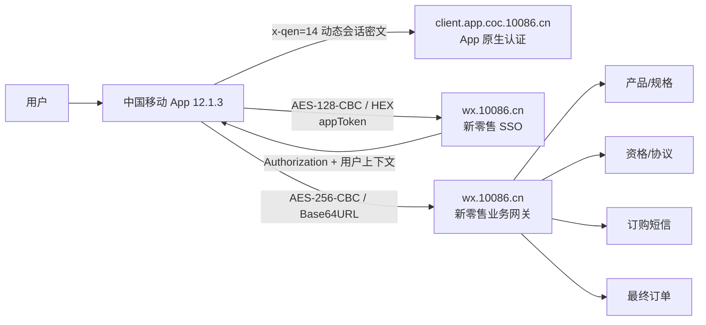
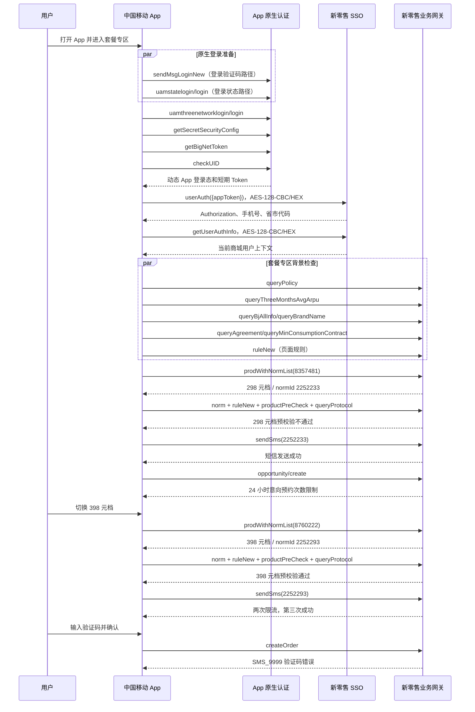

# 中国移动 App 业务订购全流程与加解密说明

版本：V1.0  
分析日期：2026-07-26  
样本：`中国移动App业务订购.har`  
客户端：中国移动 App 12.1.3，iPadOS 18.7  
业务场景：中国移动 App 套餐专区中的 5G 畅享套餐变更

## 1. 结论摘要

本次抓包不是一个单一接口协议，而是两层会话和三种报文保护共同组成的 App 订购流程：

1. 中国移动 App 原生接口使用 `x-qen: 14`、动态 `x-token`、`x-time`、`x-nonce`、`xs`、`x-sign`。请求和响应均为 Base64 形态的会话密文。
2. App 将短期 `appToken` 交给中移商城 SSO：`nrauth/auth/encryt/userAuth`。该接口使用固定 AES-128-CBC、十六进制编码。
3. SSO 返回商城 `Authorization` 后，产品、资格、协议、短信和订单接口使用固定 AES-256-CBC、Base64URL 编码，HTTP 外层为 `{"body":"<ciphertext>"}`。

商城层的两套 AES 已通过本 HAR 全量解密验证，可逐字节复现。原生 App 的 `x-qen=14` 属于动态会话保护，不能只凭 HAR 中某一次 `x-token` 推导出固定密钥；App 包内 `CMApiManager.framework` 的 README 还记录了旧版 AES/DES 常量，但实测不能解密本次 `x-qen=14` 报文，不能把它们误写成当前原生协议密钥。

HAR 中实际操作顺序为：

- 查询 298 元 5G 畅享套餐，资格预校验明确不通过，但订购短信接口仍返回成功；随后产生一条失败的意向商机记录。
- 切换到 398 元 5G 畅享套餐，资格预校验通过。
- 398 元档订购验证码前两次受限，第三次发送成功。
- 最终 `createOrder` 返回 `SMS_9999`，提示验证码错误。

因此，本样本没有成功订购，也没有成功订单号。它完整覆盖到了最终订单接口，但只能确认“最终请求被明确拒绝”。

## 2. 证据、范围与脱敏

| 证据 | 用途 | 结论边界 |
| --- | --- | --- |
| `中国移动App业务订购.har`，255 条请求 | 请求顺序、域名、头、密文、解密后的字段和响应 | 未包含成功订单响应 |
| `bj-mobile-business-local/backend/src/services/quickOrders/adapters/retailCrypto.js` | 商城两套 AES 的可运行实现 | 固定密钥是前端传输混淆，不是账号凭据 |
| `bj-mobile-business-local/backend/src/services/quickOrders/adapters/retail.js` | 产品、规格、资格、协议、短信和下单的现有服务端适配 | 当前实现按 H5 `BUSINESS_H5/backUrl` 构造，不能直接替代本次 App `CHINA_APP/appToken` 流程 |
| 中国移动 12.1.3 IPA 内 `CMApiManager.framework/README.md` | 旧版 AES/DES 密钥管理说明 | README 中常量不能解开 `x-qen=14` 报文 |

本文不记录或展示真实手机号、Cookie、UID、App Token、商城 Token、验证码、设备标识、会话 ID、推荐追踪 ID和订单号。产品编码、档位编码、渠道编码和营销编码属于业务配置，予以保留。

## 3. 系统边界



不要把下列协议混用：

| 平台 | 域名/前缀 | 会话与加密 |
| --- | --- | --- |
| 本文 App 原生层 | `client.app.coc.10086.cn/biz-orange/*` | `x-qen=14` 动态签名与会话密文 |
| 本文中移商城层 | `wx.10086.cn/website/nrapigate/*` | SSO AES-128 + 业务 AES-256 |
| COC Aurora H5 | `dev.coc.10086.cn/coc/*` | 每会话 AES key + `coc-aurora` 公钥封装 |
| 北京移动门户 | `bmcc.1008086.xyz` 对应 `portal-bff` 上游 | 北京移动独立 Cookie/接口协议 |
| 北京移动云电脑 | `mop.bmcc.com.cn/mkt_web/*` | App Token 兑换营销会话，业务 JSON 明文走 TLS |

## 4. 完整时序



HAR 的 `startedDateTime` 使用 UTC；业务体中的 `confirmTime` 使用北京时间。排序时应按绝对时间戳，不应按 HAR 数组原始顺序。

## 5. 加密与解密总表

| 层 | 适用接口 | 算法 | Key | IV | 明文 | 线上的编码 |
| --- | --- | --- | --- | --- | --- | --- |
| App 原生 | `client.app.coc.10086.cn/*` | `x-qen=14` 动态方案；具体分组算法和派生参数未能由单份 HAR 独立验证 | 动态会话材料在 `x-token`，不是固定可复用 key | 未证实 | App 原生请求对象 | Base64 形态密文 + 时间戳/随机数/双签名 |
| 商城认证 | `userAuth`、`getUserAuthInfo`、`queryUnpaidQuantity` | AES-128-CBC，PKCS#7 | UTF-8 `1234123412ABCDEF` | UTF-8 `ABCDEF1234123412` | UTF-8 JSON | 大写 HEX；响应外层 `body` |
| 商城业务 | 产品、规则、资格、协议、短信、订单 | AES-256-CBC，PKCS#7 | UTF-8 `03054BD8937F62FA8FE72F00012B9658` | UTF-8 `82787D91132E6AE5` | UTF-8 JSON | Base64URL；响应外层 `body` |

重要说明：AES-256 的 key 字符串虽然看起来像十六进制，但实现是按 32 个 ASCII 字符直接转为 32 字节，不能执行 `hexDecode`。同理，IV 是 16 个 ASCII 字符。

### 5.1 商城认证层

请求加密：

```text
object
  -> JSON.stringify
  -> UTF-8 bytes
  -> AES-128-CBC(key, iv, PKCS#7)
  -> uppercase HEX
  -> HTTP request body（直接是字符串，不再包装 body）
```

响应解密：

```text
HTTP JSON
  -> outer.body
  -> HEX decode
  -> AES-128-CBC decrypt
  -> remove PKCS#7 padding
  -> UTF-8
  -> JSON.parse
```

本次 App 请求明文：

```json
{
  "appToken": "<short-lived-app-token>"
}
```

普通商城 H5 常见明文为 `{"backUrl":"..."}`。两种入口不能互换：App 入口依赖 App 已生成的短期 Token，普通浏览器不能自行生成。

### 5.2 商城业务层

请求加密：

```text
object
  -> JSON.stringify
  -> UTF-8 bytes
  -> AES-256-CBC(key, iv, PKCS#7)
  -> standard Base64
  -> '+' 替换为 '-'
  -> '/' 替换为 '_'
  -> HTTP request body（直接是字符串）
```

响应解密：

```text
HTTP JSON
  -> outer.body
  -> '-' 还原为 '+'，'_' 还原为 '/'
  -> 补齐 '=' 到 4 的倍数
  -> Base64 decode
  -> AES-256-CBC decrypt
  -> remove PKCS#7 padding
  -> UTF-8
  -> JSON.parse
```

### 5.3 Node.js 参考实现

```js
import crypto from 'node:crypto'

const AUTH_KEY = Buffer.from('1234123412ABCDEF', 'utf8')
const AUTH_IV = Buffer.from('ABCDEF1234123412', 'utf8')
const WIRE_KEY = Buffer.from('03054BD8937F62FA8FE72F00012B9658', 'utf8')
const WIRE_IV = Buffer.from('82787D91132E6AE5', 'utf8')

export function authEncrypt(value) {
  const cipher = crypto.createCipheriv('aes-128-cbc', AUTH_KEY, AUTH_IV)
  return Buffer.concat([
    cipher.update(JSON.stringify(value), 'utf8'),
    cipher.final(),
  ]).toString('hex').toUpperCase()
}

export function authDecrypt(ciphertext) {
  const decipher = crypto.createDecipheriv('aes-128-cbc', AUTH_KEY, AUTH_IV)
  return JSON.parse(Buffer.concat([
    decipher.update(ciphertext, 'hex'),
    decipher.final(),
  ]).toString('utf8'))
}

export function wireEncrypt(value) {
  const cipher = crypto.createCipheriv('aes-256-cbc', WIRE_KEY, WIRE_IV)
  return Buffer.concat([
    cipher.update(JSON.stringify(value), 'utf8'),
    cipher.final(),
  ]).toString('base64').replace(/\+/g, '-').replace(/\//g, '_')
}

export function wireDecrypt(ciphertext) {
  const normalized = ciphertext.replace(/-/g, '+').replace(/_/g, '/')
  const padded = normalized + '='.repeat((4 - normalized.length % 4) % 4)
  const decipher = crypto.createDecipheriv('aes-256-cbc', WIRE_KEY, WIRE_IV)
  return JSON.parse(Buffer.concat([
    decipher.update(padded, 'base64'),
    decipher.final(),
  ]).toString('utf8'))
}
```

该代码只处理报文格式。它不能替代 App Token、Cookie、`x-token`、商城 `Authorization` 或服务端风控。

## 6. App 原生登录层

### 6.1 抓包中出现的接口

| 顺序 | 接口 | 观察到的用途 | 本次可解密性 |
| ---: | --- | --- | --- |
| 1 | `POST /biz-orange/LN/uamrandcode/sendMsgLoginNew` | App 登录验证码发送路径 | `x-qen=14`，未解密 |
| 2 | `POST /biz-orange/LN/uamstatelogin/login` | 登录状态/状态机路径；与上一接口并发出现 | `x-qen=14`，未解密 |
| 3 | `POST /biz-orange/LN/uamthreenetworklogin/login` | 三网/一键登录路径 | `x-qen=14`，未解密 |
| 4 | `POST /ServiceControl/SC/secret/getSecretSecurityConfig` | 拉取原生安全配置 | `x-qen=14`，未解密 |
| 5 | `POST /leadeon-abilityopen-biz/BN/obtainToken/getBigNetToken` | 获取跨业务使用的短期大网 Token；本次出现 5 次 | `x-qen=14`，未解密 |
| 6 | `POST /biz-orange/LN/checkUIDAction/checkUID` | 校验当前 UID/登录态 | `x-qen=14`，未解密 |

这些接口均为 HTTP 200，但 HTTP 200 只表示网关返回了密文，不能在未解密响应的情况下声称每个接口业务成功。后续商城 `userAuth` 成功只能证明 App 最终提供了有效认证材料。

### 6.2 请求头

| 头 | HAR 形态 | 作用判断 |
| --- | --- | --- |
| `x-qen` | 固定为 `14` | 加密/协议版本选择器 |
| `x-token` | 192 或 216 字符的动态值 | 会话或密钥封装材料，不可复用为固定 key |
| `x-time` | 13 位时间戳 | 防重放和签名输入 |
| `x-nonce` | 8 字符动态值 | 单次随机数 |
| `xs` | 32 位十六进制 | 请求校验值/签名字段 |
| `x-sign` | 32 位十六进制 | 第二个校验值/签名字段 |
| `User-Agent` | `ChinaMobile/12.1.3 (...)` | 客户端版本和设备环境 |
| `Content-Type` | `application/Json` | 原生接口约定 |

请求体长度随接口和参数变化，均呈 Base64 密文；响应体同样呈 Base64 密文。`x-token` 在登录前后长度发生变化，进一步说明它是动态会话上下文，而不是可写入文档的长期密钥。

### 6.3 为什么不能声称已得到原生固定密钥

12.1.3 IPA 内 `CMApiManager.framework/README.md` 记录了：

```text
旧版 AES encrypt key: ^YHN*IK<#EDC@#/$
旧版 DES decrypt key: asiainfo
```

README 同时说明这些常量已迁移到混淆的 `CMSecureKeyManager`。对本 HAR 的请求尝试 AES-128-ECB/CBC，对响应尝试单 DES 等价模式后，均不能通过 PKCS padding 和 JSON 解析验证。因此只能得出：

- 这些常量属于 CMApiManager 的另一条或旧版兼容路径。
- 它们不是本次 `x-qen=14` 报文的已验证 key。
- `x-qen=14` 还涉及 `BCESmartEncryptor`、动态 `x-token` 和签名链；缺少运行时密钥派生上下文时，HAR 本身不足以还原明文。

任何把某次 HAR 的 `x-token/x-sign/x-nonce` 固化进代码的实现都会很快过期，并可能触发重放与风控。

## 7. 商城认证与会话建立

### 7.1 App Token 换取商城会话

```text
POST https://wx.10086.cn/website/nrapigate/nrauth/auth/encryt/userAuth
```

关键头：

| 头 | 本次值/规则 |
| --- | --- |
| `channelid` | `CHINA_APP` |
| `x-app-version` | `1.0.1` |
| `x-token` | App 当前短期头，敏感 |
| `Cookie` | App 当前 `wx.10086.cn` Cookie，敏感 |
| `Content-Type` | `application/json; charset=utf-8` |

明文入参：

| 字段 | 类型 | 必需 | 说明 |
| --- | --- | --- | --- |
| `appToken` | string | 是 | App 原生登录层生成的短期 Token；不得落盘或写日志 |

解密后响应：

| 字段 | 类型 | 说明 |
| --- | --- | --- |
| `returnCode` | string | `0` 表示接口成功 |
| `returnMessage` | string/null | 业务消息 |
| `ok` | boolean | 包装层结果 |
| `data.token` | string | 后续业务接口的 `Authorization` |
| `data.userInfo.token` | string | 用户信息内的 Token 备选位置 |
| `data.userInfo.uid` | string | App/商城用户标识，敏感 |
| `data.userInfo.telephone` | string | 手机号，敏感 |
| `data.userInfo.aesTelNum` | string | AES 形态手机号，敏感 |
| `data.userInfo.provinceCode` | string | 省代码；本样本为北京 `100` |
| `data.userInfo.cityCode` | string | 市代码；本样本为 `100` |
| `data.userInfo.channel` | string | 本样本为 `30011` |
| `data.userInfo.showOrder` | boolean | 是否展示订单能力 |
| `data.userInfo.encFlag/encVersion` | string | 本样本为 `1/2`，表示商城报文保护开关/版本 |

### 7.2 查询当前商城用户

```text
GET /website/nrapigate/nrauth/auth/encryt/getUserAuthInfo
```

请求无业务体，响应仍以认证层 AES-128-CBC/HEX 包装。主要字段与 `userAuth.data.userInfo` 相同，用于页面重新读取当前用户状态。

### 7.3 查询未支付订单数量

```text
POST /website/nrapigate/nrterminal/busi/order/queryUnpaidQuantity
```

本接口同样使用认证层 AES-128-CBC/HEX，而不是业务层 AES-256：

```json
{}
```

响应 `data.orderPendingCount` 为未支付订单数量。本次接口成功。该接口属于页面角标/订单中心背景请求，不是套餐变更的下单前置条件。

### 7.4 SDK 域认证与统一会话辅助请求

在商城 SSO 附近还出现两个辅助身份请求：

```text
POST https://wx.10086.cn/wmhopenapi/sdkAuth/domain/login
POST https://wx.10086.cn/api/nguac/model/sso/jsession
```

`sdkAuth/domain/login` 的 URL 查询参数包含 `appKey=zgydAppSDK`、秒级 `currentTime` 和动态 `sign`，请求 JSON 只有 `encryptData` 密文。响应包含 `rtnCode/rtnMsg` 及 SDK 配置对象。该接口使用独立的 SDK 加密和签名，不使用本文已验证的商城 AES-128/AES-256；本 HAR 没有足够证据还原其 `encryptData`，也没有证据表明它是 `createOrder` 的强制业务前置。

`nguac/model/sso/jsession` 请求结构为：

```json
{
  "jsessionid": "<ephemeral-session-id>",
  "uid": "<redacted-uid>",
  "comment": "SessionServer-unity",
  "path": "/",
  "ticketId": "NingBo"
}
```

响应为 `rtnCode=0` 并在 `bean.authCode` 返回短期授权码。该请求发生在产品查询之前，可归为统一认证/风险组件的会话交换；其凭据没有直接出现在本次解密后的产品、短信或订单明文中。实现快捷订购时应让官方 App/SDK 生成这些动态值，不能伪造 `sign/authCode` 或把一次抓包值固化。

## 8. 业务接口公共约定

业务基址：

```text
https://wx.10086.cn/website/nrapigate/
```

本次 App 请求的公共头：

```text
channelid: CHINA_APP
x-app-version: 1.0.2
chop-real-host: wx.10086.cn
Authorization: <userAuth response token>
Cookie: <current wx.10086.cn cookie jar>
Content-Type: application/json; charset=utf-8
Accept: application/json, text/plain, */*
```

通用解密后响应：

```json
{
  "returnCode": "0",
  "returnMessage": null,
  "data": {},
  "ok": true
}
```

判定顺序：

1. HTTP 必须为 2xx。
2. 外层必须是 JSON 且包含字符串 `body`。
3. `body` 必须能完成 Base64URL、AES-256-CBC 和 JSON 解码。
4. 顶层 `returnCode` 必须符合接口成功条件，通常为字符串 `0`。
5. `productPreCheck` 和部分短信接口还必须继续判断 `data.status`；`data` 可能是嵌套 JSON 字符串。

不能只判断 HTTP 200 或顶层 `ok`。

## 9. 产品与规格接口

### 9.1 产品及档位列表

```text
POST nrmix/product/prodWithNormList
```

请求：

```json
{ "productCode": "<mall-product-code>" }
```

主要字段：

| 字段 | 类型 | 来源/含义 |
| --- | --- | --- |
| `productCode` | string | 页面 URL、推荐位或上游实时返回的商城产品编码 |

响应 `data` 主要字段：

| 字段 | 类型 | 说明 |
| --- | --- | --- |
| `productId` | number | 商城产品 ID，最终订单使用 |
| `productCode` | number | 商城展示产品编码 |
| `productName` | string | 产品名称 |
| `categoryCode/categoryName` | string | 商品分类 |
| `intro` | string | 商品简介 |
| `status` | number | 商品状态 |
| `preCheck` | string | 商品是否配置预校验 |
| `norms[]` | array | 可办理规格列表 |
| `norms[].normId` | number | 商城规格 ID |
| `norms[].productCode` | string | CRM 套餐/权益编码，预校验的 `packageId` |
| `norms[].name` | string | 档位名称 |
| `norms[].price` | string | 单位为分；`29800` 即 298 元 |
| `norms[].preCheck` | string | 是否预校验 |
| `norms[].commonCode` | string | 公共业务分类，本次为 `C2_package` |
| `norms[].normProtocolIds` | string | 配置的协议 ID |
| `norms[].isNormProtocolFlag` | string | 是否有档位协议 |
| `norms[].handleSmsType` | string | 短信处理类型，本次为 `3` |

### 9.2 规格详情

```text
POST nrmix/product/norm
```

```json
{ "normId": 2252293 }
```

最终流程必须以详情实时返回为准：

| 字段 | 类型 | 说明 |
| --- | --- | --- |
| `id/normId` | number | 规格 ID |
| `productId` | number | 商城产品 ID |
| `productCode` | string | CRM 套餐编码 |
| `productName/specBaseNm` | string | 商品/规格名称 |
| `price` | string | 分 |
| `busiEffectType` | string | 生效类型，本次均为 `Type_Default` |
| `preCheckTypes/preCheckType` | string/number | 预校验类型，本次为 `2` |
| `specialOfferType` | number | 特殊优惠类型，本次为 `0` |
| `bizIntfCode` | string/null | 业务接口类型，本次为空 |
| `commonCategoryCode` | string | 本次为 `C2_package` |
| `segments/freedomSegments/mergeVmList` | array | 套餐资源、规则、生效和退订文案 |
| `handleSmsProductName` | string | 短信中的产品名称 |
| `handleSmsProductTariff` | string | 短信资费摘要 |
| `handleSmsProductContent` | string | 完整短信/业务规则文案 |
| `normProtocolIds` | string | 协议配置 ID |
| `handleSmsType` | string | 短信策略 |

### 9.3 规格关联优惠

```text
POST nrpromotion/atom/courtesy/hcByNorm
```

```json
{ "normId": "2252293" }
```

本次 298 和 398 两个档位均返回顶层成功、无有效优惠数据。该接口用于查询规格随附优惠，不是本次最终订单的必需字段来源。

## 10. 规则、资格和协议

### 10.1 页面与产品机会规则

```text
POST nropportunity/atom/ruleNew
```

页面级请求：

```json
{
  "effectPageType": 1,
  "sessionId": "<ephemeral-session-id>",
  "serviceFlag": "2",
  "scene": "套餐专区",
  "doubleEntranceFlag": "1"
}
```

产品级请求：

```json
{
  "productCode": 8760222,
  "productType": 1,
  "sessionId": "<ephemeral-session-id>",
  "serviceFlag": "2",
  "price": 39800,
  "scene": "套餐专区页",
  "doubleEntranceFlag": "1"
}
```

响应字段：

| 字段 | 说明 |
| --- | --- |
| `ruleId` | 规则 ID |
| `ruleType/secondRuleType` | 一级/二级规则类型 |
| `normIds[]` | 规则覆盖的规格 |
| `preCheck` | 规则是否要求额外预校验 |
| `hitCust` | 当前用户是否命中 |
| `ruleContent[].key/value` | 规则配置项 |

本次产品规则返回 `ruleId=200000915`、`ruleType=11`、`secondRuleType=1103`，规则文案包含云宽带预约提示。它属于页面营销/挽留配置，不取代 `productPreCheck` 的办理资格结果。

### 10.2 产品资格预校验

```text
POST nrmix/preCheck/productPreCheck
```

本次套餐变更请求：

```json
{
  "packageId": "111601000492",
  "isMain": 1,
  "shopProvinceCode": "100",
  "busiEffectType": "Type_Default",
  "specialOfferType": 0,
  "preCheckType": "2",
  "productCode": "8760222",
  "normId": 2252293,
  "touchCode": ""
}
```

字段说明：

| 字段 | 来源 | 说明 |
| --- | --- | --- |
| `packageId` | `norm.productCode` | CRM 套餐/权益编码，不是商城 `productCode` |
| `isMain` | 页面业务类型 | `1` 表示主套餐变更；权益包常见 `0` |
| `shopProvinceCode` | SSO 用户信息 | 商城省代码 |
| `busiEffectType` | `norm.busiEffectType` | 生效类型 |
| `specialOfferType` | `norm.specialOfferType` | 特殊优惠类型 |
| `preCheckType` | `norm.preCheckTypes` | 预校验类型 |
| `productCode` | 商城产品 | 商城展示产品编码 |
| `normId` | 当前选择 | 规格 ID |
| `touchCode` | 页面渠道 | 本次为空 |

响应可能出现双层 JSON 字符串：

```json
{
  "returnCode": "0",
  "data": "{\"status\":\"0\",\"message\":\"success\",\"data\":\"{...}\"}"
}
```

必须递归解析 `data`，以最外层业务对象的 `status` 判断：

- `status="0"`：资格通过。
- `status="1"`：资格不通过，`message/transWord` 给出原因和用户文案。

本次 298 元档因当前已有 398 元档相关承诺而不允许变更；398 元档返回 `status=0`。

### 10.3 业务受理协议

```text
POST nrproduct/atom/protocol/queryProtocol
```

```json
{
  "provinceCode": "100",
  "queryType": "",
  "productCode": "8760222",
  "normId": "2252293",
  "cityCode": "100"
}
```

响应字段：

| 字段 | 本次值/说明 |
| --- | --- |
| `data.id` | `200100574`，本次最终订单使用为 `ptId` |
| `data.protocolName` | `业务受理协议` |
| `data.protocolContent` | HTML 实体编码的协议内容 |
| `data.needSign` | `2` |
| `data.isForceRead` | `2` |
| `data.isIntro` | `1` |
| `data.protocolSequenceId` | 本次为空 |
| `data.protocolId` | 本次为空 |

协议字段映射必须按实际返回：

- 有 `protocolSequenceId` 时，订单携带同名字段。
- 无流水但有 `id/protocolId/ptId` 时，本次页面将 `id` 作为 `ptId`。
- 顶层成功但 `data=null` 时，不应伪造协议流水。

## 11. 验证码接口

```text
POST nrmix/sms/sendSms
```

```json
{
  "busiId": "2",
  "normIds": "2252293",
  "userEffectType": "Type_Default"
}
```

| 字段 | 类型 | 说明 |
| --- | --- | --- |
| `busiId` | string | 本次套餐订购固定为 `2` |
| `normIds` | string | 当前选择的规格 ID；虽为单个值，类型仍是字符串 |
| `userEffectType` | string | 生效类型，来自规格详情 |

成功响应：

```json
{
  "returnCode": "0",
  "returnMessage": "",
  "data": {
    "status": "0",
    "message": "success",
    "smsContent": null
  },
  "ok": true
}
```

本 HAR 的实际行为：

| 档位 | 次数 | 结果 |
| --- | ---: | --- |
| 298 元 | 1 | 成功 |
| 398 元 | 1 | `01_9999`，一分钟后重试 |
| 398 元 | 2 | `01_9999`，一分钟后重试 |
| 398 元 | 3 | 成功 |

短信接口具有副作用，客户端和本地系统都不应在网络错误时自动重试。冷却时间至少按返回文案执行；前端倒计时不能代替服务端限流。

## 12. 最终订购接口

```text
POST nrmix/order/createOrder
```

本次解密后的请求结构：

```json
{
  "shopid": "",
  "normid": 2252293,
  "productId": 2167538,
  "productCode": 8760222,
  "ordertype": 1,
  "verifyCode": "<sms-code>",
  "password": "<same-sms-code>",
  "cmgSmsCode": "<same-sms-code>",
  "userEffectType": "Type_Default",
  "timeSpan": "<epoch-ms>",
  "confirmTime": "<Asia/Shanghai datetime>",
  "sellerId": "P00000132563",
  "touchCode": "P00000130720",
  "sessionId": "<ephemeral-session-id>",
  "bookTime": "",
  "dshtyx": "",
  "redCode": "rec_MainPackageZoneApp_P00000130720",
  "rcmSrc": "SOURCE_CANDIDATE",
  "recommendTraceId": "<ephemeral-trace-id>",
  "gearChange": "1",
  "appOrderZone": 4,
  "rcmParams": "001&SOURCE_CANDIDATE",
  "ptId": 200100574,
  "contractOperation": "&9000176369&&"
}
```

字段说明：

| 字段 | 来源 | 说明 |
| --- | --- | --- |
| `normid` | 选择的规格 | 注意字段名为小写 `id` 组合，与查询接口的 `normId` 不同 |
| `productId` | 产品列表 | 商城内部产品 ID |
| `productCode` | 产品列表/页面 | 商城产品编码，不是 CRM `packageId` |
| `ordertype` | 页面 | 本次为 `1` |
| `verifyCode/password/cmgSmsCode` | 用户短信 | 三个字段携带同一验证码；不得日志记录 |
| `userEffectType` | 规格详情 | 本次为 `Type_Default` |
| `timeSpan` | 客户端当前时间 | 毫秒时间戳 |
| `confirmTime` | 客户端当前时间 | 北京时间字符串 |
| `sellerId` | App 页面/推荐上下文 | 销售或触点来源，本次为 `P00000132563` |
| `touchCode` | App 套餐专区 | 本次为 `P00000130720` |
| `sessionId` | 页面会话 | 机会规则和订单的短期关联值 |
| `redCode` | 推荐位 | 主套餐专区推荐编码 |
| `rcmSrc` | 推荐系统 | 本次为候选来源 `SOURCE_CANDIDATE` |
| `recommendTraceId` | 推荐系统 | 单次追踪 ID，不得跨会话复用 |
| `gearChange` | 套餐变更 | 本次为 `1` |
| `appOrderZone` | App 场景 | 本次为 `4` |
| `rcmParams` | 推荐系统 | 本次 A/B 版本和来源组合 |
| `ptId` | 协议查询 | 本次来自协议对象 `id=200100574` |
| `contractOperation` | 页面 `yx` 营销上下文 | 本次为 `&9000176369&&`，不能挪用到其他产品 |

响应：

```json
{
  "returnCode": "SMS_9999",
  "returnMessage": "验证码输入错误，请重试",
  "data": null,
  "ok": false
}
```

本样本没有订单成功响应字段。现有代码兼容 `data.orderNumber`，但这属于其他抓包/源码推导，不能宣称已由本 HAR 验证。

最终提交必须 `maxAttempts=1`。如果连接在发送后断开、超时或响应无法解密，应标记 `UNKNOWN/结果未确认`，先通过中国移动 App、10086 或营业厅查询，不得自动重复下单。

## 13. 意向商机接口

```text
POST nrmix/opportunity/create
```

它在用户停留达到规则阈值后创建营销意向，不是订单创建接口。主要入参包括：

| 字段 | 说明 |
| --- | --- |
| `reason/reasonDualType` | 触发原因，本次为浏览时长 |
| `scene` | App 套餐专区场景 |
| `ruleContentKey/ruleId` | `ruleNew` 命中的规则 |
| `stayTime` | 停留秒数，本次为 `10` |
| `channelCode` | App 业务渠道，本次为 `30011` |
| `provinceCode/cityCode` | 用户省市代码 |
| `price` | 元，本次 298；与产品接口的分单位不同 |
| `normId/productCode/productName` | 当前浏览产品 |
| `productUrl` | 带推荐参数的商品 URL；可能含追踪 ID，日志应清洗 |
| `touchCode` | 本次为 `P00000132563` |

本次返回 `-9998`：同一号码同一商品 24 小时内预约次数达到限制或有未处理预约单。该失败不等于产品订购失败，也不应阻断用户查看其他档位。

## 14. 套餐专区辅助接口

这些接口在进入套餐专区后并行调用，用于页面提示和风险展示，不是每个商品都必须原样调用：

| 接口 | 请求 | 主要响应 | 处理要求 |
| --- | --- | --- | --- |
| `nrmix/userPolicy/queryPolicy` | `{}` | 推荐、监控、营销弹窗开关 | 页面策略，不是资格 |
| `nrzone/tczq/queryThreeMonthsAvgArpu` | `{}` | 三个月平均 ARPU | 账号敏感数据，不写日志 |
| `nrzone/tczq/queryBjAllInfo` | `{}` | 网龄 | 账号敏感数据 |
| `nrzone/tczq/queryBrandName` | `{}` | 号码品牌 | 手机号/品牌按敏感信息处理 |
| `nrzone/tczq/checkTerminalNumber` | `terminalId` | 终端检查结果 | 设备 ID 不持久化 |
| `nrzone/tczq/queryMinConsumptionContract` | `appToken, caller=externalAuth` | 最低消费合约列表和提示 | 合约实例、时间和描述均敏感 |
| `nrzone/tczq/queryAgreement` | `planType=0, caller=externalAuth, appToken` | 可能影响套餐变更的合约 | 用于风险提示，不能替代实时预校验 |

`queryMinConsumptionContract` 和 `queryAgreement` 的业务体仍使用商城 AES-256，但明文内再次携带短期 `appToken`。该 Token 不应从 HAR 重放。

## 15. 本次产品和业务信息

| 项目 | 298 元档 | 398 元档 |
| --- | --- | --- |
| 商城 `productId` | `2167537` | `2167538` |
| 商城 `productCode` | `8357481` | `8760222` |
| `normId` | `2252233` | `2252293` |
| CRM `packageId` | `111601000486` | `111601000492` |
| 名称 | 298 元 5G 畅享套餐 | 398 元 5G 畅享套餐 |
| 月费 | 298 元 | 398 元 |
| 国内通用流量 | 100GB，当月有效 | 150GB，当月有效 |
| 国内通话 | 800 分钟，当月有效 | 1200 分钟，当月有效 |
| 生效 | 默认次月；新入网及未开主套餐用户可能立即生效，以成功短信为准 | 同左 |
| `busiEffectType` | `Type_Default` | `Type_Default` |
| `preCheckType` | `2` | `2` |
| 协议 ID | `200100574` | `200100574` |
| 资格结果 | 不通过 | 通过 |
| 本次最终下单 | 未提交 | 已提交但验证码错误，未受理 |

规格返回的业务规则还表明它们是连续包月主套餐、5G 服务、无提前变更违约责任，并提供套餐外资费和退订说明。实际费用、生效、有效期、权益和退订规则必须在每次办理前展示实时 `norm` 和协议内容，不能只依赖本文快照。

## 16. 响应码与状态机

| 码/状态 | 接口 | 本次含义 | 建议处理 |
| --- | --- | --- | --- |
| `0` | 通用 | 顶层成功 | 继续检查嵌套 `data.status` |
| `data.status=0` | 预校验/短信 | 业务成功 | 允许进入下一步 |
| `data.status=1` | 预校验 | 资格不通过 | 展示原因，默认禁止发送订购短信 |
| `01_9999` | `sendSms` | 验证码获取失败，一分钟后重试 | 保持选择状态，按服务端冷却 |
| `SMS_9999` | `createOrder` | 验证码错误 | 可让用户重新输入；不自动提交 |
| `-9998` | `opportunity/create` | 预约次数/未处理预约限制 | 仅影响意向商机，不视作订单失败 |
| HTTP 2xx + 解密失败 | 任意 | 响应不可确认 | 查询类可人工重试；最终订单进入 UNKNOWN |

建议状态机：

```text
APP_AUTH_READY
  -> RETAIL_AUTHENTICATED
  -> PRODUCT_READY
  -> SELECTION_READY
  -> ELIGIBILITY_PASSED
  -> SMS_SENT
  -> SUBMITTING
  -> FINISHED | REJECTED | UNKNOWN
```

安全边界：

- 产品查询、规格查询、规则和协议属于只读请求，可在明确的网络失败后有限重试。
- 资格查询通常只读，可有限重试，但不得跨档位复用结果。
- 验证码发送不得自动重试。
- 最终订单不得自动重试。
- 选择档位变化后，旧资格、旧协议、旧验证码、旧推荐追踪和旧确认状态全部失效。

## 17. 对现有项目实现的影响

现有 `retailCrypto.js` 的算法与本 HAR 完全一致，可以复用。现有 `retail.js` 的业务阶段也大体一致，但本次 App 套餐变更不能直接套用，至少存在以下差异：

| 项目 | 现有 H5 适配器 | 本次 App HAR |
| --- | --- | --- |
| SSO 入参 | `backUrl` | `appToken` |
| `channelid` | `BUSINESS_H5` | `CHINA_APP` |
| 商品入口 | 个性化页面 `personalPageId` | 套餐专区推荐产品编码 |
| 产品类型 | 权益/个性化商品 | 主套餐变更，`isMain=1` |
| 下单来源字段 | 多为空或个性化页面字段 | `sellerId/touchCode/redCode/rcm*/gearChange/appOrderZone` |
| 营销字段 | 按其他产品配置 | 本次 `contractOperation=&9000176369&&`，仅属于当前来源 |
| 协议字段 | 通用 `protocolSequenceId/ptId` 映射 | 本次明确使用 `ptId=200100574` |

若后续开发 App 快捷订购适配器，应新增独立 `retail_app` 入口，复用加密库和响应解析器，但不要修改 H5 适配器的认证方式。App Token 只在创建会话时使用，兑换成功后立即从内存上下文清除；后端只保存短期商城 Authorization 和隔离 CookieJar。

## 18. 安全与日志规范

必须脱敏或禁止记录：

- `Cookie`、`Authorization`、`x-token`、`appToken`
- `uid`、完整手机号、`telephone/aesTelNum`
- `x-sign`、`xs`、`x-nonce` 和原始原生密文
- 登录验证码、订购验证码，以及 `verifyCode/password/cmgSmsCode`
- `sessionId`、`recommendTraceId`、设备 ID、终端 ID
- 合约实例、ARPU、网龄、订单号和协议中的用户信息

可以记录的最小审计字段：

```text
requestId（本地生成）
platform=retail_app
stage
productCode/normId
upstreamPath
HTTP status
returnCode
durationMs
maskedPhone
uncertain=true|false
```

固定 AES key 是前端协议常量，不能被当作登录凭据；真正的访问控制仍由 TLS、App 登录态、Cookie、短期 Token、Authorization、签名、短信验证和服务端风控共同完成。即便能解密 HAR，也不代表旧请求可以重放。

## 19. 验证结论与未验证项

| 项目 | 结论 | 置信度 |
| --- | --- | --- |
| 商城认证 AES-128 key/IV/模式/编码 | 本 HAR 请求和响应解密成功 | 已验证 |
| 商城业务 AES-256 key/IV/模式/编码 | 所有核心请求和响应解密成功 | 已验证 |
| 产品、规格、资格、协议、短信和订单字段 | 来自解密后的 HAR | 已验证 |
| 298/398 档业务内容和本次结果 | 来自实时响应 | 已验证 |
| 原生 `x-qen=14` 使用动态会话和签名 | 来自头变化、密文形态和 App 静态符号 | 高置信 |
| `x-qen=14` 的精确 key 派生、分组模式和签名拼接顺序 | 单份 HAR 无法独立验证 | 未验证 |
| 成功订单的 `data` 字段和订单号语义 | 本 HAR 没有成功响应 | 未验证 |
| 固定产品/营销编码未来仍有效 | 上游配置可能变化 | 运行时必须重查 |

要继续完成原生层的精确解密，需要在本人设备、获授权调试环境中采集运行时 `BCESmartEncryptor`/网络序列化器的函数入参、派生 key/IV 和签名原串，并用至少两组请求做交叉验证。不能用抓包中的动态 Token 猜测固定密钥，也不应通过绕过 App 完整性或服务端认证来实现订购。
