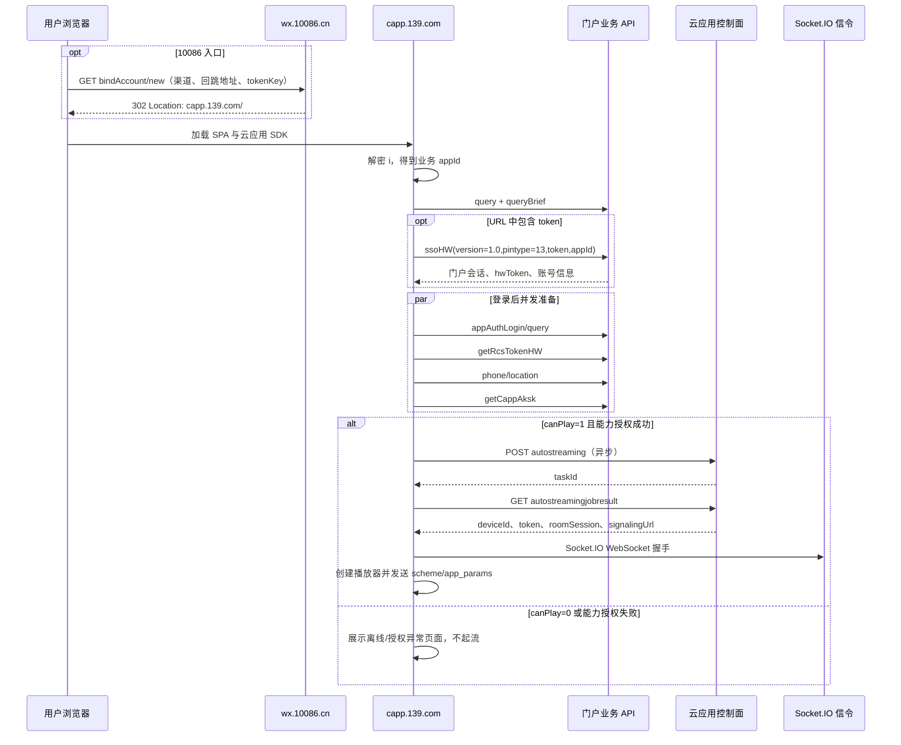

# 中国移动云应用 HAR 流程解析与实现说明

**文档版本：** V1.0  
**分析日期：** 2026-08-11  
**适用对象：** 前端、服务端、联调、测试与安全人员  
**敏感信息处理：** Token、Cookie、手机号、账号、AK/SK、任务 ID、会话 ID、设备 ID 与签名原值均已省略或掩码。

> **核心结论**：两组素材使用同一版 `capp.139.com` 前端，但对应两个不同的云应用记录。`86转云应用` 进入 `appId=10607`，完成 10086 跳转和 `ssoHW` 单点登录后，能力授权接口返回 `6000608（该用户授权异常）`，同时配置为 `canPlay=0`，因此未进入起流阶段。`云应用139` 进入 `appId=12924`，已有有效会话，配置为 `canPlay=1`，完整执行了能力凭据获取、异步起流、结果轮询、Socket.IO 信令连接和业务 WebSocket 建连。

## 1. 分析范围与证据

### 1.1 素材映射

| 场景 | HAR | 离线资源包 | 本地时间范围 | 结论 |
|---|---|---|---|---|
| 10086 跳转进入 | `86转云应用.har` | `139云应用.zip` | 2026-08-10 22:41:59–22:42:02 | SSO 成功，能力授权异常，未起流 |
| 139 云应用直接进入 | `云应用139.har` | `云应用139.zip` | 2026-08-10 22:56:35–22:56:41 | 已登录，完整起流并建立信令连接 |

ZIP 与 HAR 按抓取时间和响应内容对应。两个资源包中的 `app.2333d518.js` 与 `home.d0e68b2e.js` SHA-256 完全一致，说明行为差异来自入口参数、会话状态和服务端应用配置，而不是前端版本差异。

### 1.2 证据边界

- HAR 共记录 60 与 78 条请求，覆盖导航、XHR、预检、监控上报和 WebSocket 握手。
- HAR 未内嵌主要 JSON 响应正文；响应正文来自对应 ZIP 中按 URL 保存的 `.html` 文件。
- `云应用139` 抓包从已具备有效会话的页面加载开始，无法由该抓包反推出最初登录方式。
- WebSocket 仅记录握手，没有业务帧；媒体协商、输入事件和云端 App 内部行为只能从客户端 bundle 的调用路径确认。
- 本文描述的是观察到的接口契约，不等同于服务端正式开放 API。生产接入仍需接口方授权、密钥托管和协议确认。

## 2. 系统角色与边界

| 角色 | 主机/组件 | 责任 |
|---|---|---|
| 10086 统一入口 | `wx.10086.cn` | 校验入口参数并 302 回跳云应用，向 URL Fragment 交付加密应用标识与一次性 SSO Token |
| 云应用门户 | `capp.139.com` | 加载 Vue 单页应用，处理登录、应用配置、能力授权、活动配置与业务 WebSocket |
| 门户业务 API | `/cloud-trial/*` | 统一会话、应用配置、临时 Token、AK/SK、地域与运营规则查询 |
| 云应用控制面 | `capp-new-ziguan.139.com:8443` | 分配云端 Android 实例，返回设备、信令和房间会话参数 |
| CloudappService | `cloudapp-service-1.4.2.2.js` | 封装控制面签名、起流、轮询、重试与队列 |
| CloudappClient | `cloudapp-client_26.5.0...js` | 建立 Socket.IO 信令连接、创建播放器并转发输入/生命周期事件 |
| 可观测系统 | `cloud.139.com`、`cmicapm.com` | 上报起流结果、时延、错误和页面性能 |

## 3. 总体实现流程



## 4. 场景 A：10086 跳转进入

### 4.1 入口跳转

1. 浏览器访问 `GET https://wx.10086.cn/website/bind/bindAccount/new`。
2. 请求携带 `netUniChannelId`、`tokenKey`、`netUniBackUrl`、`ys`、`ystitle`。这些参数都应视为入口上下文，其中 `tokenKey` 和回跳参数不得记录明文日志。
3. 服务返回 HTTP 302，目标形态为：

   ```text
   https://capp.139.com/#/?i=<加密应用标识>&token=<一次性SSO令牌>
   ```

随后，`i` 位于 Fragment 内，前端读取后通过内置对称解密得到业务 `appId=10607`。Fragment 不会作为 HTTP Referer 发送给服务器，但浏览器脚本、历史记录、截图和前端监控仍可能读取它。

### 4.2 单点登录

前端在路由守卫中暂存 `token`，随后用 `replace` 清除当前路由中的 `token`、`appEnv` 和 `mbToken`，再调用：

```http
POST /cloud-trial/user/login/ssoHW
Content-Type: application/json

{
  "version": "1.0",
  "pintype": 13,
  "token": "<一次性SSO令牌>",
  "appId": "10607"
}
```

样本返回 `header.status=200`，并下发门户 `token`、`hwToken`、`refreshToken`、登录时间和掩码账号。前端将会话写入 Vuex/浏览器存储，后续业务请求统一由拦截器加鉴权头。

### 4.3 登录后准备与停止点

登录成功后，前端并发执行应用登录配置、RCS 临时 Token、号码归属地和能力凭据查询。该样本的关键状态如下：

| 项目 | 值 | 影响 |
|---|---:|---|
| 业务 `appId` | `10607` | 对应“在线-微信我的套餐”渠道记录 |
| `singleSignOn` | `1` | 云端 App scheme 可拼接临时 SSO Token |
| `appStatus` | `1` | 该记录处于不可直接体验状态 |
| `canPlay` | `0` | `initGame()` 直接走 `offLineFunc()`，不会创建云实例 |
| `getCappAksk` | `6000608` | 返回“该用户授权异常”，未获得能力凭据 |
| `showPrivacy` | `1` | 入口配置要求展示隐私/协议相关内容 |

因此该 HAR 中没有 `autostreaming`、任务轮询或 Socket.IO 握手。HTTP 200 仅表示传输成功；业务是否成功必须以响应 `header.status` 为准。

## 5. 场景 B：139 云应用直接进入并起流

### 5.1 应用与会话准备

该场景进入 `appId=12924`，渠道为“云版H5我的应用”。页面加载后立即查询应用配置。请求头已经含有效门户会话，说明登录发生在抓包之前。

| 项目 | 值 | 影响 |
|---|---:|---|
| 业务 `appId` | `12924` | 对应可体验的“中国移动”云应用记录 |
| 包名 | `com.greenpoint.android.mc10086.activity` | 控制面启动的 Android 包 |
| `singleSignOn` | `0` | 本次 scheme 不依赖应用内 SSO 模板替换 |
| `appStatus` | `0` | 应用可用 |
| `canPlay` | `1` | 允许进入 `initGame()` |
| `basePlatform` | `2` | 使用新版华为云应用播放器路径 |
| `liveTime` | `300` 秒 | 会话保持时长 |
| `shutoffTime` | `15` 分钟 | 无操作退出阈值 |

### 5.2 四项并发准备

`getEmpowerInfoData()` 同时发起以下请求，并在 `Promise.all` 完成后显示实例组件：

1. `appAuthLogin/query`：返回 scheme、是否需要应用内授权登录、隐私配置。
2. `user/getRcsTokenHW`：用 `hwToken` 换取临时 Token 和 SSO Token。
3. `user/phone/location`：返回省、市和运营商，用于地域配置、活动和免流判断。
4. `cappAksk/getCappAksk`：返回包名、控制面访问 Token、签名密钥、控制面地址、用户标识、加密账号和启动 scheme。

只有第 4 项成功后，前端才具备创建 `CloudappService` 的必要参数。样本中的 `accessToken`、`secretKey` 和账号密文均为短期敏感凭据，本文不记录其原值。

### 5.3 异步起流与轮询

前端构造 `CloudappService`，核心参数来自能力授权响应：

```javascript
const service = new CloudappService({
  mode: "app",
  pkg: user.packageName,
  httpHost: user.headerHost,
  uuid: user.userId,
  key: user.secretKey,
  token: user.accessToken,
  customerId: user.memberId
});
```

随后调用异步起流：

```http
POST /cloudapp/yun/rtc/device/open/v2/autostreaming
Content-Type: application/x-www-form-urlencoded
YYXRTC_TOKEN: <能力访问令牌>
os: android

pkg=<Android包名>
position=<经纬度>
config=
authFeature=cloudapp
devType=android-h5
operator=
async=true
t=<毫秒时间戳>
enableRecord=true
sign=<控制面签名>
```

首个响应为 `code="1"` 并返回 `taskId`。SDK 随即调用：

```http
GET /cloudapp/yun/rtc/device/open/v2/autostreamingjobresult
YYXRTC_TOKEN: <能力访问令牌>
phone_id: <用户/设备标识>

taskId=<任务ID>&t=<毫秒时间戳>&sign=<控制面签名>
```

若业务码为 `15003`，SDK 每 500 ms 继续轮询；成功码 `1` 时得到 `deviceId`、`instanceId`、`roomSession`、`roomPlayerSession`、播放器 Token、信令地址、平台和网络地址。样本在首次轮询即成功，实例状态为 `8`。

### 5.4 播放器和信令连接

前端用控制面结果创建播放器，并调用 `open()`：

```javascript
player.open({
  uuid,
  boxid: deviceId,
  token: playerToken,
  platform,
  signaling_url: signalingUrl,
  sessionid: roomPlayerSession,
  env,
  app_params: JSON.stringify({ scheme })
});
```

CloudappClient 通过 Socket.IO 建立 WebSocket。握手查询参数包含 `authtype=token`、`boxid`、`token`、`platform`、`sessionid`、随机 `streamingid` 等。该通道负责信令和播放器状态；另有 `capp.139.com/cloud-trial/websocket/<会话标识>` 业务 WebSocket。样本同时上报了云手机连接结果和页面性能指标。

## 6. 接口目录

### 6.1 门户业务接口

| 接口 | 方法 | 关键请求字段 | 成功判定 | 用途 |
|---|---|---|---|---|
| `/appInfo/appManage/query` | POST | `appId` | `header.status=200` | 完整应用、登录、营销、播放器配置 |
| `/appInfo/appManage/queryBrief` | POST | `appId` | `header.status=200` | 轻量应用标识和平台信息 |
| `/user/login/ssoHW` | POST | `version`、`pintype=13`、`token`、`appId` | `header.status=200` | 10086 Token 换门户会话 |
| `/appInfo/appAuthLogin/query` | POST | `appId` | `header.status=200` | scheme 和应用内登录配置 |
| `/user/getRcsTokenHW` | POST | `hwToken`、`appId` | `header.status=200` | 临时 Token / SSO Token |
| `/user/phone/location` | POST | `{}` | `header.status=200` | 省市、运营商与免流判断 |
| `/cappAksk/getCappAksk` | POST | `cappId`、`abilityId`、`param`、`src` | `header.status=200` | 获取控制面临时凭据与启动配置 |
| `/record/getSurplusTime` | POST | `appId`、`src` | `header.status=200` | 剩余体验时长与权益 |
| `/commonConfig/getConfig` | POST | `name` | `header.status=200` | 浮球等通用配置 |
| `/rule/config/info` | POST | `code` | `header.status=200` | 免流和运营规则 |
| `/freetrafficfront/.../getUserOrderInfo` | POST | 手机号、时间戳、交易号、签名 | `success=true` | 查询免流订购状态 |

### 6.2 控制面与长连接

| 接口 | 方法 | 鉴权 | 说明 |
|---|---|---|---|
| `/yun/rtc/device/open/v2/autostreaming` | POST 表单 | `YYXRTC_TOKEN` + 请求签名 | 异步分配并启动云实例 |
| `/yun/rtc/device/open/v2/autostreamingjobresult` | GET | `YYXRTC_TOKEN` + 请求签名 | 轮询异步任务结果 |
| `/socket.io/` | WebSocket | URL Query Token | 播放器信令通道 |
| `/cloud-trial/websocket/<session>` | WebSocket | 路径会话标识 | 门户业务消息通道 |
| `/cloudphone/log/cloudphone/metrics` | POST | `x-api-key`、`appid` | 起流时延、结果和错误指标 |

## 7. 鉴权与签名规则

### 7.1 门户业务 API 请求头

Axios 请求拦截器统一加入：

```text
requestId = yyyyMMddHHmmss + epochMillis + random(8)
appId     = 12345686                  // 门户客户端标识，不是业务 appId
token     = DES-ECB-PKCS5(rawToken + "#" + now + "#" + random(6) + "#12345686")
timestamp = epochMillis
sign      = lower(md5(requestId + appId + token + clientSecret + timestamp))
```

同时还会发送 `x-DeviceInfo`、`x-channelSrc` 和 `test_field`。代码中 `test_field` 被赋值为原始门户 Token，这是明显的敏感信息暴露，不应在新实现中保留。

注意：前端 bundle 中存在固定客户端密钥与 DES 密钥。本文不展示其值；浏览器端固定密钥不能构成可信安全边界。

### 7.2 云应用控制面签名

`CloudappService.getSign(payload, secretKey)` 的行为为：

1. 取待签名对象的所有值，不包含字段名。
2. 对每个值执行 `encodeURIComponent`。
3. 按编码后的值做字典序排序。
4. 每个值后追加 `&` 并串联。
5. 末尾追加能力授权接口返回的 `secretKey`。
6. 对整个字符串计算 MD5。

等价伪代码：

```javascript
function signControlRequest(payload, secretKey) {
  const canonical = Object.values(payload)
    .map(value => encodeURIComponent(value))
    .sort()
    .map(value => `${value}&`)
    .join("");
  return md5(canonical + secretKey);
}
```

该算法依赖对象值、编码方式和排序结果，接入实现必须用固定测试向量验证。不要改成常见的“按字段名排序”算法，否则签名不一致。

## 8. 建议的实现结构

### 8.1 模块划分

| 模块 | 主要职责 | 不应承担的职责 |
|---|---|---|
| `EntryResolver` | 解析 Fragment、清理 URL、解密 `i`、校验入口来源 | 持久化长期 Token |
| `SessionBroker` | 用入口 Token 换会话、刷新/清理会话、输出短期会话句柄 | 向日志或 UI 暴露原始 Token |
| `PortalApiClient` | 统一请求头、超时、业务码解析、请求追踪 | 保存固定生产密钥 |
| `AppBootstrapper` | 并发拉取应用配置、临时 Token、地域和能力凭据 | 直接操作播放器 DOM |
| `CredentialBroker` | 服务端托管签名/密钥并签发短期能力凭据 | 把 AK/SK 长期下发浏览器 |
| `StreamingController` | 起流、轮询、队列、重试、取消与实例回收 | 处理页面营销配置 |
| `PlayerAdapter` | CloudappClient 初始化、事件映射、重连、销毁 | 决定账号权限 |
| `Telemetry` | 脱敏指标、Trace ID、阶段耗时和业务码 | 上报 Token、手机号、完整 URL Query |

### 8.2 编排伪代码

```typescript
async function enterCloudApp(location: Location) {
  const entry = EntryResolver.parseAndScrub(location);
  const appId = await EntryResolver.decryptAppId(entry.i);

  if (entry.ssoToken) {
    await SessionBroker.exchange({ appId, token: entry.ssoToken });
  }

  const appInfo = await PortalApiClient.queryApp(appId);
  if (appInfo.canPlay !== 1) {
    return renderUnavailable(appInfo);
  }

  const [authConfig, rcs, locationInfo, capability] = await Promise.all([
    PortalApiClient.queryAuthConfig(appId),
    PortalApiClient.getTemporaryToken(appId),
    PortalApiClient.getPhoneLocation(),
    CredentialBroker.getCapability(appId, entry.context)
  ]);

  const task = await StreamingController.start({ appInfo, capability });
  const session = await StreamingController.waitUntilReady(task, {
    intervalMs: 500,
    cancelSignal: pageAbortSignal
  });

  const player = await PlayerAdapter.open({
    session,
    scheme: resolveScheme(authConfig, rcs, entry.context)
  });
  return bindLifecycle(player);
}
```

### 8.3 状态机

```text
ENTRY
  -> SSO_EXCHANGE（仅外部 Token 入口）
  -> APP_CONFIG
  -> [UNAVAILABLE | AUTH_PREPARE]
  -> [AUTH_FAILED | STARTING]
  -> POLLING
  -> [QUEUED | READY | START_FAILED]
  -> SIGNALING_CONNECTING
  -> PLAYING
  -> [RECONNECTING | CLOSED]
```

状态必须由业务码驱动，不能只依赖 HTTP 状态。每个阶段都应支持取消，并在页面退出、登录失效或重试耗尽时释放云实例和播放器资源。

## 9. 超时、重试与异常处理

| 场景 | 原实现行为 | 建议 |
|---|---|---|
| 控制面 HTTP 503 / 网络错误 | 500 ms 间隔，最多重试 10 次 | 增加指数退避、抖动和总时限；POST 重试需使用幂等键 |
| 异步任务处理中 `15003` | 每 500 ms 轮询 | 设置最大时长、页面取消信号和服务端任务过期处理 |
| 播放器连接异常 | 前端最多重连 3 次 | 区分鉴权失效、实例回收和临时网络中断 |
| 控制面资源不足 `10020` | 显示运营配置的资源不足页 | 同时上报 appId、阶段、业务码和脱敏 Trace ID |
| 业务接口 HTTP 200 / 业务失败 | 拦截器按 `header.status` 处理 | 统一错误模型，保留原业务码，禁止只判断 HTTP 200 |
| 页面退出/长时间无操作 | 销毁播放器并退出 | 同步取消轮询、关闭 WebSocket、释放实例和清理会话定时器 |

## 10. 安全与合规要求

### 10.1 立即处置

本次 HAR/ZIP 中包含可用于会话或能力访问的敏感信息，包括入口 Token、门户 Token、`hwToken`、`refreshToken`、RCS Token、`accessToken`、`secretKey`、WebSocket Token、账号密文、Cookie 和签名参数。建议：

1. 将样本按敏感生产数据管理，限制访问并禁止提交到公开仓库。
2. 立即吊销或轮换抓包中出现的全部会话和能力凭据；不能假定“已过期”足以消除风险。
3. 对日志、APM、反向代理和错误上报执行 URL Query 与请求头脱敏。
4. 删除 `test_field` 原始 Token 头；若为调试遗留，应同步从服务端允许列表和网关日志中移除。

### 10.2 架构整改

- 浏览器 bundle 中的固定 MD5/DES 密钥可被任何用户提取，不应承担身份真实性证明。将长期密钥和签名能力迁至受控服务端。
- `MD5` 和 `DES-ECB` 仅应作为兼容旧协议的过渡实现。新协议应使用 TLS 之上的短期令牌、HMAC-SHA-256 或非对称签名，并明确 nonce、时间窗与重放保护。
- WebSocket Token 放在 Query 中会进入代理、WAF、浏览器和监控日志。优先使用短期一次性握手票据，并确保全链路禁止记录 Query 值。
- 能力接口返回 AK/SK 到浏览器会扩大泄漏面。建议服务端完成控制面签名，浏览器只获得最小权限、单任务、短时效的启动票据。
- `app_params` 和 scheme 必须做域名白名单、参数白名单和长度限制，防止开放重定向、scheme 注入与敏感参数透传。
- 手机号、位置和账号标识属于个人信息。采集、使用、保留和上报应遵循最小必要原则，并与隐私授权状态一致。

## 11. 联调与验收清单

- [ ] 10086 入口 302 后能正确解析并立即清理 URL 中的一次性 Token。
- [ ] `i` 解密失败、缺失或得到未知 appId 时阻断流程并给出可观测错误。
- [ ] SSO 成功后不在控制台、日志、监控和持久化 URL 中留下原始 Token。
- [ ] 所有业务请求同时校验 HTTP 状态与 `header.status`。
- [ ] `canPlay=0` 时不请求能力凭据、不创建云实例。
- [ ] 能力授权失败时保留业务码（样本为 `6000608`），不误报为网络失败。
- [ ] 控制面签名通过固定测试向量验证编码、排序、尾随 `&` 和密钥拼接规则。
- [ ] `15003` 轮询可超时、取消，页面离开后不再继续请求。
- [ ] Socket.IO 握手失败可区分 Token 失效、实例不存在和网络问题。
- [ ] 播放器关闭、重试耗尽和页面卸载均能回收资源。
- [ ] APM、服务日志和导出的 HAR 不含 Token、Cookie、AK/SK、手机号或完整 WebSocket URL。
- [ ] 覆盖 `appId=10607` 不可用分支和 `appId=12924` 正常起流分支。

## 12. 关键差异汇总

| 维度 | 10086 跳转场景 | 139 直接进入场景 |
|---|---|---|
| 业务 appId | `10607` | `12924` |
| 渠道 | 在线-微信我的套餐 | 云版H5我的应用 |
| 登录 | URL Token 调用 `ssoHW` | 抓包开始前已登录 |
| SSO 结果 | 成功 | 本次未发生 |
| `singleSignOn` | `1` | `0` |
| `canPlay` | `0` | `1` |
| 能力授权 | `6000608`，授权异常 | `200`，返回临时能力凭据 |
| 起流 | 未发生 | 异步起流成功 |
| 长连接 | 未发生 | Socket.IO + 门户业务 WebSocket |
| 实际结论 | 入口/登录链路有效，但该应用记录不可体验 | 完整云应用运行链路有效 |

## 13. 阶段性结论与设计原则

现有素材足以实现一个兼容客户端的流程编排器，但不能把 `10607` 与 `12924` 视为同一条可互换链路。正确实现应先按入口解出业务 appId，再以服务端返回的 `canPlay` 和能力授权结果决定是否起流。10086 跳转成功只证明入口和 SSO 有效，不代表云实例可用；实际起流还依赖应用记录状态、用户能力授权和控制面资源。

> 设计原则：入口、门户会话、应用配置、能力授权、控制面实例和播放器是六个独立状态域。实现不能用“HTTP 200”或“已登录”替代后续状态判断，也不能让任一页面组件自行拼接长期凭据。

- 业务 appId 是流程路由键；门户请求头中的固定客户端 appId 不是业务 appId。
- `canPlay=1` 只是允许继续准备，能力授权成功才允许创建实例。
- `header.status`、控制面 `code`、Socket.IO 授权结果和播放器状态必须分层解析。
- 原始入口 Token、门户会话、控制面 AK/SK 和信令 Token 必须分级托管、独立过期。
- 创建实例、轮询、重连和关闭都必须有幂等键、取消信号和总时限。
- 兼容算法只能封装在隔离适配器中，不能扩散为新系统的默认安全协议。

## 14. 协议分层与证据可信度

### 14.1 观察规模

| 项目 | 10086 跳转样本 | 139 直接进入样本 |
|---|---|---|
| HAR 请求数 | 60 | 78 |
| 主机数 | 6 | 9 |
| HTTP 状态 | 59 个 `200`、1 个 `302` | 72 个 `200`、3 个 `204`、2 个 `101`、1 个状态 `0` |
| 核心时间范围 | 约 2.1 秒 | 约 6 秒完成配置、起流与两个 WebSocket 握手 |
| 可验证深度 | 入口、SSO、配置、能力拒绝 | 配置、能力成功、异步起流、信令和播放器启动 |

样本耗时只反映本次本地抓包，不是容量结论或 SLA。两份 HAR 都缺少服务端内部调用、数据库事务、资源调度算法和完整媒体帧；WebSocket 仅保留握手和少量消息。

### 14.2 事实分级

| 等级 | 定义 | 本文示例 | 使用约束 |
|---|---|---|---|
| 已观察 | HAR 或 ZIP 中存在直接证据 | 路径、字段名、状态码、`canPlay`、`6000608`、Socket.IO 事件 | 可作为兼容测试基线 |
| 静态确认 | 前端或 SDK 代码可确定行为 | 签名算法、500 ms 轮询、503 重试、播放器状态转换 | 可实现，但要保留版本开关 |
| 合理推断 | 多份证据一致但缺少服务端定义 | `status=8` 表示可进入播放器、部分字段语义 | 必须监控并允许服务端契约调整 |
| 建议设计 | 为安全和可维护性提出的新方案 | BFF、KMS、一次性信令票据、幂等接口 | 不是现网接口事实 |

### 14.3 协议栈

1. 入口层：HTTPS GET、302、URL Fragment，承载加密业务标识和一次性 SSO Token。
2. 门户层：HTTPS JSON API，使用门户会话 Token、固定客户端标识和 MD5 兼容签名。
3. 能力层：门户 API 返回控制面地址、临时访问 Token、签名密钥和启动参数。
4. 控制层：跨域 HTTPS 表单/查询请求，使用 `YYXRTC_TOKEN` 与值排序 MD5 签名。
5. 信令层：Engine.IO/Socket.IO，执行授权、启动命令和 WebRTC 信令消息交换。
6. 媒体与控制层：WebRTC 传输音视频；DataChannel/SDK 事件承载输入、剪贴板、方向、GPS 和 App 消息。
7. 门户业务 WebSocket：独立于播放器信令，用于门户会话消息和页面业务事件。

## 15. 推荐总体架构

```text
architectureDiagram
```

### 15.1 信任边界

| 区域 | 可持有信息 | 禁止持有信息 | 主要职责 |
|---|---|---|---|
| 浏览器 | 短期入口引用、展示状态、一次性连接票据 | 门户长期 Token、固定客户端密钥、控制面 secretKey、账号明文 | 消费入口、展示流程、播放器控制 |
| 接入 BFF | 短期门户会话引用、流程状态、幂等记录 | 明文长期密钥落盘 | 会话交换、配置聚合、错误归一化 |
| 凭据与策略域 | 加密后的上游凭据、密钥版本、授权策略 | 浏览器可读取的密钥导出 | KMS、签名、票据签发、审计 |
| 编排与状态域 | launchId、任务状态、上游 taskId 的加密引用 | 原始入口 Token 长期保存 | 起流、轮询、取消、回收、状态事件 |
| 外部系统 | 各自协议所需凭据 | 本系统内部会话主键 | 10086、139 门户、控制面和信令服务 |

### 15.2 组件职责

| 组件 | 输入 | 输出 | 关键约束 |
|---|---|---|---|
| EntryResolver | Fragment、来源、一次性 Token | `EntryContext` | 解析后立即清理浏览器 URL；Token 单次消费 |
| SessionBroker | `EntryContext` | `PortalSessionRef` | 上游 Token 不返回浏览器；刷新与吊销集中处理 |
| PortalAdapter | 业务 appId、会话引用 | 应用配置、地域、RCS、能力结果 | 同时校验 HTTP 与 `header.status` |
| PolicyEngine | 应用配置、地域、隐私状态 | 允许、拒绝或降级决策 | `canPlay=0` 必须短路；保留原因码 |
| CredentialBroker | 能力结果 | 加密 `CapabilityGrant` | secretKey 进入 KMS 包装；禁止日志输出 |
| LaunchOrchestrator | `LaunchCommand` | `LaunchTask`、状态事件 | 幂等创建、有界轮询、取消和实例回收 |
| ControlPlaneAdapter | 启动参数、能力授权 | 上游 taskId、实例会话 | 隔离兼容签名；POST 不做无条件重试 |
| TicketIssuer | 就绪实例 | 一次性连接票据 | 单会话、单用途、短 TTL、用后即焚 |
| PlayerAdapter | 连接票据、容器能力 | 播放器状态、用户事件 | 生命周期清晰；页面退出必须关闭 |
| TelemetryRedactor | 全链路事件 | 脱敏日志、指标、Trace | 默认丢弃 Token、Query、手机号和 SDP |

### 15.3 推荐主流程

1. 浏览器解析 Fragment，只把不可逆入口引用或一次性 Token 通过 POST 交给 BFF，并立即 `history.replaceState` 清理地址栏。
2. BFF 校验来源、时效和重放标记，调用门户 SSO；成功后只返回 `sessionRef`。
3. PortalAdapter 查询完整应用配置和轻量配置；两者业务 appId 必须一致。
4. PolicyEngine 先判断 `appStatus`、`canPlay`、地域、隐私和客户端能力。
5. 允许继续时，并发查询应用登录配置、RCS 临时 Token、号码归属地和能力授权。
6. CredentialBroker 加密保存能力响应；浏览器不接触 accessToken/secretKey。
7. LaunchOrchestrator 创建幂等启动任务，控制面适配器签名并提交 `autostreaming`。
8. 异步结果进入有界轮询；就绪后保存实例引用并签发一次性连接票据。
9. PlayerAdapter 用票据建立 Socket.IO/WebRTC，按 `authorized -> peer_connecting -> playing` 更新 UI。
10. 页面关闭、超时、鉴权失效或重试耗尽时，统一进入 `CLOSING`，释放播放器、计时器和云实例。

## 16. 领域模型与数据设计

### 16.1 核心对象

| 对象 | 关键字段 | 生命周期 | 是否含敏感信息 |
|---|---|---|---|
| `EntryContext` | entryId、source、appId、abilityId、issuedAt、expiresAt | 1-5 分钟 | 原始 Token 仅内存/加密缓存 |
| `PortalSession` | sessionRef、subjectRef、expiresAt、refreshState | 登录有效期 | 是，必须 KMS 包装 |
| `AppRuntimeConfig` | appId、appStatus、canPlay、basePlatform、策略快照 | 1-5 分钟缓存 | 通常否 |
| `CapabilityGrant` | grantRef、packageName、controlHost、credentialVersion、expiresAt | 能力票据有效期 | 是，禁止明文落库 |
| `LaunchTask` | launchId、idempotencyKey、state、vendorTaskRef、deadline | 启动至关闭 | 上游任务引用需加密 |
| `StreamingSession` | sessionId、launchId、instanceRef、deviceRef、ticketVersion、state | 播放会话 | 是，连接参数需加密 |
| `RuntimeEvent` | eventId、sessionId、stage、code、durationMs、traceId | 按审计策略 | 只允许脱敏字段 |

### 16.2 建议存储

| 存储 | 数据 | Key 设计 | TTL/保留建议 |
|---|---|---|---|
| Redis | Entry、幂等键、LaunchTask、短期状态 | `cloudapp:entry:{id}`、`cloudapp:launch:{id}` | Entry 5 分钟；Launch 30 分钟 |
| 关系库 | 会话摘要、状态事件索引、审计记录 | sessionId/launchId/traceId | 依据审计和隐私制度 |
| KMS/密钥库 | 门户兼容密钥、控制面 grant 密钥包装 | keyVersion + purpose | 定期轮换；禁止导出 |
| 指标系统 | 延迟、成功率、状态计数 | appId/channel/stage/code | 不写用户标识和完整 URL |

### 16.3 数据不变量

- 同一个 `entryId` 只能完成一次会话交换。
- 同一 `sessionRef + appId + clientNonce` 在幂等窗口内只能创建一个 launchId。
- `canPlay != 1` 或能力结果非成功时，不得产生 vendor taskId。
- `READY` 之前不得签发播放器票据；票据消费后不得再次使用。
- `CLOSED`、`FAILED`、`CANCELLED` 是终态，只允许补充审计事件，不能回到运行态。
- 上游 Token、secretKey、账号密文和 WebSocket 完整 URL 不进入普通日志、Trace baggage 或错误详情。

## 17. 运行状态机与生命周期

### 17.1 建议状态

```text
ENTRY_PARSED
-> SESSION_EXCHANGING
-> SESSION_READY
-> CONFIG_LOADING
-> [UNAVAILABLE | PREPARING]
-> [CAPABILITY_DENIED | LAUNCH_REQUESTED]
-> [QUEUED | POLLING | READY]
-> SIGNALING_CONNECTING
-> AUTHORIZED
-> PEER_CONNECTING
-> PLAYING
-> [KEEPING | RECONNECTING | CLOSING]
-> CLOSED

任意非终态 -> FAILED | CANCELLED
```

### 17.2 关键转换

| 当前状态 | 事件/条件 | 下一状态 | 必须动作 |
|---|---|---|---|
| ENTRY_PARSED | Token 存在且未消费 | SESSION_EXCHANGING | 建立重放锁、清理浏览器 URL |
| SESSION_EXCHANGING | `ssoHW.header.status=200` | SESSION_READY | 加密保存会话，销毁入口 Token |
| CONFIG_LOADING | `canPlay=0` | UNAVAILABLE | 返回业务不可用，不调用能力/控制面 |
| PREPARING | 四项准备全部完成 | LAUNCH_REQUESTED | 固化配置快照和能力 grant 版本 |
| PREPARING | 能力码 `6000608` | CAPABILITY_DENIED | 保留 vendorCode，禁止误报网络异常 |
| LAUNCH_REQUESTED | 控制面返回 `15003` | POLLING | 记录 deadline，启动可取消轮询 |
| POLLING | 控制面返回成功和会话参数 | READY | 加密保存实例参数，停止轮询计时器 |
| READY | 一次性票据已消费 | SIGNALING_CONNECTING | 绑定 ticketId、sessionId 和客户端指纹 |
| SIGNALING_CONNECTING | Socket.IO `authorize.authorized=true` | AUTHORIZED | 发送 `start`，启动 5 秒响应计时器 |
| AUTHORIZED | 收到远端 offer/ICE 并建立 PeerConnection | PEER_CONNECTING | SDP/ICE 仅调试采样且默认不落日志 |
| PEER_CONNECTING | 首帧可播放 | PLAYING | 上报 time-to-first-frame，启动空闲计时 |
| PLAYING | 网络中断且允许重连 | RECONNECTING | 限定次数，保留同一 sessionId |
| 任意运行态 | 用户关闭/超时/页面卸载 | CLOSING | 取消请求、清计时器、关闭播放器和实例 |

### 17.3 前端 SDK 的已确认行为

- `CloudappService 1.4.2.2` 默认 HTTP 超时 10 秒。
- 对 HTTP 503 或特定网络错误固定每 500 ms 重试，最多 10 次；GET 和 POST 共用该策略。
- 异步起流收到 `15003` 后每 500 ms 递归轮询，SDK 本身没有总次数、总时限和取消信号。
- Socket.IO 连接失败最多创建 3 次连接尝试，间隔约 1 秒。
- 信令 `start` 命令响应计时器为 5 秒，普通信令消息响应计时器为 15 秒。
- 播放器自动重连区分信令断开、PeerConnection 失败、IPv6 失败和视频阻塞。
- 页面 mixin 另有备份恢复轮询，默认最多 600 次、间隔 1 秒。

> 兼容实现不能原样复制“无限轮询”和“POST 自动重试”。这些是观察到的 SDK 行为，不是推荐的可靠性策略。

## 18. 已观察接口说明

### 18.1 门户公共请求头

| 字段 | 类型 | 来源/算法 | 说明 |
|---|---|---|---|
| `requestId` | string | 时间字符串 + epochMillis + 8 位随机串 | 请求追踪标识 |
| `appId` | string | 固定门户客户端标识 | 不是业务 appId |
| `token` | string | 门户 Token 的 DES 兼容封装 | `unique` 平台分支可能直接使用原值 |
| `timestamp` | int64 | epochMillis | 参与签名 |
| `sign` | hex32 | MD5 兼容签名 | 详见第 20 节 |
| `test_field` | string | 原始门户 Token | 明确的敏感信息暴露，应删除 |
| `x-DeviceInfo` | string | 浏览器/设备信息 | 日志需脱敏和限长 |
| `x-ChannelSrc` | string | 渠道来源 | 用于来源和营销归因 |

门户 API 的 HTTP 200 只表示传输成功。标准业务响应为 `{ header, data }`，成功必须判断字符串 `header.status == "200"`；错误时保留 `header.errMsg` 和上游 requestId，但不得回传敏感请求头。

### 18.2 入口与门户核心接口

| 方法与路径 | 关键请求字段 | 关键响应字段 | 成功判定/用途 |
|---|---|---|---|
| `GET wx.10086.cn/.../bindAccount/new` | `netUniChannelId`、`tokenKey`、`netUniBackUrl`、`ys`、`ystitle` | 302 `Location: capp.139.com/#/?i=...&token=...` | 入口校验和跳转 |
| `POST /appInfo/appManage/query` | `appId` | appStatus、canPlay、basePlatform、taste/login/base/market 配置 | `header.status=200`；完整配置 |
| `POST /appInfo/appManage/queryBrief` | `appId` | id、basePlatform | `header.status=200`；轻量路由 |
| `POST /user/login/ssoHW` | version、pintype=13、token、appId | token、hwToken、refreshToken、account、phone、loginTime、expireTime | 入口 Token 换门户会话 |
| `POST /appInfo/appAuthLogin/query` | `appId` | authLogin、checkAuth、schemeOpen、schemePath、showPrivacy | 应用内登录与 scheme 配置 |
| `POST /user/getRcsTokenHW` | `hwToken`、`appId` | token、ssoToken | 临时 RCS/应用 SSO Token |
| `POST /user/phone/location` | 空对象 | province、city、isp、sectionNo | 地域、运营商和免流判断 |
| `POST /cappAksk/getCappAksk` | cappId、abilityId、param、src | packageName、accessToken、secretKey、headerHost、userId、schemePath、account、limit | 能力授权与控制面配置 |
| `POST /record/getSurplusTime` | appId、src | surplusTime、todayTrialTotalTime、limitType、vipExpirationTime | 剩余体验时长 |

`getCappAksk` 成功样本的 `limit=0`，控制面主机为 `capp-new-ziguan.139.com:8443`。失败样本返回 `header.status=6000608` 且 data 为空。accessToken、secretKey、account 和 userId 都是凭据或个人标识，不应由新架构直接下发浏览器。

### 18.3 应用配置关键字段

| 字段 | 10607 样本 | 12924 样本 | 运行含义 |
|---|---|---|---|
| appStatus | 1 | 0 | 服务端应用记录状态，需与 canPlay 联合判断 |
| canPlay | 0 | 1 | 是否进入实例准备分支 |
| basePlatform | 2 | 2 | 选择新版华为云播放器路径 |
| platformType | 0 | 2 | 渠道/平台类型 |
| singleSignOn | 1 | 0 | scheme 是否拼接应用内 SSO Token |
| authLogin | 1 | 1 | 是否查询应用内登录配置 |
| showPrivacy | 1 | 0 | 是否展示隐私相关内容 |
| liveTime | 180 秒 | 300 秒 | 会话保持时长配置 |
| shutoffTime | 1 分钟 | 15 分钟 | 无操作退出阈值 |
| locationAuth | 0 | 0 | 当前位置逻辑分支；SDK 配置会关闭 GPS 透传 |
| ipv6Flag | 0 | 0 | 本次播放器不优先 IPv6 |

### 18.4 控制面接口

| 方法与路径 | 鉴权 | 参数 | 响应 |
|---|---|---|---|
| `POST /yun/rtc/device/open/v2/autostreaming` | `YYXRTC_TOKEN`；表单签名 | pkg、position、config、authFeature、devType、operator、async、enableRecord、t、sign | `{code,message,data.taskId}` |
| `GET /yun/rtc/device/open/v2/autostreamingjobresult` | `YYXRTC_TOKEN`、`phone_id`；查询签名 | taskId、t、sign | 就绪时返回实例、信令、ICE 和播放器参数 |
| `GET /socket.io/` | Query Token | authtype、boxid、token、platform、env、sessionid、streamingid 等 | HTTP 101，进入 Engine.IO/Socket.IO |

控制面启动样本先返回 `code="1"` 和 taskId；约 291 ms 后第一次轮询即成功。轮询响应包含 `roomSession`、`roomPlayerSession`、deviceId、instanceId、token、signalingUrl、iceServers、platform、env 等字段，观察到 `status=8`。`status=8` 的“就绪”语义来自后续播放器行为推断，不应脱离版本直接硬编码。

控制面响应允许 `Access-Control-Allow-Origin: *`，并允许 `YYXRTC_TOKEN`、`ACCESS_TOKEN`、`phone_id` 和 `os` 等跨域头。虽然请求不依赖 Cookie，这仍扩大了浏览器 Token 泄漏后的可调用范围；推荐按受信 Origin 收紧。

### 18.5 Socket.IO 与门户 WebSocket

| 通道 | 已观察事件/帧 | 字段 | 作用 |
|---|---|---|---|
| Engine.IO | open `0` | sid、upgrades、pingInterval、pingTimeout | 建立传输层会话 |
| Socket.IO | `authorize` | authorized、message、versionCode | 验证播放器连接 |
| Socket.IO | `start` 请求 | room、times | 请求启动远端媒体源 |
| Socket.IO | `start` 响应 | code、message、streamId、vcodec、acodec、times | 确认媒体流与编码 |
| Socket.IO | `message` | type、from/to、payload/data | offer、answer、candidate、方向和控制消息 |
| 门户 WebSocket | JSON 消息 | action、type、status、errMsg、data | 门户业务会话消息 |

本次 Socket.IO 共记录 19 帧，其中接收 11、发送 8；门户业务 WebSocket 记录 3 帧。HAR 中没有媒体帧，WebRTC 音视频不会作为普通 WebSocket 消息出现。

### 18.6 辅助接口

| 路径 | 请求字段 | 作用 | 是否阻断起流 |
|---|---|---|---|
| `/commonConfig/getConfig` | name | 浮球等公共配置 | 否 |
| `/rule/config/info` | code | 规则、协议和说明文本 | 视隐私/协议策略决定 |
| `/activityAnnouncements/list` | position | 活动公告 | 否 |
| `/announcement/info` | 空 | 加载页公告 | 否 |
| `/cloudphone-app/updateLastUsed` | appId、src | 更新最近使用 | 否 |
| `/TimeActivity/reportTask` | appId、second | 使用时长任务 | 否 |
| `/commonLimited/getLimitedShow` | appId、appName、type | 限制提示 | 否，失败应降级 |
| `/freetrafficfront/.../getUserOrderInfo` | telephone、transactionId、timestamp、sign | 免流订购状态 | 否，影响免流提示 |
| `/burying/event/publish` | actionType、appId、event | 门户埋点 | 否，必须异步且脱敏 |

## 19. 推荐 BFF 接口设计

> 以下 `/api/v1/cloud-app/*` 是建议的新系统接口，不是抓包中的现网路径。目标是隔离上游协议并避免浏览器接触长期凭据。

### 19.1 统一响应与错误

成功响应：

```json
{
  "requestId": "req_demo_001",
  "data": {},
  "meta": { "contractVersion": "2026-08-01" }
}
```

错误响应：

```json
{
  "requestId": "req_demo_001",
  "error": {
    "code": "CAPABILITY_DENIED",
    "stage": "CAPABILITY",
    "message": "当前账号未获得云应用能力",
    "retryable": false,
    "vendorCode": "6000608"
  }
}
```

错误详情不得包含原始 Token、签名串、手机号、账号、taskId、完整控制面地址或 WebSocket URL。

### 19.2 接口目录

| 方法与路径 | 幂等性 | 主要输入 | 主要输出 |
|---|---|---|---|
| `POST /api/v1/cloud-app/entries/resolve` | entry token 单次消费 | source、fragment、clientContext | entryId、appId、abilityId、exchangeRequired、expiresAt |
| `POST /api/v1/cloud-app/sessions/exchange` | entryId 幂等 | entryId | sessionRef、subjectRef、expiresAt |
| `GET /api/v1/cloud-app/apps/{appId}/runtime-config` | 可缓存 GET | sessionRef、appId | canPlay、配置摘要、policyDecision |
| `POST /api/v1/cloud-app/launches` | `Idempotency-Key` 必填 | appId、abilityId、sessionRef、clientCapabilities | launchId、state、pollAfterMs、deadline |
| `GET /api/v1/cloud-app/launches/{launchId}` | GET | launchId | state、progress、error、可用动作 |
| `POST /api/v1/cloud-app/launches/{launchId}/tickets` | 每版本一次 | launchId、clientNonce | connectionTicket、expiresAt、transport |
| `POST /api/v1/cloud-app/sessions/{sessionId}/heartbeat` | 可重复 | sequence、clientState | serverTime、nextHeartbeatMs |
| `DELETE /api/v1/cloud-app/sessions/{sessionId}` | 幂等 | reason | 204 |
| `GET /api/v1/cloud-app/sessions/{sessionId}/events` | SSE/WS | Last-Event-ID 或一次性票据 | 状态事件流 |

### 19.3 解析入口

```http
POST /api/v1/cloud-app/entries/resolve
Content-Type: application/json
Cache-Control: no-store

{
  "source": "CMCC_10086",
  "fragment": { "i": "<encrypted-app-id>", "token": "<one-time-token>" },
  "clientContext": { "channel": "wx", "locale": "zh-CN" }
}
```

响应只返回解析结果和 entryId。服务端应校验 Fragment 字段白名单、长度、时间窗和来源域；原始 token 写入加密短期缓存后立即从请求对象、APM 和异常上下文清除。

### 19.4 创建 Launch

```http
POST /api/v1/cloud-app/launches
Idempotency-Key: launch-demo-001
Content-Type: application/json

{
  "sessionRef": "ps_demo_001",
  "appId": "12924",
  "abilityId": "<ability-ref>",
  "clientNonce": "client-demo-001",
  "launchContext": {
    "source": "CAPP_H5",
    "fullScreen": false,
    "appParams": {}
  },
  "clientCapabilities": {
    "webRtc": true,
    "autoplay": true,
    "ipv6": false
  }
}
```

建议返回 `202 Accepted`。BFF 在同一幂等键下返回同一个 launchId，不把上游 taskId 暴露给浏览器。

```json
{
  "requestId": "req_demo_002",
  "data": {
    "launchId": "launch_demo_001",
    "state": "PREPARING",
    "pollAfterMs": 800,
    "deadline": "2026-08-11T09:31:00+08:00"
  }
}
```

### 19.5 获取状态

```json
{
  "requestId": "req_demo_003",
  "data": {
    "launchId": "launch_demo_001",
    "state": "READY",
    "progress": 80,
    "availableActions": ["ISSUE_TICKET", "CANCEL"]
  }
}
```

状态接口使用 ETag 或短轮询；推荐优先 SSE/WS 推送。客户端只根据 `state` 和 `availableActions` 驱动 UI，不解析 vendorCode 决定业务流程。

### 19.6 连接票据

优选模式返回一次性 `connectionTicket`，由信令网关在握手时换取上游参数。浏览器不能自定义 WebSocket Authorization 头时，可把票据放入 `Sec-WebSocket-Protocol`；不要放入 URL Query。

兼容模式若必须使用原始 CloudappClient，可在 `READY` 后返回一次性 bootstrap，包含最小的 boxid、token、signalingUrl 和 sessionid，TTL 不超过 60 秒，并设置 `Cache-Control: no-store`、`Referrer-Policy: no-referrer`。该模式仍有浏览器凭据暴露面，应作为迁移阶段而非目标架构。

## 20. 鉴权、加密与签名兼容

### 20.1 门户 Token 包装

前端兼容格式：

```text
plain = rawToken + "#" + epochMillis + "#" + random(6) + "#" + portalClientId
token = Base64(DES-ECB-PKCS5(plain, embeddedDesKey))
```

DES-ECB 不提供随机 IV 和完整性保护，浏览器中的固定 DES 密钥可被提取。新系统只能在服务端兼容适配器中复现该格式，并通过 KMS 管理密钥版本；不要把它当作安全会话协议。

### 20.2 门户请求签名

兼容公式：

```text
canonical = requestId + portalClientId + wrappedToken + clientSecret + timestamp
sign = lowerHex(MD5(canonical))
```

请求头构造顺序固定为 requestId、固定门户客户端 appId、token，随后追加 clientSecret 和 timestamp。业务 appId 只放在 JSON 请求体中。

固定测试向量使用虚构密钥，不包含样本原值：

```text
requestId = 202608110930001786402200123ABCD1234
portalClientId = 12345686
wrappedToken = TOKEN_CIPHERTEXT_SAMPLE
clientSecret = CLIENT_SECRET_TEST
timestamp = 1786402200123

expectedSign = 56240fe1e64c0abcb87f247d8fd9efd6
```

### 20.3 控制面签名

SDK `getSign(payload, secretKey)` 的真实行为：

```javascript
function compatibleControlSign(payload, secretKey) {
  const values = Object.values(payload)
    .map(value => encodeURIComponent(value))
    .sort();
  const canonical = values.map(value => `${value}&`).join("") + secretKey;
  return md5(canonical);
}
```

实现还替换 `!` 和 `'`，并包含两个对全角括号的替换语句。由于全角括号已被 `encodeURIComponent` 编码，这两个替换通常不产生效果。

固定测试向量：

```text
payload insertion order:
pkg=com.example.cloudapp
position=116.397,39.908
config=
authFeature=cloudapp
devType=android-h5
operator=CMCC
async=true
t=1786402200123

secretKey=TEST_SECRET_KEY
canonical=&116.397%2C39.908&1786402200123&CMCC&android-h5&cloudapp&com.example.cloudapp&true&TEST_SECRET_KEY
expectedSign=c6bb2123de62e83befe67f7c747fc11c
```

### 20.4 兼容性陷阱

- 签名不包含字段名，值互换可能产生同一 canonical string；不能用于新协议。
- 空字符串也参与排序并生成开头的 `&`，不能过滤空值。
- boolean 必须转成 JavaScript 的 `true/false` 小写字符串。
- object 会变成 `[object Object]` 后再编码；复杂对象必须与原 SDK 完全一致或先序列化为固定字符串。
- 排序对象是 URI 编码后的字符串，不是原值，也不是字段名。
- 每个值后都保留尾随 `&`，最后直接追加 secretKey。
- timestamp、taskId 等动态值必须在签名后保持不变，不能由 HTTP 层重新生成。
- 表单编码顺序不影响签名排序，但网关不得改写值的字符编码。

### 20.5 目标安全协议

新系统内部接口应使用 TLS + 短期 JWT/PASETO 或 HMAC-SHA-256，签名内容必须包含 HTTP 方法、规范化路径、字段名和值、时间戳、nonce、body hash 和 keyId。服务端维护 1-5 分钟时间窗与 nonce 重放表，密钥通过 KMS 轮换。

## 21. 信令、WebRTC 与播放器原理

### 21.1 建连阶段

1. PlayerAdapter 校验 boxid、uuid、token 和 signaling_url；缺失时 SDK 本地以 `1101` 关闭。
2. 客户端生成随机 streamingid，并把 authtype、boxid、token、platform、env、sessionid、streamingid 等交给 Socket.IO。
3. Engine.IO 返回 sid、pingInterval 和 pingTimeout，Socket.IO 完成 namespace 连接。
4. 服务端发送 `authorize`；未授权时 SDK 以 `1102` 终止。
5. 客户端发送 `start {room,times}`，服务端返回 streamId、视频/音频编码和重试次数。
6. 双方通过 `message` 事件交换 offer、answer、ICE candidate；浏览器建立 RTCPeerConnection。
7. PeerConnection 成功并收到可播放媒体后进入 `playing`。

### 21.2 播放器 open 参数

| 参数 | 来源 | 用途 | 敏感级别 |
|---|---|---|---|
| uuid | 能力 userId | 用户/设备关联 | 个人标识 |
| boxid | 控制面 deviceId | 云实例标识 | 会话敏感 |
| token | 控制面结果 | 信令授权 | 高敏感 |
| signaling_url | 控制面结果 | Socket.IO 服务地址 | 与 Token 组合后高敏感 |
| sessionid | roomPlayerSession | 播放器会话 | 高敏感 |
| platform/env | 控制面结果 | 选择后端环境 | 内部配置 |
| ice_servers | 控制面结果 | NAT 穿透 | 可能包含 TURN 凭据 |
| app_params | 解析后的 scheme | 远端 App 启动参数 | 需白名单和限长 |
| prefer_ipv6 | 应用配置 + 探测 | ICE 网络偏好 | 普通配置 |

### 21.3 媒体与控制

- 音视频走 WebRTC SRTP，不经过门户业务 WebSocket。
- 输入事件、剪贴板、方向、GPS、传感器和 App 消息由 SDK 的控制通道转发。
- 浏览器自动播放失败时，SDK 进入 `autoplay_failed`，需要用户手势调用播放。
- SDK 支持 profile 列表、分辨率切换、弱网事件、画面方向和统计事件。
- `appmessage` 可触发外链、拨号、应用登录和 scheme 回执；所有外链必须再次经过域名白名单。
- ICE/SDP 可能暴露网络地址、设备能力和 TURN 凭据，默认禁止写入普通日志。

### 21.4 重连策略

信令断开、PeerConnection 失败、IPv6 连接失败和视频阻塞使用不同重连路径。推荐把重连预算统一收敛为 session 级策略：例如 60 秒窗口最多 3 次，指数退避 1/2/4 秒并加 20% 抖动。每次重连继续使用同一 sessionId，但重新签发一次性信令票据；超过预算进入 `FAILED` 并触发实例回收。

## 22. 并发、幂等、超时与容量

### 22.1 建议时间预算

| 阶段 | 单次超时 | 总时限 | 重试建议 |
|---|---|---|---|
| 入口解析 | 2 秒 | 3 秒 | 不重试无效密文；网络失败 1 次 |
| SSO 交换 | 5 秒 | 8 秒 | 仅未到达上游时重试 1 次 |
| 应用配置 | 3 秒 | 5 秒 | GET 语义可重试 1 次；实际 POST 需幂等保护 |
| 四项准备 | 每项 5 秒 | 7 秒 | 非关键地域/营销项可降级 |
| 创建实例 | 10 秒 | 15 秒 | 必须带操作幂等键；禁止盲重试 |
| 异步轮询 | 单次 3 秒 | 30-60 秒 | 0.5/0.5/1/1/2 秒，最大 2 秒并加抖动 |
| Socket.IO 授权 | 5 秒 | 10 秒 | 最多 2 次重连 |
| WebRTC 建连 | 15 秒 | 25 秒 | ICE 重启 1 次，随后整体重连 |
| 关闭与回收 | 5 秒 | 15 秒 | 后台补偿任务最多 3 次 |

### 22.2 并发准备

应用登录配置、RCS Token、地域和能力授权在原前端中通过 `Promise.all` 并发。新实现应区分关键度：应用配置和能力授权失败必须终止；地域查询可在非地域限制应用中降级为未知；营销、公告和免流查询不得阻塞首帧。

### 22.3 幂等策略

- BFF 在调用控制面前写入 `PENDING` 的 launch 记录，再提交上游请求。
- `Idempotency-Key` 建议由 sessionRef、appId、abilityId、clientNonce 的哈希构成，TTL 至少覆盖最大启动时限。
- 若 POST 超时且无法确认上游是否创建实例，先按幂等键/用户维度查询现有任务，不直接再次创建。
- 上游 taskId 只作为 vendorTaskRef 加密保存，外部客户端只使用 launchId。
- `DELETE session`、取消任务和实例回收必须可重复调用并返回相同终态。

### 22.4 轮询容量

固定 500 ms 轮询意味着每个启动任务约产生 2 QPS。若同时有 5,000 个待启动任务，仅轮询就会产生约 10,000 QPS。采用 0.5、0.5、1、1、2 秒的有界退避后，长任务稳态约 0.5 QPS；再结合服务端回调或事件推送可进一步降低控制面压力。

## 23. 错误模型与降级设计

### 23.1 统一错误分类

| 内部错误码 | HTTP | retryable | 上游示例 | 客户端行为 |
|---|---|---|---|---|
| ENTRY_INVALID | 400 | false | i 缺失/解密失败 | 阻断并提示链接无效 |
| ENTRY_REPLAYED | 409 | false | 一次性 Token 已消费 | 要求重新进入 |
| SESSION_EXPIRED | 401 | true | 门户会话失效 | 重新交换或登录 |
| APP_UNAVAILABLE | 422 | false | canPlay=0 | 展示服务端不可用说明 |
| CAPABILITY_DENIED | 403 | false | 6000608 | 展示授权原因，不重试控制面 |
| RESOURCE_BUSY | 503 | true | 10020/资源不足 | 按 Retry-After 或排队 |
| LAUNCH_PENDING | 202 | true | 15003 | 继续有界轮询 |
| LAUNCH_TIMEOUT | 504 | true | 超过 deadline | 取消并回收，允许用户新建任务 |
| SIGNAL_UNAUTHORIZED | 401 | true | authorize=false/1102 | 刷新一次性票据 |
| SIGNAL_TIMEOUT | 504 | true | 1011/1012/1014 | 限定重连后失败 |
| PLAYER_UNSUPPORTED | 422 | false | 浏览器能力不足 | 提示更换环境 |
| UPSTREAM_PROTOCOL_ERROR | 502 | false | 缺字段/未知 code | 告警并保留脱敏响应摘要 |

### 23.2 降级顺序

1. 埋点、公告、活动、免流和浮球配置失败：记录指标并继续主链路。
2. 地域查询失败：仅在应用无地域强约束时继续，并标记 `location=UNKNOWN`。
3. RCS Token 失败：若应用不要求应用内 SSO，可继续但禁用 scheme SSO。
4. 能力授权失败、应用不可用或控制面参数不完整：必须终止。
5. 起流已成功但门户业务 WebSocket 失败：保留播放器，降级门户实时消息。
6. 播放器信令失败：不能降级为“已启动”，必须关闭或重新签发票据。

## 24. 安全、部署与可观测性

### 24.1 凭据分级

| 级别 | 数据 | 处理要求 |
|---|---|---|
| S0 公开 | appId、非敏感配置、接口版本 | 可缓存，仍需完整性保护 |
| S1 内部 | 控制面主机、渠道、平台、错误摘要 | 限制日志和外部展示 |
| S2 会话 | portal token、hwToken、refreshToken、taskId、sessionId | KMS 包装、短 TTL、禁止 URL/日志 |
| S3 高敏 | clientSecret、DES key、secretKey、AK/SK、TURN 凭据 | 仅凭据服务可用，禁止下发浏览器 |
| PII | 手机号、账号、位置、userId | 最小必要、目的限制、访问审计和保留期限 |

### 24.2 Web 安全基线

- 入口页先清理 Fragment 和 Query，再加载第三方 APM、埋点和营销脚本。
- 设置 `Referrer-Policy: no-referrer`、严格 CSP、`Cache-Control: no-store` 和 `Permissions-Policy`。
- 控制面 CORS 只允许受信门户 Origin，限制方法和允许头，不使用通配符。
- scheme、url、appParams、midPageLink 和外链统一走协议/域名/字段/长度白名单。
- WebSocket 使用一次性子协议票据；网关日志禁止记录子协议值和 Query。
- 对入口、SSO、launch、ticket 和重连实施用户、设备、IP 与 appId 多维限流。
- 所有兼容密钥按 keyId 轮换；旧版本仅在迁移窗口内验证。

### 24.3 部署拓扑

建议把 BFF、编排器和凭据服务拆分部署。BFF 无状态并位于 WAF/API Gateway 后；编排器通过队列处理启动和回收；Redis 保存短期状态和幂等键；KMS/凭据服务位于独立网络域；信令网关只接受一次性票据。跨服务使用 mTLS 和服务身份，禁止把用户 Token 放入服务间 URL。

### 24.4 指标与 Trace

| 指标 | 维度 | 目标用途 |
|---|---|---|
| entry_resolve_total/latency | source、result | 入口质量与重放攻击 |
| session_exchange_total/latency | channel、result | SSO 稳定性 |
| app_policy_decision_total | appId、decision、reason | canPlay/地域/授权分布 |
| capability_total/latency | appId、vendorCode | 授权成功率 |
| launch_allocation_latency | appId、controlHost、result | 资源调度质量 |
| launch_poll_count | appId、result | 轮询压力与长尾 |
| signaling_authorize_total | sdkVersion、result | 信令鉴权质量 |
| time_to_first_frame | appId、networkType、browser | 用户体验 |
| reconnect_total | reason、result | 网络和媒体稳定性 |
| session_close_total | closeCode、stage | 生命周期完整性 |

Trace 使用 requestId、entryId、launchId、sessionId 关联，但这些标识都应是本系统生成的随机引用。禁止把 portal token、vendor taskId、WebSocket Token、手机号和完整 URL 放入 span attribute、baggage 或异常堆栈。

### 24.5 建议 SLO

以下是新系统的初始参考值，不是现网承诺：入口解析可用性 99.95%；会话交换成功率在有效入口下 99.5%；配置与能力聚合 P95 小于 2 秒；资源可用时从 Launch 到 READY 的 P95 小于 15 秒；从 READY 到首帧 P95 小于 8 秒；关闭后 30 秒内实例回收率 99.9%。应按 appId、区域和网络类型分别统计。

## 25. 测试、验收与落地路线

### 25.1 测试分层

| 层级 | 重点用例 | 通过标准 |
|---|---|---|
| 单元测试 | Fragment 解析、状态机、错误映射、签名测试向量、日志脱敏 | 固定向量完全一致；非法输入不可越权 |
| 契约测试 | 观察接口字段、类型、可选性、错误 envelope | 使用脱敏快照，不访问生产 |
| 组件测试 | Redis 幂等、KMS 包装、取消、deadline、回收补偿 | 重复调用不创建第二实例 |
| 集成测试 | 门户 mock、控制面 15003/503/超时、Socket.IO 授权 | 所有失败均进入明确终态 |
| E2E | 10607 不可用分支、12924 正常分支、自动播放失败、弱网重连 | UI、资源回收和指标一致 |
| 安全测试 | Token 重放、CORS、开放重定向、scheme 注入、日志扫描 | 无原始凭据泄漏；白名单有效 |
| 容量测试 | 轮询风暴、并发 launch、批量断线重连 | 不超过控制面预算且无状态丢失 |

### 25.2 必备固定用例

- 入口 i 中空格转 `+` 后可解密，错误密文立即拒绝。
- 302 Location 只允许 `https://capp.139.com` 和白名单 Fragment 字段。
- 门户固定客户端 appId 与业务 appId 不混用。
- `header.status` 为字符串和数字时按兼容规则解析，但输出统一类型。
- 空字符串参与控制面签名并产生开头 `&`。
- 同值不同字段顺序得到相同兼容签名；字段名排序实现必须测试失败。
- `canPlay=0`、`6000608`、`15003`、503、Socket.IO 未授权和 start 超时均有独立状态。
- 页面卸载后没有残留轮询、重连、requestAnimationFrame 和事件监听器。
- HAR、APM、Trace 和错误日志扫描不到 Token、secretKey、手机号和 WebSocket 子协议值。

### 25.3 分阶段落地

1. 第一阶段：停止 `test_field`、控制台和 APM 泄漏，轮换抓包暴露的全部会话与能力凭据。
2. 第二阶段：引入 BFF 会话代理，浏览器不再持有门户固定客户端密钥和 refreshToken。
3. 第三阶段：引入 LaunchOrchestrator、Redis 幂等、有界轮询、取消和实例回收。
4. 第四阶段：CredentialBroker 在服务端完成控制面签名，浏览器仅接收短期 bootstrap。
5. 第五阶段：部署一次性信令票据/网关，移除 URL Query Token 和原始 vendor 参数下发。
6. 第六阶段：推动上游从 MD5/DES 兼容协议迁移到带 nonce、keyId 和重放保护的现代签名。

### 25.4 交付物清单

- 观察接口 OpenAPI 草案与脱敏响应 Schema。
- BFF API OpenAPI 3.1 文档、错误码和幂等规范。
- 门户/控制面兼容适配器及固定签名向量测试。
- 状态机、超时预算、重试策略和实例回收补偿任务。
- Token 数据分级、日志脱敏规则、KMS 密钥轮换手册。
- Socket.IO/WebRTC 测试桩、授权失败和弱网重连用例。
- 关键 SLI 仪表盘、告警规则和按 appId 分组的验收报告。

## 26. 最终结论

两组素材还原的是同一套前端和 SDK 在不同入口、会话与应用配置下的两个分支。`10607` 证明 10086 入口和门户 SSO 可以成功，但 `canPlay=0` 与能力码 `6000608` 使流程正确停止；`12924` 证明从已登录门户会话、能力授权、控制面异步起流、Socket.IO 授权、WebRTC 协商到播放器 `playing` 的完整链路成立。

可落地方案不应是“在新页面复制现有 JavaScript”。正确方向是把现有行为收敛为版本化的上游适配器，把入口消费、会话交换、策略判断、能力凭据、实例编排和播放器票据分别建模。浏览器保持无长期密钥、无上游 AK/SK、无无限轮询；服务端负责幂等、时限、重放保护、回收和可观测性。

本文给出的观察接口可用于兼容学习和授权测试环境的契约基线；推荐 BFF、现代签名和信令票据是目标设计。生产接入仍需获得接口方授权、测试账号、密钥托管方案、正式错误码表、容量限制和数据合规确认。

**来源文件：** `86转云应用.har`、`云应用139.har`、`139云应用.zip`、`云应用139.zip`。  
**静态代码：** `app.2333d518.js`、`home.d0e68b2e.js`、`cloudapp-service-1.4.2.2.js`、`cloudapp-client_26.5.0.B009_20260604_18_01_22.js`。  
**说明：** 本文未验证服务端未公开逻辑，也未重放任何生产请求；结论来自离线 HAR、响应快照和前端 bundle 的静态交叉分析。所有示例 Token、密钥、任务与会话标识均为占位符或虚构测试向量。
