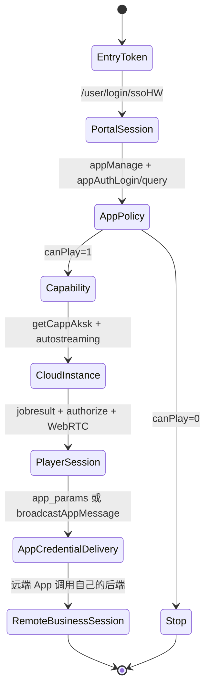

# 中国移动云应用与内测 App 的 SSO 凭证流转分析

**文档版本：** V1.0  
**分析对象：** `86转云应用.har`、`云应用139.har`、`云应用139.zip`、`139云应用.zip`、`中国移动内测_10.2.1.apk`  
**分析日期：** 2026-09-23  
**敏感信息处理：** 本文只保留接口名、字段名、类名和脱敏结构；真实 Cookie、Token、refreshToken、hwToken、AK/SK、secretKey、手机号、账号、taskId、sessionId、设备 ID 和签名原值均不记录。

## 1. 先给结论

现有证据支持下面这条链路：

```text
10086 入口一次性 Token
    → capp 门户 /user/login/ssoHW
    → 门户 token / hwToken / refreshToken
    → /user/getRcsTokenHW 或 /sso/getTempSSOToken
    → 临时应用登录 Token / ssoToken
    → scheme 或 CloudappClient DataChannel 消息
    → 云端 Android App 的云游戏入口
    → App 自己的后端验证并建立业务 Session
```

其中前五步和“凭据如何被交付给远端 App”可以由 HAR 与 Web bundle 直接确认；最后两步在当前 APK 静态样本中只能确认到“云游戏入口、scheme 分发入口和受保护的运行时代码”，不能证明远端业务后端已经接受凭据并写入业务 Session。

需要纠正三个容易混淆的判断：

1. `/appInfo/appAuthLogin/query` 是登录配置查询接口，不是 App 登录接口。
2. `/cappAksk/getCappAksk` 是云实例控制面能力授权，不是远端 Android App 的账号登录。
3. Socket.IO 的 `authorize`、WebRTC 的 `playing` 和播放器首帧只证明云实例与媒体链路建立，不能证明云端 App 的业务账号已经登录。

因此，当前材料**没有证明存在“把 capp 的控制面 Token 直接转换成中国移动 App 长期登录 CK”**的方法。可确认的是：门户会话可以换取短期临时登录凭据，并通过 scheme 或 DataChannel 交付；远端 App 再用自己的业务接口完成最终鉴权。

## 2. 证据等级

| 等级 | 含义 | 本文例子 |
|---|---|---|
| 已验证 | 在 HAR、响应快照、前端 bundle、APK 资源或 DEX 字符串中直接看到 | `/user/login/ssoHW`、`/user/getRcsTokenHW`、`appReqLogin`、`easygo.json` 中的 Activity |
| 高可信推断 | 由多个已验证事实连成，但当前材料没有最终服务端响应 | scheme/DataChannel 进入云端 App 后，由 App 自己后端换取 Session |
| 未验证 | 需要运行时抓包、远端 App 日志或服务端契约才能确认 | 远端 App 最终登录接口、Session Cookie 名称、业务 CK 生成规则 |

APK 的 SHA-256 前缀为 `b544c8c4df1fa6ed7171f40a241dd81e...`，包体包含 `classes.dex`、`classes2.dex`、`assets/easygo.json`、`assets/ijiami.dat`、`lib/arm64-v8a/libexec*.so` 和 `lib/arm64-v8a/libkey.so`。该版本的云游戏实现受到动态代码保护，静态分析结论必须保守解释。

## 3. 端到端角色和边界

| 角色 | 证据 | 责任 |
|---|---|---|
| `wx.10086.cn` | `86转云应用.har` | 校验入口上下文并 302 回跳；Fragment 中携带加密应用标识和一次性入口 Token |
| `capp.139.com` | 两组 HAR 与 ZIP | 加载 SPA，完成门户 SSO、应用配置查询、能力授权和播放器编排 |
| 门户业务 API | `capp.139.com/cloud-trial/*` | 维护门户会话、临时应用登录 Token、能力凭据和应用策略 |
| 云应用控制面 | `capp-new-ziguan.139.com:8443` | 创建云端 Android 实例，返回设备、信令和播放器会话参数 |
| CloudappService/Client | ZIP 中的 SDK bundle | 控制面签名、异步起流、Socket.IO 信令、播放器和 DataChannel 消息 |
| 云端 Android App | APK 的 `com.greenpoint.android.mc10086.activity` 及 CloudGame Activity | 接收启动参数或消息，调用 App 自己的后端并建立业务登录态 |
| App 业务后端 | 当前材料未提供 | 验证临时 Token/Ticket/Scheme，签发业务 Session 或业务 Token |

关键边界是：控制面只负责“给用户分配一台能运行目标包的云设备”，业务登录由云端 App 自己决定。

## 4. 门户 SSO：10086 入口到门户会话

### 4.1 入口跳转

`86转云应用.har` 观察到的入口形态是：

```text
GET https://wx.10086.cn/website/bind/bindAccount/new
    → 302 https://capp.139.com/#/?i=<加密应用标识>&token=<一次性入口 Token>
```

`i` 位于 URL Fragment，前端解密后得到业务 `appId`。Fragment 不作为 HTTP Referer 发送给服务端，但浏览器脚本、历史记录、截图和前端监控仍可能读取，因此入口 Token 仍应按一次性密钥处理。

### 4.2 门户 SSO 交换

前端从路由暂存 `token`，清理 URL 后调用：

```http
POST /cloud-trial/user/login/ssoHW
Content-Type: application/json

{
  "version": "1.0",
  "pintype": 13,
  "token": "<一次性入口 Token>",
  "appId": "<业务 appId>"
}
```

响应成功条件是业务包中的 `header.status == "200"`。成功数据包含门户 `token`、`hwToken`、`refreshToken` 和账号摘要。它们是门户会话凭据，不等价于云端 Android App 的业务登录 Cookie。

`86转云应用` 样本在这一步成功，但随后 `appId=10607` 的 `canPlay=0` 和 `getCappAksk` 业务码 `6000608` 使流程正确停止；这也是为什么该 HAR 没有起流和播放器握手。

## 5. 运行云实例：能力授权不等于 App 登录

门户成功登录后，会并发准备四类信息：

| 接口 | 作用 | 是否完成 App 业务登录 |
|---|---|---|
| `POST /appInfo/appAuthLogin/query` | 查询 `authLogin`、`checkAuth`、`schemeOpen`、`schemePath`、`showPrivacy` 等配置 | 否 |
| `POST /user/getRcsTokenHW` | 用 `hwToken` 换取临时 `token`/`ssoToken` | 否；这是候选的应用登录凭据来源 |
| `POST /user/phone/location` | 省市、运营商和地域策略 | 否 |
| `POST /cappAksk/getCappAksk` | 返回 `packageName`、`accessToken`、`secretKey`、`headerHost`、`userId`、`schemePath` 等控制面配置 | 否；这是云实例运行授权 |

只有 `getCappAksk` 成功，浏览器才拥有创建 `CloudappService` 的参数。之后调用：

```text
POST /cloudapp/yun/rtc/device/open/v2/autostreaming
GET  /cloudapp/yun/rtc/device/open/v2/autostreamingjobresult
```

结果返回 `deviceId`、`roomSession`、`roomPlayerSession`、播放器 Token、信令地址和平台环境。播放器使用这些值连接 Socket.IO/WebRTC。`YYXRTC_TOKEN`、播放器 Token 和 `roomPlayerSession` 只授权云实例/信令会话，不是 App 业务账号 Cookie。

## 6. 凭据真正交付给远端 App 的接口和消息

### 6.1 `player.open({ app_params })` 路径

CloudappClient bundle 已确认 `player.open` 接收：

```javascript
{
  uuid,
  boxid: deviceId,
  token: playerToken,
  signaling_url: signalingUrl,
  sessionid: roomPlayerSession,
  app_params: JSON.stringify({ scheme })
}
```

SDK 随后把初始化数据 JSON 化、Base64 编码，通过 Socket.IO `init` 信令发给云端组件。这里的 `app_params` 是“云端 App 启动参数的传输容器”；它本身不是登录成功证明。

### 6.2 `broadcastAppMessage` DataChannel 路径

同一 bundle 明确实现：

```javascript
broadcastAppMessage(data, to) {
  this._sendDcMessage({
    type: "_cp_gameMessage",
    to,
    message: encode(data)
  });
}
```

底层通过 WebRTC DataChannel 发送。`home.d0e68b2e.js` 中存在以下两种调用：

```javascript
// 云端 App 主动请求登录后，返回临时 Token
player.broadcastAppMessage(JSON.stringify({ token: this.ssoToken }));

// 融合登录/票据路径，向目标组件发送 appToCm 命令
{
  command: "appToCm",
  deviceId: this.opts.boxid,
  data: JSON.stringify(response.data),
  tid
}
```

融合登录消息被发送给 `usagestats.jar` 目标组件。`tid`、设备 ID 和 `response.data` 均为短期会话上下文，不能脱离原会话复用。

### 6.3 前端触发点

前端处理远端消息 `{ appReqLogin: 1 }` 时：

1. 调用 `getSSOToken()`，对应 `POST /sso/getTempSSOToken`；
2. 将返回值封装成 `{"token": "<临时值>"}`；
3. 通过 `player.broadcastAppMessage()` 送入云端 App。

另一条 `newCloudAppLogin()` 路径先调用 `getTmpTicket`：

```text
platform == "unique"
  → POST /user/getTmpTicketV2
其他平台
  → POST /user/getTmpTicket
```

然后构造 `command=appToCm` 消息。这里可以确认“临时 Token/Ticket 被交付”的位置，但不能从前端代码确认 App 后端的最终验证结果。

## 7. 新内测 APK 的静态结果

### 7.1 目标包和云游戏入口

`assets/easygo.json` 直接声明：

```json
{
  "client": "com.greenpoint.android.mc10086.activity",
  "Activities": [
    "cn.emagsoftware.gamehall.ui.activity.cloud_runing_game.CloudGameWebActivity",
    "cn.emagsoftware.gamehall.ui.activity.cloud_runing_game.CloudGameLandSpaceWebActivity",
    "cn.emagsoftware.gamehall.ui.activity.cloud_runing_game.SAASPlayActivity",
    "cn.emagsoftware.gamehall.ui.activity.cloud_runing_game.SAASPlayLandScapeActivity",
    "cn.emagsoftware.gamehall.ui.activity.cloud_runing_game.CloudGameAnimActivity",
    "com.mc10086.cmcc.view.mine.html5.SchemeDispatchActivity"
  ]
}
```

这直接证明内测 App 的嵌入配置知道目标包和云游戏 Activity；它没有证明这些 Activity 已经把 `ssoToken` 换成了业务 Session。

### 7.2 Ijiami 动态代码保护

主 DEX 中存在以下加载线索：

```text
com.ijm.dataencryption.DETool
assets/ijm_lib/%s/libexec.so
assets/ijm_lib/%s/libexecmain.so
loadDEso
/libexecmain.so
```

APK 同时包含约 50 MB 的 `assets/ijiami.dat`、`libexec.so`、`libexecmain.so` 和 `libexecoat.so`。这意味着云游戏实现的一部分在运行时解密/加载，常规 DEX 字符串扫描无法还原完整 Java/Kotlin 调用链。

### 7.3 Native 密钥和签名工具

`lib/arm64-v8a/libkey.so` 是未剥离的 ELF，导出 JNI 方法名：

```text
Java_cn_emagsoftware_gamehall_util_AESSecretUtil_a/b/c/d/e/k2/k3
ToMd5
loadSignature
```

其可读常量包含 `AES/ECB/PKCS7Padding`、`PKCS5Padding`、`java/security/MessageDigest`、包签名读取和 `getPackageManager/getPackageInfo/signatures`。由此可确认：

- 云游戏组件具备基于包签名和 MD5 的完整性/身份计算能力；
- 存在 AES 加解密工具；
- 这些工具可能用于参数保护或 SDK 校验。

不能据此推断出某个可复用的 App 登录 Token，也不能把 native AES 常量当作业务登录协议。

### 7.4 APK 中未发现的直接证据

对 `classes.dex`、`classes2.dex`、嵌入资源和 native 库进行了关键词扫描，未发现可读的：

```text
capp.139.com
/sso/getTempSSOToken
/user/getTmpTicket
appToCm
_cp_gameMessage
```

这不是“APK 一定没有这段逻辑”，而是说明它很可能：

1. 在 Ijiami 保护的动态代码中；
2. 由远端下发的 WebView/脚本实现；
3. 由 native/反射调用隐藏；或
4. 根本不在内测 APK，而只在 capp Web 端负责交付。

当前证据更支持第 1 和第 4 种解释。

## 8. 逐级鉴权状态机



状态含义：

| 状态 | 代表什么 | 可否称为 App 已登录 |
|---|---|---|
| `EntryToken` | 10086 入口一次性上下文 | 否 |
| `PortalSession` | capp 门户会话 | 否 |
| `Capability` | 获取控制面 accessToken/secretKey | 否 |
| `CloudInstance` | 云端 Android 实例已分配 | 否 |
| `PlayerSession` | 播放器信令和媒体已建立 | 否 |
| `AppCredentialDelivery` | Token/Ticket/Scheme 已送入云端 App | 仅表示凭据已交付 |
| `RemoteBusinessSession` | App 后端确认并写入 Session | 是 |

## 9. 各功能的 SSO/单点登录触发关系

| 功能 | 触发方 | 入口接口/消息 | 结果 |
|---|---|---|---|
| 10086 入口登录 | 浏览器路由守卫 | `/user/login/ssoHW` | 门户 token、hwToken、refreshToken |
| 云实例运行授权 | capp 前端 | `/cappAksk/getCappAksk` | 控制面 accessToken/secretKey 和启动配置 |
| App 被动请求登录 | 远端 App → 浏览器 | `appReqLogin=1` | 浏览器调用 `/sso/getTempSSOToken` 并广播 `{token}` |
| 融合登录 | capp 前端 | `/user/getTmpTicket` 或 `V2` | 构造 `appToCm` 消息并发送到目标组件 |
| Scheme 启动 | capp 前端/播放器 | `app_params: {scheme}` 或 `open-scheme` 消息 | 云端 App 的入口参数 |
| 业务登录完成 | 远端 App | 当前材料未观察到接口 | App 自己后端签发 Session |

`appReqLogin`、`getTempSSOToken`、`getTmpTicket` 和 `appToCm` 是“应用登录凭据流转”相关的关键证据；`getCappAksk` 和 Socket.IO `authorize` 属于另一条“云实例运行”链路。

## 10. 为什么不能从当前样本断言已获得 App CK

要证明“云应用凭证已转换成有效 App 登录凭证”，至少需要同时观察到：

1. Android 端接收点：`Intent` URI、Activity `onNewIntent`、WebView bridge 或 DataChannel 消息处理；
2. 接收后调用的 App 业务 API；
3. 成功响应中的 Session/Token 字段；
4. Session 写入位置，例如 Cookie、SharedPreferences、数据库或内存状态；
5. 使用该 Session 调用一个受保护业务接口并成功返回。

当前样本只满足第 1 项的“入口配置层面”部分，满足 Web 前端的“凭据交付”部分，未满足第 2–5 项。因此不能把 `playing`、`appToCm` 消息、`accessToken`、`secretKey` 或 native AES 工具误称为 App CK。

### 10.1 APK 侧“凭据到业务登录”的可验证路径

新的内测 APK 能把分析范围再向 Android 端推进一层，但仍没有跨过“业务 Session 已建立”这条证据边界。应按下面的层次阅读样本：

| APK 证据 | 能证明的事实 | 不能证明的事实 |
|---|---|---|
| `easygo.json.client = com.greenpoint.android.mc10086.activity` | 云游戏配置指向哪个 Android 目标包 | 该包已接受某个 Token，或已生成业务 Cookie |
| `CloudGameWebActivity`、`SAASPlayActivity` | App 具有承载云游戏/远端画面的入口 Activity | Activity 启动即代表业务登录完成 |
| `SchemeDispatchActivity` | 存在 Scheme/深链分发入口 | Scheme 中的参数一定是长期 CK，或一定会被服务端接受 |
| Ijiami `DETool`、`libexec*.so` | 一部分实现会在运行时解密/加载 | 动态代码的具体接口、密钥和服务端协议 |
| `libkey.so` 的 AES/MD5/签名 JNI | 存在参数保护、完整性或包身份计算能力 | AES 常量可以直接推导 App 登录 Token |
| APK 中未出现 capp 接口和 DataChannel 字符串 | 这些交付协议不在当前可读 DEX/资源中 | 运行时绝对不存在这些调用 |

因此，最稳妥的实现模型是：

```text
capp Web 前端
  ├─ /sso/getTempSSOToken 或 /user/getTmpTicket(V2)
  ├─ app_params / open-scheme / _cp_gameMessage
  ↓
云游戏入口 Activity / WebView / 动态组件
  ↓
云端 Android App 的业务登录适配层
  ├─ 解包、校验 audience/appId/deviceId/tid/TTL
  ├─ 调用 App 业务认证 API
  └─ 将服务端返回的 Session 写入 Cookie、WebView 存储或 App 会话管理器
  ↓
受保护的只读业务接口返回成功
```

上图中前两段分别有 HAR、bundle 和 APK 入口证据；最后一段是**高可信架构推断**，不是当前样本直接观察到的调用链。要把它升级为已验证事实，至少要在获授权的测试实例中同时记录：

1. Android 端接收到的消息类型和字段名（凭据值本身做哈希或定长掩码）；
2. 接收后的业务认证请求方法、路径、必要请求头和业务码；
3. 成功响应被写入的存储位置及过期时间；
4. 使用该 Session 调用一个无副作用的只读接口并成功返回。

### 10.2 “换成有效 App 登录凭证”的判定矩阵

为了避免把中间态误报为登录成功，测试报告应把以下事件分开：

| 事件 | 最小证据 | 判定级别 |
|---|---|---|
| 门户 SSO 成功 | `ssoHW` 解密后业务码成功，得到门户会话字段 | 门户会话建立 |
| 云实例授权成功 | `getCappAksk` 成功并可启动实例 | 控制面授权 |
| 播放器建立 | `authorize`/`playing`/首帧或 DataChannel 建立 | 云运行环境可用 |
| 凭据送达 | `app_params`、`open-scheme` 或 `_cp_gameMessage` 已发送且 Android 端收到 | 凭据交付 |
| App 认证成功 | Android 业务认证接口业务码成功 | App 登录成功的必要条件 |
| Session 可用 | 后续受保护只读接口成功，且会话在 TTL 内可复用 | App 登录成功的充分验证 |

只有最后两行同时成立，才能称为“云应用凭证被转换成有效的 App 登录凭证”。其中“转换”通常不是把 `accessToken` 或 `secretKey` 做一次本地 AES/MD5 运算，而是服务端签发一个 audience、设备和会话绑定的短期业务 Session；当前材料尚未展示该签发接口。

## 11. 可复现的安全验证方案

以下方案适用于获得授权的测试环境，目的只是验证链路边界，不提取或复用生产凭据：

1. 使用虚构的 `appId`、测试账号和短期测试 Token，在 capp 测试环境开启一次完整会话。
2. 在浏览器端记录事件时间线：`appReqLogin`、`getTempSSOToken`、`getTmpTicket`、`broadcastAppMessage`、`open-scheme`、播放器 `playing`。
3. 在 Android 测试实例中仅记录字段名、调用顺序和响应业务码，对 Token/Ticket/账号做哈希或定长掩码。
4. 以一个需要登录的无副作用查询接口验证 App 业务 Session 是否产生；不要验证订购、支付、退订等写操作。
5. 将“收到消息”“接口返回成功”“Session 写入”“后续业务调用成功”四个事件分别打点，避免单一 `playing` 事件造成误判。
6. 测试 Token 过期、重复消费、跨设备、错误 `appId`、错误 `tid` 和关闭云实例后的重放行为。

建议的最小脱敏事件结构：

```json
{
  "traceId": "test-trace-id",
  "stage": "credential_delivery",
  "channel": "dataconnection",
  "messageType": "_cp_gameMessage",
  "credentialKind": "temp_sso_token",
  "credentialDigest": "sha256:<truncated>",
  "result": "delivered",
  "timestamp": "<test-time>"
}
```

## 12. 安全和工程建议

- 浏览器端不持有长期 `secretKey`、AK/SK 或可长期复用的 refreshToken。
- `scheme`、`app_params`、`appToCm` 的目标组件、长度、字段和域名必须白名单校验。
- 临时 Token/Ticket 使用一次性 nonce、短 TTL、绑定 `appId + deviceId + sessionId`，服务端拒绝重放。
- `app_params`、WebSocket Query、Socket.IO 子协议、DataChannel 消息和 APM 日志均禁止原值落盘。
- 云实例、播放器会话和 App 业务 Session 使用不同命名空间与撤销机制，不能共用一枚 Token。
- APK 动态加载代码应在正式授权测试中通过运行时插桩验证；静态样本不足以推导服务端协议，更不能以逆向出的 native 常量替代接口授权。

## 13. 最终判断

**可以确认：** capp 门户能把 10086 入口会话逐级换成临时应用登录凭据，并通过 `app_params`、`open-scheme` 或 `broadcastAppMessage` 送入云端 Android 运行环境；内测 APK 确实声明了目标包和云游戏/Scheme 入口，并使用 Ijiami 动态代码保护。

**不能确认：** 当前材料没有展示 Android 业务端最终验证接口、Session 写入和可复用 App CK 的生成规则。因而不存在足够证据支持“从 capp 的控制面凭据直接推导有效 App CK”的结论。

下一步若要把链路闭合，应在获授权的测试实例中捕获 Android 端“收到凭据 → 调业务 API → 写 Session → 查询接口成功”的四段证据；分析重点应放在云端 App 的业务网络调用和状态写入，而不是继续尝试从 `accessToken`、`secretKey` 或 `libkey.so` 推导 CK。

**关联文档：** [中国移动云应用-HAR流程解析与实现说明.md](/Users/ZevinGunn/CMCC-PROJECT/docs/中国移动云应用-HAR流程解析与实现说明.md)
