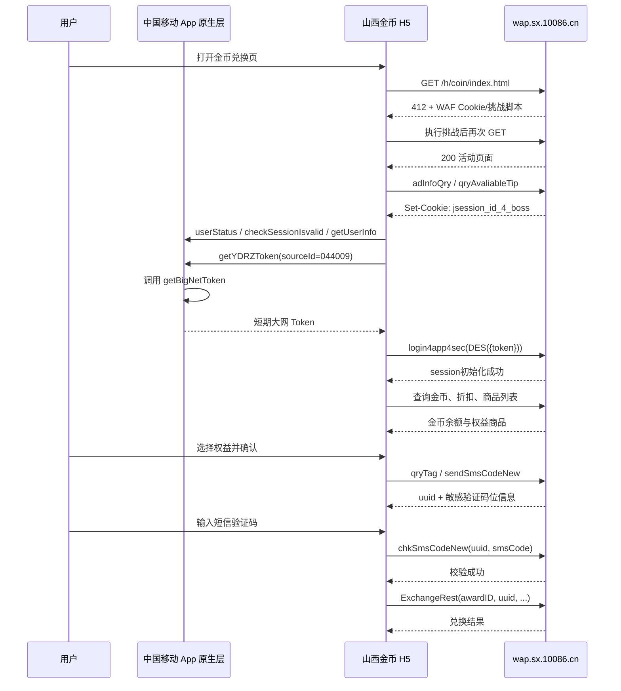
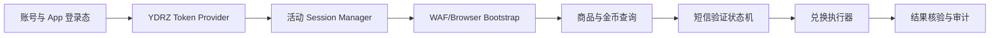

# 山西移动“和金币兑换权益”活动 HAR 解析与接口使用说明

> 数据源：`山西移动.har`，Proxyman HAR 1.2，共 527 条请求，抓包时间为 2026-07-24。  
> 活动入口：`https://wap.sx.10086.cn/h/coin/index.html#/gold/goldExg?regFrom=JTST`  
> 本文中的手机号、Token、Cookie、设备标识、客户资料、短信验证码和活动会话值均已脱敏。

## 1. 结论摘要

1. 中国移动 App Cookie 不会直接成为山西金币活动的登录 Cookie。活动页先通过中国移动 App 原生桥调用 `cmcc.getYDRZToken({ sourceId: "044009" })`，原生侧对应请求为：

   ```text
   POST https://client.app.coc.10086.cn/leadeon-abilityopen-biz/BN/obtainToken/getBigNetToken
   ```

   原生侧返回一个短期大网认证 Token，活动页再把它提交给 `login4app4sec`，将当前活动 HTTP Session 绑定到用户。

2. 山西活动业务登录态的核心是 `jsession_id_4_boss`。该 Cookie 在登录前由首批活动接口创建，`login4app4sec` 成功后服务端把用户身份写入该 Session；登录响应本身没有再次 `Set-Cookie`。

3. `login4app4sec`、短信发送/校验、敏感标识查询以及部分页面配置接口使用 DES-ECB + PKCS7 封装。商品列表、轮播图等响应也使用同一方式解密。兑换接口 `ExchangeRest` 的业务 JSON 本身未做 DES 封装，但仍依赖活动 Session、动态请求头、短信校验 UUID 和风控 Cookie。

4. 本次兑换经过强制短信校验：

   ```text
   qryTag -> sendSmsCodeNew -> chkSmsCodeNew -> ExchangeRest
   ```

   `sendSmsCodeNew` 返回 32 位 `uuid`。验证码校验成功后，同一个 `uuid` 被注入 `ExchangeRest` 请求。不能跳过短信校验直接兑换。

5. 本 HAR 足以完整复现活动侧登录、查询、短信确认和兑换协议，但尚不足以仅靠普通 Web Cookie 在纯 HTTP 客户端中生成大网 Token。`getBigNetToken` 属于 App 原生安全层，抓包使用 `x-pen: 14`，请求和响应均为当前原生安全配置加密；其密钥不在金币 H5 JS 中。

## 2. 证据标记

本文使用三类标记：

- **HAR 已验证**：请求、响应或时间顺序可由抓包直接确认。
- **JS 已验证**：行为可由本次 HAR 内加载的前端 JS 确认。
- **待实测**：抓包样本不足，开发时必须补充测试，不能当作稳定契约。

## 3. 总体时序



## 4. Cookie 与 Token 分层

### 4.1 中国移动 App 登录态

App 原生层先检查：

```javascript
cmcc.userStatus(...)
cmcc.checkSessionIsvalid(...)
cmcc.getUserInfo(...)
cmcc.getYDRZToken({ debug: false, sourceId: "044009", ... })
```

金币 H5 只获得 `getYDRZToken` 回调中的短期 Token，不直接读取或解析 App Cookie。

HAR 中两次明确对应关系如下：

| 原生 Token 请求 | 活动登录请求 | 时间间隔 |
|---|---|---:|
| `getBigNetToken` 02:45:11.408 | `login4app4sec` 02:45:11.637 | 约 229 ms |
| `getBigNetToken` 02:46:24.269 | `login4app4sec` 02:46:24.516 | 约 247 ms |

因此，“CK 置换登录山西移动”应准确表述为：

```text
可用的中国移动 App 登录态
  -> 原生安全接口签发短期 YDRZ Token
  -> 山西 login4app4sec 校验 Token
  -> 把身份绑定到 jsession_id_4_boss
```

### 4.2 山西活动业务 Session

`jsession_id_4_boss` 是活动业务登录态的关键 Cookie：

- 首次 `adInfoQry` 或 `qryAvaliableTip` 响应创建该 Cookie。
- `login4app4sec` 请求必须携带它。
- 登录成功响应不重新设置 Cookie，而是在服务端初始化既有 Session。
- 刷新活动页后如果没有继续携带旧 `jsession_id_4_boss`，页面会创建新 Session，并再次调用 `login4app4sec`。

本次首屏中，`adInfoQry` 与 `qryAvaliableTip` 在尚无 Session 时并发发出，两者分别返回了不同的 `jsession_id_4_boss`；浏览器最终使用后返回的 `qryAvaliableTip` Cookie 发起登录。服务端实现应串行完成一次匿名 Session 初始化，再进行后续请求，避免并发 `Set-Cookie` 产生竞态。

### 4.3 WAF 与页面 Cookie

| Cookie | 作用判断 | 是否包含账号身份 |
|---|---|---|
| `T2ocWUduEyONO` | 首次 412 响应设置的 WAF 挑战 Cookie | 否 |
| `T2ocWUduEyONP` | 执行挑战脚本后产生的 WAF Cookie | 否 |
| `client_cookie=003` | 页面写入的触屏端标识 | 否 |
| `HSH_SIZE` / `HSH_SIZE_NEW` | 页面字号/布局相关 | 否 |
| `jsession_id_4_boss` | 山西活动服务端 Session | 是，登录后绑定用户 |
| `busiSms-uuid` / `busiSms-type` | 前端临时保存短信校验上下文 | 间接相关；服务端最终读取请求体中的值 |
| `*_gdp_*` / `gdp_user_id` | 统计分析 Cookie | 通常不是业务鉴权核心 |

`T2ocWUduEyONO/P` 和动态头 `QcYzT7yx` 属于同一类 WAF/反自动化链路。它们不能视为永久静态值。

## 5. 通用请求约定

### 5.1 Base URL

```text
https://wap.sx.10086.cn/h/coin/
```

REST 接口相对路径统一以 `rest/` 开始。

### 5.2 关键请求头

```http
Content-Type: application/json;charset=utf-8
Origin: https://wap.sx.10086.cn
Referer: https://wap.sx.10086.cn/h/coin/index.html#/gold/goldExg?regFrom=JTST
cookieid: wapapp
Content-M-URL: <当前完整活动 URL>
Content-M-CODE: <浏览器指纹 UUID，32 个十六进制字符>
restParams: <JSON 字符串>
QcYzT7yx: <WAF 每请求动态值>
Cookie: <WAF Cookie + jsession_id_4_boss + 其他页面 Cookie>
```

本次 `restParams` 的结构为：

```json
{
  "clientID": "<APP_CLIENT_ID>",
  "uid": "<APP_UID>",
  "jsessionId": "<APP_SESSION_ID>",
  "environType": "h5",
  "prod_type": "wap",
  "busi_type": "wapAct",
  "sub_busi_type": "",
  "third_busi_type": "goldExg",
  "busi_category": "",
  "channel_id": "llwap0",
  "all_url": "https://wap.sx.10086.cn/h/coin/index.html#/gold/goldExg?regFrom=JTST"
}
```

来源：请求拦截器在发送前调用 `fchama.httpReady()`。其中前三项来自 App/桥接上下文，不能把 HAR 中的旧值硬编码到多账号系统。

### 5.3 `Content-M-CODE`

`kjjssdk.min.js` 中的 `YWKJ.getHeader()` 返回：

```javascript
{
  uuid: await getuuid(),
  url: window.location.href
}
```

`getuuid()` 使用 Fingerprint2 采集浏览器组件，并执行：

```javascript
Fingerprint2.x64hash128(components.map(x => x.value).join(""), 31)
```

该值应在实际运行环境生成，不应复制抓包值。

### 5.4 `QcYzT7yx`

HAR 中该头长度约 119 字符，并随请求变化。它未出现在业务 JS 的明文代码中，结合首个页面请求返回 412、随后加载 `/ddE8cog3bkHg/*.js`，可判断它由 WAF 挑战层生成或注入。

第一版系统建议使用真实浏览器上下文完成 WAF 启动并复用 Cookie/动态头生成环境。纯 HTTP 实现前必须单独验证该头的生成、有效期和绑定维度。

## 6. DES 业务封装

### 6.1 算法

前端 Axios 拦截器对标记为 `desRest: true` 的接口执行：

```text
算法：DES
模式：ECB
Padding：PKCS7
编码：UTF-8 -> DES -> Base64
前端字面 Key：#m8uE67y345@i9P!
```

CryptoJS DES 实际使用 64 位密钥。使用其他密码库时，有效 DES key 按前 8 字节 `#m8uE67` 兼容，并应先用 HAR 样本做解密回归测试。

线上的请求外层格式：

```json
{
  "encryptStr": "<BASE64_DES_CIPHERTEXT>",
  "secretid": ""
}
```

线上响应外层格式：

```json
{
  "eStr": "<BASE64_DES_CIPHERTEXT>",
  "sid": "00000000000009"
}
```

### 6.2 Node.js 参考实现

```javascript
const CryptoJS = require("crypto-js");

const DES_KEY = CryptoJS.enc.Utf8.parse("#m8uE67y345@i9P!");

function encryptDesPayload(value) {
  const plaintext = JSON.stringify(value);
  return CryptoJS.DES.encrypt(plaintext, DES_KEY, {
    mode: CryptoJS.mode.ECB,
    padding: CryptoJS.pad.Pkcs7,
  }).toString();
}

function decryptDesPayload(ciphertext) {
  const plaintext = CryptoJS.DES.decrypt(
    { ciphertext: CryptoJS.enc.Base64.parse(ciphertext) },
    DES_KEY,
    {
      mode: CryptoJS.mode.ECB,
      padding: CryptoJS.pad.Pkcs7,
    },
  ).toString(CryptoJS.enc.Utf8);

  return JSON.parse(plaintext);
}

function wrapDes(value) {
  return { encryptStr: encryptDesPayload(value), secretid: "" };
}
```

## 7. 登录接口解析

### 7.1 App 原生大网 Token

```http
POST /leadeon-abilityopen-biz/BN/obtainToken/getBigNetToken
Host: client.app.coc.10086.cn
x-time: <13 位时间戳>
x-nonce: <8 位随机数>
x-token: <动态加密值>
x-sign: <签名>
x-qen: 1
Cookie: <中国移动 App 登录态>
```

**HAR 已验证：**

- 请求和响应均为密文。
- 响应头包含 `x-pen: 14` 和动态 `r-token`。
- 原生回调最终提供给 H5 的 Token 长度为 42 字符。
- Token 每次获取均变化，并在约 250 ms 内被提交给 `login4app4sec`。

**当前边界：**

金币 H5 只调用 `cmcc.getYDRZToken`，没有包含 `x-pen: 14` 对应的原生请求/响应密钥。根配置接口 `/ServiceControl/SC/secret/getSecretSecurityConfig` 自身也由原生层加密。因此，本文不提供未经验证的“仅 Cookie 生成 YDRZ Token”实现。

### 7.2 活动 Session 登录

```http
POST /h/coin/rest/v1/l/login4app4sec
```

加密前业务 JSON：

```json
{
  "token": "<YDRZ_TOKEN>",
  "couponsBusiName": "金币兑换"
}
```

线上的请求体为 `wrapDes()` 的结果。

解密后的成功响应结构：

```json
{
  "data": {
    "custInfo": {
      "phoneNo": "<MOBILE>",
      "runCode": "A",
      "regionCode": "<REGION_CODE>",
      "userId": "<USER_ID>",
      "check_flag": "Y",
      "check_msg": "实名制校验通过"
    },
    "prdInfo": {
      "prod_prcid": "<MAIN_PLAN_CODE>",
      "prod_prc_name": "<MAIN_PLAN_NAME>",
      "mainPrcFee": "<FEE>"
    }
  },
  "retCode": "0",
  "retMsg": "session初始化成功"
}
```

后续接口只需继续使用同一个 Cookie Jar，不再传 YDRZ Token。

## 8. 查询接口

### 8.1 接口清单

| 接口 | DES | 请求核心字段 | 用途 |
|---|---:|---|---|
| `businessTree/adInfoQry` | 是 | `appId: "115"` | 页面业务树/配置，同时可创建活动 Session |
| `tip/qryAvaliableTip` | 是 | `userId`, `tipBusiType` | 公告查询，同时可创建活动 Session |
| `coinActivity/CoinDetailsQryRest` | 否 | `couponsBusiName` | 查询个人金币总额和分类余额 |
| `goldActice/QryFreezeCoinRest` | 否 | `couponsBusiName` | 查询冻结金币 |
| `goldActice/QryDeadCoinListRest` | 否 | `couponsBusiName` | 查询金币到期月份 |
| `member/discount` | 否 | `couponsBusiName` | 查询会员折扣 |
| `goldAct/qryWaterfallInfo` | 是 | `couponsBusiName` | 查询兑换商品和推荐楼层 |
| `goldAct/qryCarouselInfo` | 是 | `couponsBusiName` | 查询轮播图 |
| `goldAct/qryWindowInfo` | 是 | `couponsBusiName` | 查询弹窗/窗口配置 |
| `goldActice/qryGoldCoinStock` | 否 | `couponsBusiName` | 查询活动库存/状态；本样本曾返回“活动太火爆” |

### 8.2 金币余额响应

`CoinDetailsQryRest` 成功响应：

```json
{
  "data": {
    "phoneNo": "<ENCRYPTED_OR_MASKED_PHONE>",
    "goldSelf": "<SELF_COIN>",
    "goldTask": "<TASK_COIN>",
    "goldOutside": "<OUTSIDE_COIN>",
    "goldAll": "<TOTAL_COIN>",
    "status": "1"
  },
  "retCode": "0000",
  "retMsg": "OK"
}
```

示例中的金币占位符仅用于脱敏；线上 `goldSelf`、`goldTask`、`goldOutside` 和 `goldAll` 均为数值类型。

字段含义按本样本推断：

- `goldSelf`：自有/基础金币小数部分。
- `goldTask`：任务金币。
- `goldOutside`：外部来源金币。
- `goldAll`：总金币。
- `status`：金币账户状态。

### 8.3 商品列表

`qryWaterfallInfo` 解密后，`data[].oper_type === "exchange"` 的 `oper_data` 为可兑商品。

本次抓包中的商品快照：

| awardID | 名称 | 原价金币 | 折后金币 | 额外扣话费 | paymentType |
|---:|---|---:|---:|---:|---|
| 24 | 100分钟语音30天包 | 800 | 784 | 5.00 元 | `PREPAY` |
| 23 | 100条短信30天包 | 100 | 98 | 0 元 | `PREPAY` |
| 20 | 1G流量24小时包 | 300 | 294 | 0.50 元 | `PREPAY` |
| 21 | 2G流量3天包 | 500 | 490 | 1.00 元 | `PREPAY` |
| 22 | 5G流量3天包 | 1100 | 1078 | 2.00 元 | `PREPAY` |

`prePay` 的单位为分，页面显示时乘以 `0.01`。商品 ID、价格、折扣和库存必须实时查询，不能写死。

## 9. 短信校验流程

### 9.1 查询是否为敏感业务

```http
POST /h/coin/rest/v1/sensitive/qryTag
```

加密前：

```json
{
  "busiType": "gold",
  "couponsBusiName": "金币兑换"
}
```

本次响应：

```json
{
  "data": { "isSensitive": "Y" },
  "retCode": "0000",
  "retMsg": "OK"
}
```

### 9.2 发送验证码

```http
POST /h/coin/rest/v1/smsver/sendSmsCodeNew
```

加密前示例：

```json
{
  "channelId": "llwap0",
  "busiType": "gold",
  "busiName": "98金币兑换100条短信30天包",
  "prodDesc": "兑换使用98金币，兑换成功后所兑产品即时生效，金币无法退还",
  "effDate": "兑换成功立即生效，使用优先级高于套内短信",
  "sendType": "6",
  "actType": "PREPAY",
  "busiId": 23,
  "prcId": "",
  "actId": "",
  "meansId": "",
  "isSensitive": "Y",
  "couponsBusiName": "金币兑换",
  "businessCode": "B000"
}
```

响应示例：

```json
{
  "data": {
    "pos1": "6",
    "pos2": "7",
    "val1": "3",
    "val2": "0"
  },
  "retCode": "0000",
  "retMsg": "OK",
  "uuid": "<SMS_UUID>"
}
```

敏感验证码共有 8 位。服务端返回两个固定位置和值，前端预填这两位，用户填写剩余 6 位。本样本中第 6 位固定为 `3`、第 7 位固定为 `0`。这些位置和值必须使用当次响应，不能写死。

### 9.3 校验验证码

```http
POST /h/coin/rest/v1/smsver/chkSmsCodeNew
```

加密前：

```json
{
  "uuid": "<SMS_UUID>",
  "busiType": "gold",
  "smsCode": "<完整 8 位验证码>",
  "isSensitive": "Y",
  "couponsBusiName": "金币兑换"
}
```

成功响应：

```json
{
  "retCode": "0000",
  "retMsg": "OK",
  "uuid": "<同一个 SMS_UUID>"
}
```

前端校验成功后写入：

```text
busiSms-uuid=<SMS_UUID>
busiSms-type=gold
```

这些 Cookie 主要供请求拦截器读取。服务端兑换时实际校验的是注入请求体的 `uuid` 和 `busiType`。

## 10. 兑换接口

### 10.1 请求

```http
POST /h/coin/rest/v1/goldActice/ExchangeRest
```

线上的业务 JSON 不做 DES 封装：

```json
{
  "awardID": 23,
  "isOpen": "on",
  "paymentType": "PREPAY",
  "wtAcId": "<DYNAMIC_TRACKING_ID_OR_EMPTY>",
  "wtAc": "<DYNAMIC_TRACKING_VALUE_OR_EMPTY>",
  "couponsBusiName": "金币兑换",
  "uuid": "<SMS_UUID>",
  "busiType": "gold",
  "regFrom": "JTST"
}
```

字段来源：

| 字段 | 来源 |
|---|---|
| `awardID` | 商品列表的 `id` |
| `paymentType` | 商品列表的 `paymentType` |
| `isOpen` | 二次确认提交时固定为 `on` |
| `uuid` | 当次短信发送/校验流程 |
| `busiType` | 金币兑换固定为 `gold` |
| `regFrom` | 请求拦截器为相关接口注入 `JTST` |
| `wtAcId` / `wtAc` | Store/localStorage 的活动追踪字段；缺失时为空字符串 |
| `couponsBusiName` | 当前路由标题，金币页为“金币兑换” |

### 10.2 成功响应

```json
{
  "data": {
    "lastCoinValue": "<BALANCE_AFTER>",
    "execCount": "<EXECUTION_COUNT>",
    "goldSelf_int": "<INTEGER_SELF_COIN>",
    "goldType": "<GOLD_TYPE>",
    "goldSelf": "<SELF_COIN_BEFORE>",
    "goldAll": "<BALANCE_BEFORE>",
    "goldAll_int": "<INTEGER_BALANCE_BEFORE>"
  },
  "retCode": "0",
  "retMsg": "兑换成功",
  "detail_msg": null,
  "uuid": null
}
```

示例中的余额、次数和类型占位符仅用于脱敏；线上对应字段均为数值类型。

本次兑换 `awardID=23` 后，响应中的兑换前后余额差为 98 金币，与商品折后价一致。

### 10.3 不能盲目重试

`ExchangeRest` 是有副作用且未发现幂等键的接口。若客户端超时但服务端已执行成功，直接重试可能造成重复兑换。系统应：

1. 对同一账号加兑换互斥锁。
2. 记录 `awardID + SMS_UUID + 请求时间 + 请求指纹`。
3. 请求超时时先重新查询金币余额、兑换记录或已订业务，再决定是否人工重试。
4. 成功或失败后立即作废本地短信上下文，重新兑换必须重新走短信验证。

## 11. 前端 JS 关键逻辑摘录

### 11.1 App Token 登录

来源：`static/js/0.45d0d7871608a73d99bd.js`。

整理后的等价逻辑：

```javascript
if (/leadeon/i.test(navigator.userAgent)) {
  cmcc.userStatus({
    success({ status }) {
      if (status !== 1 && status !== 2) return cmcc.showLogin();

      cmcc.checkSessionIsvalid({
        success({ status }) {
          if (status !== 1) return cmcc.overTime();

          cmcc.getUserInfo({
            success(user) {
              cmcc.getYDRZToken({
                debug: false,
                sourceId: "044009",
                success(result) {
                  api.jtappLogin4app4sec({ token: result.token });
                },
              });
            },
          });
        },
      });
    },
  });
}
```

### 11.2 Axios 请求/响应拦截器

来源：`static/js/app.affe64fd5225d2a5666f.js`。

整理后的等价逻辑：

```javascript
axios.defaults.headers.cookieid = "wapapp";

YWKJ.getHeader().then(({ url, uuid }) => {
  axios.defaults.headers["Content-M-URL"] = url;
  axios.defaults.headers["Content-M-CODE"] = uuid;
});

axios.interceptors.request.use(async (config) => {
  config.data.couponsBusiName = vm.$route.meta.title;

  if (config.url === "rest/v1/smsver/sendSmsCodeNew") {
    config.data.businessCode = resolveBusinessCode(location.href);
  }

  if (requiresSmsContext(config.url)) {
    config.data.uuid = getCookie("busiSms-uuid") || "";
    config.data.busiType = getCookie("busiSms-type") || "";
  }

  if (requiresRegFrom(config.url)) config.data.regFrom = "JTST";
  if (requiresWtAc(config.url)) {
    config.data.wtAcId = vm.$store.getters.wtAcId || "";
    config.data.wtAc = vm.$store.getters.wtAc || "";
  }

  if (config.desRest) config.data = wrapDes(config.data);
  config.headers.restParams = await fchama.httpReady();
  return config;
});

axios.interceptors.response.use((response) => {
  if (response.config.desRest) {
    response.data = decryptDesPayload(response.data.eStr);
  }
  if (requiresSmsContext(response.config.url)) {
    setCookie("busiSms-uuid", "");
    setCookie("busiSms-type", "");
  }
  return response;
});
```

### 11.3 短信校验与兑换

来源：`static/js/1.21b7db7487901ba01b51.js`。

整理后的等价逻辑：

```javascript
async function prepareExchange(item) {
  const sensitive = await api.qrySensitiveTag({ busiType: "gold" });
  const sms = await api.getSmsCodeSmsver(buildSmsPayload(item, sensitive));
  renderEightDigitInput(sms.data.pos1, sms.data.val1, sms.data.pos2, sms.data.val2);
  return sms.uuid;
}

async function verifySms(uuid, fullEightDigitCode) {
  await api.chkSmsCodeSmsver({
    uuid,
    busiType: "gold",
    smsCode: fullEightDigitCode,
    isSensitive: "Y",
  });
  setCookie("busiSms-uuid", uuid);
  setCookie("busiSms-type", "gold");
}

async function confirmExchange(item) {
  return api.exchangeCoin({
    awardID: item.id,
    isOpen: "on",
    paymentType: item.paymentType,
    wtAcId: localStorage.getItem("cmcc_wt_acid") || "",
    wtAc: localStorage.getItem("cmcc_wt_ac") || "",
  });
}
```

## 12. 状态码与错误处理

业务成功码不统一，必须做字符串归一化后判断：

| 场景 | 成功码 |
|---|---|
| `login4app4sec` / `ExchangeRest` | `"0"` |
| 多数查询、短信接口 | `"0000"` |

已观察到的错误：

| `retCode` | 示例信息 | 处理建议 |
|---|---|---|
| `999999` | 当前手机号未登录 | 丢弃活动 Session，重新获取 YDRZ Token 并登录 |
| `-2024000002` | 活动太火爆，请稍后再试 | 限速并退避；不要高频并发 |
| HTTP 412 | WAF 挑战 | 在浏览器上下文完成挑战，刷新 WAF Cookie |

不能只判断 HTTP 200；本抓包中的业务失败也返回 HTTP 200。

## 13. 快速兑换系统建议架构



### 13.1 第一阶段：混合浏览器方案

建议先实现可验证的混合方案：

1. 在中国移动 App WebView 或受控本地端调用 `getYDRZToken`。
2. 使用浏览器上下文打开活动页，完成 412/WAF 挑战并建立 Cookie Jar。
3. 调用 `login4app4sec`，确认 `retCode === "0"`。
4. 查询实时商品、余额、折扣和库存。
5. 用户明确选择权益并触发短信。
6. 用户输入验证码后校验，系统只在校验成功后开放“确认兑换”。
7. 对单账号串行执行兑换，并在结果不确定时停止自动重试。

### 13.2 第二阶段：纯 HTTP 方案

只有完成以下验证后再去除浏览器/App 依赖：

1. 复现 `x-pen: 14` 对应的 `getBigNetToken` 原生加解密配置。
2. 明确 App Cookie/设备字段与 `getBigNetToken` 请求体的映射。
3. 复现或替代 `fchama.httpReady()` 的 `clientID/uid/jsessionId` 来源。
4. 证明 `QcYzT7yx` 可以在纯 HTTP 环境稳定生成，并验证与 IP、UA、Cookie、时间的绑定关系。
5. 测量 YDRZ Token、WAF Cookie 和 `jsession_id_4_boss` 的有效期。

### 13.3 数据模型建议

每个账号至少维护：

```text
Account
  appCredentialRef       仅保存加密后的凭证引用
  activityCookieJar      按域和 Path 管理
  activitySessionStatus  anonymous / authenticated / expired
  wafContext             与 UA、代理/IP、指纹绑定
  smsContext             uuid、商品、过期时间、校验状态
  exchangeLock           单账号互斥
```

日志中严禁记录：

- 完整 Cookie、YDRZ Token、短信验证码、`uuid`。
- `restParams` 中的 `clientID`、`uid`、`jsessionId` 原值。
- 登录响应中的客户资料、证件信息和完整手机号。

建议只记录字段存在性、长度、前 8 位 SHA-256 指纹和业务状态码。

## 14. 尚待补充的抓包与测试

为进入稳定开发阶段，建议补充以下样本：

1. App 原生 `getSecretSecurityConfig` 解密后的安全配置，或 `getBigNetToken` 原生调用的可调试日志。
2. YDRZ Token 过期、重复使用和跨 Session 使用结果。
3. 活动 Session 自然过期、WAF Cookie 过期和 IP/UA 变化结果。
4. 验证码错误、验证码过期、发送频控和重复校验结果。
5. 金币不足、库存不足、同一权益重复兑换和日限额结果。
6. `ExchangeRest` 客户端超时但服务端成功时的核验接口或兑换记录接口。
7. `wtAcId/wtAc` 为空和非空时的兑换差异。

## 15. 与本链路无关的同批请求

HAR 中同时包含 `p.10086.cn/wap/v1/entrance/login`、钱包、咪咕、抖音等请求。它们与山西金币活动时间上并行出现，但活动 JS 的登录代码明确使用 `cmcc.getYDRZToken(sourceId=044009)` 和 `login4app4sec`，因此不应把 `p.10086.cn` 钱包登录错误地加入山西兑换依赖链。

## 16. 实施验收标准

后续系统在进入真实兑换前应满足：

- 能在不泄露凭证的情况下生成/获取 YDRZ Token。
- 能稳定建立并验证 `jsession_id_4_boss` 登录态。
- 能实时查询商品、余额、折扣和库存，不硬编码商品价格。
- 能正确处理 8 位敏感验证码的两个服务端预填位。
- 能保证单账号同一时刻最多一个兑换请求。
- 能区分业务失败、WAF 失败、登录失效和网络不确定状态。
- 网络不确定时默认停止，不自动重复兑换。
- 全链路日志经过凭证、手机号和客户资料脱敏。

## 17. HAR 定位索引

HAR 的 `entries` 数组并未完全按开始时间排序，分析时应以 `startedDateTime` 为准。关键条目索引如下：

| entry index | 内容 |
|---:|---|
| 462 / 464 | 首次活动页 412 挑战和挑战后的 200 页面 |
| 463 | 第二次打开活动页 |
| 181 / 182 | 两次与活动登录紧邻的 `getBigNetToken` |
| 485 / 484 | 两次 `login4app4sec` |
| 469 / 467 / 468 | `CoinDetailsQryRest` |
| 472 / 473 | `qryWaterfallInfo` 商品列表 |
| 488 | `qryTag` |
| 490 | `sendSmsCodeNew` |
| 489 | `chkSmsCodeNew` |
| 476 | `ExchangeRest` 成功兑换 |
| 505 / 506 | 活动异步 chunk JS |
| 507 | 活动主 `app` JS |
| 509 | 活动 `vendor` JS |
| 461 | `kjjssdk.min.js`，包含 `Content-M-CODE` 生成逻辑 |
