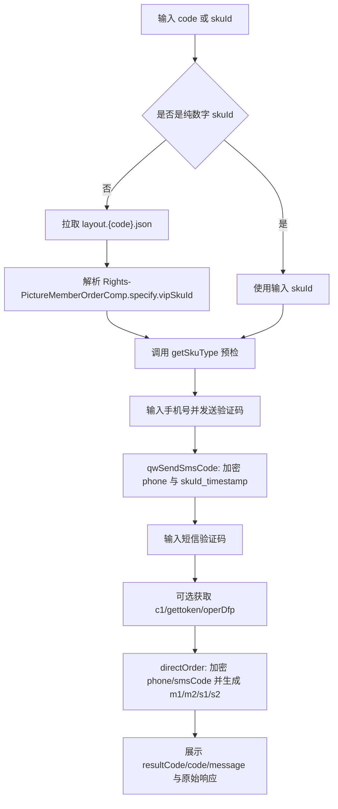

# 权益订购流程与接口分析

分析对象：

- HAR：`/Users/ZevinGunn/CMCC-PROJECT/订购权益业务.har`
- 补充 HAR：`/Users/ZevinGunn/CMCC-PROJECT/c1.har`
- 补充 HAR：`/Users/ZevinGunn/CMCC-PROJECT/查询权益详情.har`
- 补充 HAR：`/Users/ZevinGunn/CMCC-PROJECT/getSkuType.har`
- 页面存档：`/Users/ZevinGunn/CMCC-PROJECT/权益订购`

说明：本文只记录本地开发所需的接口、字段和前端公开资源中的算法常量。HAR 内 Cookie、登录态、手机号和验证码等敏感数据已省略或脱敏。

## 一、结论摘要

本次 HAR 是 COC 权益市场的“游客手机号短信验证后直接订购”流程，主链路请求有 3 个：

1. 发送短信验证码：`/coc3/coc3-market/api/sms/qwSendSmsCode`
2. 获取风控 token：`/coc3/gr/risk-ability/wasm/gettoken`
3. 提交订购：`/coc3/coc3-market-order/api/external/order/directOrder`

页面存档和补充 HAR 里还包含 4 类辅助接口：

4. 查询商品详情：`/coc3/coc3-market/arrange/getProductDetailById`
5. 页面权益配置：`production.rightsmarket-h5-canvas.online.layout.{code}.json`
6. 查询 SKU 类型：`/coc3/coc3-market-member/api/member/getSkuType`
7. 风控/设备侧 c1 token：`https://yxfk.market.chinamobile.com:8081/mgt/decision-engine/udid/c1?`

最重要的实现点：

- `phone`、`smsCode`、`skuId` 都不是明文提交，分别通过页面 bundle 中的 AES 工具加密。
- 发送短信时的 `skuId` 明文不是单独的商品 id，而是 `${skuId}_${timestamp}`。
- 订购时 `smsCode` 和 `phone` 使用固定 key `a4jdiq597p3gls0r` 加密。
- 订购时 `m1/s1` 是手机号/验证码的 Base64 字符串反转，`m2/s2` 是对手机号/验证码与 `m1/s1` 生成的二次校验值。
- `operDfp` 来自浏览器风控脚本写入的 `BSFIT_DEVICEID`，HAR 样例为 `null` 也返回了业务冲突结果，说明在这条样例链路里它不是绝对必填，但真实订购稳定性可能依赖它。
- 输入 `code` 时，可先读取页面 layout JSON，从 `Rights-PictureMemberOrderComp` 组件的 `vipSkuId` 自动解析真实 `skuId`。

## 二、HAR 请求链路

### 1. 发短信验证码

接口：

```text
POST https://dev.coc.10086.cn/coc3/coc3-market/api/sms/qwSendSmsCode
Content-Type: application/json;charset=UTF-8
Referer: https://dev.coc.10086.cn/coc3/canvas/rightsmarket-h5-canvas/online/bojinyear?channelCode=P00000139704&pageRecorded=true
```

HAR 请求体结构：

```json
{
  "receivers": "<AES密文手机号>",
  "skuId": "<AES密文 skuId_timestamp>",
  "member": false,
  "visitor": true
}
```

HAR 响应解码后：

```json
{"resultCode":0,"msg":"success","data":null}
```

源码依据：

- `Rights-PictureMemberOrderComp/1.7.2/h5webcomponents.umd.min.js:879-898`
- `appd0ae3f07.fa05b260.js:18896-18915`

源码逻辑：

```js
if (data.skuId) {
  data.skuId = Encrypt(`${data.skuId}_${Date.now()}`, "72fc912ce498430d")
}
post("/api/sms/qwSendSmsCode", data)
```

### 2. 获取风控 token

接口：

```text
POST https://dev.coc.10086.cn/coc3/gr/risk-ability/wasm/gettoken
Content-Type: application/json
```

HAR 请求体结构：

```json
{
  "benefit_phone": "<AES密文手机号>",
  "encryptedText": "<WASM/风控脚本生成的大段密文>",
  "timestamp": 1782665762978
}
```

HAR 响应解码后：

```json
{"code":"0","data":"87450ace5f144f6fac67216c8c2df496","success":true}
```

相关资源：

- `权益订购/res.coc.10086.cn/.../coc3/WASM/wheel-0.0.8.js`
- `权益订购/res.coc.10086.cn/.../coc3/WASM/wheel_bg-0.0.8.wasm`
- `权益订购/res.coc.10086.cn/.../risk/getDfpJs.js`

页面 `bojinyear.html` 会加载 WASM 和风控脚本。此接口主要用于生成或刷新 `risk-device-token` / 设备指纹类数据。本地项目首版可支持两种模式：

- 简化模式：允许 `operDfp=null`，按 HAR 样例提交。
- 浏览器模式：用 Playwright 加载原始页面或本地风控页，执行 WASM/指纹脚本后读取 token。

### 3. 提交直接订购

接口：

```text
POST https://dev.coc.10086.cn/coc3/coc3-market-order/api/external/order/directOrder
Content-Type: application/json;charset=UTF-8
```

HAR 请求体结构：

```json
{
  "skuId": "77626",
  "channelCode": "P00000139704",
  "selfChannelCode": "P00000139704",
  "smsCode": "<AES密文验证码>",
  "dealType": 0,
  "receipt": true,
  "receiptModule": true,
  "ticket": "MOBILE",
  "ticketType": 7,
  "businessType": "RIGHTS_MARKET",
  "wxoaType": "",
  "m1": "<手机号Base64反转>",
  "m2": "<手机号二次校验值>",
  "s1": "<验证码Base64反转>",
  "s2": "<验证码二次校验值>",
  "from": "",
  "phone": "<AES密文手机号>",
  "referer": "bojinyear",
  "operDfp": null
}
```

HAR 响应解码后：

```json
{"resultCode":-307,"msg":"订购异常，与已有业务冲突。（code:3004）","data":null}
```

这说明请求结构、验证码和订购提交已被服务端识别，失败原因是业务互斥，不是参数格式错误。

源码依据：

- 构造游客订购字段：`Rights-PictureMemberOrderComp/1.7.2/h5webcomponents.umd.min.js:4978-5000`
- `smsCode` 二次加密：`Rights-PictureMemberOrderComp/1.7.2/h5webcomponents.umd.min.js:900-932`
- 同样逻辑在主 bundle：`appd0ae3f07.fa05b260.js:18937-18967`

## 三、权益 code 与商品信息接口

### 1. 页面权益配置：code 解析为 skuId

补充 HAR `查询权益详情.har` 对应的是页面 layout 配置，不是传统商品详情接口。

接口：

```text
GET https://res.coc.10086.cn/res/cdn/coc1/fixedPath/production.rightsmarket-h5-canvas.online.layout.{code}.json?tes={timestamp}
```

样例：

```text
GET https://res.coc.10086.cn/res/cdn/coc1/fixedPath/production.rightsmarket-h5-canvas.online.layout.bojinyear.json?tes=1782666770406
```

响应关键字段：

```json
{
  "id": 19892,
  "name": "铂金会员年包",
  "title": "铂金会员年包",
  "description": "聚合入口",
  "beginTime": "2024-11-26 10:20:26",
  "endTime": "2027-11-26 10:20:26",
  "shareTitle": "铂金会员年包来啦！",
  "instanceList": []
}
```

`instanceList[5][0].instance.specify` 是字符串化 JSON，解析后可得到订购组件配置：

```json
{
  "name": "Rights-PictureMemberOrderComp",
  "title": "图片会员订购（直拉版）",
  "version": "1.0.0",
  "vipType": 3,
  "vipSkuId": "77626",
  "showType": "0",
  "orderImg": "https://res.coc.10086.cn/res/cdn/coc1/2026/06/17/2067149956215185408/1781681822068_597277.gif"
}
```

可提取的规则信息：

- 未订购可展示订购组件：`未订购铂金会员年包（含铂金、半年及年包优惠版）`
- 已订购展示跳转图：`已订购铂金会员年包（含铂金、半年及年包优惠版）`
- 限制省份规则：`铂金会员年包-限制省份`

本地项目输入 `bojinyear` 时的推荐解析流程：

1. 拼接 layout URL。
2. 拉取 JSON。
3. 遍历 `instanceList`。
4. 找到 `moduleId === "Rights-PictureMemberOrderComp"` 的组件。
5. `JSON.parse(instance.specify)`。
6. 取 `vipSkuId` 作为订购 `skuId`，取页面 `name/title` 用于前端展示。

### 2. 查询 SKU 类型/会员态

补充 HAR `getSkuType.har` 对应订购前的 SKU 类型查询，可用于展示会员等级、权益类型、是否需要权益等信息。

接口：

```text
POST https://dev.coc.10086.cn/coc3/coc3-market-member/api/member/getSkuType
Content-Type: application/json;charset=UTF-8
```

请求：

```json
{"skuId":"77626"}
```

响应：

```json
{
  "code": "0",
  "message": "success",
  "data": {
    "skuType": 1,
    "vipLevel": 6,
    "baseExist": null,
    "blacklistCheck": null,
    "equityId": null,
    "provinceCode": "0",
    "needEquity": false
  },
  "success": true
}
```

首版本地工具可把它作为“解析/预检”按钮的一部分：解析出 `skuId` 后自动调用，失败不阻断发送验证码，但在结果区提示。

### 3. 商品详情接口

页面存档里有 `getProductDetailById.html` 响应，商品 id 为 `77626`，商品名为“铂金会员年包”。

接口路径：

```text
GET/POST https://dev.coc.10086.cn/coc3/coc3-market/arrange/getProductDetailById
```

响应关键字段：

```json
{
  "code": "0",
  "data": {
    "id": 77626,
    "mid": 36818,
    "name": "铂金会员年包",
    "price": 18000,
    "paytype": 1,
    "salesType": 1,
    "provincecode": "0",
    "newSku": false
  },
  "success": true
}
```

新项目应支持两种输入：

- 直接输入 `skuId` / 商品 id，例如 `77626`。
- 输入页面 code / path，例如 `bojinyear`，优先通过 layout JSON 解析 `vipSkuId`；解析失败时再使用本地配置兜底。

## 四、加密与签名方式

### 1. AES-CBC-ZeroPadding：订单字段加密

源码位置：`appd0ae3f07.fa05b260.js:19099-19112`

逻辑：

```js
function aesZeroEncrypt(plain, key, iv = key) {
  return CryptoJS.AES.encrypt(plain, CryptoJS.enc.Latin1.parse(key), {
    iv: CryptoJS.enc.Latin1.parse(iv),
    mode: CryptoJS.mode.CBC,
    padding: CryptoJS.pad.ZeroPadding
  }).toString()
}
```

用途：

- 发送短信的 `receivers`：`aesZeroEncrypt(phone, "a4jdiq597p3gls0r")`
- 发送短信的 `skuId`：`aesZeroEncrypt(`${skuId}_${Date.now()}`, "72fc912ce498430d")`
- 订购的 `smsCode`：`aesZeroEncrypt(smsCode, "a4jdiq597p3gls0r")`
- 订购的 `phone`：`aesZeroEncrypt(phone, "a4jdiq597p3gls0r")`
- `m2/s2` 不走 AES。`Rights-PictureMemberOrderComp` 中的 `Et(e,t,i)` 实际为 `md5(t + salt[i] + e)`；组件调用 `this.enCrypten(phone, m1, 1)` 后生成 `md5(phone + "AizkkwOAWRVihbCs" + m1)`。

注意：`ZeroPadding` 与常见 `PKCS#7` 不同，不能用 Node 默认 `autoPadding` 直接替代。

### 2. AES-CBC-Pkcs7：通用工具函数

源码位置：`appd0ae3f07.fa05b260.js:19142-19150`

逻辑：

```js
function aesPkcs7Encrypt(key, plain) {
  return Base64(ciphertext(AES-CBC-Pkcs7(
    plain,
    key,
    iv="0123456789ABEDEF"
  )))
}
```

这类函数存在于 bundle 里，但 HAR 三个请求的关键字段主要由 `Encrypt(...)` / `enCrypten(...)` 使用，即 ZeroPadding 分支。开发时应分别实现，避免混用。

### 3. m1/s1 生成

游客直接订购路径源码：`Rights-PictureMemberOrderComp/1.7.2/h5webcomponents.umd.min.js:4978-4996`

```js
m1 = Base64.encode(phone).split("").reverse().join("")
s1 = Base64.encode(smsCode).split("").reverse().join("")
```

HAR 中可验证：

- `m1` 反转后是手机号的 Base64。
- `s1` 反转后是验证码的 Base64。

### 4. 风控参数

源码位置：

- `Rights-PictureMemberOrderComp/1.7.2/h5webcomponents.umd.min.js:1069-1087`
- `bojinyear.html` 加载 `getDfpJs.js`、`wheel-0.0.8.js`、`wheel_bg-0.0.8.wasm`

风险参数结构：

```js
const token = sessionStorage.getItem("risk-device-token") || ""
const source = activityId + "_" + token
const p1 = Base64.encode(source).split("").reverse().join("")
const p2 = md5(source + "coc3EqUan66$%Yi~!@#$treasure@gr" + p1)
const p3 = token
```

订购请求里的 `operDfp` 来自：

```js
operDfp = getStorage("BSFIT_DEVICEID")
```

首版本地项目可先把 `operDfp` 作为可选输入或置空；增强版再集成浏览器风控采集。

### 5. c1 token 接口

补充 HAR `c1.har` 对应移动侧决策引擎的 udid token：

```text
GET https://yxfk.market.chinamobile.com:8081/mgt/decision-engine/udid/c1?
Origin: https://dev.coc.10086.cn
Referer: https://dev.coc.10086.cn/coc3/canvas/rightsmarket-h5-canvas/online/bojinyear?channelCode=P00000139704&pageRecorded=true
```

响应：

```json
{
  "data": "6a415724iFkB9sajAcUbmPpXw0r9bZcGkeaipnV1",
  "msg": "The token has been generated successfully.",
  "status": 2
}
```

这个 token 没有直接出现在 HAR 的 `directOrder` 请求体中，更像是风控脚本/设备指纹链路的一环。新项目可以预留 `/api/risk/c1`，需要增强风控时再接入。

## 五、完整订购流程



## 六、项目边界

本次只分析 `/Users/ZevinGunn/CMCC-PROJECT/权益订购` 页面源文件和用户提供的 HAR。新项目应单独实现 COC 客户端、加密工具和 Vue3 页面，不依赖其他业务文件夹。

## 七、待确认点

1. 风控 `encryptedText` 是否在真实成功订购中强依赖，需要用非互斥号码小流量测试确认。
2. 商品详情 `getProductDetailById` 的请求方式和参数名在当前存档中只有响应样例，开发时先作为可选展示接口；核心订购不依赖它。
