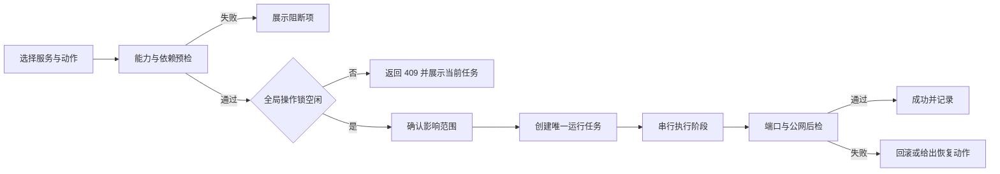

# Project Ops V2 产品与交互设计

- 文档状态：V2 当前交付基线（Phase 0-3 已落地，V2.1 backlog 单独标注）
- 设计对象：`project.1008086.xyz` 项目运行工作台
- 设计日期：2026-07-19
- 核心策略：V1 保留，V2 使用独立 `/v2` 路由；运行时统一读取 `services.json`

## 1. 产品结论

V2 不再把每个项目做成一张塞满按钮的大卡片，而是把项目管理拆成五个稳定对象：服务、发布、操作任务、日志和存储。工作台负责发现异常，服务中心负责日常控制，发布中心负责构建与上线，操作中心负责追踪长任务，系统页负责发现配置漂移。

核心变化：

1. 状态从单一 `online` 拆成进程、端口、应用健康、公网 HTTPS、前端产物五层。
2. 启动、停止、重启、构建、部署全部进入统一操作任务，不再由浏览器等待一个长请求。
3. 危险动作先显示影响范围，再确认；服务端必须串行化互斥操作。
4. `services.json` 是唯一运行清单，统一描述 PM2、端口、域名、暴露策略、能力和发布命令；`projects.json` 仅作为遗留文件保留，服务端和部署脚本均不读取。
5. V1 继续使用 `/home`，V2 使用 `/v2`，发生问题可直接切回 V1。

## 2. 现状问题

### 2.1 页面把状态和动作混在一起

改版前，V1 将 10 个项目以大卡片纵向排列，每张卡同时承载运行数据和 6 个动作。项目数增加后首屏无法完成巡检，异常服务与正常服务拥有相同视觉权重。

### 2.2 “在线”不能代表可用

PM2 在线、端口监听、应用健康、Nginx 路由、Cloudflare Tunnel、公网 HTTPS 任一层异常，用户都可能无法访问。V1 只把 PM2 状态作为主状态，容易出现“online 但公网 502”。

### 2.3 全局操作风险过高

- “一键停止”会停止 Nginx 和 PostgreSQL，但管理页面没有展示这些影响。
- “一键重启”先执行完整停止，再只运行 `start-services.sh`，不能保证恢复 Nginx。
- 前端只用一个 `busy` 标记，服务端没有互斥锁；多个浏览器会话仍可并发执行构建、重启或清理。
- 构建备份可能同时被存储清理识别为可删除项。

### 2.4 服务清单存在漂移

项目管理清单已有 10 个业务服务，但启动、停止、重构、健康检查和 Cloudflare 脚本没有同时覆盖 `wangka`、`yunpan`、`bmcc`、`bjcmcc`。`notice.1008086.xyz` 与 `notic.1008086.xyz` 也存在历史别名。

### 2.5 长任务不可观察

构建和全量重启可能持续数分钟。V1 请求完成前只能全局禁用按钮；刷新页面后缺少明确的执行中状态、阶段、当前服务和取消边界。

## 3. 产品目标

- 进入工作台 10 秒内定位不可用、降级和配置漂移的服务。
- 每个纳管服务都按 `capabilities` 明确可用动作；没有前端产物、需要人工操作或受保护的服务不会显示不适用的批量、构建或部署能力。
- 每次运维动作都有发起时间、操作者、目标、阶段、命令摘要、结果和后检状态。
- 构建失败保留现有线上产物；部署失败明确展示回滚结果。
- V1/V2 共用认证、项目数据和操作日志，不产生两套进程控制逻辑。
- 移动端用于巡检、查看日志和执行单服务安全动作，不提供误触式全局停止。

## 4. 信息架构

```text
Project Ops V2
├── 总览
│   ├── 服务健康
│   ├── 当前事件
│   ├── 进行中操作
│   └── 最近发布
├── 服务中心
│   ├── 全部服务
│   ├── 服务详情
│   ├── 运行控制
│   └── 依赖与公网链路
├── 发布中心
│   ├── 可发布服务
│   ├── 隔离构建与部署
│   ├── 发布历史
│   └── 自动回滚结果
├── 操作中心
│   ├── 当前互斥任务
│   ├── 批量服务控制
│   ├── 操作历史
│   └── 输出与阶段日志
├── 日志
│   ├── PM2 日志
│   ├── 操作日志
│   └── 按服务筛选
├── 存储
│   ├── 日志与备份
│   ├── 缓存
│   └── 依赖与构建产物
└── 系统
    ├── 服务清单
    ├── 配置漂移
    ├── Nginx / Tunnel / 数据库
    └── 安全与版本
```

## 5. 全局状态模型

| 展示状态 | 判定 | 默认动作 |
| --- | --- | --- |
| 健康 | 进程、端口、应用健康和普通公网允许状态均通过 | 查看详情 |
| 降级 | 核心服务仍可运行，但存在产物提醒、受限公网尚未开放或其他非阻断警告 | 运行检测 |
| 不可用 | 进程停止、端口关闭、监听 PID 不唯一或不属于 PM2 进程树、应用健康失败、普通公网未返回允许状态，或受限服务存在暴露/鉴权不确定 | 启动 / 重启 / 检查安全策略 |
| 操作中 | 正在构建、部署、启动、停止或重启 | 查看操作 |
| 未纳管 | 域名或 PM2 存在，但服务清单缺少对应配置 | 补齐清单 |
| 未知 | 检测超时或权限不足 | 重新检测 |

状态颜色只做辅助；每个状态同时显示文字、失败层级和下一步动作。

`wangka` 与 `yunpan` 使用 `restricted-pending-auth` 暴露策略，不能沿用普通公网服务的“HTTP 200 即健康”规则：

- 根页面和健康路径均纳入受限公网检测；`401/403` 或跳转到 `accessRedirectHosts` 明确配置的 Cloudflare Access team host 才表示鉴权阻断。
- `404` 或不可达只表示公网路由关闭，显示“尚未完成鉴权验收”，不能冒充已接入访问控制；任一路径返回 `200` 都按未授权暴露处理。
- 公网返回 `200` 表示未授权暴露，产生安全告警并按不可用处理。
- 无响应或其他状态表示访问控制状态未知，保持降级并要求人工检查。

## 6. 页面设计

### V00 登录

**路由**：`/v2/login`

单列管理员登录。必须使用已配置的管理口令；禁止默认口令。登录失败持续展示，加入失败次数限制。成功后回到原目标页面。

### V01 总览

**路由**：`/v2`

首屏只回答三个问题：哪些服务不可用、当前系统正在执行什么、最近一次发布是否成功。

布局：

1. 服务总数、健康、降级/不可用、进行中操作四个紧凑指标。
2. 当前事件表，按“公网不可达 > 端口关闭 > 进程停止 > 构建过期 > 配置漂移”排序。
3. 服务健康矩阵，一行一个服务，一列一个链路层级。
4. 最近操作和发布结果。

### V02 服务中心

**路由**：`/v2/services`

桌面端使用全宽密度表格，不再使用重复大卡片。列包括服务、域名、PM2、端口、应用、公网、发布产物、最近操作和主动作。支持按健康状态和能力筛选。

单击服务打开右侧详情；移动端进入 `/v2/services/:id` 全屏页。每行只保留一个主动作和“更多”菜单。

### V03 服务详情

内容分区：

- 概览：目录、运行时、端口、域名、最近启动和资源占用。
- 链路：PM2、端口、应用健康、Nginx、Tunnel、公网 HTTPS。
- 发布：产物目录、产物时间、最近发布结果和服务能力。
- 操作：只展示 `capabilities` 允许的启动、停止、重启、测试、构建、部署和检测动作。
- 日志：从详情进入日志页后，组合展示目标服务的 PM2 输出与关联操作日志。
- 策略：展示 `exposure` 与批量操作资格；`protected` 或 `automaticOperations: false` 的服务只允许单独操作。

### V04 发布中心

**路由**：`/v2/releases`

“构建”在隔离候选目录生成产物，检查 `index.html` 以及其中本地脚本和样式引用，不触碰线上 `dist`。“部署”执行必要测试、隔离构建、静态引用校验、同文件系统受保护切换、后端重启、应用健康检查、前端入口与静态资源公网后检；切换、重启或任一后检失败时自动恢复旧产物，重新启动旧版本并再次验证进程、端口、公网入口和旧静态资源。进程启动时也会恢复切换中断留下的有效备份，全部实际步骤进入操作记录。

V2 不自动执行 `git pull`，也不读取或展示 Git 待发布变更，避免覆盖本地未提交代码。发布任务运行中实时展示已进入的真实阶段，完成后只保留实际执行步骤；自动回滚作为失败任务的恢复步骤和结果记录，不提供手动回滚按钮。

以下能力属于 V2.1 backlog，不属于当前交付：

- 待发布 Git 变更预览和变更摘要。
- 从历史版本发起的手动回滚。

### V05 操作中心

**路由**：`/v2/operations`

展示当前互斥操作、批量服务控制和历史。当前实现是单任务全局互斥锁，不提供等待队列；已有任务运行时，新写操作返回 `409 operation_busy`，用户需等待当前任务完成后重试。每条记录包含阶段、目标服务、持续时间、结果、命令摘要和脱敏输出，刷新页面后仍可通过操作 ID 找回。

批量控制允许选择 `automaticOperations !== false` 且未受 `protected` 保护的服务，按所选顺序执行启动、停止或重启。受限服务仍保留单服务入口，由用户逐项确认。

### V06 日志

**路由**：`/v2/logs`

按服务、来源和级别筛选。未选择服务时显示操作日志；选择服务时组合该服务最近 PM2 输出与关联操作日志。默认每类读取最近 120 行并统一脱敏，禁止把管理口令、会话密钥、数据库 URL 和 Cookie 写入页面。

### V07 存储

**路由**：`/v2/storage`

将日志、备份、缓存、依赖和构建产物分组。正在使用的发布产物和回滚备份必须锁定；删除前展示路径、数量、空间和不可恢复后果。

### V08 系统

**路由**：`/v2/settings`

展示服务清单版本、PM2/Nginx/Tunnel 差异、认证安全状态、保留周期和 V1/V2 切换。配置漂移当前只读呈现，不提供自动修复入口。

## 7. 核心操作流程



### 7.1 动作语义

| 动作 | 行为 | 风险级别 |
| --- | --- | --- |
| 启动 | 启动依赖后执行 PM2 start，随后检测 | 一般 |
| 重启 | PM2 restart，不重建前端；随后检测 | 一般 |
| 停止 | 只停止目标业务进程，保留管理台、Nginx、Tunnel 和数据库 | 高风险 |
| 构建 | 在隔离目录执行 build，校验入口与本地静态引用，线上产物不切换 | 一般 |
| 部署 | 测试 + 隔离构建 + 受保护切换 + 必要重启 + 应用/入口/资源后检，失败或中断自动恢复 | 高风险 |
| 检测 | 并行检查进程、端口、应用和公网 | 只读 |
| 查看日志 | 读取受限行数并脱敏 | 只读 |

批量停止不放在总览主操作中；进入操作中心后选择允许自动操作的服务并要求输入确认词。`protected` 或 `automaticOperations: false` 的服务不进入批量列表，只允许单独操作。完整关机（Nginx、数据库、Tunnel）只保留 CLI 运维命令。

## 8. 服务基线

| ID | 域名 | PM2 | 端口 | 暴露/自动操作策略 | 构建能力 |
| --- | --- | --- | ---: | --- | --- |
| home | home.1008086.xyz | cookie-app | 3101 | public / 可批量 | 前端构建 + 后端重启 |
| rights | rights.1008086.xyz | rights-backend | 3010 | public / 可批量 | 前端构建 + 后端重启 |
| arpu | arpu.1008086.xyz | arpu-proxy | 3000 | public / 可批量 | 后端重启 |
| qqtlocal | qqtlocal.1008086.xyz | qqtlocal | 8899 | public / 仅单独操作 | 后端重启 |
| notice | notice.1008086.xyz | cmcc-notice | 3111 | public / 可批量 | 后端重启 |
| qqt | qqt.1008086.xyz | qqt-backend | 7607 | public / 可批量 | 前端构建 + 后端重启 |
| bmcc | bmcc.1008086.xyz | bmcc-backend | 8788 | public / 可批量 | 测试/前端构建 + 后端重启 |
| bjcmcc | bjcmcc.1008086.xyz | bjcmcc-route-hub | 8790 | public / 可批量 | 测试/前端构建 + 后端重启 |
| wangka | wangka.1008086.xyz | wangka-order | 8787 | restricted-pending-auth / 仅单独操作 | 测试 + 后端重启 |
| yunpan | yunpan.1008086.xyz | yunpan-login | 7399 | restricted-pending-auth / 仅单独操作 | 测试 + 后端重启 |
| project | project.1008086.xyz | project-manager | 7800 | public / 受保护 | 安全自重启 |

`notic.1008086.xyz` 作为历史别名保留，但主域名统一显示 `notice.1008086.xyz`。

`qqtlocal` 仍持续纳入状态、健康和日志监控，也可从服务详情单独检测或执行明确动作；由于 8899 已知存在双监听，它设置为 `automaticOperations: false`，不会进入一键或批量自动启停。必须先人工识别并收敛额外监听进程，再评估恢复自动操作。

## 9. 安全基线

1. `MANAGER_PASSWORD` 和 `MANAGER_SESSION_SECRET` 必须显式配置，禁止默认值。
2. `.env` 权限应为 `0600`，不得继续提交新密钥；历史密钥需要人工轮换。
3. 登录加入速率限制；生产 Cookie 使用 `HttpOnly; Secure; SameSite=Strict` 和服务端过期时间。
4. 所有命令来自项目清单白名单，API 不接受任意命令、路径、PM2 名称或端口。
5. 服务端维护单任务全局操作锁；构建、部署、批量动作和存储删除互斥，冲突请求返回 `409 operation_busy`，不进入等待队列。
6. 操作输出脱敏并限制大小；审计记录不保存管理口令和敏感环境变量。
7. 畸形 URL、JSON 和超大请求返回 4xx，不能导致管理进程退出。
8. 项目管理进程不得长期以 root 运行；需要的系统操作拆成最小权限脚本。

## 10. V1 / V2 共存

```text
/home             V1 项目工作台
/v2               V2 总览
/v2/services      V2 服务中心
/v2/releases      V2 发布中心
/v2/operations    V2 操作中心
/v2/logs          V2 日志
/v2/storage       V2 存储
/v2/settings      V2 系统
```

V1 与 V2 共用 `/api/login`、会话、`services.json` 和操作日志。服务端从 `services.json` 在内存中生成 V1 兼容项目列表，`projects.json` 仅是遗留文件且不再读取。V2 API 使用 `/api/v2/*`，V1 API 保持兼容；V1 的 `rebuild`、`frontend-update` 与 CLI 的 `build-all`、`rebuild` 均复用 V2 的测试、隔离构建、静态引用校验、受保护切换、后检和自动恢复链路。页面提供固定版本切换，不迁移数据。

## 11. 交付阶段

### Phase 0：安全与清单（已完成）

- 移除默认口令、限制登录、加固 Cookie 和异常处理。
- 建立服务端操作锁。
- 补齐 11 个应用服务及脚本覆盖，并区分普通公网与待鉴权受限服务。
- 修复全量重启错误语义。

### Phase 1：V2 总览与服务中心（已完成）

- `/v2` 独立壳层和 V1/V2 切换。
- 多层健康状态和服务能力矩阵。
- 服务详情、单服务启动/停止/重启/构建/检测/日志。

### Phase 2：发布与操作任务（已完成）

- 后台操作任务、阶段进度和轮询。
- 单任务全局互斥、冲突 `409`、批量服务选择和危险动作确认。
- 隔离构建、静态引用校验、受保护切换、应用与前端后检、失败及中断自动恢复。
- 有界操作历史与输出脱敏。

### Phase 3：系统与存储（已完成）

- 配置漂移检测。
- Nginx、Tunnel、数据库只读状态。
- 存储锁定、清理策略和审计。

### V2.1 backlog（未交付）

- 待发布 Git 变更预览与变更摘要。
- 从发布历史发起手动回滚。

七页交互原型 `project-manager-v2-prototype.html` 已覆盖总览、服务、发布、操作、日志、存储、系统，并补充登录、服务详情、操作详情和危险操作确认。原型中涉及 Git 变更预览或手动回滚的内容只表达 V2.1 产品方向，不代表当前线上能力。

## 12. 验收指标

- `services.json` 是服务端、V1/V2 页面和部署脚本的唯一运行清单；`projects.json` 不被运行代码读取。
- 所有纳管服务在清单、PM2、健康检查及其声明的动作能力中一一对应；受保护或人工服务明确排除在批量操作之外。
- 任一服务可在两次点击内查看失败层级和日志。
- 任一隔离构建失败或静态引用校验失败不破坏当前线上 `dist`。
- 部署后的应用、入口或资源后检失败会自动恢复旧产物并记录结果。
- 同一时间只能有一个写操作任务执行，冲突请求返回 `409` 而不是排队。
- 全局业务重启不会停止管理台、Nginx、Tunnel 或数据库。
- `restricted-pending-auth` 服务把安全阻断与未授权暴露区分展示；`qqtlocal` 双监听未收敛前不进入批量自动操作。
- V1 更新打包与 CLI 构建/重构使用和 V2 相同的安全发布链路。
- 320px 宽度可以完成巡检、单服务重启和日志查看，无主流程遮挡。
