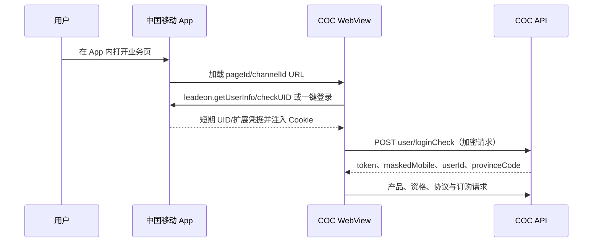

# App COC 订购页面、免登录机制与接口设计

## 1. 分析范围与结论

本文基于 `App订购.har`、卓越钻石卡归档源码和当前 cookie-app 订购实现。HAR 只记录了页面加载、登录检查、产品和资格查询，没有记录真实验证码发送或最终订购动作。最终提交接口与入参由页面 JavaScript 源码反向确认。

核心结论：

- 页面 URL 本身不包含免登录凭据。
- 中国移动 App WebView 通过 `leadeon.getUserInfo/checkUID`、一键登录扩展值或 `User-Token` Cookie 向 COC 页面注入短期身份。
- 在 Safari、Chrome 或 cookie-app 前端直接打开同一 URL，不会自动获得原生 App 凭据。
- HAR 中的 token、UID 和 Cookie 属于短期敏感数据，不得固化到代码、配置、文档或前端。
- cookie-app 使用自己的 15 分钟服务端会话完成产品查询和订购；无可用 App 桥接时，显式回退到 502 登录短信。

## 2. 业务页面与参数

| 业务 | 页面 | pageId | channel/touchCode | 默认产品 |
| --- | --- | --- | --- | --- |
| 全球通 5GA | `/coc/web6/applet5gaH5/home` | `1879370128044171264` | `P00000055499` | `500000051295` (399 档) |
| 卓越钻石卡 App版 | `/coc/web6/diamondPackage/` | `1889216886548430848` | `P00000122018` | `1000000100290` |
| 智臻会员 COC版 | `/coc/web6/szhydg/` | `1969953714210263040` | 源码订购默认 `P00000044852` | 查询基准 `500000051649` |
| 智臻会员商城版 | `/website/businessPlatform/shopDetail` | 商城产品页 | `P00000116110` | `productCode=15890747` |

智臻会员的两个页面是两套网关：COC 版调用 `dev.coc.10086.cn/coc/*`，商城版调用 `wx.10086.cn/website/nrapigate/*`。不可混用登录 token、产品 ID、短信或下单入参。

## 3. 免登录流程



COC 登录检查在不同页面的实现并不完全相同：

- 5GA HAR 请求使用 `verifyType=18` 和敏感 `ext`。
- 卓越钻石卡 App 源码使用 `leadeon.checkUID` 返回的 UID，再以 `verifyType=1` 登录。
- 智臻 COC 页同样依赖 WebView 与 COC 加密会话。

因此 cookie-app 不伪造 UID/ext，也不把原生 App token 放入 URL。账号已有 `cmccAppCookie` 时，服务端最多只提取 `User-Token` 到当次内存会话，不带入 `cmccssotoken`、`JSESSIONID`等无关 Cookie；缺少原生桥接上下文时仍走验证码登录。

## 4. 全球通 5GA 接口

### 4.1 查询档位

`POST /coc/card/bundling/auxiliary/selectFiveGAProduct`

```json
{
  "pageId": "1879370128044171264",
  "touchCode": "P00000055499",
  "userId": "<session-user-id>"
}
```

HAR 返回产品编码：`500000051297`(199)、`500000051296`(299)、`500000051295`(399)、`500000051294`(599)、`500000051293`(799)、`500000051292`(999)。服务端合并 `mainRecommend`、`recommendList` 和 `hideRecommendList`，按价格排序。

### 4.2 资格检查

`POST /coc/card/bundling/auxiliary/fiveGARelationCheck`

入参为页面返回的全部 `productCodes`、`touchCode`、`pageId`、`userId` 和 `provinceCode`。主要结果是 `data.fiveGAValid`。预校验未通过时前端默认禁止发送订购验证码；用户开启“仍尝试提交”后可继续。

### 4.3 协议、短信和提交

- 协议：`POST grocer/protocol/prov/queryProtocol`
- 订购短信：`POST user/smsCodeToken`，`verifyType=0`、`smsCodeTypeEnum=505`
- 验证码校验：`POST user/loginCheckToken`
- 下单：`POST pkg/order/change`，`verifyType=2`，携带 `protocolSequenceId`、页面与渠道参数

5GA 新页面使用 COC Aurora 会话加密：客户端每个短时会话生成随机 AES key，以 COC 公钥封装到 `coc-aurora` 请求头。

## 5. 智臻会员 COC 接口

### 5.1 查询档位

`POST /coc/pkg/smart/life/queryTariff`

```json
{
  "provinceCode": "<province-code>",
  "productCode": "500000051649"
}
```

HAR 包含 199/299/399/599/999 档的 A/B/C 版本。已捕获产品编码范围为 `500000051643` 至 `500000051664`（不连续），界面以上游实时返回为准，不根据编码数学推导档位。

### 5.2 重复关系检查

`POST /coc/pkg/contract/common/newProductRelation`

按 HAR 分三组查询 `2025999900037603..7609`、`7610..7616`、`7617..7623`，只将 `isOrder` 作为风险提示，不把 goodsId 与某个套餐编码猜测绑定。

### 5.3 协议、短信和提交

- 规则：`POST grocer/copyWriting/page/query`
- 协议：`POST grocer/protocol/prov/queryProtocol`
- 订购短信：`POST user/smsCode`，`smsCodeTypeEnum=505`
- 主套餐变更：`POST pkg/order/change`
- 额外加购包：页面源码使用 `POST pkg/order/bookProduct`，本期 cookie-app 不提供额外加购包选择

主套餐提交体携带 `mobile`、`pageId`、`productCode`、`smsCode`、`touchCode`、`verifyType=0`、`smsCodeTypeEnum=505`、`userId` 和 `uid`。

## 6. 卓越钻石卡 App版

卓越钻石卡保留现有下单流程，App版只新增渠道预设 `P00000122018`，不默认覆盖现有稳定渠道 `P00000078835`。

HAR 补充的专用检查：

- `pkg/contract/common/newProductRelation`：检查 goods `2025999900003193`、`2025999900047916`
- `pkg/newIop/globalDiamondCard/iopCheck`：`tagIds=02519304000159`、`eventCode=eventJE000000282`、`channelCode=025193040002`

协议、订购验证码和最终 `pkg/order/bookProduct` 入参见 `global-diamond-order-business-api.md`。

## 7. cookie-app 内部 API

业务仍统一使用 `/api/benefit-orders`：

| 方法 | 路径 | 用途 |
| --- | --- | --- |
| GET | `/catalog` | 返回工作流、商城产品和 COC App 预设 |
| POST | `/sessions` | 创建会话；COC App 使用 `workflow=coc_app` 和 `appBusinessId` |
| POST | `/sessions/:id/login-sms` | 发送 502 登录验证码 |
| POST | `/sessions/:id/login` | 校验登录验证码并建立 COC 会话 |
| POST | `/sessions/:id/product` | 查询档位与页面级资格 |
| POST | `/sessions/:id/selection` | 锁定档位，查询规则与实时协议 |
| POST | `/sessions/:id/order-sms` | 发送 505 订购验证码 |
| POST | `/sessions/:id/confirm` | 输入“确认订购”后提交 |
| DELETE | `/sessions/:id` | 删除短时会话 |

创建智臻 COC 会话示例：

```json
{
  "workflow": "coc_app",
  "appBusinessId": "smart_life",
  "accountId": "<account-id>",
  "pageId": "1969953714210263040",
  "touchCode": "P00000044852",
  "productCode": "500000051649"
}
```

所有响应只返回脱敏手机号、流程阶段、产品和结果。Cookie、`User-Token`、UID、完整手机号和验证码不返回前端。

## 8. 界面与产品设计

统一订购页新增：

- “钻石卡 App版”：显示 App 渠道预设和官方页链接。
- “App 专属套餐”：内含“智臻会员 COC版”和“全球通 5GA”两个子入口。
- 官方页链接不携带凭据，旁边始终显示 App WebView 限制。
- cookie-app 办理使用已有账号，通过登录验证码建立会话，再显示实时档位。
- 资格未通过时默认拦截，保留用户明确开启的“仍尝试提交”能力。

## 9. 安全、故障与验证策略

- 会话仅存内存，15 分钟过期，每次重要操作续期。
- 登录短信和订购短信均有 60 秒冷却。
- 最终提交有单会话并发锁，禁止重复下单。
- 网络超时或断连后显示“结果未确认”，要求先通过官方渠道查询。
- 日志不记录 Cookie、token、UID、验证码、完整手机号和协议中的用户信息。
- 自动化验证只覆盖代码类型、档位解析、Cookie 最小化、UI 和构建；不在测试中发送短信或提交真实订购。

## 10. 已知边界

- HAR 没有捕获完整下单响应，结果字段按页面源码中的 `code`、`message`、`data.commonOrderId` 适配。
- 5GA 官方页构造的小程序 `sourceUrl` 还可包含 `appId`、`sellerId`、`channelSeqId` 和埋点扩展值。cookie-app 未获得这些可选营销参数时传空值，上游如改为必填将返回明确错误。
- 原生 `leadeon` 桥接不存在于服务器和普通浏览器。只有未来获得经官方授权、可校验号码一致性的交换接口后，才应将“App 登录态直连”设为无短信默认路径。
