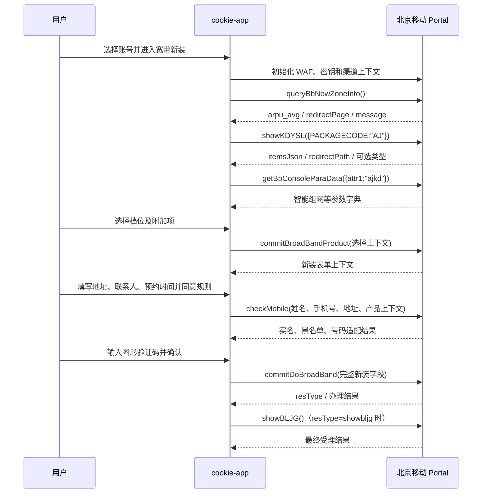
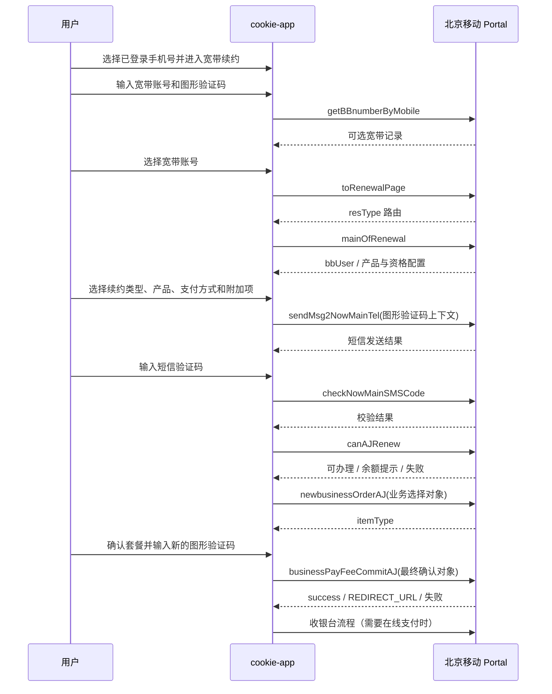

# 北京移动宽带新装与续约接口分析及开发基线

###### 更新日期：2026-08-11

## 1. 文档目标与结论

本文是 cookie-app 后续新增“宽带新装”和“宽带续约”功能的开发依据。分析来源为两份 HAR、两份页面源码归档，以及 HAR 中实际加载但未进入 ZIP 的续约确认页静态脚本。

核心结论：

- 本次抓包完整覆盖了“爱家宽带（AJ）新装”和“爱家宽带（AJ）续约”的一次前端办理链路；其他宽带类型仅能从同版本源码恢复产品配置和辅助接口，不能声称已经完成真实下单验证。
- 新装可办理产品的主查询接口是 `showKDYSL`，AJ 档位位于响应的 `itemsJson`；`queryBbNewZoneInfo` 仅负责入口准入/分流，不返回可装产品目录。
- 续约先选择 cookie-app 中已有的登录手机号，再输入宽带账号和图形验证码调用 `getBBnumberByMobile`；选中宽带记录后由 `mainOfRenewal` 返回资格、产品和页面配置。单宽带的实时可续约产品由 `newajaxCXKDKXD` 按带宽查询；AJ、云宽带、融合宽带、荣军卡等部分档位则存在于当前前端配置中。
- 新装与续约共享“全部已知产品池”：实时返回、本地内置和自定义配置均展示；另一流程的产品会转换为可编辑的“跨流程尝试”配置。跨流程可提交不代表上游已验证支持，最终结果以上游返回为准。
- ###### 新装最终提交接口是 `commitDoBroadBand`。AJ 续约分为 `canAJRenew` 资格检查、`newbusinessOrderAJ` 创建办理上下文、`businessPayFeeCommitAJ` 最终确认/扣费三个阶段。
- ###### 所有业务接口依赖同一个上游 Cookie 会话、WAF 参数、临时 AES 密钥、`X-DATA-TOKEN` 和递增的防重放版本，不能实现成无状态的单接口直调。
- HAR 中请求和响应正文均为 AES 密文，且不包含浏览器运行时生成的 AES 明文密钥。因此本文只把源码明确构造或明确消费的字段列为已知；加密正文中可能存在但源码未暴露的值必须通过后续受控联调补齐。
- 订购、续费及支付都属于有副作用操作。失败、超时或返回不明确时禁止自动重试，必须先查询结果或由用户重新确认。

## 2. 证据范围与可信度

### 2.1 原始材料

| 材料 | 内容 | 结论用途 |
| --- | --- | --- |
| `宽带新装.har` | 21 条网络记录 | 新装实际调用顺序、方法、路径、请求头 |
| `宽带新装.zip` | 新装页面及公共运行时代码 | 产品字段、表单校验、最终提交字段 |
| `宽带续约.har` | 27 条网络记录 | 续约查询、短信、资格、创建、确认提交顺序 |
| `宽带续约.zip` | 续约入口、产品页及公共运行时代码 | 产品目录、业务对象、查询与校验规则 |
| `confirm_AJ-c5cc2927.js` | 由 HAR 中同源静态 URL 补取 | 最终 `businessPayFeeCommitAJ` 明文对象结构和结果分支 |
| `pay-e84d8230.js` | 由 HAR 中同源静态 URL 补取 | `REDIRECT_URL` 后的收银台跳转流程 |

本文不记录抓包中的手机号、宽带账号、Cookie、Token、WAF 参数、验证码、地址、证件号或其他个人信息。

### 2.2 状态标记

| 标记 | 含义 |
| --- | --- |
| `HAR` | 本次 HAR 中实际发生 |
| `SRC` | 同版本源码明确存在，但本次 HAR 未必调用 |
| `INF` | 根据调用关系推断，开发前仍需验证 |
| `TODO` | 当前材料不足，必须补抓或联调确认 |

本文中的“必填”仅表示前端明确校验或当前链路必需。上游服务端仍可能根据产品、账号和营销活动动态增加条件。

## 3. 上游通信与会话协议

上游基础地址：`https://service.bj.10086.cn/nwt`

### 3.1 公共请求上下文

除静态资源和少量公共接口外，请求依赖：

| 项 | 用途 | 开发要求 |
| --- | --- | --- |
| 10086 Cookie | 登录态、业务会话和服务端办理上下文 | 仅服务端保存，不返回前端，不写日志 |
| `XEbtxIBt` | WAF/风控查询参数 | 动态获取，禁止使用抓包值 |
| `traceId` | 请求追踪 | 每次调用生成 |
| `X-DATA-TOKEN` | 当前加密会话令牌 | 通过密钥引导流程取得并按会话保存 |
| `X-REPLAY-VERSION` | 防重放序号 | 同一会话严格递增，不能并发复用同一值 |
| AES 请求体或 `p` 参数 | 业务明文的加密载体 | AES-ECB、PKCS7，使用本次会话临时密钥 |

公共密钥引导接口：

```text
POST /portal-bff/api/keys/v1.0/get
```

浏览器生成临时 AES 密钥，用服务端 RSA 公钥封装后完成引导；响应随后以该 AES 密钥解密。cookie-app 中应复用现有 portal/WAF 客户端能力，不要在宽带模块重新实现一套加密状态机。可参考本地已有实现：

- `bj-mobile-business-local/backend/src/services/portalClient.js`
- `bj-mobile-business-local/backend/src/services/wafClient.js`

### 3.2 会话边界

一次新装或续约尝试必须绑定：

```text
accountId + upstream Cookie session + AES session + replay counter + broadband flow session
```

产品选择、短信验证码、图形验证码、资格结果和订单上下文不可跨账号或跨会话复用。服务重启后如果无法完整恢复这些状态，应让用户从查询步骤重新开始。

## 4. 宽带新装完整流程



### 4.1 新装接口清单

| 状态 | 方法与路径 | 请求明文 | 关键响应/用途 |
| --- | --- | --- | --- |
| HAR | `POST /portal-bff/api/keys/v1.0/get` | 密钥引导参数 | 建立加密会话 |
| HAR | `GET /portal-bff/common/pulic/v1.0/getChannelSource` | 渠道上下文 | 渠道来源 |
| HAR | `POST /portal-bff/api/avoidLogin/broadband/v1.0/queryBbNewZoneInfo` | 页面无参调用 | `arpu_avg`、`redirectPage`、`message`；入口准入/分流 |
| HAR | `POST /portal-bff/api/avoidLogin/broadband/bbConsole/v1.0/showKDYSL` | `{PACKAGECODE}` | 可办理产品、页面路由 |
| HAR | `GET /portal-bff/api/needLoginPublic/v1.0/getJtchannel` | 无业务字段 | 当前接入渠道 |
| HAR | `GET /portal-bff/api/avoidLogin/broadband/bbConsole/v1.0/getBbConsoleParaData` | 加密查询 `{attr1}` | 产品附加参数字典 |
| HAR | `POST /portal-bff/api/avoidLogin/broadband/sjyw/v1.0/commitBroadBandProduct` | 产品选择上下文 | 建立新装表单会话 |
| HAR | `GET /portal-bff/common/pulic/getRandomImage?type=KDXF` | 无 | 4 位图形验证码图片；必须原样代理二进制和内容类型 |
| HAR | `POST /portal-bff/api/avoidLogin/broadband/sjyw/v1.0/checkMobile` | 姓名、手机号、地址及兼容产品常量 | 实名、黑名单、北京移动号码和计费类型判断 |
| HAR | `POST /portal-bff/api/avoidLogin/broadband/sjyw/v1.0/commitDoBroadBand` | 完整新装表单 | 创建新装受理 |
| SRC | `POST /portal-bff/api/pcConsole/v1.0/showBLJG` | 当前会话，无显式业务字段 | 查询 `showbljg` 对应结果；前端封装名为 `Common.showBLJG` |

`queryBbNewZoneInfo` 在页面中无参数调用，仅消费响应的三个字段。若 `redirectPage === "kdzq2"`，页面保存 `message` 并跳转提示页；否则继续加载。它不能替代产品查询接口。

### 4.2 可新装产品查询

请求：

```json
{
  "PACKAGECODE": "AJ"
}
```

`showKDYSL` 已知响应字段：

| 字段 | 类型 | 说明 |
| --- | --- | --- |
| `resType` | string | `success` 时继续，否则作为错误/页面路由 |
| `redirectPath` | string | 产品选择页；支持 AJ、LK、SCKD、SXY 页面 |
| `itemsJson` | JSON string | 产品项数组，必须再次 JSON 解析 |
| `qry_available_bb_Type_xz` | unknown | 可选宽带类型配置；当前 AJ 页未展示完整结构 |

已知 `redirectPath`：

```text
/jsp/kdysl/broadChooseAJ.jsp   -> 爱家宽带
/jsp/kdysl/broadChooseLK.jsp   -> 单宽带/裸宽带类
/jsp/kdysl/broadChooseSCKD.jsp -> 相关宽带类型页面
/jsp/kdysl/broadChooseSXY.jsp  -> 随心用宽带
```

`itemsJson[]` 中页面实际使用：

| 字段 | 用途 |
| --- | --- |
| `productItemName` | 产品名称及后续 `info` |
| `productItemDesc` | 产品说明 |
| `feeInfo` | 费用展示及后续 `chooseName` |
| `otherInfo1` | `PITEMSHOWCODE` 类产品项编码；AJ 页据其匹配档位 |
| `otherInfo2` | Offer 相关附加值，需原样保留 |
| `showField1` | Offer/展示值，页面埋点也会使用 |
| `offer` | Offer 相关字段，结构以实时响应为准 |

不要建立只含名称和价格的本地静态产品表。后续下单至少要保留整条上游产品项及其原始编码。

### 4.3 AJ 产品选择上下文

AJ 页当前构造：

```json
{
  "PACKAGECODE": "YDKD500M",
  "PRODUCTSHOWCODE": "ajkd",
  "PITEMSHOWCODE": "<itemsJson[].otherInfo1>",
  "info": "<itemsJson[].productItemName>",
  "bandwidth": "500M合约期享提速至1000M",
  "pageCode": "",
  "ADDRESSINFO": "",
  "time": "",
  "chooseName": "<itemsJson[].feeInfo>",
  "onlineMobile": "<当前账号手机号>",
  "kaiguan": true,
  "BAR_COM": "",
  "community_id": "",
  "selectZNZWItem": "<参数字典值或空>"
}
```

辅助参数查询：

```json
{
  "attr1": "ajkd"
}
```

返回项使用 `attr2` 匹配带宽，以 `dictValue` 写入 `selectZNZWItem`；`attr3` 也应保留供其他产品使用。当前 AJ 页面默认“500M 合约期享提速至 1000M”。这些均为当前页面配置，不应扩展为所有新装产品的固定值。

### 4.4 号码与实名预检查

`checkMobile` 当前页面构造：

```json
{
  "PACKAGECODE": "JTKD100MXSYH",
  "PRODUCTSHOWCODE": "xsyh100m",
  "PITEMSHOWCODE": "XSYH1Y",
  "mobile": "<联系手机号>",
  "name": "<联系人姓名>",
  "isCheck": "1",
  "info": "<已选产品名称>",
  "CUST_ADDRESS": "<安装地址>"
}
```

前三个编码是当前共享页面遗留的兼容/预检查常量，并非用户所选 AJ 产品编码。开发时应按上游页面行为独立配置，不能用它们覆盖真实选择的 `PACKAGECODE/PRODUCTSHOWCODE/PITEMSHOWCODE`。

已知响应判断：

- `isRealName`：是否已实名；不满足时进入补充身份信息流程。
- `message`：字符串 `true` 表示通过，否则显示业务原因。
- `result === "Y"`：黑名单，禁止办理。
- 某些产品或优惠会把 `BILL_TYPE` 切换为 `0` 并要求额外实名信息；普通已实名路径可设为 `1`。

### 4.5 新装最终提交字段字典

字段级别：`R` 前端明确必填，`D` 上游/产品/会话派生，`C` 条件必填，`O` 可选或当前允许空。个人信息字段必须脱敏日志。

| 字段 | 级别 | 来源与说明 |
| --- | --- | --- |
| `verificationCode` | R | 当前图形验证码，4 位，与取得图片的同一 Cookie 会话绑定 |
| `PACKAGECODE` | D | `commitBroadBandProduct`/产品上下文 |
| `packageCodeFlag` | C | 上游表单返回的产品控制标记 |
| `PRODUCTSHOWCODE` | D | 产品上下文 |
| `PITEMSHOWCODE` | D | 所选产品项编码 |
| `OFFER_ID` | D | 上游表单/产品响应中的 Offer ID，禁止由名称推算 |
| `selectTime` | C | 上游表单使用的时间选择字段 |
| `chooseName` | D | 所选项 `feeInfo` |
| `realName` | C | 实名检查/上游上下文 |
| `isBJMobile` | C | 号码检查结果 |
| `info` | R | 所选产品名称/说明，页面也检查非空 |
| `COMMUNITY_NAME` | R | 北京市城区/小区或地址组成部分；页面检查非空 |
| `CUST_ADDRESS` | R | 完整安装地址，页面按“北京市-城区-详细地址”组织 |
| `USER_NAME` | R | 办理人姓名的兼容字段 |
| `WITH_TV_BOX` | C | 是否带电视盒子 |
| `CONTACT_PHONE` | R | 联系电话的兼容字段 |
| `BILL_TYPE` | C | 实名/计费路径，页面可根据检查结果设 `0` 或 `1` |
| `onlineMobile` | D | 当前登录账号手机号 |
| `onlineName` | D | 当前登录账号姓名/上下文 |
| `CERT_TYPE` | D | 当前页面固定为 `"1"` |
| `BUSI_TYPE` | D | 当前页面固定为 `"01"` |
| `PARA15` | D | 当前页面固定为 `"电子商务中心组"` |
| `CERT_ADDRESS` | D | 已实名路径固定说明；不要替代真实证件地址存储 |
| `contactPerson` | R | 由 `Person` trim 后复制 |
| `contactNumber` | R | 由 `Number` trim 后复制 |
| `last_referrer` | O | 推荐号码非空时按上游格式派生 |
| `CHARGE_TYPE` | C | 上游产品/计费配置 |
| `RATE_TYPE` | C | 上游产品/资费配置 |
| `bandwidth` | D | 用户所选带宽/提速档描述 |
| `discountFlag` | C | 优惠活动控制字段 |
| `discount` | C | 优惠活动值 |
| `kaiguan` | D | 产品页控制开关，当前 AJ 为 `true` |
| `BAR_COM` | O | 条形码/社区扩展字段，当前 AJ 允许空 |
| `community_id` | O | 社区 ID，有地址能力时应使用实时返回 |
| `couponNum` | O | 优惠券编号 |
| `OUT_DONE_CODE` | C | 外部受理/活动扩展编码 |
| `phoneNum` | C | 上游兼容手机号字段 |
| `kdyhjzk` | C | 宽带优惠折扣扩展字段 |
| `secKillIdBak` | C | 秒杀活动备用 ID |
| `TV_BOX_ID` | C | 电视盒子产品 ID |
| `needAddIptv` | C | 是否加装 IPTV |
| `selectJDHItem` | C | 家电惠/附加产品选择 |
| `selectZNZWItem` | C | 智能组网字典值；部分带宽为 `null` 或空 |
| `phoneNumber` | R | 用户填写联系电话，11 位手机号校验 |
| `PRE_DATE` | R | 预约安装日期 |
| `PRE_DATE_QUANTUM` | R | 时段：`1` 上午、`2` 中午、`3` 下午、`4` 晚间 |
| `Person` | R | 联系人姓名原始字段 |
| `Number` | R | 联系电话原始字段 |
| `referrer` | O | 推荐人手机号；非空时必须为数字/合法手机号 |
| `CERT_NO` | C | 证件号；实名检查或特定产品要求时必填 |
| `userName` | R | 用户填写姓名；页面明确检查非空 |

`USER_NAME/userName/Person/contactPerson` 和 `CONTACT_PHONE/phoneNumber/Number/contactNumber/phoneNum` 看似重复，但属于上游历史兼容字段。首版实现必须按页面映射完整提交，不能在未做回归测试前合并或删除。

### 4.6 新装结果状态

| `resType` | 页面行为 | 本地处理建议 |
| --- | --- | --- |
| `showbljg` | 调用 `showBLJG` 查询并展示结果 | 标记 `PENDING_QUERY`，查询最终状态 |
| `skerror` | 跳转特定错误页 | 返回明确业务失败，不自动重试 |
| `error` | 跳转通用错误页 | 返回上游原因或通用错误 |
| `successOld` | 跳转成功页 | 标记受理成功 |

超时、网络中断或未知 `resType` 均属于结果不确定，不得再次自动调用 `commitDoBroadBand`。

## 5. 宽带续约完整流程



### 5.1 续约实际接口清单

| 状态 | 方法与路径 | 请求明文 | 关键响应/用途 |
| --- | --- | --- | --- |
| HAR | `POST /portal-bff/api/avoidLogin/renewalBroadband/v1.0/getBBnumberByMobile` | `{billId, verificationCode}` | 查询可选择宽带记录 |
| HAR | `POST /portal-bff/api/avoidLogin/renewalBroadband/v1.0/toRenewalPage` | `{billId, busiCode, bbBusiType}` | 返回下一页 `resType` |
| HAR | `POST /portal-bff/api/keys/v1.0/get` | 密钥引导参数 | 重建/刷新加密会话 |
| HAR | `POST /portal-bff/api/avoidLogin/renewalBroadband/v1.0/mainOfRenewal` | 页面与营销参数 | 账号、资格和产品配置主查询 |
| HAR | `GET /portal-bff/common/pulic/getRandomImage?type=KDXF` | 无 | 查询、短信或最终确认所需图形验证码 |
| HAR | `POST /portal-bff/api/avoidLogin/renewalBroadband/v1.0/sendMsg2NowMainTel` | 查询参数，含 `phoneNo` 和验证码上下文 | 向当前主号码发短信 |
| HAR | `POST /portal-bff/api/avoidLogin/renewalBroadband/v1.0/checkNowMainSMSCode` | 查询参数 `{phoneNo, yzm}` | 校验当前主号码短信码 |
| HAR | `POST /portal-bff/api/avoidLogin/renewalBroadband/v1.0/canAJRenew` | AJ 资格参数 | 可办理、余额提示或错误 |
| HAR | `POST /portal-bff/api/avoidLogin/renewalBroadband/v1.0/newbusinessOrderAJ` | AJ 业务选择对象 | 建立续约订单上下文，返回 `itemType` |
| HAR | `POST /portal-bff/api/avoidLogin/renewalBroadband/v1.0/businessPayFeeCommitAJ` | 最终确认对象和图形验证码 | 最终受理/扣费/跳转收银台 |

### 5.2 宽带账号查询与选择

请求：

```json
{
  "billId": "<宽带账号>",
  "verificationCode": "<4位图形验证码>"
}
```

输入如果匹配 11 位手机号，原页面不会直接查询，而是跳转北京移动登录页；非手机号宽带账号才进入上述查询。cookie-app 可以保留现有账号选择逻辑，但不能把手机号误当宽带账号提交。

`data.message` 是 JSON 文本，解析后记录字段：

| 字段 | 说明 |
| --- | --- |
| `realBill` | 后续接口实际提交的宽带账号 |
| `bill_id` | 展示/记录用账号字段 |
| `itemName` | 当前宽带产品名 |
| `endTime` | 到期时间 |
| `isExpire` | 是否到期/过期标志 |

继续请求：

```json
{
  "billId": "<selected.realBill>",
  "busiCode": "<当前路由/上游返回>",
  "bbBusiType": "<当前业务类型>"
}
```

`toRenewalPage.data.resType` 是路由结果，不应在本地写死为某个产品页面。

### 5.3 续约主查询与可续约产品来源

`mainOfRenewal` 请求：

```json
{
  "bbBusiType": "<业务类型>",
  "isReslt": "<入口参数>",
  "saleId": "<可空营销参数>",
  "spreaderMobile": "<可空推广号码>",
  "agent": "<可空代理标识>"
}
```

关键响应：

| 字段 | 说明 |
| --- | --- |
| `resType` | 页面/结果路由；可能回到 `bbRenewValidate` |
| `message` | 可能是 HTML 实体编码的 JSON 文本，包含可选宽带记录 |
| `busiCode` | 后续业务路由编码 |
| `bbUser` | 当前宽带和主付费号码信息 |
| `userGrade` | 客户等级/资格数据 |
| `ykdJdhJson`、`sxyJdhJson` | 云宽带/随心用附加配置，JSON 文本 |
| `ykd_tj_fee` | 云宽带推荐档位/费用 |
| `productVO` | 动态产品配置 |
| `kdxf_USERSCENETYPE_SXY`、`kdxf_USERSCENETYPE_YKD` | 用户场景类型 |
| `userBroadbandIdMap` | 用户宽带映射 |
| `smsVerificationInfo` | 短信验证配置 |
| `sessionOperListVOS` | 当前会话可操作列表 |
| `isHideField` | 页面字段显隐配置 |

`bbUser` 已知字段：

```text
userAccCode
productName
payerMobile
userMobile
effectiveTime
failureTime
next_offers[]
next_offers[].offerName
next_offers[].effectDate
next_offers[].expiredDate
```

页面展示的业务类型：

| 编码 | 名称 | 产品来源 |
| --- | --- | --- |
| `YUNKD` | 云宽带 | 当前源码配置 + `mainOfRenewal` 资格 |
| `SXYKD` | 随心用 | `mainOfRenewal` 返回配置 |
| `SXYHX` | 随心用惠享 | `mainOfRenewal` 返回配置 |
| `RHKD` | 融合宽带套餐版 | 当前源码配置 + 实时资格 |
| `RJKZX` | 荣军卡专享宽带 | 当前源码配置 + 实时资格 |
| `AJKD` | 爱家宽带 | 当前源码配置 + 实时资格 |
| `DKKD` | 单宽带 | `newajaxCXKDKXD` 实时查询 |

“可续约产品查询”不能只实现为一个静态接口：先以 `mainOfRenewal` 确定账号可见业务类型和状态，单宽带再按带宽调用实时产品查询。cookie-app 同时合并全部本地已知续约配置，并把新装实时产品与本地配置转换为续约尝试项，保证爱家、单宽带、随心系列、云宽带、融合套餐宽带、荣军宽带等已知类别均可选择和编辑字段。

### 5.4 单宽带实时产品查询

```text
POST /portal-bff/api/avoidLogin/renewalBroadband/v1.0/newajaxCXKDKXD
```

请求：

```json
{
  "bandwidth": "<200|300|500>",
  "couponCode": "<可选优惠券编码>"
}
```

响应：

```text
code                 success 表示成功
message              失败原因
data[].offerId        实时 Offer ID
data[].offerName      产品名
data[].offerVasFee    费用，提交前保持上游单位
data[].flagBG         变更标志
data[].payFee         实付金额
data[].payFeeShow     展示金额
data[].expiredDate    到期/合约信息
```

带宽选项为 200M、300M、500M。支付方式编码：`0` 在线支付，`1` 余额支付。金额字段不能仅凭字段名判断元/分，必须以页面显示转换和一次解密后的实时样本确认；AJ 确认页对 `offerVasFee` 除以 100 展示，说明该路径单位为分。

### 5.5 当前源码中的产品目录

这些数据用于理解和 UI 预展示，最终仍要经过 `mainOfRenewal`、资格校验及上游实时结果。

爱家宽带（AJ，24 个月）：

| offer/选择码 | 带宽 | 承诺通信费 | 页面 ARPU 限制 |
| --- | --- | --- | --- |
| `11900` | 200M | 78 元/月 | 90 |
| `1192` | 300M | 98 元/月 | 120 |
| `1193` | 500M | 128 元/月 | 190 |
| `1194` | 1000M | 198 元/月 | infinity |

融合宽带套餐版（24 个月）：

| 选择码 | 带宽 | 主套餐门槛 | 承诺通信费 |
| --- | --- | --- | --- |
| `rhkd001` | 300M | 78 元及以上 | 79 元/月 |
| `rhkd002` | 500M | 98 元及以上 | 99 元/月 |
| `rhkd003` | 1000M | 139 元及以上 | 139 元/月 |

荣军卡专享宽带（24 个月）：

| 选择码 | 带宽 | 主套餐门槛 | 承诺通信费 |
| --- | --- | --- | --- |
| `rjkkd001` | 500M | 59 元及以上 | 59 元/月 |
| `rjkkd002` | 1000M | 79 元及以上 | 79 元/月 |

云宽带（36 个月）：

| 选择码范围 | 月档位（元） |
| --- | --- |
| `ykd076` 至 `ykd087` | 89、99、109、119、129、139、149、159、169、179、189、199 |
| `ykd088` 至 `ykd099` | 209、219、229、249、279、309、339、379、409、479、519、609 |

源码将云宽带配置编码为 `ykd@<选择码>@36@<方案名>`。带宽和最终可办资格不是这段静态映射的一部分，不应自行补齐。

### 5.6 AJ 续约业务对象

页面在用户选择后构造：

```json
{
  "busiCode": "<路由编码>",
  "bbBusiType": "<业务类型>",
  "businessInfo": {
    "offerName": "<产品名称>",
    "offerVasFee": "<费用，当前 AJ 路径为分>",
    "hyq": "<合约月数>",
    "paymentType": "<支付方式>",
    "opType": "<1续费|2变更>",
    "busiSelect": "<选择编码>",
    "invoicetype": "<发票类型或空>",
    "sxykdUsersceneType": "<条件字段>",
    "ykdUsersceneType": "<条件字段>",
    "sltSpeedup": "<提速选择>",
    "boxType": "<盒子类型>"
  },
  "sltSpeedup": "<兼容顶层字段>",
  "newMainPhone": "<换主号时使用>",
  "sxykdUsersceneType": "<兼容顶层字段>",
  "ykdUsersceneType": "<兼容顶层字段>",
  "boxType": "<兼容顶层字段>"
}
```

当前续费资格请求：

```json
{
  "offerVasFeeAJ": "<费用>",
  "opType": "<操作类型>",
  "paymentType": "<支付方式>",
  "busiSelect": "<产品选择编码>"
}
```

`canAJRenew.data` 已知语义：

| 返回 | 处理 |
| --- | --- |
| `null` | 通过，继续创建订单上下文 |
| `BALANCE,<当前余额>,<所需金额>` | 展示余额和金额，由用户再次确认 |
| `login` | 会话失效，回到续约入口 |
| 其他文本 | 业务错误；较长异常文本页面会降级为“系统异常” |

余额提示是逗号分隔的遗留协议，解析时必须限制段数并校验金额格式，不能直接渲染未转义文本。

### 5.7 创建订单上下文与最终提交

`newbusinessOrderAJ` 接收上述业务选择对象，响应至少包含：

```json
{
  "itemType": "<AJ/YKD/SXY 等确认页展示类型>"
}
```

调用成功只表示创建确认上下文，不表示续约成功。页面随后进入确认页，显示产品名称、价格、合约期和生效规则，并重新获取图形验证码。

最终请求对象：

```json
{
  "bbBusiType": "<业务类型>",
  "businessInfoVO": {
    "offerName": "<产品名称>",
    "offerVasFee": "<费用>",
    "hyq": "<合约月数>",
    "opType": "<1续费|2变更>",
    "paymentType": "<支付方式>",
    "busiSelect": "<选择编码>",
    "boxType": "<盒子类型>",
    "sltSpeedup": "<提速选择>",
    "sxykdUsersceneType": "<条件字段>",
    "ykdUsersceneType": "<条件字段>",
    "invoicetype": "<发票类型或空>"
  },
  "payFeeVO": {
    "imgCode": "<4位图形验证码>"
  }
}
```

确认页把前一步的 `businessInfo` 政名为 `businessInfoVO` 后提交；`bbBusiType` 来自路由，`boxType/sltSpeedup` 会从前一步的兼容字段再次写回。不要把 `newbusinessOrderAJ` 的原对象未经转换直接发给最终接口。

### 5.8 最终续约结果与支付

| `resType` | 页面行为 | 本地状态 |
| --- | --- | --- |
| `success` | 成功页 | `SUCCESS` |
| `successShowSpeedup` | 跳转提速/礼包页 | `SUCCESS_WITH_FOLLOWUP` |
| `REDIRECT_URL` | 使用 `redirectPage` 取得收银台地址 | `PAYMENT_REQUIRED` |
| `input` + `errmesg=RANDOMCODEERROR` | 图形验证码错误 | `CAPTCHA_INVALID`，刷新验证码 |
| `input` + 其他 `errmesg` | 确认输入/业务失败 | `BUSINESS_REJECTED` |
| `login` | 会话失效 | `SESSION_EXPIRED` |
| `index` | 原页面错误结果页 | `FAILED` |
| `error` | 原页面路由行为存在反常（跳成功页） | `UNKNOWN`，必须查询或人工核对，不能当成功 |

收银台链路会以 `orderId` 调用支付地址查询，可能再初始化 `/cashier-bff/api/keys/v1.0/get`，解密 `prePayXml` 后提交到统一支付页。首版建议将 `REDIRECT_URL` 返回给前端，由用户在受控浏览器中完成支付；不要在后端自动代付。

## 6. 源码可见但本次未实走的续约接口

以下接口不能因为“存在于源码”就视为已验证：

| 接口 | 已知用途/参数 |
| --- | --- |
| `POST .../queryAllCouponByNetcodeForAjax` | 按宽带/网码查询优惠券；请求响应结构待补抓 |
| `POST .../loadAJProduct` | 动态加载 AJ 产品；结构待补抓 |
| `POST .../selectBox_Ajax` | 查询/选择电视盒子；结构待补抓 |
| `POST .../newbusinessShowAJ` | AJ 业务展示/确认辅助接口；结构待补抓 |
| `POST .../validateBeforRenewal` | 续约前校验，源码以查询参数提交 |
| `POST .../newajaxCXKDKXD` | 单宽带按带宽和优惠券实时查询，字段已在 5.4 节列出 |
| `POST .../sendMsg2NewMainTel` | 向新主号码发短信 |
| `POST .../checkNewMainSMSCode` | 校验新主号码短信码 |
| `POST .../sendMsg2NowMainTel_BGDF` | 变更/改付费相关短信 |
| `POST .../sendMsg2NowMainTel_DKXF` | 单宽带续费短信 |
| `POST .../checkNowMainSMSCode_DKXF` | 单宽带续费短信校验 |
| `POST .../newbusinessPayFeeCommit` | 非 AJ/通用续费最终提交；字段待补抓 |
| `POST .../commitKDXFSpeedUp` | 续费提速附加办理 |

`...` 均指 `/portal-bff/api/avoidLogin/renewalBroadband/v1.0`。新增主号、改付费、单宽带和非 AJ 产品必须分别补抓完整成功链路，不能套用 AJ 的字段对象。

## 7. 推荐的 cookie-app 本地接口

上游字段不应直接暴露给前端。建议用服务端 flow 保存 Cookie、原始产品对象和提交上下文：

| 本地接口 | 作用 | 是否有副作用 |
| --- | --- | --- |
| `POST /api/broadband/install/flows` | 创建新装 flow，初始化会话并查询入口状态 | 否 |
| `GET /api/broadband/install/flows/:id/products` | 实时查询可新装产品及附加项 | 否 |
| `POST /api/broadband/install/flows/:id/selection` | 保存产品选择并初始化表单上下文 | 仅会话 |
| `POST /api/broadband/install/flows/:id/precheck` | 地址、手机号、实名和黑名单检查 | 否 |
| `GET /api/broadband/install/flows/:id/captcha` | 代理当前会话图形验证码 | 否 |
| `POST /api/broadband/install/flows/:id/commit` | 用户确认后提交新装 | 是，禁止自动重试 |
| `POST /api/broadband/renewal/flows` | 创建续约 flow | 否 |
| `GET /api/broadband/renewal/flows/:id/captcha` | 代理当前阶段图形验证码 | 否 |
| `POST /api/broadband/renewal/flows/:id/accounts/query` | 查询并返回脱敏宽带记录 | 否 |
| `POST /api/broadband/renewal/flows/:id/account` | 选择宽带并运行主查询 | 仅会话 |
| `GET /api/broadband/renewal/flows/:id/products` | 汇总当前账号可续约类型/产品 | 否 |
| `POST /api/broadband/renewal/flows/:id/sms/send` | 发送当前阶段短信 | 有外部消息副作用 |
| `POST /api/broadband/renewal/flows/:id/sms/verify` | 校验短信并保存验证状态 | 仅会话 |
| `POST /api/broadband/renewal/flows/:id/precheck` | 运行 `canAJRenew` 等产品资格检查 | 否 |
| `POST /api/broadband/renewal/flows/:id/prepare` | 调用创建订单上下文接口 | 可能创建上游暂存状态 |
| `POST /api/broadband/renewal/flows/:id/commit` | 最终确认/扣费 | 是，禁止自动重试 |
| `GET /api/broadband/flows/:id/result` | 查询本地记录和可用的上游最终结果 | 否 |

前端只提交本地 `productKey`。服务端根据 flow 中保存的原始产品对象生成上游编码、费用和 Offer 字段，禁止客户端覆盖 `offerVasFee`、`OFFER_ID`、`busiSelect`、支付金额或产品编码。

### 7.1 flow 状态机

```text
CREATED
  -> ACCOUNT_OR_ZONE_READY
  -> PRODUCTS_READY
  -> SELECTION_READY
  -> PRECHECKED
  -> VERIFIED
  -> PREPARED
  -> COMMITTING
  -> SUCCESS | PAYMENT_REQUIRED | FAILED | UNKNOWN | EXPIRED
```

新装可不经过短信 `VERIFIED`，但必须完成当前图形验证码确认；续约的短信验证和最终图形验证码是两个不同阶段，不能复用同一个验证码字段。

## 8. 校验、并发与幂等要求

- 所有产品、费用、Offer ID、业务类型必须来自当前 flow 的上游响应；客户端传入值仅用于选择，不能作为权威值。
- 图形验证码长度为 4，图片与上游 Cookie 会话绑定。刷新图片后旧验证码作废；上游实际可能省略 `Content-Type`，代理端必须按 JPEG、PNG、GIF、WebP 文件签名识别格式，非图片响应才拒绝，并设置 `Cache-Control: no-store`。
- 手机号按北京移动页面规则做 11 位格式校验，但不要把宽带账号套用手机号规则。
- 地址、姓名、证件号和联系人字段服务端 trim；证件号只在上游要求时收集，不长期保存明文。
- 同一 flow 的上游调用串行执行，尤其是 `X-REPLAY-VERSION` 生成与提交操作。
- `commitDoBroadBand`、`newbusinessOrderAJ`、`businessPayFeeCommitAJ` 进入请求后立刻对 flow 加锁。前端重复点击返回当前提交状态，不再发起上游请求。
- 对资格查询和产品查询可做短时重试；对创建上下文、订购和扣费接口不得因网络异常自动重试。
- 本地幂等键只阻止本系统重复发送，不能证明上游未受理。超时后状态必须为 `UNKNOWN`，由结果查询或人工核验收敛。
- 用户切换账号、宽带号、产品、支付方式或主号码后，清空之前的短信验证、图形验证码、资格结果和准备状态。

## 9. 日志与数据安全

禁止记录：

```text
Cookie / Set-Cookie
X-DATA-TOKEN / AES key / RSA 包装值 / XEbtxIBt
完整手机号和宽带账号
姓名、证件号、安装地址
短信验证码和图形验证码
支付 XML、支付跳转中的敏感查询参数
完整上游请求/响应密文（可能仍可关联用户会话）
```

允许记录的最小审计信息：

```text
flowId
内部 accountId
业务类型与脱敏 productKey
接口逻辑名
开始/结束时间和耗时
HTTP 状态
归一化业务状态/错误码
上游 traceId 的哈希或短期受控值
是否发生用户明确确认
```

对手机号、宽带号仅保留末四位用于 UI 核对；数据库中的 flow 内容设置短 TTL，完成或过期后清除验证码、身份和地址字段。

## 10. 错误归一化建议

| 本地错误码 | 场景 |
| --- | --- |
| `BROADBAND_SESSION_EXPIRED` | Cookie、密钥或上游办理上下文失效 |
| `BROADBAND_CAPTCHA_INVALID` | 图形验证码错误/过期 |
| `BROADBAND_SMS_INVALID` | 短信验证码错误/过期 |
| `BROADBAND_ACCOUNT_NOT_FOUND` | 未查询到宽带记录 |
| `BROADBAND_NOT_ELIGIBLE` | 资格、实名、黑名单、产品门槛不通过 |
| `BROADBAND_BALANCE_CONFIRM_REQUIRED` | 上游要求确认余额扣费 |
| `BROADBAND_PAYMENT_REQUIRED` | 需要跳转收银台 |
| `BROADBAND_UPSTREAM_REJECTED` | 上游明确拒绝并返回原因 |
| `BROADBAND_RESULT_UNKNOWN` | 提交超时、未知状态或矛盾状态 |
| `BROADBAND_RATE_LIMITED` | 验证码/短信/查询频控 |

上游原始错误文本只能作为经过转义和长度限制后的辅助信息，不能作为本地控制流唯一依据。

## 11. 开发前必须补齐的抓包与联调项

当前材料足以设计架构和实现 AJ 主路径，但还不足以承诺所有宽带产品可用。开发前/开发中需补齐：

1. 在受控测试账号上保存运行时 AES 密钥或在浏览器内部记录加密前/解密后的 JSON，取得每个核心接口的真实明文响应样本。
2. 分别补抓 AJ 新装成功、资格失败、验证码失败、提交超时后的结果查询，确认 `showBLJG` 请求/响应及订单唯一标识。
3. 补抓 AJ 续约的余额支付成功和在线支付 `REDIRECT_URL` 成功链路，确认支付完成后的回查接口。
4. 补抓 `loadAJProduct`，判断 AJ 档位是否已有服务端动态替代来源；若有，应淘汰前端静态目录。
5. 补抓单宽带 `newajaxCXKDKXD -> 短信 -> prepare -> newbusinessPayFeeCommit` 完整成功链路。
6. 分别补抓云宽带、随心用、融合宽带、荣军卡的产品查询、资格和最终提交，确认其字段与 AJ 的差异。
7. 补抓换主号、变更、开票、盒子、IPTV、智能组网、优惠券各条件分支。
8. 确认金额单位、日期格式、空字符串与 `null` 的服务端差异，尤其是 `offerVasFee/payFee`。
9. 确认提交结果查询和订单幂等标识；没有结果查询能力前，线上不得对未知结果提供“一键重试”。
10. 验证 cookie-app 现有 portal 客户端在同一会话串行请求、密钥刷新、WAF 更新和支付域切换时的行为。

## 12. 当前实现边界

当前 cookie-app 展示并允许尝试提交全部已识别宽带产品，包括爱家、单宽带、随心系列、云宽带、融合套餐宽带和荣军宽带。新装流程会合并所有新装入口的实时查询结果、本地新装配置以及由续约配置转换的尝试项；续约流程会合并 `mainOfRenewal`、单宽带实时查询、本地续约配置，以及由新装实时产品和本地配置转换的尝试项。

所有产品字段均可在单次尝试前编辑，也可以新增持久产品配置。跨流程转换只提供合理的字段初值，不伪造已验证能力；非 AJ 路径缺少完整成功样本时，界面标记为“跨流程尝试”，提交失败、超时或未知结果均不自动重试。AJ 仍是当前证据最完整的路径，其他产品能否受理以上游账号资格、产品编码和最终响应为准。

本文同时作为协议分析和当前实现边界基线。后续如果抓包或上游源码版本变化，应优先更新本文中的证据状态、字段字典和状态机，再修改业务代码。
