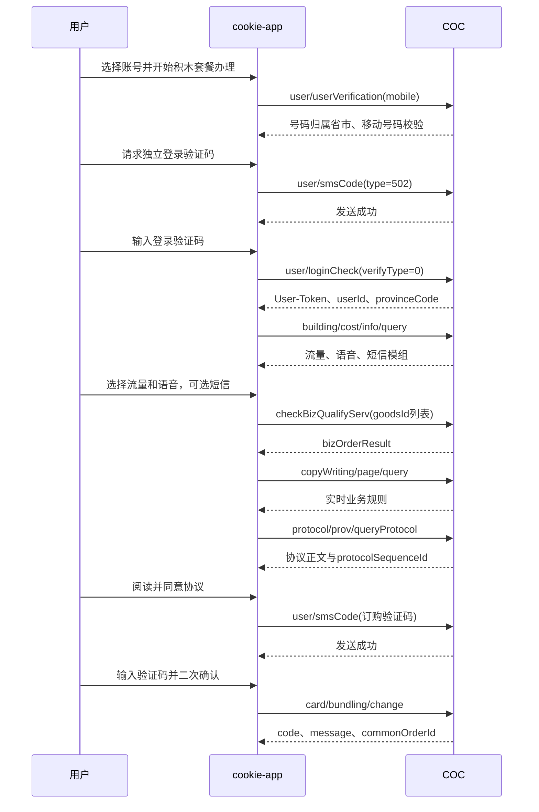

# 积木套餐订购业务流程与接口说明

## 1. 文档范围

本文基于以下两类材料交叉分析形成：

- `积木套餐订阅.har` 中 2026-07-23 的真实请求序列；
- `积木套餐订阅.zip` 中 `coc/web2/buildingBricksPak` 页面及其压缩 JavaScript 源码。

本文描述的是积木套餐主套餐及其流量、语音、短信模组的一次完整办理过程。接口属于中国移动上游系统，字段和业务规则可能按省份、活动版本调整；本系统必须以实时返回为准。

## 2. 关键结论

1. 积木套餐必须使用独立 COC 登录，不能复用卓越钻石订购会话，也不能因为 cookie-app 已保存 10086 Cookie 就跳过登录验证码。
2. 登录验证码使用 `smsCodeTypeEnum=502`；订购确认使用独立验证码语义，最终订购请求使用 `smsCodeTypeEnum=505`。
3. 积木套餐不是单一 `productCode` 模型：
   - 协议和规则主产品码：`500000050353`；
   - 聚合订购码按流量/语音组合映射；样例 1GB + 100 分钟为 `789000000750`；
   - 必选一档流量模组和一档语音模组；
   - 短信模组是独立可选包，不与主套餐写入请求合并提交；
   - 资格校验使用模组 `goodsId`，最终订购使用模组 `productCode` 集合。
4. 默认页面参数为 `pageId=1610185761689767936`、`touchCode=P00000001555`。
5. HAR 中最终 `card/bundling/change` 返回 `code=0` 和 `commonOrderId`，证明该接口是业务写入终点。

## 3. 完整业务流程



## 4. 上游通用约定

### 4.1 基础地址与请求头

- 基础地址：`https://dev.coc.10086.cn/coc/`
- `Origin`：`https://dev.coc.10086.cn`
- `Referer`：`/coc/web2/buildingBricksPak/?pageId={pageId}&channelId={touchCode}`
- JSON 请求：`Content-Type: application/json`
- 加密请求额外携带：`coc-en-version: 1486234121417629696`

登录相关请求体使用 AES-128-ECB/PKCS7 加密后包装为：

```json
{ "cocEnContent": "<base64>" }
```

响应可能是普通 JSON，也可能是 Base64 编码的 JSON。服务端适配层负责解码、更新 `Set-Cookie`，且不向浏览器暴露 `User-Token`。

### 4.2 成功判定

- 传输成功：HTTP 2xx；
- COC 成功：顶层 `code` 字符串化后等于 `0`；
- 资格成功：`data.entity.bizRsp.bizOrderResult=0000`；
- 最终订购成功：`card/bundling/change` 同时满足 `code=0`，并优先记录 `data.commonOrderId`。

## 5. 上游接口

### 5.1 校验手机号

`POST /user/userVerification`

加密前请求：

```json
{ "mobile": "13800138000" }
```

关键返回：`isCmcc`、`bizCode`、`cityId`、`cityName`、`areaCode`、`areaName`。样例中 `isCmcc=0` 表示可继续，不能按字段名直觉反转判断，仍须同时检查 `code=0` 和 `bizCode=1`。

### 5.2 发送独立登录验证码

`POST /user/smsCode`

加密前请求：

```json
{
  "mobile": "13800138000",
  "userId": "",
  "smsCodeTypeEnum": "502"
}
```

该接口触发真实短信，客户端与服务端均执行 60 秒冷却。

### 5.3 独立登录

`POST /user/loginCheck`

加密前请求：

```json
{
  "mobile": "13800138000",
  "smsCode": "123456",
  "verifyType": 0
}
```

关键返回：`token`、`provinceCode`、`cityCode`、`maskedMobile`、`userId`。`token` 同步写入本次服务端会话 Cookie 的 `User-Token`，不得返回前端或持久化。

### 5.4 查询可选模组

`POST /editor/common/proxy/toC/building/cost/info/query`

请求体：`{}`。

返回 `data.entity`：

- `flow[]`：流量模组；
- `calls[]`：语音模组；
- `sms[]`：可选短信包。

每项至少包含 `goodsId`、`productCode`、`goodsName`、`fee`、`display`、`standards`。前端展示实时列表，不能把 HAR 档位写死为唯一可选范围。

### 5.5 查询推荐档位

`POST /editor/common/proxy/toC/mobileTagQuery`

请求体：`{}`。返回的 `productInfos` 仅用于建议默认档位，不影响用户主动选择，也不作为资格结论。

### 5.6 资格预校验

`POST /editor/common/proxy/toC/checkBizQualifyServ`

```json
{
  "numType": "1",
  "checkType": "3",
  "goodsID": "2022999800082739",
  "productList": [
    { "productType": "", "productID": "<流量goodsId>" },
    { "productType": "", "productID": "<语音goodsId>" }
  ]
}
```

只有流量与语音必选模组进入样例资格请求。资格不通过时界面展示上游原因；允许用户明确选择“仍尝试提交”，最终结果仍由订购接口裁决。

### 5.7 查询规则

`POST /grocer/copyWriting/page/query`

```json
{
  "configType": "2",
  "pageId": "1610185761689767936",
  "productCode": "500000050353",
  "provinceCode": "351"
}
```

规则位于 `data.configList[].subContent`，按受限富文本展示。

### 5.8 查询业务受理协议

`POST /grocer/protocol/prov/queryProtocol`

```json
{
  "pageId": "1610185761689767936",
  "productCode": "500000050353",
  "provinceCode": "351",
  "userId": "<登录返回userId>",
  "verifyType": "0"
}
```

关键返回：`protocolName`、`content`、`protocolSequenceId`。选择项变化后必须重新获取协议并重新确认。

### 5.9 发送订购验证码

`POST /user/smsCode`

订购验证码使用独立的 60 秒冷却。上游页面不同版本曾出现 `503/templateNo=3701` 与最终请求 `505` 两种痕迹；HAR 的最终订购明确使用 `505`。实现将验证码类型作为积木工作流配置，默认 `505`，上游失败时原样返回业务码，不静默切换类型。

### 5.10 确认订购

`POST /card/bundling/change`

```json
{
  "pageId": "1610185761689767936",
  "productCode": "<按流量和语音组合实时映射的主套餐码>",
  "touchCode": "P00000001555",
  "uid": "",
  "mobile": "13800138000",
  "sellerId": "",
  "channelSeqId": "",
  "sourceUrl": "https://dev.coc.10086.cn/coc/web2/buildingBricksPak/?pageId=1610185761689767936&channelId=P00000001555",
  "protocolSequenceId": "<实时协议流水>",
  "smsCode": "123456",
  "verifyType": 0,
  "smsCodeTypeEnum": "505",
  "userId": "<登录返回userId>",
  "tyingProductCodes": [],
  "ext": "{\"wtAc\":\"P00000001555_\",\"wtAcId\":\"\"}"
}
```

页面源码维护 6 档流量 x 6 档语音到主套餐码 `789000000750` 至 `789000000785` 的组合映射。实现按所选两个模组的 `productCode` 查表，禁止把样例 `789000000750` 固定用于其他组合。短信包通过独立 `pkg/order/bookProduct` 流程加购，不混入本次主套餐请求。

最终接口禁止自动重试。网络超时必须显示“结果未确认”，要求先通过已订业务或 10086 查询。

## 6. cookie-app 内部接口设计

统一前缀：`/api/benefit-orders`，`workflow=building_bricks`。

| 方法 | 路径 | 作用 |
| --- | --- | --- |
| GET | `/catalog` | 返回可用工作流与默认参数 |
| GET | `/accounts` | 返回当前操作者可办理的脱敏账号 |
| POST | `/sessions` | 创建积木独立会话并校验手机号 |
| GET | `/sessions/:id` | 恢复脱敏会话状态 |
| POST | `/sessions/:id/login-sms` | 发送 502 登录验证码 |
| POST | `/sessions/:id/login` | 校验验证码并建立独立 COC 登录态 |
| POST | `/sessions/:id/product` | 查询模组、规则和推荐信息 |
| POST | `/sessions/:id/selection` | 保存模组选择并执行资格、协议查询 |
| POST | `/sessions/:id/order-sms` | 协议确认后发送订购验证码 |
| POST | `/sessions/:id/confirm` | 二次确认并提交聚合订购 |
| DELETE | `/sessions/:id` | 清除敏感短时会话 |

会话归属、账号范围和 `businessOrder` 权限在每个接口重复校验。手机号、Cookie、Token、验证码不进入日志和响应。
