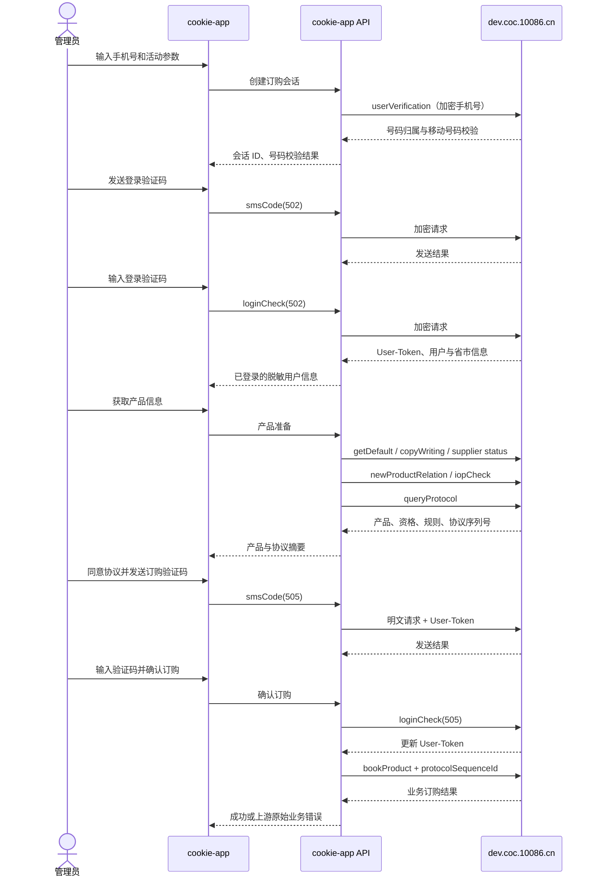

# 全球通业务订购流程与接口说明

## 1. 文档范围

本文基于以下材料还原全球通卓越钻石卡合约的完整订购链路：

- `卓越钻石卡.har`
- `卓越钻石卡/` 中保存的页面源码、接口响应和前端脚本
- `cookie-app` 现有账号、登录态与 V2 管理端实现

目标是在 `cookie-app` 内提供业务订购工作台，覆盖手机号校验、登录验证码、登录、产品与协议查询、订购验证码、二次认证和确认订购，并允许修改 `productCode`。管理员可以为任意有效手机号办理；开启权限的账号中心用户只能为自己已关联的账号办理。

本文记录的是抓包时的上游行为，不代表中国移动公开、稳定的官方 API。上游字段、活动资格和风控策略可能变化。

## 2. 关键结论

1. 登录验证码和订购验证码是两个独立环节。
   - 登录验证码：`smsCodeTypeEnum=502`
   - 订购验证码：`smsCodeTypeEnum=505`
2. 登录阶段的 `userVerification`、`smsCode(502)` 和 `loginCheck(502)` 请求体需要 AES-128-ECB/PKCS#7 加密，密文放在 `cocEnContent`。
3. 登录成功后，上游通过 `Set-Cookie` 更新 `User-Token`。后续产品查询、协议查询和订购请求必须复用同一 Cookie 会话。
4. 订购阶段的 `smsCode(505)` 和 `loginCheck(505)` 使用明文 JSON，但仍依赖登录会话。
5. `protocolSequenceId` 来自实时协议查询，必须原样带入最终订购请求，不能使用 HAR 中的历史值。
6. `productCode` 可以替换，但产品必须与当前 `pageId`、`touchCode`、协议配置及活动资格规则匹配。仅替换编码不保证任意产品都能订购。
7. HAR 中最终 `bookProduct` 返回 HTTP 200，但业务结果为 `code=10, success=false`。因此只能以响应业务码判断订购结果。

## 3. 默认活动配置

| 字段 | 默认值 | 来源 |
| --- | --- | --- |
| `pageId` | `1889216886548430848` | 页面 URL 与配置接口 |
| `touchCode` | `P00000078835` | URL 的 `channelId` |
| `productCode` | `1000000100290` | 页面产品配置 |
| 产品名称 | 全球通卓越钻石卡套餐合约(24个月) | `getDefault` |
| 登录验证码类型 | `502` | 页面源码 |
| 订购验证码类型 | `505` | 页面源码 |
| 加密版本 | `1486234121417629696` | 请求头与页面源码 |

默认产品规则包含 24 个月合约、599 元/月保底消费、提前终止违约金等重要条款。应用不应自行简化这些条款，应展示上游实时返回的规则和协议。

## 4. 完整业务流程



## 5. 上游通用约定

### 5.1 基础地址

`https://dev.coc.10086.cn/coc/`

### 5.2 通用请求头

```http
Content-Type: application/json
Accept: application/json, text/plain, */*
Origin: https://dev.coc.10086.cn
Referer: https://dev.coc.10086.cn/coc/web6/diamondPackage/?pageId={pageId}&channelId={touchCode}
Cookie: {server-managed-cookie}
```

加密接口额外携带：

```http
coc-en-version: 1486234121417629696
```

### 5.3 通用响应

上游可能返回 JSON 文本，也可能返回 Base64 编码后的 JSON 文本。服务端适配层必须兼容两种形式。

```json
{
  "code": "0",
  "message": "成功",
  "data": {},
  "success": true
}
```

业务成功条件是 `code` 等于字符串或数字 `0`。HTTP 200 不代表业务成功。

### 5.4 登录请求加密

- 算法：AES-128-ECB
- Padding：PKCS#7
- 输出：Base64
- 版本：`1486234121417629696`
- HAR 对应页面密钥：`0226942d11914188`

```json
{
  "cocEnContent": "Base64(AES(JSON.stringify(payload)))"
}
```

密钥来自抓取页面的版本化配置。代码将其集中定义，便于上游轮换时替换，不在日志或客户端返回中暴露会话信息。

## 6. 上游接口

### 6.1 校验手机号

`POST /user/userVerification`

加密前请求：

```json
{
  "mobile": "13800138000"
}
```

成功响应数据示例：

```json
{
  "isCmcc": "0",
  "bizCode": "1",
  "bizDesc": "成功",
  "cityId": "351",
  "cityName": "山西",
  "areaCode": "358",
  "areaName": "吕梁"
}
```

`isCmcc="0"` 在该页面源码中被视为中国移动号码校验通过。

### 6.2 发送登录验证码

`POST /user/smsCode`

加密前请求：

```json
{
  "mobile": "13800138000",
  "smsCodeTypeEnum": "502",
  "userId": ""
}
```

### 6.3 验证登录验证码

`POST /user/loginCheck`

加密前请求：

```json
{
  "mobile": "13800138000",
  "smsCode": "123456",
  "userId": "",
  "smsCodeTypeEnum": 502,
  "verifyType": 0
}
```

成功响应包含：

```json
{
  "token": "<redacted>",
  "provinceCode": "351",
  "cityCode": "358",
  "maskedMobile": "138****8000",
  "userId": "1335941130387783680",
  "encryptedData": "<redacted>"
}
```

响应的 `Set-Cookie: User-Token=...` 比 JSON 中的 token 更适合作为后续会话凭据，服务端统一合并到内存会话 Cookie 中。

### 6.4 获取页面产品配置

`POST /personalization/page/getDefault`

```json
{
  "pageId": "1889216886548430848",
  "touchCode": "P00000078835",
  "handSingle": 0
}
```

返回页面标题和产品数组。适配层按请求 `productCode` 匹配产品；未匹配时保留上游列表并标记配置不匹配。

### 6.5 获取产品规则

`POST /grocer/copyWriting/page/query`

```json
{
  "configType": "2",
  "pageId": "1889216886548430848",
  "productCode": "1000000100290",
  "provinceCode": "351"
}
```

返回 `configList[].subContent` HTML。API 原样提供内容，前端仅以受限富文本方式展示，不执行脚本。

### 6.6 检查产品供应状态

`POST /blackstone/product/supplier/status/select`

```json
{
  "provinceCode": "351",
  "productCodes": ["1000000100290"]
}
```

返回数组中包含目标 `productCode` 才表示该省可继续办理。

### 6.7 检查活动资格

`POST /pkg/newIop/globalDiamondCard/iopCheck`

```json
{
  "tagIds": "02519304000159",
  "touchCode": "P00000078835",
  "eventCode": "eventJE000000282",
  "channelCode": "025193040002"
}
```

该接口是卓越钻石卡页面专用资格校验。替换为其他产品时，此资格结果仅作参考，不能假定所有活动都使用相同标签。

### 6.8 检查重复订购关系

`POST /pkg/contract/common/newProductRelation`

```json
{
  "productCodes": ["2025999900003193", "2025999900047916"],
  "type": 20,
  "touchCode": "",
  "pageId": "",
  "userId": "1335941130387783680",
  "mobile": ""
}
```

这是页面内针对特定互斥/重复关系产品编码的检查，不等同于目标 `productCode` 的通用已订判断。系统展示结果，但最终资格仍以上游订购接口为准。

### 6.9 获取业务受理协议

`POST /grocer/protocol/prov/queryProtocol`

```json
{
  "mobile": "138****8000",
  "pageId": "1889216886548430848",
  "productCode": "1000000100290",
  "provinceCode": "351",
  "userId": "1335941130387783680",
  "verifyType": "0"
}
```

关键响应字段：

- `protocolName`
- `content`
- `protocolSequenceId`

`protocolSequenceId` 与当前用户、产品和协议版本关联。只保存在服务端订购会话中，并在最终订购时使用。

### 6.10 发送订购验证码

`POST /user/smsCode`

```json
{
  "mobile": "138****8000",
  "productCode": "1000000100290",
  "pageId": "1889216886548430848",
  "smsCodeTypeEnum": "505",
  "userId": "1335941130387783680"
}
```

### 6.11 二次认证并确认订购

第一步：`POST /user/loginCheck`

```json
{
  "mobile": "138****8000",
  "smsCode": "123456",
  "userId": "1335941130387783680",
  "smsCodeTypeEnum": "505",
  "productCode": "1000000100290",
  "verifyType": 0
}
```

第二步：仅在二次认证成功后调用 `POST /pkg/order/bookProduct`

```json
{
  "pageId": "1889216886548430848",
  "productCode": "1000000100290",
  "touchCode": "P00000078835",
  "verifyType": 2,
  "sourceUrl": "https://dev.coc.10086.cn/coc/web6/diamondPackage/?pageId=1889216886548430848&channelId=P00000078835",
  "protocolSequenceId": "<实时协议序列号>"
}
```

## 7. cookie-app 内部 API

所有接口位于 `/api/business-order`。管理员会话可访问全部能力；普通账号中心用户必须已登录且具有 `businessOrder` 权限。Cookie、`User-Token`、完整手机号和上游 token 不返回前端或日志。

普通用户只能读取自己关联账号的脱敏列表，创建会话时必须提交关联账号的 `accountId`，不能直接提交手机号。每个会话记录创建者，后续查询、发码、登录、订购和删除都会重新校验归属。管理员可以访问全部订购会话。

### 7.1 获取可订购账号

`GET /api/business-order/accounts`

管理员返回所有未停用账号；普通用户只返回自己关联的账号。响应中的手机号、账号名称和展示号码均经过脱敏。

### 7.2 获取默认活动参数

`GET /api/business-order/defaults`

返回默认 `productCode`、`pageId` 和 `touchCode`。

### 7.3 创建会话并校验手机号

`POST /api/business-order/sessions`

```json
{
  "accountId": "account-id",
  "productCode": "1000000100290",
  "pageId": "1889216886548430848",
  "touchCode": "P00000078835"
}
```

管理员也可以不传 `accountId`，改为传入 11 位 `phone`。普通用户必须传自己关联账号的 `accountId`，完整手机号由服务端解析。返回会话 ID、脱敏手机号、活动参数和号码归属信息。

### 7.4 发送登录验证码

`POST /api/business-order/sessions/{sessionId}/login-sms`

### 7.5 登录

`POST /api/business-order/sessions/{sessionId}/login`

```json
{ "code": "123456" }
```

### 7.6 获取产品信息与协议

`POST /api/business-order/sessions/{sessionId}/product`

可选覆盖参数：

```json
{
  "productCode": "1000000100290",
  "pageId": "1889216886548430848",
  "touchCode": "P00000078835"
}
```

覆盖会使旧协议和旧订购验证码失效，服务端重新查询产品与协议。

### 7.7 发送订购验证码

`POST /api/business-order/sessions/{sessionId}/order-sms`

```json
{ "acceptedProtocol": true }
```

### 7.8 确认订购

`POST /api/business-order/sessions/{sessionId}/confirm`

```json
{
  "code": "123456",
  "acceptedProtocol": true,
  "confirmationText": "确认订购"
}
```

返回上游业务码、消息、成功标志和不含敏感信息的原始业务数据。

### 7.9 删除会话

`DELETE /api/business-order/sessions/{sessionId}`

用于取消流程或完成后主动清理服务端内存中的 Cookie、手机号和 token。

## 8. 内部错误码

| 错误码 | 含义 |
| --- | --- |
| `UNAUTHENTICATED` | 未登录管理员或账号中心 |
| `BUSINESS_ORDER_FORBIDDEN` | 账号中心用户未开启业务订购权限 |
| `ACCOUNT_REQUIRED` | 普通用户未选择关联账号 |
| `ACCOUNT_FORBIDDEN` | 账号不属于当前用户 |
| `FORBIDDEN` | 当前用户无权访问该订购会话 |
| `INVALID_PHONE` | 手机号格式不正确 |
| `INVALID_CODE` | 验证码不是 6 位数字 |
| `SESSION_NOT_FOUND` | 会话不存在或已过期 |
| `INVALID_STAGE` | 调用顺序不正确 |
| `SMS_COOLDOWN` | 60 秒内重复发送验证码 |
| `PRODUCT_CONFIG_MISMATCH` | 历史阻断码；当前版本改为页面风险警告 |
| `PRODUCT_UNAVAILABLE` | 历史阻断码；当前版本改为页面风险警告 |
| `PROTOCOL_NOT_FOUND` | 未取得可用协议或协议序列号 |
| `PROTOCOL_REQUIRED` | 未确认协议 |
| `CONFIRMATION_REQUIRED` | 未输入“确认订购” |
| `ORDER_IN_PROGRESS` | 同一会话正在提交订购 |
| `UPSTREAM_ERROR` | 上游 HTTP、格式或业务错误 |

## 9. 安全与审计要求

- 服务端会话默认 15 分钟过期，过期后清除 Cookie、token 和完整手机号。
- 会话 ID 本身不构成访问凭据，每次操作都会重新鉴权和校验管理员或用户归属。
- 普通用户不能向 API 传入任意手机号，只能使用自己的关联账号；账号列表和会话响应仅显示脱敏号码。
- 登录与订购验证码各自执行 60 秒冷却。
- 最终提交使用会话内互斥锁，阻止双击并发订购。
- 产品参数变化后必须重新获取协议和重新发送订购验证码。
- 页面配置、供应、资格、重复关系和产品规则属于预检查；失败时保留警告并允许尝试订购。实时协议序列号仍是硬条件。
- API 和 HTTP 调试日志不得记录 Cookie、验证码、完整手机号、`User-Token` 或上游 token。
- 前端必须展示协议并要求显式勾选；最终提交必须再次输入“确认订购”。
- 上游返回未知或网络超时时，结果标记为不确定/失败，不得自动重试 `bookProduct`。

## 10. HAR 样例限制

HAR 的最终请求返回：

```json
{
  "code": "10",
  "message": "程序猿哥哥说我出现了异常，请主人稍后再试！",
  "success": false
}
```

因此样例证明了请求链和字段结构，但没有证明该账号成功订购。上线验证应使用明确授权的测试账号，并人工确认资费、资格、协议和最终结果。
