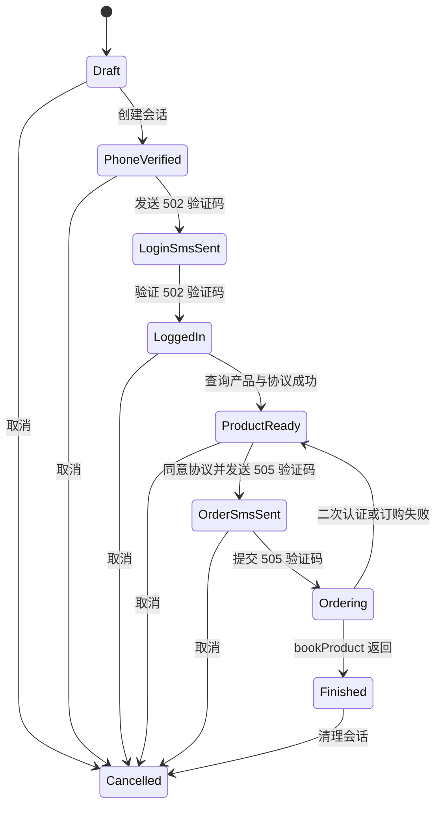

# 全球通业务订购产品与开发设计

## 1. 产品目标

在 V2 管理台、public 账号中心和用户管理页面增加“业务订购”入口，让管理员或获得权限的账号中心用户在一个受控流程中完成：

1. 选择已有账号或输入手机号。
2. 设置 `productCode`，必要时调整 `pageId` 和 `touchCode`。
3. 发送登录验证码并完成登录。
4. 获取并检查产品、资格、规则和业务受理协议。
5. 发送订购验证码。
6. 二次确认后提交订购，并明确展示上游业务结果。

本功能是高风险写操作。设计重点是过程透明、参数可核对、协议可阅读、提交不可误触，而不是批量或自动订购。

## 2. 用户与权限

- 管理员：V2 路由由现有 `AdminRoute` 保护，可以选择已有账号或手动输入手机号。
- 账号中心用户：管理员在用户管理页开启 `businessOrder` 权限后，public 页面每个关联账号的操作菜单显示“业务订购”。
- 普通用户只能为自己已关联的账号办理，不显示和不接受手动手机号。
- 后端每个 `/api/business-order/*` 接口重新校验管理员会话或用户会话、订购权限及会话归属。
- 邀请链接但尚未登录账号中心的访客不开放订购能力。
- 第一版不支持批量订购、不支持定时任务、不支持无人值守自动重试。

## 3. 信息架构

入口包括：

- 套餐、合约与宽带
- 商城业务
- V2 业务订购：`/v2/business/order`
- public 账号操作菜单的“业务订购”：`/business-order?accountId={id}`
- 用户管理账号列表的“业务订购”：`/business-order?accountId={id}`

独立订购页同时挂载在根路由、`/app/cmcc-user` 和 `/app/cmcc-public` 的 basename 下。

工作台采用单页分步表单，不使用嵌套卡片。顶部显示紧凑的六步状态条，主体依次显示当前步骤需要的信息和操作。

## 4. 页面设计

### 4.1 步骤一：订购对象

字段：

- 管理员：已有账号选择器可切换为手动输入 11 位手机号。
- 账号中心用户：必须选择服务端返回的本人关联账号，页面和接口都不允许手动输入手机号。
- 产品编码：默认 `1000000100290`，可编辑。
- 页面 ID：默认 `1889216886548430848`，放在“活动参数”折叠区。
- 渠道编码：默认 `P00000078835`，放在“活动参数”折叠区。

主操作：`校验并开始`

校验成功后显示脱敏号码和归属省市，不回显完整手机号。

### 4.2 步骤二：登录

页面显示脱敏手机号、验证码输入框和“发送验证码”图标按钮。发送后显示 60 秒倒计时。

主操作：`验证并登录`

登录成功后展示：

- 脱敏手机号
- 省编码/市编码
- 登录状态

### 4.3 步骤三：产品核验

主操作：`获取产品信息`

结果按扫描顺序展示：

- 上游产品名称与产品编码匹配状态
- 当前省是否可办理
- 卓越钻石活动资格结果
- 重复/互斥关系结果
- 规则摘要
- 业务受理协议

若产品编码未出现在页面配置、供应状态不可用或可选检查接口失败，页面以醒目风险项显示，但允许用户继续尝试订购。上游最终仍可能拒绝受理。

资格接口是活动特定接口。资格为 false 或检测到重复关系时不再由本系统硬阻断，必须展示警告，由实时协议、505 验证码和最终订购接口裁决。

### 4.4 步骤四：协议确认

协议正文在固定最大高度的滚动区域展示。HTML 只允许展示基本排版，移除脚本、事件属性和危险 URL。

协议下方提供复选框：`我已核对产品、资费和业务受理协议`

未勾选时不能发送订购验证码。

### 4.5 步骤五：订购验证

主操作：`发送订购验证码`

发送成功后显示 6 位验证码输入框和独立倒计时。修改任何活动参数都会使协议确认和验证码失效。

### 4.6 步骤六：最终确认

最终确认区使用明确的风险文案，展示：

- 脱敏号码
- 产品名称
- `productCode`
- `pageId`
- 合约/规则摘要

管理员必须：

- 保持协议复选框选中；
- 输入订购验证码；
- 在确认输入框中输入 `确认订购`。

主操作使用清晰的 `确认订购` 文本与提交图标。提交期间锁定所有相关控件。

### 4.7 结果

成功：显示上游业务码、成功消息和完成时间。

失败：显示上游业务码和原始业务消息，不用 HTTP 状态替代业务结果。网络超时或未知响应显示“结果未确认，请先通过官方渠道查询，不要直接重复提交”。

结果页提供：

- `开始新的订购`
- `结束并清理会话`

## 5. 状态机



状态约束：

- 不允许跳过登录直接获取用户协议。
- 不允许没有实时 `protocolSequenceId` 就发送订购验证码。
- 不允许同一会话并发执行两次最终订购。
- 最终失败后清除订购验证码状态；再次尝试必须重新发送 505 验证码。
- 修改 `productCode/pageId/touchCode` 后回退到 `LoggedIn` 并清除旧协议。

## 6. 后端设计

### 6.1 模块

- `api/services/cmccBusinessOrder.ts`
  - AES 加密与响应解码
  - 上游 HTTP 请求和 Cookie 合并
  - 订购会话状态机
  - 产品聚合查询
  - 订购提交互斥
- `api/routes/businessOrder.ts`
  - 管理员或账号中心用户鉴权
  - `businessOrder` 权限、关联账号和会话归属校验
  - 输入校验
  - 内部 REST API
  - 标准错误映射
- `api/app.ts`
  - 挂载 `/api/business-order`

### 6.2 内存会话

会话仅保存在 Node 进程内，不进入数据库：

```ts
type BusinessOrderSession = {
  id: string
  ownerKey: string
  stage: 'phone_verified' | 'login_sms_sent' | 'logged_in' | 'product_ready' | 'order_sms_sent' | 'ordering' | 'finished'
  phone: string
  maskedPhone: string
  productCode: string
  pageId: string
  touchCode: string
  cookie: string
  userId?: string
  provinceCode?: string
  cityCode?: string
  product?: ProductSummary
  protocol?: ProtocolSummary
  loginSmsSentAt?: number
  orderSmsSentAt?: number
  orderInFlight: boolean
  createdAt: number
  expiresAt: number
}
```

采用内存会话的原因：

- Cookie、token 和验证码流程均为短期敏感数据；
- 应用已有类似业务查询临时会话模式；
- 避免把一次性订购凭据长期写入数据库；
- 进程重启后流程自然失效，管理员重新开始即可。

### 6.3 上游请求封装

统一方法负责：

1. 添加 Origin、Referer、User-Agent 和 Cookie。
2. 对登录类请求添加 `coc-en-version`。
3. 合并响应 `Set-Cookie`。
4. 解析 JSON 或 Base64 JSON。
5. 校验 HTTP 状态和业务 `code`。
6. 返回经过筛选的非敏感数据。

`bookProduct` 不做自动重试。网络中断时无法证明上游是否已经受理，自动重试可能造成重复订购。

### 6.4 产品切换

服务端允许覆盖：

- `productCode`
- `pageId`
- `touchCode`

每次覆盖执行以下动作：

1. 校验格式与长度。
2. 清除旧 `product/protocol/protocolSequenceId`。
3. 清除订购验证码发送状态。
4. 重新请求页面产品配置、规则、供应状态和协议。

默认卓越钻石卡专有的 IOP 和产品关系检查只作为 `checks` 返回。对于自定义产品，API 不伪造通用资格结论。

### 6.5 会话清理

- 每次访问先清除过期会话。
- 默认 TTL：15 分钟。
- 登录和产品查询成功会延长至当前时间后 15 分钟。
- 完成后前端主动 DELETE。
- API 只返回会话 ID 和脱敏摘要。

## 7. 前端设计

### 7.1 组件

- `src/v2/pages/V2BusinessOrderPage.tsx`
  - 维护分步 UI 状态
  - 调用订购 API
  - 倒计时与最终确认
- `src/pages/BusinessOrderPage.tsx`
  - 加载当前访问者可办理的脱敏账号列表
  - 以“仅关联账号”模式复用订购工作台
- `src/v2/lib/businessOrderApi.ts`
  - 类型化 API 调用
- `src/v2/pages/V2BusinessPage.tsx`
  - 增加业务订购入口
- `src/v2/V2App.tsx`
  - 增加 `business/order` 路由
- `src/v2/components/V2Shell.tsx`
  - 现有“业务查询”导航保持不变，子页面标题由路由内容呈现

### 7.2 富文本处理

上游规则和协议是 HTML。第一版前端在插入 DOM 前执行白名单清理：

- 删除 `script/style/iframe/object/embed/link/meta`。
- 删除所有 `on*` 事件属性。
- 删除 `javascript:`、`data:` 等危险链接。
- 仅保留文本、段落、列表、表格和基础强调标签。

### 7.3 错误处理

- 本地校验错误显示在字段附近。
- 上游业务错误显示业务码、消息和 `requestId`。
- 会话过期时保留非敏感活动参数，提示重新开始。
- 最终提交超时使用“结果未确认”样式，不提供一键重试。

## 8. 测试策略

### 8.1 单元测试

- AES-128-ECB 加密与解密测试向量。
- Base64 JSON 与普通 JSON 响应解析。
- Cookie 合并。
- 状态机非法跳转。
- 60 秒发送冷却。
- 产品参数变化清除协议与订购验证码。
- `bookProduct` 的 HTTP 200 + `code!=0` 判定为业务失败。
- 最终确认并发锁。
- 权限默认值与 `businessOrder` 显式开关。
- 普通用户、其他用户和管理员的会话归属规则。

### 8.2 API 测试

- 未登录用户返回 401，未授权用户返回 403。
- 普通用户不能读取他人账号或会话，也不能直接提交手机号。
- 手机号、验证码和活动参数校验。
- 会话不存在/过期。
- 未确认协议不能发送 505 验证码或确认订购。
- 页面配置、供应、资格或重复关系检查未通过时仍可发送 505 验证码，但必须持续显示风险警告。
- 确认短语错误时拒绝提交。

### 8.3 UI 测试

- 业务页出现“业务订购”入口。
- 工作台显示六步状态、默认产品编码和风险确认。
- 桌面和移动宽度下无水平溢出、按钮文字不被截断。
- 提交中禁用重复操作。
- public 页面与用户管理页均存在按账号进入的“业务订购”入口。
- public 独立订购页使用仅关联账号模式。

### 8.4 联调边界

自动测试不向真实手机号发送短信，也不调用真实 `bookProduct`。真实联调必须由授权管理员手动操作，并使用确认过资费与资格的号码。

## 9. 验收标准

- 管理员可从 V2 业务查询进入订购工作台。
- 管理员可在用户管理页开关订购权限，并从关联账号直接进入订购。
- 获得权限的账号中心用户可从 public 账号菜单进入订购，且只能选择自己的关联账号。
- 可修改 `productCode`，且修改后旧协议和验证码立即失效。
- 登录与订购使用两个独立验证码步骤。
- 产品信息、供应状态、资格检查和业务协议可核对。
- 没有协议序列号或未勾选协议时无法提交。
- 最终提交需要输入 `确认订购`，且双击只触发一次请求。
- UI 正确区分 HTTP 成功与业务成功。
- Cookie、token、验证码和完整手机号不会出现在前端响应、日志或文档样例中。
