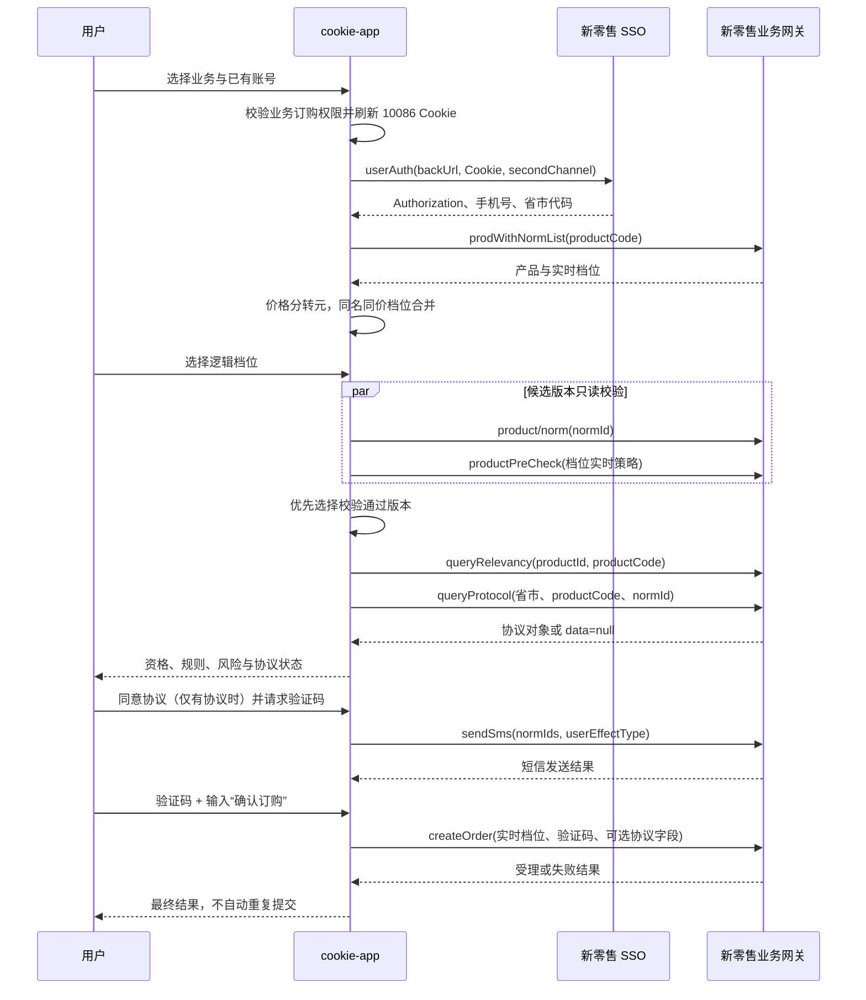

# 移动商城业务订购流程、接口与开发设计

更新日期：2026-07-24

## 1. 范围与结论

本文覆盖 cookie-app 新增的四项中国移动新零售商城业务：

| 业务 ID | 产品名称 | productId | productCode | secondChannel | 价格/档位 |
| --- | --- | --- | --- | --- | --- |
| `five_g_enjoy` | 5G畅享套餐（多档可选） | `2126865` | `6784393` | 空 | 78/98/128/158/198/238/298/398/598 元 |
| `fly_card_8` | 8元4G飞享卡 | `2165665` | `11489145` | 空 | 8 元 |
| `excellent_device_offer` | 卓越会员购机优惠 | `2154200` | `12193836` | `WXQ` | 0 元 |
| `traffic_member_20` | 10GB流量+热门会员 | `2126211` | `4888051` | `WXQ` | 20 元 |

四项业务共用新零售 SSO、产品、档位、资格、协议、短信和订单接口，但不能共用一组固定请求参数。实际参数必须以当前产品和所选档位的实时返回为准。

除固定入口外，系统提供 `custom` 自定义移动商城业务。它仅放开受控的产品、渠道和来源字段，仍必须经过实时产品查询、档位详情、资格校验、协议查询和短信确认，不提供任意接口路径或原始 JSON 透传。

核心差异：

- `6784393` 和 `11489145` 存在多个同名同价的底层档位版本。页面只展示一个逻辑档位，服务端对候选版本进行实时预校验并选择通过版本。
- `12193836` 和 `4888051` 必须携带 `Chop-Second-Channel: WXQ`，且 SSO `backUrl` 保留 `secondChannel=WXQ`。
- `12193836` 的权益码为 `500000051301`，`bizIntfCode=001_JIYUN`，资格预校验类型为 `5`。
- `4888051` 的权益码为 `111602035621`，`bizIntfCode=100_COM`，资格预校验类型为 `2`。
- 四项业务的实时协议查询均可能成功返回 `data=null`。商城原页面允许此时不携带协议流水继续办理，不能报 `PROTOCOL_MISSING`。
- 四个来源 URL 没有 `yx` 营销码，不能继承智臻会员的 `contractOperation=&1319080049&&`。

## 2. 原始链接参数

### 2.1 5G畅享套餐

```text
productId=2126865
productCode=6784393
fromRecommend=3
pageSource=100
pageid=f3f4486601a4496bb461cc032a615d10
```

这些来源参数写入 SSO `backUrl` 和商城 Referer，不参与权益码计算。

### 2.2 8元4G飞享卡

```text
productCode=11489145
redCode=
rcm_src=
ab_version=
traceId=
rcm_scene=
agentid=
channelId=
secondChannel=
```

空字段不发送，不回退为其他产品的渠道或营销参数。

### 2.3 卓越会员购机优惠

```text
productCode=12193836
secondChannel=WXQ
```

### 2.4 10GB流量+热门会员

```text
productCode=4888051
secondChannel=WXQ
```

## 3. 完整业务流程



服务端会话有效期为 15 分钟。短信发送有 60 秒冷却。选择变更后旧协议、旧验证码和旧档位状态全部失效。

## 4. 上游接口说明

上游基址：`https://wx.10086.cn/website/nrapigate/`

所有业务请求使用 AES 加密正文；Cookie、Authorization 和手机号不得写入应用日志。

### 4.1 SSO 登录

`POST nrauth/auth/encryt/userAuth`

请求明文：

```json
{
  "backUrl": "/website/businessPlatform/shopDetail?productCode=4888051&secondChannel=WXQ"
}
```

关键请求头：

- `channelid: BUSINESS_H5`
- `pageType: xds18`
- `x-app-version: 1.0.1`
- `Chop-Second-Channel: WXQ`，仅 WXQ 产品
- 当前账号 10086 Cookie

关键响应：`data.token`、`data.userInfo.telephone/aesTelNum`、`provinceCode`、`cityCode`。

### 4.2 产品与档位

`POST nrmix/product/prodWithNormList`

```json
{ "productCode": "4888051" }
```

响应字段：

- `productId/productCode/productName/intro`
- `norms[].normId`：商城档位 ID
- `norms[].productCode`：实际权益码或套餐资费码
- `norms[].price`：单位为分，API 对前端转换为元
- `norms[].bizIntfCode`：业务接口类型
- `norms[].handleSmsType`：短信策略类型
- `norms[].isNormProtocolFlag/normProtocolIds`：协议配置提示

同名同价档位按逻辑档位合并，但所有候选 `normId` 仅保存在服务端会话中。

### 4.3 档位详情

`POST nrmix/product/norm`

```json
{ "normId": 2148574 }
```

必须从详情读取：

- `productCode`
- `busiEffectType`
- `preCheckTypes/preCheckType`
- `specialOfferType`
- `bizIntfCode`
- `commonCategoryCode/commonCode`
- `segments`

不得为四项业务统一硬编码 `Type_NextCycle` 或 `preCheckType=5`。

### 4.4 资格预校验

`POST nrmix/preCheck/productPreCheck`

```json
{
  "packageId": "111602035621",
  "isMain": 0,
  "shopProvinceCode": "351",
  "busiEffectType": "Type_Default",
  "specialOfferType": 0,
  "preCheckType": "2",
  "productCode": 4888051,
  "normId": 2148574,
  "bizIntfCode": "100_COM",
  "touchCode": "",
  "shopPageId": "",
  "productPersonalPageId": ""
}
```

只有配置了营销码的产品才附加 `contractOperation`。顶层 `returnCode=0` 后，业务结果还可能是 JSON 字符串嵌套在 `data` 中，必须继续解析 `status/message`。

资格不通过不会自动发送短信。用户明确开启“仍尝试提交”后才可继续。

### 4.5 关联活动

`POST nrmix/product/queryRelevancy`

```json
{
  "productId": 2126211,
  "productCode": 4888051,
  "productType": 1,
  "promotionPage": "1"
}
```

存在 `promoteActivityId` 时，订单附加：

```json
{ "relevanceActivityVO": [{ "relActivityId": 123, "relActivityType": 12 }] }
```

### 4.6 实时协议

`POST nrproduct/atom/protocol/queryProtocol`

```json
{
  "provinceCode": "351",
  "productCode": 4888051,
  "queryType": "",
  "normId": 2148574,
  "cityCode": "354"
}
```

兼容结构：主对象、数组、`protocolList[]`、`backstopProtocolList[]`。

处理规则：

- 有 `protocolSequenceId`：最终订单附加 `protocolSequenceId`。
- 无流水但有 `protocolId/ptId`：最终订单附加 `ptId`。
- `returnCode=0,data=null`：标记 `protocolRequired=false`，不报错，不发送伪造流水。
- 查询接口失败：停止流程并返回上游错误。

### 4.7 发送订购验证码

`POST nrmix/sms/sendSms`

```json
{
  "busiId": "2",
  "normIds": "2148574",
  "userEffectType": "Type_Default"
}
```

仅智臻会员等带营销码的业务附加 `contractOperation`。

### 4.8 确认订购

`POST nrmix/order/createOrder`

核心字段：

```json
{
  "normid": 2148574,
  "ordertype": 1,
  "productId": 2126211,
  "productCode": 4888051,
  "password": "<验证码>",
  "cmgSmsCode": "<验证码>",
  "verifyCode": "<验证码>",
  "orderResource": 20,
  "userEffectType": "Type_Default",
  "signActivity": false
}
```

协议与营销字段均为条件字段。来源 URL 中的 `fromRecommend/redCode/rcm_src/agentid/traceId` 分别透传到商城订单字段，空值不会继承其他产品的配置。

响应分类：

- `returnCode=0`：订单已受理，订单号优先读取 `data.orderNumber`，兼容 `data.bean.orderId`。
- `returnCode=A00012`：商城定义为申请已提交但结果待短信确认，标记 `accepted=true, uncertain=true`，不当作普通失败。
- 验证码错误、次数超限或其他错误码：未受理，展示上游 `returnMessage`。
- 超时或连接中断：返回 `RESULT_UNCERTAIN`，前端提示用户先通过官方渠道查询，禁止自动重试。

## 5. cookie-app 内部 API

所有接口位于 `/api/benefit-orders`，需要管理员会话或已登录用户的 `businessOrder` 权限。

### 5.1 业务目录

`GET /catalog`

返回 `workflows` 和 `retailProducts`。前端入口使用稳定业务 ID，不直接拼接未校验 URL。

### 5.2 创建会话

`POST /sessions`

```json
{
  "workflow": "premium_membership",
  "businessId": "traffic_member_20",
  "accountId": "<账号ID>",
  "productId": "2126211",
  "productCode": "4888051",
  "secondChannel": "WXQ",
  "touchCode": "",
  "marketingCode": ""
}
```

`productCode` 可在高级参数中覆盖以支持其他新零售产品。产品返回的真实 `productId` 会覆盖输入值。空渠道和营销字段保持为空，不继承其他业务默认值。

### 5.3 流程接口

| 接口 | 作用 | 外部副作用 |
| --- | --- | --- |
| `POST /sessions/:id/product` | 加载产品档位 | 无 |
| `POST /sessions/:id/selection` | 档位详情、资格和协议 | 无 |
| `POST /sessions/:id/order-sms` | 发送订购验证码 | 有，发送短信 |
| `POST /sessions/:id/confirm` | 提交订单 | 有，办理业务 |
| `GET /sessions/:id` | 查询状态 | 无 |
| `DELETE /sessions/:id` | 销毁会话 | 无外部副作用 |
| `POST /sessions/:id/back` | 清理已选档位、资格、协议和短信状态，回到档位页 | 无 |

选择请求：

```json
{ "selectedIds": ["2148574"] }
```

自定义档位请求：

```json
{
  "selectedIds": [],
  "customNorm": {
    "id": "2148574",
    "packageId": "111602035621",
    "name": "自定义 20 元档",
    "price": 20,
    "bizIntfCode": "100_COM"
  }
}
```

`customNorm.id` 必须为 1-20 位数字。`packageId/name/price/bizIntfCode` 用于显示和请求补全，档位详情接口返回值优先。自定义产品创建会话时 `productCode` 必填，可选字段为 `productId/touchCode/marketingCode/secondChannel/effectType/fromRecommend/redCode/rcm_src/traceId/agentid/pageSource/pageid`。

验证码请求：

```json
{ "acceptedProtocol": true, "forceAttempt": false }
```

当 `protocolRequired=false` 时，服务端不要求协议勾选。`forceAttempt=true` 只允许在资格失败后继续尝试，不绕过上游最终校验。

## 6. 产品与交互设计

业务订购首页保留四个一级分类：卓越钻石卡、积木套餐、智臻会员、移动商城。

移动商城分类内部使用五个紧凑入口：

- 5G畅享套餐
- 8元4G飞享卡
- 卓越会员购机优惠
- 10GB流量+热门会员
- 自定义业务

用户流程：选择业务 -> 选择账号 -> 建立 SSO -> 获取实时产品 -> 选择逻辑档位 -> 查看资格/规则/协议 -> 发送验证码 -> 二次确认。

交互规则：

- 同名底层版本不重复占用页面空间，显示“共 N 个适配版本”。
- 价格统一显示元/月，0 元业务明确显示 0 元。
- 无协议时显示“实时校验完成”，不显示无意义的协议复选框。
- 资格失败时展示上游原始业务提示，并要求用户单独开启“仍尝试提交”。
- 最终提交前必须输入“确认订购”，按钮使用危险操作样式。
- 切换移动商城产品会销毁旧组件状态，旧会话在卸载时删除。
- “返回上一步”从协议/短信阶段回到档位选择，并使旧协议与旧验证码失效；从产品阶段返回参数页时销毁会话但保留当前输入。
- “重新开始”销毁会话，清空协议、验证码、结果和自定义档位，恢复当前业务的默认产品参数。
- 协议内容先进行最多四层 JSON 字符串、Unicode 转义和 HTML 实体解码，再移除脚本、事件属性和危险 URL，最后在限高滚动区中展示。

## 7. 安全、权限与审计

- public 页面只有具备 `businessOrder` 权限的用户能看到并访问订购入口。
- 非管理员只能为自己关联的账号创建会话。
- 服务端校验 SSO 返回手机号与所选账号一致。
- Cookie、Authorization、完整手机号、验证码不返回给浏览器，也不写日志。
- 会话绑定 ownerKey，其他用户不能读取、发送短信或提交。
- 短信与订单接口必须由用户显式操作触发；产品加载和资格检查不会发送短信。
- 服务端不保存验证码，不自动重试订单。

## 8. 验证记录

2026-07-24 使用脱敏测试账号完成只读联调：

- 四项业务均完成 SSO、产品查询、档位详情、资格预校验、关联活动和协议查询。
- 四项业务均可到达 `selection_ready`。
- `6784393` 归并为 9 个逻辑价格档位，价格为 78 至 598 元。
- `11489145` 归并为 1 个逻辑档位，价格为 8 元。
- `12193836` 为单档 0 元，权益码 `500000051301`。
- `4888051` 为单档 20 元，权益码 `111602035621`，接口码 `100_COM`。
- 协议接口均返回成功且 `data=null`，按商城脚本的可选协议逻辑处理。
- 测试账号对四项业务均未通过资格校验，因此没有发送验证码，也没有提交订单。

自动化验证包括：API 单测、UI 单测、TypeScript 类型检查、生产构建及桌面/移动端页面检查。
