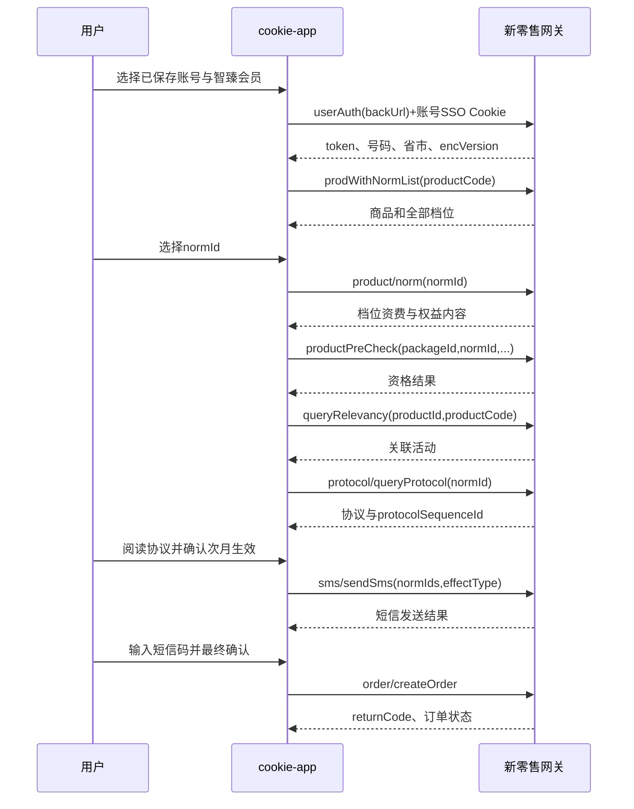

# 智臻会员权益订购业务流程与接口说明

## 1. 文档范围

本文基于 `智臻会员办理.har` 与 `智臻会员订阅.zip` 中新零售商详页源码形成。该业务使用 `wx.10086.cn/website/nrapigate` 网关，与 COC 卓越钻石、积木套餐不是同一套登录和加密协议。

## 2. 样例产品与档位模型

- 商详产品：`productId=2171755`
- 商品编码：`productCode=15890747`
- 商品名称：智臻会员
- 办理渠道：`channelid=BUSINESS_H5`
- 样例触点：`touchCode=P00000102705`
- 样例二级渠道：`Chop-Second-Channel=P00000116110`
- 生效方式：`Type_NextCycle`
- 业务接口码：`001_JIYUN`

一个智臻会员商品下有多个档位，每档由 `normId + packageId` 唯一确定。样例覆盖 199、299、399、599、999 元档及 A/B/C 版本。系统必须实时调用产品接口加载档位，不把 HAR 列表作为长期静态配置。

## 3. 登录与加密协议

### 3.1 SSO 用户认证

`POST /website/nrapigate/nrauth/auth/encryt/userAuth`

明文请求：

```json
{
  "backUrl": "/website/businessPlatform/shopDetail?productId=2171755&productCode=15890747"
}
```

该请求依赖账号对应的 10086/WX SSO Cookie。请求明文使用 AES-128-CBC/PKCS7 加密为大写十六进制；认证成功返回：

- `data.token`：后续 `Authorization`；
- `data.userInfo.telephone`：当前办理号码的 AES-128-CBC 十六进制密文，需用认证密钥再解密一次；
- `provinceCode/cityCode`；
- `encVersion=2`；
- `secondChannel`。

系统只使用所选账号的服务端 Cookie 发起 SSO，不允许前端传入或读取 Authorization。

### 3.2 业务网关加密

当 `encVersion=2` 时，后续 POST 请求：

- 使用 AES-256-CBC/PKCS7；
- 密文采用 Base64 URL-safe 形式；
- 响应外层为 `{ "body": "<cipher>" }`；
- 解密后业务结构为 `{ returnCode, returnMessage, data, ok }`。

请求头至少包含：

- `Authorization: <userAuth token>`
- `x-app-version: 1.0.2`
- `channelid: BUSINESS_H5`
- `Chop-Second-Channel: <userInfo.secondChannel>`
- `chop-real-host: wx.10086.cn`（`userAuth` 认证阶段）
- `pageType: xds18`（`userAuth` 认证阶段）
- `Origin: https://wx.10086.cn`
- `Referer: 智臻会员商详页`
- 所选账号的服务端 Cookie

## 4. 完整业务流程



## 5. 上游接口

### 5.1 获取商品及档位

`POST /website/nrapigate/nrmix/product/prodWithNormList`

```json
{ "productCode": "15890747" }
```

关键返回：商品信息、允许办理省份、`norms[]`。档位至少保留：`normId`、`productCode`（即 packageId）、`name`、`price`、`bizIntfCode`、`productTags`。

### 5.2 获取档位详情

`POST /website/nrapigate/nrmix/product/norm`

```json
{ "normId": 2263288 }
```

返回档位结构化权益、业务资费、生效时间、变更提示及富文本内容。HTML 必须经过白名单清理后展示。

### 5.3 产品资格预校验

`POST /website/nrapigate/nrmix/preCheck/productPreCheck`

```json
{
  "packageId": "500000051645",
  "isMain": 1,
  "shopProvinceCode": "351",
  "busiEffectType": "Type_NextCycle",
  "specialOfferType": 0,
  "preCheckType": "5",
  "productCode": 15890747,
  "normId": 2263288,
  "bizIntfCode": "001_JIYUN",
  "touchCode": "P00000102705",
  "shopPageId": "",
  "productPersonalPageId": "",
  "contractOperation": "&1319080049&&"
}
```

`data` 是嵌套 JSON 字符串，需要最多两次结构化解析。资格失败时默认警告；按现有产品要求提供“仍尝试提交”，但不伪造资格通过。

### 5.4 查询关联活动

`POST /website/nrapigate/nrmix/product/queryRelevancy`

```json
{
  "productId": 2171755,
  "productCode": 15890747,
  "productType": 1,
  "promotionPage": "1"
}
```

样例返回 `promoteActivityId=200012104`，创建订单时映射为：

```json
[{ "relActivityId": 200012104, "relActivityType": 12 }]
```

### 5.5 查询协议

`POST /website/nrapigate/nrproduct/atom/protocol/queryProtocol`

```json
{
  "provinceCode": "351",
  "productCode": 15890747,
  "queryType": "",
  "normId": 2263288,
  "cityCode": "354"
}
```

协议正文可能位于主对象，也可能位于 `backstopProtocolList[]`。必须保存实时 `protocolSequenceId`，切换档位后旧流水立即失效。

### 5.6 发送办理验证码

`POST /website/nrapigate/nrmix/sms/sendSms`

```json
{
  "busiId": "2",
  "normIds": "2263288",
  "userEffectType": "Type_NextCycle",
  "contractOperation": "&1319080049&&"
}
```

成功判定为顶层 `returnCode=0`，并检查 `data.status=0`。触发真实短信，服务端执行 60 秒冷却。

### 5.7 创建订单

`POST /website/nrapigate/nrmix/order/createOrder`

核心字段：

```json
{
  "shopid": "",
  "normid": 2263288,
  "ordertype": 1,
  "timeSpan": 1784796021340,
  "password": "123456",
  "productId": 2171755,
  "productCode": 15890747,
  "cmgSmsCode": "123456",
  "verifyCode": "123456",
  "confirmTime": "2026-07-23 16:40:21",
  "orderResource": 20,
  "extendParams": [],
  "touchCode": "P00000102705",
  "bookTime": "2026-07-23 16:39:48",
  "userEffectType": "Type_NextCycle",
  "protocolSequenceId": "<实时协议流水>",
  "contractOperation": "&1319080049&&",
  "relevanceActivityVO": [
    { "relActivityId": 200012104, "relActivityType": 12 }
  ]
}
```

`token/signActivity` 等动态字段只在上游实时返回或页面规则明确要求时传入，不复制 HAR 中的旧值。

样例第一次返回 `SMS_9999`（验证码错误），第二次返回 `returnCode=0`，订单状态为“办理中”。因此“接口受理成功”不等于“业务已生效”，结果页必须显示订单状态和“以短信通知为准”。

创建订单不自动重试。HTTP 超时或连接中断统一标记为“结果未确认”。

## 6. cookie-app 内部接口设计

统一前缀：`/api/benefit-orders`，`workflow=premium_membership`。

| 方法 | 路径 | 作用 |
| --- | --- | --- |
| POST | `/sessions` | 读取所选账号 Cookie、完成 SSO/userAuth、建立短时会话 |
| GET | `/sessions/:id` | 返回脱敏会话状态 |
| POST | `/sessions/:id/product` | 获取商品及实时档位 |
| POST | `/sessions/:id/selection` | 加载档位、资格、关联活动和协议 |
| POST | `/sessions/:id/order-sms` | 协议确认后发送办理短信 |
| POST | `/sessions/:id/confirm` | 二次确认并创建订单 |
| DELETE | `/sessions/:id` | 清除 Cookie、Authorization 和临时订单上下文 |

智臻会话必须绑定 `accountId + ownerKey`。前端不能用手输手机号创建智臻会话，因为 SSO Cookie 必须与号码一致。
