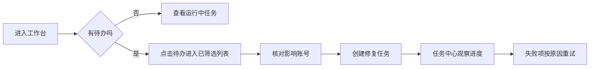
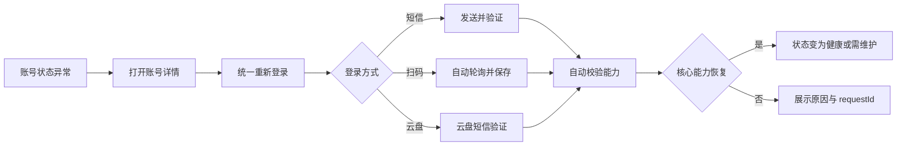
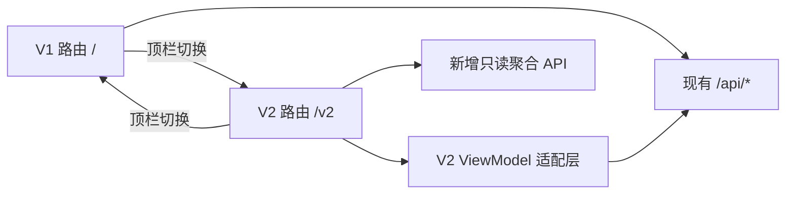

# CMCC OPS V2 产品与交互设计方案

- 文档状态：V2 Phase 1 已实现，可进入真实数据灰度验收
- 设计对象：`cookie-app` 管理端、公共用户端、管理员登录
- 设计日期：2026-07-18
- 核心策略：新界面壳层 + 旧业务内核，V1 原样保留

## 当前实施状态（2026-07-19）

已落地 `/v2` 独立壳层、工作台、账号中心、账号详情、统一登录、任务中心、自动化计划、权益活动、业务查询、专属链接、用户与权限、日志审计入口和系统设置。页面读取现有真实 API 与账号数据，不使用演示数据；V1 路由和业务内核保留。

Phase 1 同时完成账号健康 ViewModel、停止任务展示映射、管理员路由门禁、cleanup 管理员鉴权、V1/V2 双向切换和 `VITE_UI_V2_ENABLED` 回退开关。任务历史目前先读取近期记录；完整分页、日志读取 API、业务查询内嵌化和公共用户端 V2 仍属于后续阶段。

## 1. 结论先行

V2 不应继续在 V1 首页上叠加卡片、按钮和弹窗。当前问题不是配色或圆角，而是功能发现、任务分层、状态语义和风险控制已经失去统一规则。

V2 的产品模型从“一个页面放下所有功能”改为“围绕日常运营任务组织工作区”：

1. **工作台回答今天先做什么**：异常账号、到期账号、失败任务和待领取权益。
2. **账号中心回答这个账号现在怎么样**：健康状态、登录凭证、活动能力、归属关系和最近操作。
3. **任务中心回答系统正在做什么**：任务范围、依赖预检、实时进度、账号级结果和历史复盘。
4. **权益活动回答今天完成了什么**：全球通签到、星动日、周三拼图和未领取 Token。
5. **业务查询回答用户订了什么**：套餐、合约、宽带、商城订购及退订记录。
6. **用户与访问回答谁能看什么**：用户、访问链接、账号分配、权限与通知。
7. **审计与设置回答系统为什么这样运行**：请求链路、运行引擎、安全开关和 UI 版本。

V1 与 V2 共用数据库和现有写接口。V2 使用独立 `/v2` 路由和 ViewModel 适配层，不复制后端任务逻辑。发生问题时直接回到 `/`，不需要数据回滚。

## 2. 现状诊断

### 2.1 信息架构失控

- `Home.tsx` 已达到 6616 行，账号、凭据、签到、活动、批量任务、定时计划、邀请码、配置和用户入口混在同一页面。
- `PublicLogin.tsx` 3230 行，同时承担登录、注册、账号管理、任务、活动和业务入口。
- `BusinessQueryAdmin.tsx` 2838 行，同时承载套餐、合约、宽带、退订和多个详情弹层。
- `App.tsx` 有多个独立路由，但管理端没有稳定的全局导航；大量功能只能从“工具箱”或临时弹窗发现。

### 2.2 高风险交互没有被当作高风险

- 普通批量任务、批量失效和永久删除对“已选账号”的作用域规则不同。
- 切换筛选或权益视图后，隐藏的已选账号仍可能保留。
- 删除账号、清除凭据、停用链接与普通任务按钮距离过近，确认过程没有展示影响对象。
- “删除专属链接”在当前后端中会禁用关联账号并清空凭据，不能按普通删除设计。
- `cleanup/invalid` 与 `cleanup/duplicates` 当前未见管理员鉴权，上线 V2 前必须修复。

### 2.3 状态语义不统一

账号没有单一状态字段，页面同时使用 Cookie、Token、登录有效期、禁用时间和每日任务状态做判断。V1 中“有效”“无效”“未知”“未领取”的统计口径与筛选口径不完全一致。

V2 必须先建立统一的展示状态：

| 展示状态 | 判定优先级 | 用户动作 |
| --- | --- | --- |
| 已失效 | `disabledAt` 存在 | 只读查看；重新接入需新登录 |
| 需重新登录 | `cookieInvalidAt`、登录已过期或核心 CK 缺失 | 进入统一登录流程 |
| 即将到期 | 登录有效期小于提醒阈值 | 提前重新登录 |
| 需维护 | 核心登录正常，但云盘/App/活动凭据异常 | 运行对应维护任务 |
| 健康 | 核心能力正常且状态在有效窗口内 | 可执行日常任务 |
| 未知 | 从未校验或数据不足 | 先运行状态检测 |

颜色只做辅助，状态文字和动作始终可见。

### 2.4 任务体验不完整

- 任务入口散落在工具箱、表格和小徽标中。
- 全局、选中账号、单账号三个版本的动作重复增长。
- 只有进行中任务可发现，缺少完整历史中心。
- 任意任务执行时，大量按钮会统一禁用，但不解释冲突原因。
- “停止任务”在数据层会变成 `failed` 或 `partial_success`；V2 首期应在展示适配层映射成“已停止”。

### 2.5 移动端不是缩小版桌面

V1 账号表使用 11px 字体和至少 960px 宽度，移动端依赖横向滚动。V2 桌面端保留密度可控的表格，窄屏改为账号摘要行/卡片、底部主导航和全屏详情页，不能继续压缩列宽。

## 3. 产品目标

### 3.1 目标

- 管理员进入后 10 秒内判断“今天是否有异常、先处理什么”。
- 添加或修复账号只保留一个入口，系统根据方式组织短信、扫码和云盘登录。
- 所有批量动作在执行前明确任务类型、账号范围、依赖和预计影响数量。
- 所有长任务离开页面后继续运行，并可在任务中心找回。
- 所有危险操作展示影响对象、不可逆后果和明确确认步骤。
- 普通用户端只展示与自己有关的账号、任务、活动和业务，不暴露管理员概念。
- V1 可以长期保留，V2 可灰度、可回退、无数据迁移风险。

### 3.2 非目标

- V2 首期不重写 CMCC 上游业务逻辑。
- 不同时维护两套任务调度器。
- 不在首期迁移全部 API 到 `/api/v2`。
- 不把 Cookie、Token、App CK 等原始敏感值默认展示在列表中。
- 不为了“看起来丰富”继续增加无业务意义的图表或大面积卡片。

## 4. 用户与任务模型

### 4.1 管理员 / 运营者

高频任务：每日巡检、账号接入与恢复、批量运营、异常复盘、自动化配置、用户分发。

核心诉求：少找入口、少重复操作、明确影响范围、可以离开页面、失败后能追踪。

### 4.2 专属链接用户

高频任务：查看自己的账号是否正常、重新登录、完成签到/活动、查看套餐和退订业务。

核心诉求：只看自己的数据、不理解技术字段也能操作、任务有结果、失败有下一步。

### 4.3 系统维护者

高频任务：查看请求链路、定位上游失败、调整 Worker、检查通知与鉴权。

核心诉求：可按 `requestId/accountId/taskId/linkId` 关联日志，所有配置变更可审计。

## 5. V2 信息架构

```text
CMCC OPS V2
├── 工作台
│   ├── 健康概览
│   ├── 今日待办
│   ├── 运行中任务
│   └── 7 日质量趋势
├── 账号中心
│   ├── 账号列表
│   ├── 账号详情
│   ├── 添加 / 批量导入
│   └── 统一重新登录
├── 任务中心
│   ├── 执行队列
│   ├── 任务历史
│   ├── 任务详情
│   └── 自动化计划
├── 权益活动
│   ├── 全球通签到
│   ├── 星动日
│   ├── 周三拼图
│   └── 未领取权益 Token
├── 业务查询
│   ├── 在网业务
│   ├── 套餐与合约
│   ├── 宽带
│   ├── 商城业务
│   └── 退订记录
├── 用户与访问
│   ├── 专属链接
│   ├── 用户与权限
│   ├── 账号分配
│   └── 通知配置
└── 系统
    ├── 日志与审计
    ├── 运行设置
    ├── 登录与通知策略
    └── V1 / V2 版本设置
```

### 5.1 全局导航规则

- 左侧导航只放工作域，不放单次动作。
- “添加账号”“新建任务”“创建链接”属于页面主动作，放在页面标题右侧。
- 账号详情、任务详情、链接详情和用户详情在桌面端使用右侧抽屉；移动端使用独立全屏路由。
- 管理端与用户端使用不同产品名称和导航，避免都叫“中国移动用户管理”。
- V1/V2 切换放在顶栏固定位置；切换时直接跳转，不弹确认框。

## 6. 术语体系

| V1 术语 | V2 术语 | 原因 |
| --- | --- | --- |
| CK | 登录凭证（CK） | 首次出现时保留技术名，降低理解门槛 |
| Token | 全球通授权 Token | 说明归属能力 |
| 激活信息 | 同步账号资料 | 用任务结果描述，不暴露内部端点 |
| 已订业务 | 套餐与合约 | 对应套餐、合约和宽带数据源 |
| 查询和退订 | 商城业务 | 对应商城订购数据源 |
| 邀请码 | 专属链接 / 访问链接 | 从代码名改为用户目标 |
| 失效处理 | 清除凭据并失效 | 当前行为不可恢复，必须直说 |
| 一键完成 | 对全部符合条件账号执行 | 避免“一键”掩盖作用范围 |
| 当前任务 | 执行中的任务 | 与历史、排队、停止状态对齐 |

## 7. 全局交互规范

### 7.1 页面骨架

- 桌面：224px 左侧导航 + 顶栏 + 主内容区。
- 宽屏内容不做超宽卡片墙；页面以全宽信息带、安静表格和少量关键指标为主。
- 顶栏包含当前页面、V1/V2 切换、全局搜索、通知和个人菜单。
- 页面标题区最多一个主按钮，次要动作使用普通按钮或菜单。

### 7.2 响应式

| 宽度 | 布局 |
| --- | --- |
| `>= 1200px` | 完整侧栏、密度表格、右侧详情抽屉 |
| `768-1199px` | 完整侧栏或可收起侧栏、两列区域改一列 |
| `< 768px` | 隐藏侧栏，页面选择进入顶部/底部导航；表格改摘要列表；抽屉改全屏页 |

移动端不隐藏重要状态，不允许按钮文字截断，不依赖横向滚动完成主流程。

### 7.3 状态反馈

- 页面首次加载使用骨架屏；不能用“暂无数据”替代加载中。
- 空状态必须说明当前筛选和可执行动作。
- 短成功提示 3 秒后消失；错误提示持续存在，直到用户关闭或问题解决。
- 长任务不使用 Toast 表示最终结果；创建成功后进入任务中心，并显示可返回的任务 ID。
- 请求失败展示 `requestId` 和“查看日志”，不直接展示完整上游响应。

### 7.4 批量选择

- 选择条始终显示“当前筛选已选 X，其他筛选已选 Y”。
- 切换筛选时不静默改变选择；用户可显式“清除隐藏选择”。
- 创建任务时再次展示最终账号数量和范围表达式。
- 批量动作默认只处理明确选择，不根据页面可见性临时改变语义。
- 提交前执行依赖预检：登录凭证、App CK、SSPID、活动凭据、任务冲突。

### 7.5 弹窗、抽屉与危险动作

- 简短创建/确认使用弹窗；需要查看上下文的详情使用抽屉；完整业务流程使用页面。
- 弹窗必须有焦点锁、Escape、明确关闭、未保存保护和可访问名称。
- 危险动作分三级：

| 级别 | 示例 | 交互 |
| --- | --- | --- |
| 一般 | 重新查询、停止排队任务 | 普通确认或直接执行 |
| 高风险 | 停止运行中任务、退订业务 | 展示已完成/未完成数量或业务影响，再确认 |
| 不可逆 | 清除凭据、永久删除账号、停用链接并禁用账号 | 展示对象清单、后果、二次输入，不允许 Toast 撤销伪装 |

### 7.6 敏感数据

- 账号列表不展示完整 Cookie、Token、App CK。
- 账号详情默认只展示“存在、有效、即将到期、失效、未知”。
- 查看或复制原始值放在“高级信息”，要求额外权限并写审计日志。
- 导出 Token 显示导出数量、去重数量、跳过数量和下载/复制记录。

## 8. 页面设计

### A00 管理员登录

**路由**：`/v2/admin-login`

**页面目标**：明确这是管理员工作台，不与公共用户入口混淆。

**布局**：左侧品牌与环境信息，右侧单列登录表单。移动端上下排列。

**交互**：用户名、密码、保持登录、登录按钮；失败时保留用户名，错误持续显示；成功后回到原目标 URL。

**状态**：加载、凭据错误、账号停用、会话过期、服务不可用。

### A01 工作台

**路由**：`/v2`

**页面目标**：让管理员在 10 秒内确定优先事项。

**首屏结构**：

1. 账号总数、健康账号、需要处理、今日任务四个关键指标。
2. 今日待办表：登录到期、CK 失效、计划异常，按影响账号数排序。
3. 运行中任务与预计完成时间。
4. 账号健康分布和 7 日任务成功率。

**交互**：点击待办直接带筛选进入账号中心或任务中心；点击运行中任务打开任务详情；指标不做无意义跳转。

**数据依赖**：Phase 1 由 ViewModel 基于现有账号 API 聚合；数据量增大后切换到 `/api/v2/dashboard` 服务端聚合，避免前端拉取全部账号后计算。

### A02 账号中心

**路由**：`/v2/accounts`

**页面目标**：按健康度管理账号，而不是在一行里塞入所有技术字段。

**表格列**：选择、账号、健康状态、凭据能力、登录有效期、专属链接、最近任务、详情。

**筛选**：全部、健康、即将到期、需重新登录、需维护、已失效、未知；支持手机号、备注和专属链接搜索。

**主要交互**：

- 点击账号打开详情抽屉。
- 选择账号后显示固定选择条。
- 批量 CK 维护、签到/拼图、查询信息都创建任务，不在表格内阻塞执行。
- 批量导入先校验，再显示新增、更新、冲突和拒绝项。
- 危险动作收进“更多”，并在确认页展示最终对象。

**移动端**：每个账号一行摘要，显示号码、健康、关键凭据、到期时间和主动作；详情进入全屏页。

### A03 账号详情

**桌面形态**：右侧抽屉；**移动形态**：`/v2/accounts/:id` 全屏页。

**Tab**：

1. 概览：品牌、套餐、星级、地区、专属链接、有效期、最近任务。
2. 登录与凭据：10086 CK、全球通 Token、云盘 CK、App CK 的状态和更新时间。
3. 权益：签到、星动日、周三拼图和可领取权益。
4. 套餐订购：在网业务、套餐合约、宽带和商城订购入口。
5. 访问关系：所属用户、专属链接和通知。
6. 操作记录：账号相关任务和审计事件。

**主动作**：重新登录、执行任务、查询业务。原始凭据不在默认 Tab 展示。

### A04 添加 / 重新登录账号

**形态**：统一流程弹窗；扫码阶段可扩展为大弹窗。

**步骤**：

1. 选择登录方式：10086 短信、App 扫码、云盘短信、Cookie 导入、高级 HAR 导入。
2. 填写手机号或选择已有账号。
3. 验证并自动保存。
4. 自动校验相关能力，展示恢复结果。

扫码登录由系统自动轮询并自动保存，不再要求用户手动“检查状态”和“补保存”。验证码冷却、全局冷却和失败原因在控件附近持续显示。

### A05 任务中心

**路由**：`/v2/tasks`

**页面目标**：让所有批量动作都有统一的创建、观察和复盘位置。

**视图**：执行中、今日完成、全部历史、任务模板。

**任务行**：任务类型、范围、进度、成功/失败/跳过、预计时间、发起人、状态和详情。

**新建任务**：

1. 任务类型。
2. 执行范围。
3. 依赖预检。
4. 并发与跳过策略。
5. 最终确认。

任务冲突必须解释原因，例如“相同范围的 CK 维护正在运行”，并提供“查看现有任务”。

### A06 任务详情

**桌面形态**：右侧抽屉；复杂日志可进入 `/v2/tasks/:id`。

**内容**：总体进度、范围、创建人、开始/结束时间、账号级明细、错误分组、重试和停止。

**停止规则**：展示已完成、执行中和未开始数量；停止后 UI 映射为“已停止”，不直接向用户展示底层 `failed/partial_success`。

**数据依赖**：新增任务历史分页、筛选和账号明细分页接口。

### A07 自动化计划

**路由**：`/v2/automations`

**页面目标**：把周期计划从工具箱弹窗提升为可观察、可审计的独立对象。

**结构**：计划列表 + 未来 24 小时时间线。

**计划字段**：名称、任务模板、范围、周期、北京时间、并发、依赖配置、失败通知、启用状态。

SSPID、活动凭据等依赖必须属于任务模板配置或系统设置，不能藏在其他弹窗里。创建计划时后端必须保存并实际使用这些字段。

### A08 权益活动

**路由**：`/v2/benefits`

**页面目标**：按业务结果管理活动，不让用户去任务日志里寻找“是否签到成功”。

**内容**：今日覆盖、已完成、可领取权益；全球通签到、星动日、周三拼图、未领取 Token 四类活动；失败账号和下一次计划。

**交互**：查看奖品、补跑失败项、按专属链接筛选、导出 Token。技术日志通过任务 ID 跳到任务详情。

### A09 业务查询

**路由**：`/v2/business`

**页面目标**：统一入口，不再让用户理解“已订业务”和“查询和退订”两个相似名字。

**Tab**：在网业务、套餐与合约、宽带、商城业务、退订记录。

**头部上下文**：当前账号、号码切换、登录态、品牌、主套餐、星级和合约到期。

**交互**：切换 Tab 保留当前账号；从账号详情进入时保留账号上下文；返回账号中心时保留筛选和选择。

### A10 业务退订

**形态**：独立步骤弹窗或移动端全屏页。

**步骤**：

1. 核对账号与业务。
2. 展示月费、合约限制、立即/月底失效和关联权益。
3. 选择原因。
4. 发送并验证短信。
5. 最终确认并生成结果记录。

合约期内不可直接退订时，按钮改为“查看限制”，不能让用户走到最后一步才失败。

### A11 专属链接

**路由**：`/v2/links`

**页面目标**：统一管理邀请码、账号归属、登录用户、二维码和 PushPlus。

**列表列**：邀请码、备注/使用人、关联账号、登录用户、通知、最近活跃、状态。

**详情抽屉**：访问地址、复制、二维码、账号归属、用户、权限、通知和审计记录。

**停用**：必须显示关联账号数量、清除凭据后果和不可恢复提示，并要求输入邀请码确认。更理想的后端方案是拆分“停用入口”和“禁用账号”两个动作。

### A12 用户与权限

**路由**：`/v2/users`

**页面目标**：把登录策略、用户、邀请码归属和功能权限放在同一上下文中。

**内容**：访问策略、用户列表、账号数量、业务权限、最近登录和状态。

**详情抽屉**：关联专属链接、业务查询权限、商城退订权限、业务 ID 覆盖、会话和重置密码。

权限保存后立即写入审计日志。`permissionsJson` 必须进入正式 Prisma migration，消除 schema drift。

### A13 日志与审计

**路由**：`/v2/audit`

**页面目标**：从错误直接找到账号、任务和请求链路。

**筛选**：时间、级别、动作、账号、任务、专属链接、`requestId`。

**详情**：错误摘要、上游响应分类、关联事件、Worker、耗时和可执行动作。

当前系统只有日志写入，没有读取 API。落地前需新增分页查询、索引和脱敏策略。

### A14 系统设置

**路由**：`/v2/settings`

**分区**：

- 运行引擎：Node/Go、并发、有效窗口。
- 通知与登录：PushPlus、公共短信登录、管理员短信登录、冷却策略。
- 活动配置：SSPID、App 活动凭据、HAR 导入状态。
- 安全：敏感数据权限、管理员路径和会话。
- 界面版本：默认版本、显示切换、灰度开关。

配置分区独立保存；高风险配置变更要求二次确认和审计。

### P01 公共登录 / 注册

**路由**：`/v2/public`

公共入口先识别链接与现有会话：

- 已登录：直接进入个人账号中心。
- 有邀请码、无账号：显示用户名登录和邀请码直接登录；注册是独立次级入口。
- 链接无效：明确说明入口不可用，不展示账号登录表单。
- 会话过期：保留邀请码上下文，重新登录后返回原页面。

登录与注册必须拆成两个明确动作，不再使用一个按钮同时表达两种行为。

### P02 个人账号中心

**路由**：`/v2/portal`

**首屏**：用户名、专属链接、健康账号数、今日任务和最近到期；常用操作；我的账号列表。

**主动作**：更新账号状态、签到+拼图、查询业务、添加/重新登录。

普通用户不看到 Worker、SSPID、全局账号、原始凭据、管理员工具箱和跨用户任务。

## 9. 核心流程

### 9.1 每日巡检



### 9.2 账号恢复



### 9.3 批量任务


### 9.4 V1 / V2 切换



## 10. V1 功能映射

| V1 功能 | V2 位置 | 改造方式 |
| --- | --- | --- |
| 首页账号大表 | 账号中心 | 减列、状态优先、详情抽屉 |
| 添加账号 / App 扫码 | 统一登录流程 | 一个入口，多种方式 |
| 一键 CK 维护 | 任务中心 | 模板 + 范围 + 依赖预检 |
| 一键激活云盘 CK | 任务中心 / 账号详情 | 全局任务或单账号维护 |
| 签到 + 拼图 | 权益活动 / 任务中心 | 业务结果与技术执行分离 |
| 周三拼图配置 | 权益活动 / 系统设置 | SSPID 与活动凭据显性化 |
| 复制未领取 Token | 权益活动 | 显示导出、去重、跳过统计 |
| 清除无效 CK | 账号中心危险操作 | 补鉴权、影响预览、二次确认 |
| 账号去重 | 账号中心数据治理 | 补鉴权、展示重复组、逐组确认 |
| 邀请码记录弹窗 | 专属链接页 | 删除重复入口 |
| 用户管理 | 用户与权限 | 纳入统一导航 |
| 定时计划弹窗 | 自动化计划页 | 可观察、可追踪、可审计 |
| 任务小徽标 / 日志弹窗 | 任务中心 / 任务详情 | 增加历史和失败重试 |
| 已订业务 | 业务查询：套餐与合约 | 保留数据源，重命名 |
| 查询和退订 | 业务查询：商城业务 | 保留数据源，重命名 |
| 公共链接页 | 个人账号中心 | 用户角色独立设计 |

## 11. V1 / V2 共存实现

### 11.1 路由

```text
/                         V1 管理端，保持不变
/links                    V1 专属链接，保持不变
/users                    V1 用户管理，保持不变
/public                   V1 公共入口，保持不变
/v2                       V2 工作台
/v2/accounts              V2 账号中心
/v2/tasks                 V2 任务中心
/v2/automations           V2 自动化计划
/v2/benefits              V2 权益活动
/v2/business              V2 业务查询
/v2/links                 V2 专属链接
/v2/users                 V2 用户与权限
/v2/audit                 V2 日志与审计
/v2/settings              V2 系统设置
/v2/portal                V2 个人账号中心
```

### 11.2 开关与偏好

- 新增 `VITE_UI_V2_ENABLED`；当前默认启用，设为 `0` 时关闭 `/v2` 并回退 V1。
- V1 顶部与 V2 顶栏都提供显式版本切换，灰度期间可随时返回经典版。
- `localStorage` 只记录默认偏好；用户直接访问的 URL 优先级更高。
- 关闭开关只隐藏 V2 路由，不能改变或迁移数据。

### 11.3 前端结构

```text
src/
├── pages/                 V1 保留
└── v2/
    ├── app/               Router、Shell、权限边界
    ├── pages/             页面
    ├── features/          account、task、benefit、business、access
    ├── components/        V2 组件
    ├── adapters/          旧 API -> ViewModel
    └── design-system/     状态、表格、抽屉、确认流程
```

V2 核心运营页不直接复用 V1 巨型首页，只复用领域方法和 API 客户端。Phase 1 的专属链接、用户权限使用 V1 成熟内容的 `embedded` 模式过渡，移除其全屏壳层和返回 V1 的内部导航；后续再按 V2 信息架构拆分详情抽屉。

### 11.4 API 策略

现有 mutation 继续调用验证过的 `/api/*`，首期只新增 V2 所需的只读 API：

| API | 用途 |
| --- | --- |
| `GET /api/v2/dashboard` | 健康聚合、待办、趋势、运行中任务 |
| `GET /api/v2/accounts` | 服务端分页、统一状态、搜索与筛选 |
| `GET /api/v2/tasks` | 任务历史分页与筛选 |
| `GET /api/v2/tasks/:id/items` | 账号级明细分页 |
| `GET /api/v2/logs` | 脱敏日志分页与关联查询 |
| `GET /api/v2/benefits/summary` | 活动完成与可领取聚合 |

所有状态在 adapter 层映射为稳定 ViewModel，避免页面重复判断原始字段。

## 12. 上线前置修复

以下事项不是视觉优化，必须在 V2 灰度前完成：

1. 为 `POST /api/accounts/cleanup/invalid` 和 `/cleanup/duplicates` 增加管理员鉴权。
2. 拆分或明确专属链接停用的关联账号禁用/凭据清理副作用。
3. 将 `User.permissionsJson` 纳入 Prisma schema 和正式 migration。
4. 统一静态路由门禁、`admin_key` 与 `admin_session`。
5. 为任务增加历史分页读取能力。
6. 为日志增加脱敏读取 API、索引和权限控制。
7. 统一批量选择的作用域规则。
8. 修复账号统计与筛选口径不一致。
9. 将 SSPID 和活动凭据变成实际可持久化、可校验的配置。

## 13. 分阶段实施

### Phase 0：安全与状态基线

- 补 cleanup 鉴权。
- 统一账号健康 ViewModel。
- 统一任务状态映射。
- 统一批量选择语义。
- 补路由门禁与权限 migration。

### Phase 1：V2 壳层与账号中心

- `/v2` Router、Shell、版本开关。
- 工作台聚合 API。
- 账号列表、详情、统一登录。
- 保留所有 V1 路由。

### Phase 2：任务与自动化

- 任务历史 API、执行队列、详情。
- 新建任务五步流程。
- 自动化计划页。
- 权益活动页。

### Phase 3：业务与协作

- 统一业务查询导航与上下文。
- 退订流程。
- 专属链接、用户和权限。
- 日志与审计。

### Phase 4：公共用户端

- 公共登录/注册拆分。
- 个人账号中心。
- 移动端全屏账号详情和任务结果。
- 完成灰度与默认版本切换。

## 14. 产品验收指标

### 可用性

- 首次测试用户能在 30 秒内找到账号重新登录、批量签到、任务历史和用户权限。
- 任意批量任务提交前都能看到准确账号数量。
- 任意不可逆动作都能看到影响对象与后果。
- 移动端主流程不发生横向滚动和按钮遮挡。

### 效率

- 每日巡检从“浏览整张账号表”降为“处理待办队列”。
- 添加/修复账号入口从多个收敛为一个。
- 全局/选中/单账号任务复用一个创建器。
- 任务失败可从任务详情直接定位到账号和 `requestId`。

### 稳定性

- V2 关闭开关后，V1 路由和业务完全可用。
- V1/V2 不产生双任务、双写或状态分叉。
- 新增只读聚合 API 不改变现有 mutation 语义。
- 所有敏感值查看和复制都可审计。

## 15. 评审时建议重点体验

1. 从工作台“即将到期”进入账号中心。
2. 打开账号详情，在“登录与凭据”中发起重新登录。
3. 多选账号，创建 CK 维护任务并查看任务详情。
4. 在权益活动中查看签到、星动日和周三拼图结果。
5. 在业务查询中完成退订确认。
6. 打开专属链接详情，体验停用高风险确认。
7. 切换用户端预览和管理员登录页。
8. 缩窄到手机宽度，检查导航、账号列表和弹窗重排。
