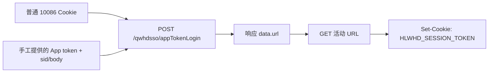

# 周三充值日活动技术说明与 cookie-app 实现审查

## 1. 文档范围

本文基于 2026-08-10 提供的以下材料进行静态分析：

- `周三.zip`：周三充值日 H5 页面、压缩后的 JavaScript、样式和图片资源。
- `周三.har`：中国移动 App 打开相关页面时产生的 64 条网络请求。
- cookie-app 当前实现：`api/services/wedRecharge.ts`、`api/services/batchTasks.ts`、`api/services/cmccSessionBridge.ts`、相关路由和单元测试。

活动 ID 为 `1024101716`，H5 API 根路径为：

```text
https://wx.10086.cn/hlwyxhdhub
```

活动主页面为：

```text
https://wx.10086.cn/hlwyxhdhub/act-wedrecharge/1024101716
```

本文不包含真实接口调用，不复用 HAR 内任何账号凭证，也不验证通过非官方流程重复上报任务。接口字段按证据来源分为：

- **源码确认**：在活动前端代码中可直接看到接口、参数或判断逻辑。
- **HAR 确认**：在本次 HAR 中实际出现，但业务报文可能仍为密文。
- **前端推断**：根据响应字段的使用方式判断含义，未获得服务端契约。
- **未知**：现有材料不足，不能作为实现常量。

## 2. 核心结论

1. 活动任务由 `taskList` 动态下发，源码的任务分发器完整覆盖 `taskType=1..6`。任务名称、任务 ID、开放日期和次数限制是服务端配置，不能在后端写死。
2. 六种任务不是统一调用一个“完成接口”：
   - 类型 1、6 调用 `finishTask`。
   - 类型 2 是邀请助力，发起方只生成邀请信息，完成由受邀用户调用 `assistantNew` 后的服务端结果驱动。
   - 类型 3 是充值/购买，先取 `getShareToken` 并进入目标业务，完成由目标业务结果驱动。
   - 类型 4 使用 `getJtToken -> getOneTaskInfo -> 等待 scanTime -> openFinish`。
   - 类型 5 必须通过 App `newWebview` 浮窗浏览，收到原生完成回调或状态确认后才调用 `finishTask`。
3. `status === 0` 只是“按钮当前可点击”的必要条件。其他状态可能表示已完成、未开放或次数已用尽，具体文案应使用 `buttontxt/description/taskDate`，不能仅凭一个数字细分。
4. 本次 HAR **没有** `taskList`、`finishTask`、`appTokenLogin` 或任何周三 H5 API 请求。它记录的是 App 原生接口，不能作为“10086 CK 可直接换 App CK”的证明。
5. HAR 中两次出现 `getBigNetToken`，使用 `x-qen: 14`、`x-sign`、`x-token` 和加密报文。现有 cookie-app 只具备另一套 `x-qen: 1` 业务加密实现，不能用它直接复现该接口。
6. cookie-app 当前把类型 2、3 错误地归为 `directFinish`，把类型 5 直接调用 `finishTask`，类型 4 忽略服务端 `scanTime`，并提供复用同一 `cToken` 最多上报 300 次的入口。这些行为均不符合活动源码。

## 3. 登录态和凭证模型

### 3.1 四种不同的凭证

| 名称 | 所属层 | 用途 | 本次材料能否生成 |
| --- | --- | --- | --- |
| 普通 10086 CK | Web/账号体系 | cookie-app 现有账号登录态 | 已存在于项目账号数据中 |
| App 原生 token/请求签名 | 中国移动 App 原生 API | 调用 `client.app.coc.10086.cn`、`clientaccess.10086.cn` | HAR 仅观察到密文，不能由普通 CK 推导 |
| `getBigNetToken` 结果 | App 大网能力 | App 内获取大网访问凭证 | 接口已观察，但请求与响应均未解密 |
| `HLWHD_SESSION_TOKEN` | 周三 H5 活动 | 调用 `/hlwyxhdhub/api/wedrecharge/*` | 已有 App token 时，cookie-app 可通过 `appTokenLogin` 获取 |

这些凭证不能统称为“appck”。建议代码和界面使用明确名称：`10086Cookie`、`nativeAppToken`、`bigNetToken`、`wedRechargeSessionCookie`。

### 3.2 官方 H5 在 App 内的登录过程

源码确认的客户端能力：

```text
window.cmcc.getUserInfo()              -> App 用户信息/token
window.cmcc.getConcatenationInfo()     -> App 版本、终端及拼接信息
GET /api/wedrecharge/_pub/rec_login    -> 建立/查询周三 H5 登录态和用户信息
POST /api/wedrecharge/queryActivityInfo -> 查询活动配置和服务器时间
```

H5 本身依赖中国移动 App 注入的 `window.cmcc`，没有实现“普通 Web Cookie 计算 App token”的算法。

### 3.3 cookie-app 当前实际实现的链路

`exchangeAppTokenToActivityCookie()` 的链路是：



因此它是“**已有 App token -> 周三 H5 会话 Cookie**”，不是“**10086 CK -> App token/App CK**”。

当前函数要求的已知字段包括：

| 字段 | 作用 | 说明 |
| --- | --- | --- |
| `token` | App token | 必填，当前项目无法从普通 CK 生成 |
| `sid` | `appTokenLogin` 活动会话标识 | 可从带参数的登录 URL 提取 |
| `jwtToken` | 可选 JWT | 原请求允许为空 |
| `provinceCode/cityCode` | 省市编码 | 应使用账号/App 实际值，不应长期使用默认值 |
| `userCheckId` | App 用户校验标识 | 具体生成规则不在本次材料中 |
| `carrierOperator` | 运营商编码 | 当前代码默认 `002` |
| `appVersionCode` | App 版本 | 应与 User-Agent/真实客户端一致 |
| `took` | 客户端耗时类字段 | 具体校验规则未知 |

### 3.4 本次 HAR 中的 App token 证据

HAR 第 21、23 条请求：

```text
POST https://client.app.coc.10086.cn/leadeon-abilityopen-biz/BN/obtainToken/getBigNetToken
x-qen: 14
Content-Type: application/Json
```

两次请求体长度均为 896，响应以 HAR base64 方式保存；解开 HAR 的传输层 base64 后仍是密文。请求还依赖动态 `x-sign`、`x-token` 等头。当前材料没有密钥、签名算法或明文样例，不能可靠实现该协议。

结论：查询“CK 转 App CK”的方向应继续抓取包含以下任一证据的样例，当前不能声称已经完成：

- `getBigNetToken` 的明文请求/响应及 `x-qen: 14` 算法；
- App 原生 token 的合法获取接口和签名生成过程；
- 同一会话中的明文 `/qwhdsso/appTokenLogin` 请求，用于确认大网 token 与 H5 token 的衔接关系。

## 4. 通用 HTTP 约定

源码创建的活动 HTTP 客户端具有以下默认配置：

```http
Content-Type: application/json;charset=UTF-8
login-check: 1
```

- 默认超时为 4 秒。
- 活动接口通常为 POST JSON，即使没有参数也发送 `{}`。
- 普通活动接口成功码通常为字符串 `"0"`。
- 开放任务插件接口成功码为字符串 `"SUCCESS"`。
- 前端在 1.5 秒窗口内会取消同路径的重复请求，自动化实现也应避免并发重复提交。

通用响应形状可概括为：

```json
{
  "code": "0",
  "msg": "业务提示",
  "data": {}
}
```

但 `data` 的结构随接口变化，不能只检查 HTTP 200；必须同时检查业务 `code`。

## 5. 任务列表接口

### 5.1 获取任务列表

```http
POST /hlwyxhdhub/api/wedrecharge/taskList
Content-Type: application/json;charset=UTF-8

{}
```

成功条件：`code === "0"`。`data` 为任务数组。

### 5.2 任务字段

| 字段 | 类型 | 含义和判断方式 |
| --- | --- | --- |
| `taskId` | string | 任务唯一标识，也是各任务 token/上报接口的关联键 |
| `taskType` | number/string | 完成方式，源码按 1 至 6 分发 |
| `status` | number | 只有 `0` 时前端允许点击；其他值不应执行 |
| `taskDate` | string | 每日、周六、周日等展示信息，真实开放状态仍以 `status` 为准 |
| `title` | string | 任务标题 |
| `description` | string | 次数、周期、资格等说明；不应作为唯一机器判断依据 |
| `buttontxt` | string | 按钮或不可用原因文案 |
| `addDrawTimes` | number | 完成后预计增加的抽图次数，仅用于展示/预期，不替代重新查询 |
| `jumpUrl` | string/null | 目标页面；邀请类可为空 |
| `imgUrl` | string | 任务图标 |
| `order` | number | 展示顺序，存在时按其排序 |

源码没有证明 `status=2` 永远等于“已完成”。同一非零状态可能通过 `buttontxt` 展示“已完成”“明日再来”或“某日开放”。安全策略是：

```text
status != 0 -> skipped，并原样记录 buttontxt/description
status == 0 -> 再按 taskType 判断是否具备执行能力
```

## 6. 六种任务类型的完整流程

### 6.1 总表

| `taskType` | 源码语义 | 发起接口 | 完成/上报接口 | cookie-app 后端可否完整自动化 |
| --- | --- | --- | --- | --- |
| `1` | 跳转且点击即完成 | `finishTask` | `finishTask` | 可以，完成后重新查询确认 |
| `2` | 邀请未登录 App 用户助力 | `getInviteCode` | 受邀方 `assistantNew`，服务端更新发起方 | 不可单账号直接完成 |
| `3` | 充值/购买 | `getShareToken` | 目标业务系统完成后回写 | 不可在未发生业务时直接完成 |
| `4` | 通用倒计时/插件浏览 | `getJtToken` | `getOneTaskInfo` 后 `openFinish` | 可尝试，但必须遵守动态倒计时和页面契约 |
| `5` | App WebView 浮窗浏览 | `window.cmcc.newWebview` | 原生确认完成后 `finishTask` | 纯后端不能等价复现，默认跳过 |
| `6` | 浏览游戏日、点击即上报 | `finishTask` | `finishTask` | 可以，仍需实时状态确认 |

### 6.2 类型 1：点击即完成并跳转

源码顺序：

```text
finishTask({ taskId })
打开 jumpUrl
```

接口：

```http
POST /hlwyxhdhub/api/wedrecharge/finishTask

{ "taskId": "<taskId>" }
```

前端在源码中没有等待 `finishTask` 完成就开始跳转。服务端自动化应改为等待业务成功，再刷新 `taskList` 和 `queryPictureActInfo`，避免仅依据本地 `addDrawTimes` 认定成功。

### 6.3 类型 2：邀请助力

发起方点击任务：

```http
POST /hlwyxhdhub/api/wedrecharge/getInviteCode

{ "constId": "<设备风控 ConstID>" }
```

成功后前端生成包含 `shareCodes=<code>` 的海报/口令。受邀用户打开链接后调用：

```http
POST /hlwyxhdhub/api/wedrecharge/assistantNew

{ "code": "<shareCodes>" }
```

发起方查询邀请记录：

```http
POST /hlwyxhdhub/api/wedrecharge/listInviteRecordNew

{}
```

前端直接识别的助力结果包括：

| `code` | 前端含义 |
| --- | --- |
| `0` | 助力成功，可能无额外奖励 |
| `160047` | 已获得充值奖励，不能再获得助力奖励；仍按助力成功展示 |
| `160048` | 助力奖励无库存；仍按助力成功展示 |
| `160049` | 助力奖励发放失败；仍按助力成功展示 |
| `160050` | 已通过该链接助力，不能重复 |
| `160051` | 邀请奖励无库存 |
| `160052` | 助力链接失效 |
| `160053` | 邀请任务达到每日上限，前端文案为每日最多 2 次 |
| `160055` | 同一用户每月仅一次助力机会 |
| `160061` | 受邀用户本月已登录过 App，不符合条件 |
| `160030/160054` | 风控或网络类失败 |

重要：类型 2 的发起方源码完全没有调用 `finishTask`。只有符合资格的另一个用户成功调用 `assistantNew`，服务端才可能更新发起方任务进度。

### 6.4 类型 3：充值/购买

```http
POST /hlwyxhdhub/api/wedrecharge/getShareToken

{ "taskId": "<taskId>" }
```

成功后源码构造：

```text
target = jumpUrl + "&" + taskId + "=" + data
```

然后打开目标充值/购买页面。该 token 用于目标业务把结果归因到任务。源码没有调用 `finishTask` 或 `openFinish`。

因此：

- 仅获取 token 或访问 URL 不代表任务完成。
- 未真实完成充值/购买时，不应调用 `finishTask` 冒充业务结果。
- 自动化若不负责目标业务交易，应返回 `requires_external_business`，并向用户提供跳转链接。

### 6.5 类型 4：通用开放任务插件

第一步，活动页获取跳转 token：

```http
POST /hlwyxhdhub/api/wedrecharge/getJtToken

{
  "taskId": "<taskId>",
  "activityId": "1024101716"
}
```

成功码为 `"0"`，`data` 为 `jtToken`。源码将其拼到 `jumpUrl`：

```text
jumpUrl + "&jtToken=" + data
```

第二步，目标页面的通用倒计时组件读取 query 中的 `taskToken`，不存在时再读 `jtToken`：

```http
POST /hlwyxhdhub/api/open/_pub/task/getOneTaskInfo

{ "jtToken": "<jtToken 或 taskToken>" }
```

成功码为 `"SUCCESS"`。前端使用的 `data` 字段：

| 字段 | 作用 |
| --- | --- |
| `cToken` | 最终完成上报凭证 |
| `scanTime` | 必须等待的秒数，前端 `parseInt` 后倒计时 |
| `finishDesc` | 完成后的提示 |
| `errorDesc` | 上报失败提示 |
| `unfinishedPageToast` | 倒计时未结束离开时提示 |
| `backUrl` | 完成/失败后返回地址 |
| `iconUrl` | 倒计时浮层图标 |

第三步，倒计时归零后：

```http
POST /hlwyxhdhub/api/open/_pub/task/openFinish

{ "cToken": "<cToken>" }
```

成功条件为 `code === "SUCCESS"`。

`/user/appendYDRZToken` 是通用跳转助手在特定跳转模式下追加认证信息的能力，并不是类型 4 主流程中固定必需的完成步骤，更不能替代 `openFinish`。

### 6.6 类型 5：App WebView 浮窗浏览

源码调用：

```javascript
window.cmcc.newWebview({
  url: task.jumpUrl,
  floatWindow: {
    type: "0",
    code: task.taskId,
    currentUrl: window.location.href,
    destinationPath: "https://wx.10086.cn/hlwyxhdhub/act-wedrecharge/1024101716",
    countDown: "5"
  }
})
```

只有以下任一路径确认后才调用 `finishTask({taskId})`：

1. App 回调 `window.cmcc.countFinished`；
2. 约 6.5 秒后调用 `getFloatWindowStatus`，且返回 `status === "1"`。

类型 5 的“5 秒浏览”和原生浮窗状态是业务条件。纯后端立即调用 `finishTask` 不是等价实现，可能失败，也可能绕过前端预期条件。默认策略应为 `requires_app_webview`，除非后续通过官方接口证明某个具体任务允许服务端完成。

本次 HAR 中出现以下原生目标页相关接口，可作为 App 浏览行为的证据，但密文无法建立它们与某个 `taskId` 的一一对应：

| 接口 | 可见用途 |
| --- | --- |
| `/biz-orange/BH/accoutQry/getAccoutInfo` | 账户/余额信息 |
| `/biz-orange/BN/userInformationService/getUserInformation` | 用户信息 |
| `/biz-orange/BH/newBillsQry/getNewBills` | 账单信息 |
| `/biz-orange/DH/quaryShake/getData` | 摇一摇/活动数据 |

### 6.7 类型 6：直接完成

源码注释为“浏览游戏日”，处理函数就是 `finishTask`。与类型 1 的区别是类型 6 本身不再打开 `jumpUrl`。

## 7. 推荐任务决策算法

```text
拉取 taskList
按 order 排序
逐条处理：
  status != 0:
    skipped(buttonText/description)
  type == 1:
    finishTask -> 重查任务与 drawTimes
  type == 2:
    requires_invitee；只生成邀请信息，不上报 finishTask
  type == 3:
    requires_external_business；生成带 shareToken 的跳转地址
  type == 4:
    getJtToken -> getOneTaskInfo -> 等待响应 scanTime -> openFinish -> 重查
  type == 5:
    requires_app_webview；纯后端默认跳过
  type == 6:
    finishTask -> 重查任务与 drawTimes
  其他类型:
    unsupported
```

“接口返回成功”和“任务最终完成”应分开记录。推荐结果模型：

```ts
type TaskOutcome =
  | 'completed_verified'
  | 'submitted_unverified'
  | 'requires_invitee'
  | 'requires_external_business'
  | 'requires_app_webview'
  | 'not_available'
  | 'unsupported'
  | 'failed'
```

任务完成后以重新查询的 `taskList.status` 和 `queryPictureActInfo.drawTimes` 为最终依据，不要直接在本地加一。

## 8. 拼图功能接口

### 8.1 查询拼图状态

```http
POST /hlwyxhdhub/api/wedrecharge/queryPictureActInfo

{}
```

成功响应 `data` 的前端已使用字段：

| 字段 | 含义 |
| --- | --- |
| `activeIndex` | 当前档位序号，源码展示时转换为数组索引 `activeIndex - 1` |
| `drawTimes` | 剩余抽图次数 |
| `pictureList[1..3]` | 三档拼图的碎片及数量 |
| `r6DrawStatus/r5DrawStatus/r4DrawStatus` | 三档当前抽取按钮状态 |
| `r6Status/r5Status/r4Status` | 三档奖励状态 |
| `cardNo` | 奖励使用跳转需要的卡券标识 |

三档映射：

| round | 展示档位 | 碎片数 |
| --- | --- | --- |
| `dp1` | 95 折话费券拼图 | 4 类碎片 |
| `dp2` | 9 折话费券拼图 | 6 类碎片 |
| `dp3` | 8 折话费券拼图 | 9 类碎片 |

活动规则文案确认：每日参与赠送 1 次抽图机会；各档位每月限完成 1 次；每月 1 日 00:00 重置；奖励需要手工领取，数量有限。

### 8.2 抽取碎片

```http
POST /hlwyxhdhub/api/wedrecharge/drawPicture

{ "round": "dp1 | dp2 | dp3" }
```

成功 `code === "0"`。前端读取：

```text
data.prize.prizeId
data.prize.prizeName
data.prize.shortName
data.receiveTime
```

`160030` 被前端作为高风险/风控状态处理；其他失败提供重试入口。抽取前必须使用服务端返回的档位和次数状态，不应默认回退到某个 round。

### 8.3 领取拼图奖励

```http
POST /hlwyxhdhub/api/wedrecharge/receiveNew

{ "round": "<领取档位标识>" }
```

前端通用领取弹窗的默认分支调用此接口：

- `code === "0"`：领取成功，读取 `data.actPrizes[0]`。
- `160002`：无库存。
- `160205`：拼图碎片数量不足，直接展示服务端 `msg`。
- 其他失败：按网络限流/失败展示并允许重试。

### 8.4 拼图记录

```http
POST /hlwyxhdhub/api/wedrecharge/puzzleRecord

{}
```

`data` 按 `dp1/dp2/dp3` 分组。前端使用记录字段：`prize`、`type`、`tag`、`time`；`tag=0/1/2` 分别用于抽取/赠出/获赠展示。

## 9. 拼图互赠与求赠流程

### 9.1 查询可赠/可求列表

```http
POST /hlwyxhdhub/api/wedrecharge/tradePuzzleList

{}
```

前端按三档读取列表，单项使用 `prize/name/num/btnStatus`：

- `btnStatus=0`：可以求赠；
- `btnStatus=1`：数量不足，不能赠；
- `btnStatus=2`：可以赠送。

### 9.2 生成分享 token

```http
POST /hlwyxhdhub/api/wedrecharge/tradePuzzleToken

{
  "type": 1,
  "puzzleName": "<碎片标识>"
}
```

`type=1` 生成求赠 token，分享参数为 `requestCard=<token>`；`type=2` 生成赠送 token，分享参数为 `giveCard=<token>`。

### 9.3 领取好友赠送碎片

```http
POST /hlwyxhdhub/api/wedrecharge/handleGivePzl

{ "givePuzzleToken": "<giveCard>" }
```

成功读取 `data.puzzleId/puzzleName`。`160201` 时前端直接删除无效 query；其他失败展示服务端 `msg`。

### 9.4 响应好友求赠

先预检：

```http
POST /hlwyxhdhub/api/wedrecharge/preHandleReqPzl

{ "reqPuzzleToken": "<requestCard>" }
```

成功后展示目标好友尾号、`data.puzzleId`、`data.puzzleName` 并要求二次确认。确认后：

```http
POST /hlwyxhdhub/api/wedrecharge/handleReqPzl

{ "reqPuzzleToken": "<requestCard>" }
```

这里的预检和确认不能合并，否则会丢失官方前端的二次确认与资格检查。

## 10. 活动 API 清单

以下清单是 `vendor/hooks` 中可确认的完整周三模块接口。除前述任务与拼图接口外，其余主要属于活动楼层、卡券和地域奖励，不应误认为“任务完成接口”。

### 10.1 初始化、任务、拼图和邀请

| 方法 | 路径 | 入参 |
| --- | --- | --- |
| GET | `/res/getJsSignature` | query `{url}` |
| GET | `/api/wedrecharge/_pub/rec_login` | 无 |
| GET | `/qwhdhub/activity/prelogin/1024101716` | 无 |
| POST | `/api/wedrecharge/queryActivityInfo` | `{}` |
| POST | `/api/wedrecharge/getPrizeList` | `{}` |
| POST | `/api/wedrecharge/taskList` | `{}` |
| POST | `/api/wedrecharge/finishTask` | `{taskId}` |
| POST | `/api/wedrecharge/getShareToken` | `{taskId}` |
| POST | `/api/wedrecharge/getJtToken` | `{taskId, activityId}` |
| POST | `/api/open/_pub/task/getOneTaskInfo` | `{jtToken}` |
| POST | `/api/open/_pub/task/openFinish` | `{cToken}` |
| POST | `/user/appendYDRZToken` | `{iconPosition, targetUrl}` |
| POST | `/api/wedrecharge/getInviteCode` | `{constId}` |
| POST | `/api/wedrecharge/assistantNew` | `{code}` |
| POST | `/api/wedrecharge/listInviteRecordNew` | `{}` |
| POST | `/api/wedrecharge/queryPictureActInfo` | `{}` |
| POST | `/api/wedrecharge/drawPicture` | `{round}` |
| POST | `/api/wedrecharge/receiveNew` | 调用方传入领取参数，拼图为 `{round}` |
| POST | `/api/wedrecharge/puzzleRecord` | `{}` |
| POST | `/api/wedrecharge/tradePuzzleList` | `{}` |
| POST | `/api/wedrecharge/tradePuzzleToken` | `{type, puzzleName}` |
| POST | `/api/wedrecharge/handleGivePzl` | `{givePuzzleToken}` |
| POST | `/api/wedrecharge/preHandleReqPzl` | `{reqPuzzleToken}` |
| POST | `/api/wedrecharge/handleReqPzl` | `{reqPuzzleToken}` |

### 10.2 其他活动楼层和奖励

| 方法 | 路径 | 源码可见入参 |
| --- | --- | --- |
| POST | `/api/wedrecharge/subscribe/recordPhone` | `{}` |
| POST | `/api/wedrecharge/receiveWy` | 调用方对象 |
| POST | `/api/wedrecharge/queryFloorInfo` | `{}` |
| GET | `/api/wedrecharge/_pub/getFloorRuleInfo` | query 对象 |
| GET | `/api/wedrecharge/_pub/getContactInfo` | query 对象 |
| POST | `/api/wedrecharge/queryXrlInfo` | `{}` |
| POST | `/api/wedrecharge/receiveQb` | 调用方对象 |
| POST | `/api/wedrecharge/receiveHbxr` | `{}` |
| POST | `/api/wedrecharge/toSend` | 调用方对象 |
| POST | `/api/wedrecharge/receiveFsCheck` | 调用方对象 |
| POST | `/api/wedrecharge/receiveFs` | 调用方对象 |
| POST | `/api/wedrecharge/queryChInfo` | `{}` |
| POST | `/api/wedrecharge/receiveCh` | 调用方对象 |
| POST | `/api/wedrecharge/querySxzsInfo` | `{}` |
| POST | `/api/wedrecharge/receiveSxzs` | 调用方对象 |
| GET | `/api/wedrecharge/getYDRZToken` | query `targetSourceId` |
| POST | `/api/wedrecharge/receiveIniPrize` | 调用方对象 |
| POST | `/api/wedrecharge/receiveUpgPrize` | 调用方对象 |
| POST | `/api/wedrecharge/queryYwFloorInfo` | 调用方对象 |
| POST | `/api/wedrecharge/queryHnxrInfo` | `{}` |
| POST | `/api/wedrecharge/receiveHnxr` | 调用方对象 |
| POST | `/api/wedrecharge/receiveCqzs` | `{}` |
| POST | `/api/wedrecharge/queryCqzsInfo` | `{}` |
| POST | `/api/wedrecharge/queryHanzsInfo` | `{}` |
| POST | `/api/wedrecharge/receiveHanzs` | 调用方对象 |
| POST | `/api/wedrecharge/queryDrawPrizeInfo` | `{}` |
| POST | `/api/wedrecharge/drawPrize` | `{}` |
| POST | `/api/wedrecharge/receiveShanDong` | `{}` |
| POST | `/api/wedrecharge/queryShanDongInfo` | `{}` |

表中“调用方对象”表示压缩源码只确认该函数透传对象；没有 HAR 明文样例时，不应猜测字段名。

## 11. 本次 HAR 的可用信息与限制

HAR 共 64 条请求，主要域名：

- `client.app.coc.10086.cn`
- `clientaccess.10086.cn`
- `apm.app.coc.10086.cn`
- `jiguang.coc.10086.cn`

与业务分析相关的原生接口：

| 索引 | 方法和接口 | `x-qen` | 说明 |
| --- | --- | --- | --- |
| 21、23 | `POST /leadeon-abilityopen-biz/BN/obtainToken/getBigNetToken` | `14` | 获取大网 token，报文无法解密 |
| 30、51 | `POST /biz-orange/BH/accoutQry/getAccoutInfo` | `2` | 账户信息 |
| 31 | `POST /biz-orange/BN/userInformationService/getUserInformation` | `2` | 用户信息 |
| 49 | `POST /biz-orange/DH/quaryShake/getData` | `14` | 活动数据 |
| 50 | `POST /biz-orange/BH/newBillsQry/getNewBills` | `2` | 新账单查询 |

本 HAR 的限制：

- 没有周三 H5 API，因此不能提供某一天 `taskList.data` 的真实任务 ID 全表。
- 没有 `appTokenLogin`，不能验证 cookie-app 当前 body 默认值。
- HAR `response.content.encoding=base64` 只是文件存储编码；解码后仍为应用层密文。
- 请求头含账号 token、签名和追踪信息，均为敏感数据，不应写入文档或测试固件。

## 12. cookie-app 实现状态（2026-08-10）

本轮已按上述源码事实完成 10086 CK 阶段改造：

| 项目 | 当前状态 |
| --- | --- |
| 类型 1、6 | 仅在 `status=0` 时调用一次 `finishTask`，随后重查任务和拼图次数 |
| 类型 2 | 按项目执行策略直接尝试一次 `finishTask`，随后重查确认 |
| 类型 3 | 按项目执行策略直接尝试一次 `finishTask`，随后重查确认 |
| 类型 4 | 执行 `getJtToken -> getOneTaskInfo -> 等待 scanTime -> openFinish`，每个 `cToken` 仅提交一次 |
| 类型 5 | 按项目执行策略直接尝试一次 `finishTask`，随后重查确认 |
| 未知类型/非零状态 | 安全跳过，不请求完成接口 |
| 完成确认 | 区分“完成并已复核”和“已提交但状态未确认” |
| 旧重复上报接口 | `/add-chances` 与 `/run` 在权限校验后返回 HTTP 410，不再访问上游 |
| 活动凭证 | Home、public 和批量任务入口均固定使用当前 10086 CK，不启用 App token 置换 |
| 响应兼容 | 任务与拼图状态兼容上游数字、数字字符串和 Base64 JSON 响应 |

类型 2、3、5 的直接提交策略是项目侧的尝试完成规则，与上文记录的官方前端完整交互流程不同。接口接受提交后仍必须通过实时任务状态或拼图次数变化确认；未确认时只记录为“已提交待确认”，不能显示为完成。

`cmccSessionBridge` 中 App token 置换相关的会话更新元数据不属于本轮 10086 CK 路径，留待后续 App CK 阶段结合真实 `appTokenLogin` HAR 处理。

## 13. 建议改造结构

```ts
type WedTaskStrategy =
  | 'directFinish'
  | 'invite'
  | 'externalBusiness'
  | 'openPlugin'
  | 'appWebview'
  | 'unsupported'

type RuntimeCapabilities = {
  hasWedSession: boolean
  hasAppBridge: boolean
  canOpenDestination: boolean
}
```

服务层建议拆分：

| 模块 | 职责 |
| --- | --- |
| `wedRechargeSession` | H5 会话准备、有效性检查、过期处理 |
| `wedRechargeTasks` | 任务查询、类型分流、一次性上报、结果重查 |
| `wedRechargeInvite` | 邀请码、助力、邀请记录 |
| `wedRechargePuzzle` | 拼图状态、抽取、领取、记录和互赠 |
| `wedRechargeNative` | App bridge 能力描述；服务端环境明确返回不支持 |

队列仍应串行执行，并在每个有副作用的步骤后重新查询。不要对活动接口并发，也不要自动重试已经可能成功的完成/领取操作；网络状态不明时先查询再决定是否重试。

## 14. 实现验收清单

- [x] 六种 `taskType` 均有独立策略，未知类型安全跳过。
- [x] 类型 2、3、5 按项目策略直接尝试一次 `finishTask`，并重查确认。
- [x] 类型 4 使用 `getOneTaskInfo.data.scanTime`，每个 `cToken` 只提交一次。
- [x] 每次任务后重查 `taskList` 和 `drawTimes`，区分已提交与已验证。
- [x] 不再提供“重复上报增加 50/300 次机会”的入口。
- [x] 抽图 round 来自实时 `activeIndex` 和档位状态，不使用不可靠默认值。
- [x] 邀请、交易和 App WebView 任务进入自动提交队列，不再提示需要用户操作。
- [x] 普通 10086 CK 与 `HLWHD_SESSION_TOKEN` 分字段保存，不互相覆盖。
- [x] 不把 `appTokenLogin` 描述为 10086 CK 自动换 App token。
- [x] 日志和错误信息不输出 Cookie、App token、`jtToken`、`cToken`、分享 token 或手机号明文。
- [x] 单元测试覆盖六种任务策略、状态过滤和数字/字符串响应兼容。

## 15. 尚不能从现有材料确定的内容

1. 2026-08-10 当天 `taskList` 的真实完整任务 ID、标题及状态。本次 HAR 没有 H5 请求，这些配置也不在静态包中。
2. `x-qen: 14` 的加密、签名算法以及 `getBigNetToken` 明文结构。
3. 普通 10086 CK 是否存在官方支持的直接换取 App 原生 token 的接口。本次证据不支持该结论。
4. 各目标充值/购买页面如何把类型 3 的 share token 回写为任务完成；需要对应目标页源码或 HAR。
5. 服务端全部业务错误码。本文只列出源码中存在明确分支和文案的代码。

在补充抓包时，应分别采集一次可执行的类型 1 至 6 点击流程，并确保 HAR 包含 H5 请求；敏感字段在进入代码库前必须脱敏。
