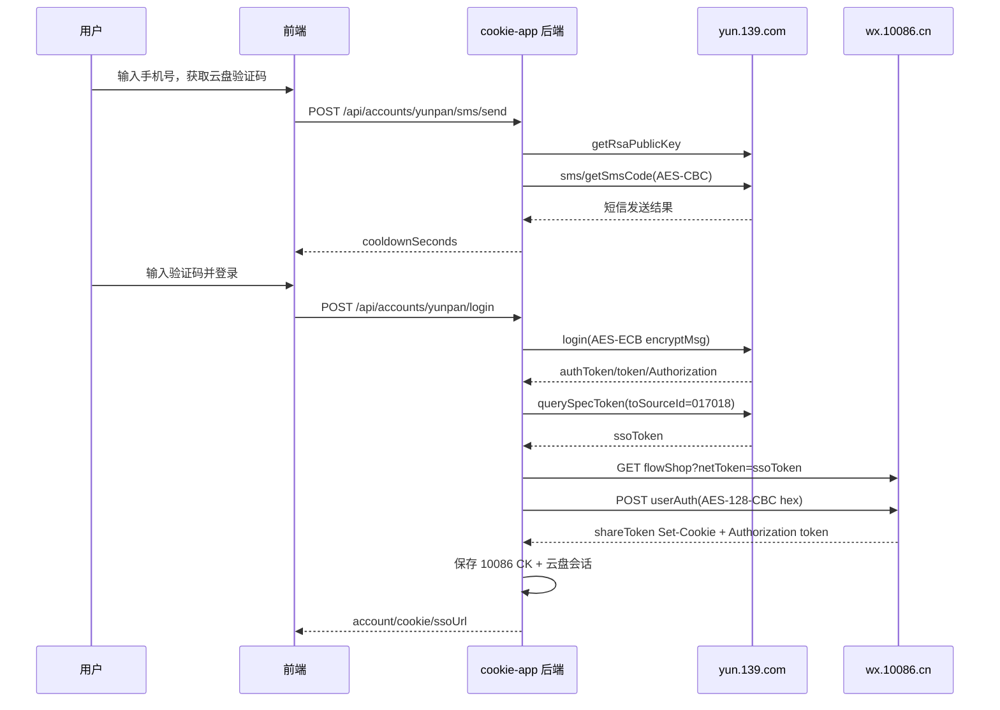

# 云盘登录获取 10086 CK 开发设计文档

## 目标

在现有中国移动用户管理项目中新增一条 CK 获取路径：

1. 用户通过中国移动云盘手机号短信登录。
2. 后端使用云盘登录态获取 `toSourceId=017018` 的 `ssoToken`。
3. 后端构造 `wx.10086.cn` 的 `flowShop` 跳转链接。
4. 后端调用 10086 用户认证接口 `userAuth`，获取 `shareToken` 等完整 CK。
5. 将 10086 CK 保存为账号主 Cookie，同时加密保存云盘会话，供 CK 过期时自动刷新。

该能力已接入：

- 管理端添加账号弹层：`云盘登录转 CK`
- 公共登录页：`云盘登录（10086 CK）`
- 账号刷新接口：10086 CK 失效时自动尝试用云盘会话重新换 CK

## 认证链路



## 关键接口

### 发送云盘短信

`POST /api/accounts/yunpan/sms/send`

请求：

```json
{
  "phone": "13800138000",
  "publicLinkId": "可选"
}
```

响应：

```json
{
  "ok": true,
  "data": {
    "cooldownSeconds": 60
  }
}
```

### 云盘登录并获取 10086 CK

`POST /api/accounts/yunpan/login`

请求：

```json
{
  "phone": "13800138000",
  "code": "123456",
  "label": "可选备注",
  "publicLinkId": "可选"
}
```

响应核心字段：

```json
{
  "ok": true,
  "data": {
    "account": {},
    "cookie": "grayscale=...; shareToken=...",
    "cookieLength": 120,
    "cookieNames": ["grayscale", "shareToken"],
    "ssoUrl": "https://wx.10086.cn/website/businessPlatform/flowShop?...",
    "ssoToken": "YZsidssolg..."
  }
}
```

### 使用已保存云盘会话刷新 CK

`POST /api/accounts/:id/yunpan/refresh`

当账号没有云盘会话时返回：

```json
{
  "ok": false,
  "errorCode": "NO_YUNPAN_SESSION",
  "message": "该账号没有云盘登录会话，请先用云盘登录获取一次 10086 CK"
}
```

## 加密与签名

### 云盘短信

- 请求体：AES-256-CBC，随机 IV 前置，整体 Base64。
- 固定 Key：`h7DLzCTAjn+altjy2a9E9FSt7AC6pmx1`
- 请求体形态：JSON 字符串包裹加密后的 Base64 字符串。
- 必填字段：`account`、`reqType=3`、`random`。

### 云盘登录

- `encryptMsg`：AES-128-ECB，Key 为本次登录会话随机 `aesKey`。
- `mcloud-skey`：用云盘 RSA 公钥加密 `aesKey`。
- 登录成功后得到：
  - `authToken`
  - 加密 `token`
  - `Authorization=Basic base64("pc:${completeAccount}:${authToken}")`

### 10086 userAuth

- URL：`https://wx.10086.cn/website/nrapigate/nrauth/auth/encryt/userAuth`
- 明文请求：`{"backUrl":"/website/businessPlatform/flowShop?...netToken=...&targetSourceId=017018"}`
- 加密：AES-128-CBC/PKCS7，输出大写 hex。
- Key：`1234123412ABCDEF`
- IV：`ABCDEF1234123412`
- 响应体 `body` 需要同样用 AES-128-CBC hex 解密。
- 完整 CK 依赖 `Set-Cookie`，尤其是 `shareToken`。

## 存储设计

敏感信息继续走项目已有的 `UserCredential` 加密表。

新增字段：

- `yunpanSessionEnc`
- `yunpanSessionUpdatedAt`
- `loginMetaEnc`

`yunpanSessionEnc` 保存：

- 云盘完整账号
- 云盘 `authToken/token/Authorization`
- 云盘登录 cookieJar
- 最近一次 `ssoToken`
- 最近一次 10086 `userAuth` token

前端只接收：

- `hasYunpanSession`
- `yunpanSessionUpdatedAt`
- `lastLoginMethod`
- `lastLoginAt`
- `cookieSource`
- `cookieExpireAt`
- `cookieTtlSeconds`

不会把云盘 token 暴露给浏览器。

## 登录方式与 CK 有效期

统一由 `setAccountCookie` 写入登录元信息：

| 登录方式 | `lastLoginMethod` | `cookieSource` | 理论有效期 |
| --- | --- | --- | --- |
| 中国移动验证码登录 | `cmcc_sms` | `sms` | 72 小时 |
| 中国移动 App 扫码 | `cmcc_qr` | `qr` | 1 小时 |
| 云盘登录换 10086 CK | `yunpan` | `yunpan` | 30 天 |
| 手动导入 CK | `manual_cookie` | `manual` | 仅记录来源，后续以校验结果为准 |

页面展示优先使用 `cookieExpireAt`。旧的 `smsLoginExpireAt` 仅作为历史兼容字段保留。

## 统一登录弹窗

前端新增共享组件：

- `src/components/AccountLoginDialog.tsx`

组件能力：

- 管理端和 public 页共用同一套登录交互。
- 三种登录方式手机号全部必填。
- 重新登录时读取账号 `lastLoginMethod`，默认切换到上次成功登录方式。
- 登录成功后通过 `onSuccess` 通知页面刷新列表、展开账号或滚动到账号卡片。
- public 页传入 `publicLinkId`，继续复用后端邀请码访问校验。

管理端：

- 工具箱“添加账号”打开统一登录弹窗。
- 账号菜单“重新登录”打开统一登录弹窗并带入账号手机号。
- 账号菜单“云盘刷新 CK”继续作为已有云盘会话的快捷续期能力。

public 页：

- 主登录区域改成打开统一登录弹窗。
- 账号卡片“重新登录”打开统一登录弹窗。
- “刷新列表”按钮增加 loading、成功和失败反馈。

## 过期续期策略

现有 `/api/accounts/:id/refresh` 行为保持不变：

1. 先用当前 10086 CK 访问 `newHome` 刷新。
2. 如果 10086 刷新失败：
   - 若账号保存过云盘会话，则调用云盘 `querySpecToken` 重新换取 10086 CK。
   - 若云盘续期成功，保存新 CK，并继续刷新全球通 Token。
   - 若云盘续期失败，再清空 CK 并推送失效通知。
3. 若账号没有云盘会话，则沿用原失效处理。

## 交互设计

### 管理端

入口：添加账号弹层新增 `云盘登录转 CK`。

交互：

1. 输入手机号。
2. 点击获取验证码。
3. 输入云盘短信验证码。
4. 点击 `云盘登录并获取 10086 CK`。
5. 成功后关闭弹层，刷新账号列表，自动展开 CK 并执行激活校验。

账号操作菜单新增：

- `云盘刷新 CK`

该操作仅在账号存在云盘会话时可点击。

### 公共登录页

入口：登录方式新增 `云盘登录（10086 CK）`。

交互：

1. 输入手机号。
2. 获取云盘验证码。
3. 输入验证码。
4. 点击 `云盘登录并获取 10086 CK`。
5. 后端自动创建/绑定账号到邀请码或当前用户。

## 注意事项与避坑

- 不能只访问 `flowShop?netToken=...` 获取 CK，必须补 `userAuth` 请求，完整 CK 主要来自 `Set-Cookie`。
- `userAuth` 请求体必须使用 10086 H5 里的 AES-128-CBC hex 加密，不能用云盘 AES。
- `backUrl` 必须是 path + query，不能传完整域名。
- 云盘短信接口要求 `random` 字段，否则会返回“随机字符串不能为空”。
- 云盘登录接口不应直接复用短信 `random` 到登录 payload；当前登录 payload 保持云盘 H5 的 `account/dycPwd/loginStyle/ifOpenAccount/setCookie`。
- 云盘凭据不能混入 10086 请求头，否则会污染 `newHome`、激活、全球通 Token 刷新请求。
- 公共页使用 `publicLinkId` 做访问校验；云盘验证码发送不提前创建账号，登录成功后再创建并绑定。
- 如果上游滑块风控触发，当前接口支持透传 `puzzleVerifyCode`，但前端暂未内嵌滑块组件；需要接入时可在发送验证码表单增加滑块结果输入/组件。

## 涉及文件

- `api/services/yunpan10086.ts`
- `api/routes/accounts.ts`
- `api/services/accountsStoreDb.ts`
- `api/services/credentialsDb.ts`
- `api/services/credentialsStore.ts`
- `src/pages/Home.tsx`
- `src/pages/PublicLogin.tsx`
