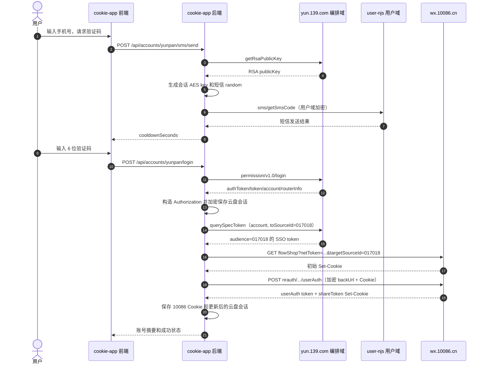

# 新版云盘登录与全球通免登录全流程分析

> 分析日期：2026-08-14  
> 代码基线：中国移动云盘 Web `7.17.10`、`cookie-app` 当前工作区、`yunpan-login-local` 当前工作区  
> 所有手机号、验证码、Authorization、Token、Cookie、AES/RSA 材料均已脱敏。本文中的占位符不能直接用于请求。

## 1. 结论先行

1. 新版 `querySpecToken` 和 `querySpecTokenV2` 没有证据表明新增了一个通用、可选填的业务参数，但 **V1 与 V2 的参数模型不同**：
   - Web V1：`account + toSourceId`。
   - Web V2：调用参数可见 `phoneNumber + toSourceId`，请求拦截器还会补入 `commonAccountInfo`，随后按用户域协议加密。
   - 原生 App V2：HAR 中只传 `toSourceId`，账号身份完全由 App 注入的 `Authorization` 提供，请求体不加密。
2. 现有两个本地实现都把 V1 写成了 `phoneNumber + toSourceId`。这是当前“暂无权限”最直接、证据最充分的协议偏差。V1 应先改为 `account + toSourceId`。
3. `yunpan-login-local` 的 V2 也不符合新版 Web 协议：缺少 `commonAccountInfo`，仍使用旧用户域 AES 配置和旧的 `mcloud-cool-skey` 组装方式，并且把原生与 Web 协议混为一种模式。
4. `toSourceId` 不应置空。它是 SSO token 的目标受众、路由和授权判断的关键字段；但它不是唯一权限条件。请求协议、账号上下文、登录态、客户端渠道、目标系统授权配置和 token 有效期都可能被上游统一映射为“暂无权限”。
5. 全球通链路必须保持：
   - 云盘换 token 时：`toSourceId=017018`。
   - 全球通落地 URL：`targetSourceId=017018`。
   - 两者必须匹配，不能用其他业务的 token 替代。
6. `mcloud.har` 不是“短信登录到全球通”的完整抓包。它证明的是 iPad 云盘原生客户端已有登录态后的 V2 SSO 用法，目标为 `001003`，并且还包含 `001191` 的其他业务跳转；HAR 中没有 `017018` 的全球通 `userAuth`。完整全球通下游部分来自 `用户认证.har` 和当前代码，证据来源必须分开看待。

## 2. 证据范围与可信度

| 证据 | 能证明什么 | 不能证明什么 | 可信度 |
| --- | --- | --- | --- |
| `云盘New.zip` 中 `yun.139.com/w/static/version.json` | Web 版本为 `7.17.10` | 服务器内部授权策略 | 高 |
| `云盘New.zip` 中 `app.5f980ea6.js` | Web API 路径、拦截器注入、参数名、加密分支 | 原生 App 的桥接注入细节 | 高 |
| `mcloud.har` | 原生 iPad App 13.1.1 已登录态下的 V2 请求和下游使用 | H5 短信登录、`017018` 全球通跳转 | 高，但范围有限 |
| `用户认证.har` | `targetSourceId=017018` 的 `userAuth` 曾成功下发 `shareToken` | 当前时刻后台是否调整授权 | 高，但属于另一条抓包 |
| `yunpan-login-local/data/session.json` | 2026-08-14 当日当前实现曾拿到 `017018` SSO/全球通 Cookie | 长期稳定性、所有账号均有权限 | 中 |
| `cookie-app`、`yunpan-login-local` | 当前系统实际如何组包、存储和下游换 CK | 上游真实规范未公开部分 | 高 |

### HAR 的实际上下文

- 共 592 条请求。
- 客户端：`MCloudApp/13.1.1`，iPadOS 18.7。
- 抓包中有 `sms/getSmsCode`，但没有 `permission/v1.0/login`，因此不能将其解释为完整短信登录抓包。
- `querySpecTokenV2` 两次 POST 均成功：`success=true`、`code=0000`、`resultCode=104000`。
- 两次 V2 token 随后分别进入 `mail.10086.cn/login/inlogin.action` 的请求体，说明 `001003` 是该邮件业务的目标源，而不是全球通。
- QQ/星礼入口使用 `targetSourceId=001191`，也不是全球通。

## 3. 三套协议必须分开

### 3.1 Web/H5 7.17.10

Web 运行于 `https://yun.139.com/w/`，自行完成签名、请求体变换、用户上下文注入和登录态携带。

关键特征：

- `mcloud-sign` 由请求明文参数、时间戳和 nonce 计算。
- 登录接口使用本次会话随机 AES key，并通过 RSA 包装后放入 `mcloud-skey`。
- 用户域敏感接口进入统一的数据加密/解密分支。
- 用户域请求由拦截器注入 `commonAccountInfo`。
- 7.17.10 的用户域固定加密材料相对 7.17.4 已轮换，不能继续使用旧值。
- 7.17.10 主动添加的是 `mcloud-skey`；bundle 中虽保留对 `mcloud-cool-skey` 响应的兼容判断，但不能据此推导所有新请求仍应主动发送旧头。

### 3.2 原生 App 13.1.1

原生 App 的 WebView 使用 `mcloudlocal://yun.139.com` 作为 Origin，并由客户端桥接层注入认证头。HAR 中的请求是：

```http
POST https://user-njs.yun.139.com/user/querySpecTokenV2
Content-Type: application/json
Authorization: Basic [REDACTED]
Origin: mcloudlocal://yun.139.com
x-huawei-channelSrc: 10252400
x-MM-Source: 001

{"toSourceId":"001003"}
```

该请求没有 Cookie、`mcloud-sign`、`mcloud-skey`、`mcloud-cool-skey` 或 `hcy-cool-flag`。响应在 HAR 文件中以 base64 保存，只是 HAR 的存储编码；解码后是普通 JSON，并非业务 AES 密文：

```json
{
  "success": true,
  "code": "0000",
  "message": "Request Successful",
  "data": {
    "token": "[REDACTED]",
    "resultCode": "104000"
  }
}
```

不能把这个“只传 `toSourceId`”的请求体直接复制到服务端 Web 模拟实现，因为它依赖原生 App 提供的完整认证上下文。

### 3.3 全球通/10086 下游

全球通不认识云盘的 `authToken`。它消费的是云盘按 `017018` 签发的短时 SSO token，并在 `userAuth` 阶段建立自己的授权 token 与 Cookie。

关键产物：

| 名称 | 签发方 | 用途 | 是否可互换 |
| --- | --- | --- | --- |
| 云盘 `authToken` | 云盘登录服务 | 构造云盘 `Authorization` | 否 |
| 云盘登录 `token` | 云盘登录服务 | `authToken` 的加密/兼容形态 | 否 |
| `Authorization` | 客户端按登录结果构造 | 证明“哪个云盘账号” | 否 |
| SSO token / `netToken` | `querySpecToken*` | 证明允许跳往指定 `toSourceId` | 否 |
| 10086 `userAuth` token | `wx.10086.cn` | 后续 10086 API Authorization | 否 |
| `shareToken` Cookie | `wx.10086.cn` | 10086 Web 会话 | 否 |

## 4. 完整业务时序



### 阶段一：获取 RSA 公钥

```http
POST https://yun.139.com/orchestration/auth-rebuild/key/v1.0/getRsaPublicKey
Content-Type: application/json;charset=UTF-8
mcloud-sign: [timestamp,nonce,signature]

{"clientCode":"10601","type":1}
```

客户端生成一次登录事务使用的随机 AES key，再用 RSA 公钥包装。RSA 公钥可以缓存，但遇到解密/密钥相关错误应重新拉取；AES key 和其 RSA 密文应按登录事务隔离。

### 阶段二：发送云盘验证码

用户域明文对象的国内手机号形态：

```json
{
  "account": "[PHONE]",
  "reqType": 3,
  "random": "[RANDOM]"
}
```

请求线上形态：

```http
POST https://user-njs.yun.139.com/user/sms/getSmsCode
Content-Type: application/json;charset=UTF-8
mcloud-sign: [SIGN_OF_PLAINTEXT_OBJECT]
mcloud-skey: [RSA_WRAPPED_SESSION_KEY]

"[USER_DOMAIN_ENCRYPTED_BASE64]"
```

注意：

- `mcloud-sign` 应按拦截器加密前的逻辑对象计算，不能对最终密文重新签名。
- 香港等号码在 7.17.10 bundle 中走 `phoneNumber + nationCode + clientType` 的转换分支，不能与国内 `account` 分支混用。
- 验证码请求和登录请求必须使用同一登录事务上下文。

### 阶段三：短信验证码登录

被 AES-128-ECB 加密的登录明文：

```json
{
  "account": "[PHONE]",
  "dycPwd": "[SMS_CODE]",
  "loginStyle": "passSMS",
  "ifOpenAccount": 1,
  "setCookie": 0
}
```

外层请求：

```http
POST https://yun.139.com/orchestration/auth-rebuild/permission/v1.0/login
Content-Type: application/json;charset=UTF-8
mcloud-skey: [RSA_WRAPPED_SESSION_KEY]
mcloud-sign: [SIGN]

{
  "encryptMsg": "[AES_ECB_BASE64]",
  "returnToken": true,
  "autoLogin": true
}
```

登录成功后至少校验并保存：

- `authToken`，或能使用本次 AES key 解开的 `token`。
- 完整账号 `completeAccount`，不能只保存掩码账号。
- `Authorization = Basic base64("pc:<completeAccount>:<authToken>")`。
- `routerInfo`、`userDomainId`、`belongsPlatform`、`cutoverStatus`。
- 服务器返回的 Cookie。

`routerInfo` 中 `modName=user` 的 `httpsUrl` 应作为用户域首选地址，硬编码 `user-njs.yun.139.com` 只作为显式、可监控的回退。

### 阶段四：换取目标系统 SSO token

#### Web V1

```http
POST https://yun.139.com/orchestration/auth-rebuild/token/v1.0/querySpecToken
Authorization: Basic [REDACTED]
Content-Type: application/json;charset=UTF-8
mcloud-sign: [SIGN]

{
  "account": "[COMPLETE_PHONE]",
  "toSourceId": "017018"
}
```

#### Web V2

调用方语义对象：

```json
{
  "phoneNumber": "[COMPLETE_PHONE]",
  "toSourceId": "017018"
}
```

进入 7.17.10 请求拦截器后，语义上会成为：

```json
{
  "phoneNumber": "[COMPLETE_PHONE]",
  "toSourceId": "017018",
  "commonAccountInfo": {
    "account": "[COMPLETE_PHONE]",
    "accountType": 1
  }
}
```

随后由用户域加密分支转换为线上请求体，响应再走对应解密。这里的固定用户域加密材料必须由受控配置提供，文档不记录明文值。

#### 原生 App V2

```json
{"toSourceId":"001003"}
```

它只在原生 App 注入 `Authorization` 和渠道上下文的条件下成立。不能用它证明 Web V2 的 `commonAccountInfo` 可以省略，也不能把 `001003` 用于全球通。

### 阶段五：构造全球通落地 URL

```text
https://wx.10086.cn/website/businessPlatform/flowShop
  ?secondChannel=P00000116110
  &netToken=[SSO_TOKEN]
  &targetSourceId=017018
```

约束：

- `netToken` 必须来自 `toSourceId=017018` 的 token 响应。
- `targetSourceId` 必须与 token 的受众一致。
- token 应只通过 URL 构造层短暂存在，不应写日志、埋点、Referer 或返回给不需要它的浏览器调用方。
- 先 GET 落地页是为了建立该域初始 Cookie 和页面上下文，不代表认证已完成。

### 阶段六：全球通 `userAuth`

明文只包含相对 `backUrl`：

```json
{
  "backUrl": "/website/businessPlatform/flowShop?secondChannel=P00000116110&netToken=[SSO_TOKEN]&targetSourceId=017018"
}
```

请求体使用全球通 H5 自己的 AES-128-CBC/PKCS7 方案，输出大写 hex。它与云盘用户域 AES 完全无关：

```http
POST https://wx.10086.cn/website/nrapigate/nrauth/auth/encryt/userAuth
Content-Type: application/json; charset=UTF-8
Origin: https://wx.10086.cn
Referer: [FLOW_SHOP_URL]
Cookie: [COOKIE_JAR]
channelid: BUSINESS_H5
chop-real-host: wx.10086.cn
pageType: xds17
Chop-Second-Channel: P00000116110

[AES_CBC_UPPER_HEX]
```

成功判断不能只看 HTTP 200：

1. 解密响应 `body`。
2. 校验业务成功码和 `data.token`。
3. 合并所有 `Set-Cookie`。
4. 明确校验 `shareToken` 存在，且关键 Cookie 不是空值/删除值。

## 5. 免登录实现原理

这不是“绕过登录”，而是两个受信任系统间的定向票据交换：

1. 云盘 `Authorization` 证明当前云盘账号身份。
2. `querySpecToken*` 根据 `toSourceId` 判断该身份和调用渠道是否允许进入目标系统，并签发短时、限定受众的 SSO token。
3. 全球通收到 `netToken + targetSourceId` 后，校验票据签发方、有效期、受众和上下文。
4. `userAuth` 将一次性/短时 SSO 上下文换成全球通自己的 API token 与 Web Cookie。
5. 后续业务只使用全球通 token/Cookie，不继续使用云盘 `authToken`。

可以把它理解为：

```text
云盘长期登录态
  -> 指定受众的短时 SSO token
  -> 全球通本域授权会话
```

## 6. `toSourceId` 可以置空吗

结论：对外部 SSO 跳转，不可以置空，也不应依赖服务端默认值。

`toSourceId` 同时承担三层语义：

1. **目标受众**：决定 token 是给哪个下游系统使用。
2. **路由选择**：服务端据此找到目标接入配置、回调约束和签名配置。
3. **授权范围**：服务端判断当前账号、客户端、渠道是否有权申请该目标的 token。

置空可能得到参数错误、默认业务 token 或统一的“暂无权限”，具体行为由服务端版本决定。即使某个版本允许省略，也不能保证签发出的 token 面向全球通。当前本地调试代码还会把空值悄悄改成 `001005`，这会掩盖真实错误。

### 它是不是权限判断的关键字段

是关键字段，但不是唯一字段。更准确的授权模型是：

```text
allow = validLogin
     && validAuthorization
     && requestProtocolMatchesClient
     && sourceIdIsRegistered
     && accountOrChannelIsGranted
     && tokenAudienceMatchesTargetSourceId
     && tokenIsFresh
```

因此不能通过改空、删掉或猜测 `toSourceId` 来绕开授权。对于全球通，应固定使用已确认的 `017018`，并把任何其他 source ID 当作另一项独立业务配置。

## 7. 为什么现在出现“暂无权限”

按当前证据，建议按以下顺序定位：

### P0-1：V1 参数名错误

`cookie-app/api/services/yunpan10086.ts` 当前发送：

```json
{"phoneNumber":"...","toSourceId":"017018"}
```

`yunpan-login-local/src/yunpanClient.js` 的 V1 也发送相同结构。7.17.10 bundle 的 V1 实例使用：

```json
{"account":"...","toSourceId":"..."}
```

服务端可能先解析账号上下文，再进入权限判断；字段不匹配时，“找不到账号授权上下文”可能被统一翻译成“暂无权限”。

### P0-2：V2 协议包不完整

本地 V2 缺少 `commonAccountInfo`，并使用 7.17.4 的旧用户域加密材料与旧头部组合。任何一项都可能导致服务端无法还原账号或将请求归入错误协议版本。

### P0-3：混用了原生与 Web 协议

HAR 的原生 V2 能只传 `toSourceId`，是因为 `Authorization` 和渠道身份由 App 注入。服务端 H5 模拟请求既不能只复制该 JSON，也不能同时叠加一半 Web 加密头、一半原生头。

### P1-1：版本和用户域路由陈旧

现有代码宣称 `7.17.4`，新版为 `7.17.10`；同时用户域硬编码为 `user-njs.yun.139.com`，没有优先使用登录响应的 `routerInfo`。灰度切换、用户归属路由或协议版本校验都可能造成失败。

### P1-2：目标系统授权确实发生变化

`toSourceId=017018` 的接入授权可能按账号、省份、客户端或渠道控制。但目前不能直接断言“017018 已撤权”，因为：

- `用户认证.har` 中该 source ID 曾成功进入 `userAuth` 并设置 `shareToken`。
- 本地会话记录显示 2026-08-14 当日仍曾成功取得 `017018` 的 SSO 和全球通 Cookie。

只有在修正协议后，同一登录态的 V1/V2 都返回明确业务拒绝，并且不同合规账号/渠道形成稳定对照，才支持“后台撤权”的结论。

### P1-3：登录态或 token 生命周期问题

`Authorization` 过期、账号与 `authToken` 不匹配、旧 RSA/AES 会话复用、SSO token 被重复消费、`targetSourceId` 与受众不一致，也可能被统一提示为权限不足。

## 8. 脱敏参考实现

下面代码只表达组包边界。加密实现应放在已有安全模块中，固定材料由密钥管理或运行时配置注入。

```ts
type YunpanSession = {
  completeAccount: string
  authorization: string
  userDomainUrl: string
}

type SpecTokenResult = {
  token: string
  resultCode?: string
}

async function querySpecTokenV1(
  session: YunpanSession,
  toSourceId: string,
): Promise<SpecTokenResult> {
  if (!session.completeAccount || !session.authorization) {
    throw new Error('YUNPAN_SESSION_INCOMPLETE')
  }
  if (!toSourceId) throw new Error('SOURCE_ID_REQUIRED')

  const payload = {
    account: session.completeAccount,
    toSourceId,
  }
  const response = await yunpanWebRequest({
    url: 'https://yun.139.com/orchestration/auth-rebuild/token/v1.0/querySpecToken',
    authorization: session.authorization,
    signedPlaintext: payload,
    body: payload,
  })
  return requireSpecToken(response, toSourceId)
}

async function querySpecTokenV2Web(
  session: YunpanSession,
  toSourceId: string,
): Promise<SpecTokenResult> {
  if (!toSourceId) throw new Error('SOURCE_ID_REQUIRED')

  const payload = {
    phoneNumber: session.completeAccount,
    toSourceId,
    commonAccountInfo: {
      account: session.completeAccount,
      accountType: 1,
    },
  }
  const response = await yunpanUserDomainRequest({
    url: new URL('/user/querySpecTokenV2', session.userDomainUrl).toString(),
    authorization: session.authorization,
    signedPlaintext: payload,
    encryptedBody: encryptUserDomainPayload(payload),
  })
  return requireSpecToken(decryptUserDomainResponse(response), toSourceId)
}

function requireSpecToken(response: unknown, sourceId: string): SpecTokenResult {
  const parsed = parseAndValidateBusinessResponse(response)
  const token = parsed.data?.token
  if (!parsed.success || typeof token !== 'string' || !token) {
    throw new Error(`SPEC_TOKEN_REJECTED:${sourceId}:${parsed.code ?? 'UNKNOWN'}`)
  }
  return { token, resultCode: parsed.data?.resultCode }
}
```

全球通桥接层：

```ts
async function exchangeYunpanSessionFor10086Cookie(session: YunpanSession) {
  const sourceId = '017018'
  const { token } = await querySpecTokenV1(session, sourceId)

  const targetUrl = new URL('https://wx.10086.cn/website/businessPlatform/flowShop')
  targetUrl.searchParams.set('secondChannel', 'P00000116110')
  targetUrl.searchParams.set('netToken', token)
  targetUrl.searchParams.set('targetSourceId', sourceId)

  const jar = newCookieJar()
  await jar.fetch(targetUrl, { method: 'GET', redirect: 'follow' })

  const backUrl = `${targetUrl.pathname}${targetUrl.search}`
  const authResponse = await jar.fetch(USER_AUTH_URL, {
    method: 'POST',
    headers: build10086UserAuthHeaders(targetUrl),
    body: encrypt10086UserAuthBody(JSON.stringify({ backUrl })),
  })
  const auth = decryptAndValidate10086Response(authResponse)
  const shareToken = jar.get('shareToken', targetUrl)
  if (!auth.token || !shareToken) throw new Error('10086_SESSION_INCOMPLETE')

  return {
    authorization: auth.token,
    cookie: jar.serializeFor('https://wx.10086.cn'),
    cookieNames: jar.namesFor('https://wx.10086.cn'),
  }
}
```

## 9. 当前实现审查

> 修复状态（2026-08-14）：下列 P0 协议问题已在本轮修复。表格保留修复前基线，便于解释“暂无权限”的根因和回归测试目标。未涉及的 API 敏感输出、临时会话存储等 P1/P2 项仍作为后续加固任务。

### P0：会直接导致当前流程失败

| 问题 | 位置 | 影响 | 建议 |
| --- | --- | --- | --- |
| V1 使用 `phoneNumber` 而不是 `account` | `cookie-app/api/services/yunpan10086.ts:500`；`yunpan-login-local/src/yunpanClient.js:315` | 账号上下文无法按新版 V1 规范解析，可能表现为“暂无权限” | 分离 V1/V2 DTO，V1 改为 `account` |
| V2 缺 `commonAccountInfo` | `yunpan-login-local/src/yunpanClient.js:315` | 用户域无法获得标准账号上下文 | Web V2 由统一拦截层注入，或显式组装 |
| 仍使用 7.17.4 用户域 AES 配置 | `cookie-app/api/services/yunpan10086.ts:6`；`yunpan-login-local/src/cryptoBox.js:3` | 7.17.10 用户域请求/响应可能无法互解 | 更新并放入受控配置，增加版本探测 |
| V2 仍主动添加旧 `mcloud-cool-skey` | `yunpan-login-local/src/yunpanClient.js:327` | 请求可能进入错误的兼容/解密分支 | 按 7.17.10 拦截器重建请求头策略 |

### P1：安全和稳定性问题

| 问题 | 位置 | 影响 | 建议 |
| --- | --- | --- | --- |
| API 把完整 Cookie、SSO URL、SSO token 返回前端 | `api/routes/accounts.ts:2961`、`:3058`、`:3154` | token 泄露到浏览器、日志、监控和历史记录 | 默认只返回布尔状态、Cookie 名和账号摘要；调试能力仅限本机管理员且脱敏 |
| 错误响应暴露 `upstreamResponse` 和 `rawTextSnippet` | `api/routes/accounts.ts` 的云盘短信/登录分支 | 上游可能回显手机号、token 或内部细节 | 服务端生成脱敏诊断码，原始内容仅进入受限、自动清洗日志 |
| 固定模拟设备 ID 被所有账号共享 | `yunpan10086.ts:20`、`yunpanClient.js:35` | 风控关联、并发账号互相影响 | 每个账号生成稳定但独立的设备档案并加密存储 |
| 短信 pending session 为无 TTL 的进程内 Map | `yunpan10086.ts:54` | 多实例登录失败、重启丢失、内存增长、同号并发覆盖 | 使用带 5-10 分钟 TTL 的加密临时存储，并绑定 flowId |
| 用户域硬编码 | `yunpan10086.ts:368`、`yunpanClient.js:20` | 路由切换和用户归属不一致 | 保存登录 `routerInfo`，按 `modName=user` 解析 HTTPS URL |
| 版本、Referer、设备信息互相不一致 | 两个云盘客户端头部构造 | 上游风控容易识别为不完整客户端 | 用一个版本化 profile 统一管理，并做启动时自检 |
| SSO token 写入持久会话 | 两个会话模型的 `lastSsoToken` | 短时敏感票据扩大暴露面，且重用无意义 | 仅保存签发时间、sourceId、结果码和哈希前缀，不保存 token 明文 |
| 本地调试 session 明文落盘 | `yunpan-login-local/src/sessionStore.js:53` | 包含完整手机号、authToken、Authorization、Cookie | 使用系统钥匙串/加密文件；至少设置 `0600` 并提供自动清理 |

### P2：可维护性和可观测性

| 问题 | 影响 | 建议 |
| --- | --- | --- |
| V1/V2 共享同一个宽松参数对象 | 协议漂移不会在编译期暴露 | 建立 `QuerySpecTokenV1Payload`、`V2Payload` 和原生样例三种独立模型 |
| 仅凭 HTTP 状态和 token 是否存在判断 | 无法区分参数、鉴权、权限和网关失败 | 记录脱敏后的 `HTTP status / code / resultCode / sourceId / protocol / route` |
| 缺少云盘 SSO 协议测试 | 当前参数名错误未被发现 | 增加请求快照、拦截器顺序、解密 round-trip 和失败分类测试 |
| 空 `toSourceId` 被静默替换为 `001005` | 隐藏调用方错误，可能签发错误受众 | 在边界直接拒绝 `SOURCE_ID_REQUIRED` |
| 先 GET 后 `userAuth` 的 Cookie 校验较弱 | 可能把只有埋点 Cookie 的结果当成“有 Cookie” | 成功条件明确要求 `data.token + shareToken` |
| Cookie TTL 固定声明为 30 天 | 与真实服务端过期时间可能不一致 | 优先解析 Cookie `Max-Age/Expires`，并用业务校验动态判活 |

## 10. 建议的修复顺序

1. **先修 V1 参数**：`phoneNumber` 改为 `account`，保持 `toSourceId=017018`，用新登录态验证。
2. **增加可观测性**：只记录脱敏的 `protocol/sourceId/route/httpStatus/code/resultCode`，确认失败发生在 token 交换还是 `userAuth`。
3. **分离 V2-Web 与 V2-Native**：服务端实现只支持 Web 协议；原生 HAR 仅作为对照样例，不提供混合模式。
4. **升级 7.17.10 profile**：版本、用户域加密配置、`mcloud-skey` 策略、Referer、路由统一切换。
5. **使用 `routerInfo`**：登录响应中用户域路由优先，硬编码仅为回退并报警。
6. **收紧 API 输出**：不向普通前端返回 SSO token、完整 Cookie 或含 token 的 URL。
7. **补测试后再启用 V2 fallback**：V1 明确收到可分类业务拒绝时才尝试 V2，不能无条件双发短时 token。

## 11. 验证矩阵

| 用例 | 请求 | 预期 | 用于定位 |
| --- | --- | --- | --- |
| A | V1：`account + 017018`，全新登录态 | 成功返回 token | 主路径是否恢复 |
| B | V1：故意把 `account` 改为 `phoneNumber` | 与 A 对比 code/resultCode | 验证当前字段错误是否对应“暂无权限” |
| C | V2-Web：完整 `commonAccountInfo` + 7.17.10 加密 | 成功或明确业务拒绝 | V2 协议是否正确 |
| D | V2-Web：缺 `commonAccountInfo` | 可分类失败 | 验证账号上下文必要性 |
| E | `toSourceId` 为空 | 客户端边界直接拒绝 | 防止静默默认 |
| F | token 来自 `017018`，URL 也是 `017018` | `userAuth` 下发 token + `shareToken` | 受众匹配 |
| G | token 来自其他 sourceId，URL 写 `017018` | 明确失败且不保存 Cookie | 受众隔离 |
| H | 过期/重复使用同一 SSO token | 明确失败且触发重新签发 | 生命周期处理 |

真实联调时每次只改一个变量，并使用新签发 token。不要把 HAR 中的历史 token 或 Cookie 用于重放。

## 12. 推荐错误分类

```ts
type YunpanSsoError =
  | 'SOURCE_ID_REQUIRED'
  | 'YUNPAN_SESSION_INCOMPLETE'
  | 'YUNPAN_LOGIN_EXPIRED'
  | 'SPEC_TOKEN_BAD_REQUEST'
  | 'SPEC_TOKEN_FORBIDDEN'
  | 'SPEC_TOKEN_PROTOCOL_MISMATCH'
  | 'SPEC_TOKEN_UPSTREAM_UNAVAILABLE'
  | 'SSO_AUDIENCE_MISMATCH'
  | '10086_USER_AUTH_REJECTED'
  | '10086_SHARE_TOKEN_MISSING'
```

对用户可以继续显示友好文案，但服务端必须保留上述内部分类，否则所有问题都会退化成“暂无权限”，无法判断是接入授权变化还是客户端协议已过期。

## 13. 源码索引

- 新版 Web bundle：`云盘/云盘New.zip` 内 `yun.139.com/w/static/js/app.5f980ea6.js`。
- 新版版本文件：`云盘/云盘New.zip` 内 `yun.139.com/w/static/version.json`。
- 原生请求证据：`mcloud.har` 中 POST `user-njs.yun.139.com/user/querySpecTokenV2`，时间为 `2026-08-14T12:19:38.122Z` 和 `2026-08-14T12:19:38.684Z`。
- `cookie-app` 云盘协议实现：`api/services/yunpan10086.ts`。
- `cookie-app` HTTP 路由：`api/routes/accounts.ts`。
- `cookie-app` 加密会话存储：`api/services/accountsStoreDb.ts`。
- 本地调试客户端：`云盘/yunpan-login-local/src/yunpanClient.js`。
- 本地调试加密实现：`云盘/yunpan-login-local/src/cryptoBox.js`。
- 本地调试会话文件：`云盘/yunpan-login-local/src/sessionStore.js`。

## 14. 最终判断

修复前的“暂无权限”不能优先归因于 `017018` 被撤权。原代码存在确定的请求契约错误：V1 参数名不对；V2 又未完整跟随 7.17.10 用户域协议。本轮已修正这两项；是否仍存在后台授权限制，需要用全新登录态联调，并根据脱敏的 `code/resultCode` 判断。

`toSourceId` 是权限判断和 token 受众绑定的关键字段，不可置空。对全球通链路，应把 `017018` 作为受控常量，在 token 申请、落地 URL 和诊断日志中保持一致，并在边界拒绝空值或不受支持的 source ID。

## 15. 本轮修复记录

- 两个仓库均创建修复前标签：`codex/yunpan-sso-before-fix-20260814`。
- `cookie-app` 和 `yunpan-login-local` 的 V1 请求体改为 `account + toSourceId`。
- Web V2 补齐 `commonAccountInfo`，切换 7.17.10 用户域加密材料和客户端 profile。
- 请求统一使用 `mcloud-skey`；移除主动发送的旧 `mcloud-cool-skey`。
- 保存登录响应 `routerInfo`，V2 优先使用 `modName=user` 的可信 HTTPS 路由。
- 空 `toSourceId` 在请求边界直接拒绝，不再静默回退到 `001005`。
- 全球通会话成功条件收紧为同时存在 `userAuth token` 和 `shareToken`。
- `cookie-app` 默认仍使用 V1；需要验证 Web V2 时设置 `YUNPAN_SPEC_TOKEN_MODE=v2`，不会自动双发 token。
- token 交换失败时仅输出 `protocol/sourceId/httpStatus/code/resultCode` 脱敏诊断，不再依赖含敏感字段的原始响应定位。
