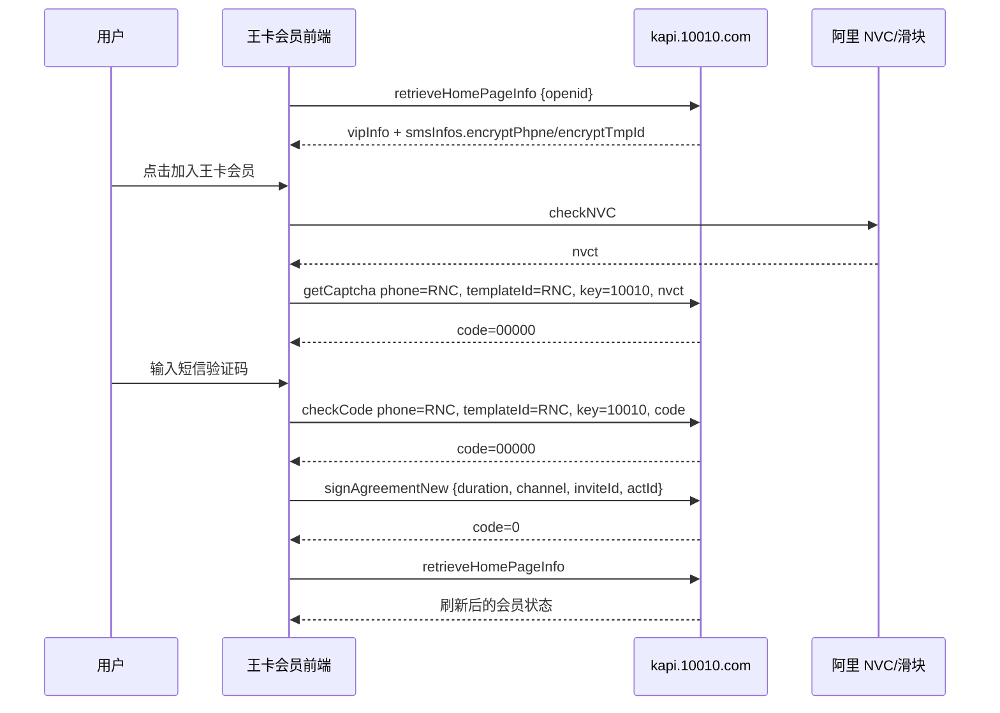
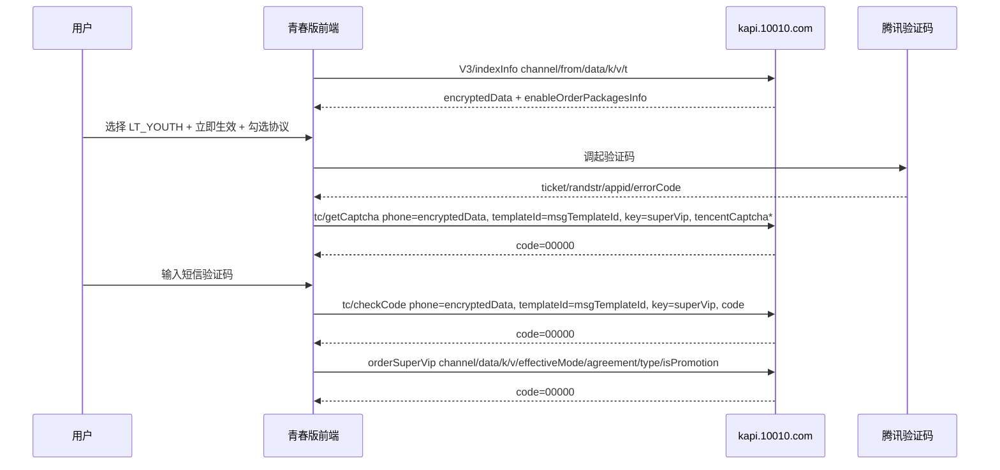

# 王卡会员订购业务接口与前端实现分析

## 1. 分析范围

本文基于以下本地材料分析王卡会员开通、王卡超级会员青春版订购的前端入参、响应字段来源、加密/风控字段生成方式与功能实现链路。

- `开通王卡会员/`：王卡会员开通页面离线源码，核心页面为 `txwk.10010.com/KCard/page/wkfuliNew2/`。
- `王卡会员开通.har`：普通王卡会员开通短信验证码与入会接口样例。
- `订购王卡会员青春版.har`：超级会员青春版首页、短信验证码与订购接口样例。
- `超级会员青春版.json`：超级会员青春版页面访问 HAR，补充了首页接口与静态资源 initiator 信息。

结论先行：这两条链路里的手机号、短信模板 ID 等敏感字段并不是业务页面前端用公开算法临时加密出来的，而是业务接口后端返回 `RNC(...)` 格式密文后，前端在短信验证码接口中透传。普通王卡会员开通的最终提交体无业务加密；青春版订购的最终提交体也无前端加密，核心订购参数来自 `indexInfo` 的响应与 URL 查询参数。验证码风控字段分别来自阿里 NVC/滑块或腾讯验证码 SDK。

## 2. 业务角色与页面入口

### 2.1 普通王卡会员开通

页面源码位于：

`开通王卡会员/txwk.10010.com/KCard/page/wkfuliNew2/index.html`

核心 JS：

`开通王卡会员/txwk.10010.com/KCard/page/wkfuliNew2/js/index.128d2e.js`

入口 URL 样式：

```text
https://txwk.10010.com/KCard/page/wkfuliNew2/index.html?ADTAG=MENU#/
```

业务目标：

- 读取当前登录/绑定用户的王卡会员首页信息。
- 判断用户是否已绑定、是否王卡用户、是否已入会。
- 未入会但符合条件时，发送短信验证码。
- 短信校验成功后调用入会接口。
- 入会成功后刷新首页会员状态。

### 2.2 超级会员青春版订购

入口 URL 样式：

```text
https://txwk.10010.com/KCard/mPages/unicom-super.html?cate=youth&channel=CJHY_LTYOUTH_fulishe1#/index
```

线上业务包中观察到：

- `main-57644a55.js`
- `.pnpm-6b0fc26c.js`

业务目标：

- 读取超级会员青春版首页配置、可订购套餐、用户状态、短信参数。
- 用户选择套餐与生效方式。
- 通过腾讯验证码后发送短信验证码。
- 短信校验成功。
- 调用 `orderSuperVip` 完成订购。

## 3. 普通王卡会员开通链路

### 3.1 首页信息读取

接口：

```http
POST https://kapi.10010.com/KCard/tencent/kcard/vip/retrieveHomePageInfo
Content-Type: application/json
```

请求体：

```json
{"openid":""}
```

源码定位：

`index.128d2e.js` 中 `getHomeData` 调用：

```js
T.post("/KCard/tencent/kcard/vip/retrieveHomePageInfo", { openid: e })
```

关键响应字段：

```json
{
  "success": true,
  "code": "0",
  "message": "操作成功",
  "data": {
    "vipInfo": {
      "phone": "130****3966",
      "cardTag": 1,
      "whiteTag": 5,
      "flowTag": 0,
      "signed": true,
      "expiredTime": "有效期到：2027-06-30"
    },
    "smsInfos": {
      "signKcardVip": {
        "encryptPhpne": "RNC(...)",
        "encryptTmpId": "RNC(...)"
      }
    }
  }
}
```

字段解释：

| 字段 | 来源 | 用途 |
| --- | --- | --- |
| `vipInfo.phone` | 后端返回 | 页面展示、校验手机号长度、短信弹窗显示 |
| `vipInfo.cardTag` | 后端返回 | 判断是否王卡用户；`cardTag > 0` 代表王卡相关用户 |
| `vipInfo.signed` | 后端返回 | 判断是否已经加入王卡会员 |
| `vipInfo.flowTag` | 后端返回 | 决定入会接口是普通入会还是 10GB 权益相关接口 |
| `smsInfos.signKcardVip.encryptPhpne` | 后端返回的 RNC 密文 | 发送/校验短信时作为 `phone` 传入 |
| `smsInfos.signKcardVip.encryptTmpId` | 后端返回的 RNC 密文 | 发送/校验短信时作为 `templateId` 传入 |

注意：响应字段名里有拼写 `encryptPhpne`，源码也按这个拼写读取。

### 3.2 短信验证码发送

接口：

```http
POST https://kapi.10010.com/captcha/op/getCaptcha
Content-Type: application/x-www-form-urlencoded
```

HAR 请求体：

```text
phone=RNC(...)
&templateId=RNC(...)
&key=10010
&nvct=...
```

源码定位：

短信组件调用：

```js
sendCode({
  phone: this.encPhone || this.curPhone,
  templateId: this.templateId,
  key: this.businessId,
  nvct: ...
})
```

接口封装：

```js
post("/captcha/op/getCaptcha", data, {
  headers: {
    "Content-Type": "application/x-www-form-urlencoded",
    "X-Referer": window.location.href
  }
})
```

字段来源：

| 字段 | 示例 | 生成方式 |
| --- | --- | --- |
| `phone` | `RNC(...)` | `retrieveHomePageInfo.data.smsInfos.signKcardVip.encryptPhpne`，前端透传 |
| `templateId` | `RNC(...)` | `retrieveHomePageInfo.data.smsInfos.signKcardVip.encryptTmpId`，前端透传 |
| `key` | `10010` | 短信组件业务 ID，普通王卡会员为固定值 |
| `nvct` | URL 编码后的 JSON/密文长串 | 阿里 NVC/无痕验证 SDK 生成 |

`nvct` 不是业务加密参数，而是风控验证票据。HAR 中可见它包含 `nvc_message_h5`、`umidToken` 等阿里风控字段。页面源码中 `checkNVC` 成功后把返回值塞入 `sendCode({ nvct: e })`。

### 3.3 短信验证码校验

接口：

```http
POST https://kapi.10010.com/captcha/op/checkCode
Content-Type: application/x-www-form-urlencoded
```

HAR 请求体：

```text
phone=RNC(...)
&templateId=RNC(...)
&key=10010
&code=1234
```

字段来源：

| 字段 | 生成方式 |
| --- | --- |
| `phone` | 同短信发送，优先使用后端返回的 `encPhone` |
| `templateId` | 同短信发送 |
| `key` | 固定业务 ID |
| `code` | 用户输入的 4 到 6 位短信验证码 |

校验成功响应：

```json
{"code":"00000","success":true,"data":null,"msg":"操作成功"}
```

前端处理：

- `code === "00000"` 时设置按钮状态为“验证成功”。
- 约 500ms 后触发短信组件 `success` 事件。
- 外层业务继续调用真实入会接口。

### 3.4 入会提交

接口：

```http
POST https://kapi.10010.com/KCard/tencent/kcard/vip/signAgreementNew
Content-Type: application/json
```

HAR 请求体：

```json
{
  "duration": 12,
  "channel": "MENU",
  "inviteId": "",
  "actId": ""
}
```

源码定位：

```js
signAgreement: function () {
  var endpoint =
    flowTag === 2
      ? "/KCard/tencent/kcard/vip/welfare/conduct10Gb"
      : "/KCard/tencent/kcard/vip/signAgreementNew";

  return T.post(endpoint, {
    duration: 12,
    channel: ADTAG,
    inviteId: inviteId || shareId || "",
    actId: actId || ""
  });
}
```

字段来源：

| 字段 | 示例 | 来源 |
| --- | --- | --- |
| `duration` | `12` | 前端默认值，表示会员期限 12 个月 |
| `channel` | `MENU` | URL 查询参数 `ADTAG`，无值则为空 |
| `inviteId` | `""` | URL 查询参数 `inviteId` 或 `shareId` |
| `actId` | `""` | URL 查询参数 `actId` |

响应：

```json
{"success":true,"code":"0","message":"操作成功"}
```

前端处理：

- `code === "0"` 视为成功。
- 弹出“受理成功”或切换成功状态。
- 再次调用 `retrieveHomePageInfo` 刷新 `vipInfo.signed`、`expiredTime` 等状态。

## 4. 超级会员青春版订购链路

### 4.1 首页配置读取

接口：

```http
GET https://kapi.10010.com/KCard/superVip/V3/indexInfo
```

HAR 查询参数：

```text
channel=CJHY_LTYOUTH_fulishe1
&from=unicom
&data=
&k=
&v=
&t=1782840775568
```

线上 JS 封装逻辑：

```js
url: getQueryString("cate") === "youth"
  ? "/KCard/superVip/V3/indexInfo"
  : "/KCard/superVip/V2/indexInfo",
method: "get",
data: {
  channel: channelFromUrl(),
  from: "unicom",
  data: getQueryString("data"),
  k: getQueryString("k"),
  v: getQueryString("v"),
  ...extra
}
```

字段来源：

| 字段 | 来源 |
| --- | --- |
| `channel` | URL 查询参数 `channel`，HAR 为 `CJHY_LTYOUTH_fulishe1` |
| `from` | 前端固定 `unicom` |
| `data/k/v` | URL 查询参数，样例为空 |
| `t` | 请求拦截器追加的时间戳/防缓存参数 |

关键响应字段：

```json
{
  "code": "00000",
  "message": "成功",
  "data": {
    "phone": "130****3966",
    "encryptedData": "RNC(...)",
    "dataId": "1125020794606577",
    "orderStatus": "00",
    "enableOrderPackagesInfo": [
      {
        "type": "LT_YOUTH",
        "categoryId": 11,
        "typeName": "超级会员(青春版)",
        "price": "10",
        "open": false,
        "effectiveModeList": [
          {
            "name": "立即生效",
            "value": "00",
            "active": true,
            "msgKey": "superVip",
            "msgTemplateId": "RNC(...)"
          }
        ],
        "isPromotion": 0
      }
    ],
    "kcard": true
  }
}
```

字段解释：

| 字段 | 用途 |
| --- | --- |
| `phone` | 明文手机号展示/当前用户标识 |
| `encryptedData` | 手机号或用户相关密文，短信接口作为 `phone` 使用 |
| `dataId` | 用户行为统计和页面埋点使用 |
| `orderStatus` | 当前订购状态，`00` 表示可订购/未订购状态 |
| `enableOrderPackagesInfo` | 可订购套餐列表 |
| `type` | 订购类型，青春版为 `LT_YOUTH` |
| `effectiveModeList[].value` | 生效方式，样例为 `00` 立即生效 |
| `effectiveModeList[].msgTemplateId` | 短信模板密文，发送/校验验证码时作为 `templateId` |
| `isPromotion` | 活动/促销标记，最终订购提交会携带 |

### 4.2 腾讯验证码与短信发送

接口：

```http
POST https://kapi.10010.com/captcha/op/tc/getCaptcha
Content-Type: application/x-www-form-urlencoded;charset=UTF-8
```

HAR 请求体：

```text
phone=RNC(...)
&templateId=RNC(...)
&key=superVip
&tencentCaptchaCode=0
&tencentCaptchaTicket=...
&tencentCaptchaRandstr=@Bku
&tencentCaptchaAppId=197442953
```

字段来源：

| 字段 | 示例 | 生成方式 |
| --- | --- | --- |
| `phone` | `RNC(...)` | `indexInfo.data.encryptedData` |
| `templateId` | `RNC(...)` | 所选套餐 `effectiveModeList[].msgTemplateId` |
| `key` | `superVip` | 所选生效方式里的 `msgKey` 或业务固定值 |
| `tencentCaptchaCode` | `0` | 腾讯验证码 SDK 回调 `errorCode`，成功为 `0` |
| `tencentCaptchaTicket` | 长票据 | 腾讯验证码 SDK 回调 `ticket` |
| `tencentCaptchaRandstr` | `@Bku` | 腾讯验证码 SDK 回调 `randstr` |
| `tencentCaptchaAppId` | `197442953` | 腾讯验证码 AppId |

线上通用验证码模块会把腾讯验证码回调转换为：

```js
{
  tencentCaptchaCode: String(errorCode || 0),
  tencentCaptchaTicket: ticket,
  tencentCaptchaRandstr: randstr,
  tencentCaptchaAppId: appid
}
```

### 4.3 短信验证码校验

接口：

```http
POST https://kapi.10010.com/captcha/op/tc/checkCode
Content-Type: application/x-www-form-urlencoded;charset=UTF-8
```

HAR 请求体：

```text
phone=RNC(...)
&templateId=RNC(...)
&key=superVip
&code=1234
```

字段来源：

| 字段 | 来源 |
| --- | --- |
| `phone` | `indexInfo.data.encryptedData` |
| `templateId` | 所选套餐生效方式的 `msgTemplateId` |
| `key` | `superVip` |
| `code` | 用户输入短信验证码 |

校验成功响应：

```json
{"code":"00000","success":true,"data":null,"msg":"操作成功"}
```

### 4.4 订购提交

接口：

```http
POST https://kapi.10010.com/KCard/superVip/V2/orderSuperVip
Content-Type: application/x-www-form-urlencoded;charset=UTF-8
```

HAR 请求体：

```text
channel=CJHY_LTYOUTH_fulishe1
&data=
&k=
&v=
&effectiveMode=00
&agreement=true
&type=LT_YOUTH
&isPromotion=0
```

线上 JS 封装逻辑：

```js
openVip(params) {
  return request({
    url: "/KCard/superVip/V2/orderSuperVip",
    method: "post",
    data: {
      channel: channelFromUrl(),
      data: getQueryString("data"),
      k: getQueryString("k"),
      v: getQueryString("v"),
      ...params
    },
    showErrorDialog: false
  })
}
```

字段来源：

| 字段 | 示例 | 来源 |
| --- | --- | --- |
| `channel` | `CJHY_LTYOUTH_fulishe1` | URL 查询参数 |
| `data/k/v` | 空字符串 | URL 查询参数 |
| `effectiveMode` | `00` | 所选套餐 `effectiveModeList[].value` |
| `agreement` | `true` | 前端用户勾选订购协议后传入 |
| `type` | `LT_YOUTH` | 所选套餐 `enableOrderPackagesInfo[].type` |
| `isPromotion` | `0` | 所选套餐 `enableOrderPackagesInfo[].isPromotion` |

响应：

```json
{"code":"00000","message":"成功","data":null}
```

前端处理：

- `code === "00000"` 视为订购受理成功。
- 更新页面状态或跳转完成页。
- 后续可再查 `myVip` 或重新拉取首页状态确认订购结果。

## 5. RNC 密文字段如何生成

### 5.1 从样例和源码能确定的事实

`RNC(...)` 字段出现在以下位置：

- 普通王卡会员：
  - `retrieveHomePageInfo.data.smsInfos.signKcardVip.encryptPhpne`
  - `retrieveHomePageInfo.data.smsInfos.signKcardVip.encryptTmpId`
  - 随后作为短信接口 `phone/templateId` 透传。
- 青春版超级会员：
  - `indexInfo.data.encryptedData`
  - `indexInfo.data.enableOrderPackagesInfo[].effectiveModeList[].msgTemplateId`
  - 随后作为短信接口 `phone/templateId` 透传。

前端源码中没有发现把明文手机号或模板 ID 加密为这些 `RNC(...)` 值的业务调用。页面只读取后端响应里的密文并传入验证码接口。因此：

- `RNC(...)` 是服务端生成的业务密文/脱敏令牌。
- 前端不掌握解密密钥，也不需要解密。
- 同一个手机号在不同接口/场景中可能出现不同密文，说明密文很可能包含场景、版本、类型、时间或服务端签名信息。
- `RNC(...)` 字符串本身不是 Base64 JSON；括号内前半段看起来含有可解码结构片段，但整体需要服务端算法和密钥才能验证或解密。

### 5.2 RNC 字段的安全意义

`RNC(...)` 在业务上承担两个作用：

1. 避免前端提交明文手机号/模板 ID。
2. 把短信验证码接口绑定到服务端已确认的当前登录会话、用户、模板和业务场景。

也就是说，短信验证码接口并不是“任意手机号 + 任意模板”模式，而是“服务端签发密文 + 当前 Cookie 会话 + 风控票据”的组合。

## 6. 风控与验证码字段如何生成

### 6.1 阿里 NVC / 无痕验证

普通王卡会员短信发送携带：

```text
nvct=...
```

该字段由页面集成的阿里风控脚本生成。源码表现为：

- 点击发送验证码。
- 先调用 `checkNVC`。
- 成功后回调得到 `nvct`。
- `sendCode({ nvct })` 发给 `/captcha/op/getCaptcha`。

当无痕验证风险不通过或接口返回特定错误码，例如源码中处理的 `11004`，页面会进入图形/滑块验证逻辑，再把滑块验证结果合并到发送验证码请求中。

### 6.2 腾讯验证码

青春版超级会员短信发送使用腾讯验证码接口：

```text
/captcha/op/tc/getCaptcha
```

请求中携带：

```text
tencentCaptchaCode
tencentCaptchaTicket
tencentCaptchaRandstr
tencentCaptchaAppId
```

这些字段来自腾讯验证码 SDK 回调，不是业务页面自定义加密结果。前端只把 SDK 回调统一改名后提交给验证码接口。

## 7. Cookie、会话与请求头

两条链路都依赖浏览器会话 Cookie。HAR 中可见：

- `KSESSIONID`
- `acw_tc`
- `tfstk`

用途判断：

| Cookie | 作用判断 |
| --- | --- |
| `KSESSIONID` | 业务会话标识，绑定当前登录/用户态 |
| `acw_tc` | 阿里/边缘安全相关访问令牌 |
| `tfstk` | 反爬/风控相关令牌 |

请求头中还会携带：

- `Origin: https://txwk.10010.com`
- `Referer: https://txwk.10010.com/`
- 普通短信接口封装中额外设置 `X-Referer: window.location.href`

这些请求头和 Cookie 与服务端风控、CORS、业务会话校验有关。仅复刻请求体而没有有效会话与验证码票据，通常无法完成业务。

## 8. 前端功能实现结构

### 8.1 普通王卡会员页面

核心模块：

- API 封装：统一 `T.post/T.get` 调用 `kapi.10010.com`。
- 首页状态：`getHomeData` 读取 `vipInfo`、权益列表、短信密文字段。
- 短信组件：负责手机号校验、发送验证码、倒计时、校验验证码、触发成功事件。
- 入会弹窗：判断是否已绑定、是否王卡用户、是否已勾选协议。
- 入会提交：短信通过后调用 `signAgreementNew`。

业务判断核心：

| 判断 | 源码含义 |
| --- | --- |
| `isBind = !!vipInfo.phone` | 是否绑定王卡助手/手机号 |
| `isWK = vipInfo.cardTag > 0` | 是否王卡用户 |
| `isSigned = vipInfo.signed` | 是否已加入王卡会员 |
| `isSuperWhite = whiteTag === 5/6` | 是否超级会员相关白名单 |
| `flowTag === 2` | 入会时走 `conduct10Gb`，否则走 `signAgreementNew` |

### 8.2 青春版超级会员页面

核心模块：

- 用户首页接口：`getIndexUserInfo`。
- 订购接口：`openVip`。
- 验证码模块：腾讯验证码 SDK + 短信发送/校验。
- 套餐选择：从 `enableOrderPackagesInfo` 中取 `type/effectiveMode/isPromotion/msgTemplateId`。
- 协议确认：`agreement=true` 后才提交订购。

接口封装特点：

- `cate=youth` 时首页接口为 `V3/indexInfo`。
- 最终订购接口仍是 `V2/orderSuperVip`。
- `channel/data/k/v` 统一来自 URL 查询参数。
- `t` 时间戳由请求层追加，常用于防缓存或追踪。

## 9. 与本地其他项目的区别

工作区里 `migu-quick-order` 存在一套 RSA `encipherParam` 逻辑，用于北京移动/咪咕类业务登录与订购：

- 前端读取配置里的 `publicKey`。
- 使用 RSA PKCS#1 v1.5 方式加密 JSON。
- 生成 `encipherParam`。

这套逻辑与王卡会员页面不是同一类实现。王卡会员链路里的 `RNC(...)` 不是 `migu-quick-order` 里这种前端 RSA 公钥加密产物；从当前源码和 HAR 看，王卡会员页面没有把明文手机号前端加密成 RNC 的过程。

## 10. 字段总表

### 10.1 普通王卡会员

| 阶段 | 字段 | 来源/生成方式 | 是否加密 |
| --- | --- | --- | --- |
| 首页 | `openid` | URL 查询参数，无值为空 | 否 |
| 首页响应 | `vipInfo.phone` | 后端返回 | 明文 |
| 首页响应 | `encryptPhpne` | 后端返回 | 是，RNC |
| 首页响应 | `encryptTmpId` | 后端返回 | 是，RNC |
| 发送短信 | `phone` | `encryptPhpne` | 是，透传 RNC |
| 发送短信 | `templateId` | `encryptTmpId` | 是，透传 RNC |
| 发送短信 | `key` | 固定 `10010` | 否 |
| 发送短信 | `nvct` | 阿里 NVC SDK | 风控票据 |
| 校验短信 | `code` | 用户输入 | 否 |
| 入会 | `duration` | 默认 12 | 否 |
| 入会 | `channel` | URL `ADTAG` | 否 |
| 入会 | `inviteId` | URL `inviteId/shareId` | 否 |
| 入会 | `actId` | URL `actId` | 否 |

### 10.2 超级会员青春版

| 阶段 | 字段 | 来源/生成方式 | 是否加密 |
| --- | --- | --- | --- |
| 首页 | `channel` | URL `channel` | 否 |
| 首页 | `from` | 固定 `unicom` | 否 |
| 首页 | `data/k/v` | URL 查询参数 | 视上游而定，样例为空 |
| 首页 | `t` | 请求层时间戳 | 否 |
| 首页响应 | `encryptedData` | 后端返回 | 是，RNC |
| 首页响应 | `msgTemplateId` | 后端返回 | 是，RNC |
| 发送短信 | `phone` | `encryptedData` | 是，透传 RNC |
| 发送短信 | `templateId` | `msgTemplateId` | 是，透传 RNC |
| 发送短信 | `key` | `superVip` | 否 |
| 发送短信 | `tencentCaptcha*` | 腾讯验证码 SDK | 风控票据 |
| 校验短信 | `code` | 用户输入 | 否 |
| 订购 | `effectiveMode` | 生效方式 `value` | 否 |
| 订购 | `agreement` | 用户勾选协议 | 否 |
| 订购 | `type` | 套餐类型 `LT_YOUTH` | 否 |
| 订购 | `isPromotion` | 套餐字段 | 否 |

## 11. 业务流程图

### 11.1 普通王卡会员



### 11.2 超级会员青春版



## 12. 实现注意事项

1. 业务依赖合法登录会话。`KSESSIONID`、安全 Cookie、验证码票据与 RNC 密文需要同一浏览器会话上下文匹配。
2. `RNC(...)` 应视为服务端签发的一次性或短时敏感令牌，不应硬编码复用。
3. 验证码字段是第三方风控结果，不是可由普通业务代码稳定伪造的静态参数。
4. 普通王卡会员 `signAgreementNew` 请求体本身不含短信验证码；短信校验状态由服务端会话记录承接。
5. 青春版 `orderSuperVip` 请求体本身也不含短信验证码；同样依赖前一步 `tc/checkCode` 在会话中的通过状态。
6. `channel`、`ADTAG`、`data/k/v` 都会影响渠道归因和可能的活动资格，应按页面 URL 原样传递。
7. `retrieveHomePageInfo` 与 `indexInfo` 是字段来源核心，自动化或本地复刻时应先读取它们，而不是手写手机号密文或模板密文。

## 13. 结论

普通王卡会员开通和超级会员青春版订购都采用“后端签发密文字段 + 前端透传 + 第三方验证码票据 + 会话态校验”的设计。前端主要负责页面状态判断、套餐/生效方式选择、协议确认、验证码组件编排和请求参数组装。

加密字段的关键点是：`RNC(...)` 并非在当前业务前端源码里由明文实时加密生成，而是由服务端接口返回；前端只把这些密文放入短信发送和校验接口。最终订购/入会接口没有额外的前端业务加密，是否允许受理由服务端结合 Cookie 会话、短信校验状态、用户资格、渠道和风控结果共同判断。

## 14. 证据索引

### 14.1 普通王卡会员源码证据

核心文件：

```text
开通王卡会员/txwk.10010.com/KCard/page/wkfuliNew2/js/index.128d2e.js
```

| 位置 | 证据点 | 结论 |
| --- | --- | --- |
| `10215` | `getHomeData` | 首页调用 `/KCard/tencent/kcard/vip/retrieveHomePageInfo` |
| `10440` | `signAgreement` API 封装 | 入会接口根据 `flowTag` 选择 `conduct10Gb` 或 `signAgreementNew` |
| `32943` | 短信组件 `sendCode` | `phone` 使用 `this.encPhone || this.curPhone`，`templateId` 使用组件入参 |
| `32995` | 短信组件 `checkCode` | 校验短信时复用同一组 `phone/templateId/key`，只额外加用户输入 `code` |
| `34660` | `/captcha/op/checkCode` 封装 | 普通短信校验接口为 form-urlencoded，并带 `X-Referer` |
| `34668` | `/captcha/op/getCaptcha` 封装 | 普通短信发送接口为 form-urlencoded，并带 `X-Referer` |
| `46708` | 页面 `getHomeData` | 首页响应写入 store，后续业务都从 `homePageData` 取值 |
| `47006` | 页面 `signAgreement` | 王卡用户先走短信验证弹窗，成功后才 `realSign` |
| `47026` | `encryptTmpId` 读取 | `templateId` 来自 `homePageData.smsInfos.signKcardVip.encryptTmpId` |
| `47034` | `encryptPhpne` 读取 | `encPhone` 来自 `homePageData.smsInfos.signKcardVip.encryptPhpne` |
| `47039` | `realSign` | 短信成功后调用入会提交 |

### 14.2 青春版超级会员源码证据

线上静态包：

```text
https://txwk.10010.com/KCard/mPages/unicom-super/main-57644a55.js
```

本次分析临时保存位置：

```text
/tmp/unicom-super/main-57644a55.js
```

关键函数在压缩文件中的字符偏移：

| 偏移 | 证据点 | 结论 |
| --- | --- | --- |
| `82547` | `function Ki` | 首页用户信息接口封装 |
| `82617` | `/KCard/superVip/V3/indexInfo` | `cate=youth` 时走 V3 首页接口 |
| `83349` | `function Xi` | 订购接口封装 |
| `83392` | `/KCard/superVip/V2/orderSuperVip` | 最终订购提交走 V2 订购接口 |

源码关键逻辑摘要：

```js
function Ki(extra, options = {}) {
  return request({
    url: getQueryString("cate") === "youth"
      ? "/KCard/superVip/V3/indexInfo"
      : "/KCard/superVip/V2/indexInfo",
    method: "get",
    data: {
      channel: channelFromUrl(),
      from: "unicom",
      data: getQueryString("data"),
      k: getQueryString("k"),
      v: getQueryString("v"),
      ...extra
    },
    ...options
  })
}

function Xi(params, options = {}) {
  return request({
    url: "/KCard/superVip/V2/orderSuperVip",
    method: "post",
    data: {
      channel: channelFromUrl(),
      data: getQueryString("data"),
      k: getQueryString("k"),
      v: getQueryString("v"),
      ...params
    },
    showErrorDialog: false,
    ...options
  })
}
```

### 14.3 HAR 接口证据

`王卡会员开通.har`：

| 序号 | 方法 | 路径 | 请求体长度 | 响应长度 | 结论 |
| --- | --- | --- | --- | --- | --- |
| 0 | POST | `/captcha/op/getCaptcha` | 2718 | 56 | 普通王卡会员发送短信，含 `phone/templateId/key/nvct` |
| 1 | POST | `/captcha/op/checkCode` | 172 | 56 | 普通王卡会员校验短信，含 `phone/templateId/key/code` |
| 2 | POST | `/KCard/tencent/kcard/vip/signAgreementNew` | 57 | 44 | 入会提交，体积很小，无验证码字段 |
| 3 | POST | `/KCard/tencent/kcard/vip/retrieveHomePageInfo` | 13 | 5550 | 首页数据，返回 `vipInfo/smsInfos` |

`订购王卡会员青春版.har`：

| 序号 | 方法 | 路径 | 请求体长度 | 响应长度 | 结论 |
| --- | --- | --- | --- | --- | --- |
| 0 | GET | `/KCard/superVip/V3/indexInfo?...` | 0 | 2809 | 青春版首页，返回 `encryptedData/enableOrderPackagesInfo` |
| 1 | POST | `/captcha/op/tc/getCaptcha` | 485 | 56 | 青春版发送短信，含腾讯验证码票据 |
| 2 | POST | `/captcha/op/tc/checkCode` | 183 | 56 | 青春版校验短信 |
| 3 | POST | `/KCard/superVip/V2/orderSuperVip` | 101 | 43 | 青春版最终订购，无验证码字段 |

`超级会员青春版.json`：

| 序号 | 方法 | 路径 | 说明 |
| --- | --- | --- | --- |
| 0 | POST | `/ktas/v0/report` | 页面埋点 PV/UV |
| 1 | GET | `/KCard/superVip/V3/indexInfo?...` | 首页接口，initiator 指向 `unicom-super/main-57644a55.js` |
| 2 | POST | `/ktas/v0/report` | 页面性能/曝光埋点 |
| 3 | POST | `/ktas/v0/report` | 点击埋点 |

## 15. 接口字段取值矩阵

### 15.1 普通王卡会员开通

| 接口 | 字段 | 取值表达式 | 说明 |
| --- | --- | --- | --- |
| `retrieveHomePageInfo` | `openid` | `getQueryString("openid") || ""` | 微信环境可能有值，样例为空 |
| `getCaptcha` | `phone` | `homePageData.smsInfos.signKcardVip.encryptPhpne` | 后端返回 RNC，前端透传 |
| `getCaptcha` | `templateId` | `homePageData.smsInfos.signKcardVip.encryptTmpId` | 后端返回 RNC，前端透传 |
| `getCaptcha` | `key` | `businessId`，样例 `10010` | 短信业务标识 |
| `getCaptcha` | `nvct` | `checkNVC()` 回调值 | 阿里 NVC 风控票据 |
| `checkCode` | `phone` | 同 `getCaptcha.phone` | 必须与发送短信一致 |
| `checkCode` | `templateId` | 同 `getCaptcha.templateId` | 必须与发送短信一致 |
| `checkCode` | `key` | 同 `getCaptcha.key` | 必须与发送短信一致 |
| `checkCode` | `code` | 用户输入 | 短信验证码 |
| `signAgreementNew` | `duration` | `12` | 默认 12 个月 |
| `signAgreementNew` | `channel` | `ADTAG || ""` | 样例为 `MENU` |
| `signAgreementNew` | `inviteId` | `inviteId || shareId || ""` | 分享/邀请来源 |
| `signAgreementNew` | `actId` | `actId || ""` | 活动来源 |

### 15.2 超级会员青春版

| 接口 | 字段 | 取值表达式 | 说明 |
| --- | --- | --- | --- |
| `V3/indexInfo` | `channel` | `getQueryString("channel")` | 样例为 `CJHY_LTYOUTH_fulishe1` |
| `V3/indexInfo` | `from` | `"unicom"` | 前端固定 |
| `V3/indexInfo` | `data/k/v` | URL 同名参数 | 样例为空 |
| `V3/indexInfo` | `t` | `Date.now()` 类时间戳 | 请求层追加 |
| `tc/getCaptcha` | `phone` | `indexInfo.data.encryptedData` | 后端返回 RNC，前端透传 |
| `tc/getCaptcha` | `templateId` | `selected.effectiveMode.msgTemplateId` | 后端返回 RNC，前端透传 |
| `tc/getCaptcha` | `key` | `selected.effectiveMode.msgKey || "superVip"` | 样例为 `superVip` |
| `tc/getCaptcha` | `tencentCaptchaCode` | 腾讯验证码回调 `errorCode` | 成功通常为 `0` |
| `tc/getCaptcha` | `tencentCaptchaTicket` | 腾讯验证码回调 `ticket` | 动态票据 |
| `tc/getCaptcha` | `tencentCaptchaRandstr` | 腾讯验证码回调 `randstr` | 动态随机串 |
| `tc/getCaptcha` | `tencentCaptchaAppId` | 腾讯验证码回调 `appid` | 样例为 `197442953` |
| `tc/checkCode` | `phone/templateId/key` | 同发送短信 | 绑定同一短信上下文 |
| `tc/checkCode` | `code` | 用户输入 | 短信验证码 |
| `orderSuperVip` | `channel` | URL `channel` | 订购渠道 |
| `orderSuperVip` | `data/k/v` | URL 同名参数 | 样例为空 |
| `orderSuperVip` | `effectiveMode` | `selected.effectiveMode.value` | 样例 `00` 立即生效 |
| `orderSuperVip` | `agreement` | `true` | 用户勾选协议 |
| `orderSuperVip` | `type` | `selectedPackage.type` | 样例 `LT_YOUTH` |
| `orderSuperVip` | `isPromotion` | `selectedPackage.isPromotion` | 样例 `0` |

## 16. 可复核结论清单

- 普通王卡会员短信接口的 `phone/templateId` 来自 `retrieveHomePageInfo`，不是当前前端加密生成。
- 青春版短信接口的 `phone/templateId` 来自 `indexInfo`，不是当前前端加密生成。
- `nvct` 属于阿里风控票据，`tencentCaptcha*` 属于腾讯验证码票据，二者都不是业务参数加密。
- 普通王卡会员最终入会接口只提交 `duration/channel/inviteId/actId`。
- 青春版最终订购接口只提交渠道、URL 透传参数、套餐类型、生效方式、协议确认和促销标记。
- 两条链路的短信验证码通过状态都由服务端会话承接，所以最终提交接口本身看不到 `code` 字段。
