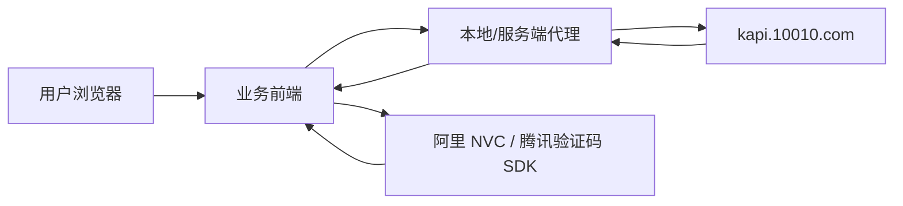
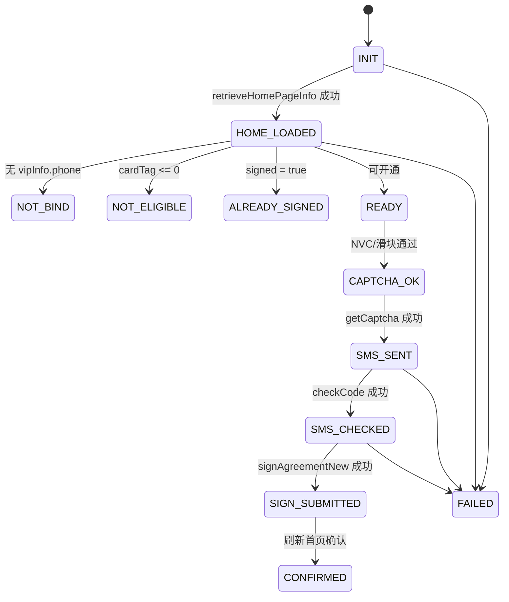
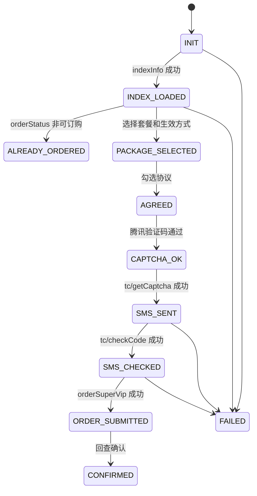

# 王卡会员订购实现开发方案

## 1. 目标与边界

目标是实现一套可维护的王卡会员/超级会员青春版订购辅助系统，用于在合法用户会话内完成页面状态读取、短信验证码发送、短信校验、订购/入会提交、结果回查和日志记录。

实现边界：

- 不绕过短信验证码、阿里 NVC、腾讯验证码或运营商风控。
- 不伪造 `RNC(...)` 密文；密文必须从官方业务接口实时读取。
- 不硬编码 Cookie、验证码票据、手机号密文或模板密文。
- 不脱离用户授权会话批量办理业务。

推荐形态：

- 前端：承载用户输入、验证码交互、协议勾选、状态展示。
- 后端代理：维护同一用户会话 Cookie，转发官方接口，屏蔽跨域，统一日志和错误处理。
- 可选 WebView/浏览器模式：让官方验证码 SDK 在真实浏览器环境中执行。

## 2. 总体实现过程

### 2.1 普通王卡会员开通流程

1. 初始化会话。
2. 打开或代理访问王卡会员页面，获得有效 `KSESSIONID`、安全 Cookie 和用户态。
3. 调用 `retrieveHomePageInfo` 获取首页数据。
4. 从响应中读取：
   - `vipInfo.phone`
   - `vipInfo.cardTag`
   - `vipInfo.signed`
   - `vipInfo.flowTag`
   - `smsInfos.signKcardVip.encryptPhpne`
   - `smsInfos.signKcardVip.encryptTmpId`
5. 判断用户是否可办理：
   - 未绑定：提示用户绑定。
   - 非王卡用户：提示不符合资格。
   - 已入会：展示已开通状态。
   - 可入会：进入短信验证。
6. 用户触发发送短信。
7. 前端完成阿里 NVC/滑块验证，拿到 `nvct` 或图形验证结果。
8. 调用 `/captcha/op/getCaptcha`。
9. 用户输入短信验证码。
10. 调用 `/captcha/op/checkCode`。
11. 短信校验成功后调用：
    - 默认：`/KCard/tencent/kcard/vip/signAgreementNew`
    - `flowTag === 2`：`/KCard/tencent/kcard/vip/welfare/conduct10Gb`
12. 入会提交成功后重新调用 `retrieveHomePageInfo` 确认状态。
13. 记录完整操作日志。

### 2.2 超级会员青春版订购流程

1. 初始化会话。
2. 确认入口参数：
   - `cate=youth`
   - `channel=CJHY_LTYOUTH_fulishe1` 或实际渠道
   - `data/k/v` 按入口 URL 原样传递
3. 调用 `/KCard/superVip/V3/indexInfo`。
4. 从响应中读取：
   - `phone`
   - `encryptedData`
   - `orderStatus`
   - `enableOrderPackagesInfo`
   - `effectiveModeList`
5. 选择套餐：
   - 青春版通常为 `type=LT_YOUTH`
   - 生效方式通常为 `effectiveMode=00`
   - 短信模板取 `effectiveModeList[].msgTemplateId`
   - 短信业务 key 取 `msgKey` 或固定 `superVip`
6. 用户勾选协议。
7. 前端调起腾讯验证码。
8. 获取 `tencentCaptchaCode/ticket/randstr/appId`。
9. 调用 `/captcha/op/tc/getCaptcha` 发送短信。
10. 用户输入短信验证码。
11. 调用 `/captcha/op/tc/checkCode` 校验短信。
12. 校验成功后调用 `/KCard/superVip/V2/orderSuperVip`。
13. 重新查询首页或会员状态确认订购结果。

## 3. 推荐架构



### 3.1 前端职责

- 页面状态展示。
- 协议勾选。
- 用户输入短信验证码。
- 调用阿里 NVC 或腾讯验证码 SDK。
- 把验证码 SDK 返回结果交给后端代理。
- 不保存敏感 Cookie。
- 不生成或伪造 `RNC(...)`。

### 3.2 后端代理职责

- 为每个用户维护独立 CookieJar。
- 转发官方接口并保持请求头一致性。
- 统一设置 `Origin`、`Referer`、`User-Agent`、`Content-Type`。
- 隔离不同用户会话。
- 缓存短时首页响应，但不能跨用户复用 `RNC(...)`。
- 记录操作链路和接口响应摘要。
- 对外只返回必要字段，避免暴露完整 Cookie 和敏感票据。

### 3.3 状态存储建议

每个用户会话保存：

```json
{
  "sessionId": "本系统会话 ID",
  "cookieJar": "上游 CookieJar",
  "flow": "kcardVip | superVipYouth",
  "phoneMasked": "130****3966",
  "rncPhone": "仅内存保存",
  "rncTemplateId": "仅内存保存",
  "smsSentAt": 0,
  "smsChecked": false,
  "lastHomeDataAt": 0,
  "lastError": ""
}
```

注意：`rncPhone`、`rncTemplateId`、验证码票据建议只放内存或短 TTL 存储，不写入长期日志。

## 4. 接口适配设计

### 4.1 本系统建议暴露的后端接口

普通王卡会员：

| 本系统接口 | 功能 | 上游接口 |
| --- | --- | --- |
| `POST /api/kcard/home` | 查询首页/资格/短信密文字段 | `retrieveHomePageInfo` |
| `POST /api/kcard/sms/send` | 发送短信 | `/captcha/op/getCaptcha` |
| `POST /api/kcard/sms/check` | 校验短信 | `/captcha/op/checkCode` |
| `POST /api/kcard/sign` | 提交入会 | `signAgreementNew` 或 `conduct10Gb` |
| `POST /api/kcard/refresh` | 刷新结果 | `retrieveHomePageInfo` |

青春版超级会员：

| 本系统接口 | 功能 | 上游接口 |
| --- | --- | --- |
| `POST /api/super-youth/index` | 查询首页/套餐 | `V3/indexInfo` |
| `POST /api/super-youth/sms/send` | 腾讯验证码后发送短信 | `/captcha/op/tc/getCaptcha` |
| `POST /api/super-youth/sms/check` | 校验短信 | `/captcha/op/tc/checkCode` |
| `POST /api/super-youth/order` | 提交订购 | `V2/orderSuperVip` |
| `POST /api/super-youth/refresh` | 刷新结果 | `V3/indexInfo` 或 `myVip` |

### 4.2 请求头策略

统一配置：

```text
Origin: https://txwk.10010.com
Referer: https://txwk.10010.com/
User-Agent: 与真实移动端浏览器保持一致
Accept: application/json, text/plain, */*
```

普通短信接口额外注意：

```text
X-Referer: https://txwk.10010.com/KCard/page/wkfuliNew2/index.html?ADTAG=MENU#/
Content-Type: application/x-www-form-urlencoded
```

青春版接口注意：

```text
Content-Type: application/x-www-form-urlencoded;charset=UTF-8
```

首页 GET 接口虽然 HAR 里有 `Content-Type: application/json;charset=UTF-8`，但实际重点是查询参数、Cookie 和来源头。

## 5. 关键避坑点

### 5.1 不要自己生成 RNC

`RNC(...)` 是服务端返回的业务密文/令牌。前端源码中没有把明文手机号加密成 RNC 的逻辑。

错误做法：

- 把 HAR 里的 `RNC(...)` 固定写死。
- 试图用 Base64/RSA/AES 自己生成 RNC。
- 把一个用户的 RNC 用到另一个用户会话。

正确做法：

- 每次办理前先调用首页接口。
- 从当前会话响应中读取 RNC。
- 在同一会话、短时间内透传到短信接口。

### 5.2 验证码通过状态由会话承接

最终入会/订购接口不带短信验证码字段，并不代表可以跳过短信。

普通王卡会员：

- `/captcha/op/checkCode` 成功后，服务端在当前会话里记录短信已通过。
- `signAgreementNew` 依赖这个状态。

青春版：

- `/captcha/op/tc/checkCode` 成功后，服务端在当前会话里记录短信已通过。
- `orderSuperVip` 依赖这个状态。

避坑：

- 发送短信、校验短信、最终提交必须用同一个 CookieJar。
- 后端代理不能每个接口创建新 session。
- 多标签页/并发操作可能覆盖同一会话的短信状态。

### 5.3 风控票据不能复用

`nvct`、`tencentCaptchaTicket`、`randstr` 都是动态票据。

避坑：

- 不要缓存验证码票据。
- 不要把腾讯验证码票据用于阿里 NVC 接口，反之亦然。
- 发送短信失败出现风控错误时，应让用户重新完成验证码。

### 5.4 Content-Type 必须匹配

普通入会提交：

```text
Content-Type: application/json
```

普通短信：

```text
application/x-www-form-urlencoded
```

青春版短信与订购：

```text
application/x-www-form-urlencoded;charset=UTF-8
```

避坑：

- 不要所有接口都用 JSON。
- 不要对 `RNC(...)` 做二次 JSON 包裹。
- 表单接口要按 `key=value&...` 编码。

### 5.5 URL 渠道参数要原样保留

普通王卡会员：

- `ADTAG` 生成入会 `channel`。
- `inviteId/shareId/actId` 影响邀请或活动归因。

青春版：

- `channel/data/k/v` 会透传到 `indexInfo` 和 `orderSuperVip`。

避坑：

- 不要把空字符串参数过滤掉，HAR 中 `data=&k=&v=` 是实际存在的。
- 不要随意替换渠道，否则可能影响资格、促销或风控。

### 5.6 首页响应要作为“事实源”

订购参数不要靠本地配置猜。

正确来源：

- `encryptedData` 来自 `indexInfo`。
- `msgTemplateId` 来自 `effectiveModeList`。
- `type` 来自 `enableOrderPackagesInfo[].type`。
- `isPromotion` 来自套餐对象。
- `effectiveMode` 来自用户选择的生效方式。

避坑：

- 不要写死 `LT_YOUTH` 后跳过首页。
- 不要写死短信模板密文。
- 不要假设所有用户都有相同套餐列表。

### 5.7 响应码不能只看 HTTP 200

上游接口通常 HTTP 200，但业务失败在 JSON 字段里。

常见成功码：

- 普通入会：`code === "0"`
- 普通短信：`code === "00000"`
- 青春版首页/短信/订购：多为 `code === "00000"`

避坑：

- HTTP 200 不等于业务成功。
- 要同时读取 `code`、`success`、`message/msg`。
- 异常响应要原样保留摘要，便于排查。

### 5.8 不要长期记录敏感字段

日志建议记录：

- 接口名。
- 当前流程阶段。
- 脱敏手机号。
- 业务码。
- 错误消息。
- 请求耗时。

不建议记录：

- 完整 Cookie。
- 完整 `RNC(...)`。
- 完整验证码票据。
- 用户输入的短信验证码。

## 6. 状态机设计

### 6.1 普通王卡会员状态



### 6.2 青春版状态



## 7. 开发阶段拆分

### 阶段一：接口代理和会话管理

交付内容：

- 后端代理基础框架。
- 每用户独立 CookieJar。
- 请求头模板。
- 上游请求工具：
  - GET query
  - JSON POST
  - form-urlencoded POST
- 统一响应解析。
- 脱敏日志。

验收：

- 能稳定调用首页接口。
- Cookie 能在同一用户多次请求间保持。
- 日志不输出敏感原文。

### 阶段二：普通王卡会员开通

交付内容：

- `/api/kcard/home`
- `/api/kcard/sms/send`
- `/api/kcard/sms/check`
- `/api/kcard/sign`
- `/api/kcard/refresh`
- 前端状态页。
- 阿里 NVC/滑块接入。

验收：

- 可展示用户是否已入会。
- 可触发短信发送。
- 短信校验成功后能提交入会。
- 入会后能刷新出最新状态。

### 阶段三：青春版超级会员订购

交付内容：

- `/api/super-youth/index`
- `/api/super-youth/sms/send`
- `/api/super-youth/sms/check`
- `/api/super-youth/order`
- `/api/super-youth/refresh`
- 套餐选择 UI。
- 腾讯验证码接入。
- 协议勾选与订购确认。

验收：

- 可读取套餐列表。
- 可选择 `LT_YOUTH` 和生效方式。
- 可通过腾讯验证码发送短信。
- 可短信校验后提交订购。
- 可回查订购状态。

### 阶段四：健壮性与运营化

交付内容：

- 错误码字典。
- 重试策略。
- 会话过期提示。
- 并发锁。
- 操作审计。
- 手动重新拉取首页。
- 风控失败后的用户引导。

验收：

- 会话过期能提示重新登录。
- 短信倒计时不会重复发送。
- 同一用户同一业务不能并发提交。
- 错误可定位到具体阶段。

## 8. 错误处理策略

### 8.1 可重试错误

- 网络超时。
- 上游临时 5xx。
- 首页接口偶发空响应。
- 风控脚本加载失败。

处理方式：

- 最多重试 1 到 2 次。
- 重试前保持同一 CookieJar。
- 验证码票据失败时必须重新获取。

### 8.2 不应自动重试的错误

- 短信验证码错误。
- 用户不符合资格。
- 已订购/已入会。
- 协议未勾选。
- 风控明确拒绝。

处理方式：

- 展示上游 `message/msg`。
- 停留在当前状态。
- 由用户主动重新操作。

### 8.3 会话错误

表现：

- 首页拿不到手机号。
- 接口提示未登录。
- RNC 字段缺失。
- Cookie 被清空或跨会话。

处理方式：

- 清理本地会话。
- 提示用户重新进入官方页面或重新授权。
- 不要继续用旧 RNC 发短信。

## 9. 安全与合规注意事项

- 只允许用户本人发起办理。
- 明确展示业务名称、价格、生效方式和协议。
- 提交前必须有用户确认。
- 短信验证码只用于当前办理流程。
- 不提供批量导入手机号、批量自动订购功能。
- 所有敏感数据脱敏展示。
- 后台日志不记录完整验证码、Cookie、RNC、风控票据。
- 失败时不要暴露上游完整响应中可能含有的敏感字段。

## 10. 测试方案

### 10.1 单元测试

- query 参数保留测试。
- form-urlencoded 编码测试。
- JSON POST 编码测试。
- 响应码解析测试。
- 日志脱敏测试。
- 状态机流转测试。

### 10.2 集成测试

使用脱敏 HAR 或 mock server：

- `retrieveHomePageInfo` 成功。
- `getCaptcha` 成功/失败。
- `checkCode` 成功/验证码错误。
- `signAgreementNew` 成功/资格失败。
- `indexInfo` 多套餐场景。
- `orderSuperVip` 成功/已订购/风控失败。

### 10.3 人工验收

- 移动端浏览器 UA 下验证。
- 微信/非微信环境差异验证。
- 同一账号重复开通保护。
- 短信倒计时与重发限制。
- 会话过期后的恢复流程。
- 订购成功后的回查展示。

## 11. 最小可行版本排期

### MVP 1：只做查询和字段确认

- 实现会话代理。
- 实现普通王卡 `home`。
- 实现青春版 `index`。
- 展示资格、套餐、字段来源。

### MVP 2：短信验证闭环

- 接入官方验证码 SDK。
- 实现短信发送。
- 实现短信校验。
- 加入倒计时与错误提示。

### MVP 3：办理提交闭环

- 普通王卡实现 `sign`。
- 青春版实现 `order`。
- 提交后回查状态。
- 输出脱敏操作记录。

### MVP 4：稳定性完善

- 会话过期恢复。
- 错误码字典。
- 并发锁。
- 风控失败引导。
- 管理端审计。

## 12. 最终开发建议

优先实现“查询首页 -> 展示可办理状态 -> 用户验证码 -> 提交 -> 回查”的严格链路，不要一开始做自动化批量能力。王卡会员这类接口的难点不在请求体字段多，而在会话、风控、短信校验状态和服务端签发密文字段必须保持一致。

真正稳定的实现要遵守三条原则：

1. 以首页接口返回为事实源。
2. 以同一 CookieJar 串起完整流程。
3. 以用户实时完成验证码作为发送短信和提交办理的前置条件。

只要这三点不破坏，普通王卡会员开通和超级会员青春版订购都可以用清晰的状态机和代理层稳定承载。
